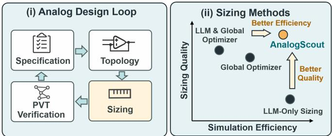
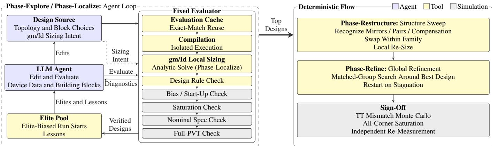
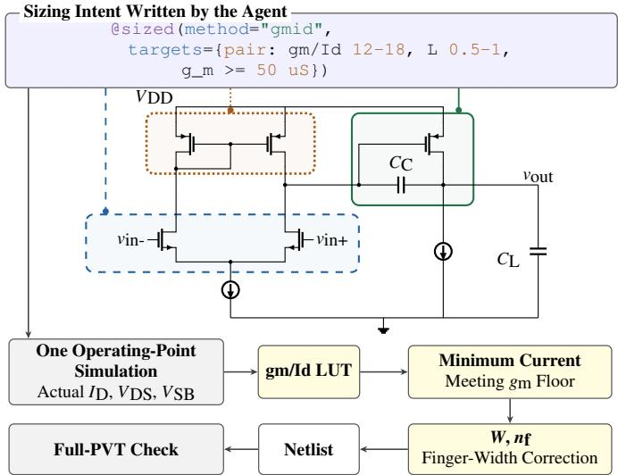
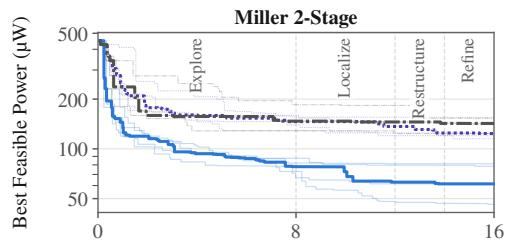
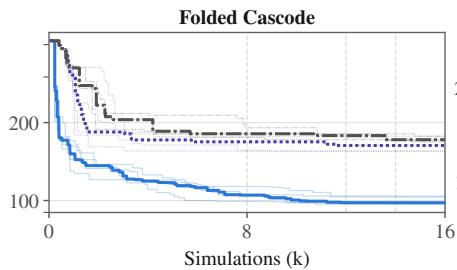
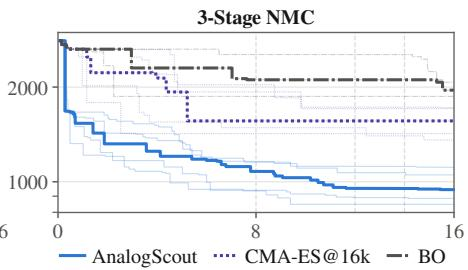

# AnalogScout: Simulation-Efficient PVT-Aware Analog Sizing with LLM Agents

Yichen Long

College of Integrated Circuits and Micro-Nano Electronics

Fudan University

Shanghai, China

longyc26@m.fudan.edu.cn

Keren Zhu

College of Integrated Circuits and Micro-Nano Electronics

Fudan University

Shanghai, China

krzhu@fudan.edu.cn

Abstract—Analog device sizing must satisfy all specifications across process, voltage, and temperature (PVT) corners to ensure tape-out success, but simulating every candidate at all corners dominates the sizing time and slows design iteration. Conventional surrogate-based optimizers search the sizing space directly, while recent large language model (LLM) agents add circuit knowledge to designs but still delegate the sizes to global optimizers. Both learn the circuit response from repeated multicorner SPICE simulations and optimize on top of it, which becomes expensive under a limited simulation budget. Providing an agent with reusable verified designs and sizing sub-blocks analytically could save most of this budget. We propose AnalogScout, a simulation-efficient PVT-aware sizing framework driven by an LLM agent. Combining elite-design reuse, analytic gm/Id local sizing and global refinement under full-corner verification, AnalogScout reduces power by 43.3% relative to the evolution strategy CMA-ES at an equal budget of 16k simulations on three SKY130 OTAs of increasing complexity, and reaches the final CMA-ES power after 7.0% of that budget. It also attains lower power than Bayesian optimization on all three OTAs and than two re-implemented LLM-driven flows on the two OTAs where they were tested.

Index Terms—analog sizing, PVT robustness, simulation budget, LLM agents, gm/Id methodology

## I. INTRODUCTION

Analog design automation lags far behind its digital counterpart, and device sizing remains its most labor-intensive step [1]. Sizing selects the widths, lengths and bias currents that meet gain, bandwidth, stability and noise targets at minimum power. In advanced nodes these targets must hold at every process, voltage and temperature (PVT) corner, so each candidate costs a full multi-corner SPICE sweep.

PVT-aware sizing searches for device sizes that satisfy all specifications at all corners, mainly through surrogatebased and population-based optimization. Surrogate methods such as Bayesian optimization (BO) fit the corner-dependent response [2]–[4], whereas evolutionary and reinforcementlearning methods [5]–[7] search the design space corner by corner [8], [9]. Both learn the response from sampled simulations, so their cost scales with corners times iterations (Sec. II).

LLM agents [10], [11] add circuit knowledge to this search but spend the simulation budget poorly (Fig. 1). LLM-only sizing loops oscillate between solutions [12], and most agentic flows delegate every device size to a global optimizer [13]– [16]. We further observe that agents re-submit identical designs, restart instead of refining verified ones, and lose most of the budget to simulation-driven local optimizers. An agent that reuses verified designs and sizes sub-blocks analytically would instead spend its budget on improving designs.

  
Fig. 1. (i) In the analog design loop, a topology chosen for the specification is sized and verified at all PVT corners until every specification holds; the sizing step (highlighted) consumes most simulations. (ii) Qualitative positions of sizing methods: LLM-only sizing consumes fewer simulations; a global optimizer, alone or driven by an LLM, sizes well with many simulations. AnalogScout targets both quality and efficiency.

Inspired by agentic exploration in digital RTL design [17], we propose AnalogScout, a simulation-efficient PVT-aware sizing framework, with three contributions:

• Budget-aware exploration: an elite pool and an exact evaluation cache let the agent refine verified designs instead of repeating or restarting them.

• Low-simulation local sizing: the agent states gm/Id goals for sub-blocks, which a lookup-table solver resolves with at most three operating-point simulations per block.

• Results: on three SKY130 OTAs verified at nine corners, AnalogScout reduces power by 43.3% relative to CMA-ES at an equal 16k-simulation budget, matches the final CMA-ES power after 7.0% of that budget, and on the Miller and NMC OTAs beats CMA-ES with twice the budget.

Section II formulates PVT-aware sizing and reviews existing optimizers, Section III details the four phases of AnalogScout, Section IV compares it with optimizer and LLM baselines and traces where the budget goes, and Section V concludes.

  
Fig. 2. AnalogScout workflow. The LLM agent edits the design source and states gm/Id sizing intent; the fixed evaluator reuses cached results, resolves the intent analytically and checks each design up to full PVT; the top designs then pass through Phase-Restructure, Phase-Refine and sign-off.

## II. PRELIMINARIES

PVT-aware sizing. Given a topology with device sizes x, PVT-aware sizing solves

$$
\operatorname* { m i n } _ { \mathbf { x } } P _ { \mathrm { t t } } ( \mathbf { x } ) \mathrm { s . t . } f _ { i } ( \mathbf { x } , c ) \mathrm { m e e t s } s _ { i } \forall i , \forall c \in \mathcal { C } ,\tag{1}
$$

where $P _ { \mathrm { t t } }$ is the power at the typical corner, $f _ { i }$ are measured performances such as gain and phase margin, $s _ { i }$ their specifications, and C the set of process, voltage and temperature corners. Each candidate is therefore evaluated by |C| sets of SPICE simulations, and we measure every method by the number of simulations it consumes.

PVT-aware optimizers. Surrogate-based methods fit a model of the corner-dependent response and optimize it, for example a Bayesian neural network shared across corners [4] or a contextual Gaussian process over design and PVT variables [18]. Population-based methods evolve designs per corner and share knowledge across corners [8], and reinforcement-learning methods train one policy over all corners [9], [19]. To reduce the corners simulated, these methods simulate only the current worst corners [20] or cluster similar corners [9], [19].

## III. ANALOGSCOUT

AnalogScout is a simulation-efficient PVT-aware sizing framework in which an LLM agent decides where and toward which goal to size, while deterministic tools compute the sizes and verify the design (Fig. 2). Its input is a topology with starting sizes, the specifications, a PDK and a simulation budget; it seeks a netlist that meets every specification at every PVT corner with low typical-corner power. In Phase-Explore the agent rewrites the netlist, starting from the best verified designs so far; in Phase-Localize it attaches gm/Id goals to sub-blocks, which a lookup-table solver resolves. Phase-Restructure then swaps standard sub-circuits within their family, and Phase-Refine spends the remaining budget on a global search around the best design before sign-off.

## A. Design Representation and Verification

A design is a Python netlist built from PDK MOSFETs, bounded R and C, verified building blocks and precomputed gm/Id tables [21]–[23]. A fixed evaluator, which the agent cannot modify, solves the DC operating point and checks saturation and the specifications at the typical corner; a design that passes is verified at nine PVT corners (tt; ss, sf and fs at −10% and ff $\mathrm { a t \ + 1 0 \% } \ : V _ { D D }$ , each at $- 4 0 / 1 2 5 ^ { \circ } \mathrm { C } )$ with fixed testbenches for every specification of Fig. 4. A design is feasible if every specification holds at every corner. Its violation is

$$
V = \sum _ { i } \operatorname* { m a x } _ { c } \operatorname* { m a x } ( 0 , g _ { i , c } / q _ { i } ) ,\tag{2}
$$

where $g _ { i , c }$ is the shortfall of specification i at corner c and $q _ { i }$ its scale (a log ratio, 10 dB or 30◦). Designs are ranked by (infeasible, V , tt power, −margin, area). The agent sees each failing specification at its worst corner and flagged devices.

## B. Phase-Explore: Agent with Elite Pool

A tool-calling LLM agent [24], [25] improves verified designs instead of restarting: it edits the netlist, evaluates it, and queries the gm/Id tables. Each run ends with a lessonslearned summary for later prompts. An elite pool keeps the $K \ : = \ : 3$ best feasible designs. A new run starts from elite j with probability $p _ { j } \propto \exp ( - ( r _ { j } - r ^ { * } ) / \sigma _ { r } )$ , where $r _ { j }$ is its log-power, $r ^ { * }$ the best and $\sigma _ { r }$ the spread. Most runs start from an elite, because local rewrites of a feasible design pay off far more often than fresh starts: after two fresh runs, run k of N starts fresh with probability max $( 0 . 0 5 , 0 . 1 5 ( 1 - k / N ) )$ ). In development, 15.5% of the agent’s evaluation requests repeated the source text of an earlier design exactly. An exact cache therefore returns the stored result of an identical source instead of simulating it again.

## C. Phase-Localize: Source-Local Sizing Intent

Instead of tuning sizes by simulation, the agent tags a netlist block with @sized and states its goal as an intent tuple

$$
\begin{array} { r } { \mathcal { T } = \left( \mathcal { B } , \ \operatorname* { m i n } I _ { \mathcal { B } } , \ \left[ \gamma _ { \operatorname* { m i n } } , \gamma _ { \operatorname* { m a x } } \right] , \ \left[ L _ { \operatorname* { m i n } } , L _ { \operatorname* { m a x } } \right] , \ g _ { m , \operatorname* { m i n } } \right) , } \end{array}\tag{3}
$$

where B is a set of devices, $I _ { B }$ their current and $\gamma$ the gm/Id ratio (Fig. 3).

Analytic solver. One operating-point simulation of the whole circuit gives each targeted device its actual $V _ { D S }$ and

  
Fig. 3. Phase-Localize on the two-stage OTA: one operating-point simulation measures the actual bias of each @sized block, the gm/Id table gives the minimum current that meets the $g _ { m }$ floor, and the resulting W and $n _ { f }$ are written back before full-PVT verification.

VSB, so the tables are read at the bias the block really sees. For a stated gm/Id range $[ \gamma _ { \mathrm { m i n } } , \gamma _ { \mathrm { m a x } } ]$ , a length range and a floor $g _ { m , \mathrm { m i n } }$ , the minimum current meeting the floor is

$$
\gamma = \gamma _ { \mathrm { m a x } } , \qquad I _ { D } = \operatorname* { m a x } ( I _ { \mathrm { m i n } } , g _ { m , \mathrm { m i n } } / \gamma ) ,\tag{4}
$$

with L the characterized length nearest the current one. The total width follows from the tabulated current density, $W _ { \mathrm { t o t } } = I _ { D } / J ( \gamma , L , V _ { D S } , V _ { S B } , W _ { f } )$ , iterated to a fixed point because the density of a binned PDK depends on the finger width $W _ { f } = W _ { \mathrm { t o t } } / n _ { f }$ for $n _ { f }$ fingers. Matched devices receive the most conservative common geometry. The solver then re-measures the bias, using at most three operating-point simulations per block. If no legal geometry exists, it reports the limiting constraint and the parameter to relax; the evaluator remains the only authority on feasibility.

Why analytic. Every analog candidate needs multi-corner simulation, so a simulation-driven local optimizer competes with the agent for the same budget (Sec. IV-C); precomputed device characterization removes that competition.

Stage. Phase-Localize restarts agent runs from the three best Phase-Explore designs; every evaluated design must call an @sized block placed and targeted by the agent.

## D. Phase-Restructure and Phase-Refine

Phase-Restructure recognizes standard structures in the agent’s netlist and swaps each one for another member of its family, for example a wide-swing mirror or Miller-C with a nulling resistor. Phase-Refine refines the best design with CMA-ES [26] over matched device groups, within a factor of 4 of its sizes, with restarts on stagnation. The same engine run from the initial design is the CMA-ES baseline.

Sign-off. A design is signed off when it passes full PVT, is saturated at all corners with at least 50 mV margin, reaches a typical-corner mismatch [27] Monte Carlo yield of at least 95% $( N = 5 0 0 )$ , and independent reference scripts reproduce its measurements.

<table><tr><td>Specification</td><td>Miller 2-Stage  $\Longrightarrow \bigsqcup _ { \mathbb { X } } \ j _ { 2 \mathrm { p F } }$ </td><td>Folded Cascode  $\mathrm { \mathop { = } } \mathrm { \mathop { \triangleright } } \mathrm { \mathop { = } } \mathrm { \mathop { / { \vphantom { \mathrm { \mathop { / { \operatorname { \sum } } } \mathrm { \fi { 2 p F } } } } }  \kern - delimiterspace } }$ </td><td>3-Stage NMC  $\Rightarrow \frac { 1 1 } { 4 } + \frac { 1 } { 4 } + \frac { 1 } { 7 } - 5 0 \mathrm { p F }$ </td></tr><tr><td>Minimum</td><td></td><td></td><td></td></tr><tr><td>Gain (dB)</td><td>70</td><td>58</td><td>115</td></tr><tr><td>GBW (MHz)</td><td>10</td><td>20</td><td>5</td></tr><tr><td>PM (deg)</td><td>60</td><td>60</td><td>70</td></tr><tr><td>SR (V/μs)</td><td>10</td><td>10</td><td>4.5</td></tr><tr><td>CMRR (dB)</td><td>60</td><td>60</td><td>50</td></tr><tr><td>PSRR (dB)</td><td>55</td><td>55</td><td>40</td></tr><tr><td>Swing (V)</td><td>1</td><td>0.9</td><td>1.3</td></tr><tr><td>Maximum</td><td></td><td></td><td></td></tr><tr><td>Settling (ns)</td><td>200</td><td>200</td><td>170</td></tr><tr><td>Noise (µV rms)</td><td>65</td><td>85</td><td>26</td></tr><tr><td>Area (μm2)</td><td>5000</td><td>5000</td><td>18000</td></tr><tr><td>Power (µW)</td><td>600</td><td>550</td><td>3300</td></tr></table>

Fig. 4. Benchmark OTAs and their specifications; every specification must hold at all nine PVT corners, TT power is minimized, and the GF180 variants scale voltage specifications by 3.3/1.8.

## IV. EXPERIMENTS

## A. Setup

Benchmarks. We size three single-ended OTAs of increasing complexity in SKY130 [28] at $V _ { D D } = 1 . 8 \mathrm { V } ,$ starting from gm/Id hand designs (Fig. 4); the Miller OTA is repeated in GF180MCU [29] at 3.3 V as a test-only PDK.

Budget and seeds. Every method receives 16k simulations, where one simulation is one SPICE run of one testbench at one corner in ngspice [30], and only evaluations completed within the budget count. AnalogScout allots 8k simulations to Phase-Explore (60 agent runs of up to 30 steps on deepseek-flash [25]), 4k to Phase-Localize, 2k to Phase-Restructure and the remainder to Phase-Refine. We fixed the method and three hypotheses on development seeds 1–3 and report confirmation seeds 4–8, five per OTA and three for GF180.

Baselines. Global CMA-ES [26] and BO [31], [32] size all devices from the starting design with the same bound handling and restarts as Phase-Refine, and CMA-ES is also run with twice the budget. LAS-style [16] and ACP-style [13] baselines let the LLM propose a design and hand its sizes to a global optimizer on the same evaluator. H1 tests AnalogScout against CMA-ES at equal budget, H2 Phase-Localize against an equalbudget restart from the same designs, and H3 Phase-Explore with and without the elite pool; all are one-sided and Holmcorrected at $\alpha = 0 . 0 5$

## B. Budget Efficiency

At the same 16k-simulation budget, AnalogScout reaches the lowest power of all methods on every OTA (Table I). It reduces power by 43.3% relative to CMA-ES (H1, Holmadjusted $p = 9 . 1 6 \times 1 0 ^ { - 6 } )$ , and on every OTA each of its five searches beats each CMA-ES search. On the Miller and NMC OTAs, it still reaches 42.4% and 39.0% lower power than CMA-ES with 32k simulations. The convergence curves in Fig. 5 show that AnalogScout matches the final CMA-ES power after 694–1,124 simulations, about 7.0% of the budget.

## C. Where the Budget Goes

The ablation in Table I traces this efficiency to reusing verified designs. With the elite pool, Phase-Explore reaches 18.1% lower power than with fresh starts only at 8k simulations (H3, $p = 0 . 0 0 0 2 2 )$ . On development seeds, Phase-Localize spends only 4.3% of its simulations on sizing, against 85.3–96.3% for a simulation-based local optimizer, and evaluates about twelve times more designs within the same 4k simulations. At equal budget, however, it shows no significant power reduction over restarting from the same designs (H2, $p = 0 . 6 4 5 )$ , so we claim its low simulation use, not a power gain. Phase-Restructure leaves the median power unchanged, and Phase-Refine lowers it by at most a further 2.4%.

TABLE I  
Best full-PVT-feasible TT power of each method at an equal budget of 16k simulations (a) and of AnalogScout’s phases (b).
<table><tr><td></td><td colspan="2">Miller 2-Stage</td><td colspan="2">Folded Cascode</td><td colspan="2">3-Stage NMC</td></tr><tr><td>Configuration</td><td>Median P (μW)</td><td>Mean ± sample std  $( \mu \mathrm { W } )$ </td><td>Median P  $( \mu \mathrm { W } )$ </td><td>Mean ± sample std  $( \mu \mathrm { W } )$ </td><td>Median P (μW)</td><td>Mean ± sample std  $( \mu \mathrm { W } )$ </td></tr><tr><td colspan="7">(a) Same-budget comparison</td></tr><tr><td>Start</td><td>451</td><td>451</td><td>414</td><td>414</td><td>2,809</td><td>2,809</td></tr><tr><td>CMA-ES@16k</td><td>124</td><td> $1 3 1 \pm 1 6$ </td><td>163</td><td> $1 6 4 \pm 1 0$ </td><td>1,561</td><td>1,554±164</td></tr><tr><td>BO@16k</td><td>142</td><td> $1 4 0 \pm 1 5$ </td><td>172</td><td> $1 7 2 \pm 4$ </td><td>1,955</td><td> $1 , 9 6 5 \pm 1 0 3$ </td></tr><tr><td>LAS-Style</td><td>99.3</td><td> $9 8 . 8 \pm 6 . 0$ </td><td>115</td><td> $1 1 8 \pm 7$ </td><td></td><td></td></tr><tr><td>ACP-Style</td><td>145</td><td> $1 4 7 \pm 6$ </td><td>168</td><td> $1 6 9 \pm 7$ </td><td></td><td></td></tr><tr><td>CMA-ES@32k (2x budget)</td><td>107</td><td> $1 0 9 \pm 6$ </td><td></td><td></td><td>1,549</td><td> $1 , 5 5 9 \pm 5 3$ </td></tr><tr><td>AnalogScout (16k)</td><td>61.4</td><td> ${ \bf 6 5 . 6 \pm 1 4 . 4 }$ </td><td>98.1</td><td> ${ \bf 9 9 . 9 \pm 3 . 4 }$ </td><td>944</td><td> ${ \bf 9 6 8 \pm 1 1 1 }$ </td></tr><tr><td colspan="7">(b) Ablation</td></tr><tr><td>Phase-Explore w/o elite pool (8k)</td><td>98.0</td><td> $1 0 2 \pm 8$ </td><td>125</td><td> $1 2 4 \pm 4$ </td><td></td><td></td></tr><tr><td>Phase-Explore (8k)</td><td>78.0</td><td> $7 7 . 5 \pm 8 . 0$ </td><td>105</td><td> $1 0 6 \pm 5$ </td><td>1,079</td><td> $1 , 0 5 4 \pm 1 1 1$ </td></tr><tr><td>+ Phase-Localize (12k)</td><td>62.9</td><td> $6 6 . 7 \pm 1 3 . 9$ </td><td>98.1</td><td> $1 0 0 \pm 3$ </td><td>953</td><td> $9 7 6 \pm 1 1 6$ </td></tr><tr><td>Phase-Explore + restart (12k)</td><td>64.6</td><td> $6 8 . 4 \pm 1 2 . 8$ </td><td>96.9</td><td> $9 9 . 3 \pm 7 . 0$ </td><td>862</td><td> $8 7 6 \pm 1 6 4$ </td></tr><tr><td>+ Phase-Restructure (14k)</td><td>62.9</td><td> $6 6 . 5 \pm 1 4 . 1$ </td><td>98.1</td><td>100±3</td><td>953</td><td> $9 7 6 \pm 1 1 6$ </td></tr><tr><td>+ Phase-Refine (16k)</td><td>61.4</td><td> $6 5 . 6 \pm 1 4 . 4$ </td><td>98.1</td><td> $9 9 . 9 \pm 3 . 4$ </td><td>944</td><td> $9 6 8 \pm 1 1 1$ </td></tr></table>

Every reported design meets all specifications of Fig. 4 at all nine PVT corners in the fixed evaluator; P: TT power; $n = 5$ searches per method (BO, LAS-Style, ACP-Style, CMA-ES@32k: $n = 3 ;$ Start: one hand design). The NMC CMA-ES@32k entry was added after H1–H3 were fixed and is descriptive only (seeds 4–6; all outcomes reported).

## D. Generalization and Sign-off

AnalogScout’s designs pass independent all-corner remeasurement about as often as CMA-ES’s. Independent scripts re-measure 156 reference cases from all methods; 46 fail. Per method, 29 of AnalogScout’s 111 cases fail, as do 3 of CMA-ES’s 12, 2 of BO’s 11 and 14 of the LLM baselines’ 31 (shared cases count for each). Forty of the failures only miss the 50 mV all-corner saturation margin, which the loop checks at the typical corner only; the other 6 exceed a specification by at most 0.5%. Among the best designs, which also undergo typical-corner mismatch Monte Carlo $( N = 5 0 0 )$ , the SKY130 Miller design is signed off, the folded-cascode design fails the re-measurement and reaches a 91.4% Monte Carlo yield (target 95%), and the NMC design misses the 170 ns settling specification by 0.15% at one corner. On GF180MCU, AnalogScout reduces Miller OTA power by 59.6% versus CMA-ES, and its best design is signed off with a 99.8% Monte Carlo yield.

Limitations. Phase-Localize shows no significant power reduction over an equal-budget restart, Phase-Restructure adds little, and the GF180 test covers only the Miller OTA.

## V. CONCLUSION

AnalogScout sizes analog circuits across PVT corners budget-efficiently by refining verified designs and resolving local sizing intent with almost no simulations. Future work will resize blocks analytically after structural changes and check saturation at all corners inside the loop; the code and open-PDK data will be released.

## ACKNOWLEDGMENT

AI coding assistants (ChatGPT) helped implement the software; the authors reviewed it and take full responsibility for its content.

  
Fig. 5. Median best full-PVT-feasible TT power of AnalogScout, CMA-ES and BO versus simulations over five confirmation searches (BO: three); thin lines: individual searches; dashed lines: AnalogScout phase boundaries.

## REFERENCES

[1] G. G. E. Gielen and R. A. Rutenbar, “Computer-aided design of analog and mixed-signal integrated circuits,” Proc. IEEE, vol. 88, no. 12, pp. 1825–1854, Dec. 2000.

[2] W. Lyu et al., “An efficient Bayesian optimization approach for automated optimization of analog circuits,” IEEE Trans. Circuits Syst. I, Reg. Papers, vol. 65, no. 6, pp. 1954–1967, Jun. 2018.

[3] W. Lyu, F. Yang, C. Yan, D. Zhou, and X. Zeng, “Batch Bayesian optimization via multi-objective acquisition ensemble for automated analog circuit design,” in Proc. 35th Int. Conf. Mach. Learn. (ICML), ser. Proc. Mach. Learn. Res., vol. 80, Jul. 2018, pp. 3306–3314.

[4] N. Guo, F. Peng, J. Shi, F. Yang, J. Tao, and X. Zeng, “Yield optimization for analog circuits over multiple corners via Bayesian neural networks: Enhancing circuit reliability under environmental variation,” ACM Trans. Des. Autom. Electron. Syst., vol. 29, no. 1, pp. 12:1–12:17, 2024.

[5] B. Liu, D. Zhao, P. Reynaert, and G. G. E. Gielen, “GASPAD: A general and efficient mm-wave integrated circuit synthesis method based on surrogate model assisted evolutionary algorithm,” IEEE Trans. Comput.- Aided Design Integr. Circuits Syst., vol. 33, no. 2, pp. 169–182, Feb. 2014.

[6] K. Settaluri, A. Haj-Ali, Q. Huang, K. Hakhamaneshi, and B. Nikolic, “AutoCkt: Deep reinforcement learning of analog circuit designs,” in Proc. Design, Autom. Test Eur. Conf. Exhib. (DATE), Mar. 2020, pp. 490–495.

[7] H. Wang et al., “GCN-RL circuit designer: Transferable transistor sizing with graph neural networks and reinforcement learning,” in Proc. 57th ACM/IEEE Design Autom. Conf. (DAC), Jul. 2020, pp. 1–6.

[8] J. Li, Y. Zeng, H. Zhi, J. Yang, W. Shan, Y. Li, and Y. Li, “Knowledge transfer framework for PVT robustness in analog integrated circuits,” IEEE Trans. Circuits Syst. I, Reg. Papers, vol. 71, no. 5, pp. 2017–2030, 2024.

[9] W. Shi, H. Wang, J. Gu, M. Liu, D. Z. Pan, S. Han, and N. Sun, “RobustAnalog: Fast variation-aware analog circuit design via multitask RL,” in Proc. ACM/IEEE Workshop Mach. Learn. CAD (MLCAD), 2022, pp. 35–41.

[10] Y. Lai et al., “AnalogCoder: Analog circuit design via training-free code generation,” in Proc. AAAI Conf. Artif. Intell. (AAAI), vol. 39, no. 1, 2025, pp. 379–387.

[11] Z. Chen et al., “Artisan: Automated operational amplifier design via domain-specific large language model,” in Proc. 61st ACM/IEEE Design Autom. Conf. (DAC), Jun. 2024, pp. 1–6.

[12] C. Liu, E. A. Olowe, and D. Chitnis, “LLM-based AI agent for sizing of analog and mixed signal circuit,” in Proc. IEEE Int. New Circuits Syst. Conf. (NEWCAS), 2025, arXiv:2504.11497.

[13] Y. Lai et al., “AnalogCoder-Pro: Unifying analog circuit generation and optimization via multi-modal LLMs,” IEEE Trans. Comput.-Aided Design Integr. Circuits Syst., 2026, early access, doi: 10.1109/T-CAD.2026.3673493.

[14] Y. Yin, Y. Wang, B. Xu, and P. Li, “ADO-LLM: Analog design Bayesian optimization with in-context learning of large language models,” in Proc. 43rd IEEE/ACM Int. Conf. Comput.-Aided Des. (ICCAD), Oct. 2024, pp. 1–9.

[15] C. Liu and D. Chitnis, “EEsizer: LLM-based AI agent for sizing of analog and mixed signal circuit,” IEEE Trans. Circuits Syst. I, Reg. Papers, vol. 73, no. 6, pp. 3825–3834, Jun. 2026.

[16] J. Duan et al., “LLM-assisted analog amplifier sizing,” GitHub repository, 2026, accessed: Oct. 22, 2026. [Online]. Available: https://github.com/jiyuanduan001-oss/LLM\_Amplifier\_Sizing

[17] F. Arnold, R. Amaudruz, D. Tsaras, R. Andri, and L. Cavigelli, “RTLScout: Joint agentic code and synthesis optimization for efficient digital circuits,” arXiv:2606.06530, 2026.

[18] J. Huang, J. Shen, F. Yang, L. Shang, Z. Bi, C. Yan, W. Hu, D. Zhou, and X. Zeng, “Variation-aware analog circuit design via contextual modeling and robust optimization,” ACM Trans. Des. Autom. Electron. Syst., vol. 31, no. 2, pp. 26:1–26:19, 2026.

[19] Z. Kong, X. Tang, W. Shi, Y. Du, Y. Lin, and Y. Wang, “PVTSizing: A TuRBO-RL-based batch-sampling optimization framework for PVTrobust analog circuit synthesis,” in Proc. ACM/IEEE Design Autom. Conf. (DAC), 2024, pp. 47:1–47:6.

[20] O. Pascu, C. Visan, G. Nicolae, M. Boldeanu, H. Cucu, C. Diaconu, A. Buzo, and G. Pelz, “Efficient multi-objective optimization for PVT variation-aware circuit sizing using surrogate models and smart corner

sampling,” in Proc. IEEE/ACM Int. Symp. Low Power Electron. Design (ISLPED), 2023, pp. 1–6.

[21] F. Silveira, D. Flandre, and P. G. A. Jespers, “A $g _ { m } / I _ { D }$ based methodology for the design of CMOS analog circuits and its application to the synthesis of a silicon-on-insulator micropower OTA,” IEEE J. Solid-State Circuits, vol. 31, no. 9, pp. 1314–1319, Sep. 1996.

[22] P. G. A. Jespers and B. Murmann, Systematic Design of Analog CMOS Circuits: Using Pre-Computed Lookup Tables. Cambridge, U.K.: Cambridge University Press, 2017.

[23] B. Murmann, “Practical aspects of script-based analog design using precomputed lookup tables,” in Proc. IEEE Int. Symp. Circuits Syst. (ISCAS), 2024.

[24] S. Yao et al., “ReAct: Synergizing reasoning and acting in language models,” in Proc. Int. Conf. Learn. Represent. (ICLR), 2023.

[25] DeepSeek-AI, “DeepSeek-V4: Towards highly efficient million-token context intelligence,” arXiv:2606.19348, 2026.

[26] N. Hansen, “The CMA evolution strategy: A tutorial,” arXiv:1604.00772, 2016.

[27] M. J. M. Pelgrom, A. C. J. Duinmaijer, and A. P. G. Welbers, “Matching properties of MOS transistors,” IEEE J. Solid-State Circuits, vol. 24, no. 5, pp. 1433–1439, Oct. 1989.

[28] SkyWater Technology Foundry and Google, “SkyWater open source PDK,” GitHub repository, 2020, accessed: Oct. 22, 2026. [Online]. Available: https://github.com/google/skywater-pdk

[29] GlobalFoundries and Google, “GlobalFoundries GF180MCU open source PDK,” GitHub repository, 2022, accessed: Oct. 22, 2026. [Online]. Available: https://github.com/google/gf180mcu-pdk

[30] H. Vogt, G. Atkinson, D. Warning, and P. Nenzi, Ngspice User’s Manual, Version 47, Aug. 2026. [Online]. Available: https://ngspice. sourceforge.io/docs/ngspice-47-manual.pdf

[31] M. Balandat et al., “BoTorch: A framework for efficient Monte-Carlo Bayesian optimization,” in Proc. Adv. Neural Inf. Process. Syst. (NeurIPS), vol. 33, 2020, pp. 21 524–21 538.

[32] S. Ament, S. Daulton, D. Eriksson, M. Balandat, and E. Bakshy, “Unexpected improvements to expected improvement for Bayesian optimization,” in Proc. Adv. Neural Inf. Process. Syst. (NeurIPS), vol. 36, 2023, pp. 20 577–20 612.