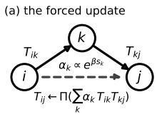
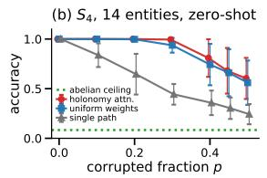
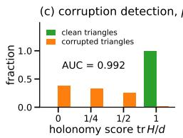
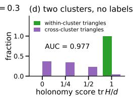

# Attention as Lattice Gauge Theory: Relations Interact Only Through Wilson Loops

Aakash Sarkar University of California, San Francisco aakash.sarkar@ucsf.edu

Ananya Mukherjee Brigham and Women’s Hospital amukherjee8@bwh.harvard.edu

Motoshige Sato University of California, San Francisco motoshige.sato@ucsf.edu

## Abstract

Relations compose through the entity they share—Alice is Bob’s mother and Bob is Carol’s father, so Alice is Carol’s grandmother—and the order matters, since a father’s mother is not a mother’s father; verifying a composed relation means closing the loop. We show that if each entity’s coordinate frame may be rotated independently (per-entity frame freedom [1]), three things follow. In the puregauge sector, relations that share no cycle cannot interact at all. The only gaugeinvariant score of a triangle is a class function of its holonomy $\scriptstyle H = T _ { i j } { \bar { T } } _ { j k } { \bar { T } } _ { k i } -$ a Wilson loop. And the only equivariant update of an edge is $U { = } \mathbf { \bar { \Psi } } ( H ) T _ { i j }$ with Ψ conjugation-equivariant. Edge attention by Wilson loops is therefore not one design among many but the unique form the symmetry permits. Three communities hold pieces of this form: the commuting-operator embeddings of knowledge graphs [32, 33] are its abelian (commuting) sector; AlphaFold’s triangle update [2] and the Edge Transformer [3] have its shape—an edge updated through the third vertex—without its constraints; and lattice QCD builds it equivariantly on lattices [22, 27]. We instantiate the equivariant sub-family on general relational graphs as holonomy attention. With no training and composition alone, it infers unobserved $S _ { 4 }$ relations on sparse graphs at 0.88 with a fifth of the edges corrupted, at or slightly below specialist synchronization algorithms, where every commutative architecture is capped at 0.083; its holonomy score flags corrupted triangles at AUC 0.99 where commuting scores are capped at 0.76 by a second selection rule, and it separates clusters without labels.

## 1 Frame freedom and the transport sector

In a lattice gauge theory, matter fields live at sites and gauge fields on links; comparing matter across sites requires parallel transport, and the gauge field interacts only around plaquettes, the elementary closed loops [19]. We show this structure isforced in attention: per-entity frame freedom requires transported scores between entities and plaquette-mediated interaction between relation operators. The dictionary is direct: sites map to entities, link variables to relation transports $T _ { i j } .$ , plaquette holonomies to Wilson loops of relation triangles, flat connections to standard attention [1], and the gauge self-coupling to the forced form proved here.

Holonomy and frame freedom. Transporting a vector around a closed path multiplies it by the holonomy, the net rotation the loop accumulates; its trace, the Wilson loop, is a number independent of the coordinate system at every vertex. Entities introduced on the fly—a name in a story, a variable in a program—have no intrinsic coordinate system: rotating their embedding alone does not change the task. A recent study [1] proves that under this $O ( d ) ^ { n }$ symmetry any admissible attention score depends on the entities only through $x _ { i }$ and $T _ { i j } x _ { j }$ (for isometries, through $\langle x _ { i } , T _ { i j } x _ { j } \rangle )$ , and that because any equivariant map is rank one, the transport cannot be computed from the two entities and must be supplied by relation data outside the pair. The symmetry is the task’s, not a network’s: a fresh entity’s frame carries no information, so any predictor must be invariant to it; a shared-basis model meets that only by learning transports. The flat limit. When every loop’s holonomy is trivial, a shared frame exists and the forced score reduces to plain dot-product attention; a standard head realizes exactly this form with a constant per-head transport composed only through depth, so standard attention is the flat-connection limit of a richer theory [1].

  
Figure 1: Holonomy attention, zero-shot. (a) The forced update. (b) Accuracy on unobserved $S _ { 4 }$ relations versus corrupted fraction (14 entities, degree 8, four rounds; mean and sd, 10 instances). (c) Holonomy score tr $\dot { H } / d$ of observed triangles at $p { = } 0 . 3$ (discrete: permutation traces are integers). (d) The same score separates within- from cross-cluster triangles with no labels.

Prior work. On lattices the form is known: gauge-equivariant flows, smearing, Wilson-loop attention, and gauge-covariant message passing all realize conjugation-equivariant plaquette updates [22– 24, 27, 28], and such layers are known to suffice [12, 13]. In synchronization, holonomy classifies edge potentials [29] and cycle inconsistency is the standard diagnostic [11, 30]. In ML more broadly, gauge structure appears through frames on meshes [6, 7], operator readings of attention [4], orthogonal state models [5], and sheaf networks [20, 21, 35], none with interaction between edge maps. What we add is the derivation from per-entity frame freedom on general relational graphs—the closed-form $O ( d )$ statement, where the reflections matter—its reading across three literatures, and the measurements below. Each edge carries ${ T _ { i j } { \in } } O ( d )$ with $T _ { j i } { = } T _ { i j } ^ { - 1 }$ , and a gauge transformation (an independent change of coordinates at each entity) acts by $T _ { i j } { \mapsto } g _ { i } T _ { i j } g _ { j } ^ { - 1 }$

## 2 Forced plaquettes between relations

Everything below follows from one move: gauge-fix along a spanning tree, and see what freedom is left. The sketches here are complete enough to check; Appendix B has the details.

No cycle, no interaction. If a set of edges contains no cycle, gauge-fixing along its spanning tree sends every transport to I. Any function of the transports invariant under ${ \cal O } ( \bar { d } ) ^ { V }$ (one rotation per vertex) is therefore constant. An equivariant update of an edge must, at the identity, commute with the residual diagonal $O ( d )$ , so by Schur it is a scalar, ±I; undoing the gauge gives $U { = } \pm T _ { i j }$ In the pure-gauge sector the edge cannot be moved by the others (with entity vectors, $x _ { i } x _ { j } ^ { \top }$ is an equivariant edge term with no cycle). Two edges sharing a vertex but no closing edge form a tree, so no “global edge attention” respects the symmetry: relation operators interact only around cycles. What cycle-mediated interaction looks like is then the question, and the answer is unique.

Plaquette invariants are Wilson loops. Let $( T _ { i j } , T _ { j k } , T _ { k i } )$ be the transports of a triangle and $\scriptstyle H = T _ { i j } T _ { j k } T _ { k i }$ its holonomy. Setting $g _ { i } { = } I , g _ { j } { = } T _ { i j } , { \overset { } { g } } _ { k } { = } T _ { i j } T _ { j k }$ sends the triple to $( I , I , H )$ , and the only freedom left is the diagonal, $H { \mapsto } g H g ^ { - 1 }$ . The orbits are therefore the conjugacy classes of H, and the continuous invariants are exactly the classfunctions of H: functions with $\bar { f } ( g \dot { H } g ^ { - 1 } ) { = } f ( H )$ which see the eigenvalues and not the basis, generated by tr $H ^ { r } , r { \le } d \left[ 8 \right]$ . The reflections are loadbearing—in $S O ( 2 )$ the rotations $R ( \pm \theta )$ share a characteristic polynomial but are not conjugate—and the same argument holds for a cycle of any length m; for several cycles the invariants are functions of $( H _ { 1 } , \ldots , H _ { b } )$ under simultaneous conjugation. On a graph this is the classification of [29]; on a lattice it is loop reconstruction [31].

Theorem 1 (Edge-level forced form). Every continuous equivariant update of $\mathbf { \dot { \Gamma } } T _ { i j } \mathbf { \Gamma } _ { j }$ from a cycle through it, with holonomy H based at i, is $U { = } \Psi ( H ) T _ { i j }$ with $\Psi ( g H g ^ { - 1 } ) { = } g \Psi ( H ) \bar { g } ^ { - 1 }$ , and Ψ in the closure of $\{ \textstyle \sum _ { r } c _ { r } ( H ) H ^ { r } \}$ , c classfunctions, intersected with $O ( d )$

Proof intuition. In the gauge $( I , I , H )$ set $\Psi ( H ) { : = } U ( I , I , H )$ . Equivariance under the diagonal gives $\Psi ( g \dot { H } g ^ { - 1 } ) { = } g \Psi ( H ) \bar { g ^ { - 1 } }$ , and returning to the original gauge supplies the prefactor $T _ { i j }$ . On $O ( d )$ $H ^ { \top } { = } H ^ { - 1 }$ , so words in H and $H ^ { \top }$ reduce to integer powers (the polynomial case is [8]); continuous equivariant maps are limits of polynomial ones. The same gauge fixing gives, for several cycles through the edge, $U { = } \Psi ( H _ { 1 } , \ldots , \bar { H } _ { b } ) T _ { i j }$ under simultaneous conjugation—with a candidate $C _ { 1 }$ in place of $T _ { i j }$ for an absent edge—which is the case run below.

Instances. Setting $\Psi { = } H ^ { - 1 }$ gives $\scriptstyle U = T _ { i k } T _ { k j }$ : composition through the third vertex. With several third vertices and class-function scores $s _ { k } { = } \phi ( \operatorname { t r } H _ { k } , \dots )$ , the forced aggregate is $\begin{array} { r } { U { = } \Pi \big ( \sum _ { k } \alpha _ { k } T _ { i k } T _ { k j } \big ) } \end{array}$ with Π the polar projection to $O ( d )$ (the nearest orthogonal matrix). Since Π is equivariant wherever the sum is invertible, the aggregate stays in the forced family, with Ψ a function of the several holonomies. Commuting operators are simultaneously diagonalizable, so their composition is a coordinate-wise product: the abelian sector is the commuting-operator knowledge-graph embeddings—RotatE, ComplEx, DistMult [32–34]—whose commutative composition DihEdral [26] escapes with a finite non-abelian group at the node level; none has an edge-level update. In this sector $\scriptstyle { \dot { H } } = e ^ { \Phi } , \Phi = \sum A$ , so edges couple only linearly, through the synchronization Laplacian [9, 10], as photons do not interact with each other; the Wilson action’s commutator term (Appendix B) is the self-interaction that makes the non-abelian sector gluon-like, and this paper’s subject.

The Edge Transformer’s and AlphaFold’s triangle updates have the form’s shape—an edge updated by a weighted sum over third vertices of a bilinear message from the other two edges—but none of its constraints: states are not transports, the bilinear map is unconstrained (with $\overline { { d ^ { 3 } } }$ channels it contains matrix multiplication), and scores are not invariant. They are the unconstrained superset, the forced form its equivariant sub-family. A design rule follows: one cycle through an edge has the same holonomy whichever of its edges is wrong, so one loop detects but cannot localize; two triangles do, via the square $\mathrm { t r } ( H _ { k } H _ { l } ^ { - 1 } )$ that avoids the edge—score a candidate only by loops that avoid it, as the Edge Transformer’s logit already does.

The update is APE smearing [25] with two-link staples (the paths around a link) and Wilson-loop weights [24, 27], known on lattices since 1987; what we add is the proof that nothing else exists on general graphs, the reading that unifies three literatures, and two selection rules that the form predicts and the experiments confirm.

## 3 The non-abelian sector: holonomy attention

We instantiate the non-abelian sector as holonomy attention: an edge-level attention mechanism whose scores are Wilson loops and whose messages are compositions through shared vertices, projected back to $O ( d )$ (Figure 1a). Load the group’s faithful permutation representation (d=4) as a library, run four rounds of $\begin{array} { r } { T _ { i j } \gets \Pi \big ( \sum _ { k } \alpha _ { k } T _ { i k } T _ { k j } \big ) } \end{array}$ with $\alpha _ { k } \propto \exp ( \beta s _ { k } ) , s _ { k }$ the mean over $l { \neq } k$ of tr $( C _ { k } C _ { l } ^ { - 1 } ) / d .$ $\beta { = } 8$ (a five-fold sweep moves the routing gain by $\leq 3$ points), and snap to the nearest group element in Frobenius norm.

Observed edges are held fixed; an absent edge is scored by the mutual consistency tr $( C _ { k } C _ { l } ^ { - 1 } )$ of its candidates ${ C _ { k } } \mathrm { { = } } T _ { i k } T _ { k j }$ , and $C _ { k } C _ { l } ^ { - 1 } { = } T _ { i k } T _ { k j } T _ { j l } T _ { l i }$ is the holonomy of the square $_ { i \to k \to j \to l \to i }$ a loop that avoids the edge, as the design rule requires. Scoring an edge instead by a triangle that contains it is self-confirming and costs 5–12 points (Table 1, “literal”). No parameters are learned; code is released with the paper.

We test it on group synchronization—recovering frames from noisy pairwise relations—with outliers: fourteen entities carry hidden frames in $S _ { 4 } ,$ the 24 permutations of four objects; a random set of pairs of fixed size, resampled until connected, is observed; each observed relation is replaced with probability p by a different uniform random element, with $T _ { j i } { = } T _ { i i } ^ { - 1 }$ kept; the task is the relation between an unobserved pair, a standard problem in cryo-EM and sensor calibration [9]. Holonomy attention is not a better synchronizer: Singer’s eigenvector method [9] ties it and edges it by 0–5 points with one reweighting pass, and cycle-edge message passing [11] is ahead on a matched $n { = } 1 2$ pilot by 3, 3, 0, 11 points at $p { = } 0 . 1 , 0 . 2 , 0 . 3 , 0$ .45 (standard error $\approx 0 . 0 9 )$ . The numbers test the theory, in three results (Table 1).

<table><tr><td>Protocol (S4)</td><td> $p$ </td><td>single path</td><td>uniform</td><td>holonomy attn.</td><td>literal</td><td>spectral</td><td>spectral+1</td></tr><tr><td>sparse, deg. 5</td><td>0.2</td><td>0.625</td><td>0.872</td><td>0.886</td><td>0.753</td><td>0.897</td><td>0.912</td></tr><tr><td>dense, deg. 8</td><td>0.2</td><td>0.645</td><td>0.982</td><td>0.988</td><td>0.935</td><td>0.987</td><td>0.990</td></tr><tr><td>dense, deg. 8</td><td>0.3</td><td>0.488</td><td>0.912</td><td>0.937</td><td>0.820</td><td>0.933</td><td>0.949</td></tr><tr><td>dense, deg. 8</td><td>0.45</td><td>0.309</td><td>0.623</td><td>0.700</td><td>0.559</td><td>0.678</td><td>0.753</td></tr></table>

Table 1: Accuracy on unobserved pairs, four rounds, d=4, 1000 instances per cell, released harness, seed 2026 $( 9 5 \% ) \mathbf { C } \mathbf { I } \leq \pm 0 . 0 1 4 ) \}$ paired holonomy−uniform: $+ 0 . 0 1 4 \dot { \pm } 0 . 0 0 4 , + 0 . 0 0 6 \pm 0 . 0 0 2$ $+ 0 . 0 2 6 \pm 0 . 0 0 4 , + 0 . 0 7 8 \pm 0 . 0 0 6 .$ “Literal” scores an edge by a triangle containing it; abelian ceiling 0.083. Figure 1b–d: earlier implementation, 10–15 instances.

Composition is the capability. On sparse $S _ { 4 }$ graphs at p=0.2 (Table 1) holonomy attention reaches 0.89 where the single path reaches 0.63, and composition through cycles is 26 to 45 points above the single path on every row; any architecture confined to the abelian sector—the commuting-operator embeddings—is capped at $\bar { | } S _ { 4 } ^ { \mathrm { a b } } | / | S _ { 4 } | { = } 0 . 0 8 3$ , the fraction of a group that commuting operators distinguish (the kernel argument of [1]), and a character-level composition measures exactly that (0.083).

Routing is the refinement. On the dense graphs of Figure 1b holonomy scores and uniform weights coincide at low corruption; the uniform mean bends where clean two-hop paths become a minority, $\scriptstyle ( 1 - p ) ^ { 2 } = { \frac { 1 } { 2 } }$ at $p { \approx } 0 . 2 9$ , and the paired gain opens there, +0.026±0.004 at $p { = } 0 . 3 \ \mathrm { a n d } + 0 . 0 7 8 { \pm } 0 . 0 0 6$ at 0.45; iterated reweighting does better still.

The holonomy score is the invariant statistic. Cycle inconsistency is the classical corruption statistic [11, 30]; the forced form says it is the only gauge-invariant one, and it obeys a second selection rule. tr $H / d$ separates corrupted from clean triangles with area under the ROC curve (AUC) 0.99: clean triangles score exactly 1, one corrupted edge never closes a loop, so the only ties are triangles with two or more cancelling corruptions (1.4% in closed form at $\scriptstyle p = 0 . 3 )$ , and the AUC sits at its ceiling 0.993. A commuting score sees only $G ^ { \mathrm { a b } } { = } G / [ G , G ]$ , so with one corrupted edge its AUC is capped at $\begin{array} { r } { \frac { 1 } { 2 } \big ( 1 + ( | G | - | [ G , G ] | ) / ( | G | - 1 ) \big ) } \end{array}$ : 0.80 for $S _ { 3 } , 0 . 9 3$ for $D _ { 4 }$ and $Q _ { 8 } , 0 . 8 6$ for $A _ { 4 } , 0 . 7 6$ for $S _ { 4 }$ (measured 0.759 against 0.993), and chance for $A _ { \mathrm { 5 } } \mathrm { - } \mathrm { t h e }$ commutator subgroup of [1] capping detection as it caps composition. On a two-cluster graph with random cross-cluster relations it separates within- from cross-cluster triangles at AUC 0.98 (Figure 1d), with no group labels: unsupervised community detection from non-abelian frustration; structural balance in signed networks [18] is the det H sign product; tr $H ^ { r }$ carries the loop-level content.

## 4 Discussion

The node-level and edge-level forced forms are two halves of one architecture. The node step—entity vectors updated by transported messages, scored by $\langle x _ { i } , T _ { i j } x _ { j } \rangle$ —is the matter propagator: content flows through a fixed gauge field, the operator resolvent $( \bar { I } - \gamma T ) ^ { - 1 }$ closing all paths at once [1], the gauge lift of the random-walk resolvent that word embeddings on graphs factorize [14, 15]. The operators never touch each other. The edge step proved here is the gauge propagator: relation operators compose through shared vertices, scored by Wilson loops, and refine each other—including for pairs never observed. A full layer alternates the two: matter propagates in a background field, the field updates itself, matter propagates again in the refined field. The resolvent after holonomy attention is exact exactly when the effective connection is flat on the attention support, which is what the routing works toward.

The next step is making the gauge field dynamical: operators generated from context rather than retrieved from a library. The rank-one result of [1] already constrains the generator—the transport cannot come from the two entities, so it must come from relation data the context supplies outside the pair—and the forced form constrains how generated operators interact: through plaquettes, by Wilson-loop scores, in the form $\Psi ( H ) T _ { i j }$ and no other. The same reading predicts something about a model everyone has used: AlphaFold’s pair stack is learned flattening, its triangle updates driving pairwise geometry toward zero plaquette holonomy, so the pair representation’s triangle inconsistency should fall with depth and recycling. The non-abelian sector belongs where order is physically attested: multi-plane lensing, where image rotation is a non-commutative Wilson line of shears [16, 17] that commutative emulators miss (0.51 against 0.92; Appendix B); cryo-EM orientation recovery; kinematic chains. Relations compose through the entity they share, and the composition is forced; what remains is learning the operators themselves.

## References

[1] A. Sarkar, A. Mukherjee, M. Sato. Relational composition as parallel transport: What per-entity frames force in attention. arXiv:2610.34945, 2026.

[2] J. Jumper et al. Highly accurate protein structure prediction with AlphaFold. Nature, 596:583– 589, 2021.

[3] L. Bergen, T. J. O’Donnell, D. Bahdanau. Systematic generalization with edge transformers. NeurIPS, 2021.

[4] B. Lin, W. Chen, Y. Li, W. Wang, J. Ye, X. He. From self-attention to connection Laplacian: A unified operator view of transformers. arXiv:2607.10677, 2026.

[5] I. Sung. Robust reasoning as a symmetry-protected topological phase. arXiv:2601.05240, 2026.

[6] T. S. Cohen, M. Weiler, B. Kicanaoglu, M. Welling. Gauge equivariant convolutional networks and the icosahedral CNN. ICML, 2019.

[7] L. He, Y. Dong, Y. Wang, D. Tao, Z. Lin. Gauge equivariant transformer. NeurIPS, 2021.

[8] C. Procesi. The invariant theory of n × n matrices. Adv. Math., 19:306–381, 1976.

[9] A. Singer. Angular synchronization by eigenvectors and semidefinite programming. Appl. Comput. Harmon. Anal., 30:20–36, 2011.

[10] A. S. Bandeira, A. Singer, D. A. Spielman. A Cheeger inequality for the graph connection Laplacian. SIAM J. Matrix Anal., 34:1611–1630, 2013.

[11] G. Lerman, Y. Shi. Robust group synchronization via cycle-edge message passing. Found. Comput. Math., 22:1665–1741, 2022.

[12] M. Favoni, A. Ipp, D. I. Müller, D. Schuh. Lattice gauge equivariant convolutional neural networks. PRL, 128:032003, 2022.

[13] D. Luo, G. Carleo, B. K. Clark, J. Stokes. Gauge equivariant neural networks for quantum lattice gauge theories. PRL, 127:276402, 2021.

[14] J. Qiu et al. Network embedding as matrix factorization: Unifying DeepWalk, LINE, PTE, and node2vec. WSDM, 2018.

[15] O. Levy, Y. Goldberg. Neural word embedding as implicit matrix factorization. NeurIPS, 2014.

[16] P. Schneider, J. Ehlers, E. E. Falco. Gravitational Lenses. Springer, 1992.

[17] E. Krause, C. M. Hirata. Weak lensing power spectra for precision cosmology: Multipledeflection, reduced shear and lensing bias corrections. A&A, 523:A28, 2010.

[18] D. Cartwright, F. Harary. Structural balance: A generalization of Heider’s theory. Psych. Rev., 63:277–293, 1956.

[19] K. G. Wilson. Confinement of quarks. PRD, 10:2445–2459, 1974.

[20] J. Hansen, T. Gebhart. Sheaf neural networks. NeurIPS Workshop on Topological Data Analysis and Beyond, 2020.

[21] C. Bodnar, F. Di Giovanni, B. Chamberlain, P. Liò, M. Bronstein. Neural sheaf diffusion: A topological perspective on heterophily and oversmoothing in GNNs. NeurIPS, 2022.

[22] G. Kanwar, M. S. Albergo, D. Boyda, K. Cranmer, D. C. Hackett, S. Racanière, D. J. Rezende, P. E. Shanahan. Equivariant flow-based sampling for lattice gauge theory. PRL, 125:121601, 2020.

[23] D. Boyda et al. Sampling using SU(N) gauge equivariant flows. PRD, 103:074504, 2021.

[24] Y. Nagai, A. Tomiya. Gauge covariant neural network for quarks and gluons. PRD, 111:074501, 2025.

[25] M. Albanese et al. Glueball masses and string tension in lattice QCD. PLB, 192:163–169, 1987.

[26] C. Xu, R. Li. Relation embedding with dihedral group in knowledge graph. ACL, 2019.

[27] Y. Nagai, H. Ohno, A. Tomiya. CASK: A gauge covariant transformer for lattice gauge theory. arXiv:2501.16955, 2025.

[28] A. Rayat, Y. Li, G.-W. Chern. Gauge-equivariant graph neural networks for lattice gauge theories. arXiv:2604.20797, 2026.

[29] T. Gao, J. Brodzki, S. Mukherjee. The geometry of synchronization problems and learning group actions. Discrete Comput. Geom., 65:150–211, 2021.

[30] C. Zach, M. Klopschitz, M. Pollefeys. Disambiguating visual relations using loop constraints. CVPR, 2010.

[31] R. Giles. Reconstruction of gauge potentials from Wilson loops. PRD, 24:2160–2168, 1981.

[32] Z. Sun, Z.-H. Deng, J.-Y. Nie, J. Tang. RotatE: Knowledge graph embedding by relational rotation in complex space. ICLR, 2019.

[33] T. Trouillon, J. Welbl, S. Riedel, É. Gaussier, G. Bouchard. Complex embeddings for simple link prediction. ICML, 2016.

[34] B. Yang, W. Yih, X. He, J. Gao, L. Deng. Embedding entities and relations for learning and inference in knowledge bases. ICLR, 2015.

[35] F. Barbero, C. Bodnar, H. Sáez de Ocáriz Borde, P. Liò. Sheaf attention networks. NeurIPS Workshop on Symmetry and Geometry in Neural Representations, 2022.

## A Forced Form and Flat Limit (from [1])

Forced Form. Let entities $i , j$ carry $x _ { i } , x _ { j } \in \mathbb { R } ^ { d }$ with independent frames $x _ { i } { \mapsto } g _ { i } x _ { i } , x _ { j } { \mapsto } g _ { j } x _ { j }$ , and let a transport $T _ { i j }$ transform as ${ T _ { i j } } \mathrm { { \mapsto } } { g _ { i } } { T _ { i j } } { g _ { j } ^ { - 1 } }$ . Any continuous invariant score depends on the entities only through $x _ { i }$ and $T _ { i j } x _ { j } { \mathrm { : } }$ for isometries, $s { = } { \phi } ( \| x _ { i } \| , \| x _ { j } \| , \langle x _ { i } , T _ { i j } x _ { j } \rangle )$ . Any equivariant message lies in span $\{ x _ { i } , T _ { i j } x _ { j } \}$ . No fixed bilinear $x _ { i } ^ { \top } M x _ { j }$ is invariant $( g _ { j } { = } I , g _ { i } { = } - I$ forces $M { = } 0 )$ ; no equivariant transport $T ( x _ { i } , x _ { j } )$ is orthogonal (it is ϕ $x _ { i } x _ { j } ^ { \top }$ , rank one).

Flat Limit. On a connected graph, trivial holonomy $\Leftrightarrow T _ { i j } = h _ { i } h _ { j } ^ { - 1 }$ for frames $h \Leftrightarrow$ a gauge with every $T { = } I .$ . In that gauge the forced score is $\phi ( \| x _ { i } \| , \| x _ { j } \| , \langle x _ { i } , x _ { j } \rangle )$ : attention in one shared frame. $\mathbf { A }$ standard head has transport $W _ { Q } ^ { \top } W _ { K }$ (score) and $W _ { O } W _ { V }$ (value), constant, covariant only under the global $O ( d )$ , composed only through depth.

## B Proof of Theorem 1, the cubic coefficient, and the lensing cell

Lensing cell. Twelve lens planes with i.i.d. convergence $\kappa _ { i } \sim \mathcal { N } ( 0 , 0 . 0 5 ^ { 2 } )$ and shear $\gamma _ { 1 , 2 } \sim$ $\mathcal { N } ( 0 , 0 . 0 5 ^ { 2 } )$ give Jacobians $A _ { i } { = } ( 1 { - } \kappa _ { i } ) I { - } \Gamma _ { i }$ and total distortion $M = A _ { 1 2 } \cdot \cdot \cdot A _ { 1 }$ ; the label is sign $\omega ,$ $\scriptstyle \omega = { \frac { 1 } { 2 } } ( M _ { 2 1 } - M _ { 1 2 } )$ . An additive emulator (sum of per-plane features), an elementwise one (coordinatewise products) and $\mathbf { a } \ 2 \times 2$ matrix composition are each trained on $1 0 ^ { 4 }$ sequences and tested on $1 0 ^ { 3 }$ three seeds: $0 . 5 0 7 / 0 . 5 1 5 / 0 . 5 1 0 , 0 . 5 0 \bar { 9 } / 0 . 5 1 5 / 0 . 5 1 8 .$ , and $0 . 9 2 3 / 0 . 9 2 0 / 0 . { \overset { \cdot } { 9 } } 2 2$ . Reversing the planes maps $M \mapsto M ^ { \top }$ and ω 7→ −ω exactly, so any order-invariant predictor sits at ${ \frac { 1 } { 2 } } .$

Proof of Theorem 1. In the gauge $( I , I , H )$ of §2, define $\Psi ( H ) { : = } U ( I , I , H )$ . The residual gauge freedom is the diagonal $^ { g , }$ under which $( \dot { I } , I , H ) \mapsto ( I , \dot { I _ { \cdot } } g \dot { H } g ^ { - 1 } )$ and, by equivariance, $\bar { U } \stackrel { - } { \mapsto }$ $g U g ^ { - 1 } ;$ ; hence $\Psi ( \overset { \smile } { g H } g ^ { - 1 } ) { = } g \Psi ( H ) g ^ { - 1 }$ . Undoing the gauge transformation $( g _ { i } = I , g _ { j } = T _ { i j } )$ gives $U ( T ) { = } g _ { i } ^ { - 1 } \Psi ( H ) g _ { j } { = } \Psi ( H ) T _ { i j }$ . For the form of Ψ: on $O ( d ) , H ^ { \top } = H ^ { - 1 }$ , so equivariant polynomial maps ${ M _ { d } } ( \mathbb { R } ) {  } M _ { d } ( \mathbb { R } )$ spanned by words in $H , H ^ { \top }$ reduce to integer powers of H (the polynomial classification is [8]); continuous maps are limits of polynomial ones by Stone–Weierstrass on the compact group. The cubic coefficient $- \frac 1 2$ follows analytically: with X= log $H { = } \Phi { + } C { + } O ( A ^ { 3 } )$ skew-symmetry gives tr $X = \mathrm { t r } X ^ { 3 } = 0$ , so $\scriptstyle { \mathrm { : r } } ( I - H ) = { \frac { 1 } { 2 } } \| \Phi \| _ { F } ^ { 2 } - \operatorname { t r } ( \Phi C ) + O ( A ^ { 4 } )$ and the three cyclic commutator traces, two entering with opposite signs, collapse to the single term; numerically the ratio of the residual t $0 - { \textstyle \frac { 1 } { 2 } } \ \mathrm { t r } ( \tilde { A _ { k i } } [ A _ { i j } , \tilde { A _ { j k } } ] )$ ) converges to 1.000 as $\| A \| { \overset { } { \to } } 0$