# BEYOND PARAMETER PROTECTION: FISHER-SHAPED EWC FOR REPLAY-FREE CONTINUAL LEARNING

Liying Wang1,2, Simone Magistri3, Joost van de Weijer1,2

1Department of Computer Science, Universitat Autonoma de Barcelona, Spain\`

2Computer Vision Center, Barcelona, Spain

3Media Integration and Communication Center, University of Florence, Italy

liying@cvc.uab.cat, simone.magistri@unifi.it, joost@cvc.uab.es

## ABSTRACT

In replay-free continual learning, Elastic Weight Consolidation (EWC) uses Fisher information matrix (FIM) to protect acquired knowledge by penalizing changes to historically important parameters. However, a local importance estimate at the retained solution does not in general characterize sensitivity after finite parameter displacement. This motivates controlling Fisher sensitivity over a neighborhood of potential future updates. We propose Fisher-Shaped EWC (FS-EWC), which extends the role of FIM from parameter protection to solution formation for future retention. During task learning, FS-EWC minimizes the worst-case empirical FIM trace within a prescribed neighborhood, explicitly favoring solutions that are less sensitive to bounded future displacement. At task completion, trajectory-based model merging constructs the retained solution from multiple optimization states rather than a single terminal iterate, after which FIM is estimated for subsequent consolidation. Experiments across multiple benchmarks show that FS-EWC improves performance over EWC, while controlled studies indicate a more favorable stability–plasticity balance and greater tolerance to parameter drift. These results suggest that effective knowledge retention requires both forming solutions with future retention in mind and protecting acquired knowledge.

## 1 INTRODUCTION

Continual learning (CL) aims to acquire new knowledge over time while retaining previously learned capabilities, which is essential in real-world environments where data distributions and learning demands continuously evolve (Wang et al., 2024; Shaheen et al., 2022). This challenge is particularly pronounced in replay-free CL, where historical data are unavailable during subsequent training. Elastic Weight Consolidation (EWC) (Kirkpatrick et al., 2017) is a representative and widely used regularization baseline for mitigating forgetting in this setting. However, it still faces a persistent stability–plasticity trade-off between retaining acquired knowledge and adapting to new tasks.

EWC constructs future protection from the learned solution and its fisher information matrix (FIM), penalizing changes to parameters that are important to previously learned tasks. After each task, the resulting solution is retained as the reference for subsequent learning, while FIM is consolidated with historical parameter importance (Huszar, 2018; Schwarz et al., 2018). Future updates are pe-´ nalized according to this inherited importance, only allowing movement along directions assigned lower FIM values. However, this protection is based on a local characterization of parameter importance. As subsequent learning moves the model away from the learned solution, directions that initially appear less important can become increasingly sensitive. This motivates learning a solution whose surrounding region is less susceptible to future parameter drift, rather than relying only on constraints imposed during later task.

Existing extensions of EWC mainly strengthen how parameter importance is constructed and used, while still treating the solution to be protected as given. They do not explicitly shape the current solution so that its surrounding neighborhood remains less sensitive to future parameter drift. Online and trajectory-aware approaches refine when and how importance is accumulated across learn ing (Huszar, 2018; Schwarz et al., 2018; Zenke et al., 2017; Chaudhry et al., 2018); studies of FIM´ computation examine how the FIM is computed (Martens, 2020; van de Ven, 2025); and structured approximations improve how this information is represented beyond a diagonal form (Martens & Grosse, 2015; Liu et al., 2018).

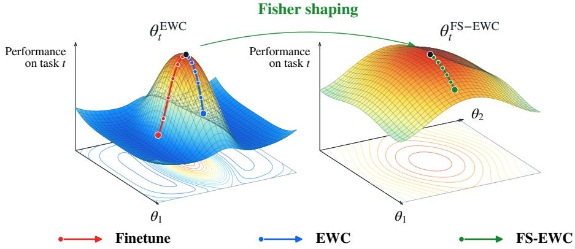  
Figure 1: Beyond protection: shaping solutions for future retention. The surfaces schematically depict task-t performance around learned solutions, while trajectories illustrate parameter updates during task-t + 1 learning. Unlike finetuning, EWC penalizes subsequent drift using historical parameter importance. FS-EWC additionally penalizes the worst-case empirical FIM over a prescribed neighborhood during task-t learning, favoring solutions less sensitive to bounded future drift while preserving historical protection. Complemented by model merging over task trajectory, our approach incorporates future retention into how solutions are learned and retained for subsequent protection.

The missing component is an explicit criterion for forming solutions that remain less sensitive to future parameter displacement. We derive a finite-displacement bound that relates task-specific loss changes to FIM along the displacement path. For a prescribed displacement radius, reducing the worst-case FIM trace over the surrounding neighborhood tightens the bound on potential loss increase. This result makes future retention an explicit consideration during current-task learning and leads to our central design principle: FIM should guide solution formation as well as subsequent parameter protection.

We instantiate this principle with Fisher-Shaped EWC (FS-EWC), which shapes both how the current solution is learned and how the retained reference is constructed. As illustrated in Fig. 1, EWC constrains subsequent parameter drift using historical importance, whereas FS-EWC additionally shapes the solution before it is inherited by future tasks. During current-task learning, FS-EWC augments the EWC objective with a neighborhood FIM-trace penalty, making sensitivity to bounded future displacement an explicit optimization criterion alongside task fitting and historical regular ization. At task completion, trajectory-based model merging constructs the retained reference from multiple optimization states rather than directly committing a single terminal iterate. FIM is then estimated at the retained solution and consolidated for subsequent protection. The two components address complementary stages of the same process: shaping the solutions produced during learning and constructing the solution passed forward for future.

Experiments across diverse vision and language benchmarks show that FS-EWC generally improves upon the corresponding EWC baselines under both full-parameter and LoRA. Controlled studies further show that shaping the solution itself improves subsequent retention under the same protection rule, demonstrating that future forgetting depends not only on how a solution is protected but also on the solution being protected. When combined with historical protection, solution shaping improves both retained-task and new-task accuracy in the controlled comparisons. The gains also persist across alternative FIM computation and representations. Together, these results suggest that the stability– plasticity balance can be improved by jointly shaping solutions for future retention and protecting acquired knowledge during subsequent learning.

Our contributions are summarized as follows:

• We identify a limitation of EWC: it protects a learned solution using locally estimated parameter importance, but does not explicitly account for how sensitive that solution may become under finite future parameter drift. By analyzing task-loss changes along such displacement, we show that subsequent retention depends on Fisher sensitivity over the surrounding parameter neighborhood, motivating the solution itself to be shaped for future.

• We propose Fisher-Shaped EWC (FS-EWC), which extends EWC from protecting learned solutions to explicitly shaping and retaining solutions for future tasks. During task learning, FS-EWC reduces neighborhood FIM sensitivity while preserving historical EWC regularization. At task completion, trajectory-based model merging constructs the retained anchor, at which current-task FIM is estimated for subsequent protection.

• We propose a broader design principle for continual learning:: the stability–plasticity tradeoff can be mitigated by incorporating future retention into solution formation alongside historical knowledge protection. Experiments across vision and language benchmarks support this principle, showing gains over corresponding EWC baselines and complementarity with alternative FIM computation schemes and matrix representations.

## 2 RELATED WORKS

Continual Learning. Continual learning seeks to preserve previously acquired knowledge while enabling adaptation to evolving tasks and data distributions (Wang et al., 2024). A central challenge is the stability–plasticity trade-off: restricting model changes can preserve previous knowledge but may limit adaptation, whereas greater plasticity can accelerate forgetting. Replay-based methods alleviate this tension by revisiting previous examples, while replay-free learning must balance retention and adaptation without access to historical data. We focus on replay-free weight regularization, which addresses this problem by constraining parameter updates during sequential learning.

Elastic Weight Consolidation. Elastic Weight Consolidation (EWC) is a widely used regularization baseline for replay-free continual learning (Kirkpatrick et al., 2017). Subsequent work has strengthened this protection mechanism by refining how historical importance is accumulated and used across sequential learning. Online consolidation methods recursively update inherited importance across tasks (Huszar, 2018; Schwarz et al., 2018), while trajectory-aware approaches estimate pa-´ rameter importance from the optimization process (Zenke et al., 2017; Chaudhry et al., 2018). More recently, EWC-style regularization has been extended to low-rank continual learning, demonstrat ing its applicability to LoRA-based adaptation (Zheng et al., 2026). These approaches improve how acquired knowledge is protected during subsequent learning, but largely treat the solution being protected as given.

FIM Estimation and Representation. The effectiveness of FIM-based regularization method also depends on how FIM is computed and represented. Prior studies examine the distinction between empirical and model-based FIM and the consequences of practical computational approximations for continual learning (Martens, 2020; van de Ven, 2025). Other work improves the representation of FIM beyond diagonal approximations, including rotated and Kronecker-factored structures (Liu et al., 2018; Martens & Grosse, 2015). These advances improve the fidelity or expressiveness of the importance signal used to protect a given reference solution. Our work addresses an orthogonal dimension: how the reference solution itself can be formed to better support future task.

## 3 METHODOLOGY

## 3.1 PRELIMINARIES

Problem formulation. We consider replay-free class-incremental learning with tasks $\mathbb { T } _ { 1 } , \dots , \mathbb { T } _ { T }$ At task t, the learner receives $\mathbb { S } _ { t } = \{ ( \mathbf { x } _ { i } ^ { ( t ) } , y _ { i } ^ { ( t ) } ) \} _ { i = 1 } ^ { m _ { t } }$ sampled from $\mathcal { D } _ { t }$ . Inference distinguishes all observed classes without task identities. Training accesses only $\mathbb { S } _ { t } ;$ historical examples are neither retained nor replayed. Let $f _ { \theta }$ have trainable parameters $\pmb { \theta } \in \mathbb { R } ^ { d }$ and predictive probabilities $p _ { \theta } ( y$ x). Define

$$
\ell _ { t , i } ^ { \mathrm { { C E } } } ( \pmb \theta ) = - \log p _ { \pmb \theta } ( y _ { i } ^ { ( t ) } \mid x _ { i } ^ { ( t ) } ) , \qquad \widehat { \mathcal L } _ { t } ^ { \mathrm { { C E } } } ( \pmb \theta ) = \frac { 1 } { m _ { t } } \sum _ { i = 1 } ^ { m _ { t } } \ell _ { t , i } ^ { \mathrm { { C E } } } ( \pmb \theta ) .\tag{1}
$$

The parameters retained after task t are denoted by $\theta _ { t }$

EWC and empirical FIM. EWC (Kirkpatrick et al., 2017) retains a reference solution together with a FIM-based summary of parameter importance, and penalizes subsequent changes along directions that are important to previously learned tasks. We adopt the online formulation (Huszar,´ 2018; Schwarz et al., 2018):

$$
\mathcal { I } _ { t } ^ { \mathrm { E W C } } ( \theta ) = \widehat { \mathcal { L } } _ { t } ^ { \mathrm { C E } } ( \theta ) + \Omega _ { t - 1 } ( \theta ) , \quad \Omega _ { t - 1 } ( \theta ) = \frac { \lambda } { 2 } ( \theta - \theta _ { t - 1 } ) ^ { \top } \Lambda _ { t - 1 } ( \theta - \theta _ { t - 1 } ) .\tag{2}
$$

Here, $\pmb { \theta } _ { t - 1 }$ is the retained reference from the preceding task, and $\mathbf { \Lambda } \Lambda _ { t - 1 } \succeq \mathbf { 0 }$ denotes the consolidated diagonal importance matrix. Both are fixed during task-t optimization, while $\lambda \geq 0$ controls the strength of historical protection.

For the current task, let $\pmb { g } _ { t , i } ( \pmb { \theta } ) = \nabla _ { \pmb { \theta } } \ell _ { t , i } ^ { \mathrm { C E } } ( \pmb { \theta } )$ . Define the empirical FIM as

$$
\boldsymbol { F } _ { t } ^ { \mathrm { e m p } } ( \boldsymbol { \theta } ) = \frac { 1 } { m _ { t } } \sum _ { i = 1 } ^ { m _ { t } } \boldsymbol { g } _ { t , i } ( \boldsymbol { \theta } ) \boldsymbol { g } _ { t , i } ( \boldsymbol { \theta } ) ^ { \top } .\tag{3}
$$

Its diagonal provides the task-specific importance contribution used for subsequent EWC consolidation, while its trace will also serve below as a scalar measure of local solution sensitivity.

## 3.2 SOLUTION SENSITIVITY TO FUTURE DRIFT

The importance stored at an anchor does not by itself determine its tolerance to finite future drift. For a candidate task-t solution θ, define the loss change induced by displacement $\pmb { \Delta }$ as

$$
D _ { t } ( \pmb \theta , \Delta ) = \widehat { \mathcal L } _ { t } ^ { \mathrm { C E } } ( \pmb \theta + \Delta ) - \widehat { \mathcal L } _ { t } ^ { \mathrm { C E } } ( \pmb \theta ) .\tag{4}
$$

Positive values describe deterioration in task-t empirical loss. For a later retained model $\theta _ { k } , k >$ t, the corresponding displacement is $\pmb { \theta } _ { k } - \pmb { \theta } _ { t }$ . Since this displacement is unknown during task-t learning, we consider the prescribed neighborhood $\mathbb { U } _ { r } ( \pmb \theta ) = \{ \mathbf { \bar { \theta } } + \pmb \epsilon : \lVert \pmb \epsilon \rVert _ { 2 } \leq r \}$

Proposition 1 (Finite-displacement sensitivity) Suppose each $\ell _ { t , i } ^ { \mathrm { C E } }$ is continuously differentiable on an open set containing Ur(θ). Then every $\| \Delta \| _ { 2 } \leq r$ satisfies

$$
| D _ { t } ( \pmb \theta , \Delta ) | ^ { 2 } \leq \int _ { 0 } ^ { 1 } \Delta ^ { \top } F _ { t } ^ { \mathrm { e m p } } ( \pmb \theta + \tau \Delta ) \Delta \mathrm { d } \tau .\tag{5}
$$

The proof is in Appendix A.3.

To obtain a scalar criterion without specifying a displacement direction, observe that

$$
\Delta ^ { \top } \boldsymbol { F } _ { t } ^ { \mathrm { e m p } } ( \boldsymbol { u } ) \Delta \leq \| \Delta \| _ { 2 } ^ { 2 } \frac { 1 } { m _ { t } } \sum _ { i = 1 } ^ { m _ { t } } \| \pmb { g } _ { t , i } ( \boldsymbol { u } ) \| _ { 2 } ^ { 2 } .\tag{6}
$$

Accordingly, define the point FIM sensitivity

$$
\mathcal { R } _ { \mathrm { F } , t } ( \pmb \theta ) = \frac { 1 } { m _ { t } } \sum _ { i = 1 } ^ { m _ { t } } \Vert \pmb { g } _ { t , i } ( \pmb \theta ) \Vert _ { 2 } ^ { 2 } = \mathrm { t r } F _ { t } ^ { \mathrm { e m p } } ( \pmb \theta ) .\tag{7}
$$

Combining these expressions yields

$$
| D _ { t } ( \pmb \theta , \Delta ) | ^ { 2 } \leq \| \Delta \| _ { 2 } ^ { 2 } \int _ { 0 } ^ { 1 } \mathcal { R } _ { \mathrm { F } , t } \big ( \pmb \theta + \tau \pmb \Delta \big ) \mathrm { d } \tau .\tag{8}
$$

This bound shows that finite-displacement loss change depends on FIM sensitivity along the displacement path, rather than only at the anchor. Since the future path is unknown during task-t learning, this motivates controlling sensitivity over a bounded neighborhood around the current solution, rather than relying only on importance estimated at the retained anchor.

## 3.3 FISHER-SHAPED EWC

FS-EWC combines neighborhood sensitivity shaping with an explicit rule for constructing the retained anchor. The former guides current-task learning while preserving the inherited EWC penalty; the latter selects the parameters at which current-task importance is estimated for subsequent learning. A complementary distributional interpretation is provided in Appendix A.4, while the complete FS-EWC algorithm are detailed in Appendix A.5.

## 3.3.1 NEIGHBORHOOD FISHER SENSITIVITY SHAPING

Over the prescribed neighborhood of radius $r ,$ we define the worst-case FIM sensitivity as

$$
\mathcal { R } _ { \mathrm { F } , t } ^ { \operatorname* { m a x } } ( \pmb { \theta } ; r ) = \operatorname* { m a x } _ { \| \epsilon \| _ { 2 } \leq r } \mathcal { R } _ { \mathrm { F } , t } ( \pmb { \theta } + \epsilon ) = \operatorname* { m a x } _ { \| \epsilon \| _ { 2 } \leq r } \mathrm { t r } F _ { t } ^ { \mathrm { e m p } } ( \pmb { \theta } + \epsilon ) .\tag{9}
$$

Here, ϵ specifies locations at which sensitivity is evaluated, whereas $\pmb { \Delta }$ denotes possible future parameter drift. The maximization characterizes the largest FIM sensitivity within this neighborhood, without assuming a particular direction or distribution of future drift.

Combining Eq. equation 8 with Young’s inequality gives

$$
\operatorname* { s u p } _ { \| \boldsymbol { \Delta } \| _ { 2 } \le r } | D _ { t } ( \boldsymbol { \theta } , \boldsymbol { \Delta } ) | \le r \sqrt { \mathcal { R } _ { \mathrm { F } , t } ^ { \operatorname* { m a x } } ( \boldsymbol { \theta } ; r ) } \le \mathcal { R } _ { \mathrm { F } , t } ^ { \operatorname* { m a x } } ( \boldsymbol { \theta } ; r ) + \frac { r ^ { 2 } } { 4 } .\tag{10}
$$

Since the final term is independent of $\theta ,$ this motivates

$$
\mathcal { I } _ { t } ^ { \mathrm { F S - E W C } } ( \theta ; r ) = \underbrace { \widehat { \mathcal { L } } _ { t } ^ { \mathrm { C E } } ( \theta ) } _ { \mathrm { c u r e n t - t a s k \ f u t i n g } } + \underbrace { \mathcal { R } _ { \mathrm { F } , t } ^ { \operatorname* { m a x } } ( \theta ; r ) } _ { \mathrm { f u t u r e - d r i f t s e n s i t i v i t y \ s h a p i n g } } + \underbrace { \Omega _ { t - 1 } ( \theta ) } _ { \mathrm { p a s t - t a s k \ p r o t e c t i o n } } .\tag{11}
$$

Let $\epsilon ^ { \star } \in$ arg max $\| \epsilon \| _ { 2 } \le r  \mathcal { R } _ { \mathrm { F } , t } ( \pmb \theta + \epsilon )$ . At differentiable points, the gradient of Eq. 11 takes the form

$$
\nabla _ { \pmb { \theta } } \mathcal { I } _ { t } ^ { \mathrm { F S - E W C } } = \pmb { g } _ { t } ( \pmb { \theta } ) + \pmb { h } _ { t } \pmb { ( \theta + \epsilon ^ { \star } ) } + \lambda \pmb { \Lambda } _ { t - 1 } \pmb { ( \theta - \theta _ { t - 1 } ) } ,\tag{12}
$$

where

$$
{ \pmb h } _ { t } ( { \pmb u } ) = \nabla _ { { \pmb u } } \mathcal { R } _ { \mathrm { F } , t } ( { \pmb u } ) = \frac { 2 } { m _ { t } } \sum _ { i = 1 } ^ { m _ { t } } { \pmb H } _ { t , i } ( { \pmb u } ) { \pmb g } _ { t , i } ( { \pmb u } ) .\tag{13}
$$

Thus, Fisher shaping introduces a Hessian–vector product correction that reduces neighborhood sensitivity of the current-task solution, while EWC retains historical parameter protection.

## 3.3.2 TRAJECTORY-BASED ANCHOR CONSTRUCTION

Sensitivity shaping determines how the current-task solution is learned, but continual learning also requires specifying which state is passed to subsequent tasks. Rather than retaining only the terminal iterate, we construct the task-t anchor by averaging selected learned checkpoints from its optimization trajectory. Let $\textstyle { \boldsymbol { \mathcal { K } } } _ { t }$ denote the selected checkpoint indices, with $| \mathcal { K } _ { t } | = \mathbf { \dot { K } }$ . We define

$$
\overline { { \pmb { \theta } } } _ { t } = \frac { 1 } { K } \sum _ { k \in \mathbb { K } _ { t } } \pmb { \theta } _ { t , k } , \qquad \pmb { \theta } _ { t } : = \overline { { \pmb { \theta } } } _ { t } .\tag{14}
$$

The average can be accumulated online and does not require storing the full optimization trajectory. To align the stored importance with the state actually inherited by future tasks, we estimate the current-task FIM at the retained anchor. Following Schwarz et al. (2018), we normalize the currenttask FIM before consolidating it, and additionally apply a small isotropic damping term before consolidation: $\pmb { \Lambda } _ { t } = \pmb { \Lambda } _ { t - 1 } + \pmb { \widehat { F } } _ { t }$ , where $\widehat { F } _ { t }$ denotes the normalized and damped current-task FIM. The pair $( \pmb \theta _ { t } , \pmb \Lambda _ { t } )$ initializes and regularizes the next task.

## 4 EXPERIMENTS

## 4.1 EXPERIMENTAL SETUP

Models and datasets We evaluate our method on vision and language continual learning benchmarks. Vision experiments use ViT-B/16 (Dosovitskiy, 2020) pretrained on ImageNet-21K. We evaluate on CIFAR-100 (Krizhevsky et al., 2009), ImageNet-R (Hendrycks et al., 2021a), ImageNet-A (Hendrycks et al., 2021b), and DomainNet (Peng et al., 2019), with ImageNet-A as the main benchmark. Additional evaluations cover five fine-grained datasets: FGVC Aircraft (Maji et al., 2013), Stanford Cars (Krause et al., 2013), CUB-200-2011 (Wah et al., 2011), Oxford Flowers (Nilsback & Zisserman, 2008), and Oxford-IIIT Pets (Parkhi et al., 2012), along with a 5Datasets stream constructed from these datasets. Language experiments use Llama-3.2-1B and Llama-3.2-3B (Meta, 2024) on a continual text-classification benchmark comprising AG News, Amazon Reviews, DBpedia, and Yahoo Answers (Zhang et al., 2015). Detailed training configurations are provided in Appendix B.1.

Table 1: Comparison results on ImageNet-R, ImageNet-A, DomainNet, and CIFAR-100. Results are reported in percentage with standard deviations. Bold and underline indicate the highest and second-highest scores.
<table><tr><td rowspan="2">Method</td><td colspan="2">ImageNet-R (T=10)</td><td colspan="2">ImageNet-A (T=10)</td><td colspan="2">DomainNet (T=5)</td><td colspan="2">CIFAR-100 (T=10)</td></tr><tr><td>FAA</td><td>AAA</td><td>FAA</td><td>AAA</td><td>FAA</td><td>AAA</td><td>FAA</td><td>AAA</td></tr><tr><td>Joint Train</td><td> $8 1 . 6 9 _ { ( 0 . 2 8 ) }$ </td><td> $8 6 . 2 5 _ { ( 0 . 0 9 ) }$ </td><td> $6 5 . 0 1 _ { ( 0 . 7 4 ) }$ </td><td> $7 4 . 1 0 _ { ( 0 . 4 4 ) }$ </td><td> $7 6 . 8 4 _ { ( 0 . 0 6 ) }$ </td><td> $8 1 . 2 5 _ { ( 0 . 0 5 ) }$ </td><td> $9 2 . 8 2 _ { ( 0 . 2 0 ) }$ </td><td> $9 5 . 4 1 _ { ( 0 . 0 5 ) }$ </td></tr><tr><td>Finetune</td><td> $6 0 . 4 2 \dot { _ { ( 1 . 6 4 ) } }$ </td><td> $7 3 . 1 8 _ { ( 0 . 3 2 ) }$ </td><td> $1 6 . 3 1 _ { ( 7 . 8 9 ) }$ </td><td> $3 0 . 4 4 _ { ( 1 3 . 1 8 ) }$ </td><td> $5 1 . 4 6 _ { ( 0 . 4 7 ) }$ </td><td> $6 7 . 0 8 _ { ( 1 . 1 3 ) }$ </td><td> $6 9 . 4 9 _ { ( 0 . 5 0 ) }$ </td><td> $8 0 . 3 5 \dot { _ { ( 0 . 8 7 ) } }$ </td></tr><tr><td>L2P</td><td> $7 1 . 2 6 \dot { _ { ( 0 . 4 4 ) } }$ </td><td> $7 6 . 1 3 \dot { ( 0 . 4 6 ) }$ </td><td> $4 2 . 9 4 \dot { } _ { ( 1 . 2 7 ) }$ </td><td> $5 1 . 4 0 _ { ( 1 . 9 5 ) } ^ { }$ </td><td> $7 0 . 2 6 _ { ( 0 . 2 5 ) }$ </td><td> $7 5 . 8 3 \dot { } _ { ( 0 . 9 8 ) }$ </td><td> $8 3 . 1 8 \dot { ( } 1 . 2 0 \dot { ) }$ </td><td> $8 7 . 6 9 \dot { _ { ( 1 . 0 5 ) } }$ </td></tr><tr><td>DualPrompt</td><td> $6 8 . 2 2 _ { ( 0 . 2 0 ) }$ </td><td> $7 3 . 8 1 _ { ( 0 . 3 9 ) }$ </td><td> $4 5 . 4 9 _ { ( 0 . 9 6 ) }$ </td><td> $5 4 . 6 8 \dot { } _ { ( 1 . 2 4 ) }$ </td><td> $6 8 . 2 6 _ { ( 0 . 9 0 ) }$ </td><td> $7 3 . 8 4 _ { ( 0 . 4 5 ) }$ </td><td> $8 1 . 4 8 \dot { _ { ( 0 . 8 6 ) } }$ </td><td> $8 6 . 4 1 _ { ( 0 . 6 6 ) }$ </td></tr><tr><td>EWC</td><td> $6 4 . 1 6 _ { ( 0 . 9 2 ) }$ </td><td> $7 5 . 2 7 _ { ( 0 . 5 5 ) }$ </td><td> $2 1 . 3 0 _ { ( 4 . 7 9 ) }$ </td><td> $4 5 . 7 7 _ { ( 0 . 4 3 ) }$ </td><td> $5 8 . 8 5 _ { ( 2 . 9 2 ) }$ </td><td> $7 2 . 1 2 _ { ( 0 . 3 4 ) }$ </td><td> $7 5 . 0 6 \dot { _ { ( 3 . 4 9 ) } }$ </td><td> $8 5 . 7 2 _ { ( 1 . 0 4 ) }$ </td></tr><tr><td>FS-EWC</td><td> $6 8 . 4 6 _ { ( 1 . 3 7 ) }$ </td><td> $7 6 . 6 0 _ { ( 2 . 4 5 ) }$ </td><td> $2 6 . 8 9 _ { ( 0 . 9 8 ) } ^ { \cdot }$ </td><td> $4 6 . 0 8 _ { ( 2 . 3 7 ) }$ </td><td> $6 4 . 7 7 \dot { _ { ( 0 . 5 3 ) } }$ </td><td> $7 4 . 8 7 _ { ( 0 . 5 9 ) }$ </td><td> $7 7 . 3 2 \dot { } _ { ( 0 . 5 9 ) }$ </td><td> $8 5 . 7 0 _ { ( 0 . 2 7 ) }$ </td></tr><tr><td>Vanilla LoRA</td><td> $6 4 . 8 7 _ { ( 0 . 7 3 ) }$ </td><td> $7 5 . 5 7 _ { ( 0 . 2 3 ) }$ </td><td> $4 0 . 0 1 _ { ( 1 . 3 2 ) }$ </td><td> $5 8 . 2 8 _ { ( 0 . 8 5 ) }$ </td><td> $6 9 . 7 9 _ { ( 0 . 1 1 ) }$ </td><td> $7 7 . 4 4 _ { ( 0 . 0 8 ) }$ </td><td> $8 2 . 9 9 _ { ( 0 . 8 4 ) }$ </td><td> $8 9 . 7 4 _ { ( 0 . 5 8 ) }$ </td></tr><tr><td>BiLoRA</td><td> $7 4 . 2 8 _ { ( 0 . 9 2 ) }$ </td><td> $7 7 . 3 8 _ { ( 0 . 8 8 ) }$ </td><td> $5 1 . 0 5 _ { ( 0 . 7 4 ) }$ </td><td> $6 2 . 8 2 \dot { _ { ( 0 . 6 5 ) } }$ </td><td> $6 9 . 7 5 \dot { _ { ( 0 . 2 3 ) } }$ </td><td> $7 3 . 8 6 \dot { } _ { ( 0 . 2 1 ) }$ </td><td> $8 5 . 9 9 \dot { _ { ( 0 . 4 9 ) } }$ </td><td> $9 0 . 6 2 \dot { } _ { ( 0 . 4 2 ) }$ </td></tr><tr><td>InfLoRA</td><td> $\underline { { 7 4 . 4 1 } } _ { ( 0 . 6 3 ) }$ </td><td> $\underline { { 8 0 . 3 1 } } _ { ( 0 . 6 0 ) }$ </td><td> $5 0 . 7 5 \dot { } _ { ( 1 . 3 3 ) }$ </td><td> $6 4 . 3 6 \dot { _ { ( 1 . 0 1 ) } }$ </td><td> $7 1 . 0 1 \dot { _ { ( 0 . 0 5 ) } }$ </td><td> $7 7 . 7 5 _ { ( 0 . 0 3 ) }$ </td><td> $8 6 . 3 4 \dot { _ { ( 0 . 7 6 ) } }$ </td><td> $9 1 . 3 3 \dot { ( } 0 . 4 8 \dot { ) }$ </td></tr><tr><td> ${ \bf S D - L o R A }$ </td><td> $\smash { 7 2 . 9 3 ( 2 . 7 6 ) }$ </td><td> $7 9 . 8 0 \dot { _ { ( 0 . 1 5 ) } }$ </td><td> $5 5 . 2 3 _ { ( 0 . 9 4 ) }$ </td><td> $6 6 . 1 0 _ { ( 0 . 5 4 ) }$ </td><td> $7 1 . 2 7 _ { ( 0 . 1 4 ) }$ </td><td> $7 7 . 7 0 _ { ( 0 . 0 7 ) }$ </td><td> $8 6 . 7 7 _ { ( 0 . 3 0 ) }$ </td><td> $9 0 . 9 6 _ { ( 0 . 3 0 ) }$ </td></tr><tr><td> $\mathbf { E W C L o R A }$ </td><td> $7 2 . 5 8 _ { ( 0 . 5 8 ) } ^ { \cdot }$ </td><td> $7 8 . 3 8 _ { ( 0 . 6 9 ) }$ </td><td> $\underline { { 5 6 . 4 2 } } _ { ( 0 . 8 8 ) }$ </td><td> $\underline { { 6 7 . 0 9 } } _ { ( 0 . 6 2 ) } ^ { }$ </td><td> $\underline { { 7 3 . 3 8 } } _ { ( 0 . 1 4 ) }$ </td><td> ${ \underline { { 7 9 . 5 0 } } } _ { ( 0 . 1 3 ) }$ </td><td> $\underline { { 8 7 . 9 1 } } _ { ( 0 . 1 1 ) }$ </td><td> $9 2 . 2 7 _ { ( 0 . 1 9 ) }$ </td></tr><tr><td>FS-EWCLoRA</td><td> $7 9 . 8 1 _ { ( 0 . 2 1 ) }$ </td><td> ${ \bf 8 3 . 5 1 } _ { ( 0 . 1 1 ) }$ </td><td> ${ \bf 6 2 . 0 8 } _ { ( 1 . 6 2 ) }$ </td><td> $\mathbf { 7 1 . 6 6 } _ { ( 0 . 2 5 ) } ^ { \setminus }$ </td><td> ${ \bf 7 3 . 9 5 } _ { ( 0 . 0 4 ) }$ </td><td> $\mathbf { 7 9 . 5 0 } _ { ( 0 . 0 4 ) } ^ { \setminus }$ </td><td> ${ \bf 8 8 . 0 3 } _ { ( 0 . 1 0 ) }$ </td><td> $\frac { 9 2 . 0 0 } { - } ( 0 . 1 6 )$ </td></tr></table>

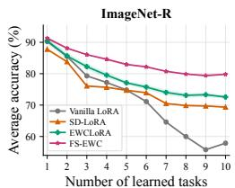

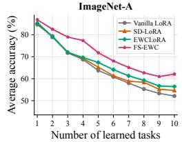

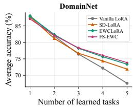

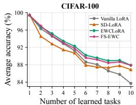  
Vanilla LoRA, SD-Figure 2: Stage-wise average accuracyEWCLoRA n=4/5/3/5; $A _ { t }$ =1; fixed ±0.2 pp illustrative band (not SD/CI). Other bands: mean ± sample SD.C n=3/3/6/4. Samples weighted equally; historical method-specific training recipes.over all learned tasks under LoRA on four vision benchmarks.

Metrics We report stage-wise average accuracy $A _ { t }$ over all tasks observed through learning stage t, together with final average accuracy (FAA), stage-averaged accuracy (AAA), and backward transfer (BWT). For the solution-shaping diagnostics, we additionally measure task-specific loss and accuracy, effective-weight displacement, empirical Fisher sensitivity, and displacement tolerance. We distinguish realized endpoint displacement $d _ { t }$ from controlled diagnostic displacement $d ,$ with $D _ { 1 , t } ^ { \mathrm { t e s t } }$ and $\overline { { D } } _ { 1 } ^ { + } ( d )$ denoting the corresponding test-loss change and mean positive training-loss increase. Formal definitions and measurement protocols are provided in Appendix A.2.

## 4.2 MAIN RESULT

Overall Performance across Benchmarks and Model Configurations. We first evaluate whether the benefit of FS-EWC persists across training parameterizations, task domains, and model scales.

Table 1 reports results on the four standard vision benchmarks, with the corresponding LoRA-based performance trajectories shown in Fig. 2. FS-EWC improves FAA over the corresponding EWC baseline across all four benchmarks under both full-parameter fine-tuning and LoRA. The LoRA results on ImageNet-R and ImageNet-A are particularly notable. On ImageNet-R, EWCLoRA trails several competing LoRA methods, whereas FS-EWCLoRA improves FAA to 79.81%, surpassing all compared LoRA baselines. On ImageNet-A, EWCLoRA already leads the competing LoRA baselines, yet FS-EWCLoRA achieves a further gain, raising FAA from 56.42% to 62.08%. These results suggest that EWC parameter protection alone can be insufficient in challenging settings, whereas jointly shaping and protecting task solutions can yield substantial performance gains.

We next examine more heterogeneous visual recognition settings in Table 2. Across Aircraft, Cars, CUB-200, Flowers, and 5Datasets, FS-EWCLoRA improves FAA over its matched EWCLoRA baseline in every case. It achieves the highest FAA on Aircraft, Cars, and 5Datasets, and remains stronger on CUB-200 and Flowers. Thus, the improvement over EWC persists across substantially different class structures and task compositions.

Table 2: Fine-grained and heterogeneous vision performance. FAA and stage-averaged AAA are reported in percentages. 5Datasets denotes the cross-dataset continual learning stream in the following order: CUB-200 → Aircraft → Cars → Flowers → Pets. The corresponding average-accuracy trajectories are provided in Fig. 6.
<table><tr><td>Method</td><td colspan="2">FGVC-Aircraft</td><td colspan="2">Stanford Cars</td><td colspan="2">CUB-200</td><td colspan="2">Oxford Flowers</td><td colspan="2">5Datasets</td></tr><tr><td></td><td>FAA</td><td>AAA</td><td>FAA</td><td>AAA</td><td>FAA</td><td>AAA</td><td>FAA</td><td>AAA</td><td>FAA</td><td>AAA</td></tr><tr><td>Vanilla LoRA</td><td>39.85</td><td>38.42</td><td>31.74</td><td>41.67</td><td>58.31</td><td>69.61</td><td>52.92</td><td>66.49</td><td>66.90</td><td>68.85</td></tr><tr><td>InfLoRA</td><td>41.35</td><td>39.62</td><td>35.98</td><td>44.57</td><td>61.36</td><td>70.38</td><td>57.34</td><td>69.98</td><td>78.77</td><td>77.25</td></tr><tr><td>OLoRA</td><td>37.67</td><td>37.77</td><td>35.30</td><td>44.70</td><td>60.70</td><td>68.71</td><td>47.68</td><td>63.18</td><td>79.12</td><td>76.96</td></tr><tr><td>SDLoRA</td><td>25.96</td><td>26.63</td><td>34.89</td><td>43.28</td><td>62.01</td><td>69.52</td><td>49.05</td><td>64.59</td><td>74.42</td><td>74.10</td></tr><tr><td>CL-LoRA</td><td>29.35</td><td>26.54</td><td>34.01</td><td>41.86</td><td>78.31</td><td>81.01</td><td>97.83</td><td>98.34</td><td>67.05</td><td>61.97</td></tr><tr><td>EWCLoRA</td><td>40.64</td><td>38.44</td><td>34.56</td><td>43.94</td><td>61.34</td><td>70.36</td><td>52.02</td><td>65.36</td><td>73.30</td><td>72.93</td></tr><tr><td>FS-EWCLoRA</td><td>46.66</td><td>43.41</td><td>53.04</td><td>56.26</td><td>73.42</td><td>76.26</td><td>84.68</td><td>90.00</td><td>83.24</td><td>81.19</td></tr></table>

Table 3: Continual NLP benchmark performance of Llama-3.2-1B and Llama-3.2-3B across three task orders. FAA (%) is reported for each order, and Avg. denotes the average FAA across the three orders. Taskorder are given in Table 9, and the corresponding trajectories are provided in Fig. 7.
<table><tr><td rowspan="2">Method</td><td colspan="4">Llama-3.2-1B</td><td colspan="4">Llama-3.2-3B</td></tr><tr><td>Order-1</td><td>Order-2</td><td>Order-3</td><td> $\operatorname { A v g } .$ </td><td>Order-1</td><td>Order-2</td><td>Order-3</td><td> $\operatorname { A v g } .$ </td></tr><tr><td>SeqLoRA</td><td> $6 5 . 5 5 ( 0 . 5 9 )$ </td><td> $5 8 . 5 3 _ { ( 0 . 8 6 ) }$ </td><td> $6 7 . 8 3 _ { ( 1 . 6 5 ) }$ </td><td> $6 3 . 9 7 _ { ( 0 . 9 6 ) }$ </td><td> $6 7 . 2 1 _ { ( 0 . 9 2 ) }$ </td><td> $6 7 . 0 0 _ { ( 0 . 3 7 ) }$ </td><td> $6 9 . 5 9 _ { ( 3 . 1 0 ) }$ </td><td> $6 7 . 9 3 _ { ( 0 . 6 0 ) }$ </td></tr><tr><td>IncLoRA</td><td> $6 6 . 2 0 _ { ( 0 . 5 6 ) }$ </td><td> $6 1 . 7 2 _ { ( 2 . 4 7 ) }$ </td><td> $6 5 . 5 9 _ { ( 2 . 4 6 ) }$ </td><td> $6 4 . 5 0 _ { ( 1 . 4 5 ) }$ </td><td> $6 6 . 9 6 _ { ( 2 . 4 5 ) }$ </td><td> $6 8 . 4 7 _ { ( 2 . 4 5 ) }$ </td><td> $7 0 . 5 8 _ { ( 1 . 4 5 ) }$ </td><td> $6 8 . 6 7 _ { ( 2 . 1 2 ) }$ </td></tr><tr><td>OLoRA</td><td> $6 6 . 9 3 _ { ( 1 . 1 3 ) }$ </td><td> $6 1 . 5 2 _ { ( 1 . 2 6 ) }$ </td><td> $\underline { { 6 7 . 2 8 } } _ { ( 2 . 1 7 ) }$ </td><td> $6 5 . 2 4 _ { ( 1 . 2 3 ) }$ </td><td> $\underline { { 7 1 . 1 9 } } _ { ( 1 . 2 4 ) }$ </td><td> $\underline { { 7 1 . 1 2 } } _ { ( 0 . 1 1 ) }$ </td><td> $\underline { { 7 3 . 0 6 } } _ { ( 0 . 6 6 ) }$ </td><td> $\underline { { 7 1 . 7 9 } } _ { ( 0 . 5 1 ) }$ </td></tr><tr><td>TreeLoRA</td><td> $\frac { 6 8 . 4 0 } { - } ( 1 . 2 7 )$ </td><td> $\frac { 6 3 . 8 1 } { } ( 2 . 2 5 )$ </td><td> $6 6 . 6 0 _ { ( 1 . 3 6 ) }$ </td><td> $\frac { 6 6 . 2 7 } { - } ( 1 . 4 5 )$ </td><td> $7 0 . 5 6 _ { ( 1 . 2 7 ) }$ </td><td> $6 9 . 9 7 _ { ( 0 . 8 3 ) }$ </td><td> $7 2 . 9 2 _ { ( 0 . 5 3 ) }$ </td><td> $7 1 . 1 5 _ { ( 0 . 3 2 ) }$ </td></tr><tr><td>EWCLoRA</td><td> $6 6 . 3 5 _ { ( 0 . 8 4 ) }$ </td><td> $6 2 . 1 4 _ { ( 2 . 5 6 ) }$ </td><td> $6 5 . 6 2 _ { ( 2 . 2 3 ) }$ </td><td> $6 4 . 7 0 _ { ( 1 . 4 8 ) }$ </td><td> $6 8 . 5 9 _ { ( 0 . 2 4 ) }$ </td><td> $7 0 . 2 8 _ { ( 0 . 3 9 ) }$ </td><td> $7 2 . 0 7 _ { ( 0 . 7 6 ) }$ </td><td> $7 0 . 3 1 _ { ( 0 . 3 1 ) }$ </td></tr><tr><td>FS-EWCLoRA</td><td> ${ \bf 6 9 . 5 7 } _ { ( 0 . 2 7 ) }$ </td><td> ${ \bf 6 7 . 5 4 } _ { ( 1 . 0 4 ) }$ </td><td> $\mathbf { 7 0 . 3 5 } _ { ( 0 . 2 5 ) }$ </td><td> $\mathbf { 6 9 . 1 5 } _ { ( 0 . 4 9 ) }$ </td><td> $7 2 . 5 7 _ { ( 0 . 4 7 ) }$ </td><td> $7 2 . 7 3 _ { ( 0 . 6 7 ) }$ </td><td> $7 3 . 9 3 _ { ( 0 . 2 3 ) }$ </td><td> $7 3 . 0 8 _ { ( 0 . 4 0 ) }$ </td></tr></table>

Finally, we evaluate continual text classification with Llama-3.2-1B and Llama-3.2-3B across three task orders in Table 3. FS-EWCLoRA increases the mean FAA over EWCLoRA from 64.70% to 69.15% on Llama-3.2-1B and from 70.31% to 73.08% on Llama-3.2-3B, with improvements in five of the six model–order comparisons. These results indicate that the benefit is not restricted to vision or to a single model scale.

How Does Solution Shaping Affect the Stability–Plasticity Trade-off? We next examine whether the aggregate gains above reflect a more favorable stability–plasticity trade-off. Specifically, we ask whether improved stability is achieved merely by restricting future parameter movement, or by shaping the retained solution so that subsequent adaptation can proceed with less forgetting. To isolate the effect of Fisher shaping, each task only retains its terminal iterate without merging.

Fig. 3 first examines retention under actual subsequent learning. FS-EWCLoRA does not achieve improved stability by restricting parameter movement more strongly. At the final stage, its effectiveweight displacement is larger than that of EWCLoRA (1.442 versus 1.254), while the Task 1 testloss increase is substantially smaller (0.033 versus 0.229) and Task 1 accuracy is higher (86.64% versus 81.11%). The corresponding path Fisher is also much lower (0.015 versus 0.240). Thus, the retention gain is achieved despite greater realized movement, indicating that improved stability does not require stronger suppression of subsequent updates. This behavior is consistent with the finitedisplacement analysis, which attributes old-task degradation jointly to displacement magnitude and the sensitivity encountered along that displacement.

To isolate the role of solution sensitivity, we next control the displacement magnitude directly. Fig. 4 perturbs the retained Task 1 solutions along matched random directions in the same effective LoRA weight. For the same perturbation radius, FS-EWCLoRA exhibits a smaller mean positive loss increase together with a lower empirical-Fisher trace throughout the measured range. Accordingly, for a fixed empirical retention budget, the shaped solution admits a larger measured displacement radius: for example, $\widehat { d } _ { \tau }$ increases from 11 to 12.25 at $\tau = 0 . 0 1$ , and is larger for ten of the eleven evaluated budgets. Hence, shaping enlarges the empirically retention-compatible region around the learned solution, providing more room for subsequent adaptation under the same retention tolerance.

Table 4 further separates solution shaping from historical protection. Comparing Vanilla LoRA with EWCLoRA shows the characteristic effect of EWC: the effective displacement $d _ { 2 }$ decreases from 0.38 to 0.28, accompanied by a modest improvement in retained Task 1 accuracy , while Task 2 accuracy decreases slightly. $\mathrm { T h u s } ,$ historical protection primarily improves stability by restricting subsequent parameter movement, with a small cost to current-task adaptation.

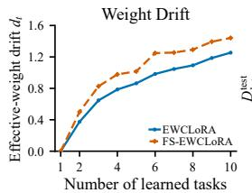

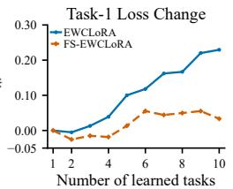

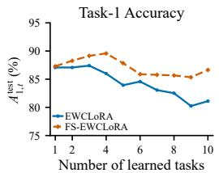

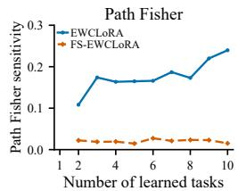  
Figure 3: Less forgetting despite larger realized drift. Realized-drift diagnostics on ImageNet-A with LoRA. Relative to the Task 1 solution, we report effective-weight displacement $\bar { d } _ { t } .$ , Task 1 loss change $D _ { 1 , t } ^ { \mathrm { t e s t } }$ , Task 1 accuracy, and empirical-Fisher sensitivity averaged along the straight segment to each subsequent task endpoint.

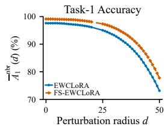

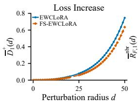

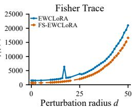

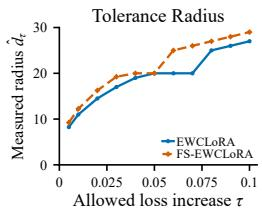  
Figure 4: Lower neighborhood sensitivity and greater empirical displacement tolerance. Controlledneighborhood diagnostics around the retained Task 1 solutions on ImageNet-A. Shared random directions are used to apply perturbations of radius d in the weight space. We report Task 1 training accuracy, mean positive training-loss increase, mean empirical-Fisher trace, and the measured tolerance radius under loss budget τ.

Table 4: Two-task diagnostics of solution shaping and historical protection with LoRA on ImageNet-A. C, F, and P denote current-task fitting, Fisher shaping, and historical EWC protection, respectively.
<table><tr><td></td><td colspan="2">Training objective</td><td colspan="2">Task 1 endpoint</td><td colspan="4">Task 2 endpoint</td><td rowspan="2">Task 2update  $d _ { 2 }$ </td></tr><tr><td>Variant</td><td>Task 1</td><td> $\mathrm { T a s k } 2$ </td><td> $a _ { 1 1 } \uparrow$ </td><td> $\mathrm { t r } F _ { 1 } ^ { \mathrm { e m p } }$ </td><td> $a _ { 2 1 } \uparrow$ </td><td> $a _ { 2 2 } \uparrow$ </td><td>BWT↑</td><td> $A _ { 2 } \uparrow$ </td></tr><tr><td>Vanilla LoRA</td><td>C</td><td> $\mathsf { C }$ </td><td> $8 7 . 0 8 _ { ( 0 . 3 8 ) }$ </td><td> $3 1 . 4 4 _ { ( 4 . 2 4 ) }$ </td><td> $8 2 . 4 1 _ { ( 1 . 1 3 ) }$ </td><td> $7 6 . 3 8 _ { ( 0 . 4 0 ) }$ </td><td> $- 4 . 6 7 _ { ( 1 . 3 6 ) }$ </td><td> $7 9 . 3 9 _ { ( 0 . 7 4 ) }$ </td><td> $0 . 3 8 _ { ( 0 . 0 2 ) }$ </td></tr><tr><td>Fisher Shaping</td><td> $\mathsf C + \mathsf F$ </td><td> $\mathsf C + \mathsf F$ </td><td> $8 7 . 3 0 \dot { _ { ( 0 . 5 7 ) } }$ </td><td> $2 1 . 9 3 _ { ( 2 . 9 8 ) }$ </td><td> $8 3 . 3 9 _ { ( 0 . 3 3 ) } ^ { }$ </td><td> $8 0 . 8 4 _ { ( 1 . 1 4 ) }$ </td><td> $- 3 . 9 1 _ { ( 0 . 6 5 ) }$ </td><td> $8 2 . 1 2 _ { ( 0 . 5 9 ) } ^ { }$ </td><td> $0 . 5 0 _ { ( 0 . 0 1 ) }$ </td></tr><tr><td>Task-1 only</td><td> $\mathsf C + \mathsf F$ </td><td>C</td><td> $8 7 . 3 0 _ { ( 0 . 5 7 ) }$ </td><td> $2 1 . 9 3 _ { ( 2 . 9 8 ) }$ </td><td> $8 6 . 5 4 _ { ( 0 . 8 2 ) }$ </td><td> $7 2 . 9 6 _ { ( 1 . 3 8 ) }$ </td><td> $- 0 . 7 6 _ { ( 1 . 3 6 ) }$ </td><td> $7 9 . 7 5 _ { ( 1 . 1 0 ) }$ </td><td> $0 . 3 6 _ { ( 0 . 0 1 ) }$ </td></tr><tr><td>EWCLoRA</td><td></td><td> ${ \mathsf { C } } \qquad { \mathsf { C } } + { \mathsf { P } }$ </td><td> $8 7 . 0 8 _ { ( 0 . 3 8 ) }$ </td><td> $3 1 . 4 4 _ { ( 4 . 2 4 ) }$ </td><td> $8 2 . 9 5 _ { ( 0 . 7 6 ) }$ </td><td></td><td> $7 6 . 2 5 _ { ( 0 . 6 0 ) } \ - 4 . 1 3 _ { ( 1 . 0 0 ) }$ </td><td> $7 9 . 6 0 _ { ( 0 . 6 7 ) }$ </td><td> $0 . 2 8 _ { ( 0 . 0 1 ) }$ </td></tr><tr><td>FS-EWCLoRA</td><td></td><td> ${ \mathsf { C } } + { \mathsf { F } } { \mathsf { C } } + { \mathsf { F } } + { \mathsf { \Omega } }$ </td><td>P 87.30(0.57)</td><td> $2 1 . 9 3 _ { ( 2 . 9 8 ) }$ </td><td>83.50(0.50)</td><td></td><td> $7 9 . 9 2 _ { ( 1 . 0 4 ) } \ - 3 . 8 0 _ { ( 1 . 0 0 ) }$ </td><td> $8 1 . 7 1 _ { ( 0 . 4 9 ) }$ </td><td> $0 . 4 3 _ { ( 0 . 0 1 ) }$ </td></tr><tr><td>Task-1 only</td><td></td><td> $\mathsf { C } + \mathsf { F } \quad \mathsf { C } + \mathsf { P }$ </td><td>87.30(0.57)</td><td> $2 1 . 9 3 _ { ( 2 . 9 8 ) }$ </td><td>86.32(0.86)</td><td></td><td> $7 3 . 3 6 _ { ( 1 . 2 0 ) } \ - 0 . 9 8 _ { ( 1 . 4 2 ) }$ </td><td> $7 9 . 8 4 _ { ( 1 . 0 3 ) }$ </td><td> $0 . 3 0 _ { ( 0 . 0 1 ) }$ </td></tr><tr><td>Task-2 only</td><td></td><td></td><td> $\begin{array} { r l } { \mathsf { C } } & { { } \mathsf { C } + \mathsf { F } + \mathsf { P } \ 8 7 . 0 8 _ { ( 0 . 3 8 ) } } \end{array}$ </td><td> $3 1 . 4 4 _ { ( 4 . 2 4 ) }$ </td><td> $8 1 . 3 2 _ { ( 0 . 5 0 ) }$ </td><td></td><td> $8 1 . 8 9 _ { ( 1 . 0 4 ) } ~ - 5 . 7 6 _ { ( 0 . 8 3 ) }$ </td><td> $8 1 . 6 1 _ { ( 0 . 5 8 ) }$ </td><td> $0 . 4 7 _ { ( 0 . 0 1 ) }$ </td></tr></table>

However, Fisher shaping improves the retention–adaptation balance without relying on smaller parameter movement. Relative to Vanilla $\mathrm { L o R A } .$ , Fisher Shaping improves both retained-task and current-task accuracy despite increasing $d _ { 2 }$ from 0.38 to 0.50. The same pattern holds with EWC protection: FS-EWCLoRA improves $a _ { 2 1 }$ from 82.95% to 83.50% and $a _ { 2 2 }$ from 76.25% to 79.92%, while $d _ { 2 }$ increases from 0.28 to 0.43. The stage-specific variants clarify why. Shaping Task 1 reduces the endpoint sensitivity proxy t $r F _ { 1 } ^ { \mathrm { e m p } } ( \pmb { \theta } )$ from 31.44 to 21.93 and substantially improves its subsequent retention under either unprotected training $( 8 2 . 4 1 \%  8 6 . 5 4 \% )$ or the same $\dot { \mathsf { C } } + \mathsf { P }$ protection (82.95%→86.32%). Thus, shaping improves the solution passed forward for future retention. Conversely, shaping during Task 2 substantially improves current-task adaptation $( 7 6 . 2 5 \%  8 1 . 8 9 \% )$ although this shifts the balance away from immediate Task 1 retention. These results indicate that Fisher shaping serves two related roles: it forms solutions that are more suitable for subsequent re tention and shapes the current-task solution during adaptation. Combined with historical protection, these effects yield a more favorable stability–plasticity balance than EWC alone.

Complementarity with FIM Representation We next examine whether the performance gains from solution shaping persist across different FIM schemes. We evaluate six combinations of three FIM computation schemes (batched empirical, per-example empirical, and model-sampled) and two representations (diagonal and Kronecker-factored).

Table 5: Performance under different Fisher structures and computations. Under each structure, empirical FIM is computed using either batch gradients (Batch) or per-sample gradients (Per-sample), while Model denotes model-sampled FIM. Each entry reports FAA / AAA (%).
<table><tr><td rowspan="2">Method</td><td colspan="3">Diagonal</td><td colspan="3">Kronecker-factored</td></tr><tr><td>Batched</td><td>Per-example</td><td>Model-sampled</td><td>Batched</td><td>Per-example</td><td>Model-sampled</td></tr><tr><td>EWC</td><td>51.96 / 66.30</td><td>50.60 / 66.60</td><td>50.76 / 66.60</td><td>53.74 / 67.37</td><td>52.75 / 67.55</td><td>52.71 /67.33</td></tr><tr><td>FS-EWC</td><td>59.29 / 70.69</td><td>59.67/ 70.88</td><td>59.62 / 70.86</td><td>59.82 / 71.00</td><td>59.95 / 71.16</td><td>59.62 / 71.12</td></tr></table>

Table 6: Constructing the anchor from learning trajectory. Anchor construction in FS-EWCLoRA on ImageNet-A, with current-task FIM estimated at the resulting anchor. Trajectory averaging achieves the highest mean AAA. Multi-seed results and checkpoint configurations are provided in Appendix B.5.
<table><tr><td>Retained state</td><td>FAA↑</td><td>AAA↑</td><td>BWT↑</td></tr><tr><td>Endpoint</td><td>59.23</td><td>70.63</td><td>-8.08</td></tr><tr><td>Late-stage</td><td>59.43</td><td>70.61</td><td>-7.68</td></tr><tr><td>Trajectory</td><td>59.34</td><td>70.84</td><td>-7.47</td></tr><tr><td>Dense trajectory</td><td>59.31</td><td>70.745</td><td>-7.44</td></tr><tr><td>Endpoint + initial</td><td>58.44</td><td>69.38</td><td>-6.44</td></tr><tr><td>Trajectory + initial</td><td>59.01</td><td>70.59</td><td>-7.33</td></tr></table>

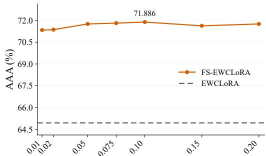  
Radius of the prescribed neighborhood r  
Figure 5: Performance across neighborhood radii. AAA of FS-EWCLoRA on ImageNet-A as the prescribed neighborhood radius r varies.

Table 5 shows relatively modest performance differences across the evaluated FIM computations and representations. FS-EWC improves FAA over the corresponding EWC baseline by 6.08 to 9.07 percentage points across all six configurations. In these settings, the gains from FS-EWC exceed those obtained by refining the FIM computation or representation alone. Their consistency across protection schemes highlights the complementary value of solution shaping: Fisher information can guide the formation of solutions for future retention as well as their subsequent protection. See Appendix B.4 for λ settings and sensitivity analyses.

## 4.3 ABLATION AND HYPERPARAMETER STUDIES

Having isolated the roles of Fisher shaping and historical protection in the preceding mechanism study, we further examine two implementation choices of FS-EWC: retained-anchor construction and the prescribed neighborhood radius.

Retained-state construction. Table 6 shows that trajectory averaging achieves the highest AAA, while increasing checkpoint density provides no further improvement. Multi-checkpoint construction generally reduces forgetting relative to the endpoint. Including the initialization lowers FAA and AAA despite improving BWT. These results suggest that the choice of retained state matters beyond the training objective, but the benefit depends on which learned states are combined rather than simply on their number.

Neighborhood radius. Figure 5 evaluates the prescribed neighborhood radius. FS-EWCLoRA remains above the matched EWCLoRA baseline throughout the tested range, while AAA varies only moderately across different radii. These results indicate that the benefit of sensitivity shaping is not restricted to a narrowly tuned neighborhood radius.

## 5 CONCLUSION

EWC mitigates forgetting through Fisher-based parameter protection, but remains constrained by the stability–plasticity trade-off. Its historical protection is constructed from local parameter importance, whereas forgetting under subsequent learning depends on the sensitivity encountered after finite parameter displacement. Motivated by this gap, we introduced Fisher-Shaped EWC (FS-EWC), which incorporates Fisher information into current-task solution formation while preserving subsequent EWC protection. Our experiments show that shaped solutions can undergo larger subsequent displacement while incurring less forgetting, indicating a more favorable stability–plasticity balance. These findings suggest that future forgetting should be considered during learning.

## AI USE STATEMENT

In this work, we used generative AI tools for assistance with mathematical formulation and proof development, methodological and experimental-design discussions, and interpretation of experimental results, and translation of manuscript content. We have not used generative AI tools to generate or modify experimental data, and tasks involving qualitative or thematic data analysis are not applicable to this work. Additionally, we used generative AI tools for manuscript organization, language editing, literature organization, reference formatting, and refinement of figures and captions.

We have reviewed all AI-assisted work. Mathematical statements and derivations were independently checked by the authors for correctness and consistency with the stated assumptions. Suggestions related to methodology, experimental design, and result interpretation were verified against the implemented methods, experimental protocols, and measured results. Literature-related content and references were checked against the original sources, and all AI-assisted manuscript text was manually reviewed and revised by the authors.

We take responsibility for the final content of this work, including text, claims, or artifacts produced with the aid of generative AI.

## ETHICS STATEMENT

This work studies algorithmic methods for replay-free continual learning and does not involve human subjects, personally identifiable information, or the collection of private data. All experiments are conducted on established public benchmarks. As with other machine learning methods, the be havior of the resulting models may inherit biases or limitations from the underlying datasets and pretrained models. Our work does not introduce additional data collection or deployment-specific risks beyond those associated with the datasets and model architectures considered.

## REPRODUCIBILITY STATEMENT

We provide the information necessary to reproduce both the theoretical and empirical results of this work. The FS-EWC objective, neighborhood-sensitivity optimization, retained-anchor construction, and Fisher-based consolidation procedure are specified in the main methodology section. Complete derivations and proofs of the theoretical results are provided in the appendix. The appendix further documents dataset and task construction, model architectures, continual-learning protocols, baseline configurations, optimization hyperparameters, Fisher estimation procedures, evaluation metrics, and all settings used in the ablation and diagnostic studies. Code and experiment configurations will be released to facilitate independent reproduction of the reported results.

## REFERENCES

Arslan Chaudhry, Puneet K. Dokania, Thalaiyasingam Ajanthan, and Philip H. S. Torr. Riemannian walk for incremental learning: Understanding forgetting and intransigence. In Proceedings of the European Conference on Computer Vision, pp. 532–547, 2018.

Alexey Dosovitskiy. An image is worth 16x16 words: Transformers for image recognition at scale. arXiv preprint arXiv:2010.11929, 2020.

Jiangpeng He, Zhihao Duan, and Fengqing Zhu. Cl-lora: Continual low-rank adaptation for rehearsal-free class-incremental learning. In 2025 IEEE/CVF Conference on Computer Vision and Pattern Recognition (CVPR), pp. 30534–30544, 2025. doi: 10.1109/CVPR52734.2025.02843.

Dan Hendrycks, Steven Basart, Norman Mu, Saurav Kadavath, Frank Wang, Evan Dorundo, Rahul Desai, Tyler Zhu, Samyak Parajuli, Mike Guo, Dawn Song, Jacob Steinhardt, and Justin Gilmer.

The many faces of robustness: A critical analysis of out-of-distribution generalization. In Proceedings of the IEEE/CVF International Conference on Computer Vision (ICCV), pp. 8340–8349, October 2021a.

Dan Hendrycks, Kevin Zhao, Steven Basart, Jacob Steinhardt, and Dawn Song. Natural adversarial examples. In Proceedings of the IEEE/CVF Conference on Computer Vision and Pattern Recognition (CVPR), pp. 15262–15271, June 2021b.

Ferenc Huszar. Note on the quadratic penalties in elastic weight consolidation.´ Proceedings of the National Academy ofSciences, 115(11):E2496–E2497, 2018. doi: 10.1073/pnas.1717042115.

James Kirkpatrick, Razvan Pascanu, Neil Rabinowitz, Joel Veness, Guillaume Desjardins, Andrei A. Rusu, Kieran Milan, John Quan, Tiago Ramalho, Agnieszka Grabska-Barwinska, Demis Hassabis, Claudia Clopath, Dharshan Kumaran, and Raia Hadsell. Overcoming catastrophic forgetting in neural networks. Proceedings ofthe National Academy ofSciences, 114(13):3521–3526, 2017. doi: 10.1073/pnas.1611835114. URL https://www.pnas.org/doi/abs/10.1073/pnas.1611835114.

Jonathan Krause, Michael Stark, Jia Deng, and Li Fei-Fei. 3d object representations for fine-grained categorization. In Proceedings of the IEEE International Conference on Computer Vision Workshops, pp. 554–561, 2013. doi: 10.1109/ICCVW.2013.77.

Alex Krizhevsky, Geoffrey Hinton, et al. Learning multiple layers of features from tiny images. 2009.

Yan-Shuo Liang and Wu-Jun Li. InfLoRA: Interference-Free Low-Rank Adaptation for Continual Learning. In 2024 IEEE/CVF Conference on Computer Vision and Pattern Recognition (CVPR), pp. 23638–23647. IEEE, 2024. ISBN 979-8-3503-5300-6. doi: 10.1109/CVPR52733. 2024.02231. URL https://ieeexplore.ieee.org/document/10658274/.

Xialei Liu, Marc Masana, Luis Herranz, Joost van de Weijer, Antonio M. Lopez, and Andrew D. Bagdanov. Rotate your networks: Better weight consolidation and less catastrophic forgetting. In 2018 24th International Conference on Pattern Recognition, pp. 2262–2268. IEEE, 2018. doi: 10.1109/ICPR.2018.8545895.

Yuhang Liu, Tao Li, Zhehao Huang, Zuopeng Yang, and Xiaolin Huang. Bi-lora: Efficient sharpnessaware minimization for fine-tuning large-scale models. In C. Vondrick, B. Hariharan, C. Raffel, L. Pinto, D. Yang, and A. Faust (eds.), International Conference on Learning Representations, volume 2026, pp. 96782–96813, 2026. URL https://proceedings.iclr.cc/paper files/paper/2026/ file/9c84feb75eae1ef6389f31b3ef050b6a-Paper-Conference.pdf.

Subhransu Maji, Esa Rahtu, Juho Kannala, Matthew Blaschko, and Andrea Vedaldi. Fine-grained visual classification of aircraft, 2013. URL https://arxiv.org/abs/1306.5151.

James Martens. New insights and perspectives on the natural gradient method. Journal ofMachine Learning Research, 21(146):1–76, 2020.

James Martens and Roger Grosse. Optimizing neural networks with kronecker-factored approximate curvature. In Proceedings ofthe 32nd International Conference on Machine Learning, volume 37 of Proceedings of Machine Learning Research, pp. 2408–2417. PMLR, 2015.

Meta. Llama 3.2 model card. Model card, 2024. URL https://github.com/meta-llama/llama-models/ blob/main/models/llama3 2/MODEL CARD.md.

Maria-Elena Nilsback and Andrew Zisserman. Automated flower classification over a large number of classes. In 2008 Sixth Indian Conference on Computer Vision, Graphics and Image Processing, pp. 722–729. IEEE, 2008. doi: 10.1109/ICVGIP.2008.47.

Omkar M. Parkhi, Andrea Vedaldi, Andrew Zisserman, and C. V. Jawahar. Cats and dogs. In 2012 IEEE Conference on Computer Vision and Pattern Recognition, pp. 3498–3505. IEEE, 2012. doi: 10.1109/CVPR.2012.6248092.

Xingchao Peng, Qinxun Bai, Xide Xia, Zijun Huang, Kate Saenko, and Bo Wang. Moment matching for multi-source domain adaptation. In Proceedings of the IEEE/CVF International Conference on Computer Vision (ICCV), October 2019.

Yu-Yang Qian, Yuan-Ze Xu, Zhen-Yu Zhang, Peng Zhao, and Zhi-Hua Zhou. Treelora: Efficient continual learning via layer-wise loras guided by a hierarchical gradient-similarity tree, 2026. URL https://arxiv.org/abs/2506.10355.

Jonathan Schwarz, Wojciech Czarnecki, Jelena Luketina, Agnieszka Grabska-Barwinska, Yee Whye Teh, Razvan Pascanu, and Raia Hadsell. Progress & compress: A scalable framework for continual learning. In Proceedings of the 35th International Conference on Machine Learning, volume 80 of Proceedings ofMachine Learning Research, pp. 4528–4537. PMLR, 2018.

Khadija Shaheen, Muhammad Abdullah Hanif, Osman Hasan, and Muhammad Shafique. Continual learning for real-world autonomous systems: Algorithms, challenges and frameworks. Journal of Intelligent & Robotic Systems, 105(1):9, 2022. ISSN 1573-0409. doi: 10.1007/s10846-022- 01603-6. URL https://doi.org/10.1007/s10846-022-01603-6.

Gido M. van de Ven. On the computation of the fisher information in continual learning, 2025.

Catherine Wah, Steve Branson, Peter Welinder, Pietro Perona, and Serge Belongie. The caltech-ucsd birds-200-2011 dataset. Technical Report CNS-TR-2011-001, California Institute of Technology, 2011.

Liyuan Wang, Xingxing Zhang, Hang Su, and Jun Zhu. A comprehensive survey of continual learning: Theory, method and application. IEEE Transactions on Pattern Analysis and Machine Intel ligence, 46(8):5362–5383, 2024. doi: 10.1109/TPAMI.2024.3367329.

Xiao Wang, Tianze Chen, Qiming Ge, Han Xia, Rong Bao, Rui Zheng, Qi Zhang, Tao Gui, and Xuanjing Huang. Orthogonal subspace learning for language model continual learning. In The 2023 Conference on Empirical Methods in Natural Language Processing, 2023. URL https: //openreview.net/forum?id=L7ZBpZZ8Va.

Yichen Wu, Hongming Piao, Long-Kai Huang, Renzhen Wang, Wanhua Li, Hanspeter Pfister, Deyu Meng, Kede Ma, and Ying Wei. SD-LoRA: Scalable decoupled low-rank adaptation for class incremental learning, 2025. URL https://arxiv.org/abs/2501.13198.

Friedemann Zenke, Ben Poole, and Surya Ganguli. Continual learning through synaptic intelligence. In Doina Precup and Yee Whye Teh (eds.), Proceedings ofthe 34th International Conference on Machine Learning, volume 70 of Proceedings of Machine Learning Research, pp. 3987–3995. PMLR, 06–11 Aug 2017. URL https://proceedings.mlr.press/v70/zenke17a.html.

Xiang Zhang, Junbo Zhao, and Yann LeCun. Character-level convolutional networks for text classification. In Advances in Neural Information Processing Systems, volume 28. Curran Associates, Inc., 2015. URL https://proceedings.neurips.cc/paper files/paper/2015/file/ 250cf8b51c773f3f8dc8b4be867a9a02-Paper.pdf.

Yaoyue Zheng, Yin Zhang, Joost van de Weijer, Gido M van de Ven, Shaoyi Du, Xuetao Zhang, and Zhiqiang Tian. Revisiting weight regularization for low-rank continual learning. In The Fourteenth International Conference on Learning Representations, 2026. URL https://openreview. net/forum?id=pZj2DhfaVD.

## A SUPPLEMENTARY THEORETICAL ANALYSIS

## A.1 NOTATION

Table 7 collects the notation used below. All gradients, perturbations, and importance matrices use the same trainable parameterization.

Table 7: Key notation used in FS-EWC.
<table><tr><td>Symbol</td><td>Meaning</td></tr><tr><td> $\theta , \theta _ { t }$ </td><td>Candidate parameters and the retained task-t anchor.</td></tr><tr><td> $F _ { t } ^ { \mathrm { e m p } } , \widehat { F } _ { t } , \varepsilon _ { F }$ </td><td>Empirical FIM and the normalized and damped current-task FIM, Fisher-normalization stabilizer.</td></tr><tr><td> $\Delta _ { t } , \Omega _ { t - 1 }$ </td><td>Consolidated importance and the inherited EWC penalty.</td></tr><tr><td> $\Delta , \epsilon$ </td><td>Future parameter displacement and sensitivity-search perturbation.</td></tr><tr><td> $D _ { t } ( \pmb \theta , \pmb \Delta )$ </td><td>Task-loss change; positive values indicate deterioration.</td></tr><tr><td> $\mathcal { R } _ { \mathrm { F } , t } , \mathcal { R } _ { \mathrm { F } , t } ^ { \operatorname* { m a x } }$ </td><td>Fisher trace and its maximum over  $\mathbb { U } _ { r } ( \pmb \theta ) .$ </td></tr><tr><td> ${ \mathbf { } } g , H$ </td><td>Gradient and Hessian of the mean loss on a fixed batch B.</td></tr><tr><td> $s ( u ) , \widehat { h } ( u )$ </td><td>Probe step size and estimate of  $2 H ( u ) g ( u )$ </td></tr><tr><td> $z , d _ { t , \mathbb { B } }$ </td><td>Selected neighborhood point and numerical update direction.</td></tr><tr><td> $\mathbb { K } , K , \overline { { \pmb { \theta } } } _ { t }$ </td><td>Selected checkpoint indices, their number, and their parameter average.</td></tr><tr><td> $\beta , \gamma , \lambda$ </td><td>Damping, decay coefficient, and historical-regularization.</td></tr><tr><td> $r , \rho , \xi$ </td><td>Neighborhood radius, finite-difference probe scale. and normalization stabilizer.</td></tr></table>

## A.2 EVALUATION QUANTITIES.

Let $\boldsymbol { a } _ { t , i }$ denote the test accuracy on Task i after learning through Task t, where $1 \leq i \leq t \leq T$ . The average accuracy after learning t tasks is

$$
A _ { t } = \frac { 1 } { t } \sum _ { i = 1 } ^ { t } a _ { t , i } .\tag{15}
$$

This is the stage-wise average accuracy reported in the learning curves. We summarize continuallearning performance using final average accuracy (FAA), average accuracy across learning stages $( \mathrm { A A A } )$ , and backward transfer (BWT):

$$
\mathrm { F A A } = A _ { T } , \quad \mathrm { A A A } = \frac { 1 } { T } \sum _ { t = 1 } ^ { T } A _ { t } \quad \mathrm { B W T } = \frac { 1 } { T - 1 } \sum _ { i = 1 } ^ { T - 1 } \left( a _ { T , i } - a _ { i , i } \right) .\tag{16}
$$

A more negative BWT indicates greater forgetting.

For the solution-shaping diagnostics, we additionally characterize parameter displacement and solution sensitivity in the effective LoRA update space. Specifically, we write

$$
\mathbf { w } _ { t } = \mathrm { v e c } \left( \{ B _ { \ell c , t } A _ { \ell c , t } \} _ { \ell , \ c \in \{ Q , V \} } \right)\tag{17}
$$

for the vectorized effective LoRA weights retained after Task t. For realized subsequent learning, define

$$
\Delta \mathbf { w } _ { t } = \mathbf { w } _ { t } - \mathbf { w } _ { 1 } , \qquad d _ { t } = \| \Delta \mathbf { w } _ { t } \| _ { 2 } ,\tag{18}
$$

and the signed Task 1 test-loss change

$$
\begin{array} { r } { D _ { 1 , t } ^ { \mathrm { t e s t } } = \widehat { \mathcal { L } } _ { 1 , \mathrm { t e s t } } ( \mathbf { w } _ { t } ) - \widehat { \mathcal { L } } _ { 1 , \mathrm { t e s t } } ( \mathbf { w } _ { 1 } ) . } \end{array}\tag{19}
$$

For $d _ { t } > 0$ , let $\mathbf { v } _ { t } = \Delta \mathbf { w } _ { t } / d _ { t }$ . The displacement-normalized directional Fisher sensitivity along the straight segment connecting the two endpoints is

$$
\overline { { \mathscr { S } } } _ { \mathrm { F } , 1 } ^ { \mathrm { p a t h } } ( t ) = \int _ { 0 } ^ { 1 } \mathbf { v } _ { t } ^ { \top } \pmb { F } _ { 1 , \mathrm { t r } } ^ { \mathrm { e m p } } ( \mathbf { w } _ { 1 } + s \Delta \mathbf { w } _ { t } ) \mathbf { v } _ { t } d s .\tag{20}
$$

For the controlled-neighborhood diagnostic, let d denote the prescribed perturbation radius and $\mathbf { u } _ { k }$ a unit perturbation direction. The Task 1 training-loss change along direction k is

$$
D _ { 1 , k } ^ { \mathrm { n b r } } ( d ) = \widehat { \mathcal { L } } _ { 1 , \mathrm { t r } } ( \mathbf { w } _ { 1 } + d \mathbf { u } _ { k } ) - \widehat { \mathcal { L } } _ { 1 , \mathrm { t r } } ( \mathbf { w } _ { 1 } ) .\tag{21}
$$

We report

$$
\overline { { D } } _ { 1 } ^ { + } ( d ) = \frac { 1 } { K _ { D } } \sum _ { k = 1 } ^ { K _ { D } } [ D _ { 1 , k } ^ { \mathrm { n b r } } ( d ) ] _ { + } , \qquad \overline { { \mathcal { R } } } _ { \mathrm { F } , 1 } ^ { \mathrm { n b r } } ( d ) = \frac { 1 } { K _ { F } } \sum _ { k = 1 } ^ { K _ { F } } \mathrm { t r } F _ { 1 , \mathrm { t r } } ^ { \mathrm { e m p } } ( \mathbf { w } _ { 1 } + d \mathbf { u } _ { k } ) .\tag{22}
$$

For an allowed mean positive loss increase $\tau ,$ the measured tolerance radius over the evaluated grid $0 = d _ { 0 } < d _ { 1 } < \cdot \cdot \cdot < d _ { J }$ is

$$
\begin{array} { r } { \widehat { d } _ { \tau } = \operatorname* { m a x } \left\{ d _ { j } : \overline { { D } } _ { 1 } ^ { + } ( d _ { i } ) \leq \tau \mathrm { ~ f o r ~ a l l ~ } i \leq j \right\} . } \end{array}\tag{23}
$$

Because $\widehat { d } _ { \tau }$ is evaluated only on the measured grid, it is an empirical summary rather than a certificate over the continuous neighborhood.

For the two-task diagnostic, $A _ { 2 }$ is the corresponding stage-average accuracy from Eq. equation 15, $\mathrm { i . e . , } A _ { 2 } = ( a _ { 2 1 } + a _ { 2 2 } ) / 2$ . In this case, $\mathrm { B W T } = a _ { 2 1 } - a _ { 1 1 }$ and $d _ { 2 } = \lVert \mathbf { w } _ { 2 } - \mathbf { w } _ { 1 } \rVert _ { 2 }$

## A.3 PROOF OF FINITE-DISPLACEMENT SENSITIVITY

Fix $\| \Delta \| _ { 2 } \leq r$ . The segment $\pmb \theta + \tau \pmb \Delta , \tau \in [ 0 , 1 ]$ , lies in $\mathbb { U } _ { r } ( \pmb \theta )$ , so the differentiability assumption in Proposition 1 gives

$$
D _ { t } ( \pmb \theta , \Delta ) = \int _ { 0 } ^ { 1 } \frac { 1 } { m _ { t } } \sum _ { i = 1 } ^ { m _ { t } } { g _ { t , i } ( \pmb \theta + \tau \Delta ) ^ { \top } \Delta \mathrm d \tau } .\tag{24}
$$

Applying Cauchy–Schwarz to the integral and then to the sample average yields

$$
\begin{array} { l } { \displaystyle | D _ { t } ( \pmb \theta , \Delta ) | ^ { 2 } \leq \int _ { 0 } ^ { 1 } \left[ \frac { 1 } { m _ { t } } \sum _ { i = 1 } ^ { m _ { t } } g _ { t , i } ( \pmb \theta + \tau \pmb \Delta ) ^ { \top } \pmb \Delta \right] ^ { 2 } \mathrm d \tau } \\ { \displaystyle \qquad \leq \int _ { 0 } ^ { 1 } \frac { 1 } { m _ { t } } \sum _ { i = 1 } ^ { m _ { t } } \left[ g _ { t , i } ( \pmb \theta + \tau \pmb \Delta ) ^ { \top } \pmb \Delta \right] ^ { 2 } \mathrm d \tau } \\ { \displaystyle \qquad = \int _ { 0 } ^ { 1 } \Delta ^ { \top } F _ { t } ^ { \mathrm { e m p } } ( \pmb \theta + \tau \pmb \Delta ) \pmb \Delta \mathrm d \tau . } \end{array}\tag{25}
$$

This proves the proposition.

## A.4 FS-EWC FROM A BAYESIAN PERSPECTIVE

The Bayesian perspective provides a complementary interpretation of both components of FS-EWC: accounting for a parameter distribution when learning its center, and selecting the center retained for subsequent tasks.

EWC from a Bayesian perspective. Sequential Bayesian learning maintains a distribution over model parameters. For conditionally independent task data,

$$
p ( \pmb \theta \mid \mathbb { S } _ { 1 : t } ) \propto p ( \pmb \theta \mid \mathbb { S } _ { 1 : t - 1 } ) p ( \mathbb { S } _ { t } \mid \pmb \theta ) .\tag{26}
$$

Thus, the posterior after task $t - 1$ serves as the prior for learning task t, carrying historical information without requiring the original data.

The exact posterior is generally intractable for neural networks. EWC approximates the inherited parameter distribution by a local Gaussian surrogate (Kirkpatrick et al., 2017; Huszar, 2018):´

$$
\begin{array} { r } { q _ { t - 1 } ( \pmb { \theta } ) = \mathcal { N } \left( \pmb { \theta } ; \pmb { \theta } _ { t - 1 } , \pmb { \Lambda } _ { t - 1 } ^ { - 1 } \right) . } \end{array}\tag{27}
$$

Using this surrogate as the prior, a MAP-style current-task update is

$$
\theta _ { t } ^ { \mathrm { M A P } } = \arg \operatorname* { m i n } _ { \theta } \left[ \widehat { \mathcal { L } } _ { t } ^ { \mathrm { C E } } ( \theta ) + \frac { \lambda } { 2 } ( \theta - \theta _ { t - 1 } ) ^ { \top } \Lambda _ { t - 1 } ( \theta - \theta _ { t - 1 } ) \right] = \mathcal { I } _ { t } ^ { \mathrm { E W C } } ( \theta ) ,\tag{28}
$$

where λ absorbs the practical scaling between the mean current-task loss and the inherited preci sion. This recovers the EWC objective in equation 2. Hence, EWC retains a distribution-derived representation of historical uncertainty, but performs current-task learning through a point estimate of the new parameters.

Optimizing the distribution. The underlying Bayesian update is distributional rather than pointwise. A corresponding variational objective is

$$
\begin{array} { r } { \mathcal { V } _ { t } ( Q ) = \mathbb { E } _ { \pmb { u } \sim Q } [ \widehat { \mathcal { L } } _ { t } ^ { \mathrm { C E } } ( \pmb { u } ) ] + \lambda \mathrm { K L } ( Q \lVert q _ { t - 1 } ) , } \end{array}\tag{29}
$$

where $Q$ is a candidate current-task parameter distribution. The first term evaluates current-task performance across parameter values represented by Q, whereas standard EWC evaluates the currenttask loss only at its MAP candidate.

To expose this difference, consider a fixed-shape local family $Q _ { \theta }$ represented by

$$
\begin{array} { r } { { \pmb u } = { \pmb \theta } + \epsilon , \qquad { \mathbb { E } } [ { \pmb \epsilon } ] = { \mathbf 0 } , \qquad \| { \pmb \epsilon } \| _ { 2 } \leq r . } \end{array}\tag{30}
$$

Its expected current-task loss decomposes as

$$
\mathbb { E } _ { \boldsymbol { u } \sim Q _ { \boldsymbol { \theta } } } [ \widehat { \mathcal { L } } _ { t } ^ { \mathrm { C E } } ( \boldsymbol { u } ) ] = \widehat { \mathcal { L } } _ { t } ^ { \mathrm { C E } } ( \boldsymbol { \theta } ) + \mathbb { E } [ D _ { t } ( \boldsymbol { \theta } , \boldsymbol { \epsilon } ) ] .\tag{31}
$$

The second term measures the loss variation over parameter values around the candidate center and is not controlled by center loss alone.

For this fixed-shape, zero-mean family, the historical KL term has the same center-dependent part as EWC:

$$
\lambda \mathrm { K L } ( Q _ { \pmb { \theta } } | | q _ { t - 1 } ) = \Omega _ { t - 1 } ( \pmb { \theta } ) + C ,\tag{32}
$$

where C does not depend on θ. Using the finite-displacement Fisher bound,

$$
\mathbb { E } [ D _ { t } ( \theta , \epsilon ) ] \leq r \sqrt { \mathcal { R } _ { \mathrm { F } , t } ^ { \operatorname* { m a x } } ( \theta ; r ) } \leq \mathcal { R } _ { \mathrm { F } , t } ^ { \operatorname* { m a x } } ( \theta ; r ) + \frac { r ^ { 2 } } { 4 } .\tag{33}
$$

Therefore,

$$
\mathcal { V } _ { t } ( Q _ { \pmb { \theta } } ) \leq \mathcal { I } _ { t } ^ { \mathrm { F S - E W C } } ( \pmb { \theta } ; r ) + C + \frac { r ^ { 2 } } { 4 } .\tag{34}
$$

For fixed distribution shape, $r ,$ the parameter-dependent upper surrogate is exactly the FS-EWC objective. Thus, FS-EWC can be viewed as extending EWC’s pointwise MAP update toward distribution-aware center selection: the center is chosen not only for its own task loss and historical compatibility, but also for controlled loss variation over its surrounding parameter distribution.

Selecting the retained center. At task completion, let ${ Q } _ { t } ^ { \mathrm { t r a j } }$ assign equal mass to the selected latestage checkpoints $\theta _ { t , k } , k \in \mathbb { K } _ { t }$ . For any fixed positive definite matrix A, fitting a Gaussian center to this empirical distribution yields

$$
\arg \operatorname* { m i n } _ { \pmb { \theta } } \mathbb { E } _ { \pmb { u } \sim Q _ { t } ^ { \mathrm { t r a j } } } [ - \log \mathcal { N } ( \pmb { u } ; \pmb { \theta } , \pmb { A } ^ { - 1 } ) ] \quad = \frac { 1 } { K } \sum _ { k \in \mathbb { K } _ { t } } \pmb { \theta } _ { t , k } = \overline { { \pmb { \theta } } } _ { t } .\tag{35}
$$

The equality follows by minimizing the associated quadratic in the center and recovers the retainedanchor rule $\pmb \theta _ { t } : = \overline { { \pmb \theta } } _ { t }$ t. It treats the selected checkpoints as an empirical distribution, without assuming they are exact posterior samples. Fisher importance is then estimated at the retained anchor and consolidated as specified in Section 3.3.2. Thus, the distributional view motivates both learning the center through Fisher shaping and selecting the retained center through trajectory averaging.

## A.5 PRACTICAL IMPLEMENTATION

## A.5.1 EMPIRICAL FISHER COMPUTATION

Several Fisher variants are used in continual learning, differing in the distribution over labels and in how expectations are approximated. Our theoretical development uses the per-example empirical Fisher in Eq. equation 3. We focus here on the specific approximation used by our method and refer to Martens (2020); van de Ven (2025) for broader treatments of Fisher definitions and computation.

The theoretical sensitivity target is defined using the per-example empirical-Fisher trace, whereas practical mini-batch optimization uses the squared gradient of the batch-averaged loss. For a fixed batch B with $b = \left| \mathbb { B } \right|$ , let

$$
g ( \pmb { u } ) = \frac { 1 } { b } \sum _ { i \in \mathbb { B } } \pmb { g } _ { t , i } ( \pmb { u } ) .
$$

The two quantities satisfy the exact decomposition

$$
\frac { 1 } { b } \sum _ { i \in \mathbb { B } } \| { \pmb g } _ { t , i } ( { \pmb u } ) \| _ { 2 } ^ { 2 } = \| { \pmb g } ( { \pmb u } ) \| _ { 2 } ^ { 2 } + \frac { 1 } { b } \sum _ { i \in \mathbb { B } } \| { \pmb g } _ { t , i } ( { \pmb u } ) - { \pmb g } ( { \pmb u } ) \| _ { 2 } ^ { 2 } .\tag{36}
$$

Thus, the squared batch gradient omits the nonnegative dispersion of per-example gradients and is generally not identical to the empirical-Fisher trace. We use it as a computational surrogate because the batch-averaged gradient is directly available during stochastic optimization.

## A.5.2 FISHER POST-PROCESSING AND CONSOLIDATION

Following prior work (Schwarz et al., 2018) on Fisher normalization, we normalize the currenttask Fisher importance to reduce arbitrary task-dependent differences in its absolute scale and make consolidation depend primarily on the relative importance of protected parameters. Specifically, we use global trace normalization over all protected parameter coordinates:

$$
\widetilde { F } _ { t } = \mathcal { N } ( \mathrm { D i a g } ( F _ { t } ^ { \mathrm { e m p } } ( \pmb { \theta } _ { t } ) ) ) = \frac { \mathrm { D i a g } ( F _ { t } ^ { \mathrm { e m p } } ( \pmb { \theta } _ { t } ) ) } { \mathrm { t r } ( \mathrm { D i a g } ( F _ { t } ^ { \mathrm { e m p } } ( \pmb { \theta } _ { t } ) ) ) + \xi _ { F } } , \qquad \xi _ { F } = 1 0 ^ { - 1 2 } .\tag{37}
$$

The trace is computed jointly over all protected coordinates rather than independently for individual layers. For LoRA adaptation, these coordinates correspond to the effective weight updates $\Delta W$ Because all Fisher entries share the same normalization factor, their relative importance is preserved, while for nondegenerate Fisher statistics, $\mathrm { t r } ( \widetilde { \pmb { F } } _ { t } ) \approx 1$

We then apply isotropic damping,

$$
\widehat { F } _ { t } = ( 1 - \beta ) \widetilde { F } _ { t } + \beta \frac { I } { d } , \qquad \beta \in [ 0 , 1 ] ,\tag{38}
$$

where $d$ is the total number of protected coordinates and $\beta = 0 . 2$ by default. Since $\mathrm { t r } ( I / d ) = 1$ damping preserves the normalized trace, i.e., $\mathrm { t r } ( \widehat { \mathbfcal { F } } _ { t } ) \approx 1$

Following recursive consolidation as in online EWC (Schwarz et al., 2018), we update

$$
\mathbf { \lambda } \mathbf { \Lambda } _ { t } = \gamma \mathbf { \Lambda } \mathbf { \Lambda } _ { t - 1 } + \widehat { F } _ { t } , \qquad \gamma \in [ 0 , 1 ] ,\tag{39}
$$

with $\gamma = 1$ by default.

## A.5.3 PRACTICAL SENSITIVITY SOLVER

For a fixed task t and training batch B, let

$$
\pmb { g } ( \pmb { u } ) = \nabla _ { \pmb { u } } \widehat { \mathcal { L } } _ { t , \mathbb { B } } ^ { \mathrm { C E } } ( \pmb { u } ) , \qquad \pmb { H } ( \pmb { u } ) = \nabla _ { \pmb { u } } ^ { 2 } \widehat { \mathcal { L } } _ { t , \mathbb { B } } ^ { \mathrm { C E } } ( \pmb { u } ) .
$$

For twice continuously differentiable batch losses, the derivative of the squared-gradient is

$$
\nabla _ { \pmb { u } } \| \pmb { g } ( \pmb { u } ) \| _ { 2 } ^ { 2 } = 2 \pmb { H } ( \pmb { u } ) \pmb { g } ( \pmb { u } ) .\tag{40}
$$

Sensitivity-gradient estimator. We approximate this derivative using a normalized finite difference probe with a fixed unit scale. At a generic parameter point u, define

$$
\begin{array} { l } { \displaystyle \mathbf { s } ( \pmb { u } ) = \frac { \pmb { g } ( \pmb { u } ) } { \lVert \pmb { g } ( \pmb { u } ) \rVert _ { 2 } + \xi } , } \\ { \displaystyle \widehat { \pmb { h } } ( \pmb { u } ) = 2 \big ( \lVert \pmb { g } ( \pmb { u } ) \rVert _ { 2 } + \xi \big ) \left[ \pmb { g } \big ( \pmb { u } + \rho \mathbf { s } ( \pmb { u } ) \big ) - \pmb { g } ( \pmb { u } ) \right] / \rho . } \end{array}\tag{41}
$$

Here, $\mathbf { s } ( \pmb { u } )$ specifies the normalized probe direction, ρ controls the finite-difference probe scale, and $\xi > 0$ stabilizes the normalization. Since $\| \rho \mathbf { s } ( \pmb { u } ) \| _ { 2 } \le \rho , \rho$ determines the maximum probe displacement. Unless otherwise specified, we set $\rho = 1$ . When the Hessian varies slowly along the probe segment,

$$
\widehat { \pmb { h } } ( \pmb { u } ) \approx 2 \pmb { H } ( \pmb { u } ) \pmb { g } ( \pmb { u } ) = \nabla _ { \pmb { u } } \Vert \pmb { g } ( \pmb { u } ) \Vert _ { 2 } ^ { 2 } .\tag{42}
$$

Single-step neighborhood search and update. We approximate the inner maximization by a single normalized ascent step. The estimated sensitivity gradient determines the search direction, while the prescribed radius r controls the extent of the neighborhood search:

$$
\begin{array} { r l } & { \hat { \epsilon } ( \pmb { \theta } ) = r \frac { \widehat { h } ( \pmb { \theta } ) } { \lVert \widehat { h } ( \pmb { \theta } ) \rVert _ { 2 } + \xi } , } \\ & { \quad z = \pmb { \theta } + \hat { \epsilon } ( \pmb { \theta } ) , } \\ & { \quad d _ { t , \mathbb { B } } = g ( \pmb { \theta } ) + \widehat { h } ( z ) + \lambda \pmb { \Lambda } _ { t - 1 } ( \pmb { \theta } - \pmb { \theta } _ { t - 1 } ) . } \end{array}\tag{43}
$$

By construction, $\begin{array} { r } { \| \widehat { \epsilon } ( \pmb { \theta } ) \| _ { 2 } \leq r , } \end{array}$ so the selected point z remains within the prescribed neighborhood of θ. The first estimator call provides a first-order approximation to the inner search direction used to select this neighborhood point, while the second approximates the sensitivity gradient at z and supplies the outer shaping correction.

## A.5.4 COMPLETE LEARNING PROCEDURE

Algorithm 1 summarizes the complete FS-EWC procedure, including within-task sensitivity shaping, retained-anchor construction, and task-boundary Fisher consolidation.

Algorithm 1 Fisher-Shaped EWC (FS-EWC)   
Require: Initial parameters $\pmb \theta _ { 0 } ;$ datasets $\mathbb { S } _ { 1 } , . . . , \mathbb { S } _ { T } ; \lambda , \beta , r , \rho , \gamma ;$ checkpoint sets $\mathbb { K } _ { t } ;$ base opti  
mizer.   
1: Initialize $\mathbf { \Lambda } \mathbf { \Lambda } \mathbf { 0 } \longleftarrow \mathbf { 0 } .$   
2: for $t = 1 , \dots , T$ do   
3: Set $\pmb \theta \gets \pmb \theta _ { t - 1 }$ and reset the running checkpoint average.   
4: for each training batch B from $\mathbb { S } _ { t }$ do   
5: Evaluate $\widehat { \pmb { h } } ( \pmb { \theta } )$ using Eq. 41.   
6: Construct the neighborhood point z using Eq. 43.   
7: Evaluate $\widehat { h } ( z )$ using the same batch.   
8: Form $\mathbf { \Delta } d _ { t , \mathbb { B } }$ using Eq. 43.   
9: Update the unperturbed parameters θ with the base optimizer using $\mathbf { \Delta } d _ { t , \mathbb { B } }$   
10: Accumulate $\dot { \pmb \theta }$ when the current checkpoint belongs to $\mathbb { K } _ { t }$   
11: end for   
12: Construct the retained anchor $\theta _ { t }$ using Eq. 14.   
13: Estimate $\pmb { F } _ { t } ^ { \mathrm { e m p } } ( \pmb { \theta } _ { t } )$ using the current-task data.   
14: Form the normalized and damped current-task importance $\widehat { F } _ { t }$ using Eqs. 37 and 38.   
15: Consolidate historical importance: $\pmb { \Lambda } _ { t }  \gamma \pmb { \Lambda } _ { t - 1 } + \widehat { F } _ { t }$ using Eq. 39.   
16: end for   
Ensure: Retained parameters $\pmb { \theta } _ { T }$ and consolidated importance $\mathbf { \Delta } \Lambda _ { T }$

## A.5.5 APPROXIMATION ERROR ANALYSIS

Finite-Difference Approximation The estimator in Eq. 41 approximates the exact squared-gradient derivative at a fixed parameter point. By the fundamental theorem of calculus,

$$
\widehat { \pmb { h } } ( \pmb { u } ) = 2 \int _ { 0 } ^ { 1 } \pmb { H } \big ( \pmb { u } + \tau \rho \mathbf { s } ( \pmb { u } ) \big ) \pmb { g } ( \pmb { u } ) \mathrm { d } \tau .\tag{44}
$$

Hence, continuity of the Hessian implies $\widehat { h } ( u )  2 H ( u ) g ( u )$ as $\rho \to 0$

If the Hessian is $L _ { H ^ { - } } \mathrm { I }$ ipschitz along the probe segment, then

$$
\left\| \widehat { h } ( u ) - 2 H ( u ) g ( u ) \right\| _ { 2 } \leq L _ { H } | \rho | \frac { \| g ( u ) \| _ { 2 } ^ { 2 } } { \| g ( u ) \| _ { 2 } + \xi } .\tag{45}
$$

Thus, the finite-difference estimator has first-order truncation error with respect to the probe scale $\rho .$ Single-Step Inner-Search Approximation

The neighborhood point z is obtained from a single first-order ascent step rather than by solving the inner maximization exactly. For a perturbation ϵ around θ,

$$
\begin{array} { r } { \| g ( \pmb { \theta } + \pmb { \epsilon } ) \| _ { 2 } ^ { 2 } = \| g ( \pmb { \theta } ) \| _ { 2 } ^ { 2 } + \left[ 2 \pmb { H } ( \pmb { \theta } ) g ( \pmb { \theta } ) \right] ^ { \top } \pmb { \epsilon } + o ( \| \pmb { \epsilon } \| _ { 2 } ) . } \end{array}\tag{46}
$$

Therefore, the normalized direction of $2 H ( \theta ) g ( \theta )$ maximizes the linearized sensitivity objective over the radius-r ball. The practical solver replaces this exact sensitivity gradient with its finitedifference estimate and uses Eq. 43.

Let $\epsilon ^ { \star } \in \arg \operatorname* { m a x } _ { \| \epsilon \| _ { 2 } \leq r } \| g ( \theta + \epsilon ) \| _ { 2 } ^ { 2 }$ denote an exact inner maximizer. The practical point z need not coincide with $\mathbf { \ddot { \boldsymbol { \theta } } } + \mathbf { \bar { \epsilon } } ^ { \star }$ because it is obtained from a single local ascent step. Consequently, the practical solver introduces two distinct approximations: finite-difference estimation of the sensitivity gradient and single-step approximation of the neighborhood maximization. The probe scale $\rho$ affects the former, whereas the neighborhood radius r controls the search region of the latter.

## B SUPPLEMENTARY EXPERIMENTS

## B.1 EXPERIMENTAL CONFIGURATIONS

We organize the experimental setup into three groups: (i) standard vision benchmarks, (ii) finegrained and heterogeneous vision benchmarks, and (iii) continual text classification. For published baselines, we follow the configurations reported by the original papers or released implementations whenever available. For EWC and FS-EWC, we report the configurations associated with the corresponding experimental runs.

Standard Vision LoRA Benchmarks We evaluate on CIFAR-100, DomainNet, ImageNet-R, and ImageNet-A following the EWC-LoRA (Zheng et al., 2026). CIFAR-100, ImageNet-R, and ImageNet-A each contain 10 sequential tasks, whereas DomainNet contains 5 tasks.

We use the same ViT-B/16 backbone, pretrained initialization, LoRA placement, and dataset-specific ranks as the reference setting, with ranks 10, 30, 10, and 10, respectively. The reported Vanilla LoRA, InfLoRA (Liang & Li, 2024), SD-LoRA (Wu et al., 2025), CL-LoRA (He et al., 2025), and BiLoRA (Liu et al., 2026) results are taken directly from Zheng et al. (2026). We refer readers to that work for their optimizer, learning-rate, classifier, and method-specific regularization settings.

FS-EWCLoRA follows the same task construction, backbone, LoRA placement, and dataset-specific ranks as the above benchmark. We use SGD with batch size 128 and cosine learning-rate scheduling. The shaping radius is $r = 0 . 0 5$ across datasets. The probe radius is $\rho = 0 . 1$ 1 on CIFAR-100, and $\rho =$ 1 on ImageNet-A, ImageNet-R and DomainNet. The damping coefficient is 0.2. Checkpoints are collected every 5, 5, 20, and 20 epochs, for CIFAR-100, DomainNet, ImageNet-R, and ImageNet-$\mathbf { A } ,$ respectively.

We additionally evaluate EWC and FS-EWC under full-model fine-tuning on the same four benchmarks. All runs use ViT-B/16, SGD, learning rate 0.01, batch size 128, cosine scheduling, zero momentum, and zero weight decay. The numbers of epochs per task are 20, 5, 30, and 20 for CIFAR-100, DomainNet, ImageNet-R, and ImageNet-A, respectively. The EWC and FS-EWC regularization coefficients are $4 \times 1 0 ^ { 4 } , 1 \times 1 0 ^ { 5 } , 8 \times \mathbf { \bar { 1 0 ^ { 4 } } }$ , and $2 \times \mathrm { \bar { 1 0 } ^ { 5 } }$ for CIFAR-100, DomainNet, ImageNet-R, and ImageNet-A, respectively. For FS-EWC, the shaping radius r / finite-difference probe scale ρ are set to 0.005/0.10, 0.05/0.20, 0.05/0.20, and 0.01/0.20, with retained-checkpoint intervals of 5, 1, 10, and 20 epochs, respectively. All full-model FS-EWC runs use damping coefficient 0.2. Fisher statistics are estimated from at most 100 current-task batches and exclude the classification head.

Fine-Grained and Heterogeneous Vision Benchmarks We further evaluate LoRA-based contin ual learning on Aircraft, Cars, CUB-200, and Flowers, together with the heterogeneous 5Datasets benchmark. Aircraft, Cars, CUB-200, and Flowers are divided into 10 sequential tasks, while Pets contains 9 tasks. For 5Datasets, we follow the task order CUB-200 → Aircraft → Cars → Flowers → Pets. The detailed task partitions are summarized in Table 8.

Table 8: Task partitions for the fine-grained and heterogeneous vision benchmarks.
<table><tr><td>Dataset</td><td>Classes</td><td>Tasks</td><td>Task partition</td></tr><tr><td>Aircraft</td><td>100</td><td>10</td><td> $1 0 \times 1 0$ </td></tr><tr><td>Cars</td><td>196</td><td>10</td><td> $1 6 + 9 \times 2 0$ </td></tr><tr><td>CUB-200</td><td>200</td><td>10</td><td> $2 0 \times 1 0$ </td></tr><tr><td>Flowers</td><td>102</td><td>10</td><td> $1 2 + 9 \times 1 0$ </td></tr><tr><td>5Datasets</td><td>635</td><td>5</td><td> $2 0 0 / 1 0 0 / 1 9 6 / 1 0 2 / 3 7$ </td></tr></table>

All methods use ViT-B/16 initialized from an ImageNet-1K fine-tuned checkpoint. LoRA is applied to the query and value projections with rank 16. We use SGD with batch size 128, zero momentum, zero weight decay, and cosine learning-rate scheduling. For the individual fine-grained datasets, models are trained for 40 epochs per task. The learning rates are 0.05 for Aircraft and Cars, 0.01 for CUB-200, and 0.0025 for Flowers. For 5Datasets, we use learning rate 0.02.

For both EWC-LoRA and FS-EWC-LoRA, we use the same LoRA rank, optimizer, learning rate, and training schedule described above, with the EWC regularization coefficient fixed to $\lambda = 2 0 0 0$ on all benchmarks. FS-EWCLoRA additionally uses shaping radius $r = 0 . 0 5$ and finite-difference probe scale $\rho = 0 . 2$ . The current runs retain only the task-end model, so no multi-checkpoint averaging is applied in this experiment.

Continual Text Classification We evaluate on four text-classification datasets from the continual learning benchmark of Zhang et al. (2015): AG News, Amazon Reviews, DBpedia, and Yahoo Answers. We consider three task orders to evaluate robustness to different task sequences as shown in Table 9.

Table 9: Task orders for continual text classification.
<table><tr><td>Order </td><td>Task sequence</td></tr><tr><td>1</td><td> $\mathrm { D B p e d i a }  \mathrm { A m a z o n }  \mathrm { Y a h o o }  \mathrm { A G N e w s }$ </td></tr><tr><td>2</td><td> $\mathrm { D B p e d i a }  \mathrm { A m a z o n }  \mathrm { A G N e w s }  \mathrm { Y a h o o }$ </td></tr><tr><td>3</td><td> $\mathrm { Y a h o o  A m a z o n  A G N e w s  D B p e d i a }$ </td></tr></table>

We use Llama-3.2-1B and Llama-3.2-3B with LoRA applied to the query and value projections. All experiments use LoRA rank 8, scaling factor 32, dropout 0.1, BF16 precision, and one training epoch per task. The first task uses learning rate $1 0 ^ { - 3 }$ and subsequent tasks use $1 0 ^ { - 4 }$ with a constant schedule and no warmup. The maximum input length is 512, the target/generation length is 50, gradient clipping is 1.0, and the effective batch size is 64 following OLoRA (Wang et al., 2023). AdamW is used for optimization.

For EWC-LoRA, the EWC coefficient is $\lambda = 0 . 5$ for Llama-3.2-1B and $\lambda = 1$ for Llama-3.2-3B. FS-EWC-LoRA uses $\lambda = 1$ for both model sizes, together with shaping radius $r = 0 . 0 2$ and finitedifference probe scale $\delta = 0 . 2 $ . The remaining shaping coefficients are fixed across all task orders. Following EWCLoRA, we also adopt TreeLoRA (Qian et al., 2026) for comparison.

## B.2 ADDITIONAL EXPERIMENTAL RESULT

Stage-wise performance on fine-grained and heterogeneous benchmarks. Figure 6 complements the aggregate results in Table 2 by showing how average accuracy evolves as new tasks are introduced. FS-EWCLoRA exhibits particularly strong late-stage performance on Aircraft, Cars, and 5Datasets. On CUB-200 and Flowers, although CL-LoRA remains stronger, FS-EWCLoRA consistently improves over its matched EWCLoRA baseline. Overall, the trajectories indicate that the improvements are generally accumulated during sequential learning rather than arising only at the final stage.

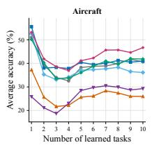

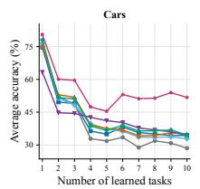

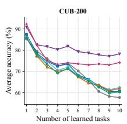  
Vanil a LoRA InfLoRA OLoRA SDLoRA CL-LoRA EWCLoRA GAM-EWCLoRA

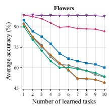

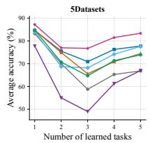  
Figure 6: Stage-wise average-accuracy trajectories on the fine-grained and heterogeneous vision benchmarks reported in Table 2.

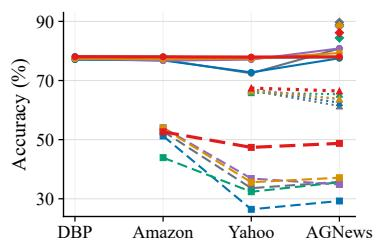  
(a) Llama-1B–Order 1

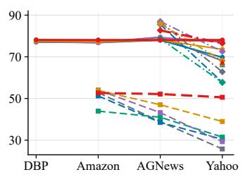  
(b) Llama-1B–Order 2

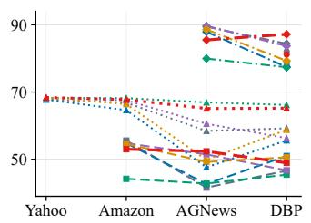  
(c) Llama-1B–Order 3

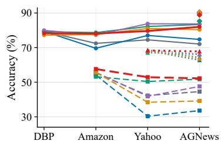  
(d) Llama-3B–Order 1

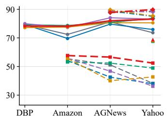  
(e) Llama-3B–Order 2

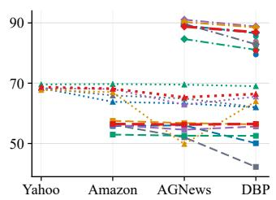  
(f) Llama-3B–Order 3  
Figure 7: Task-wise accuracy trajectories for Llama-3.2-1B and Llama-3.2-3B across three continual text-classification task orders. Each curve starts when the corresponding dataset is learned and tracks its accuracy after subsequent tasks.

Stage-wise performance on continual NLP benchmark. Fig. 7 complements Table 3 by showing how individual task accuracies evolve under subsequent learning. Across most orders, FS-EWCLoRA better preserves previously learned tasks, particularly those exposed to multiple later updates, while the gains are not necessarily uniform across every dataset. The main exception is Llama-3.2-3B under Order 3, where weaker final performance on some tasks offsets improved retention on others and produces a slightly lower FAA than EWCLoRA. Overall, the trajectories support the more consistent performance of FS-EWCLoRA across the evaluated task orders.

## B.3 ADDITIONAL TWO-TASK SOLUTION-SHAPING DIAGNOSTICS

Table 10 shows a consistent pattern across both parameterizations. Under the same $\mathsf C + \mathsf P$ objective on Task 2, shaping the inherited Task 1 solution increases its retained accuracy from 87.95 to 91.82 under LoRA and from 85.53 to 87.89 under full-parameter fine-tuning. The complete FS-EWC configuration also yields higher final Task 1 accuracy than EWC in both settings, while improving Task 2 accuracy under LoRA and leaving it nearly unchanged under full fine-tuning. For LoRA, the more negative BWT of FS-EWC reflects its higher Task 1 starting accuracy rather than lower final retention. These results reproduce the main mechanism across parameterizations: subsequent retention depends on the solution passed forward as well as on the protection subsequently applied to it.

Table 10: Two-task solution-shaping diagnostics under LoRA adaptation and full-parameter fine-tuning on ImageNet-R with ViT-B/16. C, F, and P denote current-task fitting, Fisher shaping, and historical EWC protection, respectively. F1 denotes the Task-1 Fisher statistic reported under each parameterization, and d2 denotes the Task-2 parameter displacement in the corresponding trainable parameter space. All variants use endpoint references without trajectory averaging.
<table><tr><td rowspan="2">Model</td><td rowspan="2">Variant</td><td colspan="2">Training objective</td><td colspan="2">Task 1 endpoint</td><td colspan="3">Task 2 endpoint</td><td>Task 2 update</td></tr><tr><td>Task 1</td><td>Task 2</td><td> $a _ { 1 1 } \uparrow$ </td><td> $\mathcal { F } _ { 1 }$ </td><td> $a _ { 2 1 } \uparrow$ </td><td> $a _ { 2 2 } \uparrow$ </td><td>BWT↑</td><td> $d _ { 2 }$ </td></tr><tr><td rowspan="6">LoRA</td><td>Vanilla</td><td>C</td><td>C</td><td>90.73</td><td>19.885</td><td>84.85</td><td>89.59</td><td>-5.87</td><td>1.560</td></tr><tr><td>Shaping only</td><td> $\mathsf C + \mathsf F$ </td><td> $\mathsf C + \mathsf F$ </td><td>93.34</td><td>10.946</td><td>84.80</td><td>93.81</td><td>-8.55</td><td>3.131</td></tr><tr><td>EWC</td><td>C</td><td>C+ P</td><td>90.73</td><td>19.885</td><td>87.95</td><td>83.45</td><td>-2.78</td><td>0.0106</td></tr><tr><td>FS-EWC</td><td>C + F</td><td> ${ \mathsf { C } } + { \mathsf { F } } + { \mathsf { P } }$ </td><td>93.34</td><td>10.946</td><td>89.10</td><td>88.33</td><td>-4.24</td><td>0.0204</td></tr><tr><td>Task-1 shaping</td><td>C + F</td><td> ${ \mathsf { C } } + { \mathsf { P } }$ </td><td>93.34</td><td>10.946</td><td>91.82</td><td>82.57</td><td>-1.52</td><td>0.392</td></tr><tr><td>Task-2 shaping</td><td>C</td><td> ${ \mathsf { C } } + { \mathsf { F } } + { \mathsf { P } }$ </td><td>90.73</td><td>19.885</td><td>83.07</td><td>89.21</td><td>-7.66</td><td>0.129</td></tr><tr><td rowspan="6">Full FT</td><td>Vanilla</td><td>C</td><td>C</td><td>92.61</td><td>869.80</td><td>78.46</td><td>92.47</td><td>-14.15</td><td>4.941</td></tr><tr><td>Shaping only</td><td>C + F</td><td>C + F</td><td>93.24</td><td>858.59</td><td>81.92</td><td>93.44</td><td>-11.32</td><td>5.131</td></tr><tr><td>EWC</td><td>C</td><td>C + P</td><td>92.61</td><td>869.80</td><td>85.53</td><td>90.66</td><td>-7.08</td><td>4.747</td></tr><tr><td>FS-EWC</td><td>C + F</td><td> ${ \mathsf { C } } + { \mathsf { F } } + { \mathsf { P } }$ </td><td>93.24</td><td>858.59</td><td>90.25</td><td>90.79</td><td>-2.99</td><td>4.673</td></tr><tr><td>Task-1 shaping</td><td>C + F</td><td> ${ \mathsf { C } } + { \mathsf { P } }$ </td><td>93.24</td><td>858.59</td><td>87.89</td><td>87.31</td><td>-5.35</td><td>4.774</td></tr><tr><td>Task-2 shaping</td><td>C</td><td> ${ \mathsf { C } } + { \mathsf { F } } + { \mathsf { P } }$ </td><td>92.61</td><td>869.80</td><td>82.08</td><td>93.86</td><td>-10.53</td><td>4.595</td></tr></table>

## B.4 COMPLEMENTARITY STUDY: EXPERIMENTAL DETAILS AND SENSITIVITY TO λ

We further evaluate the Fisher-complementarity study over three random seeds. For all Fisher computations, we keep the historical regularization coefficient fixed across methods and seeds, using $\dot { \lambda } = 2 \times 1 0 ^ { 6 }$ for the diagonal representation and $\lambda = 2 \times 1 0 ^ { 5 }$ for the Kronecker-factored representation. These coefficients are also shared across the batched empirical, per-example empirical, and model-sampled Fisher variants. Unless otherwise specified, all remaining training and retained-state construction settings follow Table 5.

Table 11: Multi-seed results for the Fisher-complementarity study in Table 5. FAA and AAA are reported as mean ± sample standard deviation (%) over seeds 0, 1, and 2.
<table><tr><td rowspan="2">Method</td><td rowspan="2">Metric</td><td colspan="3">Diagonal</td><td colspan="3">Kronecker-factored</td></tr><tr><td>Batched</td><td></td><td>Per-example Model-sampled</td><td>Batched</td><td></td><td>Per-example Model-sampled</td></tr><tr><td rowspan="2">EWC</td><td>FAA</td><td> $5 1 . 9 6 _ { ( 1 . 1 5 ) }$ </td><td> $5 0 . 6 0 _ { ( 1 . 0 7 ) }$ </td><td> $5 0 . 7 6 _ { ( 1 . 1 4 ) }$ </td><td> $5 3 . 7 4 _ { ( 0 . 4 7 ) }$ </td><td> $5 2 . 7 5 _ { ( 0 . 7 8 ) }$ </td><td> $5 2 . 7 1 _ { ( 1 . 1 7 ) }$ </td></tr><tr><td>AAA</td><td> $6 6 . 3 0 _ { ( 0 . 5 3 ) }$ </td><td> $6 6 . 6 0 _ { ( 0 . 9 7 ) }$ </td><td> $6 6 . 6 0 _ { ( 1 . 0 9 ) }$ </td><td> $6 7 . 3 7 _ { ( 0 . 1 8 ) }$ </td><td> $6 7 . 5 5 _ { ( 0 . 9 4 ) }$ </td><td> $6 7 . 3 3 _ { ( 0 . 8 9 ) }$ </td></tr><tr><td rowspan="2">FS-EWC</td><td>FAA</td><td> $5 9 . 2 9 _ { ( 0 . 5 5 ) }$ </td><td> $5 9 . 6 7 _ { ( 1 . 0 7 ) }$ </td><td> $5 9 . 6 2 _ { ( 0 . 8 8 ) }$ </td><td> $5 9 . 8 2 _ { ( 0 . 9 1 ) }$ </td><td> $5 9 . 9 5 _ { ( 0 . 9 3 ) }$ </td><td> $5 9 . 6 2 _ { ( 0 . 8 2 ) }$ </td></tr><tr><td>AAA</td><td> $7 0 . 6 9 _ { ( 0 . 6 7 ) }$ </td><td> $7 0 . 8 8 _ { ( 0 . 5 0 ) }$ </td><td> $7 0 . 8 6 _ { ( 0 . 5 1 ) }$ </td><td> $7 1 . 0 0 _ { ( 0 . 7 8 ) }$ </td><td> $7 1 . 1 6 _ { ( 0 . 4 7 ) }$ </td><td> $7 1 . 1 2 _ { ( 0 . 4 6 ) }$ </td></tr></table>

Multi-seed consistency. Table 11 shows that FS-EWC improves over the matched EWC baseline under all six combinations of Fisher computation and matrix representation. The improvements range from 6.08 to 9.07 percentage points in FAA and from 3.61 to 4.39 points in AAA. Kroneckerfactored Fisher generally provides modest gains over the diagonal representation, particularly for EWC, while the advantage of FS-EWC persists under both representations and all three Fisher computations. These results confirm that the complementarity observed in Table 5 is consistent across random seeds.

Sensitivity to historical regularization strength. Table 12 further examines the historical regularization coefficient λ under batched empirical Fisher. Across both diagonal and Kronecker-factored representations, FS-EWC remains above the corresponding EWC baseline at every numerically valid matched value of λ. Its performance also varies relatively little over the evaluated range, whereas EWC is more sensitive to the strength of historical regularization. This indicates that the gain from solution shaping is not confined to a narrowly selected protection coefficient.

Table 12: Sensitivity to the historical regularization coefficient λ under batched empirical Fisher. Each entry reports FAA / AAA (%) for seed 2.
<table><tr><td rowspan="2">Representation Method</td><td rowspan="2"></td><td colspan="6">Historical regularization coefficient λ</td></tr><tr><td>0</td><td> $2 \times 1 0 ^ { 2 }$ </td><td> $2 \times 1 0 ^ { 3 }$ </td><td> $2 \times 1 0 ^ { 4 }$ </td><td> $2 \times 1 0 ^ { 5 }$ </td><td> $2 \times 1 0 ^ { 6 }$ </td></tr><tr><td rowspan="2">Diagonal</td><td>EWC</td><td>49.51 / 64.95</td><td>49.24 / 64.66</td><td>49.37 / 64.66</td><td>49.70 / 65.01</td><td>50.56 / 65.55</td><td>52.07 / 66.38</td></tr><tr><td>FS-EWC</td><td>58.53 / 69.82</td><td>58.79 / 69.65</td><td>58.39 / 69.75</td><td>58.59 / 69.66</td><td>58.39 / 69.73</td><td>58.66 / 69.94</td></tr><tr><td rowspan="2">Kronecker- factored</td><td>EWC</td><td>49.31 / 64.92</td><td>49.31 / 64.89</td><td>49.70 / 65.15</td><td>50.23 / 66.15</td><td>53.32 / 67.33</td><td>NaN</td></tr><tr><td>FS-EWC</td><td>58.85 / 69.8058.39 / 69.78</td><td></td><td>58.66 / 69.80</td><td>58.46 / 69.81</td><td>58.79 / 70.1458.92 / 70.57</td><td></td></tr></table>

The Kronecker-factored EWC run at $\lambda = 2 \times 1 0 ^ { 6 }$ encountered numerical instability and produced NaN values.

## B.5 RETAINED-STATE CONSTRUCTION DETAILS

Table 13 shows that trajectory averaging achieves the highest AAA for all three seeds, whereas denser trajectory sampling provides no further improvement. All multi-checkpoint constructions yield less negative BWT than the endpoint reference, although endpoint-plus-initial achieves the least negative BWT at the cost of substantially lower FAA and AAA. Including the initialization provides no additional accuracy benefit for either endpoint or trajectory averaging. Overall, these results indicate that learned states along the training trajectory provide useful information for retained-state construction, but neither denser sampling nor simply averaging more states is inherently beneficial.

Table 13: Multi-seed results for retained-state construction on ImageNet-A. Each retained state is constructed by uniformly averaging the LoRA factors at checkpoints $\boldsymbol { \kappa } _ { t } .$ , with $\omega = 1$ ; the current-task Fisher is estimated after merging. Checkpoint 0 denotes the state before the first optimizer update of each task, while checkpoint 50 denotes the terminal iterate.
<table><tr><td>Retained state</td><td>Checkpoints  $\scriptstyle { \mathcal { K } } _ { t }$ </td><td>Metric</td><td>Seed 0</td><td>Seed 1</td><td>Seed 2</td><td>Mean ± SD</td></tr><tr><td rowspan="3">Endpoint</td><td rowspan="3">{50}</td><td>FAA</td><td>58.20</td><td>59.97</td><td>59.51</td><td> $5 9 . 2 3 _ { ( 0 . 9 2 ) }$ </td></tr><tr><td>AAA</td><td>70.48</td><td>71.00</td><td>70.41</td><td> $7 0 . 6 3 _ { ( 0 . 3 3 ) }$ </td></tr><tr><td>BWT</td><td>-7.29</td><td>-8.66</td><td>-8.29</td><td> $- 8 . 0 8 _ { ( 0 . 7 1 ) }$ </td></tr><tr><td rowspan="3">Late-stage</td><td rowspan="3">{30, 40, 50}</td><td>FAA</td><td>58.53</td><td>59.84</td><td>59.91</td><td> $5 9 . 4 3 _ { ( 0 . 7 8 ) }$ </td></tr><tr><td>AAA</td><td>70.51</td><td>70.98</td><td>70.35</td><td> $7 0 . 6 1 _ { ( 0 . 3 3 ) }$ </td></tr><tr><td>BWT</td><td>-7.01</td><td>-8.35</td><td>-7.68</td><td> $- 7 . 6 8 _ { ( 0 . 6 7 ) }$ </td></tr><tr><td rowspan="3">Trajectory</td><td rowspan="3">{10, 20, 30, 40, 50}</td><td>FAA</td><td>58.59</td><td>59.78</td><td>59.64</td><td> $5 9 . 3 4 _ { ( 0 . 6 5 ) }$ </td></tr><tr><td>AAA</td><td>70.63</td><td>71.29</td><td>70.61</td><td> $7 0 . 8 4 _ { ( 0 . 3 9 ) }$ </td></tr><tr><td>BWT</td><td>-6.89</td><td>-7.70</td><td>-7.81</td><td> $- 7 . 4 7 _ { ( 0 . 5 0 ) }$ </td></tr><tr><td rowspan="3">Dense trajectory</td><td rowspan="3"> $\{ 5 , 1 0 , \ldots , 5 0 \}$ </td><td>FAA</td><td>58.39</td><td>59.64</td><td>59.91</td><td> $5 9 . 3 1 _ { ( 0 . 8 1 ) }$ </td></tr><tr><td>AAA</td><td>70.55</td><td>71.15</td><td>70.52</td><td> $7 0 . 7 4 _ { ( 0 . 3 5 ) }$ </td></tr><tr><td>BWT</td><td>-7.00</td><td>-8.01</td><td>-7.32</td><td> $- 7 . 4 4 _ { ( 0 . 5 2 ) }$ </td></tr><tr><td rowspan="3">Endpoint + initial</td><td rowspan="3">{0,50}</td><td>FAA</td><td>56.88</td><td>58.92</td><td>59.51</td><td> $5 8 . 4 4 _ { ( 1 . 3 8 ) }$ </td></tr><tr><td>AAA</td><td>68.87</td><td>69.72</td><td>69.56</td><td> $6 9 . 3 8 _ { ( 0 . 4 5 ) }$ </td></tr><tr><td>BWT</td><td>-6.52</td><td>-6.34</td><td>-6.44</td><td> $- 6 . 4 4 _ { ( 0 . 0 9 ) }$ </td></tr><tr><td rowspan="3">Trajectory + initial</td><td rowspan="3">{0, 10, 20, 30, 40, 50}</td><td>FAA</td><td>57.93</td><td>59.38</td><td>59.71</td><td> $5 9 . 0 1 _ { ( 0 . 9 5 ) }$ </td></tr><tr><td>AAA</td><td>70.32</td><td>70.94</td><td>70.49</td><td> $7 0 . 5 9 _ { ( 0 . 3 2 ) }$ </td></tr><tr><td>BWT</td><td>-6.84</td><td>-7.58</td><td>-7.57</td><td> $- 7 . 3 3 _ { ( 0 . 4 3 ) }$ </td></tr></table>