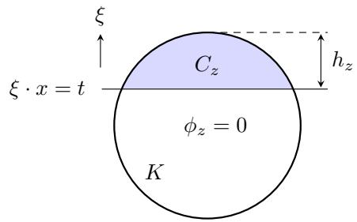
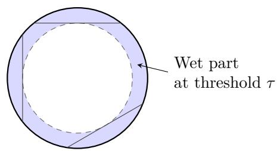
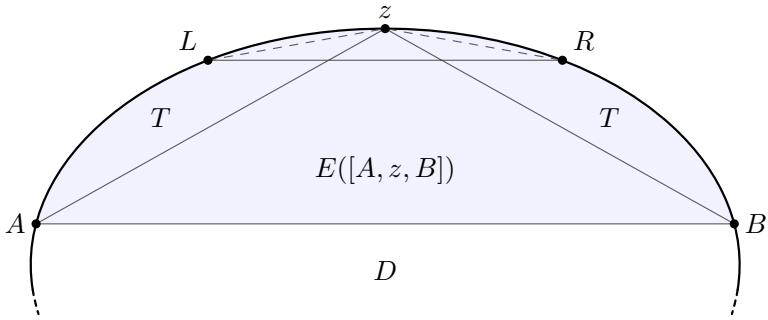

# Boundary Geometry Determines Optimal Shallow ReLU Approximation under Weighted Coeficient Constraints†

Jia-Qi Yang and Lei Shi

School of Mathematical Sciences and Shanghai Key Laboratory for Contemporary Applied Mathematics, Fudan University, Shanghai 200433, China.

## Abstract

We study how boundary geometry afects Lq approximation by shallow ReLU neural networks on convex bodies $K \subset \mathbb { R } ^ { d }$ . The target classes are unit balls of weighted variation spaces that can enlarge classical spaces by incorporating domain geometry into constraints on output coeficients. We establish upper and lower bounds for arbitrary convex bodies and determine the optimal polynomial approximation exponents for all planar convex bodies and their products with polytopes, including cubes and circular cylinders. For $C ^ { 2 }$ convex bodies, we determine the optimal exponents in a dimension-dependent range of q extending beyond 2. When all principal curvatures are positive, the result extends to every finite $q \geq 2$ . For these classes, the dependence of the optimal exponent on the domain is captured by a single geometric growth exponent associated with small boundary caps. We also identify sharp weight thresholds for retaining the classical approximation exponent and improve previous weights on Euclidean balls while preserving the classical $L ^ { 2 }$ approximation rate. When the target is given as a finite ReLU network, the upper bounds can be realized by a compressed network using only the original neurons, without increasing the weighted coeficient sum. These results show that boundary geometry can change the optimal exponent even when dimension, error norm, and weighting rule are fixed.

Keywords: Neural networks; Approximation rates; Variation spaces; Convex geometry.

## 1 Introduction

Shallow neural networks with activation function $\sigma : \mathbb { R }  \mathbb { R }$ are used in supervised learning and form a class of approximants for multivariate functions. For positive integers d and $n ,$ let $\Sigma _ { n } ^ { d } ( \sigma )$ denote the class of functions on $\mathbb { R } ^ { d }$ represented by networks with at most n hidden neurons:

$$
\Sigma _ { n } ^ { d } ( \sigma ) = \left\{ \sum _ { j = 1 } ^ { n } a _ { j } \sigma ( \omega _ { j } \cdot x + b _ { j } ) : a _ { j } , b _ { j } \in \mathbb { R } , \ \omega _ { j } \in \mathbb { R } ^ { d } \right\} ,\tag{1.1}
$$

with the convention that $\Sigma _ { 0 } ^ { d } ( \sigma ) = \{ 0 \}$

Let $K \subset \mathbb { R } ^ { d } , \ d \geq 2$ , be a convex body, that is, a compact convex set with nonempty interior, and let $\mu _ { K } = | K | ^ { - 1 }$ dx denote the normalized volume measure on $K$ . For $1 \leq q < \infty$ and a bounded subset ${ \mathcal { F } } \subset L ^ { q } ( \mu _ { K } )$ , define the worst-case best approximation error on K by

$$
\mathcal { E } _ { n } ^ { K } ( \mathcal { F } ; \sigma , q ) : = \operatorname* { s u p } _ { f \in \mathcal { F } } \operatorname* { i n f } _ { S \in \Sigma _ { n } ^ { d } ( \sigma ) } \| f - S \| _ { L ^ { q } ( \mu _ { K } ) } , \qquad n \ge 0 .\tag{1.2}
$$

The optimal polynomial approximation exponent is defined by

$$
r _ { * } ^ { K } ( \mathcal { F } ; \sigma , q ) : = \operatorname* { s u p } \left\{ r \geq 0 : \operatorname* { s u p } _ { n \geq 0 } ( n + 1 ) ^ { r } \mathcal { E } _ { n } ^ { K } ( \mathcal { F } ; \sigma , q ) < \infty \right\} .\tag{1.3}
$$

Approximation rates for shallow neural networks have been extensively studied for diferent activation functions and target function classes $[ 4 , 2 0 , 2 4 , 2 7 , 3 1 , 1 8 ]$

A class of target functions studied in nonlinear approximation is the variation unit ball generated by a bounded dictionary $\mathcal { D } \subset L ^ { q } ( \mu _ { K } )$ [15, 26]. It is defined by

$$
\mathbb { B } ( \mathcal { D } ) : = \overline { { \left\{ \sum _ { i = 1 } ^ { N } c _ { i } g _ { i } : N \in \mathbb { N } , \ g _ { i } \in \mathcal { D } , \ c _ { i } \in \mathbb { R } , \ \sum _ { i = 1 } ^ { N } \lvert c _ { i } \rvert \leq 1 \right\} } } ^ { L ^ { q } \left( \mu _ { K } \right) } .
$$

The number of terms N is unrestricted, in contrast to the prescribed approximation width $n .$ We refer to the elements of $\mathcal { D }$ as atoms. For shallow neural networks, the dictionary can be chosen as a bounded family of single-neuron ridge functions $x \mapsto \sigma ( \omega \cdot x + b )$ restricted to $K$ Every n-term linear combination from such a dictionary is then the restriction to K of a network in $\Sigma _ { n } ^ { d } ( \sigma )$ . Such $\ell ^ { 1 } { \mathrm { - t y p e } }$ coeficient constraints also arise in convex formulations of shallow neural network learning, yielding approximation and statistical estimation bounds [1]. Related variation-space constructions for encoder–decoder neural operators provide approximation and generalization bounds [30].

A classical result for variation unit balls is the $n ^ { - 1 / 2 }$ approximation bound obtained from Maurey’s sampling argument [21]. For $q = 2$ and every $n \geq 1$ , each $f \in \mathbb { B } ( \mathcal { D } )$ admits an approximant $\begin{array} { r } { f _ { n } = \sum _ { j = 1 } ^ { n } a _ { j } g _ { j } } \end{array}$ , with $g _ { j } \in \mathcal { D }$ , satisfying

$$
\| f - f _ { n } \| _ { L ^ { 2 } ( \mu _ { K } ) } \leq C R _ { \mathcal { D } } n ^ { - 1 / 2 } , \qquad \sum _ { j = 1 } ^ { n } | a _ { j } | \leq 1 ,
$$

where $R _ { \mathcal { D } } = \operatorname* { s u p } _ { g \in \mathcal { D } } \| g \| _ { L ^ { 2 } ( \mu _ { K } ) }$ and $C$ is an absolute constant. The $n ^ { - 1 / 2 }$ rate is sharp for dictionaries formed by orthonormal bases in infinite-dimensional Hilbert spaces [15]. Greedy approximation methods provide constructive bounds of this order [14, 8, 5]. For the orthogonal greedy algorithm, suficiently fast decay of the entropy numbers of B(D) leads to faster convergence rates [25, 16].

The general $n ^ { - 1 / 2 }$ approximation bound can be improved by exploiting additional structure of neural network dictionaries. For certain sigmoidal activation functions, covering estimates and randomized approximation yield the $L ^ { 2 }$ rate $n ^ { - 1 / 2 - 1 / ( 2 d ) }$ on the corresponding variation unit balls [17]. For the $\mathrm { R e L U } ^ { k }$ activation $\sigma _ { k } ( s ) = ( s _ { + } ) ^ { k }$ , where $s _ { + } = \operatorname* { m a x } \{ s , 0 \}$ and $k \geq 1$ is an integer, the variation unit ball generated by ridge atoms $( \xi \cdot x - t ) _ { + } ^ { k }$ , with $| \xi | = 1$ and cutting hyperplanes intersecting $K ,$ admits the $L ^ { 2 } ( \mu _ { K } )$ approximation rate $n ^ { - 1 / 2 - ( 2 k + 1 ) / ( 2 d ) }$ This polynomial exponent is optimal [27, 23]. The same upper rate holds in $L ^ { \infty } ( K )$ [23]. For a target given by a finite expansion, the approximant can be chosen using only the original atoms, without increasing the absolute coeficient sum [23, Proposition 1]. In particular, for the ReLU variation unit ball $\mathcal { F }$ , the $L ^ { 2 }$ lower and uniform upper bounds yield $r _ { * } ^ { K } ( \mathcal { F } ; \sigma _ { 1 } , q ) = ( d + 3 ) / ( 2 d )$ for every $2 \leq q < \infty$

The sharp approximation bounds for ReLU networks exploit the structure of ridge functions, but the constraint $\begin{array} { r } { \sum _ { i = 1 } ^ { N } | c _ { i } | \leq 1 } \end{array}$ assigns the same coeficient cost to atoms with diferent amplitudes and activation regions on K. To account for these geometric diferences, domaindependent weights were introduced in $[ 9 ]$ . To describe the relevant geometry, define the support function $H _ { K }$ and the set $Z _ { K }$ of admissible neuron parameters by

$$
H _ { K } ( \xi ) : = \operatorname* { m a x } _ { x \in K } \xi \cdot x ,
$$

$$
Z _ { K } : = \Big \{ ( \xi , t ) \in \mathbb { R } ^ { d } \times \mathbb { R } : | \xi | = 1 , \ - H _ { K } ( - \xi ) \leq t < H _ { K } ( \xi ) \Big \} .
$$

For $z = ( \xi , t ) \in Z _ { K }$ , define the ReLU atom

$$
\begin{array} { r } { \phi _ { z } ( x ) : = ( \xi \cdot x - t ) _ { + } , \qquad x \in K . } \end{array}
$$

Its activation cap is

$$
C _ { z } : = K \cap \{ x : \xi \cdot x \geq t \} ,
$$

with height and relative volume

$$
h _ { z } : = H _ { K } ( \xi ) - t , \qquad \theta _ { z } : = \mu _ { K } ( C _ { z } ) = \frac { | C _ { z } | } { | K | } .
$$

Here $h _ { z } = \| \phi _ { z } \| _ { L ^ { \infty } ( K ) }$ , and $\theta _ { z }$ is the relative volume of the region where $\phi _ { z } > 0$ . The set $Z _ { K }$ parametrizes nonzero ReLU atoms whose cutting hyperplanes meet K. For $| \xi | = 1$ and $( \xi , t ) \notin Z _ { K }$ , the neuron output is either zero or afine on $K$

On the unit Euclidean ball $B ^ { d }$ , the weight introduced in [9] is

$$
w _ { \mathrm { p r e v } } ( z ) : = h _ { z } ^ { ( d + 2 ) / 4 } = ( 1 - t ) ^ { ( d + 2 ) / 4 } .
$$

The corresponding weighted variation unit ball is

$$
\mathcal { B } _ { w _ { \mathrm { p r e v } } } ( B ^ { d } ) : = \left\{ \sum _ { i = 1 } ^ { N } c _ { i } \phi _ { z _ { i } } : N \in \mathbb { N } , \ z _ { i } \in Z _ { B ^ { d } } , \ c _ { i } \in \mathbb { R } , \ \sum _ { i = 1 } ^ { N } | c _ { i } | w _ { \mathrm { p r e v } } ( z _ { i } ) \leq 1 \right\} ^ { L ^ { 2 } ( \mu _ { B ^ { d } } ) } .
$$

It is generated by the rescaled atoms $\phi _ { z } / w _ { \mathrm { p r e v } } ( z )$ , and its positive multiples form the weighted variation space $\begin{array} { r } { \bigcup _ { R > 0 } R \boldsymbol B _ { w _ { \mathrm { p r e v } } } ( \boldsymbol B ^ { d } ) . } \end{array}$ 1 By [9, Theorems 5.2 and 6.1], every $f \in R {  { \mathcal { B } } _ { w _ { \mathrm { p r e v } } } } ( B ^ { d } )$ $R > 0$ , admits, for each $n \geq 1$ , an approximant $S _ { n }$ using at most n ReLU atoms such that

$$
\| f - S _ { n } \| _ { L ^ { 2 } ( \mu _ { B ^ { d } } ) } \lesssim _ { d } R n ^ { - ( d + 3 ) / ( 2 d ) } .
$$

The weighted space strictly contains the ordinary variation space $( w \equiv 1 )$ , while its unit ball retains the classical $L ^ { 2 }$ approximation rate.

The results in [9] concern $L ^ { 2 }$ approximation for specific weights on Euclidean balls and the planar square. We study $L ^ { q } ( { \mu } _ { K } )$ approximation on general convex bodies $( 1 \leq q < \infty )$ Our focus is on the geometric dependence of the weight thresholds for retaining the classical polynomial exponent and of the optimal exponents under further relaxation.

The choice of weights is guided by the atom norm estimate

$$
\| \phi _ { z } \| _ { L ^ { q } ( \mu _ { K } ) } \asymp _ { d , q } h _ { z } \theta _ { z } ^ { 1 / q } , \qquad 1 \leq q < \infty ;
$$

see Proposition 6.5. For $\eta \in \mathbb { R }$ , we consider the weights and coeficient constraint

$$
w _ { K , \eta } ( z ) = h _ { z } \theta _ { z } ^ { \eta } , \qquad \sum _ { i = 1 } ^ { N } | c _ { i } | w _ { K , \eta } ( z _ { i } ) \leq 1 .
$$

On $B ^ { d } , w _ { B ^ { d } , \eta }$ is comparable to $w _ { \mathrm { p r e v } }$ for a suitable choice of η (see Section 4). Since $0 < \theta _ { z } \leq 1$ increasing η weakens the constraint and enlarges the corresponding variation unit balls.

The main contributions of this paper are summarized as follows:

For $2 \leq q <$ ∞ and $\eta < 1 / q$ , we determine the optimal polynomial approximation exponent for planar convex bodies, their products with fixed convex polytopes, and invertible afine images of these domains (Theorem 3.6). Examples include disks, cubes, and the circular cylinder $B ^ { 2 } \times [ - 1 , 1 ]$ . For convex bodies with $C ^ { 2 }$ boundary, we determine the optimal exponent for $\eta \leq 1 / q$ in an explicit dimension-dependent range of finite $q \geq 2$ , allowing principal curvatures to vanish (Theorem 3.3). If all principal curvatures are positive, as on Euclidean balls, we determine the optimal exponent for every $2 \leq q < \infty$ and $\eta \leq 1 / q$ (Theorem 3.5). In each case, the dependence of the optimal exponent on the domain is captured by a single geometric growth exponent $\overline { { \kappa } } ( K )$ associated with small boundary caps (see (2.9)).

We establish approximation upper bounds on arbitrary convex bodies for $1 \leq q < \infty$ and $\eta \leq 1 / q$ (Theorem 3.1), and lower bounds for $2 \leq q < \infty$ (Theorem 3.2). The analysis also yields geometric bounds on unions of caps and the pointwise overlap of covering caps (Propositions 6.13 and 6.14), independently of neural network approximation. For a finite network with a given representation, all approximation upper bounds established in this paper can be realized using at most n original atoms, with adjusted coeficients and no increase in the weighted coeficient sum.

The optimal exponent formulas identify sharp thresholds in the weight parameter $\eta$ for retaining the classical polynomial approximation exponent. These thresholds depend on domain geometry and can difer even between domains of the same dimension. For a nonempty range of η, $w _ { B ^ { d } , \eta } / w _ { \mathrm { p r e v } }  0$ on shrinking caps, allowing arbitrarily larger coeficients while retaining the classical $L ^ { 2 }$ approximation rate (Section 4).

Table 1 summarizes the optimal exponents for representative convex bodies.

The remainder of the paper is organized as follows. Section 2 introduces the weighted variation spaces and cap geometry, and Section 3 presents the main results. Section 4 discusses their consequences and compares them with previous work, followed by an overview of the proofs in Section 5. The general upper bounds are proved in Section 6. Section 7 establishes the lower bounds and the results for $C ^ { 2 }$ convex bodies, while Section 8 develops the geometric estimates needed for the remaining upper bounds. Auxiliary arguments are collected in the appendix.

## 2 Problem Formulation

Subsection 2.1 gives the precise definitions of the weighted variation spaces and approximation errors. Subsection 2.2 introduces the geometric quantities used in the main results.

## 2.1 Approximation Errors and Weighted Variation Spaces

Let $K \subset \mathbb { R } ^ { d } , d \geq 2$ , be a convex body, and retain the notation from Section 1. For $z = ( \xi , t ) \in$ $Z _ { K }$ , recall

$$
\begin{array} { r l } { \phi _ { z } ( x ) = ( \xi \cdot x - t ) _ { + } , \qquad } & { { } h _ { z } = H _ { K } ( \xi ) - t , } \\ { C _ { z } = K \cap \{ x : \xi \cdot x \geq t \} , \qquad } & { { } \theta _ { z } = \mu _ { K } ( C _ { z } ) . } \end{array}\tag{2.1}
$$

At $t = - H _ { K } ( - \xi )$ , the atom is afine on K and $C _ { z } = K \colon$ ; at the excluded endpoint $t = H _ { K } ( \xi )$ the atom would vanish identically. Write $X _ { q } ( K ) = L ^ { q } ( \mu _ { K } )$ for $1 \leq q < \infty$ and $X _ { \infty } ( K ) = C ( K )$ with the uniform norm. When the domain is clear, $\| \cdot \| _ { q }$ denotes the corresponding norm.

For a positive weight $w : Z _ { K } \to ( 0 , \infty )$ , define the class of finite networks with weighted coeficient sum at most one by

$$
\mathcal { A } _ { w } ( K ) = \left\{ \sum _ { i = 1 } ^ { N } c _ { i } \phi _ { z _ { i } } : N < \infty , \ : c _ { i } \in \mathbb { R } , \ : z _ { i } \in Z _ { K } , \sum _ { i = 1 } ^ { N } | c _ { i } | w ( z _ { i } ) \leq 1 \right\} .
$$

For each integer $n \geq 0$ , write

$$
\Sigma _ { n } ^ { K } : = \{ S | _ { K } : S \in \Sigma _ { n } ^ { d } ( \sigma _ { 1 } ) \} , \qquad \sigma _ { 1 } ( s ) = s _ { + } ,\tag{2.2}
$$

where $\Sigma _ { n } ^ { d } ( \sigma )$ is defined in (1.1). For $1 \leq q \leq \infty$ , define the worst-case approximation error, allowing the value $+ \infty$ , by

$$
\mathcal { E } _ { n } ^ { K } ( w ; q ) = \operatorname* { s u p } _ { f \in \mathcal { A } _ { w } ( K ) } \operatorname* { i n f } _ { S \in \Sigma _ { n } ^ { K } } \| f - S \| _ { X _ { q } ( K ) } .\tag{2.3}
$$

The target width N is unrestricted, while n bounds the width of the approximant. The infimum allows arbitrary neuron parameters.

Recall the weights

$$
w _ { K , \eta } ( z ) = h _ { z } \theta _ { z } ^ { \eta } .\tag{2.4}
$$

At $\eta = 0$ , the weight is the maximum amplitude of the atom: $w _ { K , 0 } ( z ) = h _ { z } = \| \phi _ { z } \| _ { \infty }$ . Since $0 < \theta _ { z } \leq 1$ , increasing $\eta$ decreases the weights of atoms with small caps, allowing larger coeficients under the same constraint.

By Proposition 6.5, with the convention $1 / \infty = 0$ , the normalized atoms $\phi _ { z } / w _ { K , \eta } ( z )$ are uniformly bounded in $X _ { q } ( K )$ if and only if $\eta \leq 1 / q$ . Their $X _ { q } ( K )$ norms are comparable to $\theta _ { z } ^ { 1 / q - \eta }$ , and hence tend to zero as $\theta _ { z } \downarrow 0$ when $\eta < 1 / q$ . At the critical weight $\eta = 1 / q$ $w _ { K , 1 / q } ( z ) \asymp _ { d , q } \| \phi _ { z } \| _ { q }$ . For the weights $w _ { K , \eta }$ , the associated approximation errors are also invariant under invertible afine changes of variables (see Proposition 6.5).

For $1 \leq q \leq \infty$ and $\eta \leq 1 / q$ , define the optimal polynomial decay exponent of the approximation error by

$$
r _ { * } ( K , \eta , q ) = \operatorname* { s u p } \left\{ r \geq 0 : \begin{array} { l } { \mathcal { E } _ { n } ^ { K } ( w _ { K , \eta } ; q ) \leq C _ { r } ( n + 1 ) ^ { - r } \mathrm { ~ f o r ~ a l l ~ } n \geq 0 } \\ { \mathrm { ~ w i t h ~ s o m e ~ c o n s t a n t ~ } C _ { r } < \infty } \end{array} \right\} .\tag{2.5}
$$

Here $C _ { r }$ may depend on $K , \eta , q , r$ , but not on n. Multiplicative logarithmic factors do not afect $r _ { * } .$ , and the defining error bound need not hold with $r = r _ { * }$ k

We next introduce the weighted variation space generated by the coeficient-constrained finite-network class $A _ { w } ( K )$

Definition 2.1 (Weighted variation spaces). Let $1 \leq q \leq \infty$ and let $w : Z _ { K } \to ( 0 , \infty )$ be a positive weight. If the normalized dictionary $\{ \phi _ { z } / w ( z ) : z \in Z _ { K } \}$ is bounded in $X _ { q } ( K )$ , define the weighted variation unit ball by

$$
\mathbb { B } _ { w } ^ { ( q ) } ( K ) \mathrel { \mathop : } = \overline { { \mathcal { A } _ { w } ( K ) } } ^ { X _ { q } ( K ) } .
$$

The associated weighted variation space is

$$
\mathcal { V } _ { w } ^ { ( q ) } ( K ) : = \bigcup _ { R > 0 } R \mathbb { B } _ { w } ^ { ( q ) } ( K ) ,\tag{2.6}
$$

with norm

$$
\| f \| _ { \mathcal { V } _ { w } ^ { ( q ) } ( K ) } : = \operatorname* { i n f } \{ R > 0 : f \in R \mathbb { B } _ { w } ^ { ( q ) } ( K ) \} .\tag{2.7}
$$

Equivalently, $\| f \| _ { \mathcal { V } _ { w } ^ { ( q ) } ( K ) }$ is the infimum of $R > 0$ for which f is an $X _ { q } ( K )$ limit of finite networks with representations satisfying $\begin{array} { r } { \sum _ { i } | c _ { i } | w ( z _ { i } ) \leq R } \end{array}$ . The space $\mathcal { V } _ { w } ^ { ( q ) } ( K )$ is Banach, with $\mathbb { B } _ { w } ^ { ( q ) } ( K )$ as its closed unit ball. The completeness argument and the proof of the following proposition are given in Appendix A.1.

Proposition 2.2. Let w $: Z _ { K }  ( 0 , \infty )$ and $1 \leq p \leq q \leq \infty$ . If the normalized dictionary $\{ \phi _ { z } / w ( z ) : z \in Z _ { K } \}$ is bounded in $X _ { q } ( K )$ , then

$$
\mathbb { B } _ { w } ^ { ( p ) } ( K ) = \mathbb { B } _ { w } ^ { ( q ) } ( K ) , \qquad \mathcal { V } _ { w } ^ { ( p ) } ( K ) = \mathcal { V } _ { w } ^ { ( q ) } ( K ) ,
$$

and the two variation norms agree. For $q = \infty$ and $p < \infty$ , these identities are understood through the natural embedding $C ( K ) \hookrightarrow L ^ { p } ( \mu _ { K } )$

Thus, if the normalized dictionary is bounded in $X _ { q } ( K )$ , the closure defining $\mathbb { B } _ { w } ^ { ( q ) } ( K )$ agrees with the $L ^ { 1 } ( \mu _ { K } )$ closure of $\mathcal { A } _ { w } ( K )$ . For such weights, Lemma A.1 also shows that the supremum in (2.3) is unchanged when $\mathcal { A } _ { w } ( K )$ is replaced by $\mathbb { B } _ { w } ^ { ( q ) } ( K )$ . For $1 \leq q < \infty$ , the definitions in (1.2) and (1.3) give

$$
\begin{array} { r l } & { \mathcal { E } _ { n } ^ { K } ( w ; q ) = \mathcal { E } _ { n } ^ { K } ( \mathbb { B } _ { w } ^ { ( q ) } ( K ) ; \sigma _ { 1 } , q ) , } \\ & { r _ { * } ( K , \eta , q ) = r _ { * } ^ { K } ( \mathbb { B } _ { w _ { K , \eta } } ^ { ( q ) } ( K ) ; \sigma _ { 1 } , q ) , \qquad \eta \le 1 / q . } \end{array}
$$

## 2.2 The Geometry of Small Caps

The weight $w _ { K , \eta }$ depends on the height and relative volume of each individual activation cap. For the approximation of sums of atoms, however, the distribution of these caps across the boundary of K also matters. Caps of comparable small volume may occur in many diferent directions, and their union can cover a much larger region than any single cap. We begin by describing this collective coverage through the wet part of K.

Definition 2.3 (Wet part and floating depth). The wet part at threshold $\tau ,$ defined as the union of all caps with $\theta _ { z } \leq \tau$ , has normalized volume

$$
W _ { K } ( \tau ) = \mu _ { K } \left( \bigcup _ { \theta _ { z } \leq \tau } C _ { z } \right) .
$$

The floating depth of $x \in K$ is the smallest relative cap volume needed to contain x, expressed as

$$
v _ { K } ( x ) = \operatorname* { i n f } \{ \theta _ { z } : x \in C _ { z } \} .
$$

Caps in diferent directions reach diferent parts of the boundary, so $W _ { K } ( \tau )$ can be much larger than τ. Figure 1 illustrates these geometric objects for a disk: panel (a) shows an individual activation cap, while panel (b) shows the wet part formed by caps in diferent directions. The following lemma, proved in Appendix A, shows that a point belongs to the wet part at level τ if and only if its floating depth is at most $\tau .$

Lemma 2.4. For every $0 < \tau < 1$

$$
\bigcup _ { \theta _ { z } \leq \tau } C _ { z } = \{ x \in K : v _ { K } ( x ) \leq \tau \} , \qquad W _ { K } ( \tau ) = \mu _ { K } \{ v _ { K } \leq \tau \} .
$$

  
(a) Activation cap

  
(b) Wet part  
Figure 1: Activation caps and the wet part. In (a), $C _ { z }$ has relative volume $\theta _ { z } ,$ and its height $h _ { z }$ equals the maximum of $\phi _ { z }$ . In (b), the shaded annulus is the union of all caps of the disk with relative volume at most τ. Three representative cutting lines are shown.

Thus $W _ { K } ( \tau )$ is the distribution function of $v _ { K }$ with respect to the normalized volume measure $\mu _ { K }$ . To relate the volume of the wet part to the number of caps at volume scale τ, we introduce the ratio

$$
\mathscr { C } _ { K } ( \tau ) = \frac { W _ { K } ( \tau ) } { \tau } , \qquad 1 \leq \mathscr { C } _ { K } ( \tau ) \leq \tau ^ { - 1 } .\tag{2.8}
$$

We call $\mathcal { C } _ { K } ( \tau )$ the efective cap count.

For upper bounds on the approximation error, we use Lemma 6.8 to cover the wet part, at each suficiently small scale $\tau ,$ by $N \asymp _ { d } \mathcal { C } _ { K } ( \tau )$ possibly overlapping caps of relative volume comparable to $\tau .$ . For the corresponding lower bounds, cap packing estimates relate $\mathcal { C } _ { K } ( \tau )$ to the number of caps of relative volume τ with pairwise disjoint interiors (see, e.g., Proposition $8 . 7 )$ Moreover, an invertible afine map $T ( x ) = A x + b$ maps caps bijectively to caps and scales both cap and body volumes by | det A|. It therefore preserves relative cap volumes, giving $W _ { T ( K ) } ( \tau ) = W _ { K } ( \tau )$ and $\mathcal { C } _ { T ( K ) } ( \tau ) = \mathcal { C } _ { K } ( \tau )$

Covering and packing estimates relate $\mathcal { C } _ { K } ( \tau )$ to the number of caps at relative volume scale τ . For approximation, the key geometric information is how rapidly this number grows as $\tau \downarrow 0$ . We capture its polynomial growth by

$$
{ \begin{array} { r l } & { { \overline { { \kappa } } } ( K ) = \operatorname* { l i m } _ { \tau \downarrow 0 } \operatorname* { s u p } _ { \mathrm { \log } ( 1 / \tau ) } , } \\ & { { \overline { { \kappa } } } ( K ) = \operatorname* { l i m } _ { \tau \downarrow 0 } { \frac { \log { \mathcal { C } } _ { K } ( \tau ) } { \log ( 1 / \tau ) } } { \mathrm { ~ w h e n ~ t h e ~ l i m i t ~ e x i s t s } } . } \end{array} }\tag{2.9}
$$

The upper growth exponent $\overline { { \kappa } } ( K )$ is the central geometric parameter linking the distribution of small caps to approximation rates. For arbitrary convex bodies, it enters general upper bounds on the approximation error. More importantly, within the parameter ranges covered by our main results, it determines the exact optimal polynomial approximation exponent, together with d, $q ,$ and $\eta ,$ for $C ^ { 2 }$ convex bodies, planar convex bodies, and their products with polytopes. Under positive curvature, the classification for $C ^ { 2 }$ bodies extends to every finite $q \geq 2$ . These results yield a geometric classification of optimal approximation exponents for these classes of convex bodies.

The use of a limsup allows for growth rates that do not converge. When the limit exists, $\begin{array} { r } { \mathcal { C } _ { K } ( \tau ) = \tau ^ { - \kappa ( K ) + o ( 1 ) } } \end{array}$ . Multiplicative logarithmic factors do not afect these exponents. $\mathrm { B y }$ Lemma 6.9,

$$
0 \leq \pi ( K ) \leq \frac { d - 1 } { d + 1 } .
$$

Representative values of $\kappa ( K )$ and the corresponding optimal approximation exponents are given in Table 1 in Section 3.

## 3 Main Results

We write $\alpha = ( d + 3 ) / ( 2 d )$ for the classical ReLU approximation exponent [27]. For arbitrary convex bodies, we establish upper and lower bounds on the approximation error, with the upper bounds expressed in terms of the growth of the efective cap count. We then give geometric classifications of optimal polynomial approximation exponents for convex bodies with $C ^ { 2 }$ boundary, planar convex bodies, and products of planar convex bodies with polytopes.

In these classifications, the optimal exponent is the minimum of α and a boundary term determined by $q , \eta _ { \colon }$ and $\overline { { \kappa } } ( K )$ . For fixed $d , q ,$ and $\eta ,$ the dependence of this exponent on the domain is therefore captured by the single geometric quantity $\overline { { \kappa } } ( K )$

Table 1 summarizes the geometric exponents $\kappa ( K )$ and the optimal polynomial approximation exponents $r _ { * } ( K , \eta , q )$ for representative domains. All entries assume $2 \leq q <$ ∞ and

$\eta < 1 / q$ . Here $d = \dim K \geq 2$ , and $P \subset \mathbb { R } ^ { m } , m \geq 1$ , is a convex polytope with nonempty interior.
<table><tr><td>Domain K</td><td>Dimension d</td><td> $\kappa ( K )$ </td><td> $r _ { * } ( K , \eta , q )$ </td></tr><tr><td>Convex polytope (including cubes)</td><td>d</td><td>0</td><td> $d + 3$ </td></tr><tr><td>Disk  $B ^ { 2 }$ </td><td>2</td><td> $1 / 3$ </td><td>2d  $\operatorname* { m i n } \left\{ \frac { 5 } { 4 } , 1 + \frac { 2 } { q } - 3 \eta \right\}$ </td></tr><tr><td>Cylinder  $B ^ { 2 } \times [ - 1 , 1 ]$ </td><td>3</td><td> $1 / 3$ </td><td> $\operatorname* { m i n } \left\{ 1 , 1 + \frac { 2 } { q } - 3 \eta \right\}$ </td></tr><tr><td>Product  $B ^ { 2 } \times P$ </td><td> $m + 2$ </td><td> $1 / 3$ </td><td> $\left\{ \frac { \dot { m + 5 } } { 2 ( m + 2 ) } , \dot { 1 } + \frac { 2 } { q } - 3 \eta \right\}$ </td></tr><tr><td>Ball  $B ^ { d }$ </td><td> $d$ </td><td> $\frac { d - 1 } { d + 1 }$ </td><td> $\operatorname* { m i n } { \left\{ \frac { d \stackrel { . } { + } 3 } { 2 d } , 1 + \frac { 2 } { ( d - 1 ) q } - \frac { d \stackrel { . } { - } 1 } { d - 1 } \eta \right\} }$ </td></tr><tr><td> $C ^ { 2 }$  body with</td><td> $d$ </td><td> $d - 1$  min  $\overline { { d + 1 } }$ </td><td> $\left\{ \frac { d + 3 } { 2 d } , 1 + \frac { 2 } { ( d - 1 ) q } - \frac { d + 1 } { d - 1 } \eta \right\}$ </td></tr></table>

Table 1: Examples of geometric exponents and optimal polynomial approximation exponents for $2 \leq q < \infty$ and $\eta < 1 / q$

The geometric exponents for balls and $C ^ { 2 }$ bodies with positive curvature follow from Theorem 3.3, and the approximation exponents follow from Theorem 3.5. Theorem 3.6 gives the entries for the cylinder and $B ^ { 2 } \times P$ . For convex polytopes, (8.30) gives $\kappa ( K ) = 0$ , and the approximation exponent α follows from Theorems 3.1 and 3.2.

## 3.1 General Bounds with Optimality for $C ^ { 2 }$ Bodies

We begin with upper bounds for the worst-case approximation error $\mathcal { E } _ { n } ^ { K } ( w _ { K , \eta } ; q )$ on arbitrary convex bodies $K \subset \mathbb { R } ^ { d }$ with $d \geq 2$ . Theorem 3.1 gives a lower bound for the decay exponent $r _ { * } ( K , \eta , q )$ in terms of the weight parameter η and the growth exponent $\overline { { \kappa } } ( K )$ of the efective cap count.

The general upper bound involves an exponent $\Gamma _ { d } ( q )$ that equals $1 - 1 / q$ for $q \leq Q _ { d }$ and is smaller than $1 - 1 / q$ for $q > Q _ { d }$ . The threshold $Q _ { d }$ depends only on the dimension. Specifically, set

$$
Q _ { 2 } = \infty , \qquad Q _ { d } = 2 + \frac { 4 d } { ( d + 1 ) ( d - 2 ) } \quad ( d \geq 3 ) .\tag{3.1}
$$

For $1 \leq q < \infty$ , define

$$
\Gamma _ { d } ( q ) = \left\{ \begin{array} { l l } { { 1 - \displaystyle \frac { 1 } { q } , } } & { { q \leq Q _ { d } , } } \\ { { \displaystyle \frac { 1 } { 2 } + \displaystyle \frac { Q _ { d } / 2 - 1 } { q } , } } & { { q > Q _ { d } . } } \end{array} \right.
$$

For example, $Q _ { 3 } = 5$ and $Q _ { 4 } = 1 8 / 5$ . In dimension two, the first branch applies to every finite $q \geq 1$

Theorem 3.1 (Upper bounds for general convex bodies). Let $K \subset \mathbb { R } ^ { d }$ be a convex body with $d \geq 2$ , and let $1 \leq q < \infty$ . For $\eta < 1 / q$ 2

$$
r _ { * } ( K , \eta , q ) \ge \operatorname* { m i n } \left\{ \frac { d + 3 } { 2 d } , \Gamma _ { d } ( q ) + \frac { 1 / q - \eta } { \overline { { \kappa } } ( K ) } \right\} ,\tag{3.2}
$$

where a positive number divided by zero is interpreted $a s + \infty$

If $1 / q - \eta > \overline { { { \kappa } } } ( K ) ( \alpha - \Gamma _ { d } ( q ) )$ , the minimum in (3.2) equals $\alpha _ { \scriptscriptstyle \perp }$ , and this exponent is attained without logarithmic factors:

$$
\mathcal { E } _ { n } ^ { K } ( w _ { K , \eta } ; q ) \leq C _ { K , q , \eta } ( n + 1 ) ^ { - \alpha } , \qquad \forall n \geq 0 .\tag{3.3}
$$

At the critical weight $\eta = 1 / q$ , we have $r _ { * } ( K , 1 / q , q ) \geq \Gamma _ { d } ( q )$ . For $q < Q _ { d } , \Gamma _ { d } ( q ) = 1 - 1 / q$ and this exponent is attained without logarithmic factors:

$$
\begin{array} { r } { \mathcal { E } _ { n } ^ { K } ( w _ { K , 1 / q } ; q ) \le C _ { d , q } ( n + 1 ) ^ { - ( 1 - 1 / q ) } , \qquad \forall n \ge 0 . } \end{array}\tag{3.4}
$$

For a finite network with a given representation, these upper bounds can be realized without introducing new atom parameters or increasing the weighted coeficient sum.

The approximation upper bounds hold uniformly over the weighted variation unit balls. The constant $C _ { d , q }$ depends only on d and $q ,$ while $C _ { K , q , \eta }$ may also depend on K and $\eta .$ . Both constants are independent of $n .$ . Proposition 6.19 gives more detailed estimates that retain the dependence on the full function $\mathcal { C } _ { K } ( \tau )$

Compression of finite networks. The upper bounds above, as well as the upper bounds in the classification results below, admit a stronger realization for a finite network with a given representation. Let

$$
F = \sum _ { i = 1 } ^ { N } c _ { i } \phi _ { z _ { i } } , \qquad M = \sum _ { i = 1 } ^ { N } | c _ { i } | w _ { K , \eta } ( z _ { i } ) , \qquad z _ { i } \in Z _ { K } .
$$

Under the hypotheses of the corresponding result, the approximant may be chosen as $S _ { n } =$ $\scriptstyle \sum _ { i = 1 } ^ { N } c _ { i } ^ { \prime } \phi _ { z _ { i } }$ with

$$
\# \{ i : c _ { i } ^ { \prime } \neq 0 \} \leq n , \qquad \sum _ { i = 1 } ^ { N } | c _ { i } ^ { \prime } | w _ { K , \eta } ( z _ { i } ) \leq M .\tag{3.5}
$$

Thus no new atom parameters are introduced, and the weighted coeficient sum does not increase.

For every explicit upper bound on $\mathcal { E } _ { n } ^ { K } ( w _ { K , \eta } ; q )$ , the same bound holds for $\| F - S _ { n } \| _ { L ^ { q } ( \mu _ { K } ) }$ after multiplying its right-hand side by M. If a result gives $r _ { * } ( K , \eta , q ) \ge R$ or $r _ { * } ( K , \eta , q ) = R .$ then for every $0 \leq r < R$ one can choose $S _ { n }$ satisfying (3.5) such that

$$
\| F - S _ { n } \| _ { L ^ { q } ( \mu _ { K } ) } \leq C _ { r } M ( n + 1 ) ^ { - r } .
$$

The constants are independent of $n , N$ , and the given representation.

Under the unweighted coeficient constraint $\textstyle \sum _ { i } | c _ { i } | \leq 1$ , the optimal polynomial approximation exponent in $L ^ { q }$ is α for $2 \leq q < \infty [ 2 7$ , 23]. The next theorem extends the corresponding lower bound to the classes defined by $w _ { K , \eta }$ on arbitrary convex bodies, showing that α remains an upper limit on the optimal polynomial exponent.

Theorem 3.2 (Lower bound for general convex bodies). Let $K \subset \mathbb { R } ^ { d }$ be a convex body with d $\geq 2$ , let $2 \leq q < \infty$ , and let $\eta \in \mathbb R$ . There exists a constant $c _ { K , d , q , \eta } > 0$ such that

$$
\mathcal { E } _ { n } ^ { K } ( w _ { K , \eta } ; q ) \geq c _ { K , d , q , \eta } \big ( ( n + 1 ) \log ( n + 2 ) \big ) ^ { - \alpha } , \qquad \forall n \geq 0 .\tag{3.6}
$$

In particular, for $\eta \leq 1 / q$ , we have $r _ { * } ( K , \eta , q ) \le \alpha$

For convex bodies with $C ^ { 2 }$ boundary, strict positivity of curvature is not required: the geometric exponent equals $( d - 1 ) / ( d + 1 )$ even when some principal curvatures vanish. The next theorem determines the optimal polynomial approximation exponent for $2 \leq q \leq Q _ { d }$ $q < \infty$ , and $\eta \leq 1 / q$

Theorem 3.3 (Optimal exponents for $C ^ { 2 }$ convex bodies). Let $K \subset \mathbb { R } ^ { d }$ be a convex body with $C ^ { 2 }$ boundary and $d \geq 2$ . Suppose that $2 \leq q \leq Q _ { d } , q < \infty$ , and $\eta \leq 1 / q$ . Set $\kappa _ { d } = ( d - 1 ) / ( d + 1 )$ Then $\kappa ( K ) = \kappa _ { d }$ , and

$$
r _ { * } ( K , \eta , q ) = \operatorname* { m i n } \left\{ \frac { d + 3 } { 2 d } , 1 - \frac { 1 } { q } + \frac { 1 / q - \eta } { \kappa _ { d } } \right\} .\tag{3.7}
$$

Moreover, the logarithmic decay rate converges:

$$
\operatorname* { l i m } _ { n  \infty } \frac { - \log \mathcal { E } _ { n } ^ { K } ( w _ { K , \eta } ; q ) } { \log n } = r _ { * } ( K , \eta , q ) .\tag{3.8}
$$

For fixed $d , q ,$ and η in the stated range, every convex body with $C ^ { 2 }$ boundary has the same optimal polynomial approximation exponent as the Euclidean ball. The limit in (3.8) also shows that this exponent describes the logarithmic decay of the error along the sequence $n \to \infty$

Remark 3.4. Theorem 3.3 also holds if ∂K contains a nonempty relatively open $C ^ { 2 }$ subset with all principal curvatures positive. No regularity is required on the rest of the boundary, and the ranges of q and η remain unchanged. Examples include balls truncated by a hyperplane and convex hulls of a ball and an exterior point. See Remark 7.3 in Subsection 7.2.

For convex bodies with $C ^ { 2 }$ boundary and positive principal curvatures everywhere, the exponent formula (3.7) and the logarithmic limit (3.8) hold for every finite $q \geq 2$ and $\eta \leq 1 / q$ The next theorem also gives explicit error bounds, including at the critical weight $\eta = 1 / q$ . To state these bounds, set

$$
a _ { q } = \alpha - \left( 1 - \frac { 1 } { q } \right) = \frac { d + 3 } { 2 d } - 1 + \frac { 1 } { q } .
$$

When $a _ { q } > 0$ , the two terms in (3.7) coincide at $1 / q - \eta = \kappa _ { d } a _ { q }$

Theorem 3.5 (Optimal exponents for positively curved convex bodies). Let $K \subset \mathbb { R } ^ { d }$ be a convex body with $d \geq 2$ and $C ^ { 2 }$ boundary, and suppose that all principal curvatures are positive. Set $\kappa _ { d } = ( d - 1 ) / ( d + 1 )$ . For every $2 \leq q <$ ∞ and $\eta \leq 1 / q$ , both (3.7) and (3.8) hold.

If $\dot { \ } a _ { q } > 0$ , then for any $n \geq 0$

$$
\begin{array} { r } { \mathcal { E } _ { n } ^ { K } ( w _ { K , \eta } ; q ) \le C _ { K , q , \eta } \left\{ \begin{array} { l l } { ( n + 1 ) ^ { - \alpha } , } & { 1 / q - \eta > \kappa _ { d } a _ { q } , } \\ { ( n + 1 ) ^ { - \alpha } [ 1 + \log ( n + 1 ) ] ^ { a _ { q } } , } & { 1 / q - \eta = \kappa _ { d } a _ { q } , } \\ { ( n + 1 ) ^ { - ( 1 - 1 / q ) - ( 1 / q - \eta ) / \kappa _ { d } } , } & { 0 \le 1 / q - \eta < \kappa _ { d } a _ { q } . } \end{array} \right. } \end{array}\tag{3.9}
$$

If $a _ { q } \leq 0$ , the classical error bound holds for every $\eta \leq 1 / q .$

$$
\mathcal { E } _ { n } ^ { K } ( w _ { K , \eta } ; q ) \leq C _ { K , q , \eta } ( n + 1 ) ^ { - \alpha } , \qquad \forall n \geq 0 .\tag{3.10}
$$

In particular, for every $2 \leq q < \infty$ , the error at the critical weight $\eta = 1 / q$ satisfies

$$
\begin{array} { r } { \mathcal { E } _ { n } ^ { K } ( w _ { K , 1 / q } ; q ) \le C _ { K , q } ( n + 1 ) ^ { - \operatorname* { m i n } \{ \alpha , 1 - 1 / q \} } , \qquad \forall n \ge 0 . } \end{array}
$$

For a finite network with a given representation, the upper bounds above can be realized with approximants satisfying (3.5).

When $a _ { q } ~ > ~ 0$ , the optimal polynomial exponent equals α for $1 / q - \eta \ge \kappa _ { d } a _ { q }$ . For $0 \le 1 / q - \eta < \kappa _ { d } a _ { q }$ , the boundary term gives a smaller exponent. At $1 / q - \eta = \kappa _ { d } a _ { q }$ , the upper bound in (3.9) contains a logarithmic factor.

## 3.2 Optimal Exponents for Planar and Product Bodies

We now consider planar convex bodies and their products with polytopes, with no assumption of boundary smoothness. For $2 \leq q < \infty$ and $\eta < 1 / q .$ the next theorem determines the optimal polynomial approximation exponent in terms of $\overline { { \kappa } } ( K )$ , without assuming that $\kappa ( K )$ exists.

Theorem 3.6 (Optimal exponents for planar and product domains). Let K be a planar convex body or an invertible afine image of $D \times P ,$ , where $D \subset \mathbb { R } ^ { 2 }$ is a convex body and $P \subset \mathbb { R } ^ { m }$ is a polytope with nonempty interior, where $m \geq 1$ . Set d = dim K. For $2 \leq q < \infty$ and $\eta < 1 / q$

$$
r _ { * } ( K , \eta , q ) = \operatorname* { m i n } \left\{ \frac { d + 3 } { 2 d } , 1 - \frac { 1 } { q } + \frac { 1 / q - \eta } { \overline { { \kappa } } ( K ) } \right\} ,\tag{3.11}
$$

where the quotient is interpreted as +∞ when $\overline { { \kappa } } ( K ) = 0$

If $1 / q - \eta > \overline { { \kappa } } ( K )$ max $\{ \alpha - 1 + 1 / q , 0 \}$ , the classical exponent is attained without logarithmic factors:

$$
\mathcal { E } _ { n } ^ { K } ( w _ { K , \eta } ; q ) \leq C _ { K , q , \eta } ( n + 1 ) ^ { - \alpha } , \qquad \forall n \geq 0 .\tag{3.12}
$$

$I f \kappa ( K )$ exists, then $\overline { { \kappa } } ( K ) = \kappa ( K )$ and

$$
\operatorname* { l i m } _ { n  \infty } \frac { - \log \mathcal { E } _ { n } ^ { K } ( w _ { K , \eta } ; q ) } { \log n } = r _ { * } ( K , \eta , q ) .
$$

If K is an invertible afine image of $D \times P _ { \perp }$ , then $\overline { { \kappa } } ( K ) = \overline { { \kappa } } ( D )$ . Moreover, $\kappa ( K )$ exists if and only $i f \kappa ( D )$ exists, in which case $\kappa ( K ) = \kappa ( D )$

For a finite network with a given representation, the upper bounds above can be realized with approximants satisfying (3.5).

In the product case, $\overline { { \kappa } } ( K ) = \overline { { \kappa } } ( D )$ , so the geometric growth exponent is determined by the planar factor D. The classical exponent $\alpha = ( d + 3 ) / ( 2 d )$ , however, depends on the full dimension $d = m + 2$ . Compared with the general upper bound in Theorem 3.1, the boundary term in (3.11) has 1 − 1/q in place of $\Gamma _ { d } ( q )$ throughout $2 \leq q < \infty$ . For d $\geq 3$ and $q > Q _ { d }$ , we have $1 - 1 / q > \Gamma _ { d } ( q )$

For planar convex bodies, Lemma 6.9 and the inequality $\mathcal { C } _ { K } ( \tau ) \geq 1$ give $0 \le \overline { { \kappa } } ( K ) \le 1 / 3$ The polytope estimate (8.30) implies $\kappa ( K ) = 0$ for polytopes, including polygons. Theorem 3.3 gives $\kappa ( B ^ { d } ) = ( d - 1 ) / ( d + 1 )$ , so the disk satisfies $\kappa ( B ^ { 2 } ) = 1 / 3$

To isolate the efect of domain geometry, Table 2 compares three domains at fixed d, q, and η.

<table><tr><td>Domain K</td><td> $\kappa ( K )$ </td><td> $r _ { * } ( K , 2 / 5 , 2 )$ </td></tr><tr><td>Convex polytope (including the cube)</td><td>0</td><td>1</td></tr><tr><td>Circular cylinder  $B ^ { 2 } \times [ - 1 , 1 ]$ </td><td>1/3</td><td> $4 / 5$ </td></tr><tr><td>Ball  $B ^ { 3 }$ </td><td> $1 / 2$ </td><td> $7 / 1 0$ </td></tr></table>

Table 2: Optimal exponents for $d = 3 ,$ $q = 2$ , and $\eta = 2 / 5$

Thus the optimal polynomial exponent can difer even when the dimension, error norm, and weighting rule are fixed.

## 4 Discussion

The preceding results connect boundary geometry to both optimal polynomial approximation exponents and the extent to which weighted coeficient constraints can be relaxed. We discuss the role of local curvature, quantify the improvement over previous weights on the ball, and consider the implications for network compression and the classification of general convex bodies.

Can a curved boundary patch determine the optimal exponent? A positively curved portion of the boundary can determine the optimal polynomial exponent even when other parts of the boundary are flat or nonsmooth. If ∂K contains a $C ^ { 2 }$ patch (a nonempty relatively open subset of $\partial K )$ on which all principal curvatures are positive, Remark 3.4 gives $\kappa ( K ) = \kappa _ { d } =$ $( d - 1 ) / ( d + 1 )$ . For $2 \leq q \leq Q _ { d } , q < \infty$ , and $\eta \leq 1 / q$

$$
r _ { * } ( K , \eta , q ) = r _ { * } ( B ^ { d } , \eta , q ) = \operatorname* { m i n } \left\{ \alpha , 1 - \frac { 1 } { q } + \frac { 1 / q - \eta } { \kappa _ { d } } \right\} .
$$

This applies, for example, to the half-ball $B ^ { d } \cap \{ x _ { d } \geq 0 \}$ , whose spherical portion meets a flat face nonsmoothly.

For every d-dimensional convex polytope P, (8.30) gives $\kappa ( P ) = 0$ . In contrast, a single positively curved $C ^ { 2 }$ patch sufices to ensure $\kappa ( K ) = \kappa _ { d }$ , the maximal value allowed by Lemma 6.9. Flat portions elsewhere on the boundary cannot reduce this exponent.

The efect of this geometric diference on the optimal approximation exponent depends on the weight parameter η. Fix $2 \leq q \leq Q _ { d }$ with $q < \infty$ , and let $\eta < 1 / q$ . Theorems 3.1 and 3.2 give $r _ { * } ( P , \eta , q ) = \alpha$ for every d-dimensional convex polytope $P . \mathrm { ~ I f ~ } \eta \le 1 / q - \kappa _ { d } a _ { q }$ then $r _ { * } ( K , \eta , q ) = r _ { * } ( P , \eta , q ) = \alpha . \ \mathrm { I f } \ \eta > 1 / q - \kappa _ { d } a _ { q }$ , then $r _ { * } ( K , \eta , q ) < r _ { * } ( P , \eta , q ) = \alpha$ . Thus a single positively curved patch sufices to lower the optimal polynomial exponent relative to a polytope once the weighted coeficient constraint is relaxed beyond this threshold.

How far can the coeficient constraint be relaxed? Increasing η in $w _ { K , \eta } ( z ) = h _ { z } \theta _ { z } ^ { \eta }$ reduces the weights of atoms supported on small caps, allowing larger coeficients under the same weighted budget. Theorems 3.3, 3.5, and 3.6 determine how far this constraint can be relaxed while retaining the classical polynomial exponent α. Within their respective domain and parameter ranges, if $a _ { q } = \alpha - 1 + 1 / q > 0$ , then

$$
r _ { * } ( K , \eta , q ) = \alpha \Longleftrightarrow \eta \Longleftrightarrow \eta _ { \mathrm { f a s t } } ( K , q ) : = \frac { 1 } { q } - \overline { { \kappa } } ( K ) a _ { q } .\tag{4.1}
$$

The strict condition $\eta < 1 / q$ in Theorem 3.6 remains in force, including when $\overline { { \kappa } } ( K ) = 0$ and $\eta _ { \mathrm { f a s t } } ( K , q ) = 1 / q$ . If $a _ { q } \leq 0$ , then $r _ { * } ( K , \eta , q ) = \alpha$ for all $\eta \leq 1 / q$ under Theorem 3.5, and for all $\eta < 1 / q$ under Theorem 3.6.

For fixed d and $q$ with $a _ { q } > 0$ , a larger geometric exponent $\overline { { \kappa } } ( K )$ gives a smaller threshold $\eta _ { \mathrm { f a s t } } ( K , q )$ . Thus faster polynomial growth of the efective cap count permits less relaxation of the coeficient constraint while retaining the classical exponent. In particular, for $q = 2$

$$
\eta _ { \mathrm { f a s t } } ( K , 2 ) = \frac { 1 } { 2 } - \frac { 3 } { 2 d } \overline { { { \kappa } } } ( K ) .\tag{4.2}
$$

Since $\overline { { \kappa } } ( K ) \leq \kappa _ { d } .$ , convex bodies with a positively curved $C ^ { 2 }$ boundary patch attain the smallest $L ^ { 2 }$ threshold among the classified domains in each fixed dimension.

Improved weights on Euclidean balls. For $K = B ^ { d } , d \geq 2$ , and $q = 2$ , the previous weight $w _ { \mathrm { p r e v } } ( z ) = h _ { z } ^ { ( \bar { d } + 2 ) / 4 }$ yields the classical approximation rate in [9, Theorems 5.2 and 6.1]. On the ball, the relative cap volume satisfies $\theta _ { z } \asymp _ { d } h _ { z } ^ { ( d + 1 ) / 2 }$ , so $w _ { \mathrm { p r e v } } \asymp _ { d } w _ { B ^ { d } , \eta _ { \mathrm { p r e v } } }$ . The corresponding

parameter $\eta _ { \mathrm { p r e v } }$ and the threshold $\eta _ { \mathrm { f a s t } } = \eta _ { \mathrm { f a s t } } ( B ^ { d } , 2 )$ from (4.2) satisfy

$$
\begin{array} { c c c } { { \eta _ { \mathrm { p r e v } } = \displaystyle \frac { d - 2 } { 2 ( d + 1 ) } , } } & { { \eta _ { \mathrm { f a s t } } = \displaystyle \frac { d ^ { 2 } - 2 d + 3 } { 2 d ( d + 1 ) } , } } \\ { { \eta _ { \mathrm { f a s t } } - \eta _ { \mathrm { p r e v } } = \displaystyle \frac { 3 } { 2 d ( d + 1 ) } > 0 . } } \end{array}\tag{4.3}
$$

For every $\eta _ { \mathrm { p r e v } } < \eta < \eta _ { \mathrm { f a s t } }$ , Theorem 3.5 gives

$$
\begin{array} { r } { \mathcal { E } _ { n } ^ { B ^ { d } } ( w _ { B ^ { d } , \eta } ; 2 ) \le C _ { d , \eta } ( n + 1 ) ^ { - \alpha } , \qquad n \ge 0 . } \end{array}
$$

Thus the classical error rate is retained with weights that are asymptotically smaller on shallow caps.

Moreover, for every such η,

$$
\frac { w _ { B ^ { d } , \eta } ( z ) } { w _ { \mathrm { p r e v } } ( z ) } \asymp _ { d , \eta } h _ { z } ^ { ( d + 1 ) ( \eta - \eta _ { \mathrm { p r e v } } ) / 2 } \longrightarrow 0 , \qquad \mathrm { a s ~ } h _ { z } \downarrow 0 .\tag{4.4}
$$

Hence the new weight allows arbitrarily larger coeficients for individual atoms supported on suficiently shallow caps. This improvement has a sharp limit. For $\eta _ { \mathrm { f a s t } } < \eta \leq 1 / 2$ , Theorem 3.5 gives

$$
r _ { * } ( B ^ { d } , \eta , 2 ) = \frac { 1 } { 2 } + \frac { d + 1 } { d - 1 } \left( \frac { 1 } { 2 } - \eta \right) < \alpha .
$$

Thus $\eta _ { \mathrm { f a s t } }$ is the exact threshold for retaining the classical polynomial exponent within the family $h _ { z } \theta _ { z } ^ { \eta }$ on the ball.

What do the bounds imply for network compression? The approximation error $\mathcal { E } _ { n } ^ { K }$ allows approximants with arbitrary neuron parameters. Our upper bounds give a stronger guarantee for a finite network with a given representation $\begin{array} { r } { F = \sum _ { i = 1 } ^ { N } c _ { i } \phi _ { z _ { i } } } \end{array}$ . The approximant can be chosen as $\begin{array} { r } { S _ { n } = \sum _ { i = 1 } ^ { N } c _ { i } ^ { \prime } \phi _ { z _ { i } } } \end{array}$ satisfying (3.5), with the corresponding error bounds scaled by the original weighted budget $\begin{array} { r } { M = \sum _ { i = 1 } ^ { N } | c _ { i } | w _ { K , \eta } ( z _ { i } ) } \end{array}$ Thus at most n original atoms are retained, their coeficients may be adjusted, and the weighted coeficient sum does not increase. The error guarantees are independent of the original width N for a fixed budget M. The computational cost of finding such approximants remains to be analyzed.

A broader open question is to determine the optimal polynomial approximation exponent for arbitrary convex bodies. Theorem 3.1 gives general bounds in terms of $\overline { { \kappa } } ( K )$ , while Proposition 7.1 provides lower bounds on the approximation error using disjoint caps. It remains unclear whether $\overline { { \kappa } } ( K )$ alone determines $r _ { * } ( K , \eta , q )$ for general convex bodies, or whether finer geometric information is needed. Even for $C ^ { 2 }$ convex bodies in dimensions $d \geq 3$ the classification remains open for finite $q > Q _ { d }$ when the principal curvatures are allowed to vanish.

## 5 Proof Overview

We focus on the proof of the general upper bounds in Theorem 3.1, and briefly outline the remaining upper bounds and the optimality arguments at the end of this section. The starting point is Lemma 6.6. When the activation caps of several atoms lie in a common convex region whose volume is comparable to that of each cap, their sum can be approximated using at most k original atoms without increasing the weighted coeficient sum. Writing V for the relative volume of this region and M for the weighted coeficient sum, the local $L ^ { q }$ error is bounded by $C M V ^ { 1 / q - \eta } ( k + 1 ) ^ { - \alpha }$ . In particular, the exponent α does not depend on η.

To approximate the entire network with at most n neurons, we first group the atoms according to the volumes and locations of their activation caps, so that the local approximation result applies to each group. Combining these local approximations under the total width constraint requires controlling both the number of groups and the overlap of their enclosing regions. Both depend on the geometry of K.

Grouping atoms by cap volume and location. Caps of comparable volume may lie in diferent parts of the domain. We therefore group atoms by both cap volume and location, so that each group admits a local approximation supported in a common convex region.

Fix $1 \leq q < \infty$ and $\eta \leq 1 / q$ . By (2.3) and Lemma A.1, it sufices to consider finite networks $\begin{array} { r } { F = \sum _ { i = 1 } ^ { N } c _ { i } \phi _ { z _ { i } } } \end{array}$ with

$$
w _ { i } = w _ { K , \eta } ( z _ { i } ) , \qquad \sum _ { i = 1 } ^ { N } | c _ { i } | w _ { i } \leq 1 .
$$

Choose a suficiently small $0 < \tau _ { 0 } < 1$ , depending only on $d ,$ and divide the atoms into volume layers:

$$
\tau _ { j } = 2 ^ { - j } \tau _ { 0 } , \qquad J _ { j } = \{ i : \tau _ { j } / 2 < \theta _ { z _ { i } } \leq \tau _ { j } \} , \qquad j \geq 0 .\tag{5.1}
$$

Lemma 6.8 provides covering caps $E _ { j , 1 } , \dots , E _ { j , N _ { j } } \subset K$ such that every cap of relative volume at most $\tau _ { j }$ is contained in one of them, with

$$
\mu _ { K } ( E _ { j , \ell } ) \asymp _ { d } \tau _ { j } , \qquad N _ { j } \asymp _ { d } \mathcal { C } _ { K } ( \tau _ { j } ) .\tag{5.2}
$$

Thus the covering caps are comparable in volume to the activation caps in layer $j ,$ and the efective cap count $\mathcal { C } _ { K }$ controls how many covering caps are needed.

Assign each index $i \in J _ { j }$ to one covering cap $E _ { j , \ell }$ containing $C _ { z _ { i } }$ , and let $B _ { j , \ell }$ be the set of indices assigned to $E _ { j , \ell }$ . We call $E _ { j , \ell }$ the envelope of this group. The remaining indices form the additional group

$$
B _ { * } = \{ i : \theta _ { z _ { i } } > \tau _ { 0 } \} , \qquad E _ { * } = K .
$$

After omitting empty groups, the index sets $B _ { j , \ell }$ and $B _ { * }$ form a finite partition of $\{ 1 , \ldots , N \}$ with at most $N _ { j }$ groups in layer $j$ . Although these index sets are disjoint, the corresponding covering caps $E _ { j , \ell }$ may overlap.

For each group B with envelope $E _ { B }$ , set

$$
F _ { B } = \sum _ { i \in B } c _ { i } \phi _ { z _ { i } } , \qquad M _ { B } = \sum _ { i \in B } | c _ { i } | w _ { i } , \qquad V _ { B } = \mu _ { K } ( E _ { B } ) .
$$

Then $\boldsymbol { F } = \boldsymbol { \sum _ { B } F _ { B } }$ and $\textstyle \sum _ { B } M _ { B } \leq 1$ . Moreover,

$$
C _ { z _ { i } } \subset E _ { B } , \qquad \theta _ { z _ { i } } \asymp _ { d } V _ { B } , \qquad i \in B ,
$$

including for $B _ { * }$ , since $\tau _ { 0 } < \theta _ { z _ { i } } \leq 1 = V _ { B _ { * } }$ . These are precisely the geometric conditions used in Lemma 6.6 and Proposition 6.7. Using only atoms from B ensures that both the approximant and its error vanish outside $E _ { B }$

Local randomized approximation. Lemma 6.6 provides a local approximation for each group. To combine the errors from diferent groups, we use a randomized version of this construction. For each group, we randomly select original atoms and adjust their coeficients to construct an unbiased approximation ${ \dot { G } } _ { B } ^ { ( k ) }$ of $F _ { B }$ , satisfying $\mathbb { E } G _ { B } ^ { ( k ) } = F _ { B }$ . We make these constructions independently across groups, allowing us to estimate the combined error using moment inequalities rather than simply summing the individual $L ^ { q }$ error bounds.

More precisely, for each group B and integer $k \geq 1$ , Proposition $6 . 7$ constructs

$$
G _ { B } ^ { ( k ) } = \sum _ { i \in B } c _ { i } ^ { \prime } \phi _ { z _ { i } } ,
$$

using at most 4k original atoms in every realization. The random approximation satisfies

$$
\begin{array} { r l } { \mathbb { E } G _ { B } ^ { ( k ) } = F _ { B } , } & { } \\ { | F _ { B } ( x ) - G _ { B } ^ { ( k ) } ( x ) | \le C _ { d , \eta } M _ { B } V _ { B } ^ { - \eta } k ^ { - \alpha } \mathbf { 1 } _ { E _ { B } } ( x ) , \quad } & { x \in K . } \end{array}\tag{5.3}
$$

The pointwise bound holds in every realization. Moreover,

$$
\mathbb { E } c _ { i } ^ { \prime } = c _ { i } , \quad \forall i \in B , \qquad \sum _ { i \in B } | c _ { i } ^ { \prime } | w _ { i } = M _ { B } .\tag{5.4}
$$

Thus the approximation is unbiased, while the weighted coeficient sum is preserved in every realization.

The proof of Proposition 6.7 first uses an afine change of variables to apply Proposition 6.3 to each group. The latter provides unbiased compression with a uniform error bound, but only preserves the ordinary sum of absolute coeficients. Lemma 6.2 then ensures that the prescribed weighted coeficient sum is also preserved in every realization, without losing unbiasedness or the pointwise error bound.

To prepare for combining the local errors, set

$$
\varepsilon = 1 / q - \eta , \quad \quad \lambda _ { B } = V _ { B } ^ { \varepsilon } , \quad \quad \psi _ { B } = V _ { B } ^ { - 1 / q } \mathbf { 1 } _ { E _ { B } } .
$$

Since $\| \psi _ { B } \| _ { q } = 1$ and $\lambda _ { B } \psi _ { B } = V _ { B } ^ { - \eta } \mathbf { 1 } _ { E _ { B } }$ , (5.3) becomes

$$
\begin{array} { r } { | F _ { B } - G _ { B } ^ { ( k ) } | \le C _ { d , \eta } \lambda _ { B } M _ { B } k ^ { - \alpha } \psi _ { B } . } \end{array}\tag{5.5}
$$

Here $\psi _ { B }$ is the normalized indicator of $E _ { B }$ , while $\lambda _ { B }$ gives the volume factor in the $L ^ { q }$ error bound

$$
\| F _ { B } - G _ { B } ^ { ( k ) } \| _ { q } \le C _ { d , \eta } \lambda _ { B } M _ { B } k ^ { - \alpha } .
$$

For a group in layer $j , \lambda _ { B } \asymp _ { d , q , \eta } \tau _ { j } ^ { \varepsilon }$ , whereas $\lambda _ { B _ { * } } = 1$ . Thus, for fixed $M _ { B }$ and k, the $L ^ { q }$ error bound decreases as $V _ { B }$ decreases when $\eta < 1 / q . \mathrm { A t } \eta = 1 / q$ , this volume decay disappears.

Combining local approximation with sampling. Approximating every group separately may require more than n neurons, since each group needs its own width allocation. We therefore combine local approximation with sampling. We approximate some groups individually and treat the remaining groups together by randomly selecting a fixed number of their original atoms, with coeficients adjusted to obtain an unbiased approximation. Local approximation exploits the rate $k _ { B } ^ { - \alpha }$ but requires allocating width to each group. Sampling avoids a separate width allocation for each remaining group, but its error must also be controlled. We balance these two contributions under the total width constraint.

Partition the groups into two collections H and R. For each $B \in { \mathcal { H } }$ , choose an integer $k _ { B } \geq 1$ and use the local randomized approximant $G _ { B } ^ { ( k _ { B } ) }$ from Proposition 6.7. For the remaining groups, write

$$
F _ { \mathcal { R } } = \sum _ { B \in { \mathcal { R } } } F _ { B } , \qquad A = \sum _ { B \in { \mathcal { R } } } M _ { B } .
$$

If $A > 0$ , draw $L \geq 1$ indices $I _ { 1 } , \ldots , I _ { L }$ independently, with replacement, according to

$$
\mathbb P ( I _ { r } = i ) = \frac { | c _ { i } | w _ { i } } { A } , \qquad i \in \bigcup _ { B \in \mathcal R } B , \quad r = 1 , \ldots , L ,\tag{5.6}
$$

and define

$$
X _ { r } = \frac { A } { L } \frac { \mathrm { s g n } ( c _ { I _ { r } } ) } { w _ { I _ { r } } } \phi _ { z _ { I _ { r } } } .
$$

Each sampled term has weighted coeficient sum $A / L$ , while the choice of probabilities ensures $\mathbb { E } X _ { r } = F _ { \mathcal { R } } / L$ . Thus $\textstyle \sum _ { r = 1 } ^ { L } X _ { r }$ is an unbiased approximation of $F _ { \mathcal { R } }$ using at most L original atoms.

Combining repeated selections of the same index, write

$$
\sum _ { r = 1 } ^ { L } X _ { r } = \sum _ { B \in \mathcal { R } } \sum _ { i \in B } \widehat { c } _ { i } \phi _ { z _ { i } } .
$$

Since all contributions to $\widehat { c } _ { i }$ have the same sign as $c _ { i } .$ their absolute values add. Consequently,

$$
\sum _ { B \in \mathcal { R } } \sum _ { i \in B } | \widehat { c } _ { i } | w _ { i } = A\tag{5.7}
$$

in every realization. Moreover,

$$
\mathbb { E } \widehat { c } _ { i } = c _ { i } , \qquad i \in \bigcup _ { B \in \mathcal { R } } B .\tag{5.8}
$$

If $A = 0$ , then $F _ { \mathcal { R } } = 0$ , and we set $L = 0$ and omit the sampled sum.

Choose the local approximants $G _ { B } ^ { ( k _ { B } ) }$ independently across $B \in { \mathcal { H } }$ and independently of the sampled indices, and set

$$
G = \sum _ { B \in \mathcal { H } } G _ { B } ^ { ( k _ { B } ) } + \sum _ { r = 1 } ^ { L } X _ { r } .
$$

The resulting network has width at most n provided

$$
4 \sum _ { B \in \mathcal { H } } k _ { B } + L \leq n .
$$

Writing $\begin{array} { r } { G = \sum _ { i = 1 } ^ { N } \widetilde { c } _ { i } \phi _ { z _ { i } } } \end{array}$ , the properties of the local approximations and the sampling construction give

$$
\begin{array} { c l } { \displaystyle \mathbb { E } \widetilde { c } _ { i } = c _ { i } } & { ( 1 \leq i \leq N ) , \qquad \mathbb { E } G = F , } \\ { \displaystyle \sum _ { i = 1 } ^ { N } | \widetilde { c } _ { i } | w _ { i } = \displaystyle \sum _ { B \in \mathcal { H } } M _ { B } + A = \displaystyle \sum _ { i = 1 } ^ { N } | c _ { i } | w _ { i } \leq 1 . } \end{array}
$$

The weighted coeficient identity holds in every realization. This is the construction in Lemma 6.17. We next estimate its approximation error, which will determine how to choose $\mathcal { H } .$ , the local widths $k _ { B }$ , and the number of samples $L$ under the total width constraint.

Estimating the total error. For $B \in { \mathcal { H } }$ , set $e _ { B } = F _ { B } - G _ { B } ^ { ( k _ { B } ) }$ . Since $\begin{array} { r } { \sum _ { r = 1 } ^ { L } \mathbb { E } X _ { r } = F _ { \mathcal { R } } } \end{array}$ , the total error can be written as

$$
F - G = \sum _ { B \in \mathcal { H } } e _ { B } + \sum _ { r = 1 } ^ { L } ( \mathbb { E } X _ { r } - X _ { r } ) .\tag{5.9}
$$

When $I _ { r } \in B$ for $B \in \mathcal { R }$ , the sampled term $X _ { r }$ is supported in $E _ { B }$ . However, its expectation $\mathbb { E } X _ { r } = F _ { \mathcal { R } } / L$ includes contributions from all remaining groups, so $\mathbb { E } X _ { r } - X _ { r }$ need not be supported in $E _ { B }$ . Using independence and unbiasedness, we apply symmetrization to bound the total error in terms of the local errors $e _ { B }$ and the original samples $X _ { r }$ , whose supports can be controlled by their respective envelopes.

By symmetrization and Khintchine’s inequality, as in the proof of Lemma 6.17, we obtain

$$
\Bigl ( \mathbb { E } \| F - G \| _ { q } ^ { q } \Bigr ) ^ { 1 / q } \le C _ { q } \left( \mathbb { E } \left\| \left( \sum _ { B \in \mathcal { H } } | e _ { B } | ^ { 2 } + \sum _ { r = 1 } ^ { L } | X _ { r } | ^ { 2 } \right) ^ { 1 / 2 } \right\| _ { q } ^ { q } \right) ^ { 1 / q } .\tag{5.10}
$$

We can now use the pointwise bounds on $e _ { B }$ and $X _ { r }$ within their respective envelopes to estimate the right-hand side.

The local errors $e _ { B } , B \in \mathcal { H }$ , are controlled by (5.5). For the sampled terms, let $B \in \mathcal { R }$ and $i \in B$ . Since $C _ { z _ { i } } \subset E _ { B }$ and $\theta _ { z _ { i } } \asymp _ { d } V _ { B }$ , we have

$$
\left| \frac { \phi _ { z _ { i } } } { w _ { i } } \right| \leq C _ { d , \eta } V _ { B } ^ { - \eta } \mathbf { 1 } _ { E _ { B } } = C _ { d , \eta } \lambda _ { B } \psi _ { B } .
$$

Consequently, when $A > 0$

$$
| X _ { r } | \leq C d , \eta { \frac { A } { L } } \lambda _ { B } \psi _ { B } \qquad { \mathrm { i f ~ } } I _ { r } \in B .\tag{5.11}
$$

For $B \in \mathcal { R }$ , let $N _ { B } = \# \{ r \in \{ 1 , \dots , L \} : I _ { r } \in B \}$ , counting repeated selections. When $A > 0$ , applying (5.11) to these $N _ { B }$ terms gives

$$
\sum _ { r : I _ { r } \in B } | X _ { r } | ^ { 2 } \leq C _ { d , \eta } ^ { 2 } \left( \frac { A } { L } \right) ^ { 2 } N _ { B } \lambda _ { B } ^ { 2 } \psi _ { B } ^ { 2 } .
$$

This explains the factor $\sqrt { N _ { B } }$ in the following definition:

$$
U _ { B } = \left\{ \begin{array} { l l } { \lambda _ { B } M _ { B } k _ { B } ^ { - \alpha } , } & { B \in \mathcal { H } , } \\ { ( A / L ) \lambda _ { B } \sqrt { N _ { B } } , } & { B \in \mathcal { R } , \ A > 0 , } \\ { 0 , } & { B \in \mathcal { R } , \ A = 0 . } \end{array} \right.\tag{5.12}
$$

Combining the pointwise bounds for the local errors and sampled terms gives, in every realization,

$$
\sum _ { B \in \mathcal { H } } | e _ { B } | ^ { 2 } + \sum _ { r = 1 } ^ { L } | X _ { r } | ^ { 2 } \leq C _ { d , \eta } ^ { 2 } \sum _ { B } U _ { B } ^ { 2 } \psi _ { B } ^ { 2 } .\tag{5.13}
$$

Define the square function

$$
\begin{array} { l } { { \displaystyle { \mathfrak { S } } _ { q } ( U ) = \left\| \left( \sum _ { B } U _ { B } ^ { 2 } \psi _ { B } ^ { 2 } \right) ^ { 1 / 2 } \right\| _ { q } } } \\ { { \displaystyle \qquad = \left( \int _ { K } \left( \sum _ { B : x \in E _ { B } } U _ { B } ^ { 2 } V _ { B } ^ { - 2 / q } \right) ^ { q / 2 } d \mu _ { K } ( x ) \right) ^ { 1 / q } . } } \end{array}\tag{5.14}
$$

Together with (5.10), this yields

$$
\begin{array} { r } { \left( \mathbb { E } \| F - G \| _ { q } ^ { q } \right) ^ { 1 / q } \leq C _ { d , q , \eta } \left( \mathbb { E } \mathfrak { G } _ { q } ( U ) ^ { q } \right) ^ { 1 / q } . } \end{array}\tag{5.15}
$$

This is the error estimate (6.48) in Lemma 6.17.

Once the groups, the integers $k _ { B }$ , and the sample count $L$ are fixed, $U _ { B }$ is deterministic for $B \in { \mathcal { H } }$ , whereas for $B \in \mathcal { R }$ it depends on the random sample count $N _ { B }$ . The functions $\psi _ { B } = V _ { B } ^ { - 1 / q } \mathbf { 1 } _ { E _ { B } }$ encode the volumes and locations of the envelopes.

In the integral representation of (5.14), the sum at each point x runs over all groups with $x \in E _ { B }$ . For $q = 2$ , we have $\begin{array} { r } { \mathfrak { S } _ { 2 } ( U ) ^ { 2 } = \sum _ { B } U _ { B } ^ { 2 } } \end{array}$ , regardless of overlap. For $q > 2 .$ , however, contributions from overlapping envelopes are combined before taking the power $q / 2 > 1$

Controlling overlap by floating depth. We next bound the square function ${ \mathfrak { S } } _ { q } ( U )$ in (5.14). For $q > 2$ , its definition gives

$$
{ \mathfrak { S } } _ { q } ( U ) ^ { 2 } = \left\| \sum _ { B } U _ { B } ^ { 2 } V _ { B } ^ { - 2 / q } \mathbf { 1 } _ { E _ { B } } \right\| _ { q / 2 } .
$$

We seek a bound in terms of the coeficients $U _ { B } .$ , with a constant independent of the number of groups. To achieve this, we use floating depth to control the efect of overlapping envelopes.

Recall that layer j consists of atoms with $\tau _ { j } / 2 < \theta _ { z _ { i } } \leq \tau _ { j }$ , where $\tau _ { j } = 2 ^ { - j } \tau _ { 0 }$ . The envelopes $E _ { j , \ell }$ of the corresponding groups $B _ { j , \ell }$ satisfy $\mu _ { K } ( E _ { j , \ell } ) \asymp _ { d } \tau _ { j }$ . The number of these envelopes containing x is

$$
m _ { j } ( x ) = \sum _ { \ell : B _ { j , \ell } \neq \emptyset } \mathbf { 1 } _ { E _ { j , \ell } } ( x ) .
$$

Proposition 6.14 gives, for almost every $x \in K$

$$
m _ { j } ( x ) \leq C _ { d } \left( \frac { \tau _ { j } } { v _ { K } ( x ) } \right) ^ { ( d - 2 ) / d } \log \left( 1 + \frac { \tau _ { j } } { v _ { K } ( x ) } \right) .\tag{5.16}
$$

The proof uses the pairwise disjoint inner sets from Lemma 6.8, each of relative volume at least $c _ { d } \tau _ { j }$ . Their inclusion in the envelopes gives a lower bound $c _ { d } m _ { j } ( x ) \tau _ { j }$ for the relative volume of the union of envelopes containing x. Combining this lower bound with an upper bound obtained using Proposition 6.13 yields (5.16).

Although (5.16) allows large overlap, it leads to a uniform bound for the sum of indicators weighted by $( v _ { K } ( x ) / V _ { B } ) ^ { \rho }$ . Indeed, for $\rho > ( d - 2 ) / d .$

$$
\sum _ { B } \left( \frac { v _ { K } ( x ) } { V _ { B } } \right) ^ { \rho } \mathbf { 1 } _ { E _ { B } } ( x ) \leq 1 + C _ { d , \rho } \sum _ { j \geq 0 } \left( \frac { v _ { K } ( x ) } { \tau _ { j } } \right) ^ { \rho } m _ { j } ( x ) \leq C _ { d , \rho }\tag{5.17}
$$

for almost every $x \in K$ . The additional 1 accounts for the possible envelope $E _ { B } = K$ . The last bound follows by summing over the geometrically decreasing scales $\tau _ { j }$ , since $m _ { j } ( x ) > 0$ implies $v _ { K } ( x ) \leq C _ { d } \tau _ { j } ;$ see the proof of Theorem 6.15.

To use this bound with Hölder’s inequality, we also need to control integrals of powers of $V _ { B } / v _ { K } ( x )$ over each envelope. Lemma 6.10 gives, for every $E _ { B } .$ including $E _ { B } = K$ ，

$$
\mu _ { K } \{ x \in E _ { B } : v _ { K } ( x ) < t V _ { B } \} \leq C _ { d } V _ { B } t ^ { 2 / ( d + 1 ) } , \qquad 0 < t < 1 .\tag{5.18}
$$

Thus points with $v _ { K } ( x ) < t V _ { B }$ occupy at most a fraction $C _ { d } t ^ { 2 / ( d + 1 ) }$ of $E _ { B }$ . Since $0 < v _ { K } ( x ) \le$ $V _ { B }$ for almost every $x \in E _ { B }$ , we can use the identity

$$
r ^ { - \delta } = 1 + \delta \int _ { r } ^ { 1 } t ^ { - \delta - 1 } d t , \qquad 0 < r \leq 1 .
$$

Applying it with $r = v _ { K } ( x ) / V _ { B }$ and using (5.18), we obtain, for $0 < \delta < 2 / ( d + 1 )$

$$
\begin{array} { r l r } {  { \int _ { E _ { B } } ( \frac { V _ { B } } { v _ { K } ( x ) } ) ^ { \delta } d \mu _ { K } ( x ) = V _ { B } + \delta \int _ { 0 } ^ { 1 } t ^ { - \delta - 1 } \mu _ { K } \{ x \in E _ { B } : v _ { K } ( x ) < t V _ { B } \} d t } }  \\ & { } & \\ & { } & { \leq V _ { B } + C _ { d } \delta V _ { B } \int _ { 0 } ^ { 1 } t ^ { 2 / ( d + 1 ) - \delta - 1 } d t \leq C _ { d , \delta } V _ { B } . } \end{array}\tag{5.19}
$$

For $1 < s < Q _ { d } / 2$ , we can choose $\rho > ( d - 2 ) / d$ such that $\delta = \rho ( s - 1 ) < 2 / ( d + 1 )$ , where $Q _ { d }$ is defined in (3.1). For any real coeficients $\left( a _ { B } \right)$ , Hölder’s inequality and (5.17) give

$$
\begin{array} { r l } {  { | \sum _ { B } a _ { B } \mathbf { 1 } _ { E _ { B } } ( x ) | \le ( \sum _ { B } | a _ { B } | ^ { s } ( \frac { V _ { B } } { v _ { K } ( x ) } ) ^ { \delta } \mathbf { 1 } _ { E _ { B } } ( x ) ) ^ { 1 / s } ( \sum _ { B } ( \frac { v _ { K } ( x ) } { V _ { B } } ) ^ { \rho } \mathbf { 1 } _ { E _ { B } } ( x ) ) ^ { ( s - 1 ) / s } } \qquad } & { } \\ & { \le C _ { d , \rho } ^ { 1 - 1 / s } ( \sum _ { B } | a _ { B } | ^ { s } ( \frac { V _ { B } } { v _ { K } ( x ) } ) ^ { \delta } \mathbf { 1 } _ { E _ { B } } ( x ) ) ^ { 1 / s } . } \end{array}
$$

This is the step used in Lemma 6.11. Taking $L ^ { s } ( \mu _ { K } )$ norms and applying (5.19) gives

$$
\left\| \sum _ { B } a _ { B } \mathbf { 1 } _ { E _ { B } } \right\| _ { s } \leq C _ { d , s } \left( \sum _ { B } | a _ { B } | ^ { s } V _ { B } \right) ^ { 1 / s } , \qquad 1 \leq s < Q _ { d } / 2 .\tag{5.20}
$$

The case $s = 1$ follows from the triangle inequality. This is (6.39), obtained from Theorem 6.15.

Finally, taking $s = q / 2$ and $a _ { B } = U _ { B } ^ { 2 } V _ { B } ^ { - 2 / q }$ yields

$$
{ \mathfrak { S } } _ { q } ( U ) \leq C _ { d , q } \left( \sum _ { B } U _ { B } ^ { q } \right) ^ { 1 / q } , \qquad 2 < q < Q _ { d } ,
$$

in every realization. For $1 \leq q \leq 2$ , using $\begin{array} { r } { ( \sum _ { B } b _ { B } ) ^ { q / 2 } \leq \sum _ { B } b _ { B } ^ { q / 2 } } \end{array}$ for $b _ { B } \geq 0$ , we obtain $\begin{array} { r } { { \mathfrak { S } } _ { q } ( U ) ^ { q } \le \sum _ { B } U _ { B } ^ { q } \| \psi _ { B } \| _ { q } ^ { q } = \sum _ { B } U _ { B } ^ { q } } \end{array}$ . Equality holds when $q = 2$ , so no geometric overlap estimate is needed in this range.

For $q \geq Q _ { d } .$ the choice $s = q / 2$ lies outside the range of (5.20). We instead bound ${ \mathfrak { S } } _ { q } ( U )$ by the $\ell ^ { t }$ norm of $\left( U _ { B } \right)$ for suitable $t < q$ , with a constant independent of the number of groups. We omit the details here and refer to the proof of Corollary 6.16.

To state both ranges together, write $\gamma = 1 - 1 / t$ . Corollary 6.16 gives, in every realization,

$$
\mathfrak { S } _ { q } ( U ) \le C _ { d , q , \gamma } \left( \sum _ { B } U _ { B } ^ { t } \right) ^ { 1 / t } , \qquad t = \frac { 1 } { 1 - \gamma } ,\tag{5.21}
$$

where

$$
\begin{array} { r } { \left\{ \gamma = 1 - 1 / q , \begin{array} { l l } { 1 \leq q < Q _ { d } , } \\ { \frac { 1 } { 2 } \leq \gamma < \Gamma _ { d } ( q ) , } \end{array} \right. } \end{array}
$$

Here $\Gamma _ { d } ( q )$ is as in Theorem 3.1. Thus $t = q$ in the first range and $t < q$ in the second. Substituting (5.21) into (5.15) yields

$$
\left( \mathbb { E } \Vert F - G \Vert _ { q } ^ { q } \right) ^ { 1 / q } \leq C _ { d , q , \eta , \gamma } \left[ \mathbb { E } \left( \sum _ { B } U _ { B } ^ { t } \right) ^ { q / t } \right] ^ { 1 / q } .\tag{5.22}
$$

We next choose the groups to approximate separately, their local widths $k _ { B }$ , and the number of samples L to control this bound under the total width constraint.

Allocating the approximation width. Recall that $\varepsilon = 1 / q - \eta \ge 0$ and set $a = \alpha - \gamma > 0$ . We first consider $\varepsilon > 0$ . Since $\lambda _ { B } \asymp \tau _ { j } ^ { \varepsilon }$ for groups in layer $j ,$ , we divide the volume layers at an integer $J \geq 0$ . The groups in layers $0 , \ldots , J$ , together with the possible group having envelope $K$ , are approximated separately. The finer layers are treated using Lemma 6.18: when there are too many groups to approximate separately, those with larger weighted coeficient sums $M _ { B }$ are approximated locally, while the remaining groups are sampled together.

Define

$$
D _ { J } = 1 + \sum _ { j = 0 } ^ { J } { \mathcal C } _ { K } ( \tau _ { j } ) , \qquad Q _ { J } = 1 + \sum _ { j = 0 } ^ { J } { \mathcal C } _ { K } ( \tau _ { j } ) \tau _ { j } ^ { \varepsilon / a } .
$$

There are at most $C _ { d } D _ { J }$ groups to approximate separately. If $D _ { J } \leq c n$ for a suficiently small constant $c > 0$ , the two parts can be approximated with total width at most n. Proposition 6.19 gives, for $n \geq 1$ ,

$$
\mathcal { E } _ { n } ^ { K } ( w _ { K , \eta } ; q ) \leq C \left( n ^ { - \alpha } Q _ { J } ^ { a } + n ^ { - \gamma } \tau _ { J + 1 } ^ { \varepsilon } \right) .\tag{5.23}
$$

For the groups in layers $0 , \ldots , J$ and the possible group $B _ { * }$ , we use $U _ { B } = \lambda _ { B } M _ { B } k _ { B } ^ { - \alpha }$ in (5.22). Set $\rho = ( \alpha + 1 / t ) ^ { - 1 } = 1 / ( 1 + a )$ and $\begin{array} { r } { Z = \sum _ { B } ( \lambda _ { B } M _ { B } ) ^ { \rho } } \end{array}$ . Allocating widths according to $k _ { B } \asymp n ( \lambda _ { B } M _ { B } ) ^ { \rho } / Z$ before rounding gives

$$
\begin{array} { r l } {  { ( \sum _ { B } U _ { B } ^ { t } ) ^ { 1 / t } = ( \sum _ { B } ( \lambda _ { B } M _ { B } ) ^ { t } k _ { B } ^ { - \alpha t } ) ^ { 1 / t } } } \\ & { \le C ( \frac { Z } { n } ) ^ { \alpha } ( \sum _ { B } ( \lambda _ { B } M _ { B } ) ^ { t ( 1 - \alpha \rho ) } ) ^ { 1 / t } } \\ & { = C n ^ { - \alpha } Z ^ { \alpha + 1 / t } = C n ^ { - \alpha } Z ^ { 1 / \rho } , } \end{array}
$$

where the sums are over these groups. By Hölder’s inequality, $\textstyle \sum _ { B } M _ { B } \leq 1$ , and the group count in (5.2),

$$
\begin{array} { l } { { \displaystyle Z ^ { 1 / \rho } \leq \left( \sum _ { B } M _ { B } \right) \left( \sum _ { B } \lambda _ { B } ^ { 1 / a } \right) ^ { a } } } \\ { { \displaystyle \quad \leq C \left( 1 + \sum _ { j = 0 } ^ { J } \mathcal { C } _ { K } ( \tau _ { j } ) \tau _ { j } ^ { \varepsilon / a } \right) ^ { a } = C Q _ { J } ^ { a } } . } \end{array}
$$

For the finer layers, the bound $\lambda _ { B } \le C \tau _ { J + 1 } ^ { \varepsilon }$ yields the remaining term in (5.23). Choosing a realization whose Lq error is bounded by the right-hand side of (5.23) gives an approximant using at most n original atoms, without increasing the weighted coeficient sum. To choose $J$ for a general convex body $K$ , fix $\kappa > \overline { { \kappa } } ( K )$ . By $( 2 . 9 ) , \mathcal { C } _ { K } ( \tau ) \leq C _ { K , \kappa } \tau ^ { - \kappa }$ for all suficiently small $\tau > 0$ . Absorbing the finitely many larger scales into the constants gives

$$
D _ { J } \leq C _ { D } 2 ^ { \kappa J } , \qquad Q _ { J } \leq C \left( 1 + \sum _ { j = 0 } ^ { J } 2 ^ { j ( \kappa - \varepsilon / a ) } \right) .
$$

For suficiently large n, choose J as the largest nonnegative integer satisfying $C _ { D } 2 ^ { \kappa J } \leq c n$ Then $D _ { J } \leq c n$ and $\tau _ { J + 1 } \asymp n ^ { - 1 / \kappa }$ . Estimating the geometric sum for $Q _ { J }$ and substituting into (5.23) gives

$$
r _ { * } ( K , \eta , q ) \geq \operatorname* { m i n } \left\{ \alpha , \gamma + \frac { \varepsilon } { \kappa } \right\} ,
$$

as established in Corollary 6.20.

If $\kappa ( K ) > 0$ , letting $\kappa \downarrow \overline { { \kappa } } ( K )$ and, when $q \ge Q _ { d } , \gamma \uparrow \Gamma _ { d } ( q )$ yields the general exponent bound in Theorem 3.1. If $\overline { { \kappa } } ( K ) = 0$ , choosing $\kappa > 0$ suficiently small gives $r _ { * } ( K , \eta , q ) \ge \alpha$ . At $\varepsilon = 0$ , we have $\lambda _ { B } = 1$ for every group. In this case, Lemma 6.18 can be applied directly to all groups, giving $\mathcal { E } _ { n } ^ { K } ( w _ { K , 1 / q } ; q ) \leq C n ^ { - \gamma }$ for any $n \geq 1$ . No cutof J is needed for this estimate.

The remaining upper and lower bounds. The remaining upper bounds use the same local approximation result, Lemma 6.6, but combine the local errors deterministically, without sampling, using coverings adapted to the geometry of the domain. For planar convex bodies and their products with polytopes, Propositions 8.7 and 8.9 provide the covering estimates used in Proposition 8.3. For convex bodies with $C ^ { 2 }$ boundary and everywhere positive principal curvatures, Proposition 8.5 provides the geometric estimates used in Proposition 8.2. These yield the upper bounds in Theorems 3.6 and 3.5, respectively.

The lower bounds use two complementary arguments. Proposition 7.1 uses caps with pairwise disjoint interiors to obtain a lower bound depending on their number and volume. Theorem 3.2 gives a separate lower bound showing that the optimal polynomial exponent cannot exceed α for $q \geq 2$ . Combining these lower bounds with the general and domainspecific upper bounds, together with the relevant geometric estimates, establishes the optimal exponents in Theorems 3.3, 3.5, and 3.6.

## 6 Proofs of the Upper Bounds for General Convex Bodies

We prove Theorem 3.1 by retaining at most n terms of a finite ReLU sum and adjusting their coeficients. We group terms by the volumes and locations of their caps. Proposition 6.7 provides a random approximation to the sum within each group. When the available width n is insuficient to approximate every group separately, we use these approximations for groups with larger weighted sums of absolute coeficients. As in Lemmas 6.17 and 6.18, we approximate the sum over all remaining groups using a fixed total number of randomly selected terms, with coeficients chosen so that the expected approximation equals the original sum over all remaining groups. We combine the volume estimates in Lemmas 6.8 and 6.10 with the overlap bound in Proposition 6.14 to derive Corollary 6.16, which we use to control the total error.

## 6.1 Network Compression in the Uniform Norm

In this subsection, we construct random compressions of finite ReLU sums that preserve each coeficient in expectation and satisfy error bounds and coeficient constraints in every realization. These properties will be used later to construct independent local approximations and estimate their combined error. We also obtain a deterministic approximation using at most the prescribed number of original neurons.

The following lemma represents any probability vector p as the expectation of random weight vectors with at most rank M nonzero entries in each realization. Without this support bound, the deterministic choice $X = p$ would already satisfy all the conclusions.

Lemma 6.1. Let $p = ( p _ { 1 } , \dots , p _ { N } ) \in \mathbb { R } ^ { N }$ be a fixed vector satisfying

$$
p _ { i } \ge 0 \quad ( 1 \le i \le N ) , \qquad \sum _ { i = 1 } ^ { N } p _ { i } = 1 ,
$$

and let $\boldsymbol { M } \in \mathbb { R } ^ { m \times N }$ have first row $( 1 , \ldots , 1 )$ . For $\boldsymbol { y } \in \mathbb { R } ^ { N }$ , write supp $y = \{ i : y _ { i } \neq 0 \}$

There exists a random vector $X \in \mathbb { R } ^ { N }$ , taking only finitely many values, such that $\operatorname { \mathbb { E } } X = p$ and every possible value x of X satisfies

$$
x _ { i } \geq 0 \quad ( 1 \leq i \leq N ) , \qquad \sum _ { i = 1 } ^ { N } x _ { i } = 1 , \qquad M x = M p ,
$$

and

$$
\operatorname { s u p p } x \subseteq \operatorname { s u p p } p , \qquad | \operatorname { s u p p } x | \leq \operatorname { r a n k } M .
$$

Proof. Consider

$$
P = \{ x \in \mathbb { R } ^ { N } : x \geq 0 , \ M x = M p , \ x _ { i } = 0 { \mathrm { ~ f o r ~ } } i \notin \operatorname { s u p p } p \} .
$$

This set contains $p .$ Since the first row of M consists of ones, every $x \in P$ satisfies $\begin{array} { r } { \sum _ { i = 1 } ^ { N } x _ { i } = 1 } \end{array}$ Together with $x \ge 0$ , this shows that $P$ is bounded. Since P contains p and is defined by finitely many linear equalities and inequalities, it is a nonempty compact polytope.

We first show that every vertex of $P$ has at most rank M nonzero coordinates. Let x be a vertex and put $S = \operatorname { s u p p } x$ . If the columns of M indexed by S were linearly dependent, there would be a nonzero vector v supported on $S$ with $M v = 0$ . Since $x _ { i } > 0$ for every $i \in S$ , both $x + \epsilon v$ and $x - \epsilon v$ would belong to $P$ for suficiently small $\epsilon > 0$ . This would express x as the midpoint of two distinct points of $P ,$ contradicting that $x$ is a vertex. Hence these columns are linearly independent, and $| S | \le$ rank $M$

A compact polytope is the convex hull of its vertices. We may therefore write

$$
p = \sum _ { j = 1 } ^ { L } \lambda _ { j } x ^ { ( j ) } , \qquad \lambda _ { j } > 0 , \qquad \sum _ { j = 1 } ^ { L } \lambda _ { j } = 1 ,
$$

where $x ^ { ( 1 ) } , \ldots , x ^ { ( L ) }$ are vertices of P. Define X by choosing $x ^ { ( j ) }$ with probability $\lambda _ { j }$ . Then

$$
\mathbb { E } X = \sum _ { j = 1 } ^ { L } \lambda _ { j } x ^ { ( j ) } = p .
$$

Every possible value x of X belongs to $P ,$ so it is nonnegative, has coordinate sum one, satisfies $M x = M p .$ and is supported on supp p. Moreover, x is a vertex of $P _ { \mathrm { : } }$ , so the argument above gives | supp $x | \leq$ rank M. □

The following consequence of Lemma 6.1 ensures exact preservation of a weighted coeficient sum in every realization, at the cost of at most doubling the support size.

Lemma 6.2. Let $a \in \mathbb { R } ^ { N }$ be a random vector taking finitely many values, with $\mathbb { E } a = c .$ . Suppose every realization has at most W nonzero coordinates and satisfies $a _ { i } c _ { i } \geq 0$ for all i, with $a _ { i } = 0$ whenever $c _ { i } = 0$

For fixed weights $\rho _ { i } \geq 0$ , there exists a random vector ${ \widehat { a } } ,$ , taking finitely many values and satisfying, in every realization, $\widehat { a } _ { i } c _ { i } \geq 0$ for all i and $\widehat { a } _ { i } = 0$ whenever $c _ { i } = 0$ , such that $\mathbb { E } \widehat { a } = c$ and, in every realization,

$$
| \operatorname { s u p p } { \widehat { a } } | \leq 2 W ,\tag{6.1}
$$

$$
\sum _ { i } \rho _ { i } | \widehat { a } _ { i } | = \sum _ { i } \rho _ { i } | c _ { i } | .\tag{6.2}
$$

Each possible value of ab is a convex combination of at most two possible values of a. If $\textstyle \sum _ { i } | a _ { i } | = \sum _ { i } | c _ { i } |$ in every realization, then $\textstyle \sum _ { i } | { \widehat { a } } _ { i } | = \sum _ { i } | c _ { i } |$ in every realization as well.

For fixed functions $\psi _ { i }$ , set $\begin{array} { r } { F = \sum _ { i } c _ { i } \psi _ { i } } \end{array}$ . If

$$
\left| F - \sum _ { i } a _ { i } \psi _ { i } \right| \leq B
$$

holds pointwise in every realization for a fixed function $B \geq 0$ , then the same bound holds with a replaced by $\widehat { a } .$

Proof. Write $\mathbb { P } ( a = a ^ { ( j ) } ) = p _ { j }$ , for any $1 \leq j \leq J _ { : }$ , and set

$$
L _ { j } = \sum _ { i } \rho _ { i } | a _ { i } ^ { ( j ) } | , \qquad L _ { 0 } = \sum _ { i } \rho _ { i } | c _ { i } | .
$$

Since $a _ { i } ^ { ( j ) } c _ { i } \geq 0$ , with $a _ { i } ^ { ( j ) } = 0 { \mathrm { ~ i f ~ } } c _ { i } = 0$

$$
\sum _ { j } p _ { j } | a _ { i } ^ { ( j ) } | = \left| \sum _ { j } p _ { j } a _ { i } ^ { ( j ) } \right| = | c _ { i } | \qquad \forall 1 \leq i \leq N .
$$

Hence $\begin{array} { r } { \sum _ { i } p _ { j } L _ { j } = L _ { 0 } } \end{array}$

Apply Lemma 6.1 to $p = ( p _ { 1 } , \dotsc , p _ { J } )$ and

$$
M = \left( \begin{array} { c c c } { { 1 } } & { { \cdots } } & { { 1 } } \\ { { L _ { 1 } } } & { { \cdots } } & { { L _ { J } } } \end{array} \right) .
$$

It gives a random vector X taking finitely many values, with $\mathbb { E } X = p ,$ such that every realization satisfies

$$
X _ { j } \geq 0 , \qquad \sum _ { j } X _ { j } = 1 , \qquad \sum _ { j } X _ { j } L _ { j } = L _ { 0 } , \qquad | \operatorname { s u p p } X | \leq 2 .
$$

Define $\begin{array} { r } { \widehat { a } = \sum _ { j } X _ { j } a ^ { ( j ) } } \end{array}$ . Then we have $\begin{array} { r } { \mathbb { E } \widehat { a } = \sum _ { j } p _ { j } a ^ { ( j ) } = c , } \end{array}$

Since | supp $X | \le 2$ , each realization of a is a convex combination of at most two vectors $a ^ { ( j ) }$ It therefore has at most 2W nonzero coordinates, each with the same sign as the corresponding coordinate of c.

Since corresponding coeficients have the same sign,

$$
| \widehat { a } _ { i } | = \sum _ { j } X _ { j } | a _ { i } ^ { ( j ) } | , \qquad \sum _ { i } \rho _ { i } | \widehat { a } _ { i } | = \sum _ { j } X _ { j } L _ { j } = L _ { 0 } .
$$

The first identity also implies that ${ \mathrm { i f ~ } } \sum _ { i } | a _ { i } ^ { ( j ) } | = A$ for every $j ,$ , then $\textstyle \sum _ { i } | { \widehat { a } } _ { i } | = A$ in every realization.

Finally, using $\textstyle \sum _ { j } X _ { j } = 1$ and the triangle inequality,

$$
\left| F - \sum _ { i } \widehat { a } _ { i } \psi _ { i } \right| \leq \sum _ { j } X _ { j } \left| F - \sum _ { i } a _ { i } ^ { ( j ) } \psi _ { i } \right| \leq B .
$$

This proves the pointwise error assertion.

We next establish a randomized compression result for finite ReLU sums. The construction preserves each coeficient in expectation and achieves the uniform approximation rate $m ^ { - ( \bar { d + 3 } ) / ( 2 d ) }$ in every realization. The proof adapts the coeficient update used to prove Proposition 1 in [23], choosing between two symmetric updates with equal probabilities.

## Proposition 6.3. Let

$$
F ( z ) = \sum _ { i = 1 } ^ { N } c _ { i } ( \omega _ { i } \cdot z + b _ { i } ) _ { + } , \qquad | \omega _ { i } | = 1 , \quad | b _ { i } | \leq 1 , \quad A = \sum _ { i } | c _ { i } | .
$$

For every integer m $\geq 1$ , there exists a random coeficient vector $c ^ { \prime } = ( c _ { 1 } ^ { \prime } , \ldots , c _ { N } ^ { \prime } )$ , taking finitely many values, with $\mathbb { E } c _ { i } ^ { \prime } = c _ { i }$ for every i, such that

$$
G ( z ) = \sum _ { i = 1 } ^ { N } c _ { i } ^ { \prime } ( \omega _ { i } \cdot z + b _ { i } ) _ { + }
$$

satisfies, in every realization,

$$
\| F - G \| _ { C ( B ^ { d } ) } \leq C _ { d } A m ^ { - \alpha } ,\tag{6.3}
$$

$$
| \operatorname { s u p p } c ^ { \prime } | \leq 2 m , \qquad \sum _ { i } | c _ { i } ^ { \prime } | = A ,\tag{6.4}
$$

where $\alpha = ( d + 3 ) / ( 2 d )$ and $C _ { d }$ depends only on d. In every realization, $c _ { i } ^ { \prime } c _ { i } \geq 0$ for all i, and $c _ { i } ^ { \prime } = 0$ whenever $c _ { i } = 0$

Proof. Write $\varphi _ { i } ( z ) = ( \omega _ { i } \cdot z + b _ { i } ) _ { + }$ . If $A = 0$ , take $c ^ { \prime } = 0$ . We first assume that $c _ { i } > 0$ for all i and that the parameter pairs $( \omega _ { i } , b _ { i } )$ are distinct.

To describe one compression step, let $a \in [ 0 , \infty ) ^ { N }$ satisfy $\textstyle \sum _ { i } a _ { i } = A$ and $n = | \operatorname { s u p p } a | \geq 6$ The construction in the proof of Proposition 1 and equations $( 3 . 3 7 ) \small - ( 3 . 4 5 )$ of [23], applied to $a / A$ and then rescaled by A, gives two updates $a ^ { + }$ and a− supported on supp a, with

$$
a ^ { \pm } \geq 0 , \qquad \sum _ { i } a _ { i } ^ { \pm } = A , \qquad \frac { a ^ { + } + a ^ { - } } { 2 } = a , \qquad | \operatorname { s u p p } a ^ { \pm } | \leq \vartheta n , \quad \vartheta = \frac { 4 7 } { 4 8 } , \qquad 
$$

and

$$
\left\| \sum _ { i } ( a _ { i } ^ { \pm } - a _ { i } ) \varphi _ { i } \right\| _ { C ( B ^ { d } ) } \leq C _ { d } A n ^ { - \alpha } .
$$

To justify the $\operatorname { s y }$ mmetric form above, we examine the update used in the proof of Proposition 1 in [23]. Let t be the number of triples selected in that construction. They are pairwise disjoint subsets $\{ u _ { j } , v _ { j } , w _ { j } \} \subset \mathrm { s u p p } a , 1 \leq j \leq t .$ , ordered so that $a _ { u _ { j } } \leq a _ { v _ { j } } \leq a _ { w _ { j } }$ . They cover at least half of the indices whose coeficients are at or below the median of the n positive coeficients. There are at least $n / 2$ such indices, so $3 t \geq n / 4$ . The argument in the cited proof then chooses $\chi _ { j } \in \{ - 1 , 0 , 1 \}$ such that

$$
\# \{ j : \chi _ { j } \neq 0 \} \geq t / 4 \geq n / 4 8
$$

and the update with $\varepsilon = 1$ below satisfies the stated uniform error bound.

For $\varepsilon \in \{ - 1 , 1 \}$ , define

$$
\begin{array} { r } { ( a _ { u _ { j } } ^ { \varepsilon } , a _ { v _ { j } } ^ { \varepsilon } , a _ { w _ { j } } ^ { \varepsilon } ) = \big ( ( 1 - \varepsilon \chi _ { j } ) a _ { u _ { j } } , ( 1 + \varepsilon \chi _ { j } ) a _ { v _ { j } } , a _ { w _ { j } } + \varepsilon \chi _ { j } ( a _ { u _ { j } } - a _ { v _ { j } } ) \big ) , } \end{array}
$$

using the same ε for every triple and leaving all other coeficients unchanged. The choices $\varepsilon = 1$ and $\varepsilon = - 1$ give $a ^ { + }$ and $a ^ { - }$ , respectively. The ordering within each triple ensures $a ^ { \pm } \geq 0$ . Summing the update formula gives $\textstyle \sum _ { i } a _ { i } ^ { \pm } = A$ , and averaging over the two signs gives $( a ^ { + } + a ^ { - } ) / 2 = a$ . When $\chi _ { j } = 0$ , the triple is unchanged; when $\chi _ { j } \neq 0$ , one of the coeficients at $u _ { j }$ and $v _ { j }$ becomes zero for either choice of $\varepsilon$ . Thus both updates have at most 47 $^ \prime n / 4 8$ nonzero coordinates. Since $a ^ { - } - a = - ( a ^ { + } - a )$ , their function errors have the same uniform norm. The cited error bound for $a ^ { + }$ therefore also holds for a−.

We now return to the proof of the proposition. For $m \geq 6$ , start from $a ^ { ( 0 ) } = c$ . If $| \operatorname { s u p p } a ^ { ( r ) } | > m$ , fix a pair of updates for $a ^ { ( r ) }$ as above, and choose either one with probability $1 / 2$ to obtain $a ^ { ( r + 1 ) }$ . Otherwise, set $a ^ { ( r + 1 ) } = a ^ { ( r ) }$ . Since the two updates average to $a ^ { ( r ) }$ , in both cases

$$
\mathbb { E } \big [ a ^ { ( r + 1 ) } \mid a ^ { ( r ) } \big ] = a ^ { ( r ) } .
$$

Each compression removes at least one nonzero coeficient, so after at most N steps no further changes occur. Set $c ^ { \prime } = a ^ { ( N ) }$ . It has at most m nonzero coordinates. There are at most two choices at each step, so $c ^ { \prime }$ takes only finitely many values. Taking expectations in the displayed identity repeatedly gives

$$
\begin{array} { r } { \mathbb E c ^ { \prime } = \mathbb E a ^ { ( N ) } = \mathbb E a ^ { ( N - 1 ) } = \cdot \cdot \cdot = \mathbb E a ^ { ( 0 ) } = c . } \end{array}
$$

To estimate the accumulated error, consider a realization with R updates. It holds that $\boldsymbol a ^ { ( R ) } = \boldsymbol a ^ { ( N ) }$ . Let $n _ { 0 } , \ldots , n _ { R - 1 }$ be the support sizes immediately before those updates. Since $n _ { r + 1 } \leq \vartheta n _ { r }$ and $n _ { R - 1 } > m$

$$
n _ { r } > m \vartheta ^ { - ( R - 1 - r ) } , \qquad \sum _ { r = 0 } ^ { R - 1 } n _ { r } ^ { - \alpha } \leq m ^ { - \alpha } \sum _ { k = 0 } ^ { R - 1 } \vartheta ^ { \alpha k } \leq \frac { m ^ { - \alpha } } { 1 - \vartheta ^ { \alpha } } .
$$

Since $a ^ { ( 0 ) } = c$ and $\boldsymbol a ^ { ( R ) } = \boldsymbol c ^ { \prime }$ , the triangle inequality gives

$$
\begin{array} { r l } & { \| \displaystyle { F - G } \| _ { C ( B ^ { d } ) } \leq \sum _ { r = 0 } ^ { R - 1 } \left\| \sum _ { i } ( a _ { i } ^ { ( r ) } - a _ { i } ^ { ( r + 1 ) } ) \varphi _ { i } \right\| _ { C ( B ^ { d } ) } } \\ & { \qquad \leq C _ { d } { \cal A } \sum _ { r = 0 } ^ { R - 1 } n _ { r } ^ { - \alpha } \leq \frac { C _ { d } { \cal A } } { 1 - \vartheta ^ { \alpha } } m ^ { - \alpha } . } \end{array}
$$

Absorbing $( 1 - \vartheta ^ { \alpha } ) ^ { - 1 }$ into $C _ { d }$ gives the required estimate. If $R = 0$ , then $G = F$

For $1 \leq m < 6$ , choose an index I with probability $c _ { I } / A$ and set $c _ { I } ^ { \prime } = A$ , with all other coeficients zero. Then $\mathbb { E } c _ { i } ^ { \prime } = c _ { i }$ , and the coeficient sum remains $A .$ Since $\| \varphi _ { i } \| _ { C ( B ^ { d } ) } \leq 2$ , the error is at most $4 A$ . Increasing $C _ { d }$ covers these finitely many values of $m$

We next allow repeated parameter pairs. Partition the indices with positive coeficients into groups I having identical parameter pairs, and replace each group by one term with coeficient

$$
C _ { I } = \sum _ { i \in I } c _ { i } > 0 .
$$

Apply the preceding construction to the merged sum. Let $B _ { I } \geq 0$ be the resulting random coeficient for group I, so that $\mathbb { E } B _ { I } = C _ { I }$

Conditional on the compressed coeficients, choose one index $i \in I$ with probability $c _ { i } / C _ { I }$ assign $B _ { I }$ to that index, and set the other coeficients in the group to zero. Since the parameters within each group are identical, this leaves the compressed function unchanged. Each nonzero $B _ { I }$ is assigned to exactly one original index, so the support bound and total coeficient sum are preserved. Moreover,

$$
\mathbb { E } [ c _ { i } ^ { \prime } \mid B _ { I } ] = \frac { c _ { i } } { C _ { I } } B _ { I } , \qquad \mathbb { E } c _ { i } ^ { \prime } = \frac { c _ { i } } { C _ { I } } \mathbb { E } B _ { I } = c _ { i } .
$$

The compressed coeficients and the index choices both take finitely many values, so the resulting coeficient vector also takes only finitely many values.

Finally, for arbitrary signs, apply the nonnegative construction separately to $( c _ { i } ) _ { + }$ and $( - c _ { i } ) _ { + }$ , using budget m for each, and subtract the resulting sums to obtain G. The two constructions use only indices with $c _ { i } > 0$ and $c _ { i } < 0$ , respectively. Thus G has at most 2m nonzero coeficients, each with the same sign as the corresponding $c _ { i }$ , and

$$
\sum _ { i } | c _ { i } ^ { \prime } | = \sum _ { i } ( ( c _ { i } ) _ { + } + ( - c _ { i } ) _ { + } ) = A .
$$

Subtracting the coeficient expectations gives $\mathbb { E } c _ { i } ^ { \prime } = ( c _ { i } ) _ { + } - ( - c _ { i } ) _ { + } = c _ { i }$ . Finally, the triangle inequality gives

$$
\| F - G \| _ { C ( B ^ { d } ) } \leq C _ { d } A m ^ { - \alpha } .
$$

This completes the proof.

The next lemma gives a deterministic approximation using at most m original neurons. Both the total absolute coeficient sum and the prescribed weighted sum remain bounded by their original values.

## Lemma 6.4. Let

$$
F ( z ) = \sum _ { i = 1 } ^ { N } c _ { i } ( \omega _ { i } \cdot z + b _ { i } ) _ { + } , \qquad | \omega _ { i } | = 1 , \quad | b _ { i } | \leq 1 , \quad A = \sum _ { i } | c _ { i } | .
$$

For fixed weights $k _ { i } \geq 0$ and any integer m $\geq 0$ , there exists a deterministic sum

$$
G _ { m } ( z ) = \sum _ { i = 1 } ^ { N } c _ { i } ^ { \prime } ( \omega _ { i } \cdot z + b _ { i } ) _ { + }
$$

using at most m original indices, such that

$$
\begin{array} { r l } & { \| F - G _ { m } \| _ { C ( B ^ { d } ) } \leq C _ { d } A ( m + 1 ) ^ { - \alpha } , } \\ & { \qquad \displaystyle \sum _ { i } | c _ { i } ^ { \prime } | \leq A , \qquad \displaystyle \sum _ { i } k _ { i } | c _ { i } ^ { \prime } | \leq \sum _ { i } k _ { i } | c _ { i } | , } \end{array}\tag{6.5}
$$

where $\alpha = ( d + 3 ) / ( 2 d )$ and $C _ { d }$ depends only on $d .$

Proof. For $m \geq 4$ , set $r = \lfloor m / 4 \rfloor$ . Apply Proposition 6.3 with r in place of $m .$ , and then apply Lemma 6.2 with weights $k _ { i } .$ . The first construction uses at most $2 r$ original indices; the second increases this number to at most $4 r \leq m$ . The common uniform error bound $C _ { d } A r ^ { - \alpha }$ is preserved, and every resulting realization satisfies

$$
\sum _ { i } | c _ { i } ^ { \prime } | = A , \qquad \sum _ { i } k _ { i } | c _ { i } ^ { \prime } | = \sum _ { i } k _ { i } | c _ { i } | .
$$

Choose any such realization as $G _ { m }$ . Since $m + 1 \leq 4 r + 4 \leq 8 r$ , its error satisfies

$$
\| F - G _ { m } \| _ { C ( B ^ { d } ) } \leq C _ { d } A r ^ { - \alpha } \leq 8 ^ { \alpha } C _ { d } A ( m + 1 ) ^ { - \alpha } .
$$

Absorbing $8 ^ { \alpha }$ into $C _ { d }$ gives the required estimate.

For $0 \leq m < 4$ , take $G _ { m } = 0$ . The coeficient inequalities are immediate, and

$$
\| F \| _ { C ( B ^ { d } ) } \leq 2 A \leq 2 \cdot 4 ^ { \alpha } A ( m + 1 ) ^ { - \alpha } .
$$

Thus the same estimate holds after enlarging $C _ { d }$

## 6.2 Local Approximation

We now derive local approximation estimates for groups of atoms whose caps lie in a common convex set with volume comparable to that of each cap.

Recall from (2.1) that, for $z = ( \xi , t ) \in Z _ { K }$ , the atom and its associated geometric quantities are

$$
\begin{array} { r l r l } & { \phi _ { z } ( x ) = ( \xi \cdot x - t ) _ { + } , } & & { h _ { z } = H _ { K } ( \xi ) - t = \displaystyle \operatorname* { m a x } _ { x \in K } \xi \cdot x - t , } \\ & { } & & { \quad \displaystyle C _ { z } = K \cap \{ x : \xi \cdot x \geq t \} , } & & { \theta _ { z } = \mu _ { K } ( C _ { z } ) = \displaystyle \frac { | C _ { z } | } { | K | } . } \end{array}
$$

Here $C _ { z }$ is the cap, $h _ { z }$ its height, and $\theta _ { z }$ its relative volume. For a family indexed by $z _ { i } = ( \xi _ { i } , t _ { i } )$ we write $\phi _ { i } = \phi _ { z _ { i } } , h _ { i } = h _ { z _ { i } } , C _ { i } = C _ { z _ { i } }$ , and $\theta _ { i } = \theta _ { z _ { i } }$ . When comparing diferent domains, we write $h _ { K } ( z ) = h _ { \lambda }$ z and $\theta _ { K } ( z ) = \theta _ { z }$ to make the dependence on K explicit. The weight from (2.4) is

$$
w _ { K , \eta } ( z ) = h _ { z } \theta _ { z } ^ { \eta } .
$$

The following proposition proves the atom norm estimate stated earlier and shows that invertible afine changes of variables preserve the weighted approximation errors.

Proposition 6.5. Let $K \subset \mathbb { R } ^ { d }$ be a convex body. For $z \in Z _ { K }$ and $1 \leq q < \infty$

$$
2 ^ { - 1 - d / q } h _ { z } \theta _ { z } ^ { 1 / q } \leq \| \phi _ { z } \| _ { L ^ { q } ( \mu _ { K } ) } \leq h _ { z } \theta _ { z } ^ { 1 / q } .\tag{6.6}
$$

Also, $\| \phi _ { z } \| _ { C ( K ) } = h _ { z }$ . Consequently, for $\eta \in \mathbb R$ and $1 \leq q \leq \infty$ , the normalized dictionary

$$
\{ \phi _ { z } / w _ { K , \eta } ( z ) : z \in Z _ { K } \}
$$

is bounded in $X _ { q } ( K )$ if and only if $\eta \leq 1 / q$ , with the convention $1 / \infty = 0$

1 $\subseteq e t Q \subset \mathbb { R } ^ { d }$ be another convex body and let $T ( y ) = A y + b$ be an invertible afine map with $T ( Q ) = K$ . The map $f \mapsto f \circ T$ sends $\Sigma _ { n } ^ { K }$ bijectively onto $\Sigma _ { n } ^ { Q }$ for every integer $n \geq 0$ . For every $\eta \in \mathbb { R } , 1 \leq q \leq \infty$ , and integer $n \geq 0$

$$
\mathcal { E } _ { n } ^ { K } ( w _ { K , \eta } ; q ) = \mathcal { E } _ { n } ^ { Q } ( w _ { Q , \eta } ; q ) .
$$

$I f \eta \leq 1 / q$ , the same map is an isometric bijection from $\mathcal { V } _ { w _ { K , \eta } } ^ { ( q ) } ( K )$ onto $\mathcal { V } _ { w _ { Q , \eta } } ^ { ( q ) } ( Q )$

Proof. The inequality $0 \leq \phi _ { z } \leq h _ { z } { \bf 1 } _ { C } ,$ on K gives the upper bound. Choose $v \in K$ with $\xi \cdot v = H _ { K } ( \xi )$ and set

$$
D = \{ ( v + x ) / 2 : x \in C _ { z } \} .
$$

Convexity gives $D \subset K$ , and $\mu _ { K } ( D ) = 2 ^ { - d } \theta _ { z }$ . For $x \in C _ { z }$

$$
\phi _ { z } \Big ( \frac { v + x } { 2 } \Big ) = \frac { h _ { z } + \xi \cdot x - t } { 2 } \geq \frac { h _ { z } } { 2 } .
$$

Hence

$$
\| \phi _ { z } \| _ { L ^ { q } ( \mu _ { K } ) } ^ { q } \geq 2 ^ { - d } \theta _ { z } ( h _ { z } / 2 ) ^ { q } ,
$$

which proves the lower bound. Since $\phi _ { z } ( v ) = h _ { z }$ , the uniform norm equals $h _ { z }$

Dividing by $w _ { K , \eta } ( z ) = h _ { z } \theta _ { z } ^ { \eta }$ shows that the normalized atom norm is comparable to $\theta _ { z } ^ { 1 / q - \eta }$ for finite $q ,$ and equals $\theta _ { z } ^ { - \eta }$ for $q = \infty$ . For fixed ξ, as $t \uparrow H _ { K } ( \xi )$ , the caps $C _ { z }$ decrease to $K \cap \{ x : \xi \cdot x = H _ { K } ( \xi ) \}$ . So $\theta _ { z }  0$ . Thus, the preceding norm estimates show that the normalized dictionary is bounded in $X _ { q } ( K )$ if and only if $\eta \leq 1 / q$

We now consider the afine map $T ( y ) = A y + b $ , with $T ( Q ) = K$ . For $z = ( \xi , t ) \in Z _ { K }$ , set

$$
\lambda = | A ^ { T } \xi | > 0 , \qquad \xi ^ { \prime } = { \frac { A ^ { T } \xi } { \lambda } } , \qquad t ^ { \prime } = { \frac { t - \xi \cdot b } { \lambda } } , \qquad z ^ { \prime } = ( \xi ^ { \prime } , t ^ { \prime } ) .
$$

Then

$$
\xi \cdot T ( y ) - t = \lambda ( \xi ^ { \prime } \cdot y - t ^ { \prime } ) .
$$

Since $T ( Q ) = K$ , taking minima and maxima over $Q \mathrm { g i v e s } - H _ { Q } ( - \xi ^ { \prime } ) \le t ^ { \prime } < H _ { Q } ( \xi ^ { \prime } )$ . Together with $| \xi ^ { \prime } | = 1$ , this proves $z ^ { \prime } \in Z _ { Q }$ . The same identity shows that $T$ maps the cap $Q \cap \{ y$ $\xi ^ { \prime } \cdot y \ge t ^ { \prime } \}$ onto $C _ { z }$ . Since both cap and body volumes are multiplied by | det $A |$ , we obtain

$$
\begin{array} { c c } { { \phi _ { z } \circ T = \lambda \phi _ { z ^ { \prime } } , } } & { { h _ { K } ( z ) = \lambda h _ { Q } ( z ^ { \prime } ) , } } \\ { { \theta _ { K } ( z ) = \theta _ { Q } ( z ^ { \prime } ) , } } & { { w _ { K , \eta } ( z ) = \lambda w _ { Q , \eta } ( z ^ { \prime } ) . } } \end{array}\tag{6.7}
$$

In particular,

$$
\left( \frac { \phi _ { z } } { w _ { K , \eta } ( z ) } \right) \circ T = \frac { \phi _ { z ^ { \prime } } } { w _ { Q , \eta } ( z ^ { \prime } ) } .
$$

Applying the same construction to $T ^ { - 1 }$ gives the reverse correspondence between normalized atoms. By linearity, $f \mapsto f \circ T$ therefore maps $\mathcal { A } _ { w _ { K , \eta } } ( K )$ bijectively onto $\mathcal { A } _ { w _ { Q , \eta } } ( Q )$ . Also, composing a ReLU sum with either $T$ or $T ^ { - 1 }$ preserves its number of terms, so the same map sends $\Sigma _ { n } ^ { K }$ bijectively onto $\Sigma _ { n } ^ { Q }$

For every $f \in X _ { q } ( K )$

$$
\| f \circ T \| _ { X _ { q } ( Q ) } = \| f \| _ { X _ { q } ( K ) } , \quad \forall 1 \leq q \leq \infty .
$$

Applying this equality to $f - S _ { \mathrm { { \scriptsize ; } } }$ , then taking the infimum over $S \in \Sigma _ { n } ^ { K }$ and the supremum over $f \in \mathcal { A } _ { w _ { K , n } } ( K )$ , proves $\mathcal { E } _ { n } ^ { K } ( w _ { K , \eta } ; q ) = \mathcal { E } _ { n } ^ { Q } ( w _ { Q , \eta } ; q )$

For $\eta \leq 1 / q ,$ , taking $X _ { q }$ closures shows that $f \mapsto f \circ T$ maps the variation unit ball on $K$ onto that on $Q .$ Linearity and (2.7) then give equality of the variation norms. □

The next lemma adapts Lemma 6.4 to sums of atoms whose caps lie in a common convex set with volume comparable to that of each cap. It gives a local approximation using original atoms without increasing the prescribed weighted coeficient sum.

Lemma 6.6. Let $\phi _ { i } = \phi _ { z _ { i } }$ , with $z _ { i } = ( \xi _ { i } , t _ { i } ) \in Z _ { K }$ , be finitely many atoms on $K _ { \cdot }$ , with heights $h _ { i }$ and caps $C _ { i }$ . Suppose that a convex body $E \subset K$ satisfies

$$
C _ { i } \subset E , \qquad | E | \leq A | C _ { i } | \quad f o r e v e r y i , \qquad A \geq 1 .\tag{6.8}
$$

For $\begin{array} { r } { F = \sum _ { i } c _ { i } \phi _ { i } } \end{array}$ , fixed weights $w _ { i } > 0$ , and any integer $m \geq 0$ , there is a sum $\begin{array} { r } { S _ { m } = \sum _ { i } c _ { i } ^ { \prime } \phi _ { i } } \end{array}$ using at most m original indices such that

$$
| F - S _ { m } | \leq C _ { d , A } ( m + 1 ) ^ { - \alpha } \Bigl ( \sum _ { i } | c _ { i } | h _ { i } \Bigr ) \mathbf { 1 } _ { E } \qquad o n K ,\tag{6.9}
$$

$$
\sum _ { i } | c _ { i } ^ { \prime } | w _ { i } \leq \sum _ { i } | c _ { i } | w _ { i } .\tag{6.10}
$$

In particular, for $\eta \in \mathbb { R }$ and $1 \leq q < \infty$ , suppose that the prescribed weights satisfy $w _ { i } = h _ { i } \theta _ { i } ^ { \eta }$ and set $\Theta = \mu _ { K } ( E )$ and $\begin{array} { r } { M = \sum _ { i } | c _ { i } | w _ { i } } \end{array}$ . Then

$$
\| F - S _ { m } \| _ { L ^ { q } ( \mu _ { K } ) } \leq C _ { d , q , A , \eta } \Theta ^ { 1 / q - \eta } M ( m + 1 ) ^ { - \alpha } .\tag{6.11}
$$

Proof. By John’s ellipsoid theorem [13], E contains an ellipsoid whose dilation by a factor of d about its center contains E. Choose an invertible afine map $T ( y ) = x _ { 0 } + R y$ that maps $B ^ { d }$ onto the dilated ellipsoid. Then $T ^ { - 1 }$ maps the original ellipsoid onto $d ^ { - 1 } B ^ { d }$ , so

$$
d ^ { - 1 } B ^ { d } \subset E ^ { \prime } : = T ^ { - 1 } ( E ) \subset B ^ { d } .
$$

Set $C _ { i } ^ { \prime } = T ^ { - 1 } ( C _ { i } ) , u _ { i } = R ^ { T } \xi _ { i } / h _ { i }$ , and $b _ { i } = ( \xi _ { i } \cdot x _ { 0 } - t _ { i } ) / h _ { i }$ . Then

$$
{ \frac { \phi _ { i } ( T ( y ) ) } { h _ { i } } } = ( u _ { i } \cdot y + b _ { i } ) _ { + } .
$$

For each i, choose $p _ { i } , r _ { i } \in C _ { i }$ with $\xi _ { i } \cdot p _ { i } = t _ { i }$ and $\xi _ { i } \cdot r _ { i } = H _ { K } ( \xi _ { i } )$ , and set $y _ { 0 } = T ^ { - 1 } ( p _ { i } )$ $y _ { 1 } = T ^ { - 1 } ( r _ { i } )$ . Since $C _ { i } \subset E \subset K$ , these points lie in $E ^ { \prime }$ , where $u _ { i } \cdot y + b _ { i }$ vanishes at y0 and attains its maximum value one at $y _ { 1 }$ . Both points lie in $B ^ { d }$ , so $| y _ { 1 } - y _ { 0 } | \le 2$ and $| y _ { 0 } | \le 1$ Thus $1 = u _ { i } \cdot ( y _ { 1 } - y _ { 0 } ) \leq 2 | u _ { i } |$ and $\left| b _ { i } \right| = \left| u _ { i } \cdot y _ { 0 } \right| \leq \left| u _ { i } \right|$ , yielding

$$
\begin{array} { r } { | u _ { i } | \geq \frac { 1 } { 2 } , \qquad | b _ { i } | \leq | u _ { i } | . } \end{array}\tag{6.12}
$$

The set $C _ { i } ^ { \prime }$ lies in $B ^ { d }$ between the parallel planes $u _ { i } \cdot y + b _ { i } = 0$ and $u _ { i } \cdot y + b _ { i } = 1$ , whose distance is $1 / | u _ { i } |$ . Its volume is therefore at most $C _ { d } / \vert u _ { i } \vert$ . Combining this with (6.8) gives

$$
\frac { | B ^ { d } | } { A d ^ { d } } \leq \frac { | E ^ { \prime } | } { A } \leq | C _ { i } ^ { \prime } | \leq \frac { C _ { d } } { | u _ { i } | } ,
$$

so $| u _ { i } | \le C _ { d , A }$ . Set $\lambda _ { i } = | u _ { i } | , \nu _ { i } = u _ { i } / \lambda _ { i } ,$ and $\beta _ { i } = b _ { i } / \lambda _ { i }$ . Then

$$
\phi _ { i } ( T ( y ) ) = h _ { i } \lambda _ { i } ( \nu _ { i } \cdot y + \beta _ { i } ) _ { + } , \qquad \textstyle \frac 1 2 \leq \lambda _ { i } \leq C _ { d , A } , \quad | \nu _ { i } | = 1 , \quad | \beta _ { i } | \leq 1 .
$$

Apply Lemma 6.4 with the same integer m to the sum $\begin{array} { r } { \sum _ { i } a _ { i } ( \nu _ { i } \cdot y + \beta _ { i } ) _ { + } } \end{array}$ obtained by substituting $x = T ( y )$ into $F ( x )$ , with coeficients $a _ { i } = c _ { i } h _ { i } \lambda _ { i }$ and weights $k _ { i } = w _ { i } / ( h _ { i } \lambda _ { i } )$ . If $a _ { i } ^ { \prime }$ are the resulting coeficients, set $c _ { i } ^ { \prime } = a _ { i } ^ { \prime } / ( h _ { i } \lambda _ { i } )$ and $\begin{array} { r } { S _ { m } = \sum _ { i } c _ { i } ^ { \prime } \phi _ { i } } \end{array}$ . At most m coeficients are nonzero, and

$$
\sum _ { i } | c _ { i } ^ { \prime } | w _ { i } = \sum _ { i } | a _ { i } ^ { \prime } | k _ { i } \leq \sum _ { i } | a _ { i } | k _ { i } = \sum _ { i } | c _ { i } | w _ { i } .
$$

Since $E ^ { \prime } \subset B ^ { d }$ and $\begin{array} { r } { \sum _ { i } | a _ { i } | \le C _ { d , A } \sum _ { i } | c _ { i } | h _ { i } } \end{array}$ , the uniform error estimate gives (6.9) on E. Both $F$ and $S _ { m }$ vanish on $K \backslash E$ , because they use only atoms whose caps are contained in E. Thus (6.9) holds throughout $K$

If the prescribed weights satisfy $w _ { i } = h _ { i } \theta _ { i } ^ { \eta }$ , then $\Theta / A \le \theta _ { i } \le \Theta$ gives

$$
\sum _ { i } | c _ { i } | h _ { i } = \sum _ { i } | c _ { i } | w _ { i } \theta _ { i } ^ { - \eta } \leq C _ { A , \eta } \Theta ^ { - \eta } M .
$$

Taking the $L ^ { q } ( \mu _ { K } )$ norm in (6.9) and using $\| \mathbf { 1 } _ { E } \| _ { L ^ { q } ( \mu _ { K } ) } = \Theta ^ { 1 / q }$ proves (6.11).

The next proposition gives a random version of Lemma 6.6 that preserves each coeficient in expectation and the prescribed weighted coeficient sum in every realization.

Proposition 6.7. Let $\phi _ { i } = \phi _ { z _ { i } } , z _ { i } \in Z _ { K }$ , be finitely many atoms on $K _ { i }$ , with heights $h _ { i }$ and caps $C _ { i }$ . Suppose that a convex body $E \subset K$ and a constant $A \geq 1$ satisfy

$$
C _ { i } \subset E , \qquad | E | \leq A | C _ { i } | \quad f o r \ e v e r y \ i .
$$

Let $F = \Sigma _ { \mathcal { } }$ ciϕi and fix weights $w _ { i } > 0$ . For every integer m $\geq 1$ , there is a random coeficient vector $c ^ { \prime } = \left( c _ { i } ^ { \prime } \right)$ taking only finitely many values, with $\mathbb { E } c _ { i } ^ { \prime } = c _ { i }$ for every i. In every realization, the sum $\begin{array} { r } { G _ { m } = \sum _ { i } c _ { i } ^ { \prime } \phi _ { i } } \end{array}$ satisfies

$$
| F - G _ { m } | \leq C _ { d , A } m ^ { - \alpha } \Bigl ( \sum _ { i } | c _ { i } | h _ { i } \Bigr ) \mathbf { 1 } _ { E } \qquad o n K ,\tag{6.13}
$$

$$
| \operatorname { s u p p } c ^ { \prime } | \leq 4 m , \qquad \sum _ { i } | c _ { i } ^ { \prime } | w _ { i } = \sum _ { i } | c _ { i } | w _ { i } .\tag{6.14}
$$

Each realization also satisfies $c _ { i } ^ { \prime } = 0$ whenever $c _ { i } = 0$ , and $c _ { i } ^ { \prime } c _ { i } \geq 0$ for every i.

For $\eta \in \mathbb { R }$ and $1 \leq q < \infty$ , suppose that the prescribed weights satisfy $w _ { i } = h _ { i } \theta _ { i } ^ { \eta }$ , and set

$$
\Theta = \mu _ { K } ( E ) , \qquad M = \sum _ { i } | c _ { i } | w _ { i } .
$$

Then

$$
\begin{array} { c } { { \mathbb { E } G _ { m } = F , \qquad \| \Theta ^ { - 1 / q } { \bf 1 } _ { E } \| _ { L ^ { q } ( \mu _ { K } ) } = 1 , } } \\ { { | F - G _ { m } | \le C _ { d , A , \eta } \Theta ^ { - \eta } M m ^ { - \alpha } { \bf 1 } _ { E } \qquad o n K , } } \end{array}\tag{6.15}
$$

where the error bound holds in every realization.

Proof. As in the proof of Lemma 6.6, choose an invertible afine map $T$ with $E ^ { \prime } = T ^ { - 1 } ( E ) \subset B ^ { d }$ such that

$$
\phi _ { i } ( T ( y ) ) = h _ { i } \lambda _ { i } ( \nu _ { i } \cdot y + \beta _ { i } ) _ { + } , \qquad \textstyle \frac 1 2 \leq \lambda _ { i } \leq C _ { d , A } , \quad | \nu _ { i } | = 1 , \quad | \beta _ { i } | \leq 1 .
$$

Apply Proposition 6.3 with the given integer m to the sum $\begin{array} { r } { \sum _ { i } a _ { i } ( \nu _ { i } \cdot y + \beta _ { i } ) _ { + } } \end{array}$ obtained by substituting $x = T ( y )$ into $F ( x )$ , where $a _ { i } = c _ { i } h _ { i } \lambda _ { i }$ . The resulting random coeficients have expectations ${ { a } _ { i } } ,$ retain their signs, and have at most 2m nonzero entries in every realization.

Apply Lemma 6.2 to this random coeficient vector with $W = 2 m$ and weights $k _ { i } = w _ { i } / ( h _ { i } \lambda _ { i } )$ Denote its output coeficients by $a _ { i } ^ { \prime } .$ . They take only finitely many joint values, satisfy $\mathbb { E } a _ { i } ^ { \prime } = a _ { i }$ and have at most 4m nonzero entries. Lemma 6.2 also preserves the coeficient signs and the uniform error bound from Proposition 6.3. Thus, in every realization,

$$
\left\| \sum _ { i } ( a _ { i } - a _ { i } ^ { \prime } ) ( \nu _ { i } \cdot y + \beta _ { i } ) _ { + } \right\| _ { C ( B ^ { d } ) } \leq C _ { d } m ^ { - \alpha } \sum _ { i } | a _ { i } | .
$$

Set $c _ { i } ^ { \prime } = a _ { i } ^ { \prime } / ( h _ { i } \lambda _ { i } )$ and $\begin{array} { r } { G _ { m } = \sum _ { i } c _ { i } ^ { \prime } \phi _ { i } } \end{array}$ . Since $h _ { i } \lambda _ { i } > 0$ , at most 4m coeficients $c _ { i } ^ { \prime }$ are nonzero, and each nonzero $c _ { i } ^ { \prime }$ has the same sign as $c _ { i }$ . Moreover, $\mathbb { E } c _ { i } ^ { \prime } = c _ { i }$ . The weighted identity from Lemma 6.2 gives

$$
\sum _ { i } | c _ { i } ^ { \prime } | w _ { i } = \sum _ { i } | a _ { i } ^ { \prime } | k _ { i } = \sum _ { i } | a _ { i } | k _ { i } = \sum _ { i } | c _ { i } | w _ { i } .
$$

For $x = T ( y ) \in E$ , we have $y \in E ^ { \prime } \subset B ^ { d }$ . The atom identity above and the definitions of $a _ { i }$ and $c _ { i } ^ { \prime }$ give

$$
\begin{array} { l } { | F ( x ) - G _ { m } ( x ) | = \displaystyle \left| \sum _ { i } ( a _ { i } - a _ { i } ^ { \prime } ) ( \nu _ { i } \cdot y + \beta _ { i } ) _ { + } \right| } \\ { \displaystyle \qquad \leq C _ { d } m ^ { - \alpha } \sum _ { i } | a _ { i } | \leq C _ { d , A } m ^ { - \alpha } \sum _ { i } | c _ { i } | h _ { i } . } \end{array}
$$

Both sums vanish on $K \backslash E .$ because they use only atoms whose caps are contained in $E .$ This proves (6.13).

If the prescribed weights satisfy $w _ { i } = h _ { i } \theta _ { i } ^ { \eta }$ , then $\Theta / A \le \theta _ { i } \le \Theta$ gives

$$
\sum _ { i } | c _ { i } | h _ { i } = \sum _ { i } | c _ { i } | w _ { i } \theta _ { i } ^ { - \eta } \leq C _ { A , \eta } \Theta ^ { - \eta } M .
$$

Combining the preceding estimate with (6.13) gives the pointwise bound in (6.15). Finally, $\mathbb { E } G _ { m } = F$ follows from $\mathbb { E } c _ { i } ^ { \prime } = c _ { i }$ □

## 6.3 Cap Coverings and Floating Depth Estimates

We choose covering caps at each volume scale and establish depth estimates for combining local errors. Throughout this subsection, $K \subset \mathbb { R } ^ { d }$ is an arbitrary convex body and $\mu _ { K }$ is its normalized volume measure. For the definitions of floating depth $v _ { K }$ and wet-part volume $W _ { K }$ , see Subsection 2.2.

Lemma 6.8. There exist constants $c _ { d } , C _ { d } > 0$ and $\tau _ { 0 } \in ( 0 , 1 )$ , depending only on $d ,$ such that for every convex body $K \subset \mathbb { R } ^ { d }$ and every $0 < \tau < \tau _ { 0 }$ , there are caps $E _ { 1 } , \ldots , E _ { N }$ of K and pairwise disjoint convex sets $D _ { 1 } , \ldots , D _ { N }$ satisfying

$$
\begin{array} { r l } { D _ { i } \subset E _ { i } , \quad } & { \mathrm { \it ~ \displaystyle ~ c _ { d } \tau \leq \mu _ { K } ( D _ { i } ) \leq \mu _ { K } ( E _ { i } ) \leq C _ { d } \tau , \quad } \quad \forall 1 \leq i \leq N , } \\ & { \mathrm { \it ~ \displaystyle ~ \bigcup _ { i = 1 } ^ { N } D _ { i } \subset \{ x \in K : v _ { K } ( x ) \leq \tau \} \subset \bigcup _ { i = 1 } ^ { N } E _ { i } . } } \end{array}\tag{6.16}
$$

Every cap C of K with $\mu _ { K } ( C ) \leq \tau$ is contained in some $E _ { i }$ . Moreover,

$$
c _ { d } \mathcal { C } _ { K } ( \tau ) \leq N \leq C _ { d } \mathcal { C } _ { K } ( \tau ) .
$$

Proof. Rescale K by the factor $| K | ^ { - 1 / d }$ to obtain a convex body of volume one. Scaling preserves relative volumes and maps caps to caps, so any sets $E _ { i } , D _ { i }$ satisfying the conclusions for the rescaled body give the required sets in K after scaling back. We may therefore assume $| K | = 1$ . Apply the economic cap-covering theorem of Bárány and Larman [3], as stated in [2, Theorem 4], with $t = \tau$ , taking $\tau _ { 0 }$ to be the dimensional threshold in that theorem. Denote its covering caps by $E _ { i }$ and its pairwise disjoint convex sets by $D _ { i }$ . Then $D _ { i } \subset E _ { i }$ , and parts (i) and (ii) of the theorem give (6.16).

If C is a cap with $\mu _ { K } ( C ) \leq \tau$ , then the definition of $v _ { K }$ gives $v _ { K } ( x ) \leq \mu _ { K } ( C ) \leq \tau$ for every $x \in C$ . Thus $C \subset \{ v _ { K } \leq \tau \}$ , and part (iii) of Theorem 4 in [2] gives $C \subset E _ { i }$ for some i.

Finally, the disjointness of the sets $D _ { i }$ and the covering by the caps $E _ { i }$ , together with their volume bounds, give

$$
c _ { d } N \tau \leq \sum _ { i } \mu _ { K } ( D _ { i } ) = \mu _ { K } \bigg ( \bigcup _ { i } D _ { i } \bigg ) \leq W _ { K } ( \tau ) ,
$$

$$
W _ { K } ( \tau ) \leq \mu _ { K } \left( \bigcup _ { i } E _ { i } \right) \leq \sum _ { i } \mu _ { K } ( E _ { i } ) \leq C _ { d } N \tau .
$$

Since $\mathcal { C } _ { K } ( \tau ) = W _ { K } ( \tau ) / \tau$ , these inequalities give

$$
C _ { d } ^ { - 1 } \mathcal { C } _ { K } ( \tau ) \leq N \leq c _ { d } ^ { - 1 } \mathcal { C } _ { K } ( \tau ) .
$$

This completes the proof.

The pairwise disjoint sets $D _ { i }$ will be used to bound the number of covering caps containing a given point. These inner sets need not be caps.

The next lemma gives an upper bound for the relative volume of the wet part, with a constant depending only on the dimension.

Lemma 6.9. For every integer m $\geq 1$ , there is a constant $C _ { m } > 0$ , depending only on m, such that every convex body $D \subset \mathbb { R } ^ { m }$ satisfies

$$
W _ { D } ( t ) \leq C _ { m } t ^ { \beta _ { m } } , \qquad \beta _ { m } = \frac { 2 } { m + 1 } , \qquad 0 < t \leq 1 .\tag{6.17}
$$

Consequently, every convex body $K \subset \mathbb { R } ^ { d }$ with $d \geq 2$ satisfies

$$
\begin{array} { r } { \mathcal { C } _ { K } ( t ) \leq C _ { d } t ^ { - ( d - 1 ) / ( d + 1 ) } , \qquad 0 < t \leq 1 . } \end{array}
$$

Proof. For $m = 1$ , the body D is an interval. Its wet part is the union of its two endpoint subintervals of relative length t, so

$$
W _ { D } ( t ) = \operatorname* { m i n } \{ 2 t , 1 \} \leq 2 t .
$$

This proves (6.17) since $\beta _ { 1 } = 1$

Now suppose $m \geq 2$ . Rescaling preserves relative cap volumes and $W _ { D } ( t )$ , so we may assume $| D | = 1$ . Choose n points $X _ { 1 } , \ldots , X _ { n }$ independently and uniformly from D. Their convex hull conv $\{ X _ { 1 } , \ldots , X _ { n } \}$ is the smallest convex set containing these points and is contained in D. Define

$$
\Delta _ { D } ( n ) = \mathbb { E } \left[ | D \setminus \operatorname { c o n v } \{ X _ { 1 } , \dots , X _ { n } \} | \right] .
$$

Thus $\Delta _ { D } ( n )$ is the average volume of the part of $D$ not covered by the random convex hull, where the expectation is taken over the sampled points.

For $n \geq 2$ , each point x in the wet part at threshold $\tau = 1 / n$ belongs to a cap of volume at most $1 / n$ . The probability that all n sampled points lie outside this cap is at least $( 1 - 1 / n ) ^ { n } \geq 1 / 4$ . On this event, the sampled points lie in the opposite open halfspace, so their convex hull cannot contain $x .$ Taking expectations and applying Fubini’s theorem, we obtain

$$
\begin{array} { l } { \displaystyle \Delta _ { D } ( n ) = \int _ { D } \mathbb { P } ( x \notin \mathrm { c o n v } \{ X _ { 1 } , . . . , X _ { n } \} ) \ d x } \\ { \displaystyle \geq \int _ { \{ x \in D : v _ { D } ( x ) \leq 1 / n \} } \frac { 1 } { 4 } d x = \frac { 1 } { 4 } W _ { D } ( 1 / n ) . } \end{array}
$$

The inequality uses the preceding probability bound on the wet part, and the last equality uses $| D | = 1$

Groemer’s comparison [3, (1.5)] shows that, among convex bodies D of volume one, $\Delta _ { D } ( n )$ is maximized by a Euclidean ball. Combining the estimate for the unit ball in $\left[ 3 , \ \left( 1 . 4 \right) \right]$ rescaled to volume one, with the preceding probability bound gives

$$
W _ { D } ( 1 / n ) \leq 4 \Delta _ { D } ( n ) \leq C _ { m } n ^ { - \beta _ { m } }
$$

for all suficiently large $n ,$ where both $C _ { m }$ and the required lower bound on n depend only on m. By increasing $C _ { m }$ if necessary, this bound holds for every integer $n \geq 1$

For any $0 \ < \ t \ \le \ 1$ , take $n = \lfloor 1 / t \rfloor$ . Then $t \leq 1 / n$ and $n \geq 1 / ( 2 t )$ . Since $W _ { D }$ is nondecreasing,

$$
W _ { D } ( t ) \le W _ { D } ( 1 / n ) \le C _ { m } n ^ { - \beta _ { m } } \le 2 ^ { \beta _ { m } } C _ { m } t ^ { \beta _ { m } } .
$$

This proves (6.17). Finally, applying this bound with $D = K$ and $m = d$ gives

$$
\mathcal { C } _ { K } ( t ) = \frac { W _ { K } ( t ) } { t } \leq C _ { d } t ^ { \beta _ { d } - 1 } = C _ { d } t ^ { - ( d - 1 ) / ( d + 1 ) } .
$$

This completes the proof.

The next lemma derives local estimates for $v _ { K }$ from the uniform wet-volume bound.

Lemma 6.10. Let $E \subset K$ be a convex body with relative volume $V = \mu _ { K } ( { \boldsymbol { E } } ) > 0$ , and let $\beta _ { d } = 2 / ( d + 1 )$ . Then, for every $R \geq 1$ ，

$$
\mu _ { K } \{ x \in E : v _ { K } ( x ) < V / R \} \leq C _ { d } V R ^ { - \beta _ { d } } .\tag{6.18}
$$

For every $0 < a < \beta _ { d }$

$$
\int _ { E } v _ { K } ( x ) ^ { - a } d \mu _ { K } ( x ) \leq C _ { d } \left( 1 + { \frac { a } { \beta _ { d } - a } } \right) V ^ { 1 - a } .\tag{6.19}
$$

Here $C _ { d }$ depends only on d.

Proof. Let $\mu _ { E } = | E | ^ { - 1 }$ dx on $E .$ , and let $v _ { E }$ be the floating depth defined using caps of $E$ and their relative volumes in $E .$ . For every $x \in E$ and every halfspace H containing $x ,$

$$
\mu _ { K } ( K \cap H ) \geq \mu _ { K } ( E \cap H ) = V \mu _ { E } ( E \cap H ) .
$$

Taking the infimum over all such halfspaces gives $v _ { K } ( x ) \geq V v _ { E } ( x )$ . Since $d \mu _ { K } = V d \mu _ { E }$ on $E _ { i }$ Lemma 2.4 and Lemma 6.9 yield

$$
\begin{array} { r l } & { \mu _ { K } \big \{ x \in E : v _ { K } ( x ) < V / R \big \} \leq V \mu _ { E } \big \{ x \in E : v _ { E } ( x ) < 1 / R \big \} } \\ & { \qquad \leq V W _ { E } ( 1 / R ) \leq C _ { d } V R ^ { - \beta _ { d } } , } \end{array}
$$

which proves (6.18).

Since $W _ { E } ( t )  0$ as $t \downarrow 0$ , we have $\mu _ { E } \{ v _ { E } = 0 \} = 0$ . For $0 < a < \beta _ { d }$ , apply the identity $\textstyle s ^ { - a } = 1 + a \int _ { s } ^ { 1 } t ^ { - a - 1 }$ dt to $s = v _ { E } ( x )$ , which lies in (0, 1] almost everywhere. Integrating over $E$ and interchanging the nonnegative integrals gives

$$
\begin{array} { r l r } {  { \int _ { E } { v _ { E } ( x ) ^ { - a } d \mu _ { E } ( x ) } = 1 + a \int _ { 0 } ^ { 1 } { t ^ { - a - 1 } \mu _ { E } \{ x \in E : v _ { E } ( x ) < t \} d t } } } \\ & { } & { \quad \leq 1 + a \int _ { 0 } ^ { 1 } { t ^ { - a - 1 } W _ { E } ( t ) d t } } \\ & { } & { \quad \leq 1 + C _ { d } a \int _ { 0 } ^ { 1 } { t ^ { \beta _ { d } - a - 1 } d t } } \\ & { } & { \quad = 1 + \frac { C _ { d } a } { \beta _ { d } - a } . } \end{array}
$$

Here Lemma 6.9 gives $W _ { E } ( t ) \leq C _ { d } t ^ { \beta _ { d } }$ with $C _ { d }$ depending only on $d ,$ independently of E and $K$ . Using $v _ { K } \geq V v _ { E }$ and $d \mu _ { K } = V d \mu _ { E }$ once more, we obtain

$$
\begin{array} { r } { \displaystyle \int _ { E } { v _ { K } ( x ) ^ { - a } d \mu _ { K } ( x ) } \le { V ^ { 1 - a } \int _ { E } { v _ { E } ( x ) ^ { - a } d \mu _ { E } ( x ) } } } \\ { \le { C _ { d } } \left( 1 + \frac { a } { \beta _ { d } - a } \right) { V ^ { 1 - a } } , } \end{array}
$$

after enlarging $C _ { d }$ if necessary. This proves (6.19).

Lemma 6.11. Let $\left( E _ { B } \right)$ be a finite or countable family of convex bodies contained in $K _ { \cdot }$ , and set $V _ { B } = \mu _ { K } ( E _ { B } ) > 0$ . For $\gamma > 0$ , suppose that

$$
H _ { \gamma } : = \underset { x \in K } { \mathrm { e s s } } \underset { B } { \mathrm { s u p } } \left( \frac { v _ { K } ( x ) } { V _ { B } } \right) ^ { \gamma } \mathbf { 1 } _ { E _ { B } } ( x ) < \infty ,\tag{6.20}
$$

where the essential supremum is taken with respect to $\mu _ { K }$ $I f 1 < s < \infty$ and $a = \gamma ( s - 1 ) < \beta _ { d }$ then every family $( c _ { B } ) \subset \mathbb { R }$ with only finitely many nonzero entries satisfies

$$
\left\| \sum _ { B } c _ { B } V _ { B } ^ { - 1 / s } \mathbf { 1 } _ { E _ { B } } \right\| _ { L ^ { s } ( \mu _ { K } ) } \le C _ { d , a } ^ { 1 / s } H _ { \gamma } ^ { 1 - 1 / s } \left( \sum _ { B } | c _ { B } | ^ { s } \right) ^ { 1 / s } ,
$$

where $C _ { d , a }$ depends only on d and $a$

For $s = 1$ , the bound

$$
\left\| \sum _ { B } c _ { B } V _ { B } ^ { - 1 } \mathbf { 1 } _ { E _ { B } } \right\| _ { L ^ { 1 } ( \mu _ { K } ) } \leq \sum _ { B } | c _ { B } |
$$

holds without the assumption $H _ { \gamma } < \infty$

Proof. It sufices to prove the estimate with $c _ { B }$ replaced by $\left| c _ { B } \right|$ . Since $v _ { K } ~ > ~ 0$ almost everywhere, consider a point x with positive floating depth $v _ { K } ( x )$ . Using $a = \gamma ( s - 1 )$ , write

$$
| c _ { B } | V _ { B } ^ { - 1 / s } = \Big ( | c _ { B } | ^ { s } V _ { B } ^ { a - 1 } v _ { K } ( x ) ^ { - a } \Big ) ^ { 1 / s } \Big ( \frac { v _ { K } ( x ) } { V _ { B } } \Big ) ^ { \gamma ( 1 - 1 / s ) } .
$$

Apply Hölder’s inequality with exponents s and $s / ( s - 1 )$ to the sum over indices for which $x \in E _ { B }$ . The definition of $H _ { \gamma }$ then gives, almost everywhere,

$$
\left( \sum _ { B } | c _ { B } | V _ { B } ^ { - 1 / s } \mathbf { 1 } _ { E _ { B } } ( x ) \right) ^ { s } \leq H _ { \gamma } ^ { s - 1 } \sum _ { B } | c _ { B } | ^ { s } V _ { B } ^ { a - 1 } v _ { K } ( x ) ^ { - a } \mathbf { 1 } _ { E _ { B } } ( x ) .
$$

Lemma 6.10, applied to each $E _ { B }$ , gives

$$
\int _ { E _ { B } } v _ { K } ( x ) ^ { - a } d \mu _ { K } ( x ) \leq C _ { d , a } V _ { B } ^ { 1 - a } , \qquad C _ { d , a } = C _ { d } \left( 1 + { \frac { a } { \beta _ { d } - a } } \right) .
$$

Integrating the pointwise estimate therefore yields

$$
\begin{array} { r l } {  { \| \sum _ { B } c _ { B } { \boldsymbol { V } } _ { B } ^ { - 1 / s } \mathbf { 1 } _ { E _ { B } } \| _ { L ^ { s } ( \mu _ { K } ) } ^ { s } \le H _ { \gamma } ^ { s - 1 } \sum _ { B } | c _ { B } | ^ { s } { \boldsymbol { V } } _ { B } ^ { a - 1 } \int _ { E _ { B } } { \boldsymbol { v } } _ { K } ( x ) ^ { - a } d \mu _ { K } ( x ) } } \\ & { \le C _ { d , a } H _ { \gamma } ^ { s - 1 } \sum _ { B } | c _ { B } | ^ { s } . } \end{array}
$$

Taking the s-th root proves the assertion for $s > 1$

For $s = 1$ , the triangle inequality and $\| V _ { B } ^ { - 1 } \mathbf { 1 } _ { E _ { B } } \| _ { L ^ { 1 } ( \mu _ { K } ) } = 1$ give the stated bound. □

## 6.4 A Technical Lemma on Cap Coverings

A common upper bound on cap volumes does not prevent individual caps from becoming arbitrarily thin. The next lemma shows that, for a finite family of caps of a convex body $Q _ { i }$ requiring each cap to contain a ball of a fixed radius gives an upper bound on the volume of the union of all caps in the family. For $d \geq 3$ , the proof of Proposition 6.13 applies this lemma to caps in a section of dimension $d - 1$ . This gives (6.33), the bound used in the second integral in Step 4 of that proof.

Lemma 6.12. Fix $m \geq 2 , c > 0$ , and $S > 0$ . Let $Q \subset \mathbb { R } ^ { m }$ be a convex body, and let A be a finite family of caps of $Q .$ . Suppose that each $C \in { \mathcal { A } }$ contains a Euclidean ball of radius c and satisfies $| C | \le S$ . Then there are caps $F _ { 1 } , \ldots , F _ { N }$ of $Q$ such that every $C \in { \mathcal { A } }$ is contained in some $F _ { i }$ , each $| F _ { i } | \le 2 ^ { m } S$ , and

$$
N \leq C _ { m , c } S \log ( 1 + S ) ,\tag{6.21}
$$

where $C _ { m , c }$ depends only on m and c. In particular,

$$
\left| \bigcup _ { C \in { \cal A } } C \right| \le C _ { m , c } S ^ { 2 } \log ( 1 + S ) .\tag{6.22}
$$

Proof. For each $C \in A .$ , we will construct a set $G _ { C }$ of unit normal directions such that every direction in $G _ { C }$ admits a cap of $Q$ containing C and having volume at most $2 ^ { m } S$ . We will then select finitely many directions so that, for every $C \in A .$ at least one selected direction belongs to $G _ { C }$ . Whenever a selected direction θ belongs to $G _ { C }$ for one or more caps $C \in A .$ choose the largest cap of $Q$ in direction $\theta$ with volume at most $2 ^ { m } S$ , such that it contains all the chosen containing caps and hence every original cap $C$ with $\theta \in G _ { C }$ . Thus at most one covering cap is needed for each selected direction.

To bound the number of directions needed, we will prove that the set $G _ { C }$ constructed for each cap $C \in { \mathcal { A } }$ has normalized spherical measure at least $a _ { m , c } / S _ { ; }$ , where $a _ { m , c } > 0$ depends only on $m , c .$ . We will also verify the hypothesis of Lemma A.3. That lemma will then give a set of at most $C _ { m , c } S \log ( 1 + S )$ directions meeting every $G _ { C }$ , independently of the number of original caps, namely, |A|.

Step 1. Constructing the direction sets. If $\mathcal { A }$ is empty, take $N = 0$ . Otherwise, $S \geq | c B ^ { m } |$ where $B ^ { m }$ denotes the Euclidean unit ball in $\mathbb { R } ^ { m }$ . Fix $C \in { \mathcal { A } }$ and write

$$
C = Q \cap \{ x : u \cdot x \geq b \} , \qquad | u | = 1 .
$$

Here $b \in \mathbb { R }$ determines the position of the cutting plane $\{ x : u \cdot x = b \}$ . We will perturb the normal u and adjust the cutting plane to obtain a cap containing $C$ with volume at most $2 ^ { m } S$ For $\delta > 0$ and a vector z perpendicular to $u ,$ replacing u by $u + \delta z$ changes the left-hand side of the defining inequality to

$$
( u + \delta z ) \cdot x = u \cdot x + \delta z \cdot x .
$$

To determine how to adjust the cutting plane, fix a point $y \in C$ and write $\delta z \cdot x = \delta z \cdot y + \delta z \cdot ( x - y )$ The term $\delta z \cdot y$ is independent of x and can be absorbed into the constant on the right-hand side of the new cutting inequality. We next seek vectors z satisfying $| z \cdot ( x - y ) | \leq 1$ for all $x , y \in C$ . This condition bounds the variation of the added term by

$$
| \delta z \cdot x - \delta z \cdot y | = \delta | z \cdot ( x - y ) | \leq \delta .
$$

Consequently, for every $x \in C .$

$$
( u + \delta z ) \cdot x = u \cdot x + \delta z \cdot y + \delta z \cdot ( x - y ) \geq b + \delta z \cdot y - \delta .
$$

Thus, for every $y \in C$

$$
C \subset Q \cap \{ x : ( u + \delta z ) \cdot x \geq b + \delta z \cdot y - \delta \} .\tag{6.23}
$$

The bound $| z \cdot ( x - y ) | \leq 1$ will also be used below, together with convexity and the ball contained in C, to control the volume of the enlarged cap. We will choose $\delta > 0$ later in terms of $c .$ Since the condition on z involves the diference vectors in $C - C = \{ x - y : x , y \in C \}$ , we first enclose this diference set in an ellipsoid. This will allow us to construct a set of suitable perturbation vectors and estimate its $( m - 1 )$ -dimensional volume.

We now begin the construction by obtaining an ellipsoidal bound for $C - C$ . The cap $C$ is compact and convex, with nonempty interior because it contains a ball of radius c. John’s ellipsoid theorem [13] therefore gives a point $z _ { 0 } \in \mathbb { R } ^ { m }$ and a symmetric positive definite matrix A such that

$$
z _ { 0 } + A B ^ { m } \subset C \subset z _ { 0 } + m A B ^ { m } .
$$

Since $C$ contains a ball of radius $^ { c , }$ its width in every unit direction $\omega$ is at least $2 c .$ . The inclusion $C \subset z _ { 0 } + m A B ^ { m }$ bounds this width above by the width of the ellipsoid in the same direction, namely $2 m | A \omega |$ , and hence $2 c \leq 2 m | A \omega |$ . The inclusion $z _ { 0 } + A B ^ { m } \subset C$ gives det $A \left| B ^ { m } \right| \leq \left| C \right| \leq S$ , so det $A \leq S / | B ^ { m } |$ . Moreover, $C \subset z _ { 0 } + m A B ^ { m }$ gives $C - C \subset 2 m A B ^ { m }$ Setting $M = 2 m A$ , we obtain

$$
C - C \subset M B ^ { m } , \qquad \lambda _ { \operatorname* { m i n } } ( M ) \geq 2 c , \qquad \operatorname* { d e t } M \leq C _ { m } S ,\tag{6.24}
$$

where $\lambda _ { \operatorname* { m i n } } ( M )$ denotes the smallest eigenvalue of M and $C _ { m }$ depends only on $m$

Let $u ^ { \perp } = \{ x \in \mathbb { R } ^ { m } : u \cdot x = 0 \}$ denote the hyperplane through the origin orthogonal to $u .$ We choose $z \in u ^ { \perp }$ to describe changes of the normal in directions perpendicular to $u ,$ and will then normalize $u + \delta z$ . To ensure that $| z \cdot ( x - y ) | \leq 1$ for all $x , y \in C$ , we also require $z \in M ^ { - 1 } B ^ { m }$ . For such a vector z and any $w \in C - C ,$ , we have $| M z | \le 1$ and $| M ^ { - 1 } w | \le 1$ Symmetry of M and the Cauchy–Schwarz inequality then give $| z \cdot w | \le 1$ . We therefore use the section

$$
Z = M ^ { - 1 } B ^ { m } \cap u ^ { \perp } .
$$

Since $\lambda _ { \operatorname* { m i n } } ( M ) \geq 2 c$ , we have $2 c | z | \leq | M z | \leq 1$ , and hence $| z | \leq ( 2 c ) ^ { - 1 }$ . Thus $Z \subset ( 2 c ) ^ { - 1 } B ^ { m }$ and every $z \in Z$ satisfies $| z \cdot ( x - y ) | \leq 1$ for all $x , y \in C$

We now use the vectors in $Z$ to construct directions for caps containing C. Set $\delta = c / 4$ and define

$$
G _ { C } = \left\{ \frac { u + \delta z } { | u + \delta z | } : z \in Z \right\} \subset S ^ { m - 1 } .
$$

Here $S ^ { m - 1 } = \{ \theta \in \mathbb { R } ^ { m } : | \theta | = 1 \}$ denotes the unit sphere in $\mathbb { R } ^ { m }$ . We first prove that every direction in $G _ { C }$ admits a containing cap of the required volume. We will then estimate the spherical measure of $G _ { C }$

Step 2. Bounding the volume of the enlarged cap. Choose $q \in Q$ such that $u \cdot q = \operatorname* { m a x } _ { x \in Q } u \cdot x$ Since C is nonempty, $u \cdot q \geq b ,$ , so $q \in C$ . We will dilate $C$ about $q$ to bound the volume of the cap constructed in the perturbed direction. Put

$$
H = u \cdot q - b .
$$

The cap C lies between the planes $u \cdot x = b$ and $u \cdot x = u \cdot q$ , whose distance is H. Since $C$ contains a ball of radius $^ { c , }$ we have $H \geq 2 c$

$\mathrm { F o r } \ z \in Z ,$ , put $\boldsymbol { v } = \boldsymbol { u } + \delta \boldsymbol { z }$ , so that $v / | v | \in G _ { C }$ . Applying (6.23) with $y = q$ and using $b + \delta z \cdot q = v \cdot q - H$ , we obtain

$$
C \subset D _ { C , v } : = Q \cap \{ x : v \cdot ( x - q ) \geq - H - \delta \} .
$$

The choice $\delta = c / 4$ gives $\delta / H \le 1 / 8$ and $\delta | z | \le 1 / 8$ for $z \in Z .$ , which we will use, respectively, to bound $| D _ { C , v } |$ by $2 ^ { m } | C |$ and to obtain a lower bound for the normalized spherical measure of $G _ { C }$

To bound the volume of $D _ { C , v }$ , we will show that it is contained in $q + 2 ( C - q )$ , the dilation of C by a factor of two about q. For a point $y \in D _ { C , v } \backslash C$ , we compare its distance from q with the distance to the point where the segment from q to y meets the cutting plane of C.

For $y \in D _ { C , v } \setminus C$ , let w be the intersection of the segment joining q to y with the cutting plane $\{ x : u \cdot x = b \}$ . Since $u \cdot q > b > u \cdot y$ , this point lies strictly between q and y. The ratio of the segment lengths is

$$
a = { \frac { | y - q | } { | w - q | } } = { \frac { u \cdot q - u \cdot y } { u \cdot q - u \cdot w } } = { \frac { u \cdot q - u \cdot y } { H } } > 1 ,
$$

and hence $\begin{array} { r } { w = q + \frac { y - q } { a } } \end{array}$ . Since $y - q = a ( w - q )$ , proving $a \le 2$ will place y in $q + 2 ( C - q )$ . Since $u \cdot ( w - q ) = b - u \cdot q = - H$ , the bound $| z \cdot ( w - q ) | \leq 1$ gives $v \cdot ( w - q ) = - H + \delta z \cdot ( w - q ) \leq - ( H - \delta )$ Therefore,

$$
- H - \delta \leq v \cdot ( y - q ) = a v \cdot ( w - q ) \leq - a ( H - \delta ) .
$$

Since $H \geq 2 c$ and $\delta = c / 4$ , we have $H - \delta > 0$ , and this gives

$$
a \leq \frac { H + \delta } { H - \delta } \leq \frac { 9 } { 7 } < 2 .
$$

The set $C - q$ is convex and contains zero. Thus $y - q = a ( w - q ) \in 2 ( C - q )$ for every $y \in D _ { C , v } \setminus C$ . Points already in C also belong to $q + 2 ( C - q )$ . Consequently,

$$
C \subset D _ { C , v } \subset q + 2 ( C - q ) , \qquad | D _ { C , v } | \leq 2 ^ { m } | C | \leq 2 ^ { m } S .\tag{6.25}
$$

Step 3. A lower bound for the measure of the direction sets. Since M is symmetric, $( M x )$ $( M ^ { - 1 } u ) = x \cdot u$ for every $x \in \mathbb { R } ^ { m }$ . Together with invertibility, this gives $M ( u ^ { \perp } ) = ( M ^ { - 1 } u ) ^ { \perp }$ and

$$
M Z = B ^ { m } \cap ( M ^ { - 1 } u ) ^ { \perp } .
$$

Thus MZ is the $( m - 1 )$ -dimensional unit ball in $( M ^ { - 1 } u ) ^ { \perp }$

To compare the $( m - 1 )$ -dimensional volumes of Z and MZ, choose an orthonormal basis $\omega _ { 1 } , \ldots , \omega _ { m - 1 }$ of $u ^ { \perp }$ . Together with u, these vectors form an orthonormal basis of $\mathbb { R } ^ { m }$ , so the parallelepiped spanned by $M \omega _ { 1 } , \ldots , M \omega _ { m - 1 }$ , Mu has volume det M. Its base is spanned by $M \omega _ { 1 } , \ldots , M \omega _ { m - 1 }$ and lies in the hyperplane $( M ^ { - 1 } u ) ^ { \perp }$ , whose unit normal can be chosen as $M ^ { - 1 } u / | M ^ { - 1 } u |$ . The height above this base is therefore

$$
( M u ) \cdot \frac { M ^ { - 1 } u } { | M ^ { - 1 } u | } = \frac { 1 } { | M ^ { - 1 } u | } .
$$

Dividing the volume by this height gives the base volume det $M | M ^ { - 1 } u |$ . Since the parallelepiped spanned by $\omega _ { 1 } , \ldots , \omega _ { m - 1 }$ has unit $( m - 1 )$ )-dimensional volume, the linear change of variables on $u ^ { \perp }$ gives

$$
| { \cal M } Z | _ { m - 1 } = \operatorname * { d e t } M \left| { \cal M } ^ { - 1 } u \right| | Z | _ { m - 1 } .
$$

Hence

$$
| Z | _ { m - 1 } = { \frac { | B ^ { m - 1 } | } { \operatorname* { d e t } M | M ^ { - 1 } u | } } \geq { \frac { c _ { m , c } } { S } } ,\tag{6.26}
$$

where $| Z | _ { m - 1 }$ denotes volume in $u ^ { \perp }$ . The inequality follows from det $M \leq C _ { m } S$ in (6.24) and

$$
\begin{array} { r } { | M ^ { - 1 } u | \le \lambda _ { \operatorname* { m i n } } ( M ) ^ { - 1 } | u | \le ( 2 c ) ^ { - 1 } . } \end{array}
$$

To convert the volume lower bound (6.26) for $Z$ into a surface area lower bound for $G _ { C } .$ define $F ( z ) = ( u + \delta z ) / | u + \delta z |$ for all $z \in u ^ { \perp }$ . Since $| u + \delta z | ^ { 2 } = 1 + \delta ^ { 2 } | z | ^ { 2 } \geq 1$ , this map is smooth on $u ^ { \perp }$ . Since $u \cdot z = 0$ and $| u | = 1$ , we have

$$
F ( z ) \cdot u = \frac { 1 } { | u + \delta z | } > 0 , \qquad z = \delta ^ { - 1 } \left( \frac { F ( z ) } { F ( z ) \cdot u } - u \right) .
$$

Thus $F ( z )$ uniquely determines z, so $F$ is injective.

The surface Jacobian $J _ { F } ( z )$ equals the $( m - 1 )$ -dimensional volume of the parallelepiped spanned by the vectors obtained by applying the derivative $D F ( z )$ of $F$ at z to an orthonormal basis of $u ^ { \perp }$ . Set $r ( z ) = \sqrt { 1 + \delta ^ { 2 } | z | ^ { 2 } }$ . For a fixed $z \neq 0 ,$ , write $r = r ( z )$ and choose a new orthonormal basis of $u ^ { \perp }$ with its first vector parallel to $z .$ Write this basis as $\omega _ { 1 } =$ $z / | z | , \omega _ { 2 } , \ldots , \omega _ { m - 1 }$ . Since $D r ( z ) [ \omega _ { j } ] = \delta ^ { 2 } ( z \cdot \omega _ { j } ) / r$ , diferentiating $F ( z ) = ( u + \delta z ) / r$ gives

$$
D F ( z ) [ \omega _ { j } ] = \operatorname* { l i m } _ { \epsilon \to 0 } \frac { F ( z + \epsilon \omega _ { j } ) - F ( z ) } { \epsilon } = \frac { \delta } { r } \omega _ { j } - \frac { \delta ^ { 2 } ( z \cdot \omega _ { j } ) } { r ^ { 3 } } ( u + \delta z ) .
$$

Using $z = | z | \omega _ { 1 }$ and $r ^ { 2 } = 1 + \delta ^ { 2 } | z | ^ { 2 }$ , we obtain

$$
D F ( z ) [ \omega _ { 1 } ] = \frac { \delta } { r ^ { 3 } } ( \omega _ { 1 } - \delta | z | u ) , \qquad D F ( z ) [ \omega _ { j } ] = \frac { \delta } { r } \omega _ { j } \quad ( 2 \leq j \leq m - 1 ) .
$$

For $j \geq 2$ , the vector $\omega _ { j }$ is orthogonal to both $\omega _ { 1 }$ and u, so $\left\{ D F ( z ) [ \omega _ { j } ] \right\} _ { j = 1 , \cdots m - 1 }$ are mutually orthogonal. Their lengths satisfy

$$
| D F ( z ) [ \omega _ { 1 } ] | = \frac { \delta } { r ^ { 3 } } \sqrt { 1 + \delta ^ { 2 } | z | ^ { 2 } } = \frac { \delta } { r ^ { 2 } } , \qquad | D F ( z ) [ \omega _ { j } ] | = \frac { \delta } { r } \quad ( 2 \le j \le m - 1 ) .
$$

Since the vectors $D F ( z ) [ \omega _ { j } ]$ are mutually orthogonal, multiplying their lengths gives

$$
J _ { F } ( z ) = \frac { \delta } { r ^ { 2 } } \left( \frac { \delta } { r } \right) ^ { m - 2 } = \delta ^ { m - 1 } ( 1 + \delta ^ { 2 } | z | ^ { 2 } ) ^ { - m / 2 } .
$$

The formula also holds at $z = 0$ by continuity. Directly, $D F ( 0 ) [ h ] = \delta h $ for $h \in u ^ { \perp }$ , so $J _ { F } ( 0 ) = \delta ^ { m - 1 }$ . Since $F$ is smooth and injective and $J _ { F } ( z ) > 0$ , the area formula [28, Chapter $2 ,$ §3, (3.2)] gives the surface area of $G _ { C }$ as $\textstyle \int _ { Z } J _ { F } ( z ) d z$ , where dz denotes $( m - 1 )$ )-dimensional volume in $u ^ { \perp }$

The earlier bound $| z | \leq ( 2 c ) ^ { - 1 }$ and the choice $\delta = c / 4$ give $\delta | z | \le 1 / 8$ . Hence $J _ { F } ( z )$ is bounded below on $Z$ by a positive constant depending only on $m , c .$ . Let $\sigma$ denote normalized surface measure on $S ^ { m - 1 }$ , so that $\sigma ( S ^ { m - 1 } ) = 1$ . Combining the area formula with (6.26) gives

$$
\sigma ( G _ { C } ) \geq a _ { m , c } / S .\tag{6.27}
$$

We will use $a _ { m , c } / S$ as the parameter ϵ in Lemma $\mathrm { { A . 3 } } .$ , which requires this parameter to be at most $1 / 2$ . Since $S \geq | c B ^ { m } |$ , we may decrease $a _ { m , c } > 0$ so that $a _ { m , c } / S \le 1 / 2$ for every admissible S.

Step 4. Selecting a common set of directions. We apply Lemma A.3 to the finite family $\{ G _ { C } : C \in { \mathcal { A } } \}$ on $S ^ { m - 1 }$ , equipped with its Borel σ-algebra and normalized surface measure $\sigma$ . Each $G _ { C }$ is the continuous image of the compact set $Z ,$ so it is compact and hence Borel measurable. To verify the hypothesis in Lemma A.3, fix any integer $n \geq 1$ and any list $\theta _ { 1 } , \ldots , \theta _ { n } \in S ^ { m - 1 }$ , allowing repeated directions. We must show that the index sets

$$
\{ i \in \{ 1 , \ldots , n \} : \theta _ { i } \in G _ { C } \} , \qquad C \in { \mathcal { A } } ,
$$

take at most $A ( n + 1 ) ^ { D }$ distinct values as $C$ varies, where A and $D$ are the parameters in Lemma A.3 and can be chosen to depend only on $m$

Fix $C \in { \mathcal { A } }$ and use its associated u, M, and Z. Let G be the symmetric matrix representing the quadratic form $z \mapsto | M z | ^ { 2 }$ on $u ^ { \perp }$ , extended by zero in the direction u. Thus $G u = 0$ and $z ^ { \mathsf { T } } G z = | M z | ^ { 2 }$ for $z \in u ^ { \perp }$ . Since M is invertible, G is positive definite on $u ^ { \perp }$ , and

$$
Z = \{ z \in u ^ { \bot } : | M z | \leq 1 \} = \{ z \in u ^ { \bot } : z ^ { \mathsf { T } } G z \leq 1 \} .
$$

For a unit vector θ, membership in $G _ { C }$ is equivalent to

$$
\theta \cdot u > 0 , \qquad \theta ^ { \mathsf { T } } G \theta \leq \delta ^ { 2 } ( \theta \cdot u ) ^ { 2 } .\tag{6.28}
$$

Every $\theta \in G _ { C }$ satisfies $\theta \cdot u > 0$ because $Z \subset u ^ { \perp }$ . When $\theta \cdot u > 0$ , the only possible preimage of θ under the parametrization of $G _ { C }$ is

$$
z = \frac { \theta - ( \theta \cdot u ) u } { \delta ( \theta \cdot u ) } .
$$

This vector lies in $u ^ { \perp }$ and satisfies $u + \delta z = \theta / ( \theta \cdot u )$ , so normalizing $u + \delta z$ gives θ. Symmetry of G and the identity $G u = 0$ yield

$$
z ^ { \mathsf { T } } G z = { \frac { \theta ^ { \mathsf { T } } G \theta } { \delta ^ { 2 } ( \theta \cdot u ) ^ { 2 } } } .
$$

Hence $z \in Z$ exactly when the second inequality holds, proving the equivalence.

We introduce new coordinates to express the two inequalities in (6.28) as linear inequalities. For $x = ( x _ { 1 } , \ldots , x _ { m } ) \in \mathbb { R } ^ { m }$ , define

$$
\Phi ( x ) = \big ( ( x _ { r } ) _ { 1 \leq r \leq m } , ( x _ { r } x _ { s } ) _ { 1 \leq r \leq s \leq m } \big ) \in \mathbb { R } ^ { M _ { m } } , \qquad M _ { m } = m + \frac { m ( m + 1 ) } { 2 } .
$$

Thus $\Phi ( x )$ records the original coordinates and all products $x _ { r } x _ { s }$ with $r \leq s$ . Both $\theta \cdot u$ and $\theta ^ { \mathsf { T } } G \theta - \delta ^ { 2 } ( \theta \cdot u ) ^ { 2 }$ are linear combinations of the coordinates of $\Phi ( \theta )$ . Therefore, the first inequality in (6.28) requires $\Phi ( \theta )$ to lie in an open halfspace of $\mathbb { R } ^ { M _ { m } }$ , and the second requires it to lie in a closed halfspace.

Apply Lemma A.4 with $d = M _ { m }$ to the fixed points $\Phi ( \theta _ { 1 } ) , \ldots , \Phi ( \theta _ { n } )$ . Each of the two halfspace conditions defining $G _ { C }$ gives at most $C _ { M _ { m } } ( n + 1 )$ Mm+1 diferent index sets as $C$ varies. The set $\{ i : \theta _ { i } \in G _ { C } \}$ is the intersection of the index sets from the two conditions. Counting the possible pairs therefore bounds the number of distinct intersections by

$$
C _ { M _ { m } } ^ { 2 } ( n + 1 ) ^ { 2 ( M _ { m } + 1 ) } .
$$

This verifies the hypothesis of Lemma A.3 with its parameters $A = C _ { M _ { m } } ^ { 2 }$ and $D = 2 ( M _ { m } + 1 )$ 2 both depending only on m.

Applying Lemma A.3 to the family $\{ G _ { C } : C \in { \mathcal { A } } \}$ on $S ^ { m - 1 }$ , with normalized surface measure and $\epsilon = { a _ { m , c } } / { S }$ , gives a finite set of unit directions such that every $G _ { C }$ contains at least one of them. Discard any direction that belongs to no $G _ { C }$ , and denote the remaining directions by $\theta _ { 1 } , \ldots , \theta _ { N }$ . They meet every $G _ { C }$ , and

$$
N \leq C _ { m } \frac { S } { a _ { m , c } } \log \left( \frac { 2 S } { a _ { m , c } } \right) \leq C _ { m , c } S \log ( 1 + S ) .
$$

Our choice of $a _ { m , c }$ ensures that $0 < \epsilon \leq 1 / 2$ . The last inequality uses $S \geq | c B ^ { m } |$ and the fact that $a _ { m , c } > 0$ depends only on m and c.

Step 5. Constructing the covering caps. Fix $i \in \{ 1 , \ldots , N \}$ . For each $C \in { \mathcal { A } }$ with $\theta _ { i } \in G _ { C }$ , use the associated u and $Z$ to choose $z \in Z$ such that

$$
\theta _ { i } = \frac { u + \delta z } { | u + \delta z | } , \qquad v = u + \delta z .
$$

$\mathrm { B y }$ (6.25), the cap $D _ { C , v }$ contains $C ,$ has normal direction $\theta _ { i } ,$ and satisfies $| D _ { C , v } | \leq 2 ^ { m } S$ . For this fixed $i ,$ the chosen caps $D _ { C , \iota }$ form a nonempty finite family. They all have the form $Q \cap \left\{ x : \theta _ { i } \cdot x \geq t \right\}$ and are therefore nested. Choose $F _ { i }$ from this family such that it contains all the others and $| F _ { i } | \le 2 ^ { m } S$ . Moreover, $F _ { i }$ contains every $C \in { \mathcal { A } }$ for which $\theta _ { i } \in G _ { C }$

Every $C \in { \mathcal { A } }$ has $\theta _ { i } \in G _ { C }$ for some $i ,$ and hence $C \subset F _ { i }$ . Thus $F _ { 1 } , \ldots , F _ { N }$ give the required cover and satisfy (6.21). Finally,

$$
\left| \bigcup _ { C \in A } C \right| \leq \sum _ { i = 1 } ^ { N } | F _ { i } | \leq 2 ^ { m } S N \leq C _ { m , c } S ^ { 2 } \log ( 1 + S ) ,
$$

after enlarging $C _ { m , c }$ . This proves (6.22).

## 6.5 Overlap Bounds for Covering Caps

We first prove a volume bound for unions of caps. We then use this bound to estimate how many covering caps at a fixed volume scale can contain a given point.

Proposition 6.13. Let $d \geq 2$ and $T \geq 1$ . Let $L \subset \mathbb { R } ^ { d }$ be a convex body containing the Euclidean unit ball $B ^ { d } ,$ and let U be the union of finitely many caps of $L ,$ each containing the origin and having volume at most T. Then

$$
| U | \le C _ { d } T ^ { 2 - 2 / d } \log ( 1 + T ) ,\tag{6.29}
$$

where $C _ { d }$ depends only on d.

Proof. We first show that every point of U lies within distance $C _ { d } T$ of the origin. We then split U into a part near the origin and a part farther away, and estimate their volumes separately.

Step 1. Bounding the distance from the origin. Fix a cap $E$ in the union and write

$$
E = L \cap \{ x : \nu \cdot x \geq t \} , \qquad | \nu | = 1 .
$$

Since $0 \in E$ , we have $t \leq 0$ . Thus E contains the half unit ball

$$
B ^ { d } \cap \{ x : \nu \cdot x \geq 0 \} ,
$$

and hence the ball $\nu / 2 + \textstyle { \frac { 1 } { 2 } } B ^ { d }$

For $x \in E$ with $x \neq \nu / 2 .$ , consider the $( d - 1 )$ -dimensional disk of radius $1 / 2$ centered at $\nu / 2$ in the hyperplane through $\nu / 2$ perpendicular to $x - \nu / 2$ . By convexity, the cone with this disk as its base and x as its vertex is contained in E. Its height is $\left| x - \nu / 2 \right|$ , so the cone volume formula gives

$$
\frac { | B ^ { d - 1 } | } { d 2 ^ { d - 1 } } | x - \nu / 2 | \leq | E | \leq T .
$$

Since $| \nu / 2 | = 1 / 2$ and $T \geq 1$ , this gives $| x | \le C _ { d } T$ . The same bound holds for $x = \nu / 2$ Consequently,

$$
E \subset C _ { d } T B ^ { d } .\tag{6.30}
$$

This estimate holds for every cap in the union and therefore also for $U$

Step 2. Reduction to section volume estimates. The part of U inside $[ - 2 , 2 ] ^ { d }$ has volume at most $4 ^ { d }$ . To estimate the part of $U$ outside $[ - 2 , 2 ] ^ { d }$ , we group points according to which coordinate has maximal absolute value and its sign. This gives the 2d sectors

$$
\left\{ x \in \mathbb { R } ^ { d } : \pm x _ { j } = \operatorname* { m a x } _ { 1 \leq k \leq d } \lvert x _ { k } \rvert \right\} , \qquad j = 1 , \ldots , d .
$$

These sectors cover $\mathbb { R } ^ { d }$ , with overlaps where diferent coordinates have the same maximal absolute value. We bound the volume of $U \backslash [ - 2 , 2 ] ^ { d }$ by summing the volumes of its intersections with these sectors.

Fix one sector. Without loss of generality, assume that the chosen sector is

$$
\begin{array} { r } { \{ ( y , z ) \in \mathbb { R } ^ { d - 1 } \times [ 0 , \infty ) : | y _ { j } | \leq z \mathrm { ~ f o r ~ } 1 \leq j \leq d - 1 \} . } \end{array}
$$

Since $z \geq | y _ { j } |$ for all $j$ in the chosen sector, points outside $[ - 2 , 2 ] ^ { d }$ have $z > 2$ . For $r \geq 1$ ， define $V _ { r }$ as the set of y-coordinates of points of $U$ in this sector at height 2r:

$$
V _ { r } = \{ y \in [ - 2 r , 2 r ] ^ { d - 1 } : ( y , 2 r ) \in U \} .
$$

By (6.30), the volume of the part of $U$ in the chosen sector outside $[ - 2 , 2 ] ^ { d }$ is $2 \textstyle \int _ { 1 } ^ { C _ { d } T / 2 } | V _ { r } | _ { d - 1 } d r$ ， where $| V _ { r } | _ { d - 1 }$ denotes $( d { - } 1 )$ -dimensional volume. We will therefore bound $| V _ { r } | _ { d - 1 }$ and integrate the resulting estimates.

For this fixed $r ,$ consider only those original caps $E \subset U$ that contain a point $( y , 2 r )$ with $y \in [ - 2 r , 2 r ] ^ { d - 1 }$ . If there are no such caps, then $V _ { r }$ is empty and there is nothing to estimate at this height. Otherwise, define the sections of $L$ and the retained caps at height r, restricted to the box $[ - r - 1 , r + 1 ] ^ { d - 1 }$ , by

$$
Q _ { r } = \{ y : ( y , r ) \in L \} \cap [ - r - 1 , r + 1 ] ^ { d - 1 } , \qquad C _ { E } = \{ y : ( y , r ) \in E \} \cap Q _ { r } .
$$

Fix a retained cap $E$ and choose $( y _ { \ast } , 2 r ) \in E$ with $y _ { * } \in [ - 2 r , 2 r ] ^ { d - 1 }$ . Since $B ^ { d } \subset L$ and the cutting halfspace of $E$ contains the origin, the section of E at height zero contains a $( d - 1 )$ )-dimensional half-ball of radius one. Hence there is $b \in \mathbb { R } ^ { d - 1 }$ with $\left. b \right. \leq \frac 1 2$ such that

$$
\begin{array} { r } { b + \frac { 1 } { 2 } B ^ { d - 1 } \subset \{ y : ( y , 0 ) \in E \} . } \end{array}
$$

Taking midpoints between $( y _ { \ast } , 2 r )$ and the points of this ball at height zero gives

$$
\frac { y _ { * } + b } { 2 } + \frac { 1 } { 4 } B ^ { d - 1 } \subset \{ y : ( y , r ) \in E \} .
$$

Since $| ( y _ { * } ) _ { j } | \leq 2 r$ and $| b _ { j } | \leq 1 / 2$ , every point of this midpoint ball has each coordinate bounded in absolute value by $r + 1 / 2 .$ . Thus this ball is contained in $C _ { E }$

Therefore every $C _ { E }$ contains a $( d - 1 )$ -dimensional ball of radius $1 / 4 .$ . Since $Q _ { r }$ is compact and convex and contains such a ball, it is a convex body in $\mathbb { R } ^ { d - 1 }$ . Write $E = L \cap \{ x : \nu \cdot x \geq t \}$ At height $z = r$ , we obtain

$$
C _ { E } = Q _ { r } \cap \left\{ y \in \mathbb { R } ^ { d - 1 } : \sum _ { j = 1 } ^ { d - 1 } \nu _ { j } y _ { j } \geq t - r \nu _ { d } \right\} .
$$

Thus $C _ { E }$ is a cap of $Q _ { r }$ , possibly equal to $Q _ { r }$ . Moreover, the definition of $Q _ { r }$ and $r \geq 1$ give

$$
| Q _ { r } | _ { d - 1 } \leq ( 2 r + 2 ) ^ { d - 1 } \leq C _ { d } r ^ { d - 1 } .
$$

Since $0 \in E$ , the cone with vertex zero and base $C _ { E } \times \{ r \}$ lies in $E$ , whose volume is $r | C _ { E } | _ { d - 1 } / d$ so

$$
| C _ { E } | _ { d - 1 } \leq \frac { d | E | } { r } \leq \frac { d T } { r } .\tag{6.31}
$$

The ball of radius $1 / 4$ contained in each $C _ { E }$ also gives $d T / r \geq | ( 1 / 4 ) B ^ { d - 1 } | _ { d - 1 }$

Finally, if $y \in V _ { r }$ , then $( y , 2 r )$ belongs to a retained cap $E .$ Convexity and $0 \in E$ give $( y / 2 , r ) \in E$ , and $y / 2 \in [ - r , r ] ^ { d - 1 } \subset [ - r - 1 , r + 1 ] ^ { d - 1 }$ . Therefore,

$$
{ \textstyle \frac 1 2 } V _ { r } \subset \bigcup _ { E } C _ { E } , \qquad | V _ { r } | _ { d - 1 } \leq 2 ^ { d - 1 } \left| \bigcup _ { E } C _ { E } \right| _ { d - 1 } .
$$

It remains to estimate $| \cup _ { E } C _ { E } | _ { d - 1 }$ , where $E$ ranges over the original caps containing a point $( y , 2 r )$ with $y \in [ - 2 r , 2 r ] ^ { d - 1 }$

Step 3. Bounding $| \cup _ { E } C _ { E } | _ { d - 1 }$ . We first use Lemma 6.9 in dimension $d - 1$ . By (6.31), if $d T / r \leq | Q _ { r } | _ { d - 1 }$ , then $\cup _ { E } C _ { E }$ is contained in the wet part of $Q _ { i }$ r with relative volume parameter $d T / ( r | Q _ { r } | _ { d - 1 } )$ . Therefore,

$$
\left| \bigcup _ { E } C _ { E } \right| _ { d - 1 } \leq | Q _ { r } | _ { d - 1 } W _ { Q _ { r } } \Big ( \frac { d T } { r | Q _ { r } | _ { d - 1 } } \Big ) \leq C _ { d } | Q _ { r } | _ { d - 1 } ^ { 1 - 2 / d } \left( \frac { d T } { r } \right) ^ { 2 / d } .
$$

If $d T / r > | Q _ { r } | _ { d - 1 }$ , the same upper bound follows from

$$
\left| \bigcup _ { E } C _ { E } \right| _ { d - 1 } \leq | Q _ { r } | _ { d - 1 } \leq | Q _ { r } | _ { d - 1 } ^ { 1 - 2 / d } \left( \frac { d T } { r } \right) ^ { 2 / d } .
$$

Using $| Q _ { r } | _ { d - 1 } \leq C _ { d } r ^ { d - 1 }$ , we therefore obtain

$$
\left| \bigcup _ { E } C _ { E } \right| _ { d - 1 } \leq C _ { d } | Q _ { r } | _ { d - 1 } ^ { 1 - 2 / d } \left( { \frac { d T } { r } } \right) ^ { 2 / d } \leq C _ { d } T ^ { 2 / d } r ^ { d - 3 } .\tag{6.32}
$$

For $d \geq 3 .$ , we apply Lemma 6.12 to the finite family $\{ C _ { E } \}$ with $m = d - 1 \geq 2 , Q = Q _ { r }$ $c = 1 / 4$ , and $S = d T / r$ . As shown in Step $2 , Q _ { r }$ is a convex body, and each $C _ { E }$ is a cap of $Q _ { r }$ containing a ball of radius $1 / 4$ and having volume at most $d T / r$ . Thus (6.22) gives

$$
\Bigg | { \bigcup _ { E } C _ { E } } \Bigg | _ { d - 1 } \leq C _ { d } \left( \frac { d T } { r } \right) ^ { 2 } \log \left( 1 + \frac { d T } { r } \right) \leq C _ { d } ( T / r ) ^ { 2 } \log ( 1 + T / r ) .\tag{6.33}
$$

The last inequality uses log $( 1 + d s ) \leq d \log ( 1 + s )$ with $s = T / r$ and absorbs the factors depending only on d into $C _ { d }$

Thus (6.32) applies in every dimension $d \geq 2$ , while (6.33) provides an additional bound when $d \geq 3$

Step 4. Bounding the volume of U. By (6.30), $V _ { r } = \emptyset$ whenever $r > C _ { d } T$ . When $d = 2 , ( 6 . 3 2 )$ gives the bound ${ C T } / r$ . For each of the four coordinate sectors, the area of the part of $U$ in that sector outside $[ - 2 , 2 ] ^ { 2 }$ is $2 \ : \int _ { 1 } ^ { C T } | V _ { r } | _ { 1 } \ :$ 1 dr. Using $| V _ { r } | _ { 1 } \leq C T / r$ , summing over the four sectors, and adding the area inside $[ - 2 , 2 ] ^ { 2 }$ , we obtain

$$
\begin{array} { r l r } {  { | U | \le 1 6 + 8 C T \int _ { 1 } ^ { C T } \frac { d r } { r } } } \\ & { } & { ~ = 1 6 + 8 C T \log ( C T ) } \\ & { } & { ~ \le C T \log ( 1 + T ) . ~ } \end{array}
$$

This is (6.29) in dimension two.

Now suppose $d \geq 3$ . We use (6.32) for $1 \leq r \leq T ^ { 2 / d }$ and (6.33) for $r \geq T ^ { 2 / d }$ . The choice of $T ^ { 2 / d }$ balances the powers of $T$ in the two integrated estimates. Moreover, lo $\mathrm { { g } } ( 1 + T / r ) \leq$ $\log ( 1 + T )$ for $r \geq 1$ . We have

$$
\begin{array} { r l } & { | U | \leq C _ { d } \left( 1 + T ^ { 2 / d } \int _ { 1 } ^ { T ^ { 2 / d } } r ^ { d - 3 } d r + T ^ { 2 } \log ( 1 + T ) \int _ { T ^ { 2 / d } } ^ { \infty } r ^ { - 2 } d r \right) } \\ & { \qquad \leq C _ { d } \left( T ^ { 2 / d } ( T ^ { 2 / d } ) ^ { d - 2 } + \frac { T ^ { 2 } \log ( 1 + T ) } { T ^ { 2 / d } } \right) } \\ & { \qquad \leq C _ { d } T ^ { 2 - 2 / d } \log ( 1 + T ) . } \end{array}
$$

This completes the proof.

We next bound the number of covering caps at a fixed volume scale that contain a given point. Let $K \subset \mathbb { R } ^ { d }$ be a convex body with $d \geq 2$ , and let $\mu _ { K }$ denote its normalized volume measure. Choose $\tau _ { 0 } > 0$ suficiently small, depending only on $d ,$ so that Lemma 6.8 applies whenever $0 < \tau \leq \tau _ { 0 }$ . Set

$$
\tau _ { j } = 2 ^ { - j } \tau _ { 0 } , \qquad j \geq 0 .
$$

For each $j \geq 0$ , Lemma 6.8 provides $N _ { j }$ covering caps $E _ { j , \ell }$ and pairwise disjoint convex sets $D _ { j , \ell } \subset E _ { j , \ell }$ satisfying

$$
\begin{array} { c } { { c _ { d } \tau _ { j } \leq \mu _ { K } ( D _ { j , \ell } ) \leq \mu _ { K } ( E _ { j , \ell } ) \leq C _ { d } \tau _ { j } , \quad \forall 1 \leq \ell \leq N _ { j } , } } \\ { { c _ { d } \mathcal { C } _ { K } ( \tau _ { j } ) \leq N _ { j } \leq C _ { d } \mathcal { C } _ { K } ( \tau _ { j } ) , } } \end{array}
$$

where $c _ { d } , C _ { d } > 0$ depend only on d. Every cap $C$ of K with $\mu _ { K } ( C ) \leq \tau _ { j }$ is contained in at least one $E _ { j , \ell }$ . The sets $D _ { j , \ell }$ are pairwise disjoint for each fixed $j$ , but sets corresponding to diferent values of $j$ may overlap.

Proposition 6.14. Fix $j \geq 0$ , and consider the covering caps $E _ { j , 1 } , \dotsc , E _ { j , N _ { j } }$ constructed above at scale $\tau _ { j }$ . Choose any index set $I _ { j } \subset \{ 1 , \ldots , N _ { j } \}$ , and define the number of selected caps containing x by

$$
m _ { j } ( \boldsymbol { x } ) = \sum _ { \ell \in I _ { j } } \mathbf { 1 } _ { E _ { j , \ell } } ( \boldsymbol { x } ) .
$$

Recall that $v _ { K }$ denotes the floating depth defined in Definition 2.3. For $\mu _ { K } { - } a l m o s t$ every $x \in K$ with $m _ { j } ( x ) > 0$ , set $T = \tau _ { j } / v _ { K } ( x )$ . Then

$$
m _ { j } ( x ) \leq C _ { d } T ^ { ( d - 2 ) / d } \log ( 1 + T ) ,\tag{6.34}
$$

where $C _ { d }$ depends only on d and is independent of $K , j$ , and the choice of $I _ { j }$ .

Proof. Fix an interior point x of K with $m _ { j } ( x ) > 0$ , and choose $\ell \in I _ { j }$ such that $x \in E _ { j , \ell }$ . The definition of floating depth and the volume bound for $E _ { j , \ell }$ give

$$
0 < v : = v \kappa ( x ) \leq \mu _ { K } ( E _ { j , \ell } ) \leq C _ { d } \tau _ { j } , \qquad T = \frac { \tau _ { j } } { v } \geq \frac { 1 } { C _ { d } } .
$$

We use the Macbeath region [3, p. 278]

$$
M _ { K } ( x ) = x + \left( \left( K - x \right) \cap ( x - K ) \right) = K \cap ( 2 x - K ) , \qquad u = \mu _ { K } ( M _ { K } ( x ) ) .
$$

It is a convex body because x lies in the interior of K. We also require $\tau _ { 0 }$ to satisfy

$$
C _ { d } \tau _ { 0 } \leq ( 2 d ) ^ { - 2 d } .
$$

Since $\tau _ { j } \leq \tau _ { 0 }$ , this ensures that $v \leq ( 2 d ) ^ { - 2 d }$ . Lemmas 1 and 2 of $[ 3 , \mathrm { ~ p . ~ } 2 7 9 ]$ ], applied after rescaling K to volume one, therefore give $u \leq 2 v$ and $v \leq ( 3 d ) ^ { d } u$

Since $M _ { K } ( x )$ is centrally symmetric about $x ,$ John’s ellipsoid theorem [13] gives a symmetric positive definite matrix $P$ such that

$$
x + P B ^ { d } \subset M _ { K } ( x ) \subset x + \sqrt { d } P B ^ { d } .
$$

Define the invertible afine map

$$
A ( y ) = P ^ { - 1 } ( y - x ) , \qquad y \in \mathbb { R } ^ { d } .
$$

Then $A ( x ) = 0$ and

$$
B ^ { d } \subset A ( M _ { K } ( x ) ) \subset \sqrt { d } B ^ { d } .
$$

In particular, $B ^ { d } \subset A ( K )$ . Since A multiplies the d-dimensional volume of every measurable set by the same positive constant, we have

$$
| A ( F ) | = \frac { | A ( M _ { K } ( x ) ) | } { u } \mu _ { K } ( F ) \asymp _ { d } \frac { \mu _ { K } ( F ) } { v } , \qquad F \subset K \mathrm { ~ m e a s u r a b l e } .\tag{6.35}
$$

Here we used the previously established inequalities $u \leq 2 v$ and $v \leq ( 3 d ) ^ { d } u$

Now consider the indices $\ell \in I _ { j }$ for which $\boldsymbol { x } \in E _ { j , \ell }$ . There are exactly $m _ { j } ( x )$ such indices. For each such index $\ell , A ( E _ { j , \ell } )$ is a cap of $A ( K )$ containing zero. Applying (6.35) to $F = E _ { j , \ell }$ and $F = D _ { j , \ell }$ , and using $\mu _ { K } ( E _ { j , \ell } ) \leq C _ { d } \tau _ { j }$ and $\mu _ { K } ( D _ { j , \ell } ) \geq c _ { d } \tau _ { j }$ , we obtain

$$
| A ( E _ { j , \ell } ) | \le C _ { d } \frac { \tau _ { j } } { v } = C _ { d } T , \qquad | A ( D _ { j , \ell } ) | \ge c _ { d } \frac { \tau _ { j } } { v } = c _ { d } T .
$$

Moreover, the sets $A ( D _ { j , \ell } )$ remain pairwise disjoint because A is injective, and each lies in the corresponding cap $A ( E _ { j , \ell } )$

Since $T \geq 1 / C _ { d }$ , we may enlarge the constant in the bound $| A ( E _ { j , \ell } ) | \le C _ { d } T$ so that $C _ { d } T \geq 1$ . We apply Proposition 6.13 to the convex body $A ( K )$ and the caps $A ( E _ { j , \ell } )$ with $\ell \in I _ { j }$ and $x \in E _ { j , \ell }$ , using $C _ { d } T$ as the volume parameter. Therefore,

$$
c _ { d } T m _ { j } ( x ) \leq \left| \bigcup _ { \ell \in I _ { j } } A ( E _ { j , \ell } ) \right| \leq C _ { d } T ^ { 2 - 2 / d } \log ( 1 + T ) ,
$$

which yields (6.34). Since the boundary of K has zero volume, this proves the asserted estimate for µ -almost every x with $m _ { j } ( x ) > 0$ □

## 6.6 Ls Bounds for Sums of Cap Indicators

We bound the $L ^ { s } ( \mu _ { K } )$ norm of linear combinations of normalized indicator functions of the covering caps by the $\ell ^ { s }$ norm of their coeficients.

Recall from Subsection 6.5 that, at each scale $\tau _ { j } = 2 ^ { - j } \tau _ { 0 }$ with $j \geq 0$ , we constructed covering caps $E _ { j , 1 } , \dots , E _ { j , N _ { j } }$ . By Lemma 6.8, every cap of K with relative volume at most $\tau _ { j }$ is contained in some $E _ { j , \ell } ,$ , and $\mu _ { K } ( E _ { j , \ell } ) \le C _ { d } \tau _ { j }$

Given a finite sum $\begin{array} { r } { F = \sum _ { i } c _ { i } \phi _ { z _ { i } } } \end{array}$ , for each $j \geq 0$ assign every index i satisfying $\tau _ { j } / 2 <$ $\theta _ { z _ { i } } \leq \tau _ { j }$ to exactly one covering cap $E _ { j , \ell }$ containing $C _ { z _ { i } }$ . For each $E _ { j , \ell }$ that receives at least one index, let B be the set of indices assigned to it. Each nonempty group $B$ consists of the indices assigned to one covering cap $E _ { j , \ell } .$ , so there are at most $N _ { j }$ such groups at scale $\tau _ { j }$ . For every index i in a group assigned to $E _ { j , \ell }$ , we have

$$
C _ { z _ { i } } \subset E _ { j , \ell } , \qquad \theta _ { z _ { i } } \leq \mu _ { K } ( E _ { j , \ell } ) \leq C _ { d } \tau _ { j } < 2 C _ { d } \theta _ { z _ { i } } .
$$

The indices with $\theta _ { z _ { i } } > \tau _ { 0 }$ , if any, form one additional group, for which we use K as the covering set. For every index in this group,

$$
C _ { z _ { i } } \subset K , \qquad \theta _ { z _ { i } } \le \mu _ { K } ( K ) = 1 \le \tau _ { 0 } ^ { - 1 } \theta _ { z _ { i } } .
$$

Here $\tau _ { 0 } ^ { - 1 }$ depends only on $d .$ Since $0 < \theta _ { z _ { i } } \leq 1$ and the intervals $( \tau _ { j } / 2 , \tau _ { j } ] , j \ge 0$ , partition $( 0 , \tau _ { 0 } ]$ , the resulting nonempty groups form a finite partition of the indices of $F$

Put $h _ { d } = ( d - 2 ) / d .$ , so that (6.34) reads

$$
m _ { j } ( x ) \leq C _ { d } T ^ { h _ { d } } \log ( 1 + T ) .
$$

The next theorem bounds the $L ^ { s } ( \mu _ { K } )$ norm of linear combinations of normalized indicator functions of the covering sets for $1 \leq s < r _ { d }$ . For $d \geq 3$ , define

$$
r _ { d } = \frac { Q _ { d } } { 2 } = 1 + \frac { \beta _ { d } } { h _ { d } } = 1 + \frac { 2 d } { ( d + 1 ) ( d - 2 ) } ,\tag{6.36}
$$

where $\beta _ { d } = 2 / ( d + 1 )$ is the exponent in the wet part volume bound in Lemma 6.9. For $d = 2 .$ we have $h _ { 2 } = 0$ and set $r _ { 2 } = \infty$

Theorem 6.15. For each group B constructed above, let $E _ { B }$ be its assigned covering set. Thus $E _ { B } = E _ { j , \ell }$ for a group assigned to a covering cap at scale $\tau _ { j }$ , and $E _ { B } = K$ for the group of indices i with $\theta _ { z _ { i } } > \tau _ { 0 }$ , if this group is nonempty. Set $V _ { B } = \mu _ { K } ( E _ { B } ) > 0$ . For every $1 \leq s < r _ { d }$ and every choice of coeficients $\left( a _ { B } \right)$ indexed by the groups $B _ { i }$ , with only finitely many nonzero entries,

$$
\left\| \sum _ { B } a _ { B } V _ { B } ^ { - 1 / s } \mathbf { 1 } _ { E _ { B } } \right\| _ { L ^ { s } ( \mu _ { K } ) } \leq C _ { d , s } \left( \sum _ { B } | a _ { B } | ^ { s } \right) ^ { 1 / s } .\tag{6.37}
$$

The constant $C _ { d , s }$ depends only on d and s, uniformly over K and the number of groups.

Proof. For $s = 1$ , the triangle inequality gives

$$
\left\| \sum _ { B } a _ { B } V _ { B } ^ { - 1 } \mathbf { 1 } _ { E _ { B } } \right\| _ { L ^ { 1 } ( \mu _ { K } ) } \leq \sum _ { B } | a _ { B } | V _ { B } ^ { - 1 } \mu _ { K } ( E _ { B } ) = \sum _ { B } | a _ { B } | .
$$

Now let $1 < s < r _ { d }$ . The definition of $r _ { d }$ gives $h _ { d } ( s - 1 ) < \beta _ { d }$ , so we can choose $\gamma _ { : }$ , depending only on d and $s ,$ such that

$$
h _ { d } < \gamma < \frac { \beta _ { d } } { s - 1 } .
$$

By Lemma 6.11, it remains to bound

$$
\mathcal { H } _ { \gamma } ( x ) = \sum _ { B } \left( \frac { v _ { K } ( x ) } { V _ { B } } \right) ^ { \gamma } \mathbf { 1 } _ { E _ { B } } ( x )
$$

by a constant depending only on d and $\gamma ,$ , for $\mu _ { K } \mathrm { - a l m o s t }$ every x. We first estimate the contribution from each volume scale $\tau _ { j }$

For each $j \geq 0$ , let $I _ { j }$ consist of the indices ℓ for which a nonempty group is assigned to $E _ { j , \ell } ,$ and set $\begin{array} { r } { m _ { j } ( x ) = \sum _ { \ell \in I _ { j } } \mathbf { 1 } _ { E _ { j , \ell } } ( x ) } \end{array}$ . Since the scales are countable, Proposition 6.14 gives (6.34) simultaneously for all j at $\mu _ { K }$ -almost every x. Fix such an x with $v _ { K } ( x ) > 0$

The construction gives $c _ { d } \tau _ { j } \leq \mu _ { K } ( E _ { j , \ell } ) \leq C _ { d } \tau _ { j }$ . Thus the contribution from scale $\tau _ { j }$ to $\mathcal { H } _ { \gamma } ( x )$ satisfies

$$
\begin{array} { r l r } {  { \sum _ { \ell \in { \cal I } _ { j } } ( \frac { v _ { K } ( x ) } { \mu _ { K } ( E _ { j , \ell } ) } ) ^ { \gamma } \mathbf { 1 } _ { E _ { j , \ell } } ( x ) } } \\ & { } & { \leq ( \frac { v _ { K } ( x ) } { c _ { d } \tau _ { j } } ) ^ { \gamma } m _ { j } ( x ) } \\ & { } & { \leq C _ { d , \gamma } ( \frac { \tau _ { j } } { v _ { K } ( x ) } ) ^ { h _ { d } - \gamma } \log ( 1 + \frac { \tau _ { j } } { v _ { K } ( x ) } ) . } \end{array}
$$

If a group at scale $\tau _ { j }$ contributes to $\mathcal { H } _ { \gamma } ( x )$ , then $v _ { K } ( x ) \le V _ { B } \le C _ { d } \tau _ { j }$ . Hence there is a unique integer $k \geq 0$ such that

$$
\frac { 2 ^ { k } } { C _ { d } } \leq \frac { \tau _ { j } } { v _ { K } ( x ) } < \frac { 2 ^ { k + 1 } } { C _ { d } } .
$$

Since $\tau _ { j + 1 } = \tau _ { j } / 2$ , each k corresponds to at most one scale. The preceding estimate for that scale is at most $C _ { d , \gamma } 2 ^ { - k ( \gamma - h _ { d } ) } ( k + 1 )$ , because lo $\mathfrak { g } ( 1 + \tau _ { j } / v _ { K } ( x ) ) \leq C _ { d } ( k + 1 )$ . The group of indices i with $\theta _ { z _ { i } } > \tau _ { 0 }$ , if nonempty, has $E _ { B } = K$ and $V _ { B } = 1$ , so its contribution to $\mathcal { H } _ { \gamma } ( x )$ is $v _ { K } ( x ) ^ { \gamma } \leq 1$ . Using the bounds above for each scale $\tau _ { j }$ , we obtain

$$
\mathcal { H } _ { \gamma } ( x ) \leq 1 + C _ { d , \gamma } \sum _ { k = 0 } ^ { \infty } 2 ^ { - k ( \gamma - h _ { d } ) } ( k + 1 ) \leq C _ { d , \gamma } .\tag{6.38}
$$

The series converges because $\gamma > h _ { d }$

By (6.38), applying Lemma 6.11 with $a = \gamma ( s - 1 ) < \beta _ { d }$ gives (6.37). Since $\gamma$ depends only on d and s, the constant in this estimate also depends only on d and s. □

As an immediate consequence of Theorem 6.15, we obtain the following estimate for sums of indicator functions. For a finite collection $\mathcal { F }$ of the groups constructed above and coeficients $a = ( a _ { B } ) _ { B \in \mathcal { F } }$ , define

$$
T _ { \mathcal { F } } a = \sum _ { B \in \mathcal { F } } a _ { B } \mathbf { 1 } _ { E _ { B } } .
$$

Applying (6.37) with coeficients $a _ { B } V _ { B } ^ { 1 / s }$ gives

$$
\| T _ { \mathcal { F } } a \| _ { L ^ { s } ( \mu _ { K } ) } \le C _ { d , s } \left( \sum _ { B \in \mathcal { F } } | a _ { B } | ^ { s } V _ { B } \right) ^ { 1 / s } , \qquad 1 \le s < r _ { d } .\tag{6.39}
$$

The constant depends only on d and s and is independent of the choice of $\mathcal { F }$

## 6.7 Square Function Estimates for Cap Indicators

Recall that $V _ { B } = \mu _ { K } ( E _ { B } )$ . For $1 \leq q < \infty$ and coeficients $u = ( u _ { B } )$ indexed by the groups B, with only finitely many nonzero entries, define

$$
\mathfrak { S } _ { q } ( u ) = \left\| \left( \sum _ { B } | u _ { B } | ^ { 2 } V _ { B } ^ { - 2 / q } \mathbf { 1 } _ { E _ { B } } \right) ^ { 1 / 2 } \right\| _ { L ^ { q } ( \mu _ { K } ) } .\tag{6.40}
$$

The following corollary bounds ${ \mathfrak { S } } _ { q } ( u )$ in terms of the coeficient norm $\| u \| _ { \ell ^ { t } }$ . These estimates will be used in randomized compression.

Corollary 6.16. Let $1 \leq q < \infty$ , and let $Q _ { d }$ and $\Gamma _ { d } ( q )$ be as in Theorem 3.1. For every coeficient family $u = \left( u _ { B } \right)$ with only finitely many nonzero entries, the estimate

$$
\mathfrak { S } _ { q } ( u ) \le C \| u \| _ { \ell ^ { t } } , \qquad t = \frac { 1 } { 1 - \gamma } ,\tag{6.41}
$$

holds in either of the following cases:

(1) $q < Q _ { d }$ and $\gamma = 1 - 1 / q$ , so that $t = q$

(2) $q \geq Q _ { d }$ and $1 / 2 \leq \gamma < \Gamma _ { d } ( q )$

The constant depends only on $d , q$ and, in the second case, on γ.

Proof. For $1 \leq q \leq 2$ , the $\ell ^ { 2 }$ norm of a sequence is at most its $\ell ^ { q }$ norm. Thus we have

$$
\left( \sum _ { B } | u _ { B } | ^ { 2 } V _ { B } ^ { - 2 / q } \mathbf { 1 } _ { E _ { B } } ( x ) \right) ^ { q / 2 } \leq \sum _ { B } | u _ { B } | ^ { q } V _ { B } ^ { - 1 } \mathbf { 1 } _ { E _ { B } } ( x ) .
$$

Integrating and using $V _ { B } = \mu _ { K } ( E _ { B } )$ , we obtain

$$
\mathfrak { S } _ { q } ( u ) ^ { q } \le \sum _ { B } | u _ { B } | ^ { q } V _ { B } ^ { - 1 } \mu _ { K } ( E _ { B } ) = \sum _ { B } | u _ { B } | ^ { q } .
$$

This proves the claim with $t = q$

For $2 < q < Q _ { d } .$ , we have $1 < q / 2 < r _ { d }$ by (6.36) and the convention $r _ { 2 } = \infty$ . Applying (6.37) with $s = q / 2$ and coeficients $| u _ { B } | ^ { 2 }$ gives

$$
\begin{array} { l } { { \displaystyle { \mathfrak { S } } _ { q } ( u ) ^ { 2 } = \left\| \sum _ { B } | u _ { B } | ^ { 2 } V _ { B } ^ { - 2 / q } \mathbf { 1 } _ { E _ { B } } \right\| _ { L ^ { q / 2 } ( \mu _ { K } ) } } } \\ { { \displaystyle \leq C _ { d , q } \left( \sum _ { B } | u _ { B } | ^ { q } \right) ^ { 2 / q } } . } \end{array}
$$

Taking square roots proves the remaining part of the first case.

Now suppose $q \geq Q _ { d } ,$ so that $d \geq 3$ . Recall that each B consists of indices i assigned to the same covering set $E _ { B }$ . We first bound ${ \mathfrak { S } } _ { q } ( u )$ when at most N coeficients $u _ { B }$ are nonzero. We will then apply this bound to each collection $\{ B : 2 ^ { - k - 1 } < | u _ { B } | \leq 2 ^ { - k } \}$ and sum over $k$ to obtain an estimate independent of $N$

Recall from (6.36) that $r _ { d } = Q _ { d } / 2$ . Since $\begin{array} { r } { \gamma < \Gamma _ { d } ( q ) = \frac { 1 } { 2 } + \frac { r _ { d } - 1 } { q } } \end{array}$ , we can choose $1 < s < r _ { d } .$ depending only on $d , q , \gamma$ , such that

$$
\gamma < \gamma _ { 1 } : = \frac { 1 } { 2 } + \frac { s - 1 } { q } < \Gamma _ { d } ( q ) < 1 .
$$

The condition $q \geq Q _ { d }$ then gives $q / 2 \geq r _ { d } > s$ . Let $\mathcal { F }$ be a collection of $N \geq 1$ groups. For the operator

$$
T _ { \mathcal { F } } a = \sum _ { B \in \mathcal { F } } a _ { B } \mathbf { 1 } _ { E _ { B } } ,
$$

Hölder’s inequality with exponents $q / ( 2 s )$ and $q / ( q - 2 s )$ gives

$$
| T _ { \mathcal { F } } a ( x ) | ^ { q / 2 } \leq N ^ { q / 2 - s } \left( \sum _ { B \in \mathcal { F } } | a _ { B } | ^ { q / ( 2 s ) } \mathbf { 1 } _ { E _ { B } } ( x ) \right) ^ { s } .
$$

Integrating and applying (6.39) with exponent s and coeficients $| a _ { B } | ^ { q / ( 2 s ) }$ , we obtain

$$
\begin{array} { r } { \| T _ { \mathcal { F } } a \| _ { L ^ { q / 2 } ( \mu _ { K } ) } \le N ^ { 1 - 2 s / q } \left\| \displaystyle \sum _ { B \in \mathcal { F } } | a _ { B } | ^ { q / ( 2 s ) } \mathbf { 1 } _ { E _ { B } } \right\| _ { L ^ { s } ( \mu _ { K } ) } ^ { 2 s / q } } \\ { \le C _ { d , q , s } N ^ { 1 - 2 s / q } \left( \displaystyle \sum _ { B \in \mathcal { F } } | a _ { B } | ^ { q / 2 } V _ { B } \right) ^ { 2 / q } . } \end{array}\tag{6.42}
$$

For coeficients $u _ { B }$ that vanish outside ${ \mathcal { F } } _ { : }$ take $a _ { B } = | u _ { B } | ^ { 2 } V _ { B } ^ { - 2 / q }$ . Then

$$
\mathfrak { S } _ { q } ( u ) ^ { 2 } = \| T _ { \mathcal { F } } a \| _ { L ^ { q / 2 } ( \mu _ { K } ) } , \qquad \sum _ { B \in \mathcal { F } } | a _ { B } | ^ { q / 2 } V _ { B } = \sum _ { B \in \mathcal { F } } | u _ { B } | ^ { q } .
$$

$\mathrm { B y }$ (6.42) and using $\| u \| _ { \ell ^ { q } } \leq N ^ { 1 / q }$ max $_ { B \in \mathcal { F } } \left| u _ { B } \right|$ , we obtain

$$
\mathfrak { S } _ { q } ( u ) \le C _ { d , q , s } N ^ { 1 / 2 - s / q } \| u \| _ { \ell ^ { q } } \le C _ { d , q , s } N ^ { 1 - \gamma _ { 1 } } \operatorname* { m a x } _ { B \in \mathcal { F } } | u _ { B } | .\tag{6.43}
$$

We now derive a bound independent of the number of nonzero coeficients N. The case $u = 0$ is immediate. Otherwise, by homogeneity, assume that $\begin{array} { r } { \sum _ { B } | u _ { B } | ^ { t } = 1 } \end{array}$ . Then $| u _ { B } | \le 1$ for every B. Partition the indices with nonzero coeficients into

$$
{ \mathcal { F } } _ { k } = \{ B : 2 ^ { - k - 1 } < | u _ { B } | \leq 2 ^ { - k } \} , \qquad k \geq 0 .
$$

The normalization gives

$$
\# \mathcal { F } _ { k } \leq 2 ^ { ( k + 1 ) t } \sum _ { B \in \mathcal { F } _ { k } } | u _ { B } | ^ { t } \leq 2 ^ { ( k + 1 ) t } .
$$

Applying the triangle inequality in $L ^ { q } ( \mu _ { K } )$ and then (6.43) to each nonempty $\mathcal { F } _ { k }$ , we obtain

$$
\begin{array} { r l } & { \displaystyle \mathfrak { S } _ { q } ( u ) \leq \sum _ { k \geq 0 } \left\| \left( \sum _ { B \in \mathcal { F } _ { k } } | u _ { B } | ^ { 2 } V _ { B } ^ { - 2 / q } \mathbf { 1 } _ { E _ { B } } \right) ^ { 1 / 2 } \right\| _ { L ^ { q } \left( \mu _ { K } \right) } } \\ & { \qquad \leq C _ { d , q , s } \displaystyle \sum _ { k = 0 } ^ { \infty } 2 ^ { - k } 2 ^ { ( k + 1 ) t ( 1 - \gamma _ { 1 } ) } . } \end{array}
$$

This geometric series converges because $\begin{array} { r } { t ( 1 - \gamma _ { 1 } ) = \frac { 1 - \gamma _ { 1 } } { 1 - \gamma } < 1 } \end{array}$ . Rescaling u proves (6.41).

## 6.8 Local Compression and Sampling

Consider a finite ReLU sum with weighted coeficient sum at most one. Using the groups of indices B constructed above, write

$$
\begin{array} { r l r } { F = \displaystyle \sum _ { i } c _ { i } \phi _ { z _ { i } } = \sum _ { B } F _ { B } , } & { \quad } & { F _ { B } = \displaystyle \sum _ { i \in B } c _ { i } \phi _ { z _ { i } } , } \\ { M _ { B } = \displaystyle \sum _ { i \in B } \vert c _ { i } \vert w _ { K , \eta } ( z _ { i } ) , } & { \quad } & { \displaystyle \sum _ { B } M _ { B } \leq 1 . } \end{array}\tag{6.44}
$$

For $1 \leq q < \infty$ and $\varepsilon = 1 / q - \eta \ge 0$ , recall that $V _ { B } = \mu _ { K } ( E _ { B } )$ and set

$$
\lambda _ { B } = V _ { B } ^ { \varepsilon } , \qquad \psi _ { B } = V _ { B } ^ { - 1 / q } \mathbf { 1 } _ { E _ { B } } .
$$

By the construction preceding Theorem 6.15, each $E _ { B }$ is a convex body and satisfies

$$
C _ { z _ { i } } \subset E _ { B } , \qquad | E _ { B } | \leq A | C _ { z _ { i } } | , \qquad A = \operatorname* { m a x } \{ 2 C _ { d } , \tau _ { 0 } ^ { - 1 } \} , \qquad i \in B ,
$$

where A depends only on d. For every integer $k _ { B } \geq 1$ , apply Proposition 6.7 with $E = E _ { B }$ $m = k _ { B }$ , and $w _ { i } = w _ { K , \eta } ( z _ { i } )$ . The quantities Θ and M in that proposition are then $V _ { B }$ and $M _ { B }$ , respectively, and $V _ { B } ^ { - \eta } \mathbf { 1 } _ { E B } = \lambda _ { B } \psi _ { B }$ . We obtain a random sum

$$
G _ { B } ^ { ( k _ { B } ) } = \sum _ { i \in B } \widetilde { c } _ { i } \phi _ { z _ { i } } .\tag{6.45}
$$

The coeficient vector of $G _ { B } ^ { ( k _ { B } ) }$ takes finitely many values and has at most $4 k _ { B }$ nonzero entries. Its coeficients are unbiased, and its pointwise error satisfies

$$
\begin{array} { r } { \mathbb { E } \tilde { c } _ { i } = c _ { i } \quad \forall i \in B , \qquad | F _ { B } - G _ { B } ^ { ( k _ { B } ) } | \le C _ { d , \eta } \lambda _ { B } M _ { B } k _ { B } ^ { - \alpha } \psi _ { B } \quad \mathrm { i n ~ e v e r y ~ r e a l i z a t i o n . } } \end{array}\tag{6.46}
$$

In every realization, $\widetilde { c } _ { i } c _ { i } \geq 0$ , with $\widetilde c _ { i } = 0$ whenever $c _ { i } = 0$ , and

$$
\sum _ { i \in B } | \widetilde { c } _ { i } | w _ { K , \eta } ( z _ { i } ) = M _ { B } .
$$

The same volume bounds give $V _ { B } / A \le \theta _ { z _ { i } } \le V _ { B }$ . Together with $0 \leq \phi _ { z _ { i } } \leq h _ { z _ { i } } \mathbf { 1 } _ { C _ { z _ { i } } }$ and $C _ { z _ { i } } \subset E _ { B }$ , this yields

$$
\left| \frac { \phi _ { z _ { i } } } { w _ { K , \eta } ( z _ { i } ) } \right| \le \theta _ { z _ { i } } ^ { - \eta } \mathbf { 1 } _ { E _ { B } } \le C _ { d , \eta } V _ { B } ^ { - \eta } \mathbf { 1 } _ { E _ { B } } = C _ { d , \eta } \lambda _ { B } \psi _ { B } , \qquad i \in B .\tag{6.47}
$$

We now combine the local approximations provided by Proposition 6.7 with random sampling to approximate F.

Lemma 6.17. Let $1 \leq q < \infty$ . Let $\begin{array} { r } { F = \sum _ { i } c _ { i } \phi _ { z _ { i } } } \end{array}$ be the finite ReLU sum considered above, with coeficients $c _ { i } \in \mathbb { R }$ and parameters $z _ { i } \in Z _ { K }$ . Partition its groups of indices B into two collections H and R. Choose integers $k _ { B } \geq 1$ for $B \in H$ , and set

$$
A = \sum _ { B \in R } M _ { B } .
$$

Suppose $A > 0$ , and let $L \geq 1$ be an integer. Draw L indices independently from $\cup _ { B \in R } B$ choosing index i with probability $| c _ { i } | w _ { K , \eta } ( z _ { i } ) / A$ . For each $B \in R$ , let $N _ { B }$ be the number of draws that select an index in B, counting repetitions.

There is a finite-valued random coeficient vector $( c _ { i } ^ { \prime } )$ , with $\mathbb { E } c _ { i } ^ { \prime } = c _ { i }$ for every i, such that

$$
G = \sum _ { i } { c _ { i } ^ { \prime } \phi _ { z _ { i } } }
$$

has width at most $4 \sum _ { B \in H } k _ { B } + L$ in every realization. The coeficients satisfy, in every realization,

$$
\begin{array} { l } { { c _ { i } ^ { \prime } c _ { i } \geq 0 , \qquad c _ { i } ^ { \prime } = 0 \quad \mathit { w h e n e v e r } c _ { i } = 0 , } } \\ { { \displaystyle \sum _ { i } | c _ { i } ^ { \prime } | w _ { K , \eta } ( z _ { i } ) = \sum _ { i } | c _ { i } | w _ { K , \eta } ( z _ { i } ) . } } \end{array}
$$

Set

$$
U _ { B } = \left\{ \begin{array} { l l } { \lambda _ { B } M _ { B } k _ { B } ^ { - \alpha } , } & { B \in { \cal H } , } \\ { ( A / L ) \lambda _ { B } \sqrt { N _ { B } } , } & { B \in { \cal R } . } \end{array} \right.
$$

Then

$$
\begin{array} { r } { \left( \mathbb { E } \| F - G \| _ { q } ^ { q } \right) ^ { 1 / q } \leq C _ { d , q , \eta } \left( \mathbb { E } \mathfrak { G } _ { q } ( U ) ^ { q } \right) ^ { 1 / q } , } \end{array}\tag{6.48}
$$

where ${ \mathfrak { S } } _ { q }$ is defined in $\left( 6 . 4 0 \right)$

If $A = 0$ , there is a finite-valued random coeficient vector satisfying the same coeficient conditions for which G has width at most $4 \sum _ { B \in H }$ kB and satisfies (6.48), with $U _ { B } = \lambda _ { B } M _ { B } k _ { B } ^ { - \alpha }$ for $B \in H$ and $U _ { B } = 0$ for $B \in R$

Proof. For each $B \in H$ , take $G _ { B } ^ { ( k _ { B } ) }$ as in (6.45), making these choices independently for diferent groups. Suppose first that $A > 0$ . Independently of these replacements, draw L indices $I _ { 1 } , \ldots , I _ { L }$ independently with

$$
\mathbb { P } ( I _ { r } = i ) = \frac { | c _ { i } | w _ { K , \eta } ( z _ { i } ) } { A } , \qquad i \in \bigcup _ { B \in R } B .
$$

Define

$$
X _ { r } = { \frac { A } { L } } \operatorname { s g n } ( c _ { I _ { r } } ) { \frac { \phi _ { z _ { I _ { r } } } } { w _ { K , \eta } ( z _ { I _ { r } } ) } } , \qquad G = \sum _ { B \in H } G _ { B } ^ { ( k _ { B } ) } + \sum _ { r = 1 } ^ { L } X _ { r } .
$$

Each draw contributes a coeficient with the sign of the selected $c _ { i }$ and weighted absolute value $A / L$ . Contributions at the same index have the same sign, so the $L$ draws have total weighted coeficient sum A. For every $i \in \cup _ { B \in R } B$

$$
\mathbb { E } c _ { i } ^ { \prime } = \frac { A \operatorname { s g n } ( c _ { i } ) } { L w _ { K , \eta } ( z _ { i } ) } \sum _ { r = 1 } ^ { L } \mathbb { P } ( I _ { r } = i ) = \frac { A \operatorname { s g n } ( c _ { i } ) } { w _ { K , \eta } ( z _ { i } ) } \frac { | c _ { i } | w _ { K , \eta } ( z _ { i } ) } { A } = c _ { i } .
$$

Thus G has width at most $4 \textstyle \sum _ { B \in H } k _ { B } + L$ and weighted coeficient sum $\textstyle \sum _ { B \in H } M _ { B } + A =$ $\sum _ { B } M _ { B }$ . Each coeficient $c _ { i } ^ { \prime }$ has the sign of $c _ { i }$ or is zero, and satisfies $\mathbb { E } c _ { i } ^ { \prime } = c _ { i }$

Set $e _ { B } = F _ { B } - G _ { B } ^ { ( k _ { B } ) }$ for $B \in H$ $\mathrm { B y }$ construction, the random functions $e _ { B }$ and $X _ { r }$ are mutually independent, and $\mathbb { E } e _ { B } = 0$ by (6.46). Since $\begin{array} { r } { \sum _ { r = 1 } ^ { L } \mathbb { E } X _ { r } = \sum _ { B \in { \cal R } } F _ { B } } \end{array}$ , we have

$$
F - G = \sum _ { B \in H } e _ { B } + \sum _ { r = 1 } ^ { L } ( \mathbb { E } X _ { r } - X _ { r } ) .
$$

If $I _ { r } \in B$ , then $X _ { r }$ vanishes outside $E _ { B }$ . However,

$$
\mathbb { E } X _ { r } = \frac { 1 } { L } \sum _ { D \in R } F _ { D } ,
$$

so $\mathbb { E } X _ { r } - X _ { r }$ may be nonzero outside $E _ { B }$ . We introduce independent copies and random signs below to obtain (6.49). The right hand side of that bound contains $\scriptstyle \sum _ { r = 1 } ^ { L } | X _ { r } | ^ { 2 }$ , and each $X _ { r }$ can be estimated by (6.47) with the group $B$ containing $I _ { r }$

Let $e _ { B } ^ { \prime }$ and $X _ { r } ^ { \prime }$ be independent copies of all the random functions $e _ { B }$ and $X _ { r }$ , independent of the original functions, and let $\mathbb { E } ^ { \prime }$ denote expectation over these copies. Also introduce mutually independent Rademacher random variables $\epsilon _ { B }$ and $\epsilon _ { r } .$ , each taking the values ±1 with equal probability and independent of all these functions. Write $\mathbb { E } _ { \epsilon }$ for expectation over the signs.

By Jensen’s inequality and the symmetry of the independent diferences, we have

$$
\begin{array} { r l } & { \displaystyle \mathbb { E } \| F - G \| _ { q } ^ { q } \leq \mathbb { E } \mathbb { E } ^ { \prime } \bigg \| \displaystyle \sum _ { B \in H } \big ( e _ { B } - e _ { B } ^ { \prime } \big ) + \displaystyle \sum _ { r = 1 } ^ { L } \big ( X _ { r } ^ { \prime } - X _ { r } \big ) \bigg \| _ { q } ^ { q } } \\ & { \qquad = \mathbb { E } \mathbb { E } ^ { \prime } \mathbb { E } _ { \epsilon } \bigg \| \displaystyle \sum _ { B \in H } \epsilon _ { B } \big ( e _ { B } - e _ { B } ^ { \prime } \big ) + \displaystyle \sum _ { r = 1 } ^ { L } \epsilon _ { r } \big ( X _ { r } ^ { \prime } - X _ { r } \big ) \bigg \| _ { q } ^ { q } } \\ & { \qquad \leq 2 ^ { q } \mathbb { E } \mathbb { E } _ { \epsilon } \bigg \| \displaystyle \sum _ { B \in H } \epsilon _ { B } e _ { B } - \displaystyle \sum _ { r = 1 } ^ { L } \epsilon _ { r } X _ { r } \bigg \| _ { q } ^ { q } . } \end{array}
$$

The last inequality follows from $\| u - v \| _ { q } ^ { q } \leq 2 ^ { q - 1 } ( \| u \| _ { q } ^ { q } + \| v \| _ { q } ^ { q } )$ . Now fix a realization of the functions $e _ { B }$ and $X _ { r }$ . At each $x \in K$ , the Khintchine inequality [11] gives

$$
\mathbb { E } _ { \epsilon } \bigg \vert \sum _ { B \in H } \epsilon _ { B } e _ { B } ( x ) - \sum _ { r = 1 } ^ { L } \epsilon _ { r } X _ { r } ( x ) \bigg \vert ^ { q } \leq C _ { q } \left( \sum _ { B \in H } | e _ { B } ( x ) | ^ { 2 } + \sum _ { r = 1 } ^ { L } | X _ { r } ( x ) | ^ { 2 } \right) ^ { q / 2 } .
$$

Integrating over K with respect to $\mu _ { K }$ and absorbing $2 ^ { q }$ into $C _ { q }$ , we obtain

$$
{ \mathbb E } \| F - G \| _ { q } ^ { q } \leq C _ { q } { \mathbb E } \left\| \left( \sum _ { B \in H } | e _ { B } | ^ { 2 } + \sum _ { r = 1 } ^ { L } | X _ { r } | ^ { 2 } \right) ^ { 1 / 2 } \right\| _ { q } ^ { q } .\tag{6.49}
$$

By (6.46), for any $B \in H$ , we have $| e _ { B } | \le C _ { d , \eta } U _ { B } \psi _ { B }$ . If $I _ { r } \in B \in R$ , then (6.47) gives

$$
| X _ { r } | \leq C _ { d , \eta } ( A / L ) \lambda _ { B } \psi _ { B } .
$$

Therefore, we have

$$
\sum _ { B \in H } | e _ { B } | ^ { 2 } + \sum _ { r = 1 } ^ { L } | X _ { r } | ^ { 2 } \leq C _ { d , \eta } \sum _ { B } U _ { B } ^ { 2 } \psi _ { B } ^ { 2 } .
$$

Substituting this estimate into (6.49) and using the definition of ${ \mathfrak { S } } _ { q }$ proves (6.48). If $A = 0 .$ take $\begin{array} { r } { G = \sum _ { B \in H } G _ { B } ^ { ( k _ { B } ) } } \end{array}$ and apply the same argument with all sampling terms omitted. □

We now apply Lemma 6.17 with an $\ell ^ { t }$ bound for ${ \mathfrak { S } } _ { q }$ and suitable choices of $k _ { B }$ and L.

Lemma 6.18. Let $1 \leq t \leq q < \infty$ and set $\gamma = 1 - 1 / t$ . Let $\begin{array} { r } { F = \sum _ { i } c _ { i } \phi _ { z _ { i } } } \end{array}$ , with only finitely many nonzero coeficients $c _ { i }$ , and let $M _ { B }$ be as in (6.44), with $\textstyle \sum _ { B } M _ { B } \leq 1$ . Assume that

$$
\mathfrak { S } _ { q } ( u ) \le A _ { 0 } \| u \| _ { \ell ^ { t } }\tag{6.50}
$$

for every finitely supported family $u = \left( u _ { B } \right)$ , where ${ \mathfrak { S } } _ { q }$ is defined in (6.40). Assume also that

$$
\lambda _ { B } = V _ { B } ^ { 1 / q - \eta } \leq \Lambda \qquad f o r \ e v e r y \ g r o u p \ B .\tag{6.51}
$$

Let N be a positive integer such that $M _ { B } > 0$ for at most N groups. For every integer $m \geq 1$ , there is a finite-valued random coeficient vector $( c _ { i } ^ { \prime } )$ satisfying the coeficient conditions in Lemma 6.17, such that $\begin{array} { r } { G = \sum _ { i } { c _ { i } ^ { \prime } \phi _ { z _ { i } } } } \end{array}$ has width at most Cm in every realization and

$$
\left( \mathbb { E } \| F - G \| _ { q } ^ { q } \right) ^ { 1 / q } \leq C \Lambda m ^ { - \alpha } \operatorname* { m i n } \{ N , m \} ^ { ( \alpha - \gamma ) + } .\tag{6.52}
$$

In particular, the left-hand side is at most $C \Lambda m ^ { - \mathrm { m i n } \{ \alpha , \gamma \} }$ , independently of N. The constant C depends only on $d , q , \eta , t , \alpha , A _ { 0 }$

Proof. We consider only groups with $M _ { B } > 0$ . If there are none, take $G = 0 .$

First suppose $N \ \leq \ m$ . We apply local compression to every group. To choose the integers $k _ { B }$ , first allow them to take any positive real values with $\textstyle \sum _ { B } k _ { B } = m$ . The sum $\sum _ { B } ( \lambda _ { B } M _ { B } ) ^ { t } k _ { B } ^ { - \alpha t }$ in the first line of (6.53) is then minimized when $k _ { B }$ is proportional to $( \lambda _ { B } ^ { - } M _ { B } ) ^ { 1 / ( \alpha + 1 / t ) }$ . Rounding these values up gives

$$
\rho = { \frac { 1 } { \alpha + 1 / t } } , \qquad Z = \sum _ { B } ( \lambda _ { B } M _ { B } ) ^ { \rho } , \qquad k _ { B } = \left\lceil { \frac { m ( \lambda _ { B } M _ { B } ) ^ { \rho } } { Z } } \right\rceil .
$$

Then $\begin{array} { r } { \sum _ { B } k _ { B } \le m + N \le 2 m } \end{array}$ . Lemma 6.17, with $R = \emptyset$ , therefore gives an approximation of width at most 8m. Since $t ( 1 - \alpha \rho ) = \rho .$ equations (6.48) and (6.50) give

$$
\begin{array} { r l } {  { \Big ( \mathbb { E } \| F - G \| _ { q } ^ { q } \Big ) ^ { 1 / q } \leq C ( \sum _ { B } ( \lambda _ { B } M _ { B } k _ { B } ^ { - \alpha } ) ^ { t } ) ^ { 1 / t } } } \\ & { \leq C ( \frac { Z } { m } ) ^ { \alpha } Z ^ { 1 / t } = C m ^ { - \alpha } Z ^ { 1 / \rho } . } \end{array}\tag{6.53}
$$

Using $\lambda _ { B } \le \Lambda$ and $\textstyle \sum _ { B } M _ { B } \leq 1$ , we obtain

$$
Z ^ { 1 / \rho } \leq \Lambda \left( \sum _ { B } M _ { B } ^ { \rho } \right) ^ { 1 / \rho } \leq \Lambda N ^ { \left( 1 / \rho - 1 \right) _ { + } } = \Lambda N ^ { \left( \alpha - \gamma \right) _ { + } } .
$$

This proves (6.52) for $N \leq m$

Now suppose $N > m$ . If we chose $k _ { B } ~ = ~ \lceil m M _ { B } \rceil$ for every group, each group with $0 ~ < ~ M _ { B } ~ < ~ 1 / m$ would have $k _ { B } ~ = ~ 1$ . We apply local compression to the groups with $M _ { B } \ge 1 / m$ and sample from the remaining groups together. Set

$$
H = \{ B : M _ { B } \geq 1 / m \} , \qquad R = \{ B : 0 < M _ { B } < 1 / m \} ,
$$

and choose $k _ { B } = \lceil m M _ { B } \rceil$ for $B \in H$ . Since $\textstyle \sum _ { B } M _ { B } \leq 1$ , we have

$$
\# H \leq m , \qquad \sum _ { B \in H } k _ { B } \leq m \sum _ { B \in H } M _ { B } + \# H \leq 2 m .
$$

Let $\delta = \operatorname* { m i n } \{ \alpha , \gamma \}$ . Since $0 \leq \delta \leq \alpha$ and $k _ { B } \ge m M _ { B } \ge 1$ , the definition of $U _ { B }$ in Lemma 6.17 and (6.51) give

$$
\lVert ( U _ { B } ) _ { B \in H } \rVert _ { \ell ^ { t } } \leq \Lambda m ^ { - \delta } \left( \sum _ { B \in H } M _ { B } ^ { t ( 1 - \delta ) } \right) ^ { 1 / t } \leq \Lambda m ^ { - \delta } ,
$$

where the last inequality uses $t ( 1 - \delta ) \geq 1$ and $\textstyle \sum _ { B } M _ { B } \leq 1$

Set $\begin{array} { r } { A = \sum _ { B \in { \cal R } } M _ { B \cdot } \mathrm { ~ H ~ } A = 0 } \end{array}$ , Lemma 6.17 and (6.50) give the desired error bound, with width at most 8m. Suppose henceforth that $A > 0$ . Choose $L = \lceil m A \rceil$ draws as in Lemma 6.17. Then $1 \leq L \leq m$ and $A / L \le 1 / m$ . For each $B \in R$ , the number $N _ { B }$ of draws selecting an index in B has binomial distribution with mean $L M _ { B } / A$ . Since $L \leq m A + 1 , M _ { B } < 1 / m$ , and $M _ { B } \leq A$ , we obtain

$$
\mathbb { E } N _ { B } = \frac { L M _ { B } } { A } \leq m M _ { B } + \frac { M _ { B } } { A } \leq 2 .
$$

For $1 \leq q \leq 2$ , the count $N _ { B }$ satisfies $N _ { B } ^ { q / 2 } \leq N _ { B } , \mathrm { s o } \ \mathbb { E } N _ { B } ^ { q / 2 } \leq \mathbb { E } N _ { B }$ . For $q > 2 ,$ , set $s = \lceil q / 2 \rceil$ and $p _ { B } = M _ { B } / A$ . Since $N _ { B } \sim \mathrm { B i n } ( L , p _ { B } ) , \binom { L } { k } \leq L ^ { k } / k !$ , and $L p _ { B } \leq 2$ , we have

$$
\begin{array} { r l r } {  { \mathbb { E } N _ { B } ^ { q / 2 } \le \mathbb { E } N _ { B } ^ { s } = \sum _ { k = 1 } ^ { L } k ^ { s } \binom { L } { k } p _ { B } ^ { k } ( 1 - p _ { B } ) ^ { L - k } } } \\ & { } & \\ & { \le \displaystyle \sum _ { k = 1 } ^ { \infty } \frac { k ^ { s } ( L p _ { B } ) ^ { k } } { k ! } } \\ & { } & { \le L p _ { B } \displaystyle \sum _ { k = 1 } ^ { \infty } \frac { k ^ { s } 2 ^ { k - 1 } } { k ! } = C _ { q } \mathbb { E } N _ { B } . } \end{array}
$$

Thus, for every $q \geq 1$ , we have $\begin{array} { r } { \sum _ { B \in { \cal R } } \mathbb { E } N _ { B } ^ { q / 2 } \leq C _ { q } \sum _ { B \in { \cal R } } \mathbb { E } N _ { B } = C _ { q } L . } \end{array}$

In every realization, at most L of the counts $N _ { B }$ are nonzero. Since $t \leq q$ , Hölder’s inequality on the at most L nonzero coordinates gives $\| ( U _ { B } ) _ { B \in R } \| _ { \ell ^ { t } } \leq L ^ { 1 / t - 1 / q } \| ( U _ { B } ) _ { B \in R } \| _ { \ell ^ { q } }$ Taking q-th moments and using $U _ { B } = ( A / L ) \lambda _ { B } { \sqrt { N _ { B } } }$ and (6.51), we obtain

$$
\begin{array} { r l r } {  { \big ( \mathbb { E } \| \big ( U _ { B } \big ) _ { B \in { \cal R } } \| _ { \ell ^ { t } } ^ { q } \big ) ^ { 1 / q } \leq \frac { \Lambda A } { L } L ^ { 1 / t - 1 / q } ( \sum _ { B \in { \cal R } } \mathbb { E } N _ { B } ^ { q / 2 } ) ^ { 1 / q } } } \\ & { } & { \leq C _ { q } \Lambda A L ^ { - \gamma } } \\ & { } & { \leq C _ { q } \Lambda m ^ { - \gamma } A ^ { 1 - \gamma } \leq C _ { q } \Lambda m ^ { - \gamma } , } \end{array}
$$

where we used $L \ge m A$ and $A \leq 1$ in the last line.

Combining the bounds for H and R by Minkowski’s inequality and applying (6.48) and (6.50), we obtain

$$
\left( \mathbb { E } \| F - G \| _ { q } ^ { q } \right) ^ { 1 / q } \leq C \Lambda ( m ^ { - \delta } + m ^ { - \gamma } ) \leq C \Lambda m ^ { - \delta } .
$$

Since $m ^ { - \delta } = m ^ { - \alpha } m ^ { ( \alpha - \gamma ) _ { \dagger } }$ + , this is (6.52) for $N > m$ . The width is at most 4 $\begin{array} { r } { \sum _ { B \in H } k _ { B } + L \le 9 m } \end{array}$ This completes the proof. □

## 6.9 Approximation Rates from Efective Cap Counts

We use the groups and notation from (6.44). For a fixed integer $J \geq 0$ , we use (6.53) for the groups at scales $\tau _ { 0 } , \ldots , \tau _ { J }$ and for the additional group with $E _ { B } = K$ , if present. We apply Lemma 6.18 to all remaining groups.

By (2.3) and Lemma A.1, it sufices to prove the approximation bounds uniformly for finite sums F as in (6.44).

Proposition 6.19. Let $1 \leq t \leq q <$ ∞ and assume (6.50). Recall that $\alpha = ( d + 3 ) / ( 2 d )$ , and set

$$
\gamma = 1 - \frac 1 t , \qquad a = \alpha - \gamma , \qquad \varepsilon = \frac 1 q - \eta .
$$

Assume also that $a > 0$ and $\varepsilon \geq 0$ . For each integer $J \geq 0$ , define

$$
D _ { J } = 1 + \sum _ { j = 0 } ^ { J } { \mathcal C } _ { K } ( \tau _ { j } ) , \qquad Q _ { J } = 1 + \sum _ { j = 0 } ^ { J } { \mathcal C } _ { K } ( \tau _ { j } ) \tau _ { j } ^ { \varepsilon / a } .
$$

Here $\mathcal { C } _ { K }$ is defined in (2.8).

There are constants $c , C > 0$ , depending only on $d , q , \eta , t , A _ { 0 }$ , such that, for all integers $n \geq 1$ and $J \geq 0$ satisfying $D _ { J } \leq c n$ 2

$$
\begin{array} { r } { \mathcal { E } _ { n } ^ { K } ( w _ { K , \eta } ; q ) \le C \left( n ^ { - \alpha } Q _ { J } ^ { a } + n ^ { - \gamma } \tau _ { J + 1 } ^ { \varepsilon } \right) . } \end{array}\tag{6.54}
$$

For every finite sum $\begin{array} { r } { F = \sum _ { i } c _ { i } \phi _ { z _ { i } } } \end{array}$ as in (6.44), there is an approximant $\begin{array} { r } { G = \sum _ { i } { c _ { i } ^ { \prime } \phi _ { z _ { i } } } } \end{array}$ of width at most n, with $\| F - G \| _ { q }$ bounded by the right-hand side of (6.54) and

$$
\sum _ { i } | c _ { i } ^ { \prime } | w _ { K , \eta } ( z _ { i } ) \leq \sum _ { i } | c _ { i } | w _ { K , \eta } ( z _ { i } ) .
$$

Proof. Fix a finite sum $F$ as in (6.44) and omit groups with $M _ { B } = 0$ . Let $B _ { J }$ denote the collection of all groups at scales $\tau _ { 0 } , \ldots , \tau _ { J }$ , together with the additional group with covering set $K ,$ , if present. Write

$$
F { \underline { { < J } } } = \sum _ { B \in { \mathcal { B } } _ { J } } F _ { B } , \qquad F _ { > J } = F - F { \underline { { < J } } } .
$$

When either collection of groups is empty, use the zero approximation for that part.

By Lemma 6.8, we have # ${ \bf \nabla } \cdot { \cal B } _ { J } \leq C _ { d } D _ { J }$ , where we take $C _ { d } \geq 1$ . Choose $c \leq ( 4 0 C _ { d } ) ^ { - 1 }$ and set $m = \lfloor n / 2 0 \rfloor$ . Since $D _ { J } \geq 1$ , the condition $D _ { J } \leq c n$ implies $n \geq 4 0$ and

$$
\# B _ { J } \leq C _ { d } D _ { J } \leq \frac { n } { 4 0 } \leq m .
$$

For the approximation of $F _ { < J }$ , set

$$
\rho = ( \alpha + 1 / t ) ^ { - 1 } = \frac { 1 } { 1 + a } , \qquad Z = \sum _ { B \in \mathcal { B } _ { J } } ( \lambda _ { B } M _ { B } ) ^ { \rho } .
$$

Since $0 < \rho < 1$ and $1 - \rho = a \rho$ , Hölder’s inequality with exponents $1 / \rho$ and $1 / ( 1 - \rho )$ gives

$$
Z ^ { 1 / \rho } = \left( \sum _ { B \in \mathcal { B } _ { J } } M _ { B } ^ { \rho } ( \lambda _ { B } ^ { 1 / a } ) ^ { 1 - \rho } \right) ^ { 1 / \rho } \leq \left( \sum _ { B \in \mathcal { B } _ { J } } M _ { B } \right) \left( \sum _ { B \in \mathcal { B } _ { J } } \lambda _ { B } ^ { 1 / a } \right) ^ { a } .
$$

At scale j, Lemma 6.8 gives at most $C _ { d } \mathcal { C } _ { K } ( \tau _ { j } )$ groups, each with a covering cap of normalized volume $V _ { B } \leq C _ { d } \tau _ { j }$ . Since $\lambda _ { B } = V _ { B } ^ { \varepsilon }$ , it follows that

$$
\sum _ { B \in \mathcal { B } _ { J } } \lambda _ { B } ^ { 1 / a } \leq 1 + C \sum _ { j = 0 } ^ { J } \mathcal { C } _ { K } ( \tau _ { j } ) \tau _ { j } ^ { \varepsilon / a } \leq C Q _ { J } .
$$

Together with $\textstyle \sum _ { B } M _ { B } \leq 1$ , this yields $Z ^ { 1 / \rho } \leq C Q _ { J } ^ { a }$ . The construction giving (6.53), applied with parameter m, therefore produces a random approximant $G _ { \leq J }$ of width at most 8m such that

$$
\left( \mathbb { E } \| F _ { \leq J } - G _ { \leq J } \| _ { q } ^ { q } \right) ^ { 1 / q } \leq C m ^ { - \alpha } Z ^ { 1 / \rho } \leq C n ^ { - \alpha } Q _ { J } ^ { a } .
$$

Every group contributing to $F _ { > J }$ has scale $j \geq J + 1$ . We have $\lambda _ { B } = V _ { B } ^ { \varepsilon } \leq C \tau _ { j } ^ { \varepsilon } \leq C \tau _ { J + 1 } ^ { \varepsilon }$ Apply Lemma 6.18 to this finite collection with parameter m and $\Lambda = C \tau _ { J + 1 } ^ { \varepsilon }$ . Since $\alpha > \gamma .$ the construction in its proof gives a random approximant $G _ { > J }$ of width at most 9m satisfying

$$
\left( \mathbb { E } \| F _ { > J } - G _ { > J } \| _ { q } ^ { q } \right) ^ { 1 / q } \leq C m ^ { - \gamma } \tau _ { J + 1 } ^ { \varepsilon } \leq C n ^ { - \gamma } \tau _ { J + 1 } ^ { \varepsilon } .
$$

Set $G = G _ { \leq J } + G _ { > J }$ . Its width is at most 17m $\leq n ,$ and Minkowski’s inequality gives

$$
\left( \mathbb { E } \| F - G \| _ { q } ^ { q } \right) ^ { 1 / q } \leq C \left( n ^ { - \alpha } Q _ { J } ^ { a } + n ^ { - \gamma } \tau _ { J + 1 } ^ { \varepsilon } \right) .\tag{6.55}
$$

Both constructions use original indices and preserve the weighted sum of absolute coeficients on their respective index sets. Since these index sets are disjoint, G satisfies the coeficient assertion in every realization. Estimate (6.55) guarantees a realization with $L ^ { q }$ error bounded by the right-hand side of (6.54), proving the result for finite sums. □

We next apply Proposition 6.19 when $\mathcal { C } _ { K } ( \tau )$ satisfies a power bound.

Corollary 6.20. Set $a = \alpha - \gamma$ . Under the hypotheses of Proposition 6.19, suppose that $\mathcal { C } _ { K } ( \tau ) \le C _ { \mathrm { c a p } } \tau ^ { - \kappa }$ for some $\kappa > 0 , C _ { \mathrm { c a p } } > 0$ , and all $0 < \tau \le \tau _ { * }$ , where $\tau _ { * } \in ( 0 , 1 )$ is fixed. Then, for every integer $n \geq 1$

$$
\begin{array} { r } { \mathcal { E } _ { n } ^ { K } ( w _ { K , \eta } ; q ) \le C \left\{ \begin{array} { l l } { n ^ { - \alpha } , } & { \varepsilon > \kappa a , } \\ { n ^ { - \alpha } ( 1 + \log n ) ^ { a } , } & { \varepsilon = \kappa a , } \\ { n ^ { - \gamma - \varepsilon / \kappa } , } & { 0 \le \varepsilon < \kappa a . } \end{array} \right. } \end{array}\tag{6.56}
$$

The constant C depends only on $d , q , \eta , t , A _ { 0 } , \kappa , C _ { \mathrm { c a p } }$ , and $\tau _ { * }$ .

Proof. Enlarging C to cover the finitely many scales with $\tau _ { j } > \tau _ { * }$ gives $\mathcal { C } _ { K } ( \tau _ { j } ) \le C 2 ^ { \kappa j }$ for all $j \geq 0$ . Consequently, for some $C _ { D } > 0$ 2

$$
D _ { J } \leq C _ { D } 2 ^ { \kappa J } , \qquad Q _ { J } \leq C \left( 1 + \sum _ { j = 0 } ^ { J } 2 ^ { j ( \kappa - \varepsilon / a ) } \right) .
$$

Let $c$ be the constant in Proposition 6.19. For $n \geq C _ { D } / c$ , choose $J \geq 0$ to be the largest integer satisfying $C _ { D } 2 ^ { \kappa J } \leq c n$ . Then $D _ { J } \leq c n , 2 ^ { \kappa J } \asymp n$ , and $J + 1 \le C ( 1 + \log n )$ . Summing the geometric series gives

$$
Q _ { J } \leq C \left\{ \begin{array} { l l } { 1 , } & { \varepsilon > \kappa a , } \\ { J + 1 , } & { \varepsilon = \kappa a , } \\ { 2 ^ { J ( \kappa - \varepsilon / a ) } , } & { 0 \leq \varepsilon < \kappa a . } \end{array} \right.
$$

By the maximality of $J , \tau _ { J + 1 } \leq C n ^ { - 1 / \kappa }$ . Since $\varepsilon \geq 0$ , the second term in (6.54) satisfies $n ^ { - \gamma } \tau _ { J + 1 } ^ { \varepsilon } \leq C n ^ { - \gamma - \varepsilon / \kappa }$ . When $\varepsilon \geq \kappa a$ , this is at most $C n ^ { - \alpha }$ because $\alpha = \gamma + a$ . When $0 \leq \varepsilon < \kappa a$ , the first term satisfies

$$
n ^ { - \alpha } Q _ { J } ^ { a } \leq C n ^ { - \alpha } 2 ^ { J ( \kappa a - \varepsilon ) } \leq C n ^ { - \gamma - \varepsilon / \kappa } .
$$

These estimates and $J + 1 \le C ( 1 + \log n )$ give the three cases of (6.56) upon substitution into (6.54).

For $1 \leq n < C _ { D } / c ,$ the zero approximation gives $\mathcal { E } _ { n } ^ { K } ( w _ { K , \eta } ; q ) \le 1$ by (6.6) and (2.4). Enlarging C proves the result for every integer $n \geq 1$ □

Proof of Theorem 3.1. Recall that $\alpha = ( d + 3 ) / ( 2 d )$ . For $d = 2 .$ , we have $\Gamma _ { 2 } ( q ) < 1 < \alpha$ . For $d \geq 3$ , the definition of $Q _ { d }$ in (3.1) gives $\begin{array} { r } { \Gamma _ { d } ( q ) \leq 1 - \frac { 1 } { Q _ { d } } < \frac { 1 } { 2 } + \frac { 1 } { d } < \alpha } \end{array}$ . Choose

$$
\gamma = \Gamma _ { d } ( q ) = 1 - \frac 1 q \quad \mathrm { i f ~ } q < Q _ { d } , \qquad \frac 1 2 \leq \gamma < \Gamma _ { d } ( q ) \quad \mathrm { i f ~ } q \geq Q _ { d } ,
$$

and set $t = ( 1 - \gamma ) ^ { - 1 }$ . Then $1 \leq t \leq q$ , and Corollary 6.16 gives (6.50). Moreover, $a = \alpha - \gamma > 0 .$ as required in Proposition 6.19 and Corollary 6.20. By (2.3) and Lemma A.1, it sufices to prove the error bounds uniformly for finite sums $F$ as in (6.44).

First suppose $\eta = 1 / q$ . Then $\lambda _ { B } = V _ { B } ^ { 1 / q - \eta } = 1$ for every group. With $\Lambda = 1$ , Lemma 6.18 gives an approximation of width at most $C _ { \mathrm { w } } m$ , where $C _ { \mathrm { w } } \geq 1$ is independent of m and $F .$ Choose $m = \lfloor n / C _ { \mathrm { w } } \rfloor$ . For all suficiently large n, we have m $\asymp ~ n$ and $C _ { \mathrm { w } } m \leq n .$ , so the approximation G has width at most n. Since $\alpha > \gamma$ , the lemma gives

$$
\left( \mathbb { E } \| F - G \| _ { q } ^ { q } \right) ^ { 1 / q } \leq C n ^ { - \gamma }
$$

uniformly over the finite sums in (6.44). Choosing a realization with error no greater than this bound yields

$$
\mathcal { E } _ { n } ^ { K } ( w _ { K , 1 / q } ; q ) \leq C n ^ { - \gamma } .
$$

For $q < Q _ { d }$ , this proves the rate in (3.4) for all suficiently large n. For $q \geq Q _ { d }$ , the estimate holds for every $\gamma$ in the stated range, so the definition of $r _ { * }$ in (2.5) gives $r _ { * } ( K , 1 / q , q ) \geq \Gamma _ { d } ( q )$

Now suppose $\varepsilon = 1 / q - \eta > 0$ . By (2.9), for every $\kappa > \overline { { \kappa } } ( K )$ there is a constant $C _ { K , \kappa }$ such that

$$
\mathcal { C } _ { K } ( \tau ) \le C _ { K , \kappa } \tau ^ { - \kappa }
$$

for all suficiently small $\tau > 0$ . Corollary 6.20 and the definition of $r _ { * }$ therefore give

$$
r _ { * } ( K , \eta , q ) \ge \operatorname* { m i n } \{ \alpha , \gamma + \varepsilon / \kappa \} .
$$

In the case $\varepsilon = \kappa a$ , the logarithmic factor in (6.56) permits every exponent strictly below $\alpha ,$ which sufices for this conclusion by (2.5).

If $\kappa ( K ) > 0$ , let $\kappa \downarrow \overline { { \kappa } } ( K )$ and, when $q \geq Q _ { d }$ , let $\gamma \uparrow \Gamma _ { d } ( q )$ . This proves (3.2). If $\overline { { \kappa } } ( K ) = 0$ fix γ and take $\kappa > 0$ suficiently small that $\gamma + \varepsilon / \kappa \geq \alpha$ . Thus $r _ { * } ( K , \eta , q ) \ge \alpha$

To prove the attained rate in (3.3), suppose that

$$
\varepsilon > \overline { { { \kappa } } } ( K ) ( \alpha - \Gamma _ { d } ( q ) ) .
$$

Choose $\gamma = \Gamma _ { d } ( q )$ when $q < Q _ { d }$ , or choose $\gamma < \Gamma _ { d } ( q )$ suficiently close to $\Gamma _ { d } ( q )$ when $q \geq Q _ { d }$ so that

$$
\varepsilon > \overline { { { \kappa } } } ( K ) ( \alpha - \gamma ) .
$$

We can then choose $\kappa > \overline { { \kappa } } ( K )$ suficiently close to $\overline { { \kappa } } ( K )$ that $\varepsilon > \kappa ( \alpha - \gamma )$ . With these parameters fixed, the first case of (6.56) gives

$$
\begin{array} { r } { \mathcal { E } _ { n } ^ { K } ( w _ { K , \eta } ; q ) \le C _ { K , q , \eta } n ^ { - \alpha } . } \end{array}
$$

The preceding argument applies to all suficiently large n. For smaller $n ,$ including $n = 0$ the zero approximation gives $\mathcal { E } _ { n } ^ { K } ( w _ { K , \eta } ; q ) \le 1$ by (6.6) and (2.4). Enlarging the constants gives the stated bounds for all $n \geq 0$

The constructions in Lemma 6.18 and Proposition 6.19 use only original atoms and do not increase the weighted coeficient sum in any realization. With the preceding choices of width and auxiliary exponents, they give (3.5) for the explicit error bounds and for every exponent strictly below the stated lower bound for $r _ { * }$ . The zero approximants for small n satisfy these conditions as well. For $M > 0$ , applying the construction to $F / M$ and scaling back gives the factor M in the error bound. For $M = 0$ , take $S _ { n } = 0$ □

## 7 Lower Bounds and Optimal Approximation Exponents

In Proposition 7.1, we use caps of a fixed relative volume τ with pairwise disjoint interiors to prove a lower bound in terms of their number and τ. We then prove Theorem 3.2, establishing α as a universal upper bound on the optimal approximation exponent for $q \geq 2$

For convex bodies with $C ^ { 2 }$ boundary, we prove Lemma 7.2, which gives two-sided estimates for the maximum number of caps of relative volume τ with pairwise disjoint interiors, for all suficiently small $\tau > 0$ . We apply the lower estimate in Proposition 7.1 to obtain a lower bound for the approximation error. Combining this bound with the lower bound in Theorem 3.2 and the upper bounds in Theorem 3.1 proves Theorem 3.3.

## 7.1 General Lower Bounds

We first prove a lower bound from disjoint caps, which will be used in the proofs of Theorems 3.3, 3.5, and 3.6. We then give a separate proof of Theorem 3.2. For $0 < \tau \leq 1 $ , define

$$
P _ { K } ( \tau ) = \operatorname* { m a x } \left\{ m \in { \mathbb { N } } : \ { \mathrm { t h e r e ~ a r e ~ } } m { \mathrm { ~ c a p s ~ o f ~ r e l a t i v e ~ v o l u m e ~ } } \tau \ \right\} .\tag{7.1}
$$

Since caps with pairwise disjoint interiors have total relative volume at most one, $P _ { K } ( \tau ) \leq 1 / \tau$ Moreover, it is clear that $P _ { K }$ is nonincreasing.

Proposition 7.1. Let $1 \leq q < \infty$ and $\eta \in \mathbb R$ , and write $b _ { q } = 1 - 1 / q$ . There exist constants $C _ { d } , c _ { d , q } > 0$ , independent of K and η, such that, for every integer $n \geq 0$ and every $0 < \tau \leq 1$ satisfying

$$
P _ { K } ( \tau ) \geq m \quad a n d \quad m = \left\lceil C _ { d } ( n + 1 ) \log ( n + 2 ) \right\rceil ,
$$

we have

$$
\mathcal { E } _ { n } ^ { K } ( w _ { K , \eta } ; q ) \ge c _ { d , q } m ^ { - b _ { q } } \tau ^ { 1 / q - \eta } .\tag{7.2}
$$

Proof. Since $P _ { K } ( \tau ) \ge m$ , we can choose caps $C _ { i } = C _ { z _ { i } } , 1 \le i \le m$ , with pairwise disjoint interiors and $\theta _ { z _ { i } } = \tau$ . Write $h _ { i } = h _ { z _ { i } }$ and $\phi _ { i } = \phi _ { z _ { i } }$ , and set

$$
D _ { i } = \{ x \in K : \phi _ { i } ( x ) \geq h _ { i } / 2 \} .
$$

Since K is compact, $\phi _ { i }$ attains its maximum $h _ { i }$ at some $v _ { i } \in K$ . The map $x \mapsto ( v _ { i } + x ) / 2$ sends $C _ { i }$ into $D _ { i } \subset C _ { i }$ and multiplies volume by $2 ^ { - d }$ . Hence, we have

$$
2 ^ { - d } \tau \leq \mu _ { K } ( D _ { i } ) \leq \tau .
$$

The sets $D _ { i }$ also have pairwise disjoint interiors.

For each sign vector $\sigma \in \{ - 1 , 1 \} ^ { m }$ , define the finite ReLU sum

$$
f _ { \sigma } = \frac { 1 } { m } \sum _ { i = 1 } ^ { m } \frac { \sigma _ { i } } { h _ { i } \tau ^ { \eta } } \phi _ { i } .
$$

Since $w _ { K , \eta } ( z _ { i } ) = h _ { i } \tau ^ { \eta }$ , the coeficients satisfy $\begin{array} { r } { \sum _ { i = 1 } ^ { m } w _ { K , \eta } ( z _ { i } ) \left| \sigma _ { i } / ( m h _ { i } \tau ^ { \eta } ) \right| = 1 } \end{array}$ . Since the caps $C _ { i }$ have pairwise disjoint interiors, $\phi _ { j } = 0$ almost everywhere on $D _ { i }$ for $j \neq i$ . Thus

$$
\sigma _ { i } f _ { \sigma } ( x ) \geq A _ { 0 } / 2 \quad { \mathrm { f o r ~ a l m o s t ~ e v e r y ~ } } x \in D _ { i } , \qquad A _ { 0 } = m ^ { - 1 } \tau ^ { - \eta } .\tag{7.3}
$$

Next, we prove that, for some $\sigma \in \{ - 1 , 1 \} ^ { m }$ , inf $_ { S \in \Sigma _ { n } ^ { K } } \| f _ { \sigma } - S \| _ { q } \geq c _ { 0 } A _ { 0 } ( m \tau ) ^ { 1 / q }$ , where $c _ { 0 } = c _ { 0 } ( d , q ) > 0$ will be chosen below. Suppose, for a contradiction, that for every $\sigma \in \{ - 1 , 1 \} ^ { m }$ there exists a network $S _ { \sigma } \in \Sigma _ { n } ^ { K }$ such that

$$
\| f _ { \sigma } - S _ { \sigma } \| _ { q } < c _ { 0 } A _ { 0 } ( m \tau ) ^ { 1 / q } .\tag{7.4}
$$

Fix one such network $S _ { \sigma }$ for each $\sigma$

We will find one common set of points $x _ { i } \in D _ { i }$ with the following property: for at least $2 ^ { m - 1 }$ vectors $\sigma ,$ sign $S _ { \sigma } ( x _ { i } )$ difers from $\sigma _ { i }$ for at most $m / 8$ indices i. The VC dimension bound limits the number of sign patterns that the networks can produce on these points. For each pattern, we also bound the number of vectors σ that difer from it in at most $m / 8$ coordinates. Taking the constant $C _ { d }$ in the definition of m large enough makes the product of these two upper bounds smaller than $2 ^ { m - 1 }$ , a contradiction.

Consider the class of sign functions

$$
\operatorname { s i g n } ( \Sigma _ { n } ^ { K } ) = \{ x \mapsto \operatorname { s i g n } ( S ( x ) ) : S \in \Sigma _ { n } ^ { K } \} ,
$$

where $\mathrm { s i g n } ( u ) = 1$ for $u \geq 0$ and $\mathrm { s i g n } ( u ) = - 1$ for $u < 0$

By the definition of Vapnik–Chervonenkis (VC) dimension in [29, Section 4.3.2], the VC dimension of $\mathrm { s i g n } ( \Sigma _ { n } ^ { K } )$ is the largest integer r for which there exist distinct points $x _ { 1 } , \ldots , x _ { r } \in K$ satisfying

$$
\Big \{ ( \mathrm { s i g n } ( S ( x _ { 1 } ) ) , \dots , \mathrm { s i g n } ( S ( x _ { r } ) ) ) : S \in \Sigma _ { n } ^ { K } \Big \} = \{ - 1 , 1 \} ^ { r } .
$$

Varying $S \in \Sigma _ { n } ^ { K }$ produces all $2 ^ { r }$ sign patterns on these fixed points. Since these networks have fixed depth and at most $( d + 2 ) n$ parameters, [6, Theorem 7] gives

$$
\mathrm { V C d i m } \big ( \mathrm { s i g n } ( \Sigma _ { n } ^ { K } ) \big ) \leq v _ { n } , \qquad v _ { n } = \big \lceil C _ { d } ^ { \prime } ( n + 1 ) \log ( n + 2 ) \big \rceil .
$$

Choose the constant $C _ { d }$ in the definition of m large enough that $m \geq K _ { 0 } v _ { n }$ , where $K _ { 0 } \geq 8$ is an absolute constant to be fixed below.

Let $X _ { 1 } , \ldots , X _ { m }$ be independent random points, with $X _ { i }$ uniformly distributed on $D _ { i }$ . For $u , v \in \{ - 1 , 1 \} ^ { m }$ , define their Hamming distance by

$$
d _ { H } ( u , v ) = \# \{ i \in \{ 1 , . . . , m \} : u _ { i } \neq v _ { i } \} .
$$

By (7.3), for almost every $x \in D _ { i }$ we have

$$
\mathrm { s i g n } ( S _ { \sigma } ( x ) ) \neq \sigma _ { i } \quad \Longrightarrow \quad | f _ { \sigma } ( x ) - S _ { \sigma } ( x ) | \geq | \sigma _ { i } f _ { \sigma } ( x ) | \geq A _ { 0 } / 2 .\tag{7.5}
$$

Since $X _ { i }$ is uniform on $D _ { i } .$ , we use (7.5) and $\mu _ { K } ( D _ { i } ) \geq 2 ^ { - d } \tau$ to bound the probability that $\mathrm { s i g n } ( S _ { \sigma } ( X _ { i } ) ) \ne \sigma _ { i }$ . Summing over i and applying (7.4), we obtain

$$
\begin{array} { r l } & { \mathbb { E } d _ { H } \big ( \sigma , ( \mathrm { s i g n } ( S _ { \sigma } ( X _ { i } ) ) ) _ { i = 1 } ^ { m } \big ) = \displaystyle \sum _ { i = 1 } ^ { m } \mathbb { P } \big ( \mathrm { s i g n } ( S _ { \sigma } ( X _ { i } ) ) \ne \sigma _ { i } \big ) } \\ & { \qquad \le \displaystyle \frac { 2 ^ { d + q } } { \tau A _ { 0 } ^ { q } } \displaystyle \sum _ { i = 1 } ^ { m } \int _ { D _ { i } } | f _ { \sigma } - S _ { \sigma } | ^ { q } d \mu _ { K } } \\ & { \qquad \le \displaystyle \frac { 2 ^ { d + q } } { \tau A _ { 0 } ^ { q } } \| f _ { \sigma } - S _ { \sigma } \| _ { q } ^ { q } } \\ & { \qquad < 2 ^ { d + q } c _ { 0 } ^ { q } m . } \end{array}
$$

The second inequality holds because the sets $D _ { i }$ overlap only on sets of measure zero. Choose $c _ { 0 } = c _ { 0 } ( d , q ) > 0$ so that $2 ^ { d + q } c _ { 0 } ^ { q } \leq 1 / 1 6$ . For each $\sigma ,$ Markov’s inequality gives P $\begin{array} { r } { ( d _ { H } ( \sigma , ( \mathrm { s i g n } ( S _ { \sigma } ( X _ { i } ) ) ) _ { i = 1 } ^ { m } ) \le \frac { m } { 8 } ) \ge \frac { 1 } { 2 } } \end{array}$ . Define the random variable

$$
Z = \# \left\{ \sigma \in \{ - 1 , 1 \} ^ { m } : d _ { H } ( \sigma , ( \mathrm { s i g n } ( S _ { \sigma } ( X _ { i } ) ) ) _ { i = 1 } ^ { m } ) \leq \frac { m } { 8 } \right\} .
$$

We have $\mathbb { E } Z \geq \textstyle { \frac { 1 } { 2 } } 2 ^ { m } = 2 ^ { m - 1 }$ . Consequently, there exist fixed points $x _ { i } \in D _ { i } , 1 \le i \le m$ , such that

$$
d _ { H } \bigl ( \sigma , ( \mathrm { s i g n } ( S _ { \sigma } ( x _ { i } ) ) ) _ { i = 1 } ^ { m } \bigr ) \leq \frac { m } { 8 }\tag{7.6}
$$

for at least $2 ^ { m - 1 }$ vectors $\sigma \in \{ - 1 , 1 \} ^ { m }$

Since VCdim $( \mathrm { s i g n } ( \Sigma _ { n } ^ { K } ) ) \leq v _ { n }$ and $1 \leq v _ { n } \leq m$ , the Sauer–Shelah bound in [29, Proposition 4.18 and Exercise 4.11(b)] gives

$$
\# \left\{ \left( \mathrm { s i g n } ( S ( x _ { i } ) ) \right) _ { i = 1 } ^ { m } : S \in \Sigma _ { n } ^ { K } \right\} \leq \sum _ { j = 0 } ^ { v _ { n } } { \binom { m } { j } } \leq \left( { \frac { e m } { v _ { n } } } \right) ^ { v _ { n } } .\tag{7.7}
$$

For each $S \in \Sigma _ { n } ^ { K }$ , choosing the $j$ coordinates where $\sigma$ difers from $( \mathrm { s i g n } ( S ( x _ { i } ) ) ) _ { i = 1 } ^ { m }$ uniquely determines $\sigma .$ . Thus there are exactly $\binom { m } { j }$ vectors at Hamming distance $j$ , and the number at distance at most $m / 8$ is

$$
\sum _ { j = 0 } ^ { \lfloor m / 8 \rfloor } { \binom { m } { j } } \le 2 ^ { m H _ { 2 } ( 1 / 8 ) } , \qquad H _ { 2 } ( s ) = - s \log _ { 2 } s - ( 1 - s ) \log _ { 2 } ( 1 - s ) .\tag{7.8}
$$

To prove the inequality, set $p = 1 / 8$ . Since $p / ( 1 - p ) ~ < ~ 1$ , for $0 ~ \leq ~ j ~ \leq$ pm we have $p ^ { j } ( 1 - p ) ^ { m - j } \geq p ^ { p m } ( 1 - p ) ^ { ( 1 - p ) m } = 2 ^ { - m H _ { 2 } ( p ) }$ . The binomial theorem therefore gives

$$
2 ^ { - m H _ { 2 } ( p ) } \sum _ { j = 0 } ^ { \lfloor p m \rfloor } { \binom { m } { j } } \leq \sum _ { j = 0 } ^ { \lfloor p m \rfloor } { \binom { m } { j } } p ^ { j } ( 1 - p ) ^ { m - j } \leq ( p + ( 1 - p ) ) ^ { m } = 1 ,
$$

which proves the bound. For each distinct vector counted in (7.7), (7.8) bounds the number of σ within Hamming distance $m / 8$ . Summing these bounds and using (7.6), we obtain

$$
2 ^ { m - 1 } \leq \left( \frac { e m } { v _ { n } } \right) ^ { v _ { n } } 2 ^ { m H _ { 2 } ( 1 / 8 ) } .
$$

Choose $K _ { 0 } \geq 8$ large enough that $\begin{array} { r } { \frac { \log _ { 2 } ( e K _ { 0 } ) } { K _ { 0 } } + H _ { 2 } ( 1 / 8 ) \leq \frac { 3 } { 4 } } \end{array}$ . Since $m / v _ { n } \ge K _ { 0 }$ and the function $r \mapsto \log _ { 2 } ( e r ) / r$ is decreasing for $r \geq 1$ , we obtain

$$
2 ^ { m - 1 } \leq ( e m / v _ { n } ) ^ { v _ { n } } 2 ^ { m H _ { 2 } ( 1 / 8 ) } \leq 2 ^ { 3 m / 4 } < 2 ^ { m - 1 } ,
$$

where the last inequality uses $m \ge K _ { 0 } v _ { n } \ge 8$ . This is a contradiction.

Consequently, for some $\sigma \in \{ - 1 , 1 \} ^ { m }$

$$
\operatorname* { i n f } _ { S \in \Sigma _ { n } ^ { K } } \| f _ { \sigma } - S \| _ { q } \geq c _ { 0 } A _ { 0 } ( m \tau ) ^ { 1 / q } = c _ { 0 } m ^ { - b _ { q } } \tau ^ { 1 / q - \eta } .
$$

Since $f _ { \sigma }$ was constructed with a weighted sum of absolute coeficients equal to one, this proves (7.2). □

We next prove Theorem 3.2 by transferring an $L ^ { 2 }$ approximation lower bound on the Euclidean ball to a ball contained in $K$

Proof of Theorem 3.2. Since invertible afine changes of variables preserve $\mathcal { E } _ { n } ^ { K } ( w _ { K , \eta } ; q )$ , John’s ellipsoid theorem [13] allows us to assume that $B ^ { d } \subset K \subset d B ^ { d }$

For the ReLU dictionary

$$
\mathbb { P } _ { 1 } ^ { d } = \{ y \mapsto ( \xi \cdot y - s ) _ { + } : | \xi | = 1 , ~ | s | \leq 1 \} \quad \mathrm { o n ~ } B ^ { d } ,
$$

[23, equation (1.24)] implies

$$
\operatorname* { s u p } _ { g \in B _ { 1 } ( \mathbb { P } _ { 1 } ^ { d } ) } \operatorname* { i n f } _ { T \in \Sigma _ { N } ( \mathbb { P } _ { 1 } ^ { d } ) } \| g - T \| _ { L ^ { 2 } ( \mu _ { B ^ { d } } ) } \geq c _ { d } ( N \log N ) ^ { - \alpha } , \qquad N \geq 2 , \quad \alpha = \frac { d + 3 } { 2 d } .\tag{7.9}
$$

Here $B _ { 1 } ( \mathbb { P } _ { 1 } ^ { d } )$ is the $L ^ { 2 }$ closure of finite linear combinations of elements of $\mathbb { P } _ { 1 } ^ { d }$ with the unweighted sum of absolute coeficients at most one, and $\Sigma _ { N } ( \mathbb { P } _ { 1 } ^ { d } )$ consists of linear combinations of at most N elements of $\mathbb { P } _ { 1 } ^ { d }$ with unrestricted real coeficients.

To apply (7.9), we show that $\Sigma _ { n } ^ { B ^ { d } } \subseteq \Sigma _ { n + 2 } ( \mathbb { P } _ { 1 } ^ { d } )$ . For u $, \ne 0$ , positive homogeneity gives

$$
( u \cdot y + b ) _ { + } = | u | ( \xi \cdot y - s ) _ { + } , \qquad \xi = \frac { u } { | u | } , \quad s = - \frac { b } { | u | } .
$$

$\operatorname { I f } | s | \leq 1$ , the normalized atom belongs to $\mathbb { P } _ { 1 } ^ { d }$ . Otherwise, it is zero or afine on $B ^ { d }$ . Terms with $u = 0$ are constant.

All afine and constant contributions combine into a single function $v \cdot y + c$ . Choose $e = v / | v | { \mathrm { i f } } v \neq 0$ , and any unit vector otherwise. Since $( \pm e \cdot y + 1 ) _ { + } = 1 \pm e \cdot y$ on $B ^ { d }$ , we have

$$
v \cdot y + c = { \frac { c + | v | } { 2 } } ( e \cdot y + 1 ) _ { + } + { \frac { c - | v | } { 2 } } ( - e \cdot y + 1 ) _ { + } .
$$

Both atoms on the right belong to $\mathbb { P } _ { 1 } ^ { d } .$ . There are at most n normalized terms with $| s | \leq 1$ , and the combined afine contribution requires at most two additional atoms. Hence $\Sigma _ { n } ^ { B ^ { d } } \subseteq \Sigma _ { n + 2 } ( \mathbb { P } _ { 1 } ^ { d } )$ Apply (7.9) with $N = n + 2$ . Since $\Sigma _ { n } ^ { B ^ { d } } \subseteq \Sigma _ { n + 2 } ( \mathbb { P } _ { 1 } ^ { d } )$ , the lower bound also holds for approximation by $\Sigma _ { n } ^ { B ^ { d } }$

By (A.2) in Lemma $\mathrm { { A . 1 } ( i ) }$ , applied with $X = L ^ { 2 } ( \mu _ { B ^ { d } } )$ and $w \equiv 1$ , the supremum over $B _ { 1 } ( \mathbb { P } _ { 1 } ^ { d } )$ is unchanged when restricted to finite sums of elements of Pd with unweighted sum of absolute coeficients at most one. Combining this with (7.9) and the preceding inclusion, and decreasing $c _ { d }$ if necessary, we can, for each integer $n \geq 0$ , choose a finite ReLU sum $g = g _ { n } : \mathbb { R } ^ { d } $ R of the form

$$
g ( y ) = \sum _ { j } a _ { j } ( \xi _ { j } \cdot y - s _ { j } ) _ { + } , \qquad \sum _ { j } | a _ { j } | \leq 1 , \quad | \xi _ { j } | = 1 , \quad | s _ { j } | \leq 1 ,
$$

whose restriction to $B ^ { d }$ belongs to $B _ { 1 } ( \mathbb { P } _ { 1 } ^ { d } )$ and satisfies

$$
\operatorname* { i n f } _ { T \in \Sigma _ { n } ^ { B ^ { d } } } \| g - T \| _ { L ^ { 2 } ( \mu _ { B ^ { d } } ) } \geq c _ { d } \bigl ( ( n + 1 ) \log ( n + 2 ) \bigr ) ^ { - \alpha } .\tag{7.10}
$$

We rescale $g$ to obtain a finite ReLU sum on K with weighted sum of absolute coeficients at most one. Recall that $h _ { ( \xi , t ) } = H _ { K } ( \xi ) - t$ and $\theta _ { ( \xi , t ) } = | C _ { ( \xi , t ) } | / | K |$ . For $| \xi | = 1$ and $| t | \leq 1 / 2$ the inclusions $B ^ { d } \subset K \subset d B ^ { d }$ imply

$$
{ \frac { 1 } { 2 } } \leq h _ { ( \xi , t ) } \leq d + { \frac { 1 } { 2 } } , \qquad { \frac { | { \frac { 1 } { 4 } } B ^ { d } | } { | d B ^ { d } | } } = ( 4 d ) ^ { - d } \leq \theta _ { ( \xi , t ) } \leq 1 .
$$

Indeed, the cap $C _ { ( \xi , t ) }$ contains the ball of radius $1 / 4$ centered at $3 \xi / 4$ . By (2.4), there is therefore a constant $\overset { \cdot } { W } = W _ { d , \eta } > 0$ such that $w _ { K , \eta } ( \xi , t ) \leq W$ for all these parameters. Define

$$
F ( x ) = \frac { g ( 2 x ) } { 2 W } = \sum _ { j } \frac { a _ { j } } { W } ( \xi _ { j } \cdot x - s _ { j } / 2 ) _ { + } , \qquad x \in K .
$$

Since $| s _ { j } / 2 | \le 1 / 2$ , its coeficients satisfy

$$
\sum _ { j } \frac { | a _ { j } | } { W } w _ { K , \eta } ( \xi _ { j } , s _ { j } / 2 ) \leq \sum _ { j } | a _ { j } | \leq 1 .
$$

Hence $F \in \mathcal { A } _ { w _ { K , \eta } } ( K )$ by the definition of $\mathcal { A } _ { w } ( K )$ in Subsection 2.1.

Set $D = { \textstyle { \frac { 1 } { 2 } } } B ^ { d } \subset K$ . For any $S \in \Sigma _ { n } ^ { K }$ , restriction to D and the inequality $\| u \| _ { L ^ { q } ( \mu _ { D } ) } \geq$ $\| u \| _ { L ^ { 2 } ( \mu _ { D } ) }$ for $q \geq 2$ give

$$
\begin{array} { l } { \displaystyle \| F - S \| _ { L ^ { q } ( \mu _ { K } ) } \geq \left( \frac { | D | } { | K | } \right) ^ { 1 / q } \| F - S \| _ { L ^ { q } ( \mu _ { D } ) } } \\ { \displaystyle \geq \left( \frac { | D | } { | K | } \right) ^ { 1 / q } \| F - S \| _ { L ^ { 2 } ( \mu _ { D } ) } } \\ { \displaystyle = \frac { 1 } { 2 W } \left( \frac { | D | } { | K | } \right) ^ { 1 / q } \| g - 2 W S ( \cdot / 2 ) \| _ { L ^ { 2 } ( \mu _ { B ^ { d } } ) } . } \end{array}
$$

The transformed network $2 W S ( \cdot / 2 )$ belongs to $\Sigma _ { n } ^ { B ^ { d } }$ , and $| D | / | K | \ge ( 2 d ) ^ { - d }$ . Applying (7.10) proves (3.6). □

## 7.2 Optimal Exponents for $C ^ { 2 }$ Convex Bodies

Recall from (7.1) that $P _ { K } ( \tau )$ is the largest number of caps of K with relative volume τ and pairwise disjoint interiors. The following lemma gives the cap packing estimate used in the proof of Theorem 3.3 and later in the proof of Theorem 3.5.

Lemma 7.2. Let $K \subset \mathbb { R } ^ { d } , \ d \geq 2$ , be a convex body with $C ^ { 2 }$ boundary, and put $\kappa _ { d } =$ $( d - 1 ) / ( d + 1 )$ . There are constants $c _ { K } , \tau _ { K } > 0$ such that, for $0 < \tau < \tau _ { K }$ 2

$$
c _ { K } \tau ^ { - \kappa _ { d } } \leq P _ { K } ( \tau ) \leq \mathcal { C } _ { K } ( \tau ) \leq C _ { d } \tau ^ { - \kappa _ { d } } .
$$

In particular, $\kappa ( K )$ exists and equals $\kappa _ { d }$

Proof. At each $p \in \partial K$ , let $\nu _ { p }$ be the outward unit normal and write nearby points as

$$
x = p + y - s \nu _ { p } , \qquad y \in \nu _ { p } ^ { \perp } , \quad s \in \mathbb { R } .
$$

Since $\partial K$ is $C ^ { 2 }$ , there is a $C ^ { 2 }$ function $g _ { p } .$ , defined on an open neighborhood of 0 in $\nu _ { p } ^ { \perp }$ , such that, for suficiently small y and s,

$$
\begin{array} { r } { p + y - s \nu _ { p } \in \partial K \iff s = g _ { p } ( y ) , } \\ { p + y - s \nu _ { p } \in K \iff s \geq g _ { p } ( y ) , } \end{array}\tag{7.11}
$$

see [10, pp. 94 and 354] or [22, Section 2.5, pp. 112–113]. Thus the boundary is parametrized locally by $y \mapsto p + y - g _ { p } ( y ) \nu _ { p }$ . Since $p \in \partial K$ , we have $g _ { p } ( 0 ) = 0$ . The tangent hyperplane at p is $p + \nu _ { p } ^ { \perp }$ , so $D g _ { p } ( 0 ) = 0$ . Here $D g _ { p }$ and $D ^ { 2 } g _ { p }$ denote the gradient and Hessian with respect to the tangential variable y, computed in orthonormal coordinates on $\nu _ { p } ^ { \perp }$ . In these orthonormal tangent coordinates, the eigenvalues of $D ^ { 2 } g _ { p } ( 0 )$ are the principal curvatures at p, with the convention that spheres have positive curvature [10, Section 14.6, p. 354, Eq. (14.93)] or [22, Section 2.5, pp. 114–115].

Step 1. A boundary patch with positive curvature. We first find an open boundary patch (a nonempty relatively open subset of ∂K) on which all principal curvatures are positive. After a translation, assume that $0 \in \operatorname { i n t } K$ . Set $R = \operatorname* { m a x } _ { x \in K } | x |$ and choose $p _ { 0 } \in \partial K$ with $| p _ { 0 } | = R$ Since $K \subset R B ^ { d }$ , the tangent hyperplane to $R B ^ { d }$ at $p _ { 0 }$ also supports K at $p _ { 0 }$ . Thus the outward unit normal there is $\nu = p _ { 0 } / R$

For all suficiently small $y \in \nu ^ { \perp }$ , the boundary point $p _ { 0 } + y - g _ { p _ { 0 } } ( y ) \nu$ belongs to $R B ^ { d }$ , so $| y | ^ { 2 } + ( R - g _ { p _ { 0 } } ( y ) ) ^ { 2 } \leq R ^ { 2 }$ . Consequently,

$$
g _ { p 0 } ( y ) \geq R - \sqrt { R ^ { 2 } - | y | ^ { 2 } } .
$$

The diference between the left- and right-hand sides has a local minimum at 0, so

$$
D ^ { 2 } g _ { p _ { 0 } } ( 0 ) \geq R ^ { - 1 } I .
$$

Thus all principal curvatures at $p _ { 0 }$ are at least $R ^ { - 1 } > 0$ . By continuity, they remain positive on an open neighborhood of $p _ { 0 }$ in $\partial K$

Step 2. Cap volume and radius estimates. Choose a compact subset Γ of positive surface measure contained in this open patch. The principal curvatures are continuous and positive on Γ, so they have a positive lower bound and a finite upper bound. By $C ^ { 2 }$ regularity and compactness, there are $r > 0$ and $0 < \lambda \leq \Lambda$ such that all tangent graphs $g _ { p }$ are defined for $| y | < r$ and satisfy

$$
\lambda I \le D ^ { 2 } g _ { p } ( y ) \le \Lambda I , \qquad \forall p \in \Gamma , \ y \in \nu _ { p } ^ { \perp } , \ | y | < r .\tag{7.12}
$$

Since $g _ { p } ( 0 ) = 0$ and $D g _ { p } ( 0 ) = 0$ , Taylor’s formula gives

$$
\frac \lambda 2 | y | ^ { 2 } \leq g _ { p } ( y ) \leq \frac \Lambda 2 | y | ^ { 2 } ,\tag{7.13}
$$

uniformly for these $p$ and $y .$ To estimate the volume of a cap at p using $g _ { p } .$ we need the whole cap to lie in the neighborhood where (7.11) holds. We will show that this is true when its height is below a fixed positive number, the same for every $p \in \Gamma$

The supporting hyperplane at each $p \in \Gamma$ meets K only at $p .$ Indeed, suppose that it also contains $q \in K \setminus \{ p \}$ . By convexity, the line segment $[ p , q ]$ lies in $K$ and in this hyperplane, hence in ∂K. Set $v = q - p \in \nu _ { p } ^ { \perp }$ . For suficiently small $t > 0$ , the boundary point $p + t v$ satisfies $s = g _ { p } ( y )$ with $y = t v$ and $s = 0$ . Thus $g _ { p } ( t v ) = 0$ , contradicting $\begin{array} { r } { g _ { p } ( t v ) \geq \frac { \lambda } { 2 } t ^ { 2 } | v | ^ { 2 } > 0 } \end{array}$

Define the cap of height h at p by

$$
C ( p , h ) = K \cap \{ x : \nu _ { p } \cdot ( p - x ) \leq h \} .\tag{7.14}
$$

$\mathrm { B y } \ C ^ { 2 }$ regularity and compactness of Γ, choose a common radius $0 < r _ { 0 } < r$ such that, for each $p \in \Gamma , ( 7 . 1 1 )$ holds with the corresponding $g _ { p }$ whenever $| y | ^ { 2 } + s ^ { 2 } < r _ { 0 } ^ { 2 }$ . Since the supporting hyperplane at $p$ meets $K$ only at $p ,$ we have $\nu _ { p } \cdot ( p - x ) > 0$ for $x \in K \backslash \{ p \}$ . By continuity on the compact set $\{ ( p , x ) \in \Gamma \times K : | x - p | \geq r _ { 0 } \}$ ,

$$
\operatorname* { i n f } _ { p \in \Gamma , \ x \in K } \nu _ { p } \cdot ( p - x ) > 0 .\tag{7.15}
$$

$\mathrm { B y }$ (7.14) and (7.15), we have $C ( p , h ) \subset B ( p , r _ { 0 } )$ for all suficiently small $h > 0$ , uniformly in $p \in \Gamma$ . Using (7.11) in the orthonormal coordinates $x = p + y - s \nu _ { p }$ and integrating along the normal direction $\nu _ { p } .$ , we obtain

$$
| C ( p , h ) | = \int _ { y \in \nu _ { p } ^ { \perp } } ( h - g _ { p } ( y ) ) _ { + } d y .
$$

By (7.13), for suficiently small $h > 0$ , we have

$$
\int _ { \nu _ { p } ^ { \bot } } \left( h - \frac { \Lambda } { 2 } | y | ^ { 2 } \right) _ { + } d y \leq | C ( p , h ) | \leq \int _ { \nu _ { p } ^ { \bot } } \left( h - \frac { \lambda } { 2 } | y | ^ { 2 } \right) _ { + } d y .
$$

The substitution $y = \sqrt { h } z$ therefore gives

$$
\mu _ { K } ( C ( p , h ) ) = \frac { | C ( p , h ) | } { | K | } \asymp _ { K } h ^ { ( d + 1 ) / 2 } .\tag{7.16}
$$

Moreover, by (7.13), every $x = p + y - s \nu _ { p } \in C ( p , h )$ satisfies

$$
{ \frac { \lambda } { 2 } } | y | ^ { 2 } \leq g _ { p } ( y ) \leq s \leq h .
$$

Thus $| x - p | ^ { 2 } = | y | ^ { 2 } + s ^ { 2 } \leq 2 h / \lambda + h ^ { 2 }$ , which gives $C ( p , h ) \subset B ( p , C _ { K } \sqrt { h } )$ . Both estimates hold uniformly for $p \in \Gamma$ and all suficiently small $h > 0$

Step 3. Construction of disjoint caps. For each $p \in \Gamma$ , the function $h \mapsto \mu _ { K } ( C ( p , h ) )$ is continuous and vanishes at $h = 0$ . Together with the uniform estimate (7.16), this ensures that, for every suficiently small $\tau > 0$ and every $p \in \Gamma$ , we can choose $h ( p , \tau ) > 0$ such that $\mu _ { K } ( C ( p , h ( p , \tau ) ) ) = \tau$ . The preceding estimates then give

$$
h ( p , \tau ) \asymp _ { K } \tau ^ { 2 / ( d + 1 ) } , \qquad C ( p , h ( p , \tau ) ) \subset B ( p , A _ { K } \tau ^ { 1 / ( d + 1 ) } ) ,\tag{7.17}
$$

uniformly for $p \in \Gamma$ , where $A _ { K } > 0$ depends only on K.

Fix $L > 2 A _ { K }$ and set $\delta = L \tau ^ { 1 / ( d + 1 ) }$ . Choose a maximal δ-separated set $\{ p _ { 1 } , \dotsc , p _ { N } \} \subset \Gamma$ Thus $| p _ { i } - p _ { j } | \ge \delta$ for $i \neq j$ , and the set is maximal with this property. Consequently, $\textstyle \Gamma \subset \bigcup _ { i = 1 } ^ { N } B ( p _ { i } , \delta )$

For τ small enough that $\delta < r _ { 0 } ,$ , every $x \in \Gamma \cap B ( p _ { i } , \delta )$ can be written as $x = p _ { i } + y - s \nu _ { p _ { i } } .$ where $y \in \nu _ { p _ { i } } ^ { \perp }$ and $| y | ^ { 2 } + s ^ { 2 } < \delta ^ { 2 }$ . Since $x \in \partial K , ( 7 . 1 1 )$ gives $s = g _ { p _ { i } } ( y )$ , and we have $| y | < \delta$ Let σ denote surface measure. By (7.12) and $D g _ { p } ( 0 ) = 0$ , we have $| D g _ { p } ( y ) | \leq \Lambda | y |$ for $| y | < r$ The graph area formula [10, Section 16.1, p. 390, (16.11)] therefore gives

$$
\sigma ( \Gamma \cap B ( p _ { i } , \delta ) ) \leq \int _ { | y \in \nu _ { p _ { i } } ^ { \bot } } \sqrt { 1 + | D g _ { p _ { i } } ( y ) | ^ { 2 } } d y \leq C _ { K } \delta ^ { d - 1 } ,
$$

where $C _ { K } > 0$ depends only on K. Therefore

$$
0 < \sigma ( \Gamma ) \leq \sum _ { i = 1 } ^ { N } \sigma ( \Gamma \cap B ( p _ { i } , \delta ) ) \leq C _ { K } N \delta ^ { d - 1 } .
$$

Hence $N \geq c _ { K } \delta ^ { - ( d - 1 ) }$ , where $c _ { K } = \sigma ( \Gamma ) / C _ { K } > 0$

By (7.17), the caps $C ( p _ { i } , h ( p _ { i } , \tau ) )$ lie in balls centered at $p _ { i }$ with radius $A _ { K } \tau ^ { 1 / ( d + 1 ) } < \delta / 2$ Since the centers are at least δ apart, these balls, and hence the caps, are pairwise disjoint. Each cap has relative volume τ , so

$$
P _ { K } ( \tau ) \geq N \geq c _ { K } ^ { \prime } \tau ^ { - \kappa _ { d } } ,\tag{7.18}
$$

where $c _ { K } ^ { \prime } = c _ { K } L ^ { - ( d - 1 ) } > 0$ , since $\delta = L \tau ^ { 1 / ( d + 1 ) }$ and $\kappa _ { d } = ( d - 1 ) / ( d + 1 )$

Finally, caps of relative volume τ lie in the wet part $\{ x \in K : v _ { K } ( x ) \leq \tau \}$ . Since their boundaries have measure zero, caps with pairwise disjoint interiors have additive volumes, so $\tau P _ { K } ( \tau ) \le W _ { K } ( \tau )$ . Combining this with (7.18) and Lemma 6.9, we obtain

$$
c _ { K } ^ { \prime } \tau ^ { - \kappa _ { d } } \leq P _ { K } ( \tau ) \leq \mathcal { C } _ { K } ( \tau ) \leq C _ { d } \tau ^ { - \kappa _ { d } } .
$$

Hence $\kappa ( K )$ exists and equals $\kappa _ { d }$ .

Proof of Theorem 3.3. Lemma 7.2 gives $\kappa ( K ) = \kappa _ { d }$ . Set

$$
\varepsilon = \frac { 1 } { q } - \eta \ge 0 , \qquad r = \operatorname* { m i n } \left\{ \alpha , b _ { q } + \frac { \varepsilon } { \kappa _ { d } } \right\} .
$$

We first prove the lower bound. For each $n \geq 1$ , put

$$
m = \lceil C _ { d } ( n + 1 ) \log ( n + 2 ) \rceil ,
$$

where $C _ { d }$ is the constant in Proposition 7.1. Let $c _ { K } , \tau _ { K }$ be the constants in Lemma 7.2. Choose $c > 0$ such that $c < \tau _ { K }$ and $c _ { K } c ^ { - \kappa _ { d } } \geq 1$ , and set $\tau = c m ^ { - 1 / \kappa _ { d } }$ . Since $m \geq 1$ , we have $\tau < \tau _ { K }$ and

$$
P _ { K } ( \tau ) \geq c _ { K } \tau ^ { - \kappa _ { d } } = c _ { K } c ^ { - \kappa _ { d } } m \geq m .
$$

Proposition 7.1 therefore gives

$$
\mathcal { E } _ { n } ^ { K } ( w _ { K , \eta } ; q ) \gtrsim _ { d , q } \tau ^ { \varepsilon } m ^ { - b _ { q } } = c ^ { \varepsilon } m ^ { - b _ { q } - \varepsilon / \kappa _ { d } } .
$$

Since m $\asymp _ { d } ( n + 1 ) \log ( n + 2 )$ , this estimate and Theorem 3.2 give two lower bounds with exponents $b _ { q } + \varepsilon / \kappa _ { d }$ and α. Taking the larger of these bounds yields

$$
\mathcal { E } _ { n } ^ { K } ( w _ { K , \eta } ; q ) \geq c _ { K , q , \eta } \big ( ( n + 1 ) \log ( n + 2 ) \big ) ^ { - r } .\tag{7.19}
$$

Thus, $r _ { * } ( K , \eta , q ) \le r$

For the upper bound, Lemma 7.2 gives $\mathcal { C } _ { K } ( \tau ) \le C _ { d } \tau ^ { - \kappa _ { d } }$ for all suficiently small $\tau > 0$ Since $\Gamma _ { d } ( q ) = b _ { q }$ for $q \leq Q _ { d }$ , Theorem 3.1 gives $r _ { * } ( K , \eta , q ) \ge r$ . Thus (3.7) holds. In particular, for every $0 < s < r _ { : }$ , the definition of r∗ gives a constant $C _ { s } > 0$ such that

$$
\begin{array} { r } { \mathcal { E } _ { n } ^ { K } ( w _ { K , \eta } ; q ) \leq C _ { s } ( n + 1 ) ^ { - s } . } \end{array}\tag{7.20}
$$

It remains to establish the logarithmic limit. By (7.20) and (7.19), we have

$$
s \leq \operatorname* { l i m } _ { n \to \infty } \frac { \operatorname { i n f } } { \log n } \frac { - \log \mathcal { E } _ { n } ^ { K } ( w _ { K , \eta } ; q ) } { \log n } \leq \operatorname* { l i m } _ { n \to \infty } \mathrm { p } \frac { - \log \mathcal { E } _ { n } ^ { K } ( w _ { K , \eta } ; q ) } { \log n } \leq r ,
$$

where the last inequality uses log log $( n + 2 ) / \log n \to 0$ . Letting $s \uparrow r$ proves (3.8). The argument includes the critical weight $\eta = 1 / q$ and, when finite, the endpoint $q = Q _ { d }$ □

Remark 7.3. The conclusions of Lemma 7.2 and Theorem 3.3 remain valid if ∂K contains a $C ^ { 2 }$ patch (a nonempty relatively open subset of ∂K) on which all principal curvatures are positive. No regularity is required elsewhere on the boundary.

In Lemma 7.2, the global $C ^ { 2 }$ assumption is used only to obtain such a patch. On a compact subset of positive surface measure, bounds of the form (7.13), together with the convexity and compactness of K, give the same construction of disjoint caps. The upper bound follows from Lemma 6.9 for arbitrary convex bodies.

The proof of Theorem 3.3 is then unchanged, since Theorems 3.1 and 3.2 also apply to arbitrary convex bodies. The ranges of q and η remain unchanged, with $q \geq 2$ required by Theorem 3.2.

## 8 Geometric Refinements and Optimal Exponents

In this section, we refine the general upper bounds of Theorem 3.1 using cap geometry. We first establish estimates for combining local errors, then construct cap covers for positively curved bodies, planar bodies, and products of planar bodies with fixed polytopes. Combining the resulting upper bounds with the lower bounds proved earlier yields the corresponding optimal approximation exponents.

Throughout this section $1 \leq q < \infty$ , the measure is $\mu _ { K }$ , and $w = w _ { K , \eta } = h \theta ^ { \eta }$ . We use $\varepsilon = 1 / q - \eta , b _ { q } = 1 - 1 / q$ , and $a _ { q } = \alpha - b _ { q }$ , where $\alpha = ( d + 3 ) / ( 2 d )$

## 8.1 Combining Local Errors

For each group B, Lemma 6.6 bounds the local approximation error by a multiple of $\mathbf { 1 } _ { E _ { B } }$ where $E _ { B }$ contains all caps assigned to B. For positively curved bodies, we use (8.3) to bound the $L ^ { q }$ norm of the sum over all groups, including when $\varepsilon = 0$ . For planar bodies and their products with polytopes, we first apply (8.4) within each volume interval and then add the resulting $L ^ { q }$ error bounds by the triangle inequality. We use this second argument under the assumption $\varepsilon > 0$

Definition 8.1. Recall from Subsection 2.1 that

$$
Z _ { K } = \{ ( \xi , t ) \in \mathbb { R } ^ { d } \times \mathbb { R } : | \xi | = 1 , \ - H _ { K } ( - \xi ) \leq t < H _ { K } ( \xi ) \}
$$

is the parameter set of the ReLU atoms under consideration. Partition $Z _ { K }$ into a finite or countable collection B of nonempty, pairwise disjoint sets. Each $B \in B$ is a group of parameters. For each group $B \in B$ , choose a convex body $E _ { B } \subset K$ containing all caps $C _ { z }$ associated with parameters in $B _ { : }$ , and require

$$
C _ { z } \subset E _ { B } , \qquad A ^ { - 1 } \mu _ { K } ( E _ { B } ) \leq \theta _ { z } \leq \mu _ { K } ( E _ { B } ) , \quad \forall z \in B ,\tag{8.1}
$$

where $A \geq 1$ is independent of $B$ and z.

The groups partition $Z _ { K }$ , whereas the sets $E _ { B } \subset K$ may overlap. Such a grouping exists for every convex body K. We briefly recall the cap coverings constructed before Proposition 6.14 and use them to group all parameters in $Z _ { K }$ . Indeed, for every suficiently small $\tau > 0$ Lemma 6.8 provides finitely many covering caps such that every cap with $\tau / 2 < \theta _ { z } \leq \tau$ is contained in one of them. Assign each such parameter z to exactly one containing cap E. The volume bound in that lemma gives

$$
\theta _ { z } \le \mu _ { K } ( E ) \le C _ { d } \tau < 2 C _ { d } \theta _ { z } .
$$

Choose $0 < \tau _ { 0 } < 1$ so that Lemma 6.8 applies whenever $0 < \tau \leq \tau _ { 0 }$ , and repeat the construction at the scales $\tau = \tau _ { j } = 2 ^ { - j } \tau _ { 0 } , j \geq 0$ . Assign all parameters with $\theta _ { z } > \tau _ { 0 }$ to one additional group, with K as its containing set. Since there are countably many scales and only finitely many groups at each scale, the resulting collection is at most countable. After deleting empty groups, we obtain a partition B of $Z _ { K }$ satisfying (8.1) with $A = \operatorname* { m a x } \{ 2 C _ { d } , \tau _ { 0 } ^ { - 1 } \}$

For each group $B \in B .$ , set

$$
\psi _ { B } = \mu _ { K } ( E _ { B } ) ^ { - 1 / q } \mathbf { 1 } _ { E _ { B } } , \qquad \lambda _ { B } = \mu _ { K } ( E _ { B } ) ^ { \varepsilon } = \mu _ { K } ( E _ { B } ) ^ { 1 / q - \eta } .
$$

Then $\| \psi _ { B } \| _ { L ^ { q } ( \mu _ { K } ) } = 1$ . The factor $\lambda _ { B }$ is the volume factor in the local Lq error bound (6.11), with $\Theta = \mu _ { K } ( E _ { B } )$

Consider a finite network $\begin{array} { r } { F = \sum _ { i } c _ { i } \phi _ { z } } \end{array}$ and, for each $B \in B$ , write

$$
F _ { B } = \sum _ { i : z _ { i } \in B } c _ { i } \phi _ { z _ { i } } , \qquad M _ { B } = \sum _ { i : z _ { i } \in B } | c _ { i } | w ( z _ { i } ) .
$$

Thus $\textstyle F = \sum _ { B \in B } F _ { B }$ , and $M _ { B }$ is the weighted coeficient sum of the terms in group B. Since $F$ is a finite sum, only finitely many groups have a nonzero weighted coeficient sum $M _ { B }$ . For every integer $m _ { B } \ge 0$ , Lemma 6.6 gives an approximant $S _ { B }$ using at most $m _ { B }$ original atoms from group B, with weighted coeficient sum at most $M _ { B }$ by (6.10). Since $w ( z _ { i } ) = h _ { i } \theta _ { z _ { i } } ^ { \eta }$ , (8.1) gives

$$
\sum _ { i : z _ { i } \in B } | c _ { i } | h _ { i } = \sum _ { i : z _ { i } \in B } | c _ { i } | w ( z _ { i } ) \theta _ { z _ { i } } ^ { - \eta } \leq C _ { A , \eta } \mu _ { K } ( E _ { B } ) ^ { - \eta } M _ { B } .
$$

Thus (6.9), together with $\lambda _ { B } \psi _ { B } = \mu _ { K } ( E _ { B } ) ^ { - \eta } \mathbf { 1 } _ { E _ { B } }$ , yields

$$
\begin{array} { r } { | F _ { B } - S _ { B } | \le C _ { d , A , \eta } \lambda _ { B } M _ { B } ( m _ { B } + 1 ) ^ { - \alpha } \psi _ { B } . } \end{array}\tag{8.2}
$$

Combining errors over all groups. Summing the pointwise bounds in (8.2) gives

$$
\left| F - \sum _ { B \in \mathcal { B } } S _ { B } \right| \leq C _ { d , A , \eta } \sum _ { B \in \mathcal { B } } [ \lambda _ { B } M _ { B } ( m _ { B } + 1 ) ^ { - \alpha } ] \mu _ { K } ( E _ { B } ) ^ { - 1 / q } \mathbf { 1 } _ { E _ { B } } .
$$

To control the total $L ^ { q }$ error, we will apply the following estimate with $u _ { B } = \lambda _ { B } M _ { B } ( m _ { B } + 1 ) ^ { - \alpha }$ Each parameter $z _ { i }$ of the finite network $F$ belongs to exactly one group. Hence $M _ { B }$ , and therefore $u _ { B } .$ , is nonzero for only finitely many groups. We assume that the sets $E _ { B }$ chosen in Definition 8.1 satisfy

$$
\left\| \sum _ { B \in \mathcal { B } } u _ { B } \mu _ { K } ( E _ { B } ) ^ { - 1 / q } \mathbf { 1 } _ { E _ { B } } \right\| _ { L ^ { q } ( \mu _ { K } ) } \leq H \left( \sum _ { B \in \mathcal { B } } u _ { B } ^ { q } \right) ^ { 1 / q }\tag{8.3}
$$

for every choice of nonnegative coeficients $u _ { B }$ with only finitely many nonzero terms. For fixed $K , q ,$ and these sets $E _ { B }$ , the constant $H < \infty$ is independent of the coeficients and of which groups have nonzero coeficients. For $q = 1$ , direct integration gives equality with $H = 1$ For the grouping obtained from Lemma 6.8, (6.37) gives (8.3) when $1 \leq q < r _ { d }$ . For positively curved bodies, Proposition 8.5 constructs coverings with uniformly bounded overlap for caps in each volume range $\tau _ { j } / 2 < \theta _ { z } \leq \tau _ { j }$ and proves $\left( 8 . 3 \right)$ for every $1 \leq q < \infty$

Combining (8.2) with (8.3), using $u _ { B } = \lambda _ { B } M _ { B } ( m _ { B } + 1 ) ^ { - \alpha }$ , gives

$$
\left\| F - \sum _ { B \in { \cal B } } S _ { B } \right\| _ { L ^ { q } ( \mu _ { K } ) } \le C _ { d , A , \eta } H \left( \sum _ { B \in { \cal B } } \left[ \lambda _ { B } M _ { B } ( m _ { B } + 1 ) ^ { - \alpha } \right] ^ { q } \right) ^ { 1 / q } .
$$

In the next subsection, we use this bound to choose the integers $m _ { B }$ with $\begin{array} { r } { \sum _ { B \in { \boldsymbol { B } } } m _ { B } \leq n } \end{array}$ , so that the approximating network uses at most n neurons in total.

Combining errors within each volume range. For planar bodies and their products with fixed polytopes, Propositions 8.7 and 8.9 bound the number and overlap of covering sets for caps with volumes in $( \tau _ { j } / 2 , \tau _ { j } ]$ , where $\tau _ { j } = \tau _ { 0 } 2 ^ { - j }$ . The overlap bounds allow us to combine the local estimates in (8.2) into an $L ^ { q }$ error bound for each volume interval. When $\eta < 1 / q$ , we then apply Proposition 8.3 to sum the resulting estimates over $j$ by the triangle inequality, without using (8.3).

For each $j$ , choose finitely many convex bodies $E _ { j i } \subset K$ such that every cap with $\tau _ { j } / 2 <$ $\theta _ { z } \le \tau _ { j }$ is contained in at least one of them and $\mu _ { K } ( E _ { j i } ) \leq C _ { d } \tau _ { j }$ . Apply the grouping procedure following Definition 8.1. Let $N _ { j }$ be the number of nonempty groups at scale $j ,$ and relabel their containing sets as $E _ { j 1 } , \ldots , E _ { j N _ { j } }$ . The same volume comparison gives

$$
\tau _ { j } / 2 < \mu _ { K } ( E _ { j i } ) \leq C _ { d } \tau _ { j } , \qquad 1 \leq i \leq N _ { j } .
$$

Including the group for $\theta _ { z } > \tau _ { 0 }$ with containing set $K$ , the resulting partition satisfies (8.1) with $A = \operatorname* { m a x } \{ 2 C _ { d } , \tau _ { 0 } ^ { - 1 } \}$

For each $j ,$ , let $S _ { j } ( q )$ be the smallest constant such that

$$
\left\| \sum _ { i = 1 } ^ { N _ { j } } u _ { i } \mu _ { K } ( E _ { j i } ) ^ { - 1 / q } \mathbf { 1 } _ { E _ { j i } } \right\| _ { L ^ { q } ( \mu _ { K } ) } \leq S _ { j } ( q ) \left( \sum _ { i = 1 } ^ { N _ { j } } u _ { i } ^ { q } \right) ^ { 1 / q }\tag{8.4}
$$

for all nonnegative coeficients $u _ { i }$ , one for each set $E _ { j i }$ . With $u _ { i } = \lambda _ { B } M _ { B } ( m _ { B } + 1 )$ −α for the group $B$ corresponding to $E _ { j i } , ( 8 . 4 )$ combines the local bounds in (8.2) into an $L ^ { q }$ error estimate for this volume interval.

It remains to bound $S _ { j } ( q )$ in terms of the overlap of the covering sets $E _ { j i }$ . Let $L _ { j } =$ ess s $\begin{array} { r } { \operatorname* { u p } _ { x \in K } \sum _ { i = 1 } ^ { N _ { j } } \mathbf { 1 } _ { E _ { j i } } ( x ) } \end{array}$ , so that almost every point of K belongs to at most $L _ { j }$ of the sets $E _ { j i }$ Then

$$
1 \leq S _ { j } ( q ) \leq L _ { j } ^ { b _ { q } } \leq N _ { j } ^ { b _ { q } } .\tag{8.5}
$$

Taking one nonzero coeficient gives the lower bound. For $q = 1$ , direct integration gives $S _ { j } ( 1 ) = 1$ . For $q > 1$ , at most $L _ { j }$ summands are nonzero at almost every $x \in K$ , so Hölder’s inequality gives

$$
\left( \sum _ { i = 1 } ^ { N _ { j } } u _ { i } \mu _ { K } ( E _ { j i } ) ^ { - 1 / q } \mathbf { 1 } _ { E _ { j i } } ( x ) \right) ^ { q } \leq L _ { j } ^ { q - 1 } \sum _ { i = 1 } ^ { N _ { j } } u _ { i } ^ { q } \mu _ { K } ( E _ { j i } ) ^ { - 1 } \mathbf { 1 } _ { E _ { j i } } ( x ) .
$$

Integrating over K makes the right-hand side equal to $L _ { j } ^ { q - 1 } \sum _ { i } u _ { i } ^ { q }$ . Taking qth roots therefore gives $S _ { j } ( q ) \leq L _ { j } ^ { 1 - 1 / q } = L _ { j } ^ { b _ { q } }$ . Finally, $L _ { j } \leq N _ { j }$ gives the last inequality.

The coverings in Propositions 8.7 and 8.9 satisfy $L _ { j } \le C ( j + 1 ) ^ { d - 1 }$ , where $C$ is independent of $j$ . Thus (8.5) gives

$$
S _ { j } ( q ) \leq C ^ { b _ { q } } ( j + 1 ) ^ { ( d - 1 ) b _ { q } } .
$$

In particular, log $S _ { j } ( q ) / j \to 0$ , which verifies the condition on $S _ { j } ( q )$ in (8.12).

## 8.2 Upper Bounds in Terms of Cap Geometry

We now derive upper bounds for $\mathcal { E } _ { n } ^ { K } ( w _ { K , \eta } ; q )$ from the estimates for combining local errors in the preceding subsection. These bounds describe how the approximation error depends on the volumes of the covering sets and their number at each volume scale. Together with the lower bounds, they will be used in Subsections 8.3 and 8.4 to determine the optimal approximation exponents for positively curved bodies and for planar bodies and their products with polytopes.

For a bounded nonnegative family $( \lambda _ { B } ) _ { B \in B }$ , define

$$
\lambda _ { k } ^ { * } = \operatorname* { i n f } \{ t \geq 0 : \# \{ B \in \mathcal { B } : \lambda _ { B } > t \} \leq k - 1 \} , \qquad k \geq 1 .\tag{8.6}
$$

For a finite family, these are its values in nonincreasing order, followed by zeros.

Proposition 8.2. Let B and $( E _ { B } ) _ { B \in B }$ be as in Definition 8.1, and recall that $b _ { q } = 1 - 1 / q$ and $a _ { q } = \alpha - b _ { q }$ . Suppose that (8.3) holds with constant H and that $\operatorname* { s u p } _ { B \in B } \lambda _ { B } < \infty$ . Then, for every integer $n \geq 0$

$$
\mathcal { E } _ { n } ^ { K } ( w _ { K , \eta } ; q ) \leq C H ( n + 1 ) ^ { - \alpha } \left\{ \left( \sum _ { k = 1 } ^ { n + 1 } ( \lambda _ { k } ^ { * } ) ^ { 1 / a _ { q } } \right) ^ { a _ { q } } , \quad a _ { q } > 0 , \right.\tag{8.7}
$$

Here C depends only on $d , q , A , \eta$ . The following conclusions also hold.

(1) Finite networks. For every finite network $\begin{array} { r } { F = \sum _ { i } c _ { i } \phi _ { z _ { i } } } \end{array}$ with $\begin{array} { r } { \sum _ { i } | c _ { i } | w _ { K , \eta } ( z _ { i } ) \leq 1 } \end{array}$ , there is an approximant whose $L ^ { q } ( \mu _ { K } )$ error is bounded by the right-hand side of (8.7). It uses at most n atoms appearing in F and does not increase the weighted coeficient sum.

(2) Weighted variation unit ball. After enlarging C if necessary, every function in the weighted variation unit ball admits an approximant with at most n atoms, weighted coeficient sum at most one, and $L ^ { q } ( \mu _ { K } )$ error bounded by the right-hand side of (8.7).

(3) The endpoint $\eta = 1 / q$ . In this case, $\lambda _ { B } = 1$ for every $B \in B$ . Under (8.3), the estimate (8.7) gives

$$
\begin{array} { r } { { \mathcal E } _ { n } ^ { K } ( h \theta ^ { 1 / q } ; q ) \le C H ( n + 1 ) ^ { - \operatorname* { m i n } \{ \alpha , b _ { q } \} } . } \end{array}\tag{8.8}
$$

Proof. By (2.3) and Lemma $\mathrm { A . 1 ( i ) }$ , it sufices to prove a uniform bound for finite networks $\begin{array} { r } { F = \sum _ { i } c _ { i } \phi _ { z _ { i } } } \end{array}$ with

$$
\sum _ { B \in B } M _ { B } = \sum _ { i } | c _ { i } | w _ { K , \eta } ( z _ { i } ) \leq 1 .
$$

Only finitely many groups have $M _ { B } > 0$

Let $I \subset B$ be a finite collection of groups with $M _ { B } > 0$ , and let $N \geq 1$ be an integer. We estimate the error of approximating $\textstyle \sum _ { B \in I } F _ { B }$ using at most $N$ neurons. Fix $0 < \gamma \leq \alpha$ . For any nonnegative integers $( m _ { B } ) _ { B \in I } , ( 8 . 2 )$ gives

$$
| F _ { B } - S _ { B } | \le C \lambda _ { B } M _ { B } ( m _ { B } + 1 ) ^ { - \alpha } \psi _ { B } \le C \lambda _ { B } M _ { B } ( m _ { B } + 1 ) ^ { - \gamma } \psi _ { B } , \qquad B \in I .
$$

Here we used $m _ { B } + 1 \ge 1$ and $\gamma \leq \alpha$

Applying Lemma A.2 to $( \lambda _ { B } M _ { B } ) _ { B \in { \cal I } }$ , choose nonnegative integers $m _ { B }$ with $\begin{array} { r } { \sum _ { B \in I } m _ { B } \le N } \end{array}$ For these integers, take the local approximants $S _ { B }$ from (8.2) and set $\textstyle S _ { I } = \sum _ { B \in I } S _ { B }$ . Using (8.3) with $u _ { B } = \lambda _ { B } M _ { B } ( m _ { B } + 1 ) ^ { - }$ −γ and then (A.3), we obtain

$$
\begin{array} { r l r } {  { \| \sum _ { B \in { \cal I } } F _ { B } - S _ { \cal I } \| _ { L ^ { q } ( \mu _ { K } ) } \le C H ( \sum _ { B \in { \cal I } } [ \lambda _ { B } M _ { B } ( m _ { B } + 1 ) ^ { - \gamma } ] ^ { q } ) ^ { 1 / q } } } \\ & { } & { \le C H N ^ { - \gamma } ( \sum _ { B \in { \cal I } } ( \lambda _ { B } M _ { B } ) ^ { r } ) ^ { 1 / r } , \quad } \end{array}\tag{8.9}
$$

where $r = ( \gamma + 1 / q ) ^ { - 1 }$ . Since each $S _ { B }$ uses at most $m _ { B }$ original atoms, $S _ { I }$ uses at most $\begin{array} { r } { \sum _ { B \in I } m _ { B } \le N } \end{array}$ atoms appearing in F. The allocation lemma allows $m _ { B } = 0$ . For such a group we take $S _ { B } = 0$ , and the error is still bounded by (8.2).

We next estimate $\textstyle ( \sum _ { B \in I } ( \lambda _ { B } M _ { B } ) ^ { r } ) ^ { 1 / r }$ in terms of the weighted coeficient sum $\textstyle \sum _ { B \in I } M _ { B }$ Set $a = \gamma - b _ { q } = 1 / r - 1$ . If $a > 0$ , then $0 < r < 1$ , and Hölder’s inequality with exponents $1 / r$ and $1 / ( 1 - r )$ gives

$$
\left( \sum _ { B \in I } ( \lambda _ { B } M _ { B } ) ^ { r } \right) ^ { 1 / r } \leq \left( \sum _ { B \in I } M _ { B } \right) \left( \sum _ { B \in I } \lambda _ { B } ^ { 1 / a } \right) ^ { a } .\tag{8.10}
$$

If $a \leq 0$ , then $r \geq 1$ , so

$$
\left( \sum _ { B \in I } ( \lambda _ { B } M _ { B } ) ^ { r } \right) ^ { 1 / r } \leq \sum _ { B \in I } \lambda _ { B } M _ { B } \leq \left( \operatorname* { s u p } _ { B \in \mathcal { B } } \lambda _ { B } \right) \sum _ { B \in I } M _ { B } .
$$

When $a _ { q } \leq 0$ and $n \geq 1$ , apply (8.9) with $\gamma = \alpha , N = n$ , and $I = \{ B \in \mathcal { B } : M _ { B } > 0 \}$ Then $a = a _ { q } \leq 0$ and $\textstyle \sum _ { B \in I } M _ { B } \leq 1$ , so the preceding inequality gives

$$
\| F - S _ { I } \| _ { L ^ { q } ( \mu _ { K } ) } \leq C H n ^ { - \alpha } \operatorname* { s u p } _ { B \in \mathcal { B } } \lambda _ { B } .
$$

This proves (8.7) in this case, after adjusting C to replace n by $n + 1$

Now suppose $a _ { q } > 0$ and $n \geq 2$ . List the groups with $M _ { B } > 0$ as $B _ { 1 } , \ldots , B _ { J }$ so that

$$
\lambda _ { B _ { 1 } } \geq \cdots \geq \lambda _ { B _ { J } } .
$$

Since $B _ { 1 } , \ldots , B _ { J }$ form a subcollection of B, the definition of $\lambda _ { k } ^ { * }$ gives $\lambda _ { B _ { k } } \le \lambda _ { k } ^ { * }$ for $1 \leq k \leq J$ Apply (8.9) and (8.10) with $I = \{ B _ { 1 } , \ldots , B _ { \operatorname* { m i n } \{ n , J \} } \} , \gamma = \alpha _ { \mathrm { { z } } }$ and $N = \lfloor n / 2 \rfloor$ . The resulting approximant $S _ { I }$ uses at most $\lfloor n / 2 \rfloor$ atoms appearing in $F$ . Since $\begin{array} { r } { \sum _ { B \in I } M _ { B } \leq 1 , \lambda _ { B _ { k } } \leq \lambda _ { k } ^ { * } } \end{array}$ and $\lfloor n / 2 \rfloor \ge n / 3$ , we obtain

$$
\biggl \| \sum _ { B \in I } F _ { B } - S _ { I } \biggr \| _ { L ^ { q } ( \mu _ { K } ) } \leq C H n ^ { - \alpha } \left( \sum _ { k = 1 } ^ { n } ( \lambda _ { k } ^ { * } ) ^ { 1 / a _ { q } } \right) ^ { a _ { q } } .
$$

Let $I ^ { \prime } = \{ B _ { k } : n < k \le J \}$ denote the remaining groups. Every $B \in I ^ { \prime }$ satisfies $\lambda _ { B } \leq \lambda _ { n + 1 } ^ { * }$ If $q > 1$ , then $a _ { q } > 0$ implies $0 < b _ { q } < \alpha$ . Apply (8.9) to I′ with $\gamma = b _ { q }$ and $N = n - \lfloor n / 2 \rfloor$ Since $r = ( b _ { q } + 1 / q ) ^ { - 1 } = 1$ , the resulting approximant $S _ { I ^ { \prime } }$ uses at most $n - \lfloor n / 2 \rfloor$ atoms appearing in $F$ and satisfies

$$
\begin{array} { r l } {  { \| \sum _ { B \in I ^ { \prime } } F _ { B } - S _ { I ^ { \prime } } \| _ { L ^ { q } ( \mu _ { K } ) } \le C H n ^ { - b _ { q } } \sum _ { B \in I ^ { \prime } } \lambda _ { B } M _ { B } } } \\ & { \le C H n ^ { - b _ { q } } \lambda _ { n + 1 } ^ { * } \sum _ { B \in I ^ { \prime } } M _ { B } } \\ & { \le C H n ^ { - b _ { q } } \lambda _ { n + 1 } ^ { * } , } \end{array}
$$

where we used $N \geq n / 2$ and $\textstyle \sum _ { B \in I ^ { \prime } } M _ { B } \leq 1$

If $q = 1$ , then $b _ { q } = 0$ . Take $S _ { I ^ { \prime } } = 0$ . Using $\| \phi _ { z } \| _ { L ^ { 1 } ( \mu _ { K } ) } \leq h _ { z } \theta _ { z }$ and $\theta _ { z } \asymp \mu _ { K } ( E _ { B } )$ for $z \in B$ by (8.1), we obtain

$$
\| F _ { B } \| _ { L ^ { 1 } ( \mu _ { K } ) } \leq \sum _ { i : z _ { i } \in B } | c _ { i } | w _ { K , \eta } ( z _ { i } ) \theta _ { z _ { i } } ^ { 1 - \eta } \leq C \mu _ { K } ( E _ { B } ) ^ { 1 - \eta } M _ { B } = C \lambda _ { B } M _ { B } ,
$$

where $\lambda _ { B } = \mu _ { K } ( E _ { B } ) ^ { 1 - \eta }$ since $q = 1$ . Thus

$$
\left\| \sum _ { B \in I ^ { \prime } } F _ { B } \right\| _ { L ^ { 1 } ( \mu _ { K } ) } \le C \sum _ { B \in I ^ { \prime } } \lambda _ { B } M _ { B } \le C \lambda _ { n + 1 } ^ { * } .
$$

Since $\lambda _ { k } ^ { * } \geq \lambda _ { n + 1 } ^ { * }$ for $k \leq n$ and $\alpha - a _ { q } = b _ { q }$ q

$$
n ^ { - b _ { q } } \lambda _ { n + 1 } ^ { * } \leq n ^ { - \alpha } \left( \sum _ { k = 1 } ^ { n } ( \lambda _ { k } ^ { * } ) ^ { 1 / a _ { q } } \right) ^ { a _ { q } } .
$$

The approximant $S = S _ { I } + S _ { I ^ { \prime } }$ uses at most n original atoms. The triangle inequality therefore gives

$$
\| F - S \| _ { L ^ { q } ( \mu _ { K } ) } \leq C H n ^ { - \alpha } \left( \sum _ { k = 1 } ^ { n } ( \lambda _ { k } ^ { * } ) ^ { 1 / a _ { q } } \right) ^ { a _ { q } } .
$$

Using $n ^ { - \alpha } \leq 2 ^ { \alpha } ( n + 1 ) ^ { - \alpha }$ yields (8.7), after adjusting C. For $n = 0 , 1$ , take $S = 0$ . By the triangle inequality, (8.1), and $\begin{array} { r } { \sum _ { i } | c _ { i } | w _ { K , \eta } ( z _ { i } ) \leq 1 } \end{array}$ , we have $\begin{array} { r } { \| \boldsymbol { F } \| _ { L ^ { q } ( \mu _ { K } ) } \leq \sum _ { i } | c _ { i } | h _ { z _ { i } } \theta _ { z _ { i } } ^ { 1 / q } \leq C \lambda _ { 1 } ^ { * } } \end{array}$ This gives (8.7) after adjusting C.

For a finite network F, the approximant uses only atoms appearing in F and does not increase the weighted coeficient sum. Lemma A.1(ii) gives an approximant for every function in the weighted variation unit ball, using at most n atoms, with weighted coeficient sum at most one and error at most twice the right-hand side of (8.7).

Finally, if $\eta = 1 / q$ , then $\lambda _ { B } = 1$ for every B. Using $a _ { q } = \alpha - b _ { q } , ( 8 . 7 )$ gives

$$
\begin{array} { r } { { \mathcal E } _ { n } ^ { K } ( h \theta ^ { 1 / q } ; q ) \le C H ( n + 1 ) ^ { - \alpha + \operatorname* { m a x } \{ a _ { q } , 0 \} } = C H ( n + 1 ) ^ { - \operatorname* { m i n } \{ \alpha , b _ { q } \} } , } \end{array}
$$

which proves (8.8).

For $1 / q > \eta ,$ the next proposition gives upper bounds in terms of the growth of $N _ { j }$ and $S _ { j } ( q )$ . We use (8.4) within each volume layer and combine the resulting approximation errors by the triangle inequality.

Proposition 8.3. Consider the grouping by cap volumes constructed before $\left( 8 . 4 \right)$ , with $\tau _ { j } =$ $\tau _ { 0 } 2 ^ { - j } \ f o r \ j \geq 0$ . Let $N _ { j }$ be the number of groups for $\tau _ { j } / 2 < \theta _ { z } \leq \tau _ { j }$ , and let $S _ { j } ( q )$ be defined $b y \ ( 8 . 4 )$ . Assume $\varepsilon = 1 / q - \eta > 0$

Suppose first that $N _ { j } \le C _ { 0 } 2 ^ { \kappa j }$ and $S _ { j } ( q ) \leq S$ for all $j \geq 0$ , where $C _ { 0 } , S > 0$ and $\kappa > 0$ Then, for every integer $n \geq 0$

$$
\mathcal { E } _ { n } ^ { K } ( w _ { K , \eta } ; q ) \leq C \left\{ \begin{array} { l l } { ( n + 1 ) ^ { - ( b _ { q } + \varepsilon / \kappa ) } , } & { a _ { q } > 0 , 0 < \varepsilon < \kappa a _ { q } , } \\ { ( n + 1 ) ^ { - \alpha } \ell _ { n } ^ { \alpha } , } & { a _ { q } > 0 , \varepsilon = \kappa a _ { q } , } \\ { ( n + 1 ) ^ { - \alpha } , } & { \varepsilon > \kappa \operatorname* { m a x } \{ a _ { q } , 0 \} , } \end{array} \right.\tag{8.11}
$$

where $\ell _ { n } = 1 + \log ( n + 1 )$ . If (8.3) also holds for $( E _ { B } ) _ { B \in B }$ , the second case of (8.11) holds with $\ell _ { n } ^ { a _ { q } }$ in place $o f \ell _ { n } ^ { \alpha }$

More generally, suppose that, for some $0 \leq \kappa < \infty$

$$
\operatorname* { l i m } _ { j \to \infty } \operatorname* { s u p } _ { j \log 2 } \frac { \log N _ { j } } { 2 } \leq \kappa , \qquad \operatorname* { l i m } _ { j \to \infty } \frac { \log S _ { j } ( q ) } { j } = 0 .\tag{8.12}
$$

Then, for every $\zeta > 0$ and every integer $n \geq 0$ ，

$$
\mathcal { E } _ { n } ^ { K } ( w _ { K , \eta } ; q ) \leq C _ { \zeta } ( n + 1 ) ^ { - r + \zeta } , \qquad r = \operatorname* { m i n } \{ \alpha , b _ { q } + \varepsilon / \kappa \} ,\tag{8.13}
$$

with the convention $\varepsilon / 0 \ = \ + \infty$ . If $\mathit { \Pi } \kappa = 0 o r \varepsilon > \kappa \operatorname* { m a x } \{ a _ { q } , 0 \}$ , the stronger estimate $\mathcal { E } _ { n } ^ { K } ( w _ { K , \eta } ; q ) \leq C ( n + 1 ) ^ { - \alpha }$ holds.

For every function in the weighted variation unit ball, these bounds hold with approximants using at most n atoms and weighted coeficient sum at most one. For a finite network with weighted coeficient sum at most one, the approximant uses only atoms appearing in that network and does not increase the weighted coeficient sum. The constants are independent of n and of the function being approximated.

Proof. By (2.3) and Lemma A.1, it sufices to consider a finite sum $\begin{array} { r } { F = \sum _ { i } c _ { i } \phi _ { z _ { i } } } \end{array}$ satisfying $\begin{array} { r } { \sum _ { i } | c _ { i } | w _ { K , \eta } ( z _ { i } ) \leq 1 } \end{array}$ . Let $F _ { j }$ be the sum of its terms with $\tau _ { j + 1 } < \theta _ { z _ { i } } \leq \tau _ { j }$ , and let $M _ { j }$ be their weighted sum of absolute coeficients. Only finitely many $M _ { j }$ are nonzero.

Let $B _ { j }$ be the $N _ { j }$ groups in layer j. Then $\textstyle F _ { j } = \sum _ { B \in B _ { i } } F _ { B }$ and $\begin{array} { r } { M _ { j } = \sum _ { B \in B _ { i } } M _ { B } } \end{array}$ . By (8.1), $\lambda _ { B } \asymp \tau _ { i } ^ { \varepsilon }$ for $B \in B _ { j }$ . Within this layer, (8.4) allows the argument for (8.9) to be applied with $H = S _ { j } ^ { ' } ( q )$

For $m \geq 1$ , take $N = m$ and $\gamma = \alpha$ in (8.9). The exponent r in that estimate then satisfies $1 / r - 1 = a _ { q }$

If $a _ { q } > 0$ , apply (8.10). If $a _ { q } \leq 0$ , then $r \geq 1$ and

$$
\left( \sum _ { B \in \mathcal { B } _ { j } } ( \lambda _ { B } M _ { B } ) ^ { r } \right) ^ { 1 / r } \le \sum _ { B \in \mathcal { B } _ { j } } \lambda _ { B } M _ { B } \le C \tau _ { j } ^ { \varepsilon } M _ { j } .
$$

Using # $B _ { j } = N _ { j }$ and $\lambda _ { B } \asymp \tau _ { j } ^ { \varepsilon }$ , we obtain in either case, after adjusting C, an approximant $S _ { j } ^ { ( m ) }$ to $F _ { j }$ satisfying

$$
\| F _ { j } - S _ { j } ^ { ( m ) } \| _ { q } \leq C S _ { j } ( q ) \tau _ { j } ^ { \varepsilon } N _ { j } ^ { \operatorname* { m a x } \{ a _ { q } , 0 \} } M _ { j } ( m + 1 ) ^ { - \alpha } .\tag{8.14}
$$

If $q > 1$ and $a _ { q } > 0$ , take $\gamma = b _ { q } \in ( 0 , \alpha )$ in (8.9), so that $r = 1$ . Since $\Sigma _ { B \in B _ { j } } \lambda _ { B } M _ { B } \leq$ $C \tau _ { j } ^ { \varepsilon } M _ { j }$ , we obtain an approximant $T _ { j } ^ { ( m ) }$ to $F _ { j }$ satisfying

$$
\| F _ { j } - T _ { j } ^ { ( m ) } \| _ { q } \leq C S _ { j } ( q ) \tau _ { j } ^ { \varepsilon } M _ { j } ( m + 1 ) ^ { - b _ { q } } .\tag{8.15}
$$

Both $S _ { j } ^ { ( m ) }$ and $T _ { j } ^ { ( m ) }$ use at most m atoms appearing in $F _ { j }$ and have weighted coeficient sum at most $M _ { j }$ . For $m = 0$ , take zero approximants. Since $\lVert \phi _ { z } \rVert _ { q } \leq h _ { z } \theta _ { z } ^ { 1 / q } = w _ { K , \eta } ( z ) \theta _ { z } ^ { \varepsilon }$ and $\theta _ { z } \le \tau _ { j }$ in this layer, the triangle inequality gives $\begin{array} { r } { \| F _ { j } \| _ { q } \le \tau _ { j } ^ { \varepsilon } \sum _ { B \in \mathcal { B } _ { j } } M _ { B } = \tau _ { j } ^ { \varepsilon } M _ { j } } \end{array}$ . Thus both estimates remain valid for $m = 0$

Suppose the error in layer j using at most $m _ { j }$ atoms is bounded by $D _ { j } M _ { j } ( m _ { j } + 1 ) ^ { - \gamma }$ 2 where $\gamma > 0$ and $\begin{array} { r } { D _ { j } \ge 0 . ~ \mathrm { I f } ~ 0 < \sum _ { j } D _ { j } ^ { 1 / \gamma } < \infty } \end{array}$ , fix an integer $N \geq 1$ and set

$$
m _ { j } = \left\lfloor \frac { N D _ { j } ^ { 1 / \gamma } } { \sum _ { k } D _ { k } ^ { 1 / \gamma } } \right\rfloor .
$$

Then $\begin{array} { r } { \sum _ { j } m _ { j } \le N } \end{array}$ , and the definition of $m _ { j }$ gives

$$
\sum _ { j } D _ { j } M _ { j } ( m _ { j } + 1 ) ^ { - \gamma } \leq N ^ { - \gamma } \left( \sum _ { j } D _ { j } ^ { 1 / \gamma } \right) ^ { \gamma } \sum _ { j } M _ { j } .\tag{8.16}
$$

Only finitely many $m _ { j }$ are positive, and their choice is independent of $M _ { j }$ . If all $D _ { j } = 0$ , take $m _ { j } = 0$ for every j.

Recall that $\tau _ { j } = \tau _ { 0 } 2 ^ { - j }$ for $j \geq 0$ . Assume $N _ { i } \le C _ { 0 } 2 ^ { \kappa j }$ and $S _ { j } ( q ) \leq S$ . First let $a _ { q } > 0$ and $n \geq 2$ , and choose $J \geq 0$ so that $2 ^ { \kappa J } \leq n + 1 < 2 ^ { \kappa ( J + 1 ) }$

Use (8.14) for $0 \le j \le J$ and (8.2) for the group with $\theta _ { z } > \tau _ { 0 }$ , whose containing set is K and hence has $\lambda _ { B } = 1$ . Applying (8.16) with $\gamma = \alpha$ and $N = \lfloor n / 2 \rfloor$ , and using the fact that their total weighted coeficient sum is at most one, gives a combined error at most

$$
C ( n + 1 ) ^ { - \alpha } \left( 1 + \sum _ { j = 0 } ^ { J } 2 ^ { j ( \kappa a _ { q } - \varepsilon ) / \alpha } \right) ^ { \alpha } .\tag{8.17}
$$

The term 1 accounts for the group with $\theta _ { z } > \tau _ { 0 }$

For $q > 1$ , combine (8.15) over $j > J$ using (8.16) with $\gamma = b _ { q }$ and $N = n - \lfloor n / 2 \rfloor$ . The resulting error is at most

$$
C ( n + 1 ) ^ { - b _ { q } } \left( \sum _ { j > J } 2 ^ { - j \varepsilon / b _ { q } } \right) ^ { b _ { q } } \leq C ( n + 1 ) ^ { - b _ { q } } 2 ^ { - J \varepsilon } .\tag{8.18}
$$

For $q = 1$ , approximate layers with $j > J$ by zero. The bounds $\| F _ { j } \| _ { 1 } \le \tau _ { j } ^ { \varepsilon } M _ { j }$ and $\begin{array} { r } { \sum _ { j > J } M _ { j } \le 1 } \end{array}$ give a combined error at most $C 2 ^ { - J \varepsilon }$

The two approximants together use at most n atoms. For $0 < \varepsilon < \kappa a _ { q }$ , summing the geometric series and adding the two errors gives the first case of $\left( 8 . 1 1 \right)$ , since $2 ^ { \kappa J } \asymp n + 1$ and $\alpha - a _ { q } = b _ { q }$ . For ${ \varepsilon } = \kappa a _ { q }$ , (8.17) is bounded by $C ( n + 1 ) ^ { - \alpha } ( J + 2 ) ^ { \alpha } \leq C ( n + 1 ) ^ { - \alpha } \ell _ { n } ^ { \alpha }$ , which gives the second case.

For the third case of (8.11), assume $\varepsilon > \kappa \operatorname* { m a x } \{ a _ { q } , 0 \}$ . Using $N _ { j } \leq C _ { 0 } 2 ^ { \kappa j } , S _ { j } ( q ) \leq S$ , and $\tau _ { j } = \tau _ { 0 } 2 ^ { - j }$ , we have

$$
\sum _ { j = 0 } ^ { \infty } \left( S _ { j } ( q ) \tau _ { j } ^ { \varepsilon } N _ { j } ^ { \operatorname* { m a x } \{ a _ { q } , 0 \} } \right) ^ { 1 / \alpha } \leq C \sum _ { j = 0 } ^ { \infty } 2 ^ { j ( \kappa \operatorname* { m a x } \{ a _ { q } , 0 \} - \varepsilon ) / \alpha } < \infty .
$$

Apply (8.16) with $\gamma = \alpha$ and $N = n$ to the bounds in (8.14) for all layers and (8.2) for the group with $\theta _ { z } > \tau _ { 0 }$ , obtaining $C ( n + 1 ) ^ { - \alpha }$

At the critical value $\varepsilon = \kappa a _ { q } > 0$ , suppose in addition that $( E _ { B } ) _ { B \in B }$ satisfies (8.3). The bounds $\begin{array} { r } { 1 + \sum _ { i = 0 } ^ { J } N _ { j } \ \le \ C 2 ^ { \kappa J } } \end{array}$ and $\lambda _ { B } \ \asymp \ 2 ^ { - j \kappa a _ { q } }$ for $B \in B _ { j }$ imply $\lambda _ { k } ^ { * } \ \le \ C k ^ { - a _ { q } }$ . Hence $\begin{array} { r } { \sum _ { k = 1 } ^ { n + 1 } ( \lambda _ { k } ^ { * } ) ^ { 1 / a _ { q } } \overset {  } { \leq } C \sum _ { k = 1 } ^ { n + 1 } k ^ { - 1 } \leq C \ell _ { n } } \end{array}$ , and (8.7) gives the improved bound $C ( n + 1 ) ^ { - \alpha } \ell _ { n } ^ { a _ { q } }$

Finally, (8.12) gives $N _ { j } \le C _ { \delta } 2 ^ { ( \kappa + \delta ) j }$ and $S _ { j } ( q ) \tau _ { j } ^ { \varepsilon } \leq C _ { \delta } 2 ^ { - j ( \varepsilon - \delta ) }$ for every $0 < \delta < \varepsilon$ . Given $\zeta > 0$ , choose δ so that

$$
\operatorname* { m i n } \left\{ \alpha , b _ { q } + \frac { \varepsilon - \delta } { \kappa + \delta } \right\} > r - \frac { \zeta } { 2 } ,
$$

where $r$ is defined in (8.13). Repeat the derivation of (8.11) with $( \varepsilon , \kappa )$ replaced by $\left( \varepsilon - \delta , \kappa + \delta \right)$ choosing J so that $2 ^ { ( \kappa + \delta ) J } \asymp n + 1$ in the first two cases. This gives, in all three cases, an error at most

$$
C _ { \delta } ( n + 1 ) ^ { - \operatorname* { m i n } \{ \alpha , b _ { q } + ( \varepsilon - \delta ) / ( \kappa + \delta ) \} } \ell _ { n } ^ { \alpha } .
$$

The choice of δ and $\ell _ { n } ^ { \alpha } \leq C _ { \zeta } ( n + 1 ) ^ { \zeta / 2 }$ then prove (8.13). If $\kappa = 0 ~ \mathrm { o r } ~ \varepsilon >$ κ max $\{ a _ { q } , 0 \}$ , choose $\delta > 0$ with $\varepsilon - \delta > ( \kappa + \delta )$ max $\{ a _ { q } , 0 \}$ . The argument for the third case of $\left( 8 . 1 1 \right)$ then gives $C ( n + 1 ) ^ { - \alpha }$ . The cases $n = 0$ , 1 follow by taking the zero approximant and enlarging the constant, since $\| F \| _ { q } \leq 1$

Lemma A.1(ii) extends the constructions to the weighted variation unit ball, after adjusting the constants. □

## 8.3 Approximation Rates for Positively Curved Bodies

We prove Theorem 3.5, which gives upper bounds and the optimal approximation exponent for convex bodies with $C ^ { 2 }$ boundary and strictly positive principal curvatures. We construct cap coverings to apply Proposition 8.2, and combine the resulting upper bounds with the lower bounds in Proposition 7.1 and Theorem 3.2. We begin with a lemma showing that caps with uniformly bounded overlap within each volume layer satisfy (8.3).

Lemma 8.4. Let $K \subset \mathbb { R } ^ { d }$ be a convex body. For each $j \geq 0$ , let $( E _ { j i } ) _ { i }$ be a finite family of caps of K satisfying

$$
a 2 ^ { - j } \leq \mu _ { K } ( E _ { j i } ) \leq A 2 ^ { - j } , \quad \quad \sum _ { i } \mathbf { 1 } _ { E _ { j i } } \leq L \quad a l m o s t \ e v e r y w h e r e \ o n \ K ,
$$

where $a , A , L > 0$ are independent of j and i. Then, for every $1 \leq q < \infty$ , every scalar $c _ { * }$ , and every finitely supported coeficient family $( c _ { j i } )$

$$
\left\| c _ { + } { \bf 1 } _ { K } + \sum _ { j , i } c _ { j i } \mu _ { K } ( E _ { j i } ) ^ { - 1 / q } { \bf 1 } _ { E _ { j i } } \right\| _ { L ^ { q } ( \mu _ { K } ) } \le C _ { d , q , a , A , L } \left( | c _ { + } | ^ { q } + \sum _ { j , i } | c _ { j i } | ^ { q } \right) ^ { 1 / q } .
$$

Proof. For $q = 1$ , the triangle inequality gives the result with constant one. For $q > 1$ , we verify the weighted overlap condition (6.20) in Lemma 6.11.

By Definition 2.3, every cap E of K satisfies

$$
v _ { K } ( x ) \leq \mu _ { K } ( E ) , \qquad \forall x \in E .\tag{8.19}
$$

Thus $x \in E _ { j i }$ implies $v _ { K } ( x ) \le A 2 ^ { - j }$ . For almost every $x \in K , v _ { K } ( x ) > 0$ and at most $L$ caps in each layer contain x. Using $\mu _ { K } ( E _ { j i } ) \geq a 2 ^ { - j }$ , we obtain, for every $\gamma > 0$

$$
\begin{array} { r } { \displaystyle \sum _ { j , i } \left( \frac { v _ { K } ( x ) } { \mu _ { K } ( E _ { j i } ) } \right) ^ { \gamma } \mathbf { 1 } _ { E _ { j i } } ( x ) \leq L a ^ { - \gamma } \displaystyle \sum _ { j \geq 0 } ( v _ { K } ( x ) 2 ^ { j } ) ^ { \gamma } } \\ { \displaystyle \leq L a ^ { - \gamma } \displaystyle \sum _ { \ell = 0 } ^ { \infty } ( A 2 ^ { - \ell } ) ^ { \gamma } = \frac { L ( A / a ) ^ { \gamma } } { 1 - 2 ^ { - \gamma } } . } \end{array}
$$

almost everywhere.

The preceding sum is bounded for every $\gamma > 0$ . For any $1 < q < \infty$ , choose

$$
\gamma = \frac { \beta _ { d } } { 2 ( q - 1 ) } , \qquad \gamma ( q - 1 ) = \frac { \beta _ { d } } { 2 } < \beta _ { d } .
$$

Since $\mu _ { K } ( K ) = 1$ , adding K to the family adds $v _ { K } ( x ) ^ { \gamma } \leq 1$ to the sum in (6.20). Lemma 6.11, applied with $s = q$ to the sets $E _ { j i }$ together with $K .$ now gives the required bound. □

Proposition 8.5. Let $K \subset \mathbb { R } ^ { d }$ be a convex body with $C ^ { 2 }$ boundary and strictly positive principal curvatures. Set $\tau _ { j } = 2 ^ { - j }$ and recall that $\kappa _ { d } = ( d - 1 ) / ( d + 1 )$ . There exists an integer $j _ { 0 } \geq 0$ such that, for every $j \geq j _ { 0 }$ , one can choose caps $E _ { j 1 } , \ldots , E _ { j N _ { j } }$ of K so that every cap $C _ { z }$ with $\tau _ { j } / 2 < \theta _ { z } \leq \tau _ { j }$ is contained in some $E _ { j i }$ . These caps satisfy

$$
N _ { j } \asymp _ { K } \tau _ { j } ^ { - \kappa _ { d } } , \qquad \mu _ { K } ( E _ { j i } ) \asymp _ { K } \tau _ { j } .\tag{8.20}
$$

Their overlap satisfies $\begin{array} { r } { \sum _ { i = 1 } ^ { N _ { j } } \mathbf { 1 } _ { E _ { j i } } \le C _ { K } } \end{array}$ almost everywhere on K, uniformly in $j \geq j _ { 0 }$

Caps with $\theta _ { z } > \tau _ { j _ { 0 } }$ may be assigned to one additional group with containing set $K . \ F o r$ every $1 \leq q < \infty$ , every scalar $c _ { * }$ , and every finitely supported coeficient family $\left( c _ { j i } \right)$

$$
\left\| c _ { * } \mathbf { 1 } _ { K } + \sum _ { j , i } c _ { j i } \mu _ { K } ( E _ { j i } ) ^ { - 1 / q } \mathbf { 1 } _ { E _ { j i } } \right\| _ { L ^ { q } ( \mu _ { K } ) } \le C _ { K , q } \left( | c _ { * } | ^ { q } + \sum _ { j , i } | c _ { j i } | ^ { q } \right) ^ { 1 / q } .\tag{8.21}
$$

Moreover, the cap packing number $P _ { K } ( \tau )$ defined in (7.1) satisfies

$$
P _ { K } ( \tau ) \asymp _ { K } \tau ^ { - \kappa _ { d } } , \qquad a s \ \tau \downarrow 0 .\tag{8.22}
$$

Proof. Let $\nu ( p )$ be the outward unit normal at $p \in \partial K$ . The principal curvatures are continuous and positive, so compactness of $\partial K$ gives a uniform positive lower bound and a finite upper bound. Thus we may apply the tangent graph argument in the proof of Lemma 7.2, taking the compact boundary subset used there to be $\partial K$ . For the caps $C ( \boldsymbol { p } , h )$ defined in (7.14), there exists $h _ { 0 } > 0$ , depending only on $K .$ , such that

$$
C ( p , h ) \subset B ( p , C _ { K } \sqrt { h } ) , \qquad \mu _ { K } ( C ( p , h ) ) \asymp _ { K } h ^ { ( d + 1 ) / 2 } ,\tag{8.23}
$$

for every $p \in \partial K$ and $0 < h < h _ { 0 }$ . By $C ^ { 2 }$ regularity and compactness, there exists $r _ { 0 } > 0$ depending only on $K ,$ such that

$$
| \nu ( p ^ { \prime } ) - \nu ( p ) | \leq C _ { K } | p ^ { \prime } - p | ,\tag{8.24}
$$

for all $p , p ^ { \prime } \in \partial K$ with $\left| p ^ { \prime } - p \right| < r _ { 0 }$ . For these points, the quadratic estimate (7.13), applied in tangent coordinates at $p ^ { \prime }$ , also gives

$$
0 \leq \nu ( p ^ { \prime } ) \cdot ( p ^ { \prime } - p ) \leq C _ { K } | p ^ { \prime } - p | ^ { 2 } .\tag{8.25}
$$

Set $h _ { j } = \tau _ { j } ^ { 2 / ( d + 1 ) }$ and choose a maximal $\sqrt { h _ { j } }$ -separated set $\{ p _ { j i } \} _ { i = 1 } ^ { N _ { j } } \subset \partial K$ . Maximality gives $\partial K \subset \bigcup _ { i } B ( p _ { j i } , \sqrt { h _ { j } } )$ , while the balls $B ( p _ { j i } , \sqrt { h _ { j } } / 2 )$ are disjoint. For suficiently small $r > 0$ , the surface area of $\partial K \cap B ( p , r )$ is comparable to $r ^ { d - 1 }$ , uniformly in $p \in \partial K$ . The covering gives the lower bound for $N _ { j }$ , and the disjointness gives the upper bound. Thus $N _ { j } \asymp _ { K } h _ { j } ^ { - ( d - 1 ) / 2 } = \tau _ { j } ^ { - \kappa _ { d } }$

For suficiently large $j ,$ , consider any cap $C ( \boldsymbol { p } , h )$ in layer $j ,$ that is, $\tau _ { j } / 2 < \mu _ { K } ( C ( p , h ) ) \leq \tau _ { j }$ By (8.23), its height satisfies $h \asymp _ { K } h _ { j }$ . Assign this cap to a point $p _ { j i }$ with $| p - p _ { j i } | \leq \sqrt { h _ { j } }$ which exists by maximality. For $x \in C ( p , h )$ , applying (8.25) and (8.24) with $p ^ { \prime } = p _ { j i }$ , and using (8.23), we obtain

$$
\begin{array} { r l } { \nu ( p _ { j i } ) \cdot ( p _ { j i } - x ) = \nu ( p _ { j i } ) \cdot ( p _ { j i } - p ) + ( \nu ( p _ { j i } ) - \nu ( p ) ) \cdot ( p - x ) } & { } \\ { + \nu ( p ) \cdot ( p - x ) } & { } \\ { \leq C _ { K } | p _ { j i } - p | ^ { 2 } + C _ { K } | p _ { j i } - p | | p - x | + h } & { } \\ { \leq C _ { K } h _ { j } . } \end{array}
$$

Thus, for a suficiently large fixed $A _ { K } \geq C _ { K }$ , the caps $E _ { j i } = C ( p _ { j i } , A _ { K } h _ { j } )$ contain their assigned caps. Taking $j _ { 0 }$ suficiently large, (8.23) also gives $\mu _ { K } ( E _ { j i } ) \asymp _ { K } \tau _ { j }$ and $E _ { j i } \subset B ( p _ { j i } , C _ { K } \sqrt { h _ { j } } )$ This proves (8.20).

For any $x \in K$ , the balls $B ( p _ { j i } , \sqrt { h _ { j } } / 2 )$ with $x \in E _ { j i }$ are disjoint and lie in $B ( x , ( C _ { K } +$ $1 / 2 ) \sqrt { h _ { j } } )$ . The number of these disjoint balls equals $\textstyle \sum _ { i = 1 } ^ { N _ { j } } \mathbf { 1 } _ { E _ { j i } } ( x )$ . Comparing their total volume with that of the containing ball gives

$$
\sum _ { i = 1 } ^ { N _ { j } } \mathbf { 1 } _ { E _ { j i } } ( x ) \leq \left( \frac { ( C _ { K } + 1 / 2 ) \sqrt { h _ { j } } } { \sqrt { h _ { j } } / 2 } \right) ^ { d } = ( 2 C _ { K } + 1 ) ^ { d } .
$$

This bound is independent of x and $j .$ . Lemma 8.4, applied to these caps together with $K$ now proves (8.21).

Finally, (8.22) follows from Lemma 7.2.

Proof of Theorem 3.5. Set $\kappa _ { d } = ( d - 1 ) / ( d + 1 )$ and recall that $\varepsilon = 1 / q - \eta \ge 0$ . Take the groups from Proposition 8.5, with containing sets $E _ { j i }$ in layer $j$ and K for the additional group. By (8.21), these sets satisfy (8.3) with ${ H } = C _ { K , q }$

For $j \ge j _ { 0 } , ( 8 . 2 0 )$ gives $\textstyle 1 + \sum _ { \ell = j _ { 0 } } ^ { j } N _ { \ell } \leq C _ { K } 2 ^ { \kappa _ { d } j }$ , while $\lambda _ { B } = \mu _ { K } ( E _ { B } ) ^ { \varepsilon } \leq C _ { K , q , \eta } 2 ^ { - j \varepsilon }$ for groups B in layer $j .$ . Thus at most $C _ { K } 2 ^ { \kappa _ { d } j }$ groups B satisfy $\lambda _ { B } > C _ { K , q , \eta } 2 ^ { - j \varepsilon }$ . For suficiently large k, choose $j \geq j _ { 0 }$ such that $C _ { K } 2 ^ { \kappa _ { d } j } \leq k - 1 < C _ { K } 2 ^ { \kappa _ { d } ( j + 1 ) }$ . By (8.6),

$$
\lambda _ { k } ^ { * } \le C _ { K , q , \eta } 2 ^ { - j \varepsilon } \le C _ { K , q , \eta } k ^ { - \varepsilon / \kappa _ { d } } .
$$

After enlarging the constant to cover the finitely many smaller $k ,$ the bound holds for every $k \geq 1$

If $a _ { q } > 0$ , Proposition 8.2 therefore gives

$$
\mathcal { E } _ { n } ^ { K } ( w _ { K , \eta } ; q ) \leq C _ { K , q , \eta } ( n + 1 ) ^ { - \alpha } \left( \sum _ { k = 1 } ^ { n + 1 } k ^ { - \varepsilon / ( \kappa _ { d } a _ { q } ) } \right) ^ { a _ { q } } .
$$

Therefore, we have

$$
\sum _ { k = 1 } ^ { n + 1 } k ^ { - \varepsilon / ( \kappa _ { d } a _ { q } ) } \le C \left\{ \begin{array} { l l } { 1 , } & { \varepsilon > \kappa _ { d } a _ { q } , } \\ { \ell _ { n } , } & { \varepsilon = \kappa _ { d } a _ { q } , } \\ { ( n + 1 ) ^ { 1 - \varepsilon / ( \kappa _ { d } a _ { q } ) } , } & { 0 \le \varepsilon < \kappa _ { d } a _ { q } , } \end{array} \right.
$$

where $\ell _ { n } = 1 + \log ( n + 1 )$ . Substituting these bounds into the preceding error estimate and using $\alpha - a _ { q } = b _ { q }$ proves (3.9).

When $a _ { q } \leq 0 , ( 8 . 7 )$ gives (3.10). Setting $\varepsilon = 0$ in the cases $a _ { q } > 0$ and $a _ { q } \leq 0$ gives the stated bound at $\eta = 1 / q$

The conclusion for finite networks in Proposition 8.2 gives (3.5) for these upper bounds, with the factor M obtained by rescaling the input.

For the lower bound, take

$$
m = \left\lceil C _ { d } ( n + 1 ) \log ( n + 2 ) \right\rceil , \qquad \tau = c _ { K } m ^ { - 1 / \kappa _ { d } } ,
$$

where $C _ { d }$ is the constant in Proposition 7.1. Choose $c _ { K } > 0$ suficiently small that (8.22) gives $P _ { K } ( \tau ) \ge m$ . Proposition 7.1 then yields

$$
\mathcal { E } _ { n } ^ { K } ( w _ { K , \eta } ; q ) \geq c _ { d , q } m ^ { - b _ { q } } \tau ^ { \varepsilon } = c _ { K , q , \eta } m ^ { - b _ { q } - \varepsilon / \kappa _ { d } } .
$$

Since $m \asymp _ { d } ( n + 1 ) \log ( n + 2 )$ , this estimate and (3.6) give

$$
\mathcal { E } _ { n } ^ { K } ( w _ { K , \eta } ; q ) \geq c _ { K , q , \eta } ( ( n + 1 ) \log ( n + 2 ) ) ^ { - \operatorname* { m i n } \{ \alpha , b _ { q } + \varepsilon / \kappa _ { d } \} } .
$$

Comparing this with the upper bounds proves (3.7) and (3.8), since log $\log ( n + 2 ) / \log n \to 0$ The argument also covers $\varepsilon = 0$ □

## 8.4 Planar Geometry and Products with Polytopes

We prove Theorem 3.6 for planar convex bodies and invertible afine images of their products with polytopes, without any boundary regularity assumption on the planar body. We construct containing sets for caps and bound their number and overlap at each volume scale. We also compare $\mathcal { C } _ { K }$ with $P _ { K }$ , up to powers of a logarithm. These estimates allow us to apply Propositions 8.3 and 7.1.

Recall from (2.8) that $\begin{array} { r } { \mathcal { C } _ { K } ( \tau ) = W _ { K } ( \tau ) / \tau . } \end{array}$ , where $W _ { K } ( \tau ) = \mu _ { K } \{ x : v _ { K } ( x ) \leq \tau \}$ . The packing number $P _ { K } ( \tau )$ , defined in (7.1), is the maximum number of caps of relative volume τ with pairwise disjoint interiors. Write $L ( \tau ) = 1 + \log ( 1 / \tau )$ for $0 < \tau < 1$

## 8.4.1 Cap Coverings for Planar Convex Bodies

Lemma 8.6. Let D be a planar convex body. For every cap C of D with $0 < \mu _ { D } ( C ) < 1$ the set $\Gamma = C \cap \partial D$ is a closed boundary arc, and $C = \operatorname { c o n v } \Gamma$ . Thus inclusion of such arcs implies inclusion of the corresponding caps. If two such arcs are disjoint except possibly at their endpoints, the corresponding caps have disjoint interiors.

For a finite family of such caps, if each point of ∂D belongs to at most L of their boundary arcs, then each point of int D belongs to at most 2L caps.

Proof. The boundary of C consists of Γ and the chord joining its endpoints. Hence $C = \operatorname { c o n v } \Gamma$ which also proves the inclusion statement. If two such arcs are disjoint except possibly at their endpoints, the cutting line of one cap separates the arcs into opposite closed half-planes. Their convex hulls therefore have disjoint interiors.

For the last assertion, fix $x \in$ int D and let k be the number of caps containing x. For each such cap $C = D \cap \{ y : u \cdot y \geq t \}$ , the ray $x + r \omega , r \geq 0$ , exits D through Γ whenever ω is a unit vector with $u \cdot \omega \geq 0$ . These directions form a semicircle of angular length π. Let $\Gamma _ { 1 } , \ldots , \Gamma _ { k }$ be the arcs of the caps containing x, and let $y ( \omega )$ denote the exit point of the ray $x + r \omega$ for $\omega \in \mathbb { S } ^ { 1 }$ . For each i, the set of directions ω with $y ( \omega ) \in \Gamma _ { i }$ contains a semicircle and hence has arc length at least π. For each fixed $\omega ,$ the exit point $y ( \omega )$ belongs to at most L of the arcs $\Gamma _ { 1 } , \ldots , \Gamma _ { k }$ . Integrating with respect to arc length gives

$$
k \pi \leq \sum _ { i = 1 } ^ { k } \int _ { \mathbb { S } ^ { 1 } } \mathbf { 1 } _ { \Gamma _ { i } } ( y ( \omega ) ) d \omega = \int _ { \mathbb { S } ^ { 1 } } \sum _ { i = 1 } ^ { k } \mathbf { 1 } _ { \Gamma _ { i } } ( y ( \omega ) ) d \omega \leq 2 \pi L .
$$

Hence $k \leq 2 L$

Proposition 8.7. There are absolute constants $A , C > 0$ and $\tau _ { 0 } \in ( 0 , 1 / 2 )$ such that, for every planar convex body D and $0 < \tau < \tau _ { 0 }$ , there exist caps $E _ { 1 } , \ldots , E _ { N }$ of D with the following properties. Every cap of relative area in $[ \tau / 2 , \tau ]$ is contained in some $E _ { i }$ , and

$$
\frac { \tau } { 2 } \leq \mu _ { D } ( E _ { i } ) \leq A \tau , \quad \forall 1 \leq i \leq N ,
$$

$$
\begin{array} { r } { N \leq C \big ( 1 + P _ { D } ( 2 \tau ) \big ) L ( \tau ) , } \end{array}
$$

$$
\exp \sum _ { x \in D } ^ { N } \mathbf { 1 } _ { E _ { i } } ( x ) \leq C L ( \tau ) .\tag{8.26}
$$

Moreover,

$$
P _ { D } ( \tau ) \leq \frac { W _ { D } ( \tau ) } { \tau } \leq C \bigl ( 1 + P _ { D } ( 2 \tau ) \bigr ) L ( \tau ) \leq C \bigl ( 1 + P _ { D } ( \tau ) \bigr ) L ( \tau ) .\tag{8.27}
$$

In particular, for every $1 \leq q < \infty$ and all coeficients $c _ { 1 } , \ldots , c _ { N }$ 2

$$
\left\| \sum _ { i = 1 } ^ { N } c _ { i } \mu _ { D } ( E _ { i } ) ^ { - 1 / q } { \bf 1 } _ { E _ { i } } \right\| _ { L ^ { q } ( \mu _ { D } ) } \leq C _ { q } L ( \tau ) ^ { b _ { q } } \left( \sum _ { i = 1 } ^ { N } | c _ { i } | ^ { q } \right) ^ { 1 / q } ,
$$

where $b _ { q } = 1 - 1 / q$

Proof. By scaling, assume $| D | = 1$ , and choose $0 < \tau _ { 0 } < 1 / 2 8$ . For a closed boundary arc $\Gamma \subset \partial D$ , set E(Γ) = conv Γ. If $0 < | E ( \Gamma ) | < 1$ , then $E ( \Gamma )$ is a cap of $D _ { ; }$ , cut of by the line through the endpoints of Γ.

Step 1. A local covering construction. Fix $z \in \partial D$ and put $T = 2 \tau$ . All boundary arcs are taken in the clockwise direction. By continuity, choose A, $B \in \partial D$ so that the arcs $[ A , z ]$ and $[ z , B ]$ each cut of area T. These arcs meet only at z: otherwise they cover $\partial D$ , and their caps cover D, contradicting $2 T < 1$

Now let C be a cap with $0 < | C | \leq \tau$ whose boundary arc contains z. Denote the endpoints of this arc by $L , R ,$ ordered clockwise along the arc. Then

$$
L \in [ A , z ] , \qquad R \in [ z , B ] .
$$

Otherwise, the boundary arc of C contains one of $[ A , z ]$ and $[ z , B ]$ , giving $| C | \geq T = 2 \tau$ , which contradicts $| C | \le \tau$ . Figure 2 illustrates this configuration.

  
Figure 2: The local cap construction, showing only part of D. The arcs $[ A , z ]$ and $[ z , B ]$ each cut of area $T = 2 \tau$ . A cap of area at most τ whose boundary arc contains z has endpoints $L \in [ A , z ]$ and $R \in [ z , B ]$ and contains the triangle $z L R$

Translate z to the origin and regard A and B as column vectors in $\mathbb { R } ^ { 2 }$ . Define $\Delta =$ $| \operatorname* { d e t } ( A , B ) |$ |, where det $( A , B )$ denotes the determinant of the $2 \times 2$ matrix with columns A and

B. Thus $\Delta / 2$ is the area of the triangle $A z B$ . The set $E ( [ A , z , B ] )$ is the union of the caps $E ( [ A , z ] ) , E ( [ z , B ] )$ and the triangle $A z B$ , with pairwise disjoint interiors. $\mathrm { I f } \ \Delta \leq T$ , then

$$
0 < | E ( [ A , z , B ] ) | = 2 T + \frac { \Delta } { 2 } \leq \frac { 5 T } { 2 } = 5 \tau < 1 .
$$

Thus $E ( [ A , z , B ] )$ is a cap containing every cap of area at most τ whose boundary arc contains z. This single cap gives the required local cover when $\Delta \leq T$

It remains to consider $\Delta > T$ , where the area of $E ( [ A , z , B ] )$ may be too large compared with τ. Write

$$
L = a A - u B , \qquad R = - v A + b B , \qquad \delta = T / \Delta < 1 .
$$

Convexity and the clockwise boundary order $A , L , z , R , B$ give $a , b , u , v \geq 0$ . The triangles $z A L$ and $z R B$ lie in $E ( [ A , z ] )$ and $E ( [ z , B ] )$ , respectively, each of area T. Their areas therefore satisfy

$$
{ \frac { 1 } { 2 } } | \operatorname* { d e t } ( A , L ) | = { \frac { u \Delta } { 2 } } \leq T , \qquad { \frac { 1 } { 2 } } | \operatorname* { d e t } ( R , B ) | = { \frac { v \Delta } { 2 } } \leq T .
$$

The line AB consists of the points $s A + t B$ with $s + t = 1$ , and the closed half-plane containing $z = 0$ is given by $s + t \leq 1$ . Since $L = a A - u B$ and $R = - v A + b B$ lie in this half-plane, we obtain $a - u \leq 1$ and $b - v \leq 1$ . Therefore

$$
0 \leq u , v \leq 2 \delta , \qquad 0 \leq a , b \leq 1 + 2 \delta \leq 3 .\tag{8.28}
$$

The triangle $z L R$ has area $( a b - u v ) \Delta / 2$ , with $a b - u v \geq 0$ by the clockwise order of $L , z , R .$ Since this triangle lies in C and $| C | \le \tau$ , we obtain

$$
0 \leq a b - u v \leq { \frac { 2 \tau } { \Delta } } = \delta , \qquad a b \leq \delta + 4 \delta ^ { 2 } \leq 5 \delta .\tag{8.29}
$$

The inequality $a b \leq 5 \delta$ applies to the two endpoints of the same cap. When a left endpoint and a right endpoint come from diferent caps, their coordinates need not satisfy this inequality. We therefore group the caps with $a > \delta$ so that any two values of a in the same group difer by at most a factor of two.

Since $0 \leq a \leq 3 .$ , partition [0, 3] into [0, δ] and the intervals $( 2 ^ { k } \delta , \operatorname* { m i n } \{ 2 ^ { k + 1 } \delta , 3 \} ]$ for integers $k \geq 0$ satisfying $2 ^ { k } \delta < 3$ . Since $\Delta / 2 \le | D | = 1$ , we have $\delta = T / \Delta \geq \tau$ , so there are at most $C L ( \tau )$ intervals.

For each interval I, let $\mathcal { F } _ { I }$ consist of all caps C with $0 < | C | \leq \tau$ whose boundary arc contains z and whose left endpoint $L = a A - u B$ satisfies $a \in I$ . If $\mathcal { F } _ { I } \neq \emptyset$ , its boundary arcs all contain z and lie in $[ A , z , B ]$ . The closure of their union is therefore a closed arc, which we denote by

$$
[ L _ { * } , z , R _ { * } ] = \overline { { \bigcup _ { C \in \mathcal { F } _ { I } } ( C \cap \partial D ) } } .
$$

The endpoints $L _ { * }$ and $R _ { * }$ are limits of left and right endpoints, respectively, of caps in $\mathcal { F } _ { I }$ . By construction, $E ( [ L _ { * } , z , R _ { * } ] )$ contains every cap in $\mathcal { F } _ { I }$

Write

$$
L _ { * } = a _ { * } A - u _ { * } B , \qquad R _ { * } = - v _ { * } A + b _ { * } B ,
$$

with $a _ { * } , b _ { * } , u _ { * } , v _ { * } \geq 0$ . For $I = ( 2 ^ { k } \delta , \operatorname* { m i n } \{ 2 ^ { k + 1 } \delta , 3 \} ]$ , (8.29) gives $b \leq 5 \delta / a \leq 5 \cdot 2 ^ { - k }$ for every cap in $\mathcal { F } _ { I }$ . Passing to the endpoint limits therefore yields

$$
a _ { * } \leq 2 ^ { k + 1 } \delta , \qquad b _ { * } \leq 5 \cdot 2 ^ { - k } .
$$

For $I = [ 0 , \delta ]$ , the same limiting argument gives $a _ { * } \leq \delta$ and $b _ { * } \leq 3$ . Thus $a _ { * } b _ { * } \leq 1 0 \delta$ in both cases.

Since $[ L _ { * } , z ] \subset [ A , z ]$ and $[ z , R _ { * } ] \subset [ z , B ]$ , the corresponding caps each have area at most $T .$ Hence

$$
| E ( [ L _ { * } , z , R _ { * } ] ) | \leq 2 T + \frac { a _ { * } b _ { * } \Delta } { 2 } \leq 7 T = 1 4 \tau < 1 .
$$

Since $0 < | E ( [ L _ { * } , z , R _ { * } ] ) | < 1$ , this set is a cap. Taking one such cap for each nonempty $\mathcal { F } _ { I }$ gives the required local cover, with at most $C L ( \tau )$ caps.

Step 2. The global cover and its overlap bound. Fix $z _ { 0 } \in \partial D$ and successively choose points $z _ { 1 } , \ldots , z _ { m }$ in clockwise order so that

$$
\Gamma _ { j } = [ z _ { j - 1 } , z _ { j } ] , \qquad | E ( \Gamma _ { j } ) | = T , \qquad 1 \leq j \leq m .
$$

Stop when the remaining arc $\Gamma _ { \mathrm { r e m } } = [ z _ { m } , z _ { 0 } ]$ , possibly degenerate, satisfies $0 \leq | E ( \Gamma _ { \mathrm { r e m } } ) | < T$ $\mathrm { B y }$ Lemma 8.6, the caps $E ( \Gamma _ { 1 } ) , \dots , E ( \Gamma _ { m } )$ have disjoint interiors. Hence

$$
m \leq P _ { D } ( T ) \leq \frac { 1 } { T } .
$$

Thus the process stops after selecting at most $\lfloor 1 / T \rfloor$ full arcs.

Let $C$ be a cap with $0 < | C | \leq \tau$ . Its boundary arc is either contained in one of the partition arcs $\Gamma _ { 1 } , \dots , \Gamma _ { m } , \Gamma _ { \mathrm { r e m } }$ or contains a partition endpoint $z _ { j }$ . Apply Step 1 at each partition endpoint $z _ { j }$ and collect all caps so obtained. Add $E ( \Gamma _ { 1 } ) , \dots , E ( \Gamma _ { m } )$ , as well as $E ( \Gamma _ { \mathrm { r e m } } )$ if its area is positive. The resulting caps $E _ { 1 } , \dots , E _ { N }$ satisfy

$$
N \leq C ( m + 1 ) L ( \tau ) , \qquad 0 < | E _ { i } | \leq 1 4 \tau , \quad \forall 1 \leq i \leq N ,
$$

and every cap of area in $( 0 , \tau ]$ is contained in at least one $E _ { i }$

To bound overlap, fix $y \in \partial D$ . Since $E ( \Gamma _ { 1 } ) , \dots , E ( \Gamma _ { m } )$ have disjoint interiors and each has area $T _ { i }$

$$
\# \{ 1 \leq j \leq m : \Gamma _ { j } \subset E _ { i } \} \leq \frac { | E _ { i } | } { T } \leq 7 .
$$

Suppose $E _ { i }$ comes from Step 1 at $z _ { j }$ and contains $y .$ . The subarc joining $z _ { j }$ to $y$ within $E _ { i } \cap \partial D$ consists of at most seven of the arcs $\Gamma _ { 1 } , \ldots , \Gamma _ { m }$ , possibly $\Gamma _ { \mathrm { r e m } }$ , and at most one partial partition arc. It is therefore contained in the union of at most nine consecutive partition arcs, each with convex hull of area at most $T .$ . For $z _ { j } \neq y$ , the subarc from $y$ to $z _ { j }$ meets successive partition endpoints after $y ,$ at most one new endpoint per partition arc. Hence $z _ { j }$ is among the first nine endpoints in that direction. Allowing both directions and $z _ { j } = y$ gives at most 19 possible endpoints, each contributing at most $C L ( \tau )$ caps by Step 1. Among $E ( \Gamma _ { 1 } ) , \dots , E ( \Gamma _ { m } )$ and $E ( \Gamma _ { \mathrm { r e m } } )$ when included, at most two contain $y .$ . Consequently, Lemma 8.6 gives

$$
\left\| \sum _ { i = 1 } ^ { N } \mathbf { 1 } _ { E _ { i } } \right\| _ { L ^ { \infty } ( D ) } \leq 2 \operatorname* { s u p } _ { y \in \partial D } \sum _ { i = 1 } ^ { N } \mathbf { 1 } _ { E _ { i } } ( y ) \leq C L ( \tau ) .
$$

Finally, retain only those $E _ { i }$ that contain a cap of area in $[ \tau / 2 , \tau ]$ . Every cap in this area range is still contained in a retained $E _ { i }$ , and each retained $E _ { i }$ satisfies $\begin{array} { r } { \frac { \tau } { 2 } \leq | E _ { i } | \leq 1 4 \tau } \end{array}$ . The bounds on their number and overlap remain valid. Together with $m \le P _ { D } ( 2 \tau )$ , this proves (8.26).

Step 3. Bounds for $W _ { D } ( \tau )$ and $L ^ { q }$ estimates for sums of cap indicators. Caps of area $\tau$ with disjoint interiors lie in the wet part, so $\tau P _ { D } ( \tau ) \le W _ { D } ( \tau )$ . The caps constructed in Step 2 before deletion cover the wet part. Summing their areas therefore gives

$$
W _ { D } ( \tau ) \leq C \tau ( 1 + P _ { D } ( 2 \tau ) ) L ( \tau ) .
$$

Together with $P _ { D } ( 2 \tau ) \le P _ { D } ( \tau )$ , this proves (8.27).

For the retained caps $E _ { i }$ , let $c _ { i }$ be arbitrary coeficients. Since $\| \mu _ { D } ( E _ { i } ) ^ { - 1 / q } \mathbf { 1 } _ { E _ { i } } \| _ { q } = 1$ ， pointwise Hölder’s inequality followed by integration with respect to $\mu _ { D }$ gives

$$
\left\| \sum _ { i } c _ { i } \mu _ { D } ( E _ { i } ) ^ { - 1 / q } \mathbf { 1 } _ { E _ { i } } \right\| _ { q } \leq \left\| \sum _ { i } \mathbf { 1 } _ { E _ { i } } \right\| _ { \infty } ^ { b _ { q } } \left( \sum _ { i } | c _ { i } | ^ { q } \right) ^ { 1 / q } \leq C L ( \tau ) ^ { b _ { q } } \left( \sum _ { i } | c _ { i } | ^ { q } \right) ^ { 1 / q } .
$$

The last inequality uses the overlap bound from Step 2. This proves the claimed $L ^ { q }$ estimate.

Remark 8.8. The logarithmic factor in (8.27) cannot in general be removed: $W _ { D } ( \tau ) / \tau$ can grow like $L ( \tau )$ even when $P _ { D } ( \tau )$ is bounded independently of $\tau .$

To see this, take the unit square $D = [ 0 , 1 ] ^ { 2 }$ . Every cap of positive area contains a neighbourhood in D of at least one vertex. Caps with disjoint interiors cannot contain such neighbourhoods of the same vertex, so $P _ { D } ( \tau ) \leq 4$

For $0 < x , y < 1 / 2$ , the triangle

$$
\mathrm { c o n v } \{ ( 0 , 0 ) , ( 2 x , 0 ) , ( 0 , 2 y ) \}
$$

is a cap of area $2 x y$ containing $( x , y )$ . Thus the wet part of D at level $\tau$ contains $\{ ( x , y ) \in$ $( 0 , 1 / 2 ) ^ { 2 } : x y \leq \tau / 2 \}$ . For $0 < \tau < 1 / 2$ , this gives

$$
W _ { D } ( \tau ) \geq \int _ { 0 } ^ { 1 / 2 } \operatorname* { m i n } \left\{ { \frac { 1 } { 2 } } , { \frac { \tau } { 2 x } } \right\} d x = { \frac { \tau } { 2 } } \left( 1 + \log { \frac { 1 } { 2 \tau } } \right) \asymp \tau L ( \tau ) .
$$

The matching upper bound follows from (8.27) and $P _ { D } ( 2 \tau ) \leq 4$ . Hence $W _ { D } ( \tau ) \asymp \tau L ( \tau )$ as $\tau \downarrow 0$

## 8.4.2 Products with a Fixed Polytope

Let $P \subset \mathbb { R } ^ { p }$ be a fixed polytope with nonempty interior, where $p \geq 1$ . The relative volume of its wet part satisfies

$$
W _ { P } ( \tau ) \le C _ { P } \tau \bigl ( 1 + \log ( 1 / \tau ) \bigr ) ^ { p - 1 } , \qquad \forall 0 < \tau < 1 / 2 .\tag{8.30}
$$

For $p \geq 2$ , this follows from $[ 7 ,$ equation (0.2)] after normalization and an adjustment of $C _ { P }$ For $p = 1$ , it follows from $W _ { P } ( \tau ) = 2 \tau$

For $p \geq 2$ and all suficiently large integers ℓ, Lemma 6.8 provides caps $E _ { \ell , 1 } , \dots , E _ { \ell , N _ { \ell } } \subset P$ such that every cap $C$ with

$$
2 ^ { - \ell - 1 } \leq \mu _ { P } ( C ) \leq 2 ^ { - \ell }
$$

is contained in some $E _ { \ell , k }$ , and

$$
\mu _ { P } ( E _ { \ell , k } ) \asymp _ { p } 2 ^ { - \ell } , \qquad N _ { \ell } \leq C _ { p } 2 ^ { \ell } W _ { P } ( 2 ^ { - \ell } ) \leq C _ { P } ( \ell + 1 ) ^ { p - 1 } .
$$

For $p = 1$ and $\ell \geq 1$ , set $N _ { \ell } = 2$ and choose $E _ { \ell , 1 }$ and $E _ { \ell , 2 }$ to be the subintervals of $P$ of relative length $2 ^ { - \ell }$ sharing its left and right endpoints, respectively. Every cap in the layer $[ 2 ^ { - \ell - 1 } , 2 ^ { - \ell } ]$ is contained in one of them. Choose $\ell _ { 0 } = \ell _ { 0 } ( p ) \geq 1$ so that the above constructions apply for $\ell \geq \ell _ { 0 }$ . For $0 \leq \ell < \ell _ { 0 }$ , set $N _ { \ell } = 1$ and $E _ { \ell , 1 } = P .$ . Since $1 \asymp _ { p } 2 ^ { - \ell }$ on these finitely many levels, the same volume and number bounds hold after adjusting the constants.

For each fixed $\ell ,$ the overlap is bounded by the number of sets:

$$
\left\| \sum _ { k = 1 } ^ { N _ { \ell } } \mathbf { 1 } _ { E _ { \ell , k } } \right\| _ { L ^ { \infty } ( P ) } \le N _ { \ell } \le C _ { P } ( \ell + 1 ) ^ { p - 1 } .
$$

We use these volume, number, and overlap bounds in the covering construction for $D \times P$ below.

Proposition 8.9. Let $K = D \times P$ , where $D \subset \mathbb { R } ^ { 2 }$ is a convex body and $P \subset \mathbb { R } ^ { p }$ is a fixed polytope with nonempty interior, $p \geq 1$ . There exist constants $A , C \geq 1 , c \in ( 0 , 1 ) , \tau _ { 0 } \in ( 0 , 1 / 2 )$ and an integer $M \geq 1$ , depending only on p and $P ,$ such that the following statements hold for every $0 < \tau < \tau _ { 0 }$

There are convex bodies $E _ { 1 } , \dots , E _ { N } \subset K$ such that every cap of K with relative volume in $[ \tau / 2 , \tau ]$ is contained in some $E _ { i }$ , and

$$
\begin{array} { c } { { \displaystyle \frac { \tau } { 2 } \le \mu _ { K } \bigl ( E _ { i } \bigr ) \le A \tau , \qquad \forall 1 \le i \le N , \qquad } } \\ { { \displaystyle N \le C \bigl ( 1 + P _ { D } ( c \tau ) \bigr ) L ( \tau ) ^ { p + 1 } , } } \end{array}
$$

$$
\left\| \sum _ { i = 1 } ^ { N } \mathbf { 1 } _ { E _ { i } } \right\| _ { L ^ { \infty } ( K ) } \le C L ( \tau ) ^ { p + 1 } .\tag{8.31}
$$

Moreover,

$$
1 + P _ { D } ( \tau ) \le 1 + P _ { K } ( \tau ) \le 2 \mathcal C _ { K } ( \tau ) \le C \bigl ( 1 + P _ { D } ( \tau ) \bigr ) L ( \tau ) ^ { M } .\tag{8.32}
$$

Consequently,

$$
\operatorname* { l i m } _ { \tau \downarrow 0 } \operatorname* { s u p } \frac { \log \mathcal { C } _ { K } ( \tau ) } { \log ( 1 / \tau ) } = \operatorname* { l i m } _ { \tau \downarrow 0 } \operatorname* { l o g } \frac { \log \mathcal { C } _ { D } ( \tau ) } { \log ( 1 / \tau ) } ,
$$

and the same equality holds with lim inf in place of lim sup.

Proof. Put $d = p + 2$ . We use normalized volume measures, so $\mu _ { K } = \mu _ { D } \otimes \mu _ { P }$ . All implicit constants depend only on p and P.

Step 1. A volume comparison. Write

$$
C = \{ ( y , z ) \in K : u \cdot y + v \cdot z \geq t \} ,
$$

where $u \in \mathbb { R } ^ { 2 } , v \in \mathbb { R } ^ { p }$ , and $( u , v ) \neq 0$ . Set $h = H _ { D } ( u ) + H _ { P } ( v ) - t$ and

$$
A ( y ) = H _ { D } ( u ) - u \cdot y , \qquad B ( z ) = H _ { P } ( v ) - v \cdot z .
$$

Then $A \geq 0$ on D and $B \geq 0$ on P. Since $C$ has positive volume, $t < H _ { D } ( u ) + H _ { P } ( v )$ , so $h > 0$ . Consequently,

$$
C = \{ ( y , z ) \in K : A ( y ) + B ( z ) \leq h \} .
$$

Set

$$
C _ { D } ( h ) = \{ y \in D : A ( y ) \leq h \} , \qquad C _ { P } ( h ) = \{ z \in P : B ( z ) \leq h \} .
$$

Choose $y _ { 0 } \in D$ and $z _ { 0 } \in P$ with $A ( y _ { 0 } ) = B ( z _ { 0 } ) = 0$ . Since D and P are convex and A and B are afine, the map

$$
( y , z ) \longmapsto \left( { \frac { y + y _ { 0 } } { 2 } } , { \frac { z + z _ { 0 } } { 2 } } \right)
$$

sends $C _ { D } ( h ) \times C _ { P } ( h )$ into $C$ and multiplies volume by $2 ^ { - d }$ . Since $C \subset C _ { D } ( h ) \times C _ { P } ( h )$ , we obtain

$$
2 ^ { - d } \mu _ { D } ( C _ { D } ( h ) ) \mu _ { P } ( C _ { P } ( h ) ) \le \mu _ { K } ( C ) \le \mu _ { D } ( C _ { D } ( h ) ) \mu _ { P } ( C _ { P } ( h ) ) .\tag{8.33}
$$

This argument also applies when $u = 0$ or $v = 0$ , or when $C _ { D } ( h ) = D { \mathrm { ~ o r ~ } } C _ { P } ( h ) = P$

Step 2. Construction of the cover. Apply Proposition 8.7 to D with $\tau = 2 ^ { - i }$ for all suficiently large integers i, and denote the resulting family by $\mathcal { E } _ { i }$ . For the finitely many remaining $i \geq 0$ set ${ { \mathcal { E } } _ { i } } = \left\{ D \right\}$ . Then every cap of $D$ with relative area in $[ 2 ^ { - i - 1 } , 2 ^ { - i } ]$ is contained in some $E \in { \mathcal { E } } _ { i }$

For $P ,$ , use the sets $E _ { \ell , k } \subset P$ constructed before this proposition, and write

$$
\mathcal { F } _ { \ell } = \{ E _ { \ell , 1 } , \dots , E _ { \ell , N _ { \ell } } \} , \qquad \ell \geq 0 .
$$

By construction, every cap of $P$ with relative volume in $[ 2 ^ { - \ell - 1 } , 2 ^ { - \ell } ]$ is contained in some $F \in { \mathcal { F } } _ { \ell }$

For all $i , \ell \geq 0$ , the volume bounds are

$$
\mu _ { D } ( E ) \asymp 2 ^ { - i } , \quad \forall E \in { \mathcal E } _ { i } , \qquad \mu _ { P } ( F ) \asymp 2 ^ { - \ell } , \quad \forall F \in { \mathcal F } _ { \ell } .
$$

The covering estimates and the monotonicity of $P _ { D } \ { \mathrm { g i v e } }$ , for some fixed $c _ { 0 } \in ( 0 , 1 )$

$$
\begin{array} { r l r } & { } & { \# \mathcal { E } i \leq C \big ( 1 + P _ { D } ( c _ { 0 } 2 ^ { - i } ) \big ) ( i + 1 ) , } \\ & { } & { \Bigg \Vert \displaystyle \sum _ { E \in \mathcal { E } _ { i } } \mathbf { 1 } _ { E } \Bigg \Vert _ { L ^ { \infty } ( D ) } \leq C ( i + 1 ) , } \\ & { } & { \Bigg \Vert \displaystyle \sum _ { F \in \mathcal { F } _ { \ell } } \mathbf { 1 } _ { F } \Bigg \Vert _ { L ^ { \infty } ( P ) } \leq \# \mathcal { F } _ { \ell } \leq C ( \ell + 1 ) ^ { p - 1 } . } \end{array}\tag{8.34}
$$

Fix a cap $C$ of K with $\tau / 2 \leq \mu _ { K } ( C ) \leq \tau$ , and use the notation of Step 1. Choose integers $i , \ell \geq 0$ such that

$$
2 ^ { - i - 1 } < \mu _ { D } ( C _ { D } ( h ) ) \leq 2 ^ { - i } , \qquad 2 ^ { - \ell - 1 } < \mu _ { P } ( C _ { P } ( h ) ) \leq 2 ^ { - \ell } .
$$

Equation (8.33) and these bounds give $\begin{array} { r } { \frac { \tau } { 2 } \leq \mu _ { D } ( C _ { D } ( h ) ) \mu _ { P } ( C _ { P } ( h ) ) \leq 2 ^ { d } \tau } \end{array}$ and

$$
\mu _ { D } ( C _ { D } ( h ) ) \mu _ { P } ( C _ { P } ( h ) ) \leq 2 ^ { - ( i + \ell ) } < 4 \mu _ { D } ( C _ { D } ( h ) ) \mu _ { P } ( C _ { P } ( h ) ) .
$$

Thus $( i , \ell )$ belongs to the finite set

$$
\mathcal { Z } _ { \tau } = \left\{ \left( i , \ell \right) \in \mathbb { Z } _ { \geq 0 } ^ { 2 } : \frac { \tau } { 2 } \leq 2 ^ { - \left( i + \ell \right) } \leq 2 ^ { d + 2 } \tau \right\} .
$$

The covering properties give $E \in { \mathcal { E } } _ { i }$ and $F \in { \mathcal { F } } _ { \ell }$ containing $C _ { D } ( h )$ and $C _ { P } ( h )$ , respectively. Hence

$$
C \subset C _ { D } ( h ) \times C _ { P } ( h ) \subset E \times F .
$$

Form all products $E \times F$ with $( i , \ell ) \in \mathcal { I } _ { \tau } , E \in \mathcal { E } _ { i }$ , and $F \in { \mathcal { F } } _ { \ell }$ . These sets are convex, and their relative volumes satisfy

$$
\mu _ { K } ( E \times F ) = \mu _ { D } ( E ) \mu _ { P } ( F ) \leq C 2 ^ { - ( i + \ell ) } \leq A \tau ,
$$

where A depends only on $p$ and $P .$ . Retain only those products containing a cap of $K$ with relative volume in $[ \tau / 2 , \tau ]$ , and denote them by $E _ { 1 } , \dots , E _ { N }$ . Every cap in this range is still contained in some $E _ { j }$ , and

$$
\frac { \tau } { 2 } \le \mu _ { K } ( E _ { j } ) \le A \tau , \qquad 1 \le j \le N .
$$

For $( i , \ell ) \in \mathcal { I } _ { \tau }$ , we have $2 ^ { - i } \geq 2 ^ { - ( i + \ell ) } \geq \tau / 2$ . Since $P _ { D }$ is nonincreasing, taking $c = c _ { 0 } / 2$ gives $P _ { D } ( c _ { 0 } 2 ^ { - i } ) \leq P _ { D } ( c \tau )$ . The definition of $\mathcal { T } _ { \tau }$ also gives

$$
\log _ { 2 } ( 1 / \tau ) - d - 2 \leq i + \ell \leq \log _ { 2 } ( 1 / \tau ) + 1 .
$$

Thus $s = i + \ell$ takes at most $d + 4$ integer values. For each such s, there are $s + 1$ pairs of nonnegative integers $( i , \ell )$ with $i + \ell = s$ , and each term $( i + 1 ) ( \ell + 1 ) ^ { p - 1 }$ is at most $( s + 1 ) ^ { p }$ Consequently,

$$
\sum _ { ( i , \ell ) \in \mathbb { Z } _ { \tau } } ( i + 1 ) ( \ell + 1 ) ^ { p - 1 } \leq C L ( \tau ) ^ { p + 1 } .\tag{8.35}
$$

For each fixed pair $( i , \ell )$ , there are $\# \mathcal { E } _ { i } \# \mathcal { F } _ { \ell }$ products, and

$$
\sum _ { E \in { \mathcal E } _ { i } } \sum _ { F \in { \mathcal F } _ { \ell } } \mathbf { 1 } _ { E \times F } ( y , z ) = \left( \sum _ { E \in { \mathcal E } _ { i } } \mathbf { 1 } _ { E } ( y ) \right) \left( \sum _ { F \in { \mathcal F } _ { \ell } } \mathbf { 1 } _ { F } ( z ) \right) .
$$

Applying (8.34) and using $P _ { D } ( c _ { 0 } 2 ^ { - i } ) \leq P _ { D } ( c \tau )$ , we bound the number and overlap of the products for each $( i , \ell ) \in \mathcal { I } _ { \tau }$ . Summing these bounds and using (8.35), we obtain

$$
\begin{array} { r l } & { N \le \displaystyle \sum _ { ( i , \ell ) \in \mathcal { I } _ { \tau } } \# \mathcal { E } _ { i } \# \mathcal { F } _ { \ell } } \\ & { \quad \le C \big ( 1 + P _ { D } ( c \tau ) \big ) \displaystyle \sum _ { ( i , \ell ) \in \mathcal { I } _ { \tau } } ( i + 1 ) ( \ell + 1 ) ^ { p - 1 } } \\ & { \quad \le C \big ( 1 + P _ { D } ( c \tau ) \big ) L ( \tau ) ^ { p + 1 } . } \end{array}
$$

Similarly, the preceding product identity gives

$$
\left\| \sum _ { j = 1 } ^ { N } \mathbf { 1 } _ { E _ { j } } \right\| _ { L ^ { \infty } ( K ) } \leq \sum _ { ( i , \ell ) \in \mathcal { Z } _ { \tau } } \left\| \sum _ { E \in \mathcal { E } _ { i } } \mathbf { 1 } _ { E } \right\| _ { L ^ { \infty } ( D ) } \left\| \sum _ { F \in \mathcal { F } _ { \ell } } \mathbf { 1 } _ { F } \right\| _ { L ^ { \infty } ( P ) }
$$

Together with the volume bounds, this proves (8.31).

Step 3. Packing and wet part estimates. For every cap Q of $D , Q \times P$ is a cap of K with the same relative volume. If two caps of D have disjoint interiors, so do their products with $P .$ Moreover, the product of the wet part of D at level τ with P lies in the wet part of K at the same level. Thus

$$
P _ { D } ( \tau ) \leq P _ { K } ( \tau ) , \qquad W _ { D } ( \tau ) \leq W _ { K } ( \tau ) .
$$

Any cap of relative volume below $\tau / 2$ is contained in a cap of relative volume exactly $\tau / 2$ , obtained by moving the cutting hyperplane parallel to itself. Such a position exists by continuity of cap volume. The larger cap is contained in one of the sets $E _ { j }$ retained in Step 2, so the original cap is contained in the same set. Thus $E _ { 1 } , \ldots , E _ { N }$ cover the wet part of K at level τ , and

$$
\begin{array} { l } { \displaystyle { \mathcal { C } _ { K } ( \tau ) = \frac { W _ { K } ( \tau ) } { \tau } \leq \frac { 1 } { \tau } \sum _ { j = 1 } ^ { N } \mu _ { K } ( E _ { j } ) } } \\ { \displaystyle { \leq A N \leq C ( 1 + P _ { D } ( c \tau ) ) L ( \tau ) ^ { p + 1 } } . } \end{array}
$$

By (8.27),

$$
1 + P _ { D } ( s ) \leq C ( 1 + P _ { D } ( 2 s ) ) L ( s )
$$

for suficiently small s. Choose the smallest integer $r \geq 1$ such that $2 ^ { r } c \geq 1$ . Iterating the preceding inequality at $s = 2 ^ { k } c \tau , k = 0 , \dots , r - 1$ , and using $L ( 2 ^ { k } c \tau ) \leq C L ( \tau )$ , we obtain

$$
\begin{array} { r l } & { 1 + P _ { D } ( c \tau ) \leq C \bigl ( 1 + P _ { D } ( 2 ^ { r } c \tau ) \bigr ) L ( \tau ) ^ { r } } \\ & { ~ \leq C \bigl ( 1 + P _ { D } ( \tau ) \bigr ) L ( \tau ) ^ { r } , } \end{array}
$$

where the last inequality uses $2 ^ { r } c \tau \geq \tau$ and the monotonicity of $P _ { D }$ . Substituting this estimate into the bound for $\mathcal { C } _ { K } ( \tau )$ proves the upper bound in (8.32) with $M = p + 1 + r$

Since $P _ { K } ( \tau ) \le { \mathcal C } _ { K } ( \tau )$ and $\mathcal { C } _ { K } ( \tau ) \geq 1$ , the bound $P _ { D } ( \tau ) \le P _ { K } ( \tau )$ completes the proof of (8.32). Finally, ${ \displaystyle V _ { D } ( \tau ) \le W _ { K } ( \tau ) }$ and $1 + P _ { D } ( \tau ) \le 2 \mathcal { C } _ { D } ( \tau )$ give

$$
\begin{array} { r } { \mathcal { C } _ { D } ( \tau ) \le \mathcal { C } _ { K } ( \tau ) \le C \mathcal { C } _ { D } ( \tau ) L ( \tau ) ^ { M } . } \end{array}
$$

Since log $L ( \tau ) / \log ( 1 / \tau ) \to 0$ , the asserted equalities of the upper and lower limits follow.

Propositions 8.7 and 8.9 give the cap covering and wet part estimates needed to apply Proposition 8.3. We now combine the resulting upper bounds with the cap packing lower bound in Proposition 7.1 and the interior lower bound in Theorem 3.2 to prove Theorem 3.6.

Proof of Theorem 3.6. By the afine invariance of relative cap volumes and Proposition 6.5, it sufices to consider planar bodies K and products $K = D \times P$ . Put $\varepsilon = 1 / q - \eta > 0$

For planar K, apply (8.27) with $D = K$ . Since $P _ { K } ( \tau ) \ge 1$ , we obtain

$$
\begin{array} { r l } & { 1 + P _ { K } ( \tau ) \leq 2 P _ { K } ( \tau ) \leq 2 \mathcal { C } _ { K } ( \tau ) } \\ & { \qquad \leq 2 C \big ( 1 + P _ { K } ( 2 \tau ) \big ) L ( \tau ) \leq 2 C \big ( 1 + P _ { K } ( \tau ) \big ) L ( \tau ) , } \end{array}
$$

where the last inequality uses the monotonicity of $P _ { K }$

For $K = D \times P ,$ (8.32) gives

$$
1 + P _ { K } ( \tau ) \le 2 \mathcal { C } _ { K } ( \tau ) \le C \bigl ( 1 + P _ { D } ( \tau ) \bigr ) L ( \tau ) ^ { M } \le C \bigl ( 1 + P _ { K } ( \tau ) \bigr ) L ( \tau ) ^ { M } ,
$$

where the last inequality uses $P _ { D } ( \tau ) \le P _ { K } ( \tau )$ , also given by (8.32). Since $P _ { K } ( \tau ) \ge 1$ , we have log $\begin{array} { r l } { \dot { \left( 1 + P _ { K } ( \tau ) \right) } = } & { { } } \end{array}$ log $P _ { K } ( \tau ) + O ( 1 )$ . Taking logarithms in the preceding comparison and using log $L ( \tau ) = o ( \log ( 1 / \tau ) )$ therefore gives

$$
\frac { \log P _ { K } ( \tau ) } { \log ( 1 / \tau ) } = \frac { \log \mathcal { C } _ { K } ( \tau ) } { \log ( 1 / \tau ) } + o ( 1 ) .
$$

Thus $P _ { K }$ can replace $\mathcal { C } _ { K }$ in the definitions in (2.9).

Choose $\tau _ { 0 } > 0$ suficiently small. At scales $\tau _ { j } = \tau _ { 0 } 2 ^ { - j } , j \ge 0$ , use the covers from Proposition 8.7 when K is planar and from Proposition 8.9 when $K = D \times P$ . Assign each cap with relative volume in $( \tau _ { j } / 2 , \tau _ { j } ]$ to one covering set containing it. For each covering set $E _ { \mathrm { { i } } }$ the caps assigned to $E$ form one group. Caps with relative volume greater than $\tau _ { 0 }$ form one additional group with containing set K.

Since $L ( \tau _ { j } ) \asymp j + 1$ , the number bounds in (8.26) and (8.31) give, for some fixed $c \in ( 0 , 1 )$

$$
\begin{array} { c } { { N _ { j } \leq C ( 1 + P _ { K } ( c \tau _ { j } ) ) ( j + 1 ) ^ { d - 1 } } } \\ { { \leq C \mathcal C _ { K } ( c \tau _ { j } ) ( j + 1 ) ^ { d - 1 } . } } \end{array}
$$

Here we use monotonicity of the packing numbers, $P _ { D } \ \le \ P _ { K }$ in the product case, and $1 + P _ { K } \le 2 \mathcal { C } _ { K }$ . Since $\log ( 1 / ( c \tau _ { j } ) ) = j \log 2 + O ( 1 )$ and log $\cdot ( j + 1 ) = o ( j )$ , (2.9) gives

$$
\operatorname* { l i m } _ { j \to \infty } \operatorname* { l o g } _ { j \log 2 } \leq \operatorname* { l i m } _ { j \to \infty } \operatorname* { l o g } _ { \log ( 1 / ( c \tau _ { j } ) ) } \leq \overline { { \kappa } } ( K ) .
$$

The overlap bounds in (8.26) and (8.31), together with (8.5), give

$$
1 \leq S _ { j } ( q ) \leq C ( j + 1 ) ^ { ( d - 1 ) b _ { q } } .
$$

Consequently, log $S _ { j } ( q ) / j \to 0$ . Thus (8.12) holds with $\kappa = \overline { { \kappa } } ( K )$

Set

$$
R = \operatorname* { m i n } \left\{ \alpha , b _ { q } + \frac { \varepsilon } { \kappa ( K ) } \right\} ,
$$

with $\varepsilon / 0 = + \infty$ . Proposition 8.3 therefore gives, for every $0 \leq r < R _ { ☉ }$

$$
\begin{array} { r } { \mathcal { E } _ { n } ^ { K } ( w _ { K , \eta } ; q ) \leq C _ { r } ( n + 1 ) ^ { - r } , \qquad n \geq 0 . } \end{array}
$$

By (2.5), this implies $r _ { * } ( K , \eta , q ) \ge R$ . Under the strict condition $\varepsilon > \overline { { \kappa } } ( K ) \operatorname* { m a x } \{ \alpha - b _ { q } , 0 \}$ , Proposition 8.3 gives (3.12).

The conclusion for finite networks in Proposition 8.3 gives (3.5) for every fixed $0 \leq r < R$ and for the bound (3.12), with the factor M obtained by rescaling the input. The transport identities (6.7) preserve the correspondence with the original atoms and the weighted coeficient sum, so these conclusions also hold for invertible afine images.

For the reverse inequality, Theorem 3.2 gives $r _ { * } ( K , \eta , q ) \leq \alpha . \ \mathrm { I f } \ \overline { { \kappa } } ( K ) > 0$ , choose $s _ { j } \downarrow 0$ such that, with $m _ { j } = P _ { K } ( s _ { j } )$

$$
\frac { \log m _ { j } } { \log ( 1 / s _ { j } ) } \longrightarrow \overline { { { \kappa } } } ( K ) .
$$

Then $m _ { j } \to \infty$ . Let $C _ { d }$ be the constant in Proposition 7.1. Choose $0 < c _ { d } < ( 2 C _ { d } ) ^ { - 1 }$ and set

$$
n _ { j } = \left\lfloor \frac { c _ { d } m _ { j } } { \log ( m _ { j } + 2 ) } \right\rfloor , \qquad \widetilde { m } _ { j } = \left\lceil C _ { d } ( n _ { j } + 1 ) \log ( n _ { j } + 2 ) \right\rceil .
$$

Since $n _ { j } \asymp c _ { d } m _ { j } / \log m _ { j }$ , we have $\tilde { m } _ { j } / m _ { j }  C _ { d } c _ { d } < 1$ . Thus $P _ { K } ( s _ { j } ) = m _ { j } \ge { \widetilde m } _ { j }$ for all suficiently large j. Applying Proposition 7.1 with $n = n _ { j } , \tau = s _ { j }$ , and $m = \widetilde { m } j$ gives

$$
\mathcal { E } _ { n _ { j } } ^ { K } ( w _ { K , \eta } ; q ) \geq c \widetilde { m } _ { j } ^ { - b _ { q } } s _ { j } ^ { \varepsilon } \geq c m _ { j } ^ { - b _ { q } } s _ { j } ^ { \varepsilon } ,
$$

where the last inequality uses $b _ { q } \geq 0$ . Moreover, log $( n _ { j } + 1 ) / \log m _ { j } \to 1$ . If $\mathcal { E } _ { n } ^ { K } ( w _ { K , \eta } ; q ) \le$ $C _ { r } ( n + 1 ) ^ { - }$ −r for all $n \geq 0$ , the preceding lower bound gives

$$
r \leq \frac { b _ { q } \log m _ { j } + \varepsilon \log ( 1 / s _ { j } ) + \log ( C _ { r } / c ) } { \log ( n _ { j } + 1 ) } \longrightarrow b _ { q } + \frac { \varepsilon } { \overline { { \kappa } } ( K ) } .
$$

Taking the supremum over such $r \geq 0$ in (2.5) yields $r _ { * } ( K , \eta , q ) \ \leq \ b _ { q } + \varepsilon / \overline { { { \kappa } } } ( K )$ . Thus $r _ { * } ( K , \eta , q ) = R . \mathrm { ~ I f ~ } \overline { { { \kappa } } } ( K ) = 0 ,$ , then $R = \alpha$ . The upper estimates from Proposition 8.3 give $r _ { * } ( K , \eta , q ) \ge \alpha$ , while Theorem 3.2 gives $r _ { * } ( K , \eta , q ) \le \alpha$ . Hence $r _ { * } ( K , \eta , q ) = \alpha$ . Thus (3.11) holds in both cases.

Now suppose that $\kappa = \kappa ( K ) > 0$ exists. Fix $0 < \delta < \kappa$ . Since log $P _ { K } ( \tau ) / \log ( 1 / \tau ) \to \kappa$ $P _ { K } ( \tau ) \ge \tau ^ { - ( \kappa - \delta ) }$ for all suficiently small τ . For each suficiently large n, set

$$
m _ { n } = \left\lceil C _ { d } ( n + 1 ) \log ( n + 2 ) \right\rceil , \qquad \tau _ { n } = m _ { n } ^ { - 1 / ( \kappa - \delta ) } .
$$

Then $P _ { K } ( \tau _ { n } ) \geq \tau _ { n } ^ { - ( \kappa - \delta ) } = m _ { n } .$ , so Proposition 7.1 gives

$$
\mathcal { E } _ { n } ^ { K } ( w _ { K , \eta } ; q ) \ge c m _ { n } ^ { - b _ { q } } \tau _ { n } ^ { \varepsilon } = c m _ { n } ^ { - b _ { q } - \varepsilon / ( \kappa - \delta ) } .
$$

Since log $m _ { n } / \log n  1$ , this estimate and Theorem 3.2 imply

$$
\operatorname* { l i m } _ { n \to \infty } \frac { - \log \mathcal { E } _ { n } ^ { K } ( w _ { K , \eta } ; q ) } { \log n } \leq \operatorname* { m i n } \left\{ \alpha , b _ { q } + \frac { \varepsilon } { \kappa - \delta } \right\} .
$$

Letting $\delta \downarrow 0$ gives the upper bound R, since $\begin{array} { r } { \overline { { \kappa } } ( K ) = \kappa . } \end{array}$

For every $0 \leq r < R$ , the bound $\mathcal { E } _ { n } ^ { K } ( w _ { K , \eta } ; q ) \leq C _ { r } ( n + 1 ) ^ { - r }$ proved above yields

$$
\operatorname* { l i m } _ { n \to \infty } \operatorname* { i n f } \frac { - \log \mathcal { E } _ { n } ^ { K } ( w _ { K , \eta } ; q ) } { \log n } \ge r .
$$

Letting $r \uparrow R$ proves that the limit equals $R = r _ { * } ( K , \eta , q ) . \ \mathrm { H } \kappa ( K ) = 0 , ( 3 . 1 2 )$ and Theorem 3.2 give the limit $\alpha = r _ { * } ( K , \eta , q )$

Finally, Proposition 8.9 gives $\overline { { \kappa } } ( D \times P ) = \overline { { \kappa } } ( D )$ and shows that $\kappa ( D \times P )$ exists if and only if $\kappa ( D )$ exists, in which case their values agree. □

## A Proofs of Auxiliary Results

Proof of Lemma $\it { 2 . 4 }$ . Fix $x \in K$ . We first show that the infimum defining $v _ { K } ( x )$ is attained whenever $v _ { K } ( x ) > 0$ . Choose caps $C _ { z _ { j } }$ , with $z _ { j } = ( \xi _ { j } , t _ { j } )$ , such that

$$
x \in C _ { z _ { j } } , \qquad \theta _ { z _ { j } } \longrightarrow v _ { K } ( x ) .
$$

Since $| \xi _ { j } | = 1$ and

$$
- \operatorname* { m a x } _ { y \in K } | y | \leq \operatorname* { m i n } _ { y \in K } \xi _ { j } \cdot y \leq t _ { j } < \operatorname* { m a x } _ { y \in K } \xi _ { j } \cdot y \leq \operatorname* { m a x } _ { y \in K } | y | ,
$$

we pass to a subsequence for which $\xi _ { j } \to \xi$ and $t _ { j } \to t$ . Continuity of the support function gives

$$
| \xi | = 1 , \qquad \operatorname* { m i n } _ { y \in K } \xi \cdot y \leq t \leq H _ { K } ( \xi ) .
$$

Define the limiting cap by $C _ { z } = K \cap \{ y : \xi \cdot y \geq t \}$ , with $z = ( \xi , t )$ . At this stage it may have zero volume. Passing to the limit in $\xi _ { j } \cdot x \geq t _ { j }$ gives $\xi \cdot x \geq t .$ , so $x \in C _ { z }$

For every $y \in K$ outside the hyperplane $\xi \cdot y = t .$ the sign of $\xi _ { j } \cdot y - t _ { j }$ agrees with that of $\xi \cdot y - t$ when $j$ is suficiently large. Thus

$$
{ \bf 1 } _ { C _ { z _ { j } } } ( y ) \longrightarrow { \bf 1 } _ { C _ { z } } ( y ) \qquad \mathrm { f o r ~ a l m o s t ~ e v e r y ~ } y \in K .
$$

The exceptional hyperplane has zero volume, so dominated convergence yields

$$
\mu _ { K } ( C _ { z } ) = \operatorname* { l i m } _ { j  \infty } \mu _ { K } ( C _ { z _ { j } } ) = v _ { K } ( x ) .
$$

If $v _ { K } ( x ) > 0$ , then $\mu _ { K } ( C _ { z } ) > 0$ . Since a cap with $t = H _ { K } ( \xi )$ lies in a supporting hyperplane and has zero volume, $t < H _ { K } ( \xi )$ . Hence $C _ { z }$ is an admissible cap attaining the infimum.

Now let $0 < \tau < 1$ . If $v _ { K } ( x ) < \tau _ { : }$ , the definition of the infimum provides a cap containing x with relative volume below τ. If $v _ { K } ( x ) = \tau$ , then $v _ { K } ( x ) > 0$ , and the preceding argument provides a cap containing x with relative volume exactly τ. In either case, x belongs to the wet part at threshold τ. Conversely, if $x \in C _ { z }$ for some $\theta _ { z } \leq \tau$ , then

$$
v _ { K } ( x ) \leq \theta _ { z } \leq \tau .
$$

This proves the set identity. Taking normalized volumes gives the formula for $W _ { K } ( \tau )$ . The same compactness argument, now with $x _ { j } \to x$ , shows that the sublevel set $\{ x : v _ { K } ( x ) \leq \tau \}$ is closed and hence measurable. □

## A.1 Auxiliary Approximation Lemmas

Let X be a Banach space, and assume that the normalized dictionary $\{ \phi _ { z } / w ( z ) : z \in Z \}$ is bounded in X, with $w ( z ) > 0$ . By definition, its closed absolutely convex hull B is the X-closure of finite sums $\sum _ { i } c _ { i } \phi _ { z _ { i } }$ satisfying $\textstyle \sum _ { i } | c _ { i } | w ( z _ { i } ) \leq 1$ . Define

$$
\mathcal { V } _ { w } = \bigcup _ { R > 0 } R B , \qquad \| f \| _ { \mathcal { V } _ { w } } = \operatorname* { i n f } \{ R > 0 : f \in R B \} .
$$

Then $\| \cdot \| _ { \mathcal { V } _ { w } }$ is a norm on $\nu _ { w } ,$ with closed unit ball B.

To verify completeness, let $( f _ { j } )$ be Cauchy in $\| \cdot \| _ { \mathcal { V } _ { w } }$ . Since B is bounded in X, let $C = \operatorname* { s u p } _ { g \in B } \| g \| _ { X } < \infty$ . If $h \in R B$ , then $\| h \| _ { X } \leq C R$ . Taking the infimum over R gives

$$
\| h \| _ { X } \leq C \| h \| _ { \mathcal { V } _ { w } } , \qquad h \in \mathcal { V } _ { w } .
$$

Thus $\nu _ { w }$ is continuously embedded in X. In particular,

$$
\| f _ { j } - f _ { k } \| _ { X } \leq C \| f _ { j } - f _ { k } \| _ { \mathcal { V } _ { w } } \longrightarrow 0 \qquad \mathrm { a s ~ } j , k \to \infty .
$$

Thus $( f _ { j } )$ is Cauchy in X and, by completeness of $X .$ , converges to some $f \in X$ . For every $\delta > 0$ , we have $f _ { j } - f _ { k } \in \delta B$ for all suficiently large $j , k$ . Letting $k  \infty$ and using the closedness of $\delta B$ gives $f _ { j } - f \in \delta B$ . Thus $f \in \mathcal { V } _ { w }$ and $f _ { j }  f$ in the variation norm.

Let $\Sigma _ { n } \subset X$ denote the class of networks of width at most n. When $X = L ^ { q } ( \mu _ { K } )$ , this is $\Sigma _ { n } ^ { K }$ as defined in (2.2). Set

$$
E _ { n } ( f ) _ { X } = \operatorname* { i n f } _ { S \in \Sigma _ { n } } \| f - S \| _ { X } .
$$

The following lemma extends approximation error bounds for finite atomic sums to all functions in $\nu _ { w }$ by taking limits in X.

Lemma A.1. Let $A _ { w }$ be the set of finite sums $\sum _ { i } c _ { i } \phi _ { z _ { i } }$ satisfying $\textstyle \sum _ { i } | c _ { i } | w ( z _ { i } ) \leq 1$ , so that $B = \overline { { A _ { w } } } ^ { X }$

(1) For any $f , g \in X$

$$
| E _ { n } ( f ) _ { X } - E _ { n } ( g ) _ { X } | \leq \| f - g \| _ { X } , \qquad f , g \in X .\tag{A.1}
$$

Consequently,

$$
\operatorname* { s u p } _ { f \in B } E _ { n } ( f ) _ { X } = \operatorname* { s u p } _ { F \in A _ { w } } E _ { n } ( F ) _ { X } .\tag{A.2}
$$

Suppose there is a constant $A _ { n } > 0$ , independent of $N , c _ { i }$ , and $z _ { i }$ , such that every finite sum $\begin{array} { r } { F = \sum _ { i = 1 } ^ { N } c _ { i } \phi _ { z _ { i } } } \end{array}$ satisfies $\begin{array} { r } { E _ { n } ( F ) _ { X } \leq A _ { n } \sum _ { i = 1 } ^ { N } | c _ { i } | w ( z _ { i } ) } \end{array}$ . Then

$$
E _ { n } ( f ) _ { X } \leq A _ { n } \| f \| _ { \mathcal { V } _ { w } } \qquad f o r \ e v e r y \ f \in \mathcal { V } _ { w } .
$$

(2) Assume, in addition, that every finite sum F in (1) admits a network $\begin{array} { r } { S _ { F } = \sum _ { j = 1 } ^ { n } a _ { j } \phi _ { z _ { j } ^ { \prime } } \in \Theta } \end{array}$ $\Sigma _ { n }$ satisfying

$$
\| F - S _ { F } \| _ { X } \leq A _ { n } \sum _ { i = 1 } ^ { N } | c _ { i } | w ( z _ { i } ) , \qquad \sum _ { j = 1 } ^ { n } | a _ { j } | w ( z _ { j } ^ { \prime } ) \leq \sum _ { i = 1 } ^ { N } | c _ { i } | w ( z _ { i } ) .
$$

Then every $f \in \mathcal { V } _ { w }$ admits a network $\begin{array} { r } { S = \sum _ { j = 1 } ^ { n } a _ { j } \phi _ { z _ { j } ^ { \prime } } \in \Sigma _ { n } } \end{array}$ satisfying

$$
\| f - S \| _ { \boldsymbol { X } } \leq 2 A _ { n } \| f \| _ { \mathcal { V } _ { w } } , \qquad \sum _ { j = 1 } ^ { n } | a _ { j } | w ( z _ { j } ^ { \prime } ) \leq \| f \| _ { \mathcal { V } _ { w } } .
$$

Proof. For every $S \in \Sigma _ { n }$ , the triangle inequality gives

$$
E _ { n } ( f ) _ { X } \leq \| f - S \| _ { X } \leq \| f - g \| _ { X } + \| g - S \| _ { X } .
$$

Taking the infimum over S yields $E _ { n } ( f ) _ { X } \leq \| f - g \| _ { X } + E _ { n } ( g ) _ { X }$ . Interchanging f and g proves (A.1).

For every $f \in B$ , choose $F _ { k } \in \mathcal { A } _ { w }$ with $F _ { k } \to f$ in X. $3 \mathrm { y } \ ( \mathrm { A . 1 } ) , E _ { n } ( F _ { k } ) _ { X } \to E _ { n } ( f ) _ { X }$ , so $E _ { n } ( f ) _ { X } \leq \operatorname* { s u p } _ { F \in \mathcal { A } _ { w } } E _ { n } ( F ) _ { X }$ . Taking the supremum over $f \in B$ proves $\left( \mathrm { A . 2 } \right)$

If $f = 0$ , the remaining conclusions hold with the zero network. Suppose $f \neq 0$ . Since B is the closed unit ball of $\nu _ { w }$ and $B = \overline { { A _ { w } } } ^ { X } , f \in \| f \| _ { \mathcal { V } _ { w } } B = \overline { { \| f \| _ { \mathcal { V } _ { w } } A _ { w } } } ^ { X }$ . Thus there are finite representations $\begin{array} { r } { F _ { k } = \sum _ { i } c _ { k , i } \phi _ { z _ { k , i } } } \end{array}$ such that

$$
F _ { k } \longrightarrow f \quad \mathrm { i n } \ X , \qquad \sum _ { i } | c _ { k , i } | w ( z _ { k , i } ) \leq \| f \| _ { \mathcal { V } _ { w } } .
$$

The hypothesis in (1) gives $\begin{array} { r } { E _ { n } ( F _ { k } ) _ { X } \le A _ { n } \sum _ { i } | c _ { k , i } | w ( z _ { k , i } ) \le A _ { n } \| f \| _ { \mathcal { V } _ { w } } } \end{array}$ . Passing to the limit by (A.1), we obtain

$$
E _ { n } ( f ) _ { X } = \operatorname* { l i m } _ { k \to \infty } E _ { n } ( F _ { k } ) _ { X } \leq A _ { n } \| f \| _ { \mathcal { V } _ { w } } .
$$

For (2), since $A _ { n } \| f \| _ { \mathcal { V } _ { w } } \ > \ 0$ , choose k such that $\| f - F _ { k } \| _ { X } \leq A _ { n } \| f \| _ { \mathcal { V } _ { w } } . \mathrm { ~ A ~ }$ pply the hypothesis in (2) to this representation of $F _ { k }$ , obtaining a network $\begin{array} { r } { S = \sum _ { j = 1 } ^ { n } a _ { j } \phi _ { z _ { j } ^ { \prime } } \in \Sigma _ { n } } \end{array}$ . Then we have

$$
\begin{array} { r l r } {  { \| f - S \| _ { \boldsymbol { X } } \le \| f - F _ { k } \| _ { \boldsymbol { X } } + \| F _ { k } - S \| _ { \boldsymbol { X } } } } \\ & { } & { \le A _ { n } \| f \| _ { \mathcal { V } _ { w } } + A _ { n } \sum _ { i } | c _ { k , i } | w ( z _ { k , i } ) \le 2 A _ { n } \| f \| _ { \mathcal { V } _ { w } } , } \end{array}
$$

and $\begin{array} { r } { \sum _ { j = 1 } ^ { n } | a _ { j } | w ( z _ { j } ^ { \prime } ) \leq \sum _ { i } | c _ { k , i } | w ( z _ { k , i } ) \leq \| f \| _ { \mathcal { V } _ { w } } } \end{array}$ . This proves (2).

The following lemma distributes at most N neurons among finitely many groups and controls the $\ell ^ { q }$ norm of the resulting local error bounds. We use it in the proof of Proposition 8.2.

Lemma A.2. Let $\gamma > 0 , 1 \leq q < \infty$ , and $r = ( \gamma + 1 / q ) ^ { - 1 }$ . For every finite family of nonnegative numbers $( B _ { I } ) _ { I \in \mathcal { I } }$ and every integer $N \geq 1$ , there exist nonnegative integers $m _ { I }$ with $\begin{array} { r } { \sum _ { I \in \mathbb { Z } } m _ { I } \le N } \end{array}$ such that

$$
\left[ \sum _ { I \in \mathbb { T } } B _ { I } ^ { q } ( m _ { I } + 1 ) ^ { - \gamma q } \right] ^ { 1 / q } \leq N ^ { - \gamma } \left( \sum _ { I \in \mathbb { T } } B _ { I } ^ { r } \right) ^ { 1 / r } .\tag{A.3}
$$

Proof. Set $\begin{array} { r } { T = \sum _ { I \in \mathcal { I } } B _ { I } ^ { r } } \end{array}$ . If $T = 0$ , all $B _ { I }$ vanish, and taking $m _ { I } = 0$ proves the claim. If $T > 0$ , choose $m _ { I } = \left| \frac { N \bar { B } _ { I } ^ { r } } { T } \right|$ . Then $\begin{array} { r } { \sum _ { I \in \mathcal { T } } m _ { I } \le \sum _ { I \in \mathcal { T } } \frac { N B _ { I } ^ { r } } { T } = N } \end{array}$ . For each I with $B _ { I } > 0$ , we have $m _ { I } + 1 > N B _ { I } ^ { r } / \bar { T }$ . Since $q - \gamma q r = r .$ it follows that

$$
\begin{array} { l } { { \displaystyle \sum _ { I \in \mathbb { Z } } B _ { I } ^ { q } ( m _ { I } + 1 ) ^ { - \gamma q } \leq \left( \frac { T } { N } \right) ^ { \gamma q } \sum _ { I : B _ { I } > 0 } B _ { I } ^ { q - \gamma q r } } } \\ { { \displaystyle = N ^ { - \gamma q } T ^ { \gamma q + 1 } . } } \end{array}
$$

Taking q-th roots and using $\gamma + 1 / q = 1 / r \mathrm { { \ g i v e s \ ( A . 3 ) } }$

Proof of Proposition 2.2. The case $p = q$ is immediate, so assume $1 \leq p < q$ . Since $\mu _ { K } ( K ) = 1$ the embedding $X _ { q } ( K ) \hookrightarrow L ^ { p } ( \mu _ { K } )$ is continuous. Taking closures of $\mathcal { A } _ { w } ( K )$ therefore gives

$$
\mathbb { B } _ { w } ^ { ( q ) } ( K ) \subseteq \mathbb { B } _ { w } ^ { ( p ) } ( K ) .
$$

For the reverse inclusion, let $f \in \mathbb { B } _ { w } ^ { ( p ) } ( K )$ and choose $F _ { m } \in \mathcal { A } _ { w } ( K )$ such that $F _ { m } \to f$ in $L ^ { p } ( \mu _ { K } )$

Case $q \quad < \quad \infty$ By the definition of $\mathcal { A } _ { w } ( K )$ and the boundedness assumption, $\begin{array} { r } { \operatorname* { s u p } _ { m } \| F _ { m } \| _ { L ^ { q } ( \mu _ { K } ) } \leq \operatorname* { s u p } _ { z \in Z _ { K } } \| \phi _ { z } \| _ { L ^ { q } ( \mu _ { K } ) } / w ( z ) < \infty } \end{array}$ . Since $1 < q < \infty$ , the space $L ^ { q } ( { \mu } _ { K } )$ is reflexive, and its closed unit ball is weakly sequentially compact. Hence a subsequence converges weakly to some $g \in L ^ { q } ( \mu _ { K } )$ . Every continuous linear functional on $L ^ { p } ( \mu _ { K } )$ restricts to a continuous linear functional on $L ^ { q } ( { \mu } _ { K } )$ , so the subsequence also converges weakly to $g$ in $L ^ { p } ( \mu _ { K } )$ . Since $F _ { m } \to f$ strongly in $L ^ { p } ( \mu _ { K } )$ , uniqueness of the weak limit yields $g = f$ . The set $\mathbb { B } _ { w } ^ { ( q ) } ( K )$ is closed and convex in $L ^ { q } ( \mu _ { K } )$ , hence weakly closed by the separation theorem for convex sets. Therefore $f \in \mathbb { B } _ { w } ^ { ( q ) } ( K )$

Case $q = \infty$ . Here $X _ { \infty } ( K ) = C ( K )$ , so we must show that f has a continuous representative in the uniform closure of $A _ { w } ( K )$ . Since $\| \phi _ { z } \| _ { \infty } = h _ { z }$ , we have

$$
M = \operatorname* { s u p } _ { z \in Z _ { K } } \frac { h _ { z } } { w ( z ) } < \infty .
$$

To obtain a compact parameter space, we describe each normalized atom $\phi _ { z } / w ( z )$ by its direction $\xi ,$ cap height $h _ { z } .$ , and maximum value $h _ { z } / w ( z )$ on $K$ . Let P be the closure of

$$
\{ ( \xi , h _ { z } , h _ { z } / w ( z ) ) : z = ( \xi , t ) \in Z _ { K } \}
$$

in the compact set $S ^ { d - 1 } \times [ 0$ , diam $K ] \times [ 0 , M ]$ . For $s = ( \xi , h , a ) \in P$ , define

$$
k _ { s } ( x ) = \left\{ \begin{array} { l l } { \displaystyle a \frac { ( \xi \cdot x - H _ { K } ( \xi ) + h ) _ { + } } { h } , } & { \displaystyle h > 0 , } \\ { 0 , } & { \displaystyle h = 0 , } \end{array} \right. \quad x \in K .
$$

For $z = ( \xi , t ) \in Z _ { K }$ , taking $s = ( \xi , h _ { z } , h _ { z } / w ( z ) )$ gives $k _ { s } = \phi _ { z } / w ( z )$

For $s = ( \xi , h , a ) \in P$ with $h > 0 .$ , choose $z _ { n } = ( \xi _ { n } , t _ { n } ) \in Z _ { K }$ such that $( \xi _ { n } , h _ { z _ { n } } , h _ { z _ { n } } / w ( z _ { n } ) ) $ s. Since $h _ { z _ { n } }  h > 0$ and $H _ { K }$ is continuous, we have

$$
\left\| \frac { \phi _ { z _ { n } } } { w ( z _ { n } ) } - k _ { s } \right\| _ { \infty } \longrightarrow 0 .
$$

Thus $k _ { s }$ is a uniform limit of normalized atoms. For $h = 0$ , we have $k _ { s } = 0$ . By the definition of $\mathbb { B } _ { w } ^ { ( \infty ) } ( K )$ and the uniform bound on the normalized atoms,

$$
k _ { s } \in \mathbb { B } _ { w } ^ { ( \infty ) } ( K ) , \qquad \| k _ { s } \| _ { \infty } \leq M , \qquad \forall s \in P .
$$

Recall that $\left( F _ { m } \right)$ is the sequence of finite networks chosen to approximate $f$ in $L ^ { p } ( \mu _ { K } )$ For each $m ,$ choose a representation $\begin{array} { r } { F _ { m } = \sum _ { i } c _ { i } \phi _ { z _ { i } } } \end{array}$ with $\textstyle \sum _ { i } | c _ { i } | w ( z _ { i } ) \leq 1$ . For $z _ { i } = ( \xi _ { i } , t _ { i } )$ , set $s _ { i } = ( \xi _ { i } , h _ { z _ { i } } , h _ { z _ { i } } / w ( z _ { i } ) )$ and $\begin{array} { r } { \nu _ { m } = \sum _ { i } c _ { i } w ( z _ { i } ) \delta _ { s _ { i } } . } \end{array}$ , where $\delta _ { s _ { i } }$ denotes the unit point mass at $s _ { i } .$ Since $k _ { s _ { i } } = \phi _ { z _ { i } } / w ( z _ { i } )$ 2

$$
F _ { m } ( x ) = \int _ { P } k _ { s } ( x ) d \nu _ { m } ( s ) , \qquad | \nu _ { m } | ( P ) \leq \sum _ { i } | c _ { i } | w ( z _ { i } ) \leq 1 .
$$

By the Riesz representation theorem, every $\Lambda \in C ( P ) ^ { * }$ is represented by a unique finite signed Radon measure $\rho$ on $P$ , with

$$
\Lambda ( u ) = \int _ { P } u ( s ) d \rho ( s ) , \forall u \in C ( P ) , \qquad \| \Lambda \| _ { C ( P ) ^ { * } } = | \rho | ( P ) .
$$

Under this identification, $\| \nu _ { m } \| _ { C ( P ) ^ { * } } = | \nu _ { m } | ( P ) \leq 1$ . Since $P$ is compact and metrizable, $C ( P )$ is separable. The Banach–Alaoglu theorem and separability imply that the closed unit ball of $C ( P ) ^ { * }$ is compact and metrizable in the wea $\mathrm { k } \mathrm { - } ^ { \ast }$ topology, hence sequentially compact. We may therefore pass to a subsequence, still indexed by $m$ , such that

$$
\nu _ { m }  ^ { * } \nu \quad \mathrm { i n } \ C ( P ) ^ { * } , \qquad | \nu | ( P ) \le 1 ,
$$

where $\nu$ is a finite signed Radon measure on $P .$ . The function $( s , x ) \mapsto k _ { s } ( x )$ is Borel on $P \times K$ 2 since it is continuous on $\{ h > 0 \} \times K$ and zero on $\{ h = 0 \} \times K$ . Since $| k _ { s } ( x ) | \le M$ and $| \nu | ( P ) \leq 1$ , the integral

$$
g ( x ) = \int _ { P } k _ { s } ( x ) d \nu ( s )
$$

is well defined for every $x \in K$ and satisfies $| g ( x ) | \leq M$

We first show that $g = f$ almost everywhere. To deduce $F _ { m } ( x ) \to g ( x )$ from $\nu _ { m } \to ^ { * } \nu$ , we need the function $s \mapsto k _ { s } ( x )$ to be continuous on $P .$ . For $x \in$ int $K$ , choose $r > 0$ such that ${ \overline { { B } } } ( x , r ) \subset K$ . Then

$$
H _ { K } ( \xi ) - \xi \cdot x \geq r , \qquad \forall \xi \in S ^ { d - 1 } ,
$$

so $k _ { s } ( x ) = 0$ whenever $0 \leq h < r$ . Note that the map $s \mapsto k _ { s } ( x )$ is continuous at points with $h > 0$ , and at points with $h = 0$ because it vanishes whenever $0 \leq h < r$ . Thus it is continuous on $P .$ The weak-\* convergence $\nu _ { m } \to ^ { * } \nu$ in $C ( P ) ^ { * }$ therefore gives $F _ { m } ( x ) \to g ( x )$ for every $x \in$ int K. Since $\partial K$ has zero volume and $| F _ { m } | , | g | \leq M$ , dominated convergence yields $F _ { m } \to g$ in $L ^ { p } ( \mu _ { K } )$ . Hence $f = g$ almost everywhere.

It remains to show that g belongs to the uniform closure of $\mathcal { A } _ { w } ( K )$ . For $\delta > 0$ , set

$$
{ \cal P } _ { \delta } = \{ s \in { \cal P } : h \geq \delta \} , \qquad g _ { \delta } ( x ) = \int _ { { \cal P } _ { \delta } } k _ { s } ( x ) d \nu ( s ) .
$$

The map $s \mapsto k _ { s }$ is continuous from the compact parameter set $P _ { \delta }$ into $C ( K )$ equipped with the uniform norm. By compactness of the image of this map, for every $\epsilon > 0$ we can choose a finite Borel partition $\{ A _ { i } \}$ of $P _ { \delta }$ and points $s _ { i } \in A _ { i }$ such that

$$
\operatorname* { s u p } _ { s \in A _ { i } } \| k _ { s } - k _ { s _ { i } } \| _ { \infty } \leq \epsilon .
$$

It follows that

$$
\operatorname* { s u p } _ { x \in K } \left| g _ { \delta } ( x ) - \sum _ { i } \nu ( A _ { i } ) k _ { s _ { i } } ( x ) \right| \leq \epsilon | \nu | ( P _ { \delta } ) \leq \epsilon .
$$

Moreover, $\begin{array} { r } { \sum _ { i } | \nu ( A _ { i } ) | \le | \nu | ( P _ { \delta } ) \le 1 } \end{array}$ . By symmetry, both $k _ { s _ { i } }$ and $- k _ { s _ { i } }$ belong to $\mathbb { B } _ { w } ^ { ( \infty ) } ( K )$ Since $\textstyle \sum _ { i } | \nu ( A _ { i } ) | \leq 1$ , convexity gives

$$
\sum _ { i } \nu ( A _ { i } ) k _ { s _ { i } } \in \mathbb { B } _ { w } ^ { ( \infty ) } ( K ) .
$$

Taking their uniform limit gives $g _ { \delta } \in \mathbb { B } _ { w } ^ { ( \infty ) } ( K )$

Finally, since $\| k _ { s } \| _ { \infty } \leq M$ for all $s \in P$ and $k _ { s } = 0$ when $h = 0$ , we have

$$
\operatorname* { s u p } _ { x \in K } | g ( x ) - g _ { \delta } ( x ) | \leq M | \nu | ( \{ s \in P : 0 < h < \delta \} ) \longrightarrow 0 , \qquad { \mathrm { a s ~ } } \delta \downarrow 0 .
$$

The convergence follows because $| \nu |$ is finite and the sets $\{ 0 < h < \delta \}$ decrease to the empty set. Thus g is a uniform limit of functions in $\mathbb { B } _ { w } ^ { ( \infty ) } ( K )$ . It is therefore continuous and, by closedness, belongs to $\mathbb { B } _ { w } ^ { ( \infty ) } ( K )$ . Since $g = f$ almost everywhere, it is the required continuous representative of $f ,$ proving the reverse inclusion.

The equality of the unit balls gives equality of the spaces and their variation norms by (2.6) and (2.7). □

## A.2 Epsilon Nets for Finite Families of Sets

The following lemma gives conditions for choosing a small set of points that intersects every set of measure at least ϵ in a given finite family. This is a version of the epsilon-net theorem of Haussler and Welzl [12] for finite families. We give a sampling proof that applies directly to normalized surface measure on the sphere.

Lemma A.3. Let $( X , { \mathcal { F } } , \sigma )$ be a probability space, and let $\mathcal { R } \subset \mathcal { F }$ be a finite family. Suppose that, for every $n \geq 1$ and every list $x _ { 1 } , \ldots , x _ { n } \in X$ , with repetitions allowed, the index sets

$$
\{ i \in \{ 1 , \ldots , n \} : x _ { i } \in R \} , \qquad R \in { \mathcal { R } } ,
$$

take at most $A ( n + 1 ) ^ { D }$ distinct values, where $A , D$ are fixed constants. These index sets are called the traces of R on the list. Then, for every $0 < \epsilon \le 1 / 2$ , there is a finite set $T \subset X$ such that

$$
\# T \leq C _ { A , D } \epsilon ^ { - 1 } \log ( 2 / \epsilon )
$$

and $T \cap R \neq \emptyset$ for every $R \in \mathcal { R }$ with $\sigma ( R ) \geq \epsilon$ . The constant $C _ { A , D }$ depends only on $A , D$ and is independent of the cardinality of R.

Proof. If no member of $\mathcal { R }$ has measure at least ϵ, take $T = \emptyset$ . Otherwise, by increasing A and D in the upper bound $A ( n + 1 ) ^ { D }$ on the number of distinct traces if necessary, we may assume that $A \geq 1$ and $D \geq 0$

Let N be a positive integer with $N \epsilon \ \geq \ 8$ , to be specified below, and take mutually independent random points

$$
X _ { 1 } , \ldots , X _ { N } , \qquad Y _ { 1 } , \ldots , Y _ { N }
$$

with distribution σ. The first sample will provide the desired set of points. We say that it misses a set $R \in \mathcal { R }$ if none of $X _ { 1 } , \ldots , X _ { N }$ belongs to R. As shown below, if the first sample misses such a set R with $\sigma ( R ) \geq \epsilon$ , then, conditional on the first sample, the independent second sample contains at least $\epsilon N / 2$ points in R with probability at least $1 / 2 .$ . This observation will allow us to estimate the probability that the first sample misses some set of measure at least ϵ by counting the distinct traces on the combined list of 2N points.

Let $E$ be the event that some $R \in \mathcal { R }$ with $\sigma ( R ) \geq \epsilon$ contains none of $X _ { 1 } , \ldots , X _ { N }$ . Let B be the event that some $R \in \mathcal { R }$ contains none of $X _ { 1 } , \ldots , X _ { N }$ and contains $Y _ { j }$ for at least $\epsilon N / 2$ indices $j \in \{ 1 , \ldots , N \}$ . Unlike the definition of $E _ { i }$ , the definition of B imposes no lower bound on $\sigma ( R )$ . We first show that

$$
\mathbb { P } ( E ) \leq 2 \mathbb { P } ( B ) .
$$

Fix an enumeration of $\mathcal { R } .$ . Whenever E occurs, let $R _ { * }$ be the first member in this enumeration that has measure at least ϵ and is missed by the first sample. Conditional on any realization of the first sample for which E occurs, the set $R _ { * }$ is fixed. Put $p = \sigma ( R _ { * } ) \geq \epsilon$ Independence of the second sample implies that

$$
W = \# \{ i : Y _ { i } \in R _ { * } \}
$$

has a binomial distribution with mean $N p$ and variance $N p ( 1 - p ) \leq N p$ . Since $\epsilon N / 2 \le N p / 2$ Chebyshev’s inequality gives

$$
\begin{array} { l } { \displaystyle \mathbb { P } \left( W < \frac { \epsilon N } { 2 } \bigg | X _ { 1 } , \dots , X _ { N } \right) \le \mathbb { P } \left( | W - N p | \ge \frac { N p } { 2 } \bigg | X _ { 1 } , \dots , X _ { N } \right) } \\ { \displaystyle \le \frac { \mathbb { E } [ | W - N p | ^ { 2 } ] } { \Big | \frac { N p } { 2 } \Big | ^ { 2 } } \le \frac { 4 } { N p } \le \frac { 1 } { 2 } . } \end{array}
$$

Whenever $E$ occurs, the selected set $R _ { * }$ contains none of $X _ { 1 } , \ldots , X _ { N }$ . Conditional on the first sample, the preceding estimate shows that at least $\epsilon N / 2$ of $Y _ { 1 } , \dots , Y _ { N }$ lie in $R _ { * }$ with probability at least $1 / 2 . { \mathrm { ~ I f ~ } } \mathbb { P } ( E ) = 0$ , the desired inequality is immediate. Otherwise, averaging over realizations of the first sample for which $E$ occurs gives

$$
\mathbb { P } ( B \mid E ) \geq { \frac { 1 } { 2 } } .
$$

Hence

$$
\mathbb { P } ( B ) \geq \mathbb { P } ( B \cap E ) = \mathbb { P } ( B \mid E ) \mathbb { P } ( E ) \geq { \frac { 1 } { 2 } } \mathbb { P } ( E ) .
$$

For any list of 2N points, record for each $R \in \mathcal R$ the indices of the points that lie in R. By assumption, at most $A ( 2 N + 1 ) ^ { D }$ diferent index sets can arise as R varies. We will use this bound to estimate $\mathbb { P } ( B )$

For this purpose, we equivalently generate the two samples as follows. Draw 2N independent points $Z _ { 1 } , \dots , Z _ { 2 N }$ from $\sigma ,$ and independently choose N of their indices uniformly at random. Assign the points with the chosen indices to the first sample and the remaining points to the second. Every fixed choice of indices gives two independent samples of size N from σ, so randomizing the choice preserves the original joint distribution.

Now condition on $Z _ { 1 } , \dots , Z _ { 2 N }$ , so that all sampled points are fixed. Let I denote the set of N indices assigned to the first sample. Only the choice of I remains random, and all $\binom { 2 N } { N }$ choices are equally likely because the indices were chosen independently of the sampled points.

For each $R \in \mathcal R$ , define

$$
J _ { R } = \{ i \in \{ 1 , \ldots , 2 N \} : Z _ { i } \in R \} .
$$

These index sets are now fixed, and by assumption there are at most $A ( 2 N + 1 ) ^ { D }$ distinct possibilities as $R$ varies. Since the second sample uses the indices outside $I ,$ the event B occurs precisely when some $J _ { R }$ satisfies # $\begin{array} { r } { J _ { R } \ge \frac { \epsilon N } { 2 } } \end{array}$ and $I \cap J _ { R } = \emptyset$

If no $J _ { R }$ has at least $\epsilon N / 2$ elements, then $\mathbb { P } ( B \mid Z _ { 1 } , \ldots , Z _ { 2 N } ) = 0$ . Otherwise, fix any such index set J and write $k = \# J \geq \epsilon N / 2$ . We estimate the probability that the randomly chosen first-sample index set I avoids J. If $k > N$ , this is impossible because the second sample has only N indices. If $k < N$ , all $N$ indices of I must be chosen from the $2 N - k$ indices outside $J .$ There are exactly $\binom { 2 N - k } { N }$ such choices, out of $\binom { 2 N } { N }$ equally likely choices in total. Therefore,

$$
\mathbb { P } \big ( I \cap J = \emptyset \mid Z _ { 1 } , \dots , Z _ { 2 N } \big ) = \frac { \binom { 2 N - k } { N } } { \binom { 2 N } { N } } = \prod _ { j = 0 } ^ { k - 1 } \frac { N - j } { 2 N - j } \le 2 ^ { - k } \le 2 ^ { - \epsilon N / 2 } .
$$

Taking the union bound over the distinct index sets $J _ { R }$ with at least $\epsilon N / 2$ elements gives

$$
\mathbb { P } ( B \mid Z _ { 1 } , \dots , Z _ { 2 N } ) \le A ( 2 N + 1 ) ^ { D } 2 ^ { - \epsilon N / 2 } .
$$

Averaging over $Z _ { 1 } , \dots , Z _ { 2 N }$ and using the previously established inequality $\mathbb { P } ( E ) \le 2 \mathbb { P } ( B )$ yields

$$
\begin{array} { r } { \mathbb { P } ( E ) \le 2 \mathbb { P } ( B ) \le 2 A ( 2 N + 1 ) ^ { D } 2 ^ { - \epsilon N / 2 } . } \end{array}
$$

It remains to choose N so that this bound is less than one, uniformly for $0 < \epsilon \le 1 / 2$ . Set

$$
L = \log ( 2 / \epsilon ) , \qquad N = \Bigl \lceil K \epsilon ^ { - 1 } L \Bigr \rceil ,
$$

where $K \geq 1$ will depend only on A, D. Since $L \geq \log 4$ and $\epsilon ^ { - 1 } L \geq 1$ , we have

$$
\epsilon N \ge K L , \qquad 2 N + 1 \le ( 2 K + 3 ) \epsilon ^ { - 1 } L .
$$

Using log $( 1 / \epsilon ) \le L$ and log $L \leq L$ , we obtain

$$
\log ( 2 N + 1 ) \leq \log ( 2 K + 3 ) + 2 L .
$$

Consequently,

$$
\log \left( 2 A ( 2 N + 1 ) ^ { D } 2 ^ { - \epsilon N / 2 } \right) \leq \log ( 2 A ) + D \log ( 2 K + 3 ) + \left( 2 D - { \frac { K \log 2 } { 2 } } \right) L .
$$

For K suficiently large depending only on $A , D$ , the coeficient of $L$ is negative and the expression on the right is negative at $L = \log 4$ , hence for every $L \geq \log 4$ . Such a choice is possible because the negative term grows linearly in $K$ , whereas $D \log ( 2 K + 3 )$ grows only logarithmically. We also choose K large enough that K log $4 \geq 8 .$ , which ensures $N \epsilon \geq 8$

With this choice, $\mathbb { P } ( E ) < 1$ . Choose a realization outside E and let $T$ be the set of distinct points in its first sample. Removing repeated points does not afect which members of $\mathcal { R }$ are met, and

$$
\# T \leq N \leq ( K + 1 ) \epsilon ^ { - 1 } \log ( 2 / \epsilon ) .
$$

Taking $C _ { A , D } = K + 1$ proves the claim.

In the proof of Lemma 6.12, the map

$$
\Phi ( x ) = \big ( ( x _ { i } ) _ { 1 \leq i \leq m } , ( x _ { i } x _ { j } ) _ { 1 \leq i \leq j \leq m } \big ) \in \mathbb { R } ^ { M _ { m } } , \qquad M _ { m } = m + \frac { m ( m + 1 ) } { 2 } ,
$$

turns the linear and quadratic inequalities defining $G _ { C }$ into two halfspace conditions in $\mathbb { R } ^ { M _ { m } }$ For a fixed list of points, diferent halfspaces may contain diferent subsets of the list. The following lemma bounds the number of subsets that can arise.

Lemma A.4. Fix an integer d $\geq 1$ , and let $p _ { 1 } , \ldots , p _ { n } \in \mathbb { R } ^ { d }$ be a list of $n \geq 1$ points, with repetitions allowed. For each open or closed afine halfspace $H \subset \mathbb { R } ^ { d }$ , consider the index set

$$
\{ i \in \{ 1 , \ldots , n \} : p _ { i } \in H \} .
$$

As H varies over all open or closed afine halfspaces in $\mathbb { R } ^ { d }$ , at most $C _ { d } ( n + 1 ) ^ { d + 1 }$ distinct index sets occur, where $C _ { d }$ depends only on d.

Proof. Fix the list $p _ { 1 } , \ldots , p _ { n }$ . Write the halfspace as

$$
\{ x : a \cdot x > b \} \quad { \mathrm { o r } } \quad \{ x : a \cdot x \geq b \} , \qquad a \in \mathbb { R } ^ { d } \setminus \{ 0 \} , \quad b \in \mathbb { R } .
$$

Choose $\eta > 0$ smaller than every nonzero value of $| a \cdot p _ { i } - b |$ . If all these values are zero, choose any $\eta > 0$ . For a closed halfspace, replace b by $b - \eta$ . For an open halfspace, replace b by $b + \eta$ The choice of $\eta$ ensures that points strictly on either side of the original boundary remain on the same side. Points on the original boundary remain included in the closed case and excluded in the open case. Thus the selected index set is unchanged, and none of the listed points lies on the shifted boundary hyperplane.

We now keep the points $p _ { i }$ fixed and allow the coeficients $( a , b )$ to vary. For each $i ,$ the equation $a \cdot p _ { i } - b = 0$ defines a hyperplane

$$
L _ { i } = \{ ( a , b ) \in \mathbb { R } ^ { d + 1 } : a \cdot p _ { i } - b = 0 \}
$$

in the space of coeficients. The boundary adjustment above ensures that every index set obtained from an open or closed halfspace can also be obtained with coeficients $( a , b )$ outside $\cup _ { i = 1 } ^ { n } L _ { i }$ . On each connected component of $\mathbb { R } ^ { d + 1 } \setminus \bigcup _ { i = 1 } ^ { n } L _ { i }$ , the signs of all expressions $a \cdot p _ { i } - b$ are constant. Each component therefore corresponds to a single index set, so it sufices to bound the number of these connected components.

A collection of at most n afine hyperplanes divides $\mathbb { R } ^ { q }$ into at most

$$
\sum _ { j = 0 } ^ { q } { \binom { n } { j } } \leq ( q + 1 ) ( n + 1 ) ^ { q }
$$

regions [19, Section 6.1]. Applying this bound with $q = d + 1$ shows that the coeficient space has at most $( d + 2 ) ( n + 1 ) ^ { d + 1 }$ regions. Hence the halfspaces select at most this many distinct index sets. Repeated points give repeated hyperplanes $L _ { i } ,$ , and repetitions do not increase the number of regions. The claim follows with $C _ { d } = d + 2$ □

For the application to Lemma 6.12, take $d = M _ { m }$ and apply Lemma $\mathrm { A . 4 }$ to the fixed points $\Phi ( \theta _ { 1 } ) , \ldots , \Phi ( \theta _ { n } )$ . Each of the two halfspace conditions selects at most $C _ { M _ { m } } ( n + 1 )$ Mm+1 diferent index sets. The indices satisfying both conditions form the intersection of one index set from each condition. The number of possible intersections is at most the number of such pairs, so the sets $G _ { C }$ select at most

$$
C _ { M _ { m } } ^ { 2 } ( n + 1 ) ^ { 2 ( M _ { m } + 1 ) } = C _ { m } ( n + 1 ) ^ { 2 ( M _ { m } + 1 ) }
$$

diferent index sets, where $C _ { m }$ depends only on $m$

## References

[1] Francis Bach. Breaking the curse of dimensionality with convex neural networks. Journal of Machine Learning Research, 18(19):1–53, 2017.

[2] Imre Bárány, Ferenc Fodor, and Viktor Vígh. Intrinsic volumes of inscribed random polytopes in smooth convex bodies. Advances in Applied Probability, 42(3):605–619, 2010. Numbered theorem references use arXiv:0906.0309v1.

[3] Imre Bárány and D. G. Larman. Convex bodies, economic cap coverings, random polytopes. Mathematika, 35(2):274–291, 1988.

[4] Andrew R. Barron. Universal approximation bounds for superpositions of a sigmoidal function. IEEE Transactions on Information Theory, 39(3):930–945, 1993.

[5] Andrew R. Barron, Albert Cohen, Wolfgang Dahmen, and Ronald A. DeVore. Approximation and learning by greedy algorithms. The Annals of Statistics, 36(1):64–94, 2008.

[6] Peter L. Bartlett, Nick Harvey, Christopher Liaw, and Abbas Mehrabian. Nearly-tight VC-dimension and pseudodimension bounds for piecewise linear neural networks. Journal of Machine Learning Research, 20(63):1–17, 2019.

[7] Florian Besau, Carsten Schütt, and Elisabeth M. Werner. Flag numbers and floating bodies. Advances in Mathematics, 338:912–952, 2018. Numbered equation references use arXiv:1805.11287v1.

[8] R. A. DeVore and V. N. Temlyakov. Some remarks on greedy algorithms. Advances in Computational Mathematics, 5(1):173–187, 1996.

[9] Ronald DeVore, Robert D. Nowak, Rahul Parhi, and Jonathan W. Siegel. Weighted variation spaces and approximation by shallow ReLU networks. Applied and Computational Harmonic Analysis, 74:101713, 2025.

[10] David Gilbarg and Neil S. Trudinger. Elliptic Partial Diferential Equations of Second Order. Classics in Mathematics. Springer-Verlag, Berlin, 2001. Reprint of the 1998 edition.

[11] Ufe Haagerup. The best constants in the Khintchine inequality. Studia Mathematica, 70(3):231–283, 1981.

[12] David Haussler and Emo Welzl. ε-nets and simplex range queries. Discrete & Computational Geometry, 2(2):127–151, 1987.

[13] Fritz John. Extremum problems with inequalities as subsidiary conditions. In K. O. Friedrichs, O. E. Neugebauer, and J. J. Stoker, editors, Studies and Essays Presented to R. Courant on His 60th Birthday, January 8, 1948, pages 187–204. Interscience Publishers, New York, 1948.

[14] Lee K. Jones. A simple lemma on greedy approximation in Hilbert space and convergence rates for projection pursuit regression and neural network training. The Annals of Statistics, 20(1):608–613, 1992.

[15] Věra Kůrková and Marcello Sanguineti. Bounds on rates of variable-basis and neuralnetwork approximation. IEEE Transactions on Information Theory, 47(6):2659–2665, 2001.

[16] Yuwen Li and Jonathan W. Siegel. Entropy-based convergence rates of greedy algorithms. Mathematical Models and Methods in Applied Sciences, 34(5):779–802, 2024.

[17] Y. Makovoz. Random approximants and neural networks. Journal of Approximation Theory, 85(1):98–109, 1996.

[18] Tong Mao, Jonathan W. Siegel, and Jinchao Xu. Approximation rates for shallow ReLUk neural networks on Sobolev spaces via the Radon transform. SIAM Journal on Mathematical Analysis, 58(2):1171–1186, 2026.

[19] Jiří Matoušek. Lectures on Discrete Geometry, volume 212 of Graduate Texts in Mathematics. Springer-Verlag, New York, 2002.

[20] H. N. Mhaskar. Neural networks for optimal approximation of smooth and analytic functions. Neural Computation, 8(1):164–177, 1996.

[21] G. Pisier. Remarques sur un résultat non publié de B. Maurey. Séminaire d’analyse fonctionnelle, pages 1–12, 1980–1981. Exposé V, École Polytechnique.

[22] Rolf Schneider. Convex Bodies: The Brunn–Minkowski Theory, volume 151 of Encyclopedia of Mathematics and its Applications. Cambridge University Press, Cambridge, second expanded edition, 2014.

[23] Jonathan W. Siegel. Optimal approximation of zonoids and uniform approximation by shallow neural networks. Constructive Approximation, 62(2):441–469, 2025. Numbered proof references use arXiv:2307.15285v3.

[24] Jonathan W. Siegel and Jinchao Xu. High-order approximation rates for shallow neural networks with cosine and ReLUk activation functions. Applied and Computational Harmonic Analysis, 58:1–26, 2022.

[25] Jonathan W. Siegel and Jinchao Xu. Optimal convergence rates for the orthogonal greedy algorithm. IEEE Transactions on Information Theory, 68(5):3354–3361, 2022.

[26] Jonathan W. Siegel and Jinchao Xu. Characterization of the variation spaces corresponding to shallow neural networks. Constructive Approximation, 57(3):1109–1132, 2023.

[27] Jonathan W. Siegel and Jinchao Xu. Sharp bounds on the approximation rates, metric entropy, and n-widths of shallow neural networks. Foundations of Computational Mathematics, 24(2):481–537, 2024. Numbered theorem references use arXiv:2101.12365v10.

[28] Leon Simon. Introduction to geometric measure theory. Tsinghua lectures, 2014.

[29] Martin J. Wainwright. High-Dimensional Statistics: A Non-Asymptotic Viewpoint, volume 48 of Cambridge Series in Statistical and Probabilistic Mathematics. Cambridge University Press, 2019.

[30] Jia-Qi Yang and Lei Shi. Variation spaces for encoder–decoder neural operators: Approximation and generalization. arXiv preprint arXiv:2606.01244v2, 2026.

[31] Yunfei Yang and Ding-Xuan Zhou. Optimal rates of approximation by shallow ReLUk neural networks and applications to nonparametric regression. Constructive Approximation, 62(2):329–360, 2025.