(b) Speed of our reader Qwen3-Thinking Gemma 4 Qwen3.5

(a) Accuracy at heavy sparsity Our reader WINA score, calibrated Prox score, top-k WINA as published, top-k Prox as published, calibrated TEAL as published, calibrated

# CHANNEL SELECTION FOR MIXTURE-OF-EXPERTS DECODING NEEDS NO CALIBRATION DATA

Geunhyoung Kim1 Sung Ju Hwang1,2

1KAIST 2DeepAuto.ai

{skybluejacket, sungju.hwang}@kaist.ac.kr

## ABSTRACT

Mixture-of-Experts (MoE) models are bottlenecked by loading routed-expert weights from memory during interactive decoding at small batch sizes. Because most intermediate channels in a routed expert contribute little to any single token, channel selectors predict which channels matter and read only their weights, typically keeping channels above a threshold calibrated on offline data. We show that channel selection needs no calibration data. First, a calibrated threshold does not fix how much a selector reads, because the number of channels passing it varies across inputs; Prox with thresholds calibrated for an 18% read budget actually reads only 12.9% on average across our benchmarks. Second, top-k keeps each token’s k highest-scoring channels and needs no calibration data. At the calibrated budget, a selector’s top-k version matches or beats its threshold version on the same score in 40 of 43 comparisons at 13% and 18% budgets, including all 23 on generation tasks. The top-k versions also avoid the repetition-loop collapse that calibrated thresholds cause on Gemma 4. Calibrating a threshold thus provides neither of the two things selectors use it for: a known read budget and a consistent accuracy gain at that budget. We furthermore introduce a reader built entirely from the model’s weights, which screens channels with a ternary sketch and recovers the skipped ones with a low-rank map. Across three post-trained MoE models, our reader retains 98.1% of full-model accuracy at 17.8% of routed-expert reads, with Triton kernels running MoE blocks 1.60 to 1.90× faster than optimized vLLM at batch one and up to 2.69× at larger batches on the same three models.

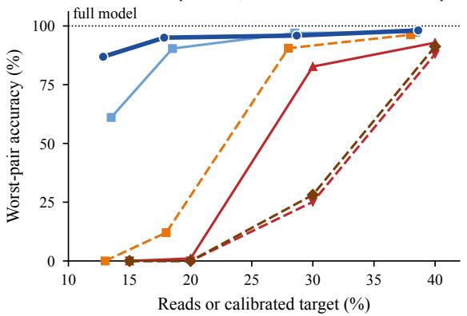

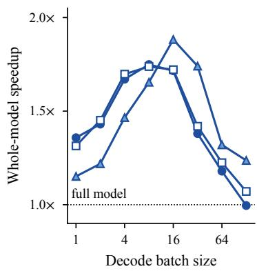  
Figure 1: At heavy sparsity, calibrated selectors lose most of their accuracy on at least one task, whereas data-free top-k selectors stay accurate and our reader performs best and decodes faster. (a) Worst accuracy over three MoE models and three benchmarks; dashed lines use calibrated thresholds, placed at the budget they were calibrated for. See Appendix Figure 11 for the same curves with calibrated selectors placed at the reads they actually used. (b) Whole-model decoding speedup of our reader at 17.8% of reads over optimized vLLM.

## 1 INTRODUCTION

Mixture-of-Experts (MoE) models scale capacity by routing each token to only a few experts (Shazeer et al., 2017; Fedus et al., 2022). At the small batch sizes of interactive decoding, latency is dominated by reading routed-expert weights from GPU memory (DRAM) to on-chip SRAM. Within each routed expert’s gated MLP, however, most intermediate channels contribute little to any single token and can be skipped with minimal loss (Park et al., 2026). A channel selector exploits this by predicting which channels matter and reading only their weights.

Every channel selector couples two components: a channel score that estimates each channel’s contribution to the output, and a keep rule that decides which channels to compute. To balance quality and sparsity without retraining, most selectors use a calibrated threshold, setting a fixed per-layer cutoff on offline calibration data so that the model reads a target budget on that data (Lee et al., 2024; Liu et al., 2025a; Zhang et al., 2025; Liu et al., 2026). The alternative keep rule is top-k, which keeps each token’s k highest-scoring channels and needs no calibration data itself (Liu et al., 2025b; Chen et al., 2026b). Prior studies disagree on which rule is preferable. Prox (Liu et al., 2026) argues that a threshold’s variable channel count adapts computation to each token, and both Prox and the Sparsing Law (Luo et al., 2025) find their threshold versions ahead of top-k on dense models. Conversely, other studies find top-k ahead (Liu et al., 2025b), while calibration introduces sensitivity to the choice of calibration data (Williams & Aletras, 2024; Ji et al., 2025).

We show that channel selection for frozen MoE decoding needs no calibration data. Selectors calibrate a threshold for two reasons, and it delivers neither. First, a calibrated threshold does not fix how much a selector reads (Section 4.1). The number of channels above a fixed cutoff changes with the input, so selectors with calibrated thresholds read less than the budget they were calibrated for in all 72 benchmark runs we made, and calibrating on the models’ own reasoning does not fix this. On Qwen3-Thinking, the count follows the answer written so far more than how much each token needs. Second, calibration gives no consistent accuracy gain over top-k (Section 4.2). We run each selector twice on its own score, once with its calibrated threshold and once with top-k, at the budget the threshold was calibrated for. The top-k version matches or beats the threshold version in 40 of 43 comparisons across four MoE models at 13% and 18% budgets. Under heavy sparsity, Gemma 4 with calibrated thresholds falls into repetition loops during long reasoning, which the same selectors with top-k avoid (Figure 1).

With top-k as the keep rule, performance depends on how well a selector ranks channels before reading them and handles skipped channels. Our reader is built entirely from the model’s weights (Section 5). For each token, it screens all candidate channels with a rotated ternary sketch of the weights (about 7% of the BF16 checkpoint), computes the top-k exactly, and recovers the skipped channels through a low-rank map of the down projections.

We evaluate our reader in vLLM (Kwon et al., 2023) on Qwen3-30B-A3B-Thinking-2507 (Yang et al., 2025), Gemma-4-26B-A4B-it (Gemma Team, 2026), and Qwen3.5-35B-A3B (Qwen Team, 2026), charging every weight and parameter read in 32-byte hardware sectors and checking counts with a GPU profiler (Section 2). At both 12.8% and 17.8% of routed-expert reads, it is the most accurate tested selector, on average and in its worst model-benchmark pair, which keeps 95.0% of full-model accuracy at 17.8%. On OLMoE (Muennighoff et al., 2025), it matches the full model more closely than nine prior selectors at the budgets at which each was tested (Appendix I). Our Triton kernels make whole models decode up to 1.88× faster than optimized vLLM, with the gain peaking at batch size eight or sixteen (Section 6.2).

## 2 BACKGROUND

In an MoE layer, a router sends each token to a few experts, each a gated MLP (Shazeer, 2020). We call each intermediate dimension of a routed expert a channel: channel j of expert e owns row j of the gate and up projections $G _ { e }$ and $V _ { e }$ and column j of the down projection $D _ { e }$ (Figure 2a). The routed output sums all channel outputs, each weighted by its expert’s router weight. In Qwen3-Thinking (Yang et al., 2025), a token goes to 8 experts of 768 channels, so a selector chooses among 6,144 channels per layer. Under a calibrated threshold, the token’s scores decide how many channels pass the cutoff; under top-k, the deployer fixes this number in advance (Figure 2b).

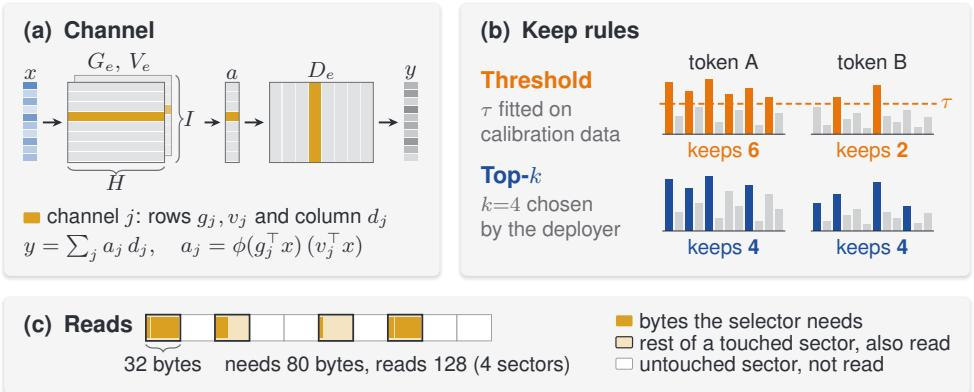

Figure 2: A channel selector computes only a subset of each routed expert’s channels, and hardware charges every 32-byte sector it touches. (a) Channel j owns row j of the gate and up projections $( G _ { e } , \bar { V } _ { e } )$ and column j of the down projection $( D _ { e } ) ; H$ is the hidden width, I the number of channels per expert, ϕ the gate activation. (b) On the same scores, a calibrated threshold τ keeps six channels on token A and two on token B, while top-k keeps four on both. (c) A selector that needs 80 bytes spread over four sectors is charged 128 bytes.  
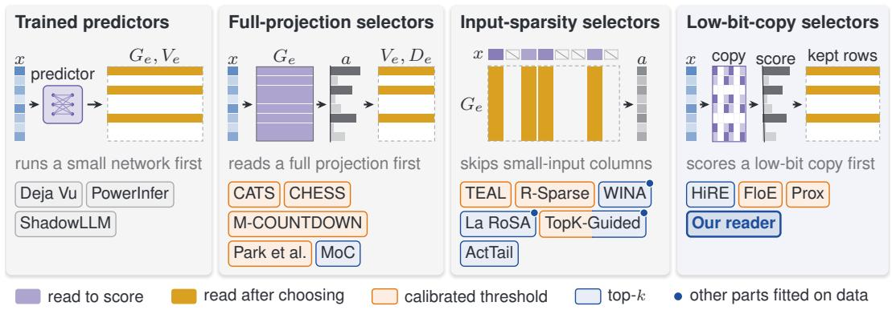  
Figure 3: Prior channel selectors, grouped by what they read before choosing channels. Dashed rows or columns are skipped; chips show each keep rule, and a dot marks budgets or rotations fitted on data. HiRE and Mixture-of-Channels (MoC) train the model for top-k; TopK-Guided bounds a threshold by a top-k window. Our reader (bold) fits nothing to the model.

We measure cost in reads: the bytes loaded per token as a percentage of the full model’s routed-expert reads. Reads include kept-channel weights, sketch or proxy weights, and auxiliary parameters. Modern NVIDIA GPUs fetch memory in 32-byte sectors (NVIDIA, 2025), so we charge every touched sector in full (Figure 2c). A GPU profiler confirms the count: at batch one on Qwen3- Thinking, it measures cold-cache DRAM reads of 18.3% against our counted 17.8% (Appendix C).

A calibrated threshold is not a selector by itself but a keep rule that selectors such as Prox and TEAL use. To compare keep rules, we run each such selector twice on the same score: its threshold version keeps the calibrated threshold, and its top-k version replaces the threshold with top-k. We compare the two at the budget the threshold was calibrated for, because a deployer sets this budget in advance, while the reads the threshold version actually uses, its realized reads, are known only afterward (Section 4.1). As a check, we also run the top-k version at these realized reads. Threshold versions read less than their budget, so this check favors them (Section 4.2).

## 3 RELATED WORK

Four families of channel selectors. Prior selectors differ in what they read before choosing channels (Figure 3). Trained predictors use an auxiliary network (Liu et al., 2023b; Song et al.,

2024; Akhauri et al., 2024), and SparseInfer uses sign bits without training (Shin et al., 2025). Full-projection selectors compute a whole gate or up projection first, so they read at least a third of each routed expert (Lee et al., 2024; He et al., 2024; Park et al., 2026), as does M-COUNTDOWN (Cheon & Kang, 2025). Input-sparsity selectors skip the weight columns that multiply small inputs (Liu et al., 2025a; Zhang et al., 2025; Liu et al., 2025b; Chen et al., 2026b; Hou et al., 2026; Chen et al., 2026a). Low-bit-copy selectors, including our reader, score channels with a compressed copy of the weights and then load the kept rows (Samaga B L et al., 2024; Zhou et al., 2025; Liu et al., 2026); FloE computes its whole up projection from an INT2 copy.

Calibration and prior keep-rule comparisons. Most selectors for frozen models calibrate on sample data, while HiRE and Mixture-of-Channels (Wu et al., 2025) train the model for top-k. Six earlier studies compare the two keep rules, and they disagree (Appendix Table 2). La RoSA (Liu et al., 2025b), Sparser-MoE (Anonymous, 2026d), and batch-wise pruning (Kim et al., 2026c) favor top-k. The Sparsing Law (Luo et al., 2025) and Prox (Liu et al., 2026) favor thresholds, Prox by 1.8 points on dense Qwen3 models. TopK-Guided (Agarwalla & Lin, 2026) finds a hybrid best. However, five of the six studies test dense models, mostly on short tasks, and two change the score along with the keep rule. Several works note that reads under a calibrated threshold drift at test time (Liu et al., 2025b; Hou et al., 2026; Anonymous, 2026c), yet none of the six runs top-k at the reads a threshold actually used. Prox’s result does not carry over to OLMoE: on its likelihood tasks at 13% and 18% budgets, its two versions tie in 7 of 10 comparisons, and top-k leads in 2 (Appendix F.1).

Scope. Our conclusions concern calibrated thresholds on the channels of frozen MoE experts. Taskdependent sparsity also motivates data-free selection (Szatkowski et al., 2026), and SparseDecoding finds that calibration and decoding activations differ (Wang et al., 2026). Thresholds can work elsewhere, as in sparse attention (Anonymous, 2026a) or trained MoE routers (Anonymous, 2026b). Appendix A covers recovery, batching, and other levels of sparsity.

## 4 CHANNEL SELECTION NEEDS NO CALIBRATION DATA

Selectors calibrate a threshold for two reasons: to read a known budget, and to gain accuracy at that budget by giving each token the channels it needs.

## 4.1 A CALIBRATED THRESHOLD DOES NOT FIX HOW MUCH A SELECTOR READS

Channel scores change across tokens, tasks, and answer length, so a different number of channels passes a fixed cutoff τ each time, while top-k always keeps k.

Reads vary across tokens and fall during generation. Figures 4a–b isolate the keep rule from the errors of an approximate score: channels are scored by their exact contribution to the output, and τ is calibrated on UltraChat to keep about 12% (12.3% on Qwen3-Thinking). On held-out chat, the mean kept count matches the target, consistent with Prox’s small drift on five short tasks (Liu et al., 2026). Yet even on chat, the middle 90% of Qwen3-Thinking tokens keep 9.0 to 16.2% of channels. On benchmark answers, scores are smaller and the median falls to 10.0% (Figure 4a, orange). Counts also fall as the answer grows (Figure 4b): around 6,000 tokens, Qwen3-Thinking keeps 71% of its calibrated count, Gemma 4 92%, Qwen3.5 88%.

Calibrated budgets are missed at deployment. Selectors with calibrated thresholds read less than their budget in all 72 benchmark runs we made: Prox and our reader, each at targets of about 13%, 18%, 28%, and 38% (Figure 4c; Appendix D). Prox with its threshold calibrated for 18% reads 12.9% on average and as little as 9.9%. About 1.7 percentage points of this gap are built into Prox’s published rule for splitting the budget between inputs and channels, once reads are counted in sectors (Appendix B). Our reader with calibrated thresholds hits its target on calibration data but reads 0.4 to 5.8 percentage points less on benchmarks. Calibrating on the models’ own reasoning does not stop this drift (Appendix D.1).

Kept channels follow the earlier answer, not token need. Why do counts fall? We take a 256- token window from position 6,000 of a Qwen3-Thinking GPQA-Diamond answer and place it directly after the question. Under a Prox threshold calibrated for 13%, the same tokens then keep 57% more channels, close to the count at the start of the answer. Removing earlier context raises the count even for the same tokens. This fall barely helps: keeping each layer’s count the same early and late in the answer, at equal total reads, changes KL divergence by at most 1.0 ± 0.5% on all three models. Nor do harder tokens get more channels: kept counts correlate with the full model’s next-token loss at −0.29 to +0.14 (Spearman). Does the remaining variation from token to token help? Giving every token in a layer the same count, at equal reads, lowers KL divergence on reasoning by 3.3 ± 1.0% on Qwen3-Thinking and 12.5 ± 1.5% on Gemma 4, so there the variation hurts; on Qwen3.5 it raises KL by $1 0 . 5 \pm 1 . { \overset { } { 1 } } \%$ , so there it helps (Appendix E).

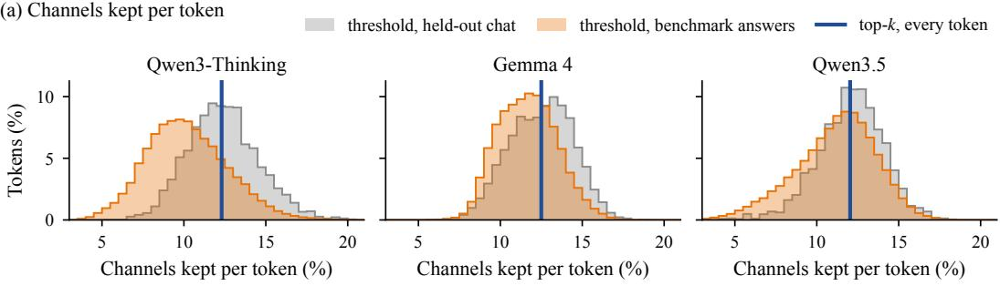

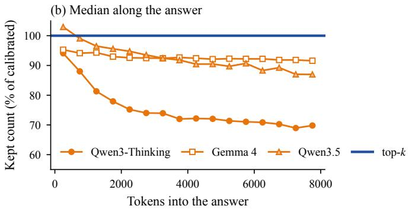

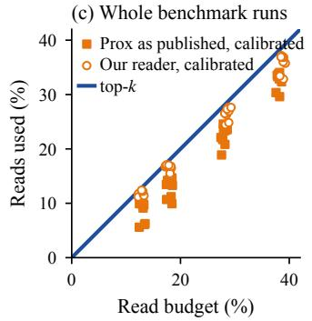  
Figure 4: Under a calibrated threshold, the number of kept channels changes from token to token, and selectors read less than their budget on benchmarks. (a) Share of channels each token keeps under an exact-score threshold calibrated on UltraChat for about 12%, on held-out chat and on the model’s answers to GPQA-Diamond (Rein et al., 2024), IFEval (Zhou et al., 2023), and MMLU-Pro (Wang et al., 2024); top-k keeps the same share on every token (line). (b) Median kept count per 500-token window, relative to the calibrated count (about 94,000 answer tokens per model). (c) In all 72 benchmark runs, Prox and our reader with calibrated thresholds read below their budget (the diagonal).

## 4.2 CALIBRATION GIVES NO CONSISTENT ACCURACY GAIN OVER TOP-k

We compare the threshold and top-k versions of existing selectors (Section 2) at the budget each threshold was calibrated for. Prox also selects inputs first; Appendix F gives the input rules.

Top-k matches or beats thresholds across models and scores. We make 43 paired comparisons at 13% and 18% budgets, on generation tasks on four MoE models and likelihood tasks on OLMoE, with three channel scores: Prox, TEAL, and Prox scaled to output units (Appendix F). The top-k version ties the threshold version in 30 (within two paired standard errors), leads in 10, and trails in 3, each time by at most 2.8 points (Figure 5). We exclude two TEAL comparisons where both versions collapse. Pooled per model, no model favors the threshold version (Appendix Table 14). On the three post-trained models alone, the top-k version leads in 5 of 11 comparisons and the threshold version in none.

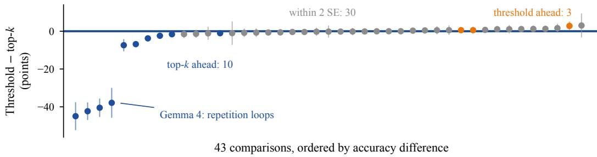  
Figure 5: On the same score, a selector’s top-k version matches or beats its threshold version in 40 of 43 comparisons and avoids Gemma 4’s collapse. Each dot is the accuracy of a selector’s threshold version minus that of its top-k version, at the budget the threshold was calibrated for, with ±2 paired SE. Gray marks ties, blue top-k leads (the four on Gemma 4 by 38 to 45 points), and orange threshold leads (at most 2.8 points). See Appendix Figure 8 for the same comparisons with each top-k version run at the reads its threshold version actually used.

Robustness at realized reads. We also run each top-k version at the reads its threshold version actually used, a check that favors the threshold version (Section 2). The top-k version still matches or beats it in 37 of 41 comparisons (Appendix F). The largest lead of a threshold version, +11.5 ± 1.9 points for Prox on Qwen3-Thinking IFEval, disappears at the calibrated budget, where Prox scores 85.4 with top-k and 84.3 with its threshold. At similar reads, controls show roughly equal gains from per-layer budgets and from per-token counts (Appendix E). Per-token variation helps most on Qwen3.5 GPQA-Diamond, by +7.1 ± 2.7 points. But this gain comes at a budget the deployer did not choose: with its threshold calibrated for 13%, Prox reads only 9.1% there and scores 80.6, which ties the 79.9 it scores with top-k at 13.5% of reads.

Other scores and calibrated parts. Our reader behaves the same way. Replacing its top-k with calibrated per-layer thresholds gives 34 ties and 2 comparisons where the top-k version leads, both on Gemma 4, out of 36. CATS (Lee et al., 2024), which thresholds exact gate activations, ties in 16 of 18 comparisons at 53% and 67% of reads, and its threshold version leads in the other 2, both on Gemma 4 (Appendix F.3). Some selectors also calibrate layer budgets (TEAL, WINA) or recovery terms (R-Sparse, GRAIL). Calibrated versions of these parts lower KL divergence, calibrated layer budgets even on reasoning text unlike their calibration data, but improve no benchmark beyond two standard errors; a calibrated recovery map beats our weight-only map in 0 of 18 comparisons (Appendix F.4).

## 4.3 LONG REASONING CAN COLLAPSE UNDER CALIBRATED THRESHOLDS

Channel thresholds trigger repetition loops on Gemma 4. The four largest gaps in Figure 5 share one cause: on Gemma 4 at the 13% budget, the top-k versions of Prox and its output-scaled variant beat their threshold versions by 38 to 45 points. With a calibrated threshold, Gemma 4 repeats phrases until the 32,768-token limit. Reading too little does not explain this. Over four samples per question, Prox with its threshold calibrated for 18% reads 13.3% and scores 11.7. With top-k at nearly the same reads, 13.5%, Prox scores 56.3 (Appendix Figure 10), and 145 rather than 674 of 792 answers hit the limit. Replacing only Prox’s channel threshold with top-k avoids the collapse; replacing only its input threshold does not (Appendix F.2). Neither a 4% floor on channels nor calibration on Gemma 4’s own reasoning prevents it (Appendices D.1 and F.2). Similar loops appear in other compressed models: pruning amplifies loops at stable perplexity (Lee et al., 2026b), 2-bit quantization often makes reasoning loop or exhaust its token budget (Alimaskina et al., 2026), and batch-shared TEAL masks collapse reasoning (Kim et al., 2026c).

Collapse behaves like a cliff. We suspect that once a sparse model starts a repetition, it rarely stops on its own. If so, accuracy drops sharply, not gradually, once the error sparsity adds to each token passes a level that depends on the model, and a less accurate selector needs more reads to stay below it. On Gemma 4 IFEval, where the full model scores 93.5, WINA as published scores 40.9 at 20% of reads, and 53% of its answers stop at the length limit. Prox’s score with top-k reaches 57.1 at 13.5% of reads, and our reader 88.0 at 12.8%. Prox still collapses when each layer’s count is fixed to it average under the threshold (Appendix E). With a calibrated threshold, a deployer therefore cannot see this level coming: the selector’s reads are not known in advance (Section 4.1), and even at equal reads its accuracy can fall far below that of its top-k version (11.7 against 56.3 above).

## 5 A READER BUILT FROM THE WEIGHTS ALONE

With top-k as the keep rule, a selector’s quality depends on two things: how well it scores channels before reading them, and how it handles the channels it skips. We build our reader around both.

Scoring matters more than the keep rule. Switching Prox from its calibrated threshold to top-k changes next-token KL divergence by only −17% to −3% on held-out OLMoE documents and by −6% to +24% on chat. Changing the score moves KL much more. On the same 4-bit weight copy, scaling Prox’s score to output units, with down-projection norms and router weights, divides KL by 1.3 to 1.5. On OLMoE development data at 17.8% of reads, with no recovery, selectors that score with an INT4 copy of the gate projection or with TEAL’s input magnitudes reach 2.8 and 5.1 times the KL divergence of our reader’s full-sketch screen (Appendix Table 17). Across four scores and four budgets on OLMoE, KL divergence falls as the kept channels carry a larger share of the routed output’s energy (Spearman −0.96; Appendix G).

Our reader therefore puts its effort into the score and into recovering skipped channels. It is built once from the model’s weights, with nothing fitted to the target model. Three settings were chosen once on OLMoE development data and reused on every model: 128-coordinate rotation blocks, 80-coordinate partial screens, and rank-32 recovery (Appendix G). For each token and layer, it screens all candidate channels, computes the top-k exactly, and recovers the rest (Figure 6).

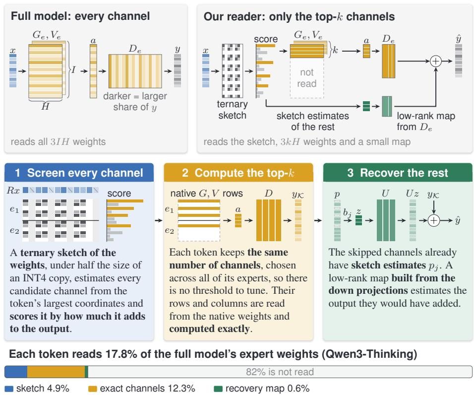  
The sketch, the ranking and the recovery map all come from the checkpoint’s weights alone.  
Figure 6: Our reader screens candidate channels with a ternary sketch, computes the top-k channels exactly, and recovers the rest using only the full model’s weights. Top: the full model reads every channel of a routed expert; our reader reads a ternary sketch, the k kept channels, and a low-rank recovery map. Middle: the three stages. Bottom: reads at 17.8% on Qwen3-Thinking.

## 5.1 SCREENING CHANNELS WITH A ROTATED TERNARY SKETCH

The screen estimates every candidate channel’s gate and up activations from a ternary sketch of the weights, built once at load time. Weights and hidden states contain outliers, which make low-bit codes inaccurate. We therefore rotate each gate row $g _ { j }$ and up row $v _ { j }$ with a randomized Hadamard transform R (Ashkboos et al., 2024; Tseng et al., 2024), applied in blocks of 128 coordinates, which spreads large values across each block. Because R is orthogonal, the rotation leaves activations unchanged: $g _ { i } ^ { \top } x = ( R g _ { j } ) ^ { \top } ( R x )$ . Each block of $R g _ { j }$ and $R v _ { j }$ is stored as ternary codes $\{ - 1 , 0 , 1 \}$ (Liu et al., 2023a), together with one FP16 scale and the block’s mean-squared quantization error $\rho _ { b }$ . This shrinks a block from 256 bytes in BF16 to about 30 bytes, so the sketch adds about 7% to resident memory. At decode time, the reader rotates x once and multiplies it by the sketch, giving estimates $\hat { g } _ { j } \approx \hat { g } _ { j } ^ { \intercal }$ x and $\hat { v } _ { j } \approx v _ { j } ^ { \top } x$

At our two lowest budgets, 12.8% and 17.8% of reads, reading the full sketch would take 44 to 61% of all reads on OLMoE. At these two budgets the reader runs a partial screen: in each block, it reads ternary codes only at the 80 coordinates where |Rx| is largest. This buys 20 to 50% more exact channels.

## 5.2 OUTPUT-SCALED SCORING AND EXACT TOP-k COMPUTATION

The reader scores each candidate channel by the size of what it would add to the MoE output. Channel j adds $w _ { j } a _ { j } d _ { j }$ , where $w _ { j }$ is the router weight of channel j’s expert, $a _ { j } = \phi ( g _ { j } ^ { \top } x ) ( v _ { j } ^ { \top } x )$ its activation, and $d _ { j }$ its down-projection column (Figure 2a). The size of this contribution is $\dot { w } _ { j } \parallel d _ { j } \parallel \lvert a _ { j } \rvert$ , and replacing $a _ { j }$ with its sketch estimate gives the score

$$
s _ { j } = w _ { j } \| d _ { j } \| \big | \phi ( \hat { g } _ { j } ) \hat { v } _ { j } \big | ,\tag{1}
$$

where the norms $\| d _ { j } \|$ are computed once at load time. Because the score is in output units, channels from different experts are directly comparable. The reader therefore picks the k best channels across all of the token’s experts, and one expert may receive many channels while another receives none. From 28.7% of reads upward, the reader reads the full sketch and also uses its block errors $\rho _ { b }$ to rank channels by the expected squared output error left after recovery if skipped (Appendix G).

For the k kept channels, the reader loads the full weights and computes the exact activations $a _ { j }$ . To make each kept channel’s down weights contiguous, we transpose every down projection $D _ { e }$ once at load time, so that column j becomes a row. Prefill and decode both use this one layout.

## 5.3 WEIGHT-ONLY LOW-RANK RECOVERY OF SKIPPED CHANNELS

Each skipped channel contributes little, but thousands of them per layer together matter. The screen has already estimated the activation $p _ { j } = \phi ( \hat { g } _ { j } ) \hat { v } _ { j }$ of every skipped channel $j \in \mathcal S$ , so the reader can reuse these estimates without rereading any gate or up weights. It still needs each skipped channel’s down column $d _ { j }$ to turn the estimate into output. To avoid loading these full-width columns, we approximate them with a small map built once before deployment. We stack the down columns of all experts in a layer, compute their top 32 left singular vectors $U \in \mathbb { R } ^ { H \times 3 2 }$ , and store each channel’s coefficients $\overline { { b _ { j } } } = \overline { { U ^ { \top } } } d _ { j } ^ { ' }$ . With kept channels K, the reader then outputs

$$
\hat { y } = \sum _ { j \in \mathcal { K } } w _ { j } d _ { j } a _ { j } \ + \ U \sum _ { j \in \mathcal { S } } w _ { j } b _ { j } p _ { j } .\tag{2}
$$

The first sum is exact; the second adds the skipped channels’ estimated output through the rank-32 map. The map adds about 0.5% to resident memory and 0.5 to 0.8 percentage points of reads.

Each component earns its reads. On OLMoE at equal reads, spending 0.6 to 0.7 percentage points on recovery lowers KL divergence more than spending them on more exact channels. The partial screen lowers KL relative to the full screen, from 0.488 to 0.310 at 13.5% of reads and from 0.245 to 0.187 at 18.5%. The same components help benchmark accuracy on Gemma 4. With the full screen at 18% of reads, recovery raises IFEval accuracy by $1 1 . 6 \pm 1 . 6$ points and reduces repetition loops. At 13%, the partial screen beats the full screen by $1 3 . 7 \pm 1 . 3$ points on MMLU-Pro.

## 6.1 ACCURACY

Experimental setup and baselines. We evaluate our reader in vLLM (Kwon et al., 2023) on three post-trained MoE models, Qwen3-Thinking, Gemma 4, and Qwen3.5, and three benchmarks, GPQA-Diamond, IFEval, and MMLU-Pro (Appendix B). The full model processes each prompt, and the selector runs on every decoded token. We compare against three published selectors. Prox (Liu et al., 2026) uses calibrated thresholds, and we also run its score with top-k. TEAL (Liu et al., 2025a) uses calibrated thresholds with greedy per-layer budgets. WINA (Chen et al., 2026b) as published keeps the top-k with calibrated per-projection budgets, and we also run its score with calibrated thresholds. Every calibrated part is fitted on the same UltraChat assistant turns (Ding et al., 2023). We report accuracy as a percentage of the full model’s accuracy, over nine model-benchmark pairs (Appendix Table 18), and count a difference only beyond two question-clustered paired standard errors.

Table 1: Our reader is the most accurate tested selector at the two lowest budgets. Mean and worst accuracy over nine model-benchmark pairs, as a percentage of the full model’s accuracy. Selectors with calibrated thresholds list the budget they were calibrated for (Target) and the reads they used (Realized); WINA as published uses top-k and meets its budget to the precision shown.
<table><tr><td rowspan="2">Selector</td><td colspan="4">About 13% of reads</td><td colspan="4">About 18% of reads</td></tr><tr><td></td><td>Target Realized</td><td>Mean</td><td>Worst</td><td>Target</td><td>Realized</td><td>Mean</td><td>Worst</td></tr><tr><td>Our reader</td><td>一</td><td>12.8</td><td>94.5</td><td>86.9</td><td>一</td><td>17.8</td><td>98.1</td><td>95.0</td></tr><tr><td>Prox score, top-k</td><td>一</td><td>13.5</td><td>87.0</td><td>61.1</td><td></td><td>18.5</td><td>96.1</td><td>90.4</td></tr><tr><td>Prox as published, calibrated</td><td>13</td><td>8.5</td><td>51.5</td><td>0.0</td><td>18</td><td>12.9</td><td>68.5</td><td>12.1</td></tr><tr><td>WINA as published, top-k</td><td></td><td>15</td><td>2.4</td><td>0.0</td><td></td><td>20</td><td>28.4</td><td>1.1</td></tr><tr><td>WINA score, calibrated</td><td>15</td><td>7.8</td><td>0.2</td><td>0.0</td><td>20</td><td>11.2</td><td>5.0</td><td>0.0</td></tr><tr><td>TEAL as published, calibrated</td><td>15</td><td>8.9</td><td>0.2</td><td>0.0</td><td>20</td><td>12.6</td><td>9.9</td><td>0.0</td></tr></table>

Accuracy at heavy sparsity. Our reader has the highest mean accuracy at both low budgets, and its weakest pair beats every other selector’s weakest pair (Table 1; Appendix Figure 9 shows every pair).

Prox, with its threshold calibrated for 18%, reads 12.9%, about as much as our reader at 12.8%. Yet it reaches only 68.5% of full-model accuracy on average, against 94.5% for our reader. Most of this gap comes from Gemma 4, where its threshold version falls into the repetition loops of Section 4.3; on the two Qwen models, Prox is about as accurate as our reader at similar reads. Top-k cannot rescue a weak score: WINA as published uses top-k and reaches only 28.4% of full-model accuracy at 20% of reads. From 28% of reads upward, our reader and Prox, with either keep rule, stay within 10% of the full model.

## 6.2 SPEED

Our reader accelerates MoE blocks by up to 2.69× in optimized vLLM. Our Triton kernels select exactly the channels of the reader evaluated above, at 17.8% of reads on one RTX PRO 6000 Blackwell GPU. We compare against unmodified vLLM in its fastest configuration, default or tuned, at each batch size, with the same router (Figure 7). On Qwen3-Thinking, Gemma 4, and Qwen3.5, MoE blocks run 1.90×, 1.71×, and 1.60× faster at batch one, and 2.39×, 2.34×, and 2.51× at four.

The whole model gains less, because attention runs as before. Whole models decode 1.15× to 1.36× faster at batch one and up to 1.75×, 1.74×, and 1.88× at batch eight or sixteen, in the same model order, and 1.08× to 1.54× with 8k to 32k tokens of context. At 100 tokens per second per user, one GPU serves 3.3 to 4.3 times as many tokens (Figure 7b; Appendix J).

At batch one, the speedup is smaller than the saved reads suggest. On Qwen3-Thinking, the MoE block moves only 18.3% of the full model’s memory traffic, yet it runs 1.90× faster, not about 5×. Part of each step is a fixed cost, such as launching kernels, that fewer reads do not shrink. Larger batches share these fixed costs, so the block speedup grows up to batch four or eight (Table 20).

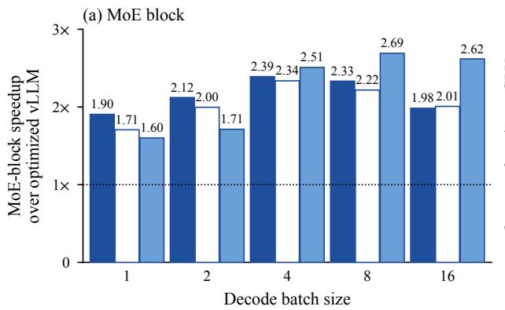

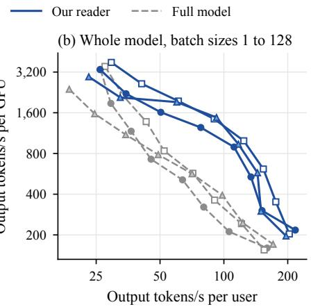  
Figure 7: Our reader accelerates MoE blocks by 1.60 to 2.69× over optimized vLLM across three post-trained models. At 17.8% of routed-expert reads, median of three processes. (a) MoEblock decode speedup; both arms share the unmodified router, and Gemma 4’s dense MLP and Qwen3.5’s shared expert are timed inside the block. (b) Whole model, batch sizes 1 to 128: right is faster per user, up is more output per GPU.

In dense models, the channels a batch needs together grow with batch size and approach the dense set in deeper layers, so channel selection helps mainly at small batches (Shrestha et al., 2025). MoE models with many small experts push this limit to larger batches: at batch 16, each expert serves about one token or fewer on average. Our reader still decodes 1.72× to 1.88× faster as a whole model at this batch size; Park et al. (2026) likewise find their MoE-layer speedup peaks at batch 16 to 128. At batch 128, the whole-model speedup falls to 1.00× to 1.24×.

## 7 LIMITATIONS AND CONCLUSION

Limitations. Our kernels turn only part of the saved reads into speed (Section 6.2), and they were tuned for one budget on one GPU type (Appendix J). Selecting channels for a whole batch at once, so the gain lasts to larger batches, is future work. The share of coordinates the partial screen reads was chosen on OLMoE and checked only on Gemma 4 (Table 17). Our reader changes only routed experts in decoding. Its sketch and recovery map add about 7% and 0.5% of a BF16 checkpoint, a larger share of a quantized one (Table 3). We tested models of up to 35B parameters.

What our results suggest. We suspect two patterns hold beyond our models. First, short likelihood evaluations hide failures of long generation. On likelihood tasks, the two versions of a selector differ little and in both directions. On generation tasks at a 13% or 18% budget, no threshold version beats its top-k version, and Gemma 4 falls into repetition loops under thresholds. REAP (Lasby et al., 2026) saw the same contrast when merging experts, and pruning can add loops at largely unchanged perplexity (Lee et al., 2026b). Second, lower KL divergence need not mean higher accuracy: calibrated layer budgets lower KL divergence even on reasoning text unlike their calibration data, yet neither they nor calibrated recovery maps raise a benchmark score.

Conclusion. Channel selection for MoE decoding needs no calibration data. With a calibrated threshold, a selector’s reads follow the input rather than the budget. At the calibrated budget, its threshold version gains no consistent accuracy over its top-k version on the same score. Built from the weights alone, our reader retains 98.1% of full-model accuracy at 17.8% of routed-expert reads on three models and runs MoE blocks up to 2.69× faster and whole models up to 1.88× faster than optimized vLLM.

## AI USE STATEMENT

We used LLM-based coding assistants to write the experiment code and kernels, run experiments, and write the scripts that summarize results, and to help draft and edit the text. The authors designed the study, checked every reported number against the experiment outputs, revised the manuscript, and take full responsibility for its content.

## REPRODUCIBILITY STATEMENT

All models, benchmarks and calibration data we use are publicly available. Sections 2 and 5 define the selectors and our reader. Appendix B gives the models, benchmarks, generation settings, statistics, calibration protocols, baseline adaptations and hardware, and Appendix C defines how reads are counted. Our reader, its Triton kernels, the vLLM patches, the baselines, the evaluation scripts and the scripts that compute the paper’s numbers from the evaluation results are in https: //github.com/AidenGeunGeun/calibration-free-moe.

## REFERENCES

Ali Abbasi, Justin Shi, and Soheil Kolouri. BASE: Batch-aware selection of experts using predicted removal error for efficient MoE decoding. arXiv preprint arXiv:2609.36222, 2026.

Mukund Agarwalla and Chih-Jen Lin. TopK-Guided: Adaptive, budget-aware activation sparsity for efficient LLM inference. arXiv preprint arXiv:2610.01763, 2026.

Yash Akhauri, Ahmed F. AbouElhamayed, Jordan Dotzel, Zhiru Zhang, Alexander M. Rush, Safeen Huda, and Mohamed S. Abdelfattah. ShadowLLM: Predictor-based contextual sparsity for large language models. In Proceedings of the 2024 Conference on Empirical Methods in Natural Language Processing, pp. 19154–19167, 2024.

Ekaterina Alimaskina, Darya Rudas, Denis Shveykin, Gleb Molodtsov, Pavel Vasiliev, and Aleksandr Beznosikov. Extreme low-bit inference in reasoning models: Failure modes and targeted recovery. arXiv preprint arXiv:2606.02011, 2026.

Yongqi An, Xu Zhao, Tao Yu, Ming Tang, and Jinqiao Wang. Fluctuation-based adaptive structured pruning for large language models. In Proceedings ofthe AAAI Conference on Artificial Intelligence, volume 38, pp. 10865–10873, 2024.

Anonymous. Where does attention mass live? A matched-budget study of query-adaptive attention sparsification for decoder LMs. Submitted to International Conference on Learning Representations 2027, 2026a. URL https://openreview.net/forum?id=A9VqLttv6t.

Anonymous. QuaL-MoE: Practical dynamic latent mixture-of-experts with quantile balancing. Submitted to International Conference on Learning Representations 2027, 2026b. URL https: //openreview.net/forum?id=5r5dBeWjfX.

Anonymous. ReComp: Low-rank residual compensation for contextual sparsity in language models. Submitted to International Conference on Learning Representations 2027, 2026c. URL https: //openreview.net/forum?id=o6YIvAjXBd.

Anonymous. Sparser-MoE: Beyond expert sparsity with heterogeneous neuron-level sparsity. Submitted to International Conference on Learning Representations 2027, 2026d. URL https: //openreview.net/forum?id=GRUZkymchi.

Saleh Ashkboos, Amirkeivan Mohtashami, Maximilian L. Croci, Bo Li, Pashmina Cameron, Martin Jaggi, Dan Alistarh, Torsten Hoefler, and James Hensman. QuaRot: Outlier-free 4-bit inference in rotated LLMs. In Advances in Neural Information Processing Systems, volume 37, pp. 100213– 100240, 2024.

Sankar Behera, Dhruv Singh, Anshika Agnihotri, Raj Kumar Choudhary, Satyadev Ahlawat, and Yamuna Prasad. LILA: Calibration-free structured pruning of large language models via latent spectral geometry. arXiv preprint arXiv:2609.11163, 2026.

Lei Chen, Yuan Meng, Xiaoyu Zhan, Zhi Wang, and Wenwu Zhu. WiSparse: Boosting LLM inference efficiency with weight-aware mixed activation sparsity. arXiv preprint arXiv:2602.14452, 2026a.

Sihan Chen, Dan Zhao, Jongwoo Ko, Colby Banbury, Huiping Zhuang, Luming Liang, Pashmina Cameron, and Tianyi Chen. WINA: Weight informed neuron activation for accelerating large language model inference. In International Conference on Learning Representations, pp. 122858– 122880, 2026b.

Xing Chen and Hengshuai Yao. Training-free halving of activated experts in fine-grained mixture-ofexperts models. arXiv preprint arXiv:2609.04575, 2026.

Runxi Cheng, Yuchen Guan, Yucheng Ding, Qingguo Hu, Yongxian Wei, Chun Yuan, Yelong Shen, Weizhu Chen, and Yeyun Gong. Mixture of neuron experts. arXiv preprint arXiv:2510.05781, 2025.

Jaewon Cheon and Pilsung Kang. COUNTDOWN: Contextually sparse activation filtering out unnecessary weights in down projection. In Proceedings of the 2025 Conference on Empirical Methods in Natural Language Processing, pp. 28393–28409, 2025.

Krishna Teja Chitty-Venkata, Sandeep Madireddy, Murali Emani, and Venkatram Vishwanath. LExI: Layer-adaptive active experts for efficient MoE model inference. arXiv preprint arXiv:2509.02753, 2025.

Karl Cobbe, Vineet Kosaraju, Mohammad Bavarian, Mark Chen, Heewoo Jun, Lukasz Kaiser, Matthias Plappert, Jerry Tworek, Jacob Hilton, Reiichiro Nakano, Christopher Hesse, and John Schulman. Training verifiers to solve math word problems. arXiv preprint arXiv:2110.14168, 2021.

Ning Ding, Yulin Chen, Bokai Xu, Yujia Qin, Shengding Hu, Zhiyuan Liu, Maosong Sun, and Bowen Zhou. Enhancing chat language models by scaling high-quality instructional conversations. In Proceedings of the 2023 Conference on Empirical Methods in Natural Language Processing, pp. 3029–3051, 2023.

Harry Dong, Beidi Chen, and Yuejie Chi. Prompt-prompted adaptive structured pruning for efficient LLM generation. In Conference on Language Modeling, 2024.

William Fedus, Barret Zoph, and Noam Shazeer. Switch Transformers: Scaling to trillion parameter models with simple and efficient sparsity. Journal ofMachine Learning Research, 23(120):1–39, 2022.

Elias Frantar and Dan Alistarh. SparseGPT: Massive language models can be accurately pruned in one-shot. In International Conference on Machine Learning, volume 202 of Proceedings of Machine Learning Research, pp. 10323–10337. PMLR, 2023.

Elias Frantar, Saleh Ashkboos, Torsten Hoefler, and Dan Alistarh. OPTQ: Accurate post-training quantization for generative pre-trained Transformers. In International Conference on Learning Representations, 2023.

Leo Gao, Stella Biderman, Sid Black, Laurence Golding, Travis Hoppe, Charles Foster, Jason Phang, Horace He, Anish Thite, Noa Nabeshima, Shawn Presser, and Connor Leahy. The Pile: An 800GB dataset of diverse text for language modeling. arXiv preprint arXiv:2101.00027, 2020.

Leo Gao, Jonathan Tow, Baber Abbasi, Stella Biderman, Sid Black, Anthony DiPofi, Charles Foster, Laurence Golding, Jeffrey Hsu, Alain Le Noac’h, Haonan Li, Kyle McDonell, Niklas Muennighoff, Chris Ociepa, Jason Phang, Laria Reynolds, Hailey Schoelkopf, Aviya Skowron, Lintang Sutawika, Eric Tang, Anish Thite, Ben Wang, Kevin Wang, and Andy Zou. The language model evaluation harness, 2024. URL https://zenodo.org/records/12608602.

Gemma Team. Gemma 4 technical report. arXiv preprint arXiv:2607.02770, 2026.

Yuling Gu, Oyvind Tafjord, Bailey Kuehl, Dany Haddad, Jesse Dodge, and Hannaneh Hajishirzi. OLMES: A standard for language model evaluations. In Findings ofthe Associationfor Computational Linguistics: NAACL 2025, pp. 5020–5048, 2025.

Junhui He, Shangyu Wu, Weidong Wen, Chun Jason Xue, and Qingan Li. CHESS: Optimizing LLM inference via channel-wise thresholding and selective sparsification. In Proceedings of the 2024 Conference on Empirical Methods in Natural Language Processing, pp. 18658–18668, 2024.

Wenwen Hou, Xinyuan Song, Wenqian Weng, and Shiwei Liu. ActTail: Global activation sparsity in large language models. arXiv preprint arXiv:2603.12272, 2026.

Yushi Huang, Zining Wang, Zhihang Yuan, Yifu Ding, Ruihao Gong, Jinyang Guo, Xianglong Liu, and Jun Zhang. MoDES: Accelerating mixture-of-experts multimodal large language models via dynamic expert skipping. In Proceedings ofthe IEEE/CVF Conference on Computer Vision and Pattern Recognition, pp. 30205–30215, 2026.

Yixin Ji, Yang Xiang, Juntao Li, Qingrong Xia, Ping Li, Xinyu Duan, Zhefeng Wang, and Min Zhang. Beware of calibration data for pruning large language models. In International Conference on Learning Representations, 2025.

Dohyeon Kim, Bedionita Soro, and Sung Ju Hwang. Distribution-consistent inference for dynamic sparse mixture-of-experts. In Findings ofthe Associationfor Computational Linguistics: EMNLP 2026, 2026a.

JuneHyung Kim, Sankeerth Durvasula, and Nandita Vijaykumar. Activation sparsity with weight approximation for faster LLM decoding on offloaded weights. arXiv preprint arXiv:2610.02598, 2026b.

Yongmin Kim, Shota Takashiro, Yusuke Iwasawa, Takeshi Kojima, and Yutaka Matsuo. Batch-wise adaptive pruning: Periodic neuron activation-aware weight pruning for language reasoning model. In Conference on Language Modeling, 2026c.

Woosuk Kwon, Zhuohan Li, Siyuan Zhuang, Ying Sheng, Lianmin Zheng, Cody Hao Yu, Joseph E. Gonzalez, Hao Zhang, and Ion Stoica. Efficient memory management for large language model serving with PagedAttention. In Proceedings of the 29th Symposium on Operating Systems Principles, pp. 611–626, 2023.

Mike Lasby, Ivan Lazarevich, Nish Sinnadurai, Sean Lie, Yani Ioannou, and Vithursan Thangarasa. REAP the experts: Why pruning prevails for one-shot MoE compression. In International Conference on Learning Representations, pp. 146883–146912, 2026.

Donghyun Lee, Jaeyong Lee, Genghan Zhang, Mo Tiwari, and Azalia Mirhoseini. CATS: Contextaware thresholding for sparsity in large language models. In Conference on Language Modeling, 2024.

Jungseob Lee, Seungyoon Lee, Seongtae Hong, Sugyeong Eo, and Heuiseok Lim. Where activation sparsity and KV-cache sparsity cross in LLM decoding. arXiv preprint arXiv:2609.33889, 2026a.

Junyoung Lee, Sehyeon Park, Shinhyoung Jang, Seonha Ryu, Hojeong Kim, Hyunsei Lee, Il Hong Suh, and Yeseong Kim. FOCUS & RePAIR: Mitigating text degeneration via token-level guidance for pruned large language models. In International Conference on Machine Learning, 2026b.

Ji Lin, Jiaming Tang, Haotian Tang, Shang Yang, Wei-Ming Chen, Wei-Chen Wang, Guangxuan Xiao, Xingyu Dang, Chuang Gan, and Song Han. AWQ: Activation-aware weight quantization for on-device LLM compression and acceleration. In Proceedings of Machine Learning and Systems, volume 6, pp. 87–100, 2024.

Bin Liu, Fengfu Li, Xiaoxing Wang, Bo Zhang, and Junchi Yan. Ternary weight networks. In IEEE International Conference on Acoustics, Speech and Signal Processing (ICASSP), pp. 1–5, 2023a.

James Liu, Pragaash Ponnusamy, Tianle Cai, Han Guo, Yoon Kim, and Ben Athiwaratkun. Trainingfree activation sparsity in large language models. In International Conference on Learning Representations, pp. 98302–98322, 2025a.

Jinyi Liu, Wei Chen, Pengyu Chen, Xinyi Yuan, Minghe Bai, Guoquan Wu, and Jun Wei. Prox: Training-free FFN activation sparsity via approximate intermediate-channel salience in LLMs. arXiv preprint arXiv:2607.27591, 2026.

Kai Liu, Bowen Xu, Shaoyu Wu, Xin Chen, Hao Zhou, Yongliang Tao, and Lulu Hu. La RoSA: Enhancing LLM efficiency via layerwise rotated sparse activation. In International Conference on Machine Learning, volume 267 of Proceedings ofMachine Learning Research, pp. 39968–39986. PMLR, 2025b.

Zechun Liu, Changsheng Zhao, Igor Fedorov, Bilge Soran, Dhruv Choudhary, Raghuraman Krishnamoorthi, Vikas Chandra, Yuandong Tian, and Tijmen Blankevoort. SpinQuant: LLM quantization with learned rotations. In International Conference on Learning Representations, 2025c.

Zichang Liu, Jue Wang, Tri Dao, Tianyi Zhou, Binhang Yuan, Zhao Song, Anshumali Shrivastava, Ce Zhang, Yuandong Tian, Christopher Ré, and Beidi Chen. Deja Vu: Contextual sparsity for efficient LLMs at inference time. In International Conference on Machine Learning, volume 202 of Proceedings ofMachine Learning Research, pp. 22137–22176. PMLR, 2023b.

Xudong Lu, Qi Liu, Yuhui Xu, Aojun Zhou, Siyuan Huang, Bo Zhang, Junchi Yan, and Hongsheng Li. Not all experts are equal: Efficient expert pruning and skipping for mixture-of-experts large language models. In Proceedings of the 62nd Annual Meeting of the Association for Computational Linguistics (Volume 1: Long Papers), pp. 6159–6172, 2024.

Yuqi Luo, Chenyang Song, Xu Han, Yingfa Chen, Chaojun Xiao, Xiaojun Meng, Liqun Deng, Jiansheng Wei, Zhiyuan Liu, and Maosong Sun. Sparsing law: Towards large language models with greater activation sparsity. In International Conference on Machine Learning, volume 267 of Proceedings ofMachine Learning Research, pp. 41311–41330. PMLR, 2025.

Haoqian Meng, Yilun Luo, Yafei Zhao, Wenyuan Liu, Huaqing Zheng, Xindian Ma, and Peng Zhang. SharQ: Bridging activation sparsity and FP4 quantization for LLM inference. arXiv preprint arXiv:2606.26587, 2026.

Niklas Muennighoff, Luca Soldaini, Dirk Groeneveld, Kyle Lo, Jacob Morrison, Sewon Min, Weijia Shi, Pete Walsh, Oyvind Tafjord, Nathan Lambert, Yuling Gu, Shane Arora, Akshita Bhagia, Dustin Schwenk, David Wadden, Alexander Wettig, Binyuan Hui, Tim Dettmers, Douwe Kiela, Ali Farhadi, Noah A. Smith, Pang Wei Koh, Amanpreet Singh, and Hannaneh Hajishirzi. OLMoE: Open mixture-of-experts language models. In International Conference on Learning Representations, pp. 62061–62121, 2025.

NVIDIA. CUDA C++ best practices guide, 2025. URL https://docs.nvidia.com/cuda /archive/13.0.0/cuda-c-best-practices-guide/index.html. Version 13.0, August 4, 2025. Section “Coalesced Access to Global Memory”.

Jongseok Park, Sunga Kim, Zhenyu Gu, Ion Stoica, and Alvin Cheung. Uncovering intra-expert activation sparsity for efficient mixture-of-expert model execution. arXiv preprint arXiv:2605.08575, 2026.

Qwen Team. Qwen3.5-35B-A3B. Official model card; accessed 2026-09-24, 2026. URL https: //huggingface.co/Qwen/Qwen3.5-35B-A3B.

David Rein, Betty Li Hou, Asa Cooper Stickland, Jackson Petty, Richard Yuanzhe Pang, Julien Dirani, Julian Michael, and Samuel R. Bowman. GPQA: A graduate-level Google-proof Q&A benchmark. In Conference on Language Modeling, 2024.

Yashas Samaga B L, Varun Yerram, Chong You, Srinadh Bhojanapalli, Sanjiv Kumar, Prateek Jain, and Praneeth Netrapalli. HiRE: High recall approximate top-k estimation for efficient LLM inference. arXiv preprint arXiv:2402.09360, 2024.

Noam Shazeer. GLU variants improve Transformer. arXiv preprint arXiv:2002.05202, 2020.

Noam Shazeer, Azalia Mirhoseini, Krzysztof Maziarz, Andy Davis, Quoc Le, Geoffrey Hinton, and Jeff Dean. Outrageously large neural networks: The sparsely-gated mixture-of-experts layer. In International Conference on Learning Representations, 2017.

Jiho Shin, Hoeseok Yang, and Youngmin Yi. SparseInfer: Training-free prediction of activation sparsity for fast LLM inference. In 2025 Design, Automation & Test in Europe Conference (DATE), pp. 1–7, 2025.

Susav Shrestha, Bradley Settlemyer, Nikoli Dryden, and Narasimha Reddy. Polar Sparsity: High throughput batched LLM inferencing with scalable contextual sparsity. In Advances in Neural Information Processing Systems, volume 38, pp. 84842–84870, 2025.

Yixin Song, Zeyu Mi, Haotong Xie, and Haibo Chen. PowerInfer: Fast large language model serving with a consumer-grade GPU. In Proceedings of the ACM SIGOPS 30th Symposium on Operating Systems Principles, pp. 590–606, 2024.

Luoyang Sun, Guangyan Li, Cheng Deng, Haifeng Zhang, Jian Zhao, Yongqiang Tang, Wensheng Zhang, and Jun Wang. Dual activation-weight sparsity: A training-free framework for efficient large language model compression. In Proceedings ofthe 64th Annual Meeting ofthe Association for Computational Linguistics (Volume 1: Long Papers), pp. 8350–8366, 2026.

Mingjie Sun, Zhuang Liu, Anna Bair, and J. Zico Kolter. A simple and effective pruning approach for large language models. In International Conference on Learning Representations, 2024.

Mirac Suzgun, Nathan Scales, Nathanael Schärli, Sebastian Gehrmann, Yi Tay, Hyung Won Chung, Aakanksha Chowdhery, Quoc V. Le, Ed H. Chi, Denny Zhou, and Jason Wei. Challenging BIG-Bench tasks and whether chain-of-thought can solve them. In Findings of the Association for Computational Linguistics: ACL 2023, pp. 13003–13051, 2023.

Filip Szatkowski, Patryk B˛edkowski, Alessio Devoto, Jan Dubinski, Pasquale Minervini, Mikołaj ´ Piórczynski, Simone Scardapane, and Bartosz Wójcik. Universal properties of activation sparsity´ in modern large language models. In International Conference on Learning Representations, pp. 146247–146269, 2026.

Wenwu Tang, Dong Wang, Lothar Thiele, and Olga Saukh. GRAIL: Post-hoc compensation by linear reconstruction for compressed networks. In Conference on Parsimony and Learning, volume 328 of Proceedings of Machine Learning Research, pp. 881–895. PMLR, 2026.

Albert Tseng, Jerry Chee, Qingyao Sun, Volodymyr Kuleshov, and Christopher De Sa. QuIP#: Even better LLM quantization with Hadamard incoherence and lattice codebooks. In International Conference on Machine Learning, volume 235 of Proceedings of Machine Learning Research, pp. 48630–48656. PMLR, 2024.

Abhishek Tyagi, Yunuo Cen, Shrey Dhorajiya, Bharadwaj Veeravalli, and Xuanyao Fong. DART-ing through the drift: Dynamic tracing of knowledge neurons for adaptive inference-time pruning. arXiv preprint arXiv:2601.22632, 2026.

Qitong Wang, Xinwei Niu, Mingluo Su, Shanwei Zhao, Shiai Zhu, and Huan Wang. SparseDecoding: Decoding-aware pruning for accurate and efficient LLM inference. arXiv preprint arXiv:2610.12327, 2026.

Yubo Wang, Xueguang Ma, Ge Zhang, Yuansheng Ni, Abhranil Chandra, Shiguang Guo, Weiming Ren, Aaran Arulraj, Xuan He, Ziyan Jiang, Tianle Li, Max Ku, Kai Wang, Alex Zhuang, Rongqi Fan, Xiang Yue, and Wenhu Chen. MMLU-Pro: A more robust and challenging multi-task language understanding benchmark. In Advances in Neural Information Processing Systems, volume 37, pp. 95266–95290, 2024.

Miles Williams and Nikolaos Aletras. On the impact of calibration data in post-training quantization and pruning. In Proceedings of the 62nd Annual Meeting of the Association for Computational Linguistics (Volume 1: Long Papers), pp. 10100–10118, 2024.

Juntong Wu, Jialiang Cheng, Fuyu Lv, Dan Ou, and Li Yuan. SERE: Similarity-based expert rerouting for efficient batch decoding in MoE models. In International Conference on Learning Representations, 2026a.

Juntong Wu, Yifei Liu, Junyi Chen, Siqi Fan, Chaoran Feng, Minghao Li, Liujie Zhang, Weihang Chen, and Li Yuan. ExFold: Unified expert folding for training-free MoE prefill-decode acceleration. arXiv preprint arXiv:2608.24938, 2026b.

Tong Wu, Yutong He, Bin Wang, and Kun Yuan. Mixture-of-Channels: Exploiting sparse FFNs for efficient LLMs pre-training and inference. arXiv preprint arXiv:2511.09323, 2025.

Zukang Xu, Zhixiong Zhao, Xing Hu, Jiangyong Yu, Houji Wen, Jun Li, Zhe Jiang, and Dawei Yang. ACE: Adaptive calibration-free expert skipping for MoE-based LLMs. arXiv preprint arXiv:2609.05228, 2026.

An Yang, Anfeng Li, Baosong Yang, Beichen Zhang, Binyuan Hui, Bo Zheng, Bowen Yu, Chang Gao, Chengen Huang, Chenxu Lv, Chujie Zheng, Dayiheng Liu, Fan Zhou, Fei Huang, Feng Hu, Hao Ge, Haoran Wei, Huan Lin, Jialong Tang, Jian Yang, Jianhong Tu, Jianwei Zhang, Jianxin Yang, Jiaxi Yang, Jing Zhou, Jingren Zhou, Junyang Lin, Kai Dang, Keqin Bao, Kexin Yang, Le Yu, Lianghao Deng, Mei Li, Mingfeng Xue, Mingze Li, Pei Zhang, Peng Wang, Qin Zhu, Rui Men, Ruize Gao, Shixuan Liu, Shuang Luo, Tianhao Li, Tianyi Tang, Wenbiao Yin, Xingzhang Ren, Xinyu Wang, Xinyu Zhang, Xuancheng Ren, Yang Fan, Yang Su, Yichang Zhang, Yinger Zhang, Yu Wan, Yuqiong Liu, Zekun Wang, Zeyu Cui, Zhenru Zhang, Zhipeng Zhou, and Zihan Qiu. Qwen3 technical report. arXiv preprint arXiv:2505.09388, 2025.

Zhenyu Zhang, Zechun Liu, Yuandong Tian, Harshit Khaitan, Zhangyang Wang, and Steven Li. R-Sparse: Rank-aware activation sparsity for efficient LLM inference. In International Conference on Learning Representations, pp. 77452–77466, 2025.

Jeffrey Zhou, Tianjian Lu, Swaroop Mishra, Siddhartha Brahma, Sujoy Basu, Yi Luan, Denny Zhou, and Le Hou. Instruction-following evaluation for large language models. arXiv preprint arXiv:2311.07911, 2023.

Yuxin Zhou, Zheng Li, Jun Zhang, Jue Wang, Yiping Wang, Zhongle Xie, Ke Chen, and Lidan Shou. FloE: On-the-fly MoE inference on memory-constrained GPU. In International Conference on Machine Learning, volume 267 of Proceedings ofMachine Learning Research, pp. 78859–78882. PMLR, 2025.

## APPENDIX CONTENTS

A Extended related work 18   
B Experimental setup 19   
C Read accounting and profiler check 21   
D Calibrated thresholds read less than their budget 22   
D.1 Calibrating on the model’s own generations 22   
E What a calibrated threshold’s channel count follows 23   
F Every keep-rule comparison 25   
F.1 Applying Prox to OLMoE 25   
F.2 Repetition loops on Gemma 4 26   
F.3 Our reader with a calibrated threshold, and CATS 27   
F.4 Calibrated layer budgets and calibrated recovery 28   
G What each part of the reader contributes 30   
H Every model and task 31   
I Baseline comparison on OLMoE 35   
J Speed details 35

Table 2: Prior keep-rule comparisons reach opposite conclusions, focus mostly on short tasks on dense models, and none runs top-k at the reads a threshold actually uses. Unlike most prior comparisons, ours holds the channel score fixed (Same score), tests long chain-of-thought reasoning on MoE models (Regime), and runs top-k both at the target budget and at realized reads (Matched).
<table><tr><td>Study</td><td>Regime</td><td>Models</td><td>Same scoreMatched Ahead</td><td></td></tr><tr><td>La RoSA (2025b)</td><td>dense, PPL</td><td>LLaMA2-7B</td><td>yes</td><td>target top-k (PPL)</td></tr><tr><td>Batch-wise pruning (2026c) dense, CoT</td><td></td><td>2 distilled 7–8B</td><td>yes</td><td>top-k (batch 4)</td></tr><tr><td>Sparsing Law (2025)</td><td>dense, short tasks 0.1B, 0.8B</td><td></td><td>target no target</td><td>threshold</td></tr><tr><td>Prox (2026)</td><td>dense, short tasks Qwen3-8B, 14B</td><td></td><td>yes target</td><td>threshold (+1.8)</td></tr><tr><td>TopK-Guided (2026)</td><td>dense, short tasks Llama-2/3, 7–8B</td><td></td><td>no target</td><td>hybrid; top-k vs. τ mixed</td></tr><tr><td>Sparser-MoE (2026d)</td><td>MoE, short tasks OLMoE</td><td></td><td>unclear target</td><td>top-k (&lt;1 pt)</td></tr><tr><td>This paper (§4.2)</td><td>MoE, short + CoT4 MoE models</td><td></td><td>yes both</td><td>tie; top-k on Gemma 4</td></tr></table>

## A EXTENDED RELATED WORK

Prior comparisons of calibrated thresholds and top-k. Earlier studies disagree on whether a calibrated threshold or top-k selects channels better (Table 2). La RoSA, Sparser-MoE, and batch-wise adaptive pruning find top-k ahead; batch-wise adaptive pruning is the only prior study in the table that tests long chain-of-thought reasoning. The Sparsing Law and Prox find calibrated thresholds ahead. TopK-Guided finds top-k (WINA) ahead of thresholded TEAL on Llama-2-7B but not consistently on Llama-3-8B, and its best rule is a hybrid: a calibrated threshold whose per-token count stays within ±δ of k, combined with calibrated block budgets. In our MoE experiments, calibrated layer budgets give no held-out benchmark gain (Appendix F.4), and a per-token floor on the count does not prevent Gemma 4’s collapse (Appendix F.2). We do not test a two-sided ±δ band.

Approximating skipped channels. Instead of simply dropping the channels they skip, several methods approximate what those channels would have added. R-Sparse adds low-rank weight factors from an SVD and chooses how to split the budget between them and sparse inputs on calibration data. GRAIL (Tang et al., 2026) fits linear compensation maps on calibration data to approximate omitted activations. ReComp (Anonymous, 2026c) distills a calibrated low-rank estimate of the skipped MLP output. Other methods send medium-importance columns through a compressed copy, as in SpAx (Kim et al., 2026b), or through a pruned or low-precision path, as in DAWS (Sun et al., 2026) and SharQ (Meng et al., 2026). Our recovery map needs no calibration data. It reuses each skipped channel’s activation estimate from the ternary screen and passes it through the top singular vectors of the down projections.

Speed under batching. In batched decoding, the GPU must load every channel that any token in the batch selects, so per-token selection saves fewer reads as the batch grows (Shrestha et al., 2025). SERE (Wu et al., 2026a) addresses this by shrinking the union of routed experts across a batch. Weak dense baselines can also inflate reported speedups (Lee et al., 2026a). We therefore charge reads in hardware sectors, check them with a GPU profiler, time against optimized vLLM, and report speedups at batch sizes one to sixteen.

Other levels of sparsity. Other methods act at a different granularity and can be combined with our reader. Expert-skipping and expert-merging methods drop, prune, or fold whole experts (Lu et al., 2024; Huang et al., 2026; Chitty-Venkata et al., 2025; Lasby et al., 2026; Chen & Yao, 2026; Xu et al., 2026; Wu et al., 2026b; Abbasi et al., 2026; Kim et al., 2026a). Static compression methods prune or quantize weights ahead of time (Frantar & Alistarh, 2023; Frantar et al., 2023; Sun et al., 2024; An et al., 2024; Liu et al., 2025c; Behera et al., 2026). Finally, prior work has studied per-token channel selection (Samaga B L et al., 2024), adaptive pruning with little or no calibration data (Dong et al., 2024; Tyagi et al., 2026; Kim et al., 2026c), and sparsity inside MoE experts (Zhou et al., 2025; Park et al., 2026), including top-k neuron selection trained into experts during pretraining (Cheng et al., 2025).

Table 3: Evaluated MoE models and the resident memory our reader adds. Each row gives the number of routed experts and how many each token uses, the channels per expert and the hidden width, the number of MoE layers, any module that always runs in full, and the resident memory of our reader’s ternary sketch and recovery map as a percentage of the BF16 checkpoint. OLMoE’s sketch size is computed analytically.
<table><tr><td></td><td colspan="2">Routed experts</td><td colspan="2">Width</td><td rowspan="2">MoE layers</td><td rowspan="2">Always</td><td colspan="2">Added memory (%)</td></tr><tr><td>Model</td><td>Total</td><td>Active</td><td>Expert</td><td>Hidden</td><td>full</td><td>Sketch Recovery</td></tr><tr><td>Qwen3-Thinking</td><td>128</td><td>8</td><td>768</td><td>2048</td><td>48</td><td></td><td>7.6</td><td>0.50</td></tr><tr><td>Gemma 4</td><td>128</td><td>8</td><td>704</td><td>2816</td><td>30</td><td>dense MLP</td><td>7.0</td><td>0.35</td></tr><tr><td>Qwen3.5</td><td>256</td><td>8</td><td>512</td><td>2048</td><td>40</td><td>shared expert</td><td>7.0</td><td>0.47</td></tr><tr><td>OLMoE</td><td>64</td><td>8</td><td>1024</td><td>2048</td><td>16</td><td></td><td>7.3</td><td>0.50</td></tr></table>

Table 4: Evaluation protocol on the post-trained models. Each model runs in thinking mode with its model card’s sampling parameters and random seed 20260923. GPQA-Diamond reports accuracy over four samples per question, IFEval reports prompt-level strict accuracy, and MMLU-Pro reports accuracy on a fixed 1,000-question subset.
<table><tr><td></td><td></td><td></td><td></td><td colspan="3">Sampling</td><td></td></tr><tr><td>Model</td><td>Benchmark</td><td>Items</td><td>Samples</td><td>Temperature</td><td>Top-p</td><td>Top-k</td><td>Max tokens</td></tr><tr><td>Qwen3-Thinking</td><td>GPQA-D</td><td>198</td><td>4</td><td>0.6</td><td>0.95</td><td>20</td><td>32,768</td></tr><tr><td></td><td>IFEval</td><td>541</td><td>1</td><td>0.6</td><td>0.95</td><td>20</td><td>32,768</td></tr><tr><td></td><td>MMLU-Pro</td><td>1,000</td><td>1</td><td>0.6</td><td>0.95</td><td>20</td><td>32,768</td></tr><tr><td>Gemma 4</td><td>GPQA-D</td><td>198</td><td>4</td><td>1.0</td><td>0.95</td><td>64</td><td>32,768</td></tr><tr><td></td><td>IFEval</td><td>541</td><td>1</td><td>1.0</td><td>0.95</td><td>64</td><td>32,768</td></tr><tr><td></td><td>MMLU-Pro</td><td>1,000</td><td>1</td><td>1.0</td><td>0.95</td><td>64</td><td>32,768</td></tr><tr><td>Qwen3.5†</td><td>GPQA-D</td><td>198</td><td>4</td><td>1.0</td><td>0.95</td><td>20</td><td>81,920</td></tr><tr><td></td><td>IFEval</td><td>541</td><td>1</td><td>1.0</td><td>0.95</td><td>20</td><td>32,768</td></tr><tr><td></td><td>MMLU-Pro</td><td>1,000</td><td>1</td><td>1.0</td><td>0.95</td><td>20</td><td>32,768</td></tr></table>

†Presence penalty 1.5.

## B EXPERIMENTAL SETUP

Models and runtime. We evaluate Qwen3-30B-A3B-Thinking-2507 (Qwen3-Thinking), Gemma-4-26B-A4B-it (Gemma 4), and Qwen3.5-35B-A3B (Qwen3.5) in their official BF16 releases in vLLM 0.29.0. For every prompt, the full model processes the prompt and generates the first output token, and the channel selector runs on every later decoded token. Shared experts and parallel dense MLPs always run in full and are not counted in routed-expert reads.

Benchmarks. GPQA-Diamond uses all 198 questions with four sampled answers per question, in each model card’s prompt format and with its sampling parameters. IFEval uses all 541 prompts and reports prompt-level strict accuracy. MMLU-Pro uses a fixed stratified subset of 1,000 questions. Answers may be up to 32,768 tokens long, except on Qwen3.5 GPQA-Diamond, where its model card recommends 81,920 tokens. The full Qwen3-Thinking model also ran GPQA-Diamond with an 81,920-token cap, but none of its answers exceeds 23,500 tokens. On OLMoE, GSM8K (Cobbe et al., 2021) (1,319 questions, eight-shot chain of thought) and BBH (Suzgun et al., 2023) (6,511 questions, three-shot chain of thought) use greedy decoding up to 512 tokens under the task definitions of the OLMES evaluation suite (Gu et al., 2025).

Answers that hit the length limit. On the post-trained models, an answer that reaches the token limit without finishing counts as wrong, for every method. On IFEval, most such answers contain no final answer at all. Of the 10,872 IFEval answers that hit the limit in our main runs, 10,649 never left their reasoning trace. Of the other 223, 202 ended in repetition loops and the rest stopped mid-sentence. IFEval’s format checkers can still pass such fragments on rules such as lowercase-only

or no commas, and crediting them would change single model-benchmark results by up to 3.3 points.   
Counting them as wrong avoids crediting collapsed outputs.

Statistics. Benchmark comparisons use paired standard errors clustered by question. We count two methods as different when their paired difference exceeds two standard errors, without correcting for the number of comparisons. A tie therefore means no difference was detected, not that the methods are equivalent. Unless stated otherwise, ± denotes one standard error. Next-token KL divergence is KL(P ∥ Pˆ), from the full model’s next-token distribution P to the sparse model’s Pˆ, averaged over scored positions; top-1 agreement is the share of positions where both put the same token first.

Calibration on the post-trained models. Every calibrated method is fitted on the same UltraChat conversations (Ding et al., 2023). We split them with a fixed seed into 448 fitting, 64 tuning, and 128 development conversations; the tuning set only selects the checkpoint of the calibrated recovery map. Each conversation is rendered with the model’s chat template and contributes one 128-token window from an assistant turn. Prox fits its thresholds on 20,480 token positions per layer, sampled from the full text of 30 fitting conversations. TEAL’s greedy budget allocation and both WINA variants use 512 fitting states per layer. UltraChat turns contain no reasoning traces, so these thresholds are fitted outside thinking mode and evaluated in thinking mode. Appendix D.1 repeats the calibration on the models’ own reasoning instead.

How Prox splits its budget. Prox splits each target budget between input and channel sparsity with its published rule, which prices its 4-bit weight copy with Prox’s latency model. Counted in sectors, this rule plans 1.6 to 1.7 percentage points of reads below the target at budgets from 13 to 38%, and 5.6 points below at 58 and 78%. Qwen3.5’s 13% thresholds were fitted for a 12.5% target. At test time, every Prox run reads even less than this plan.

Calibration on OLMoE. OLMoE is a base model, so its thresholds are fitted on Pile text (Gao et al., 2020). Prox uses the first 30 fitting documents (20,480 positions per layer), TEAL uses 177 documents (512 states per layer), and 40 further documents serve as tuning data. Our reader’s constants and the baselines’ input fractions were chosen on a separate set of 192 development documents, and the held-out OLMoE evaluation uses another 192. The development and held-out sets are disjoint from each other and from all fitting and tuning documents. Fitting Prox takes 3 to 19 minutes on a single GPU.

Baselines. Prox (Liu et al., 2026) was designed for dense models. We apply it directly to each routed expert and store its 4-bit copy of the gate and up weights in the memory layout that needs the fewest sector reads. Prox’s top-k version keeps each token’s 30% largest input coordinates (50% from 28% of reads upward) and then its top-k channels; these input fractions were also chosen on OLMoE development data. TEAL (Liu et al., 2025a) uses its greedy search to divide sparsity among the projections of each layer; we apply it to the gate, up, and down projections of the routed experts. WINA’s score with a calibrated threshold uses one threshold per projection.

WINA as published (Chen et al., 2026b) scores each input coordinate by its magnitude times the matching column norm of the weight matrix that consumes it (the gate projection in a gated MLP), keeps the top-k per token, and fits a sparsity level for each projection with TEAL’s greedy search. We adapt this search to routed experts. It minimizes the reconstruction error of the routed-expert output, uses empirical quantile thresholds measured on the fitting data, steps in increments of 0.01, and stops at the first sparsity level that reaches the target budget. Neither WINA variant applies the orthogonal weight transform that WINA adopts to maximize its gains. CATS (Lee et al., 2024) computes the full gate projection and keeps channels by exact gate magnitude with a calibrated threshold; we also run a per-token top-k version. Published HiRE trains the model with a group-sparse FFN; on frozen OLMoE we test only its screen, as a HiRE-style control that screens channels with an INT4 copy of the gate projection under our top-k.

Hardware. Benchmark runs used a single RTX PRO 6000 Blackwell GPU, two A6000 GPUs, or four A5000 or RTX 3090 GPUs. In the multi-GPU setups, attention is split by tensor parallelism and routed experts by expert parallelism. Gemma 4 ran only on the first two setups. Before pooling results across these layouts, we ran a consistency test fixed in advance. Every layout replayed 192 held-out chat documents of 128 tokens each for the full model, our reader at 17.8% of reads, and Prox calibrated for 18%. For each sparse method, the 90% confidence interval of the change in its next-token KL divergence from the full model lay within 10% of that divergence, and its realized reads changed by less than 0.5 percentage points. For the full model, its KL divergence from the single-GPU RTX PRO 6000 run stayed below 10% of our reader’s divergence. So the layout does not materially change the numerics.

Table 5: Most of our reader’s reads go to exact channels, and the sketch takes most of the rest. Routed-expert reads per token at batch one, as a percentage of the full model, by component at the four main budgets. At the two smallest budgets, the partial screen reads part of the ternary sketch.
<table><tr><td rowspan="2">Model</td><td rowspan="2">Sketch read</td><td colspan="5">Routed-expert reads (%)</td></tr><tr><td>Sketch</td><td>Exact channels</td><td>Recovery</td><td>Metadata</td><td>Total</td></tr><tr><td>Qwen3-Thinking</td><td>partial</td><td>4.86</td><td>7.29</td><td>0.66</td><td>0.04</td><td>12.85</td></tr><tr><td rowspan="6">Gemma 4</td><td>partial</td><td>4.86</td><td>12.30</td><td>0.63</td><td>0.04</td><td>17.83</td></tr><tr><td>full</td><td>7.99</td><td>20.00</td><td>0.59</td><td>0.10</td><td>28.68</td></tr><tr><td>full</td><td>7.99</td><td>30.00</td><td>0.54</td><td>0.10</td><td>38.62</td></tr><tr><td>partial</td><td>4.78</td><td>7.49</td><td>0.54</td><td>0.03</td><td>12.84</td></tr><tr><td>partial</td><td>4.78</td><td>12.50</td><td>0.52</td><td>0.03</td><td>17.83</td></tr><tr><td>full</td><td>7.86</td><td>19.99</td><td>0.49</td><td>0.08</td><td>28.42</td></tr><tr><td rowspan="5">Qwen3.5</td><td>full</td><td>7.86</td><td>30.01</td><td>0.45</td><td>0.07</td><td>38.40</td></tr><tr><td>partial</td><td>5.08</td><td>6.98</td><td>0.74</td><td>0.04</td><td>12.84</td></tr><tr><td>partial</td><td>5.08</td><td>12.04 20.00</td><td>0.72 0.68</td><td>0.04</td><td>17.87</td></tr><tr><td>full</td><td>8.33</td><td>30.00</td><td></td><td>0.11</td><td>29.11</td></tr><tr><td>full</td><td>8.33</td><td></td><td>0.62</td><td>0.10</td><td>39.06</td></tr></table>

Table 6: Our reader reads part of the sketch at the two smallest budgets and all of it above. Each column is one budget. It gives the share of candidate channels computed exactly across each token’s routed experts and the resulting total reads, which include the ternary sketch, exact channels, recovery map, and metadata, averaged over the three post-trained models and three benchmarks.
<table><tr><td>Sketch read</td><td>partial</td><td>partial</td><td>full</td><td>full</td><td>full</td><td>full</td></tr><tr><td>Channels computed exactly (%)</td><td>7.0-7.5</td><td>12.0–12.5</td><td>20</td><td>30</td><td>50</td><td>70</td></tr><tr><td>Reads (% of full model)</td><td>12.8</td><td>17.8</td><td>28.7</td><td>38.7</td><td>58.6</td><td>78.5</td></tr></table>

## C READ ACCOUNTING AND PROFILER CHECK

For each token and MoE layer, our reader is charged for every weight and parameter byte it loads from memory. This includes the ternary sketch codes and scales read during screening, the full-precision gate, up, and down rows of the k kept channels, the recovery map’s coefficient vectors for the skipped channels and its shared basis U, the precomputed per-channel norms, and the Hadamard rotation signs. Every read is counted in whole 32-byte hardware sectors at batch one, without modeling cache reuse across tokens. Every baseline is charged under the same sector model, in the weight layout that needs the fewest reads, including its thresholds, low-bit copies, and other metadata. For selectors with thresholds, we report the reads they realize on each benchmark, counted on the GPU. Table 5 breaks down our reader’s reads by component at the four main budgets.

To check that the sector count matches what the hardware actually transfers, we profiled 12 of Qwen3-Thinking’s 48 MoE layers with NVIDIA Nsight Compute. The profiled kernels ran on weights, recovery maps, and hidden states captured from a live decoding step, with the cache flushed before each kernel launch. Table 7 reports the measured DRAM reads of the MoE block without the router. At batch one, our reader’s DRAM traffic is 18.3% of the full model’s, close to the 17.8% our sector count gives. At larger batches the share rises, to 21.8% at batch four and 25.7% at batch eight, because tokens in a batch select partly different channels.

Table 7: At batch one, the profiler measures 18.3% of the full model’s DRAM reads, close to the 17.8% we count. Measured DRAM reads per MoE layer on Qwen3-Thinking in MB, averaged over 12 layers, without the router, with a cold cache.
<table><tr><td>Batch size</td><td>1</td><td>4</td><td>8</td></tr><tr><td>Full model</td><td>75.6</td><td>229.1</td><td>359.3</td></tr><tr><td>Our reader</td><td>13.9</td><td>49.9</td><td>92.3</td></tr><tr><td>Share</td><td>18.3%</td><td>21.8%</td><td>25.7%</td></tr></table>

Table 8: Every calibrated threshold reads less than the budget it was calibrated for. Each row is one selector at one calibrated budget. The columns give the lowest, mean, and highest realized routed-expert reads (%) over the nine model-benchmark pairs.
<table><tr><td colspan="2"></td><td colspan="3">Realized reads (%)</td></tr><tr><td>Method</td><td>Calibrated for (%)</td><td>Min</td><td>Mean</td><td>Max</td></tr><tr><td>CATS</td><td>53.3</td><td>51.1 63.8</td><td>52.1</td><td>53.0</td></tr><tr><td rowspan="2">Our reader, calibrated</td><td>66.7</td><td></td><td>65.1</td><td>66.0</td></tr><tr><td>12.8 17.8</td><td>11.2 15.2</td><td>11.8</td><td>12.4</td></tr><tr><td rowspan="6">Prox as published, calibrated</td><td>28.7</td><td>24.5</td><td>16.5</td><td>17.1</td></tr><tr><td>38.7</td><td>32.9</td><td>26.5 35.8</td><td>27.7 37.2</td></tr><tr><td></td><td>5.6</td><td>8.5</td><td></td></tr><tr><td>13.0 18.0</td><td>9.9</td><td>12.9</td><td>10.1 14.7</td></tr><tr><td>28.0</td><td>18.9</td><td>22.5</td><td>24.6</td></tr><tr><td>38.0</td><td>29.6</td><td>32.6</td><td>34.1</td></tr><tr><td rowspan="5">TEAL as published, calibrated</td><td>58.0</td><td>47.3</td><td>49.8</td><td>51.0</td></tr><tr><td>78.0</td><td>67.1</td><td>70.0</td><td>71.4</td></tr><tr><td>15.0</td><td>6.4</td><td>8.9</td><td>11.0</td></tr><tr><td>20.0</td><td>9.8</td><td>12.6</td><td>15.3</td></tr><tr><td>30.0</td><td>19.9</td><td>22.6</td><td>24.9</td></tr><tr><td rowspan="6">WINA score, calibrated</td><td>40.0</td><td>32.6</td><td>35.0</td><td>36.2</td></tr><tr><td>50.0</td><td></td><td></td><td></td></tr><tr><td>60.0</td><td>43.7 54.7</td><td>46.2 56.9</td><td>47.4 58.0</td></tr><tr><td></td><td></td><td></td><td></td></tr><tr><td>15.0</td><td>5.4</td><td>7.8</td><td>9.6</td></tr><tr><td>20.0</td><td>8.2</td><td>11.2</td><td>13.9</td></tr><tr><td></td><td>30.0 40.0</td><td>17.2 32.0</td><td>20.7 34.3</td><td>23.5 35.8</td></tr><tr><td></td><td>50.0</td><td>43.5</td><td></td><td></td></tr><tr><td></td><td></td><td></td><td>46.1</td><td>47.7</td></tr><tr><td>60.0</td><td></td><td>54.8</td><td>57.1</td><td>58.2</td></tr></table>

## D CALIBRATED THRESHOLDS READ LESS THAN THEIR BUDGET

Section 4.1 counts 72 benchmark runs: Prox and our reader’s threshold version, each at four budgets. Table 8 extends this count to every selector we ran with a calibrated threshold on the post-trained models, 24 threshold settings on all nine model-benchmark pairs. All 216 runs read less than the budget they were calibrated for. For Prox and our reader’s threshold version, this budget is the read target of the calibration fit. For TEAL and WINA’s score with a threshold, it is the target share of inputs kept. For CATS, it is the reads of its top-k version at the same target sparsity.

## D.1 CALIBRATING ON THE MODEL’S OWN GENERATIONS

UltraChat assistant turns contain no reasoning traces, so we also fitted Prox’s thresholds on each full model’s own reasoning, for targets of 13.4, 15, 18.4, and 20%. The full model wrote one thinking-mode trace, up to 32,768 tokens, for each of 1,024 UltraChat first user turns. These turns lie outside every fitting, tuning, and evaluation split, and none shares a 13-gram with a benchmark prompt. The traces average 1,669 generated tokens on Gemma 4 and 2,302 on Qwen3-Thinking. As

in our chat calibration, Prox’s recipe uses 30 of these sequences and 20,480 evenly spaced positions.   
Each sequence is a prompt plus its trace, cut at a random point and capped at 8,192 tokens.

Prox with these trace-calibrated thresholds still reads less than its targets on Gemma 4 GPQA-Diamond (four samples per question): 10.5, 11.6, 14.0, and 15.2% of reads. It scores 0.0, 0.3, 23.9, and 45.1, and 100, 100, 65, and 35% of its answers hit the 32,768-token limit. For comparison, Prox with its threshold calibrated on chat for 18% scores 11.7 at 13.3% of reads. On Gemma 4 IFEval, Prox with a trace-calibrated threshold scores 31.2 at 14.9% of reads, against 11.3 with chat calibration.

On Qwen3-Thinking GPQA-Diamond, Prox with trace-calibrated thresholds scores 57.1 at 9.6% of reads and 62.8 at 11.2%, against 59.7 at 9.9% with chat calibration. On IFEval it scores 82.1, against 82.8. Calibrating on the model’s own reasoning therefore neither stops the reads from drifting nor prevents Gemma 4’s collapse into repetition loops.

## E WHAT A CALIBRATED THRESHOLD’S CHANNEL COUNT FOLLOWS

With a calibrated threshold, the number of channels kept changes from token to token. This appendix asks what that number follows, and whether the variation spends reads where tokens need them. Unless stated otherwise, we use Prox’s INT4 score on Qwen3-Thinking with the thresholds from our main evaluation, calibrated on UltraChat for 13% and 18% of reads. Where stated, we also use thresholds calibrated on the model’s own reasoning (Appendix D.1). Gemma 4 repeats the context test, and Gemma 4 and Qwen3.5 repeat the equal-read and generation tests, with thresholds calibrated on UltraChat. Every variant ranks channels by the same score; only the rule that sets each token’s count changes.

Setup. We use 48 GPQA-Diamond reasoning traces written by the full Qwen3-Thinking model and teacher-force 256-token windows starting at answer positions 0, 2,000, and 6,000. The full model processes the question and the earlier answer. Inside the window, each variant runs on hidden states from its own sparse layers, and we measure its next-token KL divergence from the full model. We compare the threshold with two controls. Per-layerfixed counts give every token in a layer the same count, set so that reads in the window match the threshold’s; a two-pass procedure matches them to a relative residual below 0.05%. Shuffled counts randomly permute the threshold’s per-token counts across positions. To measure how much each token needs extra channels, a separate single-step experiment scores 576 tokens, four positions in each of the three windows of 48 traces. Each token is scored after a full-model prefix at 0.5, 0.7, 1, 1.4, and 2 times the top-k count, and its need is how much its KL divergence falls from 0.5 to 2 times the count.

The earlier answer sets the count. Table 9 takes the window at position 6,000 and changes only what comes before it. Removing the earlier answer, so that the window follows the question directly, raises the kept count by 56.6 ± 2.7%. This brings it to 89% of the count at the start of the answer, where the tokens themselves differ. Among identical token IDs, Prox keeps 41% fewer channels at position 6,000 than at the start, and the count falls equally in every band of the full model’s next-token loss. On Gemma 4, whose reads fall less (from 10.5% to 9.7%), removing the earlier answer raises the kept count by $1 2 . 5 \pm 0 . 5 \%$ . With thresholds calibrated on Qwen3-Thinking’s own traces, reads fall similarly, from 11.3% to 7.7% over 6,000 tokens. Both the length and the content of the earlier answer matter. With the exact scores and chat-calibrated threshold of Figure 4a, the window keeps 30.1 ± 1.3% more channels after the question alone and 10.4 ± 0.6% more after the last 1,000 answer tokens. Placing an answer to a different question, also 6,000 tokens long, before the window instead of the model’s own answer raises the count by $1 9 . 3 \pm 1 . 3 \%$

What the count follows on Qwen3-Thinking. In the single-step experiment, the threshold’s pertoken count correlates with answer position at −0.57 (Spearman, at both budgets), with need at only −0.13 (13%) and −0.19 (18%), and with the full model’s next-token loss at −0.29 and −0.26. Need itself follows loss (+0.58, +0.68) rather than position (+0.09, +0.14). Even among tokens at the same position, the count correlates slightly negatively with need $( - 0 . 1 1 \pm 0 . 0 4$ and −0.12 ± 0.05 over the 12 positions) and with loss $( - 0 . 1 9 \pm 0 . 0 5$ and $- 0 . 1 6 \pm 0 . 0 6 )$ . On this model, removing the dependence on answer position would therefore leave variation that slightly favors tokens with lower need. On each model’s own sparse states in the three windows, the count correlates with loss at −0.16 to −0.23 on Qwen3-Thinking, −0.21 to −0.28 on Gemma 4, and 0.00 to +0.14 on Qwen3.5. Yet on Qwen3.5, variable counts still improve quality at equal reads (below), so loss alone does not decide whether the variation helps.

Table 9: The same tokens keep more channels when the earlier answer is removed. The first three rows change only the context before the 256-token windows at answer position 6,000 of Qwen3- Thinking GPQA-Diamond traces, under Prox’s threshold calibrated for 13%. Kept channels are per token, summed over 48 layers (of 294,912 candidates) and averaged over 48 traces; ± is one paired SE. The last row shows the start of the answer, which has different tokens.
<table><tr><td>Context before the window</td><td>Kept channels</td><td>Change</td></tr><tr><td>Question and all 6,000 earlier answer tokens</td><td>9,983</td><td></td></tr><tr><td>Question and the last 1,000 answer tokens</td><td>11,423</td><td> $+ 1 5 . 0 { \pm } 1 . 2 \%$ </td></tr><tr><td>Question only</td><td>15,422</td><td> $+ 5 6 . 6 { \scriptstyle \pm 2 . 7 \% }$ </td></tr><tr><td>Start of the answer (different tokens)</td><td>17,283</td><td></td></tr></table>

Equal reads. Does the variation help at equal reads? Pooled over the three windows, per-layer fixed counts lower KL divergence relative to the chat-calibrated threshold by $3 . 3 \pm 1 . 0 \hat { \% }$ at 13% and $3 . 4 \pm 1 . 2 \%$ at 18%, and relative to the trace-calibrated threshold by $4 . 0 \pm \dot { 0 } . 9 \%$ and $2 . 9 \pm 1 . 2 \%$ On Gemma 4 at 13%, they lower it by $1 2 . 5 \pm 1 . 5 \%$ . On Qwen3.5 they raise it, by $1 0 . 5 \pm 1 . 1 \%$ at 13% and $1 4 . 8 \pm 1 . 2 \%$ at 18%, and the threshold is ahead in all three windows at both budgets. So on Qwen3-Thinking and Gemma 4 reasoning the variation hurts, and on Qwen3.5 it helps. The threshold’s counts still carry information on every model: shuffling them across positions raises pooled KL on each. On held-out chat, the distribution the threshold was calibrated on, fixed counts instead raise KL by $6 . 5 \pm 1 . 9 \%$ and $9 . 2 \pm 2 . 2 \%$

Moving reads across positions. Making each layer’s count constant across the three windows barely changes KL at equal pooled reads. We compare per-window fixed counts, matched to the threshold version’s reads in each window, with counts held at their three-window mean. At equal pooled reads, the constant counts change KL by $- 0 . 3 \pm 0 . 5 \%$ and $- 0 . 2 \pm 0 . 6 \%$ on Qwen3-Thinking, $+ 0 . 1 \pm 0 . 8 \%$ on Gemma 4, and $+ 1 . 0 \pm 0 . 5 \%$ (just beyond two SE) and $+ 0 . 1 \pm 0 . 7 \%$ on Qwen3.5. A reversed schedule, which reflects each layer’s counts about their three-window mean, is worse: $+ 6 . 8 \pm 0 . 7 \%$ and $+ 7 . 1 \pm 1 . 1 \%$ on Qwen3-Thinking, and $+ 4 . 2 \pm 0 . 7 \%$ and $+ 3 . 5 \pm 0 . 8 \%$ on Qwen3.5.

Predicting need. An oracle that knows every token’s loss could halve KL divergence at the same total reads, but a predictor of need does not get close. A per-layer ridge regression from the token’s position and summary statistics of its screened channel scores (total and largest score mass, share in the top channels, entropy, and count above the threshold) explains about 20% of the variance in log KL. Our offline estimate of the allocation it implies is worse than fixed counts.

Generation. Qwen3-Thinking IFEval is the benchmark where a threshold beats top-k at its realized reads. There, Prox keeps its top-k on inputs and uses a channel threshold calibrated for 13%. With this threshold, it scores 82.4 at 10.0% of reads. With per-layer fixed counts matched to the threshold’s per-layer budgets, it scores 77.6 at 10.3% (−4.8 ± 1.8), and with the same count in every layer, 72.8 at 10.3%. On GPQA-Diamond (one sample), it scores 59.1 at 9.9% with the threshold and 56.6 at 9.9% with fixed counts $( - 2 . 5 \pm 2 . 8 ,$ a tie). Per-token counts thus help on IFEval but show no detectable gain on GPQA-Diamond. IFEval answers are shorter than GPQA-Diamond reasoning and fail on a single violated instruction, which may make a few tokens decisive; we did not test this.

On Qwen3.5, with its threshold calibrated for 13%, Prox scores 89.5 at 9.7% of reads on IFEval, against 88.5 at 9.7% with fixed counts $( - 0 . 9 \pm 1 . 3 , \mathrm { a t i e } )$ . On GPQA-Diamond (one sample), it scores 79.8 at 9.4%, against 72.7 at 9.1% (−7.1 ± 2.7). Without per-token counts, Qwen3.5’s answers grow longer, 16.2k against 11.3k tokens on average, and 5.1% of them hit the length limit, against 1.0%.

On Gemma 4, removing the per-token variation does not prevent the collapse. On IFEval, with per-layer fixed counts matched to the threshold’s per-layer budgets, Prox scores 0.0 at 10.1% of reads, and 99.8% of its answers stop at the length limit. Prox’s threshold version also scores 0.0 at 10.1%;

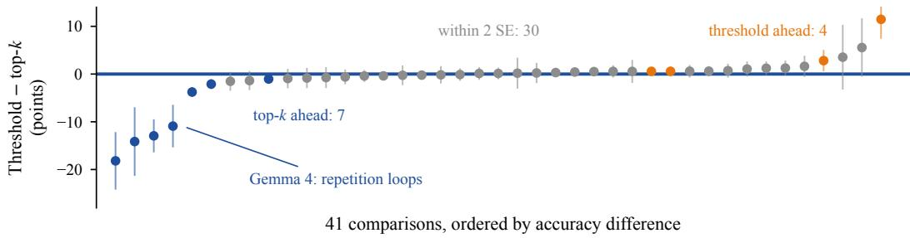  
Figure 8: Figure 5 with each top-k version run at the reads its threshold version actually used. Each dot is one comparison, as in Figure 5. When a threshold version read more than one percentage point away from its calibrated budget, the top-k version is rerun at those realized reads. The figure has 41 comparisons at 13% and 18% budgets; four TEAL comparisons at heavy sparsity, where both versions collapse, are left out. Threshold versions read less than their budget, so this rerun lowers the top-k version’s reads too, yet the top-k version matches or beats the threshold version in 37 of 41.

replacing only its input threshold with top-k gives 3.5 (Appendix F.2). With the same count in every layer, Prox’s top-k version scores 16.5 at 11.7%. On GPQA-Diamond, Prox with fixed counts also scores 0.0 at 9.8% of reads with every answer stopped at the limit, as does its threshold version (0.0 at 9.9%). Gemma 4’s collapse therefore comes with the threshold’s calibrated per-layer budgets or the low reads they settle at, rather than with per-token variation; this test cannot separate the two.

## F EVERY KEEP-RULE COMPARISON

Tables 10 and 12 list every paired comparison of a selector’s threshold and top-k versions, and Tables 11 and 13 repeat them at realized reads; Figure 5 summarizes the 43 at 13% and 18% budgets. Each row fixes one channel score and compares the two versions at the budget the threshold was calibrated for. When the threshold version’s realized reads differ from that budget by more than one percentage point, the top-k version is also rerun at those reads (Figure 8).

In the 23 generation-task comparisons, the top-k version leads beyond two standard errors in 8 and the threshold version in none. Two TEAL comparisons at heavy sparsity, where both versions fall below 10% of the full model, are marked and not counted. We fixed this set of comparisons in advance, not by outcome: Prox’s score and its output-scaled variant on IFEval at 13% and on GPQA-Diamond at 13% for Gemma 4 and Qwen3-Thinking, TEAL’s score on IFEval at 18%, and GSM8K and BBH on OLMoE at both budgets. Table 18 covers the remaining pairs for Prox: over all nine model-benchmark pairs at 13% and 18%, its threshold version scores higher than its top-k version in 2 of 18, both on Qwen3.5 GPQA-Diamond and by at most 1.5 points. In the 20 likelihood-task comparisons on OLMoE at 13% and 18%, the top-k version leads in 2 and the threshold version in 3. At the 38% budget, Prox’s top-k version keeps 50% of inputs and its threshold version 30%, so the two differ in more than the keep rule. These 10 comparisons (top-k version ahead in 3, threshold version in none) appear in parentheses and are left out of every count. Table 14 pools each model’s counted comparisons.

In the generation-task comparisons with Prox’s score and its output-scaled variant, both versions select inputs by top-k, so only the channel threshold is replaced. In the comparisons with TEAL’s score, the threshold on inputs is replaced by top-k.

## F.1 APPLYING PROX TO OLMOE

Prox (Liu et al., 2026) was evaluated on dense models, and five of its six tasks are multiple-choice likelihood tasks. We apply Prox to the routed experts of OLMoE-1B-7B-0924 and evaluate the same five tasks in lm-eval 0.4.3 (Gao et al., 2024) (Table 15). Each task runs under two prompt settings. In the first, as in Prox, the whole sequence is sparse. In the second, the full model computes the prompt except its last token, so only the positions that predict an answer token are sparse.

Table 10: Keep-rule comparisons on generation tasks. Each row fixes one model, task, score, and budget. It gives the accuracy of the threshold version (τ) and the top-k version (k), their paired difference ± one standard error, and which version is ahead (= within two standard errors, – both collapsed).
<table><tr><td>Model</td><td>Task</td><td>Score</td><td>Budget (%)</td><td>T</td><td>k</td><td>τ − k</td><td></td></tr><tr><td>Gemma 4</td><td>GPQA-D</td><td>Prox, output-scaled</td><td>13</td><td>16.2</td><td>54.0</td><td>-37.9±3.8</td><td>k</td></tr><tr><td></td><td></td><td>Prox</td><td>13</td><td>6.1</td><td>51.0</td><td>-44.9±3.5</td><td>k</td></tr><tr><td></td><td>IFEval</td><td>Prox, output-scaled</td><td>13</td><td>23.1</td><td>63.6</td><td>-40.5±2.3</td><td>k</td></tr><tr><td></td><td></td><td>Prox</td><td>13</td><td>3.5</td><td>45.8</td><td>-42.3±2.2</td><td>k</td></tr><tr><td></td><td></td><td>TEAL</td><td>18</td><td>0.0</td><td>7.0</td><td>−7.0±1.1</td><td>一</td></tr><tr><td>OLMoE</td><td>BBH</td><td>Prox, output-scaled</td><td>13</td><td>25.4</td><td>26.1</td><td>−0.7±0.6</td><td>=</td></tr><tr><td></td><td></td><td>Prox</td><td>13</td><td>26.1</td><td>26.2</td><td>−0.1±0.6</td><td>=</td></tr><tr><td></td><td></td><td>TEAL</td><td>13</td><td>3.0</td><td>5.4</td><td>-2.4±0.3</td><td>k</td></tr><tr><td></td><td></td><td>Prox, output-scaled</td><td>18</td><td>28.5</td><td>30.1</td><td>-1.6±0.6</td><td>k</td></tr><tr><td></td><td></td><td>Prox</td><td>18</td><td>28.1</td><td>28.5</td><td>−0.4±0.5</td><td>=</td></tr><tr><td></td><td></td><td>TEAL</td><td>18</td><td>10.8</td><td>17.6</td><td>-6.8±0.5</td><td>k</td></tr><tr><td></td><td>GSM8K</td><td>Prox, output-scaled</td><td>13</td><td>9.6</td><td>10.4</td><td>−0.8±1.0</td><td>=</td></tr><tr><td></td><td></td><td>Prox</td><td>13</td><td>8.3</td><td>9.9</td><td>-1.5±0.9</td><td>=</td></tr><tr><td></td><td></td><td>TEAL</td><td>13</td><td>1.8</td><td>2.2</td><td>−0.4±0.4</td><td>=</td></tr><tr><td></td><td></td><td>Prox, output-scaled</td><td>18</td><td>12.1</td><td>11.0</td><td>+1.1±1.0</td><td>=</td></tr><tr><td></td><td></td><td>Prox TEAL</td><td>18</td><td>9.6</td><td>11.0</td><td>−1.4±0.9</td><td>=</td></tr><tr><td>Qwen3.5</td><td></td><td></td><td>18</td><td>2.1</td><td>2.1</td><td>+0.0±0.5</td><td>=</td></tr><tr><td></td><td>IFEval</td><td>Prox, output-scaled</td><td>13</td><td>91.1</td><td>91.9</td><td>−0.7±1.0</td><td>=</td></tr><tr><td></td><td></td><td>Prox</td><td>13</td><td>91.5</td><td>90.9</td><td>+0.6±1.1</td><td>=</td></tr><tr><td>Qwen3-Thinking</td><td></td><td>TEAL</td><td>18</td><td>3.0</td><td>10.4</td><td>−7.4±1.5</td><td>k</td></tr><tr><td></td><td>GPQA-D</td><td>Prox, output-scaled</td><td>13</td><td>62.6</td><td>59.6</td><td>+3.0±3.0</td><td>=</td></tr><tr><td></td><td></td><td>Prox</td><td>13</td><td>57.1</td><td>58.1</td><td>-1.0±3.0</td><td>=</td></tr><tr><td></td><td>IFEval</td><td>Prox, output-scaled</td><td>13</td><td>85.4</td><td>85.6</td><td>−0.2±1.4</td><td>=</td></tr><tr><td></td><td></td><td>Prox</td><td>13</td><td>84.3</td><td>85.4</td><td>-1.1±1.6</td><td>=</td></tr><tr><td></td><td></td><td>TEAL</td><td>18</td><td>0.0</td><td>0.0</td><td>+0.0±0.0</td><td>一</td></tr></table>

We fit the thresholds with Prox’s sequential procedure. Layers are calibrated in order, with all earlier layers already sparse, and each layer gets one input threshold and one channel threshold from empirical quantiles of up to 200,000 activation samples pooled across its routed experts. Three settings differ from Prox’s dense setup. First, OLMoE is a base model, so we calibrate on 20,480 token positions from 30 Pile documents instead of Alpaca text. Second, we set the budgets (13, 18, and 38%) in charged sector reads instead of through Prox’s latency model. Third, the threshold version’s input threshold is fitted to keep 30% of inputs at all three budgets, while the top-k version keeps 30% of inputs at 13% and 18% and 50% at 38%.

At realized reads and the 13% and 18% budgets, with the whole sequence sparse as in Prox, the threshold version leads in 1 of 10 comparisons and the top-k version in 2. With the prompt computed by the full model, the threshold version leads in 2 and the top-k version in none (Tables 12 and 13).

## F.2 REPETITION LOOPS ON GEMMA 4

Prox selects in two stages: a threshold on input coordinates, then a threshold on expert channels. Section 4.3 showed that Gemma 4 falls into repetition loops under Prox’s thresholds even at nearly equal reads. To find which stage causes the collapse, we replaced one threshold at a time with top-k, at the 13% budget, on the first GPQA-Diamond sample of each question (realized reads in parentheses). With both thresholds, Prox scores 0.0 (10.9% of reads), and every answer hits the length limit. With top-k on inputs and the threshold on channels, it scores 6.1 (11.4%). With the threshold on inputs and top-k on channels, it scores 43.9 (12.4%), and with top-k at both stages, 51.0 (13.0%). On IFEval, the same four settings score 0.0, 3.5, 43.1, and 45.8.

Replacing the channel threshold with top-k therefore raises GPQA-Diamond accuracy by 43.9 to 44.9 points while adding only 1.5 to 1.6 percentage points of reads, and raises IFEval accuracy by 42.3 to 43.1 points. Replacing the input threshold changes accuracy by at most 7.1 points on either benchmark. So replacing the channel threshold, not the input threshold, is what avoids the collapse. Giving every token in a layer the same count, set to the average the threshold kept in that layer, does not avoid it either (Appendix E); that test cannot tell whether the calibrated layer budgets or the low reads they settle at drive the collapse.

Table 11: The generation-task comparisons with each top-k version run at its threshold version’s realized reads. Columns follow Table 10. The top-k version is rerun only where the threshold version’s realized reads differ from the budget by more than one percentage point. †The threshold version read within one point of its budget, so the top-k run at the budget is reused.
<table><tr><td>Model</td><td>Task</td><td>Score</td><td>Budget (%)</td><td>T</td><td>k</td><td>τ − k</td><td></td></tr><tr><td>Gemma 4</td><td>GPQA-D</td><td>Prox, output-scaled</td><td>13</td><td>16.2</td><td>30.3</td><td>-14.1±3.5</td><td>k</td></tr><tr><td></td><td></td><td>Prox</td><td>13</td><td>6.1</td><td>24.2</td><td>-18.2±2.9</td><td>k</td></tr><tr><td></td><td>IFEval</td><td>Prox, output-scaled</td><td>13</td><td>23.1</td><td>34.0</td><td>-10.9±2.1</td><td>k</td></tr><tr><td></td><td></td><td>Prox</td><td>13</td><td>3.5</td><td>16.5</td><td>-12.9±1.6</td><td>k</td></tr><tr><td></td><td></td><td>TEAL</td><td>18</td><td>0.0</td><td>0.2</td><td>−0.2±0.2</td><td>一</td></tr><tr><td>OLMoE</td><td>BBH</td><td>Prox, output-scaled</td><td>13</td><td>25.4</td><td>25.3</td><td>+0.1±0.6</td><td>二</td></tr><tr><td></td><td></td><td>Prox</td><td>13</td><td>26.1</td><td>26.2†</td><td>−0.1±0.6</td><td>二</td></tr><tr><td></td><td></td><td>TEAL</td><td>13</td><td>3.0</td><td>3.0</td><td>+0.1±0.2</td><td>一</td></tr><tr><td></td><td></td><td>Prox, output-scaled</td><td>18</td><td>28.5</td><td>28.0</td><td>+0.6±0.6</td><td>=</td></tr><tr><td></td><td></td><td>Prox</td><td>18</td><td>28.1</td><td>28.5†</td><td>−0.4±0.5</td><td>=</td></tr><tr><td></td><td></td><td>TEAL</td><td>18</td><td>10.8</td><td>12.9</td><td>-2.1±0.4</td><td>k</td></tr><tr><td></td><td>GSM8K</td><td>Prox, output-scaled</td><td>13</td><td>9.6</td><td>10.4†</td><td>−0.8±1.0</td><td>=</td></tr><tr><td></td><td></td><td>Prox</td><td>13</td><td>8.3</td><td>9.9†</td><td>-1.5±0.9</td><td>=</td></tr><tr><td></td><td></td><td>TEAL</td><td>13</td><td>1.8</td><td>2.2†</td><td>−0.4±0.4</td><td>=</td></tr><tr><td></td><td></td><td>Prox, output-scaled</td><td>18</td><td>12.1</td><td>11.8</td><td>+0.2±1.0</td><td>二</td></tr><tr><td></td><td></td><td>Prox TEAL</td><td>18</td><td>9.6</td><td>11.0†</td><td>−1.4±0.9</td><td>=</td></tr><tr><td>Qwen3.5</td><td></td><td></td><td>18</td><td>2.1</td><td>1.5</td><td>+0.6±0.4</td><td>=</td></tr><tr><td></td><td>IFEval</td><td>Prox, output-scaled</td><td>13</td><td>91.1</td><td>91.9†</td><td>−0.7±1.0</td><td>=</td></tr><tr><td></td><td></td><td>Prox TEAL</td><td>13</td><td>91.5</td><td>90.9†</td><td>+0.6±1.1</td><td>=</td></tr><tr><td></td><td></td><td></td><td>18</td><td>3.0</td><td>0.0</td><td>+3.0±0.7</td><td>一</td></tr><tr><td>Qwen3-Thinking</td><td>GPQA-D</td><td>Prox, output-scaled</td><td>13</td><td>62.6</td><td>57.1</td><td>+5.6±3.0</td><td>二</td></tr><tr><td></td><td></td><td>Prox</td><td>13</td><td>57.1</td><td>53.5</td><td>+3.5±3.3</td><td>二</td></tr><tr><td></td><td>IFEval</td><td>Prox, output-scaled</td><td>13</td><td>85.4</td><td>85.2</td><td>+0.2±1.5</td><td>=</td></tr><tr><td></td><td></td><td>Prox</td><td>13</td><td>84.3</td><td>72.8</td><td>+11.5±1.9</td><td>T</td></tr><tr><td></td><td></td><td>TEAL</td><td>18</td><td>0.0</td><td>0.0†</td><td>+0.0±0.0</td><td>一</td></tr></table>

The collapse is not limited to 13%: with its threshold calibrated for 18%, Prox finishes its reasoning in only 132 of 792 GPQA-Diamond answers, against 787 of 792 for the full model. At the 13% budget, a per-token floor on channels does not prevent the collapse either. When every token keeps at least 4% of its candidate channels on top of the calibrated threshold, Prox still scores only 2.0 on GPQA-Diamond (11.1% of reads). Finally, when set to keep all channels, our implementations of Prox and TEAL match the full model on held-out chat, which rules out a gross implementation error in these baselines.

## F.3 OUR READER WITH A CALIBRATED THRESHOLD, AND CATS

Our reader. To test the keep-rule swap on our own reader, we replace its per-token top-k with one threshold per layer on the same score. The threshold is fitted on UltraChat with Prox’s recipe, so that it keeps k channels per token on average. On the benchmarks, this threshold version reads 0.4 to 5.8 percentage points less than its budget. Of 36 paired comparisons, across three post-trained models, three benchmarks, and four budgets, 34 are ties and none favors the threshold version. Both remaining comparisons favor the top-k version, on Gemma 4 at 12.8% of reads. There the threshold version reads 11.7% and scores 62.4 against 69.4 on GPQA-Diamond (−7.1 ± 1.7) and 73.2 against 80.4 on MMLU-Pro (−7.2 ± 1.2). It also hits the length limit on 15 to 17% of answers, against 4 to 6% for the top-k version.

Table 12: Keep-rule comparisons on Prox’s five likelihood tasks on OLMoE. Prox’s threshold and top-k versions, with the prompt either sparse or computed by the full model. Columns follow Table 10. At 38%, the top-k version keeps 50% of inputs and the threshold version 30%; these verdicts are in parentheses and not counted.
<table><tr><td>Prompt</td><td>Task</td><td>Budget (%)</td><td>T</td><td>k</td><td>τ − k</td><td></td></tr><tr><td>full model</td><td>ARC-C</td><td>13</td><td>49.7</td><td>50.0</td><td>-0.3±0.9</td><td>=</td></tr><tr><td></td><td>ARC-E</td><td>13</td><td>73.9</td><td>73.2</td><td>+0.7±0.6</td><td>=</td></tr><tr><td></td><td>HellaSwag</td><td>13</td><td>75.4</td><td>74.9</td><td>+0.6±0.3</td><td>T</td></tr><tr><td></td><td>MMLU</td><td>13</td><td>50.3</td><td>50.3</td><td>−0.0±0.3</td><td>=</td></tr><tr><td></td><td>PIQA</td><td>13</td><td>77.7</td><td>76.4</td><td>+1.3±0.7</td><td>=</td></tr><tr><td></td><td>ARC-C</td><td>18</td><td>51.9</td><td>51.4</td><td>+0.5±0.9</td><td>=</td></tr><tr><td></td><td>ARC-E</td><td>18</td><td>75.8</td><td>75.8</td><td>+0.0±0.6</td><td>=</td></tr><tr><td></td><td>HellaSwag</td><td>18</td><td>77.2</td><td>76.6</td><td>+0.6±0.2</td><td>T</td></tr><tr><td></td><td>MMLU</td><td>18</td><td>50.4</td><td>50.6</td><td>−0.2±0.3</td><td>=</td></tr><tr><td></td><td>PIQA</td><td>18</td><td>78.6</td><td>77.5</td><td>+1.1±0.6</td><td>=</td></tr><tr><td></td><td>ARC-C</td><td>38</td><td>55.1</td><td>55.3</td><td>−0.2±0.7</td><td>(=)</td></tr><tr><td></td><td>ARC-E</td><td>38</td><td>77.8</td><td>78.6</td><td>−0.8±0.4</td><td>(=)</td></tr><tr><td></td><td>HellaSwag</td><td>38</td><td>78.7</td><td>78.9</td><td>−0.2±0.2</td><td>(=)</td></tr><tr><td></td><td>MMLU</td><td>38</td><td>51.6</td><td>52.1</td><td>−0.5±0.3</td><td>(=)</td></tr><tr><td></td><td>PIQA</td><td>38</td><td>79.2</td><td>80.1</td><td>−0.9±0.5</td><td>(=)</td></tr><tr><td>sparse</td><td>ARC-C</td><td>13</td><td>44.6</td><td>43.0</td><td>+1.6±1.0</td><td>=</td></tr><tr><td></td><td>ARC-E</td><td>13</td><td>71.4</td><td>70.3</td><td>+1.1±0.7</td><td>=</td></tr><tr><td></td><td>HellaSwag</td><td>13</td><td>73.6</td><td>73.3</td><td>+0.3±0.3</td><td>=</td></tr><tr><td></td><td>MMLU</td><td>13</td><td>35.7</td><td>39.5</td><td>-3.8±0.4</td><td>k</td></tr><tr><td></td><td>PIQA</td><td>13</td><td>76.0</td><td>76.1</td><td>−0.2±0.8</td><td>=</td></tr><tr><td></td><td>ARC-C</td><td>18</td><td>49.6</td><td>46.8</td><td>+2.8±1.0</td><td>T</td></tr><tr><td></td><td>ARC-E</td><td>18</td><td>74.9</td><td>73.7</td><td>+1.2±0.6</td><td>=</td></tr><tr><td></td><td>HellaSwag</td><td>18</td><td>76.4</td><td>76.0</td><td>+0.4±0.3</td><td>=</td></tr><tr><td></td><td>MMLU</td><td>18</td><td>42.1</td><td>43.1</td><td>−1.0±0.4</td><td>k</td></tr><tr><td></td><td>PIQA</td><td>18</td><td>77.8</td><td>78.4</td><td>−0.6±0.7</td><td>=</td></tr><tr><td></td><td>ARC-C</td><td>38</td><td>55.2</td><td>54.4</td><td>+0.8±0.8</td><td>(=)</td></tr><tr><td></td><td>ARC-E</td><td>38</td><td>77.4</td><td>77.9</td><td>−0.5±0.5</td><td>(=)</td></tr><tr><td></td><td>HellaSwag</td><td>38</td><td>78.8</td><td>79.4</td><td>−0.6±0.2</td><td>(k)</td></tr><tr><td></td><td>MMLU</td><td>38</td><td>49.5</td><td>50.7</td><td>-1.1±0.3</td><td>(k)</td></tr><tr><td></td><td>PIQA</td><td>38</td><td>79.0</td><td>80.1</td><td>-1.1±0.5</td><td>(k)</td></tr></table>

CATS. CATS computes the gate projection exactly and keeps channels by gate magnitude. We compare its threshold and top-k versions at two budgets, about 53% and 67% of reads, on all nine model-benchmark pairs. Of the 18 comparisons, 16 are ties. The threshold version leads in the other two, both on Gemma 4 at 53%: by $5 . 8 \pm 1 . 7$ points on GPQA-Diamond and 5.5 ± 1.1 points on MMLU-Pro, while reading slightly less (52.7% and 52.8%, against 53.3%).

## F.4 CALIBRATED LAYER BUDGETS AND CALIBRATED RECOVERY

Layer budgets. We compare our reader’s uniform layer budget with non-uniform per-layer budgets, derived either from the weights or from calibration data, at the same total reads of 17.8%. Calibrated minus uniform, accuracy changes by −0.76 ± 1.10 on GPQA-Diamond (four samples) and +1.11 ± 1.01 on IFEval on Gemma 4, and by −1.77 ± 1.18 and −1.85 ± 1.31 on Qwen3-Thinking. On OLMoE, calibrated layer budgets lower next-token KL divergence by about 0.02 on held-out Pile text from the calibration distribution. Yet they change GSM8K accuracy by at most 0.1 points and BBH accuracy by $- 1 . 2 3 \pm 0 . 5 0$ and $- 0 . 2 8 \pm 0 . 5 0$ at the two smallest budgets. The KL gain is not confined to the calibration data. On Qwen3-Thinking with our reader at 17.8% of reads, we measure teacher-forced KL divergence on 144 windows from the full model’s GPQA-Diamond answers, with every layer sparse inside each window, fitting budgets on half of the answers and evaluating on the other half. Relative to the uniform budget, the chat-calibrated budgets lower KL divergence by $1 5 . 7 \pm 1 . 9 \%$ , close to the $1 8 . 7 \pm 2 . 1 \%$ of budgets fitted on GPQA-Diamond answers, while budgets derived from the weights change it by +2.4 ± 1.7%. Lower KL divergence on reasoning text thus did not turn into a detected benchmark gain.

Table 13: The likelihood-task comparisons with each top-k version run at its threshold version’s realized reads. Columns follow Table 10. †The threshold version read within one point of its budget, so the top-k run at the budget is reused.
<table><tr><td>Prompt</td><td>Task</td><td>Budget (%)</td><td>T</td><td>k</td><td>τ − k</td><td></td></tr><tr><td>full model</td><td>ARC-C</td><td>13</td><td>49.7</td><td>50.0†</td><td>−0.3±0.9</td><td>=</td></tr><tr><td></td><td>ARC-E</td><td>13</td><td>73.9</td><td>73.2†</td><td>+0.7±0.6</td><td>=</td></tr><tr><td></td><td>HellaSwag</td><td>13</td><td>75.4</td><td>74.9†</td><td>+0.6±0.3</td><td>T</td></tr><tr><td></td><td>MMLU</td><td>13</td><td>50.3</td><td>49.7</td><td>+0.5±0.3</td><td>=</td></tr><tr><td></td><td>PIQA</td><td>13</td><td>77.7</td><td>76.4†</td><td>+1.3±0.7</td><td>=</td></tr><tr><td></td><td>ARC-C</td><td>18</td><td>51.9</td><td>52.8</td><td>−0.9±0.9</td><td>=</td></tr><tr><td></td><td>ARC-E</td><td>18</td><td>75.8</td><td>75.7</td><td>+0.1±0.5</td><td>=</td></tr><tr><td></td><td>HellaSwag</td><td>18</td><td>77.2</td><td>76.6†</td><td>+0.6±0.2</td><td>T</td></tr><tr><td></td><td>MMLU</td><td>18</td><td>50.4</td><td>50.6</td><td>−0.2±0.3</td><td>=</td></tr><tr><td></td><td>PIQA</td><td>18</td><td>78.6</td><td>78.0</td><td>+0.6±0.6</td><td>=</td></tr><tr><td></td><td>ARC-C</td><td>38</td><td>55.1</td><td>54.9</td><td>+0.2±0.8</td><td>(=)</td></tr><tr><td></td><td>ARC-E</td><td>38</td><td>77.8</td><td>78.7</td><td>−1.0±0.4</td><td>(k)</td></tr><tr><td></td><td>HellaSwag</td><td>38</td><td>78.7</td><td>79.0</td><td>−0.2±0.2</td><td>(=)</td></tr><tr><td></td><td>MMLU</td><td>38</td><td>51.6</td><td>51.8</td><td>−0.2±0.3</td><td>(=)</td></tr><tr><td></td><td>PIQA</td><td>38</td><td>79.2</td><td>79.7</td><td>−0.4±0.5</td><td>(=)</td></tr><tr><td>sparse</td><td>ARC-C</td><td>13</td><td>44.6</td><td>43.0†</td><td>+1.6±1.0</td><td>=</td></tr><tr><td></td><td>ARC-E</td><td>13</td><td>71.4</td><td>70.3†</td><td>+1.1±0.7</td><td>=</td></tr><tr><td></td><td>HellaSwag</td><td>13</td><td>73.6</td><td>73.3†</td><td>+0.3±0.3</td><td>=</td></tr><tr><td></td><td>MMLU</td><td>13</td><td>35.7</td><td>39.5†</td><td>-3.8±0.4</td><td>k</td></tr><tr><td></td><td>PIQA</td><td>13</td><td>76.0</td><td>76.1†</td><td>−0.2±0.8</td><td>=</td></tr><tr><td></td><td>ARC-C</td><td>18</td><td>49.6</td><td>46.8†</td><td>+2.8±1.0</td><td>T</td></tr><tr><td></td><td>ARC-E</td><td>18</td><td>74.9</td><td>73.7†</td><td>+1.2±0.6</td><td>=</td></tr><tr><td></td><td>HellaSwag</td><td>18</td><td>76.4</td><td>76.0†</td><td>+0.4±0.3</td><td>=</td></tr><tr><td></td><td>MMLU</td><td>18</td><td>42.1</td><td>43.1†</td><td>-1.0±0.4</td><td>k</td></tr><tr><td></td><td>PIQA</td><td>18</td><td>77.8</td><td>78.4†</td><td>−0.6±0.7</td><td>=</td></tr><tr><td></td><td>ARC-C</td><td>38</td><td>55.2</td><td>54.9</td><td>+0.3±0.8</td><td>(=)</td></tr><tr><td></td><td>ARC-E</td><td>38</td><td>77.4</td><td>77.9†</td><td>−0.5±0.5</td><td>(=)</td></tr><tr><td></td><td>HellaSwag</td><td>38</td><td>78.8</td><td>79.1</td><td>−0.3±0.2</td><td>(=)</td></tr><tr><td></td><td>MMLU</td><td>38</td><td>49.5</td><td>50.7†</td><td>-1.1±0.3</td><td>(k)</td></tr><tr><td></td><td>PIQA</td><td>38</td><td>79.0</td><td>80.3</td><td>-1.3±0.5</td><td>(k)</td></tr></table>

Table 14: No model favors the threshold version at the calibrated budget. Threshold-version minus top-k-version accuracy, pooled over each model’s counted comparisons with inverse-variance weights, at the calibrated budget and at realized reads. The ± is one SE that treats comparisons as independent; accounting for shared questions changes each SE by at most 0.1. The realized-read columns favor the threshold version (Section 2). Only Qwen3-Thinking leads beyond two SE there, a lead that comes from Prox on IFEval and reverses at the calibrated budget.
<table><tr><td rowspan="2">Model</td><td colspan="2">At the calibrated budget</td><td colspan="2">At realized reads</td></tr><tr><td>Comparisons</td><td>τ − k</td><td>Comparisons</td><td>τ − k</td></tr><tr><td>Qwen3-Thinking</td><td>4</td><td>-0.3±1.0</td><td>4</td><td>+4.5±1.1</td></tr><tr><td>Qwen3.5</td><td>3</td><td>−1.7±0.7</td><td>2</td><td>−0.2±0.8</td></tr><tr><td>OLMoE</td><td>32</td><td>-0.3±0.1</td><td>31</td><td>+0.0±0.1</td></tr><tr><td>Gemma 4</td><td>4</td><td>-41.5±1.3</td><td>4</td><td>-13.3±1.1</td></tr></table>

Recovery. We also fit the low-rank recovery map on calibration text by minimizing next-token KL divergence from the full model, at the same reads as our weight-only map. We make 18 comparisons on the three post-trained models: GPQA-Diamond, IFEval, MMLU-Pro, and GSM8K at 17.8% of reads, plus IFEval and MMLU-Pro at 12.8%. The calibrated map never beats the weight-only map beyond two standard errors, and the weight-only map leads on Qwen3-Thinking MMLU-Pro at 12.8% $( + \mathrm { { 2 } . 1 \pm 1 . 0 ) }$ . On OLMoE, the calibrated map lowers next-token KL divergence on held-out Pile text from its calibration distribution (0.158 against 0.200 at 17.8% of reads) but gives no benchmark gain beyond two standard errors.

Table 15: Prox’s five likelihood tasks on OLMoE. Few-shot examples, metric, number of questions, and full-model accuracy for each task.
<table><tr><td>Task</td><td>Shots</td><td>Metric</td><td>Questions</td><td>Full model (%)</td></tr><tr><td>MMLU</td><td>5</td><td>accuracy</td><td>14,042</td><td>52.71</td></tr><tr><td>HellaSwag</td><td>10</td><td>normalized accuracy</td><td>10,042</td><td>79.40</td></tr><tr><td>ARC-E</td><td>0</td><td>accuracy</td><td>2,376</td><td>78.11</td></tr><tr><td>ARC-C</td><td>25</td><td>normalized accuracy</td><td>1,172</td><td>55.20</td></tr><tr><td>PIQA</td><td>0</td><td>accuracy</td><td>1,838</td><td>79.98</td></tr></table>

## G WHAT EACH PART OF THE READER CONTRIBUTES

Score with the full sketch. When the reader reads the full ternary sketch (from 28.7% of reads upward), each 128-coordinate block also comes with the mean-squared quantization error $\rho _ { b }$ of its ternary code. This gives each screened inner product an error variance $\begin{array} { r } { \dot { \sigma } ^ { 2 } = \sum _ { b } \rho _ { b } \| ( R x ) _ { b } \| ^ { 2 } } \end{array}$ (all norms are Euclidean). We model the true gate and up pre-activations as independent Gaussians centered at ${ \hat { g } } _ { j }$ and $\hat { v } _ { j }$ , with variance $\sigma ^ { 2 }$ computed from each row’s own residuals. Five-node Gauss–Hermite quadrature then gives the mean $\mu _ { j }$ and second moment $m _ { j }$ of the gated activation $a _ { j } = \phi ( g _ { j } ^ { \top } x ) ( v _ { j } ^ { \top } x )$ . Let $n _ { j } = \| d _ { j } \|$ , and let $q _ { j } = U b _ { j }$ be channel $j ^ { \dagger } \mathbf { s }$ low-rank recovery vector, with component $\beta _ { i } ^ { \parallel } = d _ { i } ^ { \top } q _ { j } / n _ { j }$ along $d _ { j }$ and orthogonal remainder of norm $\beta _ { j } ^ { \perp } = \| q _ { j } - \beta _ { j } ^ { \parallel } d _ { j } / n _ { j } \|$ . We score channel j by the expected squared output error of skipping it after recovery,

$$
s _ { j } = w _ { j } ^ { 2 } \left[ n _ { j } ^ { 2 } ( m _ { j } - \mu _ { j } ^ { 2 } ) + ( n _ { j } \mu _ { j } - \beta _ { j } ^ { \parallel } p _ { j } ) ^ { 2 } + ( \beta _ { j } ^ { \perp } p _ { j } ) ^ { 2 } \right] .
$$

Output energy and KL divergence. Next-token KL divergence closely follows how much of the routed output’s energy the kept channels preserve, $E = \overline { { 1 } } - \Vert y - y _ { \kappa } \Vert ^ { 2 } / \Vert y \Vert ^ { 2 }$ . Here $y$ is the full routed-expert output and $y \kappa$ the output of the kept channels alone. We measure E on all 16 OLMoE layers, at $3 { , } 0 0 0$ positions per layer, for four scores under per-token top- $^ { - k , }$ each at four read budgets without recovery. The four scores are our output-scaled ternary score, two versions of Prox’s score using each token’s largest 30% and 50% of input coordinates, and an INT4 screen of the gate projection. Across these 16 settings, $E$ and held-out next-token KL divergence have a rank correlation of −0.96, and KL divergence scales roughly as $( 1 - E ) ^ { 1 . 2 - 1 . 9 }$

Ablations. Table 16 compares variants of our reader on 192 held-out OLMoE documents, by next-token KL divergence from the full model at equal total reads.

Our reader uses the partial sketch at the two smallest budgets and the full sketch at higher budgets. We also replace our ternary sketch (1.0 GB next to the OLMoE checkpoint) with Prox’s 4-bit weight copy (2.16 GB), keeping our output-scaled top-k and weight-only recovery. This variant also needs no calibration data. It matches our reader at the two smallest budgets and has lower KL divergence from 28.5% of reads upward, at about twice the resident auxiliary memory.

Table 16: Partial screening helps at small budgets, and recovery helps at every budget. Nexttoken KL divergence from the full model on held-out OLMoE documents at equal reads (lower is better). Each row is one variant of our reader.
<table><tr><td>Reads (%)</td><td>13.5</td><td>18.5</td><td>28.5</td><td>38.4</td></tr><tr><td>Full sketch, no recovery</td><td>0.553</td><td>0.277</td><td>0.107</td><td>0.051</td></tr><tr><td>Full sketch with recovery</td><td>0.488</td><td>0.245</td><td>0.096</td><td>0.047</td></tr><tr><td>Partial sketch with recovery</td><td>0.310</td><td>0.187</td><td>0.090</td><td>0.053</td></tr><tr><td>Prox&#x27;s 4-bit copy, output-scaled top-k, recovery</td><td>0.305</td><td>0.187</td><td>0.070</td><td>0.035</td></tr></table>

Table 17: Rotation and ranking channels across all routed experts lower KL divergence, and reading 80 of 128 coordinates is at or near the best. Next-token KL divergence from the full model on development data (lower is better). Top: at 17.8% of reads on OLMoE without recovery, the full sketch, two of its design variants, and two other scores under top-k. Bottom: coordinates the partial screen reads per 128-coordinate block, with recovery, at equal reads; bold marks the lowest in each row.
<table><tr><td>Variant at 17.8% of reads (OLMoE, development)</td><td>KL</td></tr><tr><td>Full sketch, no recovery (rotated, top-k over all routed experts)</td><td>0.286</td></tr><tr><td>Without rotation</td><td>0.348</td></tr><tr><td>Fixed share of channels per expert</td><td>0.491</td></tr><tr><td>Score from an INT4 copy of the gate projection, same top-k Score from TEAL&#x27;s input magnitudes, top-k inputs</td><td>0.811 1.471</td></tr></table>

<table><tr><td rowspan="2">Model</td><td rowspan="2">Budget (% of reads)</td><td colspan="6">Coordinates read per 128-coordinate block</td></tr><tr><td>128</td><td>96</td><td>80</td><td>64</td><td>48</td><td>32</td></tr><tr><td>OLMoE</td><td>13</td><td>0.443</td><td>0.336</td><td>0.316</td><td>0.317</td><td>0.343</td><td>0.424</td></tr><tr><td></td><td>18</td><td>0.224</td><td>0.198</td><td>0.194</td><td>0.198</td><td>0.229</td><td>0.297</td></tr><tr><td></td><td>28</td><td>0.102</td><td>0.094</td><td>0.098</td><td>0.106</td><td>0.127</td><td>0.173</td></tr><tr><td>Gemma 4</td><td>13</td><td>0.235</td><td>0.188</td><td>0.176</td><td>0.177</td><td>0.197</td><td>0.260</td></tr><tr><td></td><td>18</td><td>0.124</td><td>0.110</td><td>0.106</td><td>0.111</td><td>0.129</td><td>0.179</td></tr><tr><td></td><td>28</td><td>0.056</td><td>0.052</td><td>0.052</td><td>0.057</td><td>0.070</td><td>0.103</td></tr></table>

Quantized checkpoints. Our reader also works on quantized checkpoints. On OLMoE held-out documents, with reads charged in BF16-equivalent routed bytes including quantization scales, our reader on a GPTQ (Frantar et al., 2023) 4-bit checkpoint reaches a next-token KL divergence of 0.045 at 18.9% of reads. AWQ (Lin et al., 2024) 3-bit weights alone reach 0.075 at 19.7% (paired difference −0.030 ± 0.003). At 21.5% of reads our reader reaches 0.033, against 0.019 for GPTQ 4-bit weights alone at 26.0%. On a quantized checkpoint, the ternary sketch takes a larger share of resident memory: a 4-bit checkpoint plus the sketch occupies about 34% of the BF16 routed bytes, against 20% for 3-bit weights.

Design of the screen. Table 17 tests the screen’s design choices on development data. Removing the Hadamard rotation, or forcing each routed expert to keep a fixed share of channels, raises KL divergence on OLMoE. For the partial screen, we chose to read 80 of every 128 rotated coordinates per block on OLMoE development data. There, 80 gives the lowest KL divergence, or lies within about 0.004 of it, at each of three budgets. On Gemma 4 development data, 80 is also lowest at two budgets and within 0.0003 of the lowest at the third.

## H EVERY MODEL AND TASK

Figures 9 and 10 show accuracy against reads for every model and benchmark, with calibrated selectors at their calibrated budgets and at their realized reads. Table 18 lists the scores at heavy sparsity. In a rerun of GPQA-Diamond with eight samples per question, our reader at 17.8% of reads trails the full model by $3 . 9 \pm 1 . 0$ points on Gemma 4 and 4.6 ± 1.4 points on Qwen3-Thinking.

Answer length. Our reader does not trade speed per token for longer answers. At 17.8% of reads, its mean answer length stays within about 15% of the full model’s on every model-benchmark pair. On Qwen3-Thinking, Gemma 4, and Qwen3.5, it changes by −3, +3, and +1% on GPQA-Diamond, +15, +9, and −12% on IFEval, and −14, +14, and −10% on MMLU-Pro. At most 1.3% of its answers stop at the length limit on any pair, and the same holds for the full model.

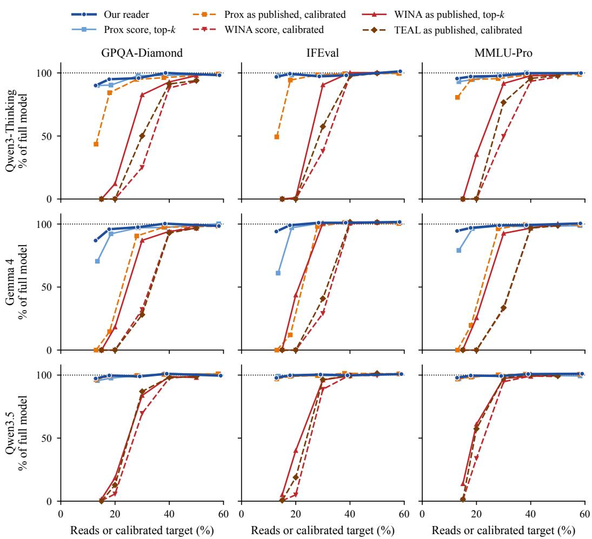  
Figure 9: Accuracy against reads on every model and task. Each panel is one model-benchmark pair, and its vertical axis runs from zero to above the full model’s accuracy (dotted line). Blue solid lines use no calibration data. Warm dashed lines are selectors with thresholds fitted on calibration data, placed at the budget they were calibrated for. WINA as published (red solid) keeps a top-k per token, with a sparsity level for each projection fitted on calibration data as in TEAL. GPQA-Diamond averages four samples per question, IFEval reports prompt-level strict accuracy, and MMLU-Pro uses a fixed subset of 1,000 questions.

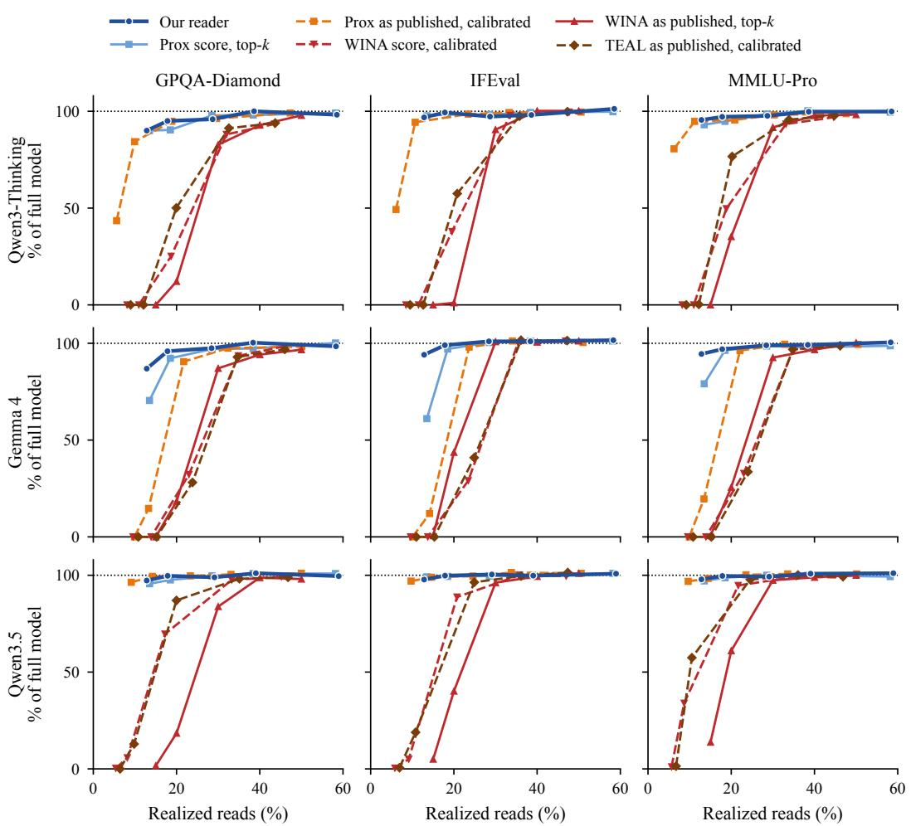  
Figure 10: Figure 9 with calibrated selectors placed at the reads they actually used. Selectors with calibrated thresholds move left, because they read less at test time than the budget they were calibrated for.

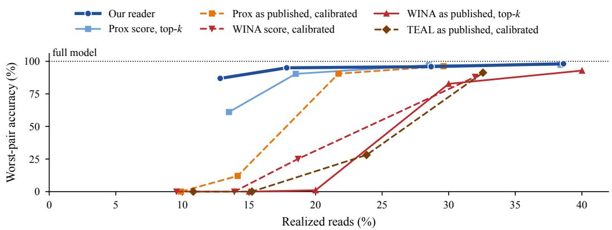  
Figure 11: Figure 1 with calibrated selectors placed at the reads they actually used. Each curve is the worst accuracy over the nine model-benchmark pairs, as in Figure 1, but each calibrated selector sits at the mean reads it used on the pair that gives its worst accuracy, instead of the budget it was calibrated for. Selectors with calibrated thresholds read less than that budget (Section 4.1), so their points move left.

Table 18: Accuracy of every selector on every model and task. Scores in percent at heavy sparsity. Budget is the mean reads for selectors without calibration data and the calibrated budget for the others. GPQA-Diamond (GPQA-D) averages four samples per question.
<table><tr><td>Method</td><td>Budget (%)</td><td>GPQA-D</td><td>IFEval</td><td>MMLU-Pro</td></tr><tr><td>Qwen3-Thinking</td><td></td><td></td><td></td><td></td></tr><tr><td>Full model</td><td>100</td><td>70.8</td><td>87.8</td><td>80.5</td></tr><tr><td rowspan="5">Our reader</td><td>12.8</td><td>63.8</td><td>85.0</td><td>76.9</td></tr><tr><td>17.8</td><td>67.3</td><td>87.2</td><td>78.2</td></tr><tr><td>28.7</td><td>67.9</td><td>85.4</td><td>78.6</td></tr><tr><td>38.7</td><td>70.8</td><td>86.1</td><td>80.3</td></tr><tr><td>13.5</td><td>63.8</td><td>85.8</td><td>74.9</td></tr><tr><td rowspan="4">Prox score, top-k Prox as published, calibrated</td><td>18.5</td><td>64.0</td><td>86.3</td><td>76.3</td></tr><tr><td>28.5</td><td>69.3</td><td>86.3</td><td>79.3</td></tr><tr><td>13</td><td>30.8</td><td>43.3</td><td>64.9</td></tr><tr><td>18</td><td>59.7</td><td>82.8</td><td>76.3</td></tr><tr><td rowspan="2">WINA as published, top-k</td><td>28</td><td>67.2</td><td>86.5</td><td>76.9</td></tr><tr><td>20</td><td>8.6</td><td>0.9</td><td>28.4</td></tr><tr><td rowspan="2">TEAL as published, calibrated</td><td>30</td><td>58.6</td><td>79.5</td><td>73.8</td></tr><tr><td>20</td><td>0.0</td><td>0.0</td><td>0.2</td></tr><tr><td rowspan="2">WINA score, calibrated</td><td>30</td><td>35.5</td><td>50.5</td><td>61.7</td></tr><tr><td>20</td><td>0.0</td><td>0.0</td><td>0.0</td></tr><tr><td></td><td>30</td><td>17.8</td><td>33.3</td><td>40.0</td></tr><tr><td>Gemma 4</td><td></td><td></td><td></td><td></td></tr><tr><td rowspan="3">Full model Our reader</td><td>100</td><td>79.9</td><td>93.5</td><td>85.1</td></tr><tr><td>12.8</td><td>69.4</td><td>88.0</td><td>80.4</td></tr><tr><td>17.8</td><td>76.6</td><td>92.6</td><td>82.5</td></tr><tr><td rowspan="4">Prox score, top-k</td><td>28.7</td><td>77.9</td><td>94.5</td><td>84.2</td></tr><tr><td>38.7</td><td>80.2</td><td>94.5</td><td>84.4</td></tr><tr><td>13.5</td><td>56.3</td><td>57.1</td><td>67.3</td></tr><tr><td>18.5</td><td>73.7</td><td>90.8</td><td>82.0</td></tr><tr><td rowspan="3">Prox as published, calibrated</td><td>28.5</td><td>77.5</td><td>93.9</td><td>83.9</td></tr><tr><td>13</td><td>0.0</td><td>0.0</td><td>0.0</td></tr><tr><td>18</td><td>11.7</td><td>11.3</td><td>16.7</td></tr><tr><td rowspan="2">WINA as published, top-k</td><td>28</td><td>72.3</td><td>91.7</td><td>81.9</td></tr><tr><td>20</td><td>14.6</td><td>40.9</td><td>21.8</td></tr><tr><td rowspan="2">TEAL as published, calibrated</td><td>30</td><td>69.6</td><td>94.3</td><td>78.8</td></tr><tr><td>20</td><td>0.0</td><td>0.0</td><td>0.0</td></tr><tr><td rowspan="2">WINA score, calibrated</td><td>30</td><td>22.5</td><td>38.3</td><td>28.6</td></tr><tr><td>20</td><td>0.0</td><td>0.0</td><td>0.0</td></tr><tr><td rowspan="2">Qwen3.5</td><td>30</td><td>25.8</td><td>27.2</td><td>27.9</td></tr><tr><td></td><td></td><td></td><td></td></tr><tr><td>Full model</td><td>100</td><td>83.6</td><td>92.1</td><td>85.5</td></tr><tr><td rowspan="4">Our reader</td><td>12.8</td><td>81.3</td><td>90.0</td><td>83.7</td></tr><tr><td>17.8</td><td>83.3</td><td>91.9</td><td>85.2</td></tr><tr><td>28.7</td><td>82.7</td><td>92.4</td><td>84.9</td></tr><tr><td>38.7</td><td>84.5</td><td>91.9</td><td>86.2</td></tr><tr><td rowspan="4">Prox score, top-k</td><td>13.5</td><td>79.9</td><td>91.3</td><td>83.0</td></tr><tr><td>18.5</td><td>81.6</td><td>91.5</td><td>84.4</td></tr><tr><td>28.5</td><td>83.3</td><td>91.7</td><td>85.5</td></tr><tr><td>13</td><td>80.6</td><td>89.3</td><td>82.8</td></tr><tr><td rowspan="2">Prox as published, calibrated</td><td>18</td><td>83.1</td><td>91.1</td><td>84.1</td></tr><tr><td>28</td><td>83.3</td><td>91.7</td><td>85.7</td></tr><tr><td rowspan="2">WINA as published, top-k</td><td>20</td><td>15.4</td><td>37.0</td><td>52.2</td></tr><tr><td>30</td><td>70.1</td><td>88.5</td><td>83.3</td></tr><tr><td rowspan="2">TEAL as published, calibrated</td><td>20</td><td>10.7</td><td>17.4</td><td>49.1</td></tr><tr><td>30</td><td>72.7</td><td>88.7</td><td>83.6</td></tr><tr><td rowspan="2">WINA score, calibrated</td><td>20</td><td>4.8</td><td>4.6</td><td>29.0</td></tr><tr><td>30</td><td>58.2</td><td>81.7</td><td>81.0</td></tr></table>

## I BASELINE COMPARISON ON OLMOE

Table 19 compares our reader with nine prior channel selectors on OLMoE, by next-token KL divergence from the full model and top-1 token agreement on 192 held-out Pile documents (12,096 decoded positions), with the prompt processed by the full model. Calibrated baselines are fitted on disjoint Pile text for budgets near our reader’s and reported at the reads they realize. Prox divides each read budget between its input screen and the channels it computes; we report both Prox’s published division and the division with the lowest KL divergence on development data. At each budget, our reader has lower KL divergence than every baseline evaluated there, and it reads less than Prox’s nearest point at the 13% and 18% budgets. Among baselines evaluated at 13% to 18% of reads, every one except Prox has at least four times our reader’s KL divergence.

Table 19: On OLMoE, our reader is closer to the full model than every baseline evaluated at each budget. Next-token KL divergence from the full model (lower is better) and top-1 agreement on 192 held-out Pile documents, at the reads each method realizes. HiRE-style screens channels with an INT4 copy of the gate projection under our top-k. R-Sparse adds a low-rank term for skipped inputs. CHESS, CATS, M-COUNTDOWN (the up-projection variant of COUNTDOWN (Cheon & Kang, 2025)), and Park et al. (2026) compute one projection in full before thresholding, so they read at least a third of each routed expert.
<table><tr><td>Budget</td><td>Method</td><td>Reads (%)</td><td>KL (↓)</td><td>Top-1 (↑)</td></tr><tr><td rowspan="4">~13%</td><td>Our reader</td><td>12.8</td><td>0.334</td><td>0.751</td></tr><tr><td>Prox, calibrated, division tuned on development data</td><td>13.2</td><td>0.488</td><td>0.709</td></tr><tr><td>Prox as published, calibrated</td><td>13.7</td><td>0.462</td><td>0.723</td></tr><tr><td>HiRE-style gate screen</td><td>12.8</td><td>1.709</td><td>0.469</td></tr><tr><td rowspan="4">~18%</td><td>Our reader</td><td>17.8</td><td>0.199</td><td>0.808</td></tr><tr><td>Prox, calibrated, division tuned on development data TEAL as published, calibrated</td><td>18.3</td><td>0.298</td><td>0.774</td></tr><tr><td>WINA score, calibrated</td><td>18.5</td><td>1.109</td><td>0.613</td></tr><tr><td>R-Sparse</td><td>17.6 18.1</td><td>1.295 1.132</td><td>0.583 0.577</td></tr><tr><td rowspan="6">~28%</td><td>HiRE-style gate screen</td><td>17.8</td><td>0.860</td><td>0.602</td></tr><tr><td>Our reader</td><td>28.5</td><td>0.096</td><td>0.859</td></tr><tr><td>Prox as published, calibrated</td><td>29.1</td><td>0.136</td><td>0.842</td></tr><tr><td>TEAL as published, calibrated</td><td>29.1</td><td>0.378</td><td>0.760</td></tr><tr><td>WINA score, calibrated</td><td>28.5</td><td>0.461</td><td>0.731</td></tr><tr><td>R-Sparse</td><td>28.8</td><td>0.445</td><td>0.717</td></tr><tr><td rowspan="6">~38%</td><td>HiRE-style gate screen</td><td>27.8</td><td>0.376</td><td>0.720</td></tr><tr><td>Our reader</td><td>38.4</td><td>0.047</td><td>0.900</td></tr><tr><td>Prox, calibrated, division tuned on development data</td><td>38.7</td><td>0.057</td><td>0.891</td></tr><tr><td>Prox as published, calibrated</td><td>38.3</td><td>0.060</td><td>0.892</td></tr><tr><td>HiRE-style gate screen</td><td>37.8</td><td>0.203</td><td>0.783</td></tr><tr><td>CHESS</td><td></td><td>40.4 0.643</td><td></td><td>0.663</td></tr><tr><td>CATS</td><td></td><td>40.5</td><td>1.113</td><td>0.555</td></tr><tr><td>M-COUNTDOWN Park et al. (2026)</td><td></td><td>40.9</td><td>1.123</td><td>0.612</td></tr><tr><td></td><td></td><td>40.4</td><td>1.120</td><td>0.557</td></tr></table>

## J SPEED DETAILS

Setup. We measure decoding speed for Qwen3-Thinking, Gemma 4, and Qwen3.5 at 17.8% of routed-expert reads, on a single RTX PRO 6000 Blackwell Max-Q GPU (300 W) with vLLM 0.29.0, PyTorch 2.13, and Triton 3.7.1. The full model runs vLLM’s fused-MoE Triton kernels. At each batch size, we take the faster of vLLM’s default kernel configuration and one tuned for this GPU and model. Our reader and the full model use the same unmodified router.

Always-active modules. Gemma 4’s dense MLP and Qwen3.5’s shared expert are part of the timed block. Our implementation runs them on a second CUDA stream, alongside the router and the reader. Unmodified vLLM does not overlap Gemma 4’s dense MLP this way. If it did, Gemma 4’s MoE-block speedup would be 1.61 to 2.19× instead of 1.71 to 2.34×.

Table 20: Speedups peak at batch sizes four to sixteen, and the whole-model gain fades by batch 128. Decode times at 17.8% of routed-expert reads, in milliseconds per decoding step, median of three processes. The MoE block covers all MoE layers with the router, Gemma 4’s dense MLP, and Qwen3.5’s shared expert. Whole-model times use 128-token prompts.
<table><tr><td>Batch size</td><td></td><td>1</td><td>2</td><td>4</td><td>8</td><td>16</td><td>32</td><td>64</td><td>128</td></tr><tr><td>Qwen3-Thinking</td><td></td><td></td><td></td><td></td><td></td><td></td><td></td><td></td><td></td></tr><tr><td>MoE block (ms)</td><td>Full model</td><td>3.084</td><td>5.525</td><td>8.517</td><td>11.969</td><td>18.370</td><td></td><td></td><td></td></tr><tr><td></td><td>Our reader</td><td>1.619</td><td>2.604</td><td>3.562</td><td>5.131</td><td>9.260</td><td></td><td>not measured</td><td></td></tr><tr><td></td><td>Speedup (×)</td><td>1.90</td><td>2.12</td><td>2.39</td><td>2.33</td><td>1.98</td><td></td><td></td><td></td></tr><tr><td>Per output token (ms)</td><td>Full model</td><td>6.253</td><td>9.454</td><td>12.450</td><td>15.666</td><td>22.044</td><td>27.366</td><td>34.107</td><td>38.196</td></tr><tr><td></td><td>Our reader</td><td>4.605</td><td>6.609</td><td>7.453</td><td>8.957</td><td>12.850</td><td>19.831</td><td>28.925</td><td>38.363</td></tr><tr><td></td><td>Speedup (×)</td><td>1.36</td><td>1.43</td><td>1.67</td><td>1.75</td><td>1.72</td><td>1.38</td><td>1.18</td><td>1.00</td></tr><tr><td>Gemma 4</td><td></td><td></td><td></td><td></td><td></td><td></td><td></td><td></td><td></td></tr><tr><td>MoE block (ms)</td><td>Full model</td><td>3.646</td><td>5.399</td><td>8.010</td><td>10.750</td><td>15.244</td><td></td><td></td><td></td></tr><tr><td></td><td>Our reader</td><td>2.136</td><td>2.704</td><td>3.428</td><td>4.846</td><td>7.591</td><td></td><td>not measured</td><td></td></tr><tr><td></td><td>Speedup (×)</td><td>1.71</td><td>2.00</td><td>2.34</td><td>2.22</td><td>2.01</td><td></td><td></td><td></td></tr><tr><td>Per output token (ms)</td><td>Full model</td><td>6.459</td><td>8.260</td><td>11.060</td><td>14.005</td><td>19.122</td><td>23.250</td><td>29.890</td><td>36.345</td></tr><tr><td></td><td>Our reader</td><td>4.915</td><td>5.691</td><td>6.515</td><td>8.058</td><td>11.109</td><td>16.385</td><td>24.408</td><td>33.937</td></tr><tr><td></td><td>Speedup (×)</td><td>1.31</td><td>1.45</td><td>1.70</td><td>1.74</td><td>1.72</td><td>1.42</td><td>1.22</td><td>1.07</td></tr><tr><td>Qwen3.5</td><td></td><td></td><td></td><td></td><td></td><td></td><td></td><td></td><td></td></tr><tr><td>MoE block (ms)</td><td>Full model</td><td>2.163</td><td>3.511</td><td>5.503</td><td>9.132</td><td>15.085</td><td></td><td></td><td></td></tr><tr><td></td><td>Our reader</td><td>1.350</td><td>2.049</td><td>2.193</td><td>3.394</td><td>5.760</td><td></td><td>not measured</td><td></td></tr><tr><td></td><td>Speedup (×)</td><td>1.60</td><td>1.71</td><td>2.51</td><td>2.69</td><td>2.62</td><td></td><td></td><td></td></tr><tr><td>Per output token (ms)</td><td>Full model</td><td>5.862</td><td>8.141</td><td>10.174</td><td>14.127</td><td>20.397</td><td>29.029</td><td>40.668</td><td>53.605</td></tr><tr><td></td><td>Our reader</td><td>5.092</td><td>6.680</td><td>6.943</td><td>8.540</td><td>10.837</td><td>16.680</td><td>30.812</td><td>43.353</td></tr><tr><td></td><td>Speedup (×)</td><td>1.15</td><td>1.22</td><td>1.47</td><td>1.65</td><td>1.88</td><td>1.74</td><td>1.32</td><td>1.24</td></tr></table>

Strength of the baseline. Unmodified vLLM is a strong baseline. At batch one, its fused-MoE expert kernels stream weights at 1.35 to 1.44 TB/s, which is 83% to 88% of the 1.63 TB/s read bandwidth we measured as achievable on this GPU.

MoE block. To time the MoE blocks alone, we capture the layer inputs from seven real decoding steps on 128-token chat prompts and replay all MoE layers, routing included, in one CUDA graph. After four warmup replays, each process times seven repetitions with CUDA events and keeps the median. We report the median over three fresh processes.

Whole model. For whole-model timing, vLLM generates 64 output tokens from 128-token prompts at batch sizes 1 to 128, with full CUDA graphs, one warmup run, and three timed repetitions in each of three processes. Time per output token is the wall-clock time between the first and last generated tokens divided by 63, and we report the median across processes. This time includes attention, the language-model head, sampling, and vLLM’s scheduler, but not prompt prefill.

Same outputs. The timed Triton kernels compute the same function as the evaluated reader, up to the order of floating-point operations. On held-out chat documents at equal reads on Qwen3-Thinking, the two implementations’ next-token KL divergences from the full model differ by −0.0011 ± 0.0013 (90% confidence interval). On all three models, the kernels keep the same channels as the evaluated reader at equal reads: 0 of 25,606 checked selection decisions differ.

Long contexts. In single-process runs at 8,192 to 32,768 context tokens and batch sizes one and four, whole-model decoding is 1.20 to 1.54× faster on Qwen3-Thinking, 1.16 to 1.48× on Gemma 4, and 1.08 to 1.40× on Qwen3.5. We leave out batch four at 32,768 tokens on Gemma 4 and Qwen3.5, where neither version fits in memory. The gain shrinks at longer contexts, because attention takes longer while the MoE work per token stays the same.

Where the time goes. Traces of whole decoding steps at batch one show that each Qwen3-Thinking MoE layer takes 64.7 µs in the full model and 34.4 µs with our reader, router included. Within our reader, screening takes 9.5 µs, top-k selection $5 . 0 \mu \mathrm { s } .$ , and computing the kept gate, up, and down rows 16.4 µs. Projecting the skipped channels onto the rank-32 recovery map takes 8.0 µs, partly overlapped on a second CUDA stream. Attention takes 48 µs per layer in both, so the whole model speeds up less than the MoE block.

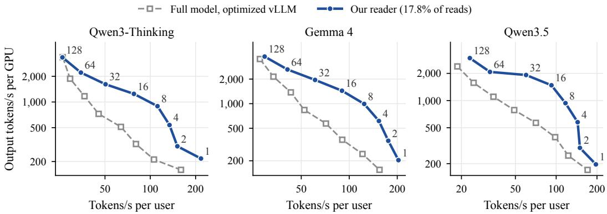  
Figure 12: Our reader raises per-GPU throughput at the same per-user speed. Whole-model decoding of three post-trained models at 17.8% of routed-expert reads, against optimized vLLM, from Table 20 (128-token prompts, one RTX PRO 6000 Blackwell GPU). Each point is one batch size, labeled for our reader. Per-user speed is the inverse of the time per output token, and per-GPU throughput is the batch’s total output rate.

Larger batches. Tokens in a batch together select more channels, so the gain shrinks at large batches. Whole-model speedup peaks at batch 8 or 16 (1.75× on Qwen3-Thinking, 1.74× on Gemma 4, and 1.88× on Qwen3.5) and falls to 1.00×, 1.07×, and 1.24× at batch 128 (Table 20).

Serving trade-off. Figure 12 shows the trade-off between each user’s speed and the GPU’s total throughput. At batch one, our reader generates 196 to 217 tokens per second per user. The full model reaches this speed at no batch size; at batch one it generates 155 to 171 tokens per second. At the same per-user speed, between 80 and 120 tokens per second, one GPU generates 3.3 to 4.4 times as many tokens per second in total with our reader (3.3 to 4.3 at 100), interpolating log-linearly between measured batch sizes. The full model must run smaller batches to stay that fast. At longer contexts, attention takes a larger share of each step, and this advantage shrinks.