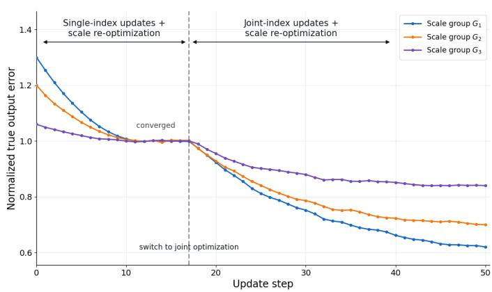
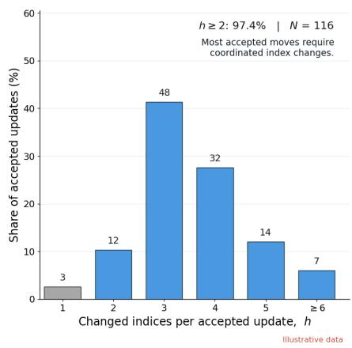
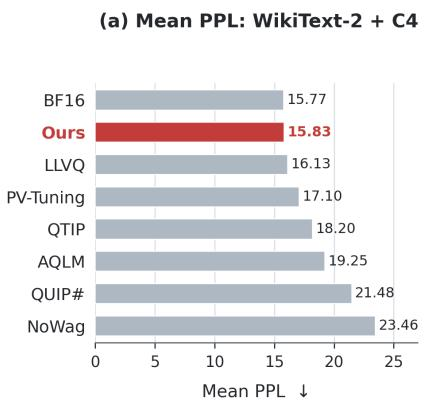
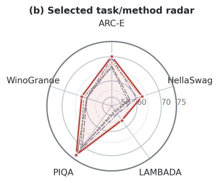
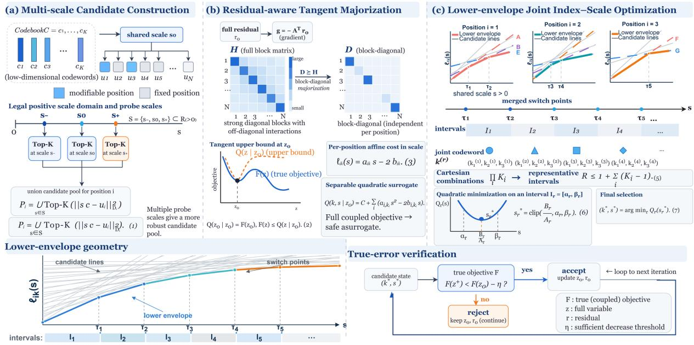

# COS-VQ: Coordinated Shared-Scale Vector Quantization for Large Language Models

Zukang Xu1\* Zhixiong Zhao1,2\* Xing Hu1,3

Zhe Jiang3 Xin Si3 Dawei Yang1†

1Houmo AI

2Peking University

3Southeast University

## Abstract

Large language models (LLMs) require substantial memory, motivating low-bit weight quantization for efficient deployment. Existing vector quantization (VQ) methods often improve accuracy by increasing the effective coding dimension, which can complicate independent lookup and local codeword updates. We propose COS-VQ (Coordinated Shared-Scale Vector Quantization), which preserves low-dimensional codewords while jointly optimizing hard indices and their shared scale across positions. The key challenge is scaleinduced coupling: the optimal scale depends on the entire codeword combination and, in turn, changes candidate rankings across positions, so pointwise updates can stall even af ter scale re-optimization. COS-VQ collects candidates at multiple probe scales and constructs a tangent separable upper bound for the residual-aware quadratic objective. By reducing candidate comparisons to lower envelopes of lines over positive scales, it identifies finitely many representative intervals for joint index– scale updates without exhaustively enumerating codeword combinations. On Qwen3.8-27B, COS-VQ outperforms QTIP and LLVQ on the evaluated language modeling, coding, and reasoning benchmarks. Ablations from the same initialization further show larger gains from joint updates than from scale-only refinement, highlighting joint selection as an alternative to increasing codeword dimensionality. The code is available at https://github.com/xzktx 003/Cos\_VQ.

## 1 Introduction

Large language models (LLMs) have demonstrated remarkable capabilities across diverse tasks, including natural language understanding, complex reasoning, and code generation. Despite these advances, the growing scale of LLMs poses significant challenges to their efficient deployment. Representative models such as LLaMA-3.1-70B (Grattafiori et al., 2024a) and Qwen3.8-27B (Qwen Team, 2026b) contain tens of billions of parameters, with a 70B-parameter model alone requiring approximately 140 GB of memory to store its weights in 16-bit precision. Beyond the substantial memory footprint, autoregressive inference involves repeated weight access, placing considerable pressure on memory bandwidth and further limiting deployment efficiency. These challenges have driven growing interest in model compression techniques that reduce memory requirements and inference costs while preserving the capabilities of the original models.

Post-training quantization (PTQ) has emerged as a practical paradigm for reducing the storage and inference costs of LLMs without full model retraining (Zhao et al., 2026a,c,b,d, 2025). Among existing approaches, vector quantization (VQ) represents multiple weights using a single code index, offering greater representational flexibility than conventional scalar quantization, particularly at extremely low bitrates. Recent methods such as QTIP and LLVQ further improve quantization quality by exploiting high-dimensional representations through trellis and lattice structures (Tseng et al., 2024b; van der Ouderaa et al., 2026). Although these structures alleviate the exponential search and storage costs associated with unstructured high-dimensional codebooks, they introduce structural dependencies that can restrict the independent lookup and local modification of small codewords. This raises a fundamental question: Can low-dimensional codewords retain their independent lookup and local update capabilities while achieving the quantization quality of highdimensional structured methods through a broader range of joint decisions?

To answer this question, we distinguish joint

(a) Joint updates resume descent after single-index convergence

  
(b) Accepted moves are predominantly multi-index

  
Figure 1: (a) Three shared-scale groups approach a coordinate-wise stall under single-index updates with scale re-optimization. After switching to joint-index updates, the normalized true layer-output error decreases further. Each curve is normalized to 1 at the switching point. (b) Distribution of the number of changed indices among accepted updates, showing that multi-index updates account for the majority.

representation within a vector from joint selection across multiple vectors. In shared-scale VQ, multiple positions within a scale group are assigned low-dimensional codewords while sharing a common scale parameter. Crucially, the optimal scale depends on the entire codeword assignment and, in turn, changes the relative preference among candidate codewords at different positions. This bidirectional coupling creates a challenging optimization landscape: even when the shared scale is re-optimized after each singleindex update, coordinate-wise refinement can stall because no individual index change reduces the reconstruction error, whereas coordinated changes across multiple positions can still yield improvements. As illustrated in Figure 1, the reconstruction error plateaus under pointwise refinement but decreases again after switching to joint-index updates, with accepted updates frequently modifying multiple indices. These observations motivate joint codeword selection under a shared scale, enabling a broader optimization scope without increasing the dimensionality of the underlying codewords.

To address this challenge, we propose COS-VQ (Coordinated Shared-Scale Vector Quantization), which jointly optimizes hard codeword indices and their shared scale while preserving lowdimensional codewords. Directly optimizing these variables is computationally intractable because the layer-output reconstruction objective contains cross-position quadratic interactions, and exhaustive enumeration of codeword combinations incurs exponential complexity. We first construct candidate pools by combining local shortlists obtained at multiple probe scales, preventing the search from being restricted to candidate rankings under a single scale. We then derive a residual-aware tangent separable upper bound that transforms the coupled quadratic objective into candidate-wise quadratic functions of the shared scale. By eliminating candidate-independent terms, codeword comparisons over positive scales can be expressed as lower envelopes of lines. Merging their switching points partitions the scale domain into finitely many representative intervals, within each of which the joint codeword assignment remains constant and the scale can be optimized through a constrained one-dimensional quadratic problem. The resulting solver directly updates hard indices and the shared scale without probabilistic relaxation or gradient-based optimization, while verifying accepted updates against the true layer-output error. The experiments further support this joint-selection design, as illustrated by the language-modeling and downstream-task results in Figure 2. Our key contributions can be summarized as follows:

• We propose CoS-VQ, a coordinated sharedscale VQ framework that jointly optimizes hard indices and shared scales while preserving low-dimensional codewords.

• We develop a residual-aware separable upper bound and a lower-envelope interval solver, with theoretical guarantees on surrogate optimality and interval complexity.

• Extensive experiments across multiple LLMs

  
PPL bars: equal-weight WikiText-2/C4 mean (not token-pooled). Radar: nonlinear accuracy scale 35-75; omits ARC-C, LLVQ, QTIP, BF16. Ours -- PV-Tuning.-- AQLM---- NoWag-- QUIP#

Figure 2: Overview of Qwen3-4B results. (a) Equal-weight mean of WikiText-2 and C4 perplexity across the evaluated low-bit quantization methods. (b) Comparison of selected methods on five downstream tasks.

demonstrate superior low-bit quantization quality, supported by joint-optimization and codeword-dimension ablations.

## 2 Related Work

Vector quantization methods. Low-bit quantization methods span scalar quantization, explicit vector codebooks, additive or residual codebooks, and structured lattice or trellis encodings. GPTVQ (van Baalen et al., 2024) combines vector representations with layer reconstruction; VPTQ (Liu et al., 2024) constructs explicit codebooks using secondorder objectives; AQLM (Egiazarian et al., 2024) uses additive codebooks and block-level refinement; and CRVQ (Xu et al., 2024) relaxes constraints for critical channels. QuIP# (Tseng et al., 2024a) combines incoherence processing with lattice quantization, while QTIP (Tseng et al., 2024b) and LLVQ (van der Ouderaa et al., 2026) exploit trellis and lattice structures to increase effective coding dimensionality. OstQuant (Hu et al., 2025) learns orthogonal and scaling transforms for scalar grids. RSAVQ (Xu et al., 2025b), PCDVQ (Yue et al., 2025), RWKVQuant (Xu et al., 2025a), and KBVQ-MoE (Xu et al., 2026) leverage curvature, polar magnitude–direction decoupling, hybrid scalar–vector codes, and expert structure, respectively. Unstructured high-dimensional codebooks incur costly nearest-neighbor search and cache demands, whereas structured encodings depend on constraints or specialized decoding kernels. In contrast, we study low-dimensional codebooks with a shared scale, retaining portability, independent lookup, and local rewriting while using coordinated cross-position selection to approach the quality of high-dimensional structured quantization.

Quantization optimization methods. On interaction search and parameter updates, GPTVQ (van Baalen et al., 2024) employs sequential compensation, AQLM (Egiazarian et al., 2024) adopts beam search, VPTQ (Liu et al., 2024) leverages secondorder refinement, CRVQ (Xu et al., 2024) models critical channels, and KBVQ-MoE (Xu et al., 2026) accounts for expert-aggregation bias. PV-Tuning (Malinovskii et al., 2024), GPTVQ (van Baalen et al., 2024), GSQ (Dadgarnia et al., 2026), and LLVQ (van der Ouderaa et al., 2026) explore alternating updates or closed-form solutions for discrete assignments and continuous scales. In contrast, COS-VQ jointly optimizes hard indices and their shared positive scale through scale elimination, a residual-aware tangent separable upper bound, and lower-envelope interval search, avoiding heuristic enumeration of the Cartesian product.

## 3 Preliminaries and Problem Formulation

Shared-scale vector quantization. Given a weight matrix $W \in \mathbb { R } ^ { p \times n }$ and calibration inputs $\boldsymbol { X } \in \mathbb { R } ^ { n \times N }$ , we adopt fixed-codebook VQ. We partition the weights into d-dimensional positions, where position i belongs to scale group $\mathcal { G } _ { g }$ and is reconstructed as

$$
\widehat { w } _ { i } = s _ { g } c _ { k _ { i } } , \qquad c _ { k _ { i } } \in \mathcal { C } _ { i } \subset \mathbb { R } ^ { d } .\tag{1}
$$

Positions may share a base codebook, with $\mathcal { C } _ { i }$ denoting the codebook accessible to position i. We use $d = 6$ by default and ablate it under matched actual bitwidth. The joint selection range m, independent of d, specifies the number of indices that may change per round. The codebook, index bitwidth, scale-group partition, and scale count remain fixed; only hard indices and existing scales are updated. For a group of M positions with m $\leq M$ mutable indices, the remaining $M - m$ positions enter the objective with singleton candidate pools, since scale changes also affect their reconstructions.

Layer-output error. We minimize the calibration layer-output error

$$
F ( { \widehat { W } } ) = \| W X - { \widehat { W } } X \| _ { F } ^ { 2 } .\tag{2}
$$

Each round selects a complete scale group while fixing the out-of-group state. Let z concatenate its weight vectors, with current value $z _ { 0 } ,$ and define a linear operator A mapping an in-group modification δ to the vectorized output change after scattering δ into the weight matrix. With $r _ { 0 } = \operatorname { v e c } ( W X - { \widehat { W } } _ { 0 } X )$ , the group objective becomes $\lVert \boldsymbol { r } _ { 0 } - \boldsymbol { \mathcal { A } } ( z - z _ { 0 } ) \rVert _ { 2 } ^ { 2 }$ Each position has a finite candidate pool $\mathcal { P } _ { i }$ containing its current codeword, and $s \in \mathcal { S } \ = \ [ s _ { \operatorname* { m i n } } , s _ { \operatorname* { m a x } } ]$ , where $0 < s _ { \operatorname* { m i n } } \le s _ { \operatorname* { m a x } } < \infty$ and the current scale is feasible. For floating-point storage, S is intersected with the set of legally representable scales.

Joint coupling under a shared scale. Sharedscale coupling is evident even in the simpler Euclidean objective $\begin{array} { r } { E ( k , s ) ~ = ~ \sum _ { i } \| w _ { i } - s c _ { k _ { i } } \| _ { 2 } ^ { 2 } } \end{array}$ When the denominator is nonzero and the solution is feasible, the optimal scale is

$$
s ^ { * } ( k ) = \frac { \sum _ { i } w _ { i } ^ { \top } c _ { k _ { i } } } { \sum _ { i } \| c _ { k _ { i } } \| _ { 2 } ^ { 2 } } .\tag{3}
$$

At a fixed scale, position-wise selection is separable; re-optimizing the scale couples candidate choices through the entire codeword assignment. Eq. 3 illustrates this mechanism but does not generally solve Eq. 2. The true output error also involves quadratic cross-position interactions induced by calibration inputs and position layout. We therefore construct a residual-aware surrogate and exploit the shared-scale structure for optimization. Each round activates at most four existing scale groups per row (groups\_per\_row=4), a search budget that introduces no additional stored scales; within each group, m limits the number of mutable indices.

## 4 Method

Overview. We propose COS-VQ to improve lowbit VQ through coordinated index selection under an existing shared scale, without increasing the base-codeword dimension or introducing new stored parameters. As illustrated in Figure 3, the method alternates between two steps. First, a residual-aware quadratic majorizer controls crossposition interactions, while multiple scale probes provide codeword candidates beyond those preferred at the current scale. Second, a lowerenvelope solver jointly selects hard indices and their shared positive scale by searching finitely many scale intervals. Every proposed update is checked against the true calibration layer-output error. The complete schedule and pseudocode appear in Appendix A.1.1, and a checkable coordinatedupdate example is given in Appendix A.2.

## 4.1 Residual-Aware Majorization and Candidate Construction

For a selected scale group, let $z _ { \mathrm { 0 } }$ concatenate its current reconstructed weight vectors and let $\delta =$ $z - z _ { 0 }$ . With the group-restricted output operator A and full residual $r _ { 0 }$ defined in Section 3, set $H = \mathcal { A } ^ { \top } \mathcal { A }$ and $g = - A ^ { \top } r _ { 0 }$ . The exact layeroutput objective is

$$
\boldsymbol { F } ( \boldsymbol { z } _ { 0 } + \delta ) = \boldsymbol { F } ( \boldsymbol { z } _ { 0 } ) + 2 \boldsymbol { g } ^ { \top } \boldsymbol { \delta } + \boldsymbol { \delta } ^ { \top } \boldsymbol { H } \boldsymbol { \delta } .\tag{4}
$$

The vector g captures how each group-wise change interacts with the entire current layer-output residual, including errors contributed by groups that are held fixed. In contrast, scoring each candidate solely against its original unquantized weight would ignore this residual context. Meanwhile, the off-diagonal blocks $H _ { i j }$ describe how simultaneous changes at distinct positions interact under the calibration inputs. Directly optimizing all of these interactions is difficult when indices must remain discrete. We therefore retain the exact first-order term while replacing the cross-position quadratic curvature with the block-diagonal majorizer

$$
\begin{array} { r } { D _ { i } = H _ { i i } + \left( \displaystyle \sum _ { j \neq i } \| H _ { i j } \| _ { 2 } + \varepsilon \right) I _ { d } , } \\ { D = \mathrm { b l k } \mathrm { d i a g } ( D _ { 1 } , \ldots , D _ { M } ) , \quad \varepsilon > 0 . } \end{array}\tag{5}
$$

The block Cauchy–Schwarz inequality gives $D -$ $H \ \succeq \ \varepsilon I .$ , yielding the tangent separable upper bound (Hunter and Lange, 2004)

$$
\begin{array} { c } { Q ( z \mid z _ { 0 } ) = F ( z _ { 0 } ) + 2 g ^ { \top } ( z - z _ { 0 } ) } \\ { + ( z - z _ { 0 } ) ^ { \top } D ( z - z _ { 0 } ) . } \end{array}\tag{6}
$$

The construction follows from bounding each offdiagonal interaction by its spectral norm, so it requires no manually chosen global curvature constant. In particular, $D _ { i } \succ 0 .$ , and all interactions are upper-bounded without discarding the gradient induced by the full residual. Thus $F ( z ) \leq Q ( z \mid z _ { 0 } )$ with equality and matching continuous-weight gradients at z0; Appendix A.3.1 proves these properties and gives the exact surrogate gap. As with other majorization methods, the bound can be conservative, and the resulting minimizer is not automatically optimal for the true objective.

  
Figure 3: Overview of COS-VQ. (a) Multi-scale probes construct candidate pools. (b) A residual-aware tangent majorizer yields separable quadratic costs and affine comparisons over the shared scale. (c) Lower-envelope breakpoints define intervals for joint index–scale optimization. The lower panels illustrate the envelope geometry and true-error verification. Proofs and boundary cases appear in Appendix A.3.2.

Let $h _ { i } = D _ { i } z _ { 0 i } - g _ { i }$ . Substituting the sharedscale reconstruction $z _ { i } = s c _ { i k }$ into Eq. 6 yields

$$
Q ( k , s \mid z _ { 0 } ) = C + \sum _ { i = 1 } ^ { M } \left( a _ { i k _ { i } } s ^ { 2 } - 2 b _ { i k _ { i } } s \right) ,\tag{7}
$$

where $a _ { i k } = c _ { i k } ^ { \top } D _ { i } c _ { i k } \ge 0 , b _ { i k } = c _ { i k } ^ { \top } h _ { i }$ , and $C$ is independent of $( k , s )$ . To avoid limiting selection to a single scale, we build each mutable position’s pool from the top-K codewords under $\| s c - u _ { i } \| _ { D _ { i } } ^ { 2 }$ at multiple probes $s \in \Sigma$ , where $u _ { i } = z _ { 0 i } - D _ { i } ^ { - 1 } g _ { i }$ and $\| v \| _ { D _ { i } } ^ { 2 } = v ^ { \top } D _ { i } v$ . The probe set includes the current scale and explores other points in the admissible range, since a codeword that ranks poorly at the current scale may become preferable after coordinated scale movement. The union retains the current codeword and is capped at $K _ { \mathrm { m a x } }$ , prioritizing repeated probe hits when truncation is necessary; nonmutable positions retain singleton pools. All candidates still belong to the fixed original codebook: probes expand the search coverage rather than the deployed representation or the number of stored scales. Moreover, all M positions remain in Eq. 7 even if only m indices may change, because the common scale also changes their reconstructions. The full candidate-selection rule and the group-activation schedule are specified in Appendices A.1.2 and A.1.1, respectively.

## 4.2 Lower-Envelope Joint Index–Scale Optimization

Although the majorizer removes explicit crossposition quadratic interactions, the shared scale still couples codeword assignments across positions. For a fixed positive scale $s ,$ candidate choices in Eq. 7 separate by position. Dividing each candidate-dependent cost by $s > 0$ preserves its ordering and yields the affine lines

$$
\ell _ { i k } ( s ) = a _ { i k } s - 2 b _ { i k } , \qquad L _ { i } ( s ) = \operatorname* { m i n } _ { k \in \mathcal { P } _ { i } } \ell _ { i k } ( s ) .\tag{8}
$$

Consequently, min $\begin{array} { r c l c r } { { Q ( k , s } } & { { | } } & { { z _ { 0 } ) } } & { { = } } & { { C \ + } } \end{array}$ $s \sum _ { i } L _ { i } ( s )$ . Importantly, division by s is used only to compare codeword candidates: the full quadratic dependence on the stored scale remains in the optimization objective. For each position, we sort its candidate lines by slope, remove dominated equal-slope lines, and maintain intersections between adjacent active lines to construct the lower envelope. We then merge the active switching points across all positions with the scale-domain boundaries. Between consecutive switches, each position’s minimizing codeword stays unchanged, defining one representative joint assignment $k ^ { ( r ) }$ This arrangement coordinates otherwise independent candidate rankings through their shared scale without enumerating every combination. If position i has $K _ { i } = | \mathcal { P } _ { i } |$ candidates, the number of open intervals satisfies

$$
R \leq 1 + \sum _ { i = 1 } ^ { M } ( K _ { i } - 1 ) .\tag{9}
$$

Thus the number of representative combinations grows at most linearly in the pool sizes, rather than as $\Pi _ { i } K _ { i }$ . For example, 20 mutable positions with eight candidates each produce no more than 141 representative intervals; singleton positions contribute no new switching points. Simultaneous switches may further reduce the number. This is a structural bound on interval enumeration, not on the cost of building the majorizer or ranking codebook entries at the probes.

For an interval closure $I _ { r } = [ \alpha _ { r } , \beta _ { r } ]$ , let $A _ { r } =$ $\sum _ { i } a _ { i , k _ { i } ^ { ( r ) } }$ and $\begin{array} { r } { B _ { r } = \sum _ { i } b _ { i , k _ { i } ^ { ( r ) } } } \end{array}$ . Its full surrogate remains quadratic, $Q _ { r } ( s ) = C + A _ { r } s ^ { 2 } - 2 B _ { r } s$ For continuous scales and $A _ { r } > 0$ , the constrained minimizer is

$$
s _ { r } ^ { * } = \mathrm { c l i p } ( B _ { r } / A _ { r } , \alpha _ { r } , \beta _ { r } ) .\tag{10}
$$

The interval coefficients $A _ { r }$ and $B _ { r }$ can be updated incrementally at switching events, without recomputing the sums for every representative. For stored floating-point scales, we instead compare the closest legal values within each interval, explicitly handling switching boundaries and intervals without representable scales. At a switching boundary, neighboring representatives tie in the surrogate, so deterministic tie handling suffices for its minimum; tied combinations need not have identical true errors. Appendix A.3.2 details legal-scale and degenerate cases. Comparing interval minima globally solves the current surrogate over the current candidate pools, not the original coupled objective over the full codebook (Theorem 1).

The selected indices and scale are converted to their actual storage format. An update $z _ { + }$ is accepted only if $F ( z _ { + } ) \leq F ( z _ { 0 } ) - \eta .$ where $\eta > 0$ is the prescribed decrease threshold. Since the current state belongs to the pools, exact surrogate minimization implies

$$
F ( z _ { + } ) \leq Q ( z _ { + } \mid z _ { 0 } ) \leq F ( z _ { 0 } )\tag{11}
$$

before thresholded acceptance, under exact arithmetic. True-error verification protects against rounding and surrogate-solver approximations. Importantly, an exact surrogate optimum is guaranteed to be non-increasing under the true objective, but a surrogate can still be too conservative to propose a genuinely improving joint move; the method does not claim unconditional escape from every coordinate-wise stall. Accepted changes update the full residual before the next scheduled group is processed, and the search stops after a sweep without accepted changes or at the prescribed iteration limit. Appendix A.3.3 derives the surrogate gap and the precise descent conditions, while Appendix A.1.4 distinguishes envelope complexity from the cost of curvature, probe scoring, and true-error verification. After joint search, we optionally freeze hard indices and fine-tune the existing scales on the same calibration data. This stage does not increase the number of stored scales and is evaluated in Table 6. Per-model breakdowns appear in Appendix A.6.

## 5 Experiments

## 5.1 Experimental Setup

Models and datasets. We evaluate four Qwen3 (Qwen Team, 2025) models (4B, 8B, 14B, and 32B) and two Llama-3.1 (Grattafiori et al., 2024b) models (8B-Instruct and 70B-Instruct). Qwen3.8-27B (Qwen Team, 2026a) is evaluated separately with thinking enabled. Perplexity is measured on WikiText-2 (Merity et al., 2017) and C4 (Raffel et al., 2020) with sequence length 2,048. We use LM Evaluation Harness v0.4.4 (Gao et al., 2024) for zero-shot ARC-Challenge and ARC-Easy (Clark et al., 2018), HellaSwag (Zellers et al., 2019), LAMBADA OpenAI (Paperno et al., 2016), PIQA (Bisk et al., 2020), BoolQ (Clark et al., 2019), MMLU (Hendrycks et al., 2021), and Wino-Grande (Sakaguchi et al., 2020). IFEval (Zhou et al., 2023) is used only for instruction/chat models with an official chat template.

Quantization protocol. The main setting uses $d = 6 , K = 4 0 9 6 .$ , and a 12-bit index (2 bits per weight), with one FP16 group scale per 128 input columns (≈ 0.125 bit per weight). Each round selects at most four existing scale groups per row. We calibrate each model using 320 RedPajama-Data-1T (Together Computer, 2023) sequences of length 4,096. After joint search, we freeze hard indices and fine-tune existing scales on the same calibration data. Detailed results for Table 1 appear in Appendix A.6. Table 6 evaluates scale fine-tuning, while Table 2 compares scale and assignment optimization from identical initializations.

Table 1: Main results on six models. PPL.AVG is the arithmetic mean of WikiText-2 and C4 perplexities. ACC.AVG is the macro-average of ARC-Challenge, ARC-Easy, HellaSwag, LAMBADA OpenAI, PIQA, and WinoGrande. Bold denotes the best result among quantized methods.
<table><tr><td></td><td colspan="2">Qwen3-4B</td><td colspan="2">Qwen3-8B</td><td colspan="2">Qwen3-14B</td></tr><tr><td>Method</td><td>PPL.AVG↓</td><td>ACC.AVG↑</td><td>PPL.AVG↓</td><td>ACC.AVG↑</td><td>PPL.AVG↓</td><td>ACC.AVG↑</td></tr><tr><td>BF16</td><td>15.77</td><td>66.79</td><td>12.01</td><td>70.37</td><td>10.75</td><td>73.77</td></tr><tr><td>PV-Tuning</td><td>17.10</td><td>59.57</td><td>12.90</td><td>66.84</td><td>11.36</td><td>70.92</td></tr><tr><td>QuIP#</td><td>21.48</td><td>57.03</td><td>15.76</td><td>65.32</td><td>13.37</td><td>69.65</td></tr><tr><td>QTIP</td><td>18.20</td><td>60.30</td><td>13.91</td><td>66.80</td><td>12.09</td><td>71.50</td></tr><tr><td>NoWag</td><td>23.46</td><td>57.19</td><td>15.96</td><td>65.73</td><td>13.32</td><td>69.63</td></tr><tr><td>AQLM</td><td>19.25</td><td>60.08</td><td>14.28</td><td>67.12</td><td>12.39</td><td>71.03</td></tr><tr><td>LLVQ</td><td>16.13</td><td>60.77</td><td>11.57</td><td>67.35</td><td>11.32</td><td>71.28</td></tr><tr><td>CoS-VQ</td><td>15.83</td><td>61.42</td><td>12.20</td><td>68.61</td><td>10.80</td><td>71.01</td></tr><tr><td></td><td colspan="2">Qwen3-32B</td><td colspan="2">Llama-3.1-8B-Inst.</td><td colspan="2">Llama-3.1-70B-Inst.</td></tr><tr><td>Method</td><td>PPL.AVG↓</td><td>ACC.AVG↑</td><td>PPL.AVG↓</td><td>ACC.AVG↑</td><td>PPL.AVG↓</td><td>ACC.AVG↑</td></tr><tr><td>BF16</td><td>9.56</td><td>74.81</td><td>8.93</td><td>73.55</td><td>5.89</td><td>78.37</td></tr><tr><td>PV-Tuning</td><td>10.18</td><td>74.51</td><td>10.78</td><td>64.90</td><td>8.33</td><td>73.54</td></tr><tr><td>QuIP#</td><td>12.15</td><td>73.42</td><td>12.30</td><td>64.71</td><td>8.39</td><td>71.45</td></tr><tr><td>QTIP</td><td>10.51</td><td>74.21</td><td>11.10</td><td>69.52</td><td>7.78</td><td>74.01</td></tr><tr><td>NoWag</td><td>11.27</td><td>74.29</td><td>12.89</td><td>67.67</td><td>8.68</td><td>73.09</td></tr><tr><td>AQLM</td><td>10.68</td><td>74.63</td><td>12.25</td><td>55.55</td><td>8.19</td><td>69.01</td></tr><tr><td>LLVQ</td><td>10.01</td><td>74.70</td><td>10.86</td><td>68.75</td><td>7.77</td><td>73.47</td></tr><tr><td>CoS-VQ</td><td>9.87</td><td>74.67</td><td>10.56</td><td>69.16</td><td>7.73</td><td>74.05</td></tr></table>

Baselines and hardware. We compare against BF16, PV-Tuning (Malinovskii et al., 2024), QuIP# (Tseng et al., 2024a), QTIP (Tseng et al., 2024b), NoWag (Liu et al., 2025), AQLM (Egiazarian et al., 2024), and LLVQ (van der Ouderaa et al., 2026). All quality evaluations and joint-search experiments are performed on NVIDIA A100-SXM4- 80GB GPUs. Decode throughput in Table 4 is measured on an NVIDIA GeForce RTX 4090.

## 5.2 Main Results

Table 1 compares COS-VQ with quantization baselines at a 2-bit target across six LLMs. COS-VQ achieves the lowest average perplexity on five of six models and the highest average downstream accuracy on three, demonstrating competitive performance across model families. On Qwen3-4B, it improves PPL.AVG from 16.13 to 15.83 and ACC.AVG from 60.77 to 61.42 compared with LLVQ. Although LLVQ and QTIP retain advantages on certain models or metrics, COS-VQ delivers a competitive balance between language modeling and downstream accuracy. These results highlight the effectiveness of coordinated selection with low-dimensional codewords. Detailed task-wise results are provided in Appendix A.6, while storage accounting, including indices, codebooks, and scales, is discussed in Appendix A.4.

Table 2: Same-start ablation of shared-scale optimization (Scale) and hard-index assignment (Assign). Avg. denotes the mean accuracy across eight zero-shot tasks.
<table><tr><td>Model</td><td>Scale</td><td>Assign</td><td>Wiki2↓</td><td>Avg.↑</td></tr><tr><td rowspan="3">Qwen3-4B</td><td>X</td><td>X</td><td>22.69</td><td>58.81</td></tr><tr><td>√</td><td>X</td><td>21.01</td><td>59.32</td></tr><tr><td>√</td><td>√</td><td>13.68</td><td>62.58</td></tr><tr><td rowspan="3">Qwen3-8B</td><td>X</td><td>X</td><td>14.41</td><td>66.44</td></tr><tr><td>√</td><td>X</td><td>13.85</td><td>67.19</td></tr><tr><td>√</td><td>√</td><td>9.76</td><td>69.43</td></tr></table>

Table 3: Qwen3.8-27B with thinking enabled. Bold denotes the best quantized result.
<table><tr><td>Method</td><td>Wiki2↓</td><td>C4↓</td><td>AIME25↑</td><td>LCBv6↑</td><td>GPQA-D↑</td></tr><tr><td>BF16</td><td>7.05</td><td>11.45</td><td>100.00</td><td>85.71</td><td>89.90</td></tr><tr><td>QTIP</td><td>8.29</td><td>13.76</td><td>93.33</td><td>73.65</td><td>81.11</td></tr><tr><td>LLVQ</td><td>8.22</td><td>13.85</td><td>93.33</td><td>72.28</td><td>80.48</td></tr><tr><td>CoS-VQ</td><td>7.84</td><td>13.33</td><td>93.33</td><td>74.92</td><td>82.83</td></tr></table>

## 5.3 Ablation Studies

Scale and assignment. Table 2 evaluates sharedscale refinement and hard-index assignment from identical initializations. Avg. denotes the mean accuracy across eight zero-shot tasks: ARC-Challenge, ARC-Easy, HellaSwag, LAMBADA OpenAI, PIQA, BoolQ, MMLU, and WinoGrande. Scale-only optimization reduces WikiText-2 perplexity from 22.69/14.41 to 21.01/13.85 on Qwen3- 4B/8B. In contrast, joint optimization reduces perplexity to 13.68/9.76 and improves average zeroshot accuracy from 59.32/67.19 to 62.58/69.43. These gains demonstrate that coordinated hardindex updates, rather than scale refinement alone, account for most of the improvement by enabling joint changes across positions.

Table 4: Offline quantization time on an A100- SXM4-80GB GPU and Llama-3.1-8B-Instruct inference throughput on an RTX 4090 with a 2K-token context.
<table><tr><td colspan="4">Offline Quantization Time</td></tr><tr><td>Model Time (h)↓</td><td>Q3-4B 1.3</td><td>Q3-8B Q3-14B 1.6 2.0</td><td>Q3-32B 3.5</td></tr><tr><td></td><td colspan="3">Inference Throughput</td></tr><tr><td>Method</td><td>Prefill (tok/s)↑</td><td></td><td>Decode (tok/s)↑</td></tr><tr><td>BF16</td><td>2217.6</td><td></td><td>21.9</td></tr><tr><td>CoS-VQ</td><td>2230.2</td><td></td><td>36.7</td></tr></table>

Thinking-mode evaluation. Table 3 evaluates Qwen3.8-27B with thinking enabled. COS-VQ improves WikiText-2/C4 perplexity, LiveCodeBench v6, and GPQA-D over both quantized baselines (Jain et al., 2025; Rein et al., 2023), and it matches them on AIME 2025 (Mathematical Association of America, 2025). Relative to QTIP, WikiText-2/C4 fall from 8.29/13.76 to 7.84/13.33, LiveCodeBench v6 rises from 73.65 to 74.92, and GPQA-D rises from 81.11 to 82.83; AIME 2025 is 93.33 for all three quantized methods.

## 5.4 Efficiency

Quantization time and inference throughput. Table 4 reports offline quantization time on an A100-SXM4-80GB GPU and inference throughput on an RTX 4090. Quantization takes 1.3 hours for Qwen3-4B and 3.5 hours for Qwen3- 32B. On Llama-3.1-8B-Instruct, prefill throughput remains comparable to BF16 (2230.2 versus 2217.6 tok/s), while decode throughput increases from 21.9 to 36.7 tok/s, achieving a 1.68× speedup at a 2K-token context. These gains benefit from low-dimensional codebook lookup, while joint optimization is performed entirely offline.

Base-codeword dimension. Table 5 examines the quality–rate trade-off across different basecodeword dimensions. Increasing d to 8 improves all evaluated metrics but raises the bitrate to 2.59 bpw. Under an approximately 2-bpw budget, d = 4 and d = 5 achieve lower WikiText-2 perplexity, whereas d = 6 consistently outperforms both on all four downstream tasks. We therefore adopt d = 6 as the default setting, balancing downstream accuracy and storage efficiency.

Table 5: Effect of base-codeword dimension d on Qwen3-4B. The default d = 6 balances accuracy and bitrate under an approximately 2-bpw budget.
<table><tr><td>ARC-C↑ ARC-E↑ HellaSwag↑</td></tr><tr><td>d bpw Wiki2↓ 42.01 12.96</td><td>41.27</td><td>68.90</td><td>62.11</td><td>MMLU↑ 53.23</td></tr><tr><td>5 2.02</td><td>12.74</td><td>42.50</td><td>69.46</td><td>62.78</td></tr><tr><td>62.04</td><td>13.68</td><td>42.92</td><td>70.12</td><td>53.89 63.16 55.01</td></tr><tr><td>82.59</td><td>11.87</td><td>43.27</td><td>70.73 64.28</td><td>55.71</td></tr></table>

Table 6: Ablation of end-to-end scale fine-tuning on Qwen3. Each entry reportsfine-tuned / notfine-tuned.
<table><tr><td>Model</td><td>Wiki2↓</td><td>ARC-C↑</td><td>HellaS↑</td><td>WinoG↑</td></tr><tr><td>Q3-4B</td><td>12.18/12.69</td><td>42.92/42.6363.17/62.2862.90/62.39</td><td></td><td></td></tr><tr><td>Q3-8B</td><td>9.76/10.17</td><td>54.52/53.8769.80/69.6468.67/68.80</td><td></td><td></td></tr><tr><td>Q3-14B</td><td>8.51/9.78</td><td>53.24/52.7675.30/75.4771.98/71.01</td><td></td><td></td></tr><tr><td>Q3-32B</td><td>7.74/8.06</td><td>60.32/59.7878.17/78.1176.09/76.30</td><td></td><td></td></tr></table>

End-to-end scale fine-tuning. Table 6 evaluates scale fine-tuning after joint search with hard indices frozen. Fine-tuning consistently reduces WikiText-2 perplexity across all four Qwen3 models, particularly on Qwen3-14B (9.78 to 8.51), and improves ARC-C accuracy. HellaSwag and Wino-Grande show overall gains, with minor regressions on certain models. Unlike the coordinated index updates in Table 2, this stage refines only existing scales, providing complementary improvements rather than replacing joint selection. This ablation is distinct from the endpoints in Table 1. Additional task-wise results appear in Appendix A.6.

## 6 Conclusion

We presented COS-VQ, a low-bit VQ framework preserving independently accessible, locally rewritable low-dimensional codewords through coordinated shared-scale selection. To address coordinate-wise stalls after scale re-optimization, COS-VQ combines multi-scale candidate pools, a residual-aware tangent separable upper bound, and lower-envelope search to jointly optimize hard indices and scales without exhaustive enumeration. Same-start ablations show improvements over scale-only refinement on Qwen3-4B/8B. At approximately 2 bpw, COS-VQ outperforms QTIP and

LLVQ on language modeling, coding, and selected reasoning benchmarks for Qwen3.8-27B. These findings establish joint selection as a promising alternative to increasing codeword dimensionality.

## Limitations

CoS-VQ optimizes hard indices and shared scales within finite candidate pools, so its theoretical optimality guarantee applies to the surrogate objective rather than the original layer-output error. Although true-error verification ensures nonincreasing accepted updates, the surrogate may be too conservative to escape certain coordinate-wise stalls. Moreover, candidate quality depends on the multi-scale probe coverage and the chosen codebook. Our experiments focus on selected LLM families and benchmarks, leaving broader architectures and extremely low-bit configurations for future evaluation. Finally, inference efficiency depends on hardware and codebook lookup implementations, and performance across different deployment environments remains to be explored.

## Ethical Considerations

CoS-VQ reduces the memory requirements of existing LLMs through post-training quantization without modifying their underlying training objectives. Improved compression may facilitate more accessible and resource-efficient deployment, although actual energy savings depend on hardware and serving conditions and have not been independently measured. Quantization can alter model outputs, potentially affecting factual reliability, fairness, and safety-related behavior. Our evaluations do not constitute dedicated safety, bias, or privacy assessments. Furthermore, reduced deployment costs may also facilitate harmful applications of LLMs. We therefore recommend retaining appropriate access controls and safety safeguards, together with task-specific evaluations, before practical deployment.

## References

Yonatan Bisk, Rowan Zellers, Ronan Le Bras, Jianfeng Gao, and Yejin Choi. 2020. PIQA: Reasoning about physical commonsense in natural language. In AAAI.

Christopher Clark, Kenton Lee, Ming-Wei Chang, Tom Kwiatkowski, Michael Collins, and Kristina Toutanova. 2019. BoolQ: Exploring the surprising difficulty of natural yes/no questions. In NAACL.

Peter Clark, Isaac Cowhey, Oren Etzioni, Tushar Khot, Ashish Sabharwal, Carissa Schoenick, and Oyvind Tafjord. 2018. Think you have solved question answering? try ARC, the AI2 reasoning challenge. arXiv preprint arXiv:1803.05457.

Alireza Dadgarnia, Soroush Tabesh, Mahdi Nikdan, Michael Helcig, Eldar Kurtic, Maximilian Kleinegger, and Dan Alistarh. 2026. GSQ: Highlyaccurate low-precision scalar quantization for LLMs via Gumbel-Softmax sampling. arXiv preprint arXiv:2604.18556.

Vage Egiazarian, Andrei Panferov, Denis Kuznedelev, Elias Frantar, Artem Babenko, and Dan Alistarh. 2024. Extreme compression of large language models via additive quantization. In International Conference on Machine Learning.

Leo Gao, Jonathan Tow, Baber Abbasi, Stella Biderman, Sid Black, Anthony DiPofi, Charles Foster, Laurence Golding, Jeffrey Hsu, Alain Le Noac’h, and 1 others. 2024. A framework for few-shot language model evaluation. Zenodo.

Aaron Grattafiori, Abhimanyu Dubey, Abhinav Jauhri, Abhinav Pandey, Abhishek Kadian, Ahmad Al-Dahle, Aiesha Letman, Akhil Mathur, Alan Schelten, Alex Vaughan, Amy Yang, Angela Fan, Anirudh Goyal, Anthony Hartshorn, Aobo Yang, Archi Mitra, Archie Sravankumar, Artem Korenev, Arthur Hinsvark, and 542 others. 2024a. The llama 3 herd of models. Preprint, arXiv:2407.21783.

Aaron Grattafiori and 1 others. 2024b. The Llama 3 herd of models. arXiv preprint arXiv:2407.21783.

Dan Hendrycks, Collin Burns, Steven Basart, Andy Zou, Mantas Mazeika, Dawn Song, and Jacob Steinhardt. 2021. Measuring massive multitask language understanding. In ICLR.

Xing Hu, Yuan Cheng, Dawei Yang, Zukang Xu, Zhihang Yuan, Jiangyong Yu, Chen Xu, Zhe Jiang, and Sifan Zhou. 2025. OstQuant: Refining large language model quantization with orthogonal and scaling transformations for better distribution fitting. In ICLR.

David R. Hunter and Kenneth Lange. 2004. A tutorial on MM algorithms. The American Statistician, 58(1):30–37.

Naman Jain, King Han, Alex Gu, Wen-Ding Li, Fanjia Yan, Tianjun Zhang, Sida Wang, Armando Solar-Lezama, Koushik Sen, and Ion Stoica. 2025. Live-CodeBench: Holistic and contamination free evaluation of large language models for code. In ICLR.

Lawrence Liu, Inesh Chakrabarti, Yixiao Li, Mengdi Wang, Tuo Zhao, and Lin F. Yang. 2025. NoWag: A unified framework for shape preserving compression of large language models. In Conference on Language Modeling.

Yifei Liu, Jicheng Wen, Yang Wang, Shengyu Ye, Li Lyna Zhang, Ting Cao, Cheng Li, and Mao Yang. 2024. VPTQ: Extreme low-bit vector post-training quantization for large language models. In EMNLP.

Vladimir Malinovskii, Denis Mazur, Ivan Ilin, Denis Kuznedelev, Konstantin Burlachenko, Kai Yi, Dan Alistarh, and Peter Richtarik. 2024. PV-Tuning: Beyond straight-through estimation for extreme LLM compression. In Advances in Neural Information Processing Systems.

Mathematical Association of America. 2025. American invitational mathematics examination (AIME) 2025. https://maa.org/math-competitions/aime.

Stephen Merity, Caiming Xiong, James Bradbury, and Richard Socher. 2017. Pointer sentinel mixture models. In ICLR.

Denis Paperno, Germán Kruszewski, Angeliki Lazaridou, Ngoc Quan Pham, Raffaella Bernardi, Sandro Pezzelle, Marco Baroni, Gemma Boleda, and Raquel Fernández. 2016. The LAMBADA dataset: Word prediction requiring a broad discourse context. In ACL.

Qwen Team. 2025. Qwen3 technical report. arXiv preprint arXiv:2505.09388.

Qwen Team. 2026a. Qwen3.8-27B. https://huggin gface.co/Qwen/Qwen3.8-27B.

Qwen Team. 2026b. Qwen3.8-Max: A new bar for coding and cowork.

Colin Raffel, Noam Shazeer, Adam Roberts, Katherine Lee, Sharan Narang, Michael Matena, Yanqi Zhou, Wei Li, and Peter J. Liu. 2020. Exploring the limits of transfer learning with a unified text-to-text transformer. Journal ofMachine Learning Research, 21(140):1–67.

David Rein, Betty Li Hou, Asa Cooper Stickland, Jackson Petty, Richard Yuanzhe Pang, Julien Dirani, Julian Michael, and Samuel R. Bowman. 2023. GPQA: A graduate-level google-proof q&a benchmark. arXiv preprint arXiv:2311.12022.

Keisuke Sakaguchi, Ronan Le Bras, Chandra Bhagavatula, and Yejin Choi. 2020. WinoGrande: An adversarial winograd schema challenge at scale. In AAAI.

Together Computer. 2023. RedPajama: An open source recipe to reproduce LLaMA training dataset. https: //github.com/togethercomputer/RedPajama-D ata.

Albert Tseng, Jerry Chee, Qingyao Sun, Volodymyr Kuleshov, and Christopher De Sa. 2024a. QuIP#: Even better LLM quantization with Hadamard incoherence and lattice codebooks. In International Conference on Machine Learning.

Albert Tseng, Qingyao Sun, David Hou, and Christopher De Sa. 2024b. QTIP: Quantization with trellises and incoherence processing. In Advances in Neural Information Processing Systems.

Mart van Baalen, Andrey Kuzmin, Ivan Koryakovskiy, Markus Nagel, Peter Couperus, Cedric Bastoul, Eric Mahurin, Tijmen Blankevoort, and Paul Whatmough. 2024. GPTVQ: The blessing of dimensionality for LLM quantization. arXiv preprint arXiv:2402.15319.

Tycho F. A. van der Ouderaa, Mart van Baalen, Paul Whatmough, and Markus Nagel. 2026. Leech lattice vector quantization for efficient LLM compression. arXiv preprint arXiv:2603.11021.

Chen Xu, Yuxuan Yue, Zukang Xu, Xing Hu, Jiangyong Yu, Zhixuan Chen, Sifan Zhou, Zhihang Yuan, and Dawei Yang. 2025a. RWKVQuant: Quantizing the RWKV family with proxy guided hybrid of scalar and vector quantization. In International Conference on Machine Learning.

Yuzhuang Xu, Shiyu Ji, Qingfu Zhu, and Wanxiang Che. 2024. CRVQ: Channel-relaxed vector quantization for extreme compression of LLMs. arXiv preprint arXiv:2412.09282.

Zukang Xu, Xing Hu, Qiang Wu, and Dawei Yang. 2025b. RSAVQ: Riemannian sensitivity-aware vector quantization for large language models. In NeurIPS.

Zukang Xu, Zhixiong Zhao, Xing Hu, Zhixuan Chen, and Dawei Yang. 2026. KBVQ-MoE: KLT-guided SVD with bias-corrected vector quantization for MoE large language models. In ICLR.

Yuxuan Yue, Zukang Xu, Zhihang Yuan, Dawei Yang, Jianlong Wu, and Liqiang Nie. 2025. PCDVQ: Enhancing vector quantization for large language models via polar coordinate decoupling. arXiv preprint arXiv:2506.05432.

Rowan Zellers, Ari Holtzman, Yonatan Bisk, Ali Farhadi, and Yejin Choi. 2019. HellaSwag: Can a machine really finish your sentence? In ACL.

Zhixiong Zhao, Haomin Li, Fangxin Liu, Yuncheng Lu, Zongwu Wang, Tao Yang, Li Jiang, and Haibing Guan. 2025. Quark: Quantization-enabled circuit sharing for transformer acceleration by exploiting common patterns in nonlinear operations. In 2025 IEEE/ACM International Conference On Computer Aided Design (ICCAD), pages 1–9. IEEE.

Zhixiong Zhao, Fangxin Liu, Junjie Wang, Chenyang Guan, Zongwu Wang, Li Jiang, and Haibing Guan. 2026a. Specquant: Spectral decomposition and adaptive truncation for ultra-low-bit llms quantization. In Proceedings of the AAAI Conference on Artificial Intelligence, volume 40, pages 28786–28794.

Zhixiong Zhao, Zukang Xu, Zhixuan Chen, Xing Hu, Zhe Jiang, and Dawei Yang. 2026b. TWLA: Achieving ternary weights and low-bit activations for LLMs via post-training quantization. In Proceedings of the 43rd International Conference on Machine Learning, volume 306 of Proceedings of Machine Learning Research, pages 162517–162554. PMLR.

Zhixiong Zhao, Zukang Xu, Guangyu Sun, Lifeng Liu, and Dawei Yang. 2026c. All for 1-bit: Towards genuine 1-bit post-training quantization for llms. arXiv preprint arXiv:2609.06161.

Zhixiong Zhao, Zukang Xu, and Dawei Yang. 2026d. Bwla: Breaking the barrier of w1ax post-training quantization for llms. In Proceedings of the 64th Annual Meeting ofthe Associationfor Computational Linguistics (Volume 1: Long Papers), pages 19264– 19290.

Jeffrey Zhou, Tianjian Lu, Swaroop Mishra, Siddhartha Brahma, Sujoy Basu, Yi Luan, Denny Zhou, and Le Hou. 2023. Instruction-following evaluation for large language models. arXiv preprint arXiv:2311.07911.

## A Appendix

## A.1 Joint Search Procedure

## A.1.1 Scheduling and Full-Group Scope

The joint-search unit is a complete existing scale group, not just the subset of mutable indices. Let $\mathcal { G } _ { h }$ contain $M _ { h }$ positions sharing one stored positive scale $s _ { h }$ . During one update, a scheduled subset $\mathcal { T } _ { h } \subseteq \mathcal { G } _ { h }$ of at most m positions may change their hard indices. For $i \notin \mathcal { I } _ { h }$ , the candidate pool is the singleton $\{ k _ { i } ^ { ( 0 ) } \}$ . Nevertheless, all $M _ { h }$ positions contribute to the coefficients in Eq. 7 and to true-error verification, because a change in $s _ { h }$ modifies the reconstruction of even a fixed-index position. Group and mutable-position schedules are fixed independently of the interval optimizer; the surrogate-optimality claim is conditional on the pools they select.

To implement the search budget groups\_per\_row=4, we partition eligible groups into an ordered sequence of batches ${ \mathfrak { B } } = ( B _ { 1 } , \dotsc , B _ { J } )$ such that each batch activates at most four existing scale groups per matrix row. A complete sweep visits all batches in order. If more than four groups are eligible in a row, later batches process the remaining groups; none is silently removed. The parameter limits simultaneous search scope and does not create extra stored scales. After each accepted update, the current residual is updated before statistics are formed for the next group.

## A.1.2 Multi-Scale Candidate-Pool Construction

For a selected group, let $z _ { 0 i }$ be the current reconstruction at position i and let $g _ { i } , D _ { i }$ be the corresponding residual-gradient and majorizer blocks. As $D _ { i } ~ \succ ~ 0$ , the completed-square form of the position-wise surrogate is

$$
\begin{array} { r l } & { 2 g _ { i } ^ { \top } ( z _ { i } - z _ { 0 i } ) + ( z _ { i } - z _ { 0 i } ) ^ { \top } D _ { i } ( z _ { i } - z _ { 0 i } ) } \\ & { \qquad = \| z _ { i } - u _ { i } \| _ { D _ { i } } ^ { 2 } - g _ { i } ^ { \top } D _ { i } ^ { - 1 } g _ { i } , } \\ & { u _ { i } = z _ { 0 i } - D _ { i } ^ { - 1 } g _ { i } , \qquad \| v \| _ { D _ { i } } ^ { 2 } = v ^ { \top } D _ { i } v . } \end{array}\tag{12}
$$

The additive term is independent of the codeword and scale. For each $i \in \mathcal { I } _ { h }$ , construct a finite probe set Σ containing the current scale $s _ { h }$ , the two domain endpoints, and a predetermined number of geometrically spaced interior probes (duplicates removed). The probes lie in the positive scale domain but need not themselves be stored as candidate final scales. At each probe $\sigma \in \Sigma$ , select the top K

original codewords by

$$
\begin{array} { r } { \mathrm { s c o r e } _ { i k } ( \sigma ) = \| \sigma c _ { i k } - u _ { i } \| _ { D _ { i } } ^ { 2 } . } \end{array}\tag{13}
$$

Take the union of probe shortlists and explicitly insert the current index $k _ { i } ^ { ( 0 ) }$ . If the union exceeds $K _ { \mathrm { m a x } } .$ , retain $k _ { i } ^ { ( 0 ) }$ and select the remaining candidates by decreasing probe-occurrence count, breaking ties by their best probe rank and then the fixed codeword index. We assume $K _ { \operatorname* { m a x } } \ge 1$ and use $K _ { i } = | \mathcal { P } _ { i } | \le K _ { \operatorname* { m a x } }$ . Positions outside $\mathcal { T } _ { h }$ have $K _ { i } = 1$ . This rule defines a deterministic truncated pool; its role is to avoid restricting all candidate rankings to $s _ { h }$ . It does not guarantee that the pool contains the true or surrogate optimum over the entire original codebook.

## A.1.3 Full Joint-Search Pseudocode

Algorithm 1 spells out the alternating procedure. The algorithmic state $\theta = \left( k , s \right)$ stores the hard indices and existing group scales, while $z _ { h } ( \theta )$ denotes the concatenated reconstructed weight vectors in group h. The operator $\mathcal { A } _ { h }$ maps a reconstruction change in group h to its vectorized layeroutput change. Therefore the updated residual is exactly $r ^ { + } = r { - } \mathcal { A } _ { h } ( z _ { h } ^ { + } { - } z _ { 0 h } )$ while the other groups are fixed. The packing step precedes true-error evaluation so that the verified candidate matches the deployed storage format.

Legal scale solving. The interval solver constructs the exact lower envelopes of Eq. 8, intersects their switching points with $S _ { h }$ , and evaluates each interval’s constrained quadratic minimizer. For floating-point storage, $S _ { h }$ denotes the finite representable positive scales in the permitted range. Each interval is evaluated using its legal predecessor/successor nearest to the continuous vertex, together with any legal endpoints. When a breakpoint is exactly representable, either adjacent optimal envelope representative attains the same surrogate value there; deterministic tie handling selects one. An interval containing no legal scale is skipped. If only one legal scale exists, codeword comparisons are performed directly at that scale. Full details and a proof appear in Appendix A.3.2.

Stopping and acceptance. The check against $\| \boldsymbol { r } \| _ { 2 } ^ { 2 }$ is mandatory, not a substitute for surrogate minimization. In exact arithmetic with exact upperbound solving, a chosen candidate cannot increase the true error, but it need not meet the strict decrease threshold η. Rejected candidates leave both θ and r unchanged. A sweep terminates only after all scheduled batches have been considered. For a fixed absolute $\eta > 0$ , the nonnegative objective bounds the number of accepted moves by $\dot { \lfloor F ( \theta ^ { ( 0 ) } ) / \eta \rfloor }$ (up to the convention at equality); the explicit sweep limit $T$ also bounds runtime. If using a relative threshold in practice, its numerical definition must be recorded and the absolute bound applies only when a positive fixed absolute component is retained.

Algorithm 1 COS-VQ: coordinated hard-index and shared-scale search   
Require: W, X, stored state $\theta ^ { ( 0 ) }$ , fixed codebooks {Ci}, ordered group batches B, mutable-position schedule $\{ \mathcal { T } _ { h } \}$ , probe rule   
$\Sigma , K , K _ { \operatorname* { m a x } }$ , legal scale sets $\{ S _ { h } \}$ , sweep limit T, threshold $\overset { \cdot } { \eta } > \overset { \cdot } { 0 }$   
Ensure: Updated stored state $\boldsymbol { \theta } \doteq ( \boldsymbol { k } , s )$   
1 $: \theta  \theta ^ { ( 0 ) } ; r  \operatorname { v e c } ( W X - \widehat { W } ( \theta ) X )$   
2: for $t = 1 , \dots , T$ do   
3: accepted ← false   
4: for batch B in the fixed sequence B do   
5: for group $h \in B$ in the fixed order do   
6: z0h $\textcircled { 1 } z _ { h } ( \theta ) ; \mathcal { A } _ { h } \gets$ GroupOperator $( X , { \mathcal { G } } _ { h } )$   
7: $g _ { h }  - A _ { h } ^ { \top } r ; H _ { h }  A _ { h } ^ { \top } A _ { h }$   
8: $\bar { D } _ { h } \gets$ BlockMajorizer $\left( H _ { h } \right)$ by $\mathrm { E q . } 5$   
9: $\{ \mathcal { P } _ { i } \} _ { i \in \mathcal { G } _ { h } }  \mathrm { P r o b e U n i o n } ( z _ { 0 h } , \overset { \cdot } { g } _ { h } , \overset { \cdot } { D } _ { h } , \Sigma , K , K _ { \operatorname* { m a x } } , \mathcal { I } _ { h } )$   
10: $( k _ { h } ^ { + } , s _ { h } ^ { + } ) \gets \mathrm { E n v e l o p e S e a r c h } ( z _ { 0 h } , g _ { h } , D _ { h } , \{ \mathcal { P } _ { i } \} , S _ { h } )$   
11: $\theta _ { h } ^ { + }  \operatorname { P a c k } _ { \operatorname { s t o r e d } } ( k _ { h } ^ { + } , s _ { h } ^ { + } ) ; z _ { h } ^ { + }  z _ { h } ( \theta _ { h } ^ { + } )$   
12: $r ^ { + }  r - \mathcal { A } _ { h } ( z _ { h } ^ { + } - z _ { 0 h } )$   
13: if $\lVert \boldsymbol { r } ^ { + } \rVert _ { 2 } ^ { 2 } \leq \lVert \boldsymbol { r } \rVert _ { 2 } ^ { 2 } - \eta$ then   
14: $\theta | _ { h } \gets \theta _ { h } ^ { + } ; r \gets r ^ { + } ;$ accepted ← true   
15: end if   
16: end for   
17: end for   
18: if not accepted then   
19: break   
20: end if   
21: end for   
22: return θ

## A.1.4 Complexity and Implementation Notes

Let $K _ { i } = | \mathcal { P } _ { i } |$ and B be the number of distinct interior switching points in the legal scale range, with $\begin{array} { r } { B \leq \sum _ { i } ( K _ { i } - 1 ) } \end{array}$ ). Once $g , H , D$ and the coefficient pairs $( a _ { i k } , b _ { i k } )$ are available, sorting lines by slope and building every position’s lower envelope takes

$$
O \left( \sum _ { i } K _ { i } \log K _ { i } \right) ,\tag{14}
$$

while merging the switching points by a global sort takes $O ( B \log B )$ . Initializing $A _ { r } , B _ { r }$ takes $O ( M )$ ; updating them across adjacent intervals takes $O ( B )$ , since only positions switching at that event change their contributions. Constrained continuous-scale minimization then takes $O ( B +$ $M )$ beyond the breakpoint sort. Recovering the best combination requires storing an initial representative and replaying the switching events; a full index vector for every interval is unnecessary. Discrete-scale predecessor/successor queries add their actual lookup cost (constant time with direct representable-float neighbors, or logarithmic time in the size of a sorted legal-scale array).

These bounds describe the envelope stage, not the total algorithm. Full runtime must additionally account for forming or applying the group operator, evaluating the residual and $H = A ^ { \top } A .$ , computing the spectral block norms in Eq. 5, solving for probe centres, scoring the original codebook at all probe scales, generating coefficients, and verifying the packed candidate on the true objective. In a direct dense implementation, evaluating $c ^ { \top } D _ { i } c$ costs $O ( d ^ { 2 } )$ per codeword after $D _ { i }$ is available; efficient implementations may exploit operator or block structure. Likewise, explicitly storing all cross-position blocks of H can dominate memory when M is large. Neither this overhead nor optional post-search scale fine-tuning is included in the envelope-only complexity. The base method verifies only the single best surrogate candidate per group; evaluating all interval representatives with the true objective would be a distinct algorithmic variant.

## A.2 A Checkable Coordinated-Update Instance

Consider two scalar positions with targets $w _ { 1 } =$ $w _ { 2 } = 1$ . The current hard-codeword assignment is $( a , b ) = ( 1 , 6 / 5 )$ ; the available codewords are $\mathcal { C } _ { 1 } = \{ 1 , 3 \}$ and $\mathcal { C } _ { 2 } = \{ 6 / 5 , 3 \}$ . Both positions use the same scale $s \in [ 1 / 1 0 , 2 ]$ . For each fixed pair $( a , b )$ , the reconstruction error is

$$
E ( a , b ; s ) = ( 1 - s a ) ^ { 2 } + ( 1 - s b ) ^ { 2 } .\tag{15}
$$

Differentiating yields $\partial _ { s } E = 2 ( a ^ { 2 } + b ^ { 2 } ) s - 2 ( a + b )$ $\Delta s a ^ { 2 } + b ^ { 2 } > 0 .$ , the unconstrained optimum and the minimized error are

$$
\begin{array} { c } { { \displaystyle { s ^ { * } ( a , b ) = \frac { a + b } { a ^ { 2 } + b ^ { 2 } } , } } } \\ { { \displaystyle { E ^ { * } ( a , b ) = \frac { ( a - b ) ^ { 2 } } { a ^ { 2 } + b ^ { 2 } } . } } } \end{array}\tag{16}
$$

All four optimal scales lie inside the prescribed domain, so no clipping is needed. Table 7 gives the exact rational values and their decimal equivalents.

At the current assignment, the best error is $1 / 6 1$ Changing only position 1 yields 9/29, and changing only position 2 yields $2 / 5 \colon$ : both are strictly worse even after optimally re-fitting the shared scale. However, changing both indices to (3, 3) and setting $s = 1 / 3$ gives zero error. Thus coordinatewise stagnation need not imply joint optimality. The example isolates the scale-coupling mechanism under a Euclidean loss; the full layer-output loss additionally includes cross-position interactions. It is not a guarantee that a particular majorizer or truncated candidate pool will recover every jointly improving move. Embedding each scalar in the first coordinate of a six-dimensional vector and setting the other coordinates to zero reproduces this construction at the default basecodeword dimension $d = 6$

## A.3 Proofs and Theoretical Properties

## A.3.1 Exact Group Objective and Block Majorization

Restricted residual model. Fix all quantized positions outside the current scale group and let $z _ { 0 } = ( z _ { 0 1 } , \dots , z _ { 0 M } )$ collect the current reconstructions of its M positions. Let Aδ be the vectorized layer-output change induced by scattering the group-wise modification δ back into the quantized weight matrix. Since matrix multiplication by the fixed calibration input X is linear, A is a linear operator. With $r _ { 0 } = \operatorname { v e c } ( W X - { \widehat { W } } _ { 0 } X )$

$$
\begin{array} { r l } & { F ( z _ { 0 } + \delta ) = \| r _ { 0 } - A \delta \| _ { 2 } ^ { 2 } } \\ & { \qquad = F ( z _ { 0 } ) - 2 r _ { 0 } ^ { \top } A \delta + \delta ^ { \top } A ^ { \top } A \delta . } \end{array}\tag{17}
$$

This proves Eq. 4 with $g = - \mathcal { A } ^ { \top } r _ { 0 }$ and $H =$ $\mathcal { A } ^ { \top } \mathcal { A } \succeq 0$ . Crucially, the $r _ { 0 }$ used in g is the full current layer residual, not a residual formed only from the current scale group’s original weights. Therefore, interactions with all fixed out-of-group reconstruction errors enter the first-order term, even though only the in-group variables are optimized.

Proposition 1 (Valid upper bound and tangency). Let $\boldsymbol { H } = \boldsymbol { H } ^ { \intercal } \succeq 0$ be partitioned into position-wise d × d blocks, and define $D$ as in Eq. 5 with $\varepsilon > 0 .$ Then $D - H \succeq \varepsilon I$ and,for all group reconstruction vectors z,

$$
\begin{array} { c } { F ( z ) \leq Q ( z \mid z _ { 0 } ) , } \\ { Q ( z _ { 0 } \mid z _ { 0 } ) = F ( z _ { 0 } ) , } \\ { \nabla _ { z } Q ( z _ { 0 } \mid z _ { 0 } ) = \nabla _ { z } F ( z _ { 0 } ) . } \end{array}\tag{18}
$$

The gradient equality concerns the continuous reconstruction vectors, not differentiation through hard codeword indices.

Proof. For any ${ \delta = ( \delta _ { 1 } , \dots , \delta _ { M } ) }$ , symmetry of H gives

$$
\begin{array} { r l r } {  { \delta ^ { \top } H \delta = \sum _ { i } \delta _ { i } ^ { \top } H _ { i i } \delta _ { i } + 2 \sum _ { i < j } \delta _ { i } ^ { \top } H _ { i j } \delta _ { j } } } \\ & { } & { \quad \leq \sum _ { i } \delta _ { i } ^ { \top } H _ { i i } \delta _ { i } } \\ & { } & { \quad + \sum _ { i < j } \| H _ { i j } \| _ { 2 } ( \| \delta _ { i } \| _ { 2 } ^ { 2 } + \| \delta _ { j } \| _ { 2 } ^ { 2 } ) } \\ & { } & { \quad = \delta ^ { \top } ( D - \varepsilon I ) \delta . } \end{array}\tag{19}
$$

Here we used $2 u ^ { \top } H _ { i j } v \leq 2 \| H _ { i j } \| _ { 2 } \| u \| _ { 2 } \| v \| _ { 2 } \leq$ $\| H _ { i j } \| _ { 2 } ( \| u \| _ { 2 } ^ { 2 } + \| v \| _ { 2 } ^ { 2 } )$ . Thus $D - H \succeq \varepsilon I$ . Subtracting the exact objective from Eq. 6 yields

$$
\begin{array} { c } { Q ( z \mid z _ { 0 } ) - F ( z ) = ( z - z _ { 0 } ) ^ { \top } ( D - H ) ( z - z _ { 0 } ) } \\ { \ge \varepsilon \| z - z _ { 0 } \| _ { 2 } ^ { 2 } \ge 0 . } \end{array}\tag{20}
$$

$\mathbf { A } \mathbf { t } ~ z = z _ { 0 } $ , this difference and its first derivative vanish, which establishes both tangency statements. □

Separable coefficients. Expanding Eq. 6 with $\delta = z - z _ { 0 }$ and using block diagonality gives

$$
\begin{array} { c } { { Q ( z \mid z _ { 0 } ) = C + \displaystyle \sum _ { i } \bigl ( z _ { i } ^ { \top } D _ { i } z _ { i } - 2 h _ { i } ^ { \top } z _ { i } \bigr ) , } } \\ { { { } } } \\ { { h _ { i } = D _ { i } z _ { 0 i } - g _ { i } , } } \\ { { { } } } \\ { { C = F ( z _ { 0 } ) - 2 g ^ { \top } z _ { 0 } + z _ { 0 } ^ { \top } D z _ { 0 } . } } \end{array}\tag{21}
$$

<table><tr><td>Update</td><td>Combination (a, b) Optimal scale</td><td></td><td>Optimal error</td></tr><tr><td>Current state</td><td> $( 1 , 6 / 5 )$ </td><td> $5 5 / 6 1$ </td><td> $1 / 6 1 \approx 0 . 0 1 6 3 9 3$ </td></tr><tr><td>Change position 1 only</td><td>(3,6/5)</td><td> $3 5 / 8 7$ </td><td> $9 / 2 9 \approx 0 . 3 1 0 3 4 5$ </td></tr><tr><td>Change position 2 only</td><td>(1,3)</td><td> $2 / 5$ </td><td> $2 / 5 = 0 . 4$ </td></tr><tr><td>Change both jointly</td><td>(3, 3)</td><td> $1 / 3$ </td><td>0</td></tr></table>

Table 7: A checkable coordinated-update instance for Appendix A.2. Both one-at-a-time updates remain worse even after each refits the scale, whereas a joint modification can eliminate the error.

Substituting $z _ { i } = s c _ { i k _ { i } }$ proves Eq. 7 with $a _ { i k } =$ $c _ { i k } ^ { \top } D _ { i } c _ { i k } \ge 0$ and $b _ { i k } = c _ { i k } ^ { \top } h _ { i }$ . The codebook need not be orthogonal, and different positions may access different subsets of a shared codebook. The only required conditions are the fixed-codeword representation and a common positive scale within the selected group. Because $D _ { i } \succeq \varepsilon I .$ , the surrogate centre $u _ { i } = D _ { i } ^ { - 1 } h _ { i } = z _ { 0 i } - D _ { i } ^ { - 1 } g _ { i }$ used in Appendix A.1.2 is well-defined.

## A.3.2 Lower Envelopes and Candidate-Pool Optimality

Reduction to affine comparisons. For fixed $s >$ 0 and fixed candidate pools, Eq. 7 is separable in the indices. Hence

$$
\operatorname* { m i n } _ { k \in \prod _ { i } \mathcal { P } _ { i } } Q ( k , s \mid z _ { 0 } ) = C + s \sum _ { i } L _ { i } ( s ) .\tag{22}
$$

where $\begin{array} { r } { L _ { i } ( s ) \ = \ \operatorname* { m i n } _ { k \in \mathcal { P } _ { i } } \ell _ { i k } ( s ) } \end{array}$ and $\ell _ { i k } ( s )$ = $a _ { i k } s \mathrm { ~ - ~ } 2 b _ { i k }$ . Dividing by $s > 0$ is used only to compare candidates at a fixed scale; the factor s remains in the global scale objective. In particular, neither the scale variable nor the quadratic term is discarded from the optimization.

Geometry and interval bound. Every $\ell _ { i k }$ is affine. For a given candidate $k ,$ the set of scales on which it is no greater than every competing line is an intersection of one-dimensional half-lines, hence an interval, a singleton, or the empty set. Sort the lines by slope, remove dominated equalslope lines and duplicate lines using a deterministic index tie rule, and build the lower envelope using intersections of adjacent active lines. Each distinct line can occupy at most one nonempty open segment. Therefore, at position $i ,$ at most $K _ { i } - 1$ interior switching points remain. Pooling the distinct breakpoints across all M positions gives at most $\begin{array} { r } { B = \sum _ { i } ( K _ { i } - 1 ) } \end{array}$ switches and $R \leq B + 1$ open intervals, as in Eq. 9. Simultaneous switches only decrease R. For example, 20 mutable positions with eight candidates each, and all other positions singletons, yield at most $1 + 2 0 ( 8 - 1 )$ = 141 representative intervals rather than $8 ^ { 2 0 }$ combinations.

This is a bound on envelope intervals, not on the cost of generating the candidate pools or computing the majorizer.

Theorem 1 (Surrogate optimality within the candidate pools). Let each $\mathcal { P } _ { i }$ be finite and nonempty, containing the current index, and let $s \subset ( 0 , \infty )$ be either a compact real interval or a nonempty finite set oflegally representable scales within such an interval. Ifthe lower envelopes are constructed exactly and every interval is minimized over itsfeasible scales with correct boundary handling, the interval procedure returns a global minimizer of $Q ( k , s \mid z _ { 0 } )$ on $\left( \prod _ { i } { \mathcal { P } } _ { i } \right) \times { \mathcal { S } } .$

Proof. Partition the admissible continuous scale interval by all distinct interior envelope breakpoints. On each nonempty open subinterval, a minimizing codeword index can be chosen constant at every position; denote the joint choice by $k ^ { ( r ) }$ . At any breakpoint, the limiting representatives from adjacent intervals both attain $L _ { i } ( s )$ at every position they change, so at least one adjacent joint representative realizes the exact envelope minimum. A line that is minimal only at an isolated breakpoint does not need a separate joint combination for the surrogate value, because the neighboring envelope lines tie with it there. It follows that minimizing the quadratic $Q ( k ^ { ( r ) } , s \mid z _ { 0 } )$ over the closure of each interval and taking the best value recovers the minimum of Eq. 22 over the full scale interval.

For continuous s and $A _ { r } > 0 , Q _ { r } ( s ) = C +$ $A _ { r } s ^ { 2 } \textrm { -- } 2 B _ { r } s$ is convex and its unique unconstrained minimizer is $B _ { r } / A _ { r }$ , giving Eq. 10 after clipping. If $A _ { r } = 0 .$ , positive definiteness of $D _ { i }$ implies that all selected $c _ { i k _ { i } ^ { ( r ) } } = 0$ , and therefore also $B _ { r } = 0 ;$ the surrogate is then constant over the interval. More general implementations allowing semidefinite or approximate coefficients may handle $A _ { r } = 0$ as a linear function, choosing a legal endpoint according to the sign of $B _ { r }$

For a finite representable scale set, restrict each interval closure to its legal elements. Convexity implies that a minimum occurs at a legal predecessor or successor surrounding the continuous vertex, or at the nearest legal endpoint if the vertex lies outside the interval. Breakpoint values that are exactly representable are included explicitly; candidate combinations from neighboring intervals remain optimal there. Empty intersections are skipped. When the domain consists of a single scale, directly select the lowest-cost codeword at every position. In all cases, every legal scale is considered through at least one interval closure or this singleton rule. Comparing all such minima therefore gives the global surrogate minimum over the specified pools and legal scales. □

What the theorem does not claim. The theorem neither certifies the full-codebook optimum (because $\mathcal { P } _ { i }$ may be truncated) nor the true-objective optimum (because Q replaces cross-position curvature by a majorizer). On envelope boundaries, different tied assignments may have different true errors even though their surrogate values coincide. The basic solver selects one deterministic surrogateoptimal assignment and verifies that proposal, without enumerating all tied true-objective alternatives.

## A.3.3 True-Error Decrease, Surrogate Gap, and Acceptance

Non-increase and additive gap. Let $z _ { Q }$ minimize Q over the selected candidate pools and legalscale set. The current stored state $z _ { \mathrm { 0 } }$ is feasible by construction. Proposition 1 therefore yields

$$
F ( z _ { Q } ) \leq Q ( z _ { Q } \mid z _ { 0 } ) \leq Q ( z _ { 0 } \mid z _ { 0 } ) = F ( z _ { 0 } ) .\tag{23}
$$

This is a monotonicity guarantee before the strict acceptance threshold, assuming exact surrogate minimization and consistent evaluation of the stored reconstruction. The actual algorithm additionally requires $F ( z _ { Q } ) \leq F ( z _ { 0 } ) - \eta$ . In particular, $Q ( z _ { Q } \mid z _ { 0 } ) \le F ( z _ { 0 } ) - \eta$ is a sufficient certificate for acceptance but is not necessary: the upper bound may be conservative, so a move that improves the true objective by $\eta$ can fail the stronger surrogate test.

Let $z _ { F }$ be a minimizer of the true objective $F$ over the same pools and legal scales, and write $\Delta _ { F } = z _ { F } - z _ { 0 }$ . By Eq. 20,

$$
\begin{array} { c } { { F ( z _ { Q } ) \leq Q ( z _ { Q } \mid z _ { 0 } ) \leq Q ( z _ { F } \mid z _ { 0 } ) } } \\ { { = F ( z _ { F } ) + \Delta _ { F } ^ { \top } ( D - H ) \Delta _ { F } . } } \end{array}\tag{24}
$$

As $F ( z _ { F } ) \leq F ( z _ { Q } )$ , we obtain

$$
\begin{array} { r l } & { 0 \leq F ( z _ { Q } ) - F ( z _ { F } ) } \\ & { \leq ( z _ { F } - z _ { 0 } ) ^ { \top } ( D - H ) ( z _ { F } - z _ { 0 } ) } \\ & { \leq \| D - H \| _ { 2 } \| z _ { F } - z _ { 0 } \| _ { 2 } ^ { 2 } . } \end{array}\tag{25}
$$

This bounds the additive surrogate-induced suboptimality relative to the true minimizer in the same pools, not the entire unquantized parameter space. If $D \ = \ H$ and H is block diagonal, $Q \equiv F$ on the group and solver optimality transfers directly to that group’s true objective. The size of the bound depends on the majorizer slack; a valid but loose majorizer may still miss true-improving joint moves. Thus the coordinated-update example in Appendix A.2 establishes the existence of coordinate-wise stalls, not an unconditional escape theorem for COS-VQ.

Actual storage and finite termination. The accepted proposal is evaluated after packing the chosen scale and hard indices into their deployed representation. Rounding should not be applied $a f -$ ter checking the true error. If all feasible positive scales are representable in a finite storage dtype, the complete stored-state space is finite. With $\eta > 0$ , every accepted move decreases the nonnegative true error by at least $\eta ,$ giving no more than $\lfloor F ( z ^ { ( 0 ) } ) / \eta \rfloor$ accepted moves when $\eta$ is fixed. In exact continuous-scale optimization, finiteness of hard-index combinations alone does not prove finite termination, because the scale is continuous; the positive absolute threshold or an explicit sweep limit supplies a separate stopping argument.

## A.3.4 Conditions for Preserving Envelope Combinations

This section characterizes when replacing the block-diagonal curvature $\begin{array} { r l } { H _ { \mathrm { d i a g } } } & { { } = } \end{array}$ blkdiag $( H _ { 1 1 } , \dots , H _ { M M } )$ by D leaves candidate choices unchanged. Define $D _ { i } = H _ { i i } + \lambda _ { i } I _ { d }$ with $\lambda _ { i } \geq 0$ . For the comparison built with $H _ { i i }$ , let $a _ { i k } ^ { H } = c _ { i k } ^ { \top } H _ { i i } c _ { i k }$ and $b _ { i k } ^ { \hat { H } } = c _ { i k } ^ { \top } ( H _ { i i } z _ { 0 i } - g _ { i } )$ . Let $a _ { i k } ^ { D } , b _ { i k } ^ { D }$ denote the corresponding quantities under $D _ { i }$ . Then

$$
\begin{array} { r } { a _ { i k } ^ { D } - a _ { i k } ^ { H } = \lambda _ { i } \| c _ { i k } \| _ { 2 } ^ { 2 } , } \\ { b _ { i k } ^ { D } - b _ { i k } ^ { H } = \lambda _ { i } c _ { i k } ^ { \top } z _ { 0 i } . } \end{array}\tag{26}
$$

Accordingly, the pairwise difference between candidate k and $k ^ { \prime }$ is shifted by

$$
\begin{array} { r l } & { \left[ \ell _ { i k } ^ { D } ( s ) - \ell _ { i k ^ { \prime } } ^ { D } ( s ) \right] - \left[ \ell _ { i k } ^ { H } ( s ) - \ell _ { i k ^ { \prime } } ^ { H } ( s ) \right] } \\ & { \quad \quad = \lambda _ { i } \big [ s ( \| c _ { i k } \| _ { 2 } ^ { 2 } - \| c _ { i k ^ { \prime } } \| _ { 2 } ^ { 2 } ) } \\ & { \quad \quad \quad - 2 ( c _ { i k } - c _ { i k ^ { \prime } } ) ^ { \top } z _ { 0 i } \big ] . } \end{array}\tag{27}
$$

A sufficient condition for identical pointwise minimizing assignments is that, for every position, candidate pair, and $s \in S .$ , the corresponding pairwise line differences under D and under $H _ { \mathrm { d i a g } }$ have the same sign, including ties. A stronger and easily checked sufficient condition is that the curvatureloading term in Eq. 27 vanish identically for every candidate pair. For $\lambda _ { i } > 0$ , this holds if all candidates at position i have both identical squared norms and identical inner products with $z _ { 0 i }$ . Equal codeword norms alone are not sufficient: the second, $\mathrm { l i n e a r  – i n – } z _ { 0 i }$ term can still alter rankings. If the sign condition holds for every position, the pointwise argmin sets and resulting interval representatives are preserved (up to deterministic tie selection); even then, the minimizing scale within an interval can change because its quadratic coefficients differ. These preservation conditions concern surrogate candidate ordering and do not restore the omitted off-diagonal interactions of the true objective.

## A.4 Implementation and Fair-Comparison Details

## A.4.1 Actual Bitrate and Representation Scope

The actual effective bits per weight should include every stored component:

$$
\mathrm { b p w } = \frac { B _ { \mathrm { i n d i c e s } } + B _ { \mathrm { s c a l e s } } + B _ { \mathrm { c o d e b o o k s } } + B _ { \mathrm { a u x } } } { N _ { \mathrm { w e i g h t s } } } .\tag{28}
$$

Fixed codebooks still occupy storage unless they are a specified external, shared, or analytically generated resource. Index packing, group-scale metadata, alignment, tails, and non-negligible auxiliary parameters must be counted consistently. When lossless coding is used for the compressed checkpoint, report both the effective representation rate and the actual serialized checkpoint size, as they capture different costs. Tail handling for $d = 6$ must write back only legal parameter positions; padded vector entries must not be treated as real weights in A, H, or the error objective.

## A.4.2 Group Scope, Numerical Precision, and Verification

Group updates include every position covered by the scale, even if only m indices can change. Singleton positions contribute quadratic coefficients but no switching points. To study the effect of m, keep the existing scale-group partition, codebooks, and scale count fixed; otherwise changes in scale granularity confound the comparison. If weights are reconstructed in a rotated coordinate system, both W and X must be defined in the corresponding transformed coordinates and decoding must consistently apply any inverse transform.

For discrete scales, record the stored dtype, positive admissible range, and policy for subnormal and boundary values. Higher precision may be used to compute intersection points and coefficients, but actual objective verification must use the reconstructed weights after converting the chosen scale to the stored dtype. When the nearest representable scale lies outside a candidate interval, use the inward predecessor or successor rather than associating that rounded value with an invalid interval representative. The stopping rule should state the exact absolute and relative thresholds used; when both are used, a defensible convention is $\eta _ { t } = \operatorname* { m a x } \{ \eta _ { \mathrm { a b s } } , \eta _ { \mathrm { r e l } } F ( z _ { 0 } ) \}$ with $\eta _ { \mathrm { a b s } } > 0 .$ . This specifies a reproducible policy but should match the actual implementation, rather than being presented as an experimental setting without verification.

## A.4.3 Reproducibility and Fair Evaluation

Implementations can batch-evaluate candidate coefficients before building position-wise envelopes. For memory efficiency, record the initial codeword representative, the sequence of switching events, and the best interval ID; replay the events once to reconstruct the best full index assignment instead of storing one M-length assignment per interval. Only the final surrogate-minimizing proposal is verified by the true error in the base algorithm. Optional reranking of every interval representative or gradient-based post-search scale refinement should be reported as a separate algorithmic step with its additional cost.

Experimental reporting should fix configurations, seeds, model-checkpoint identifiers, codebook construction, calibration samples, and software versions. Accuracy improvements on calibration data must not be substituted for unseen benchmark results. Comparisons to numbers published elsewhere should identify their source and any differences in quantized layers, actual bit budgets, calibration data, or evaluation protocol. If a single-GPU sequential execution policy is used, record it alongside measured preprocessing, search, finetuning, and inference runtimes so that envelopeonly complexity is not mistaken for total wall-clock cost.

## A.5 A Deterministic Lower-Envelope Example

Consider two positions with candidate comparison lines

$$
\begin{array} { c } { { \ell _ { A } ( s ) = 3 s , \ell _ { B } ( s ) = 2 s + 1 , \ell _ { E } ( s ) = s + 3 , } } \\ { { \ell _ { C } ( s ) = 2 s , \qquad \ell _ { D } ( s ) = s + \frac { 3 } { 2 } . } } \end{array}\tag{29}
$$

The first three lines belong to position 1; the last two belong to position 2. Their nonnegative slopes are consistent with $a _ { i k } = c _ { i k } ^ { \top } D _ { i } c _ { i k } \ge 0$ , and the intercepts equal $- 2 b _ { i k }$ . Position 1 changes its lowerenvelope minimizer from A to B at $s = 1$ , then from B to E at $s = 2$ . Position 2 changes from C to D at $s = 3 / 2$ . On the legal interval $S = [ 1 / 4 , 3 ]$ merging the switching points gives

$$
\begin{array} { c c c } { { \left[ \frac 1 4 , 1 \right] , } } & { { \left[ 1 , \frac 3 2 \right] , } } & { { \left[ \frac 3 2 , 2 \right] , } } & { { \left[ 2 , 3 \right] , } } \\ { { ( A , C ) , } } & { { ( B , C ) , } } & { { ( B , D ) , } } & { { ( E , D ) . } } \end{array}\tag{30}
$$

The second line lists the respective joint representatives. At a shared endpoint, the adjacent representatives tie in the surrogate, so either may be selected consistently. There are four intervals, meeting the bound $1 + ( 3 - 1 ) + ( 2 - 1 ) = 4$ in Eq. 9. To obtain the complete surrogate optimum, each representative must still be evaluated using its quadratic $C + A _ { r } s ^ { 2 } - 2 B _ { r } s$ over the corresponding interval; choosing a minimum of the linear envelopes alone would be incorrect. The example illustrates the envelope geometry, not a particular prescribed value of the final optimal scale or a guarantee about the true layer-output error.

## A.6 Supplementary Results

This appendix records the per-model task breakdown that complements the compact main tables. In Table 1, PPL.AVG is the arithmetic mean of WikiText-2 and C4 perplexities, and ACC.AVG is the macro-average of ARC-Challenge, ARC-Easy, HellaSwag, LAMBADA OpenAI, PIQA, and WinoGrande (Clark et al., 2018; Zellers et al., 2019; Paperno et al., 2016; Bisk et al., 2020; Sakaguchi et al., 2020). The component perplexities and remaining zero-shot accuracies appear in the permodel tables below (Merity et al., 2017; Raffel et al., 2020; Clark et al., 2019; Hendrycks et al., 2021; Zhou et al., 2023). IFEval is reported only for instruction models and uses prompt-level strict accuracy. Figure 2 in the main text visualizes the Qwen3-4B comparison.

Table 8: Per-task results on Qwen3-4B. WikiText-2 and C4 are perplexities (lower is better); the remaining columns are zero-shot accuracies (%, higher is better). Bold denotes the best result among quantized methods.
<table><tr><td>Method</td><td>Wiki2↓</td><td>C4↓</td><td>ARC-C↑</td><td>ARC-E↑</td><td>HellaS↑</td><td>LAMBADA↑</td><td>PIQA↑</td><td>BoolQ↑</td><td>MMLU↑</td><td>WinoG↑</td></tr><tr><td>BF16</td><td>13.66</td><td>17.88</td><td>53.67</td><td>78.49</td><td>68.43</td><td>59.40</td><td>74.97</td><td>84.98</td><td>68.22</td><td>65.75</td></tr><tr><td>PV-Tuning</td><td>14.87</td><td>19.33</td><td>43.52</td><td>69.49</td><td>60.58</td><td>50.46</td><td>72.91</td><td>77.55</td><td>55.10</td><td>60.46</td></tr><tr><td>QuIP#</td><td>17.98</td><td>24.98</td><td>40.27</td><td>66.58</td><td>56.94</td><td>47.91</td><td>70.08</td><td>77.92</td><td>52.90</td><td>60.38</td></tr><tr><td>QTIP</td><td>15.78</td><td>20.62</td><td>43.77</td><td>68.69</td><td>60.85</td><td>51.58</td><td>73.12</td><td>84.13</td><td>58.58</td><td>63.77</td></tr><tr><td>NoWag</td><td>22.69</td><td>24.22</td><td>42.24</td><td>65.87</td><td>55.73</td><td>46.32</td><td>71.00</td><td>79.14</td><td>53.49</td><td>61.96</td></tr><tr><td>AQLM</td><td>15.12</td><td>23.38</td><td>40.96</td><td>67.89</td><td>62.92</td><td>55.19</td><td>73.07</td><td>78.32</td><td>56.11</td><td>60.46</td></tr><tr><td>LLVQ</td><td>14.27</td><td>17.99</td><td>42.58</td><td>71.30</td><td>63.48</td><td>54.22</td><td>72.09</td><td>77.00</td><td>57.80</td><td>60.93</td></tr><tr><td>CoS-VQ</td><td>13.68</td><td>17.97</td><td>42.92</td><td>70.12</td><td>63.16</td><td>55.79</td><td>73.61</td><td>77.13</td><td>55.01</td><td>62.90</td></tr></table>

Table 9: Per-task results on Qwen3-8B. WikiText-2 and C4 are perplexities (lower is better); the remaining columns are zero-shot accuracies (%, higher is better). Bold denotes the best result among quantized methods.
<table><tr><td>Method</td><td>Wiki2↓</td><td>C4↓</td><td>ARC-C↑</td><td>ARC-E↑</td><td>HellaS↑</td><td>LAMBADA↑</td><td>PIQA↑</td><td>BoolQ↑</td><td>MMLU↑</td><td>WinoG↑</td></tr><tr><td>BF16</td><td>9.72</td><td>14.29</td><td>56.74</td><td>80.68</td><td>74.94</td><td>64.08</td><td>77.69</td><td>86.61</td><td>72.97</td><td>68.11</td></tr><tr><td>PV-Tuning</td><td>10.51</td><td>15.28</td><td>51.45</td><td>77.36</td><td>68.02</td><td>61.67</td><td>75.90</td><td>81.41</td><td>63.52</td><td>66.61</td></tr><tr><td>QuIP#</td><td>12.64</td><td>18.88</td><td>49.83</td><td>76.30</td><td>64.82</td><td>60.99</td><td>73.45</td><td>81.68</td><td>63.70</td><td>66.54</td></tr><tr><td>QTIP</td><td>11.61</td><td>16.20</td><td>50.77</td><td>75.42</td><td>68.48</td><td>62.68</td><td>76.33</td><td>84.50</td><td>66.03</td><td>67.09</td></tr><tr><td>NoWag</td><td>13.85</td><td>18.07</td><td>51.79</td><td>78.20</td><td>63.41</td><td>59.38</td><td>73.72</td><td>83.36</td><td>62.38</td><td>67.88</td></tr><tr><td>AQLM</td><td>10.71</td><td>17.84</td><td>50.17</td><td>76.81</td><td>70.09</td><td>62.95</td><td>76.06</td><td>81.96</td><td>64.25</td><td>66.61</td></tr><tr><td>LLVQ</td><td>8.78</td><td>14.36</td><td>50.94</td><td>78.03</td><td>70.58</td><td>62.68</td><td>75.19</td><td>80.95</td><td>69.60</td><td>66.69</td></tr><tr><td>CoS-VQ</td><td>9.76</td><td>14.64</td><td>54.52</td><td>79.92</td><td>69.80</td><td>62.74</td><td>76.01</td><td>80.55</td><td>63.23</td><td>68.67</td></tr></table>

Table 10: Per-task results on Qwen3-14B. WikiText-2 and C4 are perplexities (lower is better); the remaining columns are zero-shot accuracies (%, higher is better). Bold denotes the best result among quantized methods.
<table><tr><td>Method</td><td>Wiki2↓</td><td>C4↓</td><td>ARC-C↑</td><td>ARC-E↑</td><td>HellaS↑</td><td>LAMBADA↑</td><td>PIQA↑</td><td>BoolQ↑</td><td>MMLU↑</td><td>WinoG↑</td></tr><tr><td>BF16</td><td>8.65</td><td>12.85</td><td>60.24</td><td>82.83</td><td>78.86</td><td>67.88</td><td>79.87</td><td>89.33</td><td>77.20</td><td>72.93</td></tr><tr><td>PV-Tuning</td><td>9.15</td><td>13.56</td><td>55.46</td><td>79.71</td><td>73.60</td><td>66.54</td><td>78.24</td><td>83.82</td><td>69.30</td><td>71.98</td></tr><tr><td>QuIP#</td><td>10.43</td><td>16.31</td><td>53.92</td><td>78.70</td><td>71.16</td><td>66.16</td><td>76.06</td><td>84.10</td><td>67.98</td><td>71.90</td></tr><tr><td>QTIP</td><td>9.84</td><td>14.33</td><td>56.57</td><td>78.70</td><td>73.86</td><td>68.97</td><td>78.18</td><td>88.38</td><td>71.17</td><td>72.69</td></tr><tr><td>NoWag</td><td>11.04</td><td>15.60</td><td>53.67</td><td>79.42</td><td>70.23</td><td>65.19</td><td>77.26</td><td>87.19</td><td>68.69</td><td>71.98</td></tr><tr><td>AQLM</td><td>9.25</td><td>15.53</td><td>54.27</td><td>79.17</td><td>75.17</td><td>67.24</td><td>78.40</td><td>84.40</td><td>69.91</td><td>71.90</td></tr><tr><td>LLVQ</td><td>8.98</td><td>13.66</td><td>54.95</td><td>80.35</td><td>75.54</td><td>67.11</td><td>77.64</td><td>83.43</td><td>70.93</td><td>72.06</td></tr><tr><td>CoS-VQ</td><td>8.51</td><td>13.09</td><td>53.24</td><td>79.21</td><td>75.30</td><td>67.36</td><td>78.94</td><td>86.73</td><td>69.76</td><td>71.98</td></tr></table>

Table 11: Per-task results on Qwen3-32B. WikiText-2 and C4 are perplexities (lower is better); the remaining columns are zero-shot accuracies (%, higher is better). Bold denotes the best result among quantized methods.
<table><tr><td>Method</td><td>Wiki2↓</td><td>C4↓</td><td>ARC-C↑</td><td>ARC-E↑</td><td>HellaS↑</td><td>LAMBADA↑</td><td>PIQA↑</td><td>BoolQ↑</td><td>MMLU↑</td><td>WinoG↑</td></tr><tr><td>BF16</td><td>7.61</td><td>11.51</td><td>60.92</td><td>83.16</td><td>82.58</td><td>67.18</td><td>82.10</td><td>86.36</td><td>80.86</td><td>72.93</td></tr><tr><td>PV-Tuning</td><td>8.10</td><td>12.26</td><td>60.49</td><td>82.70</td><td>78.47</td><td>70.46</td><td>79.43</td><td>86.36</td><td>74.62</td><td>75.53</td></tr><tr><td>QuIP#</td><td>9.73</td><td>14.57</td><td>60.58</td><td>81.44</td><td>76.67</td><td>69.47</td><td>77.75</td><td>85.47</td><td>72.22</td><td>74.59</td></tr><tr><td>QTIP</td><td>8.53</td><td>12.49</td><td>60.24</td><td>81.69</td><td>79.74</td><td>69.77</td><td>79.60</td><td>88.29</td><td>77.28</td><td>74.19</td></tr><tr><td>NoWag</td><td>9.19</td><td>13.35</td><td>61.12</td><td>83.08</td><td>77.03</td><td>70.60</td><td>79.00</td><td>88.13</td><td>74.13</td><td>74.90</td></tr><tr><td>AQLM</td><td>8.15</td><td>13.20</td><td>61.12</td><td>82.53</td><td>78.97</td><td>70.42</td><td>79.49</td><td>86.61</td><td>74.77</td><td>75.22</td></tr><tr><td>LLVQ</td><td>7.87</td><td>12.15</td><td>61.09</td><td>82.91</td><td>79.09</td><td>70.42</td><td>79.22</td><td>86.18</td><td>76.35</td><td>75.45</td></tr><tr><td>CoS-VQ</td><td>7.75</td><td>11.99</td><td>60.32</td><td>82.74</td><td>78.17</td><td>70.83</td><td>79.84</td><td>86.94</td><td>76.91</td><td>76.09</td></tr></table>

Table 12: Per-task results on Llama-3.1-8B-Instruct. WikiText-2 and C4 are perplexities (lower is better); the remaining columns are zero-shot accuracies (%, higher is better). Bold denotes the best result among quantized methods.
<table><tr><td>Method</td><td>Wiki2↓</td><td>C4↓</td><td>ARC-C↑</td><td>ARC-E↑</td><td>HellaS↑</td><td>LAMBADA↑</td><td>PIQA↑</td><td>BoolQ↑</td><td>MMLU↑</td><td>WinoG↑</td><td>IFEval↑</td></tr><tr><td>BF16</td><td>7.22</td><td>10.63</td><td>55.03</td><td>79.67</td><td>79.17</td><td>73.08</td><td>80.96</td><td>83.85</td><td>67.93</td><td>73.40</td><td>73.94</td></tr><tr><td>PV-Tuning</td><td>8.45</td><td>13.10</td><td>46.16</td><td>75.42</td><td>54.40</td><td>64.10</td><td>78.73</td><td>76.39</td><td>54.80</td><td>70.56</td><td>60.44</td></tr><tr><td>QuIP#</td><td>9.75</td><td>14.85</td><td>43.26</td><td>69.65</td><td>67.70</td><td>61.60</td><td>76.82</td><td>76.79</td><td>52.60</td><td>69.22</td><td>55.08</td></tr><tr><td>QTIP</td><td>8.80</td><td>13.39</td><td>50.77</td><td>74.34</td><td>75.02</td><td>69.71</td><td>78.24</td><td>80.01</td><td>54.39</td><td>69.01</td><td>64.25</td></tr><tr><td>NoWag</td><td>10.50</td><td>15.28</td><td>47.27</td><td>74.09</td><td>70.14</td><td>67.48</td><td>77.09</td><td>80.52</td><td>55.95</td><td>69.93</td><td>56.75</td></tr><tr><td>AQLM</td><td>9.50</td><td>15.00</td><td>30.89</td><td>46.25</td><td>61.40</td><td>60.00</td><td>76.50</td><td>68.01</td><td>42.29</td><td>58.25</td><td>40.48</td></tr><tr><td>LLVQ</td><td>8.27</td><td>13.44</td><td>48.29</td><td>75.17</td><td>73.76</td><td>67.81</td><td>77.48</td><td>78.53</td><td>57.67</td><td>70.01</td><td>61.55</td></tr><tr><td>CoS-VQ</td><td>8.38</td><td>12.74</td><td>47.95</td><td>75.51</td><td>74.09</td><td>69.74</td><td>77.37</td><td>79.77</td><td>55.16</td><td>70.32</td><td>60.46</td></tr></table>

Table 13: Per-task results on Llama-3.1-70B-Instruct. WikiText-2 and C4 are perplexities (lower is better); the remaining columns are zero-shot accuracies (%, higher is better). Bold denotes the best result among quantized methods.
<table><tr><td>Method</td><td>Wiki2↓</td><td>C4↓</td><td>ARC-C↑</td><td>ARC-E↑</td><td>HellaS↑</td><td>LAMBADA↑</td><td>PIQA↑</td><td>BoolQ↑</td><td>MMLU↑</td><td>WinoG↑</td><td>IFEval↑</td></tr><tr><td>BF16</td><td>3.78</td><td>8.00</td><td>63.48</td><td>83.84</td><td>84.63</td><td>75.68</td><td>83.79</td><td>87.68</td><td>82.37</td><td>78.77</td><td>83.55</td></tr><tr><td>PV-Tuning</td><td>5.70</td><td>10.95</td><td>52.73</td><td>82.20</td><td>76.25</td><td>72.00</td><td>82.59</td><td>84.71</td><td>72.50</td><td>75.45</td><td>73.57</td></tr><tr><td>QuIP#</td><td>5.56</td><td>11.21</td><td>50.68</td><td>79.76</td><td>72.74</td><td>68.60</td><td>81.77</td><td>83.03</td><td>70.89</td><td>75.14</td><td>70.61</td></tr><tr><td>QTIP</td><td>5.08</td><td>10.48</td><td>54.40</td><td>82.60</td><td>76.40</td><td>72.65</td><td>82.50</td><td>85.12</td><td>73.78</td><td>75.51</td><td>75.73</td></tr><tr><td>NoWag</td><td>5.93</td><td>11.43</td><td>52.65</td><td>83.00</td><td>73.96</td><td>71.53</td><td>81.94</td><td>84.89</td><td>72.56</td><td>75.45</td><td>71.53</td></tr><tr><td>AQLM</td><td>5.33</td><td>11.04</td><td>47.44</td><td>72.43</td><td>71.63</td><td>69.24</td><td>81.88</td><td>80.58</td><td>68.15</td><td>71.43</td><td>67.10</td></tr><tr><td>LLVQ</td><td>4.82</td><td>10.71</td><td>53.16</td><td>82.53</td><td>75.77</td><td>71.71</td><td>82.10</td><td>83.88</td><td>73.42</td><td>75.53</td><td>73.94</td></tr><tr><td>CoS-VQ</td><td>4.82</td><td>10.63</td><td>54.99</td><td>82.70</td><td>75.94</td><td>72.46</td><td>82.55</td><td>85.49</td><td>73.57</td><td>75.69</td><td>68.39</td></tr></table>