# CRISP: Co-designing Pruning and Scheduling for Eficient MoE Inference on Edge Servers

Congwei Zhang∗   
xczhw@mail.sdu.edu.cn   
School of Computer Science and   
Technology   
Shandong University   
Qingdao, China   
Yu Yang   
yuyang@cityu.edu.hk   
Department of Data Science   
City University of Hong Kong   
Hong Kong, China   
Falko Dressler   
dressler@ccs-labs.org   
School of Electrical Engineering   
and Computer Science   
TU Berlin   
Berlin, Germany   
Youming Tao   
tao@ccs-labs.org   
School of Electrical Engineering   
and Computer Science   
TU Berlin   
Berlin, Germany   
Ruirui Zhang   
sherryz@mail.sdu.edu.cn   
School of Computer Science and   
Technology   
Shandong University   
Qingdao, China   
Xiuzhen Cheng   
xzcheng@sdu.edu.cn   
School of Computer Science and   
Technology   
Shandong University   
Qingdao, China   
Yifei Zou†   
yfzou@sdu.edu.cn   
School of Computer Science and   
Technology   
Shandong University   
Qingdao, China   
Xiaoyu Zhang   
philzxy@mail.sdu.edu.cn   
School of Computer Science and   
Technology   
Shandong University   
Qingdao, China   
Dongxiao Yu   
dxyu@sdu.edu.cn   
School of Computer Science and   
Technology   
Shandong University   
Qingdao, China

## Abstract

Mixture-of-Experts (MoE) inference on memory-constrained edge platforms is often dominated by expert-weight movement rather than computation. Although each token activates only a small subset of experts, routing is input-dependent, so all experts must remain accessible and memory movement dominates latency. Existing approaches such as uniform pruning and expert dropping overlook two properties of MoE execution: expert combinations are highly skewed in frequency, and experts contribute asymmetrically within each combination. We present CRISP, a combination-aware framework that co-designs pruning and runtime scheduling for eficient MoE serving on memory-constrained edge platforms. CRISP reorders neurons by importance so one stored expert can support multiple execution widths, assigns diferentiated execution to hot, warm, and cold combinations based on frequency and expert role, and exploits heterogeneous widths to overlap

expert loading with computation. Across Mixtral-8x7B and DeepSeek-MoE-16B, CRISP improves throughput by up to 2.1× at the same memory budget while limiting accuracy loss to 3.6% relative to full-width inference. Our results highlight that eficient edge MoE serving requires jointly optimizing which expert capacity is preserved and how expert execution is scheduled.

## CCS Concepts

• Human-centered computing → Ubiquitous and mobile computing; • Computing methodologies → Artificial intelligence.

## Keywords

Mixture-of-Experts, Edge LLM Inference, On-Device Serving, Structured Pruning, I/O-Aware Scheduling

## 1 Introduction

Edge intelligence must operate within limited memory, computation, and communication budgets [2, 33, 42, 50]. Adapting model capacity and execution to these constraints is a recurring design goal across resource-aware learning and ondevice inference [3, 34, 36, 45]. The growing demand for lowlatency responses, local data processing, and ofline availability has further motivated LLM deployment on edge computing platforms [31, 40, 44, 53, 56]. However, the substantial parameter counts of modern models present two fundamental challenges: computational cost and memory footprint. Mixture-of-Experts (MoE) architectures [10, 19, 29, 48, 52] elegantly address the computational challenge through conditional computation, activating only a sparse subset of experts for each token. For instance, Mixtral-8×7B comprises 47B total parameters yet activates merely 13B per token, substantially reducing computational requirements while preserving model capacity.

The memory challenge, however, remains acute. Although only a few experts execute per token, all expert weights must remain accessible since routing decisions are inputdependent and cannot be determined a priori. When the complete model exceeds GPU memory capacity, a common scenario on edge platforms, inference systems typically employ hierarchical memory management, storing expert weights in host memory and transferring them to the GPU on demand. This ofloading paradigm fundamentally shifts the performance bottleneck from computation to data movement. Empirical studies [9, 38, 44, 49] demonstrate that I/O latency constitutes over 70% of total inference time on bandwidthconstrained edge platforms. The resulting data-movement bottleneck is architecture-dependent: discrete-GPU systems incur explicit host-device transfers, whereas unified-memory platforms contend for shared memory bandwidth and cache capacity. In both cases, repeatedly accessing large expert weights leaves substantial execution time exposed to memory movement.

To mitigate the expert-weight I/O bottleneck, prior systems have primarily relied on runtime techniques such as ofloading, caching, and prefetching [17, 26, 30, 39] to better manage or hide data movement. However, when expertweight access substantially exceeds the available computation window, scheduling alone cannot eliminate the resulting stalls. Pruning provides a complementary opportunity by directly reducing the expert weights that must be accessed and computed for each routed token. More importantly, structured pruning exposes expert width as a controllable execution dimension, creating an opportunity to jointly optimize model capacity and runtime execution.

Existing MoE pruning methods, however, are poorly matched to actual expert usage. Uniform pruning [4, 12, 32] applies the same pruning ratio across experts, ignoring the highly skewed distribution of expert combinations. As shown in Figure 1, under 50% uniform pruning, frequently activated combinations sufer 2.3× greater accuracy degradation than rarely activated ones. Expert dropping [23] instead removes selected experts entirely, but its binary granularity fails to capture combination-dependent expert roles: the same expert can be auxiliary in one combination yet dominant in another, as illustrated in Figure 2. These observations suggest that pruning decisions should be made at the level of routed expert combinations, accounting for both combination frequency and expert role.

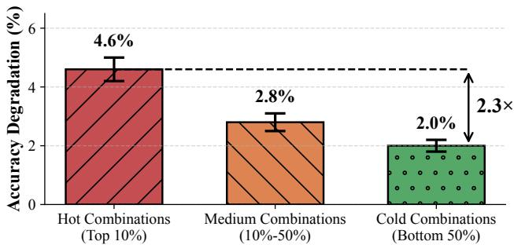

Figure 1: Uniform pruning disproportionately harms the most frequently used expert pairs.  
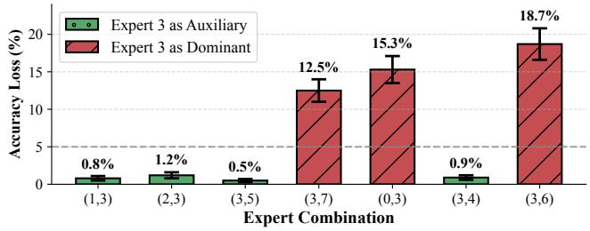  
Figure 2: Expert dropping fails to capture the nuanced, combination-dependent roles of experts. This figure shows the accuracy loss when dropping Expert 3. Red bars indicate combinations where Expert 3 is a significant expert, while green bars indicate it is negligible.

These limitations reveal a broader opportunity: existing pruning strategies are largely designed independently of runtime scheduling. Uniform pruning produces homogeneous execution widths, while expert dropping provides only binary keep-or-remove decisions. Neither exposes finegrained, controllable width heterogeneity that can be systematically exploited at runtime. In contrast, assigning diferent execution widths according to combination frequency and expert role creates heterogeneous I/O and computation times, which can provide additional opportunities to overlap expert loading with computation. This suggests that pruning and runtime scheduling should be considered jointly rather than as independent optimization stages.

Realizing this combination-aware pruning-and-scheduling design requires jointly determining how much expert capacity to preserve, how to represent multiple execution widths eficiently, and how to schedule the resulting heterogeneous executions at runtime. This introduces three challenges.

Challenge 1 Storage eficiency. Combination-aware pruning implies that the same expert may need to run at diferent widths in diferent combinations. A naive design would store a separate copy of the expert for each width, quickly eliminating the storage savings from pruning. The challenge is therefore to support flexible width selection at runtime without replicating expert weights.

Challenge 2 Combination strategy. The number of possible expert combinations grows combinatorially with the number of experts. For a model with � experts and top-� routing, there are � possible combinations. Diferentiating among these combinations requires balancing accuracy, storage cost, and scheduling complexity. A fine grained policy becomes dificult to manage at runtime, while a coarse one fails to capture meaningful diferences in combination frequency and expert role.

\- Challenge 3 Scheduling coordination. Diferentiated pruning creates experts with diferent widths, which in turn leads to heterogeneous I/O and computation times. Wider experts take longer to load, but also longer to execute. This heterogeneity creates an opportunity to overlap expert loading with computation, but only if pruning and scheduling are designed together. Without such coordination, the latency benefits of diferentiated pruning cannot be fully realized.

To address these challenges, we present CRISP (Combination aware Reordering and I/O-Scheduled Pruning), an edge MoE inference framework that co-designs expert representation, combination-aware pruning, and runtime scheduling to reduce expert-weight access.

\- To address Challenge 1 (storage eficiency), CRISP introduces importance-aware neuron reordering to support multiple execution widths from a single stored expert. CRISP ranks neurons using a calibration set and physically reorders each expert by importance, so that a width-� execution simply accesses the first � neurons. This avoids the storage redundancy of materializing separate weight copies for diferent widths while retaining flexible runtime pruning.

\- To address Challenge 2 (combination strategy), CRISP adopts a tiered execution policy based on combination frequency and expert role. Ofline profiling partitions routed combinations into Hot, Warm, and Cold tiers and identifies the dominant and auxiliary experts within each combination. Hot combinations retain both experts at full width, Warm combinations reduce the auxiliary width, and Cold combinations skip the auxiliary expert. This policy preserves more capacity for frequently activated and dominant experts while pruning more aggressively where the impact is smaller.

\- To address Challenge 3 (scheduling coordination), CRISP introduces a pruning-aware I/O scheduler that exploits the execution heterogeneity created by diferentiated pruning. It prioritizes wider experts, whose longer computation windows can overlap the loading of narrower experts. In this way, CRISP translates pruning-induced width heterogeneity into reduced exposed I/O latency.

The three mechanisms form a single co-design path rather than independent optimizations. Importance-aware reordering exposes multiple execution widths from one stored expert; tiered execution selects among these widths according to combination frequency and expert role; and the pruningaware scheduler exploits the resulting width heterogeneity to overlap I/O with computation. Thus, the output of each component creates the capability required by the next: reordering makes diferentiated pruning storage-eficient, diferentiated pruning shapes the runtime I/O and computation profile, and scheduling translates this heterogeneity into latency reduction. We summarize our contributions as follows:

(1) We identify two combination-level properties of MoE execution via empirical studies: expert combinations exhibit highly skewed activation frequencies, and co-activated experts contribute asymmetrically. These observations motivate pruning decisions based on both combination frequency and expert role.

(2) We develop importance-aware neuron reordering that enables multiple execution widths from a single stored expert through prefix truncation, avoiding the weight duplication that would otherwise arise from materializing multiple pruned variants.

(3) We co-design combination-aware diferentiated pruning with runtime scheduling. A tiered policy assigns execution widths according to combination frequency and expert role, deliberately creating heterogeneous expert executions; a pruning-aware scheduler then exploits this heterogeneity to overlap expert loading with computation.

(4) We implement CRISP and evaluate it on Mixtral-8x7B and DeepSeek-MoE-16B. Under the same memory budget, CRISP improves throughput by up to 2.1× while limiting accuracy degradation to 3.6% relative to full-width execution.

## 2 Empirical Observations

Mixture-of-Experts (MoE) models route each token to a subset of specialized expert networks. A typical MoE layer consists of a gating network (router) and � expert networks, where the router selects the top-� experts based on learned routing scores. For instance, Mixtral-8x7B selects 2 out of 8 experts per token, activating 13B of its 47B total parameters.

Table 1: I/O and computation breakdown for a single MoE layer inference on NVIDIA RTX 4090 with PCIe 4.0 (Mixtral-8x7B, 4-bit quantization).
<table><tr><td>Operation</td><td>Time (ms) Percentage</td><td></td></tr><tr><td>Expert Loading (2 experts)</td><td>11.2</td><td>78.0%</td></tr><tr><td>Router Computation</td><td>0.4</td><td>2.8%</td></tr><tr><td>Expert Computation</td><td>2.6</td><td>18.1%</td></tr><tr><td>Other (memory copy, etc.)</td><td>0.2</td><td>1.1%</td></tr><tr><td>Total</td><td>14.4</td><td>100%</td></tr></table>

On edge servers with limited GPU memory, expert weights must be ofloaded to host memory and loaded on demand. Table 1 shows the I/O and computation breakdown for a single MoE layer on an NVIDIA RTX 4090 with PCIe 4.0. Loading two experts dominates the latency, motivating our focus on reducing expert size through pruning.

The background analysis reveals that I/O bandwidth is the primary bottleneck for edge MoE inference, motivating model pruning as a direct solution. However, existing pruning methods apply uniform compression across all experts, overlooking the heterogeneous nature of expert usage patterns. In this section, we conduct empirical studies on MoE inference behavior to uncover optimization opportunities that inform the design of CRISP. All empirical studies in this section are conducted on Mixtral-8x7B. To ensure the representativeness of our observations, we use a calibration dataset consisting of2,048 sequences randomly sampled from the C4 validation set [25]. C4 is a massive, diverse corpus of web text widely used for LLM pre-training and evaluation, ensuring that the profiled activation patterns reflect general-purpose model usage rather than domain-specific idiosyncrasies.

## 2.1 Power-law Distribution of Expert Combinations

In MoE models with top-2 routing, each token activates a pair of experts, resulting in � possible combinations for a model with � experts. We profile the activation frequency of all expert combinations across the C4 calibration dataset and present the results in Figure 3. The distribution exhibits a clear power-law pattern: a small fraction of expert combinations handle the vast majority of tokens, while most combinations are rarely activated. Specifically, the top 25% of combinations account for over 60% of all token activations, while the bottom 29% of combinations collectively handle less than 10% of tokens. This skewed distribution is consistent across diferent layers of the model, though the specific hot combinations vary by layer.

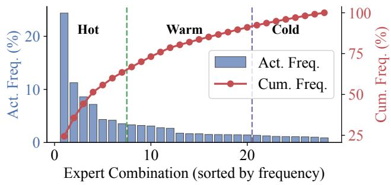  
Figure 3: Distribution of expert combination activation frequency (Act. Freq.) and cumulative frequency (Cum. Freq.) in Mixtral-8x7B with top-2 routing, profiled on 2,048 sequences from the C4 validation set. A small fraction of combinations accounts for the majority of token activations, while most combinations are rarely used.

Summary: The highly imbalanced activation pattern suggests that uniform pruning is suboptimal—frequently activated combinations deserve more capacity to preserve accuracy, while rarely activated combinations can tolerate aggressive compression with minimal impact on overall model quality.

## 2.2 Asymmetric Expert Roles in Combinations

Even within the same expert combination, the two activated experts do not contribute equally to the output. To quantify this asymmetry, we conduct an ablation study where we selectively mask one expert in each combination (replacing its output with zeros) and measure the resulting increase in perplexity. Figure 4 shows the results for the top 20 most frequent combinations. For each combination, we plot the perplexity increase caused by masking each of the two experts. If both experts were equally important, the points would cluster along the diagonal; instead, we observe significant deviation, indicating that one expert typically has a much larger impact than the other.

We refer to the expert whose removal causes greater accuracy degradation as the dominant expert, and the other as the auxiliary expert. Across all combinations, masking the dominant expert increases perplexity by an average of 2.64, while masking the auxiliary expert increases perplexity by only 0.71—a 3.7× diference. This asymmetry suggests functional specialization: the dominant expert captures the primary functionality required for the input, while the auxiliary expert provides supplementary refinement.

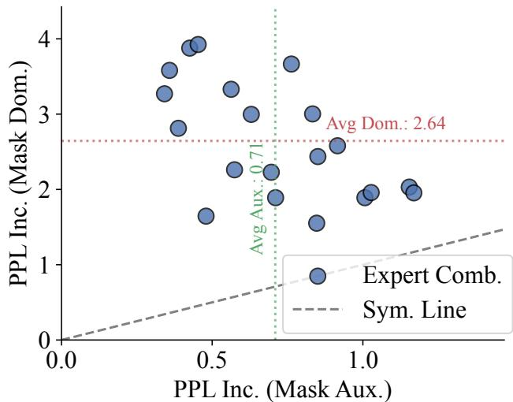  
Figure 4: Asymmetric roles of experts within combinations, visualized by perplexity increase (PPL Inc.) when masking each expert in the top 20 most frequent combinations. Most points deviate from the diagonal (Sym. Line), indicating that one dominant expert contributes significantly more than its auxiliary counterpart.

Summary: The asymmetric roles of experts within combinations open an opportunity for fine-grained diferentiated pruning. Rather than treating both experts identically, we can preserve full capacity for dominant experts while aggressively pruning auxiliary experts, achieving memory savings with minimal accuracy loss.

## 2.3 Opportunity for I/O-Computation Overlap

Diferentiated pruning produces experts of varying widths, which naturally leads to heterogeneous I/O and computation times. We measure the I/O time (loading from host memory via PCIe 4.0) and computation time (GPU execution) for a single expert at diferent pruning ratios. As shown in Figure 5, both I/O and computation time decrease as the expert width is reduced, but at diferent rates. A full-width expert requires 7.5 ms for I/O and 0.8 ms for computation, while a 50%-width expert requires 3.8 ms for I/O and 0.4 ms for computation.

This heterogeneity creates an opportunity for strategic scheduling. When executing a sequence of experts with different widths, the computation of a wider expert can potentially mask the I/O of subsequent narrower experts. In contrast, uniform pruning produces homogeneous experts that ofer limited room for such overlap. To quantify this opportunity, we simulate a naive sequential execution (loadthen-compute for each expert) versus an ideal overlapped execution for a typical MoE layer with our tiered pruning policy. The naive approach results in 90% I/O-computation bubble, while perfect overlap could reduce this to 38%.

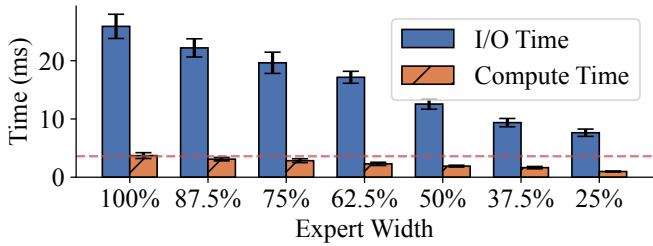  
Figure 5: I/O and computation time of a single expert under diferent pruning ratios. As expert width decreases, both I/O and computation time are reduced, but at diferent rates, creating opportunities to overlap the I/O of narrow experts with the computation of wider experts.

Summary: The heterogeneous expert sizes resulting from diferentiated pruning are not merely a byproduct but an opportunity. A pruning-aware scheduler that exploits this heterogeneity can significantly reduce I/O stalls, translating the memory savings from pruning into actual latency improvements.

## 3 System Design

## 3.1 System Overview

Figure 6 illustrates the overall architecture of CRISP, which consists of an ofline preparation phase and an online inference phase.

In the ofline phase, CRISP performs three key preparation steps. First, it profiles expert combination activation frequencies on a calibration dataset (empirically verified to be representative of the target workload) to classify combinations into Hot, Warm, and Cold tiers. Second, it computes neuron importance scores for each expert based on activation magnitudes and identifies the dominant expert within each combination. Third, it reorders the weight matrices of each expert according to neuron importance, producing a single stored copy that supports arbitrary-width truncation.

CRISP’s calibration-derived neuron rankings, combination frequencies, and expert roles depend on both the model parameters and the deployment workload. Changes may arise from shifts in the input distribution or from model up dates through fine-tuning [1, 51], unlearning [21, 35], and model editing [37]. The corresponding profiling artifacts should therefore be reassessed when the model or workload changes substantially. For a workload change, CRISP collects a new calibration sample and refreshes the combination statistics, tier assignments, and expert roles. If the expert weights are updated, neuron importance scores and the associated weight ordering may also need to be recomputed. These changes afect ofline preparation while retaining the same online execution mechanism.

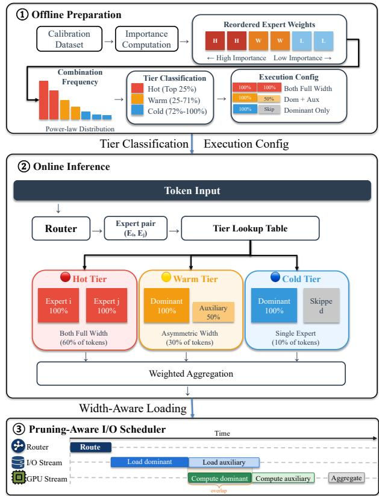  
Figure 6: Overall architecture of CRISP. The ofline phase profiles expert combinations and reorders expert weights to produce tier-aware execution metadata and width-flexible experts. During inference, the router activates an expert combination whose tier determines the execution width of each expert. A pruning-aware scheduler prioritizes wider experts so that their longer computation overlaps with loading of narrower experts, hiding I/O latency.

In the online phase, CRISP executes inference through coordinated execution. When a token arrives at an MoE layer, the router first determines which expert combination to activate. CRISP then consults the precomputed tier assignment to determine the execution configuration: full-width for both experts (Hot), full-width for dominant and reducedwidth for auxiliary (Warm), or dominant expert only (Cold). Meanwhile, the pruning-aware scheduler coordinates the already-routed expert tasks, overlapping the computation of one selected expert with the I/O loading of another, prioritizing wider experts to maximize overlap eficiency.

Design rationale. The three components of CRISP address interdependent decisions and are insuficient when applied independently. Importance-aware reordering makes multiple execution widths available from one stored expert, but it does not determine which width should be selected for a given combination. Conversely, tiered pruning determines combination-specific widths, but without reordering it would require separate materialized copies for diferent widths, ofsetting its storage benefit. Scheduling alone can only reorder the available I/O and computation tasks; it cannot create the heterogeneous execution times that provide CRISP with additional overlap opportunities. CRISP therefore couples the three components so that reordering enables flexible widths, tiering assigns those widths, and scheduling exploits the resulting heterogeneity.

## 3.2 Importance-Aware Neuron Reordering

A key enabler of diferentiated pruning is the ability to execute experts at varying widths without storing multiple copies. This subsection presents our importance-aware neuron reordering mechanism that achieves this goal through a single reorganized weight representation.

3.2.1 Problem Formulation. Consider a standard MoE expert implemented as a feed-forward network (FFN) with a gated architecture. Each expert consists of three weight matrices: the gate projection $\bar { W } _ { \mathrm { g a t e } } \in \mathbb { R } ^ { d \times d _ { \mathrm { f f } } }$ , the up projection $W _ { \mathrm { u p } } \in$ $\mathbb { R } ^ { d \times d _ { \mathrm { f f } } }$ , and the down projection $W _ { \mathrm { d o w n } } \in \mathbb { R } ^ { d _ { \mathrm { f f } } \times d }$ , where � is the hidden dimension and $d _ { \mathrm { f f } }$ is the intermediate dimension. The expert computation follows:

$$
\mathrm { F F N } ( x ) = \left( \sigma ( x W _ { \mathrm { g a t e } } ) \odot x W _ { \mathrm { u p } } \right) W _ { \mathrm { d o w n } }\tag{1}
$$

where � denotes the activation function (e.g., SiLU) and ⊙ denotes element-wise multiplication. To prune an expert to width $k < d _ { \mathrm { f f } } .$ , we need to select � neurons (columns of $W _ { \mathrm { g a t e } }$ and $W _ { \mathrm { u p } } ,$ rows of $W _ { \mathrm { d o w n } } )$ to retain. The naive approach would require storing separate weight matrices for each desired width, leading to storage overhead proportional to the number of supported widths.

3.2.2 Neuron Importance Metric. We adopt an activationmagnitude-based importance metric that measures each neuron’s contribution to the expert output. Given a calibration dataset D, we compute the importance score of the �-th neuron as the average magnitude of its activation across all samples:

$$
s _ { i } = \frac { 1 } { | \mathcal { D } | } \sum _ { x \in \mathcal { D } } \big | \sigma ( x W _ { \mathrm { g a t e } } ) _ { i } \cdot ( x W _ { \mathrm { u p } } ) _ { i } \big |\tag{2}
$$

where the subscript � denotes the �-th element of the vector. This metric captures the efective contribution of each neuron after the gating mechanism, reflecting both the gate activation and the up-projection magnitude.

3.2.3 Weight Reordering and Runtime Truncation. Once importance scores are computed, we sort neurons in descending order of importance and physically reorder the weight matrices accordingly. Let � denote the permutation that sorts neurons by importance, i.e., $s _ { \pi ( 1 ) } \geq s _ { \pi ( 2 ) } \geq \cdot \cdot \cdot \geq s _ { \pi ( d _ { \mathrm { f f } } ) }$ . We construct reordered weights as:

$$
\tilde { W } _ { \mathrm { g a t e } } = W _ { \mathrm { g a t e } } [ : , \pi ] , ~ \tilde { W } _ { \mathrm { u p } } = W _ { \mathrm { u p } } [ : , \pi ] , ~ \tilde { W } _ { \mathrm { d o w n } } = W _ { \mathrm { d o w n } } [ \pi , : ]\tag{3}
$$

where $[ : , \pi ]$ denotes column permutation and $[ \pi , : ]$ denotes row permutation. This reordering preserves mathematical equivalence: FFN(�) computed with reordered weights produces identical outputs to the original. The key benefit is that truncating to the first $k$ neurons now yields the optimal width-� sub-expert, as these neurons have the highest importance scores. At inference time, executing an expert at width � requires only loading the first � columns of $\tilde { W } _ { \mathrm { g a t e } }$ and $\tilde { W } _ { \mathrm { u p } } ,$ , and the first � rows of $\tilde { W } _ { \mathrm { d o w n } }$ . This is achieved through simple ofset-based memory access without any runtime computation for neuron selection, and the I/O volume scales linearly with the target width.

## 3.3 Hotness-Based Tiered Execution Policy

With the reordering mechanism enabling flexible width selection, we now address how to assign appropriate widths to diferent expert combinations. This subsection presents our hotness-based tiered execution policy that exploits the power-law distribution of combination frequencies and the asymmetric roles of experts within combinations.

3.3.1 Combination Tier Classification. Expert combinations exhibit highly skewed activation frequencies, as established in our motivation analysis. We leverage this property by classifying combinations into three tiers with diferentiated execution strategies. Given the activation frequency $f _ { c }$ for each combination �, we sort all combinations by frequency and partition them according to cumulative frequency thresholds. Hot tier contains combinations whose cumulative frequency accounts for the top � of total activations; these are accessed frequently and have the highest impact on overall model accuracy. Warm tier contains combinations whose cumulative frequency falls between $\alpha$ and $\beta$ of total activations, representing moderately frequent access patterns. Cold tier contains combinations in the bottom $1 - \beta$ of total activations, which are rarely activated. In our implementation, we set $\alpha = 0 . 6$ and $\beta = 0 . 9 _ { : }$ , resulting in approximately 25% of combinations classified as Hot, 46% as Warm, and 29% as Cold. We choose � and $\beta$ based on the measured activation-frequency distribution on the calibration set to balance accuracy preservation (by capturing the majority of activations in the Hot/Warm tiers) and I/O reduction (by allocating a suficiently large tail to the Cold tier), and keep them fixed across all experiments.

3.3.2 Dominant Expert Identification. Experts within a combination play asymmetric roles, as shown in our motivation analysis. For each combination, we identify the dominant expert through an ofline ablation process. Specifically, for combination $( e _ { i } , e _ { j } )$ , we measure the perplexity increase when masking each expert individually: $\Delta _ { i } = { \mathrm { P P L } } ( { \mathrm { m a s k } } \ e _ { i } ) -$ PPL(original). The expert with the larger $\Delta$ value is designated as the dominant expert, as its removal causes greater accuracy degradation. This classification is performed once during ofline preparation and stored in a lookup table indexed by combination identity.

3.3.3 Tiered Execution Strategies. Each tier employs a distinct execution strategy that balances accuracy preservation with I/O eficiency. For Hot tier combinations, both experts execute at full width $d _ { \mathrm { f f } } ,$ preserving maximum model capacity for the combinations that process the majority of tokens and ensuring minimal accuracy degradation on common inputs. For Warm tier combinations, the dominant expert executes at full width while the auxiliary expert executes at reduced width $k _ { \mathrm { w a r m } } = 0 . 5 \cdot d _ { \mathrm { f f } }$ . This strategy exploits role asymmetry: the dominant expert maintains full capacity to capture primary functionality, while the auxiliary expert provides partial refinement at lower cost. For Cold tier combinations, only the dominant expert executes at full width, and the auxiliary expert is skipped entirely. This aggressive strategy is justified by the low activation frequency limiting impact on overall accuracy, and the functional overlap between coactivated experts allowing the dominant expert to partially compensate for the missing auxiliary.

3.3.4 Memory Footprint Analysis. The tiered policy significantly reduces the efective memory footprint compared to full-width execution. Let $p _ { H } , p _ { W }$ , and $\pmb { \mathscr { p } } _ { C }$ denote the fraction of tokens processed by Hot, Warm, and Cold combinations respectively. The average memory access per token is:

$$
M _ { \mathrm { a v g } } = p _ { H } \cdot 2 M _ { \mathrm { f u l l } } + p _ { W } \cdot ( M _ { \mathrm { f u l l } } + M _ { \mathrm { n a r r o w } } ) + p _ { C } \cdot M _ { \mathrm { f u l l } }\tag{4}
$$

where $M _ { \mathrm { f u l l } }$ and $M _ { \mathrm { n a r r o w } }$ denote the memory footprint of a full-width and narrow-width expert respectively. With typical values of $p _ { H } ~ = ~ 0 . 6 0 , p _ { W } ~ = ~ 0 . 3 0 , p _ { C } ~ = ~ 0 . 1 0$ , and $k _ { \mathrm { w a r m } } = 0 . 5 \cdot d _ { \mathrm { f f } }$ , this yields an average reduction of 13% in per-token memory access compared to the baseline.

## 3.4 Pruning-Aware I/O Scheduler

The tiered execution policy produces experts of heterogeneous widths, creating opportunities for I/O-computation overlap. This subsection presents our pruning-aware scheduler that exploits this heterogeneity through dependencyaware scheduling after routing.

3.4.1 Dependency-Preserving Scheduling Architecture. In MoE inference with expert ofloading, each layer involves two phases: I/O (loading activated experts from host memory to GPU) and computation (executing the experts on GPU). A naive sequential execution loads and computes each selected expert in turn, leaving significant idle time on both the I/O channel and the GPU. Once the current layer’s router returns the selected experts and their execution widths, CRISP places these known tasks into the pending and ready queues. While the GPU executes a ready expert, the separate I/O stream loads another selected expert in parallel. After all selected experts finish and their outputs are aggregated, model execution proceeds to the next layer in dependency order.

3.4.2 Width-Aware Scheduling Strategy. Within this scheduler, the order in which we load and execute experts significantly impacts overlap eficiency. Our key insight is that wider experts have longer computation times, which can mask more I/O latency for subsequent experts. Based on this observation, we adopt the following scheduling strategy: when multiple experts are pending for execution, we prioritize the expert with larger width. This ensures that wider experts begin computation earlier, providing longer windows to overlap with subsequent I/O operations.

Consider a Warm-tier combination with dominant expert $e _ { d }$ (full-width) and auxiliary expert $e _ { a }$ (narrow-width). Our scheduler loads and executes $e _ { d }$ first. While $e _ { d }$ computes, we load $e _ { a }$ on the separate I/O stream. When $e _ { d }$ completes, $e _ { a }$ is already resident in GPU memory and can execute immediately. Algorithm 1 presents the detailed scheduling procedure. The scheduler maintains two queues: a pending queue of experts awaiting I/O and a ready queue of experts loaded and awaiting computation. At each scheduling decision point, it selects the widest expert from the ready queue for computation while simultaneously initiating I/O for the highestpriority pending expert.

3.4.3 Overlap Eficiency Analysis. The efectiveness of our scheduling strategy depends on the ratio between compu tation time and I/O time for experts of diferent widths. Let $T _ { \mathrm { i o } } ( w )$ and $T _ { \mathrm { c o m p } } ( w )$ denote the I/O and computation time for an expert of width �. For our scheduling to fully hide the I/O of a narrow expert $e _ { a }$ behind the computation of a wide expert $e _ { d }$ , we require $T _ { \mathrm { c o m p } } ( w _ { d } ) \geq T _ { \mathrm { i o } } ( w _ { a } )$ . Based on our profiling results, a full-width expert has $T _ { \mathrm { c o m p } } = 0 . 8$ ms, while a 50%-width expert has $T _ { \mathrm { i o } } = 3 . 8$ ms. Although a single expert’s computation cannot fully mask the I/O of another expert, the scheduler uses the available computation window ofthe full-width expert to overlap part ofthe narrow expert’s transfer. Under batched execution, expert tasks from other requests that have completed routing can provide additional ready and pending work. This confirms that our scheduling strategy can efectively hide a significant portion of the I/O latency of narrow auxiliary experts behind the computation of full-width dominant experts in Warm-tier combinations.

Algorithm 1 Pruning-Aware I/O Scheduling   
Require: Token input �, MoE layers $\{ L _ { 1 } , . . . , L _ { N } \}$   
1: Initialize pending $ \emptyset ,$ ready $ \emptyset$   
2: Execute router of $L _ { 1 } ,$ get experts $E _ { 1 }$ with widths $W _ { 1 }$   
3: Add $( E _ { 1 } , W _ { 1 } )$ to pending sorted by width descending   
4: for $l = 1$ to � do   
5: while pending for layer � is not empty or ready is not   
empty do   
6: if ready is not empty then   
7: � ← pop widest expert from ready   
8: async start computation of �   
9: end if   
10: if pending is not empty and I/O channel is idle   
then   
11: �′ ← pop highest-priority expert from pending   
12: async start loading $e ^ { \prime }$ , add to ready when done   
13: end if   
14: end while   
15: Wait for expert computations of layer � and aggregate   
their outputs   
16: if $l < N$ then   
17: Continue dependency-ordered execution to the   
router of $L _ { l + 1 }$   
18: Get experts $E _ { l + 1 }$ with widths $W _ { l + 1 }$ and add them to   
pending   
19: end if   
20: end for

## 4 Implementation

We have implemented a fully functional prototype of CRISP with approximately 5,000 lines of code in Python and CUDA, built on top of PyTorch. The source code will be made publicly available. This section describes the key implementation details across ofline preparation and online inference.

## 4.1 Ofline Preparation Pipeline

The ofline phase preprocesses the model to enable eficient online inference. We implement this as a three-stage pipeline that can be executed once and reused across deployments.

\- Stage 1 (Combination Profiling). We run the target MoE model on a calibration dataset (we use 2048 samples from C4 in our experiments) and record the expert combinations activated by each token. For each MoE layer, we maintain a frequency counter for all � possible combinations, where � is the number of experts. We then sort combinations by frequency and apply cumulative thresholds to partition them into Hot, Warm, and Cold tiers. The resulting tier assignments are stored as a lookup table indexed by the combination identifier $( e _ { i } , e _ { j } )$ where $e _ { i } < e _ { j }$

\- Stage 2 (Importance Computation). For each expert, we compute neuron importance scores by accumulating activation magnitudes across the calibration dataset. Specifi cally, we instrument the forward pass to capture the intermediate activations after the gating mechanism, compute element-wise products between gate and up projections, and maintain running averages for each neuron. To identify dominant experts within each combination, we perform pairwise ablation studies: for each combination in the Warm and Cold tiers, we measure perplexity degradation when masking each expert individually and designate the expert with larger degradation as dominant.

\- Stage 3 (Weight Reordering). Based on the computed importance scores, we generate a permutation index for each expert that sorts neurons in descending order of importance. We then apply this permutation to physically reorder the weight matrices $( W _ { \mathrm { g a t e } } , W _ { \mathrm { u p } } , W _ { \mathrm { d o w n } } )$ and save the reordered weights to disk. The reordered model maintains the same file format as the original, ensuring compatibility with standard model loading utilities.

The entire ofline pipeline completes in approximately 1 hour for Mixtral-8x7B on a single NVIDIA RTX 4090 GPU, and the resulting artifacts (tier assignments, dominant expert mappings, reordered weights) add negligible storage overhead beyond the original model size.

## 4.2 Online Inference Engine

The online inference engine executes the prepared model with our tiered execution policy and pruning-aware scheduling. We implement this atop PyTorch with custom CUDA kernels for performance-critical operations.

4.2.1 Expert Loading. We implement width-aware expert loading that transfers only the required portion of each expert’s weights from host memory to GPU memory. For an expert at width �, we load the first � columns of $W _ { \mathrm { g a t e } }$ and $W _ { \mathrm { u p } } ,$ and the first � rows of $W _ { \mathrm { d o w n } }$ . This is achieved through strided memory copies that skip over the pruned neurons, avoiding the need to load and then discard unnecessary data. We use CUDA streams to enable asynchronous transfers that can overlap with GPU computation.

4.2.2 Truncated Expert Computation. We develop custom CUDA kernels for computing truncated expert outputs. Given an input tensor and the loaded partial weights, our kernels perform the gated FFN computation using only the first � neurons. We optimize these kernels for the specific width configurations used in our tiered policy (full-width, 50%-width) to maximize GPU utilization. For the Cold tier where only one expert executes, we skip the second expert entirely without allocating any GPU memory for it.

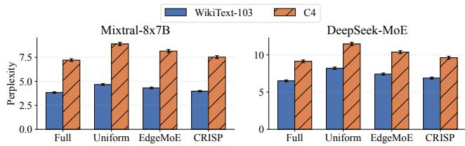  
Figure 7: Perplexity comparison on WikiText-103 and C4 datasets (lower is better).

4.2.3 Dependency-Preserving Scheduling. We implement the pruning-aware scheduler using PyTorch’s CUDA stream mechanism. We maintain separate streams for I/O transfers and GPU computation, with explicit synchronization points to ensure correctness. The scheduler maintains priority queues for pending and ready experts, making scheduling decisions based on expert widths as described in Algorithm 1. Expert tasks are inserted into these queues after the corresponding current-layer router returns. The computation stream executes ready experts while the I/O stream loads other selected experts, and model execution advances only after the current expert outputs are aggregated.

4.2.4 Tier Lookup. At runtime, determining the execution configuration for an activated combination requires a single lookup into the precomputed tier assignment table. We implement this table as a GPU-resident tensor for fast access, with the combination identifier $( e _ { i } , e _ { j } )$ mapped to a linear index. The lookup returns the tier classification and, for Warm and Cold tiers, the identity of the dominant expert.

## 4.3 Integration and Portability

Our implementation is designed as a modular extension that can integrate with existing inference frameworks. The core components (weight reordering, tiered execution, pruningaware scheduling) are implemented as drop-in replacements for standard MoE layer execution. We provide adapter interfaces for integration with popular frameworks including Hugging Face Transformers and vLLM. The width-aware loading and truncated computation kernels are implemented using NVIDIA’s CUTLASS library, targeting Ampere and Ada Lovelace architectures, but the algorithmic approach is architecture-agnostic and can be ported to other platforms.

## 5 Evaluation

## 5.1 Experimental Setup

5.1.1 Models. We evaluate CRISP on two representative MoE models: Mixtral-8x7B [18] and DeepSeek-MoE-16B [7].

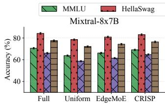

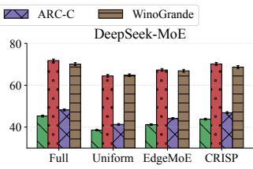  
Figure 8: Zero-shot accuracy on downstream tasks (higher is better).

Mixtral-8x7B consists of 32 MoE layers with 8 experts each, using top-2 routing, resulting in a total of 46.7B parameters with 12.9B activated per token. DeepSeek-MoE-16B employs a finer-grained expert design with 64 experts per layer and top-6 routing, totaling 16.4B parameters with 2.8B activated per token.

5.1.2 Hardware Platforms. We conduct experiments on an embedded mobile edge platform and a controlled edgegateway testbed. We use an NVIDIA Jetson AGX Orin with 32GB unified memory and 204 GB/s memory bandwidth to represent a typical mobile/embedded deployment. We additionally use a desktop-class GPU (NVIDIA RTX 4090, 24GB VRAM) paired with 64GB host memory over PCIe 4.0 x16 (32 GB/s bandwidth) as a controllable testbed to isolate the ofloading bottlenecks under diferent memory constraints. To reflect smaller mobile GPUs, we cap the efective GPU memory available for expert caching to be insuficient to hold all experts (down to as low as 10% of total expert size) on both platforms, thereby forcing expert ofloading. The two systems expose diferent forms of data-movement cost: explicit host-to-device transfers on the RTX 4090 and contention for shared memory and caches on the Jetson Orin.

5.1.3 Baselines. We compare CRISP against the following methods: (1) Full Ofloading (FO), which loads complete experts on-demand without any pruning; (2) Uniform Pruning (UP), which applies the same pruning ratio to all experts regardless of activation patterns; (3) MoE-Ofload (MO) [9], a state-of-the-art ofloading system that optimizes I/O scheduling but does not exploit diferentiated pruning; and (4) EdgeMoE (EM) [43], which employs expert-wise adaptive precision but treats all activations uniformly.

5.1.4 Benchmarks. For accuracy evaluation, we measure perplexity on WikiText-103 [24] and C4 [25] datasets, and report accuracy on downstream tasks including MMLU [15], HellaSwag [47], ARC-Challenge [5], and WinoGrande [27]. For throughput evaluation, we measure token generation throughput (tokens/second) using input sequences of varying lengths sampled from the ShareGPT dataset [6]. We also integrate platform power telemetry over each generation run and divide by the number of generated tokens to report energy per token.

5.1.5 Tier Thresholds. We set the cumulative-frequency thresholds for combination tiering to $\alpha = 0 . 6$ and $\beta = 0 . 9$ based on a pilot profiling run on the calibration set, and keep them fixed across all experiments. Here, � and $\beta$ are cutofs on the cumulative activation mass after combinations are sorted by frequency; they do not denote fixed expert identities.

## 5.2 Accuracy Evaluation

5.2.1 Model Accuracy Preservation. We first evaluate whether CRISP preserves model accuracy under its diferentiated pruning strategy. Figure 7 reports the perplexity results, and Figure 8 presents the downstream task accuracy for both models. On Mixtral-8x7B, CRISP achieves a perplexity of 3.98 on WikiText-103, representing only a 3.6% increase compared to full-precision execution (3.84). In contrast, UP at a comparable memory reduction level degrades perplexity to 4.67, a 21.6% increase. This demonstrates the efectiveness of our hotness-based tiered policy: by preserving full precision for frequently activated combinations while aggressively pruning cold combinations, CRISP maintains accuracy on common inputs that dominate overall perplexity. For downstream tasks, CRISP preserves 97.4% of the original accuracy on average across all benchmarks, while UP retains only 90.6%. The accuracy gap is most pronounced on knowledge-intensive tasks like MMLU, where CRISP achieves 69.1% compared to 63.8% for UP. This suggests that our dominant expert identification successfully preserves the critical expert for each combination. DeepSeek-MoE exhibits similar trends, with CRISP achieving 6.89 perplexity versus 8.21 for UP. The finer-grained expert structure of DeepSeek-MoE (64 experts with top-6 routing) creates more diverse combination patterns, which our tiered policy efectively exploits.

5.2.2 Iso-Memory Comparison. To compare quality under the same resource constraint, we evaluate CRISP against Uniform Pruning and Expert Dropping at matched expertmemory budgets. Figure 9 reports WikiText-103 perplexity, average downstream accuracy, and token latency as the available expert-memory budget varies from 10% to 40%. Across all evaluated budgets, CRISP preserves lower perplexity and higher average accuracy than both pruning baselines. At a 40% expert-memory budget, for example, CRISP achieves 73.4% average accuracy, compared with 70.5% for Uniform Pruning and 69.6% for Expert Dropping. Its 47 ms/token latency is close to Expert Dropping (46 ms/token) and substantially lower than Uniform Pruning (95 ms/token), showing that CRISP provides a more favorable quality-latency trade-of under the same memory constraint.

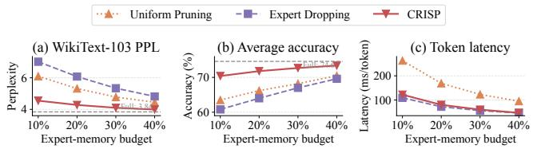  
Figure 9: Iso-memory comparison of CRISP with Uniform Pruning and Expert Dropping under matched expert-memory budgets. Lower perplexity and latency are better, while higher average accuracy is better. Dashed horizontal lines show the quality of full-width execution.

5.2.3 Tier-conditioned accuracy. Hot, Warm, and Cold routing events retain 99.9%, 99.1%, and 94.7% of full-width accuracy, respectively. Cold combinations account for only 10% of routing events; within this tier, skipping the auxiliary expert reduces I/O and latency at the cost of a larger conditional accuracy drop. Detailed Cold-tier trade-ofs are reported in Appendix A.1.

5.2.4 Robustness to workload shift. We further evaluate cross-domain transfer of profiling metadata among MMLU, HellaSwag, and WinoGrande. Directly transferring metadata decreases target-workload accuracy by at most 2.7 percentage points, while refreshing the metadata on the target workload recovers accuracy to within 0.5 points of the target-matched setting with similar throughput. Detailed results are provided in Appendix A.2.

## 5.3 Throughput Evaluation

We evaluate the throughput of CRISP under varying GPU memory budgets. Figure 10 shows the token generation throughput as a function of available GPU memory for caching experts. Under severely constrained memory (10% of total expert size), CRISP achieves 8.3 tokens/second, representing a 3.9× speedup over FO (2.1 tokens/second) and 2.1× over MO (3.9 tokens/second). This improvement stems from two factors: reduced I/O volume due to diferentiated pruning, and improved I/O-computation overlap from our pruning-aware scheduler. As memory budget increases, the performance gap narrows but remains significant. At 30% memory budget, CRISP achieves 14.7 tokens/second compared to 8.6 for MO, a 1.7× improvement. Even at 50% memory budget, CRISP maintains a 1.4× advantage, demonstrating that our approach provides consistent benefits across memory regimes. Sequence-length throughput results appear in Appendix A.3.

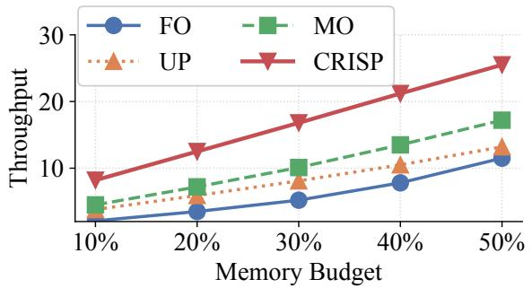  
Figure 10: Token generation throughput under diferent GPU memory budgets on Mixtral-8x7B. The x-axis shows the memory available for expert caching as a fraction of total expert size.

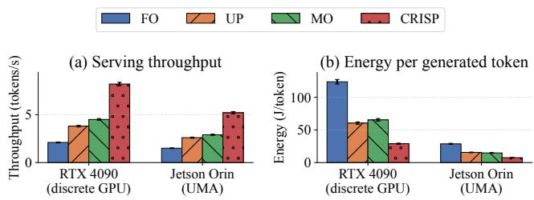  
Figure 11: Serving throughput and energy per generated token on discrete-GPU and UMA edge platforms under a 10% expert-memory budget. Error bars show 95% confidence intervals.

## 5.4 Energy Eficiency Across Edge Platforms

Figure 11 compares throughput and energy per generated token on the discrete-GPU and UMA platforms. CRISP reaches 8.2 and 5.2 tokens/s on the RTX 4090 and Jetson Orin, respectively, while consuming 28.9 and 7.5 J/token. Relative to full ofloading, this reduces energy per token by 76.7% on the PCIe system and 73.9% on the UMA system. On the RTX 4090, the gain comes primarily from reducing and overlapping explicit transfers; on the Jetson Orin, the smaller expert-weight accesses reduce shared-memory bandwidth demand, cache pressure, and memory-fabric contention. One-time preparation takes 48 minutes, metadata uses less than 2 MB, and scheduling overhead is at most 0.06% of token latency; see Appendix A.4.

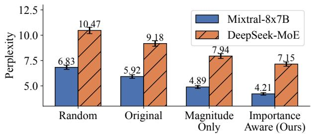  
Figure 12: Perplexity comparison of diferent neuron ordering strategies on WikiText-103 at 50% pruning ratio.

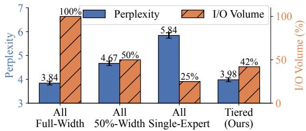  
Figure 13: Comparison of execution policies on Mixtral-8x7B. PPL denotes WikiText-103 perplexity and Throughput is measured in tokens/second.

## 5.5 Ablation Study

We conduct ablation studies to understand the contribution of each component in CRISP.

5.5.1 Efect of Neuron Reordering. We compare our importance-aware reordering against alternative neuron selection strategies: (1) Random ordering, which shufles neurons randomly before truncation; (2) Original ordering, which truncates neurons in their original order without reordering; and (3) Magnitude-only ordering, which sorts by weight magnitude rather than activation magnitude. Figure 12 shows that importance-aware reordering achieves 4.21 perplexity, significantly outperforming random ordering (6.83) and original ordering (5.92). This confirms that neuron importance varies significantly and that activationbased ranking efectively identifies the most critical neurons to retain.

5.5.2 Efect ofTiered Execution Policy. We evaluate the impact of our hotness-based tiered policy by comparing against uniform execution strategies that apply the same configuration to all combinations. Figure 13 shows that our tiered policy achieves a superior accuracy-eficiency trade-of. Compared to all full-width execution, CRISP reduces I/O volume by 58% while increasing perplexity by only 0.14. Compared to uniform 50%-width pruning, CRISP achieves 0.69 lower perplexity at similar I/O volume. At a 75% I/O budget, asymmetric execution achieves 4.02 perplexity versus 4.18 for symmetric execution; see Appendix A.5.

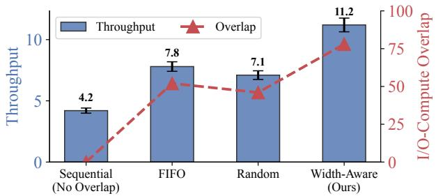  
Figure 14: Throughput comparison of scheduling strategies on Mixtral-8x7B with 20% memory budget.

5.5.3 Efect ofPruning-Aware Scheduling. Finally, we evaluate the benefit of our width-aware scheduling strategy by comparing against alternative scheduling policies. Figure 14 shows that width-aware scheduling achieves 78% I/O-computation overlap, compared to 52% for FIFO scheduling. This translates to a 1.44× throughput improvement over FIFO. The key insight is that prioritizing wider experts creates longer computation windows that mask the I/O latency of subsequent narrow experts.

## 6 Related Work

Eficient MoE Inference Systems. Prior work has improved MoE inference through system-level optimizations such as expert parallelism, dispatch optimization, and activation-aware caching. PowerInfer [30] exploits activation locality to accelerate LLM inference on consumer GPUs by preloading frequently activated neurons. DeepSpeed-MoE [26] provides eficient expert parallelism and communication support for large-scale MoE training and inference. Tutel [17] optimizes expert dispatch and execution through a highly tuned system stack. These systems improve expert management and runtime eficiency, but they do not reduce the amount of expert weight data that must be loaded. In contrast, CRISP targets this bottleneck directly through combination-aware pruning.

Neural Network Pruning. Pruning and structured submodel selection have been widely explored to reduce computation and adapt model capacity to resource constraints [3, 11, 14, 34]. For transformers, magnitude-based and gradientbased methods estimate parameter importance and prune accordingly [12, 28]. Elastic on-device serving also uses neuron reordering to support submodel switching under diferent latency targets [45]. Eficient MoE inference additionally requires accounting for sparse, input-dependent routing: expert usage is highly skewed, and an expert’s contribution can vary across the combinations in which it appears. CRISP addresses these properties by selecting expert execution widths according to combination frequency and expert role, and coordinating the resulting heterogeneous executions with runtime scheduling.

LLM Quantization. Quantization is a widely used approach for reducing LLM memory footprint. Weight-only methods such as GPTQ [13] and AWQ [22] compress model weights while preserving higher-precision activations. Other methods, including SmoothQuant [41] and Atom [54], quantize both weights and activations to enable more eficient in teger computation. Recent MoE serving systems such as D2MoE [38] further reduce expert-weight representation cost through quantization. These methods reduce representation cost, but they do not change how much model capacity is retained for diferent expert combinations. Our approach is orthogonal. CRISP prunes experts based on their usage patterns and can be combined with quantization for further compression. In particular, quantization methods reduces the number of bits used to represent expert weights, whereas CRISP reduces the combination-specific expert capacity that must be accessed and co-designs the resulting heterogeneous widths with runtime scheduling. The two approaches operate along diferent dimensions and can therefore be combined. Scheduling and I/O-Computation Overlap. At the net work level, task scheduling and ofloading jointly determine where work is executed and how communication afects com pletion time [55]. Within a device, overlapping data movement with computation is a common technique for improving system throughput. GPipe [16] uses micro-batching to pipeline computation across stages, while FlashAttention [8] improves eficiency through kernel-level optimization and memory-aware execution. For LLM inference, speculative decoding [20] and continuous batching [46] improve resource utilization and throughput. CRISP difers from these approaches in both source and use of heterogeneity. Rather than relying on pipeline structure or request-level batching, CRISP creates heterogeneous expert execution times through diferentiated pruning and exploits that heterogeneity with a width-aware scheduler to overlap expert loading with computation.

## 7 Conclusion

This paper shows that the main challenge in edge MoE serving is not only reducing expert-weight access, but deciding where expert capacity can be reduced in a way that matches how experts are actually used at runtime. Our results suggest that MoE pruning should be guided by expert combinations rather than by experts in isolation, and that the execution heterogeneity created by diferentiated pruning should be treated as a systems opportunity rather than a side efect. CRISP realizes this perspective through a codesign in which importance-aware reordering enables multiple execution widths, combination-aware pruning selects among them based on combination frequency and expert role, and pruning-aware scheduling exploits the resulting heterogeneity to reduce exposed I/O latency. This co-design substantially improves throughput under tight memory budgets while maintaining a favorable quality-latency trade-of. More broadly, our study highlights that eficient deployment of sparse models on edge platforms requires jointly reasoning about model structure, access patterns, and execution behavior.

## Acknowledgments

This work was supported in part by the Major Basic Research Program of Shandong Provincial Natural Science Foundation under Grant ZR2025ZD18, the National Natural Science Foundation of China under Grant 62572280, U24A20244, City University of Hong Kong 9229212, and Hong Kong RGC C1043-24GF.

## References

[1] Shaolong Chen, Youming Tao, Shuzhen Chen, Falko Dressler, Qingqing Ye, and Di Wang. 2026. FedSubMuon: Communication-Eficient Federated LLM Fine-Tuning via Structured Subspace Muon. In Findings ofthe Association for Computational Linguistics: EMNLP 2026. ACL, Budapest, Hungary. to appear.

[2] Shuzhen Chen, Youming Tao, Dongxiao Yu, Feng Li, and Bei Gong. 2021. Distributed learning dynamics of Multi-Armed Bandits for edge intelligence. Journal ofSystems Architecture 114 (2021), 101919. doi:10.1016/j.sysarc.2020.101919

[3] Shuzhen Chen, Yuan Yuan, Youming Tao, Tianzhu Wang, Zhipeng Cai, and Dongxiao Yu. 2025. Adaptive pruning-based Newton’s method for distributed learning. Theoretical Computer Science 1026 (2 2025), 114987. doi:10.1016/j.tcs.2024.114987

[4] Xuejian Chi, Yifei Zou, Congwei Zhang, Yapu Zhang, Jiguo Yu, Xiuzhen Cheng, Falko Dressler, and Dongxiao Yu. 2026. Eficient and Green Service Function Chain Deployment and Scheduling for Mobile Edge Computing. IEEE Transactions on Mobile Computing (2026).

[5] Peter Clark, Isaac Cowhey, Oren Etzioni, Tushar Khot, Ashish Sabharwal, Carissa Schoenick, and Oyvind Tafjord. 2018. Think you have Solved Question Answering? Try ARC, the AI2 Reasoning Challenge. arXiv preprint arXiv:1803.05457 (2018).

[6] ShareGPT Contributors. 2023. ShareGPT: A dataset of shared GPT conversations. https://huggingface.co/datasets/ShareGPT/ShareGPT.

[7] Damai Dai, Chengqi Deng, Chenggang Zhao, R.X. Xu, Huazuo Gao, Deli Chen, Jiashi Li, Wangding Zeng, Xingkai Yu, Y. Wu, Zhenda Xie, Y.K. Li, Panpan Huang, Fuli Luo, Chong Ruan, Zhifang Sui, and Wenfeng Liang. 2024. DeepSeekMoE: Towards Ultimate Expert Specialization in Mixture-of-Experts Language Models. arXiv preprint arXiv:2401.06066 (2024).

[8] Tri Dao, Dan Fu, Stefano Ermon, Atri Rudra, and Christopher Ré. 2022. Flashattention: Fast and memory-eficient exact attention with io-awareness. Advances in neural information processing systems 35 (2022), 16344–16359.

[9] Dmitry Eliseev and Denis Mazur. 2023. Fast inference of mixtureof-experts language models with ofloading. arXiv preprint arXiv:2312.17238 (2023).

[10] William Fedus, Barret Zoph, and Noam Shazeer. 2022. Switch transformers: Scaling to trillion parameter models with simple and eficient sparsity. Journal of Machine Learning Research 23, 120 (2022), 1–39.

[11] Determine Filters’Importance. 2016. Pruning filters for eficient convnets. arXiv preprint arXiv:1608.08710 3 (2016).

[12] Jonathan Frankle and Michael Carbin. 2018. The lottery ticket hypothesis: Finding sparse, trainable neural networks. arXiv preprint arXiv:1803.03635 (2018).

[13] Elias Frantar, Saleh Ashkboos, Torsten Hoefler, and Dan Alistarh. 2022. Gptq: Accurate post-training quantization for generative pre-trained transformers. arXiv preprint arXiv:2210.17323 (2022).

[14] Yihui He, Xiangyu Zhang, and Jian Sun. 2017. Channel pruning for accelerating very deep neural networks. In Proceedings ofthe IEEE international conference on computer vision. 1389–1397.

[15] Dan Hendrycks, Collin Burns, Steven Basart, Andy Zou, Mantas Mazeika, Dawn Song, and Jacob Steinhardt. 2021. Measuring Massive Multitask Language Understanding. In International Conference on Learning Representations.

[16] Yanping Huang, Youlong Cheng, Ankur Bapna, Orhan Firat, Dehao Chen, Mia Chen, HyoukJoong Lee, Jiquan Ngiam, Quoc V Le, Yonghui Wu, et al. 2019. Gpipe: Eficient training of giant neural networks using pipeline parallelism. Advances in neural information processing systems 32 (2019).

[17] Changho Hwang, Wei Cui, Yifan Xiong, Ziyue Yang, Ze Liu, Han Hu, Zilong Wang, Rafael Salas, Jithin Jose, Prabhat Ram, et al. 2023. Tutel: Adaptive mixture-of-experts at scale. Proceedings of Machine Learning and Systems 5 (2023), 269–287.

[18] Albert Q Jiang, Alexandre Sablayrolles, Antoine Roux, Arthur Mensch, Blanche Savary, Chris Bamford, Devendra Singh Chaplot, Diego de las Casas, Emma B Hanna, et al. 2024. Mixtral of experts. arXiv preprint arXiv:2401.04088 (2024).

[19] Albert Q Jiang, Alexandre Sablayrolles, Antoine Roux, Arthur Mensch, Blanche Savary, Chris Bamford, Devendra Singh Chaplot, Diego de las Casas, Emma Bou Hanna, Florian Bressand, et al. 2024. Mixtral of experts. arXiv preprint arXiv:2401.04088 (2024).

[20] Yaniv Leviathan, Matan Kalman, and Yossi Matias. 2023. Fast inference from transformers via speculative decoding. In International Conference on Machine Learning. PMLR, 19274–19286.

[21] Jie Li, Youming Tao, Bowei He, and Meng Ding. 2026. Not All Change Is Damage: Update-Matched Unlearning for Large Language Models. cs.LG 2610.21230. arXiv. https://arxiv.org/abs/2610.21230

[22] Ji Lin, Jiaming Tang, Haotian Tang, Shang Yang, Wei-Ming Chen, Wei Chen Wang, Guangxuan Xiao, Xingyu Dang, Chuang Gan, and Song Han. 2024. Awq: Activation-aware weight quantization for on-device llm compression and acceleration. Proceedings of machine learning and systems 6 (2024), 87–100

[23] Xudong Lu, Qi Liu, Yuhui Xu, Aojun Zhou, Siyuan Huang, Bo Zhang, Junchi Yan, and Hongsheng Li. 2024. Not all experts are equal: Eficient expert pruning and skipping for mixture-of-experts large language models. In Proceedings ofthe 62nd Annual Meeting ofthe Association for Computational Linguistics (Volume 1: Long Papers). 6159–6172.

[24] Stephen Merity, Caiming Xiong, James Bradbury, and Richard Socher. 2016. WikiText-103: A Large-Scale Context-Aware Dataset for Language Modeling. In International Conference on Learning Representations.

[25] Colin Rafel, Noam Shazeer, Adam Roberts, Katherine Lee, Sharan Narang, Michael Matena, Yanqi Zhou, Wei Li, and Peter J Liu. 2020. Exploring the limits of transfer learning with a unified text-to-text transformer. Journal of Machine Learning Research 21, 140 (2020),

1–67.

[26] Samyam Rajbhandari, Conglong Li, Zhewei Yao, Minjia Zhang, Reza Yazdani Aminabadi, Ammar Ahmad Awan, Jef Rasley, and Yuxiong He. 2022. Deepspeed-moe: Advancing mixture-of-experts inference and training to power next-generation ai scale. In International conference on machine learning. PMLR, 18332–18346.

[27] Keisuke Sakaguchi, Ronan Le Bras, Chandra Bhagavatula, and Yejin Choi. 2020. WinoGrande: An Adversarial Winograd Schema Challenge at Scale. In AAAI Conference on Artificial Intelligence.

[28] Victor Sanh, Thomas Wolf, and Alexander Rush. 2020. Movement pruning: Adaptive sparsity by fine-tuning. Advances in neural information processing systems 33 (2020), 20378–20389.

[29] Noam Shazeer, Azalia Mirhoseini, Krzysztof Maziarz, Andy Davis, Quoc Le, Geofrey Hinton, and Jef Dean. 2017. Outrageously large neural networks: The sparsely-gated mixture-of-experts layer. arXiv preprint arXiv:1701.06538 (2017).

[30] Yixin Song, Zeyu Mi, Haotong Xie, and Haibo Chen. 2024. Powerinfer: Fast large language model serving with a consumer-grade gpu. In Proceedings of the ACM SIGOPS 30th Symposium on Operating Systems Principles. 590–606.

[31] Yixin Song, Zhenliang Xue, Dongliang Wei, Feiyang Chen, Jianxiang Gao, Junchen Liu, Hangyu Liang, Guangshuo Qin, Chengrong Tian, Bo Wen, Longyu Zhao, Xinrui Zheng, Zeyu Mi, and Haibo Chen. 2025. SmallThinker: A Family of Eficient Large Language Models Natively Trained for Local Deployment. arXiv preprint arXiv:2507.20984 (2025). doi:10.48550/arXiv.2507.20984

[32] Mingjie Sun, Zhuang Liu, Anna Bair, and J Zico Kolter. 2023. A simple and efective pruning approach for large language models. arXiv preprint arXiv:2306.11695 (2023).

[33] Youming Tao, Shuzhen Chen, Congwei Zhang, Di Wang, Dongxiao Yu, Xiuzhen Cheng, and Falko Dressler. 2024. Private Over-the-Air Federated Learning at Band-Limited Edge. IEEE Transactions on Mobile Computing 23, 12 (12 2024), 12444–12460. doi:10.1109/TMC.2024.3411295

[34] Youming Tao, Meryem Simsek, and Falko Dressler. 2026. Auto-Sub: Autonomous Submodel Averaging. In IEEE Annual Congress on Artificial Intelligence of Things (AioT 2026). IEEE, Kobe, Japan. https://www.tkn.tu-berlin.de/bib/tao2026autosub/ To appear.

[35] Youming Tao, Cheng-Long Wang, Miao Pan, Dongxiao Yu, Xiuzhen Cheng, and Di Wang. 2024. Communication Eficient and Provable Federated Unlearning. Proceedings of the VLDB Endowment 17, 5 (1 2024), 1119–1131. doi:10.14778/3641204.3641220

[36] Youming Tao, Yaowu Yang, Shuzhen Chen, Huiqun Li, Congwei Zhang, and Falko Dressler. [n. d.]. Distributed PAC Learning from Quantum Data with Eficient Communication. ([n. d.])

[37] Youming Tao, Weijun Yin, Huanyi Xie, Yanqing Yao, Dongxiao Yu, Xiuzhen Cheng, Di Wang, and Falko Dressler. 2026. One-Shot Federated Model Editing for Device Dynamics at the Edge. IEEE Transactions on Networking (2026). https://www.tkn.tu-berlin.de/bib/tao2026oneshot/ To appear.

[38] Haodong Wang, Qihua Zhou, Zicong Hong, and Song Guo. 2025. D2MoE: Dual Routing and Dynamic Scheduling for Eficient On-Device MoE-based LLM Serving. In Proceedings of the 31st Annual International Conference on Mobile Computing and Networking. 574– 588.

[39] Peng Wang, Senmao Qi, Jiahao Yu, Congwei Zhang, Li Yang, Yifei Zou, and Dongxiao Yu. 2026. Distributed Age-of-Information Scheduling with NOMA in Mobile Edge Computing. Tsinghua Science and Technology (2026).

[40] Shulun Wu, Congwei Zhang, Yifei Zou, Guangyong Shang, Zhen Ma, Xiaoming Wang, Xuejian Chi, and Dongxiao Yu. 2025. An Adaptive Backbone Construction for IPv6-Based IoT Networks. In Proceedings of the 20th Workshop on Mobility in the Evolving Internet Architecture.

25–31.

[41] Guangxuan Xiao, Ji Lin, Mickael Seznec, Hao Wu, Julien Demouth, and Song Han. 2023. Smoothquant: Accurate and eficient post-training quantization for large language models. In International conference on machine learning. PMLR, 38087–38099.

[42] Tong Xin, Xinrui Shi, Mingkai Dong, and Zeyu Mi. 2026. Inference in the Shadows: Taming Memory Bandwidth Contention in Mobile LLM Inference with Sereno. In 20th USENIX Symposium on Operating Systems Design and Implementation (OSDI 26). USENIX Association, 2299–2318. https://www.usenix.org/conference/osdi26/presentation/ xin

[43] Rongjie Yi, Liwei Guo, Shiyun Wei, Ao Zhou, Shangguang Wang, and Mengwei Xu. 2023. EdgeMoE: Fast On-Device Inference of MoE-based Large Language Models. arXiv preprint arXiv:2308.14352 (2023).

[44] Rongjie Yi, Liwei Guo, Shiyun Wei, Ao Zhou, Shangguang Wang, and Mengwei Xu. 2025. EdgeMoE: Empowering sparse large language models on mobile devices. IEEE Transactions on Mobile Computing (2025).

[45] Wangsong Yin, Rongjie Yi, Daliang Xu, Gang Huang, Mengwei Xu, and Xuanzhe Liu. 2025. Elastic On-Device LLM Service. In Proceedings of the 31st Annual International Conference on Mobile Computing and Networking. Association for Computing Machinery. doi:10.1145/3680207.3765259

[46] Gyeong-In Yu, Joo Seong Jeong, Geon-Woo Kim, Soojeong Kim, and Byung-Gon Chun. 2022. Orca: A distributed serving system for {Transformer-Based} generative models. In 16th USENIX symposium on operating systems design and implementation (OSDI 22). 521–538.

[47] Rowan Zellers, Ari Holtzman, Yonatan Bisk, Ali Farhadi, and Yejin Choi. 2019. HellaSwag: Can a Machine Really Finish Your Sentence?. In Proceedings of the 57th Annual Meeting of the Association for Computational Linguistics. 4791–4800.

[48] Congwei Zhang, Huiqun Li, Pengfei Song, Yanwei Zheng, Yiqian Sun, Pengpeng Kang, Xiaoyu Tian, Jiongcheng Yan, and Dongxiao Yu. 2026. A unified robust learning framework for power system operation with noise-agnostic generalization. High-Confidence Computing (2026), 100382.

[49] Congwei Zhang, Guangpeng Qi, Zhen Ma, Long Ma, Xuejian Chi, Huiqun Li, Dongxiao Yu, and Xiuzhen Cheng. 2026. Balancing Safety and Learning in IoT: A Risk-Aware Reinforcement Learning Approach. IEEE Internet Computing (2026).

[50] Congwei Zhang, Yifei Zou, Zuyuan Zhang, Dongxiao Yu, Jorge Torres Gómez, Tian Lan, Falko Dressler, and Xiuzhen Cheng. 2024. Distributed age-of-information scheduling with noma via deep reinforcement learning. IEEE Transactions on Mobile Computing 24, 1 (2024), 30–44.

[51] Jun Zhang, Jue Wang, Huan Li, Lidan Shou, Ke Chen, Yang You, Guiming Xie, Xuejian Gong, and Kunlong Zhou. 2025. Train Small, Infer Large: Memory-Eficient LoRA Training for Large Language Models. In The Thirteenth International Conference on Learning Representations. https://openreview.net/forum?id=s7DkcgpRxL

[52] Zuyuan Zhang, Vaneet Aggarwal, and Tian Lan. 2025. Network diffuser for placing-scheduling service function chains with inverse demonstration. In IEEE INFOCOM 2025-IEEE Conference on Computer Communications. IEEE, 1–10.

[53] Zuyuan Zhang, Vaneet Aggarwal, and Tian Lan. 2026. Lisfc-search: Lifelong search for network sfc optimization under non-stationary drifts. In IEEE INFOCOM 2026-IEEE Conference on Computer Communications. IEEE, 1–6.

[54] Yilong Zhao, Chien-Yu Lin, Kan Zhu, Zihao Ye, Lequn Chen, Size Zheng, Luis Ceze, Arvind Krishnamurthy, Tianqi Chen, and Baris Kasikci. 2024. Atom: Low-bit quantization for eficient and accurate llm serving. Proceedings of Machine Learning and Systems 6 (2024),

196–209.

[55] Ziqi Zhou, Youming Tao, Agon Memedi, Chunghan Lee, Seyhan Ucar, Onur Altintas, and Falko Dressler. 2024. Optimizing Task Migration Decisions in Vehicular Edge Computing Environments. In 1st IEEE International Conference on Meta Computing (ICMC 2024). IEEE, Qingdao, China. https://www.tkn.tu-berlin.de/bib/zhou2024optimizing/

[56] Yifei Zou, Zuyuan Zhang, Congwei Zhang, Yanwei Zheng, Dongxiao Yu, and Jiguo Yu. 2024. A distributed abstract mac layer for cooperative learning on internet of vehicles. IEEE Transactions on Intelligent Transportation Systems 25, 8 (2024), 8972–8983.

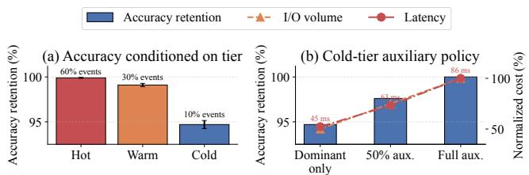

## A Additional Evaluation Results

## A.1 Tier-Conditioned Accuracy

Dataset-level averages can obscure whether aggressive execution disproportionately afects a particular tier. We therefore report accuracy retention conditioned on Hot, Warm, and Cold routing events and further vary the amount of auxiliary-expert capacity retained for Cold combinations. Figure 15 summarizes both analyses.

Hot and Warm combinations retain 99.9% and 99.1% of full-width accuracy, respectively, while Cold combinations retain 94.7%. Because Cold combinations account for only 10% of routing events, their larger conditional degradation has a limited efect on dataset-level accuracy. Within the Cold tier, executing only the dominant expert reduces I/O volume by 50% and latency from 86 ms to 45 ms, at the cost of reducing accuracy retention from 100% to 94.7%; retaining 50% of the auxiliary expert provides an intermediate operating point. This result makes the efect of skipping the Cold-tier auxiliary expert explicit and allows the policy to be selected according to the desired quality-latency trade-of.

## A.2 Robustness to Workload Shift

We evaluate the robustness of CRISP when profiling metadata collected on one workload is applied to another. Figure 16 reports all cross-domain transfers among MMLU (MM), HellaSwag (HS), and WinoGrande (WG), comparing metadata profiled on the target workload (Target matched), metadata directly transferred from the source workload (Transferred), and metadata updated using the target workload (Metadata refresh).

Figure 15: Tier-conditioned accuracy and Cold-tier auxiliary-expert analysis. The left panel reports accuracy retention within each execution tier and its share of routing events. The right panel compares accuracy retention, I/O volume, and latency when the Cold tier executes only the dominant expert, retains 50% of the auxiliary expert, or retains the full auxiliary expert.  
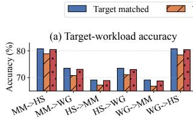

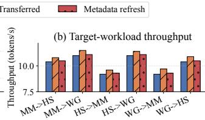  
Figure 16: Cross-domain robustness of CRISP when profiling metadata is transferred between MMLU (MM), HellaSwag (HS), and WinoGrande (WG). Target matched uses metadata profiled on the evaluation workload, Transferred directly applies sourceworkload metadata, and Metadata refresh updates the metadata on the target workload.

Directly transferring metadata limits the accuracy decrease to at most 2.7 percentage points across the evaluated workload pairs, while maintaining comparable or slightly higher throughput. Refreshing the profiling metadata recovers accuracy to within 0.5 percentage points of the targetmatched setting and retains similar throughput. These results show that CRISP degrades gracefully under workload shift and can recover most of the quality loss by updating its profiling metadata for the new workload.

## A.3 Throughput Across Sequence Lengths

We evaluate throughput across input sequence lengths from 128 to 2,048 tokens on Mixtral-8x7B under a 20% memory budget. Figure 17 shows that CRISP maintains its advantage across all evaluated lengths, with greater improvements for longer sequences as the cumulative benefit of reduced I/O becomes more pronounced.

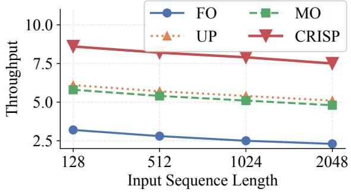  
Figure 17: Throughput (tokens/second) across diferent sequence lengths on Mixtral-8x7B with 20% memory budget.

## A.4 System Overhead Analysis

We analyze the overhead of CRISP, including both ofline preparation costs and runtime overhead.

A.4.1 Ofline Preparation Overhead. The importance-aware neuron reordering and combination classification are performed ofline and incur no runtime cost. Table 2 reports the ofline preparation time for these components. The Importance Computation (IC) requires a forward pass over the calibration dataset (1024 samples) while recording intermediate activations, completing in 18 minutes for Mixtral-8x7B. The Weight Reordering (WR) involves permuting the weight matrices according to the computed importance ranking, which takes 7 minutes. Combination Profiling (CP) requires running inference on the calibration dataset while recording activated combinations, which takes 15 minutes for Mixtral 8x7B. The Dominant Expert Identification (DEI) adds 8 min utes for ablation-based analysis. The total ofline time of 48 minutes is a one-time cost amortized over all subsequent inferences. The storage overhead for reordered weights is negligible: the reordered model occupies the same disk space as the original, as we only permute existing values without adding new parameters. The only additional storage is the tier assignment table and dominant expert mapping, which together consume less than 2 MB. For Mixtral-8x7B, 14.3% of combinations are classified as Hot, 32.1% as Warm, and 53.6% as Cold. However, due to the power-law distribution, Hot combinations account for 61.8% of actual activations at runtime.

Table 2: Ofline preparation overhead for CRISP. IC: Importance Computation, WR: Weight Reordering, CP: Combination Profiling, DEI: Dominant Expert Identification.
<table><tr><td>Component</td><td>Mixtral-8x7B</td><td>DeepSeek-MoE</td></tr><tr><td>IC</td><td>18 min</td><td>12 min</td></tr><tr><td>WR</td><td>7 min</td><td>4min</td></tr><tr><td>CP</td><td>15 min</td><td>22 min</td></tr><tr><td>DEI</td><td>8min</td><td>10 min</td></tr><tr><td>Total Offline Time</td><td>48 min</td><td>48 min</td></tr></table>

A.4.2 Runtime Scheduling Overhead. The pruning-aware scheduler introduces runtime overhead for maintaining priority queues and making scheduling decisions. We measure this overhead by comparing against a baseline scheduler without width-awareness. As shown in Table 3, the total scheduling overhead is 48.1 �s per token for Mixtral-8x7B, representing only 0.05% ofthe total token generation latency. The Tier Lookup (TL) is implemented as a GPU-resident table access and completes in 0.8 �s. Stream Coordination (SC) adds 45 �s but enables I/O prefetching that saves significantly more time. Overall, the scheduling overhead is negligible compared to the performance gains from improved I/O-computation overlap.

Table 3: Runtime scheduling overhead per token. TL: Tier Lookup, PQO: Priority Queue Operations, SC: Stream Coordination.
<table><tr><td>Component</td><td>Mixtral-8x7B</td><td>DeepSeek-MoE</td></tr><tr><td>TL</td><td>0.8 µs</td><td>1.2 µs</td></tr><tr><td>PQO</td><td>2.3 µs</td><td>4.7 µs</td></tr><tr><td>SC</td><td>45 μs</td><td>38 μs</td></tr><tr><td>Total overhead</td><td>48.1 µs</td><td>43.9 µs</td></tr><tr><td>Token latency</td><td>0.05%</td><td>0.06%</td></tr></table>

## A.5 Asymmetric Execution

For Warm-tier combinations, we compare our asymmetric execution (full-width dominant + narrow auxiliary) against symmetric alternatives.

Table 4: Comparison of Warm-tier execution strategies on Mixtral-8x7B.
<table><tr><td>Warm-Tier Strategy</td><td>PPL↓</td><td>I/O Volume</td></tr><tr><td>Both Full-Width</td><td>3.84</td><td>100%</td></tr><tr><td>Both 75%-Width</td><td>4.18</td><td>75%</td></tr><tr><td>Both 50%-Width</td><td>4.67</td><td>50%</td></tr><tr><td>Asymmetric (100% + 50%)</td><td>4.02</td><td>75%</td></tr></table>

At the same 75% I/O budget, asymmetric execution achieves 4.02 perplexity compared to 4.18 for symmetric 75%-width execution. This validates our observation that experts play asymmetric roles within a combination, and that preserving full capacity for the dominant expert is more important than balanced pruning.