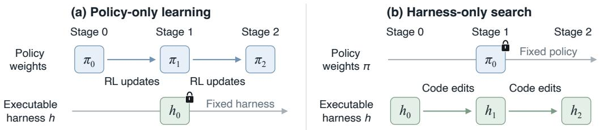
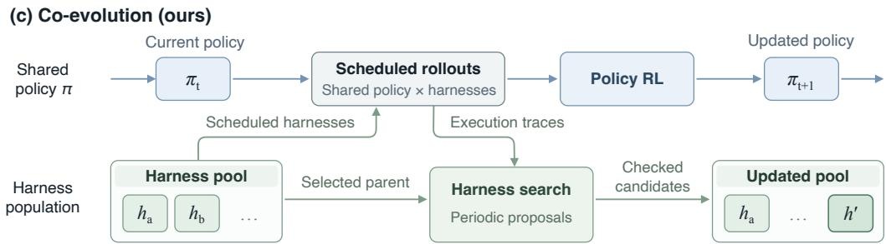
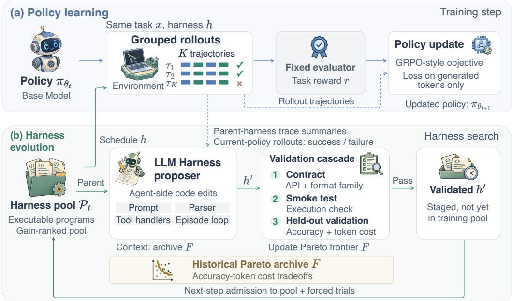
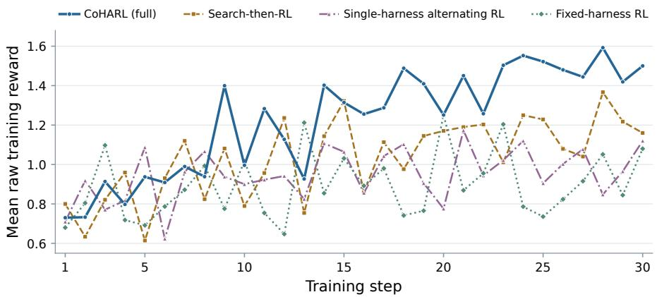
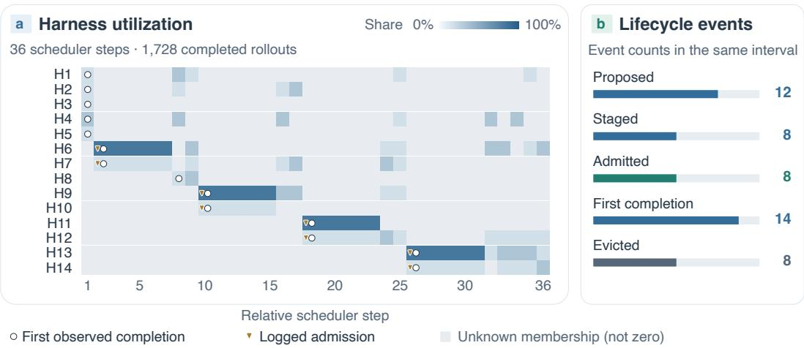
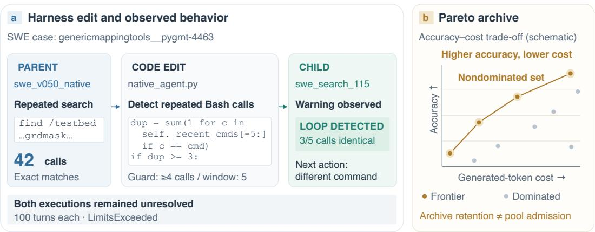

# CoHARL: Co-Evolving Agent Policies and Executable Harnesses with Reinforcement Learning

Jianwen Chen1, Peng Xia1, Kaide Zeng1, Siwei Han1 Zhen-Yu Zhang2, Charles Fleming3, Xinyu Ye1, Huaxiu Yao1

1University of North Carolina at Chapel Hill 2RIKEN 3Cisco

## Abstract

Large language model (LLM) agents interact with their environments through executable harnesses that govern tool use and feedback. Optimizing a harness for a fixed policy overlooks how its behavior changes during learning, while training a policy under a fixed harness leaves the interface that generates its training experience unchanged. This motivates adapting the harness throughout policy training. We introduce CoHARL, a population-based reinforcement learning framework that co-evolves a shared policy and a population of executable harnesses. The policy learns from rollouts across the population, and a proposer uses its execution traces to revise harness code during training. CoHARL achieves a 27.6% mean resolved rate on SWE-rebench, improving over harness-only search by 6.4 percentage points. Experiments on SWE-bench Verified and Terminal-Bench 2.0 show gains in software engineering and terminal-based tasks. Under matched training budgets, CoHARL also outperforms searching for a harness once before RL and alternating policy updates with revisions to a single active harness.

## 1 INTRODUCTION

LLM agents solve software-engineering tasks by interacting with repositories, tools, and execution environments (Weng, 2026; Yang et al., 2024; Wang et al., 2025; Karten et al., 2026). Their behavior depends on both model weights and the harness: the program that handles prompts, action parsing, tool responses, and episode control. The same program controls inference-time execution and the collection of training trajectories.

Agent failures can originate in either the execution code or the policy. If an action parser rejects a valid tool call, or a tool-output handler discards feedback needed for the next decision, updating model weights does not repair that code. Policy-only reinforcement learning (RL) (Wei et al., 2025; Luo et al., 2025) may teach the agent to work around the defect, but leaves its cause in the harness unchanged. Conversely, even with correct tool execution, a policy may choose an uninformative command or misinterpret a test failure. Harness-only search (Lee et al., 2026; Zhang et al., 2026a; Lin et al., 2026) can add guidance and safeguards, but does not update the model’s parameters to learn from these mistakes.

The two forms of adaptation are also linked during training. Repairing a tool handler changes the feedback available to the policy and the trajectories from which it learns. As the policy improves, its execution traces can reveal further harness weaknesses that were not apparent under the initial model. Searching once before RL cannot respond to those later failures; keeping the policy frozen cannot train it on the experience collected through the revised interface. We therefore ask (Figure 1): how can an agent’s policy and execution interface adapt together throughout training?

  
Figure 1: Coupling policy optimization with harness evolution. Policy-only RL adapts policy weights under a fixed harness (a), whereas harness-only search adapts the harness under a fixed policy (b). CoHARL jointly adapts a shared policy and a harness population (c), using execution traces to guide harness edits and population rollouts to update the policy.

Recent methods update both model weights and harness or training code (Chen et al., 2026a; Luo et al., 2026). WHALE alternates harness search under frozen model weights with rejection-sampling fine-tuning under a selected harness (Kim et al., 2026). Its policy updates therefore use one selected execution interface at a time. In CoHARL, multiple harnesses remain active during training: a scheduler allocates rollouts across the evolving population, and these rollouts jointly update one shared policy through reinforcement learning. This allows new candidates to contribute training experience alongside existing versions, rather than replacing the interface for all subsequent rollouts. We evaluate the benefit of this population-based design against single-harness alternating updates under the same training budget.

In CoHARL, a proposer model reads the policy’s successful and failed trajectories and revises harness code. Accepted candidates join the population, from which a scheduler selects versions for training rollouts. The proposer also receives a Pareto archive of historical accuracy–cost trade-offs. Figure 2 shows how search and rollout collection alternate with policy updates.

We evaluate CoHARL on software-engineering and terminal-based tasks. On SWE-rebench, it achieves a 27.6% mean resolved rate, compared with 21.2% for harness-only search and 20.3% for policy-only training. CoHARL also outperforms both baselines on SWE-bench Verified without further adaptation. A separately trained Terminal-Bench 2.0 agent improves on harness-only search. Matched-budget controls favor continued population-based training over one-time search and singleharness alternation; ablations examine execution feedback and historical context.

Our contributions are threefold: (i) a population-based formulation of policy–harness co-evolution, in which diverse execution interfaces supply experience to one shared policy; (ii) a search-and-training procedure that uses current-policy traces and historical accuracy–cost context to propose programs, then schedules accepted versions for future rollouts; and (iii) evaluation across three benchmarks, with matched-budget controls for one-time search, single-harness alternation, and search context.

## 2 RELATED WORK

Automated Agent and Harness Design. Agent design methods optimize executable code (Hu et al., 2025; Zhang et al., 2026b), prompts (Agrawal et al., 2026), and reusable context or skills (Zhang et al., 2026d; Wei et al., 2026b; Shen et al., 2026). Execution-feedback search (Lee et al., 2026; Zhang et al., 2026a; Park et al., 2026; Jiang et al., 2026a), structured edit spaces (Zhang et al., 2026c; Wu et al., 2026a; Xia et al., 2026c), and learned editors (Shao et al., 2026) are used to search for better designs. Evaluation studies examine generalization, cost, and differences across policies (Wu et al., 2026b; Wang et al., 2026). We evolve harnesses during RL, when their outputs also become training data.

  
Figure 2: Overview of CoHARL. A shared policy learns from population rollouts, while a proposer revises harness code using current-policy traces and historical accuracy–cost trade-offs. Accepted candidates enter the pool at step boundaries. The validation cascade shown applies to TB-2; SWE uses contract checks followed by pool trials. Blue and green rollout blocks represent generated tokens and tool observations, respectively; only generated tokens contribute to the policy loss.

Reinforcement Learning for LLM Agents. Reward-based training improves coding policies (Wei et al., 2025; Luo et al., 2025), with complementary work on credit assignment (Jiang et al., 2026b) and RL through deployed or black-box harnesses (He et al., 2026; Song et al., 2026). Other methods adapt skills (Xia et al., 2026a;b) or runtime state management (Ning et al., 2026). We use group-relative optimization (Shao et al., 2024) to train one policy on rollouts from multiple evolving harnesses; we do not change the gradient estimator.

Policy–Harness Co-Evolution. Joint adaptation includes harness revision (Chen et al., 2026c;d), expert correction (Yu et al., 2026b), and verified data generation (Fan & Huang, 2026). Designs differ in adaptation targets and policy sharing: EvoTrainer evolves training-side infrastructure (Chen et al., 2026a); WHALE alternates model updates and harness search (Kim et al., 2026); HASE uses one model for solving and editing (Luo et al., 2026); and HarnessForge maintains harnessspecific adapters (Chen et al., 2026b). CoHARL instead uses a separate proposer to evolve agent-side programs while training one shared policy across the scheduled population. Unlike HarnessBandit’s scheduling over a given harness set (Wei et al., 2026a), our search also changes the programs available during training. Appendix F details these distinctions.

## 3 METHOD

CoHARL alternates rollout collection and policy optimization with periodic harness search (Figure 2). One policy is shared across all active harnesses. The scheduler selects rollout harnesses from the training pool, and the proposer edits their code. The proposer also reads historical accuracy–cost records from a separate archive, which can retain information about versions no longer in use.

Algorithm 1 CoHARL: Co-evolution of policy weights and a harness population   
Require: Initial policy $\pi _ { \boldsymbol { \theta } _ { 0 } } ,$ seed harness $h _ { 0 } ,$ , tasks ${ \mathcal { D } } ,$ group size $\overline { { K } }$ , batch size $B ,$ harness slots per   
step N, pool $\mathbf { \dot { \mathcal { P } } } \gets \{ h _ { 0 } \}$ , evaluated archive $F ,$ Staged $ \emptyset$   
1: for $t = \bar { 0 } , 1 , \ldots , T - 1$ do   
2: $\mathcal { P }  \mathrm { A } { } $ dmit $( { \mathcal { P } } , { \mathrm { S t a g e d } } ) ;$ Staged $ \emptyset$   
3: $( h _ { 1 } , \ldots , h _ { N } ) _ { \ldots } ^ { \cdot }  \mathrm { S } \mathrm { c }$ chedule(P)   
4: sample $\{ x _ { b } \} _ { b = 1 } ^ { B } \sim { \mathcal { D } } ;$ assign each task a harness $h ( b )$   
5: for $\bar { b } = \mathrm { \ i } , \dotsc , \bar { B }$ in parallel do   
6: $\tau _ { b , 1 } , \dots , \tau _ { b , K } \sim \mathrm { R o l l o u t } ( \pi _ { \theta _ { t } } , h ( b ) , x _ { b } )$   
7: end for   
8: $B _ { t } \gets$ PrepareBatch $( \{ \tau _ { b , i } \} _ { b , i } )$   
9: $\theta _ { t + 1 } \gets \theta _ { t }$   
10: if $B _ { t }$ contains enough usable samples then   
11: compute group-relative advantages using Eq. (3)   
12: $\boldsymbol { \theta } _ { t + 1 } \dot { \cdot }  \bar { \mathrm { P o l i c y U p d a t e } } ( \boldsymbol { \theta } _ { t } , \boldsymbol { B } _ { t } )$   
13: end if   
14: update $\left\{ g _ { h } \right\}$ and $F$ from available evaluations; evict eligible members   
15: if domain-, phase-, and pool-dependent proposal cadence permits then   
16: $h _ { \mathrm { p a r } }  \mathrm { \bar { S } e }$ lectParent $( \mathcal { P } )$   
17: $h ^ { \dagger } \sim q _ { \mathrm { L L M } } ( \cdot \mid h _ { \mathrm { p a r } } , \mathcal { T } _ { \theta _ { t } } ( h _ { \mathrm { p a r } } ) , F )$   
18: $\mathbf { i f } \ h ^ { \prime }$ passes the domain-specific candidate checks then   
19: $\dot { \mathrm { S t a g e d } }  \mathrm { S t a g e d } \cup \dot { \{ h ^ { \prime } \} }$   
20: end if   
21: end if   
22: every 10 training steps: monitor on validation tasks   
23: end for

## 3.1 AGENTS AS COUPLED WEIGHT–HARNESS SYSTEMS

Let $\pi _ { \theta }$ be the policy and h an executable harness. On task $x ,$ an episode $\tau \sim$ Rollout $( \pi _ { \boldsymbol { \theta } } , h , x )$ receives task reward $r ( \tau ) \in [ 0 , 1 ]$ from a fixed evaluator. The deployment objective is

$$
\operatorname* { m a x } _ { \theta , h } J ( \theta , h ) , \qquad J ( \theta , h ) = \mathbb { E } _ { x \sim \mathcal { D } } \mathbb { E } _ { \tau \sim \mathrm { R o l l o u t } ( \pi _ { \theta } , h , x ) } [ r ( \tau ) ] .\tag{1}
$$

CoHARL maintains a harness training pool $\mathcal { P } _ { t }$ and a separate archive $F _ { t }$ of non-dominated recorded evaluations. Let $q _ { t } ( h \mid x , \mathcal { P } _ { t } )$ describe the scheduler’s rollout assignment. The corresponding task-reward objective under this assignment is

$$
\bar { J } _ { t } ( \theta ) = \mathbb { E } _ { x \sim \mathcal { D } _ { \mathrm { t r a i n } } } \sum _ { h \in \mathcal { P } _ { t } } q _ { t } ( h \mid x , \mathcal { P } _ { t } ) \mathbb { E } _ { \tau \sim \mathrm { R o l l o u t } ( \pi _ { \theta } , h , x ) } [ r ( \tau ) ] .\tag{2}
$$

The scheduler defines the mixture of execution interfaces seen during training; this mixture is uniform only under uniform assignment. Assignment and harness code remain fixed within each update. Equation (2) describes the scheduled training distribution, whereas Eq. (1) evaluates a deployed policy–harness pair. Both use task reward r to characterize performance; the implemented policy update uses the domain-specific training reward $R ,$ including SWE reward shaping (Appendix C.1). Neither the scheduled mixture nor the shaped surrogate is assumed to share the optimum of the deployment objective.

## 3.2 THE COHARL TRAINING LOOP

Algorithm 1 gives the training loop. Each training step collects task–harness rollout groups and updates the shared policy if enough usable samples remain. Search uses the collected trajectories; accepted candidates become available at the next step boundary. A new version is never applied to an already collected batch. A training step can finish without an optimizer update if batch preparation leaves too few usable samples.

Policy learning across the harness population. Each sampled group targets $K$ rollouts for the same task and harness. Rewards are centered within this fixed task–interface pair, rather than across trajectories collected with different harnesses. After batch preparation, let $\mathcal { T } _ { b }$ index the retained episodes in group b, with $k _ { b } = | \mathcal { T } _ { b } |$ |. Let $R _ { b , i }$ denote the training reward after the applicable reward transformations, rather than the separate filtering score (Appendix C.1). The group-relative advantage is

$$
\hat { A } _ { b , i } = R _ { b , i } - \frac { 1 } { k _ { b } } \sum _ { j \in \mathcal { T } _ { b } } R _ { b , j } , \qquad i \in \mathcal { T } _ { b } .\tag{3}
$$

Appendix C.1 specifies batch preparation. For the clipped update used in the SWE configuration, let $u _ { b , i , \ell } ( \theta ) = \pi _ { \theta } ( a _ { b , i , \ell } \mid H _ { b , i , \ell } ) / \pi _ { \theta _ { \mathrm { o l d } } } ( a _ { b , i , \ell } \mid H _ { b , i , \ell } )$ , where $H _ { b , i , \ell }$ precedes generated token $a _ { b , i , \ell }$ and $\theta _ { \mathrm { o l d } }$ denotes the rollout policy parameters. Let $\mathcal { L } _ { b , i }$ index generated tokens in trajectory $\tau _ { b , i }$ and $\begin{array} { r } { L = \sum _ { b , i } | \mathcal { L } _ { b , i } | } \end{array}$ over the trajectories included in the update. The surrogate is

$$
\mathcal { I } _ { \mathrm { G R P O } } ( \theta ) = \frac { 1 } { L } \sum _ { b } \sum _ { i \in \mathcal { I } _ { b } } \sum _ { \ell \in \mathcal { L } _ { b , i } } \operatorname* { m i n } \Bigl \{ u _ { b , i , \ell } \hat { A } _ { b , i } , \exp ( u _ { b , i , \ell } , 1 - \epsilon _ { - } , 1 + \epsilon _ { + } ) \hat { A } _ { b , i } \Bigr \} .\tag{4}
$$

Only generated tokens contribute; tool observations are conditioning context. The clipping parameters ϵ− and $\epsilon _ { + }$ are specified in Table 5. This token-normalized surrogate uses the scheduled harness mixture, not a uniform average over pool members.

Harness search from execution traces. Harness versions are self-contained programs exposing a fixed episode API. A more capable proposer model acts as a stochastic mutation operator, $h ^ { \prime } \sim$ $q _ { \mathrm { L L M } } ( \cdot \mid h _ { \mathrm { p a r } } , \mathcal { T } _ { \theta _ { t } } ( h _ { \mathrm { p a r } } ) , F )$ , and may rewrite files in the parent version $h _ { \mathrm { p a r } }$ (prompt, parser, tool handlers, or the rollout loop itself), conditioned on the parent’s source, summaries $\bar { \mathcal { T } } _ { \theta _ { t } } ( \bar { h } _ { \operatorname { p a r } } )$ of the current policy’s successful and failed traces under the parent, the Pareto frontier $F ,$ and same-round rejected attempts. Two hard constraints apply: the proposer cannot modify the training framework, and it cannot change the action-format family used by the policy. Candidate checks are domainspecific: SWE uses a structural contract check followed by pool trials, while TB-2 additionally uses smoke testing and candidate validation before pool trials. Accepted versions are staged and admitted only at step boundaries. Trial rollouts provide initial usage statistics and update their ranking. Appendix C.1 details these paths.

Search and policy optimization operate on different objects: the proposer edits execution code from trajectory feedback, while RL updates the shared weights from population rollouts. An accepted edit adds an alternative interface for subsequent collection; it does not replace every active harness. Its usefulness is then assessed through pool trials under the training policy.

Pool scheduling. Pool members may encounter tasks of different difficulty, making raw reward averages unsuitable for direct comparison. The scheduler ranks members by a difficulty-adjusted performance score with a lower-confidence-bound guard:

$$
g _ { h } \ = \ \mathrm { E W M A } \Big [ \overline { { \left( r - b _ { x } \right) w _ { x } } } \Big ] , \qquad g _ { h } ^ { \mathrm { l c b } } \ = \ g _ { h } - \frac { c } { \sqrt { \mathrm { m a x } ( n _ { h } , 1 ) } } ,\tag{5}
$$

where $b _ { x }$ is a per-task success-rate baseline (an EWMA over that task’s history), the overbar averages observations for harness ${ { h } , { w } _ { x } }$ is a task-difficulty weight, $n _ { h }$ the member’s use count, and c a conservative ranking penalty. The LCB term lowers the score of under-sampled members; protection from premature eviction instead comes from forced trials and a minimum-use rule. This is a heuristic score rather than a calibrated statistical confidence interval. It governs harness selection, eviction, and parent choice, but is not added to the training advantage in Eq. (3). The scheduler thus changes which experience is collected without redefining the reward used by the policy update. Scheduling combines performance-based allocation with candidate trials. The scheduler allocates N slots, not necessarily N distinct versions, so training can start from the seed alone. Newly admitted candidates receive forced trials and remain protected until the minimum-use requirement is met. Their rollout outcomes update the ranking used for later allocation and eviction. Parent selection draws from the active pool using these performance scores; retaining a version in the archive alone does not make it eligible as a parent.

Historical accuracy–cost archive. The archive retains non-dominated recorded accuracy–cost pairs: a version dominates another when its accuracy is no lower and its mean generated-token cost no higher, with at least one strict inequality. The pool and archive serve different decisions. The pool determines which programs collect training experience; the archive supplies the proposer with previously observed accuracy–cost trade-offs, including records of versions evicted from the pool. Parent traces describe how the current policy uses one program, whereas archive records provide context across earlier evaluations. These records retain their historical scores rather than estimating every version’s performance under the current policy. Appendix A gives the fixed-score properties.

## 3.3 ANALYSIS OF TASK-REWARD CONTRASTS

Identical rewards within a task–harness group give zero advantages in Eq. (3). For $K \geq 2$ conditionally independent binary outcomes with success probability $p ,$ the probability of a non-uniform group is

$$
\rho _ { K } ( p ) = 1 - p ^ { K } - ( 1 - p ) ^ { K } .\tag{6}
$$

For rare success, $\rho _ { K } ( p ) \approx K p \colon$ improving the interface can make reward contrasts more frequent on difficult tasks. The relation reverses above $p = 1 / 2$ , so higher success does not always yield more contrast. This provides an intuition for coupling harness adaptation with group-relative learning, not a convergence guarantee. Appendix A gives the derivation; SWE’s shaped filtering scores are treated separately in Appendix D.1.

## 3.4 TASK REWARDS AND EVALUATOR INTEGRITY

Joint adaptation creates opportunities for reward exploitation through both policy behavior and harness code. For SWE evaluation, success is strictly binary, r=1 iff all FAIL\_TO\_PASS tests pass and all PASS\_TO\_PASS tests continue to pass, with forced submission at episode end and no LLM judge. SWE training combines test correctness with submission-gated process rewards and applies a soft length penalty before the policy update. Group filtering uses the separate test\_score field, whose meaning depends on the harness: it contains only test pass fractions in the seed harness, but can include process rewards in evolved versions. Thus, evaluation uses strict resolution, policy advantages use the transformed training reward, and retention diagnostics use the filtering score. A retained SWE group need not contain a fully resolved episode. Appendix C.1 gives the reward and score mapping. TB-2 instead uses binary training rewards, without soft length penalties or per-harness reward normalization.

Harness edits could expose hidden tests to the policy. The seed harness disables hidden-test injection, and an audit gate rejects detected attempts to reintroduce access. Code inspection found no hidden-test access in five admitted harnesses; a separate probe rejected six test-access proposals. Appendix B describes the audit scope and limitations.

## 4 EXPERIMENTS

Our experiments address three questions: 1) Does co-evolution improve task performance over harness-only search and policy-only RL, and do the gains extend beyond SWE-rebench? 2) What do online search, the harness population, and proposer context contribute under matched training budgets? 3) How do training rewards and harness utilization evolve during learning?

## 4.1 SETUP

Benchmarks and metrics. Our primary experiments use SWE-rebench (Badertdinov et al., 2025), with tasks dated before 2026 for training and 110 tasks dated after March 2026 for held-out evaluation. We report mean resolved rates over three attempts per task (avg@3; temperature 0.7). To assess crossdataset generalization, we evaluate the SWE-rebench-trained agents on the 500-task SWE-bench Verified benchmark (Jimenez et al., 2024; Chowdhury et al., 2024). We also train a separate agent on Terminal-Bench 2.0 (TB-2) (Merrill et al., 2026), using Harbor (Harbor Framework Team, 2026) for evaluation and Terminus-2 as the baseline harness. SWE tasks are scored by strict resolution; TB-2 tasks use their benchmark-provided evaluators.

Model and training. We train Qwen3.5-35B-A3B (Qwen Team, 2026) directly with RL using rank-32 LoRA (Hu et al., 2022) based on SkyRL (Griggs et al., 2025). Harness scheduling and code search are integrated into rollout collection. For SWE, we use group-relative advantages with asymmetric importance-ratio clipping (Yu et al., 2025), without a reference-policy reward penalty or separate KL loss. SWE-rebench training runs for 150 steps with a target of 48 rollouts per step, distributed across a pool of up to eight harness versions. At each search invocation, Claude Opus 4.7 (Anthropic, 2026) proposes up to two candidates, which are checked as described in §3.2. CoHARL uses approximately as many training episodes as the RL-only baseline, with additional computation for harness validation and proposer inference. Full training and evaluation settings, including search schedules and costs, are provided in Appendix C.1.

  
Figure 3: Training rewards for the full method and three controls in Table 4. Each point is the mean raw reward over retained training samples, before length penalties, KL adjustments, or normalization. Curves show unsmoothed values, not evaluation resolved rates.

Baselines. We compare CoHARL with harness-only search and policy-only RL. For harness-only search, we reproduce Meta-Harness (Lee et al., 2026) starting from SWE-mini, with the initial policy held fixed. For policy-only RL, Plain GRPO trains the policy with SWE-mini held fixed. The initial policy paired with SWE-mini serves as the Base baseline. Our ablation study further compares two ways to combine search and RL: Search-then-RL selects a harness before policy training and keeps it fixed thereafter; single-harness alternating RL interleaves policy training with revisions to a single active harness.

## 4.2 MAIN RESULTS

SWE-rebench performance. CoHARL achieves a 27.6% resolved rate, outperforming Meta-Harness by 6.4 percentage points and Plain GRPO by 7.3 points (Table 1). Both baselines improve on the initial agent, with Meta-Harness achieving a higher resolved rate than Plain GRPO without changing the policy weights. Improving the execution interface can therefore be effective even without policy training, but neither interface optimization nor policy-only RL matches joint adaptation. In CoHARL, harness revisions also change the experience available for subsequent policy updates. Its advantage over both baselines is consistent with treating the harness as part of the learning process rather than only an inference-time wrapper.

Table 1: Performance on the 110-task SWE-rebench evaluation split. Resolved rates are averaged over three attempts per task (avg@3) at temperature 0.7. ∗Our Meta-Harness reproduction, initialized from SWE-mini.
<table><tr><td>Method</td><td>Weights</td><td>Harness</td><td>Resolved</td></tr><tr><td>Base</td><td>Qwen3.5-35B-A3B</td><td>SWE-mini</td><td>17.3%</td></tr><tr><td>Meta-Harness</td><td>Qwen3.5-35B-A3B</td><td>Meta-Harness*</td><td>21.2%</td></tr><tr><td>Plain GRPO</td><td>RL-trained</td><td>SWE-mini</td><td>20.3%</td></tr><tr><td>CoHARL (ours)</td><td>RL-trained</td><td>Co-evolved</td><td>27.6%</td></tr></table>

Cross-dataset generalization. On SWE-bench Verified, the policy and harness trained on SWErebench resolve 59.8% of tasks without further adaptation (Table 2). All four methods retain their relative ordering, and CoHARL’s lead over both optimization baselines is larger in absolute percentage points than on SWE-rebench. The learned policy–harness combination retains its advantage on another task collection without benchmark-specific adaptation. For comparison with closed-source agents, published results include 33.2% for GPT-4o (OpenAI, 2025) and 49.0% for Claude 3.5 Sonnet (Anthropic, 2025). CoHARL reaches 59.8% with an open-weight policy, comparing favorably with these earlier systems. These published results provide an external reference rather than a controlled model comparison: harnesses and inference settings differ, and the OpenAI evaluations exclude 23 of the 500 tasks.

Table 2: Resolved rates on the 500-task SWE-bench Verified benchmark with one attempt per task. SWE-rebench-trained agents are evaluated without further adaptation. †Provider-reported results under original evaluation settings (OpenAI, 2025; Anthropic, 2025). ∗Our Meta-Harness reproduction, initialized from SWE-mini.
<table><tr><td>Methods</td><td>Weights</td><td>Harness</td><td>Resolved</td></tr><tr><td>Closed-source models</td><td colspan="3"></td></tr><tr><td>GPT-4o†</td><td></td><td></td><td>33.2%</td></tr><tr><td>Claude 3.5 Sonnet†</td><td></td><td></td><td>49.0%</td></tr><tr><td colspan="3">Qwen3.5-35B-A3B-based methods</td></tr><tr><td>Base</td><td>Fixed</td><td>SWE-mini</td><td>44.2%</td></tr><tr><td>Meta-Harness</td><td>Fixed</td><td>Meta-Harness*</td><td>52.0%</td></tr><tr><td>Plain GRPO</td><td>RL-trained</td><td>SWE-mini</td><td>49.8%</td></tr><tr><td>CoHARL (ours)</td><td>RL-trained</td><td>Co-evolved</td><td>59.8%</td></tr></table>

Application to terminal agents. On Terminal-Bench 2.0, a separately trained CoHARL agent achieves a 36.8% success rate, exceeding harness-only search by 3.1 percentage points (Table 3). Harness-only search already improves on Base, showing that revising the execution interface benefits terminal task solving. Co-evolution improves further by allowing policy learning alongside harness search, rather than relying on interface changes alone.

Table 3: Task success rates on Terminal-Bench 2.0, evaluated through Harbor with Terminus-2 as the baseline harness. For our evaluations at temperature 0.6, success is averaged within each task over returned episodes and then across tasks; tasks with no returned episode score zero. †: Shepherd (Yu et al., 2026a), 89 tasks, avg@5.
<table><tr><td>Method</td><td>Harness</td><td>Success</td></tr><tr><td>Base</td><td>Terminus-2</td><td>26.6%</td></tr><tr><td>Meta-Harness</td><td>Meta-Harness</td><td>33.7%</td></tr><tr><td>Flat GRPO (Shepherd)†</td><td>Terminus-2</td><td>34.2%</td></tr><tr><td>CoHARL (ours)</td><td>Co-evolved</td><td>36.8%</td></tr></table>

## 4.3 ANALYSIS

Ablation study. We ablate harness evolution and proposer context, and compare alternative training strategies under matched 30-step training budgets (Table 4). Fixing the seed harness (A1) reduces the resolved rate from 25.5% to 20.0%, showing the benefit of adapting the interface during policy training. Removing archive context (A2) or execution traces (A3) also lowers performance, even though both variants retain online search. These inputs serve different purposes: the archive records previously observed accuracy–cost trade-offs, whereas traces show how the current policy uses the parent harness. The two ablations indicate that both sources of context help the proposer produce useful revisions.

Search-then-RL (A4) improves on fixed-harness RL but remains 2.7 percentage points below the full method. Its harness is selected for the initial policy and remains fixed throughout RL, even as the policy’s capabilities and execution behavior change. Co-evolution instead allows harness search to respond to the updated policy, potentially finding interfaces that better exploit its improving capabilities. Single-harness alternating RL (A5) updates both components online yet trails the full method by 6.4 points. Unlike the population-based method, each accepted revision replaces the sole interface used for subsequent rollouts. Such replacements may abruptly shift both the training data distribution and the reward distribution, potentially disrupting policy optimization. Retaining multiple harnesses may moderate these shifts by continuing to collect experience through previously used interfaces. Search schedules and candidate acceptance rules are detailed in Appendix C.1.

Table 4: Component ablations and training-strategy comparisons on SWE-rebench under matched training budgets (30 steps). We report strict resolved rates and counts over 110 tasks with one attempt per task.
<table><tr><td>Configuration</td><td>Resolved rate</td><td>Resolved</td></tr><tr><td>CoHARL (full)</td><td>25.5%</td><td>28/110</td></tr><tr><td>A1: Fixed-harness RL</td><td>20.0%</td><td>22/110</td></tr><tr><td>A2: No archive context</td><td>20.0%</td><td>22/110</td></tr><tr><td>A3: No execution traces</td><td>20.9%</td><td>23/110</td></tr><tr><td>A4: Search-then-RL</td><td>22.7%</td><td>25/110</td></tr><tr><td>A5: Single-harness alternating RL</td><td>19.1%</td><td>21/110</td></tr></table>

Training dynamics. The training reward curves in Figure 3 provide a temporal view of the same 30- step comparisons. The methods overlap early, while CoHARL develops a lead later and remains above all three controls during the final ten steps despite step-to-step fluctuations. This late-training reward advantage accompanies the higher final resolved rate in Table 4, linking the endpoint comparison to differences that emerge over the course of training.

Harness utilization. To examine how the population is used, Figure 4 tracks 14 harness versions over 36 scheduler steps from a separate archived run. Several versions contribute rollouts within the same step, and earlier harnesses remain in use after newer ones enter the pool. The population is therefore used for concurrent experience collection, rather than merely storing past revisions. The contribution of each harness to the collected training experience changes over time. In contrast to single-harness alternating RL, admitting a candidate does not require replacing the interface for all subsequent rollouts. The lifecycle counts complement this view by summarizing admissions and evictions; Appendix D gives the counting rules.

  
Figure 4: Harness utilization and population turnover. (a) Per-step rollout shares across harness versions; darker blue indicates larger shares, while gray denotes unknown pool membership. (b) Recorded lifecycle events over the same 36-step segment.

## 5 CONCLUSION

We presented CoHARL, which jointly trains a shared policy and evolves a population of executable harnesses. Experiments on SWE-rebench, SWE-bench Verified, and Terminal-Bench 2.0 demonstrate the benefits of adapting both components. Matched-budget ablations favor continued populationbased evolution over searching once before RL or repeatedly revising a single harness. Together, these results show that executable interfaces are an important target for agent learning alongside policy weights: policy behavior informs harness revisions, and revised harnesses shape subsequent training experience.

## AI USE STATEMENT

We used GPT-6-Astra to edit and organize the manuscript, revise mathematical statements and proofs, interpret results, obtain feedback on experimental design, and check literature and references. We also used AI assistance for figure layouts, visual design drafts, and icon generation. The authors reviewed the AI-assisted revisions and checked the mathematical arguments, experimental interpretations, and references. The authors take responsibility for the final text, claims, and artifacts.

## ETHICS STATEMENT

Executable agents can expose repositories and environments to unintended changes. The method uses isolated execution and restricts proposer edits, but finite audits do not prove security. Any release should respect benchmark and repository licenses, remove credentials and identifying information from traces, and document risks of executing evolved programs.

## REPRODUCIBILITY STATEMENT

Algorithm 1 describes the procedure, Appendix A gives assumptions and proofs, and Appendix C records the reported hyperparameters. Appendix C.1 specifies reward computation, batch preparation, candidate checks, and evaluation protocols. A complete versioned artifact bundle is not included with this manuscript.

## REFERENCES

Lakshya A Agrawal, Shangyin Tan, Dilara Soylu, Noah Ziems, Rishi Khare, Krista Opsahl-Ong, Arnav Singhvi, Herumb Shandilya, Michael J Ryan, Meng Jiang, Christopher Potts, Koushik Sen, Alexandros G. Dimakis, Ion Stoica, Dan Klein, Matei Zaharia, and Omar Khattab. GEPA: Reflective prompt evolution can outperform reinforcement learning. In International Conference on Learning Representations, 2026. URL https://arxiv.org/abs/2507.19457.

Anthropic. Raising the bar on SWE-bench Verified with Claude 3.5 Sonnet, 2025. URL https: //www.anthropic.com/engineering/swe-bench-sonnet.

Anthropic. Introducing Claude Opus 4.7, 2026. URL https://www.anthropic.com/news /claude-opus-4-7.

Ibragim Badertdinov, Alexander Golubev, Maksim Nekrashevich, Anton Shevtsov, Simon Karasik, Andrei Andriushchenko, Maria Trofimova, Daria Litvintseva, and Boris Yangel. SWE-rebench: An automated pipeline for task collection and decontaminated evaluation of software engineering agents. In Advances in Neural Information Processing Systems, volume 38, 2025. doi: 10.52202 /085713-0788. URL https://proceedings.neurips.cc/paper\_files/paper/2 025/hash/21bec6ace947b1b58967b945c8ac0f10-Abstract-Datasets\_and\_ Benchmarks\_Track.html.

Guhong Chen, Yingcheng Shi, Yongbin Li, Binhua Li, Xander Xu, Hu Wei, Shiwen Ni, Min Yang, and Jieping Ye. EvoTrainer: Co-evolving LLM policies and training harnesses for autonomous agentic reinforcement learning. arXiv preprint arXiv:2606.03108, 2026a. URL https://arxi v.org/abs/2606.03108.

Mingju Chen, Can Lv, Guibin Zhang, Heng Chang, and Shiji Zhou. HarnessForge: Joint harness and policy evolution for adaptive agent systems. arXiv preprint arXiv:2606.01779, 2026b. URL https://arxiv.org/abs/2606.01779.

Tingyang Chen, Shuo Lu, Kang Zhao, Weicheng Meng, Hanlin Teng, Tianhao Li, Chao Li, Xule Liu, Jian Liang, Zhizhong Zhang, Yuan Xie, Heng Qu, Kun Shao, and Jian Luan. HarnessX: A composable, adaptive, and evolvable agent harness foundry. arXiv preprint arXiv:2606.14249, 2026c. URL https://arxiv.org/abs/2606.14249.

Zhengyu Chen, Teng Xiao, Huaisheng Zhu, Yige Yuan, Luan Zhang, and Jingang Wang. Co-Harness: Co-evolving harnesses and model weights for LLM agents. arXiv preprint arXiv:2607.22688, 2026d. URL https://arxiv.org/abs/2607.22688.

Neil Chowdhury, James Aung, Chan Jun Shern, Oliver Jaffe, Dane Sherburn, Giulio Starace, Evan Mays, Rachel Dias, Marwan Aljubeh, Mia Glaese, Carlos E. Jimenez, John Yang, Leyton Ho, Tejal Patwardhan, Kevin Liu, and Aleksander Madry. Introducing SWE-bench Verified. OpenAI blog, 2024. URL https://openai.com/index/introducing-swe-bench-verified/.

Tianyu Fan and Chao Huang. HELIX: Model-harness co-evolution for recursive self-improvement. arXiv preprint arXiv:2608.13951, 2026. URL https://arxiv.org/abs/2608.13951.

Tyler Griggs, Sumanth Hegde, Eric Tang, Shu Liu, Shiyi Cao, Dacheng Li, Charlie Ruan, Philipp Moritz, Kourosh Hakhamaneshi, Richard Liaw, Akshay Malik, Shishir G. Patil, Matei Zaharia, Joseph E. Gonzalez, and Ion Stoica. Evolving SkyRL into a highly-modular RL framework, 2025. URL https://novasky-ai.notion.site/skyrl-v01. Notion Blog.

Harbor Framework Team. Harbor: A framework for evaluating and optimizing agents and models in container environments, 2026. URL https://doi.org/10.5281/zenodo.20953922.

Zhiyuan He, Siwei Zhang, Zhiwen Zhou, Yuqing Yang, Yu Kang, Yuge Zhang, Luna K. Qiu, Tin Yan Tsui, Jiahang Xu, and Chong Luo. Agent Lightning v1.0: Towards harnessed agentic RL. arXiv preprint arXiv:2608.17528, 2026. URL https://arxiv.org/abs/2608.17528.

Edward J. Hu, Yelong Shen, Phillip Wallis, Zeyuan Allen-Zhu, Yuanzhi Li, Shean Wang, Lu Wang, and Weizhu Chen. LoRA: Low-rank adaptation of large language models. In International Conference on Learning Representations, 2022. URL https://openreview.net/forum ?id=nZeVKeeFYf9.

Shengran Hu, Cong Lu, and Jeff Clune. Automated design of agentic systems. In International Conference on Learning Representations, 2025. URL https://proceedings.iclr.cc/ paper\_files/paper/2025/hash/36b7acf6f6010652b3f2a433774a66fe-Abs tract-Conference.html.

Wen Jiang, Mingmin Chu, Yimeng Tian, Qianxin Zhang, Haofei Yang, Rui Yang, Yang Liu, Tao Lv, and Fangming Li. HarnessEvolve: Learning from reference trajectories for reliable agent self-evolution. arXiv preprint arXiv:2609.00829, 2026a. URL https://arxiv.org/abs/ 2609.00829.

Xinke Jiang, Zhixin Zhang, Zhibang Yang, Jiaran Gao, Rihong Qiu, Shijin Chen, Xu Chu, Junfeng Zhao, and Yasha Wang. Harness-RL: Black-box reinforcement learning with action-args decoupling for central-agent multi-agent harnesses. arXiv preprint arXiv:2608.29641, 2026b. URL https: //arxiv.org/abs/2608.29641.

Carlos E. Jimenez, John Yang, Alexander Wettig, Shunyu Yao, Kexin Pei, Ofir Press, and Karthik Narasimhan. SWE-bench: Can language models resolve real-world GitHub issues? In International Conference on Learning Representations, 2024. URL https://openreview.net/forum ?id=VTF8yNQM66.

Seth Karten, Joel Zhang, Tersoo Upaa Jr, Ruirong Feng, Wenzhe Li, Chengshuai Shi, Chi Jin, and Kiran Vodrahalli. Continual harness: Online adaptation for self-improving foundation agents. arXiv preprint arXiv:2605.09998, 2026. URL https://arxiv.org/abs/2605.09998.

Haechan Kim, Yoonho Lee, Gisang Lee, Chelsea Finn, and Kangwook Lee. WHALE: A simple recipe for joint harness-weight optimization. arXiv preprint arXiv:2609.00196, 2026. URL https://arxiv.org/abs/2609.00196.

Yoonho Lee, Roshen Nair, Qizheng Zhang, Kangwook Lee, Omar Khattab, and Chelsea Finn. Meta-Harness: End-to-end optimization of model harnesses. arXiv preprint arXiv:2603.28052, 2026. URL https://arxiv.org/abs/2603.28052.

Jiahang Lin, Shichun Liu, Chengjun Pan, Lizhi Lin, Shihan Dou, Zhiheng Xi, Xuanjing Huang, Hang Yan, Zhenhua Han, Tao Gui, and Yu-Gang Jiang. Agentic harness engineering: Observabilitydriven automatic evolution of coding-agent harnesses. arXiv preprint arXiv:2604.25850, 2026. URL https://arxiv.org/abs/2604.25850.

Haochen Luo, Yi Huang, Sichun Luo, Fengyuan Liu, Lei Li, Zefa Hu, Junlan Feng, and Qi Liu. Harness-aware self-evolving: Co-evolving model weights, harness, and task solutions. arXiv preprint arXiv:2607.03935, 2026. URL https://arxiv.org/abs/2607.03935.

Michael Luo, Naman Jain, Jaskirat Singh, Sijun Tan, Ameen Patel, Qingyang Wu, Alpay Ariyak, Colin Cai, Tarun Venkat, Shang Zhu, Ben Athiwaratkun, Manan Roongta, Ce Zhang, Li Erran Li, Raluca Ada Popa, Koushik Sen, and Ion Stoica. DeepSWE: Training a fully open-sourced, state-of-the-art coding agent by scaling RL. Together AI blog, 2025. URL https://www.to gether.ai/blog/deepswe.

Mike A. Merrill, Alexander G. Shaw, Nicholas Carlini, Boxuan Li, Harsh Raj, Ivan Bercovich, Lin Shi, Jeong Yeon Shin, Thomas Walshe, E. Kelly Buchanan, Junhong Shen, Guanghao Ye, Haowei Lin, Jason Poulos, Maoyu Wang, Marianna Nezhurina, Jenia Jitsev, Di Lu, Orfeas Menis Mastromichalakis, Zhiwei Xu, Zizhao Chen, Yue Liu, Robert Zhang, Leon Liangyu Chen, Anurag Kashyap, Jan-Lucas Uslu, Jeffrey Li, Jianbo Wu, Minghao Yan, Song Bian, Vedang Sharma, Ke Sun, Steven Dillmann, Akshay Anand, Andrew Lanpouthakoun, Bardia Koopah, Changran Hu, Etash Guha, Gabriel H. S. Dreiman, Jiacheng Zhu, Karl Krauth, Li Zhong, Niklas Muennighoff, Robert Amanfu, Shangyin Tan, Shreyas Pimpalgaonkar, Tushar Aggarwal, Xiangning Lin, Xin Lan, Xuandong Zhao, Yiqing Liang, Yuanli Wang, Zilong Wang, Changzhi Zhou, David Heineman, Hange Liu, Harsh Trivedi, John Yang, Junhong Lin, Manish Shetty, Michael Yang, Nabil Omi, Negin Raoof, Shanda Li, Terry Yue Zhuo, Wuwei Lin, Yiwei Dai, Yuxin Wang, Wenhao Chai, Shang Zhou, Dariush Wahdany, Ziyu She, Jiaming Hu, Zhikang Dong, Yuxuan Zhu, Sasha Cui, Ahson Saiyed, Arinbjörn Kolbeinsson, Jesse Hu, Christopher Michael Rytting, Ryan Marten, Yixin Wang, Alex Dimakis, Andy Konwinski, and Ludwig Schmidt. Terminal-Bench: Benchmarking agents on hard, realistic tasks in command line interfaces. arXiv preprint arXiv:2601.11868, 2026. URL https://arxiv.org/abs/2601.11868.

Xuying Ning, Dongqi Fu, Tianxin Wei, Hanqing Zeng, Yuanchen Bei, Bingxuan Li, Zihao Li, Qifan Wang, Xiang Shen, Yifan Wu, Jiayi Liu, Hong Li, Yinglong Xia, Xiangjun Fan, Hanghang Tong, and Jingrui He. EvoHarness-RL: Learning self-evolving runtime harness for long-horizon LLM agents. arXiv preprint arXiv:2608.05446, 2026. URL https://arxiv.org/abs/2608.0 5446.

OpenAI. Introducing GPT-4.1 in the API, 2025. URL https://openai.com/index/gpt-4 -1/.

Sungho Park, Wonjoong Kim, Rongyuan Tan, Jue Zhang, Wook-Shin Han, Pengfei Gao, Chanyoung Park, Yongqiang Yao, Rao Fu, Elsie Nallipogu, Qingwei Lin, Saravan Rajmohan, and Dongmei Zhang. AutoSaddler: Automatic harness optimization with durable updates from agent execution traces. arXiv preprint arXiv:2608.23041, 2026. URL https://arxiv.org/abs/2608.2 3041.

Qwen Team. Qwen3.5: Towards native multimodal agents, February 2026. URL https://qwen .ai/blog?id=qwen3.5.

Shuai Shao, Kangning Zhang, Qingyao Li, Shijian Wang, Hao Wang, Wenxiang Jiao, Yuan Lu, Yi Guo, Weiwen Liu, and Weinan Zhang. Harness-R1: Learning to edit executable runtime harnesses from agent failure trajectories. arXiv preprint arXiv:2608.02276, 2026. URL https: //arxiv.org/abs/2608.02276.

Zhihong Shao, Peiyi Wang, Qihao Zhu, Runxin Xu, Junxiao Song, Xiao Bi, Haowei Zhang, Mingchuan Zhang, Y. K. Li, Y. Wu, and Daya Guo. DeepSeekMath: Pushing the limits of mathematical reasoning in open language models. arXiv preprint arXiv:2402.03300, 2024. URL https://arxiv.org/abs/2402.03300.

Yifei Shen, Bo Li, and Xinjie Zhang. SkillOpt-Lite: Better and faster agent self-evolution via one line of vibe. arXiv preprint arXiv:2607.03451, 2026. URL https://arxiv.org/abs/26 07.03451.

Huatong Song, Fei Bai, Ming Yang, Renyuan Li, Jia Deng, Jujie He, Zhange Zhang, Daixuan Cheng, Yan Xing, Qi Yun, Xuxing Chen, Danyang Li, Feng Chang, Chuan Hao, Ran Tao, Jian Yang, Bryan Dai, Wayne Xin Zhao, Mingjie Tang, and Ji-Rong Wen. ClawGym II: Exploring black-box RL on agent harness. arXiv preprint arXiv:2608.16798, 2026. URL https://arxiv.org/abs/26 08.16798.

Xingyao Wang, Boxuan Li, Yufan Song, Frank F. Xu, Xiangru Tang, Mingchen Zhuge, Jiayi Pan, Yueqi Song, Bowen Li, Jaskirat Singh, Hoang H. Tran, Fuqiang Li, Ren Ma, Mingzhang Zheng, Bill Qian, Yanjun Shao, Niklas Muennighoff, Yizhe Zhang, Binyuan Hui, Junyang Lin, Robert Brennan, Hao Peng, Heng Ji, and Graham Neubig. OpenHands: An open platform for AI software developers as generalist agents. In International Conference on Learning Representations, 2025. URL https://openreview.net/forum?id=OJd3ayDDoF.

Yike Wang, Huaisheng Zhu, Zhengyu Hu, Yige Yuan, Zhengyu Chen, Shakti Senthil, Hannaneh Hajishirzi, Yulia Tsvetkov, Pradeep Dasigi, and Teng Xiao. Rethinking the evaluation of harness evolution for agents. arXiv preprint arXiv:2607.12227, 2026. URL https://arxiv.org/ab s/2607.12227.

Hongliang Wei, Xiaobing Tu, Yinggui Wang, Zhengxi Liu, Rongkun Xue, Jinkui Ren, Xiantao Zhang, Debin Zhao, and Xiaopeng Fan. HarnessBandit: Joint learnability–transferability scheduling for multi-harness agentic reinforcement learning. arXiv preprint arXiv:2609.13739, 2026a. URL https://arxiv.org/abs/2609.13739.

Tianxin Wei, Zhan Shi, Minhua Lin, Bing He, Zewen Liu, Yisi Sang, Yuanchen Bei, Xuying Ning, Jiaru Zou, Ting-Wei Li, Xiao Lin, Yanjun Zhao, Chi Wang, Benoit Dumoulin, Dakuo Wang, Jingrui He, and Hanqing Lu. Evo-Harness: Context-to-harness skill compilation for self-evolving agents. arXiv preprint arXiv:2608.15071, 2026b. URL https://arxiv.org/abs/2608.15071.

Yuxiang Wei, Olivier Duchenne, Jade Copet, Quentin Carbonneaux, Lingming Zhang, Daniel Fried, Gabriel Synnaeve, Rishabh Singh, and Sida I. Wang. SWE-RL: Advancing LLM reasoning via reinforcement learning on open software evolution. In Advances in Neural Information Processing Systems, volume 38, pp. 78500–78525, 2025. doi: 10.52202/085713-2629. URL https://proceedings.neurips.cc/paper\_files/paper/2025/hash/7107d 4d2e837bde2171c6b71b5bde954-Abstract-Conference.html.

Lilian Weng. Harness engineering for self-improvement. lilianweng.github.io, July 2026. URL https://lilianweng.github.io/posts/2026-07-04-harness/.

Siwei Wu, Jincheng Ren, Yizhi Li, Haau-Sing Li, Chengran Yang, Yuxuan Zhang, Weicheng Gu, Jian Yang, Riza Batista-Navarro, Chuanyi Zhang, Xianglong Liu, Ming Zhou, Bryan Dai, and Chenghua Lin. ModularRSI: Modular and generalizable recursive harness self-improvement. arXiv preprint arXiv:2609.14857, 2026a. URL https://arxiv.org/abs/2609.14857.

Yuhao Wu, Jingyuan Zhang, Jiajun Shi, Xinping Lei, Qingshui Gu, Yuxuan Zhang, Zexuan Wang, Chen He, Chen Huang, Maojia Song, Zhiyuan Zeng, Shaowen Wang, Jinkai Liu, Yunfeng Shi, Jiaheng Liu, Shen Yan, Wenhao Huang, Ge Zhang, and Wenxuan Zhang. HarnessDev: Can LLMs create and evolve their own agent harness? arXiv preprint arXiv:2609.01437, 2026b. URL https://arxiv.org/abs/2609.01437.

Peng Xia, Jianwen Chen, Hanyang Wang, Jiaqi Liu, Kaide Zeng, Yu Wang, Siwei Han, Yiyang Zhou, Xujiang Zhao, Haifeng Chen, Zeyu Zheng, Cihang Xie, and Huaxiu Yao. SkillRL: Evolving agents via recursive skill-augmented reinforcement learning. arXiv preprint arXiv:2602.08234, 2026a. URL https://arxiv.org/abs/2602.08234.

Peng Xia, Jianwen Chen, Xinyu Yang, Haoqin Tu, Jiaqi Liu, Kaiwen Xiong, Siwei Han, Shi Qiu, Haonian Ji, Yuyin Zhou, Zeyu Zheng, Cihang Xie, and Huaxiu Yao. MetaClaw: Just talk—an agent that meta-learns and evolves in the wild. arXiv preprint arXiv:2603.17187, 2026b. URL https://arxiv.org/abs/2603.17187.

Peng Xia, Rujun Han, Zifeng Wang, Yanfei Chen, Yufan Zhuang, Yoonho Lee, Chengsong Huang, Han Yu, Zhongying CuiZhu, Yifei Ming, Huaxiu Yao, Burak Gokturk, Tomas Pfister, and Chen-Yu Lee. RRSI: Regularized recursive self-improvement of agent harnesses. arXiv preprint arXiv:2609.24972, 2026c. URL https://arxiv.org/abs/2609.24972.

John Yang, Carlos E. Jimenez, Alexander Wettig, Kilian Lieret, Shunyu Yao, Karthik Narasimhan, and Ofir Press. SWE-agent: Agent-computer interfaces enable automated software engineering. In Advances in Neural Information Processing Systems, volume 37, pp. 50528–50652, 2024. doi: 10.52202/079017-1601. URL https://proceedings.neurips.cc/paper\_files/p aper/2024/hash/5a7c947568c1b1328ccc5230172e1e7c-Abstract-Confere nce.html.

Qiying Yu, Zheng Zhang, Ruofei Zhu, Yufeng Yuan, Xiaochen Zuo, Yu Yue, Weinan Dai, Tiantian Fan, Gaohong Liu, Juncai Liu, Lingjun Liu, Xin Liu, Haibin Lin, Zhiqi Lin, Bole Ma, Guangming Sheng, Yuxuan Tong, Chi Zhang, Mofan Zhang, Ru Zhang, Wang Zhang, Hang Zhu, Jinhua Zhu, Jiaze Chen, Jiangjie Chen, Chengyi Wang, Hongli Yu, Yuxuan Song, Xiangpeng Wei, Hao Zhou, Jingjing Liu, Wei-Ying Ma, Ya-Qin Zhang, Lin Yan, Yonghui Wu, and Mingxuan Wang. DAPO: An open-source LLM reinforcement learning system at scale. In Advances in Neural Information Processing Systems, volume 38, pp. 113222–113244, 2025. doi: 10.52202/085713-3775. URL https://proceedings.neurips.cc/paper\_files/paper/2025/hash/a4277 440d50f1f15d2cb4c14f7e0c0d2-Abstract-Conference.html.

Simon Yu, Derek Chong, Ananjan Nandi, Dilara Soylu, Jiuding Sun, Christopher D. Manning, and Weiyan Shi. Shepherd: A runtime substrate empowering meta-agents with a formalized execution trace. arXiv preprint arXiv:2605.10913v1, 2026a. URL https://arxiv.org/abs/2605 .10913v1.

Zhou Yu, Bin Bi, Shiva Kumar Pentyala, Shubham Mehrotra, Sougata Chaudhuri, Shilpa Bhagavath, Zeyuan Chen, Ran Xu, Phil Mui, James Zhu, and Sitaram Asur. Co-evolving harnesses and models: On-policy correction helps weaker models catch up where imitation fails. arXiv preprint arXiv:2609.09134, 2026b. URL https://arxiv.org/abs/2609.09134.

Hangfan Zhang, Shao Zhang, Kangcong Li, Chen Zhang, Yang Chen, Yiqun Zhang, Lei Bai, and Shuyue Hu. Self-Harness: Harnesses that improve themselves. arXiv preprint arXiv:2606.09498, 2026a. URL https://arxiv.org/abs/2606.09498.

Jenny Zhang, Shengran Hu, Cong Lu, Robert Lange, and Jeff Clune. Darwin Gödel machine: Open-ended evolution of self-improving agents. In International Conference on Learning Representations, 2026b. URL https://arxiv.org/abs/2505.22954.

Luan Zhang, Ruochen Zhou, Dandan Song, Zhengyu Chen, Yuhang Tian, Jun Yang, Huipeng Ma, Chenhao Li, Guangyuan Feng, Xudong Li, Yizhou Jin, and Yan Xu. HarnessCompass: Guiding automatic harness evolution toward generalizable and effective agent harnesses. arXiv preprint arXiv:2608.01918, 2026c. URL https://arxiv.org/abs/2608.01918.

Qizheng Zhang, Changran Hu, Shubhangi Upasani, Boyuan Ma, Fenglu Hong, Vamsidhar Kamanuru, Jay Rainton, Chen Wu, Mengmeng Ji, Hanchen Li, Urmish Thakker, James Zou, and Kunle Olukotun. Agentic context engineering: Evolving contexts for self-improving language models. In International Conference on Learning Representations, 2026d. URL https://arxiv.org/ abs/2510.04618.

## A PROOFS

For a fixed task, policy, and harness, let p be the probability of binary task success.

Proposition 1 (Non-uniform binary-reward groups). For $K \_ { \mathrm { ~ \scriptsize ~ 2 ~ } }$ conditionally independent Bernoulli(p) rollouts, $\rho _ { K } ( p ) = 1 \stackrel { \cdot } { - } p ^ { K } - ( 1 \stackrel { \cdot } { - } p ) ^ { K }$ is the probability of non-uniform raw task rewards. For fixed K and $\begin{array} { r } { \dot { p } \ll 1 / K , \rho _ { K } ( p ) \approx K p . } \end{array}$ If an edit increases p to cp with $c > 1$ and $c p \ll 1 / K$ , the frequency of such groups increases by approximately c.

The proposition identifies a regime in which better harnesses can make task-reward contrasts more frequent. This relationship is not globally monotone: the probability increases with p only below $1 / 2$ and has maximum $1 - 2 ^ { 1 - K }$ . It characterizes binary task-reward variation, rather than policy-gradient magnitude or the nonbinary SWE filtering-score diagnostics. For heterogeneous tasks, the relevant expectation is $\mathbb { E } _ { x } [ \rho _ { K } ( p _ { x } ) ]$ , not $\rho _ { K } ( \mathbb { E } _ { x } [ p _ { x } ] )$ ). Thus, improvements on low-success-probability tasks can increase the frequency of groups with a usable task-reward contrast.

ProofofProposition 1. Condition on a fixed task, policy, and harness, and assume $K \geq 2$ independent Bernoulli(p) outcomes. All-failure and all-success groups have probabilities $\overline { { ( 1 } } - p ) ^ { K }$ and $p ^ { K }$ . These events are disjoint; their complement has probability $1 - \dot { p } ^ { K } - ( 1 - p ) \dot { ^ { K } }$ . Only on that complement are the mean-centered raw rewards nonzero. For fixed $K ,$ , expansion gives $\rho _ { K } ( p ) = K \mathbf { \bar { \mathnormal { p } } } + O ( p ^ { 2 } )$ as $p  0 .$ . Also $\rho _ { K } ^ { \prime } ( p ) = K ( ( 1 - p ) ^ { K - 1 } - p ^ { K - 1 } )$ is positive below $1 / 2$ and negative above it, so $\begin{array} { r } { \operatorname* { m a x } _ { p } \rho _ { K } ( p ) = 1 - 2 ^ { 1 - K } } \end{array}$ . This concerns raw reward variation, not the magnitude of the policy gradient. □

Historical accuracy–cost archive. Write $a ( h )$ and $c ( h )$ for recorded evaluation accuracy and mean generated-token cost. A version dominates another if its accuracy is no lower and cost no higher, with at least one strict inequality. Let $V _ { n }$ contain all versions with recorded evaluation scores and $F _ { n } = \mathrm { N D } ( V _ { n } )$ be its non-dominated subset.

Proposition 2 (Properties of a fixed-score archive). Suppose scores are fixed, $V _ { n }$ is finite, and $V _ { n } \subseteq V _ { n + 1 } . ( i )$ No member of $F _ { n }$ strictly dominates another; identical score pairs may coexist. (ii) A candidate dominated by a recorded parent cannot belong to $F _ { n }$ while that parent remains in $V _ { n } .$ (iii) For any budget C, the best recorded accuracy within budget, max $\{ a ( h ) : h \in F _ { n } , c ( h ) \leq C \}$ , is non-decreasing in n, taking the empty-set maximum $a s - \infty$

ProofofProposition 2. (i) follows from non-dominance; equal scores do not strictly dominate one another. (ii) follows because the retained parent dominates the candidate. For (iii), adding candidates cannot decrease the best feasible accuracy over $V _ { n }$ . Removing a dominated point does not change that maximum: a dominator has no higher cost and no lower accuracy. Following dominators in a finite set reaches a non-dominated point, so the maxima over $F _ { n }$ and $\bar { V _ { n } }$ agree. Fixed recorded scores are essential; this argument does not apply to re-evaluations under changing policies. □

## B TEST-LEAKAGE AUDIT

Because the proposer can edit harness code, it could insert hidden FAIL\_TO\_PASS tests into the agent’s context. We disable this in the seed and check proposals for attempts to restore access (§3.4). We examined two sets of runs. In the main run, we found no hidden-test access in the code of the five admitted harnesses. In a separate search with fixed policy weights, the gate rejected all six proposals over six rounds for attempting to restore test access. No candidate was admitted. The code inspection does not rule out other information channels, and the six rejected proposals do not estimate a general attack success rate or establish that both safeguards are individually necessary. Training still uses scalar task rewards.

Earlier evaluator pilot. An earlier 8B-policy pilot with a test/judge reward mixture exhibited an increase in fabricated completion from 31% to 78% within 10 steps. This pilot motivates evaluatorbased verification but is distinct from the binary-reward TB-2 experiments reported here.

## C HYPERPARAMETERS

Table 5 lists the SWE-rebench configuration. Domain-specific settings are summarized in Table 6.

Table 5: Training configuration for CoHARL on SWE-rebench.
<table><tr><td>Group</td><td>Hyperparameter</td><td>Value</td></tr><tr><td>Model</td><td>Policy Initialization Adaptation</td><td>Qwen3.5-35B-A3B (MoE, ≈3B active) Initial model checkpoint LoRA, rank 32</td></tr><tr><td>RL</td><td>Algorithm Importance-ratio clip (DAPO) PPO epochs Reference penalty / KL loss Learning rate Training steps</td><td>GRPO, group-relative advantage [0.80, 1.28] 2 Both disabled  $2 \times 1 0 ^ { - 5 }$  150 12</td></tr><tr><td>Rollout</td><td>Rollouts per group K Nominal rollouts per step (BK) Sampling temperature Episode timeout Episode concurrency</td><td>48 0.7 600 s</td></tr><tr><td>Pool</td><td>Capacity Harness slots per step N Scheduler</td><td>8 8 6 difficulty-adjusted performance score, LCB guard</td></tr><tr><td>Proposer</td><td>Model Trigger cadence SWE candidate checks</td><td>claude-opus-4-7 Domain-, phase-, and pool-dependent contract → training-pool trials</td></tr><tr><td></td><td>Harnesses per trigger</td><td>up to 2</td></tr></table>

## C.1 DOMAIN-SPECIFIC PROTOCOLS

Training cost on SWE-rebench. In the 150-step SWE-rebench experiments, the number of training episodes differs by less than 1% between CoHARL and RL-only. Harness validation adds approximately 10% overhead, with proposer inference incurring a separate cost. These figures do not describe the separate 30-step ablation runs. Similar training episode counts do not imply equal total compute.

Table 6: Domain-specific and historical diagnostic configurations. The last column describes earlier A1–A3 diagnostics, not the matched 30-step comparisons in Table 4. Sampling budgets are nominal.
<table><tr><td>Setting</td><td>SWE</td><td>TB-2</td><td>Historical A1-A3</td></tr><tr><td>Training entries</td><td>400</td><td>843</td><td>400</td></tr><tr><td>Task groups × rollouts/group</td><td> $1 2 \times 4$ </td><td> $1 8 \times 8$ </td><td> $8 \times 4$ </td></tr><tr><td>Training temperature</td><td>0.7</td><td>0.9</td><td>0.7</td></tr><tr><td>Episode timeout (s)</td><td>600</td><td>1,200</td><td>600</td></tr><tr><td>Policy-monitoring tasks</td><td>32</td><td>20</td><td>32</td></tr></table>

Matched-budget ablation protocol. Table 4 uses 30 training steps for the full method and all five controls, with the same training budget as the full comparator (12 task groups with four rollouts each per step). These runs are separate from the 150-step main experiment. The full method and A2–A4 use eight harness-search attempts; A1 disables search. A4 performs its eight attempts before RL, selecting the harness on 32 validation tasks by strict resolved rate, with lower mean generated-token count breaking ties. The selected harness (candidate\_01) is frozen during RL and evaluated with the step-30 policy checkpoint. The full method, A2, and A3 search during training. A5 searches at training steps 4, 8, 12, 16, 20, 24, and 28 (seven attempts) and evaluates the step-30 policy with the harness active at that step. A5 uses the same candidate checks and acceptance rule as the full comparator, but keeps only one active harness rather than a training population. All rows are evaluated on the same 110 tasks with one attempt per task and strict resolution. Training budgets are matched, but search counts are not identical across all controls; candidate-evaluation and proposer costs can also differ.

SWE reward and filtering scores. For the full SWE run (B0), the pre-penalty training reward is

$$
R _ { \mathrm { r a w } } = 1 . 5 ( 0 . 9 f _ { \mathrm { F 2 P } } + 0 . 1 f _ { \mathrm { P 2 P } } ) + { \bf 1 } _ { \mathrm { S u b m i t t e d } } ( 0 . 0 5 \mathrm { I F } + 0 . 0 5 \mathrm { S B E } + 0 . 0 7 5 \mathrm { E T T } ) .\tag{7}
$$

Here $f _ { \mathrm { F 2 P } }$ and $f _ { \mathrm { P 2 P } }$ are the fractions of passing FAIL\_TO\_PASS and PASS\_TO\_PASS tests, respectively. IF is the fraction of assistant turns containing exactly one recognizable shell code block; SBE indicates a recognizable search or inspection operation before the first edit; ETT indicates a recognizable test or validation command at or after the first edit. SBE and ETT are binary indicators. Only the process terms require the episode to end with Submitted; the correctness term is not gated by submission status. For a normally retained sample, the reward used in the policy update is

$$
R = R _ { \mathrm { r a w } } - P _ { \mathrm { l e n } } , \qquad P _ { \mathrm { l e n } } = 0 . 1 \mathrm { c l i p } \left( \frac { L _ { \mathrm { s e q } } - ( C - 4 0 9 6 ) } { 4 0 9 6 } , 0 , 1 \right) ,\tag{8}
$$

where $L _ { \mathrm { s e q } }$ is the prompt-plus-response training-sequence length and C is the training-sequence limit. This length differs from the generated-token count L in Eq. (4). These reward weights apply to B0, not uniformly to historical runs: the June configuration used an F2P correctness weight of 0.85 rather than 0.9.

Filtering reads the harness-provided test\_score, not the length-penalized reward R. For swe\_mini\_v001, this field is the combined pass fraction over all target F2P and P2P tests, without process rewards. Versions such as swe\_v081\_clean and swe\_v076 instead assign the harness-returned reward to this field, so their filtering scores can contain process rewards but not the subsequently applied length penalty. The retention diagnostic can therefore reflect variation in process rewards as well as test correctness.

Training-batch preparation. Batch preparation applies overlength filtering before the groupvariance test. If fewer than two groups pass the variance test, the protective fallback bypasses that test, not the preceding length filter. The training adapter then removes groups with fewer than two surviving sequences and aligns the remaining groups to a common size. A batch with insufficient usable samples produces no policy update. The diagnostic counting point precedes this adapter-level alignment (Appendix D.1).

Candidate checks and policy monitoring. In the main SWE recipe, candidates enter population trials after contract checks, and ranking is updated using actual SWE training rollouts. A1 disables harness evolution; the matched comparison above uses common candidate-check and acceptance rules for the full method and A5. TB-2 uses contract checks, a one-task, one-episode smoke test, and candidate validation on 20 tasks with one attempt per task at temperature zero, before population trials. Candidate validation is distinct from training-time policy monitoring: SWE monitoring uses 32 tasks under a fixed baseline harness, while TB-2 monitoring uses 20 tasks. The ref\_check monitoring routine runs every 10 training steps; it does not imply an active reference-policy penalty.

Evaluation scope. The SWE main comparison evaluates 110 tasks with three attempts per task and reports strict resolved avg@3; A1–A5 ablations use 110 tasks with one attempt per task. SWE-bench Verified evaluates transfer without further adaptation on 500 tasks with one attempt per task. TB-2 uses a separately trained terminal agent. These benchmark evaluations are distinct from candidate screening and training-time policy monitoring. For our TB-2 evaluations, temperature is 0.6 and each task’s binary outcomes are averaged over the episodes actually returned; a task with no returned episode contributes zero. The reported score is the arithmetic mean of these task-level rates, rather than success in at least one attempt. For a three-attempt evaluation, this equals fixed-denominator avg@3 only when all three episodes return for every task; missing episodes on a partially completed task do not enter that task’s denominator. Four historical TB-2 evaluations each scheduled 89 tasks with three attempts per task (267 episodes) at temperature 0.6; their returned episode counts were 267, 255, 261, and 265, respectively. The quoted Flat GRPO result instead follows Shepherd’s original 89-task avg@5 protocol.

Scheduling and selection interfaces. The historical scheduler settings use proposal intervals of four steps in phase A and eight in phase B, shortened to two steps in either phase when the pool contains fewer than four members. The supplementary A4/A5 comparisons follow the schedules specified above. A proposal is eligible at positive scheduler steps divisible by that interval, subject to the proposal budget. Saturation does not trigger proposals. Forced-trial priority and minimum-use protection precede ordinary eviction eligibility; archive dominance alone does not evict a trainingpool member. Policy-checkpoint selection and evaluation-harness selection are performed separately. For the main SWE experiment, we use the policy checkpoint at training step 150, paired with the highest-ranked harness in the final training pool.

## D ARCHIVAL TRAINING-PROCESS ANALYSIS

Scope and counting protocol. Figure 4 uses scheduler steps 56–91 of the archived coevo\_8gpu\_sglang segment, resumed from a checkpoint labeled step 54. Each of the 36 steps has 48 logged training-rollout completions, giving 1,728 completion events across 14 observed harness versions. Shares use all 48 completions at the corresponding step as the denominator. A version–step cell without a recorded completion is left unassigned because pool membership is not established; it is not interpreted as zero allocation for a confirmed pool member. Event counts summarize records within this segment, not unique versions or successful improvements. “First completion” denotes the first recorded completion within this segment, not necessarily a version’s first use. The figure uses relative scheduler steps 1–36, corresponding to logged steps 56–91. Labels H1–H14 correspond, in row order, to mini\_v001, v017, v024, v030, v032, v035, v036, v013, v037, v038, v039, v040, v041, and v042, with the common swe\_ prefix omitted. These execution records do not determine which samples survived filtering or contributed to a gradient update.

Development monitoring. The same archive reports development scores of 25%, 18.75%, 25%, and 3.125% at scheduler steps 60, 70, 80, and 90, respectively. All four checks use the same logged baseline harness name and have 32 distinct task-completion records. These 32 development tasks also occur in the 110-task set monitored during this run. We therefore treat this sequence, including the decline at step 90, as development monitoring rather than an independent-test curve. We do not infer a cause for the decline or combine these points with a policy-only curve. The archival segment is not used to reconstruct the main benchmark scores.

Configuration scope. The archived segment uses neither a reward-side reference penalty nor a separate KL loss. Its launch settings specify a 75-turn episode limit and a 32,768-token trainingsequence limit; the latter is not a serving-context limit. These settings apply to this segment rather than uniformly to every experiment. In this archived configuration, proposal intervals are four steps in phase A and eight in phase B, shortened to two in either phase when the pool contains fewer than four members. These are scheduler-step intervals, not counts of successful optimizer updates.

## D.1 TRAINING-GROUP RETENTION

The following diagnostics come from historical runs, not the matched 30-step comparison in Table 4. In these diagnostic configurations, the full run uses 12 nominal groups per step and A1–A3 use eight, all with four rollouts per group. These statistics describe the earlier configurations only. A group is a task–harness group within a logged scheduler step. Episodes are deduplicated by session\_id; multiple response turns from one episode do not count as separate rollouts. Let $\mathcal { G } _ { s }$ denote the groups after overlength filtering but before zero-variance filtering, and let $K _ { s , g }$ be the episode count in group g. Define

$$
I _ { s , g } = { \bf 1 } \left[ K _ { s , g } \ge 2 \mathrm { ~ \tiny ~ \wedge ~ } \mathrm { S t d _ { p o p u l a t i o n } } ( z _ { s , g , 1 } , \dots , z _ { s , g , K _ { s , g } } ) \ge 1 0 ^ { - 6 } \right] ,
$$

$$
F _ { s } = \frac { \sum _ { g \in \mathcal { G } _ { s } } I _ { s , g } } { | \mathcal { G } _ { s } | } , \qquad \bar { F } = \frac { 1 } { | S | } \sum _ { s \in S } F _ { s } .\tag{9}
$$

(10)

Here z is the harness-specific SWE test\_score (Appendix C.1), or binary task reward for TB-2. For the SWE summaries below, S contains only steps with filtering records and nonempty group sets; steps where the protective fallback skips filtering are excluded. On these included steps, $F _ { s }$ is the group-retention rate. The reported mean F¯ weights steps equally, rather than pooling groups across steps. Multiple response turns never enter its denominator.

Table 7: SWE group-retention diagnostics. Means are arithmetic averages over recorded filtering steps, excluding protective fallback steps. First-step values refer to the first included step, not necessarily the first scheduler step.
<table><tr><td>Configuration</td><td>Statistic</td><td>Group retention</td></tr><tr><td>CoHARL (full)</td><td>Mean over recorded filtering steps</td><td>79.1%</td></tr><tr><td>A1: Fixed-harness RL</td><td>Mean over recorded filtering steps</td><td>52.2%</td></tr><tr><td>CoHARL (full)</td><td>First included step (11/12 groups)</td><td>91.7%</td></tr><tr><td>A1: Fixed-harness RL</td><td>First included step (3/8 groups)</td><td>37.5%</td></tr><tr><td>A2: No archive context</td><td>Mean over 27 recorded filtering steps</td><td>64.2%</td></tr><tr><td>A3: No execution traces</td><td>Mean over 24 recorded filtering steps</td><td>74.0%</td></tr></table>

Table 7 summarizes these diagnostics. The first included full-run step retains 11 of 12 groups (44 of 48 episodes at four episodes per group); A1 retains three of eight groups (12 of 32 episodes). These are episode counts, not multi-turn response counts. Because SWE filtering scores need not be binary and can include process rewards in some harness versions, a group can pass the filter without any fully resolved episode. Group retention can therefore exceed the final resolved rate; the binary-outcome bound in Proposition 1 does not bound this statistic. The summaries characterize observed reward-score variation, not gradient magnitude, convergence speed, or a causal harness effect. They are separate from the utilization counts in Figure 4.

## D.2 OBSERVATIONAL HARNESS-EDIT CASE

  
Figure 5: Harness-edit example and historical Pareto archive. (a) An observational parent–child example: a repeated-command warning is followed by a different command, although both runs remain unresolved. Code excerpts are abridged. (b) A separate schematic of accuracy–cost archive retention, not measured results from the example in (a). Archive retention is distinct from trainingpool admission.

Figure 5(a) uses task genericmappingtools\_\_pygmt-4463 from an independent SWE harness search. The parent, swe\_v050\_native, makes 42 identical calls to a search command. The child, swe\_search\_115, adds repeated-command detection in native\_agent.py, inside get\_observation(). The displayed source excerpt counts matches within the last five calls, with a guard requiring at least four recorded calls and a warning threshold of three matches. The child trace contains the warning “LOOP DETECTED (3/5 recent calls identical)”, followed by a different Bash command. Both executions end at 100 turns with LimitsExceeded, leaving the task unresolved. These are observational traces, not controlled replays at a fixed policy checkpoint; admission of this child to the main training pool is not established. The traces show a change in commands after the warning, but no task-level improvement. Panel (b) is a separate conceptual depiction of the historical Pareto archive. Its point positions are schematic and are not measurements of the parent and child in panel (a).

## E LIMITATIONS

We evaluate one policy-model setting using single training runs, without confidence intervals or a complete comparison of total compute. The reward-contrast analysis does not prove faster convergence, and final task counts cannot establish that gradient instability caused the single-harness control’s lower performance. Repeated validation can overfit harness selection; policy updates can also make archive scores stale. Fixing the action-format family restricts which edits can be explored. We do not separately measure the effects of proposer quality or policy gains under a common harness. Pretraining contamination remains possible in the cross-dataset evaluation. The terminal results use a separately trained agent, not zero-shot transfer from SWE.

## F COMPARISON WITH CLOSELY RELATED FRAMEWORKS

Table 8 compares adaptation targets and training organization. Joint adaptation is shared with prior work; CoHARL maintains a population that collects training rollouts for one shared policy, rather than only a search archive or phase-local candidate pool.

Table 8: Design comparison with closely related frameworks, based on their described methods. These distinctions are not a performance ranking.
<table><tr><td>Framework</td><td>Adaptation target</td><td>Edit generation</td><td>Training organization</td></tr><tr><td>EvoTrainer (Chen et al., 2026a)</td><td>Training-side diagnostics and training recipes</td><td>Trainer agent diagnoses artifacts and proposes interventions</td><td>Versioned training branches with promotion, pruning, and skill reuse</td></tr><tr><td>WHALE (Kim et al., 2026)</td><td>Executable harness and model weights</td><td>Meta-Harness proposer searches under frozen weights</td><td>Weight updates under one selected harness alternate with search; instantiated with online RSFT</td></tr><tr><td>HASE (Luo et al., 2026)</td><td>Guidance harness; local evaluator where permitted</td><td>Task policy emits both solutions and harness edits</td><td>GRPO with rollout-local edits; reviewed candidates update one persistent harness at phase boundaries</td></tr><tr><td>HarnessForge (Chen et al., 2026b)</td><td>Population of harness-policy pairs</td><td>Meta-agent uses trajectory feedback and an archive</td><td>Each surviving harness receives a dedicated policy adapter</td></tr><tr><td>HarnessBandit (Wei et al., 2026a)</td><td>Shared policy and harness scheduling</td><td>No online harness-code evolution</td><td>One harness per update, selected from a given set using learnability and transferability signals</td></tr><tr><td>CoHARL</td><td>Population of executable Separate proposer uses shared policy weights</td><td>agent-side harnesses and current-policy traces and a historical Pareto archive</td><td>Shared-policy RL across scheduled pool members; accepted candidates enter at step boundaries</td></tr></table>

WHALE permits replacing both update operators, so using GRPO rather than its RSFT instantiation is not, by itself, the defining distinction. HASE has a phase-local candidate pool and preserves an immutable external evaluator even when a local proxy evaluator can be repaired. Our method instead separates code proposal from task-policy actions and fixes the task evaluator. This comparison describes architectural differences, not a performance ranking.

The fixed-harness control disables both evolution and population diversity, so it does not isolate the benefit of population-based training. Search-then-RL (A4) resolves 25/110 tasks versus 28/110 for CoHARL under matched training budgets (Table 4), but tests one-time search, not WHALE’s repeated alternation. The single-harness alternating control (A5) resolves 21/110 tasks with a matched training budget, but is a local control rather than a reproduction of WHALE. Comparisons require aligned update and search budgets; these results do not establish superiority over the frameworks in Table 8.

## G DESCRIPTIVE INTERACTION OF REPORTED GAINS

For reported scores S, define

$$
I = S _ { \mathrm { j o i n t } } - S _ { \mathrm { h a r n e s s } } - S _ { \mathrm { R L } } + S _ { \mathrm { b a s e } } .\tag{11}
$$

The values are 3.4 percentage points for SWE-rebench, 2.2 for SWE-bench Verified, and −4.5 for TB-2. On SWE-rebench, the joint gain is $1 0 . 3 / ( 3 . 9 + 3 . 0 ) = 1 . 4 9$ times the sum of the separate gains. The negative TB-2 contrast combines our evaluations with the quoted Shepherd baseline and

is not protocol-matched. These contrasts summarize the reported scores; they do not estimate causal interactions under matched budgets or provide statistical tests.