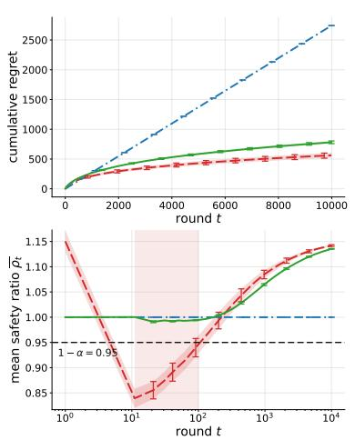
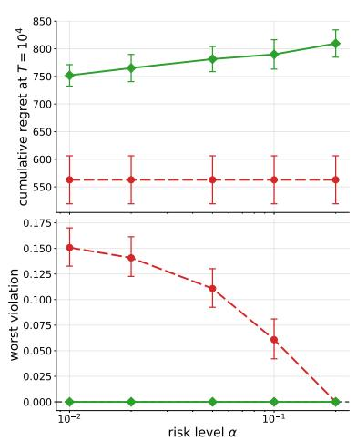
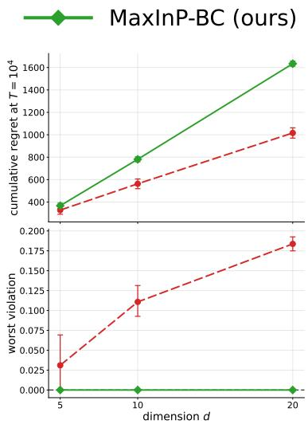
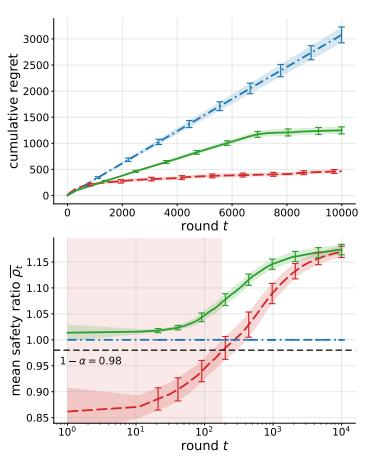
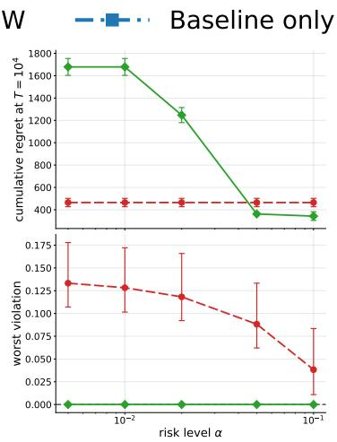
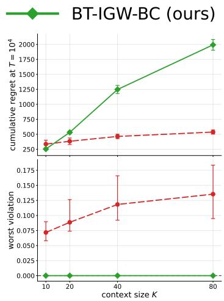

# Conservative Dueling Bandits: Preference Learning under Baseline Constraints

Rohan Deb University of Illinois, Urbana Champaign

Mohammad Ghavamzadeh Qualcomm AI Research

Arindam Banerjee

University of Illinois, Urbana Champaign

rd22@illinois.edu

mohammad.ghavamzadeh51@gmail.com

arindamb@illinois.edu

## Abstract

Contextual dueling bandits learn from pairwise comparisons, the same feedback used to fine-tune language models from human preferences. Standard algorithms explore aggressively and can show users two poor options. We study conservative contextual dueling bandits, which require that, at every round, the cumulative score of the better displayed item stay above a (1 − α) fraction of a trusted baseline’s. An item’s score is its probability of beating the best available item, so the constraint depends only on utility diferences and needs no absolute rewards. This also changes how safety can be certified: we show that transferring the safety test of the conservative bandit algorithm CLUCB unchanged can incur linear regret, even when the baseline’s utilities are known exactly. For linear utilities, we develop MaxInP9BC, which certifies scores through utility gaps and, when it must fall back, pairs the baseline with an informative partner so that fallback rounds still drive learning. It is safe with high probability at all times, with regret $\tilde { \mathcal { O } } ( d \sqrt { T } / \kappa )$ plus an additive cost of conservatism that does not grow with the horizon. For general utility classes, we develop BTIGW9BC, which turns the guarantee of an online logistic-regression oracle into cumulative safety certificates. It is safe at all times, makes finitely many fallbacks, and has sublinear regret whenever the oracle’s logistic regret is sublinear. In experiments, both satisfy the constraint, which their unconstrained counterparts often violate, at a moderate cost in regret.

## 1. Introduction

Many learning systems that interact with people cannot rely on numerical rewards. When users are asked to rate a search result, a recommended item, or a piece of generated text on an absolute scale, the scores they give are noisy, poorly calibrated across individuals, and expensive to collect at scale. Asking the same users which of two options they prefer is easier for them and yields a more consistent signal (Jones et al., 2011). This has motivated a large body of work on learning from pairwise preferences (Bradley and Terry, 1952; Fürnkranz and Hüllermeier, 2010; Yue et al., 2012; Wirth et al., 2017; Bengs et al., 2021). Its applications include online evaluation and optimization of search rankers (Joachims, 2002; Radlinski et al., 2008; Yue and Joachims, 2009; Chapelle et al., 2012; Hofmann et al., 2016), recommender systems (Jones et al., 2011; Kalloori et al., 2016), human-in-the-loop design (Brochu et al., 2007; González et al., 2017; Tucker et al., 2020), and learning from human comparisons (Christiano et al., 2017), which has more recently become a standard way to fine-tune language models, either by reinforcement learning against a learned reward model (Ziegler et al., 2020; Stiennon et al., 2020; Ouyang et al., 2022; Bai et al., 2022) or by optimizing the policy directly on the preference data (Rafailov et al., 2023).

The dueling bandit problem gives a clean abstraction of this interaction and has been studied for finitely many actions (Yue et al., 2012). In each round, the learner selects a pair of actions, presents them to a user, and observes only a noisy binary outcome indicating which one was preferred. Because no single observation reveals how good an action is, the learner must infer quality from patterns of wins and losses. A common way to add structure is to posit a probabilistic choice model. Under the Bradley–Terry–Luce (BTL) model (Bradley and Terry, 1952; Hunter, 2004; Luce, 2005), each action has a latent utility, and the probability that one action beats another is a logistic function of their utility diference (cf. Assumption 1). The Plackett–Luce model extends this to comparisons among more than two items (Zhao et al., 2020). Contextual dueling bandits (Saha, 2021) let the utility also depend on observed side information, such as a query, a user profile, or a prompt. They have led to algorithms with sublinear regret guarantees for linear and more general utility classes, the latter typically through reductions to online regression oracles (Sekhari et al., 2023), an approach that extends to neural function classes in contextual bandits with cardinal rewards (Deb et al., 2024a). Constraints are far less understood under preference feedback. For dueling bandits with knapsack constraints, Deb et al. (2024b) show that relative feedback makes the problem harder than its bandit counterpart: without further assumptions on the budget, it is not learnable from a regret-minimization perspective.

However, all of this work measures performance by regret against the best comparison in hindsight. The resulting algorithms therefore explore as aggressively as they can. This sits uneasily with how preference-based learners are deployed in practice, because every comparison is shown to a real person. A user who is repeatedly ofered two unappealing recommendations, or two unhelpful answers, has little reason to keep trusting the system, however informative those comparisons are for the learner. Moreover, a new learning system rarely starts from scratch. It usually replaces or augments an existing policy whose behavior is considered acceptable. In such settings, it is natural to require that algorithms avoid aggressive exploration, and ensure that the deployed policy performs at least comparably to an existing, trusted baseline strategy. Concretely, we ask that at every step, the better of the two displayed items be, in aggregate, at least a (1 − α) fraction as good as what the baseline would have ofered.

For bandits with numerical rewards, this kind of safe exploration is captured by conservative bandits (Wu et al., 2016; Kazerouni et al., 2017; Garcelon et al., 2020a). Conservative algorithms are now available for linear rewards under both optimism and Thompson sampling (Kazerouni et al., 2017; Deb et al., 2025b), and for general reward classes accessed through online regression oracles (Deb et al., 2025a). These methods keep a budget of permissible loss relative to the baseline: they lower-bound the cumulative reward of the actions played so far, credit the baseline’s reward on rounds where it is played, and explore only when this bound stays above the target. That bookkeeping requires knowing how good the learner’s actions are in absolute terms, and preference feedback does not provide it. A comparison reveals only the diference between two utilities, so a confidence set built from comparisons can leave the overall level of utility uncertain no matter how much data arrives. A lower bound on cumulative utility computed from such a set may then stay loose indefinitely. Indeed, we show that transferring CLUCB’s safety test unchanged can incur linear regret, even when the baseline’s utilities are known exactly. As with knapsack constraints (Deb et al., 2024b), relative feedback changes what a constrained learner can certify. This shapes both the constraint and how it is enforced. We measure each item by its probability of beating the best available item, which depends only on utility diferences, and we certify safety through utility gaps rather than estimated payofs. A second dificulty arises when the budget runs out. A conservative bandit then plays the baseline, but the dueling analogue, showing the baseline against itself, yields a fair coin flip and no information. A learner that falls back this way stops learning exactly when it is uncertain enough to need the fallback. Because our constraint scores a pair by its better item, any pair containing the baseline is safe whatever its partner. We therefore pair the baseline with an informative partner, so that fallback rounds still sharpen the certificates that govern future exploration.

In this work, we study Preference Learning under Baseline Constraints. Our technical contributions are as summarized below.

1. Framework: We formulate conservative contextual dueling bandits under Bradley–Terry feedback, requiring the cumulative preference score of the better displayed item to remain above a $( 1 - \alpha )$ fraction of the baseline’s at every prefix. This score-based constraint is invariant to utility shifts and requires no absolute reward observations.

2. Linear utilities: We show that a direct CLUCB transfer can incur linear regret and develop MaxInP9BC, which certifies scores through utility gaps and uses informative baseline fallbacks. We prove anytime high-probability safety and regret $\tilde { \mathcal { O } } \big ( d \sqrt { T } / \kappa + \Delta _ { h } d ^ { 2 } / ( \kappa ^ { 2 } \alpha ^ { 2 } \underline { { s } } ^ { 2 } ) \big )$ , where $\underline { { s } } = \sigma \big ( - \Delta _ { h } \big )$ . The additive conservatism term is independent of the horizon, and known score bounds sufice in place of exact baseline scores.

3. General utility functions: We develop BTIGW9BC, which converts online logistic-regression guarantees into cumulative score certificates and updates the oracle on both candidate and fallback comparisons. For realizable classes with oracle regret $\mathcal { R } _ { \mathrm { l o g } } ( T ) = o ( T )$ , we prove anytime high-probability safety and regret $\tilde { \mathcal { O } } ( \sqrt { K T [ \mathcal { R } _ { \log } ( T ) / \kappa + 1 / \kappa ^ { 2 } ] } + \Delta _ { h } K [ \mathcal { R } _ { \log } ( T ) / \kappa +$ $1 / \kappa ^ { 2 } ] / ( \alpha ^ { 2 } \underline { { s } } ^ { 2 } ) \big )$ .

4. Experiments: On synthetic linear and general-utility instances, MaxInP9BC and BTIGW9BC empirically satisfy the baseline constraint at every round. Their unconstrained counterparts violate it in early rounds in nearly all settings. Conservatism costs some extra regret over the unconstrained learners, concentrated where the constraint is tight, but far less than the linear regret of always playing the baseline.

## 2. Problem Formulation

We consider a stochastic Contextual Dueling Bandit (CDB) problem. At each round $t \in [ T ]$ , the learner is presented with a context set $S _ { t } = \{ \mathbf { x } _ { t , 1 } , \dotsc , \mathbf { x } _ { t , K } \} \subset \mathcal { D }$ of K items (or arms), where each $\mathbf { x } _ { t , i }$ is drawn i.i.d. from an unknown distribution $\mathcal { P } _ { \mathcal { D } }$ over a decision space $\mathcal { D } \subset \mathbb { R } ^ { d }$ . The agent selects an ordered pair $( \mathbf { x } _ { t } , \mathbf { y } _ { t } ) \in S _ { t } \times S _ { t }$ (repetitions are allowed), and receives noisy binary feedback $o _ { t } \in \{ 0 , 1 \}$ indicating which item is preferred. In the context of LLMs, $\left( \mathbf { x } _ { t } , \mathbf { y } _ { t } \right)$ correspond to the two responses shown to the user, and $o _ { t }$ to the user’s recorded preference. Let $\mathcal { H } _ { t } ^ { - }$ denote all information available immediately before observing $o _ { t } .$ , including all completed rounds, the current contexts and baseline information, and the selected pair. As in Saha (2021); Bengs et al. (2022); Li et al. (2024), we assume preferences are generated by a latent utility function $f : \mathcal { D }  \mathbb { R }$ , through the Bradley–Terry–Luce (BTL) model.

Assumption 1 (BTL Model) There exists a utilityfunction $f : \mathcal { D }  \mathbb { R }$ such that the conditional preference probability satisfies

$$
\mathbb { P } ( o _ { t } = 1 | \mathcal { H } _ { t } ^ { - } ) = \frac { \exp ( f ( \mathbf { x } _ { t } ) ) } { \exp ( f ( \mathbf { x } _ { t } ) ) + \exp ( f ( \mathbf { y } _ { t } ) ) } = \sigma \big ( f ( \mathbf { x } _ { t } ) - f ( \mathbf { y } _ { t } ) \big ) ,\tag{1}
$$

where $\sigma ( z ) = 1 / ( 1 + e ^ { - z } )$ is the sigmoid function.

Two structural properties of (1) will be useful. The comparison law depends only on utility diferences and is invariant to adding a constant to every utility. A self-duel has success probability $1 / 2$ , so its outcome provides no information about $f .$

Assumption 2 (Bounded utility range) There is a known constant $B > 0$ such that the absolute diference $| f ( \mathbf { x } ) - f ( \mathbf { y } ) | \leq B$ for all $\mathbf { x } , \mathbf { y } \in { \mathcal { D } }$ . In the linear case $f ( \mathbf { x } ) = \langle \theta ^ { \star } , \mathbf { x } \rangle$ with $\| \theta ^ { \star } \| _ { 2 } \leq S$ and $\| \mathbf { x } \| _ { 2 } \leq L$ , one may take $B = 2 L S$ . We define the minimum slope of the logistic link on $[ - B , B ]$

$$
\kappa : = \operatorname* { i n f } _ { | z | \leq B } \sigma ^ { \prime } ( z ) = \sigma ( B ) \big ( 1 - \sigma ( B ) \big ) > 0 .
$$

Let $\mathbf { x } _ { t } ^ { \star } \in \arg \operatorname* { m a x } _ { \mathbf { x } \in \mathcal { S } _ { t } } f ( \mathbf { x } )$ denote a best item in round $t ,$ ties broken by a fixed rule. Next we define the regret of an algorithm following Saha (2021); Verma et al. (2025). It captures the cumulative gap between the best possible utility and the average utility of the learner’s choices over $T$ rounds.

Regret. Suppose an algorithm chooses the pair $\left( \mathbf { x } _ { t } , \mathbf { y } _ { t } \right)$ at time $t \in [ T ]$ . The instantaneous regret incurred at round t is the gap between the utility of the best item and the average utility of the compared pair, denoted $\begin{array} { r } { R _ { t } : = f ( \mathbf { x } _ { t } ^ { \star } ) - \frac { 1 } { 2 } \big ( f ( \mathbf { x } _ { t } ) + f ( \mathbf { y } _ { t } ) \big ) } \end{array}$ , and the cumulative T-round regret is

$$
\mathtt { R e g } ( T ) : = \sum _ { t = 1 } ^ { T } R _ { t } = \sum _ { t = 1 } ^ { T } \left( f ( \mathbf { x } _ { t } ^ { \star } ) - { \textstyle \frac { 1 } { 2 } } \big ( f ( \mathbf { x } _ { t } ) + f ( \mathbf { y } _ { t } ) \big ) \right) .\tag{2}
$$

Next we define a performance constraint that the algorithm must satisfy so that the overall user experience stays above a threshold set by an existing trusted baseline policy.

Definition 2.1 (Baseline Performance Constraint) The preference score ofan item $\mathbf { x } \in S _ { t }$ is its probability of beating the best item of the round: $s _ { t } ( \mathbf { x } ) : = \mathbb { P } \{ \mathbf { x } \succ \mathbf { x } _ { t } ^ { \star } \} = \sigma \big ( f ( \mathbf { x } ) - f ( \mathbf { x } _ { t } ^ { \star } ) \big ) \in ( 0 , \frac { 1 } { 2 } ]$ Suppose the agent has access to baseline items $\mathbf { x } _ { b _ { t } } \in S _ { t } , t \in [ T ]$ , with known scores $s _ { t } ( \mathbf { x } _ { b _ { t } } )$ . Given a risk parameter $\alpha \in ( 0 , 1 )$ , a sequence of displayed pairs $( \mathbf { x } _ { i } , \mathbf { y } _ { i } ) , i \in [ t ]$ is α-conservative $i f$

$$
\sum _ { i = 1 } ^ { t } \operatorname* { m a x } \left\{ s _ { i } ( \mathbf { x } _ { i } ) , s _ { i } ( \mathbf { y } _ { i } ) \right\} \geq ( 1 - \alpha ) \sum _ { i = 1 } ^ { t } s _ { i } ( \mathbf { x } _ { b _ { i } } ) , \quad f o r a l l t \in [ T ] .\tag{3}
$$

Assumption 3 (Baseline Gap and Bounds) Let $\Delta _ { t , b _ { t } } : = f ( \mathbf { x } _ { t } ^ { \star } ) - f ( \mathbf { x } _ { b _ { t } } )$ denote the baseline gap. There are known constants $0 \le \Delta _ { l } \le \Delta _ { h } \le B$ with $\Delta _ { l } \leq \Delta _ { t , b _ { t } } \leq \Delta _ { h }$ for all $t \in [ T ] ,$ equivalently

$$
\begin{array} { r } { \underline { { s } } : = \sigma ( - \Delta _ { h } ) \ \le \ s _ { t } ( \mathbf x _ { b _ { t } } ) \ \le \ \sigma ( - \Delta _ { l } ) = : \bar { s } \ \le \ \frac 1 2 . } \end{array}
$$

Remark 1 (Why the maximum and why scores) The constraint in (3) compares cumulative preference probabilities along the learner’s trajectory, rather than realized comparison labels. Using the maximum ensures that any pair containing the baseline has score at least that of the baseline, allowing its partner to be selectedfor information acquisition.

## 3. Linear Utilities: Conservative Maximum-Informative-Pair

Assumption 4 (Linear Utility) There is an unknown $\theta ^ { \star } \in \mathbb { R } ^ { d }$ with $\| \theta ^ { \star } \| _ { 2 } \leq S$ such that $f ( \mathbf { x } ) =$ $\langle { \theta ^ { \star } , \bf { x } } \rangle$ , and $\| \mathbf { x } \| _ { 2 } \leq L , f o r$ every $\mathbf { x } \in \mathcal { D }$ . The learner optimises over $\Theta = \{ \theta : \| \theta \| _ { 2 } \leq S \}$ , so Assumption 2 holds with $B = 2 L S$ and $\kappa = \sigma ( B ) ( 1 - \sigma ( B ) )$ .

In the unconstrained setting, MaxInP (Saha, 2021) maintains a set of items that may still be optimal and displays the most uncertain pair among them. Such a pair is informative, but nothing prevents both of its items from being poor. We therefore design MaxInP9BC around a safety budget. The algorithm fits $\theta ^ { \star }$ by regularized maximum likelihood on the observed comparisons and uses the resulting confidence ellipsoid to identify promising items. It then proposes the most informative pair and displays it only if the baseline constraint remains certifiably satisfied. Otherwise, it falls back to a pair that contains the baseline item and is still informative for learning.

Estimator. Each round the learner is given $\boldsymbol { S } _ { t } ,$ the baseline item $\mathbf { x } _ { b _ { t } } \in S _ { t }$ and its score $s _ { t } ( \mathbf { x } _ { b _ { t } } )$ The learner displays $( { \bf x } _ { t } , { \bf y } _ { t } ) \in S _ { t } \times S _ { t }$ , and observes $O t$ . Write $\mathbf z _ { t } : = \mathbf x _ { t } - \mathbf y _ { t }$ for the displayed comparison vector, so $\| \mathbf { z } _ { t } \| _ { 2 } \leq 2 L$ . We define

$$
V _ { t } = \lambda I _ { d } + \sum _ { i < t } \mathbf { z } _ { i } \mathbf { z } _ { i } ^ { \top } ,\tag{4}
$$

$$
\displaystyle \hat { \theta } _ { t } \in \mathop { \arg \operatorname* { m i n } } _ { \theta \in \Theta } \Big \{ \sum _ { i < t } \big [ \log ( 1 + e ^ { \mathbf { z } _ { i } ^ { \top } \theta } ) - o _ { i } \mathbf { z } _ { i } ^ { \top } \theta \big ] + \frac { \lambda } { 2 } \| \theta \| _ { 2 } ^ { 2 } \Big \} ,\tag{5}
$$

with $\lambda > 0 ;$ the objective is strongly convex, so $\widehat { \theta } _ { t }$ is unique. A self-duel has $\mathbf { z } _ { t } = 0$ and contributes the constant log 2 to the objective, leaving the design matrix and the minimizer unchanged. For $\delta \in ( 0 , 1 )$ , set

$$
\beta _ { t } = \frac { 1 } { \kappa } \Bigl [ \textstyle { \frac { 1 } { 2 } } \sqrt { d \log \left( 1 + \frac { 4 L ^ { 2 } ( t - 1 ) } { \lambda d } \right) + 2 \log \frac { 1 } { \delta } } + \sqrt { \lambda } S \Bigr ] .\tag{6}
$$

Both the item selection and the safety certificate rely on $\theta ^ { \star }$ lying in the ellipsoid around $\widehat { \theta } _ { t }$ at every round. The following lemma guarantees this with high probability, uniformly over t.

Lemma 3.1 (Anytime confidence ellipsoid) Under Assumptions 1 and 4, $\mathbb { P } ( \mathcal { E } ) \geq 1 - \delta$ for the event $\mathcal { E } : = \{ \| \hat { \theta } _ { t } - \theta ^ { \star } \| _ { V _ { t } } \leq \beta _ { t } , \forall t \geq 1 \}$ .

Proof sketch. The residuals $o _ { t } - \sigma ( \mathbf { z } _ { t } ^ { \top } \theta ^ { \star } )$ are conditionally $\scriptstyle { \frac { 1 } { 2 } } - \operatorname { s u b - G a u s s i a n }$ , so a mixture supermartin- gale with Ville’s inequality gives an anytime self-normalised bound. First-order optimality of $\widehat { \theta } _ { t }$ and the curvature bound $\nabla ^ { 2 } \mathcal { L } _ { t } \succeq \kappa V _ { t }$ turn this into the stated parameter concentration (Appendix A.3).

Promising items and the regret certificate. On E, we can discard any item that is certifiably worse than another, and bound the regret of the items that remain. Let

$$
\mathcal { C } _ { t } = \big \{ \mathbf { x } \in \mathcal { S } _ { t } : \langle \hat { \theta } _ { t } , \mathbf { x } - \mathbf { y } \rangle + \beta _ { t } \| \mathbf { x } - \mathbf { y } \| _ { V _ { t } ^ { - 1 } } \geq 0 , \ \forall \mathbf { y } \in \mathcal { S } _ { t } \big \} ,\tag{7}
$$

and let the candidate pair be the maximum-width pair of promising items,

$$
\left( \tilde { \mathbf { x } } _ { t } , \tilde { \mathbf { y } } _ { t } \right) \in \underset { \mathbf { x } , \mathbf { y } \in \mathcal { C } _ { t } } { \arg \operatorname* { m a x } } \left\| \mathbf { x } - \mathbf { y } \right\| _ { V _ { t } ^ { - 1 } } ,\tag{8}
$$

$$
w _ { t } = \left. \tilde { \mathbf { x } } _ { t } - \tilde { \mathbf { y } } _ { t } \right. _ { V _ { t } ^ { - 1 } } ,\tag{9}
$$

$$
c _ { t } = \operatorname* { m i n } \{ B , 2 \beta _ { t } w _ { t } \} .\tag{10}
$$

Since $\mathbf { x } _ { t } ^ { \star }$ is never eliminated on $\mathcal { E } ,$ every promising item is close to it in the $V _ { t } ^ { - 1 }$ geometry. The following lemma makes this precise: the width $w _ { t }$ bounds the regret of any promising item, and in particular that of the candidate pair.

Lemma 3.2 (Regret certificate) $\mathcal { C } _ { t } \neq \emptyset$ for all t and on $\mathcal { E } , \mathbf { x } _ { t } ^ { \star } \in \mathcal { C } _ { t }$ and $f ( \mathbf { x } _ { t } ^ { \star } ) - f ( \mathbf { y } ) \leq c _ { t }$ for every $\mathbf { y } \in \mathcal { C } _ { t } .$ . In particular, the candidate pair has regret

$$
\begin{array} { r } { R _ { t } ^ { \mathrm { c a n d } } : = f ( \mathbf { x } _ { t } ^ { \star } ) - \frac { 1 } { 2 } \big ( f ( \tilde { \mathbf { x } } _ { t } ) + f ( \tilde { \mathbf { y } } _ { t } ) \big ) \leq c _ { t } . } \end{array}
$$

We next convert this utility-gap certificate into a lower bound on the score performance in (3).

Lemma 3.3 (Score certificate) If a pair $\displaystyle ( \mathbf { x } , \mathbf { y } )$ satisfies $\begin{array} { r } { f ( \mathbf { x } _ { t } ^ { \star } ) - \frac { 1 } { 2 } ( f ( \mathbf { x } ) + f ( \mathbf { y } ) ) \leq c } \end{array}$ for some $c \geq 0 ,$ , then max $\{ s _ { t } ( \mathbf { x } ) , s _ { t } ( \mathbf { y } ) \} \geq \sigma ( - c ) \geq { \textstyle { \frac { 1 } { 2 } } } - { \frac { c } { 4 } }$

Indeed, with $g _ { \mathbf x } : = f ( \mathbf x _ { t } ^ { \star } ) - f ( \mathbf x ) \geq 0$ and $g _ { \mathbf { y } }$ likewise, max $\{ s _ { t } ( \mathbf { x } ) , s _ { t } ( \mathbf { y } ) \} = \sigma ( - \operatorname* { m i n } \{ g _ { \mathbf { x } } , g _ { \mathbf { y } } \} )$ and min $\begin{array} { r } { \{ g _ { \mathbf { x } } , g _ { \mathbf { y } } \} \le \frac 1 2 ( g _ { \mathbf { x } } + g _ { \mathbf { y } } ) \le c ; } \end{array}$ the second inequality is $\sigma ^ { \prime } \leq \frac { 1 } { 4 }$ . The anchor is $\begin{array} { r } { s _ { t } ( \mathbf { x } _ { t } ^ { \star } ) = \frac { 1 } { 2 } . } \end{array}$ available without estimating any utility.

Informative fallback. When the safety test rejects the candidate, we retain the baseline item and select the promising partner with the largest comparison width:

$$
\mathbf { y } _ { t } ^ { \mathrm { f b } } \in \underset { \mathbf { y } \in \mathcal { C } _ { t } } { \arg \operatorname* { m a x } } \left\| \mathbf { x } _ { b _ { t } } - \mathbf { y } \right\| _ { V _ { t } ^ { - 1 } } ,\tag{11}
$$

$$
\mathrm { d i s p l a y i n g \left( x \right)} _ { b _ { t } } , \mathbf { y } _ { t } ^ { \mathrm { f b } }  .\tag{12}
$$

Including the baseline guarantees that max $\{ s _ { t } ( \mathbf x _ { b _ { t } } ) , s _ { t } ( \mathbf y _ { t } ^ { \mathrm { f b } } ) \} \geq s _ { t } ( \mathbf x _ { b _ { t } } )$ . The maximizing choice of partner also connects the displayed comparison to the candidate width. Since $\tilde { \mathbf { x } } _ { t } , \tilde { \mathbf { y } } _ { t } \in \mathcal { C } _ { t }$ , the triangle inequality gives

$$
w _ { t } \leq \left\| \tilde { \mathbf { x } } _ { t } - \mathbf { x } _ { b _ { t } } \right\| _ { V _ { t } ^ { - 1 } } + \left\| \mathbf { x } _ { b _ { t } } - \tilde { \mathbf { y } } _ { t } \right\| _ { V _ { t } ^ { - 1 } } \leq 2 \| \mathbf { x } _ { b _ { t } } - \mathbf { y } _ { t } ^ { \mathrm { { f b } } } \| _ { V _ { t } ^ { - 1 } } .\tag{13}
$$

Algorithm 1 MaxInP9BC (Conservative Maximum-Informative-Pair)   
Require: risk level $\alpha ,$ confidence δ, regularisation λ, bounds S, L   
1: Initialise $\Lambda _ { 0 }  0 , V _ { 1 }  \lambda I _ { d }$   
2: for $t = 1 , 2 , \ldots$ . do   
3: Observe $\boldsymbol { S } _ { t } ,$ baseline $\mathbf { x } _ { b _ { t } }$ and its known score $s _ { t } ( \mathbf { x } _ { b _ { t } } )$ ; compute $\hat { \theta } _ { t } , \beta _ { t }$ by (5)–(6)   
4: Form $\mathcal { C } _ { t }$ by (7); compute $( \tilde { \mathbf { x } } _ { t } , \tilde { \mathbf { y } } _ { t } ) , w _ { t } , c _ { t }$ by (10)   
5: if $\begin{array} { r } { \Lambda _ { t - 1 } + \frac { 1 } { 2 } - \frac { c _ { t } } { 4 } - ( 1 - \alpha ) s _ { t } ( { \bf x } _ { b _ { t } } ) \geq 0 } \end{array}$ then   
6: Display $( { \bf x } _ { t } , { \bf y } _ { t } ) \gets ( \tilde { { \bf x } } _ { t } , \tilde { { \bf y } } _ { t } )$ and set $\begin{array} { r } { \Lambda _ { t }  \Lambda _ { t - 1 } + \frac { 1 } { 2 } - \frac { c _ { t } } { 4 } - ( 1 - \alpha ) s _ { t } ( \mathbf x _ { b _ { t } } ) } \end{array}$ {candidate}   
7: else   
8: Display $( { \bf x } _ { t } , { \bf y } _ { t } ) \gets ( { \bf x } _ { b _ { t } } , { \bf y } _ { t } ^ { \mathrm { f b } } )$ from (12) and set $\Lambda _ { t }  \Lambda _ { t - 1 } + \alpha s _ { t } ( \mathbf { x } _ { b _ { t } } )$ {fallback}   
9: end if   
10: Observe $o _ { t } ;$ set ${ \bf z } _ { t }  { \bf x } _ { t } - { \bf y } _ { t }$ and $V _ { t + 1 } \gets V _ { t } + \mathbf { z } _ { t } \mathbf { z } _ { t } ^ { \top }$   
11: end for

Thus, the displayed comparison retains at least half the candidate width, whether or not $\mathbf { x } _ { b _ { t } } \in \mathcal { C } _ { t }$ Note that because the fallback pair contains the baseline, its one-round surplus under (3) is at least $\alpha s _ { t } ( { \mathbf { x } } _ { b _ { t } } )$ , regardless of its partner. The partner can therefore be chosen for information, and by (13) it retains at least half the candidate width. Its regret is also controlled: since ${ \bf y } _ { t } ^ { \mathrm { f b } } \in \mathcal { C } _ { t }$ , on $\mathcal { E }$

$$
\begin{array} { r } { R _ { t } = \frac { 1 } { 2 } \Big ( \Delta _ { t , b _ { t } } + f ( { \bf x } _ { t } ^ { \star } ) - f ( { \bf y } _ { t } ^ { \mathrm { f b } } ) \Big ) \leq \frac { 1 } { 2 } ( \Delta _ { h } + c _ { t } ) . } \end{array}
$$

The baseline contributes at most $\Delta _ { h } / 2 ,$ , and the partner’s contribution is controlled by the same certificate $c _ { t }$ used for candidate decisions.

Safety budget. The resulting algorithm, MaxInP9BC, is given in Algorithm 1. It maintains a computable quantity $\Lambda _ { t } .$ , initialized at $\Lambda _ { 0 } = 0 .$ , that lower-bounds the cumulative safety surplus on E. By Lemma 3.3, the candidate increment is $\begin{array} { r } { \frac { 1 } { 2 } - \frac { c _ { t } } { 4 } - ( 1 - \alpha ) s _ { t } ( \mathbf x _ { b _ { t } } ) } \end{array}$ . A fallback is credited with $\alpha s _ { t } ( { \mathbf { x } } _ { b _ { t } } )$ , which lower-bounds its actual surplus because the displayed pair contains the baseline. Each update is determined by the history, current contexts, baseline score, and chosen pair before the comparison outcome is observed. The candidate is accepted exactly when its proposed update leaves $\Lambda _ { t }$ nonnegative; otherwise, the fallback preserves nonnegativity. On E, these per-round lower bounds therefore imply the cumulative safety constraint.

Let $A _ { T } , B _ { T }$ be the candidate and fallback rounds up to $T _ { \cdot }$ , with $M _ { T } = | A _ { T } |$ and $N _ { T } = | \boldsymbol { B _ { T } } |$ . Since $\Lambda _ { t - 1 } \geq 0$ by construction and $\begin{array} { r } { s _ { t } ( \mathbf { x } _ { b _ { t } } ) \leq \frac { 1 } { 2 } } \end{array}$ , the candidate increment is at least $\begin{array} { r } { \frac { \alpha } { 2 } \mathrm { ~ - ~ } \frac { c _ { t } } { 4 } } \end{array}$ . Consequently, every round with $c _ { t } \leq 2 \alpha$ is accepted, and any rejection requires $c _ { t } > 2 \alpha$ . This criterion applies separately at each round: the certificate can change with the contexts, estimates, and confidence radius, so acceptance at one round does not imply acceptance at all subsequent rounds.

Main result. With $\underline { { s } } : = \sigma ( - \Delta _ { h } )$ and $\bar { \beta } _ { t } : = \operatorname* { m a x } \{ B / 2 , \beta _ { t } \}$ , define certificate envelope and the fallback bound

$$
G ( t ) : = 4 \bar { \beta } _ { t } \sqrt { 2 d t \log { \left( 1 + \frac { 4 L ^ { 2 } t } { \lambda d } \right) } } ,\tag{14}
$$

$$
\begin{array} { r } { N _ { \mathrm { c o n s } } : = \operatorname* { s u p } \big \{ t \in \mathbb { N } _ { \geq 1 } : 4 \alpha \underline { { s } } t < G ( t ) \big \} , } \end{array}\tag{15}
$$

with $G ( 0 ) = 0$ and sup $\varnothing : = 0$ . The function G is nondecreasing. For fixed problem parameters and confidence level, $G ( t ) = O ( \sqrt t \log ( e t ) ) = o ( t ) , \operatorname { s o } \ N _ { \mathrm { c o n s } } < \infty .$

Theorem 3.1 (Anytime safety and regret) LetAssumptions 1, 2, 3, and 4 hold, and run Algorithm 1 with $\alpha , \delta \in ( 0 , 1 )$ and $\lambda > 0$ . With probability at least $1 - \delta ,$ , simultaneously for every $T \geq 1$ the displayed pairs are α-conservative in the sense of (3), the fallback count satisfies $N _ { T } \ \leq$ min $\{ T , N _ { \mathrm { c o n s } } \}$ , and $\begin{array} { r } { \mathsf { R e g } ( T ) \leq G ( T ) + \frac { 1 } { 2 } \Delta _ { h } N _ { \mathrm { c o n s } } } \end{array}$ . When $L , S , \lambda$ are treated as fixed constants, suppressing logarithmicfactors in the remaining parameters gives

$$
\mathsf { R e g } ( T ) = \tilde { \mathcal { O } } \left( \frac { d \sqrt { T } } { \kappa } + \frac { \Delta _ { h } d ^ { 2 } } { \kappa ^ { 2 } \alpha ^ { 2 } \underline { { s } } ^ { 2 } } \right) .\tag{16}
$$

Proofsketch. Work on $\mathcal { E } _ { : }$ , which has probability at least $1 - \delta$ by Lemma 3.1; all guarantees hold simultaneously on this event.

(a) Envelope. On a candidate round, $c _ { t } = \operatorname* { m i n } \{ B , 2 \beta _ { t } \| \mathbf { z } _ { t } \| _ { V _ { t } ^ { - 1 } } \}$ . On a fallback round, (13) gives $c _ { t } \leq \operatorname* { m i n } \{ B , 4 \beta _ { t } \| \mathbf { z } _ { t } \| _ { V _ { t } ^ { - 1 } } \}$ . Thus, in both cases, $c _ { t } \leq 4 \beta _ { t }$ min $\left\{ 1 , \left\| \mathbf { z } _ { t } \right\| _ { V _ { t } ^ { - 1 } } \right\}$ . Cauchy– Schwarz and the elliptical-potential bound $\textstyle \sum _ { i = 1 } ^ { t }$ min $\begin{array} { r } { \{ 1 , \Vert \mathbf { z } _ { i } \Vert _ { V _ { i } ^ { - 1 } } ^ { 2 } \} \leq 2 d \log \left( 1 + \frac { 4 L ^ { 2 } t } { \lambda d } \right) } \end{array}$ yield $\textstyle \sum _ { i = 1 } ^ { t } c _ { i } \leq G ( t )$ . This includes the certificate computed on a rejected round, since the displayed fallback comparison controls that certificate through (13).

(b) Safety. On candidate rounds, Lemma 3.3 shows that the true one-round surplus is at least the budget increment. On fallback rounds, including the baseline guarantees a true surplus of at least $\alpha s _ { t } ( \mathbf { x } _ { b _ { t } } )$ , again the budget increment. Induction therefore shows that $\Lambda _ { t }$ lower-bounds the true cumulative surplus. Candidate updates preserve $\Lambda _ { t } \geq 0$ by the acceptance test, and fallback updates add a positive quantity, proving safety.

(c) Fallbacks. Expanding the failed acceptance test at a fallback round $\tau _ { \ast }$ , and using the fact that $\frac { 1 } { 2 } - ( 1 - \alpha ) s _ { i } ( \mathbf { x } _ { b _ { i } } ) \geq \alpha / 2$ and $\alpha s _ { i } ( { \bf x } _ { b _ { i } } ) \geq \alpha \underline { { s } }$ , gives

$$
\frac { \alpha } { 2 } ( M _ { \tau - 1 } + 1 ) + \alpha \underline { { s } } N _ { \tau - 1 } < \frac { 1 } { 4 } \left( \sum _ { i \in \mathcal { A } _ { \tau - 1 } } c _ { i } + c _ { \tau } \right) \leq \frac { 1 } { 4 } G ( \tau ) .
$$

Because $\underline { { s } } \le 1 / 2$ and $M _ { \tau - 1 } + { \cal N } _ { \tau - 1 } + 1 = \tau$ , the left side is at least αsτ. Hence every fallback time satisfies $4 \alpha \underline { s } \tau < G ( \tau )$ and is at most $N _ { \mathrm { c o n s } }$ , proving $N _ { T } \leq \operatorname* { m i n } \{ T , N _ { \mathrm { c o n s } } \}$

(d) Regret. Lemma 3.2 gives $R _ { t } \leq c _ { t }$ on candidate rounds. On fallback rounds, ${ \bf y } _ { t } ^ { \mathrm { f b } } \in \mathcal { C } _ { t }$ gives $R _ { t } \leq ( \Delta _ { h } + c _ { t } ) / 2$ . Therefore,

$$
\mathtt { R e g } ( T ) \le \sum _ { t = 1 } ^ { T } c _ { t } + \frac { \Delta _ { h } } { 2 } N _ { T } \le G ( T ) + \frac { \Delta _ { h } } { 2 } N _ { \mathrm { c o n s } } .
$$

For fixed $L , S , \lambda .$ , the simplified rate follows from $\bar { \beta } _ { t } = \tilde { \mathcal { O } } ( \sqrt { d } / \kappa )$ and the defining inequality for $N _ { \mathrm { c o n s } }$ . Details are given in Appendix A. □

Remark 2 (An additive cost of conservatism) The leadin term in the re ret bound in (16) has the same dependence on d and T as unconstrained MaxInP (Saha, 2021), while the additional term $\Delta _ { h } N _ { \mathrm { c o n s } } / 2$ is independent ofTforfixed parameters.

Remark 3 (Why not transfer CLUCB directly) For bandits with numerical rewards, CLUCB (Kazerouni et al., 2017) certifies safety by lower-bounding cumulative candidate rewards with a confidence set, and it credits known baseline rewards separately. Under preference feedback, the design matrix in (5) accumulates comparison vectors ${ \bf z } _ { t } = { \bf x } _ { t } - { \bf y } _ { t } ,$ , whereas average utilities depend on $( { \bf x } _ { t } + { \bf y } _ { t } ) / 2$ . A comparison-based confidence set can therefore retain uncertainty in a common utility component that comparisons never reveal. Proposition A.2 (Appendix A.9) gives an i.i.d. two-dimensional instance on which this transfer incurs $\mathsf { R e g } ( T ) = \Omega ( T )$ with high probability, even with exact baseline utilities and arbitrary candidate selection. The obstruction concerns the unchanged certification rule: known baseline utilities would also permit a baseline-centered cardinal certificate. MaxInP9BC instead certifies scores through utility gaps (Lemmas 3.2 and 3.3), which depend only on pairwise diferences. Through (13), it also ties the uncertainty in this certificate to the comparisons displayed on both candidate andfallback rounds.

Remark 4 (Relaxing baseline-score knowledge) For ease ofpresentation, we assume that baseline scores are known exactly. Appendix A.10 relaxes this assumption by modifying the safety budget to use lower and upper score bounds together with the known range [s, 1/2].

## 4. General Utility Functions

Linear utilities can be restrictive when items are described by rich features. We now let $f$ lie in a general class $\mathcal { F }$ , accessed only through an online logistic-regression oracle. In the unconstrained setting, Sekhari et al. (2023) sample comparisons from an inverse-gap-weighted (IGW) distribution built from the oracle’s predictions. Without a confidence ellipsoid, we cannot certify each candidate individually as in Lemma 3.2. We therefore develop BTIGW9BC (Algorithm 2) and certify safety cumulatively: the oracle guarantee yields a computable envelope on total regret, and a candidate is displayed only if the accumulated score credits cover it. Otherwise, the algorithm falls back to a baseline-containing pair whose partner is still drawn by IGW.

Assumption 5 (Realizability and logistic oracle) The utility f belongs to a class F whosefunctions satisfy $| g ( \mathbf { x } ) - g ( \mathbf { y } ) | \leq B$ on D. Before its m-th comparison $\left( \mathbf { x } _ { m } , \mathbf { y } _ { m } \right)$ is drawn, the oracle outputs $\hat { f } _ { m }$ with the same range bound; $\hat { f } _ { m }$ may use the current item set and need not lie in ${ \mathcal F } .$ . With $\ell _ { m } ( g ) = \log ( 1 + e ^ { g ( \mathbf { x } _ { m } ) - g ( \mathbf { y } _ { m } ) } ) - o _ { m } [ g ( \mathbf { x } _ { m } ) - g ( \mathbf { y } _ { m } ) ]$ , every fresh instance satisfies, on every adaptive sequence andfor all $n \geq 1$

$$
\sum _ { m = 1 } ^ { n } \ell _ { m } ( \hat { f } _ { m } ) - \operatorname* { i n f } _ { g \in \mathcal { F } } \sum _ { m = 1 } ^ { n } \ell _ { m } ( g ) \leq \mathcal { R } _ { \log } ( n ) ,\tag{17}
$$

where $\mathcal { R } _ { \mathrm { l o g } }$ is known, nonnegative, nondecreasing, and $o ( n )$ .

Algorithm 2 BTIGW9BC (Bradley–Terry Inverse-Gap-Weighting Baseline-Conservative)   
Require: $\alpha , \delta \in ( 0 , 1 ) , B , \mathcal { R } _ { \mathrm { l o g } }$ , and an oracle satisfying Assumption 5   
1: Initialise $Q _ { 0 } \gets 0$   
2: for $t = 1 , 2 , \ldots$ . do   
3: If $t = 2 ^ { e }$ , restart the oracle and set $\iota _ { e } , E _ { e } , C _ { e }$ by (21)   
4: Observe $S _ { t } , \mathbf { x } _ { b _ { t } } , s _ { t } ( \mathbf { x } _ { b _ { t } } )$ ; obtain $\hat { f } _ { t } \colon$ form $p _ { t }$ with $\gamma _ { t } ;$ set $\begin{array} { r } { h _ { t }  \frac { 1 } { 2 } - ( 1 - \alpha ) s _ { t } ( \mathbf x _ { b _ { t } } ) } \end{array}$   
5: if $Q _ { t - 1 } + h _ { t } \geq G _ { \mathrm { I G W } } ( t ) / 4$ then   
6: Draw $I _ { t } , J _ { t } \sim p _ { t }$ independently; display $( \mathbf { x } _ { t , I _ { t } } , \mathbf { x } _ { t , J _ { t } } ) ; Q _ { t }  Q _ { t - 1 } + h _ { t }$ {candidate}   
7: else   
8: Draw $J _ { t } \sim p _ { t } ;$ display $( { \bf x } _ { b _ { t } } , { \bf x } _ { t , J _ { t } } ) ; Q _ { t }  Q _ { t - 1 } + \alpha s _ { t } ( { \bf x } _ { b _ { t } } )$ {fallback}   
9: end if   
10: Observe $O t$ and update the oracle with this comparison   
11: end for

IGW with a fixed partner. Given $\hat { f } _ { t } ^ { \phantom { } } .$ , let $\hat { a } _ { t } \in \arg \operatorname* { m a x } _ { a } \hat { f } _ { t } \big ( \mathbf { x } _ { t , a } \big )$ and

$$
p _ { t } ( a ) = \frac { 1 } { K + \gamma _ { t } [ \hat { f } _ { t } ( \mathbf { x } _ { t , \hat { a } _ { t } } ) - \hat { f } _ { t } ( \mathbf { x } _ { t , a } ) ] } \quad ( a \neq \hat { a } _ { t } ) ,\tag{18}
$$

$$
p _ { t } ( \hat { a } _ { t } ) = 1 - \sum _ { a \neq \hat { a } _ { t } } p _ { t } ( a ) .\tag{19}
$$

Write $\Delta _ { t } ( \mathbf { x } ) = f ( \mathbf { x } _ { t } ^ { \star } ) - f ( \mathbf { x } ) \mathrm { a n d } \varepsilon _ { t } ( \mathbf { x } , \mathbf { y } ) = ( \hat { f } _ { t } - f ) ( \mathbf { x } ) - ( \hat { f } _ { t } - f ) ( \mathbf { y } )$ for the margin error.

Lemma 4.1 (IGW with a fixed partner) For every $\gamma _ { t } > 0$ and $\mathbf { u } \in { S } _ { t } ,$ the following holds

$$
\mathbb { E } _ { a \sim p { t } } \Delta _ { t } ( \mathbf { x } _ { t , a } ) \leq \frac { 2 K } { \gamma _ { t } } + \frac { \gamma _ { t } } { 4 } \mathbb { E } _ { a \sim p { t } } \varepsilon _ { t } ( \mathbf { x } _ { t , a } , \mathbf { u } ) ^ { 2 } .
$$

This is the standard IGW bound applied after subtracting the values at u. The free partner lets the error be measured on the displayed pair: for a candidate $\left( \mathbf { x } _ { t , I _ { t } } , \mathbf { x } _ { t , J _ { t } } \right)$ with $I _ { t } , J _ { t } \sim p _ { t }$ independent, take u to be the other item; for a fallback $\left( \mathbf { x } _ { b _ { t } } , \mathbf { x } _ { t , J _ { t } } \right)$ , take $\mathbf { u } = \mathbf { x } _ { b _ { t } }$ . This plays the role of (13): the fallback partner’s gap is controlled exactly as a candidate’s regret.

An anytime envelope. We run the oracle in epochs $e = 0 , 1 , \ldots$ . of length $n _ { e } = 2 ^ { e }$ , restarting it at each, with confidence $\delta _ { e } = \delta / [ ( e + 1 ) ( e + 2 ) ]$ . For local round $m ,$ set

$$
\iota _ { e } = \log \frac { 3 n _ { e } } { \delta _ { e } } , \quad E _ { e } = \frac { 8 \mathcal { R } _ { \log } ( n _ { e } ) } { \kappa } + \frac { 5 \iota _ { e } } { \kappa ^ { 2 } } ,\tag{20}
$$

$$
\gamma _ { e , m } = \sqrt { \frac { 8 K m } { E _ { e } } } , C _ { e } = \frac { 3 } { \sqrt { 2 } } \sqrt { K E _ { e } } + B \sqrt { 2 \iota _ { e } } .\tag{21}
$$

At time t, let $e ( t ) = \lfloor \log _ { 2 } { t } \rfloor , m ( t ) = t - 2 ^ { e ( t ) } + 1 , \gamma _ { t } = \gamma _ { e ( t ) , m ( t ) }$ , and $\begin{array} { r } { G _ { \mathrm { I G W } } ( t ) = \sum _ { j < e ( t ) } C _ { j } \sqrt { 2 ^ { j } } + } \end{array}$ $C _ { e ( t ) } \sqrt { m ( t ) } , G _ { \mathrm { I G W } } ( 0 ) = 0 . \mathrm { L e t } r _ { t } ^ { \circ } = R _ { t }$ on candidate rounds and $r _ { t } ^ { \circ } = \Delta _ { t } ( \mathbf { y } _ { t } )$ on fallback rounds.

Lemma 4.2 (Anytime regret envelope) Under Assumptions 1, 2, and 5, with probability at least 1 − δ, Algorithm 2 satisfies $\begin{array} { r } { \sum _ { i < t } r _ { i } ^ { \circ } \le G _ { \mathrm { I G W } } ( t ) } \end{array}$ for all $t \geq 1 .$ . Moreover, with

$$
A ( t ) : = \mathcal { R } _ { \log } ( t ) / \kappa + 1 / \kappa ^ { 2 } , G _ { \mathrm { I G W } } ( t ) = \tilde { \mathcal { O } } ( \sqrt { K t A ( t ) } ) = o ( t ) .
$$

The proof applies Lemma 4.1, the oracle bound and martingale concentration within each epoch (Appendix B).

Safety credits. Instead of charging each candidate its own certificate, BTIGW9BC charges the envelope cumulatively. It keeps credits $Q _ { t }$ , with $Q _ { 0 } = 0$ and no reset between epochs: a candidate earns $\begin{array} { r } { h _ { t } : = \frac { 1 } { 2 } - ( 1 - \alpha ) s _ { t } ( \mathbf x _ { b _ { t } } ) } \end{array}$ and a fallback earns $\alpha s _ { t } ( { \mathbf { x } } _ { b _ { t } } )$ . By Lemma 3.3 with $c = R _ { t }$ , a candidate’s true surplus is at least $h _ { t } - R _ { t } / 4 ;$ a fallback’s is at least $\alpha s _ { t } ( { \mathbf { x } } _ { b _ { t } } )$ because it contains the baseline. The true cumulative surplus is therefore at least $\begin{array} { r } { Q _ { t } - \frac { 1 } { 4 } \sum _ { i \in \mathcal { A } _ { t } } R _ { i } } \end{array}$ , where $\boldsymbol { A } _ { t }$ is the set of candidate rounds, and by Lemma 4.2 the charge is at most $G _ { \mathrm { I G W } } ( t ) / 4$ , which the acceptance test in Algorithm 2 requires the credits to cover.

Main result. Since $s _ { t } ( \mathbf x _ { b _ { t } } ) \in [ \underline { { s } } , \frac { 1 } { 2 } ]$ with $\underline { { s } } = \sigma \big ( - \Delta _ { h } \big )$ , every credit is at least αs, so a rejection at time t requires 4αs $t < G _ { \mathrm { I G W } } ( t )$ . Let $N _ { T }$ count fallbacks up to $T ,$ , and let $N _ { \mathrm { I G W } } : = \operatorname* { s u p } \{ t \geq 1$ 4αs $t < G _ { \mathrm { I G W } } ( t ) \}$ , which is finite since $G _ { \mathrm { I G W } } ( t ) = o ( t )$

Theorem 4.1 (Anytime safety and regret) Under Assumptions $I , 2 , 3 ,$ , and 5, with probability at least $1 - \delta ,$ , simultaneously for every $T \geq 1$ , Algorithm 2 is α-conservative in the sense of (3), $N _ { T } \leq \mathrm { m i n } \{ T , N _ { \mathrm { I G W } } \}$ , and $\begin{array} { r } { \mathsf { R e g } ( T ) \leq G _ { \mathrm { I G W } } ( T ) + \frac { 1 } { 2 } \Delta _ { h } N _ { T } } \end{array}$ . Suppressing log factors in T and $1 / \delta ,$

$$
\mathsf { R e g } ( T ) = \tilde { \mathcal { O } } \left( \sqrt { K T A ( T ) } + \frac { \Delta _ { h } K A ( T ) } { \alpha ^ { 2 } \underline { { s } } ^ { 2 } } \right) .\tag{22}
$$

Proof sketch. Work on the event of Lemma 4.2. Safety: if $\tau \leq t$ is the last candidate round, then since $r _ { i } ^ { \circ } \geq 0$ and credits are positive,

$$
\sum _ { i \in \mathcal { A } _ { t } } R _ { i } \le \sum _ { i \le \tau } r _ { i } ^ { \circ } \le G _ { \mathrm { I G W } } ( \tau ) \le 4 Q _ { \tau } \le 4 Q _ { t } ,
$$

so the true surplus is nonnegative.

Fallbacks: every fallback time satisfies 4αs $\tau < G _ { \mathrm { I G W } } ( \tau )$ , so $\tau \leq N _ { \mathrm { I G W } } ;$ at the last fallback $\tau \leq T$ $G _ { \mathrm { I G W } } ( \tau ) = \tilde { \mathcal { O } } ( \sqrt { K \tau A ( T ) } )$ gives $N _ { T } = \tilde { \mathcal { O } } ( K A ( T ) / ( \alpha ^ { 2 } \underline { { s } } ^ { 2 } ) )$ .

Regret: $R _ { t } = r _ { t } ^ { \circ }$ on candidate rounds and $\begin{array} { r } { R _ { t } \leq \frac { 1 } { 2 } ( \Delta _ { h } + r _ { t } ^ { \circ } ) } \end{array}$ on fallbacks, so

$$
\begin{array} { r } { \mathsf { R e g } ( T ) \leq G _ { \mathrm { I G W } } ( T ) + \frac { 1 } { 2 } \Delta _ { h } N _ { T } . } \end{array}
$$

Details are in Appendix B.6.

Remark 5 (Finite classes) The oracle in Appendix B.7 has $\mathcal { R } _ { \mathrm { l o g } } ( n ) = e ^ { B } \log | \mathcal { F } |$ , so $A ( T ) \equiv$ $A _ { \mathcal { F } } : = e ^ { B } \log | \mathcal { F } | / \kappa + 1 / \kappa ^ { 2 }$ and, as in the linear case, the cost of conservatism is independent $o f T$

Remark 6 (From C-SquareCB to preference feedback) C-SquareCB (Deb et al., 2025a) certifies safety by calibrating cumulative predictions of cardinal costs. Our oracle controls only comparison margins, so we certify scores through cumulative regret (Lemmas 3.3 and 4.2), and Lemma 4.1 lets fallbacks keep learning. Appendix B.1 explains why the calibration argument does not transfer.

  
(a) d = 10, α = 0.05

  
(b) Varying α (d = 10)

  
(c) Varying d (α = 0.05)  
Figure 1: Linear utilities. Top: cumulative regret. Bottom: mean safety ratio $\bar { \rho } _ { t }$ in (a) and worst violation in (b, c). Dashed lines mark the bar 1 − α in (a) and zero violation in (b, c); the vertical band in (a) marks the rounds where MaxInP is below the bar. Baseline-only is shown in (a) only. Intervals are 95% confidence intervals over 50 seeds. MaxInP9BC has zero violation in every setting.

## 5. Experiments

We compare each conservative algorithm with its unconstrained counterpart, MaxInP (Saha, 2021) or BT-IGW (Sekhari et al., 2023), and with baseline-only, which selects the baseline item.

Protocol. Each configuration runs for $T = 1 0 ^ { 4 }$ rounds on 50 independent instances. We report cumulative regret and the safety ratio $\rho _ { t } = \sum _ { i < t }$ max $\begin{array} { r } { \{ s _ { i } ( \mathbf { x } _ { i } ) , s _ { i } ( \mathbf { y } _ { i } ) \} / \sum _ { i < t } s _ { i } ( \mathbf { x } _ { b _ { i } } ) ; } \end{array}$ ; the constraint (3) holds at prefix t if and only if $\rho _ { t } \ge 1 - \alpha$ . Sweeps report the worst violation maxt $[ ( 1 - \alpha ) - \bar { \rho } _ { t } ] _ { - }$ + of the cross-seed mean $\bar { \rho } _ { t }$ . Intervals are 95% confidence intervals over seeds. The baseline is the item at fractional utility rank $q ,$ the fraction of items with higher utility. We tune only the multipliers on $\beta _ { t } , \gamma _ { e , m }$ and $G _ { \mathrm { I G W } }$ , by grid search on seeds disjoint from those reported: unconstrained learners minimise regret, and conservative learners minimise regret subject to the constraint. Tuned multipliers fall outside the theory, so the safety reported here is empirical.

Linear utilities: We take d = 10, K = 50, α = 0.05 and $q = 0 . 1 4 .$ , with β-multipliers 0.02 for MaxInP and 0.05 for MaxInP9BC. MaxInP attains the lowest regret, but its mean safety ratio drops to 0.839 and stays below the bar for roughly the first 100 rounds, because its most-uncertain pair can contain two poor items. MaxInP9BC never drops below 0.991, at 1.39× the regret of MaxInP, while baseline-only is safe but incurs linear regret, 3.5× that of MaxInP9BC (Figure 1(a)). The sweeps confirm this across settings: MaxInP9BC has zero violation for every α and $d ,$ whereas MaxInP violates the constraint in all but the loosest setting.

General utilities: Here d = 5, K = 40, α = 0.02 and $q = 0 . 1 0$ , with a realizable class of $| \mathcal { F } | = 6 4$ random quadratics and an exponential-weights oracle, for which $\mathcal { R } _ { \mathrm { l o g } } ( n ) = \log | \mathcal { F } |$ . BT-IGW has the lowest regret (464.5), but its mean safety ratio starts at 0.862 and stays below the bar for the first ≈190 rounds, whereas BTIGW9BC stays at or above 1.014 at 2.69× the regret, and baseline-only is a further 2.47× worse (Figure 2(a)). Across the sweeps, BTIGW9BC has zero violation while BT-IGW violates the constraint in every setting. The cost of conservatism is largest when the constraint is tight (small α, large K), and when it is loose (α ≥ 0.05 or K = 10), BTIGW9BC matches or beats BT-IGW.

  
(a) K = 40, α = 0.02

  
(b) Varying α (K = 40)

  
(c) Varying K (α = 0.02)  
Figure 2: General utilities $( d = 5 , | \mathcal { F } | = 6 4 , q = 0 . 1 0 )$ , laid out as in Figure 1 with BT-IGW in place of MaxInP. BTIGW9BC stays above the bar in (a), and its extra regret over BT-IGW arises mainly where BT-IGW violates the constraint.

## 6. Conclusion

We introduced conservative contextual dueling bandits, which require the cumulative score of the better displayed item to stay above a (1 − α) fraction of a trusted baseline’s at all times. Because the constraint is stated through preference scores rather than rewards, it is invariant to shifts of the utility function and can be enforced from binary comparisons alone. We showed that this setting is not a routine extension of conservative bandits with numerical rewards, since transferring CLUCB directly can incur linear regret. MaxInP9BC and BTIGW9BC avoid this failure by certifying the constraint through utility gaps instead of observed payofs and by continuing to learn from the comparisons made when they fall back to the baseline. Both are safe at all times with high probability, for linear and general utility classes respectively. In both cases, conservatism adds only an additive term to the regret. Over long horizons, the price of safety is therefore negligible compared with the cost of learning itself.

Several directions remain open. One is conservative preference-based reinforcement learning (Garcelon et al., 2020b), where a policy learns from trajectory comparisons while its cumulative score stays close to that of a deployed baseline policy. Certificates there must account for the state distribution induced by the learner’s own policy, not an exogenous context distribution. Another is replicable constrained dueling bandits (Impagliazzo et al., 2022; Deb et al., 2026a,b), where the data-dependent acceptance test must give the same decisions across runs without compromising anytime safety. Closer to the present setting, fallback comparisons involve the baseline and are therefore informative about its score, so baseline scores could be estimated online rather than bounded in advance as conservative bandits do for unknown baseline rewards (Wu et al. 2016 Kazerouni et al. 2017). A stricter, sta ewise variant would re uire ever dis la ed air, rather than the cumulative sum, to meet the baseline bar, analogous to stagewise safety constraints for bandits with numerical rewards (Khezeli and Bitar, 2020; Moradipari et al., 2020). Under non-transitive preferences beyond the Bradley–Terry–Luce model, scores would need to be defined against a von Neumann winner (Dudík et al., 2015) rather than a best item. Finally, lower bounds on the cost of conservatism and feedback over more than two items remain open.

## References

Yuntao Bai, Andy Jones, Kamal Ndousse, Amanda Askell, Anna Chen, Nova DasSarma, Dawn Drain, Stanislav Fort, Deep Ganguli, Tom Henighan, et al. Training a helpful and harmless assistant with reinforcement learning from human feedback, 2022.

Viktor Bengs, Róbert Busa-Fekete, Adil El Mesaoudi-Paul, and Eyke Hüllermeier. Preference-based online learning with dueling bandits: A survey. Journal of Machine Learning Research, 22(7): 1–108, 2021.

Viktor Bengs, Aadirupa Saha, and Eyke Hüllermeier. Stochastic contextual dueling bandits under linear stochastic transitivity models. In International Conference on Machine Learning, pages 1764–1786. PMLR, 2022.

Ralph Allan Bradley and Milton E. Terry. Rank analysis of incomplete block designs: I. the method of paired comparisons. Biometrika, 39(3/4):324–345, 1952. ISSN 00063444, 14643510. URL http://www.jstor.org/stable/2334029.

Eric Brochu, Nando de Freitas, and Abhijeet Ghosh. Active preference learning with discrete choice data. In Advances in Neural Information Processing Systems 20 (NIPS), 2007.

Olivier Chapelle, Thorsten Joachims, Filip Radlinski, and Yisong Yue. Large-scale validation and analysis of interleaved search evaluation. ACM Transactions on Information Systems, 30(1): 6:1–6:41, 2012.

Paul Christiano, Jan Leike, Tom Brown, Miljan Martic, Shane Legg, and Dario Amodei. Deep reinforcement learning from human preferences. In NeurIPS, 2017.

Rohan Deb, Yikun Ban, Shiliang Zuo, Jingrui He, and Arindam Banerjee. Contextual bandits with online neural regression. In The Twelfth International Conference on Learning Representations, 2024a. URL https://openreview.net/forum?id=5ep85sakT3.

Rohan Deb, Aadirupa Saha, and Arindam Banerjee. Think before you duel: Understanding complexities of preference learning under constrained resources. In Sanjoy Dasgupta, Stephan Mandt, and Yingzhen Li, editors, Proceedings ofThe 27th International Conference on Artificial Intelligence and Statistics, volume 238 of Proceedings of Machine Learning Research, pages 4546–4554. PMLR, 02–04 May 2024b. URL https://proceedings.mlr.press/v238/deb24a.html.

Rohan Deb, Mohammad Ghavamzadeh, and Arindam Banerjee. Conservative contextual bandits: Beyond linear representations. In The Thirteenth International Conference on Learning Representations, 2025a. URL https://openreview.net/forum?id=SThJXvucjQ.

Rohan Deb, Mohammad Ghavamzadeh, and Arindam Banerjee. Thompson sampling for constrained bandits. In Reinforcement Learning Conference, 2025b. URL https://openreview.net/forum?id= 5HL4QaNQcf.

Rohan Deb, Udaya Ghai, Karan Singh, and Arindam Banerjee. Replicable bandits with ucb based exploration, 2026a. URL https://arxiv.org/abs/2604.20024.

Rohan Deb, Aadirupa Saha, Udaya Ghai, Karan Singh, and Arindam Banerjee. Replicable dueling bandits, 2026b. URL https://arxiv.org/abs/2610.20908.

Miroslav Dudík, Katja Hofmann, Robert E. Schapire, Aleksandrs Slivkins, and Masrour Zoghi. Contextual dueling bandits. In Peter Grünwald, Elad Hazan, and Satyen Kale, editors, Proceedings of The 28th Conference on Learning Theory, volume 40 of Proceedings of Machine Learning Research, pages 563–587. PMLR, 2015. URL https://proceedings.mlr.press/v40/Dudik15.html.

Johannes Fürnkranz and Eyke Hüllermeier, editors. Preference Learning. Springer, 2010.

Evrard Garcelon, Mohammad Ghavamzadeh, Alessandro Lazaric, and Matteo Pirotta. Improved algorithms for conservative exploration in bandits. In AAAI, 2020a.

Evrard Garcelon, Mohammad Ghavamzadeh, Alessandro Lazaric, and Matteo Pirotta. Conservative exploration in reinforcement learning. In Silvia Chiappa and Roberto Calandra, editors, Proceedings of the Twenty Third International Conference on Artificial Intelligence and Statistics, volume 108 of Proceedings of Machine Learning Research, pages 1431–1441. PMLR, 2020b. URL https://proceedings.mlr.press/v108/garcelon20a.html.

Javier González, Zhenwen Dai, Andreas Damianou, and Neil D. Lawrence. Preferential Bayesian optimization. In Proceedings of the 34th International Conference on Machine Learning (ICML), volume 70 of PMLR, pages 1282–1291, 2017.

Katja Hofmann, Lihong Li, and Filip Radlinski. Online evaluation for information retrieval. Foundations and Trends in Information Retrieval, 10(1):1–117, 2016.

David R Hunter. Mm algorithms for generalized bradley–terry models. Annals of Statistics, 32(1): 384–406, 2004.

Russell Impagliazzo, Rex Lei, Toniann Pitassi, and Jessica Sorrell. Reproducibility in learning. In Proceedings ofthe 54th Annual ACM SIGACT Symposium on Theory ofComputing (STOC), pages 818–831. Association for Computing Machinery, 2022. doi: 10.1145/3519935.3519973.

Thorsten Joachims. Optimizing search engines using clickthrough data. In Proceedings of the 8th ACM SIGKDD International Conference on Knowledge Discovery and Data Mining, pages 133–142, 2002.

Nicolas Jones, Armelle Brun, and Anne Boyer. Comparisons instead of ratings: Towards more stable preferences. In 2011 IEEE/WIC/ACM International Conferences on Web Intelligence and Intelligent Agent Technology, volume 1, pages 451–456, 2011. doi: 10.1109/WI-IAT.2011.13.

Saikishore Kalloori, Francesco Ricci, and Marko Tkalcic. Pairwise preferences based matrix factorization and nearest neighbor recommendation techniques. In Proceedings ofthe 10th ACM Conference on Recommender Systems (RecSys), 2016.

Abbas Kazerouni, Mohammad Ghavamzadeh, Yasin Abbasi Yadkori, and Benjamin Van Roy. Conservative contextual linear bandits. In I. Guyon, U. Von Luxburg, S. Bengio, H. Wallach, R. Fergus, S. Vishwanathan, and R. Garnett, editors, Advances in Neural Information Processing Systems, volume 30. Curran Associates, Inc., 2017. URL https://proceedings.neurips.cc/paper\_ files/paper/2017/file/bdc4626aa1d1df8e14d80d345b2a442d-Paper.pdf.

Kia Khezeli and Eilyan Bitar. Safe linear stochastic bandits. In Proceedings ofthe AAAI Conference on Artificial Intelligence, volume 34, pages 10202–10209, 2020. doi: 10.1609/aaai.v34i06.6581.

Xuheng Li, Heyang Zhao, and Quanquan Gu. Feel-good thompson sampling for contextual dueling bandits. In Ruslan Salakhutdinov, Zico Kolter, Katherine Heller, Adrian Weller, Nuria Oliver, Jonathan Scarlett, and Felix Berkenkamp, editors, Proceedings ofthe 41st International Conference on Machine Learning, volume 235 of Proceedings of Machine Learning Research, pages 29406– 29426. PMLR, 21–27 Jul 2024. URL https://proceedings.mlr.press/v235/li24co.html.

R. Duncan Luce. Individual Choice Behavior: A Theoretical Analysis. Courier Corporation, 2005.

Ahmadreza Moradipari, Christos Thrampoulidis, and Mahnoosh Alizadeh. Stage-wise conservative linear bandits. In Advances in Neural Information Processing Systems, volume 33, pages 11191– 11201, 2020.

Long Ouyang, Jefrey Wu, Xu Jiang, Diogo Almeida, Carroll Wainwright, Pamela Mishkin, Chong Zhang, Sandhini Agarwal, Katarina Slama, Alex Ray, John Schulman, Jacob Hilton, Fraser Kelton, Luke Miller, Maddie Simens, Amanda Askell, Peter Welinder, Paul F Christiano, Jan Leike, and Ryan Lowe. Training language models to follow instructions with human feedback. In S. Koyejo, S. Mohamed, A. Agarwal, D. Belgrave, K. Cho, and A. Oh, editors, Advances in Neural Information Processing Systems, volume 35, pages 27730–27744. Curran Associates, Inc., 2022. doi: 10.52202/068431-2011. URL https://proceedings.neurips.cc/paper\_files/paper/2022/ file/b1efde53be364a73914f58805a001731-Paper-Conference.pdf.

Filip Radlinski, Madhu Kurup, and Thorsten Joachims. How does clickthrough data reflect retrieval quality? In Proceedings of the 17th ACM Conference on Information and Knowledge Management (CIKM), pages 43–52, 2008.

Rafael Rafailov, Archit Sharma, Eric Mitchell, Christopher D Manning, Stefano Ermon, and Chelsea Finn. Direct preference optimization: Your language model is secretly a reward model. In A. Oh, T. Naumann, A. Globerson, K. Saenko, M. Hardt, and S. Levine, editors, Advances in Neural Information Processing Systems, volume 36, pages 53728–53741. Curran Associates, Inc., 2023. doi: 10.52202/075280-2338. URL https://proceedings.neurips.cc/paper\_files/paper/2023/file/ a85b405ed65c6477a4fe8302b5e06ce7-Paper-Conference.pdf.

Aadirupa Saha. Optimal algorithms for stochastic contextual preference bandits. In M. Ran- zato, A. Beygelzimer, Y. Dauphin, P.S. Liang, and J. Wortman Vaughan, editors, Ad- vances in Neural Information Processing Systems, volume 34, pages 30050–30062. Cur-

ran Associates, Inc., 2021. URL https://proceedings.neurips.cc/paper\_files/paper/2021/file/ fc3cf452d3da8402bebb765225ce8c0e-Paper.pdf.

Ayush Sekhari, Karthik Sridharan, Wen Sun, and Runzhe Wu. Contextual bandits and imitation learning with preference-based active queries. In Advances in Neural Information Processing Systems, volume 36, 2023. URL https://proceedings.neurips.cc/paper\_files/paper/2023/file/ 2567c95fd41459a98a73ba893775d22a-Paper-Conference.pdf.

Nisan Stiennon, Long Ouyang, Jefrey Wu, Daniel Ziegler, Ryan Lowe, Chelsea Voss, Alec Radford, Dario Amodei, and Paul F. Christiano. Learning to summarize with human feedback. In Advances in Neural Information Processing Systems 33 (NeurIPS), pages 3008–3021, 2020.

Maegan Tucker, Ellen Novoseller, Claudia Kann, Yanan Sui, Yisong Yue, Joel W. Burdick, and Aaron D. Ames. Preference-based learning for exoskeleton gait optimization. In IEEE International Conference on Robotics and Automation (ICRA), pages 2351–2357, 2020.

Arun Verma, Zhongxiang Dai, Xiaoqiang Lin, Patrick Jaillet, and Bryan Kian Hsiang Low. Neural dueling bandits: Preference-based optimization with human feedback. In The Thirteenth Interna- tional Conference on Learning Representations, 2025. URL https://openreview.net/forum?id= VELhv9BBfn.

Christian Wirth, Riad Akrour, Gerhard Neumann, and Johannes Fürnkranz. A survey of preference- based reinforcement learning methods. Journal ofMachine Learning Research, 18(136):1–46, 2017.

Yifan Wu, Roshan Sharif, Tor Lattimore, and Csaba Szepesvari. Conservative bandits. In Maria Florina Balcan and Kilian Q. Weinberger, editors, Proceedings ofThe 33rd International Conference on Machine Learning, volume 48 of Proceedings of Machine Learning Research, pages 1254–1262, New York, New York, USA, 20–22 Jun 2016. PMLR. URL https://proceedings. mlr.press/v48/wu16.html.

Yisong Yue and Thorsten Joachims. Interactively optimizing information retrieval systems as a dueling bandits problem. In Proceedings ofthe 26th Annual International Conference on Machine Learning, pages 1201–1208, 2009.

Yisong Yue, Josef Broder, Robert Kleinberg, and Thorsten Joachims. The k-armed dueling bandits problem. J. Comput. Syst. Sci., 78(5):1538–1556, September 2012. ISSN 0022-0000. doi: 10.1016/j.jcss.2011.12.028. URL https://doi.org/10.1016/j.jcss.2011.12.028.

Zhibing Zhao, Peter Piech, and Lirong Xia. Learning mixtures of plackett-luce models, 2020. URL https://arxiv.org/abs/1603.07323.

Daniel M. Ziegler, Nisan Stiennon, Jefrey Wu, Tom B. Brown, Alec Radford, Dario Amodei, Paul Christiano, and Geofrey Irving. Fine-tuning language models from human preferences, 2020. URL https://arxiv.org/abs/1909.08593.

## Appendix A. Proofs for Section 3

Throughout this appendix Assumptions 1, 2, 3 and 4 are in force, and $\lambda > 0 , \alpha , \delta \in ( 0 , 1 )$ are the inputs of Algorithm 1.

## A.1. Notation and filtration

Recall ${ \bf z } _ { t } = { \bf x } _ { t } - { \bf y } _ { t }$ is the comparison vector of the pair actually displayed at round t, that $V _ { 1 } = \lambda I _ { d }$ and $V _ { t + 1 } = V _ { t } + \mathbf { z } _ { t } \mathbf { z } _ { t } ^ { \top }$ , and write

$$
\varepsilon _ { t } : = o _ { t } - \sigma ( \mathbf { z } _ { t } ^ { \mathsf { T } } \theta ^ { \star } ) , \qquad \mathbf { S } _ { t } : = \sum _ { i = 1 } ^ { t } \varepsilon _ { i } \mathbf { z } _ { i } , \qquad v _ { t } : = \left. \mathbf { z } _ { t } \right. _ { V _ { t } ^ { - 1 } } .
$$

Let $\mathcal { F } _ { t - 1 }$ be the σ-algebra generated by all contexts, displayed pairs and outcomes of rounds $1 , \ldots , t - 1$ , together with the round-t context set $S _ { t }$ , the baseline item $\mathbf { x } _ { b _ { t } }$ and its score, and the round-t displayed pair. Every quantity the algorithm computes at round $t - V _ { t } , \hat { \theta } _ { t } , \beta _ { t } , \mathcal { C } _ { t } , ( \tilde { \mathbf { x } } _ { t } , \tilde { \mathbf { y } } _ { t } )$ $w _ { t } , c _ { t } , \Lambda _ { t - 1 }$ , the acceptance decision, and hence $\mathbf { z } _ { t } - \mathrm { i s } \mathcal { F } _ { t }$ −1-measurable, and $( \mathcal { F } _ { t } ) _ { t \geq 0 }$ is a filtration with $\mathbb { E } [ o _ { t } \mid { \mathcal { F } } _ { t - 1 } ] = \sigma ( \mathbf { z } _ { t } ^ { \top } \theta ^ { \star } )$ by Assumption 1. Unlike analyses that discard uninformative baseline rounds, no random time change is needed here.

Remark 7 (Degenerate rounds) A round with $\mathbf { z } _ { t } = 0$ contributes $\varepsilon _ { t } \mathbf { z } _ { t } = 0 \mathrm { ~ } t o \mathbf { S } _ { t } ,$ , leaves $V _ { t + 1 } = V _ { t }$ and adds the constant log 2 to the objective in (5); it therefore afects neither the estimator nor any argument below. Such a round can only be a candidate round: by (13), $i f \mathrm { m a x } _ { \mathbf { y } \in \mathcal { C } _ { t } } \| \mathbf { x } _ { b _ { t } } - \mathbf { y } \| _ { V _ { \star } ^ { - 1 } } = 0$ then $w _ { t } = 0$ , hence $c _ { t } = 0 _ { : }$ , and the acceptance testpasses because $\begin{array} { r } { \Lambda _ { t - 1 } \geq 0 a n d \frac { 1 } { 2 } - ( 1 - \alpha ) s _ { t } ( \mathbf { x } _ { b _ { t } } ) \geq } \end{array}$ $\frac { \alpha } { 2 } > 0$ (Lemma A.1). Consequently everyfallback round has $v _ { t } \ge w _ { t } / 2 > 0$

## A.2. Elementary bounds on scores

Lemma A.1 For every t and every $\begin{array} { r } { \mathbf { x } \in \mathcal { S } _ { t } , \sigma ( - B ) \le s _ { t } ( \mathbf { x } ) \le \frac { 1 } { 2 } } \end{array}$ , and $\begin{array} { r } { s _ { t } ( \mathbf { x } _ { t } ^ { \star } ) = \frac { 1 } { 2 } } \end{array}$ . Moreover $\underline { { s } } : = \sigma ( - \Delta _ { h } )$ satisfies $\begin{array} { r } { \underline { { s } } \le s _ { t } ( { \mathbf x } _ { b _ { t } } ) \le \frac { 1 } { 2 } } \end{array}$ , so that

$$
\begin{array} { r } { \frac { 1 } { 2 } - ( 1 - \alpha ) s _ { t } ( \mathbf x _ { b _ { t } } ) \geq \frac { \alpha } { 2 } \qquad a n d \qquad \alpha s _ { t } ( \mathbf x _ { b _ { t } } ) \geq \alpha \underline { { s } } . } \end{array}
$$

Proof By definition $s _ { t } ( \mathbf { x } ) = \sigma \big ( f ( \mathbf { x } ) - f ( \mathbf { x } _ { t } ^ { \star } ) \big )$ with $f ( \mathbf { x } ) - f ( \mathbf { x } _ { t } ^ { \star } ) \in [ - B , 0 ]$ by Assumption 2 and the definition of $\mathbf { x } _ { t } ^ { \star } \mathbf { ; }$ ; monotonicity of σ and $\begin{array} { r } { \sigma ( 0 ) = \frac { 1 } { 2 } } \end{array}$ give the first claim. For the baseline, $f ( \mathbf { x } _ { t } ^ { \star } ) - f ( \mathbf { x } _ { b _ { t } } ) = \Delta _ { t , b _ { t } } \in [ \Delta _ { l } , \Delta _ { h } ]$ by Assumption 3, so $s _ { t } ( \mathbf { x } _ { b _ { t } } ) \in [ \sigma ( - \Delta _ { h } ) , \sigma ( - \Delta _ { l } ) ] \subseteq [ \underline { { s } } , \frac { 1 } { 2 } ]$ Finally $\begin{array} { r } { \frac { 1 } { 2 } - ( 1 - \alpha ) s _ { t } ( \mathbf { x } _ { b _ { t } } ) \geq \frac { 1 } { 2 } - ( 1 - \alpha ) \frac { 1 } { 2 } = \frac { \alpha } { 2 } } \end{array}$

Note for later use that $\underline { { s } } \le \frac { 1 } { 2 }$ , since $\Delta _ { h } \geq 0$

## A.3. Anytime logistic confidence ellipsoid

This subsection proves Lemma 3.1. The argument is self-contained.

Lemma A.2 (Hoefding’s lemma) Let X be a random variable supported on an interval oflength $b - a$ . Then E exp $\left( \eta ( X - \mathbb { E } X ) \right) \leq \exp \left( \eta ^ { 2 } ( b - a ) ^ { 2 } / 8 \right) f o r e \nu e r y \eta \in \mathbb { R }$

Proof After the afine rescaling $a = 0 , b = 1$ it sufices to treat $X \in [ 0 , 1 ]$ ; write $\mu = \mathbb { E } X$ . Convexity of the exponential gives $e ^ { \eta x } \leq ( 1 - x ) e ^ { 0 } + x e ^ { \eta }$ for $x \in [ 0 , 1 ]$ , so taking expectations and centring,

$$
\begin{array} { r } { \mathbb { E } e ^ { \eta ( X - \mu ) } \le ( 1 - \mu ) e ^ { - \mu \eta } + \mu e ^ { ( 1 - \mu ) \eta } . } \end{array}\tag{23}
$$

Let $h ( \eta ) = \log \left( ( 1 - \mu ) e ^ { - \mu \eta } + \mu e ^ { ( 1 - \mu ) \eta } \right)$ and $q ( \eta ) ~ = ~ \mu e ^ { ( 1 - \mu ) \eta } / \bigl ( ( 1 - \mu ) e ^ { - \mu \eta } + \mu e ^ { ( 1 - \mu ) \eta } \bigr )$ Diferentiating, $h ^ { \prime } ( \eta ) ~ = ~ q ( \eta ) ~ - ~ \mu$ and $h ^ { \prime \prime } ( \eta ) ~ = ~ q ( \eta ) ( 1 - q ( \eta ) ) ~ \leq ~ \frac { 1 } { 4 }$ , while $h ( 0 ) ~ = ~ 0$ and $h ^ { \prime } ( 0 ) = q ( 0 ) - \mu = 0$ . Taylor’s formula with integral remainder, valid for either sign of $\eta ,$ , gives

$$
h ( \eta ) = \eta ^ { 2 } \int _ { 0 } ^ { 1 } ( 1 - s ) h ^ { \prime \prime } ( s \eta ) \mathrm { d } s \le \frac { \eta ^ { 2 } } { 8 } .
$$

Exponentiating and combining with (23) proves the normalised case; for a general interval apply it to $( X - a ) / ( b - a )$ with parameter $\eta ( b - a )$ ■

Lemma A.3 (Conditional sub-Gaussianity of preference residuals) For every $t \geq 1 , \mathbb { E } [ \varepsilon _ { t } \ ]$ $\mathcal { F } _ { t - 1 } ] = 0$ and $\mathbb { E } [ e ^ { \eta \varepsilon _ { t } } \ | \ \mathcal { F } _ { t - 1 } ] \le e ^ { \eta ^ { 2 } / 8 }$ for all $\eta \in \mathbb { R }$ . That is, $\varepsilon _ { t }$ is conditionally R-sub-Gaussian with $\begin{array} { r } { R = \frac { 1 } { 2 } } \end{array}$ in the convention $\mathbb E [ e ^ { \eta \varepsilon } \mid \dot { \mathcal F } _ { t - 1 } ] \le \dot { e } ^ { R ^ { 2 } \eta ^ { 2 } / 2 }$

Proof Conditionally on $\mathcal { F } _ { t - 1 }$ the outcome $o _ { t }$ is Bernoulli with mean $\sigma ( \mathbf { z } _ { t } ^ { \top } \theta ^ { \star } )$ , since $\mathbf { z } _ { t }$ is $\mathcal { F } _ { t - 1 } .$ measurable; it is supported on an interval of length one. Apply Lemma $_ { \mathrm { A } . 2 }$ conditionally.

Lemma A.4 (Ville’s inequality) Let $( M _ { n } ) _ { n \ge 0 }$ be a nonnegative supermartingale with $\mathbb { E } M _ { 0 } \le 1$ Then $\begin{array} { r } { \mathbb { P } ( \operatorname* { s u p } _ { n \geq 0 } M _ { n } \geq c ) \leq 1 / c f o r } \end{array}$ every $c > 0$

Proof Fix a deterministic $N$ and let $\tau _ { N } = \operatorname* { m i n } \{ n \leq N : M _ { n } \geq c \}$ , with $\tau _ { N } = N$ if the set is empty. Since $\{ \tau _ { N } \ge n \} \in \mathcal { F } _ { n - 1 }$

$$
\mathbb { E } M _ { \tau _ { N } } = \mathbb { E } M _ { 0 } + \sum _ { n = 1 } ^ { N } \mathbb { E } \big [ \mathbb { I } \{ \tau _ { N } \ge n \} \mathbb { E } \big [ M _ { n } - M _ { n - 1 } \mid \mathcal { F } _ { n - 1 } \big ] \big ] \ \le \ \mathbb { E } M _ { 0 } \ \le \ 1 .
$$

On the event max $) \leq n \leq N M _ { n } \geq c$ the stopped value is at least $^ { c , }$ so $\begin{array} { r } { c \mathbb { P } ( \operatorname* { m a x } _ { n \leq N } M _ { n } \geq c ) \leq } \end{array}$ $\mathbb { E } M _ { \tau _ { N } } \le 1$ . Let $N $ ∞ and use continuity from below.

Lemma A.5 (Method-of-mixtures self-normalised bound) Let $( \varepsilon _ { i } , z _ { i } ) _ { i \geq 1 }$ be adapted with $z _ { i } \in$ $\mathbb { R } ^ { d }$ being $\mathcal { F } _ { i - 1 }$ -measurable and $\begin{array} { r } { \mathbb { E } \big [ e ^ { \eta \varepsilon _ { i } } \mid \mathcal { F } _ { i - 1 } \big ] \le e ^ { R ^ { 2 } \eta ^ { 2 } / 2 } f o r a l l \eta \in \mathbb { R } . } \end{array}$ . Let $\begin{array} { r } { V _ { 0 } \succ 0 , S _ { n } = \sum _ { i < n } } \end{array}$ εizi and $\begin{array} { r } { V _ { n } ^ { \prime } = V _ { 0 } + \sum _ { i \leq n } z _ { i } z _ { i } ^ { \top } } \end{array}$ . Then with probability at least $1 - \delta ,$ simultaneouslyfor every $n \geq 0 _ { : }$

$$
\| S _ { n } \| _ { ( V _ { n } ^ { \prime } ) ^ { - 1 } } ^ { 2 } ~ \le ~ 2 R ^ { 2 } \log \left( \frac { \operatorname * { d e t } ( V _ { n } ^ { \prime } ) ^ { 1 / 2 } } { \operatorname * { d e t } ( V _ { 0 } ) ^ { 1 / 2 } \delta } \right) .\tag{24}
$$

Proof Fix $q \in \mathbb { R } ^ { d }$ . Conditional sub-Gaussianity with $\eta = q ^ { \top }$ zi gives $\begin{array} { r } { \mathbb { E } \big [ \exp \big ( { q ^ { \top } } z _ { i } \varepsilon _ { i } - \frac { R ^ { 2 } } { 2 } ( { q ^ { \top } } z _ { i } ) ^ { 2 } \big ) } \end{array}$ | $\mathcal { F } _ { i - 1 } \big ] \leq 1$ , so

$$
\begin{array} { r } { M _ { n } ( q ) = \exp { \left( q ^ { \top } S _ { n } - \frac { R ^ { 2 } } { 2 } q ^ { \top } ( V _ { n } ^ { \prime } - V _ { 0 } ) q \right) } } \end{array}
$$

is a nonnegative supermartingale with $M _ { 0 } ( q ) = 1$ . Let Q be an independent Gaussian vector with density $f ( q ) = R ^ { d } \operatorname * { d e t } ( V _ { 0 } ) ^ { 1 / 2 } ( 2 \pi ) ^ { - d / 2 } \exp ( - { \textstyle { \frac { R ^ { 2 } } { 2 } } } q ^ { \top } V _ { 0 } q )$ , which integrates to one because $\begin{array} { r } { \int e ^ { - \frac { 1 } { 2 } q ^ { \top } A q } \mathrm { d } q = ( 2 \pi ) ^ { d / 2 } \operatorname* { d e t } ( A ) ^ { - 1 / 2 } } \end{array}$ with $A = R ^ { 2 } V _ { 0 }$ . By Tonelli’s theorem and the conditional supermartingale property for each fixed q, the mixture $\begin{array} { r } { M _ { n } = \int M _ { n } ( q ) f ( q ) \mathrm { d } q } \end{array}$ is a nonnegative supermartingale with $M _ { 0 } = 1$ , and

$$
M _ { n } = \frac { R ^ { d } \operatorname* { d e t } ( V _ { 0 } ) ^ { 1 / 2 } } { ( 2 \pi ) ^ { d / 2 } } \int _ { \mathbb { R } ^ { d } } \exp \Big ( q ^ { \top } S _ { n } - \frac { R ^ { 2 } } { 2 } q ^ { \top } V _ { n } ^ { \prime } q \Big ) \mathrm { d } q .
$$

Completing the square with $a = R ^ { - 2 } ( V _ { n } ^ { \prime } ) ^ { - 1 } S _ { n }$ gives

$$
\begin{array} { r } { q ^ { \top } S _ { n } - \frac { R ^ { 2 } } { 2 } q ^ { \top } V _ { n } ^ { \prime } q = - \frac { R ^ { 2 } } { 2 } ( q - a ) ^ { \top } V _ { n } ^ { \prime } ( q - a ) + \frac { 1 } { 2 R ^ { 2 } } \| S _ { n } \| _ { ( V _ { n } ^ { \prime } ) ^ { - 1 } } ^ { 2 } , } \end{array}
$$

and evaluating the Gaussian integral yields

$$
M _ { n } = \left( \frac { \operatorname * { d e t } V _ { 0 } } { \operatorname * { d e t } V _ { n } ^ { \prime } } \right) ^ { 1 / 2 } \exp \left( \frac { 1 } { 2 R ^ { 2 } } \| S _ { n } \| _ { ( V _ { n } ^ { \prime } ) ^ { - 1 } } ^ { 2 } \right) .\tag{25}
$$

Lemma A.4 with $c = 1 / \delta$ bounds $\operatorname* { s u p } _ { n } M _ { n } < 1 / \delta$ with probability at least $1 - \delta ;$ taking logarithms in (25) and rearranging gives (24). ■

Lemma A.6 (Trace–determinant bound) $I f \| z _ { i } \| _ { 2 } \leq 2 L$ for all i and $\begin{array} { r } { W _ { m } = \lambda I _ { d } + \sum _ { i = 1 } ^ { m - 1 } z _ { i } z _ { i } ^ { \top } } \end{array}$ then

$$
\log \frac { \operatorname * { d e t } W _ { m } } { \operatorname * { d e t } ( \lambda I _ { d } ) } ~ \leq ~ d \log \Bigl ( 1 + \frac { 4 L ^ { 2 } ( m - 1 ) } { \lambda d } \Bigr ) .
$$

Proof Let $\begin{array} { r } { A = \lambda ^ { - 1 } \sum _ { i < m } z _ { i } z _ { i } ^ { \top } \succeq 0 } \end{array}$ with eigenvalues $\rho _ { 1 } , \ldots , \rho _ { d } \ge 0$ , so that det $W _ { m } / \operatorname* { d e t } ( \lambda I _ { d } ) =$ $\Pi _ { j } ( 1 + \rho _ { j } )$ . By the arithmetic–geometric mean inequality, $\prod _ { j } ( 1 + \rho _ { j } ) \leq \left( { 1 + { { \mathrm { T r } } ( A ) } / { d } } \right) ^ { d }$ , and $\begin{array} { r } { \mathrm { T r } ( A ) = \lambda ^ { - 1 } \sum _ { i < m } \| z _ { i } \| _ { 2 } ^ { 2 } \leq 4 L ^ { 2 } ( m - 1 ) / \lambda } \end{array}$ . Take logarithms. ■

Lemma A.7 (Global curvature of the regularised likelihood) Let $\begin{array} { r } { F _ { t } ( \theta ) = \sum _ { i < t } \big [ \log ( 1 + e ^ { \mathbf { z } _ { i } ^ { \top } \theta } ) - } \end{array}$ $\begin{array} { r } { o _ { i } \mathbf { z } _ { i } ^ { \top } \boldsymbol { \theta } ] + \frac { \lambda } { 2 } \| \boldsymbol { \theta } \| _ { 2 } ^ { 2 } } \end{array}$ . For all $\theta , \theta ^ { \prime } \in \Theta$

$$
\left. \nabla F _ { t } ( { \boldsymbol { \theta } } ) - \nabla F _ { t } ( { \boldsymbol { \theta } } ^ { \prime } ) , { \boldsymbol { \theta } } - { \boldsymbol { \theta } } ^ { \prime } \right. \geq \kappa \| { \boldsymbol { \theta } } - { \boldsymbol { \theta } } ^ { \prime } \| _ { V _ { t } } ^ { 2 } .
$$

Proof For $\vartheta \in \Theta$ we have $\begin{array} { r } { \nabla ^ { 2 } F _ { t } ( \vartheta ) = \sum _ { i < t } \sigma ^ { \prime } ( \mathbf { z } _ { i } ^ { \top } \vartheta ) \mathbf { z } _ { i } \mathbf { z } _ { i } ^ { \top } + \lambda I _ { d } } \end{array}$ . Since $\| \mathbf { z } _ { i } \| _ { 2 } \leq 2 L$ and $\| \vartheta \| _ { 2 } \leq S$ $| \mathbf { z } _ { i } ^ { \top } \vartheta | \le 2 L S = B$ , so $\sigma ^ { \prime } ( \mathbf { z } _ { i } ^ { \top } \vartheta ) \geq \kappa$ and the fact that $\sigma ^ { \prime }$ is even and decreasing in $| s |$ . As $\begin{array} { r } { 0 < \kappa \leq \frac { 1 } { 4 } < 1 } \end{array}$

$$
\nabla ^ { 2 } F _ { t } ( \vartheta ) \ \succeq \ \kappa \sum _ { i < t } \mathbf { z } _ { i } \mathbf { z } _ { i } ^ { \top } + \lambda I _ { d } \ \succeq \ \kappa \Big ( \sum _ { i < t } \mathbf { z } _ { i } \mathbf { z } _ { i } ^ { \top } + \lambda I _ { d } \Big ) = \kappa V _ { t } .
$$

Writing $\mathbf { u } = \boldsymbol \theta - \boldsymbol \theta ^ { \prime }$ and noting Θ is convex, the fundamental theorem of calculus gives $\langle \nabla F _ { t } ( { \boldsymbol { \theta } } ) -$ $\begin{array} { r } { \nabla F _ { t } ( \bar { \theta ^ { \prime } } ) , \mathbf { u } \rangle = \int _ { 0 } ^ { 1 } \mathbf { u } ^ { \top } \nabla ^ { 2 } F _ { t } ( \bar { \theta ^ { \prime } } + s \mathbf { u } ) \mathbf { u } \mathrm { d } s \geq \kappa \mathbf { u } ^ { \top } V _ { t } \mathbf { u } } \end{array}$

Lemma 3.1 (restated). With probability at least $1 - \delta ,$ , the event $\mathcal { E } = \{ \| \hat { \theta } _ { t } - \theta ^ { \star } \| _ { V _ { t } } \leq \beta _ { t } \forall t \geq 1 \}$ holds, with $\beta _ { t }$ as in (6).

Proof Set $\mathbf { u } _ { t } = \hat { \theta } _ { t } - \theta ^ { \star }$ . Since $\widehat { \theta } _ { t }$ minimises the diferentiable convex $F _ { t }$ over the closed convex Θ and $\theta ^ { \star } \in \Theta$ , first-order optimality gives $\langle \nabla F _ { t } ( \hat { \theta } _ { t } ) , \theta ^ { \star } - \hat { \theta } _ { t } \rangle \geq 0 , { \mathrm { i . e . } } \langle \nabla F _ { t } ( \hat { \theta } _ { t } ) , \mathbf { u } _ { t } \rangle \leq 0$ . Lemma $\mathrm { A } . 7$ with $\theta = \widehat { \theta } _ { t } , \theta ^ { \prime } = \theta ^ { \star }$ then yields

$$
\begin{array} { r } { \kappa \| \mathbf { u } _ { t } \| _ { V _ { t } } ^ { 2 } \leq \big \langle \nabla F _ { t } ( \hat { \theta } _ { t } ) - \nabla F _ { t } ( \theta ^ { \star } ) , \mathbf { u } _ { t } \big \rangle \leq - \big \langle \nabla F _ { t } ( \theta ^ { \star } ) , \mathbf { u } _ { t } \big \rangle . } \end{array}\tag{26}
$$

The gradient at the truth is $\begin{array} { r } { \nabla F _ { t } ( \theta ^ { \star } ) = \sum _ { i < t } \big ( \sigma ( \mathbf { z } _ { i } ^ { \top } \theta ^ { \star } ) - o _ { i } \big ) \mathbf { z } _ { i } + \lambda \theta ^ { \star } = - \mathbf { S } _ { t - 1 } + \lambda \theta ^ { \star } } \end{array}$ , so by Cauchy–Schwarz in the $V _ { t }$ geometry,

$$
- \big \langle \nabla F _ { t } ( { \boldsymbol { \theta } } ^ { \star } ) , \mathbf { u } _ { t } \big \rangle = \langle \mathbf { S } _ { t - 1 } , \mathbf { u } _ { t } \rangle - \lambda \langle { \boldsymbol { \theta } } ^ { \star } , \mathbf { u } _ { t } \rangle \leq \Big ( \big \| \mathbf { S } _ { t - 1 } \big \| _ { V _ { t } ^ { - 1 } } + \lambda \big \| { \boldsymbol { \theta } } ^ { \star } \big \| _ { V _ { t } ^ { - 1 } } \Big ) \| \mathbf { u } _ { t } \big \| _ { V _ { t } } .
$$

Since $V _ { t } \succeq \lambda I _ { d }$ we have $V _ { t } ^ { - 1 } \preceq \lambda ^ { - 1 } I _ { d }$ , hence $\lambda \| \theta ^ { \star } \| _ { V _ { \star } ^ { - 1 } } \leq \sqrt { \lambda } \| \theta ^ { \star } \| _ { 2 } \leq \sqrt { \lambda } S$ . If $\mathbf { u } _ { t } = 0$ the claim is trivial; otherwise divide (26) by $\kappa \| \mathbf { u } _ { t } \| _ { V _ { t } }$ to obtain

$$
\| \mathbf { u } _ { t } \| _ { V _ { t } } \leq \frac { 1 } { \kappa } \Bigl ( \| \mathbf { S } _ { t - 1 } \| _ { V _ { t } ^ { - 1 } } + \sqrt { \lambda } S \Bigr ) .\tag{27}
$$

Apply Lemma $\mathrm { A . 5 }$ with $\begin{array} { r } { R = \frac { 1 } { 2 } , V _ { 0 } = \lambda I _ { d } , z _ { i } = \mathbf { z } _ { i } } \end{array}$ and $n = t - 1$ , so that $V _ { t - 1 } ^ { \prime } = V _ { t } ;$ : with probability at least $1 - \delta$ , simultaneously for every $t \geq 1$ ,

$$
\| \mathbf { S } _ { t - 1 } \| _ { V _ { t } ^ { - 1 } } \leq \frac { 1 } { 2 } \sqrt { 2 \log \left( \frac { \operatorname* { d e t } ( V _ { t } ) ^ { 1 / 2 } } { \operatorname* { d e t } ( \lambda I _ { d } ) ^ { 1 / 2 } \delta } \right) } = \frac { 1 } { 2 } \sqrt { \log \frac { \operatorname* { d e t } V _ { t } } { \operatorname* { d e t } ( \lambda I _ { d } ) } + 2 \log \frac { 1 } { \delta } } .
$$

Bounding the determinant ratio by Lemma $_ { \mathrm { A } . 6 }$ with $m = t$ and substituting into (27) gives exactly $\beta _ { t }$ of (6).

For the remainder of the appendix we work on $\mathcal { E } ,$ which by Lemma 3.1 has probability at least $1 - \delta$ . All statements below are deterministic consequences of $\mathcal { E } ;$ in particular no further probabilistic argument is attached to the safety budget.

## A.4. The promising set and the regret certificate

Write $U _ { t } ( \mathbf { x } , \mathbf { y } ) = \langle \hat { \theta } _ { t } , \mathbf { x } - \mathbf { y } \rangle + \beta _ { t } \| \mathbf { x } - \mathbf { y } \| _ { V _ { t } ^ { - 1 } }$ , so that $\mathcal { C } _ { t } = \left\{ \mathbf { x } \in \mathcal { S } _ { t } : U _ { t } ( \mathbf { x } , \mathbf { y } ) \geq 0 \forall \mathbf { y } \in \mathcal { S } _ { t } \right\}$ as in (7).

## Lemma A.8 (Nonemptiness) For every round t and every value of $\begin{array} { r } { \cdot \hat { \theta } _ { t } , \mathcal { C } _ { t } \ne \varnothing } \end{array}$

Proof Let $\hat { \mathbf { x } } _ { t } \in \arg \operatorname* { m a x } _ { \mathbf { x } \in \mathcal { S } _ { t } } \langle \hat { \boldsymbol { \theta } } _ { t } , \mathbf { x } \rangle$ . For every $\mathbf { y } \in S _ { t }$ we have $\langle \hat { \theta } _ { t } , \hat { \mathbf { x } } _ { t } - \mathbf { y } \rangle \geq 0$ , and the confidence bonus is nonnegative, so $U _ { t } ( \hat { \mathbf x } _ { t } , \mathbf y ) \geq 0$ . Hence $\hat { \mathbf { x } } _ { t } \in \mathcal { C } _ { t }$ ■

Lemma A.9 (The optimal item is promising) On $\mathcal { E } , \mathbf { x } _ { t } ^ { \star } \in \mathcal { C } _ { t }$ for every t.

Proof Fix $\mathbf { y } \in S _ { t }$ and put $\mathbf z = \mathbf x _ { t } ^ { \star } - \mathbf y$ . On $\mathcal { E } ,$ Cauchy–Schwarz gives $\langle \hat { \theta } _ { t } - \theta ^ { \star } , \mathbf { z } \rangle \geq - \beta _ { t } \Vert \mathbf { z } \Vert _ { V _ { t } ^ { - 1 } }$ whence

$$
\begin{array} { r } { U _ { t } ( \mathbf { x } _ { t } ^ { \star } , \mathbf { y } ) = \langle \hat { { \boldsymbol \theta } } _ { t } , \mathbf { z } \rangle + \beta _ { t } \| \mathbf { z } \| _ { V _ { t } ^ { - 1 } } \geq \langle { \boldsymbol \theta } ^ { \star } , \mathbf { z } \rangle = f ( \mathbf { x } _ { t } ^ { \star } ) - f ( \mathbf { y } ) \geq 0 . } \end{array}
$$

Lemma A.10 (Gap of a promising item) On $\mathcal { E } ,$ , every $\mathbf { x } \in \mathcal { C } _ { t }$ satisfies $f ( \mathbf { x } _ { t } ^ { \star } ) - f ( \mathbf { x } ) \leq 2 \beta _ { t } \| \mathbf { x } _ { t } ^ { \star } -$ $\mathbf { x } \| _ { V _ { t } ^ { - 1 } }$

Proof Since $\mathbf { x } \in \mathcal { C } _ { t }$ and $\mathbf { x } _ { t } ^ { \star } \in S _ { t }$ , the definition of $\mathcal { C } _ { t }$ with $\mathbf y = \mathbf x _ { t } ^ { \star }$ gives $U _ { t } ( \mathbf { x } , \mathbf { x } _ { t } ^ { \star } ) \geq 0 .$ , i.e.

$$
\begin{array} { r l r } { \langle \hat { \theta } _ { t } , { \bf x } _ { t } ^ { \star } - { \bf x } \rangle } & { { } \le } & { \beta _ { t } \| { \bf x } _ { t } ^ { \star } - { \bf x } \| _ { V _ { t } ^ { - 1 } } . } \end{array}\tag{28}
$$

On E, Cauchy–Schwarz also gives

$$
\begin{array} { r } { \langle \theta ^ { \star } - \hat { \theta } _ { t } , \mathbf { x } _ { t } ^ { \star } - \mathbf { x } \rangle \leq \beta _ { t } \| \mathbf { x } _ { t } ^ { \star } - \mathbf { x } \| _ { V _ { t } ^ { - 1 } } . } \end{array}\tag{29}
$$

Adding (28) and (29) yields $\begin{array} { r } { \langle \theta ^ { \star } , \mathbf { x } _ { t } ^ { \star } - \mathbf { x } \rangle \leq 2 \beta _ { t } \| \mathbf { x } _ { t } ^ { \star } - \mathbf { x } \| _ { V _ { t } ^ { - 1 } } } \end{array}$

Lemma 3.2 (restated). $\mathcal { C } _ { t } \neq \emptyset$ always. On $\mathcal { E } , \mathbf { x } _ { t } ^ { \star } \in \mathcal { C } _ { t }$ and $f ( \mathbf { x } _ { t } ^ { \star } ) - f ( \mathbf { y } ) \leq c _ { t }$ for every $\mathbf { y } \in \mathcal { C } _ { t } ;$ in particular the candidate pair satisfies $\begin{array} { r } { R _ { t } = f ( \mathbf { x } _ { t } ^ { \star } ) - \frac { 1 } { 2 } \big ( f ( \tilde { \mathbf { x } } _ { t } ) + f ( \tilde { \mathbf { y } } _ { t } ) \big ) \leq c _ { t } } \end{array}$

Proof Nonemptiness is Lemma A.8 and $\mathbf { x } _ { t } ^ { \star } \in \mathcal { C } _ { t }$ is Lemma A.9. Fix $\mathbf { y } \in \mathcal { C } _ { t }$ . Both $\mathbf { x } _ { t } ^ { \star }$ and y lie in $\mathcal { C } _ { t }$ , and $\left( \tilde { \mathbf { x } } _ { t } , \tilde { \mathbf { y } } _ { t } \right)$ maximises $\| \cdot - \cdot \| _ { V _ { t } ^ { - 1 } }$ over $\mathcal { C } _ { t } \times \mathcal { C } _ { t }$ by (10), so $\| \mathbf { x } _ { t } ^ { \star } - \mathbf { y } \| _ { V _ { \star } ^ { - 1 } } \leq w _ { t }$ . Lemma A.10 then gives $f ( \mathbf { x } _ { t } ^ { \star } ) - f ( \mathbf { y } ) \leq 2 \beta _ { t } w _ { t }$ . Moreover $f ( \mathbf { x } _ { t } ^ { \star } ) - f ( \mathbf { y } ) \leq B$ by Assumption 2. Hence $f ( \mathbf { x } _ { t } ^ { \star } ) - f ( \mathbf { y } ) \leq$ min $\left\{ B , 2 \beta _ { t } w _ { t } \right\} = c _ { t }$ . Applying this to $\mathbf { y } = \tilde { \mathbf { x } } _ { t }$ and $\mathbf { y } = \tilde { \mathbf { y } } _ { t }$ , both of which lie in $\mathcal { C } _ { t } .$ and averaging the two inequalities gives $R _ { t } \leq c _ { t }$

Lemma 3.3 (restated). If a pair $\displaystyle ( \mathbf { x } , \mathbf { y } )$ satisfies $\begin{array} { r } { f ( \mathbf { x } _ { t } ^ { \star } ) - \frac { 1 } { 2 } ( f ( \mathbf { x } ) + f ( \mathbf { y } ) ) \leq c f o r } \end{array}$ some $c \geq 0 ,$ , then max $\{ s _ { t } ( \mathbf { x } ) , s _ { t } ( \mathbf { y } ) \} \geq \sigma ( - c ) \geq { \textstyle { \frac { 1 } { 2 } } } - { \frac { c } { 4 } }$

Proof Write $g _ { \mathbf x } = f ( \mathbf x _ { t } ^ { \star } ) - f ( \mathbf x ) \geq 0$ and $g _ { \mathbf y } = f ( \mathbf x _ { t } ^ { \star } ) - f ( \mathbf y ) \geq 0$ , so that $s _ { t } ( \mathbf { x } ) = \sigma ( - g _ { \mathbf { x } } )$ and $s _ { t } ( \mathbf { y } ) = \sigma ( - g _ { \mathbf { y } } )$ . Since σ is increasing,

$$
\begin{array} { r } { \operatorname* { m a x } \{ s _ { t } ( \mathbf { x } ) , s _ { t } ( \mathbf { y } ) \} = \sigma \big ( - \operatorname* { m i n } \{ g _ { \mathbf { x } } , g _ { \mathbf { y } } \} \big ) , \qquad \operatorname* { m i n } \{ g _ { \mathbf { x } } , g _ { \mathbf { y } } \} \leq \frac { 1 } { 2 } ( g _ { \mathbf { x } } + g _ { \mathbf { y } } ) \leq c , } \end{array}
$$

which gives the first inequality. For the second, $\begin{array} { r } { \frac { 1 } { 2 } - \sigma ( - c ) = \sigma ( 0 ) - \sigma ( - c ) = \int _ { - c } ^ { 0 } \sigma ^ { \prime } ( u ) \mathrm { d } u \leq c / 4 } \end{array}$ because $\sigma ^ { \prime } \leq { \frac { 1 } { 4 } }$ everywhere.

Width transfer (13). For every round t, $w _ { t } \leq 2 \| \mathbf x _ { b _ { t } } - \mathbf y _ { t } ^ { \mathrm { f b } } \| _ { V _ { t } ^ { - 1 } }$

Proof $V _ { t } \succ 0 , \operatorname { s o } \parallel \cdot \parallel _ { V _ { t } ^ { - 1 } }$ is a norm. Since $\tilde { \mathbf { x } } _ { t } , \tilde { \mathbf { y } } _ { t } \in \mathcal { C } _ { t }$

$$
w _ { t } = \left\| \tilde { { \mathbf { x } } } _ { t } - \tilde { { \mathbf { y } } } _ { t } \right\| _ { V _ { t } ^ { - 1 } } \leq \left\| \tilde { { \mathbf { x } } } _ { t } - { \mathbf { x } } _ { b _ { t } } \right\| _ { V _ { t } ^ { - 1 } } + \left\| { \mathbf { x } } _ { b _ { t } } - \tilde { { \mathbf { y } } } _ { t } \right\| _ { V _ { t } ^ { - 1 } } \leq 2 \operatorname* { m a x } _ { { \mathbf { y } } \in { \cal C } _ { t } } \left\| { \mathbf { x } } _ { b _ { t } } - { \mathbf { y } } \right\| _ { V _ { t } ^ { - 1 } } = 2 \| { \mathbf { x } } _ { b _ { t } } - { \mathbf { y } } _ { t } ^ { \mathrm { { f b } } } \| _ { V _ { t } ^ { - 1 } } .
$$

the last step by the definition (12) of ${ \bf y } _ { t } ^ { \mathrm { f b } }$ . Note that $\mathbf { x } _ { b _ { t } } \in \mathcal { C } _ { t }$ is not required.

## A.5. Elliptical potential and the certificate envelope

Lemma A.11 (Matrix determinant recursion) $\boldsymbol { I } f W ^ { \prime } = W + z z ^ { \top }$ with $W \succ 0$ , then det $W ^ { \prime } =$ det $W \left( 1 + \| z \| _ { W ^ { - 1 } } ^ { 2 } \right)$

Proof Factoring $W ^ { 1 / 2 }$ from both sides, det $( W { + } z z ^ { \top } ) = \operatorname* { d e t } ( W )$ det $( I _ { d } \mathrm { + } w w ^ { \top } )$ with $w = W ^ { - 1 / 2 } z$ The rank-one matrix $w w ^ { \top }$ has eigenvalues $\| w \| _ { 2 } ^ { 2 } , 0 , \ldots , 0 .$ , so det $( I _ { d } + w w ^ { \top } ) = 1 + \| w \| _ { 2 } ^ { 2 } =$ $1 + z ^ { \top } W ^ { - 1 } z$

Lemma A.12 (Elliptical potential) Let $W _ { 1 } = \lambda I _ { d }$ and $W _ { i + 1 } = W _ { i } + z _ { i } z _ { i } ^ { \top }$ with $\| z _ { i } \| _ { 2 } \leq 2 L$ . Then for every $m \geq 1$

$$
\sum _ { i = 1 } ^ { m } \operatorname* { m i n } \left\{ 1 , \| z _ { i } \| _ { W _ { i } ^ { - 1 } } ^ { 2 } \right\} \leq 2 d \log \Bigl ( 1 + \frac { 4 L ^ { 2 } m } { \lambda d } \Bigr ) .
$$

Proof First, min $\{ 1 , x \} \leq 2 \log ( 1 + x )$ for every $x \ge 0 \colon$ if $0 \leq x \leq 1$ then log $\scriptstyle ( 1 + x ) \geq x - x ^ { 2 } / 2 \geq$ $x / 2 ; \operatorname { i f } x \geq 1$ then $2 \log ( 1 + x ) \geq 2 \log 2 > 1$ . Writing $\omega _ { i } ^ { 2 } = \| z _ { i } \| _ { W _ { i } ^ { - 1 } } ^ { 2 }$ and applying Lemma A.11,

$$
\sum _ { i = 1 } ^ { m } \operatorname* { m i n } \{ 1 , \omega _ { i } ^ { 2 } \} \leq 2 \sum _ { i = 1 } ^ { m } \log ( 1 + \omega _ { i } ^ { 2 } ) = 2 \log \frac { \operatorname* { d e t } W _ { m + 1 } } { \operatorname* { d e t } W _ { 1 } } .
$$

Lemma A.6 applied with $m + 1$ in place of m bounds the right side by $2 d \log ( 1 + 4 L ^ { 2 } m / ( \lambda d ) )$ .

Lemma A.13 (Pointwise certificate bound) Let $\bar { \beta } _ { t } ~ = ~ \operatorname* { m a x } \{ B / 2 , \beta _ { t } \}$ . For every round t of Algorithm 1,

$$
c _ { t } \leq 4 \bar { \beta } _ { t } \operatorname* { m i n } \{ 1 , v _ { t } \} , \qquad v _ { t } = \| \mathbf { z } _ { t } \| _ { V _ { t } ^ { - 1 } } .
$$

The same bound holds for the certificate $c _ { \tau }$ of a rejected proposal with $v _ { \tau }$ replaced by $w _ { \tau } =$ $\| \tilde { \mathbf { x } } _ { \tau } - \tilde { \mathbf { y } } _ { \tau } \| _ { V _ { \tau } ^ { - 1 } }$

Proof Recall ${ c _ { t } } = { \operatorname* { m i n } } \{ B , 2 \beta _ { t } w _ { t } \}$ and $2 \bar { \beta } _ { t } \geq B , \bar { \beta } _ { t } \geq \beta _ { t }$ . We distinguish the two round types.

Candidate round. Here ${ \bf z } _ { t } = \tilde { { \bf x } } _ { t } - \tilde { { \bf y } } _ { t } .$ , so $v _ { t } ~ = ~ w _ { t }$ . If $v _ { t } \ \leq \ 1$ then $c _ { t } \leq 2 \beta _ { t } v _ { t } \leq 2 \bar { \beta } _ { t } v _ { t } \leq$ $4 \bar { \beta } _ { t } \operatorname* { m i n } \{ 1 , v _ { t } \} . \ \mathrm { I f } \ v _ { t } > 1$ then $c _ { t } \leq B \leq 2 \bar { \beta } _ { t } \leq 4 \bar { \beta } _ { t } = 4 \bar { \beta } _ { t }$ min $\left\{ 1 , v _ { t } \right\}$

Fallback round. Here ${ \bf z } _ { t } = { \bf x } _ { b _ { t } } - { \bf y } _ { t } ^ { \mathrm { f b } }$ , and (13) gives $w _ { t } \leq 2 v _ { t } , \mathrm { s o } c _ { t } \leq$ min $\{ B , 4 \beta _ { t } v _ { t } \}$ . If $v _ { t } \leq 1$ then $c _ { t } \leq 4 \beta _ { t } v _ { t } \leq 4 \bar { \beta } _ { t }$ min $\{ 1 , v _ { t } \} ; \mathrm { i f } v _ { t } > 1$ then $c _ { t } \leq B \leq 2 \bar { \beta } _ { t } \leq 4 \bar { \beta } _ { t }$

The final claim is the candidate-round computation with $w _ { \tau }$ in place of $v _ { \tau } .$ , which does not use that the pair is displayed. ■

Lemma A.14 (Cumulative certificate envelope) On any trajectory of Algorithm 1, for every t,

$$
\sum _ { i = 1 } ^ { t } c _ { i } \ \leq \ G ( t ) .\tag{30}
$$

Moreover, ifthe proposal at round τ is rejected, then

$$
\sum _ { i = 1 } ^ { \tau - 1 } c _ { i } + c _ { \tau } \ \leq \ G ( \tau ) .\tag{31}
$$

Proof Since $t \mapsto \beta _ { t }$ is nondecreasing, so is $t \mapsto \beta _ { t }$ , and hence $\bar { \beta } _ { i } \le \bar { \beta } _ { t }$ for $i \leq t .$ By Lemma A.13 and Cauchy–Schwarz,

$$
\sum _ { i = 1 } ^ { t } c _ { i } \ \leq \ 4 \bar { \beta } _ { t } \sum _ { i = 1 } ^ { t } \operatorname* { m i n } \{ 1 , v _ { i } \} \ \leq \ 4 \bar { \beta } _ { t } \sqrt { t \sum _ { i = 1 } ^ { t } \operatorname* { m i n } \{ 1 , v _ { i } \} ^ { 2 } } \ = \ 4 \bar { \beta } _ { t } \sqrt { t \sum _ { i = 1 } ^ { t } \operatorname* { m i n } \{ 1 , v _ { i } ^ { 2 } \} } ,
$$

using min $\{ 1 , v \} ^ { 2 } = \operatorname* { m i n } \{ 1 , v ^ { 2 } \}$ for $v \geq 0$ . Applying Lemma A.12 with $z _ { i } = \mathbf { z } _ { i }$ , which satisfies $\| \mathbf { z } _ { i } \| _ { 2 } \leq 2 L$ by Assumption 4, bounds the inner sum by $2 d \log ( 1 + 4 L ^ { 2 } t / ( \lambda d ) )$ , giving (30) by the definition (15) of $G$

For (31), apply the same computation to the length-τ vector sequence $\mathbf { z } _ { 1 } , \ldots , \mathbf { z } _ { \tau - 1 } , \tilde { \mathbf { z } } _ { \tau }$ with $\tilde { \mathbf { z } } _ { \tau } : =$ $\tilde { \mathbf { x } } _ { \tau } - \tilde { \mathbf { y } } _ { \tau }$ . Its associated matrices are $V _ { 1 } , \ldots , V _ { \tau }$ , which are exactly those the algorithm formed, since the first $\tau - 1$ vectors are the displayed ones; the τ-th width in this sequence is $\lVert \tilde { \mathbf { z } } _ { \tau } \rVert _ { V _ { \tau } ^ { - 1 } } = w _ { \tau } .$ and $\| \tilde { \mathbf { z } } _ { \tau } \| _ { 2 } \leq 2 L$ . Lemma A.13 bounds the first $\tau - 1$ certificates and, by its final claim, also $c _ { \tau } ;$ Lemma $_ { \mathrm { A . 1 2 } }$ with $m = \tau$ needs only $V _ { 1 } , \ldots , V _ { \tau }$ together with $\| \tilde { \mathbf { z } } _ { \tau } \| _ { 2 } \leq 2 L$ . Hence the argument applies without $\tilde { \mathbf { z } } _ { \tau }$ ever being displayed or added to $V$

## A.6. Safety, fallback count, and regret

Let $\boldsymbol { A } _ { t } , \boldsymbol { B } _ { t }$ be the candidate and fallback rounds up to t, with $M _ { t } = | { \cal A } _ { t } |$ and $N _ { t } = | B _ { t } |$ , so $M _ { t } + N _ { t } = t$ . Iterating the update in Algorithm 1,

$$
\Lambda _ { t } = \sum _ { i \in \mathcal { A } _ { t } } \left[ \frac { 1 } { 2 } - \frac { c _ { i } } { 4 } - ( 1 - \alpha ) s _ { i } ( \mathbf { x } _ { b _ { i } } ) \right] + \sum _ { i \in \mathcal { B } _ { t } } \alpha \ : s _ { i } ( \mathbf { x } _ { b _ { i } } ) ,\tag{32}
$$

and we write the true cumulative surplus as

$$
\Sigma _ { t } = \sum _ { i = 1 } ^ { t } \left[ \operatorname* { m a x } \{ s _ { i } ( \mathbf { x } _ { i } ) , s _ { i } ( \mathbf { y } _ { i } ) \} - ( 1 - \alpha ) s _ { i } ( \mathbf { x } _ { b _ { i } } ) \right] .\tag{33}
$$

Lemma A.15 (Budget invariant) On E, $\Sigma _ { t } \geq \Lambda _ { t } \geq 0$ for every $t \geq 0$

Proof Induction on t; both quantities vanish at $t = 0$ . Suppose $\Sigma _ { t - 1 } \geq \Lambda _ { t - 1 } \geq 0$

Candidate round. On $\mathcal { E } ,$ , Lemma 3.2 gives $R _ { t } \ \leq \ c _ { t }$ for the displayed pair, so Lemma 3.3 with $c = c _ { t }$ yields max $\begin{array} { r } { \left\{ s _ { t } ( \mathbf { x } _ { t } ) , s _ { t } ( \mathbf { y } _ { t } ) \right\} \geq \frac { 1 } { 2 } - \frac { c _ { t } } { 4 } } \end{array}$ . Hence the true one-round increment of (33) is at least $\begin{array} { r } { \frac { 1 } { 2 } - \frac { c _ { t } } { 4 } - ( 1 - \alpha ) s _ { t } ( \mathbf x _ { b _ { t } } ) } \end{array}$ , which is exactly the budget increment, and $\Sigma _ { t } \geq \Lambda _ { t }$ . Nonnegativity of $\Lambda _ { t }$ is precisely the acceptance test.

Fallback round. The displayed pair is $( \mathbf { x } _ { b _ { t } } , \mathbf { y } _ { t } ^ { \mathrm { f b } } )$ , so max $\{ s _ { t } ( \mathbf { x } _ { t } ) , s _ { t } ( \mathbf { y } _ { t } ) \} \geq s _ { t } ( \mathbf { x } _ { b _ { t } } )$ and the true increment is at least $s _ { t } ( \mathbf { x } _ { b _ { t } } ) - ( 1 - \alpha ) s _ { t } ( \mathbf { x } _ { b _ { t } } ) = \alpha s _ { t } ( \mathbf { x } _ { b _ { t } } )$ , again the budget increment; so $\Sigma _ { t } \geq \Lambda _ { t }$ Since $s _ { t } ( \mathbf { x } _ { b _ { t } } ) > 0$ and $\Lambda _ { t - 1 } \geq 0$ , we get $\Lambda _ { t } \geq 0$

Lemma A.16 (Fallback rounds are early) On E, every fallback round τ satisfies 4αs $\tau < G ( \tau )$ Consequently $N _ { T } \leq \operatorname* { m i n } \{ T , N _ { \mathrm { c o n s } } \}$ for every $T \geq 1$ , with $N _ { \mathrm { c o n s } }$ as in (15).

Proof Let τ be a fallback round, so the acceptance test failed:

$$
\begin{array} { r } { \Lambda _ { \tau - 1 } + \frac { 1 } { 2 } - \frac { c _ { \tau } } { 4 } - ( 1 - \alpha ) s _ { \tau } ( \mathbf x _ { b _ { \tau } } ) < 0 . } \end{array}
$$

Expanding $\Lambda _ { \tau - 1 }$ by (32) and rearranging,

$$
\sum _ { i \in A _ { \tau - 1 } } \left[ \frac { 1 } { 2 } - ( 1 - \alpha ) s _ { i } ( \mathbf { x } _ { b _ { i } } ) \right] + \sum _ { i \in B _ { \tau - 1 } } \alpha s _ { i } ( \mathbf { x } _ { b _ { i } } ) + \Bigl [ \frac { 1 } { 2 } - ( 1 - \alpha ) s _ { \tau } ( \mathbf { x } _ { b _ { \tau } } ) \Bigr ] \ < \ \frac { 1 } { 4 } \Bigl ( \sum _ { i \in A _ { \tau - 1 } } c _ { i } + c _ { \tau } \Bigr ) .
$$

By Lemma A.1 the first bracket is at least $\frac { \alpha } { 2 }$ for each $i ,$ the second summand is at least αs for each i, and the third bracket is at least $\frac { \alpha } { 2 }$ . On the right, certificates are nonnegative, so $\begin{array} { r } { \sum _ { i \in { \mathcal A } _ { \tau - 1 } } c _ { i } + c _ { \tau } \le \sum _ { i = 1 } ^ { \tau - 1 } c _ { i } + c _ { \tau } \le G ( \tau ) } \end{array}$ by (31). Therefore

$$
\begin{array} { r } { \frac { \alpha } { 2 } M _ { \tau - 1 } + \alpha \underline { { s } } \ : N _ { \tau - 1 } + \frac { \alpha } { 2 } \ < \ \frac { 1 } { 4 } G ( \tau ) . } \end{array}
$$

Since $\begin{array} { r } { \underline { { s } } \le \frac { 1 } { 2 } } \end{array}$ we have ${ \frac { \alpha } { 2 } } \geq \alpha \underline { { s } }$ , so the left side is at least $\alpha \underline { { s } } \left( M _ { \tau - 1 } + N _ { \tau - 1 } + 1 \right) = \alpha \underline { { s } } \tau$ . Hence 4αs $\tau < G ( \tau )$

Every fallback time therefore belongs to $\{ t \geq 1 : 4 \alpha \underline { { s } } t < G ( t ) \}$ and so is at most the supremum $N _ { \mathrm { c o n s } }$ of that set. Fallback times are distinct positive integers in $\{ 1 , \ldots , N _ { \mathrm { c o n s } } \}$ , giving $N _ { T } \leq N _ { \mathrm { c o n s } } ;$ and $N _ { T } \leq T$ trivially.

Lemma A.17 (Finiteness of $N _ { \mathrm { c o n s } } ) G ( t ) = o ( t )$ , and consequently $N _ { \mathrm { c o n s } } < \infty$

Proof From $( 6 ) , \beta _ { t } = O \big ( \sqrt { d \log t + \log ( 1 / \delta ) } / \kappa + \sqrt { \lambda } S / \kappa \big ) , \mathrm { s o } \bar { \beta } _ { t } = O ( \sqrt { d \log ( e t ) } )$ for fixed $d , L , S , \lambda , \delta , \kappa .$ , and hence

$$
G ( t ) = 4 \bar { \beta } _ { t } \sqrt { 2 d t \log \Bigl ( 1 + \frac { 4 L ^ { 2 } t } { \lambda d } \Bigr ) } = O \bigl ( \sqrt { t } \log ( e t ) \bigr ) = o ( t ) .
$$

Thus there is $t _ { 0 }$ with $G ( t ) <$ 4αs t for all $t \geq t _ { 0 }$ , so the set in (15) is contained in $\{ 1 , \ldots , t _ { 0 } - 1 \}$ and its supremum is finite. Note $\underline { { s } } \geq \sigma ( - B ) > 0$ by Assumption 2 and $\Delta _ { h } \leq B$ , so the threshold is strictly positive on every instance.

Theorem 3.1 (restated). With probability at least $1 - \delta ,$ , simultaneously for every $T \geq 1$ : the displayed pairs are α-conservative in the sense of (3); $N _ { T } \leq \operatorname* { m i n } \{ T , N _ { \mathrm { c o n s } } \}$ ; and $\mathsf { R e g } ( T ) \leq$ $\begin{array} { r } { G ( T ) + \frac { 1 } { 2 } \Delta _ { h } N _ { \mathrm { c o n s } } } \end{array}$

Proof By Lemma $3 . 1 , \mathbb { P } ( \mathcal { E } ) \geq 1 - \delta ;$ all three claims are established on $\mathcal { E } ,$ , hence hold simultaneously on a single event.

Safety. By Lemma A. $1 5 , \Sigma _ { T } \Sigma 0$ for every $T _ { \mathbf { \delta } }$ , and expanding (33) this is exactly $\begin{array} { r } { \sum _ { t \leq T } \operatorname* { m a x } \{ s _ { t } ( \mathbf x _ { t } ) , s _ { t } ( \mathbf y _ { t } ) \} \geq } \end{array}$ $\begin{array} { r } { \big ( 1 - \alpha \big ) \sum _ { t < T } s _ { t } \big ( \mathbf { x } _ { b _ { t } } \big ) } \end{array}$ , i.e. (3). Since the invariant holds at every t, the guarantee is anytime.

Fallback count. Lemma A.16, with $N _ { \mathrm { c o n s } } < \infty$ by Lemma A.17.

Regret. Split by round type. On a candidate round, $R _ { t } \leq c _ { t }$ by Lemma 3.2. On a fallback round the displayed pair is $( \mathbf { x } _ { b _ { t } } , \mathbf { y } _ { t } ^ { \mathrm { f b } } )$ with ${ \bf y } _ { t } ^ { \mathrm { f b } } \in \mathcal { C } _ { t } .$ , so Lemma 3.2 gives $f ( \mathbf { x } _ { t } ^ { \star } ) - f ( \mathbf { y } _ { t } ^ { \mathrm { f b } } ) \leq c _ { t }$ , while $f ( \mathbf { x } _ { t } ^ { \star } ) - f ( \mathbf { x } _ { b _ { t } } ) = \Delta _ { t , b _ { t } } \leq \Delta _ { h }$ by Assumption 3; averaging,

$$
\begin{array} { r } { { R } _ { t } = \frac 1 2 \Big [ \big ( f ( \mathbf { x } _ { t } ^ { \star } ) - f ( \mathbf { x } _ { b _ { t } } ) \big ) + \big ( f ( \mathbf { x } _ { t } ^ { \star } ) - f ( \mathbf { y } _ { t } ^ { \mathrm { f b } } ) \big ) \Big ] \ \leq \ \frac 1 2 \big ( \Delta _ { h } + c _ { t } \big ) . } \end{array}
$$

Summing and using $c _ { t } \geq 0$

$$
\mathtt { R e g } ( T ) \ \le \ \sum _ { t \in \mathcal { A } _ { T } } c _ { t } + \sum _ { t \in \mathcal { B } _ { T } } \frac { c _ { t } } { 2 } + \frac { \Delta _ { h } } { 2 } N _ { T } \ \le \ \sum _ { t = 1 } ^ { T } c _ { t } + \frac { \Delta _ { h } } { 2 } N _ { T } \ \le \ G ( T ) + \frac { \Delta _ { h } } { 2 } N _ { \mathrm { c o n s } } ,
$$

by (30) and Lemma A.16.

## A.7. The simplified rate

Lemma A.18 Let $H ( t ) : = G ( t ) / \sqrt { t } = 4 \bar { \beta } _ { t } \sqrt { 2 d \log \left( 1 + 4 L ^ { 2 } t / ( \lambda d ) \right) }$ , which is nondecreasing. Then

$$
N _ { \mathrm { c o n s } } \ \leq \ { \frac { H ( N _ { \mathrm { c o n s } } ) ^ { 2 } } { 1 6 { \alpha ^ { 2 } } { \underline { { s } } } ^ { 2 } } } \ = \ { \frac { 2 d { \bar { \beta } } _ { N _ { \mathrm { c o n s } } } ^ { 2 } \log \left( 1 + 4 L ^ { 2 } N _ { \mathrm { c o n s } } / ( \lambda d ) \right) } { { \alpha ^ { 2 } } { \underline { { s } } } ^ { 2 } } } ,\tag{34}
$$

and, suppressing logarithmic factors in $T , d , L , S , \lambda , 1 / \delta$

$$
N _ { \mathrm { c o n s } } = \tilde { \mathcal { O } } \Big ( \frac { d ^ { 2 } } { \kappa ^ { 2 } \alpha ^ { 2 } \underline { { s } } ^ { 2 } } \Big ) , \qquad G ( T ) = \tilde { \mathcal { O } } \Big ( \frac { d \sqrt { T } } { \kappa } \Big ) , \qquad \mathtt { R e g } ( T ) = \tilde { \mathcal { O } } \Big ( \frac { d \sqrt { T } } { \kappa } + \frac { \Delta _ { h } d ^ { 2 } } { \kappa ^ { 2 } \alpha ^ { 2 } \underline { { s } } ^ { 2 } } \Big ) .
$$

Proof If $N _ { \mathrm { c o n s } } = 0$ there is nothing to prove. Otherwise $N _ { \mathrm { c o n s } }$ belongs to the set in (15), so 4αs $N _ { \mathrm { c o n s } } < G ( N _ { \mathrm { c o n s } } ) = H ( N _ { \mathrm { c o n s } } ) \sqrt { N _ { \mathrm { c o n s } } } .$ , whence $\sqrt { N _ { \mathrm { c o n s } } } < H ( N _ { \mathrm { c o n s } } ) / ( 4 \alpha \underline { { s } } )$ and (34) follows by squaring and substituting the definition of H.

For the orders, (6) gives $\bar { \beta } _ { t } = \tilde { \mathcal { O } } ( \sqrt { d } / \kappa )$ , so $H ( t ) = \tilde { \mathcal { O } } ( d / \kappa )$ and $G ( T ) = H ( T ) \sqrt { T } = \tilde { \mathcal { O } } ( d \sqrt { T } / \kappa )$ Substituting $H ( N _ { \mathrm { c o n s } } ) = \tilde { \mathcal { O } } ( d / \kappa )$ into (34) gives $N _ { \mathrm { c o n s } } = \tilde { \mathcal { O } } \big ( d ^ { 2 } / ( \kappa ^ { 2 } \alpha ^ { 2 } \underline { { s } } ^ { 2 } ) \big )$ , where the logarithmic factors involving $N _ { \mathrm { c o n s } }$ are themselves $\mathcal { \tilde { O } } \big ( \log ( d / ( \kappa \alpha \underline { { s } } ) ) \big )$ by back-substitution. Combining with Theorem 3.1 gives the regret bound. The bound in Theorem 3.1 is the exact nonasymptotic statement; the display above is an order statement only.

## A.8. Equivalence of latent and preference regret

Proposition A.1 Define the preference regret of a displayed pair as $\begin{array} { r } { R _ { t } ^ { \mathrm { B T } } : = s _ { t } ( \mathbf { x } _ { t } ^ { \star } ) - \frac { 1 } { 2 } \big ( s _ { t } ( \mathbf { x } _ { t } ) + } \end{array}$ $s _ { t } ( \mathbf { y } _ { t } ) )$ . Thenfor every pair,

$$
\begin{array} { r } { \kappa R t \leq R _ { t } ^ { \mathrm { B T } } \leq \frac { 1 } { 4 } R _ { t } . } \end{array}
$$

Proof With $g _ { \mathbf x } = f ( \mathbf x _ { t } ^ { \star } ) - f ( \mathbf x _ { t } )$ and $g _ { \mathbf y } = f ( \mathbf x _ { t } ^ { \star } ) - f ( \mathbf y _ { t } )$ , both in $[ 0 , B ]$ by Assumption 2, we have $\begin{array} { r } { R _ { t } = \frac { 1 } { 2 } ( g _ { \mathbf { x } } + g _ { \mathbf { y } } ) } \end{array}$ and, using $\begin{array} { r } { s _ { t } ( \mathbf { x } _ { t } ^ { \star } ) = \sigma ( 0 ) = \frac { 1 } { 2 } } \end{array}$

$$
\begin{array} { r } { R _ { t } ^ { \mathrm { B T } } = \frac { 1 } { 2 } \Big [ \big ( \frac { 1 } { 2 } - \sigma ( - g _ { \mathbf { x } } ) \big ) + \big ( \frac { 1 } { 2 } - \sigma ( - g _ { \mathbf { y } } ) \big ) \Big ] . } \end{array}
$$

For $\begin{array} { r } { g \in [ 0 , B ] , \frac { 1 } { 2 } - \sigma ( - g ) = \int _ { - q } ^ { 0 } \sigma ^ { \prime } ( u ) \mathrm { d } u } \end{array}$ , and $\sigma ^ { \prime } \mathrm { ~ o n ~ } \left[ - B , 0 \right]$ satisfies $\kappa \leq \sigma ^ { \prime } \leq \frac { 1 } { 4 }$ ; hence $\begin{array} { r } { \kappa g \le \frac 1 2 - \sigma ( - g ) \le \frac { g } { 4 } } \end{array}$ . Apply this to $g _ { \mathbf { x } }$ and $g _ { \mathbf { y } }$ , add, and divide by two. ■

## A.9. Failure of Direct CLUCB Certification under Preference Feedback

We examine a direct transfer of CLUCB’s cumulative safety test (Kazerouni et al., 2017) to preference feedback. The result concerns the use of this test with confidence sets constructed from comparisons. Known baseline utilities permit alternative, baseline-centered certificates, which we discuss below.

Throughout this subsection, the learner is additionally supplied with the exact baseline utilities

$$
\mu _ { t } ^ { 0 } : = f ( \mathbf { x } _ { b _ { t } } ) .
$$

These are distinct from the baseline preference scores used in the main formulation. Providing this additional information makes the comparison with CLUCB explicit.

Definition A.1 (Direct cumulative CLUCB certification) Let $\boldsymbol { A } _ { t }$ and $B _ { t }$ denote the admitted can didate rounds and fallback rounds through time $t ,$ respectively, and write

$$
\begin{array} { r } { M _ { t } : = | { \mathcal { A } } _ { t } | , \qquad N _ { t } : = | { \mathcal { B } } _ { t } | , \qquad { \bf m } _ { i } : = \frac { 1 } { 2 } ( { \bf x } _ { i } + { \bf y } _ { i } ) . } \end{array}
$$

At round $t ,$ let $( \tilde { \mathbf { x } } _ { t } , \tilde { \mathbf { y } } _ { t } ) \in S _ { t } \times S _ { t }$ be an arbitrary proposed pair, with

$$
\begin{array} { r } { \widetilde { \bf m } _ { t } : = \frac { 1 } { 2 } ( \widetilde { \bf x } _ { t } + \widetilde { \bf y } _ { t } ) . } \end{array}
$$

Construct the confidence set

$$
\mathcal { K } _ { t } : = \Big \{ \theta \in \Theta : \| \theta - \hat { \theta } _ { t } \| _ { V _ { t } } \leq \beta _ { t } \Big \} ,\tag{35}
$$

where ${ \widehat { \theta } } _ { t } , V _ { t } ,$ and $\beta _ { t }$ are defined by (5)–(6), using the observed comparisons. The algorithm admits the candidate only $i f$

$$
L _ { t } : = \operatorname* { i n f } _ { \theta \in \mathcal { K } _ { t } } \left. \theta , \sum _ { i \in \mathcal { A } _ { t - 1 } } \mathbf { m } _ { i } + \widetilde { \mathbf { m } } _ { t } \right. ,\tag{36}
$$

$$
L _ { t } + \sum _ { i \in \mathcal { B } _ { t - 1 } } \mu _ { i } ^ { 0 } \geq ( 1 - \alpha ) \sum _ { i = 1 } ^ { t } \mu _ { i } ^ { 0 } .\tag{37}
$$

Otherwise, it displays a pair containing $\mathbf { x } _ { b _ { t } }$ and credits $\mu _ { t } ^ { 0 }$ for that round in subsequent applications $o f \left( 3 7 \right)$ ). Candidate pairs andfallback partners may be selected by arbitrary nonanticipating rules.

The baseline utilities are credited separately in (37); the confidence set (35) is not intersected with the equalities $\langle \boldsymbol { \theta } , \mathbf { x } _ { b _ { i } } \rangle = \mu _ { i } ^ { 0 }$

This definition retains CLUCB’s use of the current confidence set to certify cumulative candidate performance, while replacing scalar-reward regression by the comparison estimator. The baseline self-duel $\left( \mathbf { x } _ { b _ { t } } , \mathbf { x } _ { b _ { t } } \right)$ reproduces the usual baseline fallback and justifies crediting $\mu _ { t } ^ { 0 }$ . We also allow other baseline-containing fallbacks: on the instance constructed below, their average utility is always at least $\mu _ { t } ^ { 0 }$ , so the same credit is valid. On a general instance, such a credit for a non-self fallback would require a separate justification.

Proposition A.2 (Failure of the direct cumulative transfer) Fix $\lambda > 0$ and $\alpha , \delta \in ( 0 , 1 )$ , and write $p : = 1 - \alpha$ . There is a two-dimensional instance with $K = 2 ,$ , satisfying the itemwise $i . i . d .$ context assumption, Assumptions 1, 2, 3, and 4, and the normalization $f ( \cdot ) \in [ 0 , 1 ]$ , with thefollowing properties.

Every possible displayed pair satisfies both the cardinal average-utility constraint and the score constraint (3). Nevertheless, every algorithm satisfying Definition A.1 obeys, on its confidence event $\mathcal { E } ,$

$$
N _ { T } \geq { \frac { p } { 2 } } T \qquad f o r e \nu e r y T \geq 1 .\tag{38}
$$

Moreover, for every $\eta \in ( 0 , 1 )$ and every fixed integer

$$
T \geq { \frac { 3 2 } { p ^ { 2 } } } \log { \frac { 1 } { \eta } } ,
$$

$$
\mathbb { P } \left\{ { \tt R e g } ( T ) \geq \frac { p ^ { 3 } } { 5 1 2 } T \right\} \geq 1 - \delta - \eta .\tag{39}
$$

If all fallbacks are baseline self-duels, the denominator in (39) improves from 512 to 256.

On the same instance, MaxInP9BC satisfies, with probability at least $1 - \delta ,$ , simultaneouslyfor every $T \geq 1$

$$
N _ { T } \leq N _ { \mathrm { c o n s } } , \qquad \mathtt { R e g } ( T ) \leq G ( T ) + \frac { p } { 8 } N _ { \mathrm { c o n s } } = \tilde { \mathcal { O } } ( \sqrt { T } ) ,
$$

where the rate treats the instance parameters and $\alpha , \delta , \lambda$ as fixed.

Proof The instance. Set

$$
g : = \frac { p } { 4 } , \qquad \theta ^ { \star } : = \binom { 1 / 2 } { g } , \qquad \mathcal { D } : = \Big \{ ( 1 , u ) ^ { \top } : u \in [ 0 , 1 ] \Big \} .
$$

Independently over rounds and items, draw

$$
U _ { t , 1 } , U _ { t , 2 } \sim \operatorname { U n i f } [ 0 , 1 ] , \qquad \mathbf { x } _ { t , i } : = ( 1 , U _ { t , i } ) ^ { \top } .
$$

Thus each item is sampled independently from the same distribution on ${ \mathcal { D } } ,$ and the two items are distinct almost surely.

Let the baseline select the item with the smaller second coordinate, breaking ties arbitrarily. Since $g > 0$ , the optimal item has the larger second coordinate. Consequently,

$$
\begin{array} { r l } & { f ( \mathbf { x } _ { t , i } ) = \displaystyle \frac { 1 } { 2 } + g U _ { t , i } , } \\ & { ~ \displaystyle \mu _ { t } ^ { 0 } = \frac { 1 } { 2 } + g \operatorname* { m i n } \{ U _ { t , 1 } , U _ { t , 2 } \} , } \\ & { ~ \Delta _ { t , b _ { t } } = g Q _ { t } , ~ Q _ { t } : = | U _ { t , 1 } - U _ { t , 2 } | . } \end{array}
$$

In particular,

$$
\frac { 1 } { 2 } \leq \mu _ { t } ^ { 0 } \leq \frac { 1 } { 2 } + g , \qquad 0 \leq \Delta _ { t , b _ { t } } \leq g , \qquad \frac { 1 } { 2 } \leq f ( { \bf x } ) \leq \frac { 3 } { 4 } \quad \mathrm { f o r e v e r y ~ } { \bf x } \in \mathcal { D } .
$$

The boundedness and linearity assumptions hold with $S = 1 , L = { \sqrt { 2 } }$ , and $B = 2 L S = 2 \sqrt { 2 }$ . The baseline-gap assumption holds with $\Delta _ { l } = 0$ and $\Delta _ { h } = g$ . Generate comparison outcomes according to the BTL model with parameter $\theta ^ { \star }$ . The exact baseline utility is supplied as stipulated above; the baseline score is

$$
s _ { t } ( \mathbf x _ { b _ { t } } ) = \sigma ( - g Q _ { t } ) .
$$

Because the baseline is a least-utility item in $S _ { t } ,$ , every pair $( \mathbf { x } , \mathbf { y } ) \in S _ { t } \times S _ { t }$ satisfies

$$
\frac { f ( \mathbf { x } ) + f ( \mathbf { y } ) } { 2 } \geq \mu _ { t } ^ { 0 } ,
$$

$$
\operatorname* { m a x } \{ s _ { t } ( \mathbf { x } ) , s _ { t } ( \mathbf { y } ) \} \geq s _ { t } ( \mathbf { x } _ { b _ { t } } ) .\tag{40}
$$

Summing these inequalities proves the asserted safety properties at every prefix. It also justifies the fallback credit for every possible baseline-containing pair on this instance.

The confidence set retains a lower utility ofset. Every comparison vector has zero first coordinate. Hence, regardless of the algorithm’s choices,

$$
V _ { t } = \left( \begin{array} { c c } { { \lambda } } & { { 0 } } \\ { { 0 } } & { { \lambda + W _ { t } } } \end{array} \right) , \qquad W _ { t } : = \sum _ { i < t } ( { \bf z } _ { i } ) _ { 2 } ^ { 2 } \ge 0 .
$$

Every possible pair average is $\mathbf { m } = ( 1 , v ) ^ { \top }$ with $v \in [ 0 , 1 ]$ , so

$$
\| \mathbf { m } \| _ { V _ { t } ^ { - 1 } } ^ { 2 } = \frac { 1 } { \lambda } + \frac { v ^ { 2 } } { \lambda + W _ { t } } \geq \frac { 1 } { \lambda } .\tag{41}
$$

The likelihood term in (5) does not depend on the first coordinate of θ. Setting that coordinate to zero preserves feasibility in the Euclidean ball Θ and reduces the regularization penalty unless the coordinate was already zero. Therefore,

$$
{ \hat { \theta } } _ { t } = ( 0 , { \hat { g } } _ { t } ) ^ { \top } \qquad { \mathrm { f o r } } { \mathrm { e v e r y } } t .
$$

Consider the alternative parameter

$$
\theta ^ { \circ } : = ( 0 , g ) ^ { \top } .
$$

On the event $\mathcal { E }$ of Lemma 3.1,

$$
\begin{array} { r l } & { \| \theta ^ { \circ } - \hat { \theta } _ { t } \| _ { V _ { t } } ^ { 2 } = ( \lambda + W _ { t } ) ( g - \hat { g } _ { t } ) ^ { 2 } } \\ & { \qquad \leq \displaystyle \frac { \lambda } { 4 } + ( \lambda + W _ { t } ) ( g - \hat { g } _ { t } ) ^ { 2 } } \\ & { \qquad = \| \theta ^ { \star } - \hat { \theta } _ { t } \| _ { V _ { t } } ^ { 2 } \leq \beta _ { t } ^ { 2 } . } \end{array}
$$

Since $\| \theta ^ { \circ } \| _ { 2 } = g < 1$ , this proves $\theta ^ { \circ } \in \kappa _ { t }$ for every t on $\mathcal { E } .$ Moreover,

$$
0 \leq \left. { \theta } ^ { \circ } , { \bf x } \right. \leq g \qquad \mathrm { f o r e v e r y } { \bf x } \in \mathcal { D } .
$$

Thus the inclusion also survives intersecting $\kappa _ { t }$ with the utility-normalization constraints $0 \leq$ $\langle \theta , \mathbf { x } \rangle \leq 1$ for all $\mathbf { x } \in \mathcal { D }$

For every possible pair average $\mathbf { m } = ( 1 , v ) ^ { \top }$

$$
\left. \theta ^ { \circ } , \mathbf { m } \right. = g v \leq g .
$$

Consequently, on $\mathcal { E } ,$

$$
L _ { t } \le \left. \theta ^ { \circ } , \sum _ { i \in \mathcal { A } _ { t - 1 } } \mathbf { m } _ { i } + \widetilde \mathbf { m } _ { t } \right. \le g ( M _ { t - 1 } + 1 ) .\tag{42}
$$

This bound holds for arbitrary proposed pairs, including optimal self-duels.

A constantfraction ofrounds must befallbacks. At an admitted round $t ,$ we have $M _ { t } = M _ { t - 1 } + 1$ and $N _ { t } = N _ { t - 1 }$ . Combining (37), (42), and the bounds on $\mu _ { i } ^ { 0 }$ gives

$$
g M _ { t } + \left( { \frac { 1 } { 2 } } + g \right) N _ { t } \geq { \frac { p } { 2 } } t .\tag{43}
$$

This inequality also persists through a fallback round: its left side increases by ${ \frac { 1 } { 2 } } + g$ , while its right side increases by $p / 2 .$ , and

$$
{ \frac { 1 } { 2 } } + g - { \frac { p } { 2 } } = { \frac { \alpha } { 2 } } + g > 0 .
$$

Since both sides are zero at time zero, (43) holds for every t on $\mathcal { E }$

Substituting $M _ { t } = t - N _ { t }$ and $g = p / 4$ yields

$$
\frac { p } { 4 } t + \frac { 1 } { 2 } N _ { t } \geq \frac { p } { 2 } t ,
$$

which proves (38). Lemma 3.1 gives $\mathbb { P } ( \mathcal { E } ) \geq 1 - \delta .$

A linear number of fallbacks implies linear regret here. The baseline gaps are not uniformly bounded away from zero, so we must account for the possibility that the algorithm selects small-gap rounds for fallback.

Set $\varepsilon : = p / 8$ and define

$$
H _ { T } : = \sum _ { t = 1 } ^ { T } \mathbf { 1 } \{ Q _ { t } < \varepsilon \} .
$$

The random variables $Q _ { t }$ are i.i.d., with

$$
\mathbb { P } \{ Q _ { t } < \varepsilon \} = 2 \varepsilon - \varepsilon ^ { 2 } \leq 2 \varepsilon = \frac { p } { 4 } .
$$

Hoefding’s inequality therefore gives, for each fixed $T _ { \cdot }$

$$
\mathbb { P } \left\{ H _ { T } \leq \frac { p } { 4 } T + \sqrt { \frac { T } { 2 } \log \frac { 1 } { \eta } } \right\} \geq 1 - \eta .
$$

$\mathrm { I f } \ T \geq 3 2 p ^ { - 2 } \log ( 1 / \eta )$ , the square-root term is at most $p T / 8 .$ . On this event and $\mathcal { E } ,$ , the number of fallback rounds with $Q _ { t } \geq \varepsilon$ is at least

$$
N _ { T } - H _ { T } \geq { \frac { p } { 2 } } T - { \frac { 3 p } { 8 } } T = { \frac { p } { 8 } } T .
$$

Any pair containing the baseline incurs regret at least $\Delta _ { t , b _ { t } } / 2 = g Q _ { t } / 2$ . Since all other rounds have nonnegative regret, we obtain

$$
\mathsf { R e g } ( T ) \geq \frac { p } { 8 } T \cdot \frac { g \varepsilon } { 2 } = \frac { p ^ { 3 } } { 5 1 2 } T .
$$

A union bound proves (39); independence between $\mathcal { E }$ and the context-counting event is not required. A baseline self-duel incurs regret $g Q _ { t }$ , which doubles the lower bound.

Performance of MaxInP9BC. The same instance satisfies every assumption of Theorem 3.1, with

$$
\Delta _ { h } = g = \frac { p } { 4 } , \qquad \underline { { s } } = \sigma ( - g ) > 0 .
$$

Applying that theorem to the trajectory of MaxInP9BC gives, with probability at least $1 - \delta .$ simultaneously for every $T \geq 1$

$$
N _ { T } \leq N _ { \mathrm { c o n s } } , \qquad \mathtt { R e g } ( T ) \leq G ( T ) + \frac { g } { 2 } N _ { \mathrm { c o n s } } = G ( T ) + \frac { p } 8 N _ { \mathrm { c o n s } } .
$$

For fixed parameters, $G ( T ) = O ( \sqrt { T } \log ( e T ) ) = o ( T )$ and $N _ { \mathrm { c o n s } } < \infty$ by (15). This proves the stated sublinear regret bound without requiring linear growth of $W _ { t }$ or pointwise convergence of $c _ { t } . \mathsf { l }$

Remark 8 (Scope of the separation) Proposition A.2 concerns the specific certification rule in Definition A.1. The parameters $\theta ^ { \star }$ and $\theta ^ { \circ }$ induce identical comparison probabilities, but they do not agree with the same supplied absolute baseline utilities. The latter information is not imposed on the confidence set (35).

Known baseline utilities permit the identity

$$
f ( \mathbf { m } _ { i } ) = \mu _ { i } ^ { 0 } + \langle \theta ^ { \star } , \mathbf { m } _ { i } - \mathbf { x } _ { b _ { i } } \rangle .
$$

Consequently,for baseline self-duelfallbacks, a valid alternative cumulative test is

$$
\alpha \sum _ { i = 1 } ^ { t } \mu _ { i } ^ { 0 } + \operatorname* { i n f } _ { \theta \in { \cal K } _ { t } } \left. \theta , \sum _ { i \in \mathcal { A } _ { t - 1 } } ( { \bf m } _ { i } - { \bf x } _ { b _ { i } } ) + \widetilde { { \bf m } } _ { t } - { \bf x } _ { b _ { t } } \right. \ge 0 .\tag{44}
$$

On E, the left side lower-bounds the cumulative cardinal surplus after admitting the candidate. The same conclusion holds for otherfallbacks whose average utilities are certified to be at least their baseline utilities.

On the constructed instance, every centered vector in (44) has zero first coordinate, so the common utility component disappears. Incorporating the known-baseline equalities into the confidence set is another possible modification. The proposition therefore establishes a limitation of the direct cumulative transfer, rather than an impossibility of conservative cardinal certification under preferencefeedback.

Remark 9 (Score certification through comparisons) Scores can also be certified directlyfrom pairwise diferences. On E,for every $\mathbf { y } \in { S } _ { t }$

$$
s _ { t } ( \mathbf { y } ) \geq \sigma \biggl ( - \operatorname* { m a x } _ { \mathbf { x } \in S _ { t } } \Big \{ \langle \hat { \theta } _ { t } , \mathbf { x } - \mathbf { y } \rangle + \beta _ { t } \| \mathbf { x } - \mathbf { y } \| _ { V _ { t } ^ { - 1 } } \Big \} \biggr ) .\tag{45}
$$

Indeed, each expression inside the maximum upper-bounds $f ( \mathbf { x } ) - f ( \mathbf { y } )$ , and

$$
s _ { t } ( \mathbf { y } ) = \sigma \left( - \operatorname* { m a x } _ { \mathbf { x } \in S _ { t } } \{ f ( \mathbf { x } ) - f ( \mathbf { y } ) \} \right) .
$$

No estimate ofan absolute utility is needed.

Our construction uses the uniform optimality-gap certificate c from Lemma 3.2 and converts it into a score guarantee through Lemma 3.3. The candidate selection and informativefallback ensure, by (13), that

$$
c _ { t } \leq 4 \bar { \beta } _ { t } \operatorname* { m i n } \{ 1 , \| \mathbf { z } _ { t } \| _ { V _ { \star } ^ { - 1 } } \} , \qquad \bar { \beta } _ { t } : = \operatorname* { m a x } \{ B / 2 , \beta _ { t } \} .
$$

Thus its cumulative certification error is bounded by $G ( T )$ along the comparisons actually observed. This connection between certification and information acquisition yields the finite fallback bound in Theorem 3.1.

## A.10. Relaxing knowledge of baseline scores

The baseline constraint (3) depends only on utility diferences and is therefore invariant to additive shifts of $f .$ . Indeed, for every $a \in \mathbb { R }$

$$
\sigma \big ( \big ( f ( \mathbf { x } ) + a \big ) - \big ( f ( \mathbf { x } _ { t } ^ { \star } ) + a \big ) \big ) = \sigma \big ( f ( \mathbf { x } ) - f ( \mathbf { x } _ { t } ^ { \star } ) \big ) .
$$

Consequently, exact knowledge of $s _ { t } ( \mathbf { x } _ { b _ { t } } )$ is an optional source of information, rather than a requirement for resolving an additive utility ofset. This subsection proves that valid lower and upper bounds on the baseline score sufice.

Available baseline-score bounds. Retain Assumptions 1, 2, 3, and 4, but replace the exact-score input to Algorithm 1 by two bounds $L _ { t } , U _ { t }$ . These bounds must be available before the round-t pair is selected and satisfy, on every realization,

$$
\begin{array} { r } { \underline { { s } } \le L _ { t } \le U _ { t } \le \frac { 1 } { 2 } , \qquad \underline { { s } } = \sigma ( - \Delta _ { h } ) > 0 . } \end{array}\tag{46}
$$

The BTL assumption is understood conditionally on the full pre-feedback information, including any side information used to construct these bounds.

For some $\delta _ { b } \in [ 0 , 1 )$ , assume simultaneous coverage:

$$
\mathbb { P } ( \mathcal { E } _ { b } ) \geq 1 - \delta _ { b } , \qquad \mathcal { E } _ { b } : = \bigcap _ { t \geq 1 } \left\{ L _ { t } \leq s _ { t } ( \mathbf { x } _ { b _ { t } } ) \leq U _ { t } \right\} .\tag{47}
$$

Deterministically valid bounds correspond to $\delta _ { b } \ : = \ : 0$ . No independence between $\mathcal { E } _ { b }$ and the model-confidence event is required.

Modified safety budget. Compute $\widehat { \theta } _ { t } , \beta _ { t } , { \mathcal { C } } _ { t } , ( \widetilde { { \mathbf x } } _ { t } , \widetilde { { \mathbf y } } _ { t } ) , w _ { t }$ , and $c _ { t }$ using (5)–(10), and define the fallback partner by (12). Initialize $\Lambda _ { 0 } = 0$ and set

$$
q _ { t } : = \frac { 1 } { 2 } - \frac { c _ { t } } { 4 } - ( 1 - \alpha ) U _ { t } .\tag{48}
$$

The displayed pair and budget update are

$$
\begin{array} { r } { \big ( \mathbf x _ { t } , \mathbf y _ { t } \big ) = \left\{ \begin{array} { l l } { \big ( \tilde { \mathbf x } _ { t } , \tilde { \mathbf y } _ { t } \big ) , } & { \Lambda _ { t - 1 } + q _ { t } \geq 0 , } \\ { \big ( \mathbf x _ { b _ { t } } , \mathbf y _ { t } ^ { \mathrm { f b } } \big ) , } & { \Lambda _ { t - 1 } + q _ { t } < 0 , } \end{array} \right. } \end{array}\tag{49}
$$

$$
\Lambda _ { t } = \left\{ \begin{array} { l l } { \Lambda _ { t - 1 } + q _ { t } , } & { \Lambda _ { t - 1 } + q _ { t } \geq 0 , } \\ { \Lambda _ { t - 1 } + \alpha L _ { t } , } & { \Lambda _ { t - 1 } + q _ { t } < 0 . } \end{array} \right.\tag{50}
$$

After displaying the pair, observe $o _ { t } .$ , set ${ \bf z } _ { t } = { \bf x } _ { t } - { \bf y } _ { t }$ , and update the design matrix by $V _ { t + 1 } =$ $V _ { t } + \mathbf { z } _ { t } \mathbf { z } _ { t } ^ { \top }$ . The estimator continues to use all displayed comparisons.

The upper bound $U _ { t }$ appears in the subtracted baseline term of the candidate test, whereas the lower bound $L _ { t }$ determines the guaranteed credit from a fallback round. The unknown quantity $s _ { t } ( \mathbf { x } _ { b _ { t } } )$ is not used by this decision rule.

Let $A _ { T } , B _ { T }$ denote the candidate and fallback rounds of this variant, and write $M _ { T } = | A _ { T } |$ and $N _ { T } = | \boldsymbol { B _ { T } } |$ . Use $\beta _ { t }$ from (6), with model-confidence parameter δ, and G and $N _ { \mathrm { c o n s } }$ from (15).

Theorem A.1 (Guarantees with baseline-score bounds) Suppose the assumptions above hold, with $\alpha , \delta \in ( 0 , 1 ) , \lambda > 0$ , and $\delta + \delta _ { b } < 1$ . Run the variant (48)– (50). With probability at least $1 - \delta - \delta _ { b } ,$ , simultaneously for every $T \geq 1$

$$
\sum _ { t = 1 } ^ { T } \operatorname* { m a x } \{ s _ { t } ( \mathbf { x } _ { t } ) , s _ { t } ( \mathbf { y } _ { t } ) \} \geq ( 1 - \alpha ) \sum _ { t = 1 } ^ { T } s _ { t } ( \mathbf { x } _ { b _ { t } } ) ,\tag{51}
$$

$$
N _ { T } \leq \operatorname* { m i n } \{ T , N _ { \mathrm { c o n s } } \} ,\tag{52}
$$

$$
\mathsf { R e g } ( T ) \leq G ( T ) + \frac { \Delta _ { h } } { 2 } N _ { \mathrm { c o n s } } .\tag{53}
$$

In particular, deterministically valid bounds preserve the exact guarantees and confidence level of Theorem 3.1.

Proof We first establish the relevant model-confidence event. The proof of Lemma 3.1 applies to any adaptively selected comparison vectors that are measurable before their feedback is observed. The modified safety test preserves this property. Hence

$$
\begin{array} { r } { \mathbb { P } ( \mathcal { E } ) \geq 1 - \delta , \qquad \mathcal { E } : = \left\{ \| \hat { { \boldsymbol \theta } } _ { t } - { \boldsymbol \theta } ^ { \star } \| _ { V _ { t } } \leq \beta _ { t } \mathrm { f o r e v e r y } t \geq 1 \right\} . } \end{array}
$$

The union bound gives

$$
\mathbb { P } ( \mathcal { E } \cap \mathcal { E } _ { b } ) \geq 1 - \delta - \delta _ { b } .\tag{54}
$$

We prove all three conclusions on this single event.

Certificates and their cumulative envelope. On E, Lemma 3.2 gives

$$
f ( \mathbf { x } _ { t } ^ { \star } ) - f ( \mathbf { y } ) \leq c _ { t } \qquad { \mathrm { f o r ~ e v e r y ~ } } \mathbf { y } \in { \mathcal { C } } _ { t } .\tag{55}
$$

In particular, the candidate pair has instantaneous regret at most $c _ { t } .$

Write

$$
v _ { t } : = \left. \mathbf { z } _ { t } \right. _ { V _ { t } ^ { - 1 } } , \qquad \bar { \beta } _ { t } : = \operatorname* { m a x } \{ B / 2 , \beta _ { t } \} ,
$$

where $\mathbf { z } _ { t }$ is the comparison vector actually displayed. On a candidate round, $w _ { t } = v _ { t }$ . On a fallback round, the triangle inequality and the definition of ${ \bf y } _ { t } ^ { \mathrm { f b } }$ give

$$
\begin{array} { r l } & { w _ { t } = \| \tilde { { \mathbf x } } _ { t } - \tilde { { \mathbf y } } _ { t } \| _ { V _ { t } ^ { - 1 } } } \\ & { \quad \leq \| \tilde { { \mathbf x } } _ { t } - { \mathbf x } _ { b _ { t } } \| _ { V _ { t } ^ { - 1 } } + \| { \mathbf x } _ { b _ { t } } - \tilde { { \mathbf y } } _ { t } \| _ { V _ { t } ^ { - 1 } } } \\ & { \quad \leq 2 \| { \mathbf x } _ { b _ { t } } - { \mathbf y } _ { t } ^ { \mathrm { f b } } \| _ { V _ { t } ^ { - 1 } } = 2 v _ { t } . } \end{array}
$$

Thus, on either type of round,

$$
c _ { t } \leq \operatorname* { m i n } \{ B , 4 \beta _ { t } v _ { t } \} \leq 4 \bar { \beta } _ { t } \operatorname* { m i n } \{ 1 , v _ { t } \} .\tag{56}
$$

For the last inequality, if $v _ { t } \leq 1$ , use $c _ { t } \leq 4 \beta _ { t } v _ { t }$ . If $v _ { t } > 1$ , use $c _ { t } \leq B \leq 2 \bar { \beta } _ { t }$

The matrix determinant lemma gives

$$
\operatorname* { d e t } ( V _ { t + 1 } ) = \operatorname* { d e t } ( V _ { t } ) ( 1 + v _ { t } ^ { 2 } ) .
$$

Since min $\{ 1 , u \} \le 2 \log ( 1 + u )$ for every $u \geq 0$

$$
\begin{array} { l } { \displaystyle \sum _ { t = 1 } ^ { T } \operatorname* { m i n } \{ 1 , v _ { t } ^ { 2 } \} \leq 2 \displaystyle \sum _ { t = 1 } ^ { T } \log ( 1 + v _ { t } ^ { 2 } ) } \\ { = 2 \log \frac { \operatorname* { d e t } ( V _ { T + 1 } ) } { \operatorname* { d e t } ( V _ { 1 } ) } } \\ { \leq 2 d \log \left( 1 + \frac { 4 L ^ { 2 } T } { \lambda d } \right) . } \end{array}\tag{57}
$$

The final inequality follows from the arithmetic–geometric mean inequality applied to the eigenvalues of $V _ { T + 1 }$ , together with

$$
\mathrm { t r } ( V _ { T + 1 } ) = \lambda d + \sum _ { t = 1 } ^ { T } \Vert \mathbf { z } _ { t } \Vert _ { 2 } ^ { 2 } \leq \lambda d + 4 L ^ { 2 } T .
$$

Because $\bar { \beta } _ { t }$ is nondecreasing, Cauchy–Schwarz and min $\{ 1 , v \} ^ { 2 } = \operatorname* { m i n } \{ 1 , v ^ { 2 } \}$ yield

$$
\begin{array} { r l } { \displaystyle \sum _ { t = 1 } ^ { T } c _ { t } \leq 4 \bar { \beta } _ { T } \displaystyle \sum _ { t = 1 } ^ { T } \operatorname* { m i n } \{ 1 , v _ { t } \} } \\ { \leq 4 \bar { \beta } _ { T } \sqrt { T \displaystyle \sum _ { t = 1 } ^ { T } \operatorname* { m i n } \{ 1 , v _ { t } ^ { 2 } \} } } \\ { \leq 4 \bar { \beta } _ { T } \sqrt { 2 d T \log \left( 1 + \frac { 4 L ^ { 2 } T } { \lambda d } \right) } = G ( T ) . } \end{array}\tag{58}
$$

This bound includes $c _ { t }$ on fallback rounds, even though it is the certificate of the rejected candidate. The width-transfer inequality controls that certificate through the comparison vector actually displayed.

Safety. Define the true cumulative surplus by

$$
\Sigma _ { t } : = \sum _ { i = 1 } ^ { t } \left[ \operatorname* { m a x } \{ s _ { i } ( \mathbf { x } _ { i } ) , s _ { i } ( \mathbf { y } _ { i } ) \} - ( 1 - \alpha ) s _ { i } ( \mathbf { x } _ { b _ { i } } ) \right] , \quad \quad \Sigma _ { 0 } = 0 .\tag{59}
$$

We show that

$$
\Sigma _ { t } \geq \Lambda _ { t } \geq 0 \qquad \mathrm { f o r e v e r y } t \geq 0 .\tag{60}
$$

On a candidate round, Lemmas 3.2 and 3.3 imply

$$
\operatorname* { m a x } \{ s _ { t } ( \mathbf { x } _ { t } ) , s _ { t } ( \mathbf { y } _ { t } ) \} \geq \frac { 1 } { 2 } - \frac { c _ { t } } { 4 } .
$$

Since $s _ { t } ( \mathbf { x } _ { b _ { t } } ) \leq U _ { t }$ on $\mathcal { E } _ { b }$

$$
\begin{array} { l } { \displaystyle \Sigma _ { t } - \Sigma _ { t - 1 } \geq \frac 1 2 - \frac { c _ { t } } { 4 } - ( 1 - \alpha ) s _ { t } ( \mathbf { x } _ { b _ { t } } ) } \\ { \displaystyle \qquad \geq \frac 1 2 - \frac { c _ { t } } { 4 } - ( 1 - \alpha ) U _ { t } } \\ { \displaystyle \qquad = q _ { t } = \Lambda _ { t } - \Lambda _ { t - 1 } . } \end{array}
$$

The acceptance test ensures $\Lambda _ { t } \geq 0$

On a fallback round, the displayed pair contains $\mathbf { x } _ { b _ { t } }$ , so

$$
\begin{array} { r l } & { \sum _ { t } - \sum _ { t - 1 } \geq s _ { t } \bigl ( \mathbf { x } _ { b _ { t } } \bigr ) - ( 1 - \alpha ) s _ { t } \bigl ( \mathbf { x } _ { b _ { t } } \bigr ) } \\ & { \qquad = \alpha s _ { t } \bigl ( \mathbf { x } _ { b _ { t } } \bigr ) } \\ & { \qquad \geq \alpha L _ { t } = \Lambda _ { t } - \Lambda _ { t - 1 } . } \end{array}
$$

Moreover, $L _ { t } \ \ge \ s > \ 0$ , so a fallback preserves nonnegativity of the budget. Starting from $\Sigma _ { 0 } = \Lambda _ { 0 } = 0$ , induction proves (60). Expanding $\Sigma _ { T } \geq 0$ gives (51).

Fallback count. Expanding the modified budget gives

$$
\Lambda _ { t } = \sum _ { i \in \mathcal { A } _ { t } } \left[ \frac { 1 } { 2 } - \frac { c _ { i } } { 4 } - ( 1 - \alpha ) U _ { i } \right] + \sum _ { i \in \mathcal { B } _ { t } } \alpha L _ { i } .\tag{61}
$$

Let $\tau$ be a fallback round. By the rejection condition,

$$
\Lambda _ { \tau - 1 } + \frac { 1 } { 2 } - \frac { c _ { \tau } } { 4 } - ( 1 - \alpha ) U _ { \tau } < 0 .
$$

Substituting (61) and rearranging yields

$$
\begin{array} { c } { \displaystyle \sum _ { i \in \mathcal { A } _ { \tau - 1 } } \left[ \frac { 1 } { 2 } - ( 1 - \alpha ) U _ { i } \right] + \displaystyle \sum _ { i \in \mathcal { B } _ { \tau - 1 } } \alpha L _ { i } + \frac { 1 } { 2 } - ( 1 - \alpha ) U _ { \tau } } \\ { \displaystyle < \frac { 1 } { 4 } \left( \displaystyle \sum _ { i \in \mathcal { A } _ { \tau - 1 } } c _ { i } + c _ { \tau } \right) . } \end{array}\tag{62}
$$

The endpoint restrictions (46) imply

$$
\frac { 1 } { 2 } - ( 1 - \alpha ) U _ { i } \geq \frac { \alpha } { 2 } , \qquad \alpha L _ { i } \geq \alpha \underline { { { s } } } .
$$

Since all certificates are nonnegative, (58) gives

$$
\sum _ { i \in \mathcal { A } _ { \tau - 1 } } c _ { i } + c _ { \tau } \leq \sum _ { i = 1 } ^ { \tau } c _ { i } \leq G ( \tau ) .
$$

Therefore,

$$
\frac { \alpha } { 2 } M _ { \tau - 1 } + \alpha \underline { { s } } N _ { \tau - 1 } + \frac { \alpha } { 2 } < \frac { 1 } { 4 } G ( \tau ) .\tag{63}
$$

Using $\underline { { s } } \le \frac { 1 } { 2 }$ and $M _ { \tau - 1 } + { \cal N } _ { \tau - 1 } = \tau - 1$ , the left-hand side is at least αsτ. Hence every fallback time satisfies

$$
4 \alpha \underline { s } \tau < G ( \tau ) .
$$

By the definition of $N _ { \mathrm { c o n s } }$ in (15), every fallback time is at most $N _ { \mathrm { c o n s } }$ . Because fallback times are distinct positive integers,

$$
N _ { T } \leq \operatorname* { m i n } \{ T , N _ { \mathrm { c o n s } } \} .
$$

For completeness, $N _ { \mathrm { c o n s } }$ is finite. For fixed problem parameters and δ, (6) gives $\bar { \beta } _ { t } = O ( \sqrt { \log ( e t ) } )$ , and consequently

$$
G ( t ) = O \bigl ( { \sqrt { t } } \log ( e t ) \bigr ) = o ( t ) .
$$

Since $\alpha s > 0$ , the inequality 4αst $< G ( t )$ can hold only for bounded t.

Regret. On a candidate round, Lemma 3.2 gives $R _ { t } \leq c _ { t }$ . On a fallback round, ${ \bf y } _ { t } ^ { \mathrm { f b } } \in \mathcal { C } _ { t }$ , so (55) and Assumption 3 give

$$
\begin{array} { l l l c } { { \displaystyle R _ { t } = \frac { 1 } { 2 } \left[ f ( { \bf x } _ { t } ^ { \star } ) - f ( { \bf x } _ { b _ { t } } ) + f ( { \bf x } _ { t } ^ { \star } ) - f ( { \bf y } _ { t } ^ { \mathrm { f b } } ) \right] } } \\ { { \displaystyle \quad \le \frac { 1 } { 2 } ( \Delta _ { h } + c _ { t } ) . } } \end{array}
$$

It follows that

$$
\begin{array} { r l } & { { \tt R e g } ( T ) \leq \displaystyle \sum _ { t \in { \cal A } _ { T } } c _ { t } + \frac { 1 } { 2 } \sum _ { t \in { \cal B } _ { T } } c _ { t } + \frac { \Delta _ { h } } { 2 } N _ { T } } \\ & { \quad \quad \quad \leq \displaystyle \sum _ { t = 1 } ^ { T } c _ { t } + \frac { \Delta _ { h } } { 2 } N _ { T } } \\ & { \quad \quad \quad \leq G ( T ) + \frac { \Delta _ { h } } { 2 } N _ { \mathrm { c o n s } } . } \end{array}
$$

All conclusions hold simultaneously for every T on $\mathcal { E } \cap \mathcal { E } _ { b }$ . Equation (54) therefore proves the stated probability guarantee.

A variant requiring no baseline-score estimates. Assumption 3 and the definition of the preference score give the deterministic bounds

$$
\begin{array} { r } { \underline { { s } } \le s _ { t } ( { \mathbf { x } } _ { b _ { t } } ) \le \frac { 1 } { 2 } . } \end{array}
$$

Thus one may set

$$
L _ { t } = \underline { { s } } , \qquad U _ { t } = { \textstyle \frac { 1 } { 2 } } \qquad \mathrm { f o r e v e r y } t .\tag{64}
$$

In this case, the candidate is accepted precisely when

$$
\Lambda _ { t - 1 } + \frac { \alpha } { 2 } - \frac { c _ { t } } { 4 } \geq 0 ,
$$

and the budget increments are

$$
\Lambda _ { t } - \Lambda _ { t - 1 } = { \left\{ \begin{array} { l l } { \displaystyle { \frac { \alpha } { 2 } } - { \frac { c _ { t } } { 4 } } , } & { t \in { \mathcal { A } } _ { T } , } \\ { \displaystyle { \alpha } \underline { { s } } , } & { t \in B _ { T } , } \end{array} \right. } \qquad t \leq T .\tag{65}
$$

Here $\mathcal { E } _ { b }$ holds surely, so $\delta _ { b } = 0$ and Theorem A.1 gives the same exact bounds and confidence level as Theorem 3.1. The learner needs the baseline item and the known gap bound $\Delta _ { h }$ , but no exact or estimated baseline score.

If the lower gap bound $\Delta _ { l }$ is available, the tighter deterministic upper bound $U _ { t } = \sigma ( - \Delta _ { l } )$ may instead be used. It satisfies $\begin{array} { r } { U _ { t } \le \frac { 1 } { 2 } } \end{array}$ and therefore preserves the same guarantees.

Statistical bounds and confidence accounting. Statistical intervals must cover the actual contextdependent scores $s _ { t } ( \mathbf { x } _ { b _ { t } } )$ simultaneously over time. A confidence interval for a marginal average win rate does not by itself establish (47).

For example, suppose a procedure produces intervals $[ \widetilde { L } _ { t } , \widetilde { U } _ { t } ]$ before the round-t decision and guarantees, under the adaptive interaction protocol,

$$
\mathbb { P } \left( s _ { t } ( \mathbf { x } _ { b _ { t } } ) \notin [ \widetilde { L } _ { t } , \widetilde { U } _ { t } ] \right) \le \delta _ { b , t } , \qquad \sum _ { t = 1 } ^ { \infty } \delta _ { b , t } \le \delta _ { b } .
$$

The union bound then gives simultaneous coverage with probability at least $1 - \delta _ { b }$ . One possible allocation is

$$
\delta _ { b , t } = \frac { 6 \delta _ { b } } { \pi ^ { 2 } t ^ { 2 } } .
$$

Alternatively, a procedure may provide a simultaneous confidence sequence directly.

To enforce (46), intersect each supplied interval with $[ \underline { { s } } , \frac { 1 } { 2 } ]$ . If the intersection is empty, use $[ \underline { { s } } , \frac { 1 } { 2 } ]$ instead. Whenever the supplied interval contains the true score, its intersection with this known range is nonempty and still contains that score. Thus this operation preserves the simultaneous coverage guarantee while ensuring that the algorithm is well-defined on every realization.

The model-confidence and baseline-coverage failure probabilities add:

$$
\mathbb { P } ( \mathcal { E } \cap \mathcal { E } _ { b } ) \geq 1 - \delta - \delta _ { b } .
$$

For a desired total failure probability $\delta _ { \mathrm { t o t } } \in ( 0 , 1 )$ , one may use $\delta = \delta _ { b } = \delta _ { \mathrm { t o t } } / 2$ . In that case, $\beta _ { t } , G ,$ and $N _ { \mathrm { c o n s } }$ are evaluated using the model-confidence parameter $\delta _ { \mathrm { t o t } } / 2$ . For the deterministic choice (64), no split is necessary: take $\delta = \delta _ { \mathrm { t o t } }$ and $\delta _ { b } = 0$

## Appendix B. Analysis for General Utility Functions

This appendix proves Theorem 4.1, constructs a finite-class oracle, and treats baseline-score bounds. Throughout, $B > 0 , K \geq 2$ , and $\kappa = \sigma ( B ) ( 1 - \sigma ( B ) )$ ). All contexts and baseline information are available before pair sampling, and the BTL law is conditioned on all information available before the comparison outcome. The analysis allows arbitrary predictable context sets, and therefore includes the i.i.d. model of the main paper. No absolute baseline utility is used.

## B.1. Adapting C-SquareCB to preference feedback

This subsection explains the changes to certification and fallback sampling relative to C-SquareCB (Deb et al., 2025a). The concentration bounds and proof of Theorem 4.1 are given in the subsequent subsections.

The quantity controlled by the oracle changes. C-SquareCB observes noisy cardinal costs and uses a square-loss oracle to calibrate cumulative predictions of those costs; its safety test adds a

correction for their cumulative estimation error. In our setting, the conditional mean of the label is $\sigma ( f ( \mathbf { x } _ { t } ) - f ( \mathbf { y } _ { t } ) )$ . Accordingly, the logistic oracle controls the margin error

$$
\varepsilon _ { t } ( \mathbf { x } _ { t } , \mathbf { y } _ { t } ) = \left[ \hat { f } _ { t } ( \mathbf { x } _ { t } ) - \hat { f } _ { t } ( \mathbf { y } _ { t } ) \right] - \left[ f ( \mathbf { x } _ { t } ) - f ( \mathbf { y } _ { t } ) \right] ,\tag{66}
$$

as established in Appendix B.3. This does not control individual utility errors: adding the same constant to every prediction leaves both the logistic loss and (66) unchanged. Thus C-SquareCB’s cardinal calibration cannot be invoked with these predictions. Scores themselves are shift invariant, however, so this observation is not an impossibility of score certification.

Pairwise fit alone does not calibrate plug-in scores. A separate example shows why simply substituting estimated scores into a cardinal test also requires an additional argument. For any utility function $^ { g , }$ , define its plug-in score on a context set S by

$$
s ^ { g } ( \mathbf { x } ) : = \sigma \bigg ( g ( \mathbf { x } ) - \underset { \mathbf { y } \in S } { \operatorname* { m a x } } g ( \mathbf { y } ) \bigg ) .
$$

Consider a realized context set containing four distinct items $\boldsymbol { S } = \{ \mathbf { x } ^ { ( 1 ) } , \mathbf { x } ^ { ( 2 ) } , \mathbf { x } _ { b } , \mathbf { x } ^ { \star } \}$ and two utility functions with values

$$
\frac { \mathbf { x } ^ { ( 1 ) } \quad \mathbf { x } ^ { ( 2 ) } \quad \mathbf { x } _ { b } ^ { \star } } { f } \frac { 0 } { \log 2 \quad \log 3 }
$$

Both have utility range at most $B = \log 3$ , the same best item, and the same baseline score $s ^ { f } ( { \bf x } _ { b } ) = s ^ { g } ( { \bf x } _ { b } ) = 2 / 5$ . On the displayed pair $( \mathbf { x } ^ { ( 1 ) } , \mathbf { x } ^ { ( 2 ) } )$ , both margins are zero. Hence the predicted and true comparison probabilities coincide, the margin error vanishes, and the two logistic losses agree for either outcome. Nevertheless,

$$
\operatorname* { m a x } _ { j \in \{ 1 , 2 \} } s ^ { f } ( \mathbf { x } ^ { ( j ) } ) = \frac { 1 } { 4 } , \qquad \operatorname* { m a x } _ { j \in \{ 1 , 2 \} } s ^ { g } ( \mathbf { x } ^ { ( j ) } ) = \frac { 2 } { 5 } .\tag{67}
$$

For $\alpha = 1 / 4$ , the required baseline fraction is $3 / 1 0 .$ , so the plug-in score exceeds this threshold while the true pair score falls below it. Repeating this pair n times leaves the observed margin errors zero but gives a cumulative score overestimate of $3 n / 2 0$ . This is an algebraic failure of calibration from observed margin errors alone, conditional on the displayed pairs; it is not a regret lower bound for an IGW algorithm or a claim about every possible comparison. Indeed, comparing $\mathbf { x } ^ { ( 1 ) }$ against the baseline distinguishes the models: its win probabilities are $1 / 3$ under $f$ and $1 / 2$ under $g .$ The example shows why a score guarantee must also account for which comparisons the learner collects.

The replacement couples certification to the sampling rule. Algorithm 2 uses $p _ { t } \otimes p _ { t }$ on candidate rounds and a baseline paired with one draw from $p _ { t }$ on fallback rounds. The branch is selected before sampling, so these are the conditional sampling laws. Let $\mathbb { E } _ { t }$ condition on all information before pair sampling, including the branch decision, and put $v _ { t } : = \mathbb { E } _ { t } [ \varepsilon _ { t } ( { \bf x } _ { t } , { \bf y } _ { t } ) ^ { 2 } ]$ . For $r _ { t } ^ { \circ }$ defined in (80), Lemma 4.1 gives on both branches

$$
\mathbb { E } _ { t } [ r _ { t } ^ { \circ } ] \leq \frac { 2 K } { \gamma _ { t } } + \frac { \gamma _ { t } } { 4 } v _ { t } .\tag{68}
$$

On candidates, the fixed-partner inequality is averaged over an independent IGW partner; on fallbacks, the partner is fixed to the baseline. In both cases its error term is that of the comparison actually observed. The centering argument underlying this step appears in the proof of Lemma 12 of Sekhari et al. (2023); Appendix B.2 verifies the constants used here. Our construction applies it to both conservative branches and updates the oracle with both types of comparison. A fallback may still be a self-duel; informative feedback is not guaranteed on every individual round.

Cumulative regret replaces cardinal calibration. Lemma B.3 and $\mathsf { A p } _ { \mathsf { I } }$ pendix B.5 combine (68) with the oracle guarantee to establish the envelope (85). The score inequality (90) then yields

$$
\sum _ { i = 1 } ^ { t } \left[ \operatorname* { m a x } \{ s _ { i } ( \mathbf { x } _ { i } ) , s _ { i } ( \mathbf { y } _ { i } ) \} - ( 1 - \alpha ) s _ { i } ^ { b } \right] \geq Q _ { t } - \frac { 1 } { 4 } \sum _ { i \in \mathcal { A } _ { t } } R _ { i } ,\tag{69}
$$

where $\boldsymbol { A } _ { t }$ contains the candidate rounds and $Q _ { t }$ is the credit total in (89). This explains the charge $G _ { \mathrm { I G W } } ( t ) / 4$ when considering a candidate. Including the baseline makes each fallback safe directly, while (68) also controls its sampled partner’s gap. Appendix B.6 proves prefix safety, bounds the fallback count, and derives the regret guarantee. These are changes to the certificate and its connection to observed feedback; they do not assert that a regret certificate is the only possible way to enforce the score constraint.

## B.2. The fixed-partner IGW inequality

We first establish an elementary IGW inequality, including its constants.

Lemma B.1 (Single-action IGW inequality) Let $v , \hat { v } \in \mathbb { R } ^ { K } , a ^ { \star } \in \arg$ ma $\mathfrak { c } _ { a } v _ { a } , \hat { a } \in$ arg ma $\mathrm { x } _ { a } \hat { v } _ { a } ,$ and $\gamma > 0$ . Define $p _ { a } = ( K + \gamma ( \hat { v } _ { \hat { a } } - \hat { v } _ { a } ) ) ^ { - 1 }$ 1 for a $\neq \hat { a }$ and put the remaining mass on ${ \hat { a } } .$ Then $p$ is a probability distribution, $p _ { \hat { a } } \geq 1 / K$ , and

$$
\sum _ { a } p _ { a } ( v _ { a ^ { \star } } - v _ { a } ) \leq \frac { 2 K } { \gamma } + \frac { \gamma } { 4 } \sum _ { a } p _ { a } ( \hat { v } _ { a } - v _ { a } ) ^ { 2 } .\tag{70}
$$

Proof Every action other than aˆ has probability in $( 0 , 1 / K ]$ , so the residual probability is at least $1 / K$ . Let $e _ { a } = \hat { v } _ { a } - v _ { a } , u _ { a } = \hat { v } _ { \hat { a } } - \hat { v } _ { a } \geq 0 , \eta = \gamma / 4$ , and $p _ { \star } = p _ { a ^ { \star } } > 0$ . Subtracting the quadratic term in (70), and using $e - \eta e ^ { 2 } \le 1 / ( 4 \eta )$ for actions other than $a ^ { \star }$ , gives

$$
\begin{array} { r l } & { D : = \displaystyle \sum _ { a } p _ { a } \big ( v _ { a ^ { \star } } - v _ { a } \big ) - \eta \displaystyle \sum _ { a } p _ { a } e _ { a } ^ { 2 } } \\ & { \quad \le \displaystyle \sum _ { a \ne a ^ { \star } } p _ { a } \big ( \hat { v } _ { a ^ { \star } } - \hat { v } _ { a } \big ) - ( 1 - p _ { \star } ) e _ { a ^ { \star } } - \eta p _ { \star } e _ { a ^ { \star } } ^ { 2 } + \frac { 1 - p _ { \star } } { 4 \eta } . } \end{array}\tag{71}
$$

Completing the square yields $- ( 1 - p _ { \star } ) e - \eta p _ { \star } e ^ { 2 } \le ( 1 - p _ { \star } ) ^ { 2 } / ( 4 \eta p _ { \star } )$ . Hence

$$
D \leq \sum _ { a } p _ { a } u _ { a } - u _ { a ^ { \star } } + \frac { 1 - p _ { \star } } { \gamma p _ { \star } } \leq \sum _ { a } p _ { a } u _ { a } - u _ { a ^ { \star } } + \frac { 1 } { \gamma p _ { \star } } .
$$

Also,

$$
\sum _ { a } p _ { a } u _ { a } = \sum _ { a \ne \hat { a } } \frac { u _ { a } } { K + \gamma u _ { a } } \le \frac { K - 1 } { \gamma } .
$$

If $\boldsymbol { a } ^ { \star } = \boldsymbol { \hat { a } }$ , then $u _ { a ^ { \star } } = 0$ and $p _ { \star } \geq 1 / K$ . Otherwise, $p _ { \star } ^ { - 1 } = K + \gamma u _ { a ^ { \star } }$ . In either case, $- u _ { a ^ { \star } } +$ $1 / ( \gamma p _ { \star } ) \leq K / \gamma$ . Thus $D \le ( 2 K - 1 ) / \gamma \le 2 K / \gamma$ , proving the claim. The argument requires no restriction on the absolute levels of v or vˆ. ■

Proof [Proof of Lemma 4.1] Fix $\mathbf { u _ { \theta } } \in \mathcal S _ { t }$ . Apply Lemma B.1 with $v _ { a } = f ( \mathbf { x } _ { t , a } ) - f ( \mathbf { u } )$ and $\hat { v } _ { a } = \hat { f } _ { t } ( \mathbf { x } _ { t , a } ) - \hat { f } _ { t } ( \mathbf { u } )$ . Subtracting the fixed partner’s value leaves both the estimated maximizer and every estimated gap unchanged, so the resulting distribution is exactly $p _ { t }$ . The true regret is $v _ { a ^ { \star } } - v _ { a } = \Delta _ { t } ( \mathbf { x } _ { t , a } )$ , and $\hat { v } _ { a } - v _ { a } = \varepsilon _ { t } ( \mathbf { x } _ { t , a } , \mathbf { u } )$ . Equation (70) gives the bound in the lemma.

## B.3. From logistic regret to predictable margin error

Fix an epoch of length n and failure budget $\delta ^ { \prime } \in ( 0 , 1 )$ , and reindex its rounds by $m = 1 , \ldots , n$ . The oracle is fresh at the start of this epoch. All probability bounds below also hold conditional on the history before the epoch. Let $\mathbb { E } _ { m }$ denote conditional expectation given all information immediately before sampling the current pair, including the current context, baseline information, oracle prediction, and candidate/fallback decision. The label law, after conditioning additionally on the sampled pair, is BTL. Define

$$
\Lambda = \log \frac { 3 n } { \delta ^ { \prime } } , \qquad E = \frac { 8 \mathcal { R } _ { \log } ( n ) } { \kappa } + \frac { 5 \Lambda } { \kappa ^ { 2 } } ,
$$

$$
d _ { m } = f ( \mathbf { x } _ { m } ) - f ( \mathbf { y } _ { m } ) , \hat { d } _ { m } = \hat { f } _ { m } ( \mathbf { x } _ { m } ) - \hat { f } _ { m } ( \mathbf { y } _ { m } ) ,\tag{72}
$$

$$
e _ { m } = \hat { d } _ { m } - d _ { m } , \qquad X _ { m } = e _ { m } ^ { 2 } , \qquad v _ { m } = \mathbb { E } _ { m } [ X _ { m } ] .\tag{73}
$$

The true and predicted margins lie in $[ - B , B ]$ , so $0 \leq X _ { m } \leq 4 B ^ { 2 }$ . A useful elementary bound is

$$
\kappa ^ { - 1 } = 2 + 2 \cosh B \geq 4 + B ^ { 2 } \geq 4 B , \qquad B \kappa \leq \frac { 1 } { 4 } .\tag{74}
$$

Lemma B.2 (Uniform predictable error bound) For any predictable comparison-sampling rule, with probability at least $1 - 2 \delta ^ { \prime } / 3 ,$ , simultaneouslyfor every $j \leq n ,$

$$
\sum _ { m = 1 } ^ { j } v _ { m } \leq E .\tag{75}
$$

Proof Let $\Phi ( d ) = \log ( 1 + e ^ { d } ) , \pi _ { m } = \sigma ( d _ { m } )$ , and $\xi _ { m } = e _ { m } ( o _ { m } - \pi _ { m } )$ . The logistic loss diference decomposes as

$$
\ell _ { m } ( \hat { f } _ { m } ) - \ell _ { m } ( f ) = D _ { m } - \xi _ { m } , \qquad D _ { m } : = \Phi ( \hat { d } _ { m } ) - \Phi ( d _ { m } ) - \Phi ^ { \prime } ( d _ { m } ) e _ { m } .\tag{76}
$$

Since the segment between $d _ { m }$ and $\hat { d } _ { m }$ lies in $[ - B , B ]$ and $\Phi ^ { \prime \prime } = \sigma ^ { \prime } \ge \kappa$ there,

$$
D _ { m } = e _ { m } ^ { 2 } \int _ { 0 } ^ { 1 } ( 1 - u ) \Phi ^ { \prime \prime } ( d _ { m } + u e _ { m } ) d u \geq \frac { \kappa } { 2 } X _ { m } .
$$

Realizability and the prefix oracle guarantee therefore imply, for every $j \leq n ,$

$$
\frac { \kappa } { 2 } \sum _ { m = 1 } ^ { j } X _ { m } \leq \mathcal { R } _ { \log } ( n ) + \sum _ { m = 1 } ^ { j } \xi _ { m } .\tag{77}
$$

Label noise. Conditional on the information before the label, $o _ { m }$ is Bernoulli with mean $\pi _ { m } .$ , and the two possible values of $\xi _ { m }$ lie in an interval of length $| e _ { m } |$ . Conditional Hoefding’s lemma gives

$$
{ \mathbb E } \bigg [ \exp \bigg ( a \xi _ { m } - \frac { a ^ { 2 } X _ { m } } { 8 } \bigg ) \bigg | \operatorname { i n f o r m a t i o n } \mathrm { b e f o r e ~ t h e ~ l a b e l } \bigg ] \le 1 \qquad ( a \in { \mathbb R } ) .
$$

Taking a further conditional expectation before pair sampling shows that $\begin{array} { r } { \exp ( a \sum _ { m \leq j } \xi _ { m } - } \end{array}$ $a ^ { 2 } \sum _ { m \leq j } X _ { m } / 8 )$ is a nonnegative supermartingale starting at one. Ville’s inequality with $a = 2 r$ implies, outside an event of probability at most $e ^ { - \Lambda }$ , simultaneously for every $j \leq n ,$

$$
\sum _ { m = 1 } ^ { j } \xi _ { m } \le \frac \kappa 4 \sum _ { m = 1 } ^ { j } X _ { m } + \frac \Lambda { 2 \kappa } .
$$

Combining this with (77) gives

$$
\sum _ { m = 1 } ^ { j } X _ { m } \leq \frac { 4 \mathcal { R } _ { \log } ( n ) } { \kappa } + \frac { 2 \Lambda } { \kappa ^ { 2 } } .\tag{78}
$$

Pair sampling. Put $c = ( 1 - e ^ { - 1 } ) / ( 4 B ^ { 2 } )$ . Convexity of $x \mapsto e ^ { - x / ( 4 B ^ { 2 } ) }$ implies the chord bound $e ^ { - x / ( 4 B ^ { 2 } ) } \leq \mathrm { { i } } - c x$ on [0, 4B2]. Thus

$$
\begin{array} { r } { \mathbb { E } _ { m } [ e ^ { - X _ { m } / ( 4 B ^ { 2 } ) } ] \le 1 - c v _ { m } \le e ^ { - c v _ { m } } . } \end{array}
$$

It follows that exp $\textstyle ( c \sum _ { m \leq j } v _ { m } - \sum _ { m \leq j } X _ { m } / ( 4 B ^ { 2 } ) )$ is another nonnegative supermartingale starting at one. A second application of Ville’s inequality gives, with additional failure probability at most $e ^ { - \Lambda }$

$$
\begin{array} { c l l } { \displaystyle \sum _ { m = 1 } ^ { j } v _ { m } \leq \frac { 1 } { 1 - e ^ { - 1 } } \sum _ { m = 1 } ^ { j } X _ { m } + \frac { 4 B ^ { 2 } \Lambda } { 1 - e ^ { - 1 } } } \\ { \leq 2 \displaystyle \sum _ { m = 1 } ^ { j } X _ { m } + 7 B ^ { 2 } \Lambda . } \end{array}\tag{79}
$$

On the intersection of the two events, (78), (79), and (74) yield

$$
\sum _ { m = 1 } ^ { j } v _ { m } \le \frac { 8 \mathcal { R } _ { \mathrm { l o g } } ( n ) } { \kappa } + \frac { 4 \Lambda } { \kappa ^ { 2 } } + 7 B ^ { 2 } \Lambda \le \frac { 8 \mathcal { R } _ { \mathrm { l o g } } ( n ) } { \kappa } + \frac { 5 \Lambda } { \kappa ^ { 2 } } = E .
$$

The total failure probability is at most 2e $^ { - \Lambda } = 2 \delta ^ { \prime } / ( 3 n ) \leq 2 \delta ^ { \prime } / 3$ . No independence between the chosen pairs across rounds is required. ■

## B.4. An epoch envelope including fallback comparisons

At each round, the branch is chosen before sampling. A candidate displays two independent draws from $p _ { m } ;$ a fallback displays the baseline and one draw from $p _ { m }$ . Define

$$
r _ { m } ^ { \circ } = \left\{ \begin{array} { l l } { R _ { m } , } & { \mathrm { c a n d i d a t e } , } \\ { f ( \mathbf { x } _ { m } ^ { \star } ) - f ( \mathbf { y } _ { m } ) , } & { \mathrm { f a l l b a c k } . } \end{array} \right.\tag{80}
$$

Thus $0 \leq r _ { m } ^ { \circ } \leq B$ . This quantity is used only in the analysis.

Lemma B.3 (Uniform epoch envelope) With E, Λ from (72), use $\gamma _ { m } = \sqrt { 8 K m / E }$ and define

$$
C ( n , \delta ^ { \prime } ) : = \frac { 3 } { \sqrt { 2 } } \sqrt { K E } + B \sqrt { 2 \Lambda } .\tag{81}
$$

For any predictable sequence of candidate/fallback decisions, with probability at least $1 - \delta ^ { \prime }$ simultaneously for every $j \leq n ,$

$$
\sum _ { m = 1 } ^ { j } r _ { m } ^ { \circ } \leq C ( n , \delta ^ { \prime } ) \sqrt { j } .\tag{82}
$$

Proof On a candidate round, independence and identical distribution of the two draws give $\mathbb E _ { m } [ R _ { m } ] = \mathbb E _ { a \sim p _ { m } } \Delta _ { m } ( \mathbf x _ { m , a } )$ . Average Lemma 4.1 over an independent partner from $p _ { m }$ to obtain

$$
\mathbb { E } _ { m } [ r _ { m } ^ { \circ } ] \leq \frac { 2 K } { \gamma _ { m } } + \frac { \gamma _ { m } } { 4 } v _ { m } .
$$

On a fallback round, apply the same lemma with the baseline as the fixed partner. The squared error of the observed comparison equals the squared error with the pair reversed, so this inequality again holds, now with $r _ { m } ^ { \circ } = \Delta _ { m } (  { \mathbf { y } } _ { m } )$ . The error $v _ { m }$ is always that of the comparison actually displayed.

On the event of Lemma B.2, monotonicity of $\gamma _ { m }$ and $\begin{array} { r } { \sum _ { m = 1 } ^ { j } m ^ { - 1 / 2 } \leq 2 \sqrt { j } } \end{array}$ imply

$$
\begin{array} { r l r } {  { \sum _ { m = 1 } ^ { j } \mathbb { E } _ { m } [ r _ { m } ^ { \circ } ] \leq 2 K \sum _ { m = 1 } ^ { j } \frac { 1 } { \gamma _ { m } } + \frac { \gamma _ { j } } { 4 } \sum _ { m = 1 } ^ { j } v _ { m } } }  \\ & { } & { \leq \sqrt { 2 K j E } + \frac { 1 } { \sqrt { 2 } } \sqrt { K j E } = \frac { 3 } { \sqrt { 2 } } \sqrt { K j E } . } \end{array}\tag{83}
$$

The diferences $r _ { m } ^ { \circ } - \mathbb { E } _ { m } [ r _ { m } ^ { \circ } ]$ have conditional mean zero and absolute value at most $B .$ . For each $j ,$ Azuma’s inequality bounds the probability that their sum exceeds $B \sqrt { 2 j \Lambda }$ by $e ^ { - \Lambda }$ . A union bound over $j \leq n$ gives additional failure probability at most $n e ^ { - \Lambda } = \delta ^ { \prime } / 3$ . Combining with Lemma B.2 proves (82).

Lemma B.4 (Envelope constants) The constant in (81) satisfies $\begin{array} { r } { C ( n , \delta ^ { \prime } ) \leq \frac { 9 } { 4 } \sqrt { K E } . } \end{array}$

Proof Since $E \ge 5 \Lambda / \kappa ^ { 2 } , K \ge 2$ , and $B \kappa \leq 1 / 4$

$$
\frac { B \sqrt { 2 \Lambda } } { \sqrt { K E } } \le B \kappa \sqrt \frac { 2 } { 5 K } \le \frac { 1 } { 4 \sqrt { 5 } } < \frac { 1 } { 8 } .
$$

Use $3 / \sqrt { 2 } + 1 / 8 < 9 / 4$ in (81).

## B.5. Combining epochs and controlling growth

Epoch e comprises rounds $2 ^ { e } , \ldots , 2 ^ { e + 1 } - 1$ . Let $\mathcal { E } _ { e }$ be its simultaneous event from Lemma B.3, with length $n _ { e } = 2 ^ { e }$ and failure budget $\delta _ { e } = \delta / [ ( e + 1 ) ( e + 2 ) ]$ ]. The oracle is restarted, while the credit total is preserved. The conditional guarantees of that lemma apply despite dependence on all previous epochs. Since $\begin{array} { r } { \sum _ { e > 0 } \delta _ { e } = \delta } \end{array}$

$$
\mathbb { P } ( \mathcal { E } _ { \mathrm { I G W } } ) \geq 1 - \delta , \qquad \mathcal { E } _ { \mathrm { I G W } } : = \bigcap _ { e \geq 0 } \mathcal { E } _ { e } .\tag{84}
$$

Summing the completed-epoch bounds and the current partial-epoch bound gives, on this event,

$$
\sum _ { i = 1 } ^ { t } r _ { i } ^ { \circ } \leq G _ { \mathrm { I G W } } ( t ) \qquad { \mathrm { f o r ~ e v e r y ~ } } t \geq 1 .\tag{85}
$$

This explains why fallback labels enter the oracle: their errors control their partners’ gaps through the same inequality as on candidate rounds.

To make the growth rate explicit, define for $t \geq 1$

$$
\begin{array} { r l } & { \mathcal { L } ( t ) : = \displaystyle \log \frac { 3 t ( 1 + \log _ { 2 } t ) ( 2 + \log _ { 2 } t ) } { \delta } , \qquad \quad \overline { { E } } ( t ) : = \frac { 8 \mathcal { R } _ { \log } ( t ) } { \kappa } + \frac { 5 \mathcal { L } ( t ) } { \kappa ^ { 2 } } , } \\ & { \mathit { c _ { G } } : = \displaystyle \frac { 9 ( 2 + \sqrt { 2 } ) } { 4 } . } \end{array}\tag{86}
$$

Both $E _ { e }$ and $C _ { e }$ are nondecreasing in e. For $e = e ( t )$ , we have $2 ^ { e } \leq t , E _ { e } \leq \overline { { E } } ( t )$ , and

$$
\begin{array} { l } { { \displaystyle { G _ { \mathrm { I G W } } ( t ) \leq C _ { e } \left( \sum _ { j < e } \sqrt { 2 ^ { j } } + \sqrt { m ( t ) } \right) } } } \\ { { \leq ( 2 + \sqrt { 2 } ) C _ { e } \sqrt { t } \leq c _ { G } \sqrt { K t \overline { { E } } ( t ) } . } } \end{array}\tag{87}
$$

Here $\textstyle \sum _ { i < e } 2 ^ { j / 2 } \leq ( 1 + { \sqrt { 2 } } ) 2 ^ { e / 2 }$ , and the last step uses Lemma B.4. The envelope is nondecreasing, including at epoch boundaries. Since $\mathcal { R } _ { \mathrm { l o g } } ( t ) = o ( t )$ and $\mathcal { L } ( t ) = O ( \log ( t / \delta ) + \log \log ( t + 2 ) )$ ), (87) implies $G _ { \mathrm { I G W } } ( t ) = o ( t )$

## B.6. Safety, fallback count, and regret

Let $\boldsymbol { A } _ { t }$ and $B _ { t }$ denote the candidate and fallback rounds through $t ,$ and let $N _ { t } = | B _ { t } |$ . For the uniform bound on the total number of fallbacks, define

$$
N _ { \mathrm { I G W } } : = \operatorname* { s u p } \big \{ n \in \mathbb { N } _ { \geq 1 } : 4 \alpha \underline { { s } } n < G _ { \mathrm { I G W } } ( n ) \big \} ,\tag{88}
$$

with sup $\emptyset : = 0$ . This quantity is finite because $G _ { \mathrm { I G W } } ( n ) = o ( n )$ . It depends on the problem parameters and the oracle-regret function, but not on the stopping horizon, and is not needed by the algorithm. The credit total satisfies

$$
Q _ { t } = \sum _ { i \in \mathcal { A } _ { t } } \left[ \frac { 1 } { 2 } - ( 1 - \alpha ) s _ { i } ^ { b } \right] + \sum _ { i \in \mathcal { B } _ { t } } \alpha s _ { i } ^ { b } .\tag{89}
$$

Proof [Proof of Theorem 4.1] Work on $\mathcal { E } _ { \mathrm { I G W } }$ from (84).

Safety. Put $g _ { t , \mathbf { x } } = f ( \mathbf { x } _ { t } ^ { \star } ) - f ( \mathbf { x } _ { t } )$ and $g _ { t , \mathbf { y } } = f ( \mathbf { x } _ { t } ^ { \star } ) - f ( \mathbf { y } _ { t } )$ . Because $R _ { t } = ( g _ { t , \mathbf { x } } + g _ { t , \mathbf { y } } ) / 2$

$$
\begin{array} { r } { \operatorname* { m a x } \{ s _ { t } ( \mathbf { x } _ { t } ) , s _ { t } ( \mathbf { y } _ { t } ) \} = \sigma ( - \operatorname* { m i n } \{ g _ { t , \mathbf { x } } , g _ { t , \mathbf { y } } \} ) \geq \sigma ( - R _ { t } ) \geq \frac { 1 } { 2 } - \frac { 1 } { 4 } R _ { t } , } \end{array}\tag{90}
$$

where the final inequality follows from $\sigma ^ { \prime } \leq 1 / 4$ . A fallback contains the baseline, so its true surplus is at least $\alpha s _ { t } ^ { b }$ . Therefore the cumulative true surplus satisfies

$$
\begin{array} { l } { { \displaystyle S _ { t } : = \sum _ { i = 1 } ^ { t } \left[ \operatorname* { m a x } \{ s _ { i } ( { \bf x } _ { i } ) , s _ { i } ( { \bf y } _ { i } ) \} - ( 1 - \alpha ) s _ { i } ^ { b } \right] } } \\ { { \displaystyle ~ \geq Q _ { t } - \frac { 1 } { 4 } \sum _ { i \in \cal A _ { t } } R _ { i } . } } \end{array}\tag{91}
$$

Let $\tau _ { t } =$ max $( { \cal A } _ { t } \cup \{ 0 \} )$ be the last candidate time, using zero if there has been no candidate. Nonnegativity of $r _ { i } ^ { \circ }$ and (85) give

$$
\sum _ { i \in \mathcal { A } _ { t } } R _ { i } \leq \sum _ { i = 1 } ^ { \tau _ { t } } r _ { i } ^ { \circ } \leq G _ { \mathrm { I G W } } ( \tau _ { t } ) ,
$$

where empty sums are zero and $G _ { \mathrm { I G W } } ( 0 ) = 0$ . Thus $\Lambda _ { t } : = Q _ { t } - G _ { \mathrm { I G W } } ( \tau _ { t } ) / 4$ is a lower certificate for $S _ { t }$ . Initiall $\Lambda _ { 0 } = 0$ . On a candidate round, $\tau _ { t } = t$ and the acceptance test ensures $\Lambda _ { t } \geq 0$ . On a fallback round, $\tau _ { t } = \tau _ { t - 1 }$ and $\Lambda _ { t } = \Lambda _ { t - 1 } + \alpha s _ { t } ^ { b } \geq 0$ . This remains true across oracle restarts because the credits are preserved. Hence $S _ { t } \geq 0$ at every prefix.

Fallbacks. Since $s _ { t } ^ { b } \leq 1 / 2$ , the candidate credit satisfies $h _ { t } \geq \alpha / 2 \geq \alpha \underline { { s } }$ . The fallback credit satisfies $\alpha s _ { t } ^ { b } \geq \alpha s$ . Consequently, $Q _ { t - 1 } \geq \alpha \underline { { s } } ( t - 1 )$ , and rejection at time t implies

$$
\alpha \underline { { s } } t \leq Q _ { t - 1 } + h _ { t } < G _ { \mathrm { I G W } } ( t ) / 4 .\tag{92}
$$

Every fallback time therefore belongs to the finite set in (88). It follows that $N _ { T } \leq$ min $\{ T , N _ { \mathrm { I G W } } \}$ for every $T ,$ and the total number of fallbacks is finite.

For an explicit bound in terms of the oracle regret at $T ,$ suppose $N _ { T } > 0$ and let $\tau = \operatorname* { m a x } B _ { T }$ be the last fallback through time T. Combining (92) with (87) yields

$$
4 \alpha \underline { { s } } \tau < G _ { \mathrm { I G W } } ( \tau ) \leq c _ { G } \sqrt { K \tau \overline { { E } } ( \tau ) } .
$$

Squaring and dividing by $\tau > 0$ gives

$$
\tau < \frac { c _ { G } ^ { 2 } K \overline { { E } } ( \tau ) } { 1 6 \alpha ^ { 2 } \underline { { s } } ^ { 2 } } \leq \frac { c _ { G } ^ { 2 } K \overline { { E } } ( T ) } { 1 6 \alpha ^ { 2 } \underline { { s } } ^ { 2 } } ,
$$

where the second inequality uses $\tau \leq T$ and monotonicity of ${ \overline { { E } } } .$ Since $N _ { T } \le \tau$ , we obtain

$$
N _ { T } \leq \mathrm { m i n } \left\{ T , N _ { \mathrm { I G W } } , \frac { c _ { G } ^ { 2 } K \overline { { E } } ( T ) } { 1 6 { \alpha ^ { 2 } } { \underline { { s } } } ^ { 2 } } \right\} .\tag{93}
$$

The same bound is immediate when $N _ { T } = 0$

Regret. On candidates, $R _ { t } = r _ { t } ^ { \circ }$ . On fallbacks,

$$
\begin{array} { r } { R _ { t } = \frac 1 2 \left[ \Delta _ { t , b _ { t } } + \Delta _ { t } ( \mathbf y _ { t } ) \right] \leq \frac 1 2 ( \Delta _ { h } + r _ { t } ^ { \circ } ) . } \end{array}
$$

Summing and using (85) gives

$$
\begin{array} { r l } & { { \tt R e g } ( T ) \leq \displaystyle \sum _ { t \in { \mathcal A } _ { T } } r _ { t } ^ { \circ } + \frac { 1 } { 2 } \sum _ { t \in { \mathcal B } _ { T } } r _ { t } ^ { \circ } + \frac { 1 } { 2 } \Delta _ { h } N _ { T } } \\ & { \quad \quad \leq G _ { \mathrm { I G W } } ( T ) + \frac { 1 } { 2 } \Delta _ { h } N _ { T } . } \end{array}\tag{94}
$$

Equations (87) and (93) therefore imply the explicit bound

$$
\mathtt { R e g } ( T ) \le c _ { G } \sqrt { K T \overline { { { E } } } ( T ) } + \frac { c _ { G } ^ { 2 } \Delta _ { h } K \overline { { { E } } } ( T ) } { 3 2 \alpha ^ { 2 } \underline { { { s } } } ^ { 2 } } .\tag{95}
$$

Substituting $\overline { { E } } ( T ) = 8 \mathcal { R } _ { \log } ( T ) / \kappa + 5 \mathcal { L } ( T ) / \kappa ^ { 2 }$ from (86) and suppressing logarithmic factors in $T$ and $1 / \delta$ gives

$$
\mathtt { R e g } ( T ) = \tilde { \mathcal { O } } \left( \sqrt { K T \left[ \frac { \mathcal { R } _ { \mathrm { l o g } } ( T ) } { \kappa } + \frac { 1 } { \kappa ^ { 2 } } \right] } + \frac { \Delta _ { h } K } { \alpha ^ { 2 } \underline { { s } } ^ { 2 } } \left[ \frac { \mathcal { R } _ { \mathrm { l o g } } ( T ) } { \kappa } + \frac { 1 } { \kappa ^ { 2 } } \right] \right) ,
$$

which is (22). In particular, $\overline { { E } } ( T ) = o ( T )$ implies $\mathsf { R e g } ( T ) = o ( T )$ directly from (95). We also retain the uniform bound

$$
\begin{array} { r } { \mathsf { R e g } ( T ) \leq G _ { \mathrm { I G W } } ( T ) + \frac 1 2 \Delta _ { h } N _ { \mathrm { I G W } } , } \end{array}\tag{96}
$$

which is useful when a growth bound on $\mathcal { R } _ { \mathrm { l o g } }$ allows an explicit horizon-independent estimate of $N _ { \mathrm { I G W } }$ . All statements hold simultaneously for every $T$ on the same event of probability at least $1 - \delta$

## B.7. A finite-class oracle and explicit specialization

Suppose $1 \leq | \mathcal { F } | < \infty$ and each function has range diameter at most B. Within each epoch initialize $w _ { 1 } ( g ) = 1 / \vert \mathcal { F } \vert , \ker \eta = e ^ { - B }$ , and predict and update according to

$$
\hat { f } _ { m } ( \mathbf { x } ) = \sum _ { g \in \mathcal { F } } w _ { m } ( g ) g ( \mathbf { x } ) ,\tag{97}
$$

$$
w _ { m + 1 } ( g ) = \frac { w _ { m } ( g ) e ^ { - \eta \ell _ { m } ( g ) } } { \sum _ { h \in \mathcal { F } } w _ { m } ( h ) e ^ { - \eta \ell _ { m } ( h ) } } .\tag{98}
$$

The common weights produce one predicted utility function, and $\begin{array} { r } { | \hat { f } _ { m } ( \mathbf { x } ) - \hat { f } _ { m } ( \mathbf { y } ) | \leq \sum _ { g } w _ { m } ( g ) B = } \end{array}$ $B .$

Proposition B.1 (Finite-class logistic oracle) The oracle in (97)–(98) satisfies Assumption 5 with $\mathcal { R } _ { \mathrm { l o g } } ( n ) = e ^ { B } \log | \mathcal { F } |$ for every n.

Proof For $\ell ( d , o ) = \log ( 1 + e ^ { d } ) - o d ,$

$$
\frac { \partial _ { d } ^ { 2 } \ell ( d , o ) } { ( \partial _ { d } \ell ( d , o ) ) ^ { 2 } } = \left\{ e ^ { d } , \quad o = 1 , \quad \quad | d | \leq B . \right.
$$

This ratio is at least $e ^ { - B } = \eta , \mathrm { s o } d \mapsto e ^ { - \eta \ell ( d , o ) }$ is concave on $[ - B , B ]$ . Because the predicted margin is the weighted average of the functions’ margins, Jensen’s inequality yields

$$
e ^ { - \eta \ell _ { m } ( \hat { f } _ { m } ) } \geq Z _ { m } , \qquad Z _ { m } : = \sum _ { g } w _ { m } ( g ) e ^ { - \eta \ell _ { m } ( g ) } .
$$

The weight update gives $\begin{array} { r } { \prod _ { m = 1 } ^ { n } Z _ { m } = | \mathcal { F } | ^ { - 1 } \sum _ { g } \exp ( - \eta \sum _ { m = 1 } ^ { n } \ell _ { m } ( g ) ) } \end{array}$ . Taking logarithms and comparing the sum with any one of its terms therefore gives

$$
\sum _ { m = 1 } ^ { n } \ell _ { m } ( \hat { f } _ { m } ) \leq \operatorname* { m i n } _ { g \in \mathcal { F } } \sum _ { m = 1 } ^ { n } \ell _ { m } ( g ) + \frac { \log | \mathcal { F } | } { \eta } .
$$

The bound is deterministic for every sequence and every prefix, and so permits adaptive contexts and comparisons. The range and timing requirements also hold by construction.

For an explicit fallback bound, let

$$
a _ { 0 } : = \frac { c _ { G } ^ { 2 } K } { 1 6 \alpha ^ { 2 } { \underline { { s } } } ^ { 2 } } \left[ \frac { 8 e ^ { B } \log | \mathcal { F } | } { \kappa } + \frac { 5 } { \kappa ^ { 2 } } \log \frac { 1 2 } { \delta } \right] ,\tag{99}
$$

$$
a _ { 1 } : = \frac { 1 5 c _ { G } ^ { 2 } K } { 1 6 \alpha ^ { 2 } { \underline { { s } } } ^ { 2 } \kappa ^ { 2 } } .\tag{100}
$$

For $t \geq 1 , 1 + \log _ { 2 } t \leq 2 t$ and $2 + \log _ { 2 } t \leq 2 t$ , so $\mathcal { L } ( t ) \leq \log ( 1 2 / \delta ) + 3 \log t$ . Combining (87) with the defining inequality for $N _ { \mathrm { I G W } }$ shows that each integer in that set satisfies $t < a _ { 0 } + a _ { 1 }$ log t. Concavity of the logarithm gives log $t \leq t / ( 2 a _ { 1 } ) + \log ( 2 a _ { 1 } ) - 1$ , whence

$$
N _ { \mathrm { I G W } } \leq 2 a _ { 0 } + 2 a _ { 1 } \log \bigl ( \operatorname* { m a x } \{ e , 2 a _ { 1 } \} \bigr ) .\tag{101}
$$

Combining (101) with (96), and writing $A _ { \mathcal { F } } : = e ^ { B } \log | \mathcal { F } | / \kappa + 1 / \kappa ^ { 2 }$ , gives

$$
\mathsf { R e g } ( T ) = \tilde { \mathcal { O } } \biggl ( \sqrt { K A _ { \mathcal { F } } T } + \frac { \Delta _ { h } K A _ { \mathcal { F } } } { \alpha ^ { 2 } \underline { { s } } ^ { 2 } } \biggr ) .\tag{102}
$$

Here the suppressed factors are logarithmic in $T , 1 / \delta , K , A _ { \mathcal { F } } $ , and $1 / ( \alpha \underline { { s } } )$ . The additive contribution uses (101) and can be bounded independently of the stopping horizon. For $B = 1$ , κ is a numerical constant and $A _ { \mathcal { F } } = \mathcal { O } ( \log | \mathcal { F } | + 1 )$ . Computing $p _ { t }$ takes $\mathcal O ( K )$ arithmetic after the $K$ score evaluations; the oracle’s own computational cost is separate.

## B.8. Relaxing baseline-score knowledge

Suppose $L _ { t } , U _ { t }$ are available before pair sampling and always satisfy $\underline { { s } } \le L _ { t } \le U _ { t } \le 1 / 2$ . Assume that, with probability at least $1 - \delta _ { b }$ , they simultaneously cover the baseline scores at every round: $L _ { t } \leq s _ { t } ^ { b } \leq U _ { t }$ . Replace the candidate credit and fallback credit, respectively, by

$$
\begin{array} { r } { h _ { t } = \frac { 1 } { 2 } - ( 1 - \alpha ) U _ { t } , \qquad \mathrm { f a l l b a c k ~ c r e d i t } = \alpha L _ { t } . } \end{array}\tag{103}
$$

Use these credits in the same acceptance test and updates. On the coverage event, a candidate’s true surplus is at least $h _ { t } - R _ { t } / 4 .$ , and a fallback’s true surplus is at least $\alpha L _ { t }$ . Thus the same safety argument applies with these credits. Moreover, $h _ { t } \geq \alpha / 2$ and α $L _ { t } \geq \alpha s .$ , so the fallback-count argument and all regret bounds are unchanged. The overall probability becomes at least $1 - \delta - \delta _ { b }$ , without an independence requirement. Deterministic bounds have $\delta _ { b } = 0 ;$ in particular, $\left( L _ { t } , U _ { t } \right) = \left( \underline { { s } } , 1 / 2 \right)$ removes exact baseline-score knowledge entirely while retaining the exact guarantees of Theorem 4.1.

## B.9. A known-horizon version without oracle restarts

If a horizon T is given, use one oracle instance, the parameters in (72) with $( n , \delta ^ { \prime } ) \ = \ ( T , \delta )$ $\gamma _ { t } = \sqrt { 8 K t / E }$ , and the envelope $G _ { T } ( t ) = C ( T , \delta ) \sqrt { t }$ . The same test and sampling rules then satisfy, with probability at least $1 - \delta$ , simultaneously for every $t \leq T$ , the max-score constraint and

$$
N _ { t } \leq \operatorname* { m i n } \left\{ t , \frac { C ( T , \delta ) ^ { 2 } } { 1 6 \alpha ^ { 2 } \underline { { s } } ^ { 2 } } \right\} ,\tag{104}
$$

$$
\begin{array} { r } { \mathtt { R e g } ( t ) \le C ( T , \delta ) \sqrt { t } + \frac { 1 } { 2 } \Delta _ { h } N _ { t } . } \end{array}\tag{105}
$$

Indeed, Lemma B.3 gives the required envelope on the entire run, and (92) forces every fallback time to be smaller than $C ( T , \delta ) ^ { 2 } / ( 1 6 \alpha ^ { 2 } \underline { { s } } ^ { 2 } )$ . The safety and regret arguments are otherwise identical. Lemma B.4 yields the explicit terminal bound

$$
\mathsf { R e g } ( T ) \leq \frac { 9 } { 4 } \sqrt { K T E } + \frac { 8 1 \Delta _ { h } K E } { 5 1 2 \alpha ^ { 2 } \underline { { s } } ^ { 2 } } .\tag{106}
$$

This version uses the known horizon in its parameters and avoids oracle restarts. The epoch construction additionally admits the uniform total-fallback bound (88).