# DEEP BAYESIAN APPROACHES FOR INTERPRETABLE NONLINEAR STRUCTURAL SYSTEM IDENTIFICATION

Wei Liu⋆,† National University of Singapore Singapore weiliu@u.nus.edu

Konstantinos Vlachas⋆ ETH Zurich Zurich, Switzerland vlachas@ibk.baug.ethz.ch

Eleni Chatzi† ETH Zurich Zurich, Switzerland chatzi@ibk.baug.ethz.ch

## ABSTRACT

System identification, namely the inference of mathematical representations of dynamical systems from measured data, is fundamental to engineering diagnostics, prognostics, and decision-making. While classical identification methods benefit from established theoretical foundations, nonlinear and nonstationary dynamics remain challenging, particularly when the governing physics is only partially known. Bayesian filtering offers a principled framework for probabilistic state estimation but traditionally relies on prescribed transition and observation models. Recent advances in deep Bayesian filtering address this limitation by embedding learnable representations within probabilistic state-space formulations, enabling data-driven identification of unknown dynamics while retaining physical structure and uncertainty-aware inference.

This tutorial provides a systematic introduction to deep Bayesian filtering for nonlinear structural system identification, focusing on the interplay between learned dynamics, physical inductive biases, and posterior inference. The Deep Markov Model serves as a data-driven reference, while the Physics-guided Deep Markov Model (PgDMM) and Neural Extended Kalman Filter (Neural EKF) illustrate complementary approaches based on amortized variational inference and differentiable Kalman filtering, respectively. Their capabilities are examined through dynamic state estimation and joint dynamic state and parameter estimation on a three-dimensional shear-frame benchmark with hysteretic Bouc-Wen connections and sparse acceleration measurements. The results highlight important distinctions between measurement-conditioned reconstruction and open-loop forecasting, demonstrate how physical structure can improve latent-state interpretability without necessarily ensuring predictive fidelity, and reveal differences in the robustness of response and parameter estimation. Practical guidelines for model construction, training, evaluation, and deployment are provided, together with an outlook on remaining challenges in uncertainty calibration, identifiability, and real world validation.

Keywords system identification; deep Bayesian filtering; physics-guided learning; Deep Markov Models; Neural Kalman filtering

## Glossary of Acronyms

DL Deep Learning.   
DMM Deep Markov Model.   
DOF Degree of Freedom.   
EKF Extended Kalman Filter.   
ELBO Evidence Lower Bound.   
FE Finite Element.   
KF Kalman Filter.   
KL Kullback-Leibler.

## 1 Introduction

System identification in structural dynamics encompasses a broad class of inverse problems concerned with inferring unknown characteristics of a dynamical system from measured data. Depending on the available observations and prior knowledge, the sought quantities may include physical model parameters, unmeasured states and responses, unknown inputs or excitations, as well as the governing model itself when its functional form is only partially known or altogether unavailable [1]. These inference tasks are inevitably affected by measurement noise, process variability, parameter uncertainty, and model-form uncertainty, making uncertainty quantification an integral component of structural identification [2,3].

Classical Bayesian filtering provides a natural probabilistic framework for several of these tasks, but conventionally relies on prescribed transition and observation models. This requirement becomes restrictive precisely in those identification settings where the governing dynamics are themselves uncertain. Deep Bayesian filtering methods relax this assumption by rendering parts of the state-space representation learnable from data. Importantly, such learning need not be purely black-box: physical knowledge, reduced-order representations, structural constraints, or other inductive biases can be embedded into the transition, observation, or latent-state descriptions, while neural components account for unknown dynamics and model discrepancy. The resulting formulations therefore couple Bayesian inference with data-driven model discovery, enabling simultaneous reasoning about latent states, physical parameters, and partially unknown governing mechanisms while retaining probabilistic uncertainty estimates.

A timely and accurate identification offers key benefits in an array of applications including condition assessment [4,5], decision-making [6], and preventive maintenance [7,8], supporting increased safety, resilient operation, and maintenance cost reductions in infrastructure operation and management [9,10]. Against this background, this tutorial reviews the progression from classical system identification and Bayesian observer formulations toward deep Bayesian approaches that combine learnable state-space models with appropriate physical and structural biases. The discussion is structured around the modeling assumptions, probabilistic formulation, posterior inference mechanisms, and practical implementation choices underlying these methods.

Two complementary identification settings are used throughout the paper to illustrate this perspective. In dynamic state estimation, the physical system is fixed, while the latent dynamics and the mapping required to reconstruct, forecast, and interpret its response from sparse measurements are inferred from data, with prior physical structure introduced where available. The second setting, joint dynamic state and parameter estimation, considers the case in which parameters governing the system response are additionally treated as unknown quantities to be recovered alongside the latent system state. These settings demonstrate how deep Bayesian formulations can move beyond inference with a prescribed model toward identification frameworks in which both unknown system quantities and missing components of the governing model can be learnt under physically meaningful biases.

Seen from this perspective, system identification methods can be viewed along a spectrum according to the amount and form of prior structure imposed on the sought dynamics. At one end, several data-driven schemes exist that treat the underlying system as a black box and attempt to define critical system characteristics without imposing any structural assumptions on the sought model [11–14]. Such approaches are common in finance [15] or suitable for operational modal analysis [16,17], a primary task of SHM [18]. Their flexibility, however, comes at a cost: depending on the formulation, they may still rely on restrictive assumptions such as linearity or time invariance, while more expressive black-box models can suffer from limited interpretability and poor robustness under extrapolation [19].

These limitations become particularly consequential in engineering applications, where the dynamics to be identified frequently depart from the assumptions under which classical identification methods are most effective. Although linear system identification is built upon robust foundations, real operating engineering systems are inherently nonlinear and experience nonstationary effects [20]. This is the case, for example, in structural systems subjected to pronounced seismic loads [21,22] that push sections beyond their yield limit, in aerospace structures with mechanical joints exhibiting friction and hysteresis [23–26], and in wind-turbine blades or hull panels undergoing large deformations and stochastic loading [27–29]. In such settings, the challenge is not merely to reproduce observed responses, but to infer representations that remain meaningful and reliable beyond the available measurements. This is particularly important for downstream tasks such as virtual sensing and decision-making, whose performance depends directly on the fidelity of the identified model and which may additionally be subject to stringent regulatory and online-operation requirements [30]. This motivates identification schemes that combine sufficient representational flexibility with physica interpretability, uncertainty awareness, and trustworthy predictive capability.

A natural response to this tension is to move away from the two extremes of fully prescribed mechanistic models and unconstrained black-box learning, and instead combine available prior knowledge with components inferred from data. Such hybrid or gray-box approaches seek to retain a meaningful model structure while introducing sufficient flexibility to represent nonlinearities, discrepancies, or mechanisms that cannot be specified a priori. Classical gray-box identification involves a variety of techniques whose common characteristic is the postulation of a finite-dimensional structure for the sought model, with discrete model order used to control its complexity [31,32]. In turn, model parameters are obtained through data-driven optimization [33,34]. Representative methods include nonlinear counterparts of established linear approaches, such as the Time-domain Nonlinear Subspace Identification [35–37] and the Nonlinear AutoRegressive Moving Average with eXogenous inputs [38,39], wavelet-based techniques utilizing the short-time Fourier and Hilbert transforms [40–42], and approaches based on Gaussian processes [43–45].

Moving beyond the identification of parameters within a prescribed model structure, a more ambitious class of approaches seeks to infer the governing model form itself from data while retaining an explicit and interpretable mathematical representation. Symbolic regression provides an established framework for this purpose [46]. In its standard form, it relies on a library of mathematical operators and expressions, treated as building blocks, and employs iterative search strategies to explore the combinatorial space and assemble a symbolic expression that satisfies the data-fitting objective [47]. Established frameworks include genetic programming, which admits any combination of expressions and thus leads to large search spaces and frequently suboptimal solutions, and grammar-based approaches that restrict the search space by allowing only syntactically valid mathematical expressions [48–50]. Dictionary-based methods offer a related route to interpretable model-form discovery, with SINDy being the most prominent example [51,52]. Rather than searching freely over symbolic expressions, SINDy assumes that the governing dynamics can be represented sparsely in a predefined library of candidate nonlinear functions. The identification problem then amounts to selecting the small subset of active terms and estimating their coefficients so as to reproduce the observed dynamics. Consequently, the effectiveness of SINDy depends strongly on both the expressiveness of the candidate library and the mechanism used for sparse feature selection, for which several notable approaches have been proposed in the context of system identification [53–57].

The model-discovery schemes discussed above offer considerable flexibility, but this flexibility comes with important practical limitations. They can be computationally intensive and data-demanding, require careful construction of candidate function libraries, or rely on heuristic search and selection procedures that offer limited theoretical guarantees [58,59]. Moreover, when the search is driven predominantly by data fit, the resulting expressions need not respect known physical structure and may therefore provide accurate surrogates without yielding physically meaningful or actionable models for downstream engineering tasks [33,60].

An alternative class of methods starts from the opposite premise: rather than discovering the governing equations freely from data, available physical knowledge is prescribed and the unknown quantities are inferred subject to these governing constraints. Physics-Informed Neural Networks constitute a prominent example, although challenges remain in terms of scalability, generalization, and computational efficiency [61–64]. More recent approaches such as Optimizing a Discrete Loss (ODIL) [65,66] similarly exploit prescribed governing equations, but avoid a neural Ansatz by optimizing directly over the discretized equations and observations, reporting substantially reduced computational cost in a number of settings. Such approaches are particularly attractive for solving inverse problems when a sufficiently informative governing model is available, but they generally formulate inference as an optimization problem over a complete dataset or observation window.

For continuously monitored systems, however, the inference problem has an additional temporal character: measurements arrive sequentially, and estimates of unmeasured states, inputs, parameters, or responses may need to be updated as new information becomes available. This motivates observer formulations, which combine a dynamical model with incoming measurements to recursively update estimates of the system state and the associated uncertainty [67–69]. Once the underlying observer model has been specified or learned, these recursive updates can be performed online or in near real time, making observer-based formulations particularly attractive for monitoring, virtual sensing, diagnostics, and decision support. Observers may be constructed from conventional nonlinear models or augmented with DL-based components [70–72].

Within a probabilistic setting, observer formulations are naturally expressed through Bayesian filtering, which provides a principled framework for sequential latent-state inference and uncertainty propagation [73–75]. Given transition and observation models, Bayesian filters recursively combine predictions from the dynamical model with newly acquired measurements through Bayes’ rule, yielding updated posterior distributions over the quantities of interest. Depending on the formulation, these quantities may include system states, unknown inputs, physical parameters, or combinations thereof.

The principal limitation of classical Bayesian filters is that the transition and observation operators must generally be prescribed a priori. In a physics-based formulation, these operators are derived from an assumed governing model, while inference may still be performed over uncertain states or predefined physical parameters [76,77]. This setting is common in civil and mechanical engineering, where FE representations provide the underlying dynamical model [78,79], and parameter inference is often posed as Bayesian model updating or calibration [80,81]. Physicsenhanced formulations considered in this tutorial go a step further: rather than treating the governing model as entirely prescribed, they retain available physical structure as an inductive bias while allowing unresolved components of the transition, observation, or latent representation to be learned from data.

The role of the prescribed model becomes explicit in the classical Bayesian filtering setting. A Bayesian filter requires a forward model for propagating the system state, together with a model that relates this latent state to the available measurements [82]. Accordingly, the observer is defined through two principal components:

(a) the transition model that captures how the system’s internal (latent) state z evolves over time, and

(b) the observation model that captures how the measured data x are recovered from z.

Under the additional assumption that the latent state z follows a Markov process, the transition and observation models can be expressed through suitable conditional probability distributions. This allows for refined posterior estimates of the latent state z via a “predict & update” process. We underline that the updated estimate can account for the process and measurement noise sources, as well as the discrepancy between the measurements and the model-predicted response, thus providing confidence bounds on the delivered estimates. Variants of these filters have been developed for linear (KF) and nonlinear systems (Extended KF, Unscented KF, Particle Filter, Minimum Variance Unbiased, etc.). Their classical, non-deep formulations and applications to sequential estimation in structural dynamics have been treated comprehensively in a previous tutorial [83]. These variants have been exemplified in system identification [84– 87] and in a range of estimation tasks including input [88–91], state [92,93], and parameter estimation [94–97]. When coupled with appropriate ROMs, Bayesian filter estimators can also operate in (near) real time [98–104]. Building on this foundation, the present tutorial moves a step further by focusing on deep Bayesian filtering formulations, in which components of the underlying observer can themselves be learned from data while retaining appropriate physical or structural biases.

This shift is motivated by a central limitation of classical Bayesian filtering: its performance and interpretability depend critically on the adequacy of the prescribed observer. In many identification problems, however, suitable transition and observation models cannot be specified a priori, particularly when the governing dynamics are only partially understood or subject to significant model-form uncertainty. Since system identification is fundamentally concerned with learning dynamical representations from data, recent advances in DL provide a natural means of relaxing this requirement [105]. Bayesian filtering has accordingly evolved by embedding learnable neural representations within probabilistic state-space formulations: the observer functions inside Bayesian filters are rendered learnable components, and DL techniques are utilized alongside filtering algorithms within end-to-end training [106–108]. Such formulations retain the Bayesian formalism and the associated uncertainty quantification while also allowing the observer, or the nonlinear model function more generally, to be inferred directly from data. Importantly, these learnable components may remain constrained by available physical knowledge or structural biases, rather than being treated as unrestricted black-box mappings. Examples of such DL filter variants include the Deep KF [109–111] and Deep Bayesian filters [112–114].

A key characteristic of deep Bayesian variants is that learning is introduced within the probabilistic state-space formulation, affecting the transition and observation models and, depending on the framework, the inference mechanism itself. In variational formulations, a learnable inference model is introduced alongside the transition and observation models and is tasked with recovering the latent state from the available observations. Other formulations retain an algorithmic filtering mechanism, such as the Kalman predict-update recursion, while rendering the underlying observer models learnable. In contrast to conventional DL approaches that infer latent representations without explicitly enforcing a probabilistic state-space structure, deep Bayesian frameworks couple inference to the underlying transition and observation models. The resulting frameworks accordingly bridge purely data-driven schemes and classical Bayesian approaches via two contributions:

(a) the underlying model representations in Bayesian filtering are learned through end-to-end training, relaxing the requirement for fully prescribed dynamics models, and

(b) inference remains coupled to the underlying observer formulation, either through a learned variational posterior or through differentiable filtering recursions.

This setup has been exemplified within a black-box setting in the DMM [115], and within gray-box schemes that utilize physical biases, as in [116] with neural differential equations, in [117] with the PgDMM, and in [118] with a neural extension of the EKF. Owing to the introduction of physical constraints and the learnable observers, such variants can tackle model-form uncertainty more robustly than conventional formulations and have been shown to outperform unstructured, data-driven schemes such as Recurrent NNs, Long Short-Term Memory NNs, and Convolutional NNs for the KF [106], EKF [115], Particle Filter [119], and Unscented KF [120,121].

In this context, this tutorial provides a broader perspective on deep Bayesian filtering for interpretable system identification, outlining the common principles, probabilistic structure, and principal methodological variants that arise when learnable representations are embedded within Bayesian observer formulations. Within this broader landscape, two complementary approaches are treated in depth and used as the principal tutorial examples: the PgDMM [117] and the Neural EKF [118]. A standard DMM is additionally retained as a purely data-driven reference, allowing the role of incorporated physical structure to be examined explicitly. For the physics-enhanced formulations considered here, a central modeling ingredient is the use of low-order latent representations grounded in the theory of ROMs, which seek compact mathematical surrogates that retain the salient input–output behavior of high-fidelity models [122–124]. The latent state z can accordingly be endowed with a physical interpretation: the transition model is informed by an underlying low-order representation where available, while learnable components account for residual dynamics and model discrepancy that cannot be captured by the prescribed physics alone. This construction illustrates more generally how physical or structural biases can be embedded within deep Bayesian filters to retain interpretable latent representations without sacrificing the flexibility required to accommodate nonlinearities and partially unknown dynamics.

The frameworks are demonstrated on a structural dynamics benchmark [125], namely a three-dimensional shear frame with hysteretic Bouc-Wen joints subjected to seismic excitation, where the joint estimation of latent states, physical parameters, and system responses is addressed within a unified probabilistic formulation. The aim is to illustrate the potential of deep Bayesian schemes across a range of system identification and inverse problems, including response reconstruction and forecasting, latent-state inference, and parameter estimation. Rather than providing an exhaustive survey of all emerging methodologies, the article develops a coherent tutorial perspective through representative schemes that integrate first principles, Bayesian inference, and DL toward efficient, uncertainty-aware, and interpretable system identification.

Positioning with respect to existing surveys and tutorials. A previous tutorial on nonlinear Bayesian filtering for structural dynamics [83] provides a comprehensive treatment of classical filtering methodologies, including Kalmantype and particle filtering approaches for sequential state, input, and parameter estimation. More recently, a survey on physics-enhanced machine learning for structural mechanics [126] positioned Bayesian filtering, data-driven latentstate models, and physics-guided learning within the broader spectrum of physics-data integration, including emerging combinations of machine learning and Bayesian observers. That work is broad in scope and organizes and compares different classes of physics-enhanced learning but does not consider deep Bayesian filtering formulations in detail. Likewise, more general surveys on machine learning for system identification and hybrid physics-informed modeling provide broad perspectives across multiple paradigms [58,105,113,127], but do not offer a unified, step-by-step treatment of deep Bayesian filtering for nonlinear dynamical systems. The present tutorial builds directly on these foundations and focuses specifically on the transition from classical Bayesian observers to learnable probabilistic state-space formulations. It develops the common principles of deep Bayesian filtering and uses the DMM, PgDMM, and Neural EKF as representative formulations to provide both conceptual understanding and practical implementation guidance. Particular emphasis is placed on how learnable observer components can be combined with physical and structural biases to reconcile model-form flexibility, uncertainty quantification, and interpretable system identification.

This paper is organized as follows. Section 2 states the system identification problem in mathematical form, including dynamic state estimation and the joint estimation of latent states and governing parameters under sparse and noisy observations. Section 3 introduces the common probabilistic state-space foundations of the featured approaches, followed by the DMM baseline, the Neural EKF, the role of ROMs as low-order, physically meaningful latent representations, and the PgDMM, which builds on them. Section 4 presents the demonstrative case study, namely a three-dimensional shear frame with hysteretic joints, and reports results across response reconstruction and forecasting, latent-state recovery, and parameter estimation. Section 5 concludes the paper by distilling key insights, gathering practical considerations on training and deployment, and outlining directions for future research.

## 2 Problem Statement

## 2.1 System identification as an inverse problem

A dynamical system can be represented abstractly through a state evolution model and an observation process,

$$
\dot { \boldsymbol { z } } ( t ) = M ( \boldsymbol { z } ( t ) , \boldsymbol { u } ( t ) ; \boldsymbol { p } ) ,\tag{1}
$$

$$
\pmb { x } ( t ) = H ( \pmb { z } ( t ) , \pmb { u } ( t ) ; \pmb { p } ) + e ( t ) ,\tag{2}
$$

where z denotes the system state, or more generally a latent representation of its dynamics, u the external input, x the available observations, and p a vector of parameters governing the system response. The functions M and H respectively describe the governing dynamics and the mapping from the underlying state to the measured quantities. The dependence on p is shown explicitly here and omitted where unnecessary for compactness; parameter inference is revisited in section 2.5.

Given discrete measurements, system identification may involve inference of the governing dynamics $M ,$ the observation mapping H, latent or unmeasured states, physical parameters, unknown inputs, or combinations thereof, depending on which components are known a priori. For the model-identification component of this broader inverse problem, one may consider observed input–output pairs $\{ \boldsymbol { u } _ { k } , \boldsymbol { x } _ { k } \} _ { k = 1 } ^ { N _ { k } }$ , with $\pmb { x } _ { k } \in \mathbb { R } ^ { n _ { x } }$ and $\pmb { u } _ { k } \in \mathbb { R } ^ { n _ { u } }$ denoting respectively the observed response and input excitation at discrete step k. Given

(a) an abstract model space M containing admissible dynamical and observation models based on physical constraints and pre-existing knowledge, and

(b) the measurements obtained from the actual system,

a deterministic system identification problem may be expressed as

$$
\left( \hat { M } ^ { \star } , \hat { H } ^ { \star } , \pmb { \theta } ^ { \star } \right) = \underset { \hat { M } , \hat { H } \in \mathcal { M } , \pmb { \theta } \in \Theta } { \arg \operatorname* { m i n } } \mathcal { F } \Big ( \hat { M } , \hat { H } , \pmb { \theta } ; \pmb { x } , \pmb { u } \Big ) ,\tag{3}
$$

where $\hat { M }$ and $\hat { H }$ denote candidate transition and observation representations, θ collects their unknown parameters, Θ is the corresponding parameter space, and $\mathcal { F }$ quantifies disagreement between the candidate model and the available observations.

Equation 3 provides a deterministic view of the identification problem. In a Bayesian setting, the objective is instead to characterize posterior distributions over the unknown quantities, which may include latent states, inputs, physical parameters, and learnable components of the governing and observation models. Deep Bayesian formulations differ in which of these components are prescribed or learned and in how the corresponding posterior distributions are represented and inferred. For the representative formulations developed in section 3, learning is carried out through variational objectives based on the ELBO.

## 2.2 State-space formulation with learnable models

Adopting the observer formulation with learnable models and writing the problem in its discretized form in state-space leads to the following representation:

$$
z _ { k } = f _ { \nu } \left( z _ { k - 1 } , \pmb { u } _ { k } \right) + \pmb { w } _ { k } \quad ( \mathrm { t r a n s i t i o n } )\tag{4}
$$

$$
\begin{array} { r } { \begin{array} { r l } { \pmb { x } _ { k } = h _ { \phi } \left( z _ { k } , \pmb { u } _ { k } \right) + \pmb { e } _ { k } } & { { } ( \mathrm { o b s e r v a t i o n } ) } \end{array} } \end{array}\tag{5}
$$

where k denotes the discretization step, so that the observation window comprises the $N _ { k }$ discrete steps introduced above, $f _ { \nu }$ and $h _ { \phi }$ are nonlinear functions parameterized by ν and ϕ that govern the transition and observation models, ${ \pmb w } _ { k }$ and $e _ { k }$ are noise terms that account for process and measurement uncertainty, and $z \in \mathbb { R } ^ { n _ { z } }$ is the latent state of the system that generates the observations x through the observation model $h _ { \phi }$ . This formulation underpins the deep Bayesian frameworks reviewed in this work, in which $f _ { \nu }$ and $h _ { \phi }$ are rendered learnable. The parameters ν and ϕ may correspond to physical traits in the case of physics-based components, or to NN weights and biases in the case of DL variants. Thus, inferring the unknown components of M and H in Equation 3 relates to learning the transition and observation models in Equations 4 and 5, with ν and $\phi$ forming part of the overall set of learnable model parameters.

A key element of the physics-enhanced structural formulations considered in this tutorial is the choice of a lowdimensional latent state. In this tutorial, this dimensional reduction is grounded in the theory of ROMs, which provides a compact subspace that captures the dominant dynamics of the system. The explicit construction and role of ROMs as a physics-informed backbone for z are detailed in section 3.4.

## Working assumptions.

The treatment that follows relies on a small set of standard assumptions that we make explicit here:

(a) the noise terms ${ \pmb w } _ { k }$ and $e _ { k }$ are Gaussian, with ${ \pmb w } _ { k } \sim \mathcal { N } ( 0 , Q _ { k } )$ and $\boldsymbol { e } _ { k } \sim \mathcal { N } ( 0 , R _ { k } )$

(b) the covariance matrices $Q _ { k }$ and $\scriptstyle { \cal R } _ { k }$ are learned from data, either as parameters $^ { \mathrm { o r , } }$ in the generic DMM and PgDMM, as functions of the latent state

(c) the latent state z follows a Markov process, so that, conditioned on the input, $z _ { k }$ depends on the past only through $z _ { k - 1 }$

(d) the observation sequence $\{ \pmb { x } _ { k } \} _ { k = 1 } ^ { N _ { k } }$ is obtained from a sparse monitoring scheme

(e) the latent space dimension is low compared to the full-order model space of the system

## 2.3 Evaluation protocol

A learnable state-space model of the form in Equations 4 and 5 can be interrogated in several distinct ways, and these are routinely conflated in the literature. We therefore distinguish here three complementary evaluations that are reported separately for the dynamic state estimation setting of this tutorial:

(i) posterior reconstruction, in which the whole measurement window is assimilated and the response is reproduced from the resulting posterior over the latent state;

(ii) open-loop forecasting, in which a short measurement-conditioned prefix initializes the latent state and the remaining response is generated using only the learned dynamics and the known input; and

(iii) structural state recovery, in which the inferred latent coordinates are mapped back to physical quantities, namely displacements and velocities for the structural specializations used here, and compared with the hidden states of the data-generating system.

Evaluations (i) and (ii) can differ by a factor of several on the same model, since a posterior that assimilates every measurement can mask a transition model that is locally inaccurate and only a rollout without measurement correction exposes that inaccuracy. Evaluation (iii) in turn is what distinguishes a physically interpretable latent space from an arbitrary feature vector, and it is particularly informative for quantities that the model does not directly observe. When physical parameters are inferred as well, as in section 2.5, a fourth evaluation is added, namely parameter recovery, which compares the inferred parameter vector against the true one on held-out data. Throughout, the axis of generalization is stated alongside the metric: the dynamic state estimation setting of section 2.4 evaluates temporal generalization for a fixed physical system, whereas the joint dynamic state and parameter estimation setting of section 2.5 evaluates generalization across parameter values.

## 2.4 Dynamic state estimation

We first consider the dynamic state estimation setting, in which the physical parameters of the system are fixed over the dataset under consideration and are neither appended to the observations nor represented by a dedicated latent block. Given the measured input–response sequence $\begin{array} { r } { \left\{ \boldsymbol { u } _ { k } , \boldsymbol { x } _ { k } \right\} _ { k = 1 } ^ { N _ { k } } , } \end{array}$ the objective is to identify a probabilistic state-space model that supports the three evaluations (i)–(iii) of section 2.3, with the structural state recovery of (iii) instantiated on displacement- and velocity-like coordinates.

This protocol evaluates temporal generalization for a fixed physical system and should not be interpreted as generalization to unseen parameter regimes.

## 2.5 Joint dynamic state and parameter estimation

Beyond response prediction, we additionally consider here the task of parameter estimation, which seeks to infer a vector of physical parameters $\pmb { p } \in \mathbb { R } ^ { n _ { p } }$ that govern the system response. Such parameters typically correspond to system characteristics such as material properties or damping ratios, but may also characterize uncertain excitation or operating conditions. These are assumed to remain time-invariant over each observation window while varying across operating regimes, system configurations, or realizations. The general inference problem accordingly becomes one of recovering the latent dynamic state $z _ { k }$ together with the parameter vector $\pmb { p }$ from the observed discrete sequence $\{ \boldsymbol { u } _ { k } , \boldsymbol { x } _ { k } \} _ { k = 1 } ^ { N _ { k } }$ , under the sparse-sensing assumption stated above.

A practical mechanism for handling parameter estimation, within the deep Bayesian frameworks reviewed in this work, is to augment the latent state with a dedicated parameter block,

$$
\begin{array} { r } { z = \left[ z ^ { \mathrm { d y n } } , z ^ { \mathrm { p a r } } \right] , } \end{array}\tag{6}
$$

where $z ^ { \mathrm { { d y n } } }$ captures the time-varying dynamics and $z ^ { \mathrm { p a r } }$ is a latent-space representation of the physical parameter vector $^ { p , }$ treated as near-constant over each observation window.

The mapping between $z ^ { \mathrm { p a r } }$ and $\pmb { p }$ is learned jointly with the rest of the framework, and its precise treatment within the transition and inference mechanisms depends on the adopted framework, as detailed in section 3.

## 3 Methodology

Deep Bayesian filtering encompasses a family of probabilistic state-space formulations in which the transition and observation models are rendered learnable from data, while posterior inference may itself be learned or retained in algorithmic form. Their common ingredients are therefore a probabilistic transition model governing the evolution of the latent state, an observation model relating this state to the available measurements, and a mechanism for posterior inference over the latent variables. Different formulations principally differ in how these components are parameterized, how prior physical or structural knowledge is incorporated, and how posterior inference is carried out.

The present tutorial develops these common principles and then uses three representative formulations to make the discussion concrete:

• The DMM of [115] provides a fully data-driven deep probabilistic state-space formulation and serves as a reference for amortized variational inference.

• The PgDMM [117] illustrates how physical knowledge can be incorporated within such a variational deep state-space model.

• The Neural EKF [118] represents a complementary class in which the transition and observation models remain learnable but latent-state inference is performed through differentiable Kalman filtering recursions.

The latter two formulations are developed in greater depth as representative structured, physics-aware realizations, rather than as an exhaustive enumeration of deep Bayesian filtering methodologies. Template software implementations are available for the PgDMM1 and the Neural EKF2.

The methodological discussion is organized around the following common building blocks. We first introduce the shared temporal probabilistic state-space structure and the variational learning principle underlying the considered formulations. The DMM is then presented as a canonical data-driven realization of this structure, providing the blackbox reference against which the role of additional physical structure can be understood. We subsequently turn to mechanisms for introducing such structure, first through the Neural EKF, which retains learnable models but performs inference with the recursions of a classical filter, and then through ROMs as one means of embedding low-order physical knowledge into the latent dynamics, on which the PgDMM builds. The Neural EKF and the PgDMM are thus developed as two complementary physics-aware formulations, differing in how physical knowledge is incorporated into the state-space representation and how posterior inference is performed. For each framework, we first introduce the general transition, observation, and inference mechanisms, before presenting their structural specializations for dynamic state estimation and joint dynamic state and parameter estimation. These correspond to the problems formulated in section 2.4 and section 2.5, with numerical demonstrations provided in section 4.2 and section 4.3, respectively.

## 3.1 Temporal variational state-space skeleton

To place the representative formulations on a common footing, we first introduce the temporal probabilistic structure that underlies them, as illustrated in Figure 1. At each discrete step, the latent state $z _ { k }$ evolves according to a transition density $p _ { \nu } ( z _ { k } | z _ { k - 1 } , \boldsymbol { u } _ { k } )$ and generates the corresponding observation through an observation, or emission, density $p _ { \phi } ( \pmb { x } _ { k } | \pmb { z } _ { k } , \pmb { u } _ { k } )$ . These densities are the probabilistic counterparts of the transition and observation functions $f _ { \nu }$ and $h _ { \phi }$ introduced in Equations 4 and 5. Under the Gaussian setting adopted here,

$$
\begin{array} { r } { p _ { \nu } ( z _ { k } | z _ { k - 1 } , \pmb { u } _ { k } ) = \mathcal { N } ( f _ { \nu } ( z _ { k - 1 } , \pmb { u } _ { k } ) , \pmb { Q } _ { k } ) , } \end{array}\tag{7}
$$

$$
p _ { \phi } ( \pmb { x } _ { k } | z _ { k } , \pmb { u } _ { k } ) = \mathcal { N } ( h _ { \phi } ( z _ { k } , \pmb { u } _ { k } ) , \pmb { R } _ { k } ) ,\tag{8}
$$

where the covariance descriptions may be represented by global parameters or parameterized as functions of the latent state, depending on the adopted formulation.

Completing this temporal state-space description is the posterior distribution over the latent trajectory,

$$
q ( \boldsymbol { z } _ { 1 : N _ { k } } \mid \boldsymbol { x } _ { 1 : N _ { k } } , \boldsymbol { u } _ { 1 : N _ { k } } ) ,\tag{9}
$$

which recovers the latent state from the available observations. The three representative formulations differ principally in how the transition, observation, and posterior-inference components of this common temporal skeleton are parameterized. In the DMM and PgDMM, posterior inference is amortized through a learnable model $q _ { \rho } ( z _ { 1 : N _ { k } } | \boldsymbol { x } _ { 1 : N _ { k } } , \boldsymbol { u } _ { 1 : N _ { k } } )$ , yielding the familiar temporal VAE construction. In the Neural EKF, the same inference role is instead fulfilled algorithmically through the differentiable EKF predict-update recursions, without introducing a separate inference network.

Despite this distinction, all three formulations can be expressed within a common variational learning perspective. Denoting the parameters of the generative model by $\theta \stackrel { = } { = } [ \nu ; \phi ]$ , an ELBO on the marginal log-likelihood can be

written generically as

$$
\log p _ { \theta } \left( x _ { 1 : N _ { k } } \mid u _ { 1 : N _ { k } } \right) \geq \mathbb { E } _ { q } [ \log p _ { \phi } \left( x _ { 1 : N _ { k } } \mid z _ { 1 : N _ { k } } , u _ { 1 : N _ { k } } \right) ] - \mathrm { K L } [ q \left( z _ { 1 : N _ { k } } \mid x _ { 1 : N _ { k } } , u _ { 1 : N _ { k } } \right) \mid \left| p _ { \nu } \left( z _ { 1 : N _ { k } } \mid u _ { 1 : N _ { k } } \right) \right| ]\tag{10}
$$

For the DMM and PgDMM, $q \ : = \ : q _ { \rho }$ is parameterized by a dedicated inference network and its parameters $\rho$ are optimized jointly with the generative model. For the Neural EKF, q is instead induced algorithmically by the filtering and smoothing recursions, without introducing a separate inference network or associated parameters.

The first term in Equation 10 promotes fidelity to the observations, while the KL divergence regularizes the inferred posterior toward the latent dynamics represented by the transition model. This common representation provides a convenient basis for comparing how different deep Bayesian formulations instantiate three central components: the transition density $p _ { \nu }$ , the observation density $p _ { \phi }$ , and the posterior inference mechanism q. Figure 1 summarizes these choices.

Specifically, the DMM parameterizes the transition, observation, and inference components using NNs and introduces no explicit physical bias, serving as the data-driven reference. The PgDMM introduces physics-derived structure into the transition and observation models while retaining the amortized inference construction of the DMM. The Neural EKF likewise renders the transition and observation models learnable, but replaces the dedicated inference network with the standard EKF predict-update recursions.

## 3.2 The Deep Markov Model (DMM)

We first instantiate the common temporal structure introduced above in its fully data-driven form through the DMM. In this formulation, the transition, observation, and amortized inference models are all parameterized from data, without imposing an explicit physical structure on the latent space. Following the state-space formulation in Equations 4 and 5, the joint distribution over latent states $z _ { 1 : N _ { k } }$ and observations $\pmb { x } _ { 1 : N _ { k } }$ is encoded by a marginal likelihood

$$
p _ { \theta } ( \pmb { x } _ { 1 : N _ { k } } ) = \int p _ { \phi } ( \pmb { x } _ { 1 : N _ { k } } | \pmb { z } _ { 1 : N _ { k } } ) p _ { \nu } ( \pmb { z } _ { 1 : N _ { k } } ) \mathrm { d } \pmb { z } _ { 1 : N _ { k } }\tag{11}
$$

where the subscript $\bullet _ { 1 : N _ { k } }$ denotes a sequence over the full observation window of $N _ { k }$ discretization steps. The transition function $f _ { \nu }$ in Equation 4 is represented by its probabilistic counterpart $p _ { \nu }$ , parameterized by $\nu ,$ while the observation function $h _ { \phi }$ in Equation 5 is represented by $p _ { \phi } ,$ parameterized by $\phi .$ The full generative model is therefore parameterized by $\displaystyle { \boldsymbol { \theta } = \left[ \bar { \nu } ; \phi \right] }$ . Conditional independence assumptions consistent with the Markov property are imposed on the transition and observation models, which factorize as

$$
p _ { \nu } ( z _ { 1 : N _ { k } } ) = p _ { \nu } ( z _ { 0 } ) \prod _ { k = 1 } ^ { N _ { k } } p _ { \nu } ( z _ { k } | z _ { k - 1 } ) \quad ( \mathrm { t r a n s i t i o n } )\tag{12}
$$

$$
p _ { \phi } ( \mathbf { x } _ { 1 : N _ { k } } | \boldsymbol { z } _ { 1 : N _ { k } } ) = \prod _ { k = 1 } ^ { N _ { k } } p _ { \phi } ( \mathbf { x } _ { k } | \boldsymbol { z } _ { k } ) \quad \mathrm { ( o b s e r v a t i o n ) }\tag{13}
$$

where the transition model is assumed Markovian, so that the current latent state depends only on the previous one, and the observation model assumes that the current observation can be recovered from the current latent state alone. The generative model is time-invariant, so the parameters ν and ϕ do not depend on the step $k ,$ and the dependence on the input $\mathbf { \Delta } \mathbf { u } _ { k }$ is omitted for compactness from the densities of this section and of section 3.5.

The transition and observation densities are cast as Gaussian distributions whose means and covariances are emitted by feed-forward NNs:

$$
\begin{array} { c } { { p _ { \nu } \left( z _ { k } | z _ { k - 1 } \right) = \mathcal { N } ( \pmb { \mu } _ { \nu } ( z _ { k - 1 } ) , \pmb { \Sigma } _ { \nu } ( z _ { k - 1 } ) ) , } } \\ { { p _ { \phi } \left( \pmb { x } _ { k } | z _ { k } \right) = \mathcal { N } ( \pmb { \mu } _ { \phi } ( z _ { k } ) , \pmb { \Sigma } _ { \phi } ( z _ { k } ) ) , } } \end{array}\tag{14}
$$

(15)

with $\left[ \mu _ { \nu } , \pmb { \Sigma } _ { \nu } \right]$ and $[ \mu _ { \phi } , \Sigma _ { \phi } ]$ produced by independent NNs. The inference model $q _ { \rho } \left( z _ { 1 : N _ { k } } | \pmb { x } _ { 1 : N _ { k } } , \pmb { u } _ { 1 : N _ { k } } \right)$ is parameterized by a bidirectional recurrent network that processes the observation sequence in both temporal directions, followed by a combiner network that fuses the resulting hidden states with the previous latent sample and the current control input. The recurrent backbone employed here is a Gated Recurrent Unit (GRU), a lightweight variant of recurrent NNs that gates the flow of past information into the hidden state and accordingly mitigates vanishing gradients without the parameter overhead of a long short-term memory cell.

Training proceeds by maximizing the ELBO in Equation 10, with the expectation evaluated through reparametrized Monte Carlo samples and the KL term computed in closed form for the Gaussian factorization adopted here.

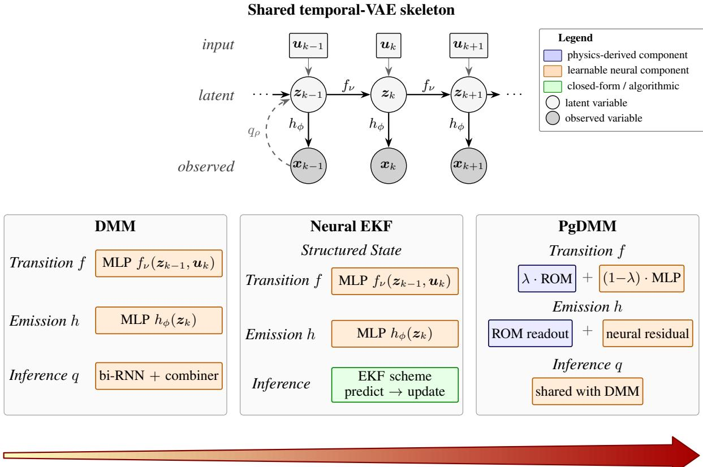  
Increasing physics-based inductive bias

Figure 1: Common probabilistic state-space skeleton and method-specific realizations of the three deep Bayesian filtering frameworks considered in this work. The top panel shows the latent state $z _ { k }$ evolving under the transition model $f _ { \nu }$ and generating observations $\scriptstyle { \mathbf { { \mathit { x } } } } _ { k }$ through the emission model $h _ { \phi } .$ , with the dynamics driven by inputs $\mathbf { \Delta } \mathbf { u } _ { k }$ Inference recovers the latent state from the observation sequence through an approximate posterior $q .$ The bottom panels arrange the three frameworks according to increasing physics-based inductive bias. The DMM constitutes the fully data-driven baseline, with learned transition, emission, and amortized inference models and no prescribed physical organization of the latent state. The Neural EKF introduces an intermediate level of structure by replacing the amortized encoder with the EKF predict-update recursion and, in its structural specialization, by organizing the latent state into displacement- and velocity-like coordinates, while retaining learnable transition and emission models. The PgDMM introduces stronger physics-based bias by embedding a parameter-dependent ROM within the transition and emission models, while retaining the amortized inference architecture of the DMM.

## Practical Tip

The choice of variational family affects both the expressiveness and computational tractability of posterior inference. Under the Gaussian assumptions adopted here, the KL divergence in the ELBO of Equation 10 can be evaluated analytically. More expressive variational families, such as normalizing flows based on Inverse Autoregressive Flows, generally require Monte Carlo estimation of the KL term using the variational log-density and the prior log-density, introducing additional computational cost and estimator variance. The Gaussian formulation is retained throughout this work for computational tractability.

The DMM therefore inherits the flexibility of deep generative models, but its latent coordinates are not endowed with an intrinsic structural correspondence to the underlying physical system. A first step toward a more structured representation is to retain learnable transition and observation models while replacing amortized inference with the recursive Bayesian inference mechanism of a classical filter. The Neural EKF, introduced next, follows this route and additionally allows the latent state to be organized according to the displacement–velocity structure of a second-order mechanical system.

## 3.3 The Neural Extended Kalman Filter (Neural EKF)

The DMM introduced above represents the fully data-driven end of the deep Bayesian filtering spectrum: its transition, observation, and amortized inference models are learned from data, without assigning a prescribed physical meaning to the latent coordinates. The Neural EKF introduces additional inductive structure in two respects. First, it replaces the amortized inference network with the predict-update recursion of the classical EKF, while retaining learnable transition and observation models. Second, for the structural response specialization considered later in this section, its latent state is explicitly organized into displacement- and velocity-like coordinates whose evolution follows the kinematic structure of a second-order mechanical system. It therefore retains substantial data-driven flexibility while providing a more structured and physically interpretable state-space representation than the DMM.

The underlying idea was originally presented in [128], where a replay-overshooting scheme was proposed, and was further refined in [118] in the Neural EKF formulation adopted here. Unlike the DMM, which uses a dedicated amortized inference network, the Neural EKF obtains the latent-state posterior through the differentiable EKF predictupdate recursion, followed, where appropriate, by Rauch-Tung-Striebel backward smoothing. End-to-end training can therefore focus on the learnable transition and observation models without introducing a separate inference network. The transition and observation functions $f _ { \nu }$ and $h _ { \phi }$ in Equations 4 and 5 are accordingly rendered learnable, relaxing the requirement for explicitly prescribed observer models in conventional Bayesian filtering.

Throughout this section, the notation ${ \bullet _ { i \mid j } }$ denotes a quantity at time step i conditioned on observations up to step j. Accordingly, $\bullet _ { k | k - 1 }$ represents the predicted estimate prior to measurement assimilation, $\bullet _ { k | k }$ the filtered estimate following the measurement update, and $\bullet _ { k | N _ { k } }$ the smoothed estimate incorporating information from the entire observation sequence.

## 3.3.1 Background: EKF filtering and smoothing

To make explicit which part of the Neural EKF is retained from classical Bayesian filtering, we first briefly recall the standard EKF prediction and measurement-update recursion, followed by the backward smoothing step used here. The EKF relies on the observers in Equations 4 and 5, although the nonlinear functions $f$ and h are assumed known and unparameterized. The setup further assumes that the posterior of the latent state $z _ { k }$ given the observations and inputs up to step k is Gaussian, and is computed in closed form by the EKF:

$$
q ( z _ { k } | \pmb { x } _ { 1 : k } , \pmb { u } _ { 1 : k } ) = \mathcal { N } \big ( \pmb { \mu } _ { k | k } , \pmb { \Sigma } _ { k | k } \big )\tag{16}
$$

where $\pmb { \mu } _ { k | k }$ and $\Sigma _ { k | k }$ are the mean and covariance of the inferred posterior. The EKF conducts approximate inference by linearizing the nonlinear equations, with the posterior obtained via iterative updates of a predict-and-update process. First, the prior is computed based on previous observations:

$$
q ( z _ { k } | \pmb { x } _ { 1 : k - 1 } , \pmb { u } _ { 1 : k } ) = \mathcal { N } \big ( \pmb { \mu } _ { k | k - 1 } , \pmb { \Sigma } _ { k | k - 1 } \big )\tag{17}
$$

$$
\pmb { \mu } _ { k | k - 1 } = f ( \pmb { \mu } _ { k - 1 | k - 1 } , \pmb { u } _ { k } )\tag{18}
$$

$$
\Sigma _ { k | k - 1 } = A _ { k - 1 } \Sigma _ { k - 1 | k - 1 } A _ { k - 1 } ^ { T } + Q _ { k - 1 }\tag{19}
$$

$$
A _ { k - 1 } = \frac { \partial f \left( \pmb { \mu _ { k - 1 | k - 1 } } , \pmb { u _ { k } } \right) } { \partial \pmb { \mu _ { k - 1 | k - 1 } } }\tag{20}
$$

The update step then incorporates the current observation xk:

$$
G _ { k } = \Sigma _ { k | k - 1 } C _ { k } ^ { T } \left( C _ { k } \Sigma _ { k | k - 1 } C _ { k } ^ { T } + R _ { k } \right) ^ { - 1 }\tag{21}
$$

$$
\pmb { \mu } _ { k | k } = \pmb { \mu } _ { k | k - 1 } + \pmb { G } _ { k } \left[ \pmb { x } _ { k } - h ( \pmb { \mu } _ { k | k - 1 } ) \right]\tag{22}
$$

$$
\Sigma _ { k | k } = \left( { I - G _ { k } C _ { k } } \right) \Sigma _ { k | k - 1 }\tag{23}
$$

$$
C _ { k } = \frac { \partial h \left( \mu _ { k | k - 1 } \right) } { \partial \mu _ { k | k - 1 } }\tag{24}
$$

The Jacobian matrices $\pmb { A } _ { k }$ and $C _ { k }$ provide local linear approximations of the nonlinear functions for the purpose of propagating the covariances, and $G _ { k }$ denotes the Kalman gain, written here as G rather than the customary K to reserve the latter for structural stiffness.

The standard EKF is typically deployed as a recursive filtering method, assuming a sequence of observations is available. The posterior estimates can be further refined by sweeping back over the entire sequence, a process termed smoothing. The Rauch-Tung-Striebel algorithm [129] is a suitable scheme for this purpose: it operates backwards

after the EKF filtering pass is completed and updates the posteriors as

$$
\begin{array} { r } { \pmb { G _ { k } ^ { s } } = \pmb { \Sigma _ { k | k } } \pmb { A _ { k } ^ { T } } \left( \pmb { \Sigma _ { k + 1 | k } } \right) ^ { - 1 } } \end{array}\tag{25}
$$

$$
\pmb { \mu } _ { k | N _ { k } } = \pmb { \mu } _ { k | k } + \pmb { G } _ { k } ^ { s } \left( \pmb { \mu } _ { k + 1 | N _ { k } } - \pmb { \mu } _ { k + 1 | k } \right)\tag{26}
$$

$$
\Sigma _ { k | N _ { k } } = \Sigma _ { k | k } + G _ { k } ^ { s } \left( \Sigma _ { k + 1 | N _ { k } } - \Sigma _ { k + 1 | k } \right) ( G _ { k } ^ { s } ) ^ { T }\tag{27}
$$

where the intermediate quantities are already available from the filtering pass in Equations 18–24.

## Technical Insight

Numerical stability of the EKF relies on preserving the symmetry and positive semi-definiteness of the propagated and updated covariance matrices, $\Sigma _ { k | k - 1 }$ and $\Sigma _ { k | k }$ . In differentiable implementations, finite-precision arithmetic and gradient-based optimization may introduce numerical inconsistencies that violate these properties, potentially causing Cholesky factorization failures and undefined values (NaN) during training. Practical safeguards include covariance symmetrization, diagonal regularization $\Sigma  \Sigma + \epsilon I$ with a small $\epsilon > 0 ,$ and numerically stable covariance updates. If factorization failures persist, a controlled reinitialization of the affected covariance may prevent training from terminating, although repeated failures should prompt further investigation of the learned dynamics and covariance parameterization.

These recursions define the structured inference mechanism retained by the Neural EKF. The remaining ingredients are the transition and observation functions entering the prediction and update steps. Whereas these functions are prescribed in the classical EKF, the Neural EKF renders them learnable, as described next. The additional mechanical structuring of the latent state adopted for the structural examples is introduced separately in section 3.3.4.

## 3.3.2 Transition and observation models

With the classical inference mechanism established above, the Neural EKF is obtained by replacing the prescribed transition and observation functions with learnable counterparts. The standard EKF requires explicit knowledge of the nonlinear transition f and observation function h; the Neural EKF lifts this restriction by representing $f _ { \nu }$ and $h _ { \phi }$ with NNs, trained end-to-end through the differentiable filtering and smoothing recursions. The framework adopts the observer formulation in Equations 4 and 5, where $f _ { \nu }$ and $h _ { \phi }$ are the learnable functions governing the transition and observation models, both parameterized by NNs with parameters $\theta = [ \nu ; \phi ]$ . The process and observation noise sources w and e are assumed Gaussian with time-invariant, learnable covariances.

For inference, the Neural EKF follows the standard EKF described in section 3.3.1. Once a Neural EKF model is trained, the learned functions $f _ { \nu }$ and $h _ { \phi }$ are readily available and can be plugged into Equations 18–24 to perform closed-form inference. Unlike the DMM, no separate inference network is parameterized: the variational posterior q is computed in closed form by the EKF, and consequently q inherits the same parameters θ as the generative model.

## 3.3.3 Evidence lower bound objective

With the EKF conducting inference, the parameters to be learned are summarized in θ and include the parameters of the NNs used to model the transition $f _ { \nu }$ and observation $h _ { \phi }$ functions. In addition, the initial values $\mu _ { 0 | 0 } , \Sigma _ { 0 | 0 }$ and the covariances $Q , R$ are also learned. During training, the Neural EKF integrates variational inference principles, with the EKF algorithm performing the inference task. Given an inference distribution $q _ { \pmb { \theta } } \left( \pmb { z } _ { k } | \pmb { x } , \pmb { u } \right)$ obtained in closed form from the EKF and assuming Markovian dynamics, the ELBO can be expressed in factorized form as

$$
\begin{array} { l } { \displaystyle \mathcal { L } ( \pmb { \theta } ; \pmb { x } ) = \sum _ { k = 1 } ^ { N _ { k } } \Bigg ( \mathbb { E } _ { q _ { \pmb { \theta } } ( z _ { k } | \pmb { x } , \pmb { u } ) } [ \log p _ { \phi } ( \pmb { x } _ { k } | \pmb { z } _ { k } ) ] } \\ { \displaystyle \qquad - \mathbb { E } _ { q _ { \pmb { \theta } } ( z _ { k - 1 } | \pmb { x } , \pmb { u } ) } [ \mathrm { K L } ( q _ { \pmb { \theta } } ( z _ { k } | \pmb { x } , \pmb { u } ) \| p _ { \nu } ( z _ { k } | z _ { k - 1 } , \pmb { u } _ { k } ) ) ] \Bigg ) } \end{array}\tag{28}
$$

where the ${ \bullet } _ { 1 : N _ { j } }$ subscripts have been dropped from x and u for compactness. Since the posterior qθ $( z _ { k } | \boldsymbol { x } , \boldsymbol { u } )$ is computed in closed form, the distributions in Equation 28 can be evaluated explicitly given $z _ { k } \sim \mathcal N \big ( \pmb { \mu } _ { k | N _ { k } } , \pmb { \Sigma } _ { k | N _ { k } } \big )$ . The detailed derivation is provided in the original publication [118]. We note that the log-probability and KL-divergence terms can be computed analytically because all the distributions involved are Gaussian. After substituting the EKF and smoothing recursions of section 3.3.1, and evaluating the likelihood term with the predictive covariance ${ \cal C } \Sigma { \cal C } ^ { T } + R$

of the linearized observation, the training objective reads

$$
\begin{array} { r l } { \mathcal { L } ( \theta ; \boldsymbol { w } ) = - \displaystyle { \frac { 1 } { 2 } } \displaystyle { \sum _ { k = 1 } ^ { N _ { k } } \Bigg [ \log \Big [ C _ { k | | \mathcal { N } _ { k } } \Sigma _ { k | \mathcal { N } _ { k } } C _ { k | \mathcal { N } _ { k } } ^ { T } + R \Big ] } } \\ & { \qquad + ( \alpha _ { k } - h _ { \delta } ( \mu _ { k } | _ { \mathcal { N } _ { k } } ) ) ^ { T } ( C _ { k | \mathcal { N } _ { k } } \Sigma _ { k | \mathcal { N } _ { k } } C _ { k | \mathcal { N } _ { k } } ^ { T } + R ) ^ { - 1 } ( \alpha _ { k } - h _ { \delta } ( \mu _ { k } | _ { \mathcal { N } _ { k } } ) ) } \\ & { \qquad + n _ { k } \log ( 2 \pi ) + \log | \frac { A _ { k - 1 | \mathcal { N } _ { k } } \Sigma _ { k - 1 | \mathcal { N } _ { k } } A _ { k - 1 | \mathcal { N } _ { k } } ^ { T } + Q } { | \Sigma _ { k | \mathcal { N } _ { k } } | } - n _ { 2 } } \\ & { \qquad + \operatorname { T r } ( ( A _ { k - 1 | \mathcal { N } _ { k } } \Sigma _ { k - 1 | \mathcal { N } _ { k } } A _ { k - 1 | \mathcal { N } _ { k } } ^ { 2 } + Q ) ^ { - 1 } \Sigma _ { k | \mathcal { N } _ { k } } ) } \\ & { \qquad + ( \int _ { \delta ^ { \prime } } ( \mu _ { k - 1 | \mathcal { N } _ { k } } ) - \mu _ { k } | _ { \mathcal { N } _ { k } } ) ^ { T } ( A _ { k - 1 | \mathcal { N } _ { k } } \Sigma _ { k - 1 | \mathcal { N } _ { k } } A _ { k - 1 | \mathcal { N } _ { k } } ^ { 2 } + Q ) ^ { - 1 } } \\ &  \qquad \times ( f _ { s } ( \mu _ { k - 1 | \mathcal { N } _ { k } } ) - \mu _ { k } | _  \ \end{array}\tag{29}
$$

In variational inference, the objective typically focuses on the reconstruction loss, which is dominated by the inference and observation models, while the transition function plays a comparatively minor role. As a result, training can end up with an accurate inference model but a transition function that is too weak for reliable response prediction. To address this, the Neural EKF adopts replay overshooting, originally proposed in [128]: an additional term that propagates the latent state forward through the generative model and penalizes the resulting prediction error. This term enforces consistency between the transition model and the true latent dynamics over multiple steps, rather than only at the one-step level. Specifically, a sequence of means and covariances $\left[ \mu _ { k | N _ { k } } , \Sigma _ { k | N _ { k } } \right]$ and the initial value $\left[ { \bar { \pmb \mu } } _ { 0 } , { \bar { \Sigma } } _ { 0 } \right] = \left[ { \pmb \mu } _ { 0 | N _ { k } } , \Sigma _ { 0 | N _ { k } } \right]$ is used for prediction. Analogously to the prediction stage of the KF, the predicted values are obtained from the generative model as

$$
{ \bar { \mu } } _ { k } = f _ { \nu } ( { \bar { \mu } } _ { k - 1 } , { \pmb u } _ { k } )\tag{30}
$$

$$
\bar { \Sigma } _ { k } = A _ { k - 1 } \bar { \Sigma } _ { k - 1 } A _ { k - 1 } ^ { T } + Q\tag{31}
$$

which leads to a second set of distributions $\bar { q } _ { \pmb { \theta } } ( z _ { k } ) = \mathcal { N } \big ( \bar { \pmb { \mu } } _ { k } , \bar { \pmb { \Sigma } } _ { k } \big )$ obtained from the generative model. The final reconstruction term in the loss is therefore composed of both posteriors, namely those obtained from EKF-based inference and those obtained from the transition model. These terms are weighted by a coefficient $\lambda _ { \mathrm { { r o } } }$ to form the training objective:

$$
\begin{array} { l } { \displaystyle \mathcal { L } ( \pmb { \theta } ; \pmb { x } ) = \sum _ { k = 1 } ^ { N _ { k } } \Bigg ( \lambda _ { \mathrm { r o } } \mathbb { E } _ { q _ { \pmb { \theta } } ( z _ { k } ) } [ \log p _ { \phi } ( \pmb { x } _ { k } | \pmb { z } _ { k } ) ] + ( 1 - \lambda _ { \mathrm { r o } } ) \mathbb { E } _ { \widetilde { q } _ { \pmb { \theta } } ( z _ { k } ) } [ \log p _ { \phi } ( \pmb { x } _ { k } | \pmb { z } _ { k } ) ] } \\ { \displaystyle - \mathbb { E } _ { q _ { \pmb { \theta } } ( z _ { k - 1 } ) } [ \mathrm { K L } ( q _ { \pmb { \theta } } ( z _ { k } ) \parallel p _ { \nu } ( z _ { k } | z _ { k - 1 } , \pmb { u } _ { k } ) ) ] \Bigg ) } \end{array}\tag{32}
$$

where the second term is the addition relative to Equation 28 that accounts for overshooting.

## Practical Tip

The gradual introduction of the replay-overshooting term in Equation 32 requires careful scheduling to balance reconstruction accuracy and the learning of predictive dynamics. Introducing this term too rapidly may destabilize optimization, whereas delaying its contribution excessively may limit the training of the transition model and compromise long-horizon forecasting accuracy. A suitable strategy is to begin with a short burn-in phase, progressively increase the overshooting contribution, and employ gradient clipping and learning-rate decay to improve numerical stability. The duration of the ramping schedule and the associated optimization settings should be selected based on validation performance, considering both reconstruction and open-loop forecasting accuracy.

## 3.3.4 Dynamic state estimation

The formulation above does not, by itself, prescribe the physical meaning of the latent coordinates. For the dynamic state estimation problem considered here, we introduce an additional structural bias by constraining the Neural EKF latent space to an interpretable nodal mechanical state,

$$
\begin{array} { r } { z _ { k } = [ \pmb { q } _ { k } ; \pmb { v } _ { k } ] \in \mathbb { R } ^ { 2 0 } , } \end{array}\tag{33}
$$

where $\ b { q } _ { k } , \ b { v } _ { k } \in \mathbb { R } ^ { 1 0 }$ denote displacement- and velocity-like coordinates at the monitored channels. Rather than learning an unrestricted transition map, a shared acceleration network $f _ { \pmb { \theta } } ^ { a } : \mathbb { R } ^ { 2 0 }  \mathbb { R } ^ { 1 0 }$ is embedded in a fixed integrator of the second-order mechanical equations. With a signed learnable input map $\scriptstyle { B _ { u } }$ , the acceleration and transition mean are

$$
{ \pmb a } _ { k } = f _ { \pmb \theta } ^ { a } ( { \pmb q } _ { k } , { \pmb v } _ { k } ) + B _ { u } { \pmb u } _ { k } ,\tag{34}
$$

$$
{ \pmb v } _ { k + 1 } = { \pmb v } _ { k } + \Delta t { \pmb a } _ { k } ,\tag{35}
$$

$$
\begin{array} { r } { \pmb q _ { k + 1 } = \pmb q _ { k } + \Delta t \pmb v _ { k + 1 } , } \end{array}\tag{36}
$$

which is the same semi-implicit (symplectic) Euler update adopted by the PgDMM in section 3.5.5, with the velocity advanced first and the updated velocity then advancing the displacement. The difference with respect to the PgDMM is that the acceleration field is learned here, so part of the first-order truncation error is absorbed into $f _ { \theta } ^ { a }$ during training. The input map is initialized from the known state-space feed-through, and the acceleration field is decomposed into an explicit linear structural backbone and a neural residual,

$$
f _ { \theta } ^ { a } ( \pmb { q } _ { k } , \pmb { v } _ { k } ) = - \left( \pmb { K } _ { \ell } \pmb { q } _ { k } + \pmb { C } _ { \ell } \pmb { v } _ { k } \right) + f _ { \theta } ^ { \mathrm { r e s } } ( \pmb { q } _ { k } , \pmb { v } _ { k } ) ,\tag{37}
$$

with $\mathbf { \boldsymbol { K } } _ { \ell } , \mathbf { \boldsymbol { C } } _ { \ell }$ the stiffness and damping of the linear backbone, obtained by least squares on the training window and thereafter optimized jointly with the residual. Unlike the PgDMM in section 3.5.5, whose operators come from the reduced linear model and are kept fixed, the backbone here is identified from data. This serves as a warm start and it can be disabled tasking the network to learn the complete state-to-acceleration field.

## Technical Insight

The numerical stability of the semi-implicit Euler integration scheme imposes a time-step-dependent restriction on the frequencies that can be accurately represented. For the undamped linear backbone in Equation 37, stability requires $\omega \Delta t < 2$ , corresponding to an upper frequency limit of approximately 32 Hz for $\Delta t = 0 . 0 1 \mathrm { s }$ . Modes exceeding this threshold may render the discrete transition unstable, even when the identified continuous-time dynamics are physically admissible. Introducing additional numerical damping may suppress the resulting instability but can distort the identified dynamics, leading to artificially rapid decay of the predicted response. This illustrates an important distinction between discretization-induced errors and deficiencies in the identified model. In particular, accurate measurement-conditioned reconstruction does not guarantee faithful autonomous dynamics, as such discrepancies may only become apparent through open-loop forecasting. Where necessary, smaller integration steps, substepping, or more suitable time-integration schemes should be considered.

The observation consists of the ten accelerations and reuses the same acceleration network and input map as the transition. Owing to this sharing, the parameter partition $\theta = [ \nu ; \phi ]$ collapses in this specialization, and both models are subscripted by θ directly. Let $b _ { a }$ denote the learned acceleration bias and $\pmb { \tau } = \pmb { \sigma } _ { \mathrm { d i s p } } \oslash \pmb { \sigma } _ { \mathrm { a c c } }$ the channel-wise ratio of a displacement to an acceleration standard deviation over the training windows, held fixed. The observation mean is

$$
h _ { \pmb \theta } ( z _ { k } , { \pmb u } _ { k } ) = \tau \odot { \pmb a } ( { \pmb q } _ { k } , { \pmb v } _ { k } , { \pmb u } _ { k } ) + { \pmb b } _ { a } .\tag{38}
$$

The emitted acceleration is therefore, by construction, the second derivative of the latent displacement, and since no output scale is learned, the latent state carries displacement and velocity units although neither quantity is measured. What an acceleration record cannot fix is the level of these states: integrating it twice determines the displacement only up to an offset and a linear drift, ${ d _ { 0 } } + { v _ { 0 } } t$ , and the velocity only up to an offset, and nothing in the learned acceleration field forces these components to be resolved. The state-recovery comparison of section 4.2.3 is accordingly scored with them removed. The displacement scale in τ and the least-squares fit of the backbone use displacements obtained by integrating the measured training accelerations, so no displacement record enters the model.

The displacement process variance is fixed near zero to preserve the kinematic identity, whereas velocity process variance, measurement variance, and the initial Gaussian state are learned.

The EKF prediction and measurement updates of section 3.3.1, followed by Rauch-Tung-Striebel smoothing, provide the Gaussian posterior without a separate inference network. For this specialization, the objective combines the smoothed reconstruction negative log-likelihood $\mathcal { L } _ { s }$ , the filtering (innovation) marginal negative log-likelihood $\mathcal { L } _ { f }$ , a one-step dynamics KL term, and an open-loop Gaussian prediction loss $\mathcal { L } _ { \mathrm { p r e d } }$ over the window suffix:

$$
\mathcal { I } _ { \mathrm { N E K F } } = \lambda _ { \mathrm { r o } } \mathcal { L } _ { s } + \lambda _ { f } \mathcal { L } _ { f } + \lambda _ { \mathrm { K L } } \mathcal { L } _ { \mathrm { K L } } + ( 1 - \lambda _ { \mathrm { r o } } ) \lambda _ { \mathrm { p r e d } } \mathcal { L } _ { \mathrm { p r e d } } .\tag{39}
$$

Here $\lambda _ { \mathrm { { r o } } }$ balances reconstruction against prediction as in the replay-overshooting objective above, and $\lambda _ { f } , \lambda _ { \mathrm { K I } }$ and $\lambda _ { \mathrm { p r e d } }$ weight the filtering, KL and prediction terms. The filtering term

$$
\mathcal { L } _ { f } = - \sum _ { k = 1 } ^ { N _ { k } } \mathrm { l o g } \mathcal { N } \big ( { \boldsymbol x } _ { k } ; h _ { \theta } ( \mu _ { k | k - 1 } , { \boldsymbol u } _ { k } ) , S _ { k } \big ) , \qquad S _ { k } = C _ { k } \Sigma _ { k | k - 1 } C _ { k } ^ { T } + R ,\tag{40}
$$

is computed from the innovation sequence already produced by the filtering pass, so it costs nothing beyond the recursions of section 3.3.1. It scores one-step-ahead predictive accuracy under the model’s own uncertainty and is therefore the dynamics-faithful counterpart to the smoothed term $\mathcal { L } _ { s } ,$ which sees every measurement. The prediction term propagates the filtered belief at the end of an $N _ { w } \mathrm { - s t e p }$ prefix over the remainder of the training window and scores the suffix, i.e., the same open-loop forecast used for evaluation.

## Practical Tip

The prediction-loss weight $\lambda _ { \mathrm { p r e d } }$ in Equation 39 directly influences the accuracy of open-loop forecasting and therefore requires careful calibration. Selecting this hyperparameter based on a single validation window may lead to unreliable model rankings, particularly when predictive performance varies across excitation realizations or initial conditions. A more robust strategy involves evaluating candidate configurations across multiple validation windows and random seeds, while reserving an independent test set for final performance assessment. The differences observed between validation and test performance in section 4.2.4 further illustrate the sensitivity of model selection to the evaluation data. For the numerical experiments presented in section 4.2, $\lambda _ { \mathrm { p r e d } } = 5$ is adopted.

## 3.3.5 Joint dynamic state and parameter estimation

Analogously to the PgDMM extension in section 3.5.6, the Neural EKF can be augmented to recover physical parameters by appending a dedicated parameter block to the latent state, $z = \left\lceil z ^ { \mathrm { d y n } } , z ^ { \mathrm { p a r } } \right\rceil$ . The dynamic block retains the learnable transition $f _ { \nu }$ and the observation map $h _ { \phi } .$ , while the parameter block evolves under an identity mean transition with a small process-noise covariance term that injects parameter uncertainty into the EKF prediction step. Within the EKF, the parameter block contributes additional rows and columns to the Jacobian matrices $A _ { k } , C _ { k }$ and to the corresponding covariances $\Sigma _ { k | k }$ , allowing the filter to propagate parameter uncertainty alongside the dynamic state. A supervised loss term on the inferred parameter block is added to the ELBO of Equation 28, mirroring the construction described for the PgDMM, and accordingly enabling joint state and parameter estimation within a single end-to-end training procedure. The closed-form inference inherited from the EKF is naturally compatible with this extension, since the augmented state remains a Gaussian random variable.

## 3.4 Reduced-order modeling for a dynamics-informed latent space

The DMM and Neural EKF introduced above illustrate two levels of structure within deep Bayesian state-space modeling. The DMM learns an unrestricted latent representation, whereas the structural specialization of the Neural EKF organizes the latent state into displacement- and velocity-like coordinates and constrains their evolution through mechanical kinematics. A further level of physics-based inductive bias can be introduced by informing not only the organization of the state space, but also its governing dynamics and observation mappings through a compact model derived from prior physical knowledge. For structural systems, ROMs provide a particularly useful mechanism for this purpose: they approximate the dominant dynamics of a high-dimensional system within a low-dimensional subspace while retaining a direct connection to physically meaningful states and observation channels. Embedding such a representation within a deep Bayesian formulation can reduce the effective dimension of the inference problem, constrain the latent dynamics, and facilitate interpretation of the inferred state in terms of the underlying mechanical system. Physics-based ROMs are typically obtained from a high-dimensional FE representation by extracting a reduced subspace, for example via modal analysis, Proper Orthogonal Decomposition, or Krylov-based reduction [122,130,131].

Regardless of the reduction technique adopted, the resulting ROM can be cast in continuous-time state-space form as

$$
\dot { z } ( t ) = A _ { c } ( \pmb { p } ) z ( t ) + B _ { c } ( \pmb { p } ) \pmb { u } ( t ) ,\tag{41}
$$

$$
\pmb { x } ( t ) = \pmb { C } _ { c } ( \pmb { p } ) \pmb { z } ( t ) + \pmb { D } _ { c } ( \pmb { p } ) \pmb { u } ( t ) ,\tag{42}
$$

where $z ~ \in ~ \mathbb { R } ^ { n }$ z is the reduced state, u is the input excitation, and x is the measured response. The matrices ${ \cal A } _ { c } ( p ) , { \cal B } _ { c } ( p )$ encode the reduced dynamics, while $\mathbf { \dot { \phi } } { C _ { c } } ( \pmb { p } ) , D _ { c } ( \pmb { p } )$ are the observation maps that project the reduced state and input onto the physical measurement channels. The dependence on the parameter vector p acknowledges

that the ROM operators vary with the system properties to be identified. Discretizing the system in Equation 41 and Equation 42 under a zero-order hold at the sampling interval yields the discrete-time form

$$
z _ { k } = A _ { d } ( \pmb { p } ) z _ { k - 1 } + B _ { d } ( \pmb { p } ) \pmb { u } _ { k } ,\tag{43}
$$

$$
\pmb { x } _ { k } = \pmb { C } _ { d } ( \pmb { p } ) \pmb { z } _ { k } + \pmb { D } _ { d } ( \pmb { p } ) \pmb { u } _ { k } ,\tag{44}
$$

which provides the matrices $A _ { d } ( { \pmb p } ) , B _ { d } ( { \pmb p } ) , C _ { d } ( { \pmb p } ) , D _ { d } ( { \pmb p } )$ used as the physics-based component of the frameworks developed in the next subsections. The rows of $C _ { d } ( \pmb { p } )$ and $D _ { d } ( \pmb { p } )$ retain a direct correspondence to specific physical DOFs of the underlying FE representation: different row selections can potentially recover different physical observation channels from the same reduced state.

For nonlinear and parameter-dependent systems, the construction of a globally accurate ROM over the full operating range is challenging, and parametric or local ROMs are often adopted [132–135]. We here adopt the local-basis approach of [26], in which a library of locally trained ROMs is assembled across the parameter space and interpolated, so that the reduced representation adapts to the operating regime rather than remaining fixed. Such a representation provides a compact physics-based approximation of the dominant dynamics, while unresolved nonlinearities and model discrepancy can subsequently be delegated to learnable components.

Within deep Bayesian filtering, ROMs therefore offer one mechanism for introducing physical structure into the latent representation, transition dynamics, and observation map without requiring the entire model to be prescribed. The PgDMM considered next provides a direct realization of this idea within the temporal variational framework, combining a physics-guided generative component with learnable terms.

## 3.5 The Physics-guided Deep Markov Model (PgDMM)

Building on the data-driven DMM of section 3.2 and the physics-informed latent representations discussed in section 3.4, the PgDMM provides a hybrid realization of the temporal variational state-space framework. Rather than leaving the latent dynamics entirely unconstrained, available physical knowledge is introduced into the generative model, while learnable components account for dynamics and discrepancies not captured by the prescribed physics. Importantly, the physical component need not be restricted to a ROM; a ROM provides the particular structured representation adopted in the applications considered here.

The PgDMM extends the DMM baseline of section 3.2 along three lines:

(i) it retains the DMM variational inference network to obtain the latent state z from the observations x;

(ii) it couples a deep generative model with a physics-based state-space model in the transition, with the two contributions combined additively;

(iii) it learns the variance terms as functions of the latent state, allowing the framework to capture uncertainty arising both from the model and from the measurements.

By incorporating prior knowledge of the model structure into the generative path, the PgDMM encourages a latentspace representation that aligns with the expected physics. At the same time, a flexible NN models the discrepancy between the physics-based component and the monitored system to account for missing knowledge. The resulting hybrid framework yields an inferred latent space that is interpretable from a physical standpoint while still capturing uncertainties related to the model and the measurements. The PgDMM further inherits the marginal-likelihood decomposition in Equation 11 and the Markov factorization in Equations 12 and 13 from the DMM, and modifies only the parameterization of the transition and observation densities to include a physics-guided component.

## 3.5.1 Transition model

The PgDMM casts the transition from $z _ { k - 1 }$ to zk as a hybrid structure comprising a physics-guided module $f _ { \mathrm { p h y } }$ and a learning-based module $f _ { l }$ parameterized by NNs. The updated latent state $z _ { k }$ is computed as a linear weighted combination of two random variables $z _ { k } ^ { \mathrm { p h y } }$ and $z _ { k } ^ { \mathrm { N N } }$

$$
z _ { k } = \lambda z _ { k } ^ { \mathrm { p h y } } + ( 1 - \lambda ) z _ { k } ^ { \mathrm { N N } }\tag{45}
$$

$$
\pmb { \mu } ( z _ { k } ) = \lambda \pmb { \mu } _ { \mathrm { p h y } } ( z _ { k - 1 } ^ { \mathrm { p h y } } ) + ( 1 - \lambda ) \pmb { \mu } _ { \mathrm { N N } } ( z _ { k - 1 } ^ { \mathrm { N N } } ) ,\tag{46}
$$

$$
\begin{array} { r } { \Sigma ( z _ { k } ) = \lambda ^ { 2 } \Sigma _ { \mathrm { p h y } } ( z _ { k - 1 } ^ { \mathrm { p h y } } ) + ( 1 - \lambda ) ^ { 2 } \Sigma _ { \mathrm { N N } } ( z _ { k - 1 } ^ { \mathrm { N N } } ) } \end{array}\tag{47}
$$

where $\lambda$ is a trainable mixing parameter, i.e., it is included in the vector θ. The physics-guided random variable $z ^ { \mathrm { p h y } }$ follows a Gaussian distribution whose mean is updated according to $f _ { \mathrm { p h y } }$ and whose variance is emitted by a trainable

NN:

$$
z _ { k } ^ { \mathrm { p h y } } \sim \mathcal { N } \Big ( \mu _ { \mathrm { p h y } } ( z _ { k - 1 } ^ { \mathrm { p h y } } ) , \Sigma _ { \mathrm { p h y } } ( z _ { k - 1 } ^ { \mathrm { p h y } } ) \Big )\tag{48}
$$

$$
\mu _ { \mathrm { p h y } } ( z _ { k - 1 } ^ { \mathrm { p h y } } ) = f _ { \mathrm { p h y } } ( z _ { k - 1 } ^ { \mathrm { p h y } } )\tag{49}
$$

$$
\Sigma _ { \mathrm { p h y } } ( z _ { k - 1 } ^ { \mathrm { p h y } } ) = g _ { \sigma } ( z _ { k - 1 } ^ { \mathrm { p h y } } )\tag{50}
$$

where $g _ { \sigma }$ is composed of feed-forward NNs. Following the same construction for $z ^ { \mathrm { N N } }$ , and mirroring the physics branch:

$$
z _ { k } ^ { \mathrm { N N } } \sim \mathcal { N } \big ( \mu _ { \mathrm { N N } } ( z _ { k - 1 } ^ { \mathrm { N N } } ) , \Sigma _ { \mathrm { N N } } ( z _ { k - 1 } ^ { \mathrm { N N } } ) \big )\tag{51}
$$

$$
\mu _ { \mathrm { N N } } ( z _ { k - 1 } ^ { \mathrm { N N } } ) = f _ { l } ( z _ { k - 1 } ^ { \mathrm { N N } } ) , \qquad \Sigma _ { \mathrm { N N } } ( z _ { k - 1 } ^ { \mathrm { N N } } ) = g _ { z } ( z _ { k - 1 } ^ { \mathrm { N N } } )\tag{52}
$$

where the learnable module $f _ { l }$ and the variance network $g _ { z }$ are both composed of feed-forward NNs.

The transition function $f _ { \mathrm { p h y } }$ for the random variable $z ^ { \mathrm { p h y } }$ has a physical interpretation and is formulated based on pre-existing knowledge of the system response, or by adopting a structured model for part of the transition process. A typical example for nonlinear dynamical systems is the use of a linearized approximation of the dynamics around an operating point. In turn, the random variable $z ^ { \mathrm { N N } }$ captures the discrepancy between the approximation offered by $z ^ { \mathrm { p h y } }$ and the observed dynamics, via the learnable NNs. Because the combined latent state is anchored by $f _ { \mathrm { p h y } }$ when maximizing the likelihood, training is less prone to learning arbitrary functions that simply fit the observations. The covariance matrices $\Sigma _ { \tau }$ are typically assumed to be diagonal, which is a sufficient approximation in most cases when uncertainties are adequately described by a white-noise assumption with a low noise-to-signal ratio.

## Practical Tip

When the physics-guided transition is constructed from a ROM, the dimension of its state representation must be consistent with that of the physics-guided latent subspace $z ^ { \mathrm { p h y } } \in \mathbb { R } ^ { n _ { z } ^ { \mathrm { p h y } } }$ Since the operators defining $f _ { \mathrm { p h y } }$ act directly on these latent coordinates, dimensional incompatibility can invalidate the resulting state-space operations. It is therefore advisable to verify the dimensions of the reduced operators and their compatibility with the latent-state representation during ROM construction, prior to model training.

## 3.5.2 Observation model

The observation process that recovers the observations x from the latent state z is formulated as

$$
\pmb { x } _ { k } \sim \mathcal { P } \left( E ( z _ { k } ) \right)\tag{53}
$$

where P denotes the probability distribution of the measured data x, parameterized by a suitable NN. For instance, Gaussian distributions can be parameterized as in Equation 52 via their mean and variance, with $E ( z _ { k } ) =$ $[ \pmb { \mu } ( z _ { k } ) , \pmb { \Sigma } ( z _ { k } ) ]$ , the mean $\mu ( z _ { k } )$ being produced by the observation function $h _ { \phi }$ detailed below; other distributions can be treated accordingly. For the structural-response setting considered in this work, the observation function $h _ { \phi }$ admits the additive decomposition

$$
\hat { \pmb { x } } _ { k } = \underbrace { C _ { d } ( \pmb { p } ) z _ { k } ^ { \mathrm { p h y } } + D _ { d } ( \pmb { p } ) { \pmb u } _ { k } } _ { \mathrm { p h y s i c s - d e r i v e d e m i s s i o n } } + \underbrace { h _ { \phi } ^ { \mathrm { r e s } } ( z _ { k } ) } _ { \mathrm { n e u r a l \ r e s i d u a l } } ,\tag{54}
$$

where $C _ { d } ( \pmb { p } )$ and $D _ { d } ( \pmb { p } )$ are the ROM readout matrices that map the reduced physical state and the input to the measured DOFs, and $h _ { \phi } ^ { \mathrm { r e s } }$ is a learnable head that absorbs the discrepancy between the ROM output and the measurements.

## Practical Tip

Consistent normalization is essential when combining physics-based and NN-based components within the PgDMM. While normalization can improve neural network training, the ROM-derived transition and observation operators must remain consistent with the scaling applied to the latent states, inputs, and outputs. Inconsistent transformations can distort the relative contributions of the physics-guided and learned components, compromising the fidelity of the resulting dynamics without necessarily producing numerical errors. Scaling transformations should therefore be applied consistently across the state-space representation, with particular attention to the physical units and normalization conventions of the ROM operators.

## 3.5.3 Inference model

The true posterior distribution $p ( \pmb { z } _ { 1 : N _ { k } } | \pmb { x } _ { 1 : N _ { k } } )$ associated with Equation 11 is intractable in the context of DMM. It is approximated by a distribution $q _ { \rho } ( z _ { 1 : N _ { k } } | \pmb { x } _ { 1 : N _ { k } } ) \approx p ( z _ { 1 : N _ { k } } | \pmb { x } _ { 1 : N _ { k } } )$ parameterized by $\rho ,$ which serves as the inference model that recovers the latent states from the observations. The inference network employed here follows the standard structure of the DMM. Following the conditional independence statements in Equations 12 and 13, the latent variables $z _ { 1 : N _ { k } }$ are assumed to retain Markovian behavior when conditioned on $\pmb { x } _ { 1 : N _ { k } }$ , and the true posterior is factorized as

$$
p ( \boldsymbol { z } _ { 1 : N _ { k } } | \boldsymbol { x } _ { 1 : N _ { k } } ) = p ( \boldsymbol { z } _ { 0 } ) \prod _ { k = 1 } ^ { N _ { k } } p ( z _ { k } | z _ { k - 1 } , \boldsymbol { x } _ { 1 : N _ { k } } )\tag{55}
$$

where $z _ { \mathrm { 0 } }$ is a trainable pseudo-node representing the initial conditions. The approximate distribution $q _ { \rho }$ is designed as a Gaussian that combines the physics-guided stream controlled by $z ^ { \mathrm { p h y } }$ and the learning-based stream by $z ^ { \mathrm { N N } }$

$$
q _ { \rho } ( z | \mathbf { x } _ { 1 : N _ { k } } ) = q _ { \rho } ^ { \mathrm { p h y } } ( z ^ { \mathrm { p h y } } | \mathbf { x } _ { 1 : N _ { k } } ) q _ { \rho } ^ { \mathrm { N N } } ( z ^ { \mathrm { N N } } | \mathbf { x } _ { 1 : N _ { k } } )
$$

$$
= q _ { \rho } ^ { \mathrm { p h y } } ( z _ { 0 } ^ { \mathrm { p h y } } ) q _ { \rho } ^ { \mathrm { N N } } ( z _ { 0 } ^ { \mathrm { N N } } ) \prod _ { k = 1 } ^ { N _ { k } } q _ { \rho } ^ { \mathrm { p h y } } ( z _ { k } ^ { \mathrm { p h y } } | z _ { k - 1 } ^ { \mathrm { p h y } } , \boldsymbol { x } _ { 1 : N _ { k } } ) \prod _ { k = 1 } ^ { N _ { k } } q _ { \rho } ^ { \mathrm { N N } } ( z _ { k } ^ { \mathrm { N N } } | z _ { k - 1 } ^ { \mathrm { N N } } , \boldsymbol { x } _ { 1 : N _ { k } } )\tag{56}
$$

$$
q _ { \rho } ^ { \mathrm { p h y } } ( z _ { k } ^ { \mathrm { p h y } } | z _ { k - 1 } ^ { \mathrm { p h y } } , \pmb { x } _ { 1 : N _ { k } } ) = \mathcal { N } \Big ( \pmb { \mu } _ { \rho } ^ { \mathrm { p h y } } \big ( z _ { k - 1 } ^ { \mathrm { p h y } } , \pmb { x } _ { 1 : N _ { k } } \big ) , ~ \pmb { \Sigma } _ { \rho } ^ { \mathrm { p h y } } \big ( z _ { k - 1 } ^ { \mathrm { p h y } } , \pmb { x } _ { 1 : N _ { k } } \big ) \Big )\tag{57}
$$

$$
q _ { \rho } ^ { \mathrm { N N } } ( z _ { k } ^ { \mathrm { N N } } | z _ { k - 1 } ^ { \mathrm { N N } } , \pmb { x } _ { 1 : N _ { k } } ) = \mathcal { N } \big ( \pmb { \mu } _ { \rho } ^ { \mathrm { N N } } ( z _ { k - 1 } ^ { \mathrm { N N } } , \pmb { x } _ { 1 : N _ { k } } ) , ~ \pmb { \Sigma } _ { \rho } ^ { \mathrm { N N } } ( z _ { k - 1 } ^ { \mathrm { N N } } , \pmb { x } _ { 1 : N _ { k } } ) \big )\tag{58}
$$

Analogously to Equation 52, the mean values and covariance matrices are obtained as outputs of dedicated NNs:

$$
\left[ \mu _ { \rho } ^ { \mathrm { p h y } } ( z _ { k - 1 } ^ { \mathrm { p h y } } , \pmb { x } _ { 1 : N _ { k } } ) , \pmb { \Sigma } _ { \rho } ^ { \mathrm { p h y } } ( z _ { k - 1 } ^ { \mathrm { p h y } } , \pmb { x } _ { 1 : N _ { k } } ) \right] = g _ { \rho } ^ { \mathrm { p h y } } ( \pmb { y } _ { k } ^ { \mathrm { p h y } } )\tag{59}
$$

$$
\left[ \mu _ { \rho } ^ { \mathrm { N N } } ( z _ { k - 1 } ^ { \mathrm { N N } } , \pmb { x } _ { 1 : N _ { k } } ) , \pmb { \Sigma } _ { \rho } ^ { \mathrm { N N } } ( z _ { k - 1 } ^ { \mathrm { N N } } , \pmb { x } _ { 1 : N _ { k } } ) \right] = g _ { \rho } ^ { \mathrm { N N } } ( \pmb { y } _ { k } ^ { \mathrm { N N } } )\tag{60}
$$

$$
{ \pmb y } _ { k } ^ { \star } = \frac { 1 } { 3 } \left[ { \pmb y } _ { k } ^ { b } + { \pmb y } _ { k } ^ { f } + \operatorname { t a n h } \bigl ( { \pmb W } ^ { \star } { \pmb z } _ { k - 1 } ^ { \star } + { \pmb b } ^ { \star } \bigr ) \right]\tag{61}
$$

In Equation 61, the superscript ⋆ denotes either the physics or the NN stream, and the observation sequence $\pmb { x } _ { 1 : N _ { k } }$ is processed by a bidirectional recurrent NN that outputs two sequences of hidden states $\boldsymbol { y } _ { k } ^ { f }$ and $\pmb { y } _ { k } ^ { b }$ , representing forward and backward information flow. These past and future sequences are then combined with the latent state via a feedforward network that transforms the latent state into the same dimension as the hidden sequences $\boldsymbol { y } _ { k } ^ { f }$ and $\pmb { y } _ { k } ^ { b }$ . Although inference is conducted separately for the two streams, the same bidirectional network is applied, which implies that the parameters $\rho$ are shared. The hidden states $\boldsymbol { y } _ { k } ^ { f }$ and $\pmb { y } _ { k } ^ { b }$ are therefore identical for the two inference networks, and the distinction between the streams is encoded in the weights $W ^ { \star }$ and biases $b ^ { \star }$ in Equation 61.

## 3.5.4 Evidence lower bound objective

System identification and the learning of the corresponding dynamical models given a training dataset $\pmb { x } _ { 1 : N _ { k } }$ are formalized as identifying the vector of parameters θ involved in the transition and observation models. This is accomplished by maximizing the marginal log-likelihood function log $p _ { \pmb { \theta } } \left( \pmb { x } _ { 1 : N _ { k } } \right)$ , with $p _ { \theta }$ defined in Equation 11, following the principle of maximum-likelihood estimation. The true posterior over the latent variables given the observations is intractable, as explained in section 3.5.3, and variational inference is therefore used to derive the distribution $q _ { \rho }$ in Equation 56 that is parameterized by NNs and approximates the true posterior. The ELBO of the marginal loglikelihood log $p _ { \pmb { \theta } } \left( \pmb { x } _ { 1 : N _ { k } } \right)$ is then adopted as the loss function to be maximized, after the temporal dependence and the factorization in Equations 12 and 13 are accounted for, alongside the modeling assumption in Equation 45. A detailed derivation for the PgDMM can be found in the original publication [117], and the resulting loss is reproduced here:

$$
\begin{array} { r l } { \log p _ { \theta } ( x ) \geq \mathcal { L } _ { \operatorname { p h y } } ( \theta , \rho ; x ) } \\ { : = \mathbb { E } _ { q _ { \rho } } [ \log p _ { \theta } ( x | z ) ] - ( \mathrm { K L } [ \boldsymbol { q } _ { \rho } ^ { \operatorname { p h y } } ( z ^ { \operatorname { p h y } } | x )  p _ { \theta } ( z ^ { \operatorname { p h y } } )  + \mathrm { K L } [ \boldsymbol { q } _ { \rho } ^ { \operatorname { N N } } ( z ^ { \operatorname { N N } } | x )  p _ { \theta } ( z ^ { \operatorname { N N } } ) ] )  } \\ { \displaystyle } & { = \sum _ { k = 1 } ^ { N _ { k } } \mathbb { E } _ { q _ { \rho } } [ \log p _ { \theta } ( x _ { k } | z _ { k } ) ] - \sum _ { k = 1 } ^ { N _ { k } } \mathbb { E } _ { q _ { \rho } ^ { \operatorname { p h y } } ( z _ { k - 1 } ^ { \operatorname { p h y } } | x _ { 1 } , N _ { k } ) } [ \mathrm { K L } ( \boldsymbol { q } _ { \rho } ^ { \operatorname { p h y } } ( z _ { k } ^ { \operatorname { p h y } } | z _ { k - 1 } ^ { \operatorname { p h y } } , x _ { 1 : N _ { k } } )  p _ { \theta } ( z _ { k } ^ { \operatorname { p h y } } | z _ { k - 1 } ^ { \operatorname { p h y } } ) ) ] } \\ { \displaystyle } &   \qquad - \sum _ { k = 1 } ^ { N _ { k } } \mathbb { E } _ { q _ { \rho } ^ { \operatorname* { N S } } ( z _ { k - 1 } ^ { \operatorname { N N } } | x _ { 1 : N _ { k } } ) } [ \mathrm { K L } ( \boldsymbol { q } _ { \rho } ^ { \operatorname* { N N } } ( z _ { k } ^ { \operatorname { N N } } | z _ { k - 1 } ^ { \operatorname { N N } } , x _ { 1 : N _ { k } } )  p _ { \theta } ( z _ { k } ^ { \operatorname { N N } } | z _ { k - 1 } ^ { \operatorname { N N } } )  \end{array}\tag{62}
$$

This loss encodes the trade-off between reconstruction accuracy, reflected by the expected log-likelihood term, and prior regularization, reflected by the KL-divergence terms. The physics-informed structure of the model splits the prior regularization into two terms, where one acts as a physical constraint.

## 3.5.5 Dynamic state estimation

For the dynamic state estimation setting, a single-branch structural specialization is adopted rather than the two-stream mixture in Equation 45. The latent variable is the balanced reduced mechanical state

$$
\begin{array} { r } { \boldsymbol { z } _ { k } = [ \boldsymbol { r } _ { k } ; \boldsymbol { v } _ { k } ] \in \mathbb { R } ^ { 3 2 } , } \end{array}\tag{63}
$$

comprising 16 relative modal displacements and 16 modal velocities. Run-specific mass-normalized stiffness and damping operators are extracted from the linear reduced model and transformed using per-coordinate scales obtained from the discrete controllability Gramian. This yields the balanced operators $K _ { b } , C _ { b } , g _ { b } ,$ the per-coordinate ratio $\scriptstyle { \pmb { s } } _ { b }$ of the velocity to the displacement scale, the displacement and acceleration readouts $\Phi _ { b } ^ { r }$ and $\Phi _ { b } ^ { a }$ , and the direct feed-through $\begin{array} { r } { D _ { b } , } \end{array}$ i.e., the second-order, balanced counterparts of the operators in Equation 43 and Equation 44. The only learned mean-dynamics component is a residual nonlinear restoring-force network $f _ { \theta } ^ { \mathrm { r e s } } : \mathbb { R } ^ { 3 2 } \overset { \cdot } {  } \mathbb { R } ^ { 1 6 }$ ; there is no free neural transition branch and no mixture coefficient. This network is shared between the transition and the emission below, so the parameter partition $\theta = [ \nu ; \phi ]$ collapses in this specialization and the generative components are subscripted by θ directly.

Throughout this work, subscripts are used to distinguish the different roles of C. Mechanical damping matrices are identified by their coordinate representation $( C _ { b }$ here and $C _ { \ell }$ in section $3 . 3 . 4 )$ , while the ROM readout operators are distinguished by their continuous- or discrete-time formulation $( C _ { c }$ and $C _ { d } ,$ , respectively). The observation Jacobian is denoted by $\dot { C } _ { k } ,$ , with the subscript indicating the time step, as introduced in section 3.3.1. The stiffness matrix is consistently denoted by $\kappa$

Each sampling interval $\Delta t = 0 . 0 1$ s is divided into $n _ { s } = 1 0$ semi-implicit Euler substeps of size $\delta t = \Delta t / n _ { s }$ , since the retained modal spectrum, which reaches ω ≈ 970 rad/s, violates the stability bound $\Delta t \omega < 2$ of a single step per interval. With ${ \mathbf { } } _ { { \pmb { u } } _ { k , j } }$ the input sample of substep j, taken from the excitation record at its original 1 kHz rate, the transition mean is evaluated at substep j as

$$
\begin{array} { r } { \pmb { a } _ { j } ^ { \mathrm { a b s } } = - \pmb { K _ { b } } \pmb { r _ { j } } - \pmb { C _ { b } } \pmb { v _ { j } } - f _ { \pmb { \theta } } ^ { \mathrm { r e s } } ( \pmb { r _ { j } } , \pmb { v _ { j } } ) , } \end{array}\tag{64}
$$

$$
{ \pmb a } _ { j } ^ { \mathrm { r e l } } = { \pmb a } _ { j } ^ { \mathrm { a b s } } + { \pmb g } _ { b } { \pmb u } _ { k , j } ,\tag{65}
$$

$$
\begin{array} { r } { \pmb { v } _ { j + 1 } = \pmb { v } _ { j } + \delta t \pmb { a } _ { j } ^ { \mathrm { r e l } } , } \end{array}\tag{66}
$$

$$
\pmb { r } _ { j + 1 } = \pmb { r } _ { j } + \delta t \left( \pmb { s } _ { b } \odot \pmb { v } _ { j + 1 } \right) .\tag{67}
$$

The velocity is updated before displacement, giving a semi-implicit mechanical integrator. After the final substep, the transition density is diagonal Gaussian,

$$
p _ { \pmb { \theta } } ( z _ { k } | z _ { k - 1 } , \pmb { u } _ { k } ) = \mathcal { N } \big ( f _ { \pmb { \theta } } ( z _ { k - 1 } , \pmb { u } _ { k } ) , \mathrm { d i a g } ( \pmb { \sigma } _ { w } ^ { 2 } ) \big ) ,\tag{68}
$$

with learned process scales $\pmb { \sigma } _ { w } , \mathrm { i . e . , } Q = \mathrm { d i a g } ( \pmb { \sigma } _ { w } ^ { 2 } )$

For the dynamic state estimation setting, the observations comprise accelerations measured at the monitored channels. These are modeled through the normalized acceleration projection $\Phi _ { b } ^ { a }$ , while the emission model shares the residual restoring-force network employed in the transition model:

$$
h _ { \theta } ( z _ { k } , u _ { k } ) = \Phi _ { b } ^ { a } \left[ - K _ { b } r _ { k } - C _ { b } v _ { k } - f _ { \theta } ^ { \mathrm { r e s } } ( r _ { k } , v _ { k } ) \right] + D _ { b } u _ { k } + b _ { 0 } .\tag{69}
$$

Here $\mathbf { \nabla } D _ { b } \mathbf { u } _ { k }$ is the direct feed-through of the reduced model, so that without the residual Equation 69 reproduces its acceleration output $C _ { d } z _ { k } + D _ { d } { \pmb u } _ { k }$ , and $\pmb { b } _ { 0 } = - \pmb { \mu } _ { x } \oslash \pmb { \sigma } _ { x }$ is the fixed offset of the channel-wise normalization of the observations. Neither displacement nor velocity is observed, so recovering either is a genuine test of the latent-state virtual sensing. Unlike the Neural EKF of section 3.3.4, the modal latent cannot drift freely, since any change of rk passes through the fixed stiffness $\pmb { K } _ { b }$ into the emitted acceleration, where it is penalized by the measurements. The observation density is Gaussian with learned diagonal measurement covariance R.

Inference remains amortized but uses a single posterior stream. An initialization encoder processes the first observation–input pairs, a bidirectional recurrent network summarizes the full sequence, and a Gaussian combiner merges this context with the preceding latent state and current input:

$$
q _ { \rho } ( \boldsymbol { z } _ { k } | \boldsymbol { z } _ { k - 1 } , \boldsymbol { x } _ { 1 : N _ { k } } , \boldsymbol { u } _ { 1 : N _ { k } } ) = \mathcal { N } \big ( \mu _ { \rho , k } , \mathrm { d i a g } ( \pmb { \sigma } _ { \rho , k } ^ { 2 } ) \big ) .\tag{70}
$$

Training minimizes the negative ELBO augmented by an open-loop forecast auxiliary,

$$
\mathcal { I } _ { \mathrm { P g D M M } } = - \sum _ { k = 1 } ^ { N _ { k } } \mathbb { E } _ { q _ { \rho } } [ \log p _ { \theta } ( \pmb { x } _ { k } | \boldsymbol { z } _ { k } ) ] + \lambda _ { \mathrm { K L } } \sum _ { k = 1 } ^ { N _ { k } } \mathrm { K L } [ q _ { \rho } ( \boldsymbol { z } _ { k } | \cdot ) \| p _ { \theta } ( \boldsymbol { z } _ { k } | \boldsymbol { z } _ { k - 1 } , \boldsymbol { u } _ { k } ) ] + \lambda _ { \mathrm { f c } } \mathcal { L } _ { \mathrm { f c } } ,\tag{71}
$$

where $\lambda _ { \mathrm { K I } }$ weights the KL term. The auxiliary term addresses the exposure bias of the one-step objective: the ELBO above never asks the transition to run without measurement feedback, so a model that reconstructs a window well can still forecast it poorly. Given a rollout origin $k _ { 0 }$ and a horizon $N _ { h }$ , the guide is warmed up on the $N _ { w }$ observed steps preceding the rollout and the transition is then run free over the horizon, giving

$$
\mathcal { L } _ { \mathrm { f c } } = \frac { 1 } { 2 \sigma _ { \mathrm { r e f } } ^ { 2 } } \sum _ { k = k _ { 0 } + N _ { w } } ^ { k _ { 0 } + N _ { w } + N _ { h } } \left. \pmb { x } _ { k } - h _ { \pmb { \theta } } \big ( z _ { k } ^ { \mathrm { r o l l } } , \pmb { u } _ { k } \big ) \right. ^ { 2 } ,\tag{72}
$$

with $z _ { k } ^ { \mathrm { r o l l } }$ propagated by the transition alone and $\sigma _ { \mathrm { r e f } }$ a fixed reference scale that renders the term commensurate with the reconstruction likelihood. Here $N _ { w }$ denotes the measurement warm-up length of Table $2 ;$ the origin $k _ { 0 }$ is sampled within the training windows and the horizon $N _ { h }$ is increased gradually during training.

## Practical Tip

The selection of rollout initial conditions and prediction horizons in Equation 72 can have a greater influence on forecasting accuracy than the weighting coefficient $\lambda _ { \mathrm { f c } }$ . Fixing the rollout origin at the beginning of each training segment limits the diversity of trajectories encountered during optimization. In contrast, randomly sampling rollout origins within each segment exposes the model to a broader range of initial conditions, while progressively increasing the horizon $\breve { N } _ { h }$ facilitates the learning of longer-term dynamics. In the numerical experiments of section 4.2.1, this combined strategy yielded one of the most substantial improvements in forecasting performance. Importantly, the rollout horizon should remain representative of the intended prediction horizon: excessively short rollouts may improve computational efficiency and increase the number of sampled initial conditions, but provide insufficient constraints on long-term predictive behavior. Rollout sampling and horizon scheduling should therefore be considered jointly when designing the training procedure.

## 3.5.6 Joint dynamic state and parameter estimation

The standard PgDMM formulation infers the latent dynamics governing the system response, but does not explicitly recover physical parameters. We here extend the PgDMM to address this need by augmenting the latent state with a dedicated parameter block, $z = [ z ^ { \mathrm { d y n } } , z ^ { \mathrm { p a r } } ]$ , where $z ^ { \mathrm { p a r } } \in \mathbb { R } ^ { n _ { p } }$ is a latent-space representation of the physical parameter vector p defined in section 2.5. The dynamic block $z ^ { \mathrm { { d y n } } }$ is assembled from the physics-guided and neural streams $z ^ { \mathrm { p h y } }$ and $\mathbf { \bar { z } } ^ { \mathrm { N N } }$ of Equation 45 and retains that hybrid transition, while the parameter block evolves according to a near-identity transition

$$
z _ { k } ^ { \mathrm { p a r } } = z _ { k - 1 } ^ { \mathrm { p a r } } + \eta _ { k }\tag{73}
$$

with $\eta _ { k }$ a low-variance Gaussian innovation, reflecting the assumption that the targeted parameters are constant over the observation window. At training time, the parameter values are treated as observations at every step, contributing a weighted Gaussian log-likelihood term to the ELBO of Equation 10 that balances reconstruction and parameter recovery. At inference time, the same network recovers $z ^ { \mathrm { p a r } }$ from the response signal alone, by means of the ELBOtrained inference model. The resulting framework therefore conducts joint state and parameter estimation within the same probabilistic backbone, while preserving the physics-guided structure of the original PgDMM.

## 4 Demonstration on a Benchmark Shear Frame With Hysteretic Links

Nonlinear system identification using the three frameworks of section 3 is exemplified in a structural dynamics case study involving hysteretic nonlinearities. Specifically, we consider a FE model of a three-dimensional two-story twobay shear frame with nonlinear joints, each exhibiting a Bouc-Wen type hysteretic behavior [136]. This example is a modified version of the modular, nonlinear multi-degree of freedom simulator that has been published as an open-access benchmark in [125]3. This demonstrative example is chosen due to the relevance of the simulator to reallife structural infrastructure assets and its inherent ability to parametrically model multiple simultaneously activated instances of nonlinearity, representing damage or condition deterioration in different regions, as exemplified in [26, 137,138]. The model is described next.

## 4.1 Model description

A schematic of the considered shear frame is shown in Figure 2a. All joints in Figure 2a are modeled using the Bouc-Wen hysteretic formulation, a smooth nonlinear model widely used to represent material hysteresis. Specifically, a Bouc-Wen model is implemented at each DOF of every nodal link to simulate the total restoring force f. An illustration of the nonlinear mechanism along the longitudinal x-DOF is provided in Figure 2b. In this formulation, the restoring force f is expressed as the superposition of linear and nonlinear terms, represented by the two springs in Figure 2b, and depends on the instantaneous nodal displacement δ and its hysteretic component $\zeta .$ The vectorized governing equations for the restoring force of all DOFs of a link are given as:

$$
\pmb { f } = \pmb { f } _ { \mathrm { l i n e a r } } + \pmb { f } _ { \mathrm { h y s t e r e t i c } } = \alpha k \pmb { \delta } + ( 1 - \alpha ) k \pmb { \zeta }\tag{74}
$$

where δ represents the nodal displacement, α denotes the characteristic post-yield to elastic stiffness ratio, and k is the corresponding stiffness coefficient of the link. The variable $\zeta$ represents the hysteretic portion of the elongation, or deformation in general, and controls the hysteretic forcing. It obeys the following

$$
\dot { \zeta } = A \dot { \pmb \delta } - \beta | \dot { \pmb \delta } | \zeta | \zeta | ^ { m - 1 } - \gamma \dot { \pmb \delta } | \zeta | ^ { m }\tag{75}
$$

where the shape, smoothness, and amplitude of the hysteretic curve that characterizes the dynamic behavior of each joint are determined by parameters $\beta , \gamma , m ,$ and A. Their absolute values are not of interest, but rather their sums or differences, which may indicate a hardening or softening relationship [139,140].

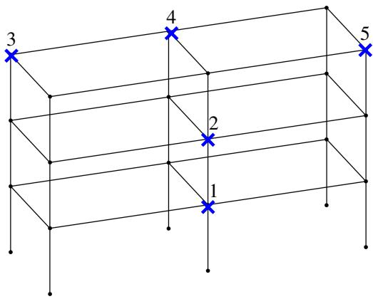  
(a) Illustration of the shear frame.

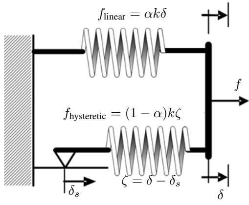  
(b) Bouc-Wen model in the x-DOF.  
Figure 2: Schematic of the shear frame and link mechanism. Blue crosses denote sensor locations.

Thus, the benchmark allows for a structural dynamics simulator, which is parameterized with respect to system properties and the traits of each joint’s behavior. Regarding material properties, steel HEA cross sections are used for all beam elements, and the structure is assembled using two parallel frames along the x-axis, spaced 5 m apart, each spanning two bays of 7.5 m. All stories have a height of 3.2 m. The frame is further subjected to base excitation representing seismic loading. Base accelerograms are applied at an angle of π/4 relative to the longitudinal axis.

Table 1: Modeling assumptions for the shear-frame. The uniform distribution in $( \star , \bullet )$ is $\mathcal { U } ( \star , \bullet )$ . The range of $w _ { e }$ results from the temperature law given in the text.
<table><tr><td>Parameter:</td><td> $w _ { e }$ </td><td>α</td><td> $w _ { a }$ </td><td> $\beta$ </td><td> $\gamma$ </td><td>A, m</td><td> $w _ { k }$ </td></tr><tr><td>Range:</td><td>[0.74, 1.32]</td><td>0.2</td><td>U(0.0, 1.0)</td><td>3.0</td><td>2.0</td><td>1.0</td><td> $\mathcal { U } ( 0 . 1 , 1 . 0 )$ </td></tr></table>

The frameworks presented in section 3 are tasked to identify the underlying system and its response evolution in the presence of environmental and damage-induced variability. The latter is simulated via varying the Young’s modulus E of the structure and the Bouc-Wen parameter k in Equation 74. Specifically, $E = w _ { e } \cdot \dot { E } _ { \mathrm { r e f } }$ with $E _ { \mathrm { r e f } } \stackrel { \cdot } { = } 2 1 0 \mathrm { G P a }$ where $w _ { e } = 0 . 1 5 ^ { 0 . 0 0 5 ( T - T _ { \mathrm { r e f } } ) }$ models a temperature-dependent modulus driven by a seasonal temperature history T with $T _ { \mathrm { r e f } } = 1 5 ^ { \circ } { \mathrm { C } } ,$ , giving $w _ { e } \in [ 0 . 7 4 , 1 . 3 2 ]$ , and $k = \bar { w } _ { k } \cdot k _ { \mathrm { r e f } } , w _ { k } \sim \mathcal { U } ( 0 . 1 0 , 1 . 0 )$ and $k _ { \mathrm { r e f } } = 1 \bar { 0 } ^ { 8 }$ . Regarding the excitation input, synthetic accelerograms are generated as weighted combinations of two reference seismic records: $w _ { a } \cdot ( \mathrm { E l } \mathrm { C e n t r o } ) + ( 1 - w _ { a } )$ ·(Morgan), with the amplitude $w _ { a } \sim \mathcal { U } ( 0 . 0 , 1 . 0 )$ . The modeling assumptions regarding the system’s parametric variability are summarized in Table 1. The monitoring scheme retains five sensors (blue crosses in Figure 2a), each recording acceleration in the longitudinal x and transverse y directions, and in both settings considered below the structural response is observed through these accelerations only. This yields ten monitored channels, indexed once and used by every per-channel plot of this section: sensor by sensor following the numbering of Figure 2a, longitudinal before transverse, so that odd indices are x-direction and even indices y-direction measurements. Channel 4 in the figures below, for instance, is the transverse channel of the second sensor, denoted N2y where the per-channel labels are spelled out. Simulated signals are polluted with additive white noise whose standard deviation is 5% of the root mean square of each channel.

## 4.2 Dynamic state estimation

This setting addresses the dynamic state estimation problem formulated in section 2.4, where the physical system parameters remain fixed and only the evolving dynamic states are explicitly inferred. No physical parameter is appended to the observation or represented in the latent state. The three evaluations of section 2.3 are reported separately, instantiated on this task as follows:

• Posterior reconstruction uses the complete observation window through the PgDMM variational guide or the Neural EKF filter and smoother.

• Open-loop forecasting conditions on only the warm-up prefix in Table 2 and propagates the remaining response under the known excitation without further measurement correction.

• Structural state recovery maps the inferred modal or nodal displacement–velocity state back to physical coordinates and compares it with the hidden simulation state. Neither quantity is measured, and an acceleration record leaves a linear trend in displacement and a constant in velocity undetermined; before scoring, the recovered and the reference signals are therefore detrended alike, removing the mean from velocity and all content below 1 Hz, which includes the linear trend, from displacement (section 4.2.3).

This scoring protocol separates these metrics to avoid labeling a full-sequence smoothed reconstruction as a forecast.   
The complete set of numbers is collected in Table 3.

## 4.2.1 Setup

For each selected simulation run, the measured ground excitation and structural response are downsampled from 1 kHz to 100 Hz by stride sampling, divided into non-overlapping temporal windows, and split chronologically into training, validation, and test portions. Channel-wise response and input normalization statistics are computed exclusively from the training windows and reused for validation and testing. The resulting protocol evaluates later-time response modeling for the same physical system rather than generalization to unseen parameter values. The dynamic state estimation setups are summarized in Table 2. They serve to demonstrate the two frameworks rather than constitute a controlled head-to-head comparison. Beyond the latent parameterization, the two frameworks are supplied with different amounts of prior physics, which should be kept in mind when reading the results that follow. The PgDMM receives the modal operators of the reduced linear model, namely the modal stiffness, damping and base forcing of section 3.5.5, as fixed quantities that it never has to identify, and integrates them with ten symplectic substeps per observation interval. The Neural EKF receives only the known input feed-through to initialize its input gain, identifies its own linear backbone by least squares on the training window, and integrates with a single step per interval. Both asymmetries favor the PgDMM on the free-response behavior examined in section 4.2.2.

Table 2: Configurations of the dynamic state estimation experiments. The split reports the number of non-overlapping train/validation/test windows.
<table><tr><td>Method</td><td>run</td><td>observations</td><td>latent state</td><td>window</td><td>split</td><td>forecast warm-up</td></tr><tr><td>PgDMM</td><td>131</td><td>10 accelerations</td><td>16 modal displacements + 16 velocities</td><td>200 steps (2 s)</td><td>5/1/1</td><td>20 steps (0.2 s)</td></tr><tr><td>Neural EKF</td><td>131</td><td>10 accelerations</td><td>10 nodal displacements + 10 velocities</td><td>200 steps (2 s)</td><td>5/1/1</td><td>20 steps (0.2 s)</td></tr></table>

The two frameworks are trained with the objectives of Equation 71 and Equation 39, and for both the checkpoint with the lowest validation open-loop forecast RMSE is retained, since the forecast is the reported quantity.

## 4.2.2 Reconstruction and open-loop forecasting

Two time histories are reported in Figure 3, which contrasts, on the same held-out window, the posterior reconstruction against the open-loop forecast for the two measurement directions of the second sensor. The corresponding error measures are summarized in Table 3.

Both frameworks reconstruct the measured accelerations closely once every measurement on the monitoring window is assimilated. The corresponding normalized RMSE are 0.020 for the PgDMM and 0.039 for the Neural EKF, both below the standard deviation of the measurement noise (0.042). The accuracy gap widens substantially once measurement feedback is no longer considered and the open-loop forecast mode is exercised: over the 1.8-s suffix the forecast RMSE rises to 0.102 and 0.109 respectively, five and almost three times the corresponding reconstruction error.

Table 3: Dynamic state estimation results on the held-out test window, for the setup of Table 2. Response errors are RMSE of the ten accelerations, normalized by the training statistics of each channel, in which units the measurement noise has a standard deviation of 0.042. The three shorter forecast horizons pool the number of rollout origins given in parentheses. State recovery is the normalized RMSE between the projected latent state and the hidden simulation state, averaged over the ten monitored DOFs; both projections are at raw scale, with nothing fitted to the reference. The first two state-recovery rows score detrended signals, with all displacement content below 1 Hz, which includes the linear trend an acceleration record cannot determine, and the velocity mean removed from the recovered and the reference signal alike; the next two score the projection as it stands. The noise floor is the error of an estimate tha matched the noise-free state exactly.
<table><tr><td></td><td>PgDMM</td><td>Neural EKF</td></tr><tr><td colspan="2">Posterior reconstruction (complete observation window used)</td><td></td></tr><tr><td>Normalized RMSEx</td><td>0.0203</td><td>0.0386</td></tr><tr><td colspan="3">Open-loop forecast (warm-up prefix only, then free-running dynamics)</td></tr><tr><td>Norm.  $\mathrm { R M S E } _ { x }$  over 0.2 s horizon (17 origins)</td><td>0.0675</td><td>0.0488</td></tr><tr><td>Norm.  $\mathrm { R M S E } _ { x }$  over 0.5 s horizon (14 origins)</td><td>0.0694</td><td>0.0539</td></tr><tr><td>Norm. RMSEx over 1.0 s horizon (9 origins)</td><td>0.0789</td><td>0.0657</td></tr><tr><td>Norm.  $\mathrm { R M S E } _ { x }$  over full suffix (1.8 s, 1 origin)</td><td>0.1020</td><td>0.1088</td></tr><tr><td colspan="3">Structural state recovery (neither quantity is observed) displacements, detrended</td></tr><tr><td>velocities, detrended</td><td>0.2515 0.2945</td><td>0.4068 0.3412</td></tr><tr><td>displacements as projected</td><td>0.2719</td><td>20.6</td></tr><tr><td></td><td></td><td></td></tr><tr><td>velocities as projected</td><td>0.2980</td><td>0.6469</td></tr><tr><td>noise floor, displacements / velocities</td><td>0.180 / 0.163</td><td></td></tr><tr><td>selected checkpoint selection metric</td><td>epoch 14,700 </td><td>iteration 5,500 validation forecast RMSE</td></tr></table>

## Key Finding

The substantial discrepancy between posterior reconstruction and open-loop forecasting, observed for both frameworks, highlights an important limitation of evaluating learned dynamical models solely through reconstruction accuracy. By assimilating measurements throughout the observation window, posterior inference can compensate for inaccuracies in the learned transition dynamics, potentially masking deficiencies that become apparent during autonomous prediction. In the present experiments, reconstruction errors underestimate openloop forecasting errors by a factor of approximately three to five. These findings demonstrate that accurate measurement-conditioned reconstruction does not necessarily imply reliable predictive dynamics and underscore the importance of evaluating both capabilities separately through clearly defined assessment protocols.

The dependence of the open-loop forecast error on the prediction horizon is also reported in Table 3 and Figure 4a. The Neural EKF is the more accurate model over the shorter horizons, with 0.049 against 0.068 at 0.2 s and 0.066 against 0.079 at 1.0 s, but its error grows faster with the horizon, and over the full 1.8-s suffix the two frameworks are on par (0.102 for the PgDMM against 0.109). They also err in different directions: the PgDMM forecast is least accurate in the longitudinal direction (0.119 against 0.081 in the transverse one), the Neural EKF in the transverse one (0.124 against 0.091). As Figure 3 shows, both forecasts keep the phase of the response but lose amplitude in the longitudinal direction.

## Key Finding

Embedding prescribed linear operators in the transition model can reduce the accumulation of forecasting errors, but does not necessarily ensure the physical fidelity of the predicted response. In the present experiments, the PgDMM, which retains the modal stiffness and damping operators of the reduced linear model, exhibits a 1.5-fold increase in forecast error between the shortest and longest prediction horizons, compared with a 2.2-fold increase for the Neural EKF, whose acceleration field is learned from data. Nevertheless, linearization of the trained PgDMM transition reveals that the learned residual introduces additional effective damping in the dominant modes, with estimated damping ratios of 1–3% for the three lowest modes, compared with 0.1–0.2% in the underlying reduced model. This discrepancy results in an excessively rapid decay of the predicted response, illustrating that physics-guided representations can constrain forecast-error growth without fully preserving the system’s underlying dynamics.

## 4.2.3 Recovery of the hidden structural state

The interpretability claim made for both frameworks is that their latent coordinates maintain a direct structured relationship with the physical displacements and velocities rather than posing as ad-hoc, arbitrary features. This is tested directly in Figure 5, which projects each latent state back to the physical space and overlays the recovered quantities with the hidden full-order simulation state. With acceleration measured alone, neither displacement nor velocity is observed, so both are substantive checks. Both projections are made at raw scale: the Neural EKF latent carries physical units through its fixed scale ratio and the balanced modal frame of the PgDMM through the reduced model, so nothing is fitted to the reference state.

An acceleration record nevertheless leaves part of the state undetermined, a linear trend in displacement and a constant in velocity (section 3.3.4), and the two frameworks treat these components very differently. The PgDMM latent does not drift, since its fixed stiffness turns any change of the modal displacement into an acceleration (section 3.5.5): detrending changes its errors by less than 10%, from 0.27 to 0.25 for displacement and from 0.30 to 0.29 for velocity. The Neural EKF displacement, by contrast, wanders far from the reference, with a normalized RMSE of 20.6 as projected. Its error is concentrated at low frequency, where displacement produces almost no acceleration, whereas

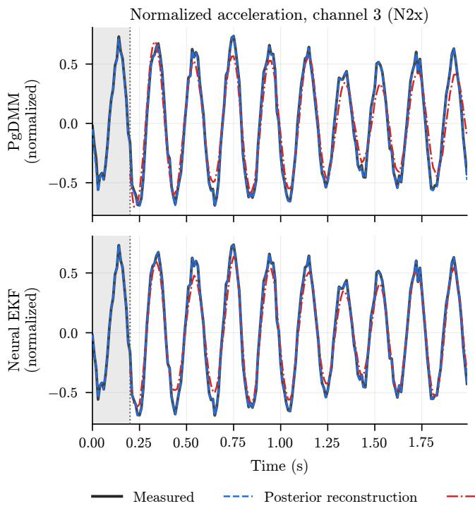

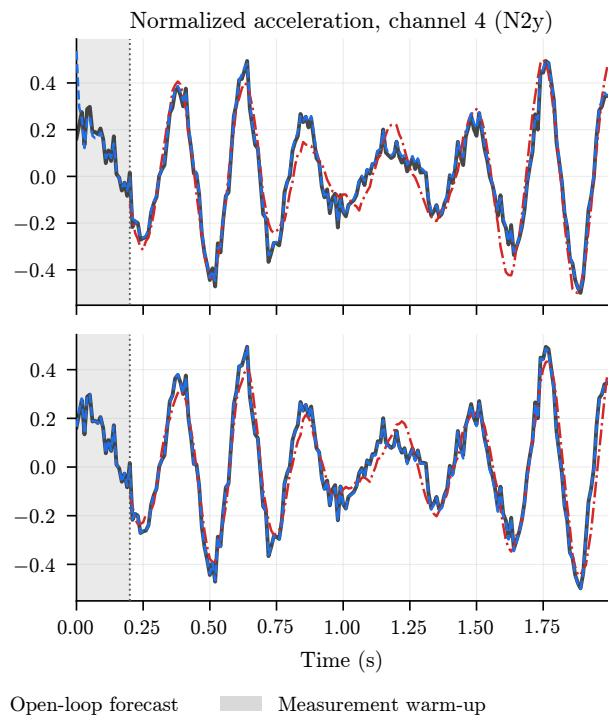  
Figure 3: Posterior reconstruction and open-loop forecasting on the held-out test window, for the dynamic state estimation PgDMM (top) and Neural EKF (bottom). The shaded interval is the 0.2-s measurement warm-up. Left: normalized acceleration at monitored channel 3, which under the numbering of section 4 is the longitudinal (x) channel of the second sensor in Figure 2a; right: channel 4, its transverse (y) channel.

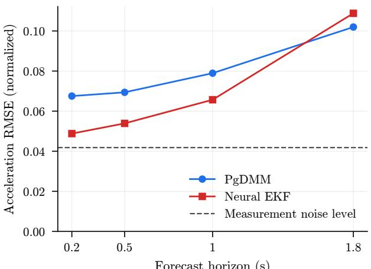  
Forecast horizon (s)  
(a) Open-loop forecast RMSE against the prediction horizon.

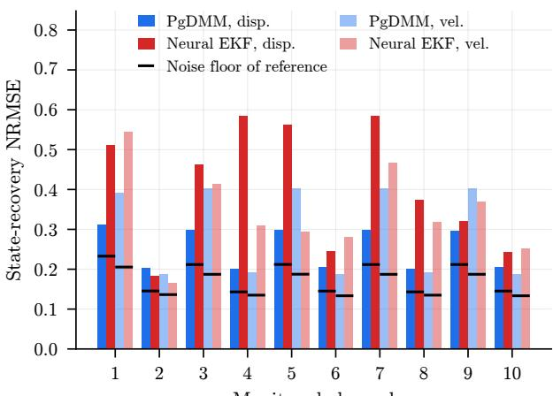  
Monitored channel  
(b) Hidden-state recovery per monitored channel.

Figure 4: Horizon dependence of the open-loop forecast and per-channel hidden-state recovery, both on the heldout test window. The dashed line in Figure 4a is the standard deviation of the measurement noise. State recovery in Figure 4b is scored as in Table 3, with displacement and velocity detrended, and the black segments mark the noise floor of the reference state. The alternating pattern reflects the two measurement directions: the odd- and even-indexed channels form two groups that are mutually correlated within a group and essentially uncorrelated across groups.

the oscillation above 1 Hz is recovered with an error of 0.41. Linearizing the trained transition of the Neural EKF exposes the mechanism, namely slow modes between 0.01 and 1.3 Hz, well below the first natural frequency of 3.9 Hz, along which the displacement can drift with almost no effect on the emitted acceleration.

Displacement recovery is therefore evaluated above 1 Hz in Table 3, Figure 4b and Figure 5, a frequency band containing at least 97% of the reference displacement energy across all channels.

Under this evaluation protocol, both frameworks recover the unobserved structural states, with the PgDMM achieving greater accuracy, as shown in Table 3 and Figure 4b. The PgDMM yields normalized RMSE values of 0.25 for displacement and 0.29 for velocity, with recovered amplitudes deviating by approximately 10% or less from the reference across all channels. The corresponding errors for the Neural EKF are 0.41 and 0.34, respectively. The PgDMM also exhibits more uniform displacement recovery, with channel-wise errors ranging from 0.20 to 0.31, compared with 0.18 to 0.58 for the Neural EKF. For both frameworks, the longitudinal channels exhibit larger relative errors on average, consistent with their smaller displacement amplitudes, which reach only 30–60% of those in the transverse directions over the test window.

These results should be interpreted relative to the reference-state noise floor, corresponding to normalized errors of 0.18 for displacement and 0.16 for velocity, which would be obtained by an estimate that exactly reproduces the noise-free structural state.

## Key Finding

A physically structured latent representation does not, by itself, guarantee accurate recovery of unobserved structural states. Although both frameworks assign a displacement–velocity interpretation to their latent coordinates, the Neural EKF admits spurious low-frequency modes that permit substantial displacement drift with little influence on the measured accelerations. By contrast, the prescribed stiffness operators of the PgDMM constrain these poorly observable components, resulting in more stable and accurate state recovery. This highlights the distinction between imposing physical structure on a latent representation and ensuring that the corresponding states can be reliably inferred from available measurements. Physics-based constraints can therefore contribute not only to interpretability, but also to reducing ambiguities in the recovery of unmeasured dynamic states.

## 4.2.4 Training behavior

The convergence behavior of both frameworks is reported in Figure 6, with the validation and test forecast errors tracked throughout training and the selected checkpoints marked. The PgDMM converges slowly: its validation error declines steadily over the whole budget, to 0.18 at epoch 6,000, 0.13 at epoch 10,000 and 0.10 at the selected epoch 14,700, and is still decreasing at the end of the 15,000 epochs. The Neural EKF reaches 0.081 at iteration 5,500 and then oscillates between 0.089 and 0.102 without further improvement.

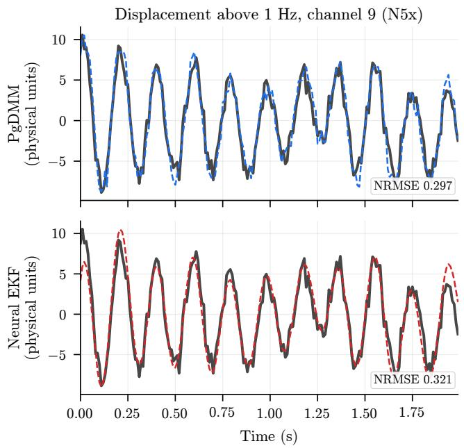

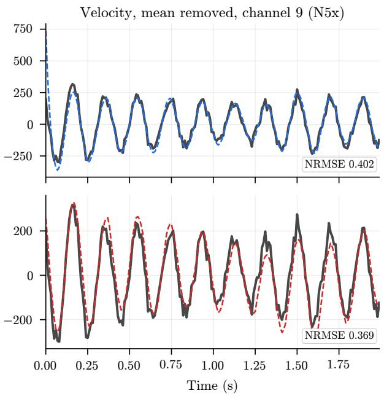  
Figure 5: Recovery of unmeasured structural displacement (left) and velocity (right) from the inferred latent states in the dynamic state estimation setting. Results are shown for channel 9, corresponding to the longitudinal (x) direction of the fifth sensor in Figure 2a, selected because its estimation errors are closest to the average errors of each framework. Neither displacement nor velocity is directly observed by either model. The inferred states are projected at their original scale and processed consistently with the reference signals. For displacement, frequencies below 1 Hz are removed, eliminating the integration-related linear trend that cannot be determined from acceleration measurements and accounting for no more than approximately 3% of the reference displacement energy. For velocity, the mean is removed.

The validation and test curves in Figure 6 also make the caveat of section 4.2.1 concrete. They are computed on one window each and do not move together. The two windows even rank the frameworks differently over the full suffix, the Neural EKF leading on validation (0.081 against 0.103) and the PgDMM on test (0.102 against 0.109), so small differences read off a single window should not be treated as evidence.

## 4.3 Joint dynamic state and parameter estimation

In the joint dynamic state and parameter estimation setting, the models are tasked with simultaneously inferring the evolving structural states and the underlying physical system parameters. All methods introduced in section 3 are considered, following the evaluation protocol of section 4.2, with results reported for posterior reconstruction and parameter recovery.

The open-loop forecasting evaluation of section 4.2 is not repeated here, as it addresses a distinct aspect of model performance. In that setting, a short measurement-conditioned prefix initializes the latent state, after which the response is propagated without further measurement updates. For joint dynamic state and parameter estimation, this procedure remains well defined for the structural response but requires a different interpretation for the physical parameters, which are assumed time-invariant. Once measurement updates cease, the parameter estimates remain fixed at the values inferred from the initial observation window, while prediction errors in the structural response accumulate over the forecast horizon. Consequently, open-loop response forecasting and parameter recovery would assess different inference capabilities under this protocol and are therefore treated separately. Furthermore, the open-loop predictive performance of the PgDMM and Neural EKF is already examined in section 4.2 for a fixed physical system. Recursive filtering schemes that support sequential inference as new measurements become available are reviewed in [83].

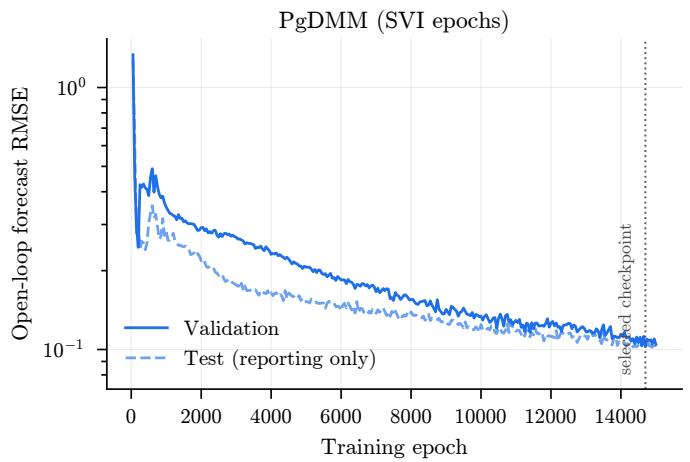

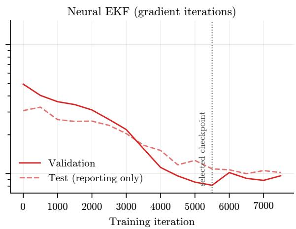  
Figure 6: Training convergence of the two frameworks in the dynamic state estimation setting, assessed through the open-loop forecast RMSE on the validation (solid lines) and test (dashed lines) windows. The test data are used exclusively for independent performance assessment and do not inform model selection. The dotted vertical lines indicate the checkpoints selected according to each framework’s validation criterion.

## 4.3.1 Setup

The parameter distributions summarized in Table 1 are sampled to generate 190 simulation runs for training, validation, and testing. Each run provides ten acceleration channels recorded at the five monitored nodes, comprising longitudinal (x) and transverse $( y )$ measurements per sensor, together with three parameters: the Bouc-Wen stiffness weighting factor $w _ { k }$ , the Young’s modulus weighting factor $w _ { e } .$ , and the input excitation amplitude $w _ { a }$ . Each simulation is performed with a time step of dt = 0.001 s over 15 s, subsequently downsampled by a factor of 10, and divided into 2 s windows. The 190 runs are partitioned by run, so that all windows of a run fall in the same subset, into 133 training, 28 validation and 29 test runs (70%/15%/15%, i.e., 931/196/203 windows of 2 s). The test runs are never seen during training or validation. The resulting configuration is summarized in Table 4.

Table 4: Default configuration for the joint dynamic state and parameter estimation experiments. All frameworks observe the same ten acceleration channels and three system parameters, sampled at 1 kHz and downsampled by a factor of ten. The latent state is reported with its composition given in parentheses.
<table><tr><td>Method</td><td>observations</td><td>latent state</td><td>window</td><td>split (runs)</td></tr><tr><td>DMM PgDMM Neural EKF</td><td></td><td>35 (32 unstructured + 3 parameters) 10 accelerations + 3 parameters 35 (16 reduced displacements + 16 velocities + 3 parameters) 200 steps (2 s)</td><td></td><td>133/28/29</td></tr></table>

## 4.3.2 Response reconstruction

The first evaluation concerns posterior response reconstruction, following the scoring protocol of section 4.2. A qualitative comparison of the three methods is presented in Figure 7, while the corresponding quantitative error measures are summarized in Table 5.

In Figure 7, the three methods are arranged in rows, while the columns correspond to two representative test sequences. The reconstructed trajectories of the PgDMM and Neural EKF closely follow the reference responses, whereas the DMM captures the dominant features but slightly underestimates the largest acceleration peaks.

The time histories are displayed over a longer continuous record for visualization, although training and quantitative evaluation are performed on the 2 s windows specified in Table 4. Consecutive windows from the same simulation run are concatenated to reconstruct the continuous record, and inference is performed over the resulting sequence, with the 1–5 s interval shown in the figure. All three architectures can accommodate variable sequence lengths at inference, and the concatenated observations retain their original temporal ordering without introducing additional information beyond the measured response.

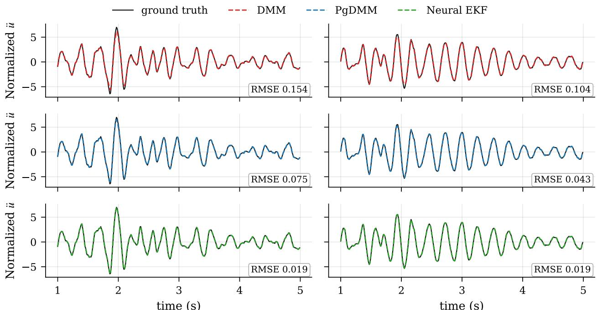  
Figure 7: Time-history response reconstruction on two representative test sequences, showing the reconstructed (dashed) against the true (solid) normalized acceleration u¨ on a monitored channel over the 1–5 s window. The two columns correspond to two different held-out runs, each reporting the transverse y-direction response at the top right monitored node of the second floor in Figure 2a.

Table 5: Joint dynamic state and parameter estimation on the held-out test windows and test records. The response entries refer to the monitored acceleration u¨ in normalized RMSE. Every channel is standardized by its own mean and standard deviation and a value of 0.05 corresponds to 5% error of the (training) standard deviation of that channel.
<table><tr><td></td><td>DMM</td><td>PgDMM</td><td>Neural EKF</td></tr><tr><td colspan="4">Response reconstruction — normalized acceleration ü</td></tr><tr><td>RMSE over the test windows</td><td>0.0504</td><td>0.0336</td><td>0.0167</td></tr><tr><td>MAE over the test windows</td><td>0.0141</td><td>0.0111</td><td>0.0103</td></tr><tr><td>RMSE, median over the entire test runs</td><td>0.0262</td><td>0.0162</td><td>0.0142</td></tr><tr><td colspan="4">Parameter estimation — MAE over the test windows, × 10−3</td></tr><tr><td>Bouc-Wen stiffness weighting  $w _ { k }$ </td><td>1.71</td><td>1.44</td><td>2.17</td></tr><tr><td>Young&#x27;s modulus weighting  $w _ { e }$ </td><td>1.15</td><td>1.00</td><td>0.86</td></tr><tr><td>Excitation amplitude weighting  $w _ { a }$ </td><td>1.91</td><td>1.60</td><td>0.12</td></tr></table>

The distribution of reconstruction errors across the held-out test windows is presented in Figure 8 and summarized in Table 5. The corresponding spatial distribution across monitored channels is shown in Figure 9. Both figures are constructed using the 2 s testing windows.

All three frameworks achieve accurate posterior response reconstruction across the held-out test set, although systematic differences emerge when the full error distributions are considered. As shown in Figure 8, their typical performance is nearly indistinguishable, with per-window median normalized RMSE values between 0.011 and 0.012. More pronounced differences occur in the upper tails: the ninetieth-percentile error is 0.055 for the DMM, 0.038 for the PgDMM, and 0.025 for the Neural EKF. Similarly, the proportions of test windows exceeding a normalized RMSE of 0.05 are 10.8%, 7.9%, and 0.5%, respectively. The aggregate errors reported in Table 5 are therefore sensitive to the more challenging test realizations, revealing differences in performance consistency that are not apparent from the median values alone.

The channel-wise distributions in Figure 9 indicate that these differences are not dominated by a single measurement location. Although the error distributions are broadly comparable across channels, the longitudinal responses of the third and fifth monitored nodes exhibit the largest errors for the DMM and the PgDMM, whereas the largest Neural EKF errors occur at the first monitored node.

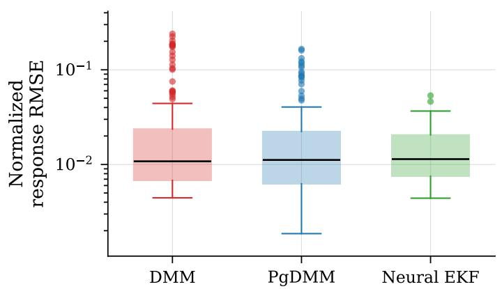

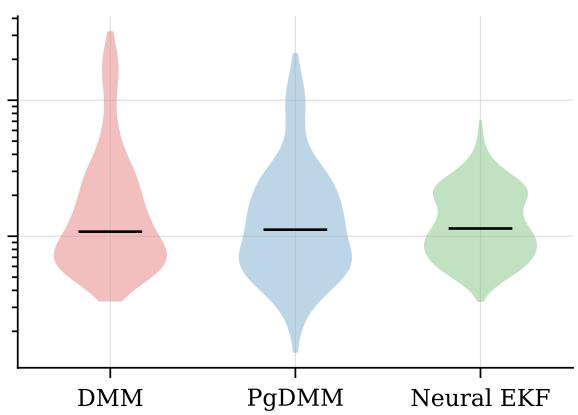  
Figure 8: Distribution of the normalized acceleration response RMSE over the test windows shown as box plots (left) and as kernel density estimates (right). The vertical axis is logarithmic. The horizontal bar marks the median.

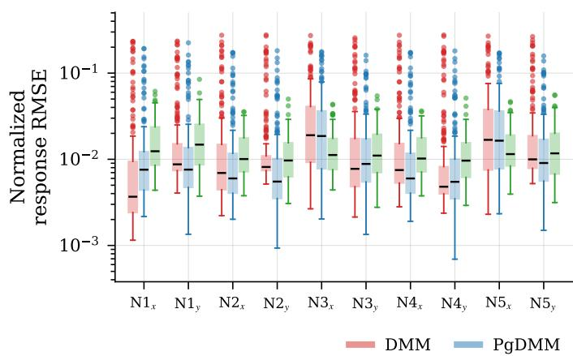

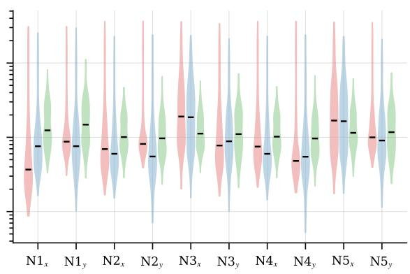  
Figure 9: Distribution of the normalized acceleration response RMSE over the test windows per monitored channel shown as box plots (left) and as kernel density estimates (right). Channels are labeled by monitored node and direction following the numbering in Figure 2a. The vertical axis is logarithmic.

## Key Finding

Comparable median reconstruction errors do not necessarily imply equivalent robustness across operating conditions or parameter realizations. Although all three frameworks achieve similar accuracy on typical test windows, their upper-tail errors differ substantially, with the Neural EKF exhibiting the smallest proportion of high-error predictions. This highlights the importance of evaluating the distribution of reconstruction errors, rather than relying exclusively on aggregate or median metrics, when assessing the reliability of learned statespace representations.

## 4.3.3 Parameter estimation

The second evaluation concerns the recovery of physical system parameters from the observed structural responses. Following the parameterization introduced in Table 1, three quantities are inferred: the Bouc-Wen stiffness weighting factor $w _ { k } .$ , the Young’s modulus weighting factor $w _ { e } ,$ and the excitation amplitude weighting factor $w _ { a } .$ . Each framework produces one estimate of each parameter per test window.

The distributions of absolute estimation errors for the three weighting factors are presented in Figure 10, with the corresponding quantitative metrics summarized in Table 5. The PgDMM estimates the parameters through the dedicated latent parameter block described in section 3.5.6, while the Neural EKF employs the augmented-state construction of section 3.3.5. Both physics-enhanced frameworks generally outperform the DMM, although the differences are relatively small.

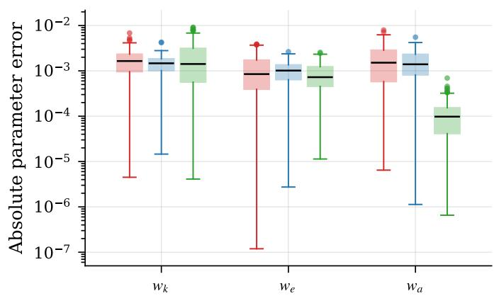

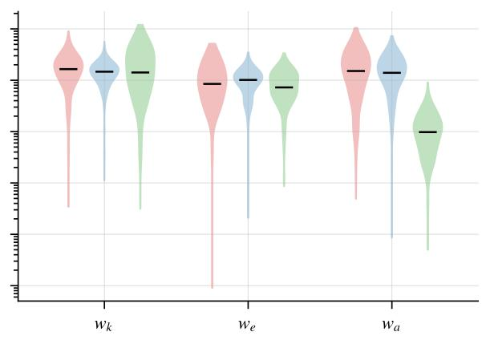  
DMM PgDMM Neural EKF

Figure 10: Distribution of the absolute parameter error over the test windows shown as box plots (left) and as kernel density estimates (right). The vertical axis is logarithmic. The horizontal bar marks the median.  
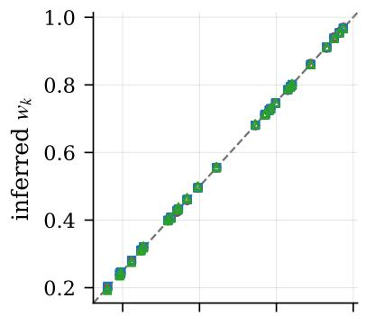

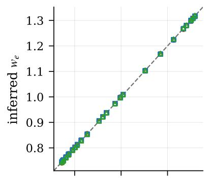

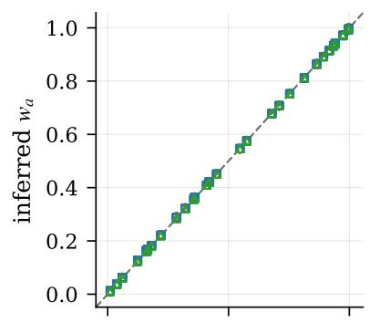

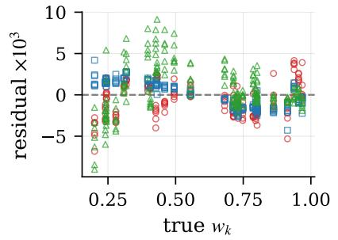

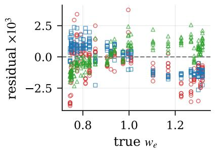

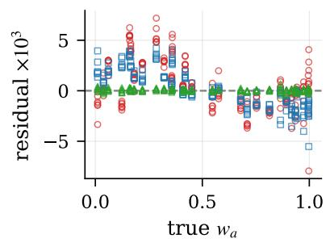  
DMM PgDMM Neural EKF  
Figure 11: Parameter estimation on the held-out testing windows. Top: inferred against true values over all samples, with the dashed line marking exact recovery. Bottom: the corresponding residuals, scaled by 103.

The agreement between inferred and reference parameter values is examined in Figure 11, which presents parity plots and estimation residuals across all testing windows. For all three frameworks, the estimates closely follow the diagonal throughout the sampled range of each parameter, with the MAE remaining below 1.0% of the corresponding range in all nine model–parameter combinations.

Closer examination of the residuals in Figure 11 and the distributions in Figure 10 reveals parameter-dependent differences. The Young’s modulus weighting factor $w _ { e }$ is recovered with comparable accuracy by all three frameworks. For the excitation amplitude weighting factor $w _ { a } .$ , the Neural EKF achieves approximately an order-of-magnitude improvement over the DMM and the PgDMM, the latter exhibiting an error of $\mathrm { { 1 . 6 \times 1 0 ^ { - 3 } } }$ . For the Bouc-Wen stiffness weighting factor $w _ { k } .$ , however, the Neural EKF attains a median error comparable to those of the two Markov models but exhibits the largest mean error and the heaviest upper tail. This distinction between typical and aggregate performance parallels the behavior observed for response reconstruction in section 4.3.2.

The superior estimation accuracy of the Neural EKF for $w _ { a }$ may be attributed to the way excitation amplitude enters the model through the observed input, allowing measurement updates to directly inform its estimate during filtering. By contrast, $w _ { k }$ and $w _ { e }$ influence the response through the latent structural dynamics, making their estimation more dependent on the adequacy of the learned transition model. Across all three parameters, the PgDMM improves upon the DMM, consistent with the overall ordering of reconstruction performance reported in Table 5.

## Key Finding

Parameter recovery accuracy depends not only on the inference architecture but also on how individual parameters influence the measured response. The Neural EKF achieves particularly accurate estimation of the excitation amplitude $w _ { a } .$ , whose influence enters through the observed input, while the estimation of parameters governing the latent structural dynamics exhibits greater variability. The results indicate that parameter-specific error distributions, including their upper tails, are essential for assessing joint state and parameter estimation, since aggregate accuracy alone may conceal differences in the reliability of individual parameter estimates.

## 4.4 Interpretability of the inferred latent space

A central motivation for physics-aware deep Bayesian formulations is their potential to yield latent representations with a direct physical interpretation, in contrast to the unconstrained coordinates typically learned by purely datadriven models. We examine this property through the relative contributions of individual latent coordinates and their spectral correspondence with the underlying structural modes and input excitation. These complementary analyses assess whether the inferred dynamics retain a physically meaningful organization beyond their ability to reconstruct the measured response.

The relative contributions of the latent coordinates are examined in Figure 12 for a representative held-out testing run of the PgDMM in the joint dynamic state and parameter estimation setting. The first three modal displacement coordinates account for approximately 99% of the total latent displacement variance, while the remaining coordinates contribute only marginally. This strong concentration indicates that, for the considered realization, the response is effectively represented by a small subset of the prescribed modal coordinates. It also illustrates how the physicsguided representation facilitates the identification of dominant contributions within the learned latent dynamics. These contributions are evaluated in terms of latent-coordinate variance and should not be interpreted directly as physical modal energies.

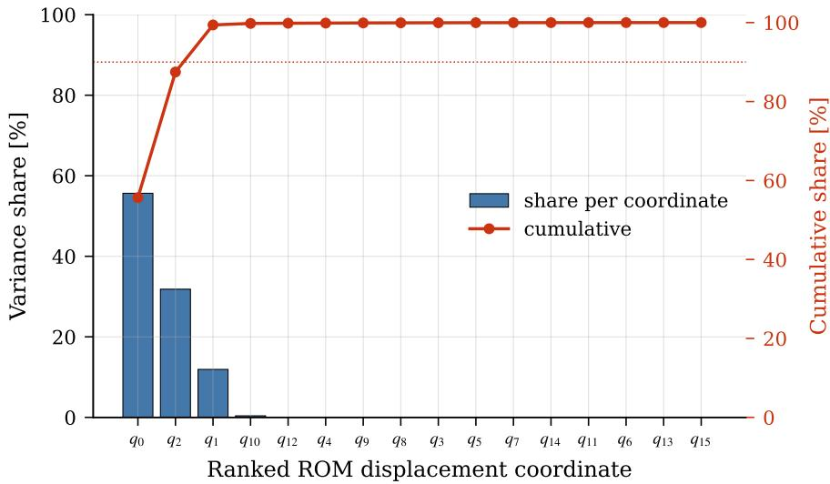  
Figure 12: Latent-coordinate variance ranking for the joint dynamic state and parameter estimation setting PgDMM of section 4.3, on a representative held-out testing run. The bars show the contribution of each of the sixteen latent displacement coordinates of the ROM state to the total latent displacement variance. The cumulative contribution is also shown, with the 90% level indicated.

The correspondence between the latent dynamics and the modal characteristics of the underlying structure is further examined in Figure 13. In structural dynamics, the response is often governed by a limited number of resonant modes, whose participation depends on both the excitation spectrum and the system’s modal properties. A latent representation aligned with the physical modal decomposition therefore allows the inferred dynamics to be interpreted in terms of the structural modes contributing to the response.

For the dynamic state estimation PgDMM, the first three modal coordinates correspond to the three lowest modes of the reduced model, with natural frequencies of 3.9, 5.2, and 6.3 Hz. Their inferred trajectories exhibit dominant oscillations at these frequencies and jointly account for 58% of the variance of the modal displacement coordinates. Eight additional coordinates exhibit dominant frequencies around 11.5 Hz, close to the 11.1–11.3 Hz modal cluster of the reduced model, and contribute a further 27%. The remaining five coordinates predominantly follow the lowerfrequency excitation content, around 1 Hz, consistent with the fact that 84% of the excitation power lies below 2 Hz. These variance contributions refer to the balanced coordinates introduced in section 3.5.5, whose scaling depends on the controllability Gramian, and must therefore not be interpreted as physical modal energies.

Excitation frequency content and latent modal variance  
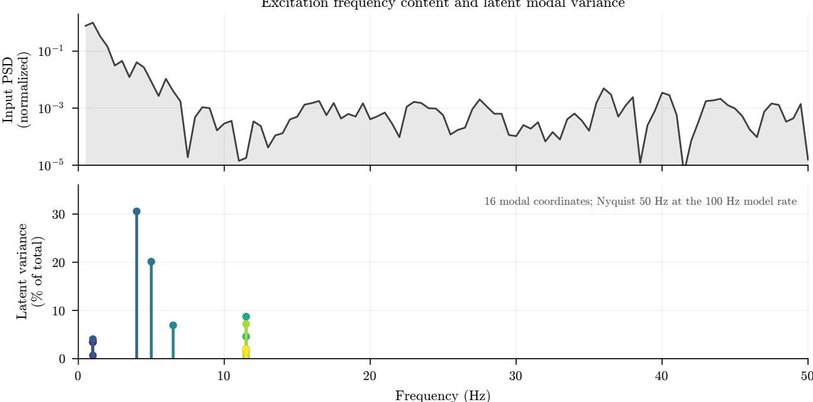  
Figure 13: Connection between the dominant latent modes and the frequency content of the input excitation, shown for the dynamic state estimation PgDMM of section 3.5.5 on the held-out window of run 131. Top: power spectral density of the excitation, normalized to its peak. Bottom: variance of each of the modal displacement coordinates, as a share of their total variance, placed at the dominant frequency of its own latent trajectory and colored by increasing frequency.

A complementary spectral analysis, extending to all three architectures in the joint dynamic state and parameter estimation setting of section 4.3, is presented in Figure 14. The periodogram of each latent coordinate is normalized to its own peak, allowing the spectral organization of the representations to be compared independently of their relative amplitudes. Narrow-band concentration indicates that individual coordinates predominantly represent specific oscillatory components, whereas broader spectra indicate that several frequency contributions are mixed within the same coordinate.

For the PgDMM, the latent coordinates exhibit predominantly narrow-band spectra concentrated around the lower resonances of the underlying linear ROM, with little spectral content at higher frequencies in the displacement block. This organization is consistent with the prescribed modal structure and displacement–velocity partition inherited from the reduced model.

The DMM and Neural EKF also capture the principal frequency bands present in the measured response, but distribute these components across multiple latent coordinates without an evident correspondence between coordinate index and physical modal order. The Neural EKF additionally exhibits substantial low-frequency content across several coordinates. In this setting its latent coordinates are unstructured and therefore not constrained to follow the prescribed modal basis of the PgDMM. Consequently, the physics-guided formulation exhibits a more clearly organized modal representation, whereas the learned latent spaces exhibit greater spectral mixing, despite achieving comparable response-reconstruction accuracy on the considered realization.

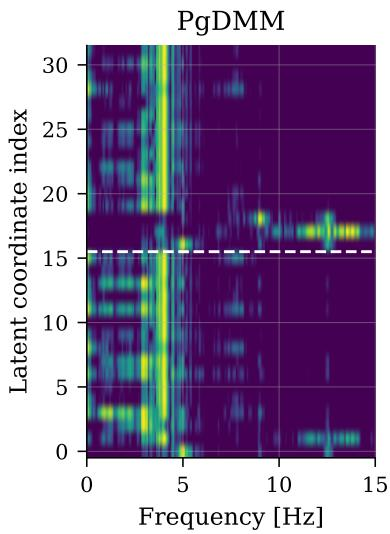

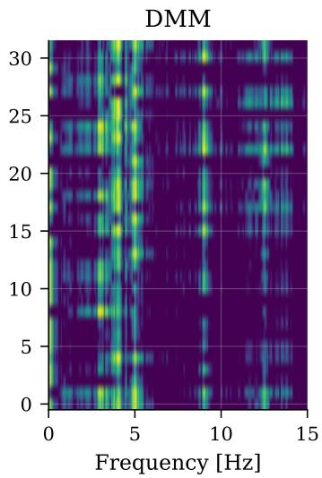

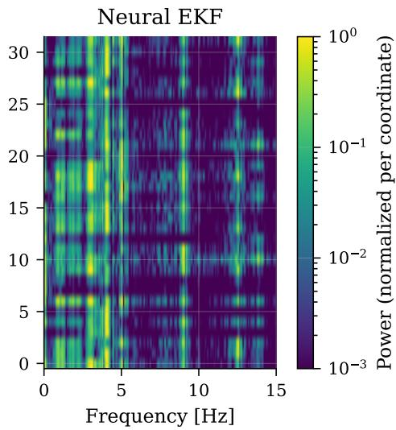  
Figure 14: Frequency content of the inferred latent space for the joint dynamic state and parameter estimation setting PgDMM, DMM and Neural EKF of section 4.3, on a representative held-out testing run. Each row shows the periodogram of a latent coordinate, normalized to its own peak and displayed on a logarithmic color scale. The horizontal axis is restricted to 15 Hz, encompassing the principal excited frequency band. For the PgDMM, the dashed line separates the displacement (bottom) and velocity (top) coordinates of its ROM state. The corresponding coordinates of the other architectures are not organized according to the same prescribed modal partition.

## Key Finding

Comparable response-reconstruction accuracy does not imply equivalent physical interpretability of the inferred latent states. The PgDMM retains a prescribed modal organization, allowing individual coordinates to be related to structural modes and their participation under different excitations. By contrast, the more flexible learned representations distribute the same spectral content across multiple coordinates, making their physical interpretation less direct. This distinction highlights the role of physics-based inductive biases in promoting structured latent representations, beyond their contribution to predictive accuracy. Spectral alignment provides supporting evidence of such structure, although it does not by itself establish unique identification of the underlying physical modes.

## 5 Discussion

This tutorial has framed deep Bayesian filtering around three ingredients, namely a transition model, an observation model and a mechanism for posterior inference, each of which may be prescribed from physical knowledge, learned from data, or composed of both. The DMM, the PgDMM and the Neural EKF occupy different points of this design space, and the demonstrations of section 4 illustrate how the choice made for each ingredient shapes what a trained model can deliver. This section distills these observations into insights for the design of deep Bayesian filters, collects practical guidelines for their training and deployment, and outlines open directions for research.

## 5.1 Key insights

Physical structure constrains the latent representation. Learnable state-space models can reproduce the same measured response with many different latent representations; even in the linear case, input–output data determine a state-space model only up to a similarity transformation of its state. Prescribed structure narrows this freedom. Kinematic identities between displacement, velocity and acceleration fix the roles and units of the latent coordinates, and operators taken from a physics-based model fix how these coordinates interact, so that the latent state can be read in physical terms. Structure also transfers the errors of the prescribed model, and the learned components that complement it can alter the prescribed dynamics, as the residual of the PgDMM does when it adds damping to the dominant modes (section 4.2.2). Physical knowledge should therefore be imposed where its validity is sufficiently established, while learned components should address unresolved dynamics or model discrepancies. Importantly, their influence on the prescribed physical behavior should be verified rather than assumed negligible.

The inference mechanism determines how a model can be deployed. Amortized inference networks, as used in the DMM and the PgDMM [111,112,115], require no linearization of the transition and observation models and scale readily to high-dimensional latent states, but they add a second learned model whose approximation error enters every posterior and which must itself generalize to unseen data. When the inference network processes the sequence in both temporal directions, it returns smoothed rather than filtered estimates and cannot be used causally without modification. Algorithmic inference, as in the Neural EKF, instead derives the posterior from the learned model itself through the filtering recursions [106,118]. It requires no separate inference-network parameters, is causal by construction, and yields innovation statistics that serve both likelihood evaluation and monitoring, at the price of the Gaussian and local-linearization assumptions of the underlying filter and of covariance computations whose cost grows cubically with the latent dimension. Differentiable particle filters extend algorithmic inference beyond the Gaussian assumption [107,119], and filters with learned gains retain the recursive structure while learning part of the update [108], so the inference mechanism, too, can be partly prescribed and partly learned. The appropriate inference mechanism therefore depends on the intended application, the dimensionality of the latent state, and the required temporal processing. Recursive filtering provides a natural framework for causal online estimation, although covariance propagation can become expensive in high dimensions. Amortized inference offers greater flexibility in posterior approximation and may be advantageous for offline analysis or settings where inference costs can be reduced through learned mappings, provided that the inference architecture is compatible with the intended deployment mode.

The training objective determines what the model is good at. Variational objectives such as the ELBO jointly constrain observation fidelity and latent transition dynamics, but do not necessarily enforce accurate autonomous predictions over extended horizons. Posterior inference conditioned on measurements can compensate for local transition-model errors, allowing accurate reconstruction even when open-loop forecasting remains unreliable. Additional predictive objectives, such as replay overshooting [128] and the open-loop prediction terms of section 3.3.4 and section 3.5.5, explicitly penalize accumulated prediction errors and can improve long-horizon fidelity. Their effectiveness nevertheless depends on the prediction horizon considered during training, which should be representative of the intended deployment setting. Parameter identification introduces a related challenge: the learning objective must also provide sufficient information to recover the physical quantities of interest. Supervising a latent parameter block, as in the joint dynamic state and parameter estimation extensions of section 3.3.5 and section 3.5.6, requires labeled training configurations, which are readily available in simulation but may be difficult to obtain experimentally. Alternatively, likelihood-based estimation using the marginal likelihood evaluated through a filtering recursion can support parameter inference without direct parameter labels [120], provided that the parameters are identifiable from the available observations.

Interpretability requires structure, observability and verification. A latent state becomes interpretable when its coordinates are tied to physical quantities by construction, such as the modal coordinates of a ROM or the displacement–velocity partition of a mechanical state. The physics-guided latent spaces of section 4.4 are organized in this way, with their dominant coordinates oscillating at the frequencies of the lowest structural modes, whereas unstructured latent states spread the same frequency content over many coordinates. Construction alone does not suffice, however, since a coordinate is only as meaningful as the measurements allow it to be. Where the data leave directions of the latent space undetermined, flexible components can place the estimate anywhere along them without degrading the reconstruction. The double integration of acceleration records, which fixes displacement only up to an offset and a linear trend, is the structural example treated here, and learned transition models can additionally acquire spurious slow modes along which the latent state drifts with little effect on the observations (section 4.2.3). Such directions should be identified, for instance through an observability analysis or an eigenanalysis of the linearized learned transition, and then be fixed by prior structure or additional sensing, or removed explicitly before latent states are compared with physical quantities. That comparison, against states that were never measured, is what ultimately verifies an interpretation. The same reasoning applies to physical parameters, whose estimates are meaningful only where the response is sensitive to them and no learned component can reproduce their effect.

## 5.2 Practical guidelines for training and deployment

• Establish reference models. A purely data-driven model such as the DMM and the prescribed physics used on its own show what the learned and the prescribed components of a hybrid model contribute, and reveal when added structure does not pay off.

• Match the time discretization to the prescribed physics. Operators derived from finite-element or reducedorder models often contain modes too stiff for an explicit update at the sampling interval, which calls for substepping or an exact discretization. Learned discrete-time maps absorb such effects but lose the direct link to continuous-time physics; continuous-time formulations [116] offer an alternative.

• Keep scales consistent. Normalizations applied to inputs, outputs and latent variables must be propagated to the prescribed operators, so that physics-based and learned components act on commensurate quantities.

• Train and selectfor the intended use. Objectives should contain terms without measurement feedback whenever the model is to forecast, and checkpoints and hyperparameters should be chosen on the quantity that will be reported rather than on the training likelihood.

• Inspect the learned dynamics. Linearization of the trained transition model, followed by comparison of its modal frequencies and damping characteristics with physical expectations, can reveal spurious, unstable, or excessively damped modes that may remain concealed by measurement-conditioned reconstruction.

• Evaluate separately, on several windows, and against the noise. Reconstruction, forecasting, state recovery, and parameter recovery assess distinct model capabilities. In the demonstrations, open-loop forecast errors exceed reconstruction errors by a factor of three to five (Table 3), while model rankings can vary across validation windows (section 4.2.4). Performance should therefore be assessed across multiple realizations and interpreted relative to the measurement-noise level, while distinguishing measurement-conditioned reconstruction from independent prediction.

• Assess parameter identifiability. Before interpreting inferred physical parameters, examine their influence on the measured response and potential dependencies among their effects. Sensitivity analysis, posterior correlations, and recovery tests across parameter configurations can help distinguish genuinely identifiable quantities from parameters whose effects may be absorbed by flexible learned components.

• Check uncertainty before using it. Learned noise covariances may absorb model discrepancy or become underestimated for well-fitted channels and should be compared with known sensor characteristics. Predictive interval coverage and innovation statistics should be evaluated to assess uncertainty calibration, while correlated measurement errors may require non-diagonal covariance representations.

• Designfor online operationfrom the outset. Deployment with streaming measurements requires causal inference, favoring recursive filters or forward-only inference networks, together with computational requirements compatible with the measurement sampling rate.

## 5.3 Outlook

Calibrated uncertainty. Deep Bayesian filtering provides a probabilistic representation of latent-state inference and prediction, but the availability of posterior distributions does not in itself guarantee calibrated uncertainty estimates. Calibration has not been evaluated in the present tutorial and remains an essential requirement for applications in which uncertainty informs monitoring or operational decisions. These distributions moreover represent only the uncertainty captured by the learned noise models, not the epistemic uncertainty of the learned networks. Probabilistic treatments of network weights [113,127], uncertainty quantification for learned filter components [109,110], and a consistent classification of the uncertainty sources in monitoring applications [3] are needed before such estimates can support decisions.

Scalability. The formulations treated here keep the latent dimension small, through a reduced-order representation or by restricting the state to the monitored degrees of freedom. Larger structures and denser sensor networks call for parametric and local ROMs [26,130,135] embedded within the filter, and for inference schemes whose cost does not grow cubically with the latent dimension, such as ensemble, low-rank or amortized approximations. Sharing learned components across populations of similar structures [62] is a related route to data efficiency.

Changing systems and unknown inputs. Structures in operation change through damage, deterioration, and environmental and operational variability [2,5,43], whereas the formulations treated here assume a system that is fixed, or fixed within each observation window, and an input that is measured. Learned components that adapt online, for instance through sequentially updated local models [34] or hypernetwork-based conditioning on the operating regime [13], and the joint estimation of unknown inputs together with states and parameters, established for classical filters [88,90,93,100], would bring deep Bayesian filters closer to output-only monitoring conditions.

Balancing physics and learning. How to allocate explanatory power between prescribed and learned components remains largely open. Priors or penalties on the magnitude of learned corrections, structural constraints such as dissipativity, and parameter-dependent operators through which physical parameters act on the dynamics they govern, rather than entering as additional inputs or latent states, are candidate mechanisms for keeping physically meaningful quantities identifiable. Combining filtering with sparse or Bayesian model discovery [44,87] offers a route toward learned components that are themselves interpretable.

Validation beyond simulation. The demonstrations in this tutorial are based on simulated data from a single benchmark structure. Although the joint dynamic state and parameter estimation setting considers multiple parameter configurations, the dynamic state estimation experiments rely on a fixed physical system and a single training realization per framework. The reported results therefore illustrate methodological capabilities and limitations rather than establish a general ranking of the considered approaches. Field measurements, shared benchmarks, and reporting that separates reconstruction, forecasting, state recovery and parameter recovery are needed to establish deep Bayesian filters as dependable tools for monitoring, digital twinning and decision support [19,30].

## CRediT authorship contribution statement

Wei Liu: Conceptualization, Methodology, Software, Formal analysis, Investigation, Visualization, Writing – original draft, Writing – review & editing. Konstantinos Vlachas: Conceptualization, Methodology, Software, Data curation, Investigation, Visualization, Writing – original draft, Writing – review & editing. Eleni Chatzi: Conceptualization, Methodology, Formal analysis, Investigation, Supervision, Funding acquisition, Writing – review & editing.

## Declaration of competing interest

The authors declare that they have no known competing financial interests or personal relationships that could have appeared to influence the work reported in this paper.

## Data availability

The template implementations of the PgDMM and the Neural EKF are available at https://github.com/ liouvill/PgDMM and https://github.com/liouvill/NeuralEKF.

## Acknowledgements

The authors KV, EC gratefully acknowledge the funding from the European Union under the Horizon Europe funding guarantee, for the project ‘TURING - Trustworthy Unified Robust Intelligent Generative Systems’ (grant agreement No: 101215032). Views and opinions expressed are however those of the author(s) only and do not necessarily reflect those of the European Union or HADEA. The authors KV, WL, EC further acknowledge the support provided by the High Performance Computing group at ETH Zurich operating the Euler cluster that was used for all simulations.

## References

[1] Giuseppe Quaranta, Walter Lacarbonara, and Sami F Masri. A review on computational intelligence for identification of nonlinear dynamical systems. Nonlinear Dynamics, 99(2):1709–1761, 2020.

[2] Ana Fernandez-Navamuel, David Pardo, Filipe Magalhaes, Diego Zamora-Sanchez, Angel J Omella, and David Garcia-Sanchez. Bridge damage identification under varying environmental and operational conditions combining deep learning and numerical simulations. Mechanical Systems and Signal Processing, 200:110471, 2023.

[3] Antonios Kamariotis, Konstantinos Vlachas, Vasileios Ntertimanis, Ioannis Koune, Alice Cicirello, and Eleni Chatzi. On the consistent classification and treatment of uncertainties in structural health monitoring applications. ASCE-ASME Journal of Risk and Uncertainty in Engineering Systems, Part B: Mechanical Engineering, 11(1):011108, 2025.

[4] Innes Murdo Black, Mark Richmond, and Athanasios Kolios. Condition monitoring systems: a systematic literature review on machine-learning methods improving offshore-wind turbine operational management. International Journal ofSustainable Energy, 40(10):923–946, 2021.

[5] Edwin Reynders, Gersom Wursten, and Guido De Roeck. Output-only structural health monitoring in changing environmental conditions by means of nonlinear system identification. Structural Health Monitoring, 13(1):82– 93, 2014.

[6] Alessandro Chiuso and Gianluigi Pillonetto. System identification: A machine learning perspective. Annual Review ofControl, Robotics, and Autonomous Systems, 2(1):281–304, 2019.

[7] Qianyi Chen, Jiannong Cao, and Songye Zhu. Data-driven monitoring and predictive maintenance for engineering structures: Technologies, implementation challenges, and future directions. IEEE Internet of Things Journal, 10(16):14527–14551, 2023.

[8] Dimitri Goutaudier, Didier Gendre, Veronique Kehr-Candille, and Roger Ohayon. Impulse identification tech-´ nique by estimating specific modal ponderations from vibration measurements. Journal ofSound and Vibration, 474:115263, 2020.

[9] Sotirios A Argyroudis, Stergios Aristoteles Mitoulis, Eleni Chatzi, Jack W Baker, Ioannis Brilakis, Konstantinos Gkoumas, Michalis Vousdoukas, William Hynes, Savina Carluccio, Oceane Keou, et al. Digital technologies can enhance climate resilience of critical infrastructure. Climate Risk Management, 35:100387, 2022.

[10] Ilias A Iliopoulos and John S Sakellariou. Remaining useful life estimation of hollow worn railway vehicle wheels via on-board random vibration-based wheel tread depth estimation. Sensors, 24(2):375, 2024.

[11] Feixin Chen, Zhenghao Ding, Zhongrong Lu, and Xiangkun Zeng. Parameters identification for chaotic systems based on a modified Jaya algorithm. Nonlinear Dynamics, 94(4):2307–2326, 2018.

[12] Jean-Philippe Noel and Ga¨ etan Kerschen. Nonlinear system identification in structural dynamics: 10 more¨ years of progress. Mechanical Systems and Signal Processing, 83:2–35, 2017.

[13] Pantelis R Vlachas, Konstantinos Vlachas, and Eleni Chatzi. Beyond static models: Hypernetworks for adaptive and generalizable forecasting in complex parametric dynamical systems. Mechanical Systems and Signal Processing, 258:114635, 2026.

[14] Ana Fernandez-Navamuel, Yerai Pena-Sanchez, and Vincenzo Nava. Fault detection and identification for˜ control systems in floating offshore wind farms: A supervised deep learning methodology. Ocean Engineering, 310:118678, 2024.

[15] Joanna Błach. Financial innovations and their role in the modern financial system-identification and systemati zation of the problem. e-Finanse: Financial Internet Quarterly, 7(3):13–26, 2011.

[16] Szymon Gres, Michael D ´ ohler, Palle Andersen, and Laurent Mevel. Kalman filter-based subspace identifi-¨ cation for operational modal analysis under unmeasured periodic excitation. Mechanical Systems and Signal Processing, 146:106996, 2021.

[17] Robin Volkmar, Keith Soal, Yves Govers, and Marc Boswald. Experimental and operational modal analysis:¨ Automated system identification for safety-critical applications. Mechanical Systems and Signal Processing, 183:109658, 2023.

[18] Siu-Kui Au. Operational Modal Analysis. Springer Singapore, 2017.

[19] Adam Thelen, Xiaoge Zhang, Olga Fink, Yan Lu, Sayan Ghosh, Byeng D Youn, Michael D Todd, Sankaran Mahadevan, Chao Hu, and Zhen Hu. A comprehensive review of digital twin—part 1: modeling and twinning enabling technologies. Structural and Multidisciplinary Optimization, 65(12):354, 2022.

[20] Peter E Caines. Linear stochastic systems. SIAM, 2018.

[21] Serena Cattari, Bruno Calderoni, Ivo Calio, Guido Camata, Stefano de Miranda, Guido Magenes, Gabriele\` Milani, and Anna Saetta. Nonlinear modeling of the seismic response of masonry structures: critical review and open issues towards engineering practice. Bulletin ofearthquake engineering, 20(4):1939–1997, 2022.

[22] Beatriz Moya, Huangbin Liang, Francisco Chinesta, and Eleni Chatzi. Post-earthquake rapid assessment of interconnected electrical equipment based on hybrid modelling. Materials Research Proceedings, 50:52–60, 2025.

[23] Zhiyuan Cong, Zhefeng Yu, and Dongjie Jiang. On the hysteretic response of mechanical strain induced by thermal stress in fastened metal-composite hybrid structures during a temperature cycle. Aerospace Systems, pages 1–14, 2024.

[24] Longfei Tan, Chengyu Wang, Yang Liu, Wei Sun, and Wei Zhang. Study on hysteresis and threaded fitting behavior of bolted joint with non-parallel bearing surface. Mechanical Systems and Signal Processing, 168:108655, 2022.

[25] Siyuan Yang, Wei Liu, and Zhilu Lai. A unified framework for equation discovery and dynamic prediction of hysteretic systems. Mechanical Systems and Signal Processing, 258:114725, 2026.

[26] Konstantinos Vlachas, Thomas Simpson, Anthony Garland, D Dane Quinn, Charbel Farhat, and Eleni Chatzi. Reduced Order Modeling conditioned on monitored features for response and error bounds estimation in engineered systems. Mechanical Systems and Signal Processing, 226:112261, 2025.

[27] Philip Cross and Xiandong Ma. Nonlinear system identification for model-based condition monitoring of wind turbines. Renewable Energy, 71:166–175, 2014.

[28] Ana Fernandez-Navamuel, Nicolas Gorostidi, David Pardo, Vincenzo Nava, and Eleni Chatzi. Gaussian mixture autoencoder for uncertainty-aware damage identification in a floating offshore wind turbine. Wind Energy Science, 10(5):857–885, 2025.

[29] Bridget Moynihan, Azin Mehrjoo, Babak Moaveni, Ross McAdam, Finn Rudinger, and Eric Hines. System¨ identification and finite element model updating of a 6 MW offshore wind turbine using vibrational response measurements. Renewable Energy, 219:119430, 2023.

[30] Huangbin Liang, Beatriz Moya, Eugene Seah, Ashley Ng Kwok Weng, Dominique Baillargeat, Jonas Joerin, Xiaozheng Zhang, Francisco Chinesta, and Eleni Chatzi. Harnessing hybrid digital twinning for decisionsupport in smart infrastructures. Data-Centric Engineering, 6:e43, 2025.

[31] Stephen A Billings. Nonlinear system identification: NARMAX methods in the time, frequency, and spatiotemporal domains. John Wiley & Sons, 2013.

[32] Keith Worden. Nonlinearity in structural dynamics: detection, identification and modelling. CRC Press, 2019.

[33] Sibo Cheng, Cesar Quilodr´ an-Casas, Said Ouala, Alban Farchi, Che Liu, Pierre Tandeo, Ronan Fablet, Didier´ Lucor, Bertrand Iooss, Julien Brajard, et al. Machine learning with data assimilation and uncertainty quantification for dynamical systems: a review. IEEE/CAA Journal ofAutomatica Sinica, 10(6):1361–1387, 2023.

[34] Luis David Avendano-Valencia. Sequential Bayesian updating of local LPV models for structural damage ˜ detection under changing environment. Mechanical Systems and Signal Processing, 234:112775, 2025.

[35] Jie Liu, Bing Li, Huihui Miao, Xiang Zhang, and Meng Li. A modified time domain subspace method for nonlinear identification based on nonlinear separation strategy. Nonlinear Dynamics, 94(4):2491–2509, 2018.

[36] Jean-Philippe Noel, Stefano Marchesiello, and Ga¨ etan Kerschen. Subspace-based identification of a nonlinear¨ spacecraft in the time and frequency domains. Mechanical Systems and Signal Processing, 43(1-2):217–236, 2014.

[37] Yi Yao, Zhi-Sai Ma, Qian Ding, Jingyong Han, Xin Sui, and Bo Liu. Stiffness identification of beam structures with elastic foundations through the global mode method and time-domain nonlinear subspace method. Nonlinear Dynamics, 113(5):4447–4464, 2025.

[38] Q Chen, K Worden, P Peng, and AYT Leung. Genetic algorithm with an improved fitness function for (N) ARX modelling. Mechanical Systems and Signal Processing, 21(2):994–1007, 2007.

[39] Aoxiang Dong, Andrew Starr, and Yifan Zhao. Neural network-based parametric system identification: A review. International Journal ofSystems Science, 54(13):2676–2688, 2023.

[40] Michael Feldman. Hilbert transform applications in mechanical vibration. John Wiley & Sons, 2011.

[41] Ludek Heller, Emmanuel Foltete, and Jean Piranda. Experimental identification of nonlinear dynamic properties of built-up structures. Journal ofSound and Vibration, 327(1-2):183–196, 2009.

[42] Piotr Lichota. Wavelet transform-based aircraft system identification. Journal of Guidance, Control, and Dynamics, 46(2):350–361, 2023.

[43] Luis David Avendano-Valencia, Eleni N Chatzi, Ki Young Koo, and James MW Brownjohn. Gaussian process˜ time-series models for structures under operational variability. Frontiers in Built Environment, 3:69, 2017.

[44] Ramon Fuentes, Rajdip Nayek, Paul Gardner, Nikolaos Dervilis, Timothy Rogers, Keith Worden, and Elizabeth J Cross. Equation discovery for nonlinear dynamical systems: A Bayesian viewpoint. Mechanical Systems and Signal Processing, 154:107528, 2021.

[45] Wilmer Ariza Ramirez, Zhi Quan Leong, Hung Nguyen, and Shantha Gamini Jayasinghe. Non-parametric dynamic system identification of ships using multi-output Gaussian Processes. Ocean Engineering, 166:26–36, 2018.

[46] Nour Makke and Sanjay Chawla. Interpretable scientific discovery with symbolic regression: a review. Artificial Intelligence Review, 57(1):2, 2024.

[47] Pierre-Alexandre Kamienny, Stephane d’Ascoli, Guillaume Lample, and Franc¸ois Charton. End-to-end sym-´ bolic regression with transformers. Advances in Neural Information Processing Systems, 35:10269–10281, 2022.

[48] Dimitrios Angelis, Filippos Sofos, and Theodoros E Karakasidis. Artificial Intelligence in Physical Sciences: Symbolic Regression Trends and Perspectives. Archives of Computational Methods in Engineering, 30(6):3845–3865, 2023.

[49] K Worden, RJ Barthorpe, EJ Cross, N Dervilis, GR Holmes, G Manson, and TJ Rogers. On evolutionary system identification with applications to nonlinear benchmarks. Mechanical Systems and Signal Processing, 112:194–232, 2018.

[50] Karin Yu, Eleni Chatzi, and Georgios Kissas. Grammar-based ordinary differential equation discovery. Mechanical Systems and Signal Processing, 240:113395, 2025.

[51] Steven L Brunton, Joshua L Proctor, and J Nathan Kutz. Discovering governing equations from data by sparse identification of nonlinear dynamical systems. Proceedings ofthe national academy ofsciences, 113(15):3932– 3937, 2016.

[52] Gustavo T Naozuka, Heber L Rocha, Renato S Silva, and Regina C Almeida. SINDy-SA framework: enhancing nonlinear system identification with sensitivity analysis. Nonlinear Dynamics, 110(3):2589–2609, 2022.

[53] Urban Fasel, J Nathan Kutz, Bingni W Brunton, and Steven L Brunton. Ensemble-SINDy: Robust sparse model discovery in the low-data, high-noise limit, with active learning and control. Proceedings of the Royal Society A, 478(2260):20210904, 2022.

[54] Eurika Kaiser, J Nathan Kutz, and Steven L Brunton. Sparse identification of nonlinear dynamics for model predictive control in the low-data limit. Proceedings ofthe Royal Society A, 474(2219):20180335, 2018.

[55] Ying-Cheng Lai. Finding nonlinear system equations and complex network structures from data: A sparse optimization approach. Chaos: An Interdisciplinary Journal ofNonlinear Science, 31(8), 2021.

[56] Siva Viknesh, Younes Tatari, Chase Christenson, and Amirhossein Arzani. ADAM-SINDy: An efficient optimization framework for parameterized nonlinear dynamical system identification. Physical review research, 8(1):013040, 2026.

[57] Doris Voina, Steven Brunton, and J Nathan Kutz. Deep generative modeling for identification of noisy, nonstationary dynamical systems. arXiv preprint arXiv:2410.02079, 2024.

[58] Lennart Ljung, Carl Andersson, Koen Tiels, and Thomas B Schon. Deep learning and system identification.¨ IFAC-PapersOnLine, 53(2):1175–1181, 2020.

[59] Nicholas G. Polson and Vadim Sokolov. Deep Learning: A Bayesian Perspective. Bayesian Analysis, 12(4), December 2017.

[60] Amin Ghadami and Bogdan I Epureanu. Data-driven prediction in dynamical systems: recent developments. Philosophical Transactions ofthe Royal Society A, 380(2229):20210213, 2022.

[61] Marcus Haywood-Alexander, Giacomo Arcieri, Antonios Kamariotis, and Eleni Chatzi. Response estimation and system identification of dynamical systems via physics-informed neural networks. Advanced Modeling and Simulation in Engineering Sciences, 12(1):8, 2025.

[62] Xudong Jian, Kiran Bacsa, Gregory Duthe, and Eleni Chatzi. Modal decomposition and identification for a´ population of structures using physics-informed graph neural networks and transformers. Mechanical Systems and Signal Processing, 241:113604, 2025.

[63] Sarvin Moradi, Burak Duran, Saeed Eftekhar Azam, and Massood Mofid. Novel physics-informed artificial neural network architectures for system and input identification of structural dynamics PDEs. Buildings, 13(3):650, 2023.

[64] Rui Zhang, Gordon P Warn, and Aleksandra Radlinska. Dual state-parameter estimation of continuous structural´ systems with physics-informed parallel neural networks. Journal ofSound and Vibration, 571:118138, 2024.

[65] Lucas Amoudruz, Sergey Litvinov, Costas Papadimitriou, and Petros Koumoutsakos. Bayesian inference for PDE-based inverse problems using the optimization of a discrete loss. Computer Methods in Applied Mechanics and Engineering, 455:118903, 2026.

[66] Petr Karnakov, Sergey Litvinov, and Petros Koumoutsakos. Solving inverse problems in physics by optimizing a discrete loss: Fast and accurate learning without neural networks. PNAS nexus, 3(1):pgae005, 2024.

[67] Pauline Bernard. Observer designfor nonlinear systems, volume 479. Springer, 2019.

[68] Driss Boutat and Gang Zheng. Observer design for nonlinear dynamical systems. Springer, 2021.

[69] Robert K Niven, Laurent Cordier, Ali Mohammad-Djafari, Markus Abel, and Markus Quade. Dynamical system identification, model selection, and model uncertainty quantification by Bayesian inference. Chaos: An Interdisciplinary Journal ofNonlinear Science, 34(8), 2024.

[70] Abhijnan Dikshit and Leifur Leifsson. A scalable composite Bayesian optimization framework for engineering design using deep learning reduced-order models. Journal ofComputational Science, page 102722, 2025.

[71] Daniel Gedon, Niklas Wahlstrom, Thomas B Sch ¨ on, and Lennart Ljung. Deep state space models for nonlinear ¨ system identification. IFAC-PapersOnLine, 54(7):481–486, 2021.

[72] Herbert Jaeger. Adaptive nonlinear system identification with echo state networks. Advances in neural information processing systems, 15, 2002.

[73] Ioannis Koune, Arp´ ad R´ ozs´ as, Arthur Slobbe, and Alice Cicirello. Bayesian system identification for structures´ considering spatial and temporal correlation. Data-Centric Engineering, 4:e22, 2023.

[74] Wang-Ji Yan, Lin-Feng Mei, Yuan-Wei Yin, Jiang Mo, Costas Papadimitriou, Ka-Veng Yuen, and Michael Beer. Bayesian learning in structural dynamics: a comprehensive review and emerging trends. Mechanical Systems and Signal Processing, 259:114661, 2026.

[75] Hongpeng Zhou, Chahine Ibrahim, Wei Xing Zheng, and Wei Pan. Sparse Bayesian deep learning for dynamic system identification. Automatica, 144:110489, 2022.

[76] Iman Behmanesh, Babak Moaveni, Geert Lombaert, and Costas Papadimitriou. Hierarchical Bayesian model updating for structural identification. Mechanical Systems and Signal Processing, 64:360–376, 2015.

[77] Abbas Jafari, Konstantinos Vlachas, Eleni Chatzi, and Jorg F Unger. A Bayesian framework for constitutive¨ model identification via use of full field measurements, with application to heterogeneous materials. Computer Methods in Applied Mechanics and Engineering, 433:117489, 2025.

[78] Jake Hollins, Tinkle Chugh, Evangelos Papatheou, Keith Worden, Konstantinos Tatsis, and Konstantinos Agathos. A projection basis adaptation scheme for the update of reduced order models using vibration measurements. Mechanical Systems and Signal Processing, 244:113796, 2026.

[79] Jinwoo Jang and Andrew Smyth. Bayesian model updating of a full-scale finite element model with sensitivitybased clustering. Structural Control and Health Monitoring, 24(11):e2004, 2017.

[80] Roberto Rocchetta, Matteo Broggi, Quentin Huchet, and Edoardo Patelli. On-line Bayesian model updating for structural health monitoring. Mechanical Systems and Signal Processing, 103:174–195, 2018.

[81] Adolphus Lye, Alice Cicirello, and Edoardo Patelli. Sampling methods for solving Bayesian model updating problems: A tutorial. Mechanical Systems and Signal Processing, 159:107760, 2021.

[82] Eleni N Chatzi and Andrew W Smyth. The unscented Kalman filter and particle filter methods for nonlinear structural system identification with non-collocated heterogeneous sensing. Structural Control and Health Monitoring: The Official Journal of the International Association for Structural Control and Monitoring and of the European Associationfor the Control ofStructures, 16(1):99–123, 2009.

[83] Konstantinos E. Tatsis, Vasilis K. Dertimanis, and Eleni N. Chatzi. Sequential Bayesian Inference for Uncertain Nonlinear Dynamic Systems: A Tutorial. Journal of Structural Dynamics, 1, 2022.

[84] Masoud Khodarahmi and Vafa Maihami. A review on Kalman filter models. Archives ofComputational Methods in Engineering, 30(1):727–747, 2023.

[85] Luca Rosafalco, Saeed Eftekhar Azam, Stefano Mariani, and Alberto Corigliano. System identification via unscented Kalman filtering and model class selection. ASCE-ASME Journal of Risk and Uncertainty in Engineering Systems, Part A: Civil Engineering, 10(1):04023063, 2024.

[86] Keith Soal, Yves Govers, Jorg Bienert, and Anri¨ ette Bekker. System identification and tracking using a statisti-¨ cal model and a Kalman filter. Mechanical Systems and Signal Processing, 133:106127, 2019.

[87] Luca Rosafalco, Paolo Conti, Andrea Manzoni, Stefano Mariani, and Attilio Frangi. EKF–SINDy: Empowering the extended Kalman filter with sparse identification of nonlinear dynamics. Computer Methods in Applied Mechanics and Engineering, 431:117264, 2024.

[88] Marios Impraimakis and Andrew W Smyth. An unscented Kalman filter method for real time input-parameterstate estimation. Mechanical Systems and Signal Processing, 162:108026, 2022.

[89] Antonio J Rodr´ıguez, Emilio Sanjurjo, Roland Pastorino, and Miguel Angel Naya. State, parameter and input´ observers based on multibody models and Kalman filters for vehicle dynamics. Mechanical Systems and Signal Processing, 155:107544, 2021.

[90] Mingming Song, Babak Moaveni, Hamed Ebrahimian, Eric Hines, and Anela Bajric. Joint parameter-input estimation for digital twinning of the Block Island wind turbine using output-only measurements. Mechanical Systems and Signal Processing, 198:110425, 2023.

[91] Wei Liu, Zhilu Lai, Charikleia D Stoura, Kiran Bacsa, and Eleni Chatzi. Model-based Imitation Learning from Observation for input estimation in monitored systems. Mechanical Systems and Signal Processing, 225:112233, 2025.

[92] Marios Impraimakis. Deep recurrent-convolutional neural network learning and physics Kalman filtering comparison in dynamic load identification. Structural Health Monitoring, 24(3):1752–1782, 2025.

[93] Silvia Vettori, Emilio Di Lorenzo, Bart Peeters, MM Luczak, and Eleni Chatzi. An adaptive-noise Augmented Kalman Filter approach for input-state estimation in structural dynamics. Mechanical Systems and Signal Processing, 184:109654, 2023.

[94] Yiqun Bi and Yan Ji. Parameter estimation of fractional-order Hammerstein state space system based on the extended Kalman filter. International Journal ofAdaptive Control and Signal Processing, 37(7):1827–1846, 2023.

[95] Matthieu Diaz, P-E Charbonnel, and Ludovic Chamoin. A new Kalman filter approach for structural parameter´ tracking: Application to the monitoring of damaging structures tested on shaking-tables. Mechanical Systems and Signal Processing, 182:109529, 2023.

[96] Dan Li and Yang Wang. Constrained unscented Kalman filter for parameter identification of structural systems. Structural Control and Health Monitoring, 29(4):e2908, 2022

[97] Charikleia D Stoura, Szymon Gres, Vasilis K Dertimanis, Lucian Ancu, and Eleni N Chatzi. Identification of´ railway bridge modal properties based solely on acceleration data from traversing trains. Mechanical Systems and Signal Processing, 239:113342, 2025.

[98] Konstantinos Agathos, Konstantinos E Tatsis, Konstantinos Vlachas, and Eleni Chatzi. Parametric reduced order models for output-only vibration-based crack detection in shell structures. Mechanical Systems and Signal Processing, 162:108051, 2022.

[99] Marie Jose Azzi and Charbel Farhat. Enhanced multimodal nonparametric probabilistic method for model-form uncertainty quantification and digital twinning. AIAA Journal, 62(11):4265–4279, 2024.

[100] Martin Masanes Didyk, Mohsen Ebrahimzadeh Hassanabadi, Roya Nasimi, Saeed Eftekhar Azam, and Daniel Linzell. Towards digital twinning: Input-state-parameter estimation through extended MVU filter for systems without direct feedthrough using computer vision. Mechanical Systems and Signal Processing, 230:112557, 2025.

[101] S Eftekhar Azam, S Mariani, and NKA Attari. Online damage detection via a synergy of proper orthogonal decomposition and recursive Bayesian filters. Nonlinear Dynamics, 89(2):1489–1511, 2017.

[102] Christian Porrello, Sylvain Dubreuil, and Charbel Farhat. Bayesian framework with projection-based model order reduction for efficient global optimization. In AIAA AVIATION FORUM AND ASCEND 2024, page 4580, 2024.

[103] Konstantinos E Tatsis, Konstantinos Agathos, EN Chatzi, and Vasileios K Dertimanis. A hierarchical outputonly Bayesian approach for online vibration-based crack detection using parametric reduced-order models. Mechanical Systems and Signal Processing, 167:108558, 2022.

[104] Konstantinos Vlachas, Antonios Kamariotis, and Eleni Chatzi. Utility-driven adaptive model selection for digital twinning. Mechanical Systems and Signal Processing, 258:114717, 2026.

[105] Gianluigi Pillonetto, Aleksandr Aravkin, Daniel Gedon, Lennart Ljung, Antonio H Ribeiro, and Thomas B Schon. Deep networks for system identification: a survey.¨ Automatica, 171:111907, 2025.

[106] Tuomas Haarnoja, Anurag Ajay, Sergey Levine, and Pieter Abbeel. Backprop kf: Learning discriminative deterministic state estimators. Advances in neural information processing systems, 29, 2016.

[107] Rico Jonschkowski, Divyam Rastogi, and Oliver Brock. Differentiable particle filters: End-to-end learning with algorithmic priors. arXiv preprint arXiv:1805.11122, 2018.

[108] Guy Revach, Nir Shlezinger, Xiaoyong Ni, Adria Lopez Escoriza, Ruud JG Van Sloun, and Yonina C Eldar. KalmanNet: Neural network aided Kalman filtering for partially known dynamics. IEEE Transactions on Signal Processing, 70:1532–1547, 2022.

[109] Yehonatan Dahan, Guy Revach, Jindrich Dunik, and Nir Shlezinger. Uncertainty quantification in deep learning based Kalman filters. In ICASSP 2024-2024 IEEE International Conference on Acoustics, Speech and Signal Processing (ICASSP), pages 13121–13125. IEEE, 2024.

[110] Yehonatan Dahan, Guy Revach, Jindrich Dunik, and Nir Shlezinger. Bayesian KalmanNet: Quantifying uncertainty in deep learning augmented Kalman filter. IEEE Transactions on Signal Processing, 2025.

[111] Rahul G Krishnan, Uri Shalit, and David Sontag. Deep kalman filters. arXiv preprint arXiv:1511.05121, 2015.

[112] Maximilian Karl, Maximilian Soelch, Justin Bayer, and Patrick van der Smagt. Deep Variational Bayes Filters: Unsupervised Learning of State Space Models from Raw Data. In International Conference on Learning Representations (ICLR), 2017.

[113] Hao Wang and Dit-Yan Yeung. A survey on Bayesian deep learning. ACM computing surveys (csur), 53(5):1– 37, 2020.

[114] Jun Xiang, Guoshuai Zhang, and Jianhua Hou. Online multi-object tracking based on feature representation and Bayesian filtering within a deep learning architecture. IEEE Access, 7:27923–27935, 2019.

[115] Rahul Krishnan, Uri Shalit, and David Sontag. Structured Inference Networks for Nonlinear State Space Models. Proceedings ofthe AAAI Conference on Artificial Intelligence, 31(1), 2017.

[116] Zhilu Lai, Charilaos Mylonas, Satish Nagarajaiah, and Eleni Chatzi. Structural identification with physicsinformed neural ordinary differential equations. Journal ofSound and Vibration, 508:116196, 2021.

[117] Wei Liu, Zhilu Lai, Kiran Bacsa, and Eleni Chatzi. Physics-guided deep markov models for learning nonlinear dynamical systems with uncertainty. Mechanical Systems and Signal Processing, 178:109276, 2022.

[118] Wei Liu, Zhilu Lai, Kiran Bacsa, and Eleni Chatzi. Neural extended Kalman filters for learning and predicting dynamics of structural systems. Structural Health Monitoring, 23(2):1037–1052, 2024.

[119] Peter Karkus, David Hsu, and Wee Sun Lee. Particle filter networks with application to visual localization. In Conference on robot learning, pages 169–178. PMLR, 2018.

[120] Anna Wigren, Johan Wagberg, Fredrik Lindsten, Adrian G Wills, and Thomas B Sch˚ on. Nonlinear system¨ identification: learning while respecting physical models using a sequential Monte Carlo method. IEEE Control Systems Magazine, 42(1):75–102, 2022.

[121] Yuandi Wu, Brett Sicard, and Stephen Andrew Gadsden. Physics-informed machine learning: A comprehensive review on applications in anomaly detection and condition monitoring. Expert Systems with Applications, 255:124678, 2024.

[122] Peter Benner, Mario Ohlberger, Albert Cohen, and Karen Willcox. Model reduction and approximation: theory and algorithms. SIAM, 2017.

[123] Guglielmo Padula, Michele Girfoglio, and Gianlugi Rozza. A brief review of reduced order models using intrusive and non-intrusive techniques. PAMM, 24(4):e202400210, 2024.

[124] Rahul Dhopeshwar, Harshit Bansal, and Karen Veroy. Two-stage ROM: a hybrid reduced order model for offline and online efficiency. Advanced Modeling and Simulation in Engineering Sciences, 13(1):17, 2026.

[125] Konstantinos Vlachas, Konstantinos Agathos, Konstantinos E Tatsis, Adam R Brink, and Eleni Chatzi. Twostory frame with Bouc-Wen hysteretic links as a multi-degree of freedom nonlinear response simulator. In 5th Workshop on Nonlinear System Identification Benchmarks (2021), online, 2021.

[126] Marcus Haywood-Alexander, Wei Liu, Kiran Bacsa, Zhilu Lai, and Eleni Chatzi. Discussing the spectrum of physics-enhanced machine learning: a survey on structural mechanics applications. Data-Centric Engineering, 5:e31, 2024.

[127] Martin Magris and Alexandros Iosifidis. Bayesian learning for neural networks: an algorithmic survey. Artificial Intelligence Review, 56(10):11773–11823, 2023.

[128] Albert H Li, Philipp Wu, and Monroe Kennedy. Replay overshooting: Learning stochastic latent dynamics with the extended kalman filter. In 2021 IEEE international conference on robotics and automation (ICRA), pages 852–858. IEEE, 2021.

[129] Herbert E Rauch, F Tung, and Charlotte T Striebel. Maximum likelihood estimates of linear dynamic systems. AIAA journal, 3(8):1445–1450, 1965.

[130] Matteo Giacomini and Pedro D´ıez. Surrogates for physics-based and data-driven modelling of parametric systems: Review and new perspectives. Archives of Computational Methods in Engineering, pages 1–33, 2026.

[131] D Dane Quinn. Modal analysis of jointed structures. Journal of Sound and Vibration, 331(1):81–93, 2012.

[132] Dimitri Goutaudier, Fabio Nobile, and Jurg Schiffmann. A new method to interpolate POD reduced bases–¨ application to the parametric model order reduction of a gas bearings supported rotor. International Journalfor Numerical Methods in Engineering, 124(18):4141–4170, 2023.

[133] Andrea Opreni, Alessandra Vizzaccaro, Cyril Touze, and Attilio Frangi. High-order direct parametrisation of´ invariant manifolds for model order reduction of finite element structures: application to generic forcing terms and parametrically excited systems. Nonlinear Dynamics, 111(6):5401–5447, 2023.

[134] Gianluigi Rozza, Francesco Ballarin, Leonardo Scandurra, and Federico Pichi. Real Time Reduced Order Computational Mechanics: Parametric PDEs Worked Out Problems. Springer Nature Switzerland, 2024.

[135] Konstantinos Vlachas, Anthony Garland, D Dane Quinn, and Eleni Chatzi. Parametric reduced-order modeling for component-oriented treatment and localized nonlinear feature inclusion. Nonlinear Dynamics, 112(5):3399– 3420, 2024.

[136] Biagio Carboni and Walter Lacarbonara. Nonlinear dynamic characterization of a new hysteretic device: experiments and computations. Nonlinear Dynamics, 83(1):23–39, 2016.

[137] Rui Zhang, Konstantinos Vlachas, and Eleni Chatzi. Reduced-Order Physics-Informed Neural Network with Adaptive Basis Refinement for Structural Identification. arXiv preprint arXiv:2608.17131, 2026.

[138] Yi Zhu, Su Chen, Xiaojun Li, and Xiuli Du. Discovering Latent Response Laws in Forced Physical Systems. arXiv preprint arXiv:2607.09801, 2026.

[139] Michael Heredia-Perez, Diego A Alvarez, and Daniel Bedoya-Ruiz. A State-of-the-Art Review of the Bouc-´ Wen Class Model of Hysteresis: Origin, Evolution and Current State: M. Heredia-Perez et al.´ Archives of Computational Methods in Engineering, pages 1–51, 2025.

[140] Fayc¸al Ikhouane, Jorge E Hurtado, and Jose Rodellar. Variation of the hysteresis loop with the Bouc–Wen´ model parameters. Nonlinear Dynamics, 48(4):361–380, 2007.