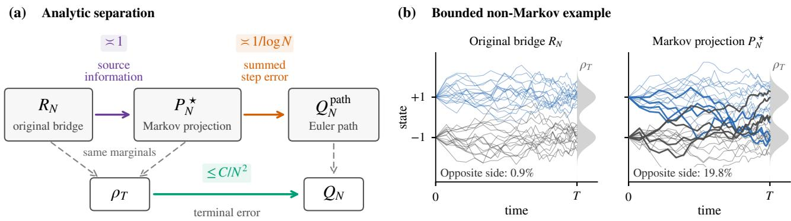
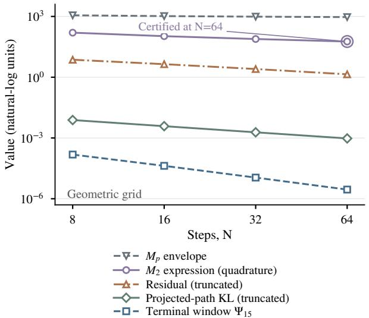
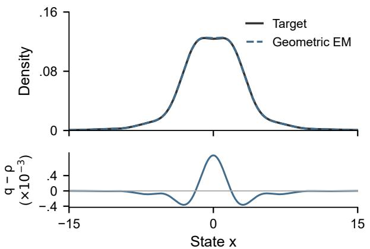
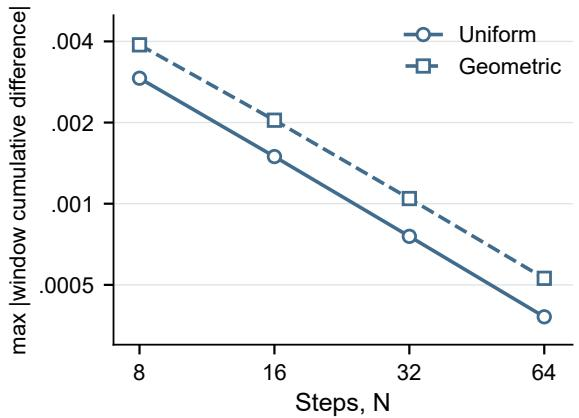
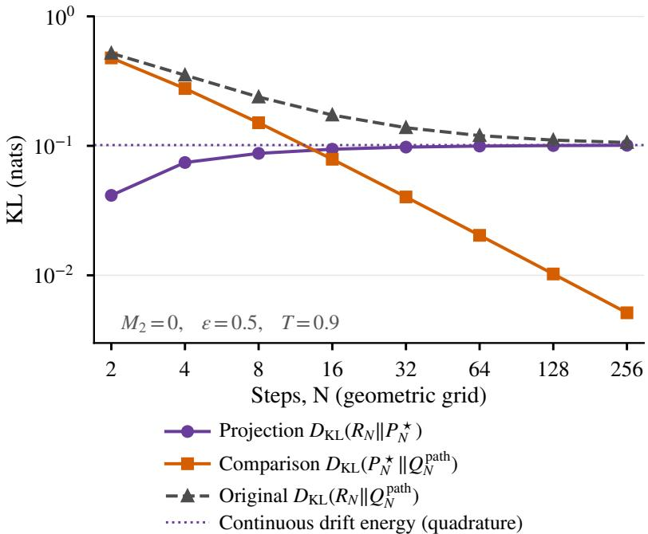

# Displacement Moments and Path–Terminal Separation in Brownian Interpolant Sampling

Zhong Han 1

## Abstract

Brownian stochastic interpolants connect paired endpoint samples, yet their sampling error can depend on displacement moments even when neither endpoint has a first moment. For arbitrary Borel couplings, we prove early-stopped, target-to-output KL guarantees for standard Euler sampling from the true source. A fourth displacement moment gives an explicit $O ( N ^ { - 1 } )$ bound; a second moment suffices for fixedlaw convergence as drift error vanishes. For one fixed coupling with no displacement moment above two, original bridge-path KL stays of order one, comparison-path KL is of order 1/ log N, and terminal KL is at most $C / N ^ { 2 }$ on the same grid. The path decomposition identifies the information about the source discarded by Markov projection. When the original bridge is Markov, current-state Euler sampling instead has a second-moment $O ( ( M _ { 2 } + d ) / N )$ bound; finiteentropy Schrödinger bridges for the probability Brownian reference are included. We also construct a current-state learner with expected output KL consistency from iid endpoint pairs. Numerical diagnostics illustrate the distinct errors. Conditional diffusion identities specify a restoration interface, while image controls find no iterative advantage over cheap probabilistic predictors. Uniform terminal rates for general secondmoment couplings remain open.

## 1. Introduction

Brownian stochastic interpolants construct sampling dynamics from paired endpoint observations. Their marginal drift is a conditional mean, but its estimation and discretization need not require moments of either endpoint. If $X _ { 0 } =$ H and $X _ { 1 } = H + u$ , displacement is bounded even when H has no first moment. This distinction matters for singular sources, dependent endpoint pairs, and heavy-tailed corruptions in restoration (Liu et al., 2023; Zhou et al., 2024).

We ask which displacement moments guarantee finite-step accuracy, and when a path comparison obscures the accuracy of the final samples. For arbitrary Borel couplings, standard Euler–Maruyama (EM) initialized at the true source has an explicit stopped-time $O ( N ^ { - 1 } )$ KL bound under a fourth displacement moment. Conditional residuals yield slower bounds for $2 < p < 4$ and fixed-law convergence under a second moment, without endpoint densities or score regularity. Learning error is measured under the true intermediate laws.

For one fixed coupling with no displacement moment above two, the original bridge-path KL remains of order one, its Markov projection has KL of order 1/ log N, and terminal KL is at most $C / N ^ { 2 }$ on the same geometric grid. These quantities observe different objects. Sampling requires the terminal marginal; the original bridge also carries the source and its pairing with the target. Markov projection keeps every grid marginal but forgets what the source reveals beyond the current state. Euler then replaces each projected kernel by a Gaussian. An entropy identity separates the resulting two path losses; signed cancellations give the much smaller terminal bound.

This decomposition also identifies a tractable secondmoment subclass. Retaining the source gives a joint-law $O ( ( M _ { 2 } + d ) / N )$ bound by an established Gaussian-channel argument. For Markov bridge mixtures, current-state EM inherits this bound without a source-defect term. Equality of the two residual drifts at one interior time characterizes that structure, including singular endpoints. Finiteentropy Schrödinger bridges for the probability Brownian reference started from the prescribed source belong to this subclass. The general second-moment rate question therefore remains for non-Markov couplings, where a sourceprediction gap separates the two error contracts.

Clipped partition regression from iid endpoint pairs attains expected terminal KL consistency with fresh true-source initialization. A lower bound rules out a uniform trainingsample rate without source structure.

Numerics illustrate source-information loss and compare general bounds with terminal diagnostics. Conditional diffusion identities specify a restoration interface, but image controls find no iterative advantage over cheap probabilistic predictors and do not test the strict- $M _ { 2 }$ obstruction.

## 1.1. Related work

Transport and regression representations for dependent interpolants (Albergo et al., 2025; 2024) and source augmentation (De Bortoli et al., 2023) are established. We analyze their finite-step sampling error. Kang et al. (2026, Theorems 4.1–4.4) analyze ReLU drift learning and EM sampling for bounded endpoint pairs under drift Lipschitz assumptions. We claim no new drift or augmentation algorithm, or priority for general regression-to-generation guarantees.

Liu et al. (2025) already analyze standard EM for general couplings and broader nonlinear interpolants. Their finite bound assumes an eighth displacement moment and starts inside the time interval. Brownian DFM bounds use eighth endpoint moments and score integrability, with explicit $d ^ { 4 }$ terms in Gentiloni Silveri et al. (2024) and $d ^ { 3 }$ terms in Gentiloni Silveri et al. (2026). Their full-horizon conclusions require stronger conditions and are not implied by our earlystopped theorem.

Weak-moment sampling is not new to Gaussian diffusion models. Chen et al. (2023, Theorem 2.2) prove a second-moment early-stopping bound with a $d ^ { 2 }$ discretization term; Benton et al. (2024, Theorem 1) obtain nearly linear dimension dependence. Those results concern single-signal Gaussian diffusions. Equal intermediate marginals alone do not identify a two-endpoint Brownian drift, diffusion coefficient, or its EM discretization (Appendix R). For a point source, however, Koike (2026, Theorem 3.1) directly prove a second-moment bound for standard Brownian-time EM, with a positive-time Gaussian initialization. This overlaps the source-conditioned branch after disintegration, subject to its initialization and error contract; it does not directly cover our arbitrarily coupled current-state drift.

Second-order marginal KL can already improve on pathbased bounds under smoothness assumptions (Mou et al., 2022; Li et al., 2026). Our separation concerns a fixed strict- $M _ { 2 }$ coupling: the projected path decays only logarithmically, and the original non-Markov bridge path does not converge in KL to EM. The marginal projection and signed increment cancellation used in the proof are established techniques.

The comparison-process and I–MMSE architecture is a direct antecedent (Reeves & Pfister, 2025), building on Gaussian information–estimation identities (Guo et al., 2005; Payaró & Palomar, 2009); innovations sampling also admits certified channel-time schedules (Wainwright, 2026). For arbitrary couplings we control conditional residuals without a single-signal Markov channel; the source-conditioned corollary identifies when that reduction applies. In the 2026 DFM result, the conditional-source assumption concerns the density and score of $X _ { 0 } ~ \vert ~ X _ { 1 } ;$ ; the drift still observes only $( t , x )$ . Corollary 5.1 instead retains the realized source $x _ { 0 } .$ . Liu et al.’s initialization term can be zero when the exact interior starting law is available. Appendix R gives the theorem-specific conditions and additional diffusion comparisons.

## 2. Setting and Euler sampling

Let $d \ge 1 , \varepsilon > 0 ,$ and let $( X _ { 0 } , X _ { 1 } ) \sim$ π be an arbitrary Borel probability coupling on $\mathbb { R } ^ { d } \times \mathbb { R } ^ { d }$ . Write $U = X _ { 1 } - X _ { 0 }$ and $M _ { p } = \mathbb { E } _ { \pi } \Vert U \Vert ^ { p }$ . We assume $M _ { 2 } < \infty ;$ additional displacement moments are imposed only where stated. The endpoints need not have finite first moments, and either marginal or the coupling may be singular. All norms are Euclidean, matrix norms with subscript $F$ are Frobenius norms, and logarithms are natural.

For each single time $0 \leq t < 1$ , let $Z \sim N ( 0 , I _ { d } )$ be independent of the endpoints and set

$$
\begin{array} { r l r } { \sigma _ { t } ^ { 2 } = 2 \varepsilon t ( 1 - t ) , } & { { } \ } & { X _ { t } = X _ { 0 } + t U + \sigma _ { t } Z , } \\ { \ } & { { } \ } & { \rho _ { t } = \mathrm { L a w } ( X _ { t } ) , } \\ { \rho _ { t } = \mathrm { L a w } ( X _ { t } ) , } & { { } c _ { t } = \sqrt { \frac { 2 \varepsilon t } { 1 - t } } , \qquad c _ { 0 } = 0 , } \\ { \quad } & { { } D _ { t } = U - c _ { t } Z , } & { b _ { t } ( X _ { t } ) = \mathbb { E } [ D _ { t } \mid X _ { t } ] . } \end{array}\tag{1}
$$

Write $V _ { t } = D _ { t } - b _ { t } ( X _ { t } )$ for the centered residual. Only the integrable residual $D _ { t }$ is conditioned; $\mathbb { E } [ X _ { 1 } ~ \vert ~ X _ { t } ]$ is not needed as an ordinary integrable conditional expectation. We choose a finite Borel version of $b _ { t }$ at each grid time. In particular, $b _ { 0 } ( X _ { 0 } ) = \operatorname { \mathbb { E } } [ U \mid X _ { 0 } ]$ . The construction and its version invariance under true-source initialization are proved in Section C.

The single-time representation does not prescribe correlations between noises at different times. When joint bridge observations are needed, their law is specified instead by

$$
\mathcal { X } _ { t } = ( 1 - t ) X _ { 0 } + t X _ { 1 } + \sqrt { 2 \varepsilon } ( W _ { t } - t W _ { 1 } ) ,\tag{2}
$$

where $W$ is a Brownian motion independent of the endpoints. For $0 < t < 1 , Z _ { t } = ( W _ { t } - t W _ { 1 } ) / \sqrt { t ( 1 - t ) }$ gives the corresponding residual $D _ { t } = U - c _ { t } Z _ { t }$ and centered residual $V _ { t } = D _ { t } - b _ { t } ( \mathcal { X } _ { t } )$ . At $t = 0$ the product $c _ { 0 } Z _ { 0 }$ means zero. Write $R _ { N }$ for the original bridge law on $( \mathcal { X } _ { t _ { 0 } } , \ldots , \mathcal { X } _ { t _ { N } } )$ . Its Markov projection $P _ { N } ^ { \star }$ uses the same initial law and adjacent conditional kernels; $Q _ { N } ^ { \mathrm { p a t h } }$ is the actual Euler path law. All three path laws include the initial coordinate.

Table 1. Selected early-stopped KL guarantees. Rates describe discretization at fixed stopping parameters and noise level; learneddrift/score error and the initialization contribution in column four are omitted from the rate. All results require a weighted $L ^ { 2 }$ approximation bound under the true intermediate laws. “No score condition” means no endpoint/coupling score regularity assumption. The DFM dimension terms are not bounds uniform over unnormalized moments and scores. $K _ { \mathrm { i n i t } }$ denotes the KL from the true starting law to the chosen starting law; $m _ { 2 }$ below is a data second moment, whereas $M _ { p }$ is our displacement moment. EI denotes an exponential integrator.
<table><tr><td>Result</td><td>Moments and score/density conditions</td><td>Drift input</td><td>Initialization</td><td>Discretization rate</td></tr><tr><td>Liu et al. (2025), Thm. 4.3</td><td>Eighth displacement moment; interpolant regularity; no endpoint/joint score condition</td><td>(t, x)</td><td>Interior start;  $K _ { \mathrm { i n i t } }$  retained</td><td> $\mathbf { E M } ; O ( N ^ { - 1 } )$ </td></tr><tr><td>Koike (2026), Thm. 3.1</td><td>Point source; second target moment m2; no target smoothness assumption</td><td>(t, x)</td><td>Gaussian at  $t _ { 0 } > 0 ;$  explicit  $t _ { 0 } ( d + m _ { 2 } ) / 2$  term</td><td>Brownian EM;  $O ( ( d + m _ { 2 } ) / N )$  at fixed stopping parameters</td></tr><tr><td>Gentiloni Silveri et al. (2026), Thms. 2–3</td><td>Eighth endpoint moments; conditional-source density and score condition H4</td><td>(t, x)</td><td>True source at t = 0;  $K _ { \mathrm { i n i t } } = 0$ </td><td> $\mathbf { E M } ; O ( N ^ { - 1 } )$  , with explicit  $d ^ { 3 }$  term</td></tr><tr><td>Benton et al. (2024), App. C, Thm. 2</td><td>Data second moment m2; no target (t, x) density or score-smoothness condition</td><td></td><td>Standard Gaussian;  $K _ { \mathrm { i n i t } } \lesssim ( d + m _ { 2 } ) \dot { e } ^ { - 2 T }$ </td><td> $\operatorname { E I } ; O ( ( d + m _ { 2 } ) / N )$  at fixed  $T , \delta$ </td></tr><tr><td>Theorem 3.1,  $p = 4$ </td><td>Arbitrary Borel coupling;  $M _ { 4 } < \infty ;$  no endpoint/joint score condition</td><td>(t, x)</td><td> ${ \mathrm { T r u e ~ s o u r c e ~ a t ~ } } t = 0 ;$   $K _ { \mathrm { i n i t } } = 0$ </td><td> $\mathrm { E M } ; O ( ( M _ { 4 } + d ^ { 2 } ) / N )$ </td></tr><tr><td>Corollary 5.1</td><td>Arbitrary Borel coupling;  $M _ { 2 } < \infty ;$  no endpoint/joint score condition</td><td> $( t , x , x _ { 0 } )$ </td><td>True source at t = 0;  $K _ { \mathrm { i n i t } } = 0$ </td><td>EM; joint KL  $O ( ( \dot { M } _ { 2 } + d ) / N )$ </td></tr><tr><td>Corollary 5.2</td><td>Markov bridge mixture; singular endpoints allowed</td><td> $M _ { 2 } < \infty ; \mathbf { \rho } ( t , x )$ </td><td>True source at  $t = 0 ;$   $K _ { \mathrm { i n i t } } = 0$ </td><td> $\mathrm { E M } ; O ( ( M _ { \mathrm { 2 } } + d ) / N )$ </td></tr></table>

Fix a deterministic grid $0 = t _ { 0 } < \cdot \cdot \cdot < t _ { N } = T < 1$ , let $h _ { k } = t _ { k + 1 } - t _ { k } , \eta _ { k } = h _ { k } / ( 1 - t _ { k } )$ , and choose finite Borel functions $\widehat { b } _ { k } : \mathbb { R } ^ { d } \to \mathbb { R } ^ { d }$ . The actual sampler is

$$
\begin{array} { c } { { Y _ { 0 } \sim \rho _ { 0 } , \qquad Q _ { N } = \mathrm { L a w } ( Y _ { N } ) , } } \\ { { { } } } \\ { { Y _ { k + 1 } = Y _ { k } + h _ { k } \widehat { b } _ { k } ( Y _ { k } ) + \sqrt { 2 \varepsilon h _ { k } } G _ { k } . } } \end{array}\tag{3}
$$

Here the $G _ { k }$ are independent standard Gaussian vectors and are independent of $Y _ { 0 }$ . Its prescribed learning error is

$$
\mathcal { E } = \sum _ { k = 0 } ^ { N - 1 } h _ { k } \int \| \widehat { b } _ { k } ( x ) - b _ { t _ { k } } ( x ) \| ^ { 2 } \rho _ { t _ { k } } ( d x ) < \infty .\tag{4}
$$

The error is measured under the true grid marginals. All terminal guarantees below have the direction $D _ { \mathrm { K L } } ( \rho _ { T } \lVert Q _ { N } )$

## 3. Finite-step guarantees

Put $\delta = 1 - T$ and $L _ { \delta } = \log ( 1 / \delta )$ . For an integer $N \geq 1$ use the geometric grid

$$
\begin{array} { c } { { a _ { \mathrm { g e o } } = 1 - \delta ^ { 1 / N } , \qquad t _ { k } = 1 - ( 1 - a _ { \mathrm { g e o } } ) ^ { k } , } } \\ { { h _ { k } = a _ { \mathrm { g e o } } ( 1 - a _ { \mathrm { g e o } } ) ^ { k } . } } \end{array}\tag{5}
$$

Thus $\eta _ { k } ~ = ~ a _ { \mathrm { g e o } }$ . The entropy modulus used below is $\Phi _ { \mathrm { e n t } } ( z ) = \| z \| ^ { \breve { 4 } } / ( 1 + \| z \| ^ { 2 } )$ .

Theorem 3.1 (Weak displacement moments). Under the setting and sampling protocol above, $i f M _ { 4 } < \infty$ and $N \geq$ $L _ { \delta } / \log 2 ,$ then

$$
\begin{array} { l } { \displaystyle { D _ { \mathrm { K L } } ( \rho _ { T } \| Q _ { N } ) \le \frac { \mathcal { E } } { 4 \varepsilon } + \frac { 2 M _ { 4 } L _ { \delta } } { \varepsilon ^ { 2 } N } } } \\ { \displaystyle { \qquad + \left( 8 d ( d + 2 ) + \frac { d } { 2 } \right) \frac { L _ { \delta } ^ { 2 } } { N } . } } \end{array}\tag{6}
$$

More generally, $i f 2 < p \leq 4$ and $M _ { p } < \infty ,$ , then, for $N \geq L _ { \delta } /$ log 2,

$$
\begin{array} { l } { { \displaystyle { \cal D } _ { \mathrm { K L } } ( \rho _ { T } \| Q _ { N } ) \leq \frac { \displaystyle \xi } { \displaystyle 4 \varepsilon } + 3 2 \frac { { \cal M } _ { p } } { \displaystyle \varepsilon ^ { p / 2 } } \left( \frac { \displaystyle L _ { \delta } } { \displaystyle N } \right) ^ { p / 2 - 1 } } } \\ { { \displaystyle ~ + 1 2 9 d ( d + 2 ) \frac { \displaystyle L _ { \delta } ^ { 2 } } { \displaystyle N } . } } \end{array}\tag{7}
$$

The constants do not depend on the coupling, higher moments, or endpoint moments. Under only $M _ { 2 } < \infty ,$ , every geometric grid satisfies

$$
\begin{array} { r l } & { D _ { \mathrm { K L } } ( \rho _ { T } \| Q _ { N } ) \leq \frac { \mathcal { E } } { 4 \varepsilon } } \\ & { \quad + \frac { 1 6 } { \varepsilon ( 1 - a _ { \mathrm { g e o } } ) } \mathbb { E } \left[ \| U \| ^ { 2 } \frac { a _ { \mathrm { g e o } } \| U \| ^ { 2 } } { 2 \varepsilon ( 1 - a _ { \mathrm { g e o } } ) + a _ { \mathrm { g e o } } \| U \| ^ { 2 } } \right] } \\ & { \quad + \left[ \frac { 3 2 d ( d + 2 ) } { ( 1 - a _ { \mathrm { g e o } } ) ^ { 2 } } + \frac { d } { 4 ( 1 - a _ { \mathrm { g e o } } ) } \right] a _ { \mathrm { g e o } } L _ { \delta } . } \end{array}\tag{8}
$$

For a fixed coupling, a sequence with $a _ { \mathrm { g e o } , N } \quad  \quad 0 \quad$ $\begin{array} { r l r } { a _ { \mathrm { g e o } , N } L _ { \delta _ { N } } } & { { } \to } & { 0 } \end{array}$ , and $\mathcal { E } _ { N } \quad  \quad 0$ therefore satisfies $D _ { \mathrm { K L } } ( \rho _ { T _ { N } } \Vert Q _ { N } ) \to 0 .$ . If in addition $\delta _ { N }  0$ , then

$$
\begin{array} { r l } & { d _ { \mathrm { B L } } ( Q _ { N } , \rho _ { 1 } ) \leq \sqrt { 2 D _ { \mathrm { K L } } ( \rho _ { T _ { N } } \| Q _ { N } ) } } \\ & { ~ + \sqrt { \delta _ { N } ^ { 2 } M _ { 2 } + 2 \varepsilon d T _ { N } \delta _ { N } } \longrightarrow 0 . } \end{array}\tag{9}
$$

Here $d _ { \mathrm { B L } }$ uses testfunctions with both supremum norm and Lipschitz constant at most one. For example, one may take ${ \cal L } _ { \delta _ { N } } ~ = ~ N ^ { \kappa }$ with $0 \textless \kappa < 1 / 2$ and vanishing learning error.

The proof and all intermediate constants appear in Section D. The second-moment assertion is for each fixed coupling; it does not exchange a supremum over couplings with the limit. At $p = 4 , ( 6 )$ is sharper than the general p-moment bound (7).

At fixed T and ε, (6) has order $N ^ { - 1 }$ with only a fourth displacement moment. If $M _ { 4 } = O ( d ^ { 2 } )$ , its dimension dependence is $O ( d ^ { 2 } )$ ; without that normalization the moment must remain explicit. The theorem does not cover arbitrary nonlinear interpolants, and its constants deteriorate $\mathsf { a s } \varepsilon \downarrow 0$ These are conservative upper bounds: Section 8 evaluates their actual values.

## 3.1. Conditional residuals and the proof

The displacement bound follows from a more informative estimate. Let $q _ { k } = 2 \varepsilon h _ { k } ( 1 - \eta _ { k } )$ and $c _ { d } ( \eta ) = d [ - \eta -$ $\log ( 1 - \eta ) ] / 2$ . For any deterministic grid,

$$
\begin{array} { r l r } {  { D _ { \mathrm { K L } } ( \rho _ { T } \| Q _ { N } ) \le \frac { \mathcal { E } } { 4 \varepsilon } + \sum _ { k } c _ { d } ( \eta _ { k } ) } } \\ & { } & { + 8 \sum _ { k } \mathbb { E } \Phi _ { \mathrm { e n t } } ( \frac { h _ { k } V _ { t _ { k } } } { \sqrt { q _ { k } } } ) . } \end{array}\tag{10}
$$

This bound retains the uncertainty left after observing the current state. It can be sharper than replacing that uncertainty by an unconditional displacement moment. A further valid refinement subtracts $\begin{array} { r } { \dot { \sum _ { k } { h _ { k } ^ { 2 } \eta _ { k } \mathbb { E } \| V _ { t _ { k } } \| ^ { 2 } } } / ( 2 q _ { k } ) } \end{array}$ from Pthe right side. Proposition G.1 proves both forms.

The proof of Theorem 3.1 has three steps. First, disintegrate the law of the integrable $D _ { t }$ given $X _ { t } = x$ and set

$$
K _ { t , h } ( x , d y ) = \int N ( x + h z , q I _ { d } ) ( d y ) \lambda _ { t } ( x , d z ) ,
$$

where $\lambda _ { t } ( x , \cdot ) = \mathcal { L } ( D _ { t } \mid X _ { t } = x )$ and $q = 2 \varepsilon h ( 1 - \eta )$ The Borel kernel has $\rho _ { t } K _ { t , h } = \rho _ { t + h }$ , including the initial step. Repeated conditioning defines a Markov comparison chain $P _ { N } ^ { \star }$ . It need not be the original bridge path law.

Second, for $P _ { x } = \mathcal { L } ( h V _ { t } + \sqrt { q } G \ | \ X _ { t } = x ) , v = 2 \varepsilon h$ , and $Q _ { t , h } ( x ) = N ( x + h \widehat { b } ( x ) , v I _ { d } )$ , the exact one-step identity

is

$$
\begin{array} { r l } & { { \cal D } _ { \mathrm { K L } } ( K _ { t , h } ( x ) \| Q _ { t , h } ( x ) ) = { \cal D } _ { \mathrm { K L } } ( P _ { x } \| N ( 0 , q I _ { d } ) ) + c _ { d } ( \eta ) } \\ & { \quad \quad \quad \quad - \displaystyle \frac { h ^ { 2 } \eta } { 2 q } \mathbb { E } [ \| V _ { t } \| ^ { 2 } \mid X _ { t } = x ] } \\ & { \quad \quad \quad \quad + \displaystyle \frac { h } { 4 \varepsilon } \| b _ { t } ( x ) - \widehat { b } ( x ) \| ^ { 2 } . } \end{array}
$$

Finite-moment Gaussian-mixture entropy bounds control the first term. The fourth-moment estimate gives (6), while the fourth-order-at-zero, second-order-in-the-tails function $\Phi _ { \mathrm { e n t } } ~ \mathrm { g i v e s } \left( 1 0 \right)$

Third, the path chain rule sums these quantities under the true marginals; data processing gives the terminal bound. The uncentered entropy estimate in Appendix C.1 and geometric sums yield the tail modulus in (8). The inequality $x / ( 1 + x ) \ \leq \ { x ^ { p / 2 - 1 } }$ for $x \ge 0$ and $2 \textless p \le 4$ then yields the weaker-moment rate from the same modulus. No Markov property of the original bridge or continuous-time change of measure is required. Dropping the negative term and projecting paths to the terminal state are two distinct sources of slack.

For conditionally independent residual coordinates, entropy tensorizes. With finite coordinate fourth moments on the geometric grid and $N \geq L _ { \delta } / \log 2$ , the bound becomes $\begin{array} { r } { \mathcal { E } / ( 4 \varepsilon ) + 2 \sum _ { j } \mathbb { E } | U _ { j } | ^ { 4 } L _ { \delta } / ( \varepsilon ^ { 2 } \dot { N } ) + ( 4 9 / 2 ) d L _ { \delta } ^ { 2 } / N } \end{array}$ (Propo-Psition I.1). A product endpoint coupling suffices. This restricted result does not give a dimension-linear bound for arbitrary couplings.

## 4. Three entropy scales for one fixed coupling

Figure 1 distinguishes the path laws and their common marginal target. Data processing gives $D _ { \mathrm { K L } } ( \rho _ { T } \Vert Q _ { N } ) \leq$ $D _ { \mathrm { K L } } ( P _ { N } ^ { \star } | | Q _ { N } ^ { \mathrm { p a t h } } )$ ). The original bridge has an additional cost. Since $P _ { N } ^ { \star }$ is its Markov projection, the chain rule gives

$$
\begin{array} { r l } { { \cal D } _ { \mathrm { K L } } ( R _ { N } \| Q _ { N } ^ { \mathrm { p a t h } } ) = { \cal D } _ { \mathrm { K L } } ( R _ { N } \| P _ { N } ^ { \star } ) } & { } \\ { + { \cal D } _ { \mathrm { K L } } ( P _ { N } ^ { \star } \| Q _ { N } ^ { \mathrm { p a t h } } ) . } \end{array}\tag{11}
$$

All terms are finite under the setting of Section 2 (Proposition C.3). To see the decomposition, let $A _ { k }$ be the next-step law conditional on the entire observed past and $K _ { k }$ its conditional average given only $\mathcal { X } _ { t _ { k } }$ . The conditional entropy chain rule splits the cost from $A _ { k }$ to the Euler kernel into the cost from $A _ { k }$ to $K _ { k }$ and that from $K _ { k }$ to the Euler kernel. Summing gives (11). Given the source, the bridge likelihood makes the latest state sufficient for predicting the future. Hence

$$
\begin{array} { r l } { { \displaystyle } } & { { \cal D } _ { \mathrm { K L } } ( R _ { N } \| P _ { N } ^ { \star } ) } \\ { ~ } & { ~ = \displaystyle \sum _ { k = 1 } ^ { N - 1 } I _ { R _ { N } } \left( \mathcal { X } _ { t _ { k + 1 } } ; \mathcal { X } _ { 0 } \mid \mathcal { X } _ { t _ { k } } \right) . } \end{array}\tag{12}
$$

  
Figure 1. Source information and terminal accuracy. (a) Three path laws on one grid: Markov projection preserves every grid marginal but discards the source information in (12); Euler replaces each projected kernel by a Gaussian. The colored orders are analytic results for the fixed strict- $. M _ { 2 }$ coupling of Theorem 4.1, and the terminal order is an upper bound only. (b) A different, bounded coupling, $X _ { 0 } = X _ { 1 } \in \{ - 1 , 1 \}$ , illustrates how projection changes source–terminal pairing while preserving the marginals. Color encodes the source; thick paths end across zero from their source. Percentages use all 6000 paths per law. This illustration does not test Theorem 4.1; the simulation protocol is given in Section U.3.

Here $I _ { R _ { N } }$ is conditional mutual information under the original bridge. Each term equals the information in the entire past beyond the current state (Lemma U.3). The loss depends on the bridge and grid, not the fitted Euler drift; the $k = 0$ term is zero. For $N \geq 2$ it vanishes exactly when the original bridge is Markov. The following example separates this source-information loss from projected-path and terminal error.

Theorem 4.1 (Three entropy scales at strict second moment). $F i x \ \varepsilon > \ 0$ and $0 \textless T \textless 1$ . Let H be standard Cauchy and let U, independently, have density

$$
f ( u ) = \frac { C _ { f } } { ( 1 + u ^ { 2 } ) ^ { 3 / 2 } \{ \log ( e + u ^ { 2 } ) \} ^ { 2 } } ,\tag{13}
$$

where $C _ { f }$ normalizes the density. Set $X _ { 0 } = H , X _ { 1 } = H +$ U. For exact current-state drift, true-source initialization, and standard EM on the geometric grid, as $N \to \infty$

$$
\begin{array} { r l r } {  { D _ { \mathrm { K L } } ( R _ { N } \| Q _ { N } ^ { \mathrm { p a t h } } ) \asymp 1 , } } \\ & { } & \\ & { } & { D _ { \mathrm { K L } } ( P _ { N } ^ { \star } \| Q _ { N } ^ { \mathrm { p a t h } } ) \asymp \frac { 1 } { \log N } , } \\ & { } & \\ & { } & { D _ { \mathrm { K L } } ( \rho _ { T } \| Q _ { N } ) \leq \frac { C } { N ^ { 2 } } . \qquad } \end{array}\tag{14}
$$

The comparison constants depend on the fixed law, $\varepsilon ,$ and T, but not on N. Also $D _ { \mathrm { K L } } ( R _ { N } \Vert P _ { N } ^ { \star } ) \asymp 1$ . The coupling is independent of N and has $M _ { 2 } < \infty$ but Mp = ∞for every $p > 2 .$ . Neither endpoint has a finite first absolute moment.

Here  means upper and lower bounds by positive constant multiples for all sufficiently large N. No matching terminal lower bound or positive limit of the original-path KL is asserted.

Heavy-tail contribution to path error. The current drift is uniformly bounded on $[ 0 , T ] \times \mathbb { R }$ . A rare large displacement can nevertheless produce a comparison increment far into a Gaussian tail. An entropy test that weights that event by its squared increment gives

$$
D _ { \mathrm { K L } } ( P _ { N } ^ { \star } \| Q _ { N } ^ { \mathrm { p a t h } } ) \gtrsim \mathbb { E } [ U ^ { 2 } \mathbf { 1 } _ { \{ U \geq L _ { a } \} } ] - O ( a ) ,
$$

where $a = 1 - ( 1 - T ) ^ { 1 / N }$ and $L _ { a } \asymp \sqrt { \log ( 1 / a ) / a }$ . For p(13), the tail second moment is of order $1 /$ log $L _ { a }$ . Conversely, the second-moment modulus in (8), applied before terminal projection, is $O ( 1 / \log ( 1 / a ) )$ . This proves the matching path order. The weak moment persists in the averaged conditional residual: $\mathbb { E } | V _ { t } | ^ { p } = \infty$ for all $p > 2$ including positive times.

Signed cancellation in terminal error. Write $g _ { t }$ for a Cauchy density convolved with the bridge Gaussian and $\begin{array} { r } { q _ { j } ( t , x ) = \int u ^ { j } f ( u ) g _ { t } ( x - t u ) d u } \end{array}$ . Integration by parts in Rthe heavy tail shows $| \partial _ { x } q _ { 2 } | \le C \rho _ { t }$ ; bounding the absolute posterior moment first would lose this cancellation. Consequently the true drift has a bounded time derivative and bounded spatial derivatives.

Established marginal-drift projection and signed-increment arguments (Mou et al., 2022; Li et al., 2026) give the Euler interpolation drift $\widetilde { b } _ { t } ( \boldsymbol { x } ) = \mathbb { E } [ b _ { t _ { k } } ( Y _ { t _ { k } } ) \mid Y _ { t } = \boldsymbol { x } ]$ . Its esigned conditional increment is $O ( t - t _ { k } ) ,$ , despite an absolute increment typically of order $\sqrt { t - t _ { k } }$ . Keeping this sign gives $| b _ { t } - { \widetilde { b } } _ { t } | \leq C ( t - t _ { k } )$ and hence a terminal entropy cost $\textstyle { \dot { C } } \sum _ { k } h _ { k } ^ { 3 } = O ( a ^ { 2 } )$ . Here the projected path con-Pverges only logarithmically under strict $M _ { 2 } .$ , while the same fixed coupling has the quadratic terminal upper bound. $\mathsf { A p - }$ pendix L proves the claims without a moment assumption on the Cauchy source. Appendix R.3 compares the assumptions and KL directions.

Why the original path does not converge. The nonvanishing projection loss is a non-Markov effect; heavy tails are needed for the slow comparison path. In this coupling a fixed tail event proves the original-path lower bound. Under $R _ { N }$ , the increment $\mathcal { X } _ { T } - \mathcal { X } _ { 0 }$ equals $T U +$ ${ \sqrt { 2 \varepsilon T ( 1 - T ) } } Z$ and has a polynomial tail. Under exactpdrift EM, $Y _ { N } - Y _ { 0 }$ is a Gaussian sum plus a drift accumulation bounded by $T \| b \| _ { \infty } . \mathrm { ~ A ~ }$ fixed tail event of this increment therefore separates the two path laws by a positive KL amount, uniformly in N. The upper bound in Appendix $\mathrm { C } ,$ (50), is uniform on these grids. This argument observes both the initial and final coordinates; it gives no terminalmarginal lower bound. The non-Markov projection loss, slow discretization of the comparison path, and terminal cancellation are distinct effects.

## 5. Source information and the Markov subclass

The projection loss in (12) measures source information beyond the current state. Retaining that information in the drift gives a second-moment bound for the joint output law. Corollary 5.1 (Source-conditioned joint-law guarantee). Let $b _ { t } ^ { \mathrm { s c } } ( x , x _ { 0 } ) = \mathbb { E } [ D _ { t } \mid X _ { t } = x , X _ { 0 } = x _ { 0 } ]$ . Draw $S \sim \rho _ { 0 }$ set $Y _ { 0 } = S ,$ , and use

$$
Y _ { k + 1 } = Y _ { k } + h \widehat { b } _ { k } ^ { \mathrm { s c } } ( Y _ { k } , S ) + \sqrt { 2 \varepsilon h } G _ { k } , \qquad h = T / N .
$$

For jointly Borel finite drifts and

$$
\mathcal { E } _ { \mathrm { s c } } = \sum _ { k } h \mathbb { E } \| \widehat { b } _ { k } ^ { \mathrm { s c } } ( X _ { t _ { k } } , X _ { 0 } ) - b _ { t _ { k } } ^ { \mathrm { s c } } ( X _ { t _ { k } } , X _ { 0 } ) \| ^ { 2 } < \infty ,
$$

any Borel endpoint coupling with $M _ { 2 } <$ ∞ satisfies

$$
\begin{array} { l } { { \displaystyle { D _ { \mathrm { K L } } ( \mathcal { L } ( X _ { 0 } , X _ { T } ) \| \mathcal { L } ( S , Y _ { N } ) ) } } } \\ { { \displaystyle ~ \leq \frac { \xi _ { \mathrm { s c } } } { 4 \varepsilon } + h \left[ \frac { d T } { 4 \delta } + \frac { M _ { 2 } } { 4 \varepsilon \delta ( \delta + h ) } \right] . } } \end{array}\tag{15}
$$

Conditioning on the source gives the channel $s U + \sqrt { 2 \varepsilon } W _ { s }$ $s ~ = ~ t / ( 1 - t )$ ; I–MMSE and the joint KL chain rule give the bound (Theorem F.2). This established sourceaugmentation reduction (De Bortoli et al., 2023) specifies the joint-law error contract and true-source time-zero start; Table 1 compares the point-source antecedent.

When the current state is sufficient. For a current-state predictor used in the source-conditioned sampler, orthogonality gives

$$
\begin{array} { r l } & { \mathcal { E } _ { \mathrm { s c } } = \mathcal { E } + \mathfrak { D } _ { \pi , \mathfrak { t } } , } \\ & { \mathfrak { D } _ { \pi , \mathfrak { t } } = \displaystyle \sum _ { k } h _ { k } \mathbb { E } \| b _ { t _ { k } } ^ { \mathrm { s c } } ( X _ { t _ { k } } , X _ { 0 } ) - b _ { t _ { k } } ( X _ { t _ { k } } ) \| ^ { 2 } . } \end{array}\tag{16}
$$

The same hidden-source dependence appears as a conditional-information loss in (12) and a squared prediction gap here; the two quantities are not numerically identical. Proposition U.1 shows that drift equality at one deterministic $t \in ( 0 , 1 )$ is equivalent to the original bridge being

Markov with respect to its natural filtration on [0, 1]. Equivalently, its conditional endpoint law has the heat-kernel factorization (129), allowing a singular terminal measure. On grids with $N \geq 2$ , both losses vanish exactly in this Markov subclass (Appendix U).

Corollary 5.2 (Second-moment rate for Markov mixtures). Under the setting of Theorem 3.1, assume that the original bridge mixture is Markov. For $M _ { 2 } < \infty$ , current-state EM on the geometric grid, $L = \log ( 1 / \delta )$ , satisfies

$$
D _ { \mathrm { K L } } ( \rho _ { T } \| Q _ { N } ) \leq \frac { \mathcal { E } } { 4 \varepsilon } + \frac { d L ^ { 2 } + L M _ { 2 } / ( \varepsilon \delta ) } { 4 N } .\tag{17}
$$

This is a direct specialization of the source-conditioned bound; Corollary U.2 gives the sharper initial conditionalvariance constant and the non-Markov defect term.

Schrödinger bridges. Let $R _ { \mu }$ be probability Brownian motion with covariance 2εtI, started from the prescribed source $\mu .$ If the endpoint constraints admit a finite-entropy feasible law, the entropy minimizer is a Markov mixture of reference bridges (Léonard, 2013, Lemma 2.4 with $B = 0$ and Propositions 2.3, 2.10). If its relative entropy is $K .$ , then $\begin{array} { r } { M _ { 2 } \le 8 \varepsilon ( K + \frac { d } { 2 } \log 2 ) } \end{array}$ , so (17) applies. Neither endpoint needs a first moment. Appendix U checks existence, the entropy inequality, and an explicit example with Cauchy source. The reference measure and $T < 1$ matter: a sigmafinite reference, a finite learned bridge-matching iterate, or a DDPM label alone does not establish these conditions.

## 6. Learning the current-state drift from endpoint pairs

To attain the drift error in Theorem 3.1, observe n iid endpoint pairs. At each grid time, augment each pair with an independent standard Gaussian $Z _ { i , t }$ and regress the clipped residual clip $\mathbf { \sigma } _ { B } ( U _ { i } - c _ { t } Z _ { i , t } )$ on $X _ { 0 , i } + t U _ { i } + \sigma _ { t } Z _ { i , t }$ , using cell averages on a deterministic finite partition of Rd and zero in empty cells. Here clip $_ B ( v ) = v \operatorname* { m i n } \{ 1 , B / \| v \| \}$ with value zero at $v = 0 , \ \mathrm { A t } \ t = 0$ the input and label are simply $X _ { 0 , : }$ i and $\mathrm { c l i p } _ { B } ( U _ { i } )$ ; no source density is required.

Theorem 6.1 (Learning under a displacement second moment). Fix $d , \ \varepsilon > 0 , 0 < T < 1$ , and a Borel coupling $\pi$ with $M _ { 2 } < \infty .$ . Let $\mathcal { P } _ { j }$ be nested finite Borel partitions generating the Borel sigma-field, with $K _ { j }$ cells. Use the estimator above with deterministic choices satisfying

$$
B _ { n } \to \infty , \qquad j _ { n } \to \infty , \qquad \frac { K _ { j _ { n } } B _ { n } ^ { 2 } } { n } \to 0 .
$$

Let $\mathcal { D } _ { n }$ contain the endpoint sample and its Gaussian augmentations. On any deterministic geometric grids (5) with $N _ { n }  \infty ,$ , run the current-state sampler (3) from a fresh exact draw $Y _ { 0 } \sim \rho _ { 0 }$ . The source draw, Euler innovations, and evaluation variables are independent of $\mathcal { D } _ { n }$ . For its conditional output law $Q _ { n , \mathcal { D } _ { n } } = \mathcal { L } ( Y _ { N _ { n } } \mid \mathcal { D } _ { n } )$

$$
\begin{array} { r } { \mathbb { E } _ { \mathcal { D } _ { n } } \mathcal { E } _ { n } \longrightarrow 0 , \qquad } \\ { \mathbb { E } _ { \mathcal { D } _ { n } } { \cal D } _ { \mathrm { K L } } ( \rho _ { T } \| Q _ { n , \mathcal { D } _ { n } } ) \longrightarrow 0 , \qquad } \end{array}\tag{18}
$$

where $\mathcal { E } _ { n } \ i s \ ( 4 )$ for the frozen fitted drifts.

No absolute endpoint moment or regularity of $\rho _ { 0 }$ is assumed. The partitions and tuning can be chosen without knowing π or $M _ { 2 } ;$ for example, take $B _ { n } = n ^ { 1 / 8 }$ and the largest j with $K _ { j } \ \leq \ n ^ { 1 / 4 }$ . Appendix N proves uniform approximation away from zero and controls the short initial interval by its total grid length. Endpoint data may be reused across all fitted times. Exact source access remains part of the protocol; an empirical training-source initialization is not covered.

Statistical boundary. Fixed-law consistency does not give a uniform sample rate. Write $\begin{array} { r l } { \mathcal { R } _ { n } ( \widehat { Q } , \pi ) } & { { } = } \end{array}$ $\mathbb { E } _ { \pi } D _ { \mathrm { K L } } ( \rho _ { T } ^ { \pi } \lVert \widehat { Q } _ { \mathcal { D } _ { n } } )$ . Even in $d = 1$ with $| U | = r > 0$ bknown, every n satisfies

$$
\operatorname* { i n f } _ { \widehat { Q } } \operatorname* { s u p } _ { \pi : | U | = r } \mathcal { R } _ { n } ( \widehat { Q } , \pi ) \geq c _ { r , T , \varepsilon } > 0 .\tag{19}
$$

The infimum allows any output-law estimator, knowledge of the source law, and unlimited source-only draws, but only n endpoint-pair observations. The construction in Proposition N.1 uses finite source supports whose spacing may grow with n. Thus the adverse law may change with n; the bound concerns training samples, not Euler steps. Neither statement supplies a joint $T \to 1 \mathrm { o r } \varepsilon \to 0$ limit, or a guarantee for a particular random-feature or neural estimator.

## 7. Conditional diffusion and restoration

For restoration, the observed source must remain paired with its target. Corollary 5.1 controls this joint law; the following identities specify its relation to conditional diffusion and clean images.

A conditional diffusion dictionary. Write $C = X _ { 0 }$ and $X = X _ { 1 }$ . For $0 < t < 1$ , the affine change

$$
R _ { t } = \frac { X _ { t } - ( 1 - t ) C } { t } , \qquad v _ { t } = \frac { 2 \varepsilon ( 1 - t ) } { t }\tag{20}
$$

gives $\mathcal { L } ( R _ { t } \mid C ) = \mathcal { L } ( X \mid C ) \ast N ( 0 , v _ { t } I _ { d } )$ . For the joint bridge this is a conditional variance-exploding (VE) diffusion run toward decreasing noise. Normalizing by $\sqrt { 1 + v _ { t } }$ gives the variance-preserving (VP) marginals used in scorebased diffusion (Song et al., 2021; Ho et al., 2020). The joint KL bound is unchanged by this invertible positivetime map. Appendix K gives the path and discrete-update identities and the time change for I2SB.

Discrete variances and the stopped target. The Gaussian update BP replaces EM variance $2 \varepsilon h _ { k }$ by $q _ { k } =$ $2 \varepsilon h _ { k } ( 1 - \eta _ { k } )$ . It removes both the variance-mismatch cost and a favorable correction, so need not improve EM (Proposition G.2). This endpoint-conditioned variance does not integrate uncertainty in a predicted clean endpoint.

For an integrable clean endpoint, let $g _ { k }$ predict its conditional mean, so that $\widehat { b } _ { k } ( y , c ) = ( g _ { k } ( y , c ) - y ) / ( 1 - t _ { k } )$ . At bpositive grid times set $r _ { k } = ( Y _ { k } - ( 1 - t _ { k } ) S ) / t _ { k } , v _ { k } = v _ { t _ { k } }$ $\Delta v _ { k } = v _ { k } - v _ { k + 1 }$ , and $\widehat { s } _ { k } = ( g _ { k } ( Y _ { k } , S ) - r _ { k } ) / v _ { k }$ . Both updates have mean $\boldsymbol { r } _ { k } + \Delta v _ { k } \boldsymbol { \widehat { s } } _ { k }$ , but their noise variances are

$$
\begin{array} { r l } { \mathrm { t r a n s f o r m e d ~ E M : } \quad } & { \Delta v _ { k } t _ { k } / t _ { k + 1 } , } \\ { \mathrm { t r a n s f o r m e d ~ B P : } \quad } & { \Delta v _ { k } v _ { k + 1 } / v _ { k } , } \\ { \mathrm { r e v e r s e ~ V E ~ E u l e r : } \quad } & { \Delta v _ { k } . } \end{array}\tag{21}
$$

Even for the exact conditional score, these finite-step variances differ; matching marginals does not identify EM or BP with a standard DDPM.

The map is singular at $t \ : = \ : 0$ and does not justify finitenoise Gaussian initialization. $\mathrm { A t } \ T \ < \ 1$ it targets ${ \mathcal { L } } ( X \mid$ $C ) \ast N ( 0 , v _ { T } I _ { d } )$ , rather than the clean conditional law. Bounded clean images have bounded conditional residuals on [0, T], even when corruption makes $M _ { 4 } = \infty ;$ ; they do not instantiate the strict- $. M _ { 2 }$ separation.

Write $K _ { \mathrm { s c } }$ for the joint KL on the left of (15), and let $\widehat { R } _ { T } =$ $( Y _ { N } - ( 1 - T ) S ) / T$ . For every jointly Borel test $\varphi ( c , x )$ with $| \varphi | \leq 1$ and 1-Lipschitz in x,

$$
\begin{array} { r l r } {  { \vert \mathbb { E } \varphi ( C , X ) - \mathbb { E } \varphi ( S , \widehat { R } _ { T } ) \vert } } \\ & { } & { \leq \sqrt { 2 K _ { \mathrm { s c } } } + \sqrt { d v _ { T } } . } \end{array}\tag{22}
$$

KL invariance and Pinsker give the first term; coupling X to $X + \sqrt { v _ { T } } G$ gives the second. Clipping preserves this bound for clean images in the cube. Proper-score transfer is addressed in Appendix T.3.

## 8. Numerical evidence and application limits

The bounded example in Figure 1(b) isolates sourceinformation loss. A different scalar model compares bounds and terminal diagnostics; neither tests the analytic ${ \mathrm { s t r i c t } } - M _ { 2 }$ separation.

## 8.1. Nonlinear weak moments and certified error

Under a base law let $X _ { 0 } = H$ and $X _ { 1 } = c H + \sqrt { 2 \varepsilon c } G _ { }$ then tilt the coupling by

$$
\frac { d \mathbb { P } } { d \mathbb { P } _ { 0 } } = \frac { 1 + \alpha u ( H ) \sin ( \lambda ^ { \top } X _ { 1 } ) } { Z _ { \alpha } } , \qquad | \alpha | < 1 , \quad | u | \le 1 .\tag{23}
$$

Gaussian conditioning gives explicit marginals and drift (Appendix O). A shared-scale Student $H , \nu = 2 . 5 , c = 2 .$

  
Figure 2. General bounds can greatly exceed terminal error in the nonlinear Student model. All curves use the geometric grid; symbols are numerical evaluations and segments guide the eye. Only the exact-law $M _ { 2 }$ expression at $N = { \bar { 6 } } 4$ is interval-certified (Appendix S.2). Truncated path integrals and $\Psi _ { \mathrm { 1 5 } }$ are diagnostics, not certified KL values. The full-space certificate in the text uses a different, uniform grid. Profiles and refinement appear in the appendix, Figure 3. This model differs from Theorem 4.1.

and $u ( h ) = \sin ( c \lambda ^ { \top } h )$ yield finite $M _ { 2 }$ and infinite $M _ { 3 } , M _ { 4 }$ The drift is nonlinear and the tilted bridge non-Markov, but its conditional endpoint-residual tails are Gaussian, unlike Theorem 4.1.

For $d = 1 , \varepsilon = 1 , \alpha = 0 . 6 5 , \lambda = 0 . 6 , T = 0 . 8 { \mathrm { . } }$ , and true tilted-source initialization, define

$$
\Psi _ { 1 5 } = \int _ { - 1 5 } ^ { 1 5 } [ \rho _ { T } \log ( \rho _ { T } / q _ { N } ) - \rho _ { T } + q _ { N } ] d x .\tag{24}
$$

At uniform $N = 6 4$ its finest numerical value is $1 . 5 0 3 9 \times$ $1 0 ^ { - 6 } . \mathrm { ~ \ } \mathrm { ~ A ~ }$ separate positive-quadrature certificate controls the full-space chain:

$$
D _ { \mathrm { K L } } ( \rho _ { 0 . 8 } \| Q _ { 6 4 } ) \leq 2 . 3 7 2 7 5 6 \times 1 0 ^ { - 6 } \qquad \mathrm { ( u n i f o r m \ g r i d ) . }
$$

It includes tail, exit-and-return, quadrature, and arithmetic errors (Appendix T.1); it does not certify $\Psi _ { 1 5 }$ . At geometric $N = 6 4 .$ , the exact-law second-moment expression (8) is enclosed by [57.80900768880, 57.80900768885], versus the numerical $p = 2 . 1$ moment envelope 928.20 and window diagnostic $2 . 8 4 0 2 \times 1 0 ^ { - 6 }$ The enclosure certifies a sufficient-bound expression, not terminal KL; only the $N = 6 4$ point of that curve is certified (Appendix S.2). Figure 2 therefore demonstrates slack in the displacement-only bound for this model, rather than a sharp rate. Appendix S gives quadrature, density-refinement, and evaluation protocols.

## 8.2. Fitted drifts and image controls

For six clipped ridge fits on 216 features, independent tests estimate drift energies $1 . 4 6 \times 1 0 ^ { - 4 }$ and $1 . 5 7 \times 1 0 ^ { - 4 }$ at $d =$ 2, 8. Separately, 100000 interval-enclosed validation losses per dimension give upper bounds 0.003632/0.002316 with at least 95% joint confidence under ideal iid validation independent of the fixed fits. These predictors differ from the partition learner; the certificate treats stored coefficients as exact and excludes deployment and random-generation errors (Appendix T.2).

Student-3 corruption of bounded clean images gives finite displacement $M _ { 2 }$ and infinite $M _ { 4 }$ , but bounded conditional endpoint residuals. It does not test the strict- $M _ { 2 }$ obstruction. At the image budget $d \ = \ 6 4 , \ \varepsilon \ = \ 0 . 0 2$ $T = 0 . 9 , N = 4 .$ , source-conditioned sufficient bounds are $2 5 3 . 9 4 / 1 5 7 . 7 1 / 1 4 0 . 0 5$ nats for uniform EM, geometric EM and geometric BP, even with zero learning error. Source-slot gains occur in some settings. In a separate $d \ = \ 1 0 2 4$ spatial-network control, EM/BP have higher (worse) fair energy scores than direct prediction with resampled residuals, despite using 64 predictor calls (16 members, four steps each) rather than one. Appendix T.5 retains the complete primary comparisons and their limitations.

## 9. Discussion

Displacement moments control sampling without integrable endpoints, and source information explains why path KL can obscure terminal accuracy. The Markov subclass admits a current-state $O ( ( M _ { 2 } + d ) / N )$ bound; uniform terminal rates and linear dimension dependence for general couplings remain open. Learning consistency supplies neither uniform sample complexity nor a guarantee for arbitrary neural models.

These distinctions matter when choosing a bridge model. If the goal is the terminal marginal, forgetting source information can be compatible with accurate sampling. If the goal includes preserving a particular source–target pairing, the marginal alone does not describe success. The shared marginals in Figure 1 therefore do not make the two path laws interchangeable. The Markov result identifies a setting in which a current-state drift suffices; it does not justify replacing an arbitrary prescribed coupling by a Schrödinger coupling when that pairing is part of the task.

For restoration, the guarantee controls a stopped conditional law, with a bounded-Lipschitz correction to the clean target. The image controls show no iterative advantage and do not isolate dependence recovery. Clean-target KL, zeronoise limits, and practical neural recovery guarantees remain outside the result.

## Impact Statement

This work develops mathematical guarantees for stochastic sampling and limited numerical diagnostics. Its potential downstream uses depend on the application in which a sampler is deployed. The results do not certify a complete learned generative system or its safety; applications involving sensitive data or consequential decisions require their own assessment.

## Use of Generative AI

OpenAI ChatGPT and Codex assisted with literature organization, mathematical derivation and proof checking, code development and numerical diagnostics, manuscript drafting and revision, and figure preparation. These tools are not authors. Responsibility for the claims, proofs, computations, references, and final text rests with the sole named author. Internal AI-assisted checks do not constitute external peer review.

## References

Agustsson, E. and Timofte, R. NTIRE 2017 challenge on single image super-resolution: Dataset and study. In IEEE Conference on Computer Vision and Pattern Recognition Workshops, 2017. URL https://data .vision.ee.ethz.ch/cvl/DIV2K/.

Albergo, M. S., Goldstein, M., Boffi, N. M., Ranganath, R., and Vanden-Eijnden, E. Stochastic interpolants with data-dependent couplings. In Proceedings of the 41st International Conference on Machine Learning, volume 235 of Proceedings of Machine Learning Research, pp. 921–937. PMLR, 2024. URL https://proceedi ngs.mlr.press/v235/albergo24a.html.

Albergo, M. S., Boffi, N. M., and Vanden-Eijnden, E. Stochastic interpolants: A unifying framework for flows and diffusions. Journal of Machine Learning Research, 26(209):1–80, 2025. URL https://www.jmlr.o rg/papers/v26/23-1605.html.

Arbeláez, P., Maire, M., Fowlkes, C., and Malik, J. Contour detection and hierarchical image segmentation. IEEE Transactions on Pattern Analysis and Machine Intelligence, 33(5):898–916, 2011. doi: 10.1109/TPAMI.20 10.161. URL https://www2.eecs.berkeley.e du/Research/Projects/CS/vision/group ing/resources.html.

Benton, J., De Bortoli, V., Doucet, A., and Deligiannidis, G. Nearly d-linear convergence bounds for diffusion models via stochastic localization. In The Twelfth International Conference on Learning Representations, 2024. URL https://proceedings.iclr.cc/pape

r\_files/paper/2024/hash/9edce07129d2 ec4c511a8783eb3d81b5-Abstract-Confere nce.html.

Chen, H., Lee, H., and Lu, J. Improved analysis of scorebased generative modeling: User-friendly bounds under minimal smoothness assumptions. In Proceedings of the 40th International Conference on Machine Learning, volume 202 of Proceedings of Machine Learning Research, pp. 4735–4763. PMLR, 2023. URL https: //proceedings.mlr.press/v202/chen23q .html.

De Bortoli, V., Liu, G.-H., Chen, T., Theodorou, E. A., and Nie, W. Augmented bridge matching. arXiv:2311.06978v1, 2023. URL https://arxiv. org/abs/2311.06978v1.

Ferro, C. A. T. Fair scores for ensemble forecasts. Quarterly Journal of the Royal Meteorological Society, 140 (683):1917–1923, 2014. doi: 10.1002/qj.2270.

Gentiloni Silveri, M., Conforti, G., and Durmus, A. Theoretical guarantees in KL for diffusion flow matching. In Advances in Neural Information Processing Systems, volume 37, 2024. URL https://proceedings.ne urips.cc/paper\_files/paper/2024/hash /f9f6c8115fac0277c50f506c47f2c781-Abs tract.html.

Gentiloni Silveri, M., Conforti, G., and Durmus, A. O. Diffusion flow matching: Dimension-improved KL bounds and Wasserstein guarantees. In Proceedings of the 43rd International Conference on Machine Learning, volume 306 of Proceedings of Machine Learning Research, pp. 113117–113149. PMLR, 2026. URL https://proc eedings.mlr.press/v306/silveri26a.ht ml.

Gneiting, T. and Raftery, A. E. Strictly proper scoring rules, prediction, and estimation. Journal of the American Statistical Association, 102(477):359–378, 2007. doi: 10.1198/016214506000001437.

Guo, D., Shamai (Shitz), S., and Verdú, S. Mutual information and minimum mean-square error in Gaussian channels. IEEE Transactions on Information Theory, 51(4): 1261–1282, 2005. doi: 10.1109/TIT.2005.844072. URL https://arxiv.org/abs/cs/0412108v1. The theorem and equation locators cited in this paper refer to arXiv:cs/0412108v1.

Ho, J., Jain, A., and Abbeel, P. Denoising diffusion probabilistic models. In Advances in Neural Information Processing Systems, volume 33, 2020. URL https: //proceedings.neurips.cc/paper/2020/ hash/4c5bcfec8584af0d967f1ab10179ca4 b-Abstract.html.

Kang, L., Kong, Z., Yang, J. Z., Yuan, C., and Zuo, H. Convergence guarantees for augmented bridge matching. CSIAM Transactions on Applied Mathematics, 7(6): 1080–1116, 2026. doi: 10.4208/csiam-am.SO-2025-0 057. URL https://www.global-sci.com/csi am-am/article/view/24055.

Koike, Y. Connections between the Föllmer process and the denoising diffusion probabilistic model. arXiv:2605.18040v2, 2026. URL https://arxiv. org/abs/2605.18040v2. Revised 2 September 2026.

Laus, F. and Steidl, G. Multivariate myriad filters based on parameter estimation of Student-t distributions. arXiv:1810.05594v3, 2019. URL https://arxiv. org/abs/1810.05594v3.

Léonard, C. A survey of the Schrödinger problem and some of its connections with optimal transport. arXiv:1308.0215v1, 2013. URL https://arxiv. org/abs/1308.0215v1.

Léonard, C., Roelly, S., and Zambrini, J.-C. Reciprocal processes. a measure-theoretical point of view. Probability Surveys, 11:237–269, 2014. URL https://arxiv. org/abs/1308.0576v2. Theorem locators refer to arXiv:1308.0576v2.

Li, L., Wang, M., and Wang, Y. Estimates of the numerical density for stochastic differential equations with multiplicative noise. Science China Mathematics, 69(8):2127– 2160, 2026. doi: 10.1007/s11425-025-2496-0. URL https://arxiv.org/abs/2409.04991v4. The theorem and equation locators cited in this paper refer to arXiv:2409.04991v4, revised 8 August 2025.

Liu, G.-H., Vahdat, A., Huang, D.-A., Theodorou, E., Nie, W., and Anandkumar, A. I2SB: Image-to-image schrödinger bridge. In Proceedings of the 40th International Conference on Machine Learning, volume 202 of Proceedings of Machine Learning Research, pp. 22042– 22062. PMLR, 2023. URL https://proceeding s.mlr.press/v202/liu23ai.html.

Liu, Y., Chen, Y., Hu, R., and Huang, L. Finite-time analysis of discrete-time stochastic interpolants. In Proceedings of the 42nd International Conference on Machine Learning, volume 267 of Proceedings ofMachine Learning Research, pp. 38119–38143. PMLR, 2025. URL https://proceedings.mlr.press/v267/l iu25d.html.

Maurer, A. and Pontil, M. Empirical Bernstein bounds and sample variance penalization. In Proceedings of the 22nd Annual Conference on Learning Theory, 2009. URL https://www.learningtheory.org/c olt2009/papers/012.pdf.

Mou, W., Flammarion, N., Wainwright, M. J., and Bartlett, P. L. Improved bounds for discretization of Langevin diffusions: Near-optimal rates without convexity. Bernoulli, 28(3):1577–1601, 2022. doi: 10.3150/21-BEJ1343. URL https://arxiv.org/abs/1907.11331 v2. The theorem and lemma locators cited here refer to arXiv:1907.11331v2, revised 4 November 2019.

Payaró, M. and Palomar, D. P. Hessian and concavity of mutual information, differential entropy, and entropy power in linear vector Gaussian channels. IEEE Transactions on Information Theory, 55(8):3613–3628, 2009. doi: 10.1109/TIT.2009.2023749. URL https://pa lomar.home.ece.ust.hk/papers/2009/Pa yaroPalomar\_TransIT2009\_Hessian.pdf.

Reeves, G. and Pfister, H. D. Information-theoretic proofs for diffusion sampling. arXiv:2502.02305v2, 2025. URL https://arxiv.org/abs/2502.02305v2.

Shi, Y., De Bortoli, V., Campbell, A., and Doucet, A. Diffusion Schrödinger bridge matching. In Advances in Neural Information Processing Systems, 2023. URL https: //arxiv.org/abs/2303.16852v3. Proposition and appendix locators refer to arXiv:2303.16852v3.

Song, Y., Sohl-Dickstein, J., Kingma, D. P., Kumar, A., Ermon, S., and Poole, B. Score-based generative modeling through stochastic differential equations. In International Conference on Learning Representations, 2021. URL https://arxiv.org/abs/2011.13456.

Wainwright, M. J. Denoising growth complexity: Data geometry and certified schedules for diffusion sampling. arXiv:2607.26285v1, 2026. URL https://arxiv. org/abs/2607.26285v1.

Zhou, L., Lou, A., Khanna, S., and Ermon, S. Denoising diffusion bridge models. In The Twelfth International Conference on Learning Representations, 2024. URL https://proceedings.iclr.cc/paper\_fi les/paper/2024/hash/20e45668fefa793b d9f2edf19be12c4b-Abstract-Conference. html.

## A. Notation and proof guide

<table><tr><td>Symbol</td><td>Meaning</td></tr><tr><td> $\pi , U , M _ { p }$   $\rho _ { t } , Q _ { N }$   $P _ { N } ^ { \star }$   $R _ { N } , I _ { R _ { N } }$   $D _ { t } , V _ { t }$   $h _ { k } , \eta _ { k } , q _ { k }$   $\mathcal { E } , \mathcal { E } _ { \mathrm { s c } }$   $S , b _ { t } ^ { \mathrm { s c } }$ </td><td>Endpoint coupling, displacement  $X _ { 1 } - X _ { 0 }$  , its pth moment True interpolant marginal and actual EM output law Markov comparison path with exact grid marginals Original bridge grid law and conditional mutual information under it Integrable drift residual and its centered conditional residual Step, relative bridge step, and bridge innovation variance</td></tr></table>

Symbols in separate examples are local: C denotes the observed context in conditional models and a finite constant in estimates; B is a clipping radius, whereas $B _ { t }$ is the interaction model’s sine mean. The conditional diffusion coordinate $R _ { t }$ differs from the grid-path law $R _ { N }$ , and each is defined where used.

The entropy tools, Borel comparison kernels, and general sampling theorem are proved in Appendices B–D. Appendix F proves the source-conditioned result, including its first step. The fixed-law separation is proved in Appendix L, conditiona learning in Appendices M–N, and the nonlinear interaction model in Appendix O. Experimental protocols are in $\mathsf { A p - }$ pendix S. Appendix U gives the Markov criterion, source-information identity, and the probability-reference Schrödinger bridge scope. Historical studies and their full protocols remain in the reproducibility archive.

## B. Finite-moment Gaussian mixture entropy

For $q > 0$ , write $\gamma _ { q } = N ( 0 , q I _ { d } ) , \gamma = \gamma _ { 1 }$ , and let $\varphi _ { q } ^ { \mathrm { v a r } }$ denote the density of $\gamma _ { q } ;$ thus the subscript is a variance. The notation $D _ { \mathrm { K L } } ( W + G \| G )$ abbreviates relative entropy between the corresponding laws. Every new Gaussian in this section is independent of the variables to which it is added.

Lemma B.1 (Elementary mixture and translation identities). For any $B \in L ^ { 2 }$

$$
D _ { \mathrm { K L } } ( \mathrm { L a w } ( B + \sqrt { q } G ) \| \gamma _ { q } ) \leq \int D _ { \mathrm { K L } } ( N ( z , q I _ { d } ) \| \gamma _ { q } ) \mathrm { L a w } ( B ) ( d z ) = \frac { \mathbb { E } \| B \| ^ { 2 } } { 2 q } .\tag{25}
$$

If also $\mathbb { E } B = 0 ,$ , thenfor deterministic $m \in \mathbb { R } ^ { d } ,$

$$
D _ { \mathrm { K L } } ( \mathrm { L a w } ( B + m + \sqrt { q } G ) \| \gamma _ { q } ) = D _ { \mathrm { K L } } ( \mathrm { L a w } ( B + \sqrt { q } G ) \| \gamma _ { q } ) + \frac { \| m \| ^ { 2 } } { 2 q } .\tag{26}
$$

Proof. Convexity of relative entropy in its first argument proves (25). The logarithm of the ratio of the two translated Gaussian reference densities is $( 2 y \cdot m + \| m \| ^ { 2 } ) / ( 2 q )$ . Its integral under $B + { \sqrt { q } } G { \mathrm { ~ i s ~ } } \| m \| ^ { 2 } / ( 2 q )$ . Both entropies are finite by (25), and the linear term is integrable, so this change of reference proves (26). □

Lemma B.2 (Fourth-moment entropy bound). $I f \mathbb { E } V = 0$ and $\mathbb { E } \Vert V \Vert ^ { 4 } < \infty ,$ , then

$$
D _ { \mathrm { K L } } ( \mathrm { L a w } ( V + \sqrt { q } G ) \| \gamma _ { q } ) \leq \frac { \mathbb { E } \| V \| ^ { 4 } } { 4 q ^ { 2 } } .\tag{27}
$$

Proof. First assume $\| V \| \leq K$ . For $\lambda \geq 0$ put $Y _ { \lambda } = \lambda V + G$ and define by Bayes’ formula

$$
f _ { \lambda } ( y ) = \mathbb { E } \varphi _ { 1 } ^ { \mathrm { v a r } } ( y - \lambda V ) , \quad \mu _ { \lambda } ( y ) = \mathbb { E } [ V \mid Y _ { \lambda } = y ] , \quad C _ { \lambda } ( y ) = \operatorname { C o v } ( V \mid Y _ { \lambda } = y ) ,
$$

$$
\kappa _ { \lambda } ( y ) = \operatorname { \mathbb { E } } [ ( V - \mu _ { \lambda } ( y ) ) \| V - \mu _ { \lambda } ( y ) \| ^ { 2 } \mid Y _ { \lambda } = y ] .
$$

The density is positive. On any compact parameter interval $0 \leq \lambda \leq R$ , these conditional moments are uniformly bounded, and

$$
( 2 \pi ) ^ { - d / 2 } e ^ { - ( \| y \| + R K ) ^ { 2 } / 2 } \leq f _ { \lambda } ( y ) \leq ( 2 \pi ) ^ { - d / 2 } e ^ { - ( \| y \| - R K ) _ { + } ^ { 2 } / 2 } .
$$

In particular | log $f _ { \lambda } ( y ) | \le C _ { R , K , d } ( 1 + \| y \| ^ { 2 } )$ and

$$
\begin{array} { r } { | \partial _ { \lambda } f _ { \lambda } ( y ) | \le ( 2 \pi ) ^ { - d / 2 } K \big ( \| y \| + R K \big ) e ^ { - ( \| y \| - R K ) _ { + } ^ { 2 } / 2 } . } \end{array}
$$

The identities below give $\| \partial _ { \lambda } \mu _ { \lambda } ( y ) \| \le K ^ { 2 } \| y \| + 1 0 R K ^ { 3 }$ . Thus the differentiated integrands, including $\partial _ { \lambda } ( f _ { \lambda } \| \mu _ { \lambda } \| ^ { 2 } )$ and $( \partial _ { \lambda } f _ { \lambda } ) ( 1 + \log f _ { \lambda } )$ , are dominated by integrable polynomials times Gaussian tails. Spatial posterior derivatives are bounded conditional central moments. Differentiation under the integral is therefore justified. Integration by parts can first be performed with a smooth compactly supported cutoff; the same bounds make its boundary terms vanish as the cutoff radius tends to infinity.

Suppressing the parameter and argument where harmless, differentiating the Gaussian density and the Bayes quotient gives

$$
\partial _ { \lambda } f = - \nabla \cdot ( f \mu ) , \qquad \nabla \log f = - y + \lambda \mu , \qquad \partial _ { y _ { i } } \mu _ { j } = \lambda C _ { i j } ,\tag{28}
$$

$$
\partial _ { \lambda } \mu = C y - \lambda ( \kappa + 2 C \mu ) , \sum _ { i } \partial _ { y _ { i } } C _ { i j } = \lambda \kappa _ { j } .\tag{29}
$$

Indeed, for bounded $a ( V ) , \partial _ { y _ { i } } \mathbb { E } [ a ( V ) \mid y ] = \lambda \operatorname { C o v } ( a ( V ) , V _ { i } \mid y )$ , whereas

$$
\partial _ { \lambda } \mu = \operatorname { C o v } ( V , y \cdot V - \lambda \| V \| ^ { 2 } \mid y ) .
$$

Expanding Cov $\cdot ( V , \| V \| ^ { 2 } \mid y ) = \kappa + 2 C \mu$ yields the first identity in (29); differentiating the conditional covariance yields the third central moment and then its second identity.

Let $\begin{array} { r } { g ( \lambda ) = \int f _ { \lambda } \| \mu _ { \lambda } \| ^ { 2 } } \end{array}$ . Equations (28)–(29) imply

$$
\begin{array} { l } { g ^ { \prime } ( \lambda ) = \displaystyle \int - \nabla \cdot ( f \boldsymbol { \mu } ) \| \boldsymbol { \mu } \| ^ { 2 } + 2 f \boldsymbol { \mu } \cdot \partial _ { \lambda } \boldsymbol { \mu } } \\ { \displaystyle \phantom { \sum } = 2 \mathbb { E } [ \boldsymbol { \mu } ^ { \top } C Y _ { \lambda } ] - 2 \lambda \mathbb { E } [ \boldsymbol { \mu } ^ { \top } C \boldsymbol { \mu } ] - 2 \lambda \mathbb { E } [ \boldsymbol { \mu } \cdot \boldsymbol { \kappa } ] . } \end{array}\tag{30}
$$

Integration by parts applied to the vector field $C \mu$ gives

$$
\mathbb { E } [ \mu ^ { \top } C Y _ { \lambda } ] = \lambda \mathbb { E } [ \mu ^ { \top } C \mu ] + \mathbb { E } [ \nabla \cdot ( C \mu ) ] = \lambda \mathbb { E } [ \mu ^ { \top } C \mu ] + \lambda \mathbb { E } \| C \| _ { F } ^ { 2 } + \lambda \mathbb { E } [ \mu \cdot \kappa ] .
$$

The two cross terms cancel in (30), leaving

$$
g ^ { \prime } ( \lambda ) = 2 \lambda \mathbb { E } \| C _ { \lambda } ( Y _ { \lambda } ) \| _ { F } ^ { 2 } .\tag{31}
$$

For $\begin{array} { r } { H ( \lambda ) = - \int f _ { \lambda } \log f _ { \lambda } , } \end{array}$ another integration by parts and $\mathbb { E } [ V \cdot Y _ { \lambda } ] = \lambda \mathbb { E } \| V \| ^ { 2 }$ give

$$
H ^ { \prime } ( \lambda ) = - \mathbb { E } [ \mu \cdot \nabla \log f ] = \lambda { \big ( } \mathbb { E } \| V \| ^ { 2 } - g ( \lambda ) { \big ) } , \qquad { \frac { d } { d \lambda } } D _ { \mathrm { K L } } ( \mathrm { L a w } ( Y _ { \lambda } ) \| \gamma ) = \lambda g ( \lambda ) .
$$

For $s = \lambda ^ { 2 } > 0$ , write $F ( s ) = D _ { \mathrm { K L } } ( \operatorname { L a w } ( { \sqrt { s } } V + G ) \| \gamma )$ . Then

$$
\begin{array} { r } { F ^ { \prime } ( s ) = \frac 1 2 g ( \sqrt { s } ) , \qquad F ^ { \prime \prime } ( s ) = \frac 1 2 \mathbb { E } \| C _ { \sqrt { s } } ( Y _ { \sqrt { s } } ) \| _ { F } ^ { 2 } . } \end{array}\tag{32}
$$

As $\lambda \downarrow 0 ,$ , Bayes’ formula gives $\mu _ { \lambda } ( y ) \to \mathbb { E } V = 0$ . Bounded posterior means and the uniform density tail imply $g ( \lambda ) \to 0$ Also (25) gives $0 \leq F ( s ) \leq s \mathbb { E } \| V \| ^ { 2 } / 2$ , so $F ( s ) \to F ( 0 ) = 0$ . Integrating the first identity in (32) down to zero yields $\begin{array} { r } { F ( s ) = \frac { 1 } { 2 } \int _ { 0 } ^ { s } g ( \sqrt { u } ) } \end{array}$ du and hence $F ^ { \prime } ( 0 + ) = 0 ;$ no division by λ at zero is used. Since C is positive semidefinite,

$$
\| C \| _ { F } ^ { 2 } \leq ( \operatorname { t r } C ) ^ { 2 } \leq \big ( \mathbb { E } [ \| V \| ^ { 2 } \mid Y _ { \lambda } ] \big ) ^ { 2 } \leq \mathbb { E } [ \| V \| ^ { 4 } \mid Y _ { \lambda } ] .
$$

Twice integrating (32) therefore gives $F ( s ) \leq s ^ { 2 } \mathbb { E } \Vert V \Vert ^ { 4 } / 4$ . Set $s = q ^ { - 1 }$ and use invariance of relative entropy under an invertible scaling to prove the bounded case.

For general centered $V \in L ^ { 4 }$ , truncate and recenter:

$$
\widetilde { V } _ { n } = V \mathbf { 1 } _ { \left\{ \Vert V \Vert \leq n \right\} } , \qquad \mu _ { n } = \mathbb { E } \widetilde { V } _ { n } , \qquad V _ { n } = \widetilde { V } _ { n } - \mu _ { n } .
$$

Each $V _ { n }$ is bounded and centered, and

$$
\| \mu _ { n } \| \leq \| \widetilde { V } _ { n } - V \| _ { L ^ { 4 } } , \qquad \| V _ { n } - V \| _ { L ^ { 4 } } \leq 2 \| V \mathbf { 1 } _ { \{ \| V \| > n \} } \| _ { L ^ { 4 } } \longrightarrow 0 .\tag{33}
$$

The reverse triangle inequality for $L ^ { 4 }$ norms gives $\mathbb { E } \Vert V _ { n } \Vert ^ { 4 } \to \mathbb { E } \Vert V \Vert ^ { 4 }$ . On a common space with independent $G , V _ { n } +$ ${ \sqrt { q } } G \to V + { \sqrt { q } } G$ in $L ^ { 4 }$ , so their laws satisfy $P _ { n } \Rightarrow P$ . The Gaussian reference $\gamma _ { q }$ is fixed. The variational formula

$$
D _ { \mathrm { K L } } ( P \Vert \gamma _ { q } ) = \operatorname* { s u p } _ { f \in C _ { b } ( \mathbb { R } ^ { d } ) } \left( \int f d P - \log \int e ^ { f } d \gamma _ { q } \right)
$$

gives

$$
D _ { \mathrm { K L } } ( P \| \gamma _ { q } ) \leq \operatorname* { l i m } _ { n } \operatorname* { i n f } D _ { \mathrm { K L } } ( P _ { n } \| \gamma _ { q } ) \leq \operatorname* { l i m } _ { n } \operatorname* { s u p } D _ { \mathrm { K L } } ( P _ { n } \| \gamma _ { q } ) \leq \operatorname* { l i m } _ { n } { \frac { \mathbb { E } \| V _ { n } \| ^ { 4 } } { 4 q ^ { 2 } } } = { \frac { \mathbb { E } \| V \| ^ { 4 } } { 4 q ^ { 2 } } } .\tag{34}
$$

The bounded-input derivatives are classical Gaussian-channel I–MMSE identities. The first-derivative form is consisten with (Guo et al., 2005, Theorem 2, Eq. (22), and Theorem 5, Eq. (66)); the second-derivative identity is the identity specialization of (Payaró & Palomar, 2009, Corollary $1 , \operatorname { E q . } \left( 4 5 \right) )$ , with channel matrix and noise covariance both equal to $I _ { d } .$ The truncation argument above extends the bound to finite fourth moments.

Lemma B.3 (Second-moment tail bound). Let $W \in L ^ { 2 }$ satisfy EW = 0. Put

$$
\Psi ( w ) = \| w \| ^ { 2 } \operatorname* { m i n } ( \| w \| ^ { 2 } , 1 ) .
$$

Then

$$
D _ { \mathrm { K L } } ( W + G \| G ) \leq 4 \mathbb { E } \Psi ( W ) .\tag{35}
$$

Proof. Let $H = \{ \| W \| \leq 1 \} , J = \{ \| W \| > 1 \} , \alpha = \mathbb { P } ( H ) , \beta = \mathbb { P } ( J ) , A = \mathbb { E } [ \| W \| ^ { 4 } ; H ]$ , and $B = \mathbb { E } [ \| W \| ^ { 2 } ; J ]$ . Thus $\mathbb { E } \Psi ( W ) = A + B$ and $\beta \leq B$ . Suppose first $0 < \beta < 1 / 2$ . If $W _ { H } , W _ { J }$ have the two conditional laws, with means $\mu _ { H } , \mu _ { J }$ then $\alpha > 1 / 2$ and

$$
\alpha \mu _ { H } + \beta \mu _ { J } = 0 , \quad \| \mu _ { J } \| ^ { 2 } \leq B / \beta , \quad \frac { \alpha } { 2 } \| \mu _ { H } \| ^ { 2 } \leq \frac { \beta B } { 2 \alpha } \leq \frac { B } { 2 } .\tag{36}
$$

Conditional Jensen and $\| u - v \| ^ { 4 } \leq 8 ( \| u \| ^ { 4 } + \| v \| ^ { 4 } )$ give

$$
\begin{array} { r } { \mathbb { E } \| W _ { H } - \mu _ { H } \| ^ { 4 } \leq 1 6 \mathbb { E } \| W _ { H } \| ^ { 4 } = 1 6 A / \alpha . } \end{array}\tag{37}
$$

Convexity, translation, the fourth-moment lemma, and the coarse second-moment bound now yield

$$
\begin{array} { r l } {  { D _ { \mathrm { K L } } ( W + G \| G ) \leq \alpha D _ { \mathrm { K L } } ( W _ { H } + G \| G ) + \beta D _ { \mathrm { K L } } ( W _ { J } + G \| G ) } } \\ & { = \alpha D _ { \mathrm { K L } } ( W _ { H } - \mu _ { H } + G \| G ) + \frac { \alpha } { 2 } \| \mu _ { H } \| ^ { 2 } + \beta D _ { \mathrm { K L } } ( W _ { J } + G \| G ) } \\ & { \leq 4 A + \frac { \beta B } { 2 \alpha } + \frac { B } { 2 } \leq 4 A + B . } \end{array}\tag{38}
$$

If $\beta = 0$ , W itself is bounded and centered, and the bound is $A / 4 . \operatorname { I f } \alpha = 0$ , the coarse bound is $B / 2$

Write $m _ { 2 } = \mathbb { E } \| W \| ^ { 2 }$ . If $m _ { 2 } < 1 / 2 .$ , then $\beta \le m _ { 2 } < 1 / 2$ , so the preceding bounds give $D _ { \mathrm { K L } } \leq 4 ( A + B )$ . If $m _ { 2 } \geq 1 / 2 ,$ put $u = \| W \| ^ { 2 }$ . Since

$$
\begin{array} { r } { \mathbb { E } [ u ; u > 1 / 4 ] \geq m _ { 2 } - 1 / 4 \geq m _ { 2 } / 2 , \qquad \mathbb { E } [ u \operatorname* { m i n } ( u , 1 ) ] \geq \frac { 1 } { 4 } \mathbb { E } [ u ; u > 1 / 4 ] \geq m _ { 2 } / 8 , } \end{array}
$$

(25) gives the same conclusion. For $m _ { 2 } = 0 , W = 0$ almost surely.

For $2 < p \leq 4$ , the pointwise inequality $\Psi ( w ) \leq \| w \| ^ { p }$ also gives $D _ { \mathrm { K L } } ( W + G \| G ) \leq 4 \mathbb { E } \| W \| ^ { p }$

Lemma B.4 (Conditional centering of the entropy modulus). For $\Phi _ { \mathrm { e n t } } ( z ) = \| z \| ^ { 4 } / ( 1 + \| z \| ^ { 2 } )$

$$
\begin{array} { r } { \frac 1 2 \Psi ( z ) \leq \Phi _ { \mathrm { e n t } } ( z ) \leq \Psi ( z ) \leq \| z \| ^ { 2 } , \qquad \Phi _ { \mathrm { e n t } } ( 2 z ) \leq 1 6 \Phi _ { \mathrm { e n t } } ( z ) . } \end{array}\tag{39}
$$

Thefunction is convex and

$$
\Phi _ { \mathrm { e n t } } ( u + v ) \leq 8 \bigl ( \Phi _ { \mathrm { e n t } } ( u ) + \Phi _ { \mathrm { e n t } } ( v ) \bigr ) .\tag{40}
$$

For $W \in L ^ { 2 }$ and a sub-σ-algebra A,

$$
\mathbb { E } \Phi _ { \mathrm { e n t } } ( W - \mathbb { E } [ W \mid A ] ) \leq 1 6 \mathbb { E } \Phi _ { \mathrm { e n t } } ( W ) .\tag{41}
$$

$H X , W$ are Euclidean random variables, G is independent of(X, W), and $V = W - \mathbb { E } [ W \mid X ]$ , then

$$
\begin{array} { r } { \displaystyle \int D _ { \mathrm { K L } } ( \operatorname { L a w } ( V + \sqrt { q } G \mid X = x ) \| \gamma _ { q } ) \operatorname { L a w } ( X ) ( d x ) \leq 8 \mathbb { E } \Phi _ { \mathrm { e n t } } ( V / \sqrt { q } ) } \\ { \leq 1 2 8 \mathbb { E } \Phi _ { \mathrm { e n t } } ( W / \sqrt { q } ) . } \end{array}\tag{42}
$$

Proof. The radial profile $\phi ( r ) = r ^ { 4 } / ( 1 + r ^ { 2 } )$ satisfies

$$
\phi ^ { \prime } ( r ) = { \frac { 2 r ^ { 3 } ( 2 + r ^ { 2 } ) } { ( 1 + r ^ { 2 } ) ^ { 2 } } } \geq 0 , \qquad \phi ^ { \prime \prime } ( r ) = { \frac { 2 r ^ { 2 } ( 6 + 3 r ^ { 2 } + r ^ { 4 } ) } { ( 1 + r ^ { 2 } ) ^ { 3 } } } \geq 0 .
$$

For $r > 0$ its radial and tangential Hessian eigenvalues are $\phi ^ { \prime \prime } ( r )$ and $\phi ^ { \prime } ( r ) / r ;$ continuity deals with zero. Thus $\Phi _ { \mathrm { e n t } }$ is convex. Equation (39) follows directly, and convexity at $( 2 u + 2 v ) / 2$ proves (40). For $m = \operatorname { \mathbb { E } } [ W \mid A ]$ ], conditional Jensen gives

$$
\mathbb { E } [ \Phi _ { \mathrm { e n t } } ( W - m ) \mid { \mathcal A } ] \le 8 \mathbb { E } [ \Phi _ { \mathrm { e n t } } ( W ) \mid { \mathcal A } ] + 8 \Phi _ { \mathrm { e n t } } ( m ) \le 1 6 \mathbb { E } [ \Phi _ { \mathrm { e n t } } ( W ) \mid { \mathcal A } ] .
$$

All quantities are integrable because $m \in L ^ { 2 }$ and $\Phi _ { \mathrm { e n t } } ( z ) \leq \| z \| ^ { 2 }$ . Averaging proves (41), without requiring $\mathbb { E } W = 0$

Apply Lemma B.3 to each centered conditional law on the full-measure set of finite conditional second moments, rescale by $\bar { q } ^ { - 1 / 2 }$ , and use $\Psi \leq 2 \Phi _ { \mathrm { e n t } }$ and the preceding conditional centering bound to obtain (42). The Gaussian convolution of a Borel probability kernel has a jointly Borel density $p _ { x } ( y )$ . With $\ell _ { x } = p _ { x } / \varphi _ { q } ^ { \mathrm { v a r } }$ , its entropy is

$$
\int \varphi _ { q } ^ { \mathrm { v a r } } ( y ) \ell _ { x } ( y ) \log \ell _ { x } ( y ) d y .
$$

Since u log $u \ge - 1 / e ,$ separate positive and negative parts to obtain measurability in $x ;$ the nonnegative conditional entropies can then be integrated by Tonelli. The fourth-moment lemma can likewise be applied conditional-law by conditional-law. No uniform truncation rate in x is needed. Finally, splitting at $\| z \| = 1$ shows $\Phi _ { \mathrm { e n t } } ( z ) \leq \| z \| ^ { p }$ for every $2 \leq p \leq 4$ □

## C. Borel comparison kernels and exact entropy decomposition

Proposition C.1 (A marginal-preserving comparison kernel). Under (1), finite Borel drift versions and normalized Borel probability kernels $K _ { t , h }$ exist for every $0 \leq t < t + h < 1$ such that $\rho _ { t } K _ { t , h } = \rho _ { t + h }$ and their conditional mean is $x + h b _ { t } ( x )$ . The construction also applies at $t = 0$ for a singular source.

Proof. We have $D _ { t } \in L ^ { 2 }$ and $\mathbb { E } \| D _ { t } \| ^ { 2 } = M _ { 2 } + c _ { t } ^ { 2 } d ;$ the cross term vanishes by independence and the centered Gaussian noise. Standard Borel disintegration gives a regular conditional probability $\lambda _ { t } ( x , d z ) = \operatorname { L a w } ( D _ { t } \mid X _ { t } = x )$ . The function $\begin{array} { r } { j _ { t } ( x ) = \int \| z \| ^ { 2 } \lambda _ { t } ( x , d z ) } \end{array}$ is Borel and integrable under $\rho _ { t }$ . Replace $\lambda _ { t }$ by $\delta _ { 0 }$ on the Borel null set $\{ j _ { t } = \infty \}$ , and call the Rresulting kernel $\lambda _ { t } .$ It remains a version of the conditional law and has finite second moment at every x. Define

$$
b _ { t } ( x ) = \int z \overline { { \lambda } } _ { t } ( x , d z ) .\tag{43}
$$

Truncated integrals show that this function is finite and Borel. $\mathbf { A } \mathbf { t } \ t = 0$ the same construction gives a version of $\mathbb { E } [ U \ ]$ $X _ { 0 } = x ]$ . Only finitely many deterministic grid-time choices are needed; no joint continuity of the drift in time is assumed.

Put $\eta = h / ( 1 - t ) , v ^ { \mathrm { E M } } = 2 \varepsilon h , \mathrm { a n d } q = v ^ { \mathrm { E M } } ( 1 - \eta ) > 0 .$ Set

$$
K _ { t , h } ( x , d y ) = \int N ( x + h z , q I _ { d } ) ( d y ) \overline { { { \lambda } } } _ { t } ( x , d z ) .\tag{44}
$$

The Gaussian density is jointly Borel in $( x , z , y )$ . Kernel integration therefore defines a Borel probability kernel, with tota mass one for every x and conditional mean $x + h b _ { t } ( x )$ . Integrating against $\rho _ { t }$ recovers the joint law of $( X _ { t } , D _ { t } )$ , and

$$
X _ { t } + h D _ { t } = X _ { 0 } + ( t + h ) U + ( \sigma _ { t } - h c _ { t } ) Z = X _ { 0 } + ( t + h ) U + ( 1 - \eta ) \sigma _ { t } Z .
$$

The identity $( 1 - \eta ) ^ { 2 } \sigma _ { t } ^ { 2 } + q = 2 \varepsilon ( t + h ) ( 1 - t - h )$ and a fresh independent G show that $X _ { t } + h D _ { t } + { \sqrt { q } } G$ has law $\rho _ { t + h }$ Hence

$$
\rho _ { t } K _ { t , h } = \rho _ { t + h } .\tag{45}
$$

For the original bridge, Gaussian conditioning gives $B _ { t + h } = ( 1 - \eta ) B _ { t } + \sqrt { h ( 1 - \eta ) } G$ , where $B _ { t } = W _ { t } - t W _ { 1 }$ and G is independent of $( B _ { t } , X _ { 0 } , X _ { 1 } )$ . Thus (44) is precisely Law $\boldsymbol { \cdot } ( \mathcal { X } _ { t + h } \mid \mathcal { X } _ { t } = \boldsymbol { x } )$ for $\rho _ { t }$ -almost every x, also at $t = 0$ . The identity $h D _ { t } = \eta ( X _ { 1 } - X _ { t } )$ concerns integrable increments and does not require $X _ { 1 }$ itself to be integrable. □

Null-set versions and true-source initialization. For $0 < t < 1$ the density

$$
p _ { t } ( x ) = \mathbb { E } \varphi _ { \sigma _ { t } ^ { 2 } } ^ { \mathrm { v a r } } ( x - X _ { 0 } - t U )
$$

is everywhere positive and bounded by $( 2 \pi \sigma _ { t } ^ { 2 } ) ^ { - d / 2 }$ . Thus $\rho _ { t }$ is equivalent to Lebesgue measure. After any positive Euler step with a finite Borel drift, the density is likewise positive and finite:

$$
y \longmapsto \int \varphi _ { 2 \varepsilon h } ^ { \mathrm { v a r } } ( y - x - h \widehat { b } ( x ) ) Q _ { \mathrm { p r e v } } ( d x ) .
$$

$k \geq 1$ , the Euler state consequently avoids every $\rho _ { t _ { k } }$ -null set. $\mathbf { A } \mathbf { t } k = 0 ,$ true-source initialization supplies the same property. Induction then shows that two finite Borel exact-drift versions equal $\rho _ { t _ { k } }$ -almost everywhere at each grid time give the same Euler output law. This argument does not require endpoint densities.

Proposition C.2 (Exact single-step and path entropy). For the kernel in (44) and the actual kernel $Q _ { t , h } ( x , \cdot ) = N ( x +$ $\widehat { h b } ( x ) , v ^ { \mathrm { E M } } I _ { d } )$ , let $V _ { t , h } = h ( D _ { t } - b _ { t } ( x ) )$ under the conditional law given $X _ { t } = x ,$ , and put $P _ { x } = \operatorname { L a w } ( V _ { t , h } + { \sqrt { q } } G \mid X _ { t } =$ bx). Then

$$
\begin{array} { r l } {  { D _ { \mathrm { K L } } ( K _ { t , h } ( x , \cdot ) \| Q _ { t , h } ( x , \cdot ) ) = D _ { \mathrm { K L } } ( P _ { x } \| \gamma _ { q } ) + \frac { d } { 2 } [ - \eta - \log ( 1 - \eta ) ] } } \\ & { + \frac { 1 } { 2 } ( \frac { 1 } { v ^ { \mathrm { E M } } } - \frac { 1 } { q } ) \mathbb { E } [ \| V _ { t , h } \| ^ { 2 } \mid X _ { t } = x ] } \\ & { + \frac { h } { 4 \varepsilon } \| b _ { t } ( x ) - \widehat { b } ( x ) \| ^ { 2 } . } \end{array}\tag{46}
$$

With common initialization $\rho _ { 0 } ,$ the marginal-preserving Markov law $P _ { N } ^ { \star }$ and the actual Euler path law $Q _ { N } ^ { \mathrm { p a t h } }$ satisfy

$$
D _ { \mathrm { K L } } ( P _ { N } ^ { \star } \| Q _ { N } ^ { \mathrm { p a t h } } ) = \sum _ { k = 0 } ^ { N - 1 } \int D _ { \mathrm { K L } } ( K _ { k } ( x , \cdot ) \| Q _ { k } ( x , \cdot ) ) \rho _ { t _ { k } } ( d x ) ,\tag{47}
$$

$$
D _ { \mathrm { K L } } ( \rho _ { T } \| Q _ { N } ) \leq D _ { \mathrm { K L } } ( P _ { N } ^ { \star } \| Q _ { N } ^ { \mathrm { p a t h } } ) .\tag{48}
$$

Proof. The modified conditional kernel has finite second moment at every x. The mixture bound gives $D _ { \mathrm { K L } } ( P _ { x } \Vert \gamma _ { q } ) \leq$ $\mathbb { E } [ \| V _ { t , h } \| ^ { 2 } \mid X _ { t } = x ] / ( 2 q ) < \infty$ . The law $P _ { x }$ has mean zero and finite second moment, with

$$
\mathbb { E } \Vert V _ { t , h } + \sqrt { q } G \Vert ^ { 2 } = \mathbb { E } \Vert V _ { t , h } \Vert ^ { 2 } + d q
$$

under that conditional law. Put $e = h ( b _ { t } ( x ) - \widehat { b } ( x ) )$ . After translation to the reference mean, the other Gaussian reference is $N ( - e , v ^ { \mathrm { E M } } I _ { d } )$ . Its log density ratio with $\gamma _ { q }$ is quadratic and integrable under $P _ { x }$ . Integrating it gives (46), with no subtraction of infinite quantities. Because $q < \bar { v } ^ { \mathrm { E M } }$ , the third term is nonpositive; the exact learning coefficient is $1 / ( 4 \varepsilon )$

Both path laws exist as finite products of Borel kernels. The reference marginals are $\rho _ { t _ { k } }$ by induction using (45). Al transition densities are positive, so the path Radon–Nikodym derivative is the product of one-step density ratios. Its logarithm integrates to (47). Each integral is finite by (25), $D _ { t _ { k } } \in L ^ { 2 }$ , and (4); thus the finite chain rule has no hidden infinite subtraction. Projection onto the final state gives (48). □

Proposition C.3 (Original-path Markov decomposition). Under $M _ { 2 } < \infty$ and (4), on every finite grid ending at $T < 1$

$$
D _ { \mathrm { K L } } ( R _ { N } \| Q _ { N } ^ { \mathrm { p a t h } } ) = D _ { \mathrm { K L } } ( R _ { N } \| P _ { N } ^ { \star } ) + D _ { \mathrm { K L } } ( P _ { N } ^ { \star } \| Q _ { N } ^ { \mathrm { p a t h } } ) ,\tag{49}
$$

and all terms arefinite. Moreover,

$$
D _ { \mathrm { K L } } ( R _ { N } \| Q _ { N } ^ { \mathrm { p a t h } } ) \leq \sum _ { k } c _ { d } ( \eta _ { k } ) + \frac { 1 } { 4 \varepsilon } \sum _ { k } h _ { k } \mathbb { E } \| V _ { t _ { k } } \| ^ { 2 } + \frac { \mathcal { E } } { 4 \varepsilon } .\tag{50}
$$

Proof. Augment both path laws by the same endpoint pair $( X _ { 0 } , X _ { 1 } ) \sim \pi ;$ the Euler transitions ignore $X _ { 1 }$ . Conditional on the endpoints, the bridge transition has mean $\mathcal { X } _ { t } + h D _ { t }$ and variance $q I _ { d } .$ Gaussian relative entropy and the finite chain rule give the augmented entropy

$$
\sum _ { k } c _ { d } ( \eta _ { k } ) + \frac { 1 } { 4 \varepsilon } \sum _ { k } h _ { k } \mathbb { E } \| D _ { t _ { k } } - \widehat { b } _ { k } ( \mathcal { X } _ { t _ { k } } ) \| ^ { 2 } .
$$

Conditional orthogonality splits the last expectation into $\mathbb { E } \| V _ { t _ { k } } \| ^ { 2 } + e _ { k } ^ { 2 }$ , where $\begin{array} { r } { e _ { k } ^ { 2 } = \int \| b _ { t _ { k } } - \widehat { b } _ { k } \| ^ { 2 } d \rho _ { t _ { k } } } \end{array}$ . It is summable because $\mathbb { E } \| V _ { t } \| ^ { 2 } \leq M _ { 2 } + 2 \varepsilon d t / ( 1 - t )$ and $\mathcal { E } < \infty$ R. Data processing proves (50) and finiteness.

The adjacent kernels of $R _ { N }$ are $K _ { k } ,$ , as proved above, and its adjacent-pair laws agree with those of $P _ { N } ^ { \star }$ . Let $A _ { k } \ =$ Law $\cdot ( \mathcal { X } _ { t _ { k + 1 } } \mid \mathcal { X } _ { t _ { 0 } } , \ldots , \mathcal { X } _ { t _ { k } } )$ . Conditioning on the current coordinate, the relative-entropy chain rule with barycenter $K _ { k }$ gives

$$
\mathbb { E } _ { R _ { N } } D _ { \mathrm { K L } } ( A _ { k } \| Q _ { k } ) = \mathbb { E } _ { R _ { N } } D _ { \mathrm { K L } } ( A _ { k } \| K _ { k } ) + \int D _ { \mathrm { K L } } ( K _ { k } ( x ) \| Q _ { k } ( x ) ) \rho _ { t _ { k } } ( d x ) .
$$

For example, this follows by factoring the conditional joint density of past and next state through the product of its marginals; the two log ratios integrate to conditional mutual information and the marginal relative entropy. This is an identity of nonnegative extended values. Here the finite left sides established above make every term finite. Sum over k and apply the chain rule to obtain (49); the $k = 0$ defect is zero. □

## C.1. Controlling entropy before conditional centering

Lemma C.4 (Centering without a fourth-moment constant). Let $W \in L ^ { 4 } ( \mathbb { R } ^ { d } )$ , let A be a standard Borel random element, and let G be independent standard Gaussian. For every $q > 0$

$$
\mathbb { E } D _ { \mathrm { K L } } ( \mathrm { L a w } ( W - \mathbb { E } [ W \mid A ] + { \sqrt { q } } G \mid A ) \| N ( 0 , q I _ { d } ) ) \leq { \frac { \mathbb { E } \| W \| ^ { 4 } } { 4 q ^ { 2 } } } .\tag{51}
$$

In particular, the fourth moment on the right is of the uncentered input.

Proof. First let W have a bounded, nonconditional law, write $m = \mathbb { E } W$ , and put

$$
F ( s ) = D _ { \mathrm { K L } } ( \mathrm { L a w } ( \sqrt { s } ( W - m ) + G ) \| N ( 0 , I _ { d } ) ) , \quad s \ge 0 .
$$

The bounded-input calculation in Lemma B.2 gives $F ( 0 ) = F ^ { \prime } ( 0 ) = 0$ and

$$
\begin{array} { r } { F ^ { \prime \prime } ( s ) = \frac { 1 } { 2 } \mathbb { E } \| C _ { s } \| _ { F } ^ { 2 } , \qquad C _ { s } = \operatorname { C o v } ( W \mid \sqrt { s } W + G ) . } \end{array}
$$

The deterministic shift by $\sqrt { s } m$ does not change the posterior covariance. Pointwise in the observation, put $M _ { s } \ =$ $\mathbb { E } [ W W ^ { \top } \mid { \sqrt { s } } W + G ]$ . Then $0 \preceq C _ { s } \preceq M _ { s } .$ , and

$$
\begin{array} { r } { \mathrm { t r } ( C _ { s } ^ { 2 } ) \leq \mathrm { t r } ( M _ { s } ^ { 2 } ) \leq \mathbb { E } [ \| W W ^ { \top } \| _ { F } ^ { 2 } \mid \sqrt { s } W + G ] = \mathbb { E } [ \| W \| ^ { 4 } \mid \sqrt { s } W + G ] . } \end{array}
$$

The first inequality is valid for positive semidefinite matrices: $\mathrm { t r } ( M ^ { 2 } ) - \mathrm { t r } ( C ^ { 2 } ) = \mathrm { t r } ( ( M - C ) M ) + \mathrm { t r } ( C ( M - C ) ) \geq 0 .$ The second is conditional Jensen for the squared Hilbert–Schmidt norm. Thus $F ^ { \prime \prime } ( s ) \leq \mathbb { E } \Vert W \Vert ^ { 4 } / 2$ , and two integrations give $F ( s ) \leq s ^ { 2 } \mathbb { E } \| W \| ^ { 4 } / 4$ . Set $s = 1 / q$ and rescale.

For unbounded $W \in L ^ { 4 }$ , use $W _ { n } = W \mathbf { 1 } _ { \{ | | W | | \leq n \} }$ . Then $W _ { n } - \mathbb { E } W _ { n } \to W - \mathbb { E } W$ in $L ^ { 2 }$ , and hence in distribution after adding G. Relative entropy is lower semicontinuous under this weak convergence with a fixed Gaussian reference; also $\mathbb { E } \| W _ { n } \| ^ { 4 } \uparrow \mathbb { E } \| W \| ^ { 4 }$ . This proves the nonconditional claim. Apply it to almost every regular conditional law given A, whose fourth moment is finite almost surely, and average by Tonelli. No moment of A is used. □

Lemma C.5 (Uncentered-input tail bound). For any $W \in L ^ { 2 } ( \mathbb { R } ^ { d } )$ and $m = \mathbb { E } W$ , define $\Psi ( w ) = \| w \| ^ { 2 } \operatorname* { m i n } ( \| w \| ^ { 2 } , 1 )$ Then

$$
D _ { \mathrm { K L } } ( \mathrm { L a w } ( W - m + G ) \| N ( 0 , I _ { d } ) ) \leq 2 \mathbb { E } \Psi ( W ) .\tag{52}
$$

Consequently, with $m _ { A } = \operatorname { \mathbb { E } } [ W \mid A ] a n d \Phi _ { \mathrm { e n t } } ( w ) = \| w \| ^ { 4 } / ( 1 + \| w \| ^ { 2 } ) ,$

$$
\begin{array} { r } { \mathbb { E } D _ { \mathrm { K L } } ( \mathrm { L a w } ( W - m _ { A } + \sqrt { q } G \mid A ) \| N ( 0 , q I _ { d } ) ) \leq 2 \mathbb { E } \Psi ( W / \sqrt { q } ) \leq 4 \mathbb { E } \Phi _ { \mathrm { e n t } } ( W / \sqrt { q } ) . } \end{array}\tag{53}
$$

Proof. Let $H = \{ \| W \| \leq 1 \} , J = H ^ { c } , \alpha = P ( H ) , \beta = P ( J ) , A _ { 4 } = \mathbb { E } [ \| W \| ^ { 4 } ; H ] , B _ { 2 } = \mathbb { E } [ \| W \| ^ { 2 } ; J ]$ . Suppose first $0 < \alpha , \beta < 1$ , and let $W _ { H } , W _ { J }$ have the conditional laws with means $a , b .$ The Gaussian reference translation identity and mixture convexity, both with finite entropies, give

$$
\begin{array} { r l } & { D _ { \mathrm { K L } } ( \mathrm { L a w } ( W - m + G ) \| \gamma ) \leq \alpha D _ { \mathrm { K L } } ( \mathrm { L a w } ( W _ { H } + G ) \| \gamma ) + \beta D _ { \mathrm { K L } } ( \mathrm { L a w } ( W _ { J } + G ) \| \gamma ) - \frac { 1 } { 2 } \| m \| ^ { 2 } } \\ & { \qquad \leq \frac { 1 } { 4 } A _ { 4 } + \frac { 1 } { 2 } \alpha \| a \| ^ { 2 } + \frac { 1 } { 2 } B _ { 2 } - \frac { 1 } { 2 } \| \alpha a + \beta b \| ^ { 2 } . } \end{array}
$$

Here the head uses Lemma C.4 and the exact mean translation; the tail uses the Gaussian mixture second-moment bound. Since $\| a \| \leq 1 , \beta \leq B _ { 2 }$ , and $\left\| b \right\| \le \sqrt { B _ { 2 } / \beta }$

$$
\begin{array} { r l r } & { \alpha \| a \| ^ { 2 } - \| \alpha a + \beta b \| ^ { 2 } = \alpha \beta \| a \| ^ { 2 } - 2 \alpha \beta a \cdot b - \beta ^ { 2 } \| b \| ^ { 2 } } & \\ & { } & \\ & { \leq \alpha \beta + 2 \alpha \sqrt { \beta B _ { 2 } } \leq 3 B _ { 2 } . } & \end{array}
$$

The claimed bound follows from $A _ { 4 } / 4 + 2 B _ { 2 } \leq 2 ( A _ { 4 } + B _ { 2 } )$ . If $\beta = 0$ , Lemma C.4 gives $A _ { 4 } / 4$ . If $\alpha = 0$ , the coarse centered mixture bound gives at most $B _ { 2 } / 2$ . Scale by $q ^ { - 1 / 2 }$ and apply the argument to almost every conditional law given A. Finally $\Psi \leq 2 \Phi _ { \mathrm { e n t } }$ pointwise proves the last inequality. □

## D. Proof of the sampling theorem and explicit constants

## D.1. The general-grid fourth-moment estimate

Assume maxk $\eta _ { k } \le a _ { * } < 1$ and $M _ { 4 } < \infty$ . Then

$$
\begin{array} { r l } & { D _ { \mathrm { K L } } ( \rho _ { T } \| Q _ { N } ) \le \displaystyle \frac { \mathcal { E } } { 4 \varepsilon } + \frac { M _ { 4 } } { 2 \varepsilon ^ { 2 } ( 1 - a _ { * } ) ^ { 2 } } \sum _ { k } h _ { k } ^ { 2 } } \\ & { \qquad + \frac { 2 d ( d + 2 ) } { ( 1 - a _ { * } ) ^ { 2 } } \sum _ { k } \eta _ { k } ^ { 2 } t _ { k } ^ { 2 } + \frac { d } { 4 ( 1 - a _ { * } ) } \sum _ { k } \eta _ { k } ^ { 2 } . } \end{array}\tag{54}
$$

To prove it, set $A _ { t , h } ~ = ~ h D _ { t }$ and $V _ { t , h } = A _ { t , h } - \mathbb { E } [ A _ { t , h } \ | \ X _ { t } ] \ = h V _ { t }$ on the single-time space. Apply the raw-input Lemma C.4 conditionally on $X _ { t }$ . The fourth-power sum bound gives

$$
\begin{array} { r l r } {  { \mathbb { E } D _ { \mathrm { K L } } ( P _ { X _ { t } } \| \gamma _ { q } ) \leq \frac { \mathbb { E } \| A _ { t , h } \| ^ { 4 } } { 4 q ^ { 2 } } } } \\ & { } & { \leq \frac { 8 h ^ { 4 } } { 4 q ^ { 2 } } \{ M _ { 4 } + c _ { t } ^ { 4 } d ( d + 2 ) \} . } \end{array}
$$

Substituting $q = 2 \varepsilon h ( 1 - \eta )$ and $c _ { t } ^ { 4 } = 4 \varepsilon ^ { 2 } t ^ { 2 } / ( 1 - t ) ^ { 2 }$ yields

$$
\mathbb { E } D _ { \mathrm { K L } } ( P _ { X _ { t } } \Vert \gamma _ { q } ) \leq \frac { M _ { 4 } h ^ { 2 } } { 2 \varepsilon ^ { 2 } ( 1 - \eta ) ^ { 2 } } + \frac { 2 d ( d + 2 ) \eta ^ { 2 } t ^ { 2 } } { ( 1 - \eta ) ^ { 2 } } .\tag{55}
$$

Moreover,

$$
- \eta - \log ( 1 - \eta ) = \int _ { 0 } ^ { \eta } \frac { u } { 1 - u } d u \leq \frac { \eta ^ { 2 } } { 2 ( 1 - a _ { * } ) } .
$$

Insert these bounds in (46), discard its nonpositive variance term, and use (47)–(48) to obtain (54).

## D.2. Conditional centering and geometric sums

The conditional entropy and centering estimates imply

$$
\begin{array} { r l } & { \mathbb { E } D _ { \mathrm { K L } } ( P _ { X _ { t } } \| \gamma _ { q } ) \leq 4 \mathbb { E } \Phi _ { \mathrm { e n t } } ( A _ { t , h } / \sqrt { q } ) } \\ & { \qquad \leq 3 2 \left\{ \mathbb { E } \Phi _ { \mathrm { e n t } } ( h U / \sqrt { q } ) + \mathbb { E } \Phi _ { \mathrm { e n t } } ( - h c _ { t } Z / \sqrt { q } ) \right\} . } \end{array}\tag{56}
$$

The first inequality is Lemma $\mathrm { C . 5 } ;$ the second uses $\Phi _ { \mathrm { e n t } } ( u + v ) \le 8 ( \Phi _ { \mathrm { e n t } } ( u ) + \Phi _ { \mathrm { e n t } } ( v ) )$ . This calculation does not asser that $V _ { t , h }$ is independent of $X _ { t } ;$ it is the new Gaussian G that is independent. For $2 < p \leq 4$ put $\beta _ { p } = p / 2$ . Use the pth moment only for the displacement term and retain the fourth moment for the Gaussian term:

$$
\mathbb { E } \Phi _ { \mathrm { e n t } } ( h U / \sqrt { q } ) \le \frac { M _ { p } h ^ { \beta _ { p } } } { ( 2 \varepsilon ) ^ { \beta _ { p } } ( 1 - \eta ) ^ { \beta _ { p } } } ,
$$

$$
\mathbb { E } \Phi _ { \mathrm { e n t } } ( - h c _ { t } Z / \sqrt { q } ) \le \frac { h ^ { 4 } c _ { t } ^ { 4 } } { q ^ { 2 } } \mathbb { E } \| Z \| ^ { 4 } = \frac { \eta ^ { 2 } t ^ { 2 } } { ( 1 - \eta ) ^ { 2 } } d ( d + 2 ) .\tag{57}
$$

Corollary D.1 (Displacement moments on an arbitrary grid). Under the setting and sampling protocol of Theorem $3 . l ,$ suppose $2 < p \leq 4$ and $M _ { p } < \infty ,$ , and put $\beta _ { p } = p / 2 .$ For every deterministic grid $0 = t _ { 0 } < \cdots < t _ { N } = T < 1$

$$
\begin{array} { r l r } {  { D _ { \mathrm { K L } } ( \rho _ { T } \| Q _ { N } ) \le \frac { \mathcal { E } } { 4 \varepsilon } + \frac { 3 2 M _ { p } } { ( 2 \varepsilon ) ^ { \beta _ { p } } } \sum _ { k } \frac { h _ { k } ^ { \beta _ { p } } } { ( 1 - \eta _ { k } ) ^ { \beta _ { p } } } } } \\ & { } & { +  3 2 d ( d + 2 ) \sum _ { k } \frac { \eta _ { k } ^ { 2 } t _ { k } ^ { 2 } } { ( 1 - \eta _ { k } ) ^ { 2 } } + \sum _ { k } c _ { d } ( \eta _ { k } ) ,  } \end{array}\tag{58}
$$

where $\begin{array} { r } { c _ { d } ( \eta ) = \frac { d } { 2 } [ - \eta - \log ( 1 - \eta ) ] } \end{array}$ . Only $\eta _ { k } < 1$ is required. With $a _ { * } = \operatorname* { m a x } _ { k } \eta _ { k } < 1 ,$ , one may replace each denominator by the corresponding power of $\phantom { } ^ { \cdot } 1 - a _ { * }$ and bound thefinal sum by $d \textstyle \sum _ { k } \eta _ { k } ^ { 2 } / [ 4 ( 1 - a _ { * } ) ]$

Proof. Apply (56) at each grid point, use $\Phi _ { \mathrm { e n t } } ( z ) \leq \| z \| ^ { p }$ on the displacement term, and use (57) on the Gaussian term. Insert these estimates in (46), discard its nonpositive residual-variance term, and apply the path chain rule and terminal projection. All terms are finite by $M _ { p } < \infty$ and $\mathcal E < \infty$ . Finally, $\begin{array} { r } { - \eta - \log ( 1 - \eta ) = \int _ { 0 } ^ { \eta } u / ( 1 - u ) d u \leq \eta ^ { 2 } / [ 2 ( 1 - a _ { * } ) ] } \end{array}$ gives the stated envelope. □

For the geometric grid (5), direct summation gives

$$
\sum _ { k } { h _ { k } ^ { \beta _ { p } } } = \frac { a _ { \mathrm { g e o } } ^ { \beta _ { p } } ( 1 - \delta ^ { \beta _ { p } } ) } { 1 - ( 1 - a _ { \mathrm { g e o } } ) ^ { \beta _ { p } } } \le a _ { \mathrm { g e o } } ^ { \beta _ { p } - 1 } ,
$$

because $( 1 - a _ { \mathrm { g e o } } ) ^ { \beta _ { p } } \leq 1 - a _ { \mathrm { g e o } }$ . The remaining identities and bounds are

$$
\begin{array} { r } { \displaystyle \sum _ { k } h _ { k } ^ { 2 } = \frac { a _ { \mathrm { g e o } } ( 1 - \delta ^ { 2 } ) } { 2 - a _ { \mathrm { g e o } } } , \qquad \displaystyle \sum _ { k } h _ { k } = 1 - \delta \leq 1 , } \\ { \displaystyle \sum _ { k } \eta _ { k } ^ { 2 } = N a _ { \mathrm { g e o } } ^ { 2 } \leq a _ { \mathrm { g e o } } L _ { \delta } , \qquad a _ { \mathrm { g e o } } \leq L _ { \delta } / N . } \end{array}\tag{59}
$$

The last two inequalities use $a _ { \mathrm { g e o } } \leq - \log ( 1 - a _ { \mathrm { g e o } } ) = L _ { \delta } / N$ . Summing (56)–(57), using $t _ { k } ^ { 2 } \ \leq \ 1$ , and adding the nonnegative Gaussian variance penalty from (46) yields

$$
\begin{array} { l } { { \displaystyle D _ { \mathrm { K L } } ( \rho _ { T } \| Q _ { N } ) \le \frac { \mathcal { E } } { 4 \varepsilon } + \frac { 3 2 M _ { p } } { ( 2 \varepsilon ) ^ { \beta _ { p } } ( 1 - a _ { \mathrm { g e o } } ) ^ { \beta _ { p } } } a _ { \mathrm { g e o } } ^ { \beta _ { p } - 1 } } } \\ { { \displaystyle \qquad + \left[ \frac { 3 2 d ( d + 2 ) } { ( 1 - a _ { \mathrm { g e o } } ) ^ { 2 } } + \frac { d } { 4 ( 1 - a _ { \mathrm { g e o } } ) } \right] a _ { \mathrm { g e o } } L _ { \delta } . } } \end{array}\tag{60}
$$

If $N \geq L _ { \delta } / \log 2 .$ , then $a _ { \mathrm { g e o } } \leq 1 / 2$ , and

$$
\frac { 3 2 } { 2 ^ { \beta _ { p } } ( 1 - a _ { \mathrm { g e o } } ) ^ { \beta _ { p } } } \le 3 2 , \qquad \frac { 3 2 d ( d + 2 ) } { ( 1 - a _ { \mathrm { g e o } } ) ^ { 2 } } + \frac { d } { 4 ( 1 - a _ { \mathrm { g e o } } ) } \le 1 2 9 d ( d + 2 ) .
$$

Together with (59), these prove (7). At $p = 4$ , the raw fourth-moment estimate (54) gives the sharper bound

$$
D _ { \mathrm { K L } } ( \rho _ { T } \| Q _ { N } ) \leq \frac { \mathcal { E } } { 4 \varepsilon } + 2 \frac { M _ { 4 } } { \varepsilon ^ { 2 } } \frac { L _ { \delta } } { N } + \left( 8 d ( d + 2 ) + \frac { d } { 2 } \right) \frac { L _ { \delta } ^ { 2 } } { N } \qquad ( a _ { \mathrm { g e o } } \leq 1 / 2 ) .\tag{61}
$$

Indeed, $( 1 - a _ { \mathrm { g e o } } ) ^ { - 2 } \leq 4 , \sum h _ { k } ^ { 2 } \leq a _ { \mathrm { g e o } }$ , and $\sum \eta _ { k } ^ { 2 } t _ { k } ^ { 2 } \leq N a _ { \mathrm { g e o } } ^ { 2 } \leq L _ { \delta } ^ { 2 } / N$ give the coefficients 2, $8 d ( d + 2 )$ , and $d / 2$ separately.

## D.3. The second-moment tail modulus and the original endpoint

Write $C _ { a } = 2 \varepsilon ( 1 - a _ { \mathrm { g e o } } )$ and $u = \| U \| ^ { 2 }$ . On the geometric grid,

$$
\Phi _ { \mathrm { e n t } } ( h _ { k } U / { \sqrt { q _ { k } } } ) = { \frac { h _ { k } u } { C _ { a } } } { \frac { h _ { k } u } { C _ { a } + h _ { k } u } } .
$$

Since $h _ { k } \leq a _ { \mathrm { g e o } }$ and $s \mapsto s u / ( C _ { a } + s u )$ is increasing,

$$
\begin{array} { r l } & { \displaystyle \sum _ { k } \mathbb { E } \Phi _ { \mathrm { e n t } } ( h _ { k } U / \sqrt { q _ { k } } ) \leq \frac { \sum _ { k } h _ { k } } { C _ { a } } \mathbb { E } \left[ u \frac { a _ { \mathrm { g e o } } u } { C _ { a } + a _ { \mathrm { g e o } } u } \right] } \\ & { \quad \quad \quad \leq \frac { 1 } { 2 \varepsilon ( 1 - a _ { \mathrm { g e o } } ) } \mathbb { E } \left[ u \frac { a _ { \mathrm { g e o } } u } { 2 \varepsilon ( 1 - a _ { \mathrm { g e o } } ) + a _ { \mathrm { g e o } } u } \right] . } \end{array}
$$

Multiplication by 32 in (56) gives the coefficient $1 6 / [ \varepsilon ( 1 - a _ { \mathrm { g e o } } ) ]$ . The Gaussian part is still bounded by (57) and (59). Adding the same nonnegative Gaussian variance penalty proves (8). All these estimates precede terminal projection: its right side also bounds $\bar { D _ { \mathrm { K L } } } ( P _ { N } ^ { \star } | | Q _ { N } ^ { \mathrm { p a t h } } )$ ).

For a fixed coupling and $a _ { \mathrm { g e o } , N } \to 0 .$

$$
0 \leq u \frac { a _ { \mathrm { g e o } , N } u } { 2 \varepsilon ( 1 - a _ { \mathrm { g e o } , N } ) + a _ { \mathrm { g e o } , N } u } \leq u \in L ^ { 1 } ,
$$

and the integrand converges pointwise to zero. Dominated convergence, $a _ { \mathrm { g e o } , N } L _ { \delta _ { N } } \to 0$ , and $\mathcal { E } _ { N }  0$ prove the entropy limit. The domination is for that fixed law, not uniformly over its second-moment ball.

If also $\delta _ { N }  0$ , Pinsker’s inequality gives, for every admissible bounded Lipschitz test function $f ,$

$$
\left| \mathbb { E } _ { Q _ { N } } f - \mathbb { E } _ { \rho _ { T _ { N } } } f \right| \leq { \sqrt { 2 D _ { \mathrm { K L } } ( \rho _ { T _ { N } } \| Q _ { N } ) } } .
$$

Using the same endpoints and an independent Gaussian in the direct coupling,

$$
X _ { T _ { N } } - X _ { 1 } = - \delta _ { N } U + \sqrt { 2 \varepsilon T _ { N } \delta _ { N } } Z , \qquad \mathbb { E } \| X _ { T _ { N } } - X _ { 1 } \| ^ { 2 } = \delta _ { N } ^ { 2 } M _ { 2 } + 2 \varepsilon d T _ { N } \delta _ { N } .
$$

Cauchy–Schwarz and the Lipschitz bound give (9). For $L _ { \delta _ { N } } = N ^ { \kappa } , 0 < \kappa < 1 / 2$ , one has $a _ { \mathrm { g e o } , N } \leq N ^ { \kappa - 1 } \to 0$ and $a _ { \mathrm { g e o } , N } L _ { \delta _ { N } } \leq N ^ { 2 \kappa - 1 }  0 ;$ the step-count threshold is eventually satisfied. This proves every part of Theorem 3.1.

## E. Residual estimates and additional sampler guarantees

Use the setting of Section 2, with the original bridge (2) for joint observations and $V _ { t } = D _ { t } - b _ { t } ( X _ { t } )$ . For an arbitrary grid $0 = t _ { 0 } < \cdots < t _ { N } = T < 1$ , write

$$
r _ { k } = 1 - t _ { k } , \quad h _ { k } = t _ { k + 1 } - t _ { k } , \quad \eta _ { k } = h _ { k } / r _ { k } , \quad q _ { k } = 2 \varepsilon h _ { k } ( 1 - \eta _ { k } ) , \quad v _ { k } = 2 \varepsilon h _ { k } , \quad \delta = 1 - T _ { k } ,
$$

Then $0 < \eta _ { k } < 1$ and $q _ { k } > 0$ . Recall $\Phi _ { \mathrm { e n t } } ( z ) = \| z \| ^ { 4 } / ( 1 + \| z \| ^ { 2 } )$ and $c _ { d } ( \eta ) = d [ - \eta - \log ( 1 - \eta ) ] / 2$

Lemma E.1 (Finite-energy Gaussian entropy tools). Let A be a random element in a standard Borel space, $V \in L ^ { 2 }$ satisfy $\mathbb { E } [ V \mid A ] = 0 ,$ , and $G \sim N ( 0 , I _ { d } )$ be independent $o f \left( A , V \right)$ . For $q > 0 ,$ the averaged conditional entropy of $V + { \sqrt { q } } G$ relative to $N ( 0 , q I _ { d } )$ obeys the tail bound (42) and the conditional, averaged forms of (25) and, $i f V \in L ^ { 4 } , ( 2 7 )$ . The modulus splitting and centering estimates are $( 4 0 ) \ – ( 4 1 )$ , the latter for $W \in L ^ { 2 }$ . No moment of A is used. For $\xi \in L ^ { 2 }$ independent G, and $s \geq 0 ,$ , the Gaussian-channel identity is

$$
I ( \xi ; \sqrt { s } \xi + G ) = \frac { 1 } { 2 } \int _ { 0 } ^ { s } m ( u ) d u , \quad m ( u ) = \mathbb { E } \| \xi - \mathbb { E } [ \xi \mid \sqrt { u } \xi + G ] \| ^ { 2 } ,\tag{62}
$$

where m is nonincreasing. It applies to almost every conditional law, and can then be averaged by Tonelli.

Proof. Apply the entropy inequalities to the regular conditional law given A. It is centered and has finite second moment almost surely; the measurability and Tonelli argument following (42) justifies averaging on this standard Borel conditioning space. The Gaussian-channel identity is the finite-second-moment I–MMSE identity (Guo et al., 2005; Reeves & Pfister, 2025); conditional Tonelli justifies averaging it. No moment of the conditioning variable is needed. □

## F. Borel protocols and the source-conditioned joint law

Let $S = X _ { 0 } , \mu = \operatorname { L a w } ( S )$ , and $\nu _ { t } = \operatorname { L a w } ( S , X _ { t } )$ . Define the source-conditioned drift and residual by

$$
b _ { t } ^ { \mathrm { s c } } ( X _ { t } , S ) = \mathbb { E } [ D _ { t } \mid X _ { t } , S ] , \qquad V _ { t } ^ { \mathrm { s c } } = D _ { t } - b _ { t } ^ { \mathrm { s c } } ( X _ { t } , S ) .
$$

All source-conditioned functions below use the argument order $( x , s )$ . Choose finite Borel $\widehat { b } _ { k } ^ { \mathrm { s c } } : \mathbb { R } ^ { d } \times \mathbb { R } ^ { d } \to \mathbb { R } ^ { d }$ , retain $S \sim \mu ,$ set $Y _ { 0 } = S$ , and use

$$
Y _ { k + 1 } = Y _ { k } + h _ { k } \widehat { b } _ { k } ^ { \mathrm { s c } } ( Y _ { k } , S ) + \sqrt { 2 \varepsilon h _ { k } } G _ { k } .\tag{63}
$$

The sampling Gaussians are independent of S and of one another. Write $Q _ { N } ^ { \mathrm { s c } } = \operatorname { L a w } ( S , Y _ { N } )$ and assume

$$
\mathcal { E } _ { \mathrm { s c } } = \sum _ { k } h _ { k } \mathbb { E } \| \widehat { b } _ { k } ^ { \mathrm { s c } } ( X _ { t _ { k } } , S ) - b _ { t _ { k } } ^ { \mathrm { s c } } ( X _ { t _ { k } } , S ) \| ^ { 2 } < \infty .\tag{64}
$$

This is an error under the true joint grid marginals $\nu _ { t _ { k } }$

Proposition F.1 (Finite Borel construction and version invariance). The source-conditioned drift has a finite jointly Borel version at each grid time, including $b _ { 0 } ^ { \mathrm { s c } } ( S , S ) = \mathbb { E } [ U \mid S ]$ almost surely. There are normalized Borel kernels on the augmented state $( s , x )$ that keep sfixed and transport $\nu _ { t _ { k } } ~ t o ~ \nu _ { t _ { k + 1 } }$ . Any two finite Borel versions ofthe same drift give the same sampling law in (63). The same conclusions hold with the positive noise variance $q _ { k }$ replacing vk.

Proof. Take a regular conditional law $\lambda _ { t } ( s , x , d z )$ of $D _ { t }$ given $( S , X _ { t } )$ . Its second-moment integral is Borel and finite ν -almost everywhere because $\mathbb { E } \| D _ { t } \| ^ { 2 } = M _ { 2 } + c _ { t } ^ { 2 } d < \infty$ . Replace it by $\delta _ { 0 }$ where that integral is infinite. The modified kernel $\bar { \lambda } _ { t }$ is normalized, Borel, and has finite second moment everywhere. The integral of z defines the desired finite Borel drift. $\mathrm { A t } \ i = 0 , D _ { 0 } = U$ and $X _ { 0 } = S$ , so the asserted diagonal identity follows.

The comparison transition, with s held fixed, is

$$
{ \cal K } _ { t , h } ^ { \mathrm { s c } } ( ( s , x ) , d ( s ^ { \prime } , y ) ) = \delta _ { s } ( d s ^ { \prime } ) \int N ( x + h z , 2 \varepsilon h ( 1 - h / ( 1 - t ) ) I _ { d } ) ( d y ) \bar { \lambda } _ { t } ( s , x , d z ) .
$$

The identity $X _ { t } + h D _ { t } = S + ( t + h ) U + ( 1 - h / ( 1 - t ) ) \sigma _ { t } Z ,$ , together with

$$
( 1 - h / ( 1 - t ) ) ^ { 2 } \sigma _ { t } ^ { 2 } + 2 \varepsilon h ( 1 - h / ( 1 - t ) ) = 2 \varepsilon ( t + h ) ( 1 - t - h ) ,
$$

shows that $\nu _ { t } K _ { t , h } ^ { \mathrm { s c } } = \nu _ { t + h }$ . All these statements condition only the square-integrable residual, even when $S \notin L ^ { 1 }$

In displacement coordinates, write $\pi = \mu ( d s ) \pi _ { s } ( d u )$ . The conditional second moment is finite for almost every source:

$$
\int \| u \| ^ { 2 } \pi _ { s } ( d u ) < \infty \quad \mathrm { f o r } \mu \mathrm { - a l m o s t e v e r y } s .
$$

For $t > 0$ the conditional density of $X _ { t }$ given $S = s$ is

$$
p _ { t } ^ { s } ( x ) = \int \varphi _ { \sigma _ { t } ^ { 2 } } ( x - s - t u ) \pi _ { s } ( d u ) ,
$$

which is everywhere positive and finite. Thus $\nu _ { t }$ is equivalent to $\mu \otimes \mathrm { L e b }$ for $t > 0$ . After one positive-variance step of either proposed sampler, its augmented marginal is also equivalent ${ \mathrm { t o ~ } } \mu \otimes { \mathrm { L e b } } ;$ each source fiber is a Gaussian convolution of a probability measure with finite centers. At time zero the sampler has the true diagonal law. Induction therefore shows that changes on $\nu _ { t _ { k } }$ -null sets cannot change any sampler law. This also explains why an arbitrary off-diagonal definition at time zero is harmless. □

Theorem F.2 (Source-conditioned joint-law guarantee). Set $s _ { k } = t _ { k } / ( 1 - t _ { k } ) , \Delta s _ { k } = s _ { k + 1 } - s _ { k } = h _ { k } / ( r _ { k } r _ { k + 1 } )$ , and

$$
m _ { 0 } ^ { \mathrm { s c } } = \mathbb { E } \| U - \mathbb { E } [ U \mid S ] \| ^ { 2 } \leq M _ { 2 } .
$$

For every grid and the protocol (63),

$$
D _ { \mathrm { K L } } ( \nu _ { T } \| Q _ { N } ^ { \mathrm { s c } } ) \leq \frac { \mathcal { E } _ { \mathrm { s c } } } { 4 \varepsilon } + \sum _ { k } c _ { d } ( \eta _ { k } ) + \frac { \operatorname* { m a x } _ { k } \Delta s _ { k } } { 4 \varepsilon } m _ { 0 } ^ { \mathrm { s c } } .\tag{65}
$$

On a uniform grid $h = T / N$ , for every $N \geq 1$

$$
D _ { \mathrm { K L } } ( \mathrm { L a w } ( X _ { 0 } , X _ { T } ) \| \mathrm { L a w } ( S , Y _ { N } ) ) \leq \frac { \mathcal { E } _ { \mathrm { s c } } } { 4 \varepsilon } + h \left[ \frac { d T } { 4 \delta } + \frac { M _ { 2 } } { 4 \varepsilon \delta ( \delta + h ) } \right] .\tag{66}
$$

The constants do not depend on endpoint moments or the location ofthe source. The estimate controls the original source– time-T coupling. Projection also gives the same upper boundfor $D _ { \mathrm { K L } } ( \rho _ { T } \Vert \operatorname { L a w } ( Y _ { N } ) )$ .

Proof. The time change of the original bridge is, in finite-dimensional law,

$$
\frac { \mathcal { X } _ { t } } { 1 - t } = S + s X _ { 1 } + \sqrt { 2 \varepsilon } \widetilde { W } _ { s } .
$$

Given S, subtracting $( 1 + s ) S$ leaves the observation $s U + \sqrt { 2 \varepsilon } \widetilde { W } _ { s }$ . On almost every source fiber with a finite second fmoment, independent Gaussian increment likelihoods depend on the observations only through their total increment and total time. The latest observation, together with S, is therefore sufficient for U. Let

$$
m ( s ) = \mathbb { E } \| U - \mathbb { E } [ U \mid S , s U + { \sqrt { 2 \varepsilon W _ { s } } } ] \| ^ { 2 } , \quad J ( s ) = I ( U ; s U + { \sqrt { 2 \varepsilon W _ { s } } } \mid S ) .
$$

The definition at $s = 0$ is literal: the channel output is zero, $J ( 0 ) = 0$ , and $m ( 0 ) = m _ { 0 } ^ { \mathrm { s c } }$ . Equation (62), applied source by source and averaged, gives

$$
J ( s _ { k + 1 } ) - J ( s _ { k } ) = \frac { 1 } { 4 \varepsilon } \int _ { s _ { k } } ^ { s _ { k + 1 } } m ( u ) d u \geq \frac { \Delta s _ { k } } { 4 \varepsilon } m ( s _ { k + 1 } ) ,
$$

with m nonincreasing. No $I ( X _ { 1 } ; S )$ is subtracted.

The exact Gaussian change-of-reference identity for the augmented comparison kernel gives its averaged one-step KL to (63) as

$$
c _ { d } ( \eta _ { k } ) + \frac { h _ { k } } { 4 \varepsilon r _ { k } ^ { 2 } } m ( s _ { k } ) - [ J ( s _ { k + 1 } ) - J ( s _ { k } ) ] + \frac { h _ { k } } { 4 \varepsilon } \mathbb { E } \| \widehat { b } _ { k } ^ { \mathrm { s c } } - b _ { t _ { k } } ^ { \mathrm { s c } } \| ^ { 2 } .\tag{67}
$$

To verify its coefficients directly, the conditional centered endpoint residual has mean squared norm $m ( s _ { k } )$ and equals $r _ { k } V _ { t _ { k } } ^ { \mathrm { s c } }$ . The channel entropy is $h _ { k } ^ { 2 } \mathbb { E } \| V _ { t _ { k } } ^ { \mathrm { s c } } \| ^ { 2 } / ( 2 q _ { k } )$ minus its conditional mutual information. Changing the Gaussian reference variance from $q _ { k } \mathrm { ~ t o ~ } v _ { k }$ adds $c _ { d } ( \eta _ { k } )$ and $\frac { 1 } { 2 } \big ( v _ { k } ^ { - 1 } - q _ { k } ^ { - 1 } \big ) h _ { k } ^ { 2 } \mathbb { E } \| V _ { t _ { k } } ^ { \mathrm { s c } } \| ^ { 2 }$ . The two variance coefficients sum to $h _ { k } / ( 4 \varepsilon )$ The mean mismatch has zero cross term and adds exactly $h _ { k } \mathbb { E } \| \widehat { b } _ { k } ^ { \mathrm { s c } } - b _ { t _ { k } } ^ { \mathrm { s c } } \| ^ { 2 } / ( 4 \varepsilon )$ . Sufficiency identifies the information bterm with the displayed increment of J. All terms are finite by the second moment and learning assumption.

The augmented path chain rule integrates these expressions under $\nu _ { t _ { k } }$ , since the comparison kernels preserve these marginals. Because $h _ { k } / r _ { k } ^ { 2 } = ( 1 - \eta _ { k } ) \Delta s _ { k } \le \Delta s _ { k }$ ,

$$
\sum _ { k } \left[ \frac { h _ { k } m ( s _ { k } ) } { 4 \varepsilon r _ { k } ^ { 2 } } - ( J ( s _ { k + 1 } ) - J ( s _ { k } ) ) \right] \leq \frac { 1 } { 4 \varepsilon } \sum _ { k } \Delta s _ { k } [ m ( s _ { k } ) - m ( s _ { k + 1 } ) ] \leq \frac { \operatorname* { m a x } _ { k } \Delta s _ { k } } { 4 \varepsilon } m ( 0 ) .
$$

Projection onto $( S , Y _ { N } )$ proves (65). Equivalently, the joint KL chain rule is

$$
D _ { \mathrm { K L } } ( \nu _ { T } \| Q _ { N } ^ { \mathrm { s c } } ) = \int D _ { \mathrm { K L } } ( \mathrm { L a w } ( X _ { T } \mid S = s ) \| \mathrm { L a w } ( Y _ { N } \mid S = s ) ) \mu ( d s ) .
$$

The joint law follows by averaging the conditional estimate, including its learning penalty.

For a uniform grid, maxk $: \Delta s _ { k } = h / [ \delta ( \delta + h ) ]$ . Also

$$
c _ { d } ( \eta ) \leq \frac { d \eta ^ { 2 } } { 4 ( 1 - \eta ) } , \qquad \frac { \eta _ { k } ^ { 2 } } { 1 - \eta _ { k } } = h \left( \frac { 1 } { r _ { k + 1 } } - \frac { 1 } { r _ { k } } \right) ,
$$

so $\textstyle \sum _ { k } c _ { d } ( \eta _ { k } ) \leq d T h / ( 4 \delta )$ , including $N = 1$ . Use $m ( 0 ) \leq M _ { 2 }$ to obtain (66).

## G. Arbitrary-grid residual bounds and the bridge-variance sampler

For finite Borel $\widehat { b } _ { k } : \mathbb { R } ^ { d } \to \mathbb { R } ^ { d }$ , let the current-state EM sampler start at $Y _ { 0 } \sim \rho _ { 0 }$ and use covariance $v _ { k } I _ { d }$ and mean $Y _ { k } + h _ { k } { \widehat { b } } _ { k } ( Y _ { k } )$ b. Write

$$
e _ { k } ^ { 2 } = \mathbb { E } \| \widehat { b } _ { k } ( X _ { t _ { k } } ) - b _ { t _ { k } } ( X _ { t _ { k } } ) \| ^ { 2 } , \quad \mathcal { E } = \sum _ { k } h _ { k } e _ { k } ^ { 2 } ,
$$

and assume $\mathcal { E } < \infty$ . The comparison transition is the conditional Gaussian mixture

$$
K _ { k } ( x , d y ) = \int N ( x + h _ { k } z , q _ { k } I _ { d } ) ( d y ) \operatorname { L a w } ( D _ { t _ { k } } \mid X _ { t _ { k } } = x ) ( d z ) ,
$$

using the everywhere-finite-second-moment Borel modification described in Proposition F.1, with conditioning only on $X _ { t _ { k } }$ . It preserves $\rho _ { t _ { k } } K _ { k } = \rho _ { t _ { k + 1 } }$ . Set

$$
R _ { k } = \mathbb { E } D _ { \mathrm { K L } } ( \mathrm { L a w } ( h _ { k } V _ { t _ { k } } + \sqrt { q _ { k } } G \mid X _ { t _ { k } } ) \| N ( 0 , q _ { k } I _ { d } ) ) .
$$

Proposition G.1 (Residual-adaptive EM bound). Let $Q _ { N } ^ { \mathrm { E M } }$ be the EM terminal law. For every grid,

$$
D _ { \mathrm { K L } } ( \rho _ { T } \| Q _ { N } ^ { \mathrm { E M } } ) \leq \frac { \mathcal { E } } { 4 \varepsilon } + \sum _ { k } \left[ 8 \mathbb { E } \Phi _ { \mathrm { e n t } } \left( \frac { h _ { k } V _ { t _ { k } } } { \sqrt { q _ { k } } } \right) + c _ { d } ( \eta _ { k } ) - \frac { h _ { k } ^ { 2 } \eta _ { k } } { 2 q _ { k } } \mathbb { E } \| V _ { t _ { k } } \| ^ { 2 } \right]\tag{68}
$$

$$
\leq \frac { \mathcal { E } } { 4 \varepsilon } + \sum _ { k } c _ { d } ( \eta _ { k } ) + 8 \sum _ { k } \mathbb { E } \Phi _ { \mathrm { e n t } } \left( \frac { h _ { k } V _ { t _ { k } } } { \sqrt { q _ { k } } } \right) .\tag{69}
$$

For each step separately, the factor $8 \mathbb { E } \Phi _ { \mathrm { e n t } }$ may be replaced by the minimum of it, $h _ { k } ^ { 2 } \mathbb { E } \| V _ { t _ { k } } \| ^ { 2 } / ( 2 q _ { k } )$ , and $h _ { k } ^ { 4 } \mathbb { E } \| V _ { t _ { k } } \| ^ { 4 } / ( 4 q _ { k } ^ { 2 } )$ when the last moment is finite.

Proof. The exact averaged one-step identity is

$$
L _ { k } ^ { \mathrm { E M } } = R _ { k } + c _ { d } ( \eta _ { k } ) - \frac { h _ { k } ^ { 2 } \eta _ { k } } { 2 q _ { k } } \mathbb { E } \| V _ { t _ { k } } \| ^ { 2 } + \frac { h _ { k } } { 4 \varepsilon } e _ { k } ^ { 2 } .
$$

Indeed $v _ { k } ^ { - 1 } - q _ { k } ^ { - 1 } = - \eta _ { k } / q _ { k } ;$ ; the proof by integrating the quadratic log ratio of Gaussian densities is the same as in (67). Each $R _ { k }$ is finite by the conditional form of (25). Sum the exact identity by the path chain rule, project onto the final coordinate, and apply Lemma E.1. This proof never replaces $V _ { t }$ by $D _ { t }$ and imposes no independence between $V _ { t }$ and $X _ { t }$ □

Define the bridge-variance Gaussian update by

$$
Y _ { k + 1 } = Y _ { k } + h _ { k } \widehat { b } _ { k } ( Y _ { k } ) + \sqrt { q _ { k } } G _ { k } , \qquad Y _ { 0 } \sim \rho _ { 0 } ,\tag{70}
$$

and let $Q _ { N } ^ { \mathrm { B P } }$ denote its terminal law. This Gaussian uses the bridge innovation variance; it is generally not the full posterior mixture $K _ { k }$ . Define its weighted learning error

$$
\mathcal { E } _ { \mathrm { B P } } = \sum _ { k } \frac { h _ { k } } { 1 - \eta _ { k } } e _ { k } ^ { 2 } .
$$

This is finite for a fixed finite grid whenever $\mathcal { E } < \infty$

Proposition G.2 (Exact bridge-variance identity and bounds). The averaged one-step entropy to (70) is exactly

$$
L _ { k } ^ { \mathrm { B P } } = R _ { k } + \frac { h _ { k } } { 4 \varepsilon ( 1 - \eta _ { k } ) } e _ { k } ^ { 2 } = \frac { h _ { k } ^ { 2 } } { 2 q _ { k } } \mathbb { E } \| V _ { t _ { k } } \| ^ { 2 } - I _ { k } + \frac { h _ { k } } { 4 \varepsilon ( 1 - \eta _ { k } ) } e _ { k } ^ { 2 } ,\tag{71}
$$

where $I _ { k } = I ( X _ { 1 } ; \mathcal { X } _ { t _ { k + 1 } } \mid \mathcal { X } _ { t _ { k } } ) < \infty$ is under the original two-time bridge law. Consequently

$$
D _ { \mathrm { K L } } ( \rho _ { T } \| Q _ { N } ^ { \mathrm { B P } } ) \leq \frac { \mathcal { E } _ { \mathrm { B P } } } { 4 \varepsilon } + 8 \sum _ { k } \mathbb { E } \Phi _ { \mathrm { e n t } } \bigl ( h _ { k } V _ { t _ { k } } / \sqrt { q _ { k } } \bigr ) .\tag{72}
$$

$\begin{array} { r } { I f a _ { * } : = \operatorname* { m a x } _ { k } \eta _ { k } < 1 } \end{array}$ and $M _ { 4 } < \infty$ , then

$$
D _ { \mathrm { K L } } ( \rho _ { T } \| Q _ { N } ^ { \mathrm { B P } } ) \leq \frac { \mathcal { E } _ { \mathrm { B P } } } { 4 \varepsilon } + \frac { M _ { 4 } } { 2 \varepsilon ^ { 2 } ( 1 - a _ { * } ) ^ { 2 } } \sum _ { k } h _ { k } ^ { 2 } + \frac { 2 d ( d + 2 ) } { ( 1 - a _ { * } ) ^ { 2 } } \sum _ { k } \eta _ { k } ^ { 2 } t _ { k } ^ { 2 } .\tag{73}
$$

$I f V _ { t _ { k } } = 0$ almost surely at every grid time and the drift is exact, the sampler is marginally exact. In particular this holds when $X _ { 0 } = X _ { 1 } = 0$ almost surely.

Proof. After centering at $x + h _ { k } b _ { t _ { k } } ( x )$ , both reference and convolution noise have covariance $q _ { k } I _ { d }$ . The centered convolution has mean zero; translation of the reference mean thus adds exactly $h _ { k } ^ { 2 } \vert \vert \widehat { b } _ { k } - b _ { t _ { k } } \vert \vert ^ { 2 } / ( 2 q _ { k } )$ , proving the first equality. The finite-energy joint entropy chain rule for the Gaussian channel gives

$$
R _ { k } = \frac { h _ { k } ^ { 2 } } { 2 q _ { k } } \mathbb { E } \| V _ { t _ { k } } \| ^ { 2 } - I ( V _ { t _ { k } } ; h _ { k } V _ { t _ { k } } + \sqrt { q _ { k } } G \mid X _ { t _ { k } } ) .
$$

The bridge transition identifies this information with $I _ { k }$ by conditional translations and nonzero rescalings. The identity is a finite joint relative-entropy decomposition, so it subtracts no infinite differential entropies. Summation and projection prove (72). For (73), sum the already established bound (55) on $R _ { k }$ , using $\eta _ { k } \leq a _ { * } < 1$ . If the residual is zero, $K _ { k }$ is precisely the Gaussian in (70), so marginal preservation proves exactness. For the zero-endpoint bridge, $D _ { t } = - X _ { t } / ( 1 - t )$ and hence $V _ { t } = 0$ , including at time zero. □

Remark G.3 (What the variance change does and does not remove). Equation (71) removes both the nonnegative $c _ { d } ( \eta _ { k } )$ and the nonpositive variance correction in the EM identity. Thus the variance change does not by itself order the two KL errors for general couplings. It also changes the learning coefficient: using $\mathcal { E } / ( 4 \varepsilon )$ without the factors $( 1 - \eta _ { k } ) ^ { - 1 }$ would be incorrect. On a geometric grid the weighted learning term is exactly $\mathcal { E } / [ 4 \varepsilon ( 1 - a ) ]$

Corollary G.4 (Source-conditioned bridge-variance sampler). $H ( 7 0 )$ uses $\widehat { b } _ { k } ^ { \mathrm { s c } } ( Y _ { k } , S )$ and retains $S ,$ define $\mathcal { E } _ { \mathrm { B P , s c } } \ b y$ the joint version ofthe weighted error above. Then

$$
D _ { \mathrm { K L } } ( \nu _ { T } \| \operatorname { L a w } ( S , Y _ { N } ) ) \leq \frac { \mathcal { E } _ { \mathrm { B P , s c } } } { 4 \varepsilon } + \frac { \operatorname* { m a x } _ { k } \Delta s _ { k } } { 4 \varepsilon } m _ { 0 } ^ { \mathrm { s c } } .
$$

In particular, on a uniform grid the last term is at most $h M _ { 2 } / [ 4 \varepsilon \delta ( \delta + h ) ]$

Proof. In the source-conditioned counterpart of (71), $h _ { k } ^ { 2 } \mathbb { E } \| V _ { t _ { k } } ^ { \mathrm { s c } } \| ^ { 2 } / ( 2 q _ { k } ) = \Delta s _ { k } m ( s _ { k } ) / ( 4 \varepsilon )$ . Subtract the same increment of J used in Theorem F.2 and telescope its monotone error. □

## H. Geometric-grid bounds for the two Euler variances

Put $L = \log ( 1 / \delta ) , a = 1 - \delta ^ { 1 / N } , t _ { k } = 1 - ( 1 - a ) ^ { k }$ , and $h _ { k } = a ( 1 - a ) ^ { k }$ . Set $C _ { a } = 2 \varepsilon ( 1 - a )$ and $u = \| U \| ^ { 2 }$

Corollary H.1 (Tail and moment bounds on a geometric grid). With $a _ { \mathrm { g e o } } = a$ and $L _ { \delta } = L ,$ , the standard EM tail bound is (8). Its p-moment bound is (60) for $2 < p \leq 4$ and $M _ { p } < \infty ;$ when $a \leq 1 / 2$ , the simplified bounds are (7) and, at $p = 4$ (6). For the bridge-variance sampler, (8) and (60) hold with E replaced by $\mathcal { E } _ { \mathrm { B P } }$ and the $d / [ 4 ( 1 - a ) ]$ summand deleted. The raw fourth-moment estimate gives the sharper specialization

$$
{ \cal D } _ { \mathrm { K L } } ( \rho _ { T } | | Q _ { N } ^ { \mathrm { B P } } ) \leq \frac { \mathcal { E } _ { \mathrm { B P } } } { 4 \varepsilon } + 2 \frac { M _ { 4 } } { \varepsilon ^ { 2 } } \frac { L } { N } + 8 d ( d + 2 ) \frac { L ^ { 2 } } { N } , \qquad a \leq 1 / 2 .\tag{74}
$$

Proof. For the bridge-variance sampler, start from the exact identity (71) and apply the same uncentered-input estimate (56) directly to $R _ { k }$ . The geometric sums are identical; only the Gaussian variance penalty $c _ { d } ( a )$ is absent, and the learning term is $\mathcal { E } _ { \mathrm { B P } } / ( 4 \varepsilon )$ . This proves both corresponding bounds. Applying instead (73), with $( 1 - a ) ^ { - 2 } \leq 4 , \textstyle \sum h _ { k } ^ { 2 } \leq a \leq L / N$ and $N a ^ { 2 } \leq L ^ { 2 } / N$ , gives (74). □

For a fixed coupling, the tail integrand is bounded by $u \in L ^ { 1 }$ and converges pointwise to zero as $a  0$ . Thus (8) and its bridge-variance counterpart give convergence if $a _ { N }  0 , a _ { N } L _ { N }  0 .$ , and the appropriate learning error tends to zero. The bridge-variance sampler uses its weighted learning error. This convergence is not uniform over the second-momen ball.

## I. Dimension bounds for conditional product residuals

Proposition I.1 (Conditional product residuals). Suppose at each grid time the coordinates of $V _ { t _ { k } }$ are independent conditionally on $X _ { t _ { k } }$ . A sufficient condition is a product coupling $\pi = \bigotimes _ { j = 1 } ^ { d } \pi _ { j }$ for the endpoint coordinate pairs. Then the conclusions of Corollary H.1 hold with every $d ( d + 2 )$ Nreplaced by 3d. In the displacement moment term one can use $\begin{array} { r } { \sum _ { j } \mathbb { E } | U _ { j } | ^ { p } \leq M _ { p } } \end{array}$ in place of $M _ { p } .$ In particular, standard EM obeys

$$
{ \cal D } _ { \mathrm { K L } } ( \rho _ { T } | | Q _ { N } ^ { \mathrm { E M } } ) \leq \frac { \mathcal { E } } { 4 \varepsilon } + 2 \frac { \sum _ { j } \mathbb { E } | U _ { j } | ^ { 4 } } { \varepsilon ^ { 2 } } \frac { L } { N } + \frac { 4 9 d } { 2 } \frac { L ^ { 2 } } { N } , \qquad a \leq 1 / 2 .\tag{75}
$$

The learned drift need not be coordinatewise: its Euclidean learning penalty remains exactly $\mathcal { E } / ( 4 \varepsilon )$

Proof. Under the stated conditional independence, the conditional centered convolution law factors across coordinates. Relative entropy to its product Gaussian reference is the sum of its scalar relative entropies. Apply the scalar entropy, centering, and split estimates before summing over j. The Gaussian fourth moments now sum to 3d rather than $d ( d + 2 )$ the mean-mismatch term is already a sum of squared coordinates and introduces no independence requirement on the learned drift. For the tail statement, writing $u _ { j } = | U _ { j } | ^ { 2 }$ , use

$$
\sum _ { j } u _ { j } { \frac { a u _ { j } } { C _ { a } + a u _ { j } } } \leq \left( \sum _ { j } u _ { j } \right) { \frac { a \sum _ { j } u _ { j } } { C _ { a } + a \sum _ { j } u _ { j } } } .
$$

Thus the original displacement tail modulus is an upper bound for the sum of coordinate tail moduli. All subsequent geometric sums are unchanged. A product endpoint coupling makes the triples $( X _ { 0 , j } , U _ { j } , Z _ { j } )$ independent across coordinates; Bayes disintegration then factors given the vector $X _ { t }$ , proving the sufficient condition. □

Remark I.2 (Why the unrestricted linear-d claim remains open here). Retaining $V _ { t }$ can substantially improve a numerical bound but does not itself tensorize the entropy. For a standard d-dimensional Gaussian $Z ,$

$$
\operatorname* { l i m } _ { \tau \downarrow 0 } \tau ^ { - 4 } \mathbb { E } \Phi _ { \mathrm { e n t } } ( \tau Z ) = d ( d + 2 ) , \qquad D _ { \mathrm { K L } } ( N ( 0 , ( 1 + \tau ^ { 2 } ) I _ { d } ) \| N ( 0 , I _ { d } ) ) = \frac { d } { 2 } [ \tau ^ { 2 } - \log ( 1 + \tau ^ { 2 } ) ] \sim \frac { d } { 4 } \tau ^ { 4 } .
$$

Consequently no dimension-free constant can turn the radial fourth-moment estimate itself into a linear-d estimate, even on Gaussian inputs. This is an obstruction to that particular bound, not a counterexample to a linear-d theorem for arbitrary endpoint couplings. The product restriction above supplies the missing entropy factorization. Removing it requires a different covariance or information argument; that step is not claimed in this paper.

## J. Independent Gaussian source: a distinct reverse-channel diffusion

Proposition J.1 (Same marginals, different diffusion coefficients). Suppose $X _ { 0 } \sim N ( 0 , s _ { 0 } I _ { d } )$ is independent of $X _ { 1 }$ , where $s _ { 0 } \geq 0$ and $M _ { 2 } < \infty$ . Then $X _ { 1 } \in L ^ { 2 }$ and, for $0 < t < 1$

$$
\rho _ { t } = \operatorname { L a w } ( t X _ { 1 } + { \sqrt { v _ { t } } } Z ) , \qquad v _ { t } = s _ { 0 } ( 1 - t ) ^ { 2 } + 2 \varepsilon t ( 1 - t ) .
$$

On every interval $[ \tau , T ] \subset ( 0 , 1 )$ , reversing the Gaussian heat channel with noise variance

$$
\lambda _ { t } = v _ { t } / t ^ { 2 } = s _ { 0 } ( ( 1 - t ) / t ) ^ { 2 } + 2 \varepsilon ( 1 - t ) / t
$$

and rescaling its state by t gives a process with marginals $\rho _ { t } ,$ , scalar diffusion variance

$$
a _ { t } = - t ^ { 2 } \lambda _ { t } ^ { \prime } = 2 \varepsilon + 2 s _ { 0 } ( 1 - t ) / t ,\tag{76}
$$

and drift

$$
\widetilde { b } _ { t } ( x ) = x / t + a _ { t } \nabla \log \rho _ { t } ( x ) .
$$

The current-state bridge drift in this paper is instead

$$
b _ { t } ( x ) = x / t + [ 2 \varepsilon + s _ { 0 } ( 1 - t ) / t ] \nabla \log \rho _ { t } ( x ) ,\tag{77}
$$

with diffusion variance 2ε. $I f s _ { 0 } > 0 ,$ the diffusion coefficients differ at every $t < 1 ,$ , and $a _ { t }$ diverges as $t \downarrow 0 .$ . Thus the reverse-channel construction is not an identification ofthe constant-diffusion sampling protocolfrom time zero.

Proof. Since $X _ { 1 } = X _ { 0 } + U$ , the second moment assertion follows from the stated assumptions. Independence lets the source Gaussian and the bridge Gaussian combine to the variance v . Let $p _ { \lambda }$ be the density of $X _ { 1 } + B _ { \lambda }$ , with B standard Brownian motion independent of $X _ { 1 }$ . It is positive and smooth for $\lambda > 0$ , and $\rho _ { t } ( x ) = t ^ { - d } p _ { \lambda _ { t } } ( x / t )$

The decreasing-time process $Y _ { t } = X _ { 1 } + B _ { \lambda _ { 1 } }$ is the time reversal of this heat process on the finite variance interval $[ \lambda _ { T } , \lambda _ { \tau } ]$ Its reverse transition density from heat time λ to $\lambda - d \lambda$ is exactly

$$
y ^ { \prime } \longmapsto { \frac { p _ { \lambda - d \lambda } ( y ^ { \prime } ) \varphi _ { d \lambda } ( y - y ^ { \prime } ) } { p _ { \lambda } ( y ) } } .
$$

Expanding this density against a smooth compactly supported test function shows that the local generator in increasing t is

$$
( - \lambda _ { t } ^ { \prime } ) \nabla \log p _ { \lambda _ { t } } ( y ) \cdot \nabla + ( - \lambda _ { t } ^ { \prime } ) \Delta / 2 .
$$

This calculation also constructs the reversed process directly from the displayed transition kernels; no assertion at time zero is needed. Applying the deterministic rescaling $x = t y$ gives drift $x / t - t \lambda _ { t } ^ { \prime } \nabla \log p _ { \lambda _ { t } } ( x / t )$ and variance $- t ^ { 2 } \lambda _ { t } ^ { \prime }$ . Since $\nabla \log p _ { \lambda _ { t } } ( x / t ) = t \nabla \log \rho _ { t } ( x )$ , these are the claimed coefficients. Differentiating $\lambda _ { t } \mathrm { g i v e s } ( 7 6 )$

Differentiating the Gaussian convolution density also gives $t \mathbb { E } [ X _ { 1 } \mid X _ { t } = x ] = x + v _ { t } \nabla \log \rho _ { t } ( x )$ . Using $D _ { t } = ( X _ { 1 } -$ $X _ { t } ) / ( 1 - t )$ yields (77). As a direct check, its Fokker–Planck equation is

$$
\partial _ { t } \rho _ { t } = - \nabla \cdot ( ( x / t ) \rho _ { t } ) - [ \varepsilon + s _ { 0 } ( 1 - t ) / t ] \Delta \rho _ { t } .
$$

The reverse-channel coefficients give the identical equation because $a _ { t } / 2 = \varepsilon + s _ { 0 } ( 1 - t ) / t$ . Equality of these marginals does not identify the path laws or their Euler discretizations. □

## K. Conditional diffusion coordinates and discrete updates

This appendix translates the source-conditioned Brownian bridge into standard diffusion coordinates and compares its path with the implemented EM and BP updates.

## K.1. The positive-time path transformation

Set $C = X _ { 0 } , X = X _ { 1 }$ , and use the joint bridge (2). For $0 < t < 1$

$$
R _ { t } = X + \sqrt { 2 \varepsilon } ( W _ { t } / t - W _ { 1 } ) , v _ { t } = 2 \varepsilon ( 1 - t ) / t .
$$

The centered Gaussian process is independent of $( C , X )$ . For $s \leq t ,$ its covariance is $2 \varepsilon ( 1 - t ) / t = \operatorname* { m i n } \{ v _ { s } , v _ { t } \}$ . Its finitedimensional laws therefore equal those of a Brownian motion at noise time $v _ { t } ,$ observed in decreasing order. Conditional on $C = c , R _ { t }$ has the Gaussian convolution of $\mathcal { L } ( X \mid C = c )$ with variance $v _ { t }$ . This is the conditional VE model. For $u = \log ( 1 + v )$ , the normalization $Z = R / \sqrt { 1 + v }$ has the VP form

$$
Z = e ^ { - u / 2 } X + { \sqrt { 1 - e ^ { - u } } } G .
$$

The normalized Gaussian covariance also agrees with the forward Ornstein–Uhlenbeck process. These are the VE/VP conventions of Song et al. (2021); a finite DDPM schedule (Ho et al., 2020) chooses only finitely many such noise levels. The bridge’s exact start $t = 0$ corresponds to $v = \infty ,$ , so this identity does not bound the initialization error of a finite-noise diffusion starting from a prescribed Gaussian.

For every $T > 0 , ( c , y ) \mapsto ( c , [ y - ( 1 - T ) c ] / T )$ is a Borel bijection with Borel inverse. Relative entropy is invariant under this map. Corollary 5.1 thus bounds the joint KL of the transformed stopped laws. Clipping the output gives a data-processing inequality only for the correspondingly clipped target. It does not replace the smoothed conditional target by the clean one.

## K.2. Transformed EM and BP updates

For this subsection suppose the clean endpoint has a finite first moment, as in the image experiments. Let $g _ { k } ( y , c )$ predict its conditional mean and set $\widehat { b } _ { k } ^ { \mathrm { s c } } ( y , c ) = ( g _ { k } ( y , c ) - y ) / ( 1 - t _ { k } )$ . For $0 < t _ { k } < t _ { k + 1 } < 1$ , write

$$
r _ { k } = \frac { Y _ { k } - ( 1 - t _ { k } ) c } { t _ { k } } , \quad \Delta v _ { k } = v _ { t _ { k } } - v _ { t _ { k + 1 } } = \frac { 2 \varepsilon h _ { k } } { t _ { k } t _ { k + 1 } } , \quad \widehat { s } _ { k } ( r _ { k } , c ) = \frac { g _ { k } ( Y _ { k } , c ) - r _ { k } } { v _ { t _ { k } } } .
$$

When $g _ { k }$ is the true conditional mean, $\widehat { s } _ { k }$ is the conditional score of the Gaussian convolution. Direct substitution into the EM update yields

$$
r _ { k + 1 } = r _ { k } + \Delta v _ { k } \widehat { s } _ { k } ( r _ { k } , c ) + \sqrt { \Delta v _ { k } t _ { k } / t _ { k + 1 } } G _ { k } .\tag{78}
$$

Reverse VE Euler instead uses variance $\Delta v _ { k }$ b. The extra factor in (78) is a finite-step effect of the affine time-dependent transformation, so continuous path equivalence alone does not identify these discrete algorithms.

With bridge variance $q _ { k } = 2 \varepsilon h _ { k } ( 1 - t _ { k + 1 } ) / ( 1 - t _ { k } )$ , the BP update becomes

$$
r _ { k + 1 } = r _ { k } + \Delta v _ { k } \widehat { s } _ { k } ( r _ { k } , c ) + \sqrt { \Delta v _ { k } v _ { t _ { k + 1 } } / v _ { t _ { k } } } G _ { k } .\tag{79}
$$

Given a clean endpoint $X = x ,$ the Gaussian reverse kernel from noise v to $\boldsymbol { v ^ { \prime } } < v$ has mean $r + ( v - v ^ { \prime } ) ( x - r ) / v$ and variance $( v - v ^ { \prime } ) v ^ { \prime } / v$ . Equation (79) substitutes $g _ { k }$ for x in that mean. Even if $g _ { k }$ is the exact conditional mean, the true kernel generally mixes over $X \mid R _ { t } , C ;$ its variance and higher-order structure are not reproduced by that substitution. Neither transformed identity applies to $k = 0$ , whose affine map is singular. The original-coordinate first step is covered by the Borel bridge-kernel argument in the main theorem and source corollary.

## K.3. I2SB and the restoration target

In the paired Gaussian bridge with zero base drift of Liu et al. (2023), let $A ( u )$ be cumulative forward noise variance, $B = A ( 1 ) > 0$ , and orient $u = 0$ at the clean image and $u = 1$ at the corrupted source. For a strictly increasing clock, set $t = 1 - A ( u ) / B$ and $2 \varepsilon = B$ . The conditional mean is then $t X + ( 1 - t ) C$ and conditional variance is $B t ( 1 - t )$ , exactly the paired Brownian bridge used here. This kernel correspondence does not assert that a network receiving only state and time meets the joint-law learning requirement: its error must be measured against $b ^ { \mathrm { s c } }$ to invoke Corollary 5.1. Architectura conditioning and the sampling kernel must both be checked before applying the bound.

The raw affine correction $C + ( Y _ { N } - C ) / T$ targets $X + { \sqrt { v _ { T } } } G$ conditionally on $C ,$ before output clipping. In the image protocol $\varepsilon = 0 . 0 2 , T = 0 . 9$ , so $\sqrt { v _ { T } } ~ = ~ 1 / 1 5$ . This residual smoothing persists even for an exact stopped sampler. Appendix T.3 bounds score transfer with the target mismatch kept explicit; the output-map controls in Appendix T.5 compare corrections at fixed forecasts and costs.

Finally, if $X \in [ 0 , 1 ] ^ { d }$ , then for either conditioning set $\mathcal { H } _ { t } = \sigma ( X _ { t } ) \mathrm { o r } \sigma ( X _ { t } , C )$ , the centered drift residual is $( X - \mathbb { E } [ X \mid$ $\mathcal { H } _ { t } ] ) / ( 1 - t )$ . Its norm is at most ${ \sqrt { d } } / ( 1 - T )$ on [0, T]. Heavy-tailed corruption can therefore make the displacement fourth moment infinite while leaving these conditional residuals bounded. This explains why the restoration examples test weak displacement assumptions without realizing the strict- $. M _ { 2 }$ residual obstruction of Theorem 4.1.

## L. Proof of the fixed-law path–terminal separation

We prove Theorem 4.1. Throughout this section, H has density $k ( x ) = 1 / [ \pi ( 1 + x ^ { 2 } ) ]$ and is independent of $U$ , whose density is

$$
p ( u ) = \frac { c _ { p } } { ( 1 + u ^ { 2 } ) ^ { 3 / 2 } \{ \log ( e + u ^ { 2 } ) \} ^ { 2 } } .\tag{80}
$$

The normalization constant is finite and positive. The tail comparison $p ( u ) \asymp | u | ^ { - 3 } ( \log | u | ) ^ { - 2 }$ shows that $\mathbb { E } U = 0$ $M _ { 2 } = \mathbb { E } U ^ { 2 } < \infty$ , and $\mathbb { E } | U | ^ { r } = \infty$ for every $r > 2$ . Set $X _ { 0 } = H , X _ { 1 } = H + U$ , and $X _ { t } = H + t U + \sqrt { v _ { t } } Z$ , where $v _ { t } = 2 \varepsilon t ( 1 - t )$ . These last variables represent individual marginals; the original bridge uses Brownian-bridge noise, not a single common $Z$ at all times. Both endpoints lack a finite absolute first moment: otherwise $H = X _ { 1 } - U$ and $\mathbb { E } | U | < \infty$ would contradict the Cauchy tail. All conditional means below concern the displacement or a Gaussian increment.

## L.1. Regularity from a signed second-moment flux

Write $\phi _ { v }$ for the centered Gaussian density of variance v and put

$$
g _ { t } = k * \phi _ { v _ { t } } , \qquad \rho _ { t } ( x ) = \int p ( u ) g _ { t } ( x - t u ) d u , \qquad q _ { j } ( t , x ) = \int u ^ { j } p ( u ) g _ { t } ( x - t u ) d u \quad ( j = 1 , 2 ) ,\tag{81}
$$

with $g _ { 0 } = k .$ . The current drift is

$$
b _ { t } ( x ) = \frac { q _ { 1 } ( t , x ) } { \rho _ { t } ( x ) } + 2 \varepsilon t \frac { \rho _ { t } ^ { \prime } ( x ) } { \rho _ { t } ( x ) } , \qquad b _ { 0 } = 0 .\tag{82}
$$

For every fixed derivative order, constants below are uniform over $[ 0 , T ] \times \mathbb { R }$

Lemma L.1. The density satisfies $c ( 1 + x ^ { 2 } ) ^ { - 1 } \leq \rho _ { t } ( x ) \leq C ( 1 + x ^ { 2 } ) ^ { - 1 }$ . The drift b is bounded, has bounded spatial derivatives of every fixed order, and is continuously differentiable in time with bounded $\partial _ { t } \boldsymbol { b }$ (one-sided at the endpoints). The diffusion with drift b, diffusion coefficient $\sqrt { 2 \varepsilon } ,$ , and initial density k has marginals $\rho _ { t }$

Proof. The elementary Cauchy shift inequalities

$$
\frac { k ( x ) } { 2 ( 1 + z ^ { 2 } ) } \leq k ( x - z ) \leq 2 ( 1 + z ^ { 2 } ) k ( x )
$$

and Jensen’s inequality apply to both $z = \sqrt { v _ { t } } Z$ and $z = t U + \sqrt { v _ { t } } Z$ . Their uniformly bounded second moments give $g _ { t } ( x ) \asymp \rho _ { t } ( x ) \asymp ( 1 + x ^ { 2 } ) ^ { - 1 }$ . Since $| k ^ { ( j ) } | \le C _ { j } k$ , positive convolution gives $| g _ { t } ^ { ( j ) } | \leq C _ { j } g _ { t }$ and $| \partial _ { x } ^ { j } \rho _ { t } | \leq C _ { j } \rho _ { t }$ . Moreover $| k ^ { \prime } ( y ) | \leq C ( 1 + | y | ) ^ { - 3 }$ and $1 + | x | \leq ( 1 + | x - z | ) ( 1 + | z | )$ imply

$$
\begin{array} { r } { | g _ { t } ^ { \prime } ( x ) | \leq C ( 1 + | x | ) ^ { - 3 } \mathbb { E } ( 1 + | \sqrt { v _ { t } } Z | ) ^ { 3 } \leq C ^ { \prime } ( 1 + | x | ) ^ { - 3 } . } \end{array}\tag{83}
$$

For $| u | \geq 1$ , direct differentiation of (80) gives

$$
| u | p ( u ) \leq C | u | ^ { - 2 } , \qquad F ( u ) : = u ^ { 2 } p ( u ) \leq C | u | ^ { - 1 } , \qquad | F ^ { \prime } ( u ) | \leq C | u | ^ { - 2 } .\tag{84}
$$

For example, $p ^ { \prime } / p = - 3 u / ( 1 + u ^ { 2 } ) - 4 u / [ ( e + u ^ { 2 } ) \log ( e + u ^ { 2 } ) ]$ . To bound $\begin{array} { r } { \int | u | p ( u ) g _ { t } ( x - t u ) } \end{array}$ du, suppose $| x | > 2 , t > 0$ and split at $R = | x | / ( 2 t ) > 1$ . The central integral is at most $C | \boldsymbol { x } | ^ { - 2 } \mathbb { E } | \boldsymbol { U } |$ R. The tail is at most $\begin{array} { r } { C R ^ { - 2 } \int g _ { t } ( x - t u ) d u = } \end{array}$ $C R ^ { - 2 } / t \leq C | x | ^ { - 2 } . \mathrm { A t } t = 0$ the integral is $\mathbb { E } | U | k ( x )$ ; on compact x use bounded $g _ { t }$ Rand the positive lower density bound. Thus, also using kernel derivative domination,

$$
\int | u | p ( u ) g _ { t } ( x - t u ) d u \leq C \rho _ { t } ( x ) , \qquad | \partial _ { x } ^ { j } q _ { 1 } ( t , x ) | \leq C _ { j } \rho _ { t } ( x ) .\tag{85}
$$

For $q _ { 2 } ^ { \prime }$ use the same split, but retain the sign of $g _ { t } ^ { \prime } .$ . The central part is at most $C M _ { 2 } | x | ^ { - 3 }$ by (83). On each tail, $g _ { t } ^ { \prime } ( x - t u ) =$ $- t ^ { - 1 } \partial _ { u } g _ { t } ( x - t u )$ , so integration by parts gives

$$
\left| \int _ { | u | > R } F ( u ) g _ { t } ^ { \prime } ( x - t u ) d u \right| \leq \frac { | F ( R ) | g _ { t } ( x - t R ) + | F ( - R ) | g _ { t } ( x + t R ) } { t } + \frac { 1 } { t } \int _ { | u | > R } | F ^ { \prime } ( u ) | g _ { t } ( x - t u ) d u .
$$

The boundary terms at infinity vanish since $F ( u ) \to 0$ . Both finite boundary arguments have magnitude at least $| x | / 2$ Consequently (84) yields

$$
| q _ { 2 } ^ { \prime } ( t , x ) | \leq C \left( | x | ^ { - 3 } + \frac { R ^ { - 1 } | x | ^ { - 2 } } { t } + \frac { R ^ { - 2 } } { t ^ { 2 } } \right) \leq C ^ { \prime } ( | x | ^ { - 3 } + | x | ^ { - 2 } ) \leq C ^ { \prime \prime } \rho _ { t } ( x ) .\tag{86}
$$

This is uniform as $t \downarrow 0 ;$ at zero use $q _ { 2 } ^ { \prime } = M _ { 2 } k ^ { \prime }$ . Compact x is covered by bounded $g _ { t } ^ { \prime }$ and $M _ { 2 } < \infty$

The heat equation and domination by $1 + U ^ { 2 }$ justify the jointly continuous identities, with $\kappa _ { t } = \varepsilon ( 1 - 2 t )$

$$
\partial _ { t } \rho _ { t } = - q _ { 1 } ^ { \prime } + \kappa _ { t } \rho _ { t } ^ { \prime \prime } , \qquad \partial _ { t } q _ { 1 } = - q _ { 2 } ^ { \prime } + \kappa _ { t } q _ { 1 } ^ { \prime \prime } , \qquad \partial _ { t } \rho _ { t } ^ { \prime } = - q _ { 1 } ^ { \prime \prime } + \kappa _ { t } \rho _ { t } ^ { \prime \prime \prime } .\tag{87}
$$

The preceding relative derivative bounds and the quotient rule applied to (82) prove the coefficient assertions. In particular the time derivative uses the signed flux (86), not a uniform conditional second-moment bound. Equations (82)–(87) give $\begin{array} { r } { \partial _ { t } \rho = - \partial _ { x } ( b \rho ) + \varepsilon \rho ^ { \prime \prime } } \end{array}$ with initial law $k .$ Bounded globally Lipschitz drift gives a global diffusion from every finite initial value, hence also from k.

Here is a uniqueness argument that requires no initial moments and will also be used below. For the difference $\eta _ { t }$ of two probability-measure solutions with the same initial law and bounded drift $^ { a , }$ the weak equation, tested against the backward heat semigroup, gives

$$
\eta _ { t } = - \int _ { 0 } ^ { t } \partial _ { x } \phi _ { 2 \varepsilon ( t - s ) } \ast \left( a _ { s } \eta _ { s } \right) d s .\tag{88}
$$

A cutoff at $s = t$ can be removed because $\lVert \partial _ { x } \phi _ { 2 \varepsilon r } \rVert _ { 1 } = ( \pi \varepsilon r ) ^ { - 1 / 2 }$ . Thus $\begin{array} { r } { v ( t ) = \| \eta _ { t } \| _ { \mathrm { T V } } \leq K \int _ { 0 } ^ { t } ( t - s ) ^ { - 1 / 2 } v ( s ) d s } \end{array}$ Iterating once gives $\begin{array} { r } { v ( t ) \leq \pi K ^ { 2 } \int _ { 0 } ^ { t } v ( s ) d s ; v \leq 2 } \end{array}$ and Gronwall imply $v = 0$ . This identifies the diffusion marginals.

## L.2. A moment-free marginal Euler estimate

The Euler marginal-drift projection and signed conditional-increment cancellation are established ingredients in second order relative-entropy analysis. Earlier direct antecedents are Lemmas 1, 2, and 4 and Eq. (18) of Mou et al. (2022); see also Lemma 5.1 and Section 5.2 of Li et al. (2026). Here we give the one-dimensional bounded-coefficient argument needed for the opposite KL direction and a Cauchy initial law, which falls outside the stated moment assumptions of Theorem 5.1 in Li et al. (2026).

Proposition L.2. In dimension one, let b be bounded, uniformly Lipschitz in time, with bounded spatial derivatives through order three. Suppose the common initial density $p _ { 0 }$ is positive and $C ^ { 2 }$ , with $| p _ { 0 } ^ { \prime } | \le R _ { 1 , 0 } p _ { 0 }$ and $| p _ { 0 } ^ { \prime \prime } | \le R _ { 2 , 0 } p _ { 0 }$ . For all sufficientlyfine partitions, exact-drift Euler satisfies

$$
D _ { \mathrm { K L } } ( \mathcal { L } ( \widehat { X } _ { T } ) \| Q _ { N } ) \leq C \sum _ { k } h _ { k } ^ { 3 } \leq C T h _ { * } ^ { 2 } , \qquad h _ { * } = \operatorname* { m a x } _ { k } h _ { k } ,\tag{89}
$$

where $\widehat { X }$ is the diffusion with drift b. No moment ofits initial or evolving laws is required.

Proof. Let $B = \| \boldsymbol { b } \| _ { \infty }$ and $L _ { j } = \| \partial _ { x } ^ { j } b \| _ { \infty }$ . Choose $h _ { 0 } \leq 1$ with $h _ { 0 } L _ { 1 } \leq 1 / 2$ . If a positive density q has relative derivative bounds $R _ { 1 } , R _ { 2 }$ , transport it by $F _ { \tau } ( y ) = y + \tau b _ { s } ( y ) , 0 \le \tau \le h _ { 0 }$ . This is a global increasing diffeomorphism with $J = F _ { \tau } ^ { \prime } \in [ 1 / 2 , 3 / 2 ]$ . Its pushforward density r obeys

$$
\frac { r ^ { \prime } } { r } ( F _ { \tau } ( y ) ) = \frac { q ^ { \prime } / q } { J } - \frac { J ^ { \prime } } { J ^ { 2 } } ,\tag{90}
$$

$$
\frac { r ^ { \prime \prime } } { r } ( F _ { \tau } ( y ) ) = \frac { q ^ { \prime \prime } / q } { J ^ { 2 } } - \frac { 3 ( q ^ { \prime } / q ) J ^ { \prime } } { J ^ { 3 } } - \frac { J ^ { \prime \prime } } { J ^ { 3 } } + \frac { 3 ( J ^ { \prime } ) ^ { 2 } } { J ^ { 4 } } .\tag{91}
$$

Since $J ^ { \prime } = \tau b _ { s } ^ { \prime \prime } , J ^ { \prime \prime } = \tau b _ { s } ^ { \prime \prime \prime }$ , these formulas imply $1 + R _ { 1 } ^ { \mathrm { n e w } } + R _ { 2 } ^ { \mathrm { n e w } } \leq ( 1 + C _ { 0 } \tau ) ( 1 + R _ { 1 } + R _ { 2 } )$ . Positive Gaussian convolution preserves both derivative dominations. Iteration over complete cells, followed by any partial cell, therefore gives constants $R _ { 1 } ^ { * } , R _ { 2 } ^ { * }$ independent of the partition such that the continuous Euler interpolation density $q _ { t }$ satisfies

$$
| q _ { t } ^ { \prime } | \leq R _ { 1 } ^ { * } q _ { t } , \qquad | q _ { t } ^ { \prime \prime } | \leq R _ { 2 } ^ { * } q _ { t } .\tag{92}
$$

On a half-open cell starting at s, put $\tau = t - s$ and $Z = F _ { \tau } ( Y _ { s } )$ , so $Y _ { t } = Z + \sqrt { 2 \varepsilon \tau } G$ . Define the actual Euler marginal drift $\widetilde { b } _ { t } ( x ) = \mathbb { E } [ b _ { s } ( Y _ { s } ) \mid Y _ { t } = x ]$ ]. Gaussian differentiation gives

$$
\mathbb { E } [ Z - x \mid Y _ { t } = x ] = 2 \varepsilon \tau q _ { t } ^ { \prime } ( x ) / q _ { t } ( x ) ,\tag{93}
$$

$$
\operatorname { \mathbb { E } } [ ( Z - x ) ^ { 2 } \mid Y _ { t } = x ] = 2 \varepsilon \tau + 4 \varepsilon ^ { 2 } \tau ^ { 2 } q _ { t } ^ { \prime \prime } ( x ) / q _ { t } ( x ) .\tag{94}
$$

These conditional moments exist even for a source without moments: a polynomial times the Gaussian likelihood is bounded and the normalizing density is positive. Since $Y _ { s } = Z - \tau b _ { s } ( Y _ { s } )$

$$
\begin{array} { r } { \left| \mathbb { E } [ Y _ { s } - x \mid Y _ { t } = x ] \right| \le \tau ( 2 \varepsilon R _ { 1 } ^ { * } + B ) , \quad \quad \mathbb { E } [ ( Y _ { s } - x ) ^ { 2 } \mid Y _ { t } = x ] \le 4 \varepsilon \tau + ( 8 \varepsilon ^ { 2 } R _ { 2 } ^ { * } + 2 B ^ { 2 } ) \tau ^ { 2 } . } \end{array}
$$

Taylor expansion of $b _ { s }$ at x, using the signed first conditional moment, and time Lipschitz continuity yield

$$
| b _ { t } ( x ) - \widetilde { b } _ { t } ( x ) | \leq K ( t - s ) .\tag{95}
$$

To construct a Markov diffusion with these Euler marginals, let $a _ { \tau } = b _ { s } \circ F _ { \tau } ^ { - 1 }$ and use the transported density r above:

$$
\widetilde { b } _ { t } = \frac { ( a _ { \tau } r ) * \phi _ { 2 \varepsilon \tau } } { r * \phi _ { 2 \varepsilon \tau } } .
$$

It is bounded by B. Equations (90)–(92) give a uniform bound on $| { \boldsymbol r } ^ { \prime } | / r$ , while $| a _ { \tau } ^ { \prime } | \leq 2 L _ { 1 }$ . Hence $| ( a _ { \tau } r ) ^ { \prime } | \leq C r$ , and convolution and the quotient rule show that b is uniformly Lipschitz in space. Set $b _ { s } = b _ { s }$ at each left endpoint; the resulting e edrift is measurable in time, with only possible grid-boundary jumps. Its bounded Lipschitz diffusion exists. Itô’s formula for the Euler interpolation and conditional expectation show that $q _ { t }$ solves its weak forward equation. The moment-free uniqueness argument (88) proves that this diffusion has marginals $q _ { t }$ , in particular terminal law $Q _ { N }$

Both drifts are bounded, so their change-of-drift exponential satisfies Novikov, also conditional on the common initial variable. Girsanov and terminal data processing, evaluated under the true diffusion, give

$$
D _ { \mathrm { K L } } ( \mathcal { L } ( \widehat { X } _ { T } ) | | Q _ { N } ) \leq \frac { 1 } { 4 \varepsilon } \int _ { 0 } ^ { T } \mathbb { E } | b _ { t } ( \widehat { X } _ { t } ) - \widetilde { b } _ { t } ( \widehat { X } _ { t } ) | ^ { 2 } d t \leq \frac { K ^ { 2 } } { 1 2 \varepsilon } \sum _ { k } h _ { k } ^ { 3 } .
$$

The pointwise estimate (95) permits this use under the true law although $\widetilde { b }$ was obtained from Euler.

For (80), Lemma L.1 verifies all coefficient hypotheses, and $| k ^ { \prime } | \leq k , | k ^ { \prime \prime } | \leq 2 k$ verify the source hypotheses. Thus (89) applies to $\rho _ { T }$ . For a coarse partition, direct bounded-drift Girsanov comparison with the adapted continuous Euler interpolation gives $D _ { \mathrm { K L } } ( \rho _ { T } \| Q _ { N } ) \le B ^ { 2 } T / \varepsilon$ . Increasing the constant by $B ^ { 2 } T / ( \varepsilon h _ { 0 } ^ { 2 } )$ extends the $C h _ { * } ^ { 2 }$ bound to all partitions.

## L.3. Tail energy and the signed comparison-path identity

For a cell $( t , t + h )$ put $\eta = h / ( 1 - t ) , q = 2 \varepsilon h ( 1 - \eta ) , c _ { t } ^ { 2 } = 2 \varepsilon t / ( 1 - t )$ , and $V _ { t } = U - c _ { t } Z - b _ { t } ( X _ { t } )$ . The centered comparison increment is $h V _ { t } + { \sqrt { q } } G$ . Writing its averaged relative entropy to $N ( 0 , q )$ as $R ( t , h )$ , projection off the conditioning state gives

$$
R ( t , h ) \geq D _ { \mathrm { K L } } ( \mathcal { L } ( S ) \| N ( 0 , q ) ) , \quad S = h U + J - h b _ { t } ( X _ { t } ) , \quad J = - h c _ { t } Z + \sqrt { q } G .\tag{96}
$$

Here J is centered Gaussian, independent of $U ,$ with $\operatorname { V a r } ( J ) = 2 \varepsilon h ( 1 - h ) > 0$ . Independence from $b _ { t } ( X _ { t } )$ is not needed. For $0 < h < 1$ , set $r _ { h } = \sqrt { 3 2 \varepsilon h \log ( 1 / h ) } , L _ { h } = \operatorname* { m a x } \{ 2 B , 2 r _ { h } / h \}$ and $F ( z ) = z ^ { 2 } \mathbf { 1 } _ { \left\{ z \geq r _ { h } \right\} } / ( 4 q )$ . On $\{ U \ge L _ { h } , J \ge 0 \}$ $S \geq h U / 2 \geq r _ { h }$ , so

$$
\mathbb { E } F ( S ) \geq \frac { h ^ { 2 } } { 3 2 q } \mathbb { E } [ U ^ { 2 } \mathbf { 1 } _ { \{ U \geq L _ { h } \} } ] \geq \frac { h } { 6 4 \varepsilon } \mathbb { E } [ U ^ { 2 } \mathbf { 1 } _ { \{ U \geq L _ { h } \} } ] .
$$

For $G _ { q } \sim N ( 0 , q )$ and $z _ { 0 } = r _ { h } / \sqrt { q } .$

$$
\mathbb { E } e ^ { F ( G _ { q } ) } \leq 1 + \frac { 1 } { \sqrt { 2 \pi } } \int _ { z _ { 0 } } ^ { \infty } e ^ { - z ^ { 2 } / 4 } d z = 1 + \sqrt { 2 } \mathbb { P } ( G \geq z _ { 0 } / \sqrt { 2 } ) \leq 1 + \sqrt { 2 } h ^ { 4 } .
$$

The last inequality uses $q \leq 2 \varepsilon h$ . Apply the entropy variational inequality to $F \wedge$ m and let m $\uparrow \infty$ . Both limits are finite, by the displayed exponential bound and $\mathbb { E } S ^ { 2 } < \infty$ . We obtain

$$
R ( t , h ) \geq \frac { h } { 6 4 \varepsilon } \mathbb { E } [ U ^ { 2 } \mathbf { 1 } _ { \{ U \geq L _ { h } \} } ] - \sqrt { 2 } h ^ { 4 } .\tag{97}
$$

Let $\delta = 1 - T , a = 1 - \delta ^ { 1 / N }$ and $h _ { k } = a ( 1 - t _ { k } )$ . Then $\delta a \le h _ { k } \le a$ . Each $R ( t , h )$ is finite since it is at most $h ^ { 2 } \mathbb { E } V _ { t } ^ { 2 } / ( 2 q )$ and $\mathbb { E } V _ { t } ^ { 2 } \le M _ { 2 } + 2 \varepsilon T / \delta = : C _ { V }$ . Changing the Gaussian reference from variance $q _ { k }$ to $2 \varepsilon h _ { k }$ and applying the path chain rule gives the finite signed identity

$$
D _ { \mathrm { K L } } ( P _ { N } ^ { * } \| Q _ { N } ^ { \mathrm { p a t h } } ) = \sum _ { k } \left[ R ( t _ { k } , h _ { k } ) + \frac { - \log ( 1 - a ) - a } { 2 } - \frac { a h _ { k } ^ { 2 } } { 2 q _ { k } } \mathbb { E } V _ { t _ { k } } ^ { 2 } \right] .\tag{98}
$$

This is the scalar, exact-drift specialization of (46) and (47).

The map $h \mapsto \log ( 1 / h ) / h$ decreases on (0, 1). Thus $L _ { h _ { k } } \leq L _ { a } ^ { * }$ , where

$$
L _ { a } ^ { * } = \operatorname* { m a x } \left\{ 2 B , 2 \sqrt { \frac { 3 2 \varepsilon \log ( 1 / ( \delta a ) ) } { \delta a } } \right\} .
$$

Sum (97), retain the negative term in (98), and discard only its nonnegative variance correction. Since $\textstyle \sum h _ { k } = T$ and $\sum h _ { k } ^ { 4 } \leq T a ^ { 3 }$ , this gives

$$
D _ { \mathrm { K L } } ( P _ { N } ^ { * } \| Q _ { N } ^ { \mathrm { p a t h } } ) \geq \frac { T } { 6 4 \varepsilon } \mathbb { E } [ U ^ { 2 } \mathbf { 1 } _ { \{ U \geq L _ { a } ^ { * } \} } ] - \sqrt { 2 } T a ^ { 3 } - \frac { a T C _ { V } } { 4 \varepsilon ( 1 - a ) } .\tag{99}
$$

The density (80) satisfies $\mathbb { E } [ U ^ { 2 } \mathbf { 1 } _ { \{ U \geq R \} } ] \ \geq \ c /$ log R for all large R, by integration of $1 / [ u ( \log u ) ^ { 2 } ]$ . Also log $L _ { a } ^ { * } =$ $O ( \log ( 1 / a ) )$ . Hence (99) is at least $c / \log ( 1 / a )$ for small a. Finally $U = V _ { t } + c _ { t } Z + b _ { t } \big ( \overline { { X } } _ { t } \big )$ proves $\mathbb { E } | V _ { t } | ^ { r } = \infty$ for every $r > 2$ at each fixed $t \leq T$ , while its second moment remains finite. The strict moment failure therefore holds for the true-marginal averaged residual itself.

## L.4. Matching upper rate for the comparison path

The derivation of (8) bounds the comparison-path entropy before terminal projection. At exact drift and $d = 1$ it gives

$$
\begin{array} { r l } { \displaystyle D _ { \mathrm { K L } } ( P _ { N } ^ { \star } \| Q _ { N } ^ { \mathrm { p a t h } } ) \leq \frac { 1 6 } { \varepsilon ( 1 - a ) } \mathbb { E } \left[ U ^ { 2 } \frac { a U ^ { 2 } } { C _ { a } + a U ^ { 2 } } \right] } \\ { + \left[ \frac { 9 6 } { ( 1 - a ) ^ { 2 } } + \frac { 1 } { 4 ( 1 - a ) } \right] a L _ { \delta } , } & { \quad C _ { a } = 2 \varepsilon ( 1 - a ) . } \end{array}\tag{100}
$$

For large R, the density in (80) gives

$$
\mathbb E [ U ^ { 2 } \mathbf { 1 } _ { \{ | U | > R \} } ] \asymp \frac { 1 } { \log R } , \qquad \mathbb E [ U ^ { 4 } \mathbf { 1 } _ { \{ | U | \leq R \} } ] \leq \frac { C R ^ { 2 } } { ( \log R ) ^ { 2 } } .
$$

The first estimate integrates $1 / [ u ( \log u ) ^ { 2 } ] ;$ ; for the second, split the integral of $u / ( \log u ) ^ { 2 }$ at $\sqrt { R } .$ . Let $R _ { a } = \sqrt { C _ { a } / a }$ Splitting the expectation in (100) at $R _ { a }$ yields an upper bound

$$
\frac { a } { C _ { a } } \mathbb { E } [ U ^ { 4 } \mathbf { 1 } _ { \{ | U | \leq R _ { a } \} } ] + \mathbb { E } [ U ^ { 2 } \mathbf { 1 } _ { \{ | U | > R _ { a } \} } ] = O \big ( ( \log ( 1 / a ) ) ^ { - 1 } \big ) .
$$

It is also at least half the second term, so the tail modulus itself has this order. Combining the upper estimate with (99) and $a \asymp N ^ { - 1 }$ proves $D _ { \mathrm { K L } } ( P _ { N } ^ { \star } | | Q _ { N } ^ { \mathrm { p a t h } } ) \asymp 1 /$ log N. This conclusion uses the path proof of the modulus, not a reversal of terminal data processing.

## L.5. Nonvanishing original-bridge path entropy

By Lemma L.1, $\begin{array} { r } { B = \operatorname* { s u p } _ { 0 \leq t \leq T , x \in \mathbb { R } } | b _ { t } ( x ) | < \infty } \end{array}$ . Under the exact-drift Euler law,

$$
Y _ { N } - Y _ { 0 } = \sum _ { k } h _ { k } b _ { t _ { k } } ( Y _ { k } ) + \sum _ { k } { \sqrt { 2 \varepsilon h _ { k } } } G _ { k } .
$$

The first sum is bounded in absolute value by $B T$ and the second is $N ( 0 , 2 \varepsilon T )$ . Independence of these sums is not needed. For the path event $A _ { r } = \left\{ x _ { N } - x _ { 0 } > r \right\}$ and $r > B T$

$$
Q _ { N } ^ { \mathrm { p a t h } } ( A _ { r } ) \leq g _ { r } : = \mathbb { P } \{ N ( 0 , 2 \varepsilon T ) > r - B T \} .
$$

Under the original bridge, $\mathcal { X } _ { T } - \mathcal { X } _ { 0 } = T U + \sqrt { 2 \varepsilon T ( 1 - T ) } Z$ with $Z$ independent of $U .$ Its probability $p _ { r } = R _ { N } ( A _ { r } )$ is independent of $N ,$ lies in $( 0 , 1 )$ p, and for large r satisfies

$$
\begin{array} { r } { p _ { r } \geq \frac { 1 } { 2 } \mathbb { P } ( U > r / T ) \geq c r ^ { - 2 } ( \log r ) ^ { - 2 } . } \end{array}
$$

Choose one fixed large r such that $g _ { r } < p _ { r }$ . Binary data processing and monotonicity of Bernoulli relative entropy in its second argument below $p _ { r }$ then give

$$
D _ { \mathrm { K L } } \big ( R _ { N } \| Q _ { N } ^ { \mathrm { p a t h } } \big ) \geq d _ { \mathrm { B e r } } \big ( p _ { r } \| Q _ { N } ^ { \mathrm { p a t h } } ( A _ { r } ) \big ) \geq d _ { \mathrm { B e r } } \big ( p _ { r } \| g _ { r } \big ) > 0 .\tag{101}
$$

This event uses the initial coordinate as well as the final one.

For the upper bound, Proposition C.3 gives

$$
D _ { \mathrm { K L } } ( R _ { N } \| Q _ { N } ^ { \mathrm { p a t h } } ) \leq N c _ { 1 } ( a ) + \frac { T } { 4 \varepsilon } \left( M _ { 2 } + \frac { 2 \varepsilon T } { \delta } \right) .\tag{102}
$$

Here $N c _ { 1 } ( a ) = ( L _ { \delta } - N a ) / 2 \le L _ { \delta } / 2$ . Thus the original-path entropy is bounded above and bounded away from zero, uniformly in $N .$ . The finite decomposition (49) and the vanishing comparison-path term also give $D _ { \mathrm { K L } } ( R _ { N } \Vert P _ { N } ^ { \star } ) \asymp 1$ Together with the already proved terminal upper bound $C a ^ { 2 }$ , these estimates complete Theorem 4.1. They establish neither a positive limit of the original-path entropy nor a terminal lower rate.

## L.6. A Student-displacement variant

Fix $r > 0 , 2 < \nu < 4 , \varepsilon > 0$ , and $0 < T < 1$ . Replace (80) by the normalized density

$$
p _ { \nu , r } ( u ) = c _ { \nu , r } ( 1 + u ^ { 2 } / r ^ { 2 } ) ^ { - ( \nu + 1 ) / 2 } ,
$$

and retain an independent standard Cauchy source $H ,$ , with $X _ { 0 } = H$ and $X _ { 1 } = H + U$ . Put $\beta = \nu / 2 - 1 \in ( 0 , 1 )$ . There are constants $c , C > 0$ and $N _ { 0 } \geq 2 ,$ , depending only on these fixed parameters, such that the exact-drift geometric-grid sampler obeys

$$
D _ { \mathrm { K L } } ( P _ { N } ^ { \star } \| Q _ { N } ^ { \mathrm { p a t h } } ) \geq \frac { c } { ( N \log N ) ^ { \beta } } , \qquad D _ { \mathrm { K L } } ( \rho _ { T } \| Q _ { N } ) \leq \frac { C } { N ^ { 2 } } , \qquad N \geq N _ { 0 } .\tag{103}
$$

We give the estimates needed to apply the preceding argument, rather than assuming the regularity or the residual moment bound.

Moments and coefficient regularity. The density is symmetric, has $p _ { \nu , r } ( u ) \asymp | u | ^ { - \nu - 1 } { \mathrm { ~ f o r ~ } } | u | \geq 1$ , and therefore has mean zero, $M _ { 2 } < \infty$ , and a finite absolute pth moment exactly when $p < \nu ( \mathrm { f o r } p > 0 )$ . All constants below may depend on r and $\nu ;$ no uniformity in these parameters is asserted. Differentiating the displayed density gives

$$
\frac { p _ { \nu , r } ^ { \prime } ( u ) } { p _ { \nu , r } ( u ) } = - \frac { ( \nu + 1 ) u } { r ^ { 2 } + u ^ { 2 } } .
$$

Consequently, for $| u | \geq 1$ , with $F ( u ) = u ^ { 2 } p _ { \nu , r } ( u )$

$$
| u | p _ { \nu , r } ( u ) \leq C | u | ^ { - \nu } , \qquad | F ( u ) | \leq C | u | ^ { 1 - \nu } , \qquad | F ^ { \prime } ( u ) | \leq C | u | ^ { - \nu } .\tag{104}
$$

The Cauchy shift inequalities in Lemma L.1 require only $M _ { 2 } < \infty$ , so they still give $g _ { t } ( x ) \asymp \rho _ { t } ( x ) \asymp ( 1 + x ^ { 2 } ) ^ { - 1 }$ on $[ 0 , T ]$ . They also give $| \partial _ { x } ^ { j } \rho _ { t } | \leq C _ { j } \rho _ { t }$ and $| g _ { t } ^ { \prime } ( x ) | \leq C ( 1 + | x | ) ^ { - 3 }$ , exactly as in (83).

For $| x | > 2$ and $0 < t \leq T _ { \cdot }$ , set $R = | x | / ( 2 t ) > 1 . \ \mathrm { O n } \ | u | \leq R .$ , the kernel argument has magnitude at least $| x | / 2 ;$ on $| u | > R ,$ , use (104) and $\textstyle \int g _ { t } ( x - t u ) d u = 1 / t$ . This gives

$$
\int | u | p _ { \nu , r } ( u ) g _ { t } ( x - t u ) d u \leq C | x | ^ { - 2 } \mathbb { E } | U | + \frac { C R ^ { - \nu } } { t } \leq C ^ { \prime } \big ( | x | ^ { - 2 } + t ^ { \nu - 1 } | x | ^ { - \nu } \big ) \leq C ^ { \prime \prime } \rho _ { t } ( x ) .
$$

The same bound for $\partial _ { x } ^ { j } q _ { 1 }$ follows from kernel derivative domination. For the signed flux $q _ { 2 } ^ { \prime } .$ , the central region contributes at most $C M _ { 2 } | x | ^ { - 3 }$ . Integration by parts on each tail gives, with vanishing boundary terms at infinity,

$$
\begin{array} { r l r } {  {  \int _ { \vert u \vert > R } F ( u ) g _ { t } ^ { \prime } ( x - t u ) d u  \leq \frac { \vert F ( R ) \vert g _ { t } ( x - t R ) + \vert F ( - R ) \vert g _ { t } ( x + t R ) } { t } + \frac { 1 } { t } \int _ { \vert u \vert > R } \vert F ^ { \prime } ( u ) \vert g _ { t } ( x - t u ) d u } } \\ & { } & { \leq C ( \ell ^ { \nu - 2 } \vert x \vert ^ { - \nu - 1 } + \ell ^ { \nu - 2 } \vert x \vert ^ { - \nu } ) . } \end{array}
$$

Since $\nu > 2$ and $t \leq T < 1$ , the sum of this bound and the central contribution is at most $C \rho _ { t } ( x )$ , uniformly as $t \downarrow 0$ At $t = 0 , q _ { 1 } = 0$ and $q _ { 2 } ^ { \prime } \ = \ M _ { 2 } k ^ { \prime } ;$ on compact x, bounded kernel derivatives and $M _ { 2 } < \infty$ give the same relative bounds. Differentiation under the integral in (87) is dominated by a constant times $1 + U ^ { 2 }$ . The time identities, quotientrule estimates, and moment-free uniqueness argument of Lemma L.1 now apply with these verified bounds. In particular, $b$ is bounded, has bounded spatial derivatives through order three, and has bounded continuous time derivative. Thus Proposition L.2 gives the terminal estimate $C h _ { * } ^ { 2 } \leq \bar { C a ^ { 2 } }$ , where $a = 1 - \delta ^ { 1 / N }$ and $\delta = 1 - T$

Residual finiteness and path lower bound. The residual is still $V _ { t } = U - c _ { t } Z - b _ { t } ( X _ { t } )$ with $c _ { t } ^ { 2 } = 2 \varepsilon t / ( 1 - t )$ . Since $b _ { t } ( X _ { t } )$ is the conditional mean of $U - c _ { t } Z .$ , conditional orthogonality and independence of $U , Z { \mathrm { g i v e } }$

$$
\begin{array} { r } { \mathbb { E } V _ { t } ^ { 2 } \le \mathbb { E } ( U - c _ { t } Z ) ^ { 2 } = M _ { 2 } + c _ { t } ^ { 2 } \le M _ { 2 } + 2 \varepsilon T / \delta = : C _ { V } < \infty . } \end{array}
$$

Every one-step entropy and every term of the finite signed identity (98) is therefore finite. Its tail-energy proof uses only this bound, $B = \| b \| _ { \infty } < \infty$ , and independence of $U$ from the Gaussian $^ { J , }$ so it applies without change to this density. Moreover, for all large R,

$$
\mathbb { E } [ U ^ { 2 } \mathbf { 1 } _ { \{ U \ge R \} } ] \ge c \int _ { R } ^ { \infty } u ^ { 1 - \nu } d u = \frac { c } { \nu - 2 } R ^ { 2 - \nu } .
$$

For all sufficiently small $^ { a , }$ the threshold $L _ { a } ^ { * }$ in (99) satisfies $L _ { a } ^ { * } \leq C \sqrt { \log ( 1 / a ) / a }$ and tends to infinity. Because $2 - \nu =$ $- 2 \beta < 0$ , the positive term of that bound is at least $c a ^ { \beta } / [ \log ( \bar { 1 / a } ) ] ^ { \beta }$ p. The two subtracted terms are $O ( a ^ { 3 } )$ and $O ( a )$ , with fixed finite constants. Finally,

$$
\frac { a } { a ^ { \beta } / [ \mathrm { l o g } ( 1 / a ) ] ^ { \beta } } = a ^ { 1 - \beta } [ \mathrm { l o g } ( 1 / a ) ] ^ { \beta } \longrightarrow 0 .
$$

They can therefore be absorbed into half the positive term for small a. Since $a \asymp N ^ { - 1 }$ and $\log ( 1 / a ) \asymp \log N$ , this proves both claims in (103). The distribution and its scale are fixed before N varies.

## M. The known-context conditional sampling interface

This interface controls the joint context–output law of a frozen fitted drift. It is also used for the image experiments. Let $C \in \mathbb { R } ^ { q }$ , let the finite Borel map $m : \mathbb { R } ^ { q }  \mathbb { R } ^ { d }$ be fixed independently of the training sample, and put $R = X _ { 1 } - m ( C )$ $M = \mathbb { E } \| R \| ^ { 2 } < \infty$ . All evaluation variables are independent of the entire training sample and its Gaussian augmentations. Write D for this full training information, $h = T / N , \delta = 1 - T$ , and $S = T / \delta$

## M.1. The conditional sampling interface

The exact conditional drift, expressed without an absolute endpoint mean, is

$$
b _ { t } ( c , x ) = \frac { \mathbb { E } [ R \mid C = c , X _ { t } = x ] - ( x - m ( c ) ) } { 1 - t } .\tag{105}
$$

$\mathbf { A } \mathbf { t } t = 0$ , its value at the source is $\mathbb { E } [ R \mid C = c ]$ . For frozen learned functions $\widehat { b } _ { k }$ , let

$$
\overline { { \mathcal { E } } } ( \mathcal { D } ) = \sum _ { k = 0 } ^ { N - 1 } h \mathbb { E } \big [ \| \widehat { b } _ { k } ( C , X _ { t _ { k } } ) - b _ { t _ { k } } ( C , X _ { t _ { k } } ) \| ^ { 2 } \mid \mathcal { D } \big ] .
$$

Given $C = c .$ , the source is the known constant $m ( c )$ . Apply Theorem F.2, specifically (66), in this fiber and then integrate in c. Finite M ensures a finite conditional second moment for almost every fiber. The target and Euler conditional termina laws have positive densities, respectively from the bridge Gaussian and the last Euler innovation. The entropy chain rule with their common context marginal therefore gives

$$
D _ { \mathrm { K L } } \big ( \mathcal { L } ( C , X _ { T } ) \| \mathcal { L } ( C , Y _ { N } \mid \mathcal { D } ) \big ) \leq \frac { \overline { { \mathcal { E } } } ( \mathcal { D } ) } { 4 \varepsilon } + h \left[ \frac { d T } { 4 \delta } + \frac { M } { 4 \varepsilon \delta ( \delta + h ) } \right] .\tag{106}
$$

This application conditions on $C ,$ including when m is noninjective. At zero the state is exactly $m ( c )$ ; after the first step, positivity of the conditional densities makes true-marginal null modifications irrelevant to the sampler.

## N. Learning from arbitrary endpoint pairs

We prove Theorem 6.1 and the statistical lower bound (19). Throughout the consistency proof, $d , \varepsilon > 0 , 0 < T < 1$ , and the coupling π are fixed. Only $M _ { 2 } = \mathbb { E } \| X _ { 1 } - X _ { 0 } \| ^ { 2 } < \infty$ is assumed. All evaluation variables, the exact source draw, and the Euler innovations are independent of the entire training information, including its generated Gaussian variables.

## N.1. Estimator and uniform label control

Choose deterministic nested finite Borel partitions $\mathcal { P } _ { j }$ of $\mathbb { R } ^ { d }$ generating its Borel sigma-field, with $K _ { j }  \infty$ . For example, take the atoms generated by the first j members of a countable generating family of rational half-spaces. At each fitted time t, form iid rows

$$
( X _ { 0 , i } + t U _ { i } + \sigma _ { t } Z _ { i , t } , \mathrm { c l i p } _ { B } ( U _ { i } - c _ { t } Z _ { i , t } ) ) , \qquad 1 \leq i \leq n ,
$$

where the Gaussian rows are independent of the endpoint pairs. Average the labels within each cell, using zero when the cell is empty. This defines $\widehat { b } _ { t }$ jointly measurably in the training data and the current state, with $\| \widehat { b } _ { t } ( x ) \| \leq B$ everywhere. At zero the rows reduce to $( X _ { 0 , i } , \mathrm { c l i p } _ { B } ( U _ { i } ) )$ b. The endpoint sample can be shared between times; the fitted functions need not be independent. Write D for the complete training information for a given finite grid.

On a common endpoint/Gaussian space, let

$$
\Lambda = \| U \| + c _ { T } \| Z \| , \qquad C _ { * } = M _ { 2 } + c _ { T } ^ { 2 } d , \qquad \tau _ { B } = \mathbb { E } [ \Lambda ^ { 2 } \mathbf { 1 } _ { \{ \Lambda > B \} } ] .
$$

Then $\Lambda \in L ^ { 2 } , \| D _ { t } \| \leq \Lambda$ for $0 \leq t \leq T$ , and

$$
\begin{array} { r l r } & {  { \operatorname* { s u p } _ { t \leq T } \mathbb { E } \| D _ { t } \| ^ { 2 } = C _ { * } < \infty , \qquad \tau _ { B } \longrightarrow 0 , } } \\ & { } & { \underset { t \leq T } { \operatorname* { s u p } } \mathbb { E } \| D _ { t } - \mathrm { c l i p } _ { B } ( D _ { t } ) \| ^ { 2 } \le \tau _ { B } . } \end{array}\tag{107}
$$

The equality uses the independence and zero mean of $Z ,$ , not endpoint moments. Let $P _ { j } ^ { t }$ be conditional projection onto the cell of $\mathcal { P } _ { j }$ containing $X _ { t }$ , and put

$$
b _ { t } ^ { B } ( X _ { t } ) = \mathbb { E } [ \mathrm { c l i p } _ { B } ( D _ { t } ) \mid X _ { t } ] , \qquad A _ { j } ( t ) = \| ( I - P _ { j } ^ { t } ) b _ { t } \| _ { L ^ { 2 } ( \rho _ { t } ) } ^ { 2 } .
$$

For every fixed $t ,$ nested conditional projections give $A _ { j } ( t ) \downarrow 0 .$ , and $0 \le A _ { j } ( t ) \le C _ { * }$

The histogram risk satisfies

$$
\mathbb { E } _ { \mathcal { D } } \Vert \widehat { b } _ { t } - b _ { t } \Vert _ { L ^ { 2 } ( \rho _ { t } ) } ^ { 2 } \leq 6 \tau _ { B } + 4 A _ { j } ( t ) + \frac { 6 K _ { j } B ^ { 2 } } { n + 1 } .\tag{108}
$$

Indeed, conditional contraction gives $\| \boldsymbol { b } _ { t } - \boldsymbol { b } _ { t } ^ { B } \| _ { 2 } ^ { 2 } \le \tau _ { B }$ , and orthogonality to the cell subspace gives the decomposition

$$
\lVert \widehat { b } _ { t } - b _ { t } ^ { B } \rVert _ { 2 } ^ { 2 } = \lVert ( I - P _ { j } ^ { t } ) b _ { t } ^ { B } \rVert _ { 2 } ^ { 2 } + \lVert \widehat { b } _ { t } - P _ { j } ^ { t } b _ { t } ^ { B } \rVert _ { 2 } ^ { 2 } .
$$

The first term is at most $2 A _ { j } ( t ) + 2 \tau _ { B }$ . For a cell of probability $p$ and occupancy $H \sim \mathrm { B i n } ( n , p )$ , both the conditional label variance and the squared conditional mean are at most $B ^ { 2 }$ . Its expected integrated estimation error is at most

$$
p B ^ { 2 } \left[ \mathbb { E } \frac { \mathbf { 1 } _ { \{ H > 0 \} } } { H } + \mathbb { P } ( H = 0 ) \right] \leq \frac { 3 B ^ { 2 } } { n + 1 } .
$$

Here $1 / H \le 2 / ( H + 1 )$ when $H > 0 , p \mathbb { E } [ 1 / ( H + 1 ) ] = [ 1 - ( 1 - p ) ^ { n + 1 } ] / ( n + 1 )$ , and $p ( 1 - p ) ^ { n } \leq 1 / ( n + 1 )$ ; a zero-mass cell contributes zero. Sum over cells and use $\| \widehat { b } _ { t } - b _ { t } \| _ { 2 } ^ { 2 } \leq 2 \| \widehat { b } _ { t } - b _ { t } ^ { B } \| _ { 2 } ^ { 2 } + 2 \tau _ { B }$ to obtain (108), including at $t = 0$

## N.2. Uniform approximation away from zero

For each $a \in ( 0 , T )$ we show

$$
\operatorname* { s u p } _ { a \leq t \leq T } A _ { j } ( t ) \longrightarrow 0 .\tag{109}
$$

Use the common measurable space with coordinates $( x _ { 0 } , u , x )$ and measures

$$
\mu _ { t } ( d x _ { 0 } , d u , d x ) = \pi _ { X _ { 0 } , U } ( d x _ { 0 } , d u ) \varphi _ { \sigma _ { t } ^ { 2 } } ^ { \mathrm { v a r } } ( x - x _ { 0 } - t u ) d x .
$$

For $t > 0$ , the conditional Gaussian density is continuous in its mean and positive variance in $L ^ { 1 }$ . Integrating its totalvariation distance against $\pi _ { \boldsymbol { X _ { 0 } } , \boldsymbol { U } }$ , with bound one, yields $\| \mu _ { t } - \mu _ { s } \| _ { \mathrm { T V } } \to 0$ as $s  t > 0$ . Total variation here is the supremum over events. This argument requires neither densities nor moments for the endpoints.

On this space define

$$
H _ { t } ^ { B } ( x _ { 0 } , u , x ) = \mathrm { c l i p } _ { B } \bigg ( { \frac { x _ { 0 } + u - x } { 1 - t } } \bigg ) .
$$

Under $\mu _ { t }$ it equals clip $\mathbf { \sigma } ) _ { B } ( D _ { t } )$ . For fixed $v ,$ the radius of $\mathrm { c l i p } _ { B } ( v / ( 1 - t ) )$ is min $\{ \| v \| / ( 1 - t ) , B \}$ , whose derivative where it exists is bounded by $B / ( 1 - T )$ . Thus

$$
\lVert H _ { t } ^ { B } - H _ { s } ^ { B } \rVert \leq \frac { B | t - s | } { 1 - T }
$$

pointwise. For any Borel predictor $g ( x )$ taking values in the closed radius-B ball, its squared loss is in $[ 0 , 4 B ^ { 2 } ]$ . Changing first the measure and then the label bounds the change in its risk by

$$
4 B ^ { 2 } \Vert \mu _ { t } - \mu _ { s } \Vert _ { \mathrm { T V } } + \frac { 4 B ^ { 2 } | t - s | } { 1 - T } ,\tag{110}
$$

uniformly over g. Projection into that ball cannot increase a clipped-label loss. Taking the infimum over all such predictors, or over those constant on cells of $\mathcal { P } _ { j }$ , therefore gives two continuous Bayes risks. Their difference is $\bar { A _ { j } ^ { B } } ( t ) \bar { \ = \ } \| ( I -$ $P _ { j } ^ { t } ) b _ { t } ^ { B } \| _ { 2 } ^ { 2 }$

Both residual projections defining $A _ { j } ( t )$ and $A _ { j } ^ { B } ( t )$ have norm at most $\sqrt { C _ { * } }$ , and their distance is at most $\sqrt { \tau _ { B } }$ . Consequently

$$
| A _ { j } ( t ) - A _ { j } ^ { B } ( t ) | \leq 2 \sqrt { C _ { * } \tau _ { B } }
$$

uniformly in j and t. Each $A _ { j }$ is therefore continuous on $[ a , T ]$ . These nonnegative continuous functions decrease pointwise to zero. For each $\eta > 0$ , the increasing open sets $\{ t : A _ { j } ( t ) < \eta \}$ cover this compact interval; a finite subcover is contained in one member. This proves (109). No continuity at a singular source time is asserted.

## N.3. The initial interval and growing grids

Let $\Delta _ { n } = \operatorname* { m a x } _ { k } h _ { k }  0$ for any deterministic sequence of finite grids. The intervals whose left endpoints are below a have total length at most $a + \Delta _ { n }$ . Hence

$$
\sum _ { k } { h _ { k } A _ { j _ { n } } ( t _ { k } ) } \leq C _ { * } ( a + \Delta _ { n } ) + T \operatorname* { s u p } _ { a \leq t \leq T } { A _ { j _ { n } } ( t ) } .\tag{111}
$$

For fixed $a > 0$ the second term tends to zero, and then $a \downarrow 0$ removes the first. Summing (108) gives

$$
\mathbb { E } _ { \mathcal { D } } \mathcal { E } _ { n } \leq 6 T \tau _ { B _ { n } } + 4 \sum _ { k } h _ { k } A _ { j _ { n } } ( t _ { k } ) + \frac { 6 T K _ { j _ { n } } B _ { n } ^ { 2 } } { n + 1 } \longrightarrow 0 .\tag{112}
$$

Each fixed-time regression, including time zero, is also consistent by (108). The weighted conclusion above does not require $\begin{array} { r } { \operatorname* { s u p } _ { 0 \leq t \leq T } A _ { j } ( t ) \to 0 } \end{array}$ . Sharing endpoint data across time slices causes no difficulty: each slice has iid rows, and expectation of a finite sum needs no independence between the fits.

For a concrete law-independent tuning, take $B _ { n } = n ^ { 1 / 8 }$ and the largest $j$ with $K _ { j } \leq n ^ { 1 / 4 }$ , using an initial fixed partition for small n. Then $j _ { n } \to \infty$ and $K _ { j _ { n } } \bar { B _ { n } ^ { 2 } } / n \le n ^ { - 1 / 2 }$ eventually.

## N.4. Transfer to the actual Euler terminal law

For every frozen training sample the drifts are finite Borel functions, and

$$
\begin{array} { r } { \mathcal { E } _ { n } ( \mathcal { D } _ { n } ) \leq 2 T ( B _ { n } ^ { 2 } + C _ { * } ) < \infty . } \end{array}
$$

The learning hypothesis of Theorem 3.1 thus holds before averaging over training. Conditional on $\mathcal { D } _ { n }$ , fresh exact initialization preserves $Y _ { 0 } \sim \rho _ { 0 }$ and the required independence of the Euler innovations. Apply (8) to these frozen drifts on the geometric grid, with $a _ { n } = 1 - ( 1 - T ) ^ { 1 / N _ { r } }$ and $L _ { \delta } = \log ( 1 / ( 1 - T ) )$ . Averaging gives the same right side, with E replaced by $\mathbb { E } _ { \mathcal { D } _ { n } } \mathcal { E } _ { n }$ , as an upper bound on $\mathbb { E } _ { \mathcal { D } _ { n } } D _ { \mathrm { K L } } ( \rho _ { T } \Vert Q _ { n , \mathcal { D } _ { n } } )$ ; the remaining terms depend only on the fixed coupling and grid. For any $N _ { n }  \infty , a _ { n }  0$ and $\Delta _ { n } = a _ { n }  0$ . The tail integrand in (8) is bounded by $\| U \| ^ { 2 }$ and tends pointwise to zero, so dominated convergence applies for this fixed coupling. Equation (112) and the last term tending to zero prove Theorem 6.1. The divergence is to the output law conditional on training. Convexity gives the same upper bound for the training-mixture output, but does not identify these two divergences. An exact source draw can be obtained from an independent endpoint pair by discarding its target; replacing it by the empirical training-source law changes the protocol.

## N.5. No uniform sample rate for the unconditional target

Proposition N.1. $F i x \varepsilon > 0 , 0 < T < 1$ , and $r > 0$ in dimension one. Let Πr be the class of Borel endpoint couplings with $| X _ { 1 } - X _ { 0 } | = r$ almost surely. For every $n \geq 1$ and every estimator ofa probability lawfrom n iid endpoint pairs,

$$
\operatorname* { s u p } _ { \pi \in \Pi _ { r } } \mathbb { E } _ { \pi } D _ { \mathrm { K L } } ( \rho _ { T } ^ { \pi } \| \widehat { Q } _ { \mathcal { D } _ { n } } ) \geq J _ { r } / 4 > 0 ,
$$

even if the estimator is given the source law and unlimited independent source-only draws. Here, with $\sigma ^ { 2 } = 2 \varepsilon T ( 1 - T )$

$$
P _ { \pm } = N ( \pm T r , \sigma ^ { 2 } ) , \quad \overline { { { P } } } = ( P _ { + } + P _ { - } ) / 2 , \quad J _ { r } = \frac { 1 } { 2 } \sum _ { s \in \{ + , - \} } D _ { \mathrm { K L } } ( P _ { s } \| \overline { { { P } } } ) .
$$

The estimator may use independent randomization and synthetic perturbations of observed pairs, but no additional endpoint labels.

Proof. Put $m = 2 n ,$ , choose a spacing $L > 2 T r$ to be specified, and let $H _ { j } = j L$ for $1 \leq j \leq m$ . For each fixed sign vector $\theta \in \{ - 1 , + 1 \} ^ { m }$ , take J uniform on these indices and set

$$
X _ { 0 } = H _ { J } , \qquad X _ { 1 } = H _ { J } + r \theta _ { J } .
$$

These couplings share the same known source law and belong to $\Pi _ { r }$ . Their stopped targets are

$$
P _ { \theta } = \frac { 1 } { m } \sum _ { j = 1 } ^ { m } N ( H _ { j } + T r \theta _ { j } , \sigma ^ { 2 } ) .
$$

Use independent fair signs as a prior for the proof. Conditional on the observed training pairs, the sign at every unobserved source is still a fair coin. All auxiliary randomization and source-only observations are independent of these signs. Include that information in $\mathcal { D }$ so that the estimator’s output is fixed given $\mathcal { D }$

The posterior predictive law $\overline { { P } } _ { \mathcal { D } } = \mathbb { E } [ P _ { \theta } \mid \mathcal { D } ]$ minimizes posterior expected forward KL, since

$$
\begin{array} { r } { \mathbb E [ D _ { \mathrm { K L } } ( P _ { \theta } \| Q ) \mid \mathcal D ] \ge \mathbb E [ D _ { \mathrm { K L } } ( P _ { \theta } \| \overline { { P } } _ { \mathcal D } ) \mid \mathcal D ] . } \end{array}
$$

When finite, the difference is $D _ { \mathrm { K L } } ( \overline { { P } } _ { \mathcal { D } } | | Q )$ by adding and subtracting the mixture log density; an infinite left side preserves the inequality. $\operatorname { I f } Y$ is a fresh target draw, the averaged minimum risk is $I ( { \boldsymbol { \theta } } ; Y \mid { \mathcal { D } } )$ . Introduce its independent uniform component index J. The chain rule gives

$$
\begin{array} { r } { I ( { \boldsymbol { \theta } } ; Y \mid { \mathcal { D } } ) \geq I ( { \boldsymbol { \theta } } ; J , Y \mid { \mathcal { D } } ) - H ( J \mid Y , { \mathcal { D } } ) . } \end{array}
$$

A fresh index is unseen with probability $p _ { \mathrm { u n s e e n } } = ( 1 - 1 / m ) ^ { n } \geq 1 / 2$ . Seen indices contribute zero conditional information; unseen indices contribute the binary Gaussian-channel information $J _ { r }$ . Consequently the first term on the right is exactly $p _ { \mathrm { u n s e e n } } J _ { r }$

Decode J from Y by the nearest $H _ { j }$ . An error requires $| T r \theta _ { J } + \sigma Z | \geq L / 2$ , so its probability is at most

$$
\eta _ { L } = \mathbb { P } ( | \sigma Z | \ge L / 2 - T r ) \longrightarrow 0 .
$$

For $\eta _ { L } \leq 1 - 1 / m$ , the decoder’s error indicator and the at most $m - 1$ wrong indices give

$$
H ( J \mid Y , \mathcal { D } ) \leq h _ { 2 } ( \eta _ { L } ) + \eta _ { L } \log ( m - 1 ) ,
$$

where $h _ { 2 } ( p ) = - p \log p - ( 1 - p ) \log ( 1 - p )$ . Indeed the bound with the actual error probability follows by the entropy chain rule and concavity of $h _ { 2 } ;$ its right side is increasing up to $1 - 1 / m$ . Choose a finite $L ,$ depending on $n ,$ making this bound at most $J _ { r } / 4$ . The prior-averaged risk of every estimator is then at least $J _ { r } / 4$ , and hence some deterministic sign vector has at least that risk. Finally $J _ { r } > 0$ because $P _ { + } \neq P _ { - }$ □

This lower bound is for the actual unconditional target distribution and arbitrary output laws; in particular, it covers learned Euler samplers. Each example has finite endpoint support and bounded displacement, but the class has no common sourcediameter or endpoint moment envelope. The adverse coupling may vary with n. The result is compatible with fixed-law consistency and supplies no lower bound in the discretization step count $N .$

## O. The nonlinear endpoint interaction

We establish the formulas and claims for (23). Fix $c , \varepsilon > 0 , | \alpha | = \beta < 1$ , a nonzero $\lambda \in \mathbb { R } ^ { d }$ , and a measurable scalar u with $| u | \leq 1$ . Under the base law $\mathbb { P } _ { 0 } ,$ let H have any Borel probability law with ${ \mathbb E } _ { 0 } \| H \| ^ { 2 } < \infty$ , and let $X _ { 1 } = c H + \sqrt { 2 \varepsilon c } G$ with independent standard Gaussian G. The original interpolant uses the independent Brownian bridge between these endpoints. Tilt its endpoint coupling by $[ 1 + \alpha u ( H ) \bar { \sin ( \lambda ^ { \top } X _ { 1 } ) } ] / Z _ { \alpha }$ . Since $1 - \beta \leq Z _ { \alpha } \leq 1 + \beta .$ , the tilt is positive and bounded in both directions.

## O.1. Base transition, tilted marginals, and the true source

Put $m _ { t } = 1 + ( c - 1 ) t > 0$ . Conditional on H, the base bridge has mean $m _ { t } H$ and noise covariance $\mathbb { E } _ { 0 } [ N _ { s } N _ { t } ^ { \top } ] = 2 \varepsilon s m _ { t } I _ { d }$ for $s \leq t .$ . The solution of

$$
d X _ { t } = \frac { c - 1 } { m _ { t } } X _ { t } d t + \sqrt { 2 \varepsilon } d W _ { t } , \qquad X _ { 0 } = H ,
$$

is $\begin{array} { r } { m _ { t } [ H + \sqrt { 2 \varepsilon } \int _ { 0 } ^ { t } m _ { r } ^ { - 1 } d W _ { r } ] } \end{array}$ . The identity $\begin{array} { r } { \int _ { 0 } ^ { s } m _ { r } ^ { - 2 } d r = s / m _ { s } } \end{array}$ gives the same conditional Gaussian covariance. Hence Rthe base bridge has this Markov law, with

$$
k _ { s , t } ^ { 0 } ( x , \cdot ) = N \left( \frac { m _ { t } } { m _ { s } } x , 2 \varepsilon ( t - s ) \frac { m _ { t } } { m _ { s } } I _ { d } \right) .\tag{113}
$$

In particular $X _ { 1 } \mid X _ { t } = x$ is Gaussian with mean $\mu _ { t } = c x / m _ { t }$ and covariance $w _ { t } I _ { d } , w _ { t } = 2 \varepsilon c ( 1 - t ) / m _ { t }$ , independently of the base past.

For $t > 0$ , define the measure convolutions

$$
p _ { t } ^ { 0 } ( x ) = \int \phi _ { 2 \varepsilon t m _ { t } I _ { d } } ( x - m _ { t } h ) P _ { H } ( d h ) , \qquad n _ { t } ( x ) = \int u ( h ) \phi _ { 2 \varepsilon t m _ { t } I _ { d } } ( x - m _ { t } h ) P _ { H } ( d h ) .
$$

Then $p _ { t } ^ { 0 } > 0$ and $A _ { t } = n _ { t } / p _ { t } ^ { 0 } = \mathbb { E } _ { 0 } [ u ( H ) \mid X _ { t } ] ;$ ; at zero set $A _ { 0 } ( h ) = u ( h )$ on the source support. Gaussian characteristic functions and their derivatives give

$$
\begin{array} { r l } & { B _ { t } ( x ) = \mathbb { E } _ { 0 } [ \mathrm { s i n } ( \lambda ^ { \top } X _ { 1 } ) \mid X _ { t } = x ] = e ^ { - \| \lambda \| ^ { 2 } w _ { t } / 2 } \sin ( \lambda ^ { \top } \mu _ { t } ) , } \\ & { C _ { t } ( x ) = \mathrm { C o v } _ { 0 } \big ( X _ { 1 } , \mathrm { s i n } ( \lambda ^ { \top } X _ { 1 } ) \mid X _ { t } = x \big ) = w _ { t } e ^ { - \| \lambda \| ^ { 2 } w _ { t } / 2 } \cos ( \lambda ^ { \top } \mu _ { t } ) \lambda . } \end{array}\tag{114}
$$

Base past–future independence gives the marginal and drift

$$
\begin{array} { l } { \rho _ { t } ( x ) = p _ { t } ^ { 0 } ( x ) \{ 1 + \alpha A _ { t } ( x ) B _ { t } ( x ) \} / Z _ { \alpha } , } \\ { b _ { t } ( x ) = \displaystyle \frac { c - 1 } { m _ { t } } x + \frac { \alpha A _ { t } ( x ) C _ { t } ( x ) } { ( 1 - t ) \{ 1 + \alpha A _ { t } ( x ) B _ { t } ( x ) \} } . } \end{array}\tag{115}
$$

Indeed the tilted endpoint mean is

$$
f _ { t } ( x ) = \mu _ { t } + \frac { \alpha A _ { t } ( x ) C _ { t } ( x ) } { 1 + \alpha A _ { t } ( x ) B _ { t } ( x ) } ,\tag{116}
$$

and $b _ { t } = ( f _ { t } - x ) / ( 1 - t )$ . Endpoint conditional means are legitimate here because this model has square-integrable endpoints. At time zero the true source is the measure

$$
\rho _ { 0 } ( d h ) = \frac { 1 + \alpha u ( h ) B _ { 0 } ( h ) } { Z _ { \alpha } } P _ { H } ( d h ) ,\tag{117}
$$

also for an atomic or singular $P _ { H }$ . The conditional tower normalizes this measure, without requiring a density of H. For scalar symmetric H and $u ( h ) = \sin ( \kappa h )$ , the normalizer is

$$
Z _ { \alpha } = 1 + \frac { \alpha } { 2 } e ^ { - \varepsilon c \lambda ^ { 2 } } [ \varphi _ { H } ( \kappa - \lambda c ) - \varphi _ { H } ( \kappa + \lambda c ) ] , \qquad \varphi _ { H } ( \xi ) = \mathbb { E } _ { 0 } e ^ { i \xi H } .
$$

The base conditional independence also gives the tilted two-time law a factor $[ 1 + \alpha A _ { s } ( X _ { s } ) B _ { t } ( X _ { t } ) ] / Z _ { \alpha }$ . Its adjacent conditional kernel is therefore

$$
K _ { s , t } ( x , d y ) = k _ { s , t } ^ { 0 } ( x , d y ) \frac { 1 + \alpha A _ { s } ( x ) B _ { t } ( y ) } { 1 + \alpha A _ { s } ( x ) B _ { s } ( x ) } .\tag{118}
$$

It is normalized since $\mathbb { E } _ { 0 } [ B _ { t } ( X _ { t } ) \mid X _ { s } ] = B _ { s } ( X _ { s } )$ and preserves $\rho _ { s } \mapsto \rho _ { t }$ . Its Markov product is the comparison chain $P _ { N } ^ { \star }$ ; the original tilted bridge need not be Markov.

## O.2. Weak moments, nonlinearity, and non-Markovness

The two-sided tilt bounds preserve finiteness of every nonnegative moment. Under $\mathbb { P } _ { 0 }$ the displacement is $U = ( c - 1 ) H +$ $\sqrt { 2 \varepsilon c } G$ and

$$
\begin{array} { r } { \mathbb { E } _ { 0 } \| U \| ^ { 2 } = ( c - 1 ) ^ { 2 } \mathbb { E } _ { 0 } \| H \| ^ { 2 } + 2 \varepsilon c d . } \end{array}
$$

For a scalar or shared-scale multivariate Student source with degrees of freedom $\nu , \mathbb { E } _ { 0 } \Vert H \Vert ^ { r }$ is finite exactly when $r < \nu .$ For $c \neq 1$ , the elementary moment inequality for sums, applied also to $( c - 1 ) H = U - \sqrt { 2 \varepsilon c } G$ , proves the same threshold for U. Thus $\nu = 2 . 5$ has finite displacement second moment and infinite third and fourth moments under the tilted law. Each current marginal has the same high-moment divergence, since $m _ { t } > 0$ , and is non-Gaussian.

Take $u ( h ) = \sin ( c \lambda ^ { \top } h )$ and $\alpha \neq 0$ . At zero the drift correction is

$$
\frac { 2 \alpha \varepsilon c e ^ { - \varepsilon c \| \lambda \| ^ { 2 } } \sin ( c \lambda ^ { \top } x ) \cos ( c \lambda ^ { \top } x ) } { 1 + \alpha e ^ { - \varepsilon c \| \lambda \| ^ { 2 } } \sin ^ { 2 } ( c \lambda ^ { \top } x ) } \lambda .
$$

Along the λ direction this bounded, periodic correction vanishes at some points but not others, so the drift is nonaffine.

For a Student source, the conditional density of H given $X _ { t } = x , 0 < t < 1$ , is strictly positive everywhere, also after the positive tilt. Given $H = h , X _ { t } = x$ , the endpoint mean equals $\mu _ { t } + \alpha u ( h ) C _ { t } ( x ) / [ 1 + \alpha u ( h ) B _ { t } ( x ) ]$ . As a function of $u ( h )$ its derivative is $\alpha C _ { t } ( x ) / [ 1 + \alpha u ( h ) B _ { t } ( x ) ] ^ { 2 }$ . The sine u is nonconstant under this posterior and $C _ { t } ( x ) \neq 0$ off a countable collection of hyperplanes, a set of full current probability. The conditional endpoint mean given $( H , X _ { t } )$ consequently differs from that given $X _ { t }$ with positive probability. Markovness would make these means equal. The original bridge is therefore non-Markov for this specified Student/sine family.

The earlier analytic bound and its derivation are archived; Appendix T.1 gives the sharper direct certificate used here.

## P. Randomly trained drift estimates

Corollary P.1 (Conditional and mixture guarantees). $F i x \ \pi .$ . Let S be standard Borel training data and assume $\widehat { b } _ { k } ( s , x )$ is jointly Borel and finite. The entire fresh sampling random element $( Y _ { 0 } , G _ { 0 } , \dots , G _ { N - 1 } )$ bis independent of S, and its components satisfy the independence protocol in (3). Let $Q _ { N } ^ { s }$ be the output conditional on $S = s ,$ and define $\mathcal E ( s )$ by (4). $H \mathcal { E } ( S ) <$ ∞ almost surely, any applicable deterministic discretization term $B _ { \mathrm { d i s c } }$ in Theorem 3.1 gives

$$
D _ { \mathrm { K L } } ( \rho _ { T } \| Q _ { N } ^ { s } ) \leq \frac { { \mathcal E } ( s ) } { 4 \varepsilon } + B _ { \mathrm { d i s c } } \quad f o r P _ { S ^ { - } } a l m o s t e \nu e r y s .\tag{119}
$$

For the mixture output $\begin{array} { r } { \overline { { Q } } _ { N } = \int Q _ { N } ^ { s } P _ { S } ( d s ) } \end{array}$

$$
\mathbb { E } _ { S } D _ { \mathrm { K L } } ( \rho _ { T } \| Q _ { N } ^ { S } ) \leq \frac { \mathbb { E } \mathcal { E } ( S ) } { 4 \varepsilon } + B _ { \mathrm { d i s c } } ,\tag{120}
$$

$$
D _ { \mathrm { K L } } ( \rho _ { T } \| \overline { { Q } } _ { N } ) \leq \mathbb { E } _ { S } D _ { \mathrm { K L } } ( \rho _ { T } \| Q _ { N } ^ { S } ) .\tag{121}
$$

The expectation bound is finite $i f \mathbb { E } \mathcal { E } ( S ) < \infty . \ I f { 0 < \alpha < 1 }$ and $\mathbb { P } ( \mathcal { E } ( S ) \leq e _ { \alpha } ) \geq 1 - \alpha ,$ , the conditional-output bound with $e _ { \alpha }$ holds with that probability. With only afinite mean error one can take $e _ { \alpha } = \mathbb { E } \mathcal { E } ( S ) / \alpha$

Proof. Joint Borel measurability makes the finite Euler recursion a Borel function of the training data and fresh sampling vector, hence gives a Borel conditional output kernel. Independence of the entire fresh sampling vector fixes its conditional law, so Theorem 3.1 applies for almost every s, proving (119). Integration proves (120). Compare the joint laws $P _ { S } ( d s ) \rho _ { T } ( d y )$ and $P _ { S } ( d s ) Q _ { N } ^ { s } ( d y )$ and project to $y ;$ the chain rule and data processing give (121). The probability claims follow from (119) and Markov’s inequality. □

Conditional-output and mixture entropies remain distinct. The corollary covers frozen, nonadaptive drifts and supplies no training sample complexity.

## Q. Consequences of the sampling bound and two interface examples

Corollary Q.1 (A sufficient asymptotic allocation). Under the setting of Theorem 3.1, suppose that $M _ { p } < \infty f o r$ some $2 < p \leq 4 .$ . Put $r = p / 2 - 1 , A _ { p } = 3 2 M _ { p } / \varepsilon ^ { p / 2 } ,$ , and $B _ { d } = 1 2 9 d ( d + 2 )$ . For a desired error $0 < \zeta \leq 1$ , choose

$$
\delta = \operatorname* { m i n } \left\{ \frac 1 2 , \frac { \zeta } { 2 \sqrt { 2 M _ { 2 } } } , \frac { \zeta ^ { 2 } } { 1 6 \varepsilon d } \right\} , \qquad L = \log ( 1 / \delta ) ,
$$

omitting the middle constraint when $M _ { 2 } = 0 , I f$

$$
\mathcal { E } \le \frac { \varepsilon \zeta ^ { 2 } } { 6 } , \qquad N \ge \frac { L } { \log 2 } ,
$$

$$
N \ge L \left( \frac { 2 4 A _ { p } } { \zeta ^ { 2 } } \right) ^ { 1 / r } , \qquad N \ge \frac { 2 4 B _ { d } L ^ { 2 } } { \zeta ^ { 2 } } ,
$$

with N an integer, then $d _ { \mathrm { B L } } ( Q _ { N } , \rho _ { 1 } ) \leq \zeta .$

Since $\delta \leq 1 / 2$ , the condition $N \geq L /$ log 2 already implies $N \geq 1$ . One may minimize over $p \in ( 2 , 4 ]$ with known finite moments, using the corresponding $M _ { p }$ for each p. A finite search need not attain the continuous optimum.

The constants and inverse powers can make the sufficient step count impractical; the numerical appendix quantifies this gap. For $p = 4$ this allocation uses the coarser p-moment bound, rather than the sharper fourth-moment constants in Theorem 3.1.

## Q.1. Proof of Corollary Q.1

Proof. The learning, displacement, and Gaussian terms of (7) are each at most $\zeta ^ { 2 } / 2 4$ . Thus $D _ { \mathrm { K L } } ( \rho _ { 1 - \delta } | | Q _ { N } ) \leq \zeta ^ { 2 } / 8$ , and the first term of (9) is at most $\zeta / 2$ . The choice of δ gives $\delta ^ { 2 } M _ { 2 } \leq \zeta ^ { 2 } / 8$ and $2 \varepsilon d ( 1 - \delta ) \delta \leq \zeta ^ { 2 } / 8$ . The stopping term is therefore at most $\zeta / 2$ as well. If $M _ { 2 } = 0$ , its contribution is zero; if $M _ { p } = 0$ , the term involving $A _ { p }$ vanishes. □

One may replace $M _ { 2 }$ in the choice of δ by $M _ { p } ^ { 2 / p } \geq M _ { 2 }$ . This budget uses Theorem 3.1; the data and computation needed to attain its prescribed drift error remain unspecified.

For a simple asymptotic choice, let $\delta _ { N } = N ^ { - r }$ for $N \geq 2$ . Once the grid threshold holds, the same argument gives

$$
\begin{array} { l } { { \displaystyle { d _ { \mathrm { B L } } ( Q _ { N } , \rho _ { 1 } ) \leq \left\{ \frac { \displaystyle { \mathcal E } _ { N } } { \displaystyle 2 \varepsilon } + 2 A _ { p } \left( \frac { r \log N } N \right) ^ { r } + \frac { \displaystyle 2 B _ { d } r ^ { 2 } ( \log N ) ^ { 2 } } N \right\} ^ { 1 / 2 } } } } \\ { { + \left\{ M _ { 2 } N ^ { - 2 r } + 2 \varepsilon d N ^ { - r } \right\} ^ { 1 / 2 } . } } \end{array}
$$

No coupling-uniform rate under only a second moment follows by taking $p \downarrow 2$ in this formula.

Proposition Q.2 (Nonintegrable endpoints with bounded displacement). Let H have any probability law on $\mathbb { R } ^ { d }$ and fix $u \in \mathbb { R } ^ { d } .$ . Set $X _ { 0 } = H$ and $X _ { 1 } = H + u$ . Then $M _ { p } = \| u \| ^ { p } f o r$ every $p > 0 ,$ regardless of the endpoint moments. For $0 < t < 1$ , let $p _ { t }$ be the positive smooth density of $H + t u + \sigma _ { t } Z . A$ finite drift version is

$$
b _ { t } ( \boldsymbol { x } ) = u + 2 \varepsilon t \nabla \log p _ { t } ( \boldsymbol { x } ) , \qquad b _ { 0 } ( \boldsymbol { x } ) = u .
$$

The bounds ofTheorem 3.1 apply with constants independent ofthe law ofH, under its stated initialization and drift-error protocol.

Proof. The displacement is the constant u. Gaussian convolution gives $p _ { t } ( x ) = \mathbb { E } \varphi _ { \sigma _ { . } ^ { 2 } } ^ { \mathrm { v a r } } ( x - H - t u ) > 0$ . The Gaussian kernel and each of its spatial derivatives are bounded, so differentiation under an arbitrary probability law of H is valid. Bayes’ formula yields

$$
\nabla \log p _ { t } ( x ) = - { \frac { 1 } { \sigma _ { t } } } \mathbb { E } [ Z \mid X _ { t } = x ] .
$$

The conditional numerator is finite at every $x ,$ since a polynomial times the Gaussian density is bounded. As $c _ { t } \sigma _ { t } = 2 \varepsilon t$ the residual definition of the drift gives the displayed formula. At time zero it gives $\mathbb { E } [ U \mid H ] = u$ without a source density or score assumption. Substitution of $M _ { p } = \| u \| ^ { p }$ into Theorem 3.1 proves the claim about its constants. □

For example, a one-dimensional Cauchy H gives two endpoints without absolute first moments. Their coupling is supported on the line $x _ { 1 } = x _ { 0 } + u$ , yet the displacement has every moment. Thus displacement moments need not control endpoint moments.

## Q.2. A strict second-moment example

Proposition Q.3. For $G \sim N ( 0 , 1 )$ , set $X _ { 0 } = G$ and $X _ { 1 } = G e ^ { G ^ { 2 } / 4 } / ( 1 + G ^ { 2 } )$ . Both endpoints have smooth positive densities, $M _ { 2 } < \infty ,$ and $M _ { p } = \infty f o r$ every $p > 2 .$

Proof. Differentiation gives

$$
f ^ { \prime } ( x ) = \frac { e ^ { x ^ { 2 } / 4 } ( 1 - x ^ { 2 } / 2 + x ^ { 4 } / 2 ) } { ( 1 + x ^ { 2 } ) ^ { 2 } } > 0 ,
$$

since $1 - y / 2 + y ^ { 2 } / 2 = ( y - 1 / 2 ) ^ { 2 } / 2 + 7 / 8$ for $y = x ^ { 2 }$ . Thus $f$ is a smooth increasing bijection with positive derivative, which gives the density assertion by change of variables. Moreover,

$$
\mathbb { E } f ( G ) ^ { 2 } = { \frac { 1 } { \sqrt { 2 \pi } } } \int _ { \mathbb { R } } { \frac { x ^ { 2 } } { ( 1 + x ^ { 2 } ) ^ { 2 } } } d x = { \frac { \pi } { 2 { \sqrt { 2 \pi } } } } < \infty .
$$

The inequality $| f ( G ) - G | ^ { 2 } \leq 2 f ( G ) ^ { 2 } + 2 G ^ { 2 }$ proves $M _ { 2 } < \infty$ . For any $p > 2 , | f ( x ) - x | \geq | f ( x ) | / 2$ for all sufficiently large |x|. The corresponding tail integrand is bounded below by a positive constant times

$$
{ \frac { | x | ^ { p } } { ( 1 + x ^ { 2 } ) ^ { p } } } \exp \left( { \frac { p - 2 } { 4 } } x ^ { 2 } \right) ,
$$

whose integral diverges. This proves $M _ { p } = \infty$

This example falls under the fixed-coupling second-moment convergence statement, but under none of the $p > 2$ rate statements. No numerical drift oracle or sampler is supplied for this example.

Current-state and source-conditioned posteriors. Let B be uniform on $\{ - 1 , 1 \}$ , let $c > 0 ,$ , and set $X _ { 0 } ~ = ~ - c B$ $X _ { 1 } = B . \mathrm { A t } t _ { * } = c / ( 1 + c )$ the signal part of the interpolant vanishes, so $X _ { t _ { * } } = \sigma _ { t _ { * } } Z$ is independent of B. Consequently

$$
\mathbb { E } [ B \mid X _ { t _ { * } } ] = 0 , \qquad \mathbb { E } [ B \mid X _ { 0 } , X _ { t _ { * } } ] = B .
$$

The two mean-squared estimation errors are respectively one and zero. These posteriors differ; other Gaussian-channe reductions may still apply.

A time change does not preserve the Euler update. When $X _ { 0 } = 0$ , put $s = t / ( 1 - t )$ and $S _ { s } = X _ { t } / ( 1 - t )$ . Then $S _ { s }$ has the Gaussian-channel form $s X _ { 1 } + \sqrt { 2 \varepsilon s } G$ . Write $\mu _ { s } = \operatorname { \mathbb { E } } [ X _ { 1 } \mid S _ { s } ]$ , so $b _ { t } ( X _ { t } ) = ( \mu _ { s } - X _ { t } ) / ( 1 - t )$ . For $0 < h < 1 - t .$ an innovations Euler step of length

$$
\Delta s = \frac { h } { ( 1 - t ) ( 1 - t - h ) }
$$

has mean $S _ { s } + \Delta s \mu _ { s }$ and Gaussian noise covariance $2 \varepsilon \Delta s I _ { d }$ . Multiplication by $1 - t - h$ gives mean $X _ { t } + h b _ { t } ( X _ { t } )$ , but covariance

$$
2 \varepsilon ( 1 - t - h ) ^ { 2 } \Delta s I _ { d } = 2 \varepsilon h \left( 1 - \frac { h } { 1 - t } \right) I _ { d } .
$$

Standard Euler in Brownian time instead uses $2 \varepsilon h I _ { d }$ . Thus the valid continuous-time change of variables produces a different discrete algorithm.

## R. Scope relative to direct sampling antecedents

Table 1 compares the main theorem branches; our theorem does not cover nonlinear interpolants or full-horizon Wasserstein guarantees. Albergo et al. (2024, Definition 3.1, Theorem 3.1, and Corollary 3.1) allow data-dependent endpoint couplings and describe their transport, regression, and diffusion representations. For the Brownian choice, their forward drift equals

the drift used here on $0 < t < 1$ , and their continuous process starts at the source at time zero. Their stated setting uses an endpoint joint density with finite second moments. Our finite-step standard-EM guarantee holds for arbitrary Bore couplings under weak displacement-moment assumptions, from the true source at time zero.

The distinctions below concern the stated branches and exact source versions, rather than all possible extensions of those methods.

Appendix Q shows how source conditioning changes the posterior and time change alters the Euler update; other reductions remain possible.

## R.1. Additional comparison details

Liu et al. (2025, Assumptions 4.1–4.2, Theorem 4.3, and Proposition 5.1) analyze standard Euler–Maruyama under general endpoint couplings, with an eighth displacement moment, true-marginal drift error, the same KL direction, and an interior time interval. Theorem 4.3 also retains $D _ { \mathrm { K L } } ( \rho ( t _ { 0 } ) \Vert \widehat { \rho } ( t _ { 0 } ) )$ ) for initialization; this term is zero if the exact interior starting law bis used. Its drift observes (t, x) and the assumptions impose no endpoint or joint-density score condition. The scheduling result inherits that moment assumption despite displaying a fourth-moment term. Their nonlinear interpolant setting is broader; singular couplings and displacement-based assumptions alone are shared features.

The Brownian DFM early-stopping guarantees (Gentiloni Silveri et al., 2026, H1, H2, H4 and Theorems 2–3) use standard EM, true-source initialization and true-marginal drift error, requiring eighth endpoint moments and an integrable conditional source score. H4 concerns the density and score of $X _ { 0 } \mid X _ { 1 }$ , not an additional source input to the drift. The sampler observes $( t , x )$ and begins from the exact source, so there is no initialization KL contribution. H4 permits some singular joint laws, but the coupling in Proposition Q.3 fails both the endpoint-moment and conditional-score requirements. Their full-horizon KL result instead uses the joint-score assumption H3 and gives a stronger endpoint conclusion than ours. Their $W _ { 2 }$ branch additionally uses generated-state drift error, weak log-concavity, and score-Jacobian integrability (Gentiloni Silveri et al., 2026, H5–H7 and Theorem 4).

Further direct antecedents are the finite-second-moment Gaussian-channel analysis and geometric schedules of Reeves and Pfister (Reeves & Pfister, 2025, Theorems 1–2), and Wainwright’s denoising-MSE analysis of innovations Euler sampling (Wainwright, 2026, Theorem 1 and equations (2), (6)). The last theorem assumes a finite second signal moment and MSE differentiability, with an integrable derivative in its preceding definition. These single-signal channels do not automatically identify the current-state posterior of a correlated two-endpoint bridge. Even for a deterministic source, the natural pullback of innovations EM to Brownian time gives noise covariance $2 \varepsilon h _ { k } ( 1 - \eta _ { k } ) I$ , rather than the standard-EM covariance $2 \varepsilon h _ { k } I .$ In Wainwright’s terminology, SI means stochastic innovations.

Point-source Brownian EM under a second moment. Koike (2026, Definition 2.1 and Theorem 3.1) take a deterministic source and standard Brownian-bridge noise. For $0 < t _ { 0 } \le 1 / 2 , t _ { N } = 1 - \delta$ , and $h _ { i } \ \leq \ \kappa ( 1 - t _ { i + 1 } )$ , their Gaussian-initialized EM bound is

$$
\epsilon _ { \mathrm { s c o r e } } ^ { 2 } + \kappa d \log \frac { 1 - t _ { 0 } } { \delta } + 2 \kappa \mathbb { E } \| X _ { 1 } \| ^ { 2 } + \frac { t _ { 0 } } { 2 } ( d + \mathbb { E } \| X _ { 1 } \| ^ { 2 } ) .
$$

The score error is integrated under the true intermediate laws. Scaling their process by $\sqrt { 2 \varepsilon }$ and adding a deterministic $x _ { 0 }$ gives exactly our Brownian EM covariance, with target second moment $M _ { 2 } / ( 2 \varepsilon )$ . Thus no fourth moment is needed for this point-source EM branch. Their Theorem 3.4 uses a fourth moment for a different intrinsic-dimension result.

Conditioning on $X _ { 0 }$ gives point-source channels and a route to source-conditioned joint guarantees. Our corollary uses the prescribed drift from time zero, whereas their Theorem 3.1 starts with a drift-free Gaussian segment; the first step and error contracts must be matched before identifying the bounds. The arbitrary correlated current-state posterior is a different object. The general $M _ { 4 }$ result is not an improvement over Koike’s result on deterministic-source instances.

Learning and sampling for augmented bridges. Kang et al. (2026, Assumptions 4.1–4.3, Theorems 4.1–4.4) study endpoint pairs supported on $[ 0 , \bar { 1 } ] ^ { d } \times [ 0 , 1 ] ^ { d }$ , with the true augmented drift Lipschitz in both the source and the current state on $[ T _ { 1 } , T _ { 2 } ]$ . Their estimator is an empirical risk minimizer over a constrained ReLU class, using n independent endpoint pairs and m time–noise draws. Their analysis includes approximation and statistical error, fitted-drift stability, EM discretization, initialization and stopping error. Equation (3.6) initializes EM at $X _ { 0 }$ at time $T _ { 1 } > 0 ;$ ; Theorem 4.4 reports convergence to the endpoint marginal as $T _ { 1 } \downarrow 0$ and $T _ { 2 } \uparrow 1$ , with its prescribed sample-size and step-size scaling.

Although their displayed metric is marginal $W _ { 2 }$ , the common-source coupling in Appendix B also bounds conditional $W _ { 2 } ^ { 2 }$ , averaged over the source, for the drift-estimation comparison. Conditioning alone therefore does not establish a new learning-to-sampling result. Our weak-moment theorem instead controls target-to-output KL for the current-state sampler from time zero, without bounded endpoints or assumed drift Lipschitzness. The source-conditioned result is a separate corollary. Our proofs do not use their EM discretization rate

## R.2. Gaussian diffusion results and source augmentation

The published Chen et al. (2023, Theorem 2.2) assumes a finite second data moment and true-law score error. Its exponential-integrator bound is $( d + M _ { 2 } ) e ^ { - T } + T \epsilon _ { 0 } ^ { 2 } + d ^ { 2 } \Pi$ , up to a universal constant, with $\Pi = \sum h _ { k } ^ { 2 } / \sigma _ { t _ { k - 1 } } ^ { 4 }$ and a stated step restriction. Its EM variant adds $M _ { 2 } \sum { h _ { k } ^ { 3 } }$ . Benton et al. (2024, Appendix C, Theorem 2) obtain score error plus $\kappa ^ { 2 } d N + \bar { \kappa } d T + \kappa m _ { 2 } + ( d + m _ { 2 } ) e ^ { - 2 T }$ Pfor their reverse Gaussian diffusion with admissible steps, where $m _ { 2 } = \mathbb { E } \| X _ { 0 } \| ^ { 2 } < \infty$ These results already allow nonsmooth target laws with a second moment. Both Gaussian diffusion methods observe only time and current state and initialize from a standard Gaussian. For Benton et al., Appendix C bounds the initialization discrepancy by $D _ { \mathrm { K L } } ( q _ { T } | | N ( 0 , I _ { d } ) ) \lesssim ( d + m _ { 2 } ) e ^ { - 2 T }$ under a general data second moment $m _ { 2 } .$ This is $O ( d e ^ { - 2 T } )$ when $m _ { 2 } = O ( d )$ . This is not exact-source initialization. Neither result requires high endpoint moments or globally Lipschitz scores.

For Brownian DFM, Gentiloni Silveri et al. (2024, Theorem 3) require independent endpoints, eighth endpoint moments, and an eighth-integrable source score for their early-stopping branch; the explicit discretization terms include $h d ^ { 4 } / \delta ^ { 4 }$ and a target-moment term with $\delta ^ { - 8 }$ . The later Gentiloni Silveri et al. (2026, H1, H2, H4 and Theorems 2–3) replace independence with a conditional-source score assumption and reduce the explicit dimension power under normalized endpoint moments. Our $d ^ { 2 }$ comparison uses $M _ { 4 } = { \cal O } ( d ^ { 2 } )$ and does not compare unnormalized classes or full-horizon guarantees.

Reeves & Pfister (2025, Theorem 1 and Lemma 2) directly supply the comparison-path, conditional-mean error, and I– MMSE telescoping architecture for a single Gaussian channel. The source-conditioned corollary applies that architecture after disintegration. Source augmentation itself was proposed by De Bortoli et al. (2023) to retain coupling information. The finite-step joint-law guarantee identifies its implication under displacement moments and standard Brownian-time EM noise.

## R.3. Direct marginal relative-entropy analysis

Mou et al. (2022, Lemmas 1–2, equation (18), and Lemma 4) already use the projected Euler drift, an entropy derivative, and signed conditional-increment cancellation to obtain second-order marginal KL under their regularity assumptions. Their drift is time homogeneous and their KL direction is Euler to exact. An extension to multiplicative noise is given by Li et al. (2026, Assumptions 3.1–3.2, Theorem 5.1), who prove a second-order Euler marginal KL bound. Their Lemma 5.1 and Section 5.2 use the same conditional drift projection and retain signed conditional increments. These are methodological antecedents, not new ingredients of Proposition L.2.

<table><tr><td>Condition or output</td><td>Li et al., Theorem 5.1</td><td>Proposition L.2</td></tr><tr><td>KL direction</td><td>Euler to exact diffusion</td><td>Exact diffusion to Euler</td></tr><tr><td>Initial law</td><td>Sufficiently high finite moment; integrable log-density gradient and Hessian</td><td>No moment assumption; positive 1  $C ^ { 2 }$  density with pointwise bounds on  $| p _ { 0 } ^ { \prime } | / p _ { 0 }$  and  $| p _ { 0 } ^ { \prime \prime } | / p _ { 0 }$ </td></tr><tr><td>Coefficients</td><td>General dimension, uniformly elliptic multiplicative noise; spatial Lipschitz and  $C ^ { 3 }$  conditions with polynomial derivative/time</td><td>One dimension, additive noise, bounded drift and bounded spatial derivatives through order three, uniformly Lipschitz in time</td></tr><tr><td>Grid and bound</td><td>controls Sufficiently small constant step:  $C ( T ) h ^ { 2 }$ </td><td>Sufficiently fine deterministic partitions:  $C \sum _ { k } h _ { k } ^ { 3 }$ </td></tr></table>

The fixed Cauchy source fails their moment premise, and KL arguments cannot simply be reversed. Our pointwise density derivative propagation allows the drift error to be integrated under the true law. The additional model-specific work is the heavy-tail flux cancellation and its combination with a slow comparison-path lower bound for the same fixed coupling.

## a Density and signed error

## b Window cumulative error

  
Density: geometric $N = 3 2 ;$ ; both panels: $\Delta x = 0 . 0 1$  
Figure 3. Nonlinear Student interaction with finite $M _ { 2 }$ and infinite $M _ { 3 } , M _ { 4 }$ . Density and signed-error profiles use geometric $N = 3 2 ;$ the cumulative-window diagnostic uses the same fixed model and true tilted initialization at $\Delta x = 0 . { \overset { \cdot } { 0 } } 1$ . Blue circles and solid lines denote uniform grids, and blue squares and dashed lines geometric grids. Points are evaluated values and segments guide the eye. Panel (b) shows maxk $\begin{array} { r } { | \Delta x \sum _ { j \leq k } \hat { ( } q _ { j } - \rho _ { j } ) | } \end{array}$ , with both indices restricted to the evaluation window [−15, 15]; it is not a full-space CDF error. The largest relative change of $\Psi _ { 1 5 }$ from $\Delta x = 0 . 0 2$ to 0.01 is $5 . 7 0 1 0 ^ { - 4 }$ ; this sensitivity check does not certify full-space KL. Appendix S specifies the computations; the separate uniform-grid certificate is summarized in Figure 2.

## S. Experimental protocols and evidence boundaries

## S.1. One-dimensional density propagation

The scalar experiment uses the exact model (23) with H standard Student with $\nu = 2 . 5 , c = 2 , \varepsilon = 1 , \alpha = 1 3 / 2 0$ $\lambda = 3 / 5 , u ( h ) = \sin ( 6 h / 5 )$ , and $T = 4 / 5$ . The source is tilted by $[ 1 + \alpha u ( h ) B _ { 0 } ( h ) ] / Z _ { \alpha }$ . The Student characteristic function normalizes this endpoint law.

The finite sweep comprises both uniform and geometric grids, $N ~ \in ~ \{ 8 , 1 6 , 3 2 , 6 4 \}$ , and spatial steps $\Delta { } x \_ { } \in $ $\{ 0 . 0 4 , 0 . 0 2 , 0 . 0 1 \}$ , for 24 propagation configurations. Density transport uses a monotone inverse interpolation and Gaussian convolution; the noise is cut at 12 standard deviations. Densities are propagated on $[ - 6 0 , 6 0 ]$ without renormalization. The target and posterior convolutions use 64-point Gauss–Hermite quadrature in the main sweep. The terminal integrand $\rho \log ( \rho / q ) - \rho + q$ is integrated on [−15, 15], whose true target mass is approximately 0.9926009.

<table><tr><td>N</td><td>Uniform  $\Psi _ { 1 5 }$ </td><td> $\mathrm { G e o m e t r i c } \Psi _ { 1 5 }$ </td><td></td><td>Geometric path integral Signed residual expression</td></tr><tr><td>8</td><td> $8 . 7 5 4 6 1 0 ^ { - 5 }$ </td><td> $1 . 5 2 0 2 1 0 ^ { - 4 }$ </td><td> $7 . 6 9 1 5 1 0 ^ { - 3 }$ </td><td>7.30139452</td></tr><tr><td>16</td><td> $2 . 3 1 0 4 1 0 ^ { - 5 }$ </td><td> $4 . 2 1 3 2 1 0 ^ { - 5 }$ </td><td> $3 . 8 2 7 7 1 0 ^ { - 3 }$ </td><td>4.41023933</td></tr><tr><td>32</td><td> $5 . 9 3 4 9 1 0 ^ { - 6 }$ </td><td> $1 . 1 0 8 1 1 0 ^ { - 5 }$ </td><td> $1 . 9 0 7 3 1 0 ^ { - 3 }$ </td><td>2.54030690</td></tr><tr><td>64</td><td> $1 . 5 0 3 9 1 0 ^ { - 6 }$ </td><td> $2 . 8 4 0 2 1 0 ^ { - 6 }$ </td><td> $9 . 5 1 7 1 1 0 ^ { - 4 }$ </td><td>1.39403841</td></tr></table>

The window values use $\Delta x = 0 . 0 1$ . For the path column and the residual curve in Figure 2, integration in the current state uses Simpson quadrature on $[ - 6 0 , 6 0 ]$ with $\Delta x = 0 . 0 4 ;$ ; conditional Gaussian integrals use 64-point Gauss–Hermite quadrature. The residual expression retains the negative correction in (68). All are binary64 finite-domain estimates, including the numerically integrated comparison-path quantity. The density and signed-error profiles in Figure 3 were retained at geometric $N = 3 2$

The window cumulative-error values (uniform/geometric), defined in Figure 3, are respectively $0 . 0 0 2 9 2 0 4 4 / 0 . 0 0 3 8 8 4 0 6 ,$ 0.00149573/0.00204064, 0.000756787/0.00104524, and $0 . 0 0 0 3 8 0 6 0 7 / 0 . 0 0 0 5 2 8 8 1 9$ for $N = 8 , 1 6 , 3 2 , 6 4$ . They are finite-window diagnostics, not full-space CDF errors. The $N ^ { - 1 }$ and $N ^ { - 2 }$ figure guides show reference orders; this smoothresidual experiment is distinct from the strict second-moment law in Theorem 4.1.

The largest relative change from $\Delta x = 0 . 0 2$ to 0.01 is $5 . 7 0 1 0 ^ { - 4 }$ . Domain extensions to $[ - 9 0 , 9 0 ]$ at $N = 8 ,$ 64 and selected quadrature-order comparisons check sensitivity. $\mathrm { A t } \alpha = 0$ , comparison with the exact linear Gaussian-convolution solution gives maximum density discrepancies $1 . 5 3 1 0 ^ { - 8 }$ and $1 . 6 2 1 0 ^ { - 7 } \mathrm { a t } N = 8 , 6 4$ . Independent source-variable point checks at quadrature orders 128 and 256 agree below $1 0 ^ { - 1 5 }$ at the three checked difficult points. These local checks give no uniform quadrature remainder; the order-64 failures and rechecks remain in the archived scalar audit record.

For the general-moment curve, the bound on the displacement moment is

$$
\overline { { M } } _ { p } = \frac { 1 + \lvert \alpha \rvert } { Z _ { \alpha } } 2 ^ { p - 1 } \left[ \lvert c - 1 \rvert ^ { p } \mathbb { E } \lvert H \rvert ^ { p } + ( 2 \varepsilon c ) ^ { p / 2 } \mathbb { E } \lvert G \rvert ^ { p } \right] .
$$

For $p < \nu ,$ , the moments used are

$$
\mathbb { E } | H | ^ { p } = \frac { \nu ^ { p / 2 } \Gamma ( ( p + 1 ) / 2 ) \Gamma ( ( \nu - p ) / 2 ) } { \sqrt { \pi } \Gamma ( \nu / 2 ) } , \qquad \mathbb { E } | G | ^ { p } = \frac { 2 ^ { p / 2 } \Gamma ( ( p + 1 ) / 2 ) } { \sqrt { \pi } } .
$$

The positive bounded tilt gives the first prefactor; the other factor comes from $| a + b | ^ { p } \leq 2 ^ { p - 1 } ( | a | ^ { p } + | b | ^ { p } )$ . At every $N _ { \cdot }$ , binary64 evaluation minimizes (7) over the fixed grid $p \in \{ 2 . 1 , 2 . 2 , 2 . 3 , 2 . 4 , 2 . 4 5 \}$ . The selected $p = 2 . 1$ has $\overline { { M } } _ { p } =$ 34.2826074; at $N = 6 4$ the evaluated bound is 928.1961. This finite-grid evaluation neither optimizes continuously nor interval-encloses the displayed floating-point values.

## S.2. Interval evaluation of the second-moment expression

The exact-law evaluation of (8) at geometric $N = 6 4$ has the certified enclosure

$$
5 7 . 8 0 9 0 0 7 6 8 8 8 0 < B _ { 6 4 } < 5 7 . 8 0 9 0 0 7 6 8 8 8 5 .\tag{122}
$$

It is a discretization-bound expression for the specified model with zero learning error, not measured terminal KL. Other plotted budgets use floating-point quadrature. The following reduction controls the complete unbounded law rather than truncating its Student tail.

Let $H \sim t _ { 5 / 2 }$ and $G \sim N ( 0 , 1 )$ independently, $U = H + 2 G , q = 6 / 5 , k = 2 q$ , and $w = 1 + ( 1 3 / 2 0 ) \sin ( q H ) \sin ( q H +$ $q G )$ . Set $a = 1 - 5 ^ { - 1 / 6 4 } , b = 2 ( 1 - a ) / a , s = \sqrt { b } , Z = \mathbb { E } w , M = \mathbb { E } [ w U ^ { 2 } ]$ and $C ( t ) = \mathbb { E } [ w \cos ( t U ) ]$ . Then

$$
{ \frac { U ^ { 4 } } { b + U ^ { 2 } } } = U ^ { 2 } - b + { \frac { b ^ { 2 } } { b + U ^ { 2 } } } , \qquad { \frac { 1 } { b + U ^ { 2 } } } = { \frac { 1 } { s } } \int _ { 0 } ^ { \infty } e ^ { - s t } \cos ( t U ) d t .
$$

Bounded w and exponential integrability in t justify Fubini, so

$$
\mathbb { E } _ { \mathrm { t i l t } } \frac { U ^ { 4 } } { b + U ^ { 2 } } = M / Z - b + \frac { b s } { Z } \int _ { 0 } ^ { \infty } e ^ { - s t } C ( t ) d t .
$$

Write ${ \phi } ( t ) = \mathbb { E } \cos ( t H )$ , an even function. With $g _ { \pm } ( t ) = \exp [ - ( 2 t \pm q ) ^ { 2 } / 2 ]$ , product-to-sum gives

$$
C ( t ) = \phi ( t ) e ^ { - 2 t ^ { 2 } } + \frac { \alpha } { 4 } \{ \phi ( t ) [ g _ { + } ( t ) + g _ { - } ( t ) ] - \phi ( t + k ) g _ { + } ( t ) - \phi ( t - k ) g _ { - } ( t ) \} .
$$

The Student normal/Gamma mixture yields $\phi ( t ) = 2 ^ { 1 - r } z ^ { r } K _ { r } ( z ) / \Gamma ( r )$ for $t \neq 0$ , where $r = 5 / 4 , z = { \sqrt { 5 / 2 } } | t |$ , and $\phi ( 0 ) = 1$ . In particular,

$$
\begin{array} { l } { { \displaystyle Z = 1 + \frac \alpha 2 e ^ { - q ^ { 2 } / 2 } [ 1 - \phi ( k ) ] , } } \\ { { \displaystyle M = 9 + \frac \alpha 2 e ^ { - q ^ { 2 } / 2 } [ 9 - 4 q ^ { 2 } + \phi ^ { \prime \prime } ( k ) - 4 ( 1 - q ^ { 2 } ) \phi ( k ) - 4 q \phi ^ { \prime } ( k ) ] . } } \end{array}
$$

For $\epsilon _ { * } = 2 ^ { - 2 0 }$ and $A _ { * } = 5$ , integrate on $[ \epsilon _ { * } , k - \epsilon _ { * } ]$ and $[ k + \epsilon _ { * } , A _ { * } ]$ using 192-bit Arb. The analytic continuation fixes the sign of $t - k$ separately on these intervals and only evaluates the Bessel formula in the positive real half-plane. Positivity of w gives $| C ( t ) | \le Z$ and $Z - M t ^ { 2 } / 2 \le C ( t ) \le Z$ . Thus the omitted pieces of the Laplace integral are enclosed by

$$
\begin{array} { l l } { { \mathrm { [ 0 , } \epsilon _ { * } ] : } } & { { Z ( 1 - e ^ { - s \epsilon _ { * } } ) / s + [ - M \epsilon _ { * } ^ { 3 } / 6 , 0 ] , } } \\ { { \bigl [ k - \epsilon _ { * } , k + \epsilon _ { * } \bigr ] : } } & { { [ - 2 \epsilon _ { * } Z e ^ { - s ( k - \epsilon _ { * } ) } , 2 \epsilon _ { * } Z e ^ { - s ( k - \epsilon _ { * } ) } ] , } } \\ { { \bigl [ A _ { * } , \infty \bigr ) : } } & { { [ - Z e ^ { - s A _ { * } } / s , Z e ^ { - s A _ { * } } / s ] . } } \end{array}
$$

Outward arithmetic in the reduction and (8) gives (122). The code, precision, domains and dependency versions are supplied in the computational archive. An independent algebra/implementation check and orthogonal numerical integration agree; the enclosure relies on the stated analytic reduction and Arb’s interval implementation, not on agreement between floating-point calculations.

## S.3. Multidimensional regression

For $d = 2 , 8 .$ , draw $W \sim \mathrm { G a m m a } ( \nu / 2 , \mathrm { r a t e } = \nu / 2 )$ and $H \mid W \sim N ( 0 , I _ { d } / W )$ , using the same W in every coordinate. This induces dependence: for instance the covariance between $e ^ { - H _ { 1 } ^ { 2 } }$ and $e ^ { - H _ { 2 } ^ { 2 } }$ is $\operatorname { V a r } ( { \sqrt { W / ( W + 2 ) } } ) > 0$ . Set $\lambda =$ $0 . 6 ( 1 , \ldots , 1 ) / \sqrt { d }$ and $\kappa = 2 \lambda$ . The endpoint tilt and all other parameters are as in the scalar model.

Regression is trained under the base law. Draw a time index J with $\mathbb { P } ( J = k ) = h _ { k } / T$ , form $X = m _ { t _ { J } } H + \sqrt { 2 \varepsilon t _ { J } m _ { t _ { J } } } Z .$ and use label $L = \sin ( \kappa ^ { \top } H )$ . Its conditional mean is $A _ { t _ { J } } ( X )$ . There are 24,000 training, 30,000 validation, and 12,000 test observations per dimension. The 216 bounded features combine fixed low-order features and random Fourier features of the interaction projection, log radius, and normalized time. Their random parameters are generated before every data split. Six ridge penalties $1 0 ^ { - 5 } , \bar { 1 0 ^ { - 3 } } , 1 0 ^ { - 2 } , 1 0 ^ { - 1 }$ , 1, 10 are fitted on training data; all predictions are clipped to $[ - 1 , 1 ]$ Validation label loss selects $1 0 ^ { - 3 }$ in both dimensions.

For a finite family of M fitted candidates independent of $n _ { \mathrm { v a l } }$ validation observations, squared label losses lie in [0, 4]. Hoeffding’s inequality and a union bound imply, with probability at least $1 - \eta$

$$
R ( \widehat f ) \leq \operatorname* { m i n } _ { j \leq M } R ( f _ { j } ) + 8 \sqrt { \frac { \log ( 2 M / \eta ) } { 2 n _ { \mathrm { v a l } } } } , \quad R ( f ) = \sum _ { k } \frac { h _ { k } } { T } \mathbb { E } _ { 0 } | f ( t _ { k } , X _ { t _ { k } } ) - A _ { t _ { k } } ( X _ { t _ { k } } ) | ^ { 2 } .
$$

This follows by subtracting the common irreducible label variance. The drift map in (115) is Lipschitz in $A \in [ - 1 , 1 ]$ with constant $\begin{array} { r } { L _ { A } = 2 \varepsilon c | \alpha | \| \lambda \| / [ \operatorname* { m i n } _ { t \leq T } m _ { t } ( 1 - | \alpha | ) ^ { 2 } ] } \end{array}$ . Since $\rho _ { t } / p _ { t } ^ { 0 } \leq ( 1 + | \alpha | ) / Z _ { \alpha } = : R _ { \alpha }$ , the true-marginal learning energy is at most $T R _ { \alpha } L _ { A } ^ { 2 } R ( f )$ . The approximation error minj $R ( f _ { j } )$ remains unknown; test estimates do not certify it.

<table><tr><td>Independent-test estimate</td><td> $d = 2$ </td><td> $d = 8$ </td></tr><tr><td>Regression risk</td><td>0.000891124</td><td>0.000759432</td></tr><tr><td>Descriptive standard error</td><td>0.000067951</td><td>0.000075304</td></tr><tr><td>Drift-error energy</td><td>0.000146403</td><td>0.000157103</td></tr><tr><td>Descriptive standard error</td><td>0.000012304</td><td>0.000029529</td></tr></table>

The regression oracle is a one-dimensional integral over the posterior Gamma precision. At positive time, with $v = 2 \varepsilon t m _ { t }$ its density is proportional to

$$
w ^ { ( \nu + d ) / 2 - 1 } e ^ { - \nu w / 2 } ( m _ { t } ^ { 2 } + v w ) ^ { - d / 2 } \exp \left[ - \frac { \| x \| ^ { 2 } w } { 2 ( m _ { t } ^ { 2 } + v w ) } \right] .
$$

The conditional mean of sin $( \kappa ^ { \top } H )$ given w, x is

$$
\exp \left[ - \frac { \| \kappa \| ^ { 2 } v } { 2 ( m _ { t } ^ { 2 } + v w ) } \right] \sin \left( \frac { m _ { t } \kappa ^ { \top } x } { m _ { t } ^ { 2 } + v w } \right) .
$$

Generalized Gauss–Laguerre quadrature evaluates the ratio, with a scaling that resolves small posterior precisions at large kxk. Orders 64 and 128 differ by at most $1 . 9 3 1 0 ^ { - 1 1 }$ on the predeclared check points; eight independent adaptive integrals agree with order 128 within $9 . 4 4 1 0 ^ { - 1 6 }$ . These checks do not supply a global oracle error. $\mathrm { A t } \ t = 0 , A _ { 0 } ( x ) = \sin ( \kappa ^ { \top } x )$ is used exactly.

For sampling, rejection from the base source gives 4096 true tilted initial particles per dimension. The oracle and learned samplers share those particles and innovations for $N = 3 2$ geometric EM steps. An independent endpoint rejection sample followed by Brownian interpolation gives 4096 target samples. The four observables are the cosine of the interaction projection, a central-projection indicator, a radial Laplace transform, and a bounded radial-tail statistic. Simultaneous bounded-loss Hoeffding bands cover all target-versus-EM differences. Paired learned-minus-oracle standard errors describe a different comparison and are not used as confidence bounds for target error. Replay reproduced the arrays and tables, without establishing asymptotic or high-dimensional KL claims.

## S.4. Reproducibility and archived studies

Source code, frozen inputs, numerical results and regeneration commands are retained in an author-maintained computational archive. This version does not link a public repository; the full computational archive is not included in the manuscript’s LAT X source package. The archive’s manifest distinguishes generated computations from saved-value checks; it is not a claim to have retrained every image model. Necessary mathematical arguments, primary tables and error decompositions are included in this paper. The historical full matrices, optimizer traces and illustrative image panels are retained as archival records rather than a second reading supplement. Raw benchmark photographs are not redistributed. Unrelated pilot results remain in the archive.

## T. Additional numerical certificates and image protocols

## T.1. A direct full-space certificate for the original scalar model

This calculation concerns only the scalar model of Appendix O with $\nu = 5 / 2 , c = 2 , \varepsilon = 1 , \alpha = 1 3 / 2 0 , \lambda = 3 / 5$ $u ( h ) \ : = \ : \sin ( 6 h / 5 ) , T \ : = \ : 4 / 5$ , the true tilted source, and exact-current-drift physical EM with uniform $h = 1 / 8 0$ and $N \ : = \ : 6 4$ . Direct propagation of the actual chain gives a terminal bound while accounting for spatial, quadrature and arithmetic errors.

Exact transformed chain. Let $\varphi _ { q }$ denote the centered Gaussian density with variance q, $H _ { s } f = f * \varphi _ { s } , \kappa = 6 / 5$ $r = 7 / 4$ , and $f ( y ) = c _ { \nu } ( 1 + y ^ { 2 } / \nu ) ^ { - r }$ , where $c _ { \nu } = \Gamma ( ( \nu + 1 ) / 2 ) / ( \sqrt { \nu \pi } \Gamma ( \nu / 2 ) )$ . Under $y = x / ( 1 + t )$ , set

$$
m = 1 + t , \quad s _ { t } = 2 t / m , \quad P _ { t } = H _ { s t } f , \quad N _ { t } = H _ { s _ { t } } ( f \sin ( \kappa \cdot ) ) , \quad \beta _ { t } = \alpha e ^ { - ( 1 8 / 2 5 ) ( 1 - t ) / ( 1 + t ) } .
$$

The unnormalized target and transition displacement are

$$
\begin{array} { l } { { p _ { t } ( y ) = P _ { t } ( y ) + \beta _ { t } \sin ( \kappa y ) N _ { t } ( y ) , \qquad \rho _ { t } ( y ) = p _ { t } ( y ) / Z , \quad Z = \displaystyle \int p _ { 0 } , } } \\ { { d _ { k } ( y ) = \displaystyle \frac { 2 \kappa \beta _ { t _ { k } } h N _ { t _ { k } } ( y ) \cos ( \kappa y ) } { m _ { k } ( m _ { k } + h ) p _ { t _ { k } } ( y ) } , \qquad q _ { k } = \displaystyle \frac { 2 h } { ( m _ { k } + h ) ^ { 2 } } , } } \\ { { v _ { 0 } = p _ { 0 } , \qquad v _ { k + 1 } ( y ) = \displaystyle \int v _ { k } ( x ) \varphi _ { q _ { k } } ( y - x - d _ { k } ( x ) ) d x . } } \end{array}\tag{123}
$$

Thus $Q _ { k } = v _ { k } / Z$ is the transformed actual EM density. In particular, $q _ { k }$ is not the variance $2 h / [ m _ { k } ( m _ { k } + h ) ]$ of the comparison transition. The common invertible terminal scaling leaves KL unchanged. The finite array below is never renormalized.

Local ratio inputs. The calculation uses the full-space one-step enclosures

$$
\operatorname* { s u p } _ { y } \left. \frac { ( p _ { t _ { k } } K _ { k } ) ( y ) } { p _ { t _ { k + 1 } } ( y ) } - 1 \right. \le \zeta _ { k } , \qquad \zeta _ { 0 } = 0 . 0 0 0 5 3 1 , \quad \zeta _ { k } = 0 . 0 1 ( 1 \le k \le 6 3 ) ,\tag{124}
$$

where $K _ { k } ( x , d y ) = \varphi _ { q _ { k } } ( y - x - d _ { k } ( x ) ) d y$ . For these full-line interval enclosures, setting $a = { \sqrt { q _ { k } } } g , b = { \sqrt { s _ { t _ { k + 1 } } - s _ { t _ { k } } } } g ,$ $c = \sqrt { s _ { t _ { k } } } z , \theta = \kappa y$ and $R ( w ) = f ( y - w ) / f ( y )$ , with independent standard Gaussian g, z, gives

$$
\begin{array} { r l } & { N = \mathbb { E } _ { z } [ R ( a + c ) \sin ( \theta - \kappa ( a + c ) ) ] , } \\ & { J = \mathbb { E } _ { z } [ R ( a + c ) \{ 1 + \beta _ { t _ { k } } \sin ( \theta - \kappa a ) \sin ( \theta - \kappa ( a + c ) ) \} ] , } \\ & { d = 2 \kappa \beta _ { t _ { k } } \frac { h } { m _ { k } ( m _ { k } + h ) } \frac { N \cos ( \theta - \kappa a ) } { J } , } \\ & { D = \mathbb { E } _ { G } [ R ( \sqrt { s _ { t _ { k + 1 } } } G ) \{ 1 + \beta _ { t _ { k + 1 } } \sin \theta \sin ( \theta - \kappa \sqrt { s _ { t _ { k + 1 } } } G ) \} ] . } \end{array}
$$

The ratio in (124) is exactly $\mathbb { E } _ { g } [ J \exp ( a d / q _ { k } - d ^ { 2 } / ( 2 q _ { k } ) ) ] / D$ . Positive Gaussian panel masses enclose these expectations, with analytic Gaussian tails and $J ~ > ~ 0$ checked before division. Reflection covers negative y. The positive half-line is covered by $y \in [ 0 , 2 0 ]$ and the compact variables $u = 1 / y \in [ 0 , 1 / 2 0 ]$ , θ mod $\pi \in [ 0 , \pi ]$ , using $R ( w ) = [ ( 1 +$ $\nu u ^ { 2 } ) / ( ( 1 - u w ) ^ { 2 } + \nu u ^ { 2 } ) ] ^ { r }$ in the latter region. The interval trees, time assignments and analytic tail enclosures are part of the computational source data. The first-step tree has 1313 terminal cells and a maximum enclosed ratio defect below 0.000530057; 16 positive-time slabs cover steps 1–63 with defect below 0.01. These enclosures and positivity give $\ell _ { k } \rho _ { t _ { k } } \le Q _ { k } \le u _ { k } \rho _ { t _ { k } }$ , with $\begin{array} { r } { \ell _ { k } = \prod _ { j < k } ( 1 - \zeta _ { j } ) } \end{array}$ and $\begin{array} { r } { u _ { k } = \prod _ { j < k } ( 1 + \zeta _ { j } ) } \end{array}$

Relative quadrature and truncation. Use an outer mesh $\Delta x = 0 . 0 1$ and analytic strip width $a _ { * } = 0 . 0 8$ . Put $L = r / \sqrt \nu$ $L _ { * } = r / \sqrt { \nu - 2 a _ { * } ^ { 2 } }$ and

$$
e _ { t } = e ^ { L _ { * } a _ { * } } - 1 + \beta _ { t } \{ e ^ { ( L _ { * } + 2 \kappa ) a _ { * } } - 1 \} , \qquad b _ { t } ^ { * } = 1 - \beta _ { t } - e _ { t } .
$$

Vertical integration of the Student logarithmic derivative shows $| p _ { t } ( x + i v ) - p _ { t } ( x ) | \leq e _ { t } P _ { t } ( x )$ for $| v | \leq a _ { * }$ . Every one of the 65 values $b _ { t } ^ { * }$ is positive, so there are no denominator zeros in the strip. Consequently

$$
\vert d _ { k } ( x ) \vert \leq D _ { k } = \frac { 2 \kappa \beta _ { t _ { k } } h } { m _ { k } ( m _ { k } + h ) ( 1 - \beta _ { t _ { k } } ) } , \quad \vert d _ { k } ( x + i v ) \vert \leq D _ { k } ^ { \ast } = \frac { 2 \kappa \beta _ { t _ { k } } h e ^ { L _ { \ast } a _ { \ast } } \cosh ^ { 2 } ( \kappa a _ { \ast } ) } { m _ { k } ( m _ { k } + h ) b _ { t _ { k } } ^ { \ast } } .
$$

For an integrable analytic function with boundary integrals at most $M ,$ the infinite-trapezoid error is at most $2 M / ( e ^ { 2 \pi a _ { * } / \bar { \Delta } x } - 1 )$ : shift each nonzero Fourier integral to a strip boundary and sum the two geometric tails. Polynomial and Gaussian decay justify the contour shifts here.

For the exact chain, $| Q _ { k } ( x + i v ) | \leq e ^ { a _ { * } ^ { 2 } / ( 2 q _ { k - 1 } ) } Q _ { k } ( x )$ when $k \geq 1 ; \mathrm { a t } k = 0 \mathrm { u s e } e ^ { L _ { * } a _ { * } } ( 1 + \beta _ { 0 } \cosh ^ { 2 } ( \kappa a _ { * } ) ) / ( 1 - \beta _ { 0 } )$ . A real density-ratio bound is

$$
\frac { \rho _ { t _ { k } } ( x ) } { \rho _ { t _ { k + 1 } } ( y ) } \leq C _ { k } e ^ { L | x - y | } , \quad C _ { k } = \frac { 2 ( 1 + \alpha ) } { 1 - \alpha } e ^ { L ^ { 2 } s _ { t _ { k } } / 2 + L \sqrt { s _ { t _ { k + 1 } } } \sqrt { 2 / \pi } } .
$$

The remaining boundary integral is bounded using

$$
J ( D , q ) = 2 \left\{ \frac { e ^ { L D } - 1 } { L \sqrt { 2 \pi q } } + e ^ { L D + L ^ { 2 } q / 2 } \right\} .
$$

Specifically, multiply $J ( D _ { k } ^ { * } , q _ { k } ) C _ { k } e ^ { ( a _ { * } + D _ { k } ^ { * } ) ^ { 2 } / ( 2 q _ { k } ) }$ by $u _ { k }$ and the preceding exact-chain strip factor to obtain a relative bound for that integral. Applying the same argument to a $\rho _ { t _ { k } }$ input supplies its row error. For the exact infinite lattice recursion $W _ { k }$ , positivity yields

$$
E _ { k + 1 } \leq ( 1 + \zeta _ { k } + e _ { \rho , k } ) E _ { k } + e _ { Q , k } , \qquad E _ { k } = \operatorname* { s u p } _ { j } { \frac { | W _ { k } ( j \Delta x ) - Q _ { k } ( j \Delta x ) | } { \rho _ { t _ { k } } ( j \Delta x ) } } , \quad E _ { 0 } = 0 .
$$

The continuation is of the exact smoothed chain, not an interpolation of lattice values.

Inner convolution uses mesh 0.04, strip $1 / 2 ,$ and shifts out to at least $1 2 \sqrt { s _ { t } }$ . Its trapezoid and tail bounds, relative to $P _ { t }$ are respectively

$$
\frac { 4 ( 1 - 1 / ( 4 \nu ) ) ^ { - r } \cosh ( \kappa / 2 ) e ^ { 1 / ( 8 s _ { t } ) + L ^ { 2 } s _ { t } / 2 + L \sqrt { s _ { t } } \sqrt { 2 / \pi } } } { e ^ { \pi / 0 . 0 4 } - 1 } , \qquad 2 e ^ { L ^ { 2 } s _ { t } / 2 + L \sqrt { s _ { t } } \sqrt { 2 / \pi } } \Phi \left( \frac { B - L s _ { t } } { \sqrt { s _ { t } } } \right) .
$$

At $t = 0$ the expressions are evaluated directly. The same positive majorant bounds the signed $N _ { t }$ error. The outer chain is killed beyond D = 1040 and integrated on $[ - R , R ]$ with R = 1024. A lattice Gaussian has exponential moment at most $e ^ { | \lambda | D _ { k } + \lambda ^ { 2 } q _ { k } / 2 } ( 1 + \vartheta _ { k } )$ , where $\begin{array} { r } { \bar { \vartheta } _ { k } = 2 \sum _ { n > 1 } e ^ { - \dot { 2 \pi } ^ { 2 } q _ { k } n ^ { 2 } / \Delta x ^ { 2 } } } \end{array}$ . Optimizing λ for the 16-unit gap, then summing over Pthe initial omission and 63 possible exits, bounds all exit-and-return paths. The last transition is bounded pointwise; initial lattice mass is below 2 and $\begin{array} { r } { \prod _ { k } ( 1 + \vartheta _ { k } ) < 2 } \end{array}$ , giving a conservative factor 4 · 64 times the Gaussian displacement bound. Kernel offsets beyond $1 2 \sqrt { q _ { k } } + D _ { k }$ have a separate Gaussian tail bound propagated by the same positive-row recurrence. Neither truncation sets the true Student tail to zero.

Arithmetic and conversion to KL. Arb at 128 bits supplies all scientific transcendental tables. Each conversion has relative error at most $2 ^ { - 5 0 }$ (absolute for sine and cosine). Explicit binary64 products, divisions and positive sums use the usual $\gamma _ { n } = n u / ( 1 - n u )$ bound, $u = 2 ^ { - 5 3 }$ . Inner sums have at most 601 terms. Gaussian weights are formed from degree-16 Taylor polynomials with certified argument radii 0.1 and 0.025, followed by at most 200 offset recurrences. Every step’s complete log-relative error is below $1 0 ^ { - 8 }$ , including the uniform $1 0 ^ { - 1 1 }$ displacement error. Initial rounding is below $1 0 ^ { - 1 2 }$ . This argument assumes correctly rounded elementary IEEE754 arithmetic on normal values and the correctness of Arb; it does not rely on floating-point transcendental or FFT error estimates.

Let $F = ( Q _ { 6 4 } - \rho _ { T } ) ^ { 2 } / \rho _ { T }$ and $\theta _ { T } = e _ { T } / ( 1 - \beta _ { T } ) < 1$ . Its strip boundary integral is at most

$$
M _ { F } = \frac { [ e ^ { a _ { * } ^ { 2 } / ( 2 q _ { 6 3 } ) } u _ { 6 4 } + 1 + \theta _ { T } ] ^ { 2 } } { 1 - \theta _ { T } } .
$$

Thus the whole-line trapezoid error is at most $2 M _ { F } / ( { e ^ { 2 \pi a _ { * } / \Delta x } - 1 } )$ . The omitted lattice tail uses $| Q _ { 6 4 } / \rho _ { T } - 1 | \leq B _ { * } : =$ max $( u _ { 6 4 } - 1 , 1 - \ell _ { 6 4 } )$ and

$$
\Delta x \sum _ { | j \Delta x | > R } \rho _ { T } ( j \Delta x ) \le \frac { 2 ( 1 + \alpha ) e ^ { L ^ { 2 } s _ { T } / 2 } } { Z } \frac { 2 c _ { \nu } \nu ^ { r } } { \nu R ^ { \nu } } .
$$

A positive initial lattice sum, after its rounding and trapezoid corrections, gives $Z > 1$ .1450770626785827. The fina positive square sum includes its own arithmetic allowance. For $z \geq \ell > 0$

$$
- \log z + z - 1 \leq c ( \ell ) ( z - 1 ) ^ { 2 } , \qquad c ( \ell ) = \frac { - \log \ell + \ell - 1 } { ( 1 - \ell ) ^ { 2 } } .
$$

Since the exact $Q _ { 6 4 }$ and $\rho _ { T }$ are normalized, the linear term integrates to zero. Multiplication by $c ( \ell _ { 6 4 } )$ bounds the forward KL. The upward-rounded components are

<table><tr><td>Component</td><td>Upper bound</td></tr><tr><td>Retained-region contribution to KL</td><td> $2 . 2 5 1 7 5 8 6 3 6 1 0 ^ { - 6 }$ </td></tr><tr><td>Entire omitted lattice-tail contribution to KL</td><td> $1 . 2 0 9 9 6 9 2 7 9 1 0 ^ { - 7 }$ </td></tr><tr><td>Whole-line square-quadrature error before KL factor</td><td> $2 . 1 7 7 9 0 0 2 0 7 1 0 ^ { - 2 0 }$ </td></tr><tr><td>Propagated relative quadrature error</td><td> $5 . 4 9 2 9 4 7 5 0 2 1 0 ^ { - 1 8 }$ </td></tr><tr><td>Propagated relative kernel-cutoff error</td><td> $4 . 4 8 5 0 0 7 4 0 9 1 0 ^ { - 2 9 }$ </td></tr><tr><td>Relative exit-and-return error on the retained region</td><td> $6 . 4 3 5 8 5 4 6 2 5 1 0 ^ { - 4 3 }$ </td></tr><tr><td>Complete numerical relative-density allowance</td><td> $1 . 1 9 8 5 5 4 7 8 3 1 0 ^ { - 6 }$ </td></tr><tr><td> $D _ { \mathrm { K L } } ( \rho _ { 4 / 5 } | | Q _ { 6 4 } )$ </td><td> $\mathbf { 2 . 3 7 2 7 5 6 1 0 ^ { - 6 } }$ </td></tr></table>

The numerical-density allowance is included in the retained-region contribution, not added again as a KL term. Independent interval checks verified strip margins, operation bounds and selected posterior values. The certificate depends on the local-ratio enclosures and applies only to the specified $\mathrm { g r i d } .$ , exact drift and scalar model. The code archive contains the propagation arrays, local integral enclosures, and regeneration checks; these do not remove the analytic or numerical-library assumptions above. The analytic main theorems do not depend on this numerical certificate.

## T.2. Risk validation for the frozen random-feature fits

The training and sampling design is in Appendix S. Here the model constants are exact: $\nu = 5 / 2 , \varepsilon = 1 , c = 2 , \alpha = 1 3 / 2 0 _ { \mathrm { { \ell } } }$ $\lambda _ { j } = 3 / ( 5 \sqrt { d } ) , \kappa = 2 \lambda , T = 4 / 5$ and $t _ { k } = 1 - 5 ^ { - k / 3 2 }$ . Each validation row has

$$
W \sim \mathrm { G a m m a } ( 5 / 4 , \mathrm { s c a l e } ~ 4 / 5 ) , \quad H = G _ { 0 } / \sqrt { W } , \quad X = ( 1 + t _ { J } ) H + \sqrt { 2 t _ { J } ( 1 + t _ { J } ) } G _ { 1 } , \quad \mathbb { P } ( J = k ) = h _ { k } / T .
$$

All Gaussian coordinates and rows are independent in the ideal model; one $W$ is shared across coordinates within a row.

Exact fitted function. The selected stored coefficients and feature parameters are interpreted as exact binary rationals. With their frozen $\kappa _ { \mathrm { f i t } }$ and $T _ { \mathrm { f t } } , \mathrm { p u t } z = \kappa _ { \mathrm { f i t } } ^ { \top } x / ( 1 + t ) , r = \log ( 1 + \| x \| ^ { 2 } / [ d ( 1 + t ) ^ { 2 } ] )$ and $s = t / T _ { \mathrm { f i t } }$ . The first 24 features are si $\mathsf { \Omega } _ { 1 } ( q z ) ( 1 , s , s ^ { 2 } , e ^ { - r } , e ^ { - 2 r } , s e ^ { - r } )$ for $q \in \{ 1 / 4 , 1 / 2 , 3 / 4 , 1 \}$ ; the other 192 are sin $( w _ { j } ^ { z } z ) \cos ( w _ { j } ^ { r } r + w _ { j } ^ { t } s + \phi _ { j } )$ . The real linear combination is clipped to $[ - 1 , 1 ]$ to define $f .$ Stored parameters may differ from exact model constants; the floating-point predictor need not evaluate this real function exactly.

A bounded loss dominating the energy. Write $m = 1 + t , v = 2 t m , A = \mathbb { E } [ \sin ( \kappa ^ { \top } H ) \mid X , t ]$ and

$$
\eta = \exp \left[ - \frac { \| \kappa \| ^ { 2 } v } { 2 ( m ^ { 2 } + v W ) } \right] \sin \left( \frac { m \kappa ^ { \top } X } { m ^ { 2 } + v W } \right) .
$$

Gaussian conditioning gives $\mathbb { E } [ \eta \mid X , t ] = A$ , including at time zero. Put $\theta = \kappa ^ { \top } X / m , \beta = \alpha e ^ { - 2 ( 9 / 2 5 ) ( 1 - t ) / m }$ and

$$
w _ { + } = \frac { ( 4 / m ) ^ { 2 } \beta ^ { 2 } ( 9 / 2 5 ) \cos ^ { 2 } \theta } { ( 1 + \beta f \sin \theta ) ^ { 2 } ( 1 - \beta | \sin \theta | ) } , \qquad L = w _ { + } ( f - \eta ) ^ { 2 } .
$$

Direct subtraction of the two drift fractions in (115), followed by change to the tilted marginal, cancels one true denominator. Using $Z \ge 1$ and $| A | \le 1$ bounds the remaining weight by $w _ { + }$ . Conditional orthogonality gives $\mathbb { E } [ w _ { + } ( f - \eta ) ^ { 2 } ] \ge$ $\mathbb { E } [ w _ { + } ( f - A ) ^ { 2 } ]$ ], hence $\mathcal { E } ( f ) \leq T \mathbb { E } L$ . The weight is frozen before validation. Maximizing $( 1 - y ^ { 2 } ) / ( 1 - \beta y ) ^ { 3 }$ over $0 \leq y \leq 1$ uses $y = 3 \beta / ( 1 + \sqrt { 1 + 3 \beta ^ { 2 } } )$ ). Together with $| f - \eta | \leq 2$ , this gives the finite-grid envelope $0 \leq L \leq L _ { \mathrm { m a x } } =$ 6681859232/109.

Each of the two dimensions has exactly n = 100000 fresh validation rows. Arb encloses the complete source/bridge transform and every loss for the real fitted function from exact interpretations of the realized binary base draws. For loss intervals $[ a _ { i } , b _ { i } ] \subset [ 0 , L _ { \operatorname* { m a x } } ]$ , set $\begin{array} { r } { A _ { n } = \sum a _ { i } , B _ { n } = \sum b _ { i } , C _ { n } = \sum \bar { b } _ { i } ^ { 2 } } \end{array}$ . Exact rational sums give

$$
\overline { { L } } \leq B _ { n } / n , \qquad s _ { n } ^ { 2 } \leq V _ { n } : = \frac { C _ { n } - A _ { n } ^ { 2 } / n } { n - 1 } .
$$

The empirical Bernstein bound of Maurer & Pontil (2009, Theorem 4) therefore yields, for each dimension with failure probability 1/40,

$$
\mathcal { E } ( f ) \leq T \left[ \frac { B _ { n } } { n } + \sqrt { \frac { 2 V _ { n } \log 8 0 } { n } } + \frac { 7 L _ { \mathrm { m a x } } \log 8 0 } { 3 ( n - 1 ) } \right] .\tag{125}
$$

The two-event union bound has confidence at least 95% conditional on ideal iid validation independent of training and earlier selection. This family excludes the pilot and earlier validation families. Both fits and sample sizes were fixed before these streams.

<table><tr><td>d</td><td> $T B _ { n } / n$  (approximate)</td><td> $V _ { n }$  (approximate)</td><td>Upward energy bound</td></tr><tr><td>2</td><td>0.0029636379271</td><td>0.0002615447554</td><td>0.003631324882</td></tr><tr><td>8</td><td>0.0016855384072</td><td>0.0001233838487</td><td>0.002315295564</td></tr></table>

An independent higher-precision evaluation of all 200,000 losses confirmed the endpoint sums and upward bounds; details are in the code archive. The arithmetic enclosures concern saved base inputs. Distributional errors of PCG64 and floating Gamma, normal and categorical generation have not been bounded, so confidence remains conditional on ideal iid draws. Neither the floating deployment error nor actual terminal KL is certified by (125).

## T.3. From image couplings to conditional scores

Let d $\geq 1 , \nu > 2 , \tau > 0 , \varepsilon > 0$ and $0 < T < 1$ . For $X \in [ 0 , 1 ] ^ { d }$ , independently draw $\eta _ { i } = \tau \sqrt { ( \nu - 2 ) / \nu } V _ { i }$ with iid $V _ { i } \sim t _ { \nu } ,$ and set $C = X + \eta$ p. Additive Student image-noise models have been considered previously (Laus & Steidl, 2019). Our choice retains the unbounded source and uses Gaussian Brownian-bridge perturbations:

$$
\begin{array} { r } { \widetilde { X } _ { t } = ( 1 - t ) C + t X + \sqrt { 2 \varepsilon t ( 1 - t ) } G , \qquad G \sim N ( 0 , I _ { d } ) \mathrm { i n d e p e n d e n t l y ~ o f ~ } ( C , X ) . } \end{array}
$$

The displacement $U = - \eta$ has $M _ { 2 } = d \tau ^ { 2 }$ and

$$
\mathbb { E } | \eta _ { i } | ^ { p } = \frac { \tau ^ { p } ( \nu - 2 ) ^ { p / 2 } \Gamma ( ( p + 1 ) / 2 ) \Gamma ( ( \nu - p ) / 2 ) } { \sqrt { \pi } \Gamma ( \nu / 2 ) } , \qquad 0 < p < \nu .
$$

The Student density tail proves divergence at $p \geq \nu$ . Output clipping does not change this input-coupling fact.

What this image coupling tests. For $\nu \in ( 2 , 4 ]$ , the displacement has $M _ { 2 } < \infty$ and $M _ { 4 } = \infty$ , so the weak-displacement theorem applies. Its conditional residual is nevertheless bounded. Indeed, for either $\mathcal { A } _ { t } = \sigma ( \widetilde { X } _ { t } ) \ : \mathrm { o r } \ : \mathcal { A } _ { t } = \sigma ( C , \widetilde { X } _ { t } )$

$$
\left\| { \frac { X - \mathbb { E } [ X \mid A _ { t } ] } { 1 - t } } \right\| \leq { \frac { \sqrt { d } } { 1 - T } } , \qquad 0 \leq t \leq T .
$$

The bounded clean target removes the strict-second-moment residual obstruction studied in the separation example. These image tasks therefore illustrate conditional modeling and its limitations; they do not test the sharpness of the weak-moment discretization rates. In particular, a Brownian-bridge score representation does not by itself imply a guarantee for a trained DDPM or a practical restoration advantage.

Joint learning error, including a source-blind fit. Let $\begin{array} { r } { \mathfrak { \ i } _ { M } ( z ) = \mathbb { E } [ X \mid \widetilde { X } _ { t } = z ] \mathrm { a n d } m _ { S } ( c , z ) = \mathbb { E } [ X \mid C = c , \widetilde { X } _ { t } = } \end{array}$ $z ] ,$ and let $g _ { M } , g _ { S }$ be frozen Borel predictors clipped to $[ 0 , 1 ] ^ { d }$ e. Both implemented drifts have the form $( g - \widetilde { X } _ { t } ) / ( 1 - t )$ with their respective inputs. For $w _ { k } = h _ { k } / ( 1 - t _ { k } ) ^ { 2 }$ , orthogonal projection gives

$$
\begin{array} { r l r } {  { \mathcal { E } _ { S } ^ { M } = \sum _ { k } w _ { k } \mathbb { E } \| g _ { M } ( \widetilde { X } _ { t _ { k } } ) - m _ { S } ( C , \widetilde { X } _ { t _ { k } } ) \| ^ { 2 } = \mathcal { E } _ { M } + I _ { \mathrm { i n p u t } } , } } \\ & { } & { I _ { \mathrm { i n p u t } } = \sum _ { k } w _ { k } \mathbb { E } \| m _ { S } ( C , \widetilde { X } _ { t _ { k } } ) - m _ { M } ( \widetilde { X } _ { t _ { k } } ) \| ^ { 2 } \ge 0 , } \\ & { } & { \mathcal { E } _ { S } ^ { j } \le \mathcal { E } _ { \mathrm { l a b e l } } ^ { j } : = \displaystyle \sum _ { k } w _ { k } \mathbb { E } \| g _ { j } - X \| ^ { 2 } , \qquad j \in \{ M , S \} . } \end{array}\tag{126}
$$

Here $I _ { \mathrm { i n p u t } }$ is a squared-prediction loss, not mutual information. The cross term vanishes because $\mathbb { E } [ m _ { S } \mid \widetilde { X } _ { t } ] = m _ { M }$ . A source-blind implementation is therefore admissible in the joint theorem as a function that ignores $C ,$ , but $\mathcal { E } _ { M } \to 0$ alone does not eliminate its joint learning error.

Since $\operatorname { V a r } ( U \mid C ) = \operatorname { V a r } ( X \mid C ) , m _ { 0 } ^ { \mathrm { s c } } \leq \operatorname * { m i n } ( d \tau ^ { 2 } , d / 4 )$ . Applying Theorem F.2 and its bridge-variance corollary to either implemented family, with the error in (126), gives, on $t _ { k } = 1 - r ^ { k } , r ^ { N } = \delta = 1 - T , a = 1 - r .$

$$
\begin{array} { l l l } { \displaystyle { K _ { \mathrm { E M } } \leq \frac { \mathcal { E } _ { S } ^ { j } } { 4 \varepsilon } + N c _ { d } ( a ) + \frac { a \operatorname* { m i n } ( d \tau ^ { 2 } , d / 4 ) } { 4 \varepsilon \delta } , } } \\ { \displaystyle { K _ { \mathrm { B P } } \leq \frac { \mathcal { E } _ { S } ^ { j } } { 4 \varepsilon r } + \frac { a \operatorname* { m i n } ( d \tau ^ { 2 } , d / 4 ) } { 4 \varepsilon \delta } , } } \end{array}\tag{127}
$$

where $K = \mathbb { E } _ { C } D _ { \mathrm { K L } } ( \mathcal { L } ( \widetilde { X } _ { T } \mid C ) \| \mathcal { L } ( Y _ { N } \mid C ) )$ and $c _ { d }$ is the variance cost already defined in the interface analysis. At the image setting $d = 6 4 , \tau = 0 . 2 , \varepsilon = 0 . 0 2$ and $T = 0 . 9$ , we substitute the upper bound $m _ { 0 } ^ { \mathrm { s c } } \leq d \tau ^ { 2 } = 2 . 5 6$ . Even after setting the nonnegative learning term to zero, the displayed sufficient formulas give the following values in nats:

<table><tr><td>N</td><td>Uniform EM</td><td>Geometric EM</td><td>Geometric BP</td></tr><tr><td>4</td><td>253.93846</td><td>157.71319</td><td>140.05078</td></tr><tr><td>64</td><td>41.47705</td><td>12.61800</td><td>11.30828</td></tr></table>

The uniform column evaluates Corollary 5.1; the geometric columns evaluate (127). These are evaluations of upper-bound formulas, not measured KL values or lower bounds on the required budget. They give no useful absolute score guarantee at these budgets. The archived multi-N scores also include learning, stopping and output-map errors; they do not isolate the KL discretization rate.

For grid-specific independent validation, sample J with probabilities $\begin{array} { r } { w _ { k } / W , W = \sum _ { k } w _ { k } = r T / \delta } \end{array}$ . The bounded loss $L = \| g _ { J } - X \| ^ { 2 } / d$ gives the ideal-iid upper bound

$$
\mathcal { E } _ { S } ^ { j } \leq d W \operatorname* { m i n } \left\{ 1 , \overline { { L } } + \sqrt { \frac { \log ( 1 / \alpha ) } { 2 n } } \right\} .
$$

The image experiment uses $n = 5 0 0 0 0$ for each tail/fit/grid and $\alpha = 0 . 0 5 / 7 2$ . These 72 floating evaluations use the validation empirical clean law with fresh corruption, time and bridge noise; they neither certify real arithmetic nor cover the test-image or natural-image population. Their joint-KL upper estimates of approximately 97–235 are uninformative for absolute score accuracy.

Score transfer and stopping noise. Condition on a frozen fit. Let $G _ { c }$ be the clean conditional law and $F _ { c }$ the law of the reported forecast after its memberwise output map. Scores use a fresh truth independent of forecast draws given $C = c .$ For average coordinate CRPS, its excess over the Bayes forecast is

$$
\mathcal { R } = \mathbb { E } _ { C } \frac { 1 } { d } \sum _ { i = 1 } ^ { d } \int _ { 0 } ^ { 1 } ( F _ { C , i } ( z ) - G _ { C , i } ( z ) ) ^ { 2 } d z .
$$

Apply the same output map to the true stopped conditional law to define $H _ { c }$ . Data processing and Pinsker bound the squared $L ^ { 2 } ( C , i , z )$ distance from $F$ to H by $K / 2$ . The $L ^ { 2 }$ triangle inequality and a clipped coupling with X then yield

$$
\mathcal { R } \leq [ \sqrt { K / 2 } + \sqrt { B _ { \mathrm { s t o p } } } ] ^ { 2 } , \quad B _ { \mathrm { s t o p } } = \left\{ \begin{array} { l l } { ( 1 - T ) \mathbb { E } | \eta _ { 1 } | + \sqrt { 4 \varepsilon T ( 1 - T ) / \pi } , } & { \mathrm { c l i p } ( Y _ { N } ) , } \\ { \sqrt { 2 \varepsilon ( 1 - T ) / T } \sqrt { 2 / \pi } , } & { \mathrm { c l i p } ( C + ( Y _ { N } - C ) / T ) . } \end{array} \right.\tag{128}
$$

Indeed, $| H - G | ^ { 2 } \leq | H - G |$ and the integrated absolute CDF difference is bounded by the expected absolute difference of coupled bounded variables. For the first map the target is $\mathrm { c l i p } ( X + ( 1 - T ) \eta + \bar { \sqrt { 2 \varepsilon T ( 1 - T ) } } G )$ ; for the second it is $\mathrm { c l i p } ( X + \sqrt { 2 \varepsilon ( 1 - T ) / T } G )$ . Clipping is a contraction and fixes X. Averaging these bounds proves (128) without pixel pindependence. A marginal KL for $Y _ { N }$ alone does not supply K, even for the fixed first map.

The completion experiment uses the same second-map argument with a general observed context C and measurable source $s ( C ) \colon$ : its residual target is $R _ { T } = T ( X - s ( C ) ) + \sqrt { 2 \varepsilon T ( 1 - T ) } G$ , and its reported map is $r \mapsto \mathrm { c l i p } ( s ( C ) + r / T )$ . Taking $K = \mathbb { E } _ { C } D _ { \mathrm { K L } } ( \mathcal { L } ( R _ { T } \mid C ) \| Q _ { T } ^ { C } )$ pgives exactly the second stopping term in (128). This remains conditional on a valid joint KL bound for the specified context and frozen sampler.

The stopping term cannot generally be removed. For one deterministic clean pixel $x \in ( 0 , 1 )$ , exact stopped sampling has $K = 0$ , but for $\sigma = \sqrt { 2 \varepsilon ( 1 - T ) / T }$ the second map has regret $\begin{array} { r } { \int _ { 0 } ^ { 1 } [ \Phi ( ( z - x ) / \sigma ) - \mathbf { 1 } \{ z \geq x \} ] ^ { 2 } d z } \end{array}$ . Dividing by $\sigma$ and taking $\sigma \downarrow 0$ gives $( \sqrt { 2 } - 1 ) / \sqrt { \pi } > 0$ . Thus finite-time exactness does not imply clean-posterior exactness. Nor does the comparison of upper bounds in (127) imply empirical score ordering.

## T.4. Earlier image protocols and their outcomes

The earlier reused-BSDS denoising study uses 200 test originals, two $8 \times 8$ patches per image, Student noise with $\nu \in$ $\{ 2 . 5 , 3 , 1 0 \} , N \in \{ 4 , 8 , 1 6 , 6 4 \}$ and three fixed fits. Sources and states remain untruncated, with primary output $\operatorname { c l i p } ( Y _ { T } )$ Persistent-source fits improve coordinate CRPS in these configurations, but BP does not uniformly improve on EM, and every stochastic ensemble mean has higher MSE than its matching one-call POINT predictor. The empirical-90%-coverage gate failed; subsequent score/rank analyses are exploratory. The reproducibility archive retains all 60 prescribed CRPS contrasts and the full protocols. Individual 95% intervals condition on fixed fits and draws and resample original images; they are not simultaneous or joint-recovery guarantees.

The separate DIV2K completion study uses all 100 public validation images, four patches each, with 64 missing pixels and bounded displacements (Agustsson & Timofte, 2017). Its four assertions were fixed after the BSDS pilot failure. At primary $N = 4$ , BP improves fair CRPS over EM/ZERO by 3.24380%/18.07941%, and improves pooled rank-TV/CvM over EM by 0.0462048446/0.0026287184; all four nominal Bonferroni-adjusted bootstrap lower bounds are positive. The fixed rule requires at least 1% relative point gains for both CRPS comparisons and positive bounds in all four tests; these are not minimum effects certified by the intervals. ZERO nevertheless has lower mean MSE at every grid and in every fit; 89.54% of the observed EM–BP finite-mean MSE difference at $N = 4$ is the estimated Monte Carlo variance difference. Thus the results do not establish improved exact forecast-mean risk. The archive retains all four primary tests, secondary grids and fit-level contrasts.

## T.5. Image controls: information, dependence and computation

The controls ask whether source retention or iterative sampling improves conditional image forecasts. They do not estimate terminal KL.

Scores and sampling units. Write $U$ for the fair score of an iid random ensemble and $V$ for the score of its issued empirical distribution (Gneiting & Raftery, 2007; Ferro, 2014). For $M = 1 6$

$$
\widehat { \mathrm { E S } } _ { U } = \frac { \sum _ { i } \| y _ { i } - x \| } { M \sqrt { d } } - \frac { \sum _ { i < j } \| y _ { i } - y _ { j } \| } { M ( M - 1 ) \sqrt { d } } ; \qquad \widehat { \mathrm { E S } } _ { V } \mathrm { r e p l a c e s } M ( M - 1 ) \mathrm { b y } M ^ { 2 } .
$$

CRPS applies the analogous formula coordinatewise. All resampling is paired across methods after averaging crops and fixed fits within each original image. Images, rather than patches, draws or fits, are the resampling units; distinct benchmark images need not be independent scenes. Intervals exclude retraining and fresh-ensemble uncertainty.

Table 2. Urban100: comparator minus R-BP. L is the one-sided six-comparison-adjusted absolute lower bound, multiplied by $1 0 ^ { 3 }$ . Only the first two rows satisfy the full fixed rule.
<table><tr><td>Comparator</td><td>Score</td><td>Gain (%)</td><td> $1 0 ^ { 3 } L$ </td><td>Pass</td></tr><tr><td>P-BP</td><td> $\mathrm { C R P S } _ { U }$ </td><td>+6.860</td><td>+3.0528</td><td>yes</td></tr><tr><td>D-BP</td><td> $\mathrm { C R P S } _ { U }$ </td><td>+6.044</td><td>+2.6663</td><td>yes</td></tr><tr><td>R-EM</td><td> $\mathrm { C R P S } _ { U }$ </td><td>-0.872</td><td>-0.7538</td><td>no</td></tr><tr><td>RR</td><td> $\mathrm { C R P S } _ { U }$ </td><td>-0.124</td><td>-1.1119</td><td>no</td></tr><tr><td>Member shuffle</td><td> $\boldsymbol { \mathrm { E S } _ { V } }$ </td><td>+0.0837</td><td>+0.0394</td><td>no</td></tr><tr><td>RR</td><td> $\mathbf { E S } _ { U }$ </td><td>-0.7409</td><td>-1.7435</td><td>no</td></tr></table>

Urban100 confirmation. All chains start at C; the persistent slot receives $C \left( \mathbf { R } \right)$ , zero (D) or an independent training-poo source (P). R/P share features, frequencies, ridge penalty and training pairs; slot changes also change input geometry. Three preselected fits (2711–2713) use 3200 BSDS training patches, 20 augmentations each, 512 random features, bandwidth 2 and ridge $1 0 ^ { - 5 }$ . The 64,000 rows are not independent clean images. Four fixed $8 \times 8$ crops from each of 100 author-hosted Urban100 HR images form a custom denoising task, distinct from the original superresolution task. Duplicate screening found no confirmed match to 600 prior BSDS/DIV2K images; arbitrary crop duplicates or inaccessible past use were not excluded. RR adds iid whole-vector residuals from a separate bank of 1600 validation residuals per fit, hence uses extra calibration data. All six prespecified comparisons are in Table 2. Success requires at least 1% relative point gain, positive differences in all three fits, and a positive lower percentile at 0.05/6 from 20,000 image resamples. This nominal bootstrap rule is not an exact coverage theorem or a confidence claim that the true effect exceeds 1%.

The shuffle independently permutes the 16 member indices at each pixel, preserving its value multiset and CRPS. It uses $\boldsymbol { \mathrm { E S } _ { V } }$ because the shuffled members are dependent. Neither this finite-ensemble comparison nor the adjacent-difference and block-mean scores establish posterior recovery; the latter two scores also did not favor R-BP over RR.

Spatial and pixelwise prediction. From BSDS (Arbeláez et al., 2011), 200 training originals supply eight $3 2 \times 3 2$ grayscale crops each. A hash split of the 100 validation originals gives 50 calibration and 50 exploratory evaluation images, with four crops each. Historical reuse prevents new-confirmation claims. Five-layer spatial and pixelwise networks have 7553 and 7545 parameters; the spatial receptive field is $2 1 \times 2 1$ . Source/state inputs remain untruncated, an arctangent map feeds the networks, and outputs lie in [0, 1]. R retains the source, D zeros that slot, and DIRECT predicts the clean endpoint at time zero. Two fixed fits use seeds 2811/2812.

All ten models use Adam with batch 16. A pre-evaluation calibration criterion triggers the same extension from 2000 to 6000 updates for every model; the final checkpoint is fixed rather than chosen between budgets. Bridge training distributes labels across four times, whereas DIRECT learns source-to-clean on every row. Equal update counts and near-equal parameter counts therefore do not equalize optimization difficulty. The final R/D fit at seed 2811 still improves its calibration loss by $2 . 1 1 \% / 2 . 5 6 \%$ over the last 1000 updates. The full optimizer, feature, split and learning-rate specifications are in the reproducibility archive.

RR adds draws from 400 whole calibration residuals per fit and architecture, with replacement and no recentering. FROZEN uses the R predictor once, $h ( C )$ , and outputs $Y _ { T } = ( 1 - T ) C + T h ( C ) + { \sqrt { 2 \varepsilon T ( 1 - T ) } } G$ . The two budgets reuse the same source corruptions, path-noise arrays, residual indices and frozen-control normals; $N = 4$ is primary. Table 3 retains every primary comparison and both architecture interactions. Intervals use 4000 image resamples.

At 6000 updates, spatial RR/EM/BP ES is 0.040605/0.047360/0.045842, versus 0.095273/0.096303/0.097723 for pixelwise predictors. Spatial prediction helps, but neither iterative method improves over its own RR baseline. The BP source effect reverses sign between budgets and is negative in both final fits. BP beats FROZEN by only 0.000187 on average, with opposing fit signs. Additional spatial-increment diagnostics remain in the archived full protocol.

A finite-ensemble dependence intervention. To isolate pairing within the saved, memberwise-clipped forecasts at 6000 updates, we independently permute the 16 member indices at each pixel, using 16 common permutation replicates for all four spatial methods and both final fits. Every pixel’s value multiset, marginal CRPS and mean image is exactly preserved. We compare $\boldsymbol { \mathrm { E S } _ { V } }$ of the original and permuted empirical distributions. The permuted members are dependent, and their empirical law is not the complete product of the empirical marginals. The effect is permuted-minus-original, averaged over

Table 3. Spatial study: all fixed contrasts, multiplied by $\mathrm { 1 0 ^ { 3 } }$ , with descriptive 95% original-image intervals. Positive values favor the R sampler; interaction is $( \mathrm { R R - R } ) _ { \mathrm { s p a t i a l } } - ( \mathrm { R R } ^ { \bullet } - \mathrm { R } ) _ { \mathrm { p i x e l } }$ . Near parameter matching does not equalize optimization or identify a causa architecture effect.
<table><tr><td> $\boldsymbol { \mathrm { E S } } _ { U }$  contrast</td><td></td><td>2000 updates</td><td></td><td>6000 updates</td></tr><tr><td> $\mathrm { R R - R - E M }$ </td><td>-7.027</td><td> $[ - 7 . 8 7 1 , - 6 . 0 9 9 ]$ </td><td>-6.755</td><td> $[ - 7 . 6 1 7 , - 5 . 8 1 4 ]$ </td></tr><tr><td> $\mathrm { R R } - \mathrm { R } { - } \mathrm { B P }$ </td><td>-5.905</td><td> $[ - 6 . 5 6 9 , - 5 . 1 8 3 ]$ </td><td>-5.238</td><td> $[ - 5 . 8 4 6 , - 4 . 5 8 6 ]$ </td></tr><tr><td> ${ \bf D - E M - R - E M }$ </td><td>+0.909</td><td> $\left[ + 0 . 6 9 8 , + 1 . 1 2 3 \right]$ </td><td>+0.757</td><td> $\left[ + 0 . 5 9 1 , + 0 . 9 2 9 \right]$ </td></tr><tr><td> ${ \bf D } { \bf - B P - R { \bf - B P } }$ </td><td>+0.586</td><td> $[ + 0 . 3 7 6 , + 0 . 7 9 6 ]$ </td><td>-0.229</td><td> $[ - 0 . 4 3 9 , - 0 . 0 1 5 ]$ </td></tr><tr><td>EM interaction</td><td>-5.429</td><td> $[ - 6 . 5 7 7 , - 4 . 2 7 5 ]$ </td><td>-5.725</td><td> $[ - 6 . 7 9 4 , - 4 . 6 5 3 ]$ </td></tr><tr><td>BP interaction</td><td>-3.108</td><td> $[ - 4 . 5 1 6 , - 1 . 7 4 2 ]$ </td><td>-2.788</td><td> $[ - 3 . 9 9 1 , - 1 . 6 2 8 ]$ </td></tr></table>

16 permutations, four crops and two fixed fits within each of 50 original images. Pointwise 95% intervals use 20000 paired image resamples and are descriptive on this reused data.
<table><tr><td>Method</td><td>Original  $\boldsymbol { \mathrm { E S } _ { V } }$ </td><td>Permuted  $\boldsymbol { \mathrm { E S } _ { V } }$ </td><td> $1 0 ^ { 6 }$  effect [95% interval]</td></tr><tr><td>RR</td><td>0.04318329</td><td>0.04348821</td><td>304.929 [172.620, 437.699]</td></tr><tr><td>R-EM</td><td>0.05132526</td><td>0.05133178</td><td>6.518 [4.790, 8.283]</td></tr><tr><td>R-BP</td><td>0.04882547</td><td>0.04883071</td><td>5.232 [3.817,6.670]</td></tr><tr><td>FROZEN</td><td>0.04864262</td><td>0.04864238</td><td> $- 0 . 2 4 4 \ [ - 0 . 9 5 2 , 0 . 4 3 4 ]$ </td></tr></table>

Both fits have the reported direction for each effect. Conditional Monte Carlo standard errors across permutation replicates are at most $1 . 1 3 \times 1 0 ^ { - 7 }$ . Original pairing helps RR much more than R-BP; RR remains better after permutation as well. The BP-minus-RR gap changes from 0.00564219 to 0.00534249, with intervals [0.00499194, 0.00625425] and [0.00476100, 0.00589457]. This intervention measures sensitivity to finite empirical pairing, not recovery of the unknown posterior dependence or an iterative advantage.

Output and cost controls. The fixed secondary map clip $\left( C + ( Y _ { T } - C ) / T \right)$ improves final BP ES by 0.000840 but worsens EM by 0.000249. Corrected BP remains worse than RR by 0.004397 and corrected FROZEN by 0.000330; both fits agree. At 2000 updates some CRPS effects have opposite fit signs, so the map is not uniformly beneficial. Even an exact untruncated stopped bridge, after this affine correction, has covariance $\operatorname { C o v } ( X \mid C ) + 2 \varepsilon ( 1 - T ) I / T$ . It is not a clean-posterior correction.

For 16 draws, $N = 4 / 8$ costs 64/128 patch-equivalent predictor evaluations, versus one for RR or FROZEN; RR additionally uses 400 calibration calls per fit. These are batched call counts, not walltime speedups. Training, optimizer replay, calibration and complete forecast costs, all secondary cells and output-map scores remain in the archive. The $d = 6 4$ sufficient bounds in Appendix T.3 do not certify these d = 1024 CNNs: their population approximation and optimization errors remain uncontrolled.

## U. Markov bridge mixtures and the second-moment rate

The following Brownian residual criterion includes non-dominated endpoint measures. Endpoint factorization for Markov reciprocal laws is classical; Léonard et al. (2014, Theorem 2.14) give the dominated version under conditional domination. The rate follows from Theorem F.2

Proposition U.1 (One-time criterion for a Markov bridge mixture). Let $S = X _ { 0 } , U = X _ { 1 } - S , \mathbb { E } \| U \| ^ { 2 } < \infty$ , and let $\mathcal { X } _ { t } = ( 1 - t ) S + t X _ { 1 } + \sqrt { 2 \varepsilon } ( W _ { t } - t W _ { 1 } )$ be the original bridge mixture. Define $b _ { t } ^ { \mathrm { s c } } ( \mathcal { X } _ { t } , S ) = \mathbb { E } [ D _ { t } \ | \ \mathcal { X } _ { t } , S ]$ , with the square-integrable residual $D _ { t } = ( X _ { 1 } - \mathcal { X } _ { t } ) / ( 1 - t )$ . The following are equivalent: the original process is Markov on [0, 1] with respect to its natural filtration $\mathcal { F } _ { t } ^ { \mathcal { X } } = \sigma ( \mathcal { X } _ { r } : 0 \leq r \leq t ) ; b _ { t } ^ { \mathrm { s c } } ( \mathcal { X } _ { t } , S ) = b _ { t } ( \mathcal { X } _ { t } )$ at every $0 < t < 1 ,$ ; the same equality holds at one deterministic $t _ { * } \in ( 0 , 1 )$ ; and, writing $\pi ( d s , d y ) = \mu ( d s ) \lambda _ { s } ( d y )$

$$
\lambda _ { s } ( d y ) = \frac { k _ { 1 } ( s , y ) g ( d y ) } { h _ { 0 } ( s ) } , \qquad h _ { 0 } ( s ) = \int k _ { 1 } ( s , y ) g ( d y ) \in ( 0 , \infty ) \quad f o r \mu { - } a . e . \ s ,\tag{129}
$$

for a nonzero locally finite positive measure $g .$ Here $k _ { t }$ is the heat kernel with covariance 2εtI. The conditional endpoint

law $\lambda _ { s }$ is the translate by s of the conditional displacement law $\pi _ { s }$ in Appendix F. The measure g may be singular or have infinite mass; neither endpoint needs to be integrable.

Proof. Define $g _ { s } ( d y ) = \lambda _ { s } ( d y ) / k _ { 1 } ( s , y )$ and $\begin{array} { r } { h _ { t } ^ { s } ( x ) = \int k _ { 1 - t } ( x , y ) g _ { s } ( d y ) } \end{array}$ . The bridge identity

$$
k _ { t } ( s , x ) h _ { t } ^ { s } ( x ) = \int k _ { t ( 1 - t ) } ( ( 1 - t ) s + t y , x ) \lambda _ { s } ( d y )
$$

shows that $h _ { t } ^ { s }$ is finite and positive everywhere for $0 < t < 1$ . Bayes’ formula gives the conditional endpoint law

$$
\mathcal { L } ( X _ { 1 } \mid S = s , \mathcal { X } _ { t } = x ) ( d y ) = \frac { k _ { 1 - t } ( x , y ) g _ { s } ( d y ) } { h _ { t } ^ { s } ( x ) } .\tag{130}
$$

For $0 < t < u < 1$ , conditioning first on the endpoints and using the Brownian-bridge mean yields

$$
\mathbb { E } [ \mathcal { X } _ { u } - \mathcal { X } _ { t } \mid S = s , \mathcal { X } _ { t } = x ] = \frac { u - t } { 1 - t } \frac { \int ( y - x ) k _ { 1 - t } ( x , y ) g _ { s } ( d y ) } { h _ { t } ^ { s } ( x ) } .\tag{131}
$$

Differentiation is justified by the strictly negative quadratic $- t \| y \| ^ { 2 } / [ 4 \varepsilon ( 1 - t ) ]$ in the kernel ratio; it gives a smooth function and $b _ { t } ^ { \mathrm { s c } } ( x , s ) = 2 \varepsilon \nabla$ log $h _ { t } ^ { s } ( x )$ as a version under the true joint law. The same damping makes the posterior integral in (131) finite. Globally, the increment $J = \mathcal { X } _ { u } - \mathcal { X } _ { t }$ is square-integrable by $M _ { 2 } < \infty ,$ , even if the endpoints are not integrable. Thus

$$
\mathbb { E } [ J \mid S , \mathcal { X } _ { t } ] = ( u - t ) b _ { t } ^ { \mathrm { s c } } ( \mathcal { X } _ { t } , S ) , \qquad \mathbb { E } [ J \mid \mathcal { X } _ { t } ] = ( u - t ) b _ { t } ( \mathcal { X } _ { t } ) .
$$

If the original process is Markov, truncation of J equates these conditional expectations. This proves drift equality at every interior time, which in particular implies equality at one such time.

Conversely, suppose equality holds at $t _ { * } ~ \in ~ ( 0 , 1 )$ . Since $\nu _ { t }$ is equivalent to $\mu \otimes \mathrm { L e b }$ , equality of the two drifts at $t _ { * }$ makes these logarithmic gradients equal across a µ-full set of sources, first almost everywhere in x and then everywhere by continuity. Fix one source $s _ { 0 }$ in that set. Connectedness gives $h _ { t _ { * } } ^ { s } ~ = ~ c ( s ) h _ { t _ { * } } ^ { s _ { 0 } }$ , where the positive factor $c ( s ) =$ $h _ { t _ { * } } ^ { s } ( 0 ) / h _ { t _ { * } } ^ { s _ { 0 } } ( 0 )$ is Borel.

Gaussian convolution is injective on these measures. Indeed, multiplying each $g _ { s }$ by $\exp [ - \| y \| ^ { 2 } / ( 4 \varepsilon ( 1 - t _ { * } ) ) ]$ gives a finite measure whose Laplace transform exists for every real argument. Proportional heat transforms give proportional Laplace transforms; analytic continuation to characteristic transforms and uniqueness of finite measures then imply $g _ { s } = c ( s ) g _ { s _ { 0 } }$ Normalization of $\lambda _ { s }$ forces $c ( s ) = 1 / h _ { 0 } ( s )$ , proving (129).

Finally set $h _ { t } = k _ { 1 - t } * g .$ . These functions are finite and positive fo $0 < t < 1$ , as follows by choosing any source where the factorization holds. The normalized transitions are

$$
P _ { t , u } ( x , d z ) = k _ { u - t } ( x , z ) { \frac { h _ { u } ( z ) } { h _ { t } ( x ) } } d z , \qquad P _ { t , 1 } ( x , d y ) = { \frac { k _ { 1 - t } ( x , y ) g ( d y ) } { h _ { t } ( x ) } } .
$$

At time zero these formulas are used on the $\mu { \mathrm { - } } \mathrm { f u l l }$ set where $h _ { 0 }$ is finite; arbitrary versions elsewhere do not matter. Multiplying the conditional Brownian-bridge density by (129) cancels its endpoint denominator and gives the product of these transitions. All finite-dimensional Markov identities follow, including the possibly singular terminal transition. Continuity of paths and monotone class extend them to the natural filtration. □

Corollary U.2 (Current-state EM with a source defect). For the finite Borel current-state drifts and true-source initialization ofthe main sampler, set

$$
\mathfrak { D } _ { \pi , \mathfrak { t } } = \sum _ { k } h _ { k } \mathbb { E } \| b _ { t _ { k } } ^ { \mathrm { s c } } ( \mathcal { X } _ { t _ { k } } , S ) - b _ { t _ { k } } ( \mathcal { X } _ { t _ { k } } ) \| ^ { 2 } , \qquad m _ { 0 } = \mathbb { E } \| U - \mathbb { E } [ U \mid S ] \| ^ { 2 } .
$$

Then

$$
D _ { \mathrm { K L } } ( \nu _ { T } | | \mathcal { L } ( S , Y _ { N } ) ) \leq \frac { \mathcal { E } + \mathfrak { D } _ { \pi , \mathfrak { t } } } { 4 \varepsilon } + \sum _ { k } c _ { d } ( \eta _ { k } ) + \frac { m _ { 0 } } { 4 \varepsilon } \operatorname* { m a x } _ { k } \Delta s _ { k } .
$$

The same bound holds after terminal projection. In the Markov case the defect vanishes, and on the uniform grid the bound is (15) with $\mathcal { E } _ { \mathrm { s c } } = \mathcal { E }$ and $M _ { 2 }$ replaced by $m _ { 0 }$ . Still in the Markov case, on the geometric grid, with $L = \log ( 1 / \delta )$ and $a = 1 - \delta ^ { 1 / N }$ , it is

$$
\frac { \mathcal { E } } { 4 \varepsilon } + \frac { d } { 2 } ( L - N a ) + \frac { a m _ { 0 } } { 4 \varepsilon \delta } \leq \frac { \mathcal { E } } { 4 \varepsilon } + \frac { d L ^ { 2 } + L m _ { 0 } / ( \varepsilon \delta ) } { 4 N } .
$$

Proof. The tower property gives $\mathbb { E } [ b _ { t } ^ { \mathrm { s c } } \ | \ X _ { t } ] = b _ { t }$ . Orthogonality therefore makes the source-conditioned error of the implementation $\widehat { b } _ { k } ^ { \mathrm { s c } } ( x , s ) = \widehat { b } _ { k } ( x )$ exactly ${ \mathcal E } + \mathfrak { D } _ { \pi , \mathtt { t } }$ . Apply Theorem F.2. The geometric constants use max $\Delta s _ { k } = a / \delta$ and $N [ - a - \log ( \ddot { 1 } - a ) ] \le L ^ { 2 } / ( 2 N )$ . □

Lemma U.3 (Source information on a finite grid). Under $M _ { 2 } < \infty ,$ , on any strictly increasing grid $0 = t _ { 0 } < \cdots < t _ { N } =$ $T < 1$ , the original bridge and its adjacent-kernel Markov projection satisfy

$$
D _ { \mathrm { K L } } ( R _ { N } \| P _ { N } ^ { \star } ) = \sum _ { k = 1 } ^ { N - 1 } I _ { R _ { N } } ( \mathcal { X } _ { t _ { k + 1 } } ; S \mid \mathcal { X } _ { t _ { k } } ) < \infty .\tag{132}
$$

For $N \geq 2 ,$ this quantity vanishes if and only if the original bridge mixture is Markov on $[ 0 , 1 ] .$ . For $N = 1$ it is always zero.

Proof. Given $S \ = \ s ,$ , the joint law of the terminal endpoint and intermediate states at $0 < t _ { 1 } < \cdot \cdot < t _ { k } < 1$ has density-measure product

$$
\lambda _ { s } ( d y ) \frac { \prod _ { j = 0 } ^ { k - 1 } k _ { t _ { j + 1 } - t _ { j } } ( x _ { j } , x _ { j + 1 } ) k _ { 1 - t _ { k } } ( x _ { k } , y ) } { k _ { 1 } ( s , y ) } \prod _ { j = 1 } ^ { k } d x _ { j } , \qquad x _ { 0 } = s .
$$

After conditioning on the observed history, all factors involving earlier states cancel from the posterior of y. Equation (130) remains valid, so the next state is conditionally independent of the intermediate past given $( S , \mathcal { X } _ { t _ { k } } )$ . The information chain rule therefore replaces the full past in the projection-loss formula of Proposition C.3 by S. Its finiteness follows from that proposition with the exact drift.

If $N \geq 2$ and the sum is zero, its $k = 1$ term is zero. Conditional independence then equates the conditional expectations of the square-integrable increment $\mathcal { X } _ { t _ { 2 } } ~ - { \mathcal X } _ { t _ { 1 } }$ given $( S , \mathcal { X } _ { t _ { 1 } } )$ and given $\mathcal { X } _ { t _ { 1 } }$ . By (131), this is equality of the two drifts at $t _ { 1 } \in ( 0 , 1 )$ . Proposition U.1 proves Markovness. The converse follows directly from the Markov property. For $N = 1$ , the original two-coordinate law already equals its Markov projection. □

The information loss in (132) and the mean-square defect $\mathfrak { D } _ { \pi , \mathfrak { t } }$ thus have the same zero set when $N \geq 2 .$ . This does not identify their values or establish a positive limiting loss for every non-Markov coupling as the grid is refined. The order-one loss in Theorem 4.1 is proved for its stated fixed coupling.

Boundary cases. $\mathbf { A } \mathbf { t } \ t = 0$ drift equality is automatic: equiprobable $S \in \{ - 1 , 1 \}$ with $X _ { 1 } = S$ is non-Markov despite $M _ { 2 } = 0$ . Zero grid defect therefore implies Markovness for $N \geq 2$ , but not $N = 1$ . Deterministic-source mixtures and pinned-terminal bridges $( g = \delta _ { y } )$ are Markov; the latter have $M _ { 2 } < \infty$ only if $S \in L ^ { 2 }$ . For nonintegrable, discrete endpoints, take independent $S , U \in \mathbb { Z }$ with masses proportional to $( 1 + n ^ { 2 } ) ^ { - 1 }$ and $\exp [ - m ^ { 2 } / ( 4 \varepsilon ) ]$ ], respectively. Then $X _ { 1 } = S + U$ has the factorization with counting measure g and $M _ { 2 } < \infty$ . Gaussian-transform injectivity gives no stability result for small drift gaps. True-source initialization, variance $2 \varepsilon h _ { k } I ,$ , and independent bridge evaluation of frozen fitted drifts remain required (Theorem F.2).

## U.1. Schrödinger bridges and exclusions

Let $R _ { \mu }$ be the probability law of Brownian motion with covariance $2 \varepsilon t I ,$ started from the prescribed source $\mu .$ If the endpoint-constrained problem has a finite-entropy feasible law, its unique entropy minimizer is a Markov mixture of the reference bridges (Léonard, 2013, Lemma 2.4 and Propositions 2.3, 2.10). Here Lemma 2.4 applies with $B = 0 { : }$ the endpoint reference $R _ { \mu , 0 1 }$ is a probability measure and both endpoint integrals of B vanish. Finite path entropy supplies a finite-entropy endpoint coupling by data processing. Moreover, if $K = D _ { \mathrm { K L } } ( P \Vert R _ { \mu } ) < \infty$ , the entropy inequality applied to truncated $\theta \| X _ { 1 } - X _ { 0 } \| ^ { 2 }$ gives

$$
\theta M _ { 2 } \leq K - \frac { d } { 2 } \log ( 1 - 4 \varepsilon \theta ) , \qquad 0 < \theta < ( 4 \varepsilon ) ^ { - 1 } .
$$

Indeed the reference displacement is $N ( 0 , 2 \varepsilon I )$ ; monotone convergence removes the truncation. Taking $\theta = ( 8 \varepsilon ) ^ { - 1 }$ yields

$$
M _ { 2 } \leq 8 \varepsilon \left( K + \frac { d } 2 \log 2 \right) .\tag{133}
$$

Finite-objective bridges therefore satisfy $M _ { 2 } < \infty$ , even for nonintegrable sources, and inherit the guarantee at $T < 1$

Markovness and $M _ { 2 } < \infty$ do not imply finite entropy: a pinned terminal is singular relative to the Brownian reference terminal law. Equation (133) uses the probability reference $R _ { \mu }$ and does not transfer unchanged to a sigma-finite Lebesguestart reference. The sampling constants require $T < 1$ . In exact iterative Markovian fitting (Shi et al., 2023), reciprocal projections preserve reference bridges but need not be Markov; Markov projections need not preserve reference bridges. Applying this corollary to a finite or learned iterate requires both properties and the stated sampler error contract; neither follows from the DSBM or DDPM label.

A finite-entropy example with nonintegrable endpoints. In dimension one take standard Cauchy $\mu$ and $g ( y ) = 1 +$ α sin $y , 0 < | \alpha | < 1$ . With $h _ { t } ( x ) = 1 + \bar { \alpha } e ^ { - \varepsilon ( 1 - t ) }$ sin x, define

$$
\frac { d P _ { * } } { d R _ { \mu } } = \frac { g ( X _ { 1 } ) } { h _ { 0 } ( X _ { 0 } ) } .
$$

This ratio has positive finite upper and lower bounds and a bounded logarithm. It preserves the initial law and has $M _ { 2 } \leq$ $2 \varepsilon ( 1 + | \alpha | ) / ( 1 - | \alpha | )$ . Both endpoint absolute first moments are infinite, since its terminal density is comparable to the Gaussian convolution of a Cauchy law. Its drift is $2 \varepsilon \partial _ { x }$ log $h _ { t } ( x )$ . For every competitor $Q$ with the same two marginals and finite entropy, boundedness and endpoint separability of the log-ratio give

$$
D _ { \mathrm { K L } } ( Q \Vert R _ { \mu } ) = D _ { \mathrm { K L } } ( Q \Vert P _ { * } ) + D _ { \mathrm { K L } } ( P _ { * } \Vert R _ { \mu } ) .
$$

Hence $P _ { * }$ is the unique Schrödinger bridge for its induced marginals. This classical bounded transform illustrates the corollary.

## U.2. Sharp pure-power exponents for the comparison path

Fix $d = 1 , \varepsilon > 0 , T < 1$ , exact drift, and the geometric grid. For $2 < p < 4$ , the comparison-path estimate preceding terminal projection is uniform of order $N ^ { - ( p / 2 - \bar { 1 } ) }$ over $M _ { p } \le 1$ . No strictly larger pure-power exponent is uniform on this class. Indeed, for any $\gamma > p / 2 - 1$ , choose $p < \nu < \operatorname* { m i n } \{ 4 , 2 ( \gamma + 1 ) \}$ and the Student displacement from Appendix L.6. Since $\nu > p ,$ its pth absolute moment is finite and positive; choose a fixed scale r to make $M _ { p } = 1$ . With an independent Cauchy source, that appendix gives $K _ { N } \ge c N ^ { - \beta } / ( \log N ) ^ { \beta }$ for all sufficiently large $N$ , where $K _ { N } = D _ { \mathrm { K L } } ( P _ { N } ^ { \star } \| Q _ { N } ^ { \mathrm { p a t h } } )$ and $\beta = \nu / 2 - 1 < \gamma$ . The same fixed law therefore satisfies $N ^ { \gamma } K _ { N } \to \infty$ . For $p = 4$ , the pinned bridge $X _ { 0 } = X _ { 1 } = 0$ has $K _ { N } = N c _ { 1 } ( a ) \sim \log ^ { 2 } ( 1 / \delta ) / ( 4 N )$ . These path estimates give neither a matching pure-power example at $2 < p < 4$ nor a terminal minimax lower bound.

## U.3. A bounded illustration of source information

Let S be equiprobable on $\{ - 1 , 1 \}$ and set $X _ { 0 } = X _ { 1 } = S$ . Here $U = 0$ and all displacement moments vanish, but the bridge mixture is non-Markov. $\mathrm { A t } \ 0 < t < 1$ , write $v _ { t } = 2 \varepsilon t ( 1 - t )$ . The conditional source mean and the two drifts are

$$
m _ { t } ( x ) = \operatorname { t a n h } ( x / v _ { t } ) , \qquad b _ { t } ^ { \mathrm { s c } } ( x , s ) = \frac { s - x } { 1 - t } , \qquad b _ { t } ( x ) = \frac { m _ { t } ( x ) - x } { 1 - t } .
$$

The common marginal is $\begin{array} { r } { \rho _ { t } = \frac { 1 } { 2 } N ( 1 , v _ { t } ) + \frac { 1 } { 2 } N ( - 1 , v _ { t } ) } \end{array}$ . Given the retained source, an exact grid step has law $N ( ( 1 -$ $\eta _ { k } ) x + \eta _ { k } s , q _ { k } )$ . For the Markov projection, the sign is instead drawn at each step from its posterior given the current state, with $\operatorname* { P r } ( S = 1 \mid X _ { t } = x ) = ( 1 + m _ { t } ( x ) ) / 2$ . These formulas determine both simulations without a fitted drift.

Figure 1(b) uses $\varepsilon = 1 , T = 0 . 9$ , geometric $N = 3 2$ , and 6000 paths for each law with seed 20261027. It displays the first 16 paths from each source sign, using the same indices in both panels; selection is independent of the outcomes. Paths ending across zero from their source are thickened. The measured crossing fractions are 0.883% for the original bridge and 19.767% for its projection. The former can also be checked analytically as $\Phi ( - 1 / \sqrt { v _ { T } } ) = 0 . 9 2 1 \%$ . The gray densities are the analytic common marginal, not fitted densities or evidence from a finite-sample equality test.

For the entropy sweep in Figure 4, use $\varepsilon = 0 . 5$ and the same $T ,$ , with $N = 2 , 4 , \dots , 2 5 6$ . We evaluate the exact Gaussianmixture transition entropies and sum under the true grid marginals. Adaptive outer quadrature and inner Gauss–Hermite integration at orders 64 and 128 agree to below $1 0 ^ { - 1 2 }$ in the displayed totals. A separate grid-based calculation at $N = 2$ , 16 agrees within $1 0 ^ { - 9 }$ in $\mathrm { K L } ;$ ; implementation and replay records are in the code archive. These floating-point checks are not interval certificates. The projection loss increases from 0.041436 to 0.100944, while the comparison-path KL decreases from 0.477672 to 0.005134. The information identity gives their sum as the original-path KL. The horizontal reference evaluates

  
Figure 4. Source-information loss without heavy tails. The bounded coupling has $M _ { 2 } = 0 .$ . Numerical projection and comparison-path losses add to the original-path $\mathrm { K L } ;$ ; the dotted horizontal line is the separately evaluated continuous drift energy. All points are numerica quadrature, with segments guiding the eye.

$$
\frac { 1 } { 4 \varepsilon } \int _ { 0 } ^ { T } \mathbb { E } | b _ { t } ^ { \mathrm { s c } } ( \mathcal { X } _ { t } , S ) - b _ { t } ( \mathcal { X } _ { t } ) | ^ { 2 } d t = 0 . 1 0 1 3 9 9 4 5 \quad ( \mathrm { n u m e r i c a l \ q u a d r a t u r e } ) .
$$

This bounded example distinguishes non-Markov information loss from the heavy tails responsible for the logarithmic comparison-path rate in Theorem 4.1. The sweep does not prove a continuous-time entropy limit for arbitrary non-Marko couplings.