# Doubly Robust Deep Kernel Tests for Structured Outcomes

Robin Leman1, Bariscan Bozkurt2, Sofiane Tanji3, Arthur Gretton2, and Houssam Zenati2

1University College London 2Gatsby Computational Neuroscience Unit, University College London 3ICTEAM/INMA, UCLouvain

## Abstract

We propose a test of whether two interventions induce the same outcome distribution when outcomes are structured and high-dimensional, such as images, text and graphs. We represent the interventional distributions as mean embeddings on learned deep features, such that the treatment efect is a doubly robust representation of the diference in mean embeddings. Our test, DR-KTE-Deep, optimises the learned features so as to maximise an estimated power criterion on this treatment efect representation. To motivate our learning objective, we show that the power criterion characterises the asymptotic signalto-noise ratio of the test under fixed alternatives, and we derive a uniform finite-sample bound for its regularised estimate. We show that, with the learned kernel fixed, a held-out test is asymptotically valid under the null given suitable nuisance-estimation rates. Empirically, DR-KTE-Deep achieves substantially higher power than fixed and bandwidth-optimised kernel baselines across image, text and graph outcomes, while maintaining well-calibrated Type-I error.

## (a) Pneumonia

Treated Y1  
Treated Y1  
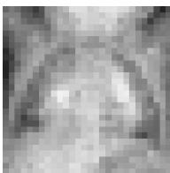

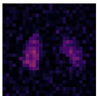

(b) OCT-Drusen  
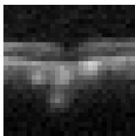

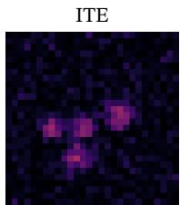

(c) Derma-Melanoma  
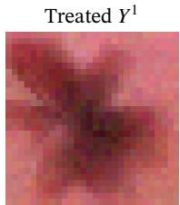

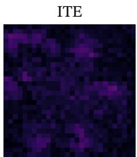  
Figure 1: Semi-synthetic medical-image experiments adapted from MedMNIST (Yang et al., 2021; 2023). Each pair shows a treated potential outcome Y1 and its ground-truth individual treatment efect (ITE).

## 1 Introduction

In causal problems involving structured and high-dimensional outcomes, such as images, text, and graphs, a mean outcome may be undefined or poorly aligned with the structure of the data. For example, comparing protein or text sequences requires choosing a numerical representation or a notion of similarity (Saigo et al., 2004; Lodhi et al., 2002; Reimers & Gurevych, 2019) and comparing images with coordinate-wise averaging ignores the spatial structure of the data (LeCun et al., 1998). Distributional causal inference addresses this by defining the interventional distributions directly on the structured outcome space, without reducing outcomes to an arbitrary scalar summary or notion of averaging (Rothe, 2010; Chernozhukov et al., 2013; Kennedy et al., 2023; Muandet et al., 2021). Kernels define similarities on these spaces (Gärtner, 2003; Borgwardt et al., 2006; Shervashidze et al., 2011) and, through kernel mean embeddings, represent interventional distributions in a reproducing kernel Hilbert space (RKHS) (Smola et al., 2007).

Kernels define the geometry used to compare outcome distributions (Sriperumbudur et al., 2010; Simon-Gabriel & Schölkopf, 2018; Gretton, 2019). If this geometry is fixed a priori, the kernel may be poorly suited to detecting diferences between the interventional distributions, leading to low test power (Gretton et al., 2012a; Sutherland et al., 2017). Deep kernels address this by using neural networks to learn a representation of the outcomes and compare distributions in the resulting space (Wilson et al., 2016). Rather than learning this representation through a reconstruction task, the learned kernel can be optimised by directly maximising a test-power criterion (Sutherland et al., 2017).

We consider two soft interventions π and π′ inducing the outcome distributions $P _ { Y } ^ { \pi }$ and $P _ { Y } ^ { \pi ^ { \prime } }$ . Determining whether an intervention changes the outcome distribution can be formulated as a hypothesis testing problem, testing $H _ { 0 } : P _ { Y } ^ { \pi } = P _ { Y } ^ { \pi ^ { \prime } }$ against $H _ { 1 } : P _ { Y } ^ { \pi } \neq P _ { Y } ^ { \pi ^ { \prime } }$

Treatment efects often need to be estimated from observational data, because experimentation can be costly, unethical or infeasible. In this setting, interventional distributions are not directly observed and must be recovered (Robins, 1986; Hernán & Robins, 2020; Muandet et al., 2021; Zenati et al., 2025b). This can be done by estimating either treatment assignment or the conditional outcome embedding (Song et al., 2009; Grünewälder et al., 2012). However, either approach alone is sensitive to model misspecification. We therefore use a doubly robust estimator, which combines both approaches and remains consistent when either model is correctly specified (Bang & Robins, 2005; Luedtke & Chung, 2024).

In this paper, we introduce DR-KTE-Deep, which combines doubly robust interventional embeddings with deep kernel learning and testing. Our main contributions are: (i) we develop a method for learning deep kernels for tests of interventional distributions, estimating both the distributional discrepancy and the test-power criterion from observational data; (ii) we derive a uniform finite-sample bound for the estimated learning criterion, accounting for both kernel-class complexity and errors in estimating the treatment-assignment and outcome models; (iii) we establish conditional asymptotic validity of the held-out test after nuisance estimation and kernel training and selection; and (iv) we evaluate the method on image, text, and graph outcomes, showing substantial power gains over fixed and bandwidth-optimised doubly robust kernel tests, while maintaining Type-I error close to the nominal level.

The remainder of the paper is organised as follows. Section 3 develops the doubly robust test. Section 4 develops the deep-kernel learning objective. Section 5 evaluates its power and calibration across image, text, and graph outcomes. Section 6 concludes.

## 2 Related Work

Several works study distributional causal efects. Quantile treatment efects characterise changes across an ordered outcome distribution (Abadie et al., 2002; Chernozhukov & Hansen, 2005; Firpo, 2007), while counterfactual distribution and density methods target the full marginal law (Rothe, 2010; Chernozhukov et al., 2013; Kennedy et al., 2023). These methods are typically developed for scalar or finite-dimensional Euclidean outcomes. We instead consider structured outcomes whose interventional distributions must be compared without reducing them to low-dimensional summaries.

Kernel mean embeddings represent interventional outcome distributions in an RKHS. Muandet et al. (2021) introduce counterfactual mean embeddings, while Park et al. (2021), Näf et al. (2026), and Jain & Luedtke (2026) use kernel methods to study conditional distributional treatment efects. For marginal efects, Fawkes et al. (2024) and Martinez-Taboada et al. (2023) develop doubly robust kernel tests, and Zenati et al. (2025b) extend them to general stochastic policies. Finally, Zenati et al. (2026) further consider adaptively collected data. These methods use prescribed outcome kernels, including aggregation over kernel bandwidths, without learning a deep outcome representation. A separate literature uses kernels to estimate causal mean functions through kernel ridge regression (Singh et al., 2024; Kim & Wang, 2026), instrumental variable regression (Singh et al., 2019; Meunier et al., 2024), and proxy bridge learning (Bozkurt et al., 2025; 2026). These approaches use kernels or learned representations for causal function estimation, rather than for comparing interventional outcome distributions.

Other work adapts the kernel or outcome representation to improve test power. Gretton et al. (2012b) optimise the power of linear-time MMD tests over kernel mixtures and analyse convergence of the selection criterion. Sutherland et al. (2017) optimise kernel parameters for two-sample tests, while Liu et al. (2020) learn characteristic deep kernels and prove uniform convergence of their learning criterion. Other approaches combine multiple kernels through aggregation or fusion (Schrab et al., 2023; Biggs et al., 2023). In causal settings, Zenati & Gretton (2026) learn informative witness locations for distributional treatment efects, while Wibisono & Wang (2026) and Durand et al. (2025) learn outcome features or projections to detect causal efects. Our method instead learns the outcome kernel for an omnibus test of marginal interventiona distributions. We estimate the learning criterion from observational data using causal nuisance models and analyse how errors in these models afect the criterion.

## 3 Doubly Robust Kernel Test

Problem Setting. We are given an observational dataset D of N independent and identically distributed (i.i.d.) samples $O _ { 1 } , \ldots , O _ { N } { \sim } _ { \mathrm { i . i . d } } \mathbb { P } _ { 0 }$ , where $O _ { i } = ( X _ { i } , A _ { i } , Y _ { i } ) \in \mathcal { X } \times \mathcal { A } \times \mathcal { Y }$ . X, A, and $\mathcal { V }$ are standard Borel spaces. Write $\mathbb { P } _ { X }$ for the X-marginal of $\mathbb { P } _ { 0 } .$ , and $\mathbb { P } _ { A , X }$ for its treatment-covariate marginal. Let $\rho$ be a σ-finite reference measure on ${ \mathcal { A } } .$ The logging policy assigns $A \mid X = x$ with density $\pi _ { 0 } ( \cdot \mid x )$ relative to $\rho .$ We consider a unit-level potential-outcome setting with no interference between units (Rubin, 2005; Imbens & Rubin, 2015). We compare two soft interventions π and $\pi ^ { \prime }$ with conditional densities $\pi ( \cdot \mid x )$ and $\pi ^ { \prime } ( \cdot \mid x )$ respectively.

Identification. The observational data are generated under the logging policy $\pi _ { 0 }$ , whereas the targets we consider are the outcome distributions under π and $\pi ^ { \prime }$ . To identify these distributions, we work under the standard assumption that the treatment assignment is unconfounded given the observed covariates, and that the interventions assign only treatments supported by the logging policy. We formalise these conditions through the common assumptions below.

Assumption 3.1 (Identification). There exist a standard Borel space U, a U-valued random variable $U _ { ☉ }$ , and a jointly measurable map $F : \mathcal { A } \times \mathcal { X } \times \mathcal { U }  \mathcal { Y }$ such that:

1. Consistency and structural response: $Y = F ( A , X , U )$ almost surely; for every $a \in { \mathcal { A } } _ { \mathrm { : } }$ , define $Y ^ { a } : =$ $F ( a , X , U )$

2. Conditional exogeneity: $U \perp \perp A \mid X$

3. Positivity on intervention support: $\pi _ { 0 } ( a \mid x ) > 0$ whenever $\pi ( a \mid x ) + \pi ^ { \prime } ( a \mid x ) > 0$ , up to a $\mathbb { P } _ { X } \otimes \rho \ – n u l l$ set.

For $p \in \{ \pi , \pi ^ { \prime } \}$ , draw $A ^ { p } \mid X$ with density $p ( \cdot \mid X )$ independently of $U$ given $X ,$ and define $Y ^ { p } : =$ $F ( A ^ { p } , X , \boldsymbol { U } )$ and $P _ { Y } ^ { p } : = \mathcal { L } ( Y ^ { p } )$ . We test $H _ { 0 } : P _ { Y } ^ { \pi } = P _ { Y } ^ { \pi ^ { \prime } }$ against $H _ { 1 } : P _ { Y } ^ { \pi } \neq P _ { Y } ^ { \pi ^ { \prime } }$

Let $Q ( \cdot \mid a , x )$ denote an observational conditional distribution of Y given $( A , X ) \ : = \ : ( a , x )$ . Under Assumption 3.1, the intervention changes the treatment assignment mechanism while preserving the conditional outcome response. The interventional outcome distribution is then identified by the g-formula (Robins, 1986; Hernán & Robins, 2020):

$$
P _ { Y } ^ { p } ( B ) = \int _ { \mathcal { X } } \int _ { \mathcal { A } } Q ( B \mid a , x ) p ( a \mid x ) \rho ( \mathrm { d } a ) \mathbb { P } _ { X } ( \mathrm { d } x ) ,
$$

for every measurable $B \subseteq \mathcal { V }$

This formula averages the conditional outcome distributions over the treatments assigned by p and the covariate distribution of the population. Positivity ensures that this average only involves treatment-covariate pairs supported by the observational data. We establish these claims in Proposition B.1.

Kernel Formulation. To compare distributions over structured outcomes, we represent them as elements of an RKHS. Let $\Theta \subseteq \mathbb { R } ^ { d _ { \Theta } }$ be a non-empty parameter set. For each $\theta \in \Theta$ , let $k _ { \theta } : \mathcal { V } \times \mathcal { V }  \mathbb { R }$ be a positive-semidefinite kernel on $\mathcal { V }$ parameterised by θ with separable RKHS $\mathcal { H } _ { \theta }$ and strongly measurable canonical feature map $\varphi _ { \theta } ( y ) : = k _ { \theta } ( y , \cdot )$

We define the interventional mean embedding (Muandet et al., 2021; Zenati et al., 2025b), embedding contrast, and squared maximum mean discrepancy (MMD) (Gretton et al., 2012a) respectively by

$$
\chi _ { \theta } ( p ) : = \int _ { \mathcal { Y } } \varphi _ { \theta } ( y ) P _ { Y } ^ { p } ( \mathrm { d } y ) , \quad \Delta _ { \theta } ( \pi , \pi ^ { \prime } ) : = \chi _ { \theta } ( \pi ) - \chi _ { \theta } ( \pi ^ { \prime } ) , \quad D _ { \theta } ( \pi , \pi ^ { \prime } ) : = \| \Delta _ { \theta } ( \pi , \pi ^ { \prime } ) \| _ { \mathcal { H } _ { \theta } } ^ { 2 } .
$$

Assumption 3.2 (Embedding integrability). For every $\theta \in \Theta$ and $p \in \{ \pi , \pi ^ { \prime } \}$ , assume $\mathbb { E } _ { \mathbb { P } _ { 0 } } \sqrt { k _ { \theta } ( Y , Y ) } < \infty$ and $\begin{array} { r } { \int _ { \mathcal { V } } \sqrt { k _ { \theta } ( y , y ) } P _ { Y } ^ { p } ( \mathrm { d } y ) < \infty } \end{array}$ . These first moments ensure Bochner integrability under the observed and interventional laws.

If $k _ { \theta }$ is characteristic, testing $H _ { 0 }$ is equivalent to testing $D _ { \theta } ( \pi , \pi ^ { \prime } ) = 0$ (Gretton et al., 2012a, Section 2.2).

Doubly Robust Representation. To estimate $D _ { \theta } ( \pi , \pi ^ { \prime } )$ from observational data, we construct a doubly robust representation of the embedding contrast $\Delta _ { \theta } ( \pi , \pi ^ { \prime } )$ , following Zenati et al. (2025b). We further compare the choice of estimator in Section D.4.

For a fixed $\theta \in \Theta$ , define the conditional outcome mean embedding (Grünewälder et al., 2012) by

$$
\mu _ { \theta } ( a , x ) : = \int _ { \mathcal { V } } \varphi _ { \theta } ( y ) Q ( \mathrm { d } y \mid a , x ) .
$$

We use the null-set convention described in Section B.1. This embedding satisfies $\mu _ { \theta } ( A , X ) = \mathbb { E } _ { \mathbb { P } _ { 0 } } [ \varphi _ { \theta } ( Y ) \mid$ $A , X ]$ almost surely. For ease of notation, write $r ( a , x ) : = \pi ( a \mid x ) - \pi ^ { \prime } ( a \mid x )$ . Let e be a measurable candidate logging-policy density that is positive wherever $| r | > 0$ . Let m be a measurable candidate conditional outcome embedding. We set ratios and integrands weighted by $r \ \mathrm { o r } \ | r |$ to zero where $r = 0$

Define the Hilbert-valued pseudo-feature map

$$
g _ { \theta } ^ { \pi , \pi ^ { \prime } } ( O ; e , m _ { \theta } ) : = \frac { r ( A , X ) } { e ( A \mid X ) } \left\{ \varphi _ { \theta } ( Y ) - m _ { \theta } ( A , X ) \right\} + \int _ { A } r ( a , X ) m _ { \theta } ( a , X ) \rho ( \mathrm { d } a ) .\tag{1}
$$

The second term estimates the embedding contrast through the conditional outcome model, while the first corrects it using propensity-weighted outcome residuals.

We suppress the intervention superscript when no ambiguity arises, $g _ { \theta } ( O ; e , m _ { \theta } ) : = g _ { \theta } ^ { \pi , \pi ^ { \prime } } ( O ; e , m _ { \theta } )$ . The oracle pseudo-feature is then $g _ { \theta } ( O ) : = g _ { \theta } ( O ; \pi _ { 0 } , \mu _ { \theta } )$ . Write $\mathbb { E } _ { 0 }$ for expectation under $\mathbb { P } _ { 0 } .$

Proposition 3.3 (Observed-data representation and double robustness). Suppose Assumptions 3.1 and 3.2 hold and the candidate nuisances satisfy the absolute-integrability conditions of Section B.2. Write $\Delta _ { \theta } : =$ $\Delta _ { \theta } ( \pi , \pi ^ { \prime } )$ . For candidate nuisance functions e and $m _ { \theta }$

$$
\mathbb { E } _ { 0 } \left[ g _ { \theta } ( O ; e , m _ { \theta } ) \right] - \Delta _ { \theta } = \mathbb { E } _ { 0 } \left[ \int _ { A } r ( a , X ) \left\{ \frac { \pi _ { 0 } ( a \mid X ) } { e ( a \mid X ) } - 1 \right\} \left\{ \mu _ { \theta } ( a , X ) - m _ { \theta } ( a , X ) \right\} \rho ( \mathrm { d } a ) \right] .
$$

Thus, $\mathbb { E } _ { 0 } \left[ g _ { \theta } ( O ; e , m _ { \theta } ) \right] = \Delta _ { \theta }$ if either $e = \pi _ { 0 }$ or $m _ { \theta } = \mu _ { \theta }$ on the support of |r|.

A proof is given in Section B.2. We examine the efect of outcome-model misspecification empirically in Section D.5, using a misspecified $m _ { \theta }$ but oracle propensity $e \equiv \pi _ { 0 }$

Test Statistic. Since $D _ { \theta } ( \pi , \pi ^ { \prime } ) = \| \Delta _ { \theta } ( \pi , \pi ^ { \prime } ) \| _ { \mathcal { H } _ { \theta } } ^ { 2 }$ , the embedding contrast vanishes under $H _ { 0 }$ and the induced cross-U kernel over $\mathcal { H } _ { \theta }$ is one-degenerate. We therefore estimate $D _ { \theta } ( \pi , \pi ^ { \prime } )$ by taking the inner product of two independent estimates of $\Delta _ { \theta } ( \pi , \pi ^ { \prime } )$ , following the cross-U and cross-MMD constructions of Kim & Ramdas (2024) and Shekhar et al. (2022).

Let $\scriptstyle { \hat { \pi } } _ { 0 }$ and $\hat { \mu } _ { \boldsymbol { \theta } }$ be nuisance estimators fitted on a sample independent of the evaluation sample, and set $\hat { g } _ { \theta , i } : = g _ { \theta } ( O _ { i } ; \hat { \pi } _ { 0 } , \hat { \mu } _ { \theta } )$ . We split the evaluation sample into two disjoint halves $\mathcal { T } _ { 1 }$ and $\mathcal { T } _ { 2 }$ of size m. Define $\begin{array} { r } { \bar { g } _ { \theta , \ell } : = \frac { 1 } { m } \sum _ { i \in \mathcal { T } _ { \ell } } \hat { g } _ { \theta , i } } \end{array}$ for $\ell \in \{ 1 , 2 \}$ . The cross-MMD and variance estimators are then, respectively,

$$
\widehat { D } _ { \theta } ^ { \mathrm { c r o s s } } : = \langle \bar { g } _ { \theta , 1 } , \bar { g } _ { \theta , 2 } \rangle _ { \mathcal { H } _ { \theta } } = \frac { 1 } { m ^ { 2 } } \sum _ { i \in Z _ { 1 } } \sum _ { j \in Z _ { 2 } } \langle \hat { g } _ { \theta , i } , \hat { g } _ { \theta , j } \rangle _ { \mathcal { H } _ { \theta } } , \quad \hat { s } _ { \theta } ^ { 2 } : = \frac { 1 } { m } \sum _ { j \in Z _ { 2 } } \left( \langle \bar { g } _ { \theta , 1 } , \hat { g } _ { \theta , j } \rangle _ { \mathcal { H } _ { \theta } } - \widehat { D } _ { \theta } ^ { \mathrm { c r o s s } } \right) ^ { 2 } .
$$

Our test statistic is the studentised cross-U statistic

$$
T _ { \theta } : = \sqrt { m } \widehat { D } _ { \theta } ^ { \mathrm { c r o s s } } / \widehat { s } _ { \theta } .\tag{2}
$$

We set $T _ { \theta } = 0$ whenever $\hat { s } _ { \theta } = 0$

Let Φ denote the standard normal distribution function. For a fixed kernel, Theorem 4.3 gives, under the corresponding moment, projected non-degeneracy and nuisance-bias conditions of Assumption B.4, $T _ { \theta } \to ^ { d } \mathcal { N } ( 0 , 1 )$ under $H _ { 0 }$ . Since $D _ { \theta } ( \pi , \pi ^ { \prime } ) > 0$ for a characteristic kernel under $H _ { 1 }$ , large positive values of $T _ { \theta }$ therefore provide evidence against $H _ { 0 }$ . We reject at level α when $\begin{array} { r } { \hat { p } = 1 - \Phi ( T _ { \theta } ) < \alpha . } \end{array}$

## 4 Learning Deep Kernels

Learning Objective. The choice of outcome kernel afects both the population discrepancy $D _ { \theta }$ and the sampling variability of its estimator. We therefore select θ using the signal-to-noise ratio (Gretton et al., 2012b; Sutherland et al., 2017; Liu et al., 2020)

$$
\begin{array} { r } { J _ { \theta } = D _ { \theta } / s _ { \theta } , \qquad \mathrm { w i t h } \ D _ { \theta } : = D _ { \theta } ( \pi , \pi ^ { \prime } ) , \quad s _ { \theta } ^ { 2 } : = \mathrm { V a r } _ { O \sim \mathbb { P } _ { 0 } } \left[ \langle \Delta _ { \theta } , g _ { \theta } ( O ) \rangle _ { \mathcal { H } _ { \theta } } \right] } \end{array}
$$

whenever $s _ { \theta } > 0 . ~ J _ { \theta }$ is unchanged by a global rescaling of the kernel and governs the growth of the studentised test statistic under fixed alternatives.

Proposition 4.1 (Fixed-alternative growth rate). Suppose Assumptions 3.1 and 3.2 hold. For a fixed θ, suppose $D _ { \theta } > 0 , s _ { \theta } > 0$ , and $\mathbb { E } _ { O \sim \mathbb { P } _ { 0 } } [ \| g _ { \theta } ^ { \pi , \pi ^ { \prime } } ( O ) \| _ { \mathcal { H } _ { \theta } } ^ { 4 } ] < \infty$ . Suppose the statistics use the true nuisance functions. Then the cross-MMD and variance estimators satisfy

$$
\widehat { D } _ { \theta } ^ { \mathrm { c r o s s } } \stackrel { \mathbb { P } } {  } D _ { \theta } , \qquad \widehat { s } _ { \theta } ^ { 2 } \stackrel { \mathbb { P } } {  } s _ { \theta } ^ { 2 } , \qquad T _ { \theta } / \sqrt { m } \stackrel { \mathbb { P } } {  } J _ { \theta } .
$$

Experimental Treatment Traditional Treatment Population mean Kernel contour Anchor

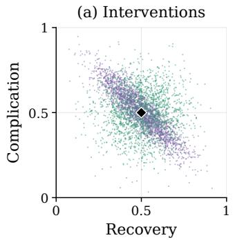

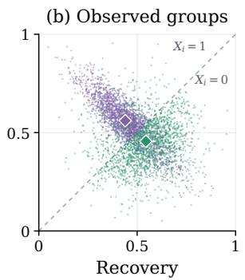

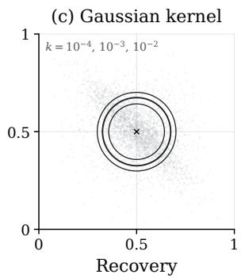

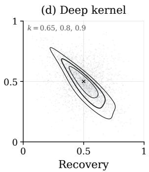  
Figure 2: Synthetic example where treatment assignment is driven by an indicator of disease severity X. The potential-outcome distributions are Gaussians with the same mean, but the traditional-treatment distribution is isotropic while the experimental-treatment distribution is anisotropic. The deep kernel adapts to the geometry of the distributions, while the Gaussian kernel treats points uniformly throughout the outcome space.

A proof is given in Section B.3. Section D.6 further studies the choice of learning criterion. This result motivates maximising $J _ { \theta } ;$ kernels with larger $J _ { \theta }$ yield a test statistic that is asymptotically larger under fixed alternatives. Since $D _ { \theta }$ and $s _ { \theta }$ are unknown, we use the empirical regularised criterion (Jitkrittum et al., 2016; 2017)

$$
\begin{array} { r } { \widehat { J } _ { \lambda , \theta } ^ { \mathrm { D R } } = \widehat { D } _ { \theta } ^ { \mathrm { c r o s s } } / \widehat { s } _ { \theta , \lambda } , } \end{array}\tag{3}
$$

where $\hat { s } _ { \theta , \lambda } ^ { 2 } : = \hat { s } _ { \theta } ^ { 2 } + \lambda$ and $\lambda > 0$ . The regularisation prevents the learning objective from becoming artificially large when the estimated variance $\hat { s } _ { \theta } ^ { 2 }$ is close to zero. It is used only to stabilise kernel selection; the final test statistic remains unregularised.

While the learning criterion can be used to optimise the parameters of a simple kernel family, like the lengthscale of a Gaussian kernel, the kernel still compares outcomes isotropically throughout the outcome space, and may have low power against localised or anisotropic perturbations at finite sample size (Liu et al., 2020, Section 3) (Figure 2).

Deep Kernels. We therefore learn a deep kernel combining a neural component with a base characteristic kernel. Since deep kernel optimisation is sensitive to random initialisation, we train and select an ensemble of M kernels, and average them. Let $\Xi \subseteq \mathbb { R } ^ { d _ { 0 } }$ be the parameter space of a kernel member and let $\theta = ( \vartheta _ { 1 } , \cdot \cdot \cdot , \vartheta _ { M } ) \in \Theta$ collect each $\vartheta _ { b } \in \Xi$ for $b \in [ 1 , M ]$ . Define

$$
k _ { \vartheta _ { b } } ( y , y ^ { \prime } ) = ( 1 - w _ { \vartheta _ { b } } ) \kappa _ { \vartheta _ { b } } \big ( \zeta _ { \vartheta _ { b } } ( y ) , \zeta _ { \vartheta _ { b } } ( y ^ { \prime } ) \big ) + w _ { \vartheta _ { b } } k _ { \vartheta _ { b } } ^ { \mathrm { c h a r } } ( y , y ^ { \prime } ) , \quad k _ { \theta } ( y , y ^ { \prime } ) = \frac { 1 } { M } \sum _ { b = 1 } ^ { M } k _ { \vartheta _ { b } } ( y , y ^ { \prime } ) .\tag{4}
$$

Here $\zeta _ { \vartheta } : \mathcal { V } \to \mathbb { R } ^ { d }$ is a neural feature map, $\kappa _ { \vartheta }$ is a Gaussian kernel on the learned feature space, $k _ { \vartheta } ^ { \mathrm { c h a r } }$ is a characteristic kernel on Y, and $w _ { \vartheta } \in [ w _ { \mathrm { m i n } } , 1 ]$ is a learned mixing parameter where $w _ { \mathrm { m i n } } > 0$

The learned component $\kappa _ { \vartheta _ { b } } ( \zeta _ { \vartheta _ { b } } ( y ) , \zeta _ { \vartheta _ { b } } ( y ^ { \prime } ) )$ adapts the geometry used to distinguish the interventional distributions, while the characteristic component preserves sensitivity to arbitrary distributional diferences.

Lemma 4.2 (Characteristic ensemble safeguard). For every pair of probability laws $P , Q$ for which the component mean embeddings exist,

$$
\mathrm { M M D } _ { k _ { \theta } } ^ { 2 } ( P , Q ) \geq \frac { w _ { \operatorname* { m i n } } } { M } \sum _ { b = 1 } ^ { M } \mathrm { M M D } _ { k _ { \vartheta _ { b } } ^ { \mathrm { c h a r } } } ^ { 2 } ( P , Q ) .\tag{5}
$$

Consequently $k _ { \theta }$ is characteristic for every $\theta \in \Theta$

A proof is given in Section B.4. For every $\theta \in \Theta , D _ { \theta } ( \pi , \pi ^ { \prime } ) = 0$ if and only if the two interventional outcome distributions are equal.

Training and Testing Procedure. We detail the training and testing procedure in Algorithm 1 and Section C.1. D is partitioned into independent learning, validation and testing samples (Gretton et al., 2012b; Liu et al., 2020). We optimise the kernel parameters on the learning sample, select a kernel on the validation sample, and compute $T _ { \theta }$ on the testing sample. The learning sample is split into three disjoint sets ${ \mathcal { D } } _ { \mathrm { f i t } }$ $\mathcal { D } _ { \mathrm { s e l } , 1 }$ , and $\mathcal { D } _ { \mathrm { s e l } , 2 }$ . We fit the nuisance estimators on ${ \mathcal { D } } _ { \mathrm { f i t } }$ and compute $\widehat { J } _ { \lambda , \vartheta _ { b } } ^ { \mathrm { D R } }$ on $\mathcal { D } _ { \mathrm { s e l } , 1 }$ and $\mathcal { D } _ { \mathrm { s e l } , 2 }$ . At each training step, we rotate the roles of the three folds and average the resulting criterion, then optimise each $\vartheta _ { b }$ by gradient ascent. During training, we maintain an exponential moving average (EMA) of each member’s kernel parameters (Tarvainen & Valpola, 2017) and select the EMA checkpoint with the largest unregularised validation statistic.

Let $\mathcal { F } _ { \mathrm { l e a r n } }$ denote the data and randomness used to estimate the nuisances and train and select the deep kernel. The fitted nuisances and selected kernel are therefore fixed when conditioned on $\mathcal { F } _ { \mathrm { l e a r n } } .$ , and the test observations remain independent. We suppose Assumption B.4 holds, including conditional fourth-moment control, non-degenerate projected variance, and a conditional pseudo-feature bias $o _ { \mathbb { P } } ( m ^ { - 1 / 2 } )$ . The latter follows from a corresponding product-rate condition on the nuisance errors (Proposition 3.3).

Theorem 4.3 (Held-out null validity). Suppose Assumption $B . 4$ holds, and set $T _ { \hat { \theta } } = 0$ when $\hat { s } _ { \hat { \theta } } = 0$ . Under $H _ { 0 }$ , as the size m of each test half tends to infinity,

$$
\operatorname* { s u p } _ { t \in \mathbb { R } }  \mathbb { P } ( T _ { \hat { \theta } } \leq t \mid \mathcal { F } _ { \mathrm { l e a r n } } ) - \Phi ( t )  \overset { \mathbb { P } } {  } 0 .\tag{6}
$$

Consequently, $T _ { \hat { \theta } } \stackrel { d } {  } \mathcal { N } ( 0 , 1 )$ and the test has asymptotic level α for every fixed $\alpha \in ( 0 , 1 )$

A proof is given in Section B.6. The result is conditional on the full learning procedure and does not require the optimised parameters to converge to a deterministic kernel.

Uniform Control of the Learning Criterion. We provide a uniform analysis of the learning criterion (see also Gretton et al. (2012b, Theorem 1), Liu et al. (2020, Theorem 11)) with the fitted nuisances $\scriptstyle { \hat { \pi } } _ { 0 }$ and $\hat { \mu } _ { \boldsymbol { \theta } }$ , which will introduce a nuisance estimation error. The bound does not guarantee that training attains a global maximiser. Define

$$
J _ { \lambda , \theta } : = \frac { D _ { \theta } } { \sqrt { s _ { \theta } ^ { 2 } + \lambda } } , \qquad \lambda > 0 .\tag{7}
$$

Let the nuisance-fitting sample have size n and each selection half have size m. Write ${ \mathcal { F } } _ { \mathrm { f i t } }$ for the data and randomness used to fit the nuisance functions. The nuisance functions are therefore fixed when conditioned on ${ \mathcal { F } } _ { \mathrm { f i t } }$ , but retain their dependence on θ.

On a compact finite-dimensional parameter class, we impose the conditions of Assumption B.5. These require the fitted kernels, constructed from $k _ { \theta }$ and the nuisance estimates, to be bounded and Lipschitz in θ, together with overlap and measurability conditions.

Theorem 4.4 (Uniform feasible learning criterion). Let Assumptions B.5 and 3.1 hold and fix $\lambda _ { 0 } > 0$ . Let $\epsilon _ { \pi , n } ^ { 2 }$ and $\epsilon _ { \mu , n } ^ { 2 }$ be the nuisance errors conditional on ${ \mathcal { F } } _ { \mathrm { f i t } }$ defined in Section B. For every $\lambda \geq \lambda _ { 0 }$ and $\eta \in ( 0 , 1 )$ there is a finite constant $C ,$ depending only on the constants in Assumption B.5 and $\lambda _ { 0 } .$ such that, with conditional probability at least $1 - \eta$ over the two selection halves,

$$
\operatorname* { s u p } _ { \theta \in \Theta } | \widehat { J } _ { \lambda , \theta } ^ { \mathrm { D R } } - J _ { \lambda , \theta } | \leq C \left\{ \frac { \sqrt { d _ { \Theta } \log ( 1 + 2 R _ { \Theta } \sqrt { m } ) + \log ( 4 / \eta ) } + 1 } { \sqrt { m } } + \epsilon _ { \pi , n } \epsilon _ { \mu , n } + \epsilon _ { \pi , n } + \epsilon _ { \mu , n } ^ { 2 } \right\} .\tag{8}
$$

For three cyclic rotations of the learning folds satisfying the same regularity constants, the averaged criterion obeys the analogous bound with unconditional probability at least $1 - 3 \eta$ , with the nuisance remainder averaged over rotations.

The uniform bound separates sampling error from nuisance-estimation error. The MMD numerator retains the doubly robust product remainder $\epsilon _ { \pi , n } \epsilon _ { \mu , n } .$ . Estimating $s _ { \theta } ^ { 2 }$ introduces additional terms $\epsilon _ { \pi , n }$ and $\epsilon _ { \mu , n } ^ { 2 }$ . For fixed class constants and confidence level, the sampling term is $O ( \sqrt { \log m / m } )$ , which is asymptotically faster than the $O ( m ^ { - 1 / 3 } )$ of Gretton et al. (2012b, Theorem 1), Liu et al. (2020, Theorem 11).

Theorem 4.4 controls $J _ { \lambda , \theta }$ uniformly over the full parameter class Θ for λ bounded away from zero. On subclasses where the variance is bounded below,

$$
\begin{array} { r } { \Theta _ { s } : = \{ \theta \in \Theta : s _ { \theta } ^ { 2 } \geq s ^ { 2 } \} , } \end{array}
$$

the results in Section B allow $\lambda _ { m } \to 0$ and yield uniform approximation to the unregularised criterion $J _ { \theta }$ The comparison with earlier rates follows the proof of Theorem B.13.

Since each kernel member is trained separately, we apply these results setting $M = 1 , \Theta = \Xi$ and $d _ { \Theta } = d _ { 0 }$ under the corresponding assumptions. With $M > 1$ , Proposition B.3 gives $J _ { \lambda , \theta } \geq \operatorname* { m i n } _ { b } J _ { \lambda , \vartheta _ { b } }$ for $\lambda \geq 0$ with positive denominators. Conditional on the common learning and validation data and shared training randomness, independent and identically distributed member training reduces the training-randomness variance of the population discrepancy by a factor of $1 / M$ . Proposition B.3 establishes these population guarantees. Section D.8 studies the efect of ensemble size on test power. Section D.12 analyses the efect of jointly maximising the averaged criterion.

## 5 Experimental Evaluation

We evaluate our doubly robust deep kernel test, DR-KTE-Deep, on image, text and graph outcomes. Evaluations on low-dimensional outcomes are included in Section D. We compare our method with DR-KTE (Martinez-Taboada et al., 2023), which uses a fixed Gaussian kernel, and DR-KTE-Opt, which optimises the lengthscale of a Gaussian kernel. Experimental details are given in Section C. Section D.10 additionally compares our method to linear kernels. All methods are fitted and evaluated using the same total sample size. Our code is available at https://www.github.com/robinlmn/deep-kte.

We learn the deep kernel and nuisance parameters on $\mathcal { D } _ { \mathrm { l e a r n } } .$ , sampled from the dataset’s training pool, and select the kernel on $\mathcal { D } _ { \mathrm { v a l } }$ , sampled from the validation pool. We then refit the nuisances on $\mathcal { D } _ { \mathrm { l e a r n } } \cup \mathcal { D } _ { \mathrm { v a l } }$ and estimate the rejection rate at $\alpha = 0 . 0 5$ over 200 test datasets $\mathcal { D } _ { \mathrm { t e s t } }$ , sampled from the testing pool. We repeat this process over 20 independent outer repetitions and report the mean rejection rate ± one standard error across the outer repetitions.

Image Outcomes. We first evaluate our method on mean-preserving distributional efects on medical-image outcomes. We extend the OCTMNIST construction of Zenati & Gretton (2026). Potential outcomes are constructed as $Y _ { i } ^ { a } = B _ { i } + R _ { i } ( a )$ where $B _ { i }$ is sampled from normal or healthy MedMNIST images (Yang et al., 2023) and $R _ { i } ( a )$ is a medically motivated perturbation representing a localised lesion, scattered deposits, or morphological changes. We scale the perturbation by an efect strength δ. The residual construction is mean-matched, $\mathbb { E } [ Y _ { i } ^ { 1 } - Y _ { i } ^ { 0 } \mid X _ { i } ] = 0$ , such that the efect is mainly distributional under the alternative. We consider ten constructions, three of which are illustrated in Figure 1. Section C.2 details the full generative process.

DR-KTE-Deep achieves substantially higher estimated power than the baselines on all constructions (Table 1), while DR-KTE-Opt only slightly improves power over the fixed kernel. Under $H _ { 0 }$ , rejection rates across the three methods remain close to the nominal level of $\alpha = 0 . 0 5$ , with only a slight inflation for

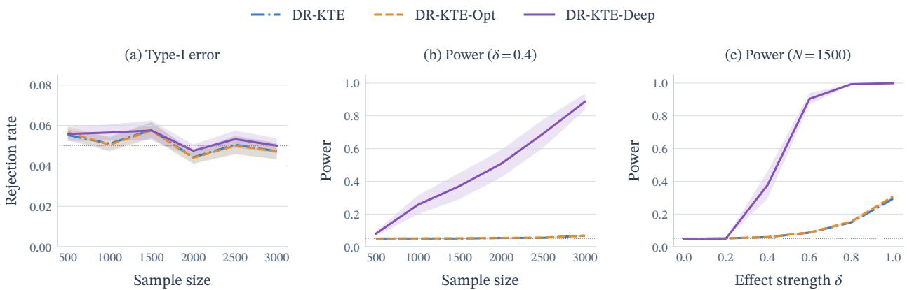

OCT-DME. In Figure 3, the power of the deep kernel grows with sample size and efect strength, while Gaussian baselines remain near the nominal rejection rate across the sample-size sweep.
<table><tr><td>Scenario</td><td>DR-KTE</td><td>DR-KTE-Opt</td><td>DR-KTE-Deep</td></tr><tr><td>Breast-Tumor</td><td> $0 . 7 4 9 { \scriptstyle \pm 0 . 0 1 8 } / 0 . 0 5 3 { \scriptstyle \pm 0 . 0 0 3 }$ </td><td> $0 . 7 6 1 { \scriptstyle \pm 0 . 0 1 7 } / 0 . 0 5 1 { \scriptstyle \pm 0 . 0 0 3 }$ </td><td> $\mathbf { 0 . 9 8 9 { \pm 0 . 0 0 2 } } / 0 . 0 5 4 { \pm 0 . 0 0 3 }$ </td></tr><tr><td>Chest-Cardiomegaly</td><td> $0 . 1 5 6 { \scriptstyle \pm 0 . 0 0 7 } / 0 . 0 5 0 { \scriptstyle \pm 0 . 0 0 3 }$ </td><td> $0 . 1 5 8 { \scriptstyle \pm 0 . 0 0 8 } / 0 . 0 5 0 { \scriptstyle \pm 0 . 0 0 3 }$ </td><td> $\mathbf { 0 . 9 2 8 { \scriptstyle \pm 0 . 0 4 6 } } / 0 . 0 5 1 { \scriptstyle \pm 0 . 0 0 4 }$ </td></tr><tr><td>Chest-Effusion</td><td> $0 . 2 3 1 { \scriptstyle \pm 0 . 0 0 9 } / 0 . 0 5 3 { \scriptstyle \pm 0 . 0 0 4 }$ </td><td> $0 . 2 4 5 { \scriptstyle \pm 0 . 0 1 1 } / 0 . 0 5 3 { \scriptstyle \pm 0 . 0 0 4 }$ </td><td> $\mathbf { 0 . 9 9 9 { \scriptstyle \pm 0 . 0 0 0 } } / 0 . 0 4 8 { \scriptstyle \pm 0 . 0 0 4 }$ </td></tr><tr><td>Chest-Mass</td><td> $0 . 4 3 6 { \scriptstyle \pm 0 . 0 1 8 } / 0 . 0 5 0 { \scriptstyle \pm 0 . 0 0 3 }$ </td><td> $0 . 4 6 1 { \scriptstyle \pm 0 . 0 1 9 } / 0 . 0 5 0 { \scriptstyle \pm 0 . 0 0 3 }$ </td><td> $\mathbf { 1 . 0 0 0 { \pm 0 . 0 0 0 } } / 0 . 0 5 6 { \pm 0 . 0 0 4 }$ </td></tr><tr><td>Derma-Melanoma</td><td> $0 . 1 7 1 { \scriptstyle \pm 0 . 0 0 9 } / 0 . 0 5 1 { \scriptstyle \pm 0 . 0 0 2 }$ </td><td> $0 . 1 7 2 { \scriptstyle \pm 0 . 0 0 9 } / 0 . 0 5 0 { \scriptstyle \pm 0 . 0 0 2 }$ </td><td> $\mathbf { 0 . 8 9 8 { \scriptstyle \pm 0 . 0 4 0 } } / 0 . 0 5 3 { \scriptstyle \pm 0 . 0 0 4 }$ </td></tr><tr><td>OCT-CNV</td><td> $0 . 9 0 7 { \scriptstyle \pm 0 . 0 1 4 } / 0 . 0 5 2 { \scriptstyle \pm 0 . 0 0 3 }$ </td><td> $0 . 9 1 7 { \scriptstyle \pm 0 . 0 1 4 } / 0 . 0 5 1 { \scriptstyle \pm 0 . 0 0 3 }$ </td><td> $\mathbf { 1 . 0 0 0 { \pm 0 . 0 0 0 } } / 0 . 0 5 3 { \pm 0 . 0 0 3 }$ </td></tr><tr><td>OCT-DME</td><td> $0 . 1 3 9 { \scriptstyle \pm 0 . 0 0 8 } / 0 . 0 5 5 { \scriptstyle \pm 0 . 0 0 4 }$ </td><td> $0 . 1 4 4 { \scriptstyle \pm 0 . 0 0 8 } / 0 . 0 5 5 { \scriptstyle \pm 0 . 0 0 4 }$ </td><td> $\mathbf { 1 . 0 0 0 { \pm 0 . 0 0 0 } } / 0 . 0 6 3 { \pm 0 . 0 0 5 }$ </td></tr><tr><td>OCT-Drusen</td><td> $0 . 0 5 1 { \scriptstyle \pm 0 . 0 0 3 } / 0 . 0 5 8 { \scriptstyle \pm 0 . 0 0 4 }$ </td><td> $0 . 0 5 2 { \scriptstyle \pm 0 . 0 0 3 } / 0 . 0 5 8 { \scriptstyle \pm 0 . 0 0 4 }$ </td><td> $\mathbf { 0 . 3 7 1 { \pm } 0 . 0 8 0 } / 0 . 0 5 8 { \pm } 0 . 0 0 5$ </td></tr><tr><td>Pneumonia</td><td> $0 . 8 5 7 { \scriptstyle \pm 0 . 0 2 1 } / 0 . 0 5 5 { \scriptstyle \pm 0 . 0 0 3 }$ </td><td> $0 . 8 7 1 { \scriptstyle \pm 0 . 0 2 0 } / 0 . 0 5 6 { \scriptstyle \pm 0 . 0 0 3 }$ </td><td> $\mathbf { 0 . 9 9 8 { \scriptstyle \pm 0 . 0 0 1 } } / 0 . 0 5 3 { \scriptstyle \pm 0 . 0 0 4 }$ </td></tr><tr><td>Retina-Severe</td><td> $0 . 2 8 5 { \scriptstyle \pm 0 . 0 1 5 } / 0 . 0 5 0 { \scriptstyle \pm 0 . 0 0 3 }$ </td><td> $0 . 2 8 8 { \scriptstyle \pm 0 . 0 1 5 } / 0 . 0 4 9 { \scriptstyle \pm 0 . 0 0 3 }$ </td><td> $\mathbf { 0 . 9 5 9 { \pm 0 . 0 0 8 } } / 0 . 0 5 2 { \pm 0 . 0 0 3 }$ </td></tr></table>

Table 1: Power $\left( H _ { 1 } \right)$ and Type-I error (H0) for medical-image outcomes at $N = 1 5 0 0$ and $\alpha = 0 . 0 5$ . Each cell reports $H _ { 1 } / H _ { 0 }$ , with means ± one standard error across 20 independent repetitions.  
Figure 3: Results for OCT-Drusen. (a) Type-I error under $H _ { 0 } ,$ , (b) average power when varying N while keeping $\delta = 0 . 4$ fixed, (c) average power when varying δ while keeping N = 1500 fixed. Shaded bands show ± one standard error across 20 independent repetitions. The dotted grey line marks $\alpha = 0 . 0 5$

Text Outcomes. We now evaluate our method on text outcomes, using a language model to generate synthetic data under the assumed causal structure (Bynum & Cho, 2025). Covariates and treatments generate a scalar pseudo-outcome, discretised into one of three tones used to condition the language model. We consider three scenarios: Oncology Notes, Movie Reviews and Clinical Notes. The generated text is represented as a sequence of tokens and used as input to each kernel method. Construction details are given in Section C.3. Section D.7 additionally compares each method through an alternative text embedding outcome representation.

DR-KTE-Deep achieves the highest estimated power (Table 2), with substantial gains on Oncology Notes and Clinical Notes and smaller improvements on Movie Reviews. Under $H _ { 0 } ,$ , average rejection rates are close to the nominal level of $\alpha = 0 . 0 5$ . In Figure 4, we vary the sample size N and a treatment-efect strength δ. DR-KTE-Deep maintains higher power across all sample sizes, with larger gains as δ increases.

<table><tr><td>Scenario</td><td>DR-KTE</td><td>DR-KTE-Opt</td><td>DR-KTE-Deep</td></tr><tr><td>Oncology Notes</td><td> $0 . 3 7 1 { \scriptstyle \pm 0 . 0 1 5 } / 0 . 0 4 8 { \scriptstyle \pm 0 . 0 0 3 }$ </td><td> $0 . 3 7 1 { \scriptstyle \pm 0 . 0 1 5 } / 0 . 0 4 8 { \scriptstyle \pm 0 . 0 0 3 }$ </td><td> $\mathbf { 0 . 8 0 9 { \scriptstyle \pm 0 . 0 2 3 } } / 0 . 0 5 5 { \scriptstyle \pm 0 . 0 0 3 }$ </td></tr><tr><td>Movie Reviews</td><td> $0 . 2 5 5 { \scriptstyle \pm 0 . 0 1 2 } / 0 . 0 5 0 { \scriptstyle \pm 0 . 0 0 3 }$ </td><td> $0 . 2 5 4 { \scriptstyle \pm 0 . 0 1 2 } / 0 . 0 5 0 { \scriptstyle \pm 0 . 0 0 3 }$ </td><td> $\mathbf { 0 . 4 4 9 { \scriptstyle \pm 0 . 0 2 6 } } / 0 . 0 5 3 { \scriptstyle \pm 0 . 0 0 4 }$ </td></tr><tr><td>Clinical Notes</td><td> $0 . 0 5 8 { \scriptstyle \pm 0 . 0 0 4 } / 0 . 0 5 2 { \scriptstyle \pm 0 . 0 0 3 }$ </td><td> $0 . 0 5 8 { \scriptstyle \pm 0 . 0 0 4 } / 0 . 0 5 1 { \scriptstyle \pm 0 . 0 0 3 }$ </td><td> $\mathbf { 0 . 9 3 9 { \scriptstyle \pm 0 . 0 1 3 / 0 . 0 5 8 \pm 0 . } }$  004</td></tr></table>

Table 2: Power $\left( H _ { 1 } \right)$ and Type-I error $\left( H _ { 0 } \right)$ for text outcomes, represented as a sequence of tokens, at $N = 1 5 0 0$ and $\alpha = 0 . 0 5$ . Each cell reports $H _ { 1 } / H _ { 0 } ,$ , with means ± one standard error across 20 independent repetitions.

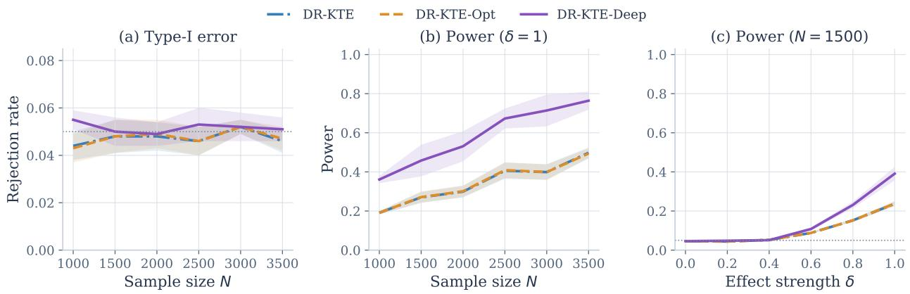  
Figure 4: Results for Movie Reviews. (a) Type-I error under $H _ { 0 } ,$ (b) average test power when varying N while keeping $\delta = 1 . 0$ fixed, (c) average test power when varying δ while keeping $N = 1 5 0 0$ fixed. Shaded bands show $\pm$ one standard error across 20 independent repetitions. The dotted grey line marks $\alpha = 0 . 0 5$

Graph Outcomes. We consider two experiments in which the outcome is a labelled graph. For LLM Code Repairs, we simulate the efect of using a large language model (LLM) to fix a buggy Python function represented as its abstract syntax tree (AST). For Contact Networks, we simulate the efect of social distancing on the spread of an infection using contact networks sampled from the Infectious SocioPatterns dataset (Isella et al., 2011). The graph constructions and encodings are detailed in Section C.4. In addition to Gaussian-based kernels, we evaluate Weisfeiler-Lehman (WL) subtree kernels (Shervashidze et al., 2011) in Section D.9.

DR-KTE-Deep achieves higher estimated average power on both LLM Code Repairs and Contact Networks, with smaller improvements on the latter. The Gaussian baselines already have high power on both constructions. Under $H _ { 0 }$ , rejection rates range from 0.048 to 0.052, close to the nominal level (Table 3).
<table><tr><td>Scenario</td><td>DR-KTE</td><td>DR-KTE-Opt</td><td>DR-KTE-Deep</td></tr><tr><td>LLM Code Repairs</td><td> $0 . 9 6 8 { \scriptstyle \pm 0 . 0 0 8 } / 0 . 0 4 8 { \scriptstyle \pm 0 . 0 0 4 }$ </td><td> $0 . 9 6 3 { \scriptstyle \pm 0 . 0 0 9 } / 0 . 0 4 8 { \scriptstyle \pm 0 . 0 0 4 }$ </td><td> $\mathbf { 1 . 0 0 0 { \pm 0 . 0 0 0 } } / 0 . 0 5 1 { \pm 0 . 0 0 3 }$ </td></tr><tr><td>Contact Networks</td><td> $0 . 9 5 9 { \scriptstyle \pm 0 . 0 0 6 } / 0 . 0 5 2 { \scriptstyle \pm 0 . 0 0 3 }$ </td><td> $0 . 9 5 8 { \scriptstyle \pm 0 . 0 0 6 } / 0 . 0 5 2 { \scriptstyle \pm 0 . 0 0 3 }$ </td><td> $\mathbf { 0 . 9 6 2 { \pm 0 . 0 0 6 } } / 0 . 0 5 1 { \pm 0 . 0 0 2 }$ </td></tr></table>

Table 3: Power $\left( H _ { 1 } \right)$ and Type-I error $\left( H _ { 0 } \right)$ for graph outcomes at $N = 1 5 0 0$ . Each cell reports $H _ { 1 } / H _ { 0 }$ , with means ± one standard error across 20 outer repetitions.

## 6 Discussion

In this paper, we introduced DR-KTE-Deep, a doubly robust test of interventional distributions. We learned a deep outcome kernel by maximising an estimated power criterion, allowing the kernel to adapt to the geometry of the outcome space. We established conditional asymptotic null validity after kernel learning and selection, and a uniform finite-sample bound for the regularised learning criterion. DR-KTE-Deep achieved substantially higher empirical power than fixed and bandwidth-optimised baselines, while maintaining Type-I error close to the nominal level. Section D further motivates our choice of estimator and learning objective, and examines how outcome-model misspecification, outcome representation, ensemble size and outcome dimension afect the test. We use separate samples to learn the kernel and compute the test statistic. Future work could investigate whether reusing observations can further improve power while maintaining Type-I error control. We also restrict the test to two interventions, fixed in advance. Future work could extend our method to multiple candidate interventions.

## AI Use Statement

Language models were used to generate synthetic text outcomes for our experiments, as described in Section C.3. We also used generative AI for coding assistance, primarily for plotting and running scripts. We also used generative AI for proof strategies and checking theoretical results. Finally, we used generative AI to proofread and improve writing and clarity. The synthetic text datasets were manually checked by the authors for quality. LLM-generated code was verified and tested for correctness by the authors. We take responsibility for the final content of this work, including text, claims or artifacts produced with the aid of generative AI.

## References

Alberto Abadie, Joshua Angrist, and Guido Imbens. Instrumental variables estimates of the efect of subsidized training on the quantiles of trainee earnings. Econometrica, 70(1):91–117, 2002. doi: 10.1111/1468-0262.00 270.

Walid Al-Dhabyani, Mohammed Gomaa, Hussien Khaled, and Aly Fahmy. Dataset of breast ultrasound images. Data in Brief, 28:104863, 2020.

H. Bang and J. M. Robins. Doubly robust estimation in missing data and causal inference models. Biometrics, 61(4):962–973, 2005.

Satarupa Bhattacharjee, Bing Li, Xiao Wu, and Lingzhou Xue. Doubly robust estimation of causal efects for random object outcomes with continuous treatments. arXiv preprint arXiv:2506.22754, 2025.

Felix Biggs, Antonin Schrab, and Arthur Gretton. MMD-Fuse: Learning and combining kernels for two-sample testing without data splitting. In Advances in Neural Information Processing Systems, volume 36, 2023. URL https://proceedings.neurips.cc/paper\_files/paper/2023/hash/edd00cead3425393baf1300 4de993017-Abstract.html.

Karsten M Borgwardt, Arthur Gretton, Malte J Rasch, Hans-Peter Kriegel, Bernhard Schölkopf, and Alex J Smola. Integrating structured biological data by kernel maximum mean discrepancy. Bioinformatics, 22 (14):e49–e57, 2006.

Bariscan Bozkurt, Houssam Zenati, Dimitri Meunier, Liyuan Xu, and Arthur Gretton. Density ratio-free doubly robust proxy causal learning. In Advances in Neural Information Processing Systems, 2025.

Bariscan Bozkurt, Alexandre Galashov, Dimitri Meunier, Zikai Shen, Arthur Gretton, and Houssam Zenati. Doubly robust proxy causal learning with neural mean embeddings, 2026. URL https://arxiv.org/abs/ 2605.09514.

Lucius E.J. Bynum and Kyunghyun Cho. Language models as causal efect generators. In Proceedings of the 2025 Conference on Empirical Methods in Natural Language Processing, pp. 2096–2115, Suzhou, China, 2025. Association for Computational Linguistics. doi: 10.18653/v1/2025.emnlp-main.107. URL https://aclanthology.org/2025.emnlp-main.107/.

Victor Chernozhukov and Christian Hansen. An IV model of quantile treatment efects. Econometrica, 73(1): 245–261, 2005. doi: 10.1111/j.1468-0262.2005.00570.x.

Victor Chernozhukov, Iván Fernández-Val, and Blaise Melly. Inference on counterfactual distributions. Econometrica, 81(6):2205–2268, 2013.

Kyle Colangelo and Ying-Ying Lee. Double Debiased Machine Learning Nonparametric Inference with Continuous Treatments. Technical report, 2020. URL https://arxiv.org/pdf/2004.03036.

Homer Durand, Gherardo Varando, and Gustau Camps-Valls. Learning causal response representations through direct efect analysis. In Proceedings of the Forty-first Conference on Uncertainty in Artificial Intelligence, volume 286 of Proceedings of Machine Learning Research, pp. 1135–1166, 2025. URL https: //proceedings.mlr.press/v286/durand25a.html.

Ramtin Ehsani, Esteban Parra, Sonia Haiduc, and Preetha Chatterjee. Hierarchical knowledge injection for improving LLM-based program repair. In Proceedings of the 40th IEEE/ACM International Conference on Automated Software Engineering (ASE), pp. 1440–1452. IEEE, 2025. doi: 10.1109/ASE63991.2025.00122.

Jake Fawkes, Robert Hu, Robin J. Evans, and Dino Sejdinovic. Doubly robust kernel statistics for testing distributional treatment efects. Transactions on Machine Learning Research, 2024.

Sergio Firpo. Eficient semiparametric estimation of quantile treatment efects. Econometrica, 75(1):259–276, 2007. doi: 10.1111/j.1468-0262.2007.00738.x.

Thomas Gärtner. A survey of kernels for structured data. ACM SIGKDD explorations newsletter, 5(1):49–58, 2003.

Arthur Gretton. Introduction to RKHS, and some simple kernel algorithms. Lecture notes, University College London, 2019. URL https://www.gatsby.ucl.ac.uk/\~gretton/coursefiles/lecture4\_introToRKHS. pdf.

Arthur Gretton, Karsten M Borgwardt, Malte J Rasch, Bernhard Schölkopf, and Alexander Smola. A kernel two-sample test. The Journal of Machine Learning Research, 13(25):723–773, 2012a.

Arthur Gretton, Dino Sejdinovic, Heiko Strathmann, Sivaraman Balakrishnan, Massimiliano Pontil, Kenji Fukumizu, and Bharath K. Sriperumbudur. Optimal kernel choice for large-scale two-sample tests. In Advances in Neural Information Processing Systems, volume 25, pp. 1205–1213, 2012b. URL https: //proceedings.neurips.cc/paper/2012/hash/dbe272bab69f8e13f14b405e038deb64-Abstract.html.

Stefen Grünewälder, Guy Lever, Luca Baldassarre, Sam Patterson, Arthur Gretton, and Massimiliano Pontil. Conditional mean embeddings as regressors. In International Conference on Machine Learning, 2012.

Miguel A. Hernán and James M. Robins. Causal Inference: What If. Chapman & Hall/CRC, Boca Raton, 2020.

Guido W. Imbens and Donald B. Rubin. Causal Inference for Statistics, Social, and Biomedical Sciences: An Introduction. Cambridge University Press, 2015.

Lorenzo Isella, Juliette Stehlé, Alain Barrat, Ciro Cattuto, Jean-François Pinton, and Wouter Van den Broeck. What’s in a crowd? Analysis of face-to-face behavioral networks. Journal of Theoretical Biology, 271(1): 166–180, 2011. doi: 10.1016/j.jtbi.2010.11.033.

Saksham Jain and Alex Luedtke. Conditional distributional treatment efects: Doubly robust estimation and testing. In International Conference on Machine Learning, 2026. URL https://arxiv.org/abs/2603.1 6829. In press.

Wittawat Jitkrittum, Zoltán Szabó, Kacper P Chwialkowski, and Arthur Gretton. Interpretable distribution features with maximum testing power. In D. Lee, M. Sugiyama, U. Luxburg, I. Guyon, and R. Garnett (eds.), Advances in Neural Information Processing Systems, volume 29. Curran Associates, Inc., 2016.

Wittawat Jitkrittum, Wenkai Xu, Zoltan Szabo, Kenji Fukumizu, and Arthur Gretton. A linear-time kernel goodness-of-fit test. In I. Guyon, U. Von Luxburg, S. Bengio, H. Wallach, R. Fergus, S. Vishwanathan, and R. Garnett (eds.), Advances in Neural Information Processing Systems, volume 30. Curran Associates, Inc., 2017.

Edward H. Kennedy, Sivaraman Balakrishnan, and Larry Wasserman. Semiparametric counterfactual density estimation. Biometrika, 110(4):875–896, 2023. doi: 10.1093/biomet/asad017. URL https: //doi.org/10.1093/biomet/asad017.

Ilmun Kim and Aaditya Ramdas. Dimension-agnostic inference using cross U-statistics. Bernoulli, 30(1): 683–711, 2024.

Seok-Jin Kim and Kaizheng Wang. Estimating Continuous Treatment Efects with Two-Stage Kernel Ridge Regression. In International Conference on Machine Learning, 2026.

Diederik P. Kingma and Jimmy Ba. Adam: A method for stochastic optimization. In International Conference on Learning Representations, 2015. URL https://arxiv.org/abs/1412.6980.

Yann LeCun, Léon Bottou, Yoshua Bengio, and Patrick Hafner. Gradient-based learning applied to document recognition. Proceedings of the IEEE, 86(11):2278–2324, 1998. doi: 10.1109/5.726791.

Feng Liu, Wenkai Xu, Jie Lu, Guangquan Zhang, Arthur Gretton, and Danica J. Sutherland. Learning deep kernels for non-parametric two-sample tests. In Proceedings of the 37th International Conference on Machine Learning, volume 119 of Proceedings of Machine Learning Research, pp. 6316–6326, 2020. URL https://proceedings.mlr.press/v119/liu20m.html.

Ruhan Liu, Xiangning Wang, Qiang Wu, Ling Dai, Xi Fang, Tao Yan, Jaemin Son, Shiqi Tang, Jiang Li, Zijian Gao, Adrian Galdran, J. M. Poorneshwaran, Hao Liu, Jie Wang, Yerui Chen, Prasanna Porwal, Gavin Siew Wei Tan, Xiaokang Yang, Chao Dai, Haitao Song, Mingang Chen, Huating Li, Weiping Jia, Dinggang Shen, Bin Sheng, and Ping Zhang. DeepDRiD: Diabetic retinopathy-grading and image quality estimation challenge. Patterns, 3(6):100512, 2022. doi: 10.1016/j.patter.2022.100512.

Huma Lodhi, Craig Saunders, John Shawe-Taylor, Nello Cristianini, and Chris Watkins. Text classification using string kernels. Journal of Machine Learning Research, 2:419–444, 2002.

Alex Luedtke and Incheoul Chung. One-step estimation of diferentiable Hilbert-valued parameters. The Annals of Statistics, 52(4):1534 – 1563, 2024.

Alexander R. Luedtke, Marco Carone, and Mark J. van der Laan. An omnibus non-parametric test of equality in distribution for unknown functions. Journal of the Royal Statistical Society: Series B (Statistical Methodology), 81(1):75–99, 2019. doi: 10.1111/rssb.12299.

Diego Martinez-Taboada, Aaditya Ramdas, and Edward H. Kennedy. An eficient doubly-robust test for the kernel treatment efect. In Advances in Neural Information Processing Systems, volume 36, pp. 59924–59952, 2023. URL https://proceedings.neurips.cc/paper\_files/paper/2023/hash/bccdd196d798a51a496 1989984a9ed4a-Abstract-Conference.html.

Dimitri Meunier, Zhu Li, Tim Christensen, and Arthur Gretton. Nonparametric instrumental regression via kernel methods is minimax optimal, 2024. URL https://arxiv.org/abs/2411.19653.

Krikamol Muandet, Motonobu Kanagawa, Sorawit Saengkyongam, and Sanparith Marukatat. Counterfactual mean embeddings. Journal of Machine Learning Research, 22(162):1–71, 2021.

Jefrey Näf, Junhyung Park, and Herbert Susmann. Causal-drf: Conditional kernel treatment efect estimation using distributional random forest. In Proceedings of the 29th International Conference on Artificial Intelligence and Statistics, volume 300 of Proceedings of Machine Learning Research, pp. 1000–1008. PMLR, 2026.

Harish Nair. MTSamples. Hugging Face dataset, 2024. URL https://huggingface.co/datasets/harish nair04/mtsamples.

M. E. J. Newman. Spread of epidemic disease on networks. Phys. Rev. E, 66:016128, Jul 2002. doi: 10.1103/PhysRevE.66.016128. URL https://link.aps.org/doi/10.1103/PhysRevE.66.016128.

Bo Pang and Lillian Lee. Seeing stars: Exploiting class relationships for sentiment categorization with respect to rating scales. In Proceedings of the 43rd Annual Meeting of the Association for Computational Linguistics, pp. 115–124, 2005. doi: 10.3115/1219840.1219855. URL https://aclanthology.org/P05-1015/.

Junhyung Park, Uri Shalit, Bernhard Schölkopf, and Krikamol Muandet. Conditional distributional treatment efect with kernel conditional mean embeddings and U-statistic regression. In Proceedings of the 38th International Conference on Machine Learning, volume 139 of Proceedings of Machine Learning Research, pp. 8401–8412, 2021. URL https://proceedings.mlr.press/v139/park21c.html.

Nils Reimers and Iryna Gurevych. Sentence-BERT: Sentence embeddings using Siamese BERT-networks. In Proceedings of the 2019 Conference on Empirical Methods in Natural Language Processing and the 9th International Joint Conference on Natural Language Processing, pp. 3982–3992. Association for Computational Linguistics, 2019. doi: 10.18653/v1/D19-1410.

JM Robins. A new approach to causal inference in mortality studies with a sustained exposure period - application to control of the healthy worker survivor efect. Mathematical Modelling, 7:1393–1512, 1986.

Christoph Rothe. Nonparametric estimation of distributional policy efects. Journal of Econometrics, 155(1): 56–70, 2010.

Donald B. Rubin. Causal inference using potential outcomes: Design, modeling, decisions. Journal of the American Statistical Association, 100(469):322–331, 2005. doi: 10.1198/016214504000001880.

Hiroto Saigo, Jean-Philippe Vert, Nobuhisa Ueda, and Tatsuya Akutsu. Protein homology detection using string alignment kernels. Bioinformatics, 20(11):1682–1689, 2004. doi: 10.1093/bioinformatics/bth141.

Antonin Schrab, Ilmun Kim, Mélisande Albert, Béatrice Laurent, Benjamin Guedj, and Arthur Gretton. MMD aggregated two-sample test. Journal of Machine Learning Research, 24(194):1–81, 2023. URL https://www.jmlr.org/papers/v24/21-1289.html.

Shubhanshu Shekhar, Ilmun Kim, and Aaditya Ramdas. A permutation-free kernel two-sample test. In Advances in Neural Information Processing Systems, volume 35, pp. 18168–18180, 2022. URL https: //proceedings.neurips.cc/paper\_files/paper/2022/hash/731b952bdc833485eb72f458cdd5c489-A bstract-Conference.html.

Nino Shervashidze, Pascal Schweitzer, Erik Jan van Leeuwen, Kurt Mehlhorn, and Karsten M. Borgwardt. Weisfeiler–Lehman graph kernels. Journal of Machine Learning Research, 12:2539–2561, 2011.

Carl-Johann Simon-Gabriel and Bernhard Schölkopf. Kernel distribution embeddings: Universal kernels, characteristic kernels and kernel metrics on distributions. Journal of Machine Learning Research, 19(44): 1–29, 2018.

Rahul Singh, Maneesh Sahani, and Arthur Gretton. Kernel instrumental variable regression. In Advances in Neural Information Processing Systems, volume 32, pp. 4595–4607, 2019.

Rahul Singh, Liyuan Xu, and Arthur Gretton. Kernel methods for causal functions: dose, heterogeneous and incremental response curves. Biometrika, 111(2):497–516, 2024.

Alex Smola, Arthur Gretton, Le Song, and Bernhard Schölkopf. A Hilbert space embedding for distributions. In International conference on algorithmic learning theory, pp. 13–31. Springer, 2007.

Le Song, Jonathan Huang, Alex Smola, and Kenji Fukumizu. Hilbert space embeddings of conditional distributions with applications to dynamical systems. In Proceedings of the 26th Annual International Conference on Machine Learning, pp. 961–968, 2009.

B. Sriperumbudur, A. Gretton, K. Fukumizu, B. Schölkopf, and G. Lanckriet. Hilbert space embeddings and metrics on probability measures. Journal of Machine Learning Research, 11:1517–1561, 2010.

Danica J. Sutherland, Hsiao-Yu Tung, Heiko Strathmann, Soumyajit De, Aaditya Ramdas, Alex Smola, and Arthur Gretton. Generative models and model criticism via optimized maximum mean discrepancy. In International Conference on Learning Representations (ICLR), 2017. URL https://openreview.net/for um?id=HJWHIKqgl.

Antti Tarvainen and Harri Valpola. Mean teachers are better role models: Weight-averaged consistency targets improve semi-supervised deep learning results. In Advances in Neural Information Processing Systems, volume 30, 2017. URL https://proceedings.neurips.cc/paper/2017/hash/68053af2923e0 0204c3ca7c6a3150cf7-Abstract.html.

Kevin Christian Wibisono and Yixin Wang. Causal inference with unstructured outcomes, 2026. URL https://arxiv.org/abs/2608.03085. Preprint.

Ratnadira Widyasari, Sheng Qin Sim, Camellia Lok, Haodi Qi, Jack Phan, Qijin Tay, Constance Tan, Fiona Wee, Jodie Ethelda Tan, Yuheng Yieh, Brian Goh, Ferdian Thung, Hong Jin Kang, Thong Hoang, David Lo, and Eng Lieh Ouh. BugsInPy: A database of existing bugs in Python programs to enable controlled testing and debugging studies. In Proceedings of the 28th ACM Joint Meeting on European Software Engineering Conference and Symposium on the Foundations of Software Engineering, ESEC/FSE 2020, pp. 1556–1560. Association for Computing Machinery, 2020. doi: 10.1145/3368089.3417943.

Andrew Gordon Wilson, Zhiting Hu, Ruslan Salakhutdinov, and Eric P. Xing. Deep kernel learning. In Proceedings of the 19th International Conference on Artificial Intelligence and Statistics (AISTATS), pp. 370–378, 2016.

Jiancheng Yang, Rui Shi, and Bingbing Ni. MedMNIST classification decathlon: A lightweight AutoML benchmark for medical image analysis. In IEEE 18th International Symposium on Biomedical Imaging (ISBI), pp. 191–195, 2021.

Jiancheng Yang, Rui Shi, Donglai Wei, Zequan Liu, Lin Zhao, Bilian Ke, Hanspeter Pfister, and Bingbing Ni. MedMNIST v2—a large-scale lightweight benchmark for 2D and 3D biomedical image classification. Scientific Data, 10(1):41, 2023.

Houssam Zenati and Arthur Gretton. Semiparametric eficient test for interpretable distributional treatment efects, 2026. URL https://arxiv.org/abs/2605.08034.

Houssam Zenati, Judith Abécassis, Julie Josse, and Bertrand Thirion. Double debiased machine learning for mediation analysis with continuous treatments. In International Conference on Artificial Intelligence and Statistics, volume 258, pp. 4150–4158, 2025a.

Houssam Zenati, Bariscan Bozkurt, and Arthur Gretton. Doubly-robust estimation of counterfactual policy mean embeddings. In Advances in Neural Information Processing Systems, volume 38, 2025b. URL https://proceedings.neurips.cc/paper\_files/paper/2025/hash/49a77f5557668b87a568c2d9468 d4d6b-Abstract-Conference.html.

Houssam Zenati, Bariscan Bozkurt, and Arthur Gretton. Kernel treatment efects with adaptively collected data. In The 29th International Conference on Artificial Intelligence and Statistics, 2026. URL https: //openreview.net/forum?id=di2b5POqcE.

Yanzhao Zhang, Mingxin Li, Dingkun Long, Xin Zhang, Huan Lin, Baosong Yang, Pengjun Xie, An Yang, Dayiheng Liu, Junyang Lin, Fei Huang, and Jingren Zhou. Qwen3 embedding: Advancing text embedding and reranking through foundation models, 2025. URL https://arxiv.org/abs/2506.05176.

## Appendix

Appendix A recalls the main notation used throughout this paper. Appendix B presents our theoretical results and proofs. Appendix C describes the training and testing procedure, data constructions, architectures and hyperparameters. Appendix D presents additional experiments and ablations.

## A Notations

## Data, interventions and samples

$\mathbf { \Sigma } - \mathbf { \Sigma } O _ { i } = ( X _ { i } , A _ { i } , Y _ { i } ) \in \mathcal { X } \times \mathcal { A } \times \mathcal { Y }$ denotes an observed covariate-treatment-outcome triplet and $\mathcal { D } = \{ O _ { i } \} _ { i = 1 } ^ { N }$ the observed dataset.

$- \mathbf { \nabla } \mathbb { P } _ { 0 }$ is the observed-data law, $\mathbb { P } _ { X }$ its covariate marginal, $\mathbb { P } _ { A , X }$ its treatment-covariate marginal, and $\mathbb { E } _ { 0 }$ denotes expectation under $\mathbb { P } _ { 0 }$

$- \pi _ { 0 } ( a \mid x )$ is the logging-policy density; $\pi ( a \mid x )$ and $\pi ^ { \prime } ( a \mid x )$ are the target intervention densities, all relative to the σ-finite treatment reference measure $\rho .$

$- \ U \in { \mathcal { U } }$ is the structural variable, with $U \perp \perp A \mid X ;$ the jointly measurable response $F : \mathcal { A } \times \mathcal { X } \times \mathcal { U }  \mathcal { Y }$ defines $Y ^ { a } = F ( a , X , U )$ and $Y = F ( A , X , U )$

$A ^ { p } \mid X \sim p ( \cdot \mid X )$ , independently of U given $X ; Y ^ { p } = F ( A ^ { p } , X , U )$ has law $P _ { Y } ^ { p }$ . We test $H _ { 0 } : P _ { V } ^ { \pi } = P _ { V } ^ { \pi ^ { \prime } }$

$P _ { U | X }$ is a regular conditional law of U given $\begin{array} { r } { X ; Q ( B \mid a , x ) = \int \mathbf { 1 } \{ F ( a , x , u ) \in B \} P _ { U | X } ( \mathrm { d } u \mid x ) } \end{array}$ is the common response kernel.

$- \ r ( a , x ) = \pi ( a \mid x ) - \pi ^ { \prime } ( a \mid x )$ is the policy contrast. Ratios and integrands weighted by $r \ \mathrm { o r } \ | r |$ are set to zero where $r = 0$

$\mathcal { D } _ { \mathrm { l e a r n } } , \mathcal { D } _ { \mathrm { v a l } }$ and $\mathcal { D } _ { \mathrm { t e s t } }$ are the disjoint training, validation and test samples; $\mathcal { D } ^ { ( 1 ) } , \mathcal { D } ^ { ( 2 ) } , \mathcal { D } ^ { ( 3 ) }$ are the three learning folds.

– n is the nuisance-fitting sample size; $\mathcal { T } _ { 1 } , \mathcal { T } _ { 2 }$ index two evaluation halves of size m. In the test analysis, m denotes the size of each test half, also written $m _ { \mathrm { t e s t } }$

## Kernels and interventional mean embeddings

$\mathit { \Pi } - \mathit { \Pi } _ { k _ { \theta } }$ is an outcome kernel with parameter $\theta \in \Theta \subseteq \mathbb { R } ^ { d _ { \Theta } }$ , RKHS $\mathcal { H } _ { \theta }$ and feature map $\varphi _ { \theta } ( y ) = k _ { \theta } ( y , \cdot )$ . Inner products and norms are in $\mathcal { H } _ { \theta }$

$\begin{array} { r } { \chi _ { \theta } ( p ) = \int \varphi _ { \theta } ( y ) P _ { Y } ^ { p } ( \mathrm { d } y ) } \end{array}$ is the mean embedding under intervention $p \in \{ \pi , \pi ^ { \prime } \}$

$\mathbf { \partial } \cdot \Delta _ { \theta } = \chi _ { \theta } ( \pi ) - \chi _ { \theta } ( \pi ^ { \prime } )$ is the embedding contrast and $D _ { \theta } = \| \Delta _ { \theta } \| _ { \mathcal { H } _ { \theta } } ^ { 2 }$ is the squared MMD. For characteristic $k _ { \theta } , H _ { 0 }$ is equivalent to $D _ { \theta } = 0$

$\begin{array} { r } { - \ \mu _ { \theta } ( a , x ) = \int \varphi _ { \theta } ( y ) Q ( \mathrm { d } y \mid a , x ) } \end{array}$ is the conditional outcome mean embedding, with the null-set convention in Section $_ { \mathrm { B . 1 ; } }$ it agrees $\mathbb { P } _ { A , X }$ -almost surely with the observational conditional mean.

$- \left. k _ { \vartheta } : \vartheta \in \Xi \right.$ , with $\Xi \subseteq \mathbb { R } ^ { d _ { 0 } }$ , is the family optimised by each training run. M is the ensemble size and $\boldsymbol { \theta } = ( \vartheta _ { 1 } , \ldots , \vartheta _ { M } ) \in \Theta = \Xi ^ { M }$ collects its member parameters, with $d _ { \Theta } = M d _ { 0 }$

$- \ \zeta _ { \vartheta _ { b } } : \mathcal { V }  \mathbb { R } ^ { d }$ is the neural feature map of member b and $\kappa _ { \vartheta _ { l } }$ is its Gaussian kernel on the learned features. $- \ k _ { \vartheta _ { b } } ^ { \mathrm { c h a r } }$ is the characteristic component, with weight $w _ { b } \in [ w _ { \mathrm { m i n } } , 1 ]$ for $w _ { \mathrm { m i n } } > 0$ . The ensemble kernel is $\begin{array} { r } { k _ { \theta } = M ^ { - 1 } \sum _ { b = 1 } ^ { M } k _ { \vartheta _ { b } } } \end{array}$

## Nuisance estimation, kernel learning and testing

$- ~ e$ and $m _ { \theta }$ are candidate logging-policy and conditional-embedding functions; $\hat { \pi } _ { 0 }$ and $\hat { \mu } _ { \boldsymbol { \theta } }$ estimate $\pi _ { 0 }$ and $\mu _ { \theta } .$ respectively.

$g _ { \theta } ( O ; e , m _ { \theta } )$ is the doubly robust pseudo-feature in (1). Its oracle version is $g _ { \theta } ( O ) = g _ { \theta } ( O ; \pi _ { 0 } , \mu _ { \theta } )$ , with $\mathbb { E } _ { 0 } [ g _ { \theta } ( O ) ] = \Delta _ { \theta }$

$- \widetilde { g } _ { \theta } = g _ { \theta } ( \cdot ; \hat { \pi } _ { 0 } , \hat { \mu } _ { \theta } )$ is the fitted pseudo-feature map, $\hat { g } _ { \boldsymbol { \theta } , i } = \widetilde { g } _ { \boldsymbol { \theta } } ( O _ { i } )$ , and $\begin{array} { r } { \bar { g } _ { \theta , \ell } = m ^ { - 1 } \sum _ { i \in \mathcal { T } _ { \ell } } \hat { g } _ { \theta , i } } \end{array}$

$\_ h _ { \theta } ( o , o ^ { \prime } ) = \langle g _ { \theta } ( o ) , g _ { \theta } ( o ^ { \prime } ) \rangle _ { \mathcal { H } _ { \theta } }$ is the oracle observed-data kernel; $\widetilde { h } _ { \theta }$ is its fitted counterpart.

$\widehat { D } _ { \theta } ^ { \mathrm { c r o s s } } = \langle \bar { g } _ { \theta , 1 } , \bar { g } _ { \theta , 2 } \rangle _ { \mathcal { H } _ { \theta } }$ is the cross-MMD estimator. $\hat { s } _ { \theta } ^ { 2 }$ is the empirical variance of $U _ { \theta , j } = \langle \bar { g } _ { \theta , 1 } , \hat { g } _ { \theta , j } \rangle _ { \mathcal { H } _ { \theta } }$ over $j \in \mathcal { I } _ { 2 }$ , with divisor m.

$s _ { \theta } ^ { 2 } = \mathrm { V a r } _ { \mathbb { P } _ { 0 } } ( \langle \Delta _ { \theta } , g _ { \theta } ( O ) \rangle _ { \mathcal { H } _ { \theta } } )$ is the oracle projected variance; $J _ { \theta } = D _ { \theta } / s _ { \theta }$ is the fixed-alternative growth coeficient when $s _ { \theta } > 0$

$- \lambda > 0$ is the selection regulariser. The population and empirical criteria are $J _ { \lambda , \theta } = D _ { \theta } / \sqrt { s _ { \theta } ^ { 2 } + \lambda }$ and $\widehat { J } _ { \lambda , \theta } ^ { \mathrm { D R } } = \widehat { D } _ { \theta } ^ { \mathrm { c r o s s } } / \widehat { s } _ { \theta , \lambda }$ , where $\hat { s } _ { \theta , \lambda } ^ { 2 } = \hat { s } _ { \theta } ^ { 2 } + \lambda$

$\mathit { \Pi } _ { - } \ \widetilde { \vartheta } _ { b }$ denotes the EMA parameters and $\hat { \vartheta } _ { b }$ the selected checkpoint of member $b ; \hat { \theta } = ( \hat { \vartheta } _ { 1 } , \dots , \hat { \vartheta } _ { M } )$ specifies the selected ensemble.

$T _ { \theta } = \sqrt { m } \widehat { D } _ { \theta } ^ { \mathrm { c r o s s } } / \widehat { s } _ { \theta }$ is the test statistic. We reject $H _ { 0 }$ at level α when $\hat { p } = 1 - \Phi ( T _ { \theta } ) < \alpha$ , where Φ is the standard normal distribution function.

## Notation for the theoretical analysis

${ \mathcal { F } } _ { \mathrm { f i t } }$ is the information used for nuisance fitting in the selection analysis; $\mathcal { F } _ { \mathrm { l e a r n } }$ contains all nuisance fitting, kernel training and selection information available before the final test. $\mathcal { F } _ { \mathrm { d a t a } }$ contains the common learning and validation data and shared training randomness, excluding member-specific randomness.

$\widetilde { \Delta } _ { \theta } , \widetilde { D } _ { \theta }$ and $ { \widetilde { s } } _ { \theta } ^ { 2 }$ are the conditional population counterparts of $\Delta _ { \theta } , D _ { \theta }$ and $s _ { \theta } ^ { 2 }$ formed from $\widetilde { g } _ { \theta }$ , holding the nuisance fits fixed. The label or marks empirical quantities computed with oracle pseudo-features.

$\ u _ { \tau , n }$ and $\epsilon _ { \mu , n }$ are the conditional root-mean-square nuisance errors weighted by |r|: relative propensity error and conditional-embedding error, the latter uniform over Θ, as defined in (15).

$\mathit { \Pi } - \ R _ { \Theta }$ bounds the Euclidean radius of $\Theta ; c _ { m } ( \eta )$ is the kernel-class sampling term in (16), with failure probability $\eta \in ( 0 , 1 )$

$\mathbf { \Omega } ^ { - } \kappa , W , A , B _ { \mu }$ bound the kernel diagonal, $| r | / \pi _ { 0 }$ , relative propensity error and fitted embedding norm, respectively. L and $L _ { h }$ are the parameter Lipschitz constants of the fitted and oracle observed-data kernels.

$\Theta _ { s } = \{ \theta \in \Theta : s _ { \theta } ^ { 2 } \geq s ^ { 2 } \}$ , for $s > 0$ , is the population comparison class used in the adaptation results; $\lambda _ { m }$   
is a positive sequence of selection regularisers.

$- \ b _ { \mathrm { t e s t } } = \mathbb { E } _ { 0 } [ \hat { g } _ { \hat { \theta } } ( O ) \mid \mathcal { F } _ { \mathrm { l e a r n } } ]$ is the fitted-score bias under $H _ { 0 }$ , and $\xi ( O ) = \hat { g } _ { \hat { \theta } } ( O ) - b _ { \mathrm { t e s t } }$ is the centred test score.

$a _ { \pi , \mathrm { t e s t } }$ and $b _ { \mu , \mathrm { t e s t } }$ are the weighted nuisance errors for the selected kernel; their product bounds $\| b _ { \mathrm { t e s t } } \| _ { \mathcal { H } _ { \hat { \theta } } }$ under $H _ { 0 }$

## B Theoretical Results and Proofs

We prove the results of Sections 3 and 4, then give further results on nuisance errors and the learned test under $H _ { 1 }$ . We suppress the fixed-policy superscript on $g _ { \theta }$ when unambiguous and write $O _ { \mathbb { P } } ( 1 )$ for quantities bounded in probability and $o _ { \mathbb { P } } ( 1 )$ for quantities converging to zero in probability.

## B.1 Identification of Soft-Intervention Outcome Laws

We show that the observational conditional outcome law can be used to recover the outcome distribution under a soft intervention.

Proposition B.1 (Soft-intervention identification). Under Assumption 3.1, there exists a measurable probability kernel Q from $A \times \mathcal { X }$ to Y that is a version of the observational conditional law of Y given $( A , X )$ and, for every fixed $a \in { \mathcal { A } }$ , a conditional law of $Y ^ { a }$ given $X$

For any conditional treatment density p relative to $\rho ,$ let $A ^ { p } \mid X$ be drawn from $p ( \cdot \mid X )$ independently of

U given X, and set $Y ^ { p } = F ( A ^ { p } , X , U )$ . Then, for every measurable $B \subseteq \mathcal { V }$

$$
P _ { Y } ^ { p } ( B ) = \int _ { \mathcal { X } } \int _ { \mathcal { A } } Q ( B \mid a , x ) p ( a \mid x ) \rho ( \mathrm { d } a ) \mathbb { P } _ { X } ( \mathrm { d } x ) .
$$

$I f p = 0$ wherever $\pi _ { 0 } = 0$ , up to a ${ \mathrm { , } } { \mathbb { P } } _ { X } \otimes \rho { \mathrm { - } } n u l l$ set, this expression depends only on the observational distribution.   
In particular, $P _ { Y } ^ { \pi }$ and $P _ { Y } ^ { \pi ^ { \prime } }$ are identified.

Proof. Let $P _ { U | X } ( \cdot \mid x )$ denote a conditional distribution of $U$ given $X = x$ . For every measurable $B \subseteq \mathcal { V }$ define

$$
Q ( B \mid a , x ) : = \int _ { \mathcal { U } } \mathbf { 1 } \{ F ( a , x , u ) \in B \} P _ { U | X } ( \mathrm { d } u \mid x ) .
$$

Since $F$ is jointly measurable, $Q$ is a measurable probability kernel. We show that it describes both the observed outcome response and the fixed-treatment potential outcomes.

First, for any measurable $C \subseteq A \times \mathcal { X }$ , consistency and $U \perp \perp A \mid X$ give

$$
\begin{array} { r l } & { \mathbb { P } _ { 0 } \big ( Y \in B , ( A , X ) \in C \big ) = \displaystyle \int _ { C } \int _ { U } { \bf 1 } \{ F ( a , x , u ) \in B \} P _ { U \mid X } ( \mathrm { d } u \mid x ) \mathbb { P } _ { A , X } ( \mathrm { d } a , \mathrm { d } x ) } \\ & { \qquad = \displaystyle \int _ { C } Q ( B \mid a , x ) \mathbb { P } _ { A , X } ( \mathrm { d } a , \mathrm { d } x ) . } \end{array}
$$

Hence $Q$ is a version of the observational conditional law of $Y$ given $( A , X )$ . For each fixed $a \in A .$ , the definition $Y ^ { a } = F ( a , X , U )$ similarly gives, for every measurable $D \subseteq { \mathcal { X } }$

$$
\mathbb { P } ( Y ^ { a } \in B , X \in D ) = \int _ { D } Q ( B \mid a , x ) \mathbb { P } _ { X } ( \mathrm { d } x ) .
$$

Thus $Q ( \cdot \mid a , X )$ is also a conditional law of $Y ^ { a }$ given $X .$

We next consider a soft intervention $p .$ Since $A ^ { p }$ is drawn from $p ( \cdot \mid X )$ independently of $U$ given $X$ while the distribution of $( X , U )$ is unchanged, we obtain

$$
\begin{array} { r } { { P } _ { Y } ^ { p } ( B ) = \mathbb { E } \biggl [ \int _ { A } \mathbf { 1 } \{ F ( a , X , U ) \in B \} p ( a \mid X ) \rho ( \mathrm { d } a ) \biggr ] } \\ { = \displaystyle \int _ { X } \int _ { A } Q ( B \mid a , x ) p ( a \mid x ) \rho ( \mathrm { d } a ) \mathbb { P } _ { X } ( \mathrm { d } x ) , } \end{array}
$$

where the second equality follows by conditioning on $X$ and applying Tonelli’s theorem.

Finally, $\mathbb { P } _ { A , X } \big ( \mathrm { d } a , \mathrm { d } x \big ) = \pi _ { 0 } \big ( a \mid x \big ) \rho ( \mathrm { d } a ) \mathbb { P } _ { X } \big ( \mathrm { d } x \big )$ . If $p = 0$ wherever $\pi _ { 0 } = 0$ , up to a $\mathbb { P } _ { X } \otimes \rho .$ -null set, then the law of $( A ^ { p } , X )$ is absolutely continuous with respect to $\mathbb { P } _ { A , X }$ . For each measurable $B .$ , any two versions of the observational conditional probability $Q ( B \mid a , x )$ agree $\mathbb { P } _ { A , X }$ -almost everywhere, and therefore also under the intervention. They consequently give the same g-formula, which is thus determined by the observational law. The required support condition holds for both $\pi$ and $\pi ^ { \prime }$ by Assumption 3.1, completing the proof.

Mean embeddings and integrability. For fixed $\theta ,$ define $\textstyle \mu _ { \theta } ( a , x ) = \int \varphi _ { \theta } ( y ) Q ( \mathrm { d } y ~ \mid ~ a , x )$ wherever $\begin{array} { r } { \int \sqrt { k _ { \theta } ( y , y ) } Q ( \mathrm { d } y \mid a , x ) < \infty , } \end{array}$ and set it to zero elsewhere. This exceptional set is measurable and null under both $\mathbb { P } _ { A , X }$ and the two target treatment-covariate measures by Assumption 3.2 and parts $\mathrm { ( b ) } \mathrm { - } ( \mathrm { d } )$ . Separability and strongly measurable approximation under kernel integration give a strongly measurable $\mu _ { \theta }$ . Part (b) identifies $\mu _ { \theta } ( A , X )$ with the observational Bochner conditional mean, and part (d) with Bochner Fubini gives

$$
\chi _ { \theta } ( p ) = \int _ { \mathcal { X } } \int _ { A } \mu _ { \theta } ( a , x ) p ( a \mid x ) \rho ( \mathrm { d } a ) \mathbb { P } _ { X } ( \mathrm { d } x ) .
$$

The observed-law first moment in Assumption 3.2 is needed for the observational conditional mean, since target moments need not control actions outside the target support. Uniformly bounded kernels satisfy all these moment conditions.

For finite or countable A with counting measure $\rho _ { ; }$ , the action integrals reduce to sums, giving the usual randomised mixture of atomic interventions.

## B.2 Observed-Data Representation and Double Robustness

For Proposition 3.3, the candidate nuisances are assumed to satisfy

$$
\begin{array} { r } { \mathbb { E } _ { 0 } \left[ \frac { | r ( A , X ) | } { e ( A \mid X ) } \| \varphi _ { \theta } ( Y ) - m _ { \theta } ( A , X ) \| _ { \mathcal { H } _ { \theta } } \right] < \infty , } \\ { \mathbb { E } _ { 0 } \left[ \int _ { A } | r ( a , X ) | \| m _ { \theta } ( a , X ) \| _ { \mathcal { H } _ { \theta } } \rho ( \mathrm { d } a ) \right] < \infty . } \end{array}
$$

These conditions make both terms of the pseudo-feature Bochner integrable and justify the conditional integration below. The target moments also ensure $\begin{array} { r } { \mathbb { E } _ { 0 } \int | r ( a , X ) | \| \mu _ { \theta } ( a , X ) \| _ { \mathcal { H } _ { \theta } \rho } ( \mathrm { d } a ) < \infty } \end{array}$

Proof of Proposition 3.3. Recall that $r ( a , x ) = \pi ( a \mid x ) - \pi ^ { \prime } ( a \mid x )$ . As in Section 3, ratios and integrands weighted by r or |r| are set to zero wherever $r = 0$

Under Assumptions 3.1 and 3.2, Proposition B.1 and Bochner Fubini identify each target embedding through the common response kernel. Subtracting the two embeddings gives

$$
\Delta _ { \theta } ( \pi , \pi ^ { \prime } ) = \mathbb { E } _ { \mathbb { P } _ { 0 } } \left[ \int _ { A } r ( a , X ) \mu _ { \theta } ( a , X ) \rho ( \mathrm { d } a ) \right] .
$$

The weight $r ( A , X ) / e ( A \mid X )$ is fixed conditional on $( A , X )$ , and $\mu _ { \theta } ( A , X )$ agrees almost surely with the observational conditional mean. The integrability conditions above therefore give

$$
\mathbb { E } _ { \mathbb { P } _ { 0 } } \left[ { \frac { r ( A , X ) } { e ( A \mid X ) } } \{ \varphi _ { \theta } ( Y ) - m _ { \theta } ( A , X ) \} \mid A , X \right] = { \frac { r ( A , X ) } { e ( A \mid X ) } } \{ \mu _ { \theta } ( A , X ) - m _ { \theta } ( A , X ) \} .
$$

Averaging over $A \mid X$ , with density $\pi _ { 0 } .$ gives

$$
\begin{array} { r l } {  { \mathbb { E } _ { \mathbb { P } _ { 0 } } [ g _ { \theta } ^ { \pi , \pi ^ { \prime } } ( O ; e , m _ { \theta } ) ] } } \\ & { = \mathbb { E } _ { \mathbb { P } _ { 0 } } [ \int _ { A } \pi _ { 0 } ( a \mid X ) \frac { r ( a , X ) } { e ( a \mid X ) } \{ \mu _ { \theta } ( a , X ) - m _ { \theta } ( a , X ) \} \rho ( \mathrm { d } a ) ] } \\ & { \quad + \mathbb { E } _ { \mathbb { P } _ { 0 } } [ \int _ { A } r ( a , X ) m _ { \theta } ( a , X ) \rho ( \mathrm { d } a ) ] . } \end{array}
$$

We now subtract the expression for $\Delta _ { \theta } ( \pi , \pi ^ { \prime } )$

$$
\begin{array} { r l } & { \mathbb { E } _ { \mathbb { P } _ { 0 } } \left[ g _ { \theta } ^ { \pi , \pi ^ { \prime } } ( O ; e , m _ { \theta } ) \right] - \Delta _ { \theta } ( \pi , \pi ^ { \prime } ) } \\ & { \quad = \mathbb { E } _ { \mathbb { P } _ { 0 } } \left[ \displaystyle \int _ { \cal A } r ( a , X ) \left\{ \frac { \pi _ { 0 } ( a \mid X ) } { e ( a \mid X ) } - 1 \right\} \{ \mu _ { \theta } ( a , X ) - m _ { \theta } ( a , X ) \} \rho ( \mathrm { d } a ) \right] . } \end{array}
$$

This expression is zero if either $e = \pi _ { 0 } { \mathrm { ~ o r ~ } } m _ { \theta } = \mu _ { \theta }$ wherever $| r | > 0$ . Thus, if at least one nuisance function is correct,

$$
\mathbb { E } _ { \mathbb { P } _ { 0 } } \left[ g _ { \theta } ^ { \pi , \pi ^ { \prime } } ( O ; e , m _ { \theta } ) \right] = \Delta _ { \theta } ( \pi , \pi ^ { \prime } ) .
$$

Using the true nuisance functions gives $\mathbb { E } _ { \mathbb { P } _ { 0 } } [ g _ { \theta } ^ { \pi , \pi ^ { \prime } } ( O ) ] = \Delta _ { \theta } ( \pi , \pi ^ { \prime } )$

Remark B.2. The representation above covers continuous actions for soft interventions $\pi , \pi ^ { \prime } .$ , but not hard interventions at a fixed treatment value. Atomic continuous-treatment interventions require localization in treatment space, with the resulting smoothing bias controlled explicitly (Colangelo & Lee, 2020; Zenati et al., 2025a; Bhattacharjee et al., 2025). This remains true when the outcome kernel is learned.

## B.3 Fixed-Alternative Growth Rate

Proof of Proposition 4.1. Fix θ. We take all inner products and norms in $\mathcal { H } _ { \theta }$ . We assume the statistics use the true nuisance functions, so $\hat { g } _ { \theta , i } ^ { \pi , \pi ^ { \prime } } = g _ { \theta } ^ { \pi , \pi ^ { \prime } } ( O _ { i } )$ and

$$
\bar { g } _ { \theta , \ell } = \frac { 1 } { m } \sum _ { i \in \mathcal { I } _ { \ell } } g _ { \theta } ^ { \pi , \pi ^ { \prime } } ( O _ { i } ) , \qquad \ell \in \{ 1 , 2 \} .
$$

By Proposition 3.3, $\mathbb { E } _ { \mathbb { P } _ { 0 } } [ g _ { \theta } ^ { \pi , \pi ^ { \prime } } ( O _ { i } ) ] = \Delta _ { \theta } ( \pi , \pi ^ { \prime } )$ . The fourth-moment assumption gives finite first and second moments, so the RKHS law of large numbers gives $\bar { g } _ { \theta , \ell } \stackrel { \mathbb { P } } {  } \Delta _ { \theta } ( \pi , \pi ^ { \prime } )$ for $\ell \in \{ 1 , 2 \}$ . Continuity of the inner product gives

$$
\widehat { D } _ { \theta } ^ { \mathrm { c r o s s } } = \langle \bar { g } _ { \theta , 1 } , \bar { g } _ { \theta , 2 } \rangle \stackrel { \mathbb { P } } {  } \| \Delta _ { \theta } ( \pi , \pi ^ { \prime } ) \| ^ { 2 } = D _ { \theta } .
$$

For the variance estimator, define the real-valued variables

$$
V _ { j } : = \langle \bar { g } _ { \theta , 1 } , g _ { \theta } ^ { \pi , \pi ^ { \prime } } ( O _ { j } ) \rangle , \qquad W _ { j } : = \langle \Delta _ { \theta } ( \pi , \pi ^ { \prime } ) , g _ { \theta } ^ { \pi , \pi ^ { \prime } } ( O _ { j } ) \rangle , \qquad j \in \mathbb { Z } _ { 2 } .
$$

The $V _ { j }$ have sample mean $\widehat { D } _ { \theta } ^ { \mathrm { c r o s s } }$ . Expanding their sample variance gives

$$
\hat { s } _ { \theta } ^ { 2 } = \frac { 1 } { m } \sum _ { j \in \mathcal { I } _ { 2 } } V _ { j } ^ { 2 } - \left( \widehat { D } _ { \theta } ^ { \mathrm { c r o s s } } \right) ^ { 2 } .
$$

We have already shown that $( \widehat { D } _ { \theta } ^ { \mathrm { c r o s s } } ) ^ { 2 } \overset { \mathbb { P } } {  } D _ { \theta } ^ { 2 }$ . To find the limit of $\textstyle { \frac { 1 } { m } } \sum _ { j \in \mathbb { Z } _ { 2 } } V _ { j } ^ { 2 }$ , we compare $V _ { j }$ with $W _ { j }$ . By $| u ^ { 2 } - w ^ { 2 } | = | u - w | | u + w |$ and Cauchy-Schwarz,

$$
\left| \frac { 1 } { m } \sum _ { j \in \mathcal { T } _ { 2 } } ( V _ { j } ^ { 2 } - W _ { j } ^ { 2 } ) \right| \leq \Vert \bar { g } _ { \theta , 1 } - \Delta _ { \theta } ( \pi , \pi ^ { \prime } ) \Vert \left( \Vert \bar { g } _ { \theta , 1 } \Vert + \Vert \Delta _ { \theta } ( \pi , \pi ^ { \prime } ) \Vert \right) \frac { 1 } { m } \sum _ { j \in \mathcal { T } _ { 2 } } \Vert g _ { \theta } ^ { \pi , \pi ^ { \prime } } ( O _ { j } ) \Vert ^ { 2 }
$$

Here the first factor converges to zero, the second is bounded in probability, and the last converges to $\mathbb { E } _ { \mathbb { P } _ { 0 } } \| g _ { \theta } ^ { \pi , \pi ^ { \prime } } ( O ) \| ^ { 2 } < \infty$ by the law of large numbers. The same law applied to $W _ { j } ^ { 2 }$ gives

$$
\frac { 1 } { m } \sum _ { j \in \mathcal { Z } _ { 2 } } W _ { j } ^ { 2 } \stackrel { \mathbb { P } } {  } \mathbb { E } _ { \mathbb { P } _ { 0 } } [ \langle \Delta _ { \theta } ( \pi , \pi ^ { \prime } ) , g _ { \theta } ^ { \pi , \pi ^ { \prime } } ( O ) \rangle ^ { 2 } ] .
$$

We also have $\mathbb { E } _ { \mathbb { P } _ { 0 } } [ W _ { j } ] = \langle \Delta _ { \theta } ( \pi , \pi ^ { \prime } ) , \Delta _ { \theta } ( \pi , \pi ^ { \prime } ) \rangle = D _ { \theta }$ . Combining these gives

$$
\begin{array} { r } { \hat { s } _ { \theta } ^ { 2 } \stackrel { \mathbb { P } } {  } \mathbb { E } _ { \mathbb { P } _ { 0 } } [ \langle \Delta _ { \theta } ( \pi , \pi ^ { \prime } ) , g _ { \theta } ^ { \pi , \pi ^ { \prime } } ( O ) \rangle ^ { 2 } ] - D _ { \theta } ^ { 2 } = s _ { \theta } ^ { 2 } . } \end{array}
$$

Since $s _ { \theta } > 0$ , we have $\hat { s } _ { \theta } \xrightarrow { \mathbb { P } } s _ { \theta }$ . By (2) and Slutsky’s theorem,

$$
\frac { T _ { \theta } } { \sqrt { m } } = \frac { \widehat { D } _ { \theta } ^ { \mathrm { c r o s s } } } { \widehat { s } _ { \theta } } \stackrel { \mathbb { P } } {  } \frac { D _ { \theta } } { s _ { \theta } } = J _ { \theta } .
$$

We set $T _ { \theta } = 0$ when $\hat { s } _ { \theta } = 0$ . Since this event has probability tending to zero, it does not afect the limit.

## B.4 Characteristic Ensemble Safeguard

This result is the analogue of Liu et al. (2020, Proposition 5). Their kernel in $\operatorname { E q . } \left( 1 \right)$ , however, additionally factors the characteristic component and the deep neural component.

Proof of Lemma $4 . 2 .$ Let $Y , Y ^ { \prime } \sim P$ and $Z , Z ^ { \prime } \sim Q$ be mutually independent. Then

$$
\mathrm { M M D } _ { k } ^ { 2 } ( P , Q ) = \mathbb { E } [ k ( Y , Y ^ { \prime } ) ] + \mathbb { E } [ k ( Z , Z ^ { \prime } ) ] - 2 \mathbb { E } [ k ( Y , Z ) ] .
$$

The squared MMD is therefore linear in the kernel. For each ensemble member $b ,$ write

$$
k _ { \vartheta _ { b } } ^ { \mathrm { d e e p } } ( y , y ^ { \prime } ) : = \kappa \vartheta _ { b } \left( \zeta _ { \vartheta _ { b } } ( y ) , \zeta _ { \vartheta _ { b } } ( y ^ { \prime } ) \right) .
$$

Substituting the ensemble kernel form in (4) yields

$$
\mathrm { M M D } _ { k _ { \theta } } ^ { 2 } ( P , Q ) = \frac { 1 } { M } \sum _ { b = 1 } ^ { M } \left[ ( 1 - w _ { b } ) \mathrm { M M D } _ { k _ { \phi _ { b } } ^ { \mathrm { d e e p } } } ^ { 2 } ( P , Q ) + w _ { b } \mathrm { M M D } _ { k _ { \phi _ { b } } ^ { \mathrm { c h a r } } } ^ { 2 } ( P , Q ) \right] .
$$

Every squared MMD is nonnegative, and $1 - w _ { b } \ge 0$ . Dropping the deep kernel terms and using $w _ { b } \ge w _ { \mathrm { m i n } }$ gives

$$
\mathrm { M M D } _ { k _ { \theta } } ^ { 2 } ( P , Q ) \geq \frac { w _ { \operatorname* { m i n } } } { M } \sum _ { b = 1 } ^ { M } \mathrm { M M D } _ { k _ { \vartheta _ { b } } ^ { \mathrm { c h a r } } } ^ { 2 } ( P , Q ) .
$$

Each base kernel is characteristic and $w _ { \mathrm { m i n } } > 0$ , so the lower bound is strictly positive when $P \neq Q$ . When $P = Q$ , every squared MMD term is zero. Thus $k _ { \theta }$ is characteristic. □

## B.5 Memberwise Ensemble Aggregation

Proposition B.3 (Memberwise ensemble aggregation). Suppose Assumptions 3.1 and 3.2 hold. Let $k _ { \vartheta _ { 1 } } , \ldots , k _ { \vartheta _ { M } }$ be fixed kernel members and $\begin{array} { c c l } { { k _ { \theta } } } & { { = } } & { { M ^ { - 1 } \sum _ { b } k _ { \vartheta _ { b } } } } \end{array}$ Use the oracle pseudo-features $g _ { \vartheta _ { b } } = g _ { \vartheta _ { b } } ( \cdot ; \pi _ { 0 } , \mu _ { \vartheta _ { b } } )$ based on the common response kernel $Q ,$ and assume each projection $\langle \Delta _ { \vartheta _ { b } } , g _ { \vartheta _ { b } } ( O ) \rangle _ { \mathcal { H } _ { \vartheta _ { b } } }$ is square-integrable. For $\lambda \geq 0$ , define $J _ { \lambda , \vartheta _ { b } } = D _ { \vartheta _ { b } } / \sqrt { s _ { \vartheta _ { b } } ^ { 2 } + \lambda }$ and analogously for the aggregate whenever the denominators are positive. Then

$$
D _ { \theta } = \frac { 1 } { M } \sum _ { b = 1 } ^ { M } D _ { \vartheta _ { b } } , \qquad \sqrt { s _ { \theta } ^ { 2 } + \lambda } \le \frac { 1 } { M } \sum _ { b = 1 } ^ { M } \sqrt { s _ { \vartheta _ { b } } ^ { 2 } + \lambda } .
$$

If all member and aggregate denominators are positive, then

$$
J _ { \lambda , \theta } \geq \frac { \sum _ { b = 1 } ^ { M } D _ { \vartheta _ { b } } } { \sum _ { b = 1 } ^ { M } \sqrt { s _ { \vartheta _ { b } } ^ { 2 } + \lambda } } \geq \operatorname* { m i n } _ { 1 \leq b \leq M } J _ { \lambda , \vartheta _ { b } } .
$$

For learned parameters $\hat { \theta } = ( \hat { \vartheta } _ { 1 } , \dots , \hat { \vartheta } _ { M } )$ , let $\mathcal { F } _ { \mathrm { d a t a } }$ contain the common learning and validation data and training randomness. If the selected member kernels are conditionally independent given $\mathcal { F } _ { \mathrm { d a t a } }$ and the $D _ { \hat { \vartheta } _ { t } }$ have finite conditional second moments, then

$$
\operatorname { V a r } ( D _ { \hat { \theta } } \mid { \mathcal { F } } _ { \mathrm { d a t a } } ) = { \frac { 1 } { M ^ { 2 } } } \sum _ { b = 1 } ^ { M } \operatorname { V a r } ( D _ { { \hat { \vartheta } } _ { b } } \mid { \mathcal { F } } _ { \mathrm { d a t a } } ) .
$$

If the members are also conditionally identically distributed, this equals $M ^ { - 1 } \operatorname { V a r } ( D _ { \hat { \vartheta } _ { 1 } } \mid \mathcal { F } _ { \mathrm { d a t a } } )$

Proof. In the Hilbert direct sum $\bigoplus _ { b = 1 } ^ { M } \mathcal { H } _ { \vartheta _ { b } }$ , the averaged kernel has the isometric feature representation

$$
\varphi _ { \boldsymbol { \theta } } ( y ) = M ^ { - 1 / 2 } \big ( \varphi _ { \vartheta _ { 1 } } ( y ) , \ldots , \varphi _ { \vartheta _ { M } } ( y ) \big ) .
$$

Linearity of Bochner integration gives $\Delta _ { \theta } = M ^ { - 1 / 2 } ( \Delta _ { \vartheta _ { 1 } } , \ldots , \Delta _ { \vartheta _ { M } } )$ and the same identity for the conditional embeddings. Using the common $\pi _ { 0 }$ and $Q$ in (1) therefore gives $g _ { \theta } ( O ) = M ^ { - 1 / 2 } ( g _ { \vartheta _ { 1 } } ( O ) , \ldots , g _ { \vartheta _ { M } } ( O ) )$ . Taking squared norms proves the discrepancy identity, and

$$
\langle \Delta _ { \theta } , g _ { \theta } ( O ) \rangle _ { \mathcal { H } _ { \theta } } = \frac { 1 } { M } \sum _ { b = 1 } ^ { M } \langle \Delta _ { \vartheta _ { b } } , g _ { \vartheta _ { b } } ( O ) \rangle _ { \mathcal { H } _ { \vartheta _ { b } } } .
$$

Let $Z _ { b } : = \langle \Delta _ { \vartheta _ { b } } , g _ { \vartheta _ { b } } ( O ) \rangle _ { \mathcal { H } _ { \vartheta _ { h } } } - D _ { \vartheta _ { b } }$ . By Proposition 3.3, $\mathbb { E } _ { 0 } Z _ { b } ~ = ~ 0$ , so $s _ { \vartheta _ { b } } ~ = ~ \| Z _ { b } \| _ { L ^ { 2 } ( \mathbb { P } _ { 0 } ) }$ and $s _ { \theta } =$ $\begin{array} { r l } {  { \big \| M ^ { - 1 } \sum _ { b } Z _ { b } \big \| _ { L ^ { 2 } ( \mathbb { P } _ { 0 } ) } } \quad } & { { } } \end{array}$ . The triangle inequality in $L ^ { 2 } ( \mathbb { P } _ { 0 } )$ ⊕ R yields

$$
\sqrt { s _ { \theta } ^ { 2 } + \lambda } = \left\| \frac { 1 } { M } \sum _ { b = 1 } ^ { M } ( Z _ { b } , \sqrt { \lambda } ) \right\| \leq \frac { 1 } { M } \sum _ { b = 1 } ^ { M } \| ( Z _ { b } , \sqrt { \lambda } ) \| = \frac { 1 } { M } \sum _ { b = 1 } ^ { M } \sqrt { s _ { \vartheta _ { b } } ^ { 2 } + \lambda } .
$$

Since $D _ { \vartheta _ { b } } \geq 0$ , the denominator bound proves the first eficacy inequality. The intervening ratio is a weighted average of the member eficacies with positive weights proportional to $\sqrt { s _ { \vartheta _ { b } } ^ { 2 } + \lambda }$ , proving the second. No independence of the projected scores on a common observation is required. Finally, the discrepancy identity holds for every realised collection of learned kernels; conditional independence eliminates its cross-covariances, and identical conditional distributions give the $1 / M$ formula. □

## B.6 Held-Out Null Validity

The sample-splitting principle detailed below also appears in Gretton et al. (2012b); Liu et al. (2020). Here we additionally control bias from nuisance estimation.

Let $\mathcal { F } _ { \mathrm { l e a r n } }$ contain the data and randomness used for nuisance fitting, kernel training and selection. Conditional on $\mathcal { F } _ { \mathrm { l e a r n } }$ , the fitted map $\hat { g } _ { \hat { \theta } } ( O ) : = g _ { \hat { \theta } } ^ { \pi , \pi ^ { \prime } } ( O ; \hat { \pi } _ { 0 } , \hat { \mu } _ { \hat { \theta } } )$ is fixed. Write m for the size of each test half. For a new observation $O \sim \mathbb { P } _ { 0 }$ independent of $\breve { \mathcal { F } } _ { \mathrm { l e a r n } }$ , define

$$
\begin{array} { r l } & { b _ { \mathrm { t e s t } } : = \mathbb { E } _ { \mathbb { P } _ { 0 } } \mathopen [ \hat { g } _ { \hat { \theta } } ( O ) \mid \mathcal { F } _ { \mathrm { l e a r n } } ] , } \\ & { \xi ( O ) : = \hat { g } _ { \hat { \theta } } ( O ) - b _ { \mathrm { t e s t } } , \qquad \bar { \xi } _ { \ell } : = \cfrac { 1 } { m } \sum _ { i \in \mathcal { T } _ { \ell } } \xi ( O _ { i } ) , \qquad \ell \in \{ 1 , 2 \} . } \end{array}
$$

$b _ { \mathrm { t e s t } }$ is the bias from nuisance estimation under $H _ { 0 }$

Let $\mathcal { G } _ { m }$ denote the information from the learning procedure $\mathcal { F } _ { \mathrm { l e a r n } }$ and the first test half. $\bar { \xi } _ { 1 }$ is therefore fixed when conditioned on $\mathcal { G } _ { m }$ . For a new observation $O \sim \mathbb { P } _ { 0 }$ independent of $\mathcal { G } _ { m }$ , define

$$
V ( O ) : = \langle \bar { \xi } _ { 1 } , \xi ( O ) \rangle _ { \mathcal { H } _ { \hat { \theta } } } , \qquad v _ { \mathrm { t e s t } } : = \mathbb { E } _ { \mathbb { P } _ { 0 } } [ V ( O ) ^ { 2 } \mid \mathcal { G } _ { m } ] .
$$

Since $V ( O )$ has conditional mean zero, $v _ { \mathrm { t e s t } }$ is its variance conditioned on $\mathcal { G } _ { m }$

Assumption B.4 (Held-out regularity). Let $m  \infty$ . Suppose the two test halves are mutually independent i.i.d. samples from $\mathbb { P } _ { 0 }$ and are independent of $\mathcal { F } _ { \mathrm { l e a r n } }$ . Assume that $\hat { g } _ { \hat { \theta } }$ is strongly measurable and conditionally Bochner integrable. Under $H _ { 0 }$ , suppose that:

1. The conditional fourth moment of the centred pseudo-feature is bounded in probability:

$$
\mathbb { E } _ { \mathbb { P } _ { 0 } } [ \| \xi ( O ) \| _ { \mathcal { H } _ { \hat { \theta } } } ^ { 4 } \mid \mathcal { F } _ { \mathrm { l e a r n } } ] = O _ { \mathbb { P } } ( 1 ) .
$$

2. The projected variance is nonzero with probability tending to one, $\mathbb { P } ( v _ { \mathrm { t e s t } } > 0 )  1$ , and

$$
( m v _ { \mathrm { t e s t } } ) ^ { - 1 } = O _ { \mathbb { P } } ( 1 ) , \qquad { \frac { \mathbb { E } _ { \mathbb { P } _ { 0 } } [ V ( O ) ^ { 4 } \mid { \mathcal G } _ { m } ] } { m v _ { \mathrm { t e s t } } ^ { 2 } } } \stackrel { \mathbb { P } } {  } 0 .
$$

The inverse and ratio are defined to be zero when $v _ { \mathrm { t e s t } } = 0$

3. The conditional mean tends to zero faster than $m ^ { - 1 / 2 }$

$$
\sqrt { m } \vert \vert b _ { \mathrm { t e s t } } \vert \vert _ { \mathcal { H } _ { \hat { \theta } } } \overset { \mathbb { P } } {  } 0 .
$$

Double robustness gives a suficient nuisance-rate condition for condition 3 of Assumption B.4. Under Assumptions 3.1 and 3.2, define the weighted nuisance errors

$$
\begin{array} { r l } & { a _ { \pi , \mathrm { t e s t } } ^ { 2 } : = \mathbb { E } _ { \mathbb { P } _ { 0 } } \left[ \int _ { \mathcal { A } } \left| r ( a , X ) \right| \left\{ \frac { \pi _ { 0 } ( a \mid X ) } { \hat { \pi } _ { 0 } ( a \mid X ) } - 1 \right\} ^ { 2 } \rho ( \mathrm { d } a ) \bigg | \mathcal { F } _ { \mathrm { l e a r n } } \right] , } \\ & { b _ { \mu , \mathrm { t e s t } } ^ { 2 } : = \mathbb { E } _ { \mathbb { P } _ { 0 } } \left[ \int _ { \mathcal { A } } \left| r ( a , X ) \right| \| \hat { \mu } _ { \hat { \theta } } ( a , X ) - \mu _ { \hat { \theta } } ( a , X ) \| _ { \mathcal { H } _ { \hat { \theta } } } ^ { 2 } \rho ( \mathrm { d } a ) \bigg | \mathcal { F } _ { \mathrm { l e a r n } } \right] . } \end{array}
$$

Under $H _ { 0 } , \Delta _ { \hat { \theta } } ( \pi , \pi ^ { \prime } ) = 0$ . If πˆ is positive on the support of $| r |$ and the terms in the double robustness identity are integrable, taking norms in the identity of Proposition 3.3 and applying Cauchy-Schwarz with weight $| r ( a , X )$ | gives

$$
\lVert b _ { \mathrm { t e s t } } \rVert _ { \mathcal { H } _ { \hat { \theta } } } \leq a _ { \pi , \mathrm { t e s t } } b _ { \mu , \mathrm { t e s t } } .\tag{9}
$$

$a _ { \pi , \mathrm { t e s t } } b _ { \mu , \mathrm { t e s t } } = o _ { \mathbb { P } } ( m ^ { - 1 / 2 } )$ is therefore suficient for condition 3.

Proof of Theorem 4.3. Write $b = b _ { \mathrm { t e s t } }$ and $v = v _ { \mathrm { t e s t } }$ . All inner products and norms are in $\mathcal { H } _ { \hat { \theta } }$

Let $V _ { j } : = V ( O _ { j } )$ for $j \in \mathcal { T } _ { 2 }$ , and define

$$
\begin{array} { c } { { \displaystyle \widehat { D } ^ { \mathrm { c } } : = \frac { 1 } { m } \sum _ { j \in \mathbb { Z } _ { 2 } } V _ { j } = \langle \bar { \xi } _ { 1 } , \bar { \xi } _ { 2 } \rangle , \hfill } } \\ { { \displaystyle ( \hat { s } ^ { \mathrm { c } } ) ^ { 2 } : = \frac { 1 } { m } \sum _ { j \in \mathbb { Z } _ { 2 } } V _ { j } ^ { 2 } - ( \widehat { D } ^ { \mathrm { c } } ) ^ { 2 } , \quad \hfill T ^ { \mathrm { c } } : = \frac { \sqrt { m } \widehat { D } ^ { \mathrm { c } } } { \hat { s } ^ { \mathrm { c } } } . } } \end{array}
$$

Set $T ^ { \mathrm { c } } = 0$ when $\hat { s } ^ { \mathrm { c } } = 0$

$V _ { j }$ are i.i.d., conditional on $\mathcal { G } _ { m }$ , with mean zero and variance v. On $\{ v > 0 \}$ , the fourth-moment ratio in condition 2 is the Lyapunov condition, so $\sqrt { m } \widehat { D } ^ { \mathrm { c } } / \sqrt { v }$ has a conditional standard normal limit. The sample-variance identity above and conditional Chebyshev and Markov inequalities give, for every $\delta > 0$

$$
\mathbb { P } \left( \left| \frac { ( \hat { s } ^ { \mathrm { c } } ) ^ { 2 } } { v } - 1 \right| > \delta \bigg | \mathcal { G } _ { m } \right) \leq \frac { 4 \mathbb { E } _ { \mathbb { P } _ { 0 } } [ V ( O ) ^ { 4 } \mid \mathcal { G } _ { m } ] } { \delta ^ { 2 } m v ^ { 2 } } + \frac { 2 } { m \delta } \xrightarrow [ ] { \mathbb { P } } 0 .
$$

Here the two bounds control the sample second moment and the squared sample mean, using $\mathbb { E } _ { \mathbb { P } _ { 0 } } [ ( \widehat { D } ^ { \mathrm { c } } ) ^ { 2 } / v \ |$ $\mathcal { G } _ { m } ] = 1 / m$ . Applying Slutsky’s theorem conditionally gives

$$
d _ { m } : = \operatorname* { s u p } _ { t \in \mathbb { R } }  \mathbb { P } ( T ^ { \mathrm { { c } } } \leq t \mid \mathcal { G } _ { m } ) - \Phi ( t )  \overset { \mathbb { P } } {  } 0 .
$$

Since $\mathbb { P } ( v > 0 )  1$ and $( \hat { s } ^ { \mathrm { c } } ) ^ { 2 } / v \ \stackrel { \mathbb { P } } { \to } 1$ , we have $\mathbb { P } ( \hat { s } ^ { \mathrm { c } } > 0 ) \to 1 . \mathrm { O n } \{ \hat { s } ^ { \mathrm { c } } > 0 \} , ( m v ) ^ { - 1 } = O _ { \mathbb { P } } ( 1 )$ also gives $( \hat { s } ^ { \mathrm { c } } ) ^ { - 1 } = O _ { \mathbb { P } } ( \sqrt { m } )$

Conditional independence and centring give

$$
\mathbb { E } _ { \mathbb { P } _ { 0 } } [ \| \bar { \xi } _ { \ell } \| ^ { 2 } \mid \mathcal { F } _ { \mathrm { l e a r n } } ] = \frac { 1 } { m } \mathbb { E } _ { \mathbb { P } _ { 0 } } [ \| \xi ( O ) \| ^ { 2 } \mid \mathcal { F } _ { \mathrm { l e a r n } } ] = O _ { \mathbb { P } } ( m ^ { - 1 } ) .
$$

By condition 1 and conditional Markov’s inequality,

$$
\| \bar { \xi } _ { \ell } \| = O _ { \mathbb { P } } ( m ^ { - 1 / 2 } ) , \qquad \frac { 1 } { m } \sum _ { j \in \mathcal { T } _ { 2 } } \| \xi ( O _ { j } ) \| ^ { 2 } = O _ { \mathbb { P } } ( 1 ) .
$$

Since the fitted half-sample means are $\bar { \xi } _ { \ell } + b ,$ condition 3 and Cauchy-Schwarz give

$$
\begin{array} { r l } & { \left| \widehat { D } _ { \hat { \theta } } ^ { \mathrm { c r o s s } } - \widehat { D } ^ { \mathrm { c } } \right| = \left| \langle b , \bar { \xi } _ { 1 } + \bar { \xi } _ { 2 } \rangle + \| b \| ^ { 2 } \right| } \\ & { \qquad \leq \| b \| \left( \| \bar { \xi } _ { 1 } \| + \| \bar { \xi } _ { 2 } \| \right) + \| b \| ^ { 2 } = o _ { \mathbb { P } } ( m ^ { - 1 } ) . } \end{array}
$$

Applying the reverse triangle inequality to the residual vectors and Cauchy-Schwarz gives

$$
\begin{array} { r l r } {  { \vert \hat { s } _ { \hat { \theta } } - \hat { s } ^ { \mathrm { c } } \vert \le \| b \| \{ \frac { 1 } { m } \sum _ { j \in \mathcal { I } _ { 2 } } \| \xi ( O _ { j } ) - \bar { \xi } _ { 2 } \| ^ { 2 } \} ^ { 1 / 2 } } } \\ & { } & { \le \| b \| \{ \displaystyle \frac { 1 } { m } \sum _ { j \in \mathcal { I } _ { 2 } } \| \xi ( O _ { j } ) \| ^ { 2 } \} ^ { 1 / 2 } = o _ { \mathbb { P } } ( m ^ { - 1 / 2 } ) . } \end{array}
$$

On $\{ \hat { s } ^ { \mathrm { c } } > 0 \}$ }, combining these bounds with $( \hat { s } ^ { \mathrm { c } } ) ^ { - 1 } = O _ { \mathbb { P } } ( \sqrt { m } )$ yields

$$
\frac { \sqrt { m } ( \widehat { D } _ { \widehat { \theta } } ^ { \mathrm { c r o s s } } - \widehat { D } ^ { \mathrm { c } } ) } { \widehat { s } ^ { \mathrm { c } } } = o _ { \mathbb { P } } ( 1 ) , \qquad \frac { \widehat { s } _ { \widehat { \theta } } } { \widehat { s } ^ { \mathrm { c } } } \overset { \mathbb { P } } {  } 1 .
$$

Hence $\mathbb { P } ( \hat { s } _ { \hat { \theta } } > 0 )  1$ . Since $T ^ { \mathrm { c } } = O _ { \mathbb { P } } ( 1 )$ , the fitted statistic satisfies $T _ { \hat { \theta } } - T ^ { \mathrm { c } } = o _ { \mathbb { P } } ( 1 )$

Since $0 \leq d _ { m } \leq 1$ and $d _ { m } \overset { \mathbb { P } } {  } 0$ , we have $\mathbb { E } [ d _ { m } ]  0 .$ . Therefore $\mathbb { E } [ d _ { m } \mid { \mathcal { F } } _ { \mathrm { l e a r n } } ] \ { \stackrel { \mathbb { P } } { \to } } \ 0$ . For any fixed $\delta > 0$

$$
q _ { m } ( \delta ) : = \mathbb { P } \left( | T _ { \hat { \theta } } - T ^ { \mathrm { c } } | > \delta \ | \ \mathcal { F } _ { \mathrm { l e a r n } } \right) \xrightarrow { \mathbb { P } } 0 ,
$$

by Markov’s inequality, since $\mathbb { E } [ q _ { m } ( \delta ) ] = \mathbb { P } ( | T _ { \hat { \theta } } - T ^ { \mathrm { c } } | > \delta )  0 .$

Averaging over the first test half gives the bound $\mathbb { E } [ d _ { m } \mid { \mathcal { F } } _ { \mathrm { l e a r n } } ]$ for the normal-approximation error of $T ^ { \mathrm { c } }$ The fitted and centred statistics difer by at most δ, except with conditional probability $q _ { m } ( \delta )$ . Comparing their distribution functions at $t - \delta$ and $t + \delta$ gives

$$
\begin{array} { r l r } {  { \operatorname* { s u p } _ { t \in \mathbb { R } }  \mathbb { P } ( T _ { \hat { \theta } } \leq t \vert \mathcal { F } _ { \mathrm { l e a r n } } ) - \Phi ( t )  } } \\ & { } & { \leq \mathbb { E } [ d _ { m } \vert \mathcal { F } _ { \mathrm { l e a r n } } ] + q _ { m } ( \delta ) + \frac { \delta } { \sqrt { 2 \pi } } , } \end{array}
$$

where the last term follows because the standard normal density is bounded by $1 / { \sqrt { 2 \pi } }$ . Letting $m  \infty$ and then $\delta \to 0$ proves (6). The left-hand side is bounded by one, so taking expectations gives the unconditional normal limit and asymptotic level α. This argument also covers a fixed kernel by taking $\hat { \theta } = \theta$ deterministically and retaining nuisance-fitting data and randomness in $\mathcal { F } _ { \mathrm { l e a r n } }$ □

## B.7 Uniform Control of the Learning Criterion

We prove Theorem 4.4 by separating sampling error from nuisance error. Throughout this subsection, expectations, variances and norms involving fitted functions are conditional on $\mathcal { F } _ { \mathrm { f i t } }$ , the data and randomness used to fit the nuisance estimators. This fixes the fitted functions for every θ. Write n for the fitting-sample size and m for the size of each selection half. The two halves are mutually independent i.i.d. samples from $\mathbb { P } _ { 0 }$ and are independent of ${ \mathcal { F } } _ { \mathrm { f i t } }$ . For a separable Hilbert space H, let $\| f \| _ { L ^ { 2 } ( \mathbb { P } _ { 0 } ; \mathcal { H } ) } ^ { 2 } : = \mathbb { E } _ { 0 } \| f ( O ) \| _ { \mathcal { H } } ^ { 2 }$

Write $\mathcal { O } : = \mathcal { X } \times \mathcal { A } \times \mathcal { Y }$ . For the ensemble in (4), let $\Theta = \Xi ^ { M }$ , where $\Xi \subseteq \mathbb { R } ^ { d _ { 0 } }$ is the member parameter set and $d _ { \Theta } = M d _ { 0 }$ . For the memberwise optimisation in Algorithm 1, we apply the learning bound with $M = 1 , \Theta = \Xi$ and $d _ { \Theta } = d _ { 0 }$ . For $\vartheta \in \Xi$ , write $k _ { \vartheta } ^ { \mathrm { d e e p } }$ for the learned component and $w _ { \vartheta }$ for its mixture weight, with $\boldsymbol { w } _ { \vartheta _ { b } } = \boldsymbol { w } _ { b }$

Let $\widetilde { g } _ { \boldsymbol { \theta } } : = g _ { \boldsymbol { \theta } } \big ( \cdot ; \widehat { \pi } _ { 0 } , \widehat { \mu } _ { \boldsymbol { \theta } } \big )$ denote the fitted pseudo-feature. Its conditional population quantities are

$$
\begin{array} { r l } & { \widetilde { \Delta } _ { \theta } : = \mathbb { E } _ { 0 } [ \widetilde { g } _ { \theta } ( O ) ] , \qquad \widetilde { D } _ { \theta } : = \| \widetilde { \Delta } _ { \theta } \| _ { \mathcal { H } _ { \theta } } ^ { 2 } , } \\ & { \widetilde { s } _ { \theta } ^ { 2 } : = \mathrm { V a r } _ { \mathbb { P } _ { 0 } } \big ( \langle \widetilde { \Delta } _ { \theta } , \widetilde { g } _ { \theta } ( O ) \rangle _ { \mathcal { H } _ { \theta } } \big ) . } \end{array}
$$

A subscript or denotes an empirical quantity computed with oracle pseudo-features.

Measurable versions. We use the common response kernel from Proposition B.1:

$$
\mu _ { \theta } ( a , x ) = \int _ { \mathcal { V } } \varphi _ { \theta } ( y ) Q ( \mathrm { d } y \mid a , x ) .\tag{10}
$$

The measurable null-set convention in Section B.1 applies whenever only first moments are assumed. Under the uniform diagonal bound below, the integral exists for every $( \theta , a , x )$ and satisfies $\| \mu _ { \theta } ( a , x ) \| _ { \mathcal { H } _ { \theta } } \leq \sqrt { \kappa } ;$ no parameter-dependent exceptional sets are needed.

Write the estimators from Section 3 in terms of the fitted observed-data kernel $\widetilde { h } _ { \theta } ( o , o ^ { \prime } ) : = \langle \widetilde { g } _ { \theta } ( o ) , \widetilde { g } _ { \theta } ( o ^ { \prime } ) \rangle _ { \mathcal { H } _ { \theta } }$ Set $\begin{array} { r } { U _ { \theta , j } : = m ^ { - 1 } \sum _ { i \in \mathbb { Z } _ { 1 } } \widetilde { h } _ { \theta } ( O _ { i } , O _ { j } ) } \end{array}$ . Then

$$
\widehat { D } _ { \theta } ^ { \mathrm { c r o s s } } = \frac { 1 } { m } \sum _ { j \in \mathcal { I } _ { 2 } } U _ { \theta , j } ,\tag{11}
$$

and

$$
\hat { s } _ { \theta } ^ { 2 } = \frac { 1 } { m } \sum _ { j \in \mathcal { Z } _ { 2 } } U _ { \theta , j } ^ { 2 } - \big ( \widehat { D } _ { \theta } ^ { \mathrm { c r o s s } } \big ) ^ { 2 } .\tag{12}
$$

Assumption B.5 (Selection regularity). The set $\Theta \subset \mathbb { R } ^ { d _ { \Theta } }$ is compact and lies in a Euclidean ball of radius $R _ { \Theta }$ . There are fixed $\kappa , W , A , B _ { \mu } , L < \infty$ such that, almost surely over the nuisance-fitting sample, $k _ { \theta } ( y , y ) \le \kappa$ for every $( \theta , y )$ and, outside one common $\left( \mathbb { P } _ { X } \otimes \rho \right)$ -null set, whenever $\vert r ( a , x ) \vert > 0 , \pi _ { 0 } ( a \mid x ) , \hat { \pi } _ { 0 } ( a \mid x ) > 0$ and, for every $\theta \in \Theta$

$$
\frac { \lvert r ( a , x ) \rvert } { \pi _ { 0 } ( a \mid x ) } \leq W , \quad \left. \frac { \pi _ { 0 } ( a \mid x ) } { \hat { \pi } _ { 0 } ( a \mid x ) } - 1 \right. \leq A , \quad \lVert \hat { \mu } _ { \boldsymbol { \theta } } ( a , x ) \rVert _ { \mathcal { H } _ { \boldsymbol { \theta } } } \leq B _ { \boldsymbol { \mu } } .\tag{13}
$$

For every $\theta , \hat { \mu } _ { \boldsymbol { \theta } }$ and $\widetilde { g } _ { \theta }$ are strongly measurable. Moreover, $\widetilde { h } _ { \theta } ( o , o ^ { \prime } ) : = \langle \widetilde { g } _ { \theta } ( o ) , \widetilde { g } _ { \theta } ( o ^ { \prime } ) \rangle _ { \mathcal { H } _ { \theta } }$ is jointly measurable and, almost surely over the nuisance-fitting sample, on a common $\mathbb { P } _ { 0 } ^ { 2 } - f u l l ~ s e t ,$

$$
| \widetilde { h } _ { \theta } ( o , o ^ { \prime } ) - \widetilde { h } _ { \theta ^ { \prime } } ( o , o ^ { \prime } ) | \leq L \| \theta - \theta ^ { \prime } \| _ { 2 } .\tag{14}
$$

Conditional on $\mathcal { F } _ { \mathrm { f i t } }$ , define the nuisance errors

$$
\begin{array} { r l } & { \epsilon _ { \pi , n } ^ { 2 } : = \mathbb { E } _ { 0 } \left[ \int _ { \cal A } \vert r ( a , X ) \vert \left\{ \frac { \pi _ { 0 } ( a \vert X ) } { \hat { \pi } _ { 0 } ( a \vert X ) } - 1 \right\} ^ { 2 } \rho (  { \mathrm { d } } a ) \right] , } \\ & { \epsilon _ { \mu , n } ^ { 2 } : = \displaystyle \operatorname* { s u p } _ { \theta \in \Theta } \mathbb { E } _ { 0 } \left[ \int _ { \cal A } \vert r ( a , X ) \vert \Vert \hat { \mu } _ { \theta } ( a , X ) - \mu _ { \theta } ( a , X ) \Vert _ { \mathcal { H } _ { \theta } } ^ { 2 } \rho (  { \mathrm { d } } a ) \right] . } \end{array}\tag{15}
$$

We assume that $\epsilon _ { \mu , n } ^ { 2 }$ is measurable with respect to ${ \mathcal { F } } _ { \mathrm { f i t } }$

For $\lambda > 0$ , the empirical and fitted-population criteria are continuous on compact Θ under the measurability and Lipschitz assumptions on $\widetilde { h } _ { \theta }$ . We can take the supremum of their absolute diference over a countable dense subset of Θ, so it is measurable. Measurability of the error relative to $J _ { \lambda , \theta }$ follows from continuity of $f \mapsto \operatorname* { s u p } _ { \theta \in \Theta } | f ( \theta ) - J _ { \lambda , \theta } |$ on C(Θ). This map is Lipschitz in the supremum norm because $J _ { \lambda , \theta }$ is deterministic and bounded.

For a failure probability $\eta \in ( 0 , 1 )$ , define the kernel-class sampling term

$$
c _ { m } ( \eta ) : = \frac { \sqrt { d _ { \Theta } \log ( 1 + 2 R _ { \Theta } \sqrt { m } ) + \log ( 4 / \eta ) } + 1 } { \sqrt { m } } .\tag{16}
$$

## B.7.1 Kernel-Class Regularity

We give suficient conditions for regularity of $k _ { \theta }$ , the oracle kernel $h _ { \theta }$ and the fitted kernel $\widetilde { h } _ { \theta }$

For $o , o ^ { \prime } \in \mathcal { O }$ , define the oracle induced observed-data kernel

$$
h _ { \theta } ( o , o ^ { \prime } ) : = \langle g _ { \theta } ^ { \pi , \pi ^ { \prime } } ( o ) , g _ { \theta } ^ { \pi , \pi ^ { \prime } } ( o ^ { \prime } ) \rangle _ { \mathcal { H } _ { \theta } } .\tag{17}
$$

Assumption B.6 (Oracle induced-kernel class). The parameter set Θ is compact and contained in the Euclidean ball of radius $R _ { \Theta }$ . There exist a measurable set $\mathcal { O } _ { 0 } \subseteq \mathcal { O }$ with $\mathbb { P } _ { 0 } ( \mathcal { O } _ { 0 } ) = 1$ and constants $B _ { g } , L _ { h } < \infty$ such that, simultaneously for every $o , o ^ { \prime } \in \mathcal { O } _ { 0 }$ and θ $\theta ^ { \prime } \in \Theta$ ，

$$
\| g _ { \theta } ^ { \pi , \pi ^ { \prime } } ( o ) \| _ { \mathcal { H } _ { \theta } } \le B _ { g } , \qquad | h _ { \theta } ( o , o ^ { \prime } ) - h _ { \theta ^ { \prime } } ( o , o ^ { \prime } ) | \le L _ { h } \| \theta - \theta ^ { \prime } \| _ { 2 } .
$$

The scalar map $( \theta , o , o ^ { \prime } ) \mapsto h _ { \theta } ( o , o ^ { \prime } )$ is jointly measurable on $\Theta \times \mathcal { O } _ { 0 } ^ { 2 }$ . Consequently, $| h _ { \theta } ( o , o ^ { \prime } ) | \le B _ { g } ^ { 2 }$ on this set; write $B _ { h } : = B _ { g } ^ { 2 }$

Remark B.7 (Suficient conditions for neural kernels). The uniform learning bound requires the outcome kernel to be bounded and Lipschitz in its parameters. For a Gaussian kernel on learned features, these properties hold if the feature map is uniformly Lipschitz in its parameters and the bandwidth is Lipschitz and bounded away from zero (a fixed positive bandwidth is a special case). For a feedforward network of fixed architecture, uniform parameter Lipschitzness follows, for example, from bounded inputs and parameters and Lipschitz activations; see Liu et al. (2020, Propositions 21 and 23). These conditions control the neural component. Lemma B.7 extends them to the kernel mixture and ensemble, while Propositions B.8 and B.9 give the additional conditions needed for the oracle and fitted observed-data kernels.

Lemma B.8 (Regularity of the deep-kernel ensemble). Suppose there exist finite constants

$$
K _ { \mathrm { d e e p } } , \ K _ { \mathrm { c h a r } } , \ L _ { \mathrm { d e e p } } , \ L _ { \mathrm { c h a r } } , \ L _ { w } < \infty
$$

such that, for all $\vartheta , \vartheta ^ { \prime } \in \Xi$ and $y , y ^ { \prime } \in \mathcal { V }$

$$
| k _ { \vartheta } ^ { \mathrm { d e e p } } ( y , y ^ { \prime } ) | \leq K _ { \mathrm { d e e p } } , \qquad | k _ { \vartheta } ^ { \mathrm { c h a r } } ( y , y ^ { \prime } ) | \leq K _ { \mathrm { c h a r } } ,
$$

$$
\begin{array} { r } { | k _ { \vartheta } ^ { \mathrm { d e e p } } ( y , y ^ { \prime } ) - k _ { \vartheta ^ { \prime } } ^ { \mathrm { d e e p } } ( y , y ^ { \prime } ) | \leq L _ { \mathrm { d e e p } } \Vert \vartheta - \vartheta ^ { \prime } \Vert _ { 2 } , \qquad | k _ { \vartheta } ^ { \mathrm { c h a r } } ( y , y ^ { \prime } ) - k _ { \vartheta ^ { \prime } } ^ { \mathrm { c h a r } } ( y , y ^ { \prime } ) | \leq L _ { \mathrm { c h a r } } \Vert \vartheta - \vartheta ^ { \prime } \Vert _ { 2 } , } \end{array}
$$

and

$$
| w _ { \vartheta } - w _ { \vartheta ^ { \prime } } | \leq L _ { w } \| \vartheta - \vartheta ^ { \prime } \| _ { 2 } .
$$

Writing $L _ { 0 } : = L _ { \mathrm { d e e p } } + L _ { \mathrm { c h a r } } + L _ { w } ( K _ { \mathrm { d e e p } } + K _ { \mathrm { c h a r } } ) , f o r \theta = ( \vartheta _ { 1 } , \ldots , \vartheta _ { M } ) \mathrm { ~ } a n d \theta ^ { \prime } = ( \vartheta _ { 1 } ^ { \prime } , \ldots , \vartheta _ { M } ^ { \prime } ) ,$

$$
\vert k _ { \theta } ( y , y ^ { \prime } ) - k _ { \theta ^ { \prime } } ( y , y ^ { \prime } ) \vert \leq \frac { L _ { 0 } } { \sqrt { M } } \Vert \theta - \theta ^ { \prime } \Vert _ { 2 } .
$$

Moreover,

$$
\operatorname* { s u p } _ { \theta , y } k _ { \theta } ( y , y ) \le \operatorname* { m a x } \{ K _ { \mathrm { d e e p } } , K _ { \mathrm { c h a r } } \} .
$$

Proof. For one member, add and subtract $( 1 - w _ { \vartheta } ) k _ { \vartheta ^ { \prime } } ^ { \mathrm { d e e p } } + w _ { \vartheta } k _ { \vartheta ^ { \prime } } ^ { \mathrm { c h a r } }$ . Since $0 \leq w _ { \vartheta } \leq 1$

$$
\begin{array} { r l } & { \left| ( 1 - w _ { \vartheta } ) k _ { \vartheta } ^ { \mathrm { d e e p } } + w _ { \vartheta } k _ { \vartheta } ^ { \mathrm { c h a r } } - ( 1 - w _ { \vartheta ^ { \prime } } ) k _ { \vartheta ^ { \prime } } ^ { \mathrm { d e e p } } - w _ { \vartheta ^ { \prime } } k _ { \vartheta ^ { \prime } } ^ { \mathrm { c h a r } } \right| } \\ & { \leq ( 1 - w _ { \vartheta } ) \big | k _ { \vartheta } ^ { \mathrm { d e e p } } - k _ { \vartheta ^ { \prime } } ^ { \mathrm { d e e p } } \big | + w _ { \vartheta } \big | k _ { \vartheta } ^ { \mathrm { c h a r } } - k _ { \vartheta ^ { \prime } } ^ { \mathrm { c h a r } } \big | + \big | w _ { \vartheta } - w _ { \vartheta ^ { \prime } } \big | \big | k _ { \vartheta ^ { \prime } } ^ { \mathrm { c h a r } } - k _ { \vartheta ^ { \prime } } ^ { \mathrm { d e e p } } \big | } \\ & { \leq L _ { 0 } \big \| \vartheta - \vartheta ^ { \prime } \big \| _ { 2 } . } \end{array}
$$

Average this bound over members and apply Cauchy-Schwarz:

$$
\lvert k _ { \theta } - k _ { \theta ^ { \prime } } \rvert \leq \frac { L _ { 0 } } { M } \sum _ { b = 1 } ^ { M } \lVert \vartheta _ { b } - \vartheta _ { b } ^ { \prime } \rVert _ { 2 } \leq \frac { L _ { 0 } } { \sqrt { M } } \lVert \theta - \theta ^ { \prime } \rVert _ { 2 } .
$$

The diagonal bound follows first from convexity within each member and then from averaging the members.

Proposition B.9 (Primitive conditions for the induced kernel). Suppose Θ is compact and contained in a Euclidean ball of finite radius, Assumption 3.1 holds, the map $( \theta , y , y ^ { \prime } ) \mapsto k _ { \theta } ( y , y ^ { \prime } )$ is jointly measurable, and, for finite $\kappa , L _ { k }$ 2

$$
\operatorname* { s u p } _ { \theta \in \Theta } \operatorname* { s u p } _ { y \in \mathcal { V } } k _ { \theta } ( y , y ) \le \kappa , \quad \quad \operatorname* { s u p } _ { y , y ^ { \prime } \in \mathcal { V } } | k _ { \theta } ( y , y ^ { \prime } ) - k _ { \theta ^ { \prime } } ( y , y ^ { \prime } ) | \le L _ { k } \| \theta - \theta ^ { \prime } \| _ { 2 } .
$$

Let

$$
W : = \displaystyle \operatorname* { e s s } _ { \mathbb { P } } \operatorname* { s u p } _ { \pi _ { 0 } ( a \mid x ) } .
$$

$I f W < \infty$ , then there exists a measurable set $\mathcal { O } _ { 0 } \subseteq \mathcal { O }$ with $\mathbb { P } _ { 0 } ( \mathcal { O } _ { 0 } ) = 1$ such that

$$
\operatorname* { s u p } _ { \theta \in \Theta } \| g _ { \theta } ^ { \pi , \pi ^ { \prime } } ( o ) \| _ { \mathcal H _ { \theta } } \leq B _ { g } : = 2 ( W + 1 ) \sqrt { \kappa } \qquad f o r \ e v e r y \ o \in O _ { 0 } ,
$$

and the induced kernels in (17) satisfy Assumption B.6 with

$$
B _ { h } = B _ { g } ^ { 2 } = 4 ( W + 1 ) ^ { 2 } \kappa , \qquad L _ { h } = 4 ( W + 1 ) ^ { 2 } L _ { k } .
$$

Proof. Choose a common full-measure set on which the contrast-overlap bound defining W holds and whose x-sections have full ρ-measure, and let $\mathcal { O } _ { 0 }$ be the corresponding full-measure subset of observed triples. Positive definiteness and the diagonal bound imply

$$
| k _ { \theta } ( y , y ^ { \prime } ) | \leq \sqrt { k _ { \theta } ( y , y ) k _ { \theta } ( y ^ { \prime } , y ^ { \prime } ) } \leq \kappa .
$$

Hence $\| \varphi _ { \theta } ( y ) \| _ { \mathcal { H } _ { \theta } } \le \sqrt { \kappa }$ and, by Jensen’s inequality, $\| \mu _ { \theta } ( a , x ) \| _ { \mathcal { H } _ { \theta } } \leq \sqrt { \kappa } .$ . Since $\begin{array} { r } { \int | r ( a , x ) | \rho ( \mathrm { d } a ) \leq 2 . } \end{array}$

$$
\begin{array} { r l r } {  { \| g _ { \theta } ^ { \pi , \pi ^ { \prime } } ( o ) \| _ { \mathcal H _ { \theta } } \le \frac { | r ( a , x ) | } { \pi _ { 0 } ( a \mid x ) } \| \varphi _ { \theta } ( y ) - \mu _ { \theta } ( a , x ) \| _ { \mathcal H _ { \theta } } + \int | r ( \widetilde a , x ) | \| \mu _ { \theta } ( \widetilde a , x ) \| _ { \mathcal H _ { \theta } } \rho ( \mathrm d \widetilde a ) } } \\ & { } & { \le 2 W \sqrt \kappa + 2 \sqrt \kappa = 2 ( W + 1 ) \sqrt \kappa . } \end{array}
$$

Cauchy-Schwarz gives $| h _ { \theta } ( o , o ^ { \prime } ) | \le B _ { q } ^ { 2 } = B _ { h }$

To compare $h _ { \theta }$ across $\theta ,$ define for $o = ( x , a , y )$ the finite signed measure

$$
\begin{array} { c } { { \displaystyle M _ { o } ( B ) : = \frac { r ( a , x ) } { \pi _ { 0 } ( a \mid x ) } \{ { \bf 1 } ( y \in B ) - Q ( B \mid a , x ) \} } } \\ { { + \displaystyle \int _ { A } r ( \widetilde a , x ) Q ( B \mid \widetilde a , x ) \rho ( \mathrm { d } \widetilde a ) . } } \end{array}
$$

The common kernel $Q$ makes $M _ { o }$ independent of θ. Its total variation satisfies $\| M _ { o } \| _ { \mathrm { T V } } \leq 2 ( W + 1 )$ . Moreover,

$$
g _ { \theta } ^ { \pi , \pi ^ { \prime } } ( o ) = \int _ { \mathcal { V } } \varphi _ { \theta } ( u ) M _ { o } ( \mathrm { d } u ) ,
$$

so

$$
h _ { \theta } ( o , o ^ { \prime } ) = \int _ { \mathcal { V } } \int _ { \mathcal { V } } k _ { \theta } ( u , v ) M _ { o } ( \mathrm { d } u ) M _ { o ^ { \prime } } ( \mathrm { d } v ) .
$$

Measurability of $Q$ and joint measurability of the kernel family imply that $( \theta , o , o ^ { \prime } ) \mapsto h _ { \theta } ( o , o ^ { \prime } )$ is jointly measurable on $\Theta \times \mathcal { O } _ { 0 } ^ { 2 }$ . Therefore

$$
\begin{array} { r l } & { | h _ { \theta } ( o , o ^ { \prime } ) - h _ { \theta ^ { \prime } } ( o , o ^ { \prime } ) | \le \| M _ { o } \| _ { \mathrm { T V } } \| M _ { o ^ { \prime } } \| _ { \mathrm { T V } } \operatorname* { s u p } _ { u , v } | k _ { \theta } ( u , v ) - k _ { \theta ^ { \prime } } ( u , v ) | } \\ & { \qquad \le 4 ( W + 1 ) ^ { 2 } L _ { k } \| \theta - \theta ^ { \prime } \| _ { 2 } . } \end{array}
$$

Proposition B.10 (Primitive conditions for the fitted CME family). Condition on $\mathcal { F } _ { \mathrm { f i t } }$ . Retain the compact parameter set and overlap and fitted propensity-ratio bounds of Assumption $B . 5 ,$ with a measurable $\hat { \boldsymbol { \pi } } _ { 0 }$ independent of θ. Suppose kθ is jointly measurable, has diagonal bound κ and uniform parameter Lipschitz constant $L _ { k }$ as in Proposition B.9, and each $\varphi _ { \theta }$ is strongly measurable. Let

$$
{ \hat { \mu } } _ { \theta } ( a , x ) = \sum _ { i = 1 } ^ { n } \beta _ { i } ( a , x ) \varphi _ { \theta } ( Y _ { i } ) , \qquad \operatorname* { s u p } _ { a , x } \sum _ { i = 1 } ^ { n } | \beta _ { i } ( a , x ) | \leq B _ { \beta } ,
$$

where the fitting outcomes $Y _ { i }$ and measurable coeficient functions $\beta _ { i }$ are fixed conditional on $\mathcal { F } _ { \mathrm { f i t } }$ and the coeficients do not depend on $\theta .$ . Suppose these bounds hold almost surely with fixed constants. Then Assumption B.5 holds with

$$
B _ { \mu } = B _ { \beta } \sqrt \kappa , \qquad L = C _ { \beta } ^ { 2 } L _ { k } , \qquad C _ { \beta } : = W ( 1 + A ) ( 1 + B _ { \beta } ) + 2 B _ { \beta } ,
$$

and $| \widetilde { h } _ { \theta } ( o , o ^ { \prime } ) | \leq \kappa C _ { \beta } ^ { 2 }$ on a common $\mathbb { P } _ { 0 } ^ { 2 } \mathrm { - } f u l l$ set.

Proof. The CME bound follows by the triangle inequality. Define the finite signed measure

$$
\widehat { M } _ { o } = \frac { r ( a , x ) } { \hat { \pi } _ { 0 } ( a \mid x ) } \left( \delta _ { y } - \sum _ { i } \beta _ { i } ( a , x ) \delta _ { Y _ { i } } \right) + \sum _ { i } \left\{ \int r ( t , x ) \beta _ { i } ( t , x ) \rho ( \mathrm { d } t ) \right\} \delta _ { Y _ { i } } ,
$$

with the ratio set to zero where $r = 0$ . Since $| r | / \hat { \pi } _ { 0 } \leq W ( 1 + A )$ and $\begin{array} { r } { \int | r ( t , x ) | \rho ( \mathrm { d } t ) \leq 2 } \end{array}$ , its total variation is at most $C _ { \beta }$ on a common full set. It is independent of $\theta ,$ , and

$$
\widetilde { g } _ { \theta } ( o ) = \int \varphi _ { \theta } ( u ) \widehat { M } _ { o } ( \mathrm { d } u ) , \qquad \widetilde { h } _ { \theta } ( o , o ^ { \prime } ) = \iint k _ { \theta } ( u , v ) \widehat { M } _ { o } ( \mathrm { d } u ) \widehat { M } _ { o ^ { \prime } } ( \mathrm { d } v ) .
$$

These representations give the envelope and Lipschitz bounds by $| k _ { \theta } | \le \kappa$ and the assumed bound on $k _ { \theta } - k _ { \theta ^ { \prime } }$ The finite expansions and measurable coeficient integrals give strong measurability of the fitted functions and joint measurability of the scalar kernel. □

For kernel ridge regression with a fixed input kernel and ridge, the coeficients $\beta _ { i } ( a , x )$ do not depend on θ, although the fitted embedding still changes through $\varphi _ { \theta }$ . With the $K + n \lambda _ { \mu } I$ normalisation, a bounded input kernel and $\lambda _ { \mu }$ bounded away from zero give the uniform coeficient bound required above.

## B.7.2 Oracle Concentration and Adaptation

Let $( \lambda _ { m } ) _ { m \geq 1 }$ be a deterministic sequence of positive selection regularisers. Let two independent oracle selection samples each contain m observations. Construct the oracle versions of (11), (12), and (3) by replacing the fitted pseudo-features with $g _ { \theta } ^ { \pi , \pi ^ { \prime } }$ , and denote the resulting quantities by

$$
\widehat { D } _ { \theta , \mathrm { o r } } ^ { \mathrm { c r o s s } } , \qquad \widehat { s } _ { \theta , \mathrm { o r } } ^ { 2 } , \qquad \widehat { J } _ { \lambda _ { m } , \theta } ^ { \mathrm { o r } } .
$$

For $\delta \in ( 0 , 1 )$ , define

$$
r _ { D , m } ( \delta ) : = C \left\{ B _ { h } c _ { m } ( \delta ) + \frac { L _ { h } } { \sqrt { m } } \right\} ,\tag{18}
$$

$$
r _ { s , m } ( \delta ) : = C \left\{ B _ { h } ^ { 2 } c _ { m } ( \delta ) + \frac { B _ { h } L _ { h } } { \sqrt { m } } + \frac { B _ { h } ^ { 2 } } { m } \right\} ,\tag{19}
$$

where $C > 0$ is a universal constant. For $s > 0$ , let

$$
\begin{array} { r } { \Theta _ { s } : = \{ \theta \in \Theta : s _ { \theta } ^ { 2 } \geq s ^ { 2 } \} . } \end{array}
$$

Membership in $\Theta _ { s }$ depends on unknown population variances.

Lemma B.11 (Uniform oracle concentration). Under Assumptions 3.1 and 3.2 and Assumption $B . 6 ,$ with probability at least $1 - \delta$

$$
\operatorname* { s u p } _ { \theta \in \Theta } \vert \widehat { D } _ { \theta , \mathrm { o r } } ^ { \mathrm { c r o s s } } - D _ { \theta } \vert \leq r _ { D , m } ( \delta ) , \qquad \operatorname* { s u p } _ { \theta \in \Theta } \vert \widehat { s } _ { \theta , \mathrm { o r } } ^ { 2 } - s _ { \theta } ^ { 2 } \vert \leq r _ { s , m } ( \delta ) .
$$

Proof. We adapt the covering and bounded-diference arguments of Liu et al. (2020, Propositions 15–16 and Lemmas 17–19) to the cross-statistic. Earlier uniform bounds for kernel mixtures appear in Gretton et al. (2012b, Supplement, Appendix $\mathrm { A } )$ . Let $\tau _ { m } = m ^ { - 1 / 2 }$ . Since Θ lies in a Euclidean ball of radius $R _ { \Theta }$ , it admits a $\tau _ { m ^ { - } }$ net $\mathcal { N } _ { \tau _ { m } }$ with

$$
| \mathcal { N } _ { \tau _ { m } } | \leq \{ 1 + 2 R _ { \Theta } \sqrt { m } \} ^ { d _ { \Theta } } .
$$

For fixed θ,

$$
\widehat { D } _ { \theta } = \frac { 1 } { m ^ { 2 } } \sum _ { i = 1 } ^ { m } \sum _ { j = 1 } ^ { m } h _ { \theta } \bigl ( { O } _ { i } ^ { ( 1 ) } , { O } _ { j } ^ { ( 2 ) } \bigr ) , \qquad { \mathbb E } _ { 0 } \left[ \widehat { D } _ { \theta } \right] = D _ { \theta } .
$$

Replacing one observation in either half changes $\widehat { D } _ { \theta }$ by at most $2 B _ { h } / m$ . McDiarmid’s inequality therefore gives

$$
\mathbb { P } \{ | \widehat { D } _ { \theta } - D _ { \theta } | > t \} \le 2 \exp \left( - \frac { m t ^ { 2 } } { 4 B _ { h } ^ { 2 } } \right) .
$$

A union bound over $\mathcal { N } _ { \tau _ { m } }$ controls the maximum over the net by a universal constant times

$$
B _ { h } c _ { m } ( \delta ) .
$$

Since both $\widehat { D } _ { \theta }$ and $D _ { \theta }$ are $L _ { h ^ { - } }$ Lipschitz, extending from the net adds at most $2 L _ { h } / \sqrt { m }$ . This proves the numerator bound.

For the variance estimator, write

$$
\bar { G } _ { 1 } : = \frac { 1 } { m } \sum _ { i = 1 } ^ { m } g _ { \theta } ( O _ { i } ^ { ( 1 ) } ) , \qquad \bar { G } _ { 2 } : = \frac { 1 } { m } \sum _ { j = 1 } ^ { m } g _ { \theta } ( O _ { j } ^ { ( 2 ) } ) ,
$$

and

$$
Z _ { j } : = \langle \bar { G } _ { 1 } , g _ { \theta } ( O _ { j } ^ { ( 2 ) } ) - \bar { G } _ { 2 } \rangle _ { \mathcal { H } _ { \theta } } .
$$

Then $\begin{array} { r } { \hat { s } _ { \theta } ^ { 2 } = m ^ { - 1 } \sum _ { j } Z _ { j } ^ { 2 } } \end{array}$ and $| Z _ { j } | \le 2 B _ { h }$ . Replacing one observation in either half changes $\widehat { s } _ { \theta } ^ { 2 }$ by at most $C B _ { h } ^ { 2 } / m$ for a universal constant $C .$ Hence

$$
\mathbb { P } \{ | \widehat { s } _ { \theta } ^ { 2 } - \mathbb { E } _ { 0 } \widehat { s } _ { \theta } ^ { 2 } | > t \} \leq 2 \exp \left( - c \frac { m t ^ { 2 } } { B _ { h } ^ { 4 } } \right)
$$

for a universal $c > 0$

We now control the bias term. Let $H = g _ { \boldsymbol { \theta } } ( O ) , \Delta = \mathbb { E } _ { 0 } H , \boldsymbol { \xi } = H - \Delta$ , and let $\Sigma : = \mathbb { E } _ { 0 } [ \xi \otimes \xi ]$ . Conditional on $\bar { G } _ { 1 } ,  { \widehat { s } } _ { \theta } ^ { 2 }$ is the sample variance, with denominator m, of $\langle \bar { G } _ { 1 } , H _ { j } \rangle$ . Therefore

$$
\mathbb { E } _ { 0 } [ \hat { s } _ { \theta } ^ { 2 } \mid \bar { G } _ { 1 } ] = \frac { m - 1 } { m } \langle \bar { G } _ { 1 } , \Sigma \bar { G } _ { 1 } \rangle .
$$

Since $\begin{array} { r } { \bar { G } _ { 1 } = \Delta + m ^ { - 1 } \sum _ { i } \xi _ { i } } \end{array}$

$$
{ \mathbb E } _ { 0 } \langle \bar { G } _ { 1 } , \Sigma \bar { G } _ { 1 } \rangle = s _ { \theta } ^ { 2 } + \frac { 1 } { m } { \mathbb E } _ { 0 } \langle \xi , \Sigma \xi \rangle .
$$

Thus

$$
\mathbb { E } _ { 0 } \widehat { s } _ { \theta } ^ { 2 } - s _ { \theta } ^ { 2 } = - \frac { s _ { \theta } ^ { 2 } } { m } + \frac { m - 1 } { m ^ { 2 } } \mathbb { E } _ { 0 } \langle \xi , \Sigma \xi \rangle ,
$$

and boundedness of $h _ { \theta }$ yields

$$
\vert \mathbb { E } _ { 0 } \widehat { s } _ { \theta } ^ { 2 } - s _ { \theta } ^ { 2 } \vert \leq C \frac { B _ { h } ^ { 2 } } { m } .
$$

Finally, $\theta \mapsto \widehat { s } _ { \theta } ^ { 2 }$ is $8 B _ { h } L _ { h }$ -Lipschitz and $\theta \mapsto s _ { \theta } ^ { 2 }$ is $4 B _ { h } L _ { h } \mathrm { - L i p s c h i t z }$ . Applying the preceding concentration inequality on the net, adding the bias, and extending from the net proves the variance bound. □

Lemma B.12 (Stable ratio bound). Let $D , \widehat { D } \in \mathbb { R } , v , \widehat { v } \in \mathbb { R } _ { + }$ , and $s , B > 0$ . Suppose

$$
0 \leq D \leq B , \qquad v \geq s ^ { 2 } , \qquad | \widehat { v } - v | \leq s ^ { 2 } / 2 .
$$

Then, for every $\lambda \geq 0$

$$
\left| \frac { \widehat { D } } { \sqrt { v + \lambda } } - \frac { D } { \sqrt { v } } \right| \leq \frac { \sqrt { 2 } } { s } | \widehat { D } - D | + \frac { \sqrt { 2 } B } { s ^ { 3 } } \{ | \widehat { v } - v | + \lambda \} .\tag{20}
$$

Proof. The variance condition gives ${ \widehat { v } } \geq s ^ { 2 } / 2$ . Hence

$$
\begin{array} { r l r } {  {  \frac { \widehat { D } } { \sqrt { \hat { v } + \lambda } } - \frac { D } { \sqrt { v } }  \le \frac { \vert \widehat { D } - D \vert } { \sqrt { \hat { v } + \lambda } } + D  ( \widehat { v } + \lambda ) ^ { - 1 / 2 } - v ^ { - 1 / 2 }  } } \\ & { } & { \le \frac { \sqrt { 2 } } { s } \vert \widehat { D } - D \vert + \frac { \sqrt { 2 } D } { s ^ { 3 } } \vert \widehat { v } + \lambda - v \vert , } \end{array}
$$

where the second line uses the mean-value theorem on $[ s ^ { 2 } / 2 , \infty )$ . Since $D \leq B , ( 2 0 )$ follows.

Theorem B.13 (Variance-stable oracle adaptation). Let $s > 0$ satisfy $\Theta _ { s } \neq \varnothing$ , and suppose Assumptions 3.1 and 3.2 and Assumption B.6 hold. $I f r _ { s , m } ( \delta ) \leq s ^ { 2 } / 2$ , then, with probability at least $1 - \delta$

$$
\operatorname* { s u p } _ { \theta \in \Theta _ { s } } | \widehat { J } _ { \lambda _ { m } , \theta } ^ { \mathrm { o r } } - J _ { \theta } | \leq \epsilon _ { m } ( \delta ) ,\tag{21}
$$

where

$$
\epsilon _ { m } ( \delta ) : = \frac { \sqrt { 2 } } { s } r _ { D , m } ( \delta ) + \frac { \sqrt { 2 } B _ { h } } { s ^ { 3 } } \{ r _ { s , m } ( \delta ) + \lambda _ { m } \} .\tag{22}
$$

If $B _ { h } , L _ { h } , s$ are fixed,

$$
\frac { d _ { \Theta } \log ( 1 + 2 R _ { \Theta } \sqrt { m } ) + 1 } { m } \longrightarrow 0 , \qquad \lambda _ { m } = { \cal O } \left( \sqrt { \frac { d _ { \Theta } \log ( 1 + 2 R _ { \Theta } \sqrt { m } ) + 1 } { m } } \right) ,
$$

then

$$
\operatorname* { s u p } _ { \theta \in \Theta _ { s } } | \widehat { J } _ { \lambda _ { m } , \theta } ^ { \mathrm { o r } } - J _ { \theta } | = O _ { \mathbb { P } } \left( \sqrt { \frac { d _ { \Theta } \log ( 1 + 2 R _ { \Theta } \sqrt { m } ) + 1 } { m } } \right) .
$$

Proof of Theorem B.13. On the event in Lemma B.11, every $\theta \in \Theta _ { s }$ satisfies

$$
\hat { s } _ { \theta , \mathrm { o r } } ^ { 2 } \geq s _ { \theta } ^ { 2 } - r _ { s , m } ( \delta ) \geq s ^ { 2 } / 2 .
$$

Moreover, $0 \le D _ { \theta } = \mathbb { E } _ { 0 } h _ { \theta } ( O _ { 1 } , O _ { 2 } ) \le B _ { h }$ . Apply Lemma B.12 pointwise with

$$
D = D _ { \theta } , \quad \widehat { D } = \widehat { D } _ { \theta , \mathrm { o r } } ^ { \mathrm { c r o s s } } , \quad v = s _ { \theta } ^ { 2 } , \quad \widehat { v } = \widehat { s } _ { \theta , \mathrm { o r } } ^ { 2 } , \quad B = B _ { h } ,
$$

and take the supremum over $\Theta _ { s }$ . This gives (21) with $\epsilon _ { m } ( \delta )$ as defined in (22). The stochastic rate follows from the definitions of $r _ { D , m }$ and $r _ { s , m }$ □

Theorem 1 of Gretton et al. (2012b) and Theorem 11 of Liu et al. (2020) choose a ridge of order $t ^ { - 1 / 3 }$ for training size $t .$ Their ratio bounds amplify root-t estimation errors, up to logarithmic and class-complexity factors, by $\lambda _ { t } ^ { - 1 / 2 }$ and balance this against $O ( \lambda _ { t } )$ bias. Both assume a positive population variance lower bound. Here, for suficiently large samples, the uniform concentration event bounds the empirical variance away from zero on $\Theta _ { s } ,$ so Lemma B.12 avoids this amplification. The same refinement applies on the variance-bounded subclass of Liu et al. using their Propositions 15-16 and $\lambda _ { t } = O ( \sqrt { \log t / t } )$ for fixed class constants and a fixed positive variance lower bound. Thus the cube-root bounds do not establish an intrinsic rate limitation.

## B.7.3 Nuisance Perturbation

We now transfer the oracle concentration bounds to fitted pseudo-features.

Lemma B.14 (Score envelopes from selection regularity). Under Assumption B.5, on a common full-measure set,

$$
\operatorname* { s u p } _ { \theta \in \Theta } \Big \{ \| g _ { \theta } ^ { \pi , \pi ^ { \prime } } ( o ) \| _ { \mathcal H _ { \theta } } \vee \| \widetilde g _ { \theta } ( o ) \| _ { \mathcal H _ { \theta } } \Big \} \leq M _ { g } ,
$$

where

$$
M _ { g } : = \operatorname * { m a x } \left\{ 2 ( W + 1 ) \sqrt { \kappa } , W ( 1 + A ) ( \sqrt { \kappa } + B _ { \mu } ) + 2 B _ { \mu } \right\} .
$$

Consequently $| \widetilde { h } _ { \theta } ( o , o ^ { \prime } ) | \leq M _ { g } ^ { 2 }$

Proof. The diagonal kernel bound and Jensen’s inequality give $\| \varphi _ { \theta } ( y ) \| \le \sqrt { \kappa }$ and $\| \mu _ { \theta } ( a , x ) \| \leq { \sqrt { \kappa } }$ . Also $\textstyle \int | r ( a , x ) | \rho ( \mathrm { d } a ) \leq 2 \quad$ . The oracle bound therefore follows from

$$
\| g _ { \theta } ( o ) \| \leq \frac { | r ( a , x ) | } { \pi _ { 0 } ( a \mid x ) } \| \varphi _ { \theta } ( y ) - \mu _ { \theta } ( a , x ) \| + \int | r ( \widetilde { a } , x ) | \| \mu _ { \theta } ( \widetilde { a } , x ) \| \rho ( \mathrm { d } \widetilde { a } ) .
$$

On the support of $| r | ,$

$$
\frac { | r | } { \hat { \pi } _ { 0 } } = \frac { | r | } { \pi _ { 0 } } \frac { \pi _ { 0 } } { \hat { \pi } _ { 0 } } \leq W ( 1 + A ) ,
$$

which gives the fitted bound in the same way. Cauchy-Schwarz gives the final claim.

Write $\widetilde B _ { h } : = M _ { g } ^ { 2 }$ . Let $\widetilde { r } _ { D , m } ( \delta )$ and $\widetilde { r } _ { s , m } ( \delta )$ be defined by (18)-(19), with $\left( B _ { h } , L _ { h } \right)$ replaced by $( \widetilde { B } _ { h } , L )$

Lemma B.15 (Exact nuisance decomposition). Under Assumptions B.5 and 3.1, define

$$
\alpha ( a , x ) : = \frac { \pi _ { 0 } ( a \mid x ) } { \hat { \pi } _ { 0 } ( a \mid x ) } - 1 , \qquad d _ { \theta } ( a , x ) : = \hat { \mu } _ { \theta } ( a , x ) - \mu _ { \theta } ( a , x ) , \qquad q ( a , x ) : = \frac { r ( a , x ) } { \pi _ { 0 } ( a \mid x ) } ,
$$

where $q : = 0 \ o f f \left\{ | r | > 0 \right\}$ . Writing $\xi _ { \theta } ( O ) : = \varphi _ { \theta } ( Y ) - \mu _ { \theta } ( A , X )$ and $\begin{array} { r } { t _ { \theta , d } ( X ) : = \int r ( a , X ) d _ { \theta } ( a , X ) \rho ( \mathrm { d } a ) } \end{array}$ , the fitted-score error has the exact decomposition

$$
\widetilde { g } _ { \theta } - g _ { \theta } = q \alpha \xi _ { \theta } + \left\{ t _ { \theta , d } - q d _ { \theta } \right\} - q \alpha d _ { \theta } .\tag{23}
$$

The first term has conditional mean zero given $( A , X )$ , and the second has conditional mean zero given X. Hence, for $B _ { \theta } : = \widetilde { \Delta } _ { \theta } - \Delta _ { \theta }$ 2

$$
B _ { \theta } = - \mathbb { E } _ { 0 } \left[ \int _ { \mathcal { A } } r ( a , X ) \alpha ( a , X ) d _ { \theta } ( a , X ) \rho ( { \mathrm { d } } a ) \right] , \qquad \operatorname* { s u p } _ { \theta \in \Theta } \| B _ { \theta } \| \leq \epsilon _ { \pi , n } \epsilon _ { \mu , n } .\tag{24}
$$

Moreover, the squared $L ^ { 2 } ( \mathbb { P } _ { 0 } ; \mathcal { H } _ { \theta } )$ norms of the three terms in (23) are bounded, respectively, by

$$
4 \kappa W \epsilon _ { \pi , n } ^ { 2 } , \qquad W \epsilon _ { \mu , n } ^ { 2 } , \qquad W ( B _ { \mu } + \sqrt { \kappa } ) ^ { 2 } \epsilon _ { \pi , n } ^ { 2 } .\tag{25}
$$

Proof. Because $r / \hat { \pi } _ { 0 } = q ( 1 + \alpha )$ and ${ \hat { \mu } } _ { \theta } = \mu _ { \theta } + d _ { \theta }$ , subtracting the oracle score from the fitted score gives

$$
\begin{array} { c } { { \widetilde { g } _ { \theta } - g _ { \theta } = q ( 1 + \alpha ) ( \xi _ { \theta } - d _ { \theta } ) + \displaystyle \int r ( \mu _ { \theta } + d _ { \theta } ) \ \mathrm { d } \rho - q \xi _ { \theta } - \displaystyle \int r \mu _ { \theta } \ \mathrm { d } \rho } } \\ { { { } } } \\ { { = q \alpha \xi _ { \theta } + t _ { \theta , d } - q d _ { \theta } - q \alpha d _ { \theta } , } } \end{array}
$$

where $\int f { \mathrm { ~ d } } \rho$ abbreviates integration over A. Since $\mathbb { E } _ { 0 } [ \xi _ { \theta } ~ | ~ A , X ] = 0$ , the first conditional-mean statement follows. Also

$$
\mathbb { E } _ { 0 } [ q d _ { \theta } ( A , X ) \mid X ] = \int r ( a , X ) d _ { \theta } ( a , X ) \rho ( \mathrm { d } a ) = t _ { \theta , d } ( X ) ,
$$

which proves the second. Only the last term contributes to the unconditional mean, and conditioning on X yields the identity for $B _ { \theta }$ . Cauchy-Schwarz with respect to the finite measure $| r ( a , x ) | \mathbb { P } _ { X } ( \mathrm { d } x ) \rho ( \mathrm { d } a )$ proves the product bound.

For the component bounds, $\| \xi _ { \theta } \| \le 2 \sqrt { \kappa }$ and $r ^ { 2 } / \pi _ { 0 } \leq W | r |$ , whence

$$
\begin{array} { r } { \mathbb { E } _ { 0 } \| q \alpha \xi _ { \theta } \| ^ { 2 } \le 4 \kappa W \epsilon _ { \pi , n } ^ { 2 } . } \end{array}
$$

The middle term is the negative of qdθ centred conditionally on $X ,$ so conditional variance contraction gives

$$
\begin{array} { r } { \mathbb { E } _ { 0 } \| t _ { \theta , d } - q d _ { \theta } \| ^ { 2 } \leq \mathbb { E } _ { 0 } \| q d _ { \theta } \| ^ { 2 } \leq W \epsilon _ { \mu , n } ^ { 2 } . } \end{array}
$$

Finally, $\| d _ { \theta } \| \leq B _ { \mu } + \sqrt { \kappa }$ and the same change of measure gives the third bound in (25).

Lemma B.16 (Sharp population nuisance perturbation). Under Assumptions B.5 and 3.1, for every $\theta \in \Theta$

$$
\begin{array} { r } { \widetilde { D } _ { \theta } - D _ { \theta } = 2 \langle \Delta _ { \theta } , B _ { \theta } \rangle + \| B _ { \theta } \| ^ { 2 } , \qquad | \widetilde { D } _ { \theta } - D _ { \theta } | \leq 4 \sqrt { \kappa } \epsilon _ { \pi , n } \epsilon _ { \mu , n } + \epsilon _ { \pi , n } ^ { 2 } \epsilon _ { \mu , n } ^ { 2 } . } \end{array}\tag{26}
$$

There is a finite $C ,$ depending only on $\left( \kappa , W , A , B _ { \mu } \right)$ , such that

$$
\operatorname* { s u p } _ { \theta \in \Theta } \vert \tilde { s } _ { \theta } ^ { 2 } - s _ { \theta } ^ { 2 } \vert \leq C \{ \epsilon _ { \pi , n } + \epsilon _ { \pi , n } ^ { 2 } + \epsilon _ { \pi , n } \epsilon _ { \mu , n } + \epsilon _ { \mu , n } ^ { 2 } \} \leq C \{ \epsilon _ { \pi , n } + \epsilon _ { \mu , n } ^ { 2 } \} .\tag{27}
$$

$I f \hat { \pi } _ { 0 } = \pi _ { 0 }$ on the support $o f \left| r \right|$ , then $B _ { \theta } = 0$ and

$$
\widetilde { D } _ { \theta } = D _ { \theta } , \qquad \widetilde { s } _ { \theta } ^ { 2 } = s _ { \theta } ^ { 2 } + \mathbb { E } _ { 0 } \left[ \langle \Delta _ { \theta } , \widetilde { g } _ { \theta } ( O ) - g _ { \theta } ( O ) \rangle ^ { 2 } \right] ,\tag{28}
$$

so $0 \leq \widetilde s _ { \theta } ^ { 2 } - s _ { \theta } ^ { 2 } \leq 4 \kappa W \epsilon _ { \mu , n } ^ { 2 }$

Proof. The numerator identity follows from $\widetilde { \Delta } _ { \theta } = \Delta _ { \theta } + B _ { \theta }$ . Since $\| \Delta _ { \theta } \| \leq 2 { \sqrt { \kappa } } .$ , (24) gives the stated bound.

To bound the variance error, we treat the propensity and outcome components separately. Suppress θ and write

$$
G : = g - \Delta , \qquad e : = \widetilde g - g , \qquad e : = e - B , \qquad Z : = \langle \Delta , G \rangle .
$$

The centred fitted projection is

$$
\widetilde { Z } : = \langle \Delta + B , G + \bar { e } \rangle = Z + R , \qquad R : = \langle \Delta , \bar { e } \rangle + \langle B , G + \bar { e } \rangle .
$$

Both $Z$ and R are centred. Therefore

$$
\begin{array} { r } { \widetilde s ^ { 2 } - s ^ { 2 } = 2 \mathbb { E } _ { 0 } [ Z R ] + \mathbb { E } _ { 0 } [ R ^ { 2 } ] . } \end{array}\tag{29}
$$

Let $p : = q \alpha \xi , ~ \boldsymbol { u } : = ~ \boldsymbol { t } _ { d } - q d _ { \dagger }$ , and $\begin{array} { r } { \begin{array} { r l } { v } & { { } : = \ - q \alpha d } \end{array} } \end{array}$ denote the three terms in (23). Also set $t ( X ) \ : =$ $\begin{array} { r } { \int r ( { a } , X ) \mu ( { a } , X ) \rho ( \mathrm { d } { a } ) } \end{array}$ . Then

$$
G = q \xi + t ( X ) - \Delta .
$$

The conditional-embedding term has the exact cancellation

$$
\mathbb { E } _ { 0 } \left[ Z \langle \Delta , u \rangle \right] = 0 .\tag{30}
$$

Indeed, u is $( A , X )$ -measurable and $\mathbb { E } _ { 0 } [ \xi \mid A , X ] = 0$ , so the covariance with the residual part $q \xi$ vanishes. The remaining part $t ( X ) - \Delta$ is X-measurable, while $\mathbb { E } _ { 0 } [ u \mid X ] = 0$ . Thus there is no term linear in $\epsilon _ { \mu , n }$

The same calculation does not cancel the propensity contribution. Instead,

$$
\begin{array} { r } { \mathbb { E } _ { 0 } \left[ Z \langle \Delta , p \rangle \right] = \mathbb { E } _ { 0 } \left[ q ( A , X ) ^ { 2 } \alpha ( A , X ) \langle \Delta , \xi ( O ) \rangle ^ { 2 } \right] , } \end{array}\tag{31}
$$

which is not necessarily zero. Since $r ^ { 2 } / \pi _ { 0 } \leq W | r |$ , bounded features and Cauchy-Schwarz give

$$
\| \mathbb { E } _ { 0 } [ Z \langle \Delta , p \rangle ] | \le C \mathbb { E } _ { 0 } \int | r ( a , X ) | | \alpha ( a , X ) | \rho ( { \mathrm { d } } a ) \le C \epsilon _ { \pi , n } ,
$$

where $\begin{array} { r } { \mathbb { E } _ { 0 } \int | r | \mathrm { d } \rho \leq 2 \mathrm { . } } \end{array}$

For the mixed term,

$$
\mathbb { E } _ { 0 } [ v \mid X ] = - \int r ( a , X ) \alpha ( a , X ) d ( a , X ) \rho ( \mathrm { d } a ) .
$$

The residual part $q \xi$ is again orthogonal to $v ,$ while Cauchy-Schwarz gives

$$
\mathbb { E } _ { 0 } \left\| \int r \alpha d \mathrm { ~ d ~ } \mathrm { d ~ } \rho \right\| \leq \epsilon _ { \pi , n } \epsilon _ { \mu , n } .
$$

Since t(X), ∆, and the scores are uniformly bounded by Lemma B.14,

$$
\begin{array} { r } { \left| \mathbb { E } _ { 0 } [ Z \langle \Delta , v - B \rangle ] \right| + \left| \mathbb { E } _ { 0 } [ Z \langle B , G + \bar { e } \rangle ] \right| \leq C \epsilon _ { \pi , n } \epsilon _ { \mu , n } . } \end{array}
$$

We now control the quadratic term in (29). From (25),

$$
\begin{array} { r } { \mathbb { E } _ { 0 } \| \bar { e } \| ^ { 2 } \leq \mathbb { E } _ { 0 } \| e \| ^ { 2 } \leq C ( \epsilon _ { \pi , n } ^ { 2 } + \epsilon _ { \mu , n } ^ { 2 } ) . } \end{array}
$$

Using $\| B \| \le \epsilon _ { \pi , n } \epsilon _ { \mu , n }$ and the score envelope,

$$
\begin{array} { r } { \mathbb { E } _ { 0 } [ R ^ { 2 } ] \le C \{ \epsilon _ { \pi , n } ^ { 2 } + \epsilon _ { \mu , n } ^ { 2 } + \epsilon _ { \pi , n } ^ { 2 } \epsilon _ { \mu , n } ^ { 2 } \} . } \end{array}
$$

Substituting into (29) proves the first inequality in (27). Under Assumption B.5, both nuisance errors are bounded by constants: $| \alpha | \leq A , \| d \| \leq B _ { \mu } + \sqrt { \kappa }$ , and the |r|-weighted measure has mass at most two. Hence the higher-order and mixed terms are absorbed into $C ( \epsilon _ { \pi , n } + \epsilon _ { \mu , n } ^ { 2 } )$ , proving the second inequality.

If $\hat { \pi } _ { 0 } = \pi _ { 0 }$ , then $p = v = B = 0$ and $e = u .$ Equation (30) yields

$$
\begin{array} { r } { \tilde { s } ^ { 2 } = \mathbb { E } _ { 0 } \{ Z + \langle \Delta , u \rangle \} ^ { 2 } = s ^ { 2 } + \mathbb { E } _ { 0 } \langle \Delta , u \rangle ^ { 2 } . } \end{array}
$$

The middle component bound in (25) and $\lVert \Delta \rVert ^ { 2 } \leq 4 \kappa$ give the final inequality.

## B.7.4 Uniform Criterion Bound and Consequences

Proof of Theorem 4.4. Conditional on ${ \mathcal { F } } _ { \mathrm { f i t } }$ , Lemma B.14 and the covering argument in Lemma B.11 give, with probability at least $1 - \eta$

$$
\operatorname* { s u p } _ { \theta \in \Theta } | \widehat { D } _ { \theta } ^ { \mathrm { c r o s s } } - \widetilde { D } _ { \theta } | \leq \widetilde { r } _ { D , m } ( \eta ) , \qquad \operatorname* { s u p } _ { \theta \in \Theta } | \widehat { s } _ { \theta } ^ { 2 } - \widetilde { s } _ { \theta } ^ { 2 } | \leq \widetilde { r } _ { s , m } ( \eta ) .\tag{32}
$$

The definitions of these two radii and of $c _ { m }$ imply $\widetilde { r } _ { D , m } ( \eta ) + \widetilde { r } _ { s , m } ( \eta ) \leq C c _ { m } ( \eta )$ for fixed class constants. Combining (32) with (26) and (27) gives the componentwise bounds

$$
\operatorname* { s u p } _ { \theta \in \Theta } \vert \widehat { D } _ { \theta } ^ { \mathrm { c r o s s } } - D _ { \theta } \vert \le C \{ c _ { m } ( \eta ) + \epsilon _ { \pi , n } \epsilon _ { \mu , n } \} ,\tag{33}
$$

$$
\operatorname* { s u p } _ { \theta \in \Theta } \vert \hat { s } _ { \theta } ^ { 2 } - s _ { \theta } ^ { 2 } \vert \le C \{ c _ { m } ( \eta ) + \epsilon _ { \pi , n } + \epsilon _ { \mu , n } ^ { 2 } \} .\tag{34}
$$

Here the bounded nuisance envelopes absorb $( \epsilon _ { \pi , n } \epsilon _ { \mu , n } ) ^ { 2 }$ into the product term.

For the ratio, decompose

$$
\begin{array} { c } { { | \widehat { J } _ { \lambda , \theta } ^ { \mathrm { D R } } - J _ { \lambda , \theta } | \leq \displaystyle \frac { | \widehat { D } _ { \theta } ^ { \mathrm { c r o s s } } - D _ { \theta } | } { \sqrt { \lambda } } + D _ { \theta } \left| ( \widehat { s } _ { \theta } ^ { 2 } + \lambda ) ^ { - 1 / 2 } - ( s _ { \theta } ^ { 2 } + \lambda ) ^ { - 1 / 2 } \right| } } \\ { { \leq \displaystyle \frac { | \widehat { D } _ { \theta } ^ { \mathrm { c r o s s } } - D _ { \theta } | } { \sqrt { \lambda _ { 0 } } } + \displaystyle \frac { 2 \kappa } { \lambda _ { 0 } ^ { 3 / 2 } } | \widehat { s } _ { \theta } ^ { 2 } - s _ { \theta } ^ { 2 } | , } } \end{array}
$$

where $D _ { \theta } \leq$ 4κ and the derivative of $v \mapsto ( v + \lambda ) ^ { - 1 / 2 }$ has magnitude at most $( 2 \lambda _ { 0 } ^ { 3 / 2 } ) ^ { - 1 }$ . Taking the supremum and using (33) to (34) proves (8).

For a cyclic rotation c, apply the conditional result given its own nuisance-fitting fold and write its errors as $\epsilon _ { \pi , n } ^ { ( \bar { c } ) }$ and $\epsilon _ { \mu , n } ^ { ( c ) }$ . Integrating each conditional failure probability and applying an unconditional union bound yields simultaneous control with probability at least $1 - 3 \eta$ . Averaging the three inequalities gives, for example,

$$
\operatorname* { s u p } _ { \theta \in \Theta } \left| \frac { 1 } { 3 } \sum _ { c = 1 } ^ { 3 } \widehat { J } _ { \lambda , \theta } ^ { \mathrm { D R } , ( c ) } - J _ { \lambda , \theta } \right| \leq C \left[ c _ { m } ( \eta ) + \frac { 1 } { 3 } \sum _ { c = 1 } ^ { 3 } \Big \{ \epsilon _ { \pi , n } ^ { ( c ) } \epsilon _ { \mu , n } ^ { ( c ) } + \epsilon _ { \pi , n } ^ { ( c ) } + ( \epsilon _ { \mu , n } ^ { ( c ) } ) ^ { 2 } \Big \} \right] .
$$

No independence among the three rotation events is required.

Joint product-class complexity. ${ \mathrm { I f } } \ \Xi \subseteq \{ v : \| v \| _ { 2 } \leq R _ { 0 } \}$ , then $d _ { \Theta } = M d _ { 0 }$ and $R _ { \Theta } \leq \sqrt { M } R _ { 0 }$ . Hence

$$
c _ { m } ( \eta ) = O \left( \sqrt { \frac { M d _ { 0 } \log ( 1 + 2 R _ { 0 } \sqrt { M m } ) + \log ( 1 / \eta ) + 1 } { m } } \right) .
$$

For fixed class constants and nuisance rates $\epsilon _ { \pi , n } = O _ { \mathbb { P } } ( a _ { \pi , n } )$ and $\epsilon _ { \mu , n } = O _ { \mathbb { P } } ( a _ { \mu , n } )$ , Theorem 4.4 gives criterion error

$$
O _ { \mathbb { P } } \left( \sqrt { \frac { M d _ { 0 } \log ( 1 + 2 R _ { 0 } \sqrt { M m } ) + 1 } { m } } + a _ { \pi , n } + a _ { \mu , n } ^ { 2 } \right) .
$$

If M increases, the sampling term vanishes when $M d _ { 0 } \log ( 1 + 2 R _ { 0 } \sqrt { M m } ) = o ( m )$ , provided the regularity constants remain bounded. The memberwise procedure in Algorithm 1 uses the $M = 1$ bound for each trained member.

Theorem B.17 (Approximation of unregularised eficacy on a variance-stable class). Let $\Theta _ { s } : = \{ \theta \in \Theta$ $s _ { \theta } ^ { 2 } \geq s ^ { 2 } \}$ be nonempty for $s > 0$ , and suppose Assumptions B.5 and 3.1 hold. There exist finite constants $C _ { v } , C _ { s } ,$ , where $C _ { v }$ depends only on the constants in Assumption B.5 and $C _ { s }$ may additionally depend on $s ,$ such that the following holds. On every ${ \mathcal { F } } _ { \mathrm { f i t } }$ realisation satisfying

$$
C _ { v } \{ c _ { m } ( \eta ) + \epsilon _ { \pi , n } + \epsilon _ { \mu , n } ^ { 2 } \} \le s ^ { 2 } / 2 ,
$$

for every $\lambda _ { m } > 0$ , with conditional probability at least $1 - \eta$

$$
\operatorname* { s u p } _ { \theta \in \Theta _ { s } } | \widehat { J } _ { \lambda _ { m } , \theta } ^ { \mathrm { D R } } - J _ { \theta } | \leq C _ { s } \{ c _ { m } ( \eta ) + \epsilon _ { \pi , n } \epsilon _ { \mu , n } + \epsilon _ { \pi , n } + \epsilon _ { \mu , n } ^ { 2 } + \lambda _ { m } \} .\tag{35}
$$

Suppose also that deterministic sequences $a _ { \pi , n } , a _ { \mu , n } \to 0$ satisfy $\epsilon _ { \pi , n } = O _ { \mathbb { P } } ( a _ { \pi , n } )$ and $\epsilon _ { \mu , n } = O _ { \mathbb { P } } ( a _ { \mu , n } )$ , and that

$$
{ \frac { d \wp \log ( 1 + 2 R \wp ) + 1 } { m } } \longrightarrow 0 , \qquad \lambda _ { m } = { \cal O } \left( \sqrt { \frac { d \wp \log ( 1 + 2 R \wp \sqrt { m } ) + 1 } { m } } \right) .
$$

Then the margin holds with probability tending to one for fixed s and fixed $\eta ,$ and the left-hand side of (35) is

$$
O _ { \mathbb { P } } \left( \sqrt { \frac { d _ { \Theta } \log ( 1 + 2 R _ { \Theta } \sqrt { m } ) + 1 } { m } } + a _ { \pi , n } + a _ { \mu , n } ^ { 2 } \right) .
$$

Proof. The proof of (34) supplies the constant $C _ { v }$ independently of the ridge. On its concentration event, the assumed inequality gives $ { \hat { s } } _ { \theta } ^ { 2 } \geq s ^ { 2 } / 2$ throughout $\Theta _ { s }$ . Apply Lemma B.12 with $D = D _ { \theta } , \widehat { D } = \widehat { D } _ { \theta } ^ { \mathrm { c r o s s } } , v = s _ { \theta } ^ { 2 } .$ $\widehat { v } = \widehat { s } _ { \theta } ^ { 2 }$ , and $B = 4 \kappa$ . Equations (33) to (34) then give (35). The rate statement follows from (16). □

Under the preceding ridge choice, for $n \asymp m$ and fixed class constants, suficient conditions for a uniform approximation rate of $O _ { \mathbb { P } } ( { \sqrt { \log m / m } } )$ for the unregularised criterion $J _ { \theta }$ on $\Theta _ { s }$ are $\epsilon _ { \pi , n } = O _ { \mathbb { P } } ( \sqrt { \log m / m } )$ and $\epsilon _ { \mu , n } = O _ { \mathbb { P } } ( ( \log m / m ) ^ { 1 / 4 } )$ . These learner rates, including uniformity over $\theta$ for the regression, are assumed rather than proved here.

Corollary B.18 (Known logging policy). Under the conditions of Theorem $4 . 4 , i f \hat { \pi } _ { 0 } = \pi _ { 0 }$ on the support of |r|, then, for every $\lambda \geq \lambda _ { 0 }$ , with conditional probability at least $1 - \eta$

$$
\operatorname* { s u p } _ { \theta \in \Theta } | \widehat { J } _ { \lambda , \theta } ^ { \mathrm { D R } } - J _ { \lambda , \theta } | \leq C \{ c _ { m } ( \eta ) + \epsilon _ { \mu , n } ^ { 2 } \} .
$$

$H ,$ in addition, $\Theta _ { s }$ is nonempty and

$$
C _ { v } \{ c _ { m } ( \eta ) + \epsilon _ { \mu , n } ^ { 2 } \} \le s ^ { 2 } / 2 ,
$$

then, for every $\lambda _ { m } > 0$ , with conditional probability at least $1 - \eta$

$$
\operatorname* { s u p } _ { \theta \in \Theta _ { s } } | \widehat { J } _ { \lambda _ { m } , \theta } ^ { \mathrm { D R } } - J _ { \theta } | \leq C _ { s } \{ c _ { m } ( \eta ) + \epsilon _ { \mu , n } ^ { 2 } + \lambda _ { m } \} .
$$

Proof. With known logging, $\epsilon _ { \pi , n } = 0$ , the population nuisance perturbation in the numerator vanishes, and (28) bounds the population variance perturbation by $4 \kappa W \epsilon _ { \mu , n } ^ { 2 }$ . Combining these facts with (32) proves the fixed-ridge result. The stable-ratio argument in the proof of Theorem B.17 proves the second result. □

Remark B.19 (Approximate optimisation and held-out inference). The comparison below follows Liu et al. (2020, Corollary 13), with an optimisation error as allowed in their Corollary 12, footnote 7. Let $\lambda > 0$ . On an event where $\begin{array} { r } { \mathrm { s u p } _ { \theta \in \Theta } | \widehat { J } _ { \lambda , \theta } ^ { \mathrm { D R } } - J _ { \lambda , \theta } | \leq \epsilon } \end{array}$ , suppose a selected $\hat { \theta } \in \Theta$ satisfies

$$
\widehat { J } _ { \lambda , \widehat { \theta } } ^ { \mathrm { D R } } \geq \operatorname* { s u p } _ { \theta \in \Theta } \widehat { J } _ { \lambda , \theta } ^ { \mathrm { D R } } - \delta _ { \mathrm { o p t } } , \qquad \delta _ { \mathrm { o p t } } \geq 0 .
$$

Then

$$
\begin{array} { r l } & { J _ { \lambda , \hat { \theta } } \geq \widehat { J } _ { \lambda , \hat { \theta } } ^ { \mathrm { D R } } - \epsilon } \\ & { \qquad \geq \underset { \theta \in \Theta } { \operatorname* { s u p } } \widehat { J } _ { \lambda , \theta } ^ { \mathrm { D R } } - \delta _ { \mathrm { o p t } } - \epsilon } \\ & { \qquad \geq \underset { \theta \in \Theta } { \operatorname* { s u p } } J _ { \lambda , \theta } - 2 \epsilon - \delta _ { \mathrm { o p t } } . } \end{array}
$$

Theorem 4.4 bounds ϵ for $\lambda \ge \lambda _ { 0 } > 0$ , but we do not bound the optimisation error $\delta _ { \mathrm { o p t } }$ of the training procedure. Separate member training gives no guarantee of joint optimisation $\mathrm { o v e r } \ \Xi ^ { M }$

For $\lambda _ { m } \to 0$ , Theorem B.17 gives the same comparison for $J _ { \theta }$ on $\Theta _ { s }$ , provided $\hat { \theta } \in \Theta _ { s }$ and the empirical optimisation inequality holds over $\Theta _ { s }$ . Held-out validity under Theorem 4.3 does not require global optimisation.

## B.8 Null Second-Order Structure

We use the conditional notation and nuisance errors from Section B.7.

Proposition B.20 (Null second-order structure). Fix θ and assume all terms below are integrable. Consider a regular perturbation $t \mapsto \mathbb { P } _ { t }$ through $\mathbb { P } _ { 0 }$ for which the embedding contrast satisfies $\Delta _ { \theta , t } = \Delta _ { \theta , 0 } + t \dot { \Delta } _ { \theta } + o ( t )$ in $\mathcal { H } _ { \theta }$ . Under $H _ { 0 }$

$$
D _ { \theta , t } = t ^ { 2 } \| \dot { \Delta } _ { \theta } \| _ { \mathcal { H } _ { \theta } } ^ { 2 } + o ( t ^ { 2 } ) .\tag{36}
$$

If the perturbation has score $\ell \in L _ { 0 } ^ { 2 } ( \mathbb { P } _ { 0 } )$ and $\dot { \Delta } _ { \theta } = \mathbb { E } _ { 0 } [ g _ { \theta } ( O ) \ell ( O ) ]$ , then the quadratic form in (36) is induced by

$$
h _ { \theta , 0 } ( o _ { 1 } , o _ { 2 } ) : = \langle g _ { \theta } ( o _ { 1 } ) , g _ { \theta } ( o _ { 2 } ) \rangle _ { \mathcal { H } _ { \theta } } .
$$

Equivalently, $D _ { \theta , 0 } ^ { \prime \prime } [ \ell , \ell ] = 2 \mathbb { E } _ { 0 } ^ { \otimes 2 } [ h _ { \theta , 0 } ( O _ { 1 } , O _ { 2 } ) \ell ( O _ { 1 } ) \ell ( O _ { 2 } ) ]$ ; thus, under the conventional $t ^ { 2 } / 2$ Taylor normalisation, the order-two coeficient is $2 h _ { \theta , 0 }$ , whereas $h _ { \theta , 0 }$ is the kernel averaged by the corresponding U-statistic. Moreover,

$$
\mathbb { E } _ { 0 } [ h _ { \theta , 0 } ( O _ { 1 } , O _ { 2 } ) \mid O _ { 1 } ] = \mathbb { E } _ { 0 } [ h _ { \theta , 0 } ( O _ { 1 } , O _ { 2 } ) \mid O _ { 2 } ] = 0 \quad a l m o s t s u r e l y ,
$$

so $h _ { \theta , 0 }$ is one-degenerate.

For the fitted cross-product, suppose Assumptions B.5 and 3.1 hold, let $\xi _ { \theta , i } : = \widetilde { g } _ { \theta } ( O _ { i } ) - \widetilde { \Delta } _ { \theta }$ and let $\bar { \xi } _ { \theta , \ell }$ be its mean over selection half ℓ. Under $H _ { 0 } , \tilde { \Delta } _ { \theta } = B _ { \theta }$ and

$$
\begin{array} { r } { \widehat { D } _ { \theta } ^ { \mathrm { c r o s s } } = \| B _ { \theta } \| ^ { 2 } + \langle B _ { \theta } , \bar { \xi } _ { \theta , 1 } + \bar { \xi } _ { \theta , 2 } \rangle + \langle \bar { \xi } _ { \theta , 1 } , \bar { \xi } _ { \theta , 2 } \rangle , } \end{array}\tag{37}
$$

$$
\widehat { s } _ { \theta } ^ { 2 } = \frac { 1 } { m } \sum _ { j \in \mathbb { Z } _ { 2 } } \left. \boldsymbol { B } _ { \theta } + \bar { \xi } _ { \theta , 1 } , \xi _ { \theta , j } - \bar { \xi } _ { \theta , 2 } \right. ^ { 2 } .\tag{38}
$$

Consequently, $\begin{array} { r } { \mathbb { E } _ { 0 } [ \widehat { D } _ { \theta } ^ { \mathrm { c r o s s } } \ | \mathcal { F } _ { \mathrm { f i t } } ] = \| B _ { \theta } \| ^ { 2 } \leq \epsilon _ { \pi , n } ^ { 2 } \epsilon _ { \mu , n } ^ { 2 } } \end{array}$ and, for this fixed θ,

$$
\widehat { D } _ { \theta } ^ { \mathrm { c r o s s } } = O _ { \mathbb { P } } \left( \big \{ \epsilon _ { \pi , n } \epsilon _ { \mu , n } + m ^ { - 1 / 2 } \big \} ^ { 2 } \Big | \mathcal { F } _ { \mathrm { f i t } } \right) , \qquad \widehat { s } _ { \theta } ^ { 2 } = O _ { \mathbb { P } } \left( \big \{ \epsilon _ { \pi , n } \epsilon _ { \mu , n } + m ^ { - 1 / 2 } \big \} ^ { 2 } \Big | \mathcal { F } _ { \mathrm { f i t } } \right) .\tag{39}
$$

Proof. Under $H _ { 0 } , \Delta _ { \theta , 0 } = 0$ . Squaring the Hilbert-space expansion gives

$$
\| t \dot { \Delta } _ { \theta } + o ( t ) \| ^ { 2 } = t ^ { 2 } \| \dot { \Delta } _ { \theta } \| ^ { 2 } + o ( t ^ { 2 } ) ,
$$

which proves (36). If $\dot { \Delta } _ { \theta } = \mathbb { E } _ { 0 } [ g _ { \theta } \ell ]$ , then

$$
\Vert \dot { \Delta } _ { \theta } \Vert ^ { 2 } = \mathbb { E } _ { 0 } ^ { \otimes 2 } \left[ h _ { \theta , 0 } ( O _ { 1 } , O _ { 2 } ) \ell ( O _ { 1 } ) \ell ( O _ { 2 } ) \right] .
$$

Multiplying this identity by two gives the asserted second-derivative convention. Since $\mathbb { E } _ { 0 } g _ { \theta } = \Delta _ { \theta , 0 } = 0$

$$
\mathbb { E } _ { 0 } [ h _ { \theta , 0 } ( O _ { 1 } , O _ { 2 } ) \mid O _ { 1 } ] = \langle g _ { \theta } ( O _ { 1 } ) , \mathbb { E } _ { 0 } g _ { \theta } ( O _ { 2 } ) \rangle = 0 \quad \mathrm { a l m o s t ~ s u r e l y } ,
$$

and similarly conditioning on $O _ { 2 }$ . This is the asserted one-degeneracy.

For the empirical identities, write the two fitted half-means as $B _ { \theta } + \bar { \xi } _ { \theta , 1 }$ and $B _ { \theta } + \bar { \xi } _ { \theta , 2 }$ and expand their inner product. Subtracting the second-half projected mean from each projected observation gives (38). Independence and centring of the two halves then give the conditional expectation. Finally, the Hilbertspace second-moment bound yields $\bar { \xi } _ { \theta , \ell } = O _ { \mathbb { P } } ( m ^ { - 1 / 2 } \mid \mathcal { F } _ { \mathrm { f i t } } )$ , while $\begin{array} { r } { m ^ { - 1 } \sum _ { j \in \mathbb { Z } _ { 2 } } \Vert \xi _ { \theta , j } - \bar { \xi } _ { \theta , 2 } \Vert ^ { 2 } = O _ { \mathbb { P } } ( 1 \mid \mathcal { F } _ { \mathrm { f i t } } ) } \end{array}$ Combining these facts with (24) proves (39). □

This expansion parallels Luedtke et al. (2019, Theorem 2), whose U-statistic uses all of-diagonal pairs. Here the cross-product uses independent halves, with conditional studentisation as in Kim & Ramdas (2024); Shekhar et al. (2022). With fitted nuisances, only the centred term in (37) is degenerate; the $B _ { \theta }$ terms account for nuisance bias.

## B.9 Held-Out Fixed-Alternative Scaling

Proposition 4.1 concerns a fixed kernel and true nuisance functions. We now extend its scaling limit to the selected kernel with fitted nuisances, conditional on the learning procedure. Write $m _ { \mathrm { t e s t } }$ for the size of each test half.

Theorem B.21 (Held-out fixed-alternative scaling). Suppose Assumptions 3.1 and 3.2 hold. Consider a joint sequence with $m _ { \mathrm { t e s t } }  \infty$ under a fixed alternative. Assume that the final fitted score is $\mathcal { F } _ { \mathrm { l e a r n } }$ -measurable and conditionally Bochner integrable, and that the two test halves consist of i.i.d. observations from $\mathbb { P } _ { 0 }$ , are mutually independent, and are independent of $\mathcal { F } _ { \mathrm { l e a r n } }$ . For a random fitted score $f : \mathcal { O } \to \mathcal { H } _ { \hat { \theta } }$ , write

$$
\Vert f \Vert _ { 2 , \mathrm { l e a r n } } ^ { 2 } : = \mathbb { E } _ { 0 } [ \Vert f ( O ) \Vert _ { \mathcal { H } _ { \hat { \theta } } } ^ { 2 } \ | \ \mathcal { F } _ { \mathrm { l e a r n } } ] .
$$

For some fixed $s > 0$ , suppose $\mathbb { P } ( \hat { \theta } \in \Theta _ { s } ) \to 1$ , define $J _ { \hat { \theta } } : = 0$ on $\{ \hat { \theta } \notin \Theta _ { s } \}$ , and assume

$$
\begin{array} { r l } & { \| \widehat { g } _ { \hat { \theta } } - g _ { \hat { \theta } } ^ { \pi , \pi ^ { \prime } } \| _ { 2 , \mathrm { l e a r n } } = o _ { \mathbb { P } } ( 1 ) , \qquad \mathbb { E } _ { 0 } [ \| \widehat { g } _ { \hat { \theta } } ( O ) \| _ { \mathcal { H } _ { \hat { \theta } } } ^ { 4 } \mid \mathcal { F } _ { \mathrm { l e a r n } } ] = O _ { \mathbb { P } } ( 1 ) . } \end{array}
$$

Then

$$
\frac { T _ { \widehat { \theta } } } { \sqrt { m _ { \mathrm { t e s t } } } } - J _ { \widehat { \theta } } \stackrel { \mathbb { P } } {  } 0 .\tag{40}
$$

Proof of Theorem B.21. Condition on $\mathcal { F } _ { \mathrm { l e a r n } }$ and write

$$
G : = \widehat { g } _ { \hat { \theta } } , \qquad g : = g _ { \hat { \theta } } ^ { \pi , \pi ^ { \prime } } , \qquad \mu _ { G } : = \mathbb { E } _ { 0 } [ G ( O ) \mid \mathcal { F } _ { \mathrm { l e a r n } } ] , \qquad \Delta : = \Delta _ { \hat { \theta } } .
$$

The conditional fourth-moment bound and conditional laws of large numbers on the two independent test halves give

$$
\begin{array} { r } { \widehat { D } _ { \widehat { \theta } } ^ { \mathrm { c r o s s } } - \| \mu _ { G } \| _ { \mathcal { H } _ { \widehat { \theta } } } ^ { 2 } = o _ { \mathbb { P } } ( 1 ) , } \\ { \widehat { s } _ { \widehat { \theta } } ^ { 2 } - \operatorname { V a r } _ { \mathbb { P } _ { 0 } } \big ( \langle \mu _ { G } , G ( O ) \rangle _ { \mathcal { H } _ { \widehat { \theta } } } \big | \mathcal { F } _ { \mathrm { l e a r n } } \big ) = o _ { \mathbb { P } } ( 1 ) . } \end{array}
$$

For the second line, first condition additionally on the first test half; the second-half studentiser is a scalar sample variance. The conditional fourth-moment bound makes its law of large numbers uniform along the joint sequence, and replacing the first-half mean by $\mu _ { G }$ costs $o _ { \mathbb { P } } ( 1 )$ .

Since $\mathbb { E } _ { 0 } [ g ( O ) \mid \mathcal { F } _ { \mathrm { l e a r n } } ] = \Delta$ , conditional Jensen’s inequality and the assumed score convergence give

$$
\begin{array} { r } { \| \mu _ { G } - \Delta \| _ { \mathcal { H } _ { \hat { \theta } } } \leq \| G - g \| _ { 2 , \mathrm { l e a r n } } = o _ { \mathbb { P } } ( 1 ) . } \end{array}
$$

Moreover,

$$
\begin{array} { r l } & { \left\| \langle \mu _ { G } , G ( O ) \rangle _ { \mathcal { H } _ { \hat { \theta } } } - \langle \Delta , g ( O ) \rangle _ { \mathcal { H } _ { \hat { \theta } } } \right\| _ { L ^ { 2 } ( \mathbb { P } _ { 0 } | \mathcal { H } _ { \mathrm { l e a r n } } ) } } \\ & { \qquad \leq \| \mu _ { G } - \Delta \| _ { \mathcal { H } _ { \hat { \theta } } } \| G \| _ { 2 , \mathrm { l e a r n } } + \| \Delta \| _ { \mathcal { H } _ { \hat { \theta } } } \| G - g \| _ { 2 , \mathrm { l e a r n } } = o _ { \mathbb { P } } ( 1 ) . } \end{array}
$$

Here $\| G \| _ { 2 , \mathrm { l e a r n } } = O _ { \mathbb { P } } ( 1 )$ follows from the conditional fourth-moment bound, and $\| \Delta \| = O _ { \mathbb { P } } ( 1 )$ follows from the preceding display and $\| \mu _ { G } \| \leq \| G \| _ { 2 , \mathrm { l e a r n } }$ . Thus the fitted-score numerator and variance difer from $D _ { \hat { \theta } }$ and $s _ { \hat { \theta } } ^ { 2 } { : }$ respectively, by $o _ { \mathbb { P } } ( 1 )$ . On $\{ \hat { \theta } \in \Theta _ { s } \}$ , division is stable because $s _ { \hat { \theta } } \geq s$ . In particular, $\mathbb { P } ( \hat { s } _ { \hat { \theta } } = 0 )  0$ and the zero-denominator convention in (2) does not afect the limit. It follows that

$$
\frac { T _ { \hat { \theta } } } { \sqrt { m _ { \mathrm { t e s t } } } } = J _ { \hat { \theta } } + o _ { \mathbb { P } } ( 1 ) ,
$$

which proves (40).

## C Experimental Details

We now detail our experimental setting. We first describe the training and testing procedure, then specify the construction of each experiment. Finally, we detail the neural network architectures and hyperparameters used for the optimisation.

## C.1 Training and Testing Procedure

We describe the training and testing procedure in Algorithm 1. Each ensemble member is trained separately by maximising its own learning criterion, using the same learning sample $\mathcal { D } _ { \mathrm { l e a r n } }$ but a diferent random initialisation. We estimate the outcome embedding using kernel ridge regression and the propensity estimate using logistic regression for binary treatments and a Gaussian logging-policy model for continuous treatments. For each member, we average the learning criteria across three rotations of the learning folds and optimise $\vartheta _ { b }$ by gradient ascent. At each epoch, we update an exponential moving average (EMA) of the kernel parameters and compute its unregularised test statistic on $\mathcal { D } _ { \mathrm { v a l } } ,$ , using nuisance estimators fitted on $\mathcal { D } _ { \mathrm { l e a r n } } .$ . We retain the EMA checkpoint with the highest validation statistic for each member, then average the selected kernels as in (4). Finally, we refit the nuisance estimators on $\mathcal { D } _ { \mathrm { l e a r n } } \cup \mathcal { D } _ { \mathrm { v a l } }$ for testing.

We keep the selected kernels and fitted nuisance estimators fixed and evaluate all methods on the same 200 fresh test datasets $\mathcal { D } _ { \mathrm { t e s t } }$ at $\alpha = 0 . 0 5$ . We perform 20 independent outer repetitions, drawing new learning and validation samples and repeating kernel training, checkpoint selection and nuisance estimation. We report the mean rejection rate ± one standard error across outer repetitions. The reported sample size is $N : = \left| \mathcal { D } _ { \mathrm { l e a r n } } \right| + \left| \mathcal { D } _ { \mathrm { v a l } } \right| + \left| \mathcal { D } _ { \mathrm { t e s t } } \right|$ where each sample contains $N / 3$ observations, up to integer rounding. Here, $| \mathcal { D } _ { \mathrm { t e s t } } |$ denotes the size of each test dataset.

For experiments with binary treatments, we compare two deterministic interventions $\pi ( 1 \mid x ) = 1$ and $\pi ^ { \prime } ( 0 \mid x ) = 1$

For DR-KTE, we use the Gaussian outcome kernel $k ( y , y ^ { \prime } ) = \exp \{ - \| \phi ( y ) - \phi ( y ^ { \prime } ) \| ^ { 2 } / \sigma ^ { 2 } \}$ where $\phi ( y )$ is a numerical representation of the structured outcome. We use flattened pixel values for images, token IDs for text, node-label and parent-index encodings for graphs. We set σ to the median pairwise Euclidean distance over the combined learning and validation outcomes, except on Causal-Blob, where we use the fifth percentile.

Algorithm 1 Training and testing procedure of DR-KTE-Deep   
Require: Logged data D, target interventions $\pi , \pi ^ { \prime } .$ , ensemble size M, member kernel family $\{ k _ { \vartheta } : \vartheta \in \Xi \}$   
selection regularisation $\lambda > 0 ,$ epochs $T _ { \mathrm { m a x } }$ , EMA decay γ   
1: Split D into disjoint samples $\mathcal { D } _ { \mathrm { l e a r n } } , \mathcal { D } _ { \mathrm { v a l } }$ , and $\mathcal { D } _ { \mathrm { t e s t } }$   
2: Split $\mathcal { D } _ { \mathrm { l e a r n } }$ into three equal folds $\mathcal { D } ^ { ( 1 ) } , \mathcal { D } ^ { ( 2 ) } , \mathcal { D } ^ { ( 3 ) }$   
3: for $b = 1 , \dots , M$ do   
4: Initialise $\boldsymbol { \vartheta } _ { b } \in \boldsymbol { \Xi }$ independently across members and set $\widetilde { \vartheta } _ { b } \gets \vartheta _ { b }$   
5: for $t = 1 , \dots , T _ { \mathrm { m a x } }$ do   
6: for $r = 1 , 2 , 3$ do   
7: Assign the folds cyclically to $\mathcal { D } _ { \mathrm { f i t } } ^ { ( r ) } , \mathcal { D } _ { \mathrm { s e l , 1 } } ^ { ( r ) } , \mathcal { D } _ { \mathrm { s e l , 2 } } ^ { ( r ) }$   
8: Fit $\hat { \pi } _ { 0 } ^ { ( r ) }$ and $\hat { \mu } _ { \boldsymbol { \vartheta } _ { b } } ^ { ( r ) }$ on $\mathcal { D } _ { \mathrm { f i t } } ^ { ( r ) }$   
9: Compute pseudo-features on $\mathcal { D } _ { \mathrm { s e l } , 1 } ^ { ( r ) }$ and $\mathcal { D } _ { \mathrm { s e l } , 2 } ^ { ( r ) }$   
10: Compute $\widehat { J } _ { \lambda , \vartheta _ { b } } ^ { \mathrm { D R } , ( r ) }$ using (3)   
11: Update $\boldsymbol { \vartheta } _ { b }$ by gradient ascent on $\begin{array} { r } { \frac { 1 } { 3 } \sum _ { r = 1 } ^ { 3 } \widehat { J } _ { \lambda , \vartheta _ { b } } ^ { \mathrm { D R } , ( r ) } } \end{array}$   
12: Update the EMA parameters $\widetilde { \vartheta } _ { b }$   
13: Fit nuisances on $\mathcal { D } _ { \mathrm { l e a r n } }$ and evaluate $T _ { \widetilde { \vartheta } _ { b } }$ on $\mathcal { D } _ { \mathrm { v a l } }$   
14: Set $\hat { \vartheta } _ { b }$ to the EMA checkpoint with the largest validation statistic on $\mathcal { D } _ { \mathrm { v a l } }$   
15: Set $\hat { \theta } = ( \hat { \vartheta } _ { 1 } , \dots , \hat { \vartheta } _ { M } )$ and form $k _ { \hat { \theta } }$ using (4)   
16: Refit the nuisance estimators on the combined learning and validation samples $\mathcal { D } _ { \mathrm { l e a r n } } \cup \mathcal { D } _ { \mathrm { v a l } }$   
17: Split $\mathcal { D } _ { \mathrm { t e s t } }$ into two halves $\mathcal { T } _ { 1 } , \mathcal { T } _ { 2 }$ of size $m _ { \mathrm { t e s t } }$   
18: Compute the test pseudo-features and form $T _ { \hat { \theta } }$ using (2)   
19: return $T _ { \hat { \theta } }$ and the asymptotic p-value $1 - \Phi ( T _ { \hat { \theta } } )$

## C.2 Image Outcomes

We detail the construction of experiments on image outcomes from Section 5. We extend the OCTMNIST experiments of Zenati & Gretton (2026). We apply semi-synthetic perturbations to baseline images sampled from MedMNIST v2 (Yang et al., 2023), released under CC BY-NC 4.0 for DermaMNIST and CC BY 4.0 for the remaining datasets.

For each unit, we sample a synthetic covariate

$$
X _ { i } \in \mathbb { R } ^ { d _ { X } } , \quad X _ { i } \sim \mathcal { N } ( 0 , I _ { d _ { X } } ) ,\tag{41}
$$

and assign treatment as

$$
A _ { i } \mid X _ { i } \sim \operatorname { B e r n o u l l i } \{ \pi _ { 0 } ( 1 \mid X _ { i } ) \} , \quad \pi _ { 0 } ( 1 \mid X _ { i } ) = \exp \{ \sigma ( \alpha ^ { \top } X _ { i } ) , 0 . 0 7 , 0 . 9 3 \} .\tag{42}
$$

The potential outcomes are generated as

$$
Y _ { i } ^ { a } = B _ { i } + R _ { i } ( a ) , \quad a \in \{ 0 , 1 \} ,
$$

where $B _ { i }$ is a baseline image sampled from a healthy or normal-labelled class and $R _ { i } ( a )$ is a treatment dependent residual. We generate a potential outcome $Y _ { i } ^ { a }$ for each treatment a and retain the outcome under the assigned treatment, $Y _ { i } = Y _ { i } ^ { A _ { i } }$

To construct the residual, let

$$
q _ { i } = q _ { \operatorname* { m i n } } + ( q _ { \operatorname* { m a x } } - q _ { \operatorname* { m i n } } ) \sigma ( \beta ^ { \top } X _ { i } )
$$

where $q _ { i } \in ( q _ { \operatorname* { m i n } } , q _ { \operatorname* { m a x } } )$ determines the probability of a severe case. We sample

$$
S _ { i } \mid X _ { i } \sim \operatorname { B e r n o u l l i } ( q _ { i } ) ,
$$

define mean-one multiplicative jitter factors

$$
J _ { i a } = \exp ( \tau U _ { i a } - \tau ^ { 2 } / 2 ) , \quad U _ { i a } \sim \mathcal { N } ( 0 , 1 ) ,
$$

and independent pixel noise $\varepsilon _ { i a } \sim \mathcal { N } ( 0 , \sigma _ { \varepsilon } ^ { 2 } I )$ . The residuals under both treatments are then

$$
R _ { i } ( 0 ) = q _ { i } \delta J _ { i 0 } M _ { i } + \varepsilon _ { i 0 } , \quad R _ { i } ( 1 ) = S _ { i } \delta J _ { i 1 } M _ { i } + \varepsilon _ { i 1 } ,
$$

where $M _ { i }$ is a mask describing one of three perturbations: a localised lesion, scattered deposits, and a morphological change. Localised perturbations add a single blob to the baseline image, as in Chest-Efusion, Chest-Mass, OCT-DME, OCT-CNV and Pneumonia. Scattered perturbations add several small blobs to plausible locations, as in OCT-Drusen and Retina-Severe. Morphological perturbations change an existing structure; Chest-Cardiomegaly enlarges the cardiac silhouette, while Derma-Melanoma distorts and desaturates a mole. Finally, Breast-Tumor distorts an added localised lesion, combining a localised and morphologica perturbation.

We use $d _ { X } = 6 , \alpha = \left( 0 . 9 0 , - 0 . 7 5 , 0 . 5 5 , - 0 . 4 0 , 0 . 3 0 , - 0 . 2 0 \right) ^ { \top } { \mathrm { a n d } } \beta = \left( 0 . 6 0 , - 0 . 5 0 , 0 . 4 0 , - 0 . 3 0 , 0 . 2 0 , - 0 . 1 0 \right) ^ { \top }$ with $q _ { \mathrm { m i n } } = 0 . 1 0 , q _ { \mathrm { m a x } } = 0 . 4 0 , \tau = 0 . 2 0$ and $\sigma _ { \varepsilon } = 0 . 0 2 5$ . Baseline images are sampled with replacement from the corresponding training, validation or test split.

For Table 1 under $H _ { 1 } .$ , we use $\delta = 0 . 7$ for Breast-Tumor, 1.4 for Chest-Cardiomegaly, 1.2 for Chest-Efusion, 1.0 for Chest-Mass, 1.4 for Derma-Melanoma, 0.8 for OCT-CNV, 0.4 for OCT-DME and OCT-Drusen, and 1.0 for Pneumonia and Retina-Severe. We set $\delta = 0$ under $H _ { 0 }$

## C.3 Text Outcomes

We now detail the generation of text outcomes in Section 5. Given some covariate $X _ { i } ,$ we sample a treatment $A _ { i }$ according to Equation (42) and generate pseudo-outcomes

$$
\tilde { Y } _ { i } ^ { 0 } = \beta ^ { \top } X _ { i } + \varepsilon _ { i 0 } , \quad \tilde { Y } _ { i } ^ { 1 } = \beta ^ { \top } X _ { i } + b _ { i } ( \delta ) + \varepsilon _ { i 1 } , \quad \varepsilon _ { i 0 } , \varepsilon _ { i 1 } \overset { \mathrm { i . i . d . } } { \sim } \mathcal { N } ( 0 , \sigma _ { \varepsilon } ^ { 2 } ) .\tag{43}
$$

where $b _ { i } ( \delta ) = \delta ( 2 Z _ { i } - 1 )$ , with $Z _ { i } \sim _ { \mathrm { i . i . d } }$ Bernoulli(0.5). Each pseudo-outcome is then discretised into one of three tones. The tone is used as conditioning to generate the outcome text $Y ^ { a }$ for each treatment a from a large language model. We retain the potential outcome under the assigned treatment, $Y _ { i } = Y _ { i } ^ { A _ { i } }$

Oncology Notes. We sample a five-dimensional covariate $X _ { i } \sim \mathcal { N } ( 0 , I _ { 5 } )$ . The covariate is rendered as a breast-cancer patient profile containing age, cancer stage, ECOG performance status, a biomarker score, and a comorbidity index. For each profile, we prompt the language model to write three post-treatment clinical notes describing respectively disease progression, stabilised disease and positive treatment response.

Movie Reviews. For each unit, we first sample a movie review from the Rotten Tomatoes dataset (Pang & Lee, 2005) and prompt the language model to rewrite the review as positive, negative and neutral. We construct the covariate $X _ { i } \in \mathbb { R } ^ { 5 }$ by applying a fixed Gaussian random projection to the sampled review’s embedding.

Clinical Notes. For each unit, we first sample a clinical note from the MTSamples dataset (Nair, 2024). We then append to the note two language model generated sentences describing a positive, negative or neutral clinical outcome. As with movie reviews, we construct $X _ { i } \in \mathbb { R } ^ { 5 }$ from a fixed Gaussian random projection of the note’s embedding.

We use $\alpha = ( 0 . 9 0 , - 0 . 7 5 , 0 . 5 5 , - 0 . 4 0 , 0 . 3 0 ) ^ { \top } , \beta = ( 0 . 6 0 , - 0 . 5 0 , 0 . 4 0 , - 0 . 3 0 , 0 . 2 0 ) ^ { \top }$ , and $\sigma _ { \varepsilon } = 0 . 1$ . Pseudooutcomes below −1 select the negative variant, in $[ - 1 , 1 )$ select the neutral variant, and at or above 1 select the positive text variant. For $H _ { 1 }$ , we use $\delta = 1 . 0$ for Oncology Notes and Movie Reviews and $\delta = 2 . 6$ for Clinical Notes. For $H _ { 0 }$ , we use $\delta = 0$

We generate the text variants with Qwen3-8B, with thinking disabled, temperature 0.7 and $p = 0 . 9$ Outcomes in Section D.7 and text covariates are embedded using Qwen3-Embedding-0.6B.

## C.4 Graph Outcomes

Finally, we detail the graph outcome constructions of Section 5. For a pre-treatment graph $G _ { i } ,$ we extract and standardise a scalar feature $c _ { i }$ from $G _ { i }$ to obtain the covariate $X _ { i } .$ . As before, treatment is assigned according to Equation (42) with $\alpha = 1$ . Here, treatment modifies $G _ { i }$ , from which we construct the outcome graph $Y _ { i }$

Contact Networks. Each unit’s pre-treatment graph $G _ { i }$ is a contact network obtained by sampling a connected subgraph from the Infectious SocioPatterns dataset (Isella et al., 2011). Each node is an individual, and each edge is weighted by the number of 20-second intervals during which two individuals were in close proximity. We use mean excess degree as a proxy for epidemic risk, motivated by its role in random-network epidemic thresholds (Newman, 2002):

$$
c _ { i } = \frac { \sum _ { v } d _ { v } ^ { 2 } } { \sum _ { v } d _ { v } } - 1 ,
$$

where $d _ { v }$ is the number of distinct contacts of individual $v .$ Contact networks with a larger epidemic risk are therefore more likely to receive the intervention.

We sample an infection source with probability proportional to each node’s weighted degree. Under $A _ { i } = 0 .$ , the contact network is unchanged. Under $A _ { i } = 1$ , we remove 20% of the contact edges, prioritising edges with more neighbours, greater contact weight, and greater weighted degree. We then sample potential transmission edges, with probability increasing with contact weight, and construct a transmission tree from each network. The two potential outcomes use the same infection source and sampled potential transmission edges. Under $H _ { 0 }$ , the transmission trees are generated from the unchanged contact network for both potential outcomes.

LLM Code Repairs. Each unit’s pre-treatment graph $G _ { i }$ is a buggy Python function from the BugsInPy dataset (Widyasari et al., 2020), represented as its abstract syntax tree (AST).

Under $A _ { i } = 0$ , we retain the original AST, $Y _ { i } ^ { 0 } = G _ { i }$ . Under $A _ { i } = 1$ , the outcome $Y _ { i } ^ { 1 }$ is the AST of the corresponding LLM-generated repair attempt from Ehsani et al. (2025). We choose $c _ { i }$ as the log-size

$$
c _ { i } = \log ( 1 + | \mathcal { V } _ { i } | ) ,
$$

where $| \nu _ { i } |$ is the number of nodes in the original AST. Longer functions are therefore more likely to receive an LLM-generated repair.

Under $H _ { 0 }$ , we set both potential outcomes to the original AST, $Y _ { i } ^ { 0 } = Y _ { i } ^ { 1 } = G _ { i }$ , while retaining the same covariates and treatment-assignment mechanism. Under $H _ { 1 }$ , the treated potential outcome is the corresponding repair candidate.

Each outcome tree is encoded as a padded sequence of node labels and parent indices. This representation is injective for the labelled tree, although constructing the tree may discard information from the original program or contact network. The WL subtree kernel is not generally characteristic, and therefore does not provide the same omnibus guarantees as the Gaussian kernel tests.

## C.5 Architectures and Hyperparameters

We describe the neural network architectures and hyperparameters used for DR-KTE-Deep. For scalar outcomes, Causal-Blob, and text outcomes when represented as an embedding, $\zeta _ { \theta }$ is a four-layer fully connected network with softplus activations (Figure 5). Text outcomes, when represented as a sequence of tokens, use a two-layer transformer (Figure 7). For image outcomes, we use a four-layer convolutional network with LeakyReLU activations (Figure 6). Finally for graph outcomes, we use a three-layer message-passing graph neural network (GNN) (Figure 8).

We use an Adam optimiser (Kingma & Ba, 2015), with separate learning rates for the neural features and the remaining parameters. Hyperparameters are summarised in Tables 4 and 5.

DR-KTE-Opt shares the same optimiser, regularisation parameters and number of epochs, but only optimises the lengthscale of its kernel, using the same learning rate as the non-neural parameters of DR-KTE-Deep.

<table><tr><td>Hyperparameter</td><td>Value</td></tr><tr><td>Training variance regularisation λ</td><td> $1 0 ^ { - 4 }$ </td></tr><tr><td>Validation and test variance regularisation 0</td><td></td></tr><tr><td>CME regularisation  $\lambda _ { \mu }$ </td><td> $1 0 ^ { - 3 }$ </td></tr><tr><td>EMA decay γ</td><td>0.95</td></tr><tr><td>Minimum mixture weight  $w _ { \mathrm { m i n } }$ </td><td> $1 0 ^ { - 9 }$ </td></tr><tr><td>Learning-rate schedule</td><td>Cosine decay to 1% of initial rate</td></tr><tr><td>Gradient norm clipping</td><td>1.0</td></tr></table>

Table 4: Shared hyperparameters for our experiments.

<table><tr><td>Experiment</td><td></td><td>Epochs Ensemble Size M Feature LR Other LR</td><td></td><td></td></tr><tr><td>Image outcomes</td><td>500</td><td>3</td><td> $2 \times 1 0 ^ { - 2 }$ </td><td> $1 0 ^ { - 3 }$ </td></tr><tr><td>Text outcomes (token sequences)</td><td>1000</td><td>3</td><td> $1 0 ^ { - 3 }$ </td><td>10⁻⁴</td></tr><tr><td>Graph outcomes</td><td>1000</td><td>3</td><td> $2 \times 1 0 ^ { - 2 }$ </td><td>10⁻3</td></tr><tr><td>Text outcomes (embedded)</td><td>1000</td><td>3</td><td> $1 0 ^ { - 5 }$ </td><td>10⁻⁴</td></tr><tr><td>Scalar outcomes</td><td>1000</td><td>5</td><td> $2 \times 1 0 ^ { - 2 }$ </td><td>10⁻³</td></tr><tr><td>Causal-Blob</td><td>1000</td><td>5</td><td> $2 \times 1 0 ^ { - 2 }$ </td><td> $1 0 ^ { - 2 }$ </td></tr></table>

Table 5: Experiment-specific hyperparameters.

  
Figure 5: Four-layer fully connected feature extractor for scalar outcomes, Causal-Blob, and text outcomes under an embedded representation.

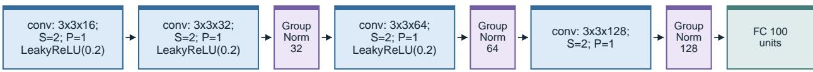  
Figure 6: Four-layer convolutional feature extractor for image outcomes.

Figure 7: Two-layer transformer feature extractor for text outcomes represented as a sequence of tokens.  
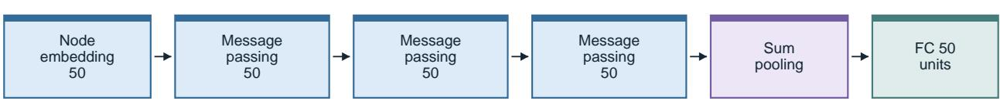  
Figure 8: Three-layer message-passing feature extractor for graph outcomes.

## D Additional Experiments

## D.1 Additional Results on Image Outcomes

Medical-Image Outcomes. We run additional simulations on medical-image outcomes, varying both sample size and efect strength. On OCT-DME, deep-kernel power is already near one throughout the sample-size sweep, while the Gaussian baselines have low power (Figure 9). On Derma-Melanoma, increasing N substantially raises deep-kernel power, with smaller gains for the Gaussian baselines (Figure 10).

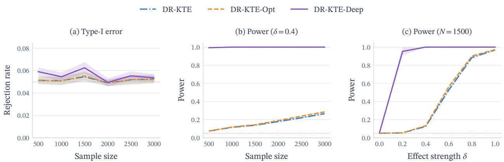  
Figure 9: Results for OCT-DME. From left to right: (a) Type-I error under H (δ = 0), (b) average test power when varying N while keeping δ = 0.4 fixed, (c) average test power when varying δ while keeping N = 1500 fixed. Shaded bands show ± one standard error across 20 independent outer repetitions. The dotted grey line marks $\alpha = 0 . 0 5$

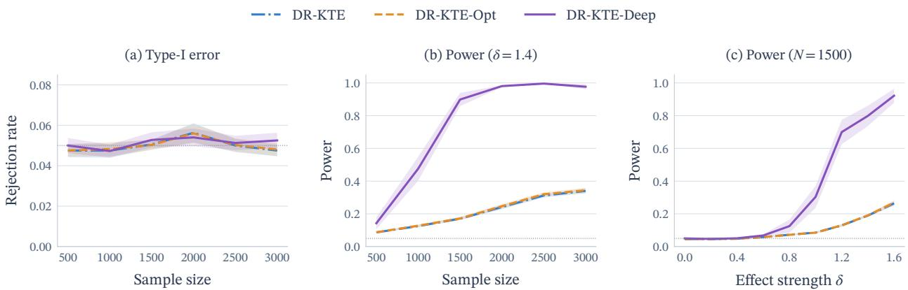  
Figure 10: Results for Derma-Melanoma. From left to right: (a) Type-I error under $H _ { 0 } ~ ( \delta = 0 )$ , (b) average test power when varying N with $\delta = 1 . 4$ fixed, (c) average test power when varying δ with $N = 1 5 0 0$ fixed. Shaded bands show ± one standard error across 20 independent outer repetitions. The dotted grey line marks $\alpha = 0 . 0 5$

MNIST, RetinaMNIST, BUSI. We next study a construction where treatment changes the sampling frequency of image labels of the MNIST (LeCun et al., 1998), RetinaMNIST (Yang et al., 2021; 2023; Liu et al., 2022), and BUSI (Al-Dhabyani et al., 2020) datasets.

Covariates and treatments are sampled as in Equation (41) and Equation (42). We define the scalar pseudo-outcomes

$$
\tilde { Y } _ { i } ^ { 0 } = \beta ^ { \top } X _ { i } + \varepsilon _ { i 0 } , \quad \tilde { Y } _ { i } ^ { 1 } = \beta ^ { \top } X _ { i } + b _ { i } ( \delta ) + \varepsilon _ { i 1 } , \quad \varepsilon _ { i 0 } , \varepsilon _ { i 1 } \stackrel { \mathrm { ~ i . i . d . } } { \sim } \mathcal { N } ( 0 , \sigma _ { \varepsilon } ^ { 2 } ) ,\tag{44}
$$

where $d _ { X } = 5 , \alpha = ( 0 . 9 0 , - 0 . 7 5 , 0 . 5 5 , - 0 . 4 0 , 0 . 3 0 ) ^ { \top } , \beta = ( 0 . 6 0 , - 0 . 5 0 , 0 . 4 0 , - 0 . 3 0 , 0 . 2 0 ) ^ { \top }$ and $\sigma _ { \varepsilon } = 0 . 1$

We consider the three scenarios of Muandet et al. (2021). For Scenario I, $b _ { i } ( \delta ) = 0$ . For Scenario II, $b _ { i } ( \delta ) = \delta$ . For Scenario III, $b _ { i } ( \delta ) = \delta ( 2 Z _ { i } - 1 )$ , where $Z _ { i } \sim _ { \mathrm { i . i . d . } }$ Bernoulli(0.5). Scenario I thus tests $H _ { 0 }$ , while Scenarios II and III test $H _ { 1 }$ . The pseudo-outcomes are converted to discrete image labels $\ell _ { i } ^ { a }$ within each dataset’s range. $Y _ { i } ^ { a }$ is then generated by sampling an image with label $\ell _ { i } ^ { a }$ . We retain the outcome under the assigned treatment, $Y _ { i } = Y _ { i } ^ { \bar { A } _ { i } }$ . The generative process is summarised in Figure 11, and Figure 12 illustrates the construction.

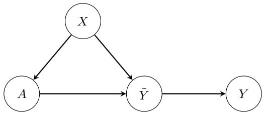  
Figure 11: Data-generating process for MNIST, RetinaMNIST and BUSI. The covariate X and treatment A generate a scalar pseudo-outcome $\tilde { Y } .$ , which is discretised to select the label of the sampled image outcome Y.

We report average Type-I error for Scenario I and average power for Scenarios II and III in Table 6 for the three datasets at $N = 1 5 0 0$ and $N = 3 0 0 0$ . Type-I error ranges from 0.045 to 0.054, close to the nominal rate of $\alpha = 0 . 0 5$ . Under the alternatives, DR-KTE-Deep has higher estimated power than the baselines in every setting, with the largest improvement on RetinaMNIST in Scenario III.

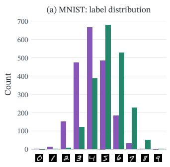

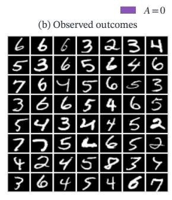

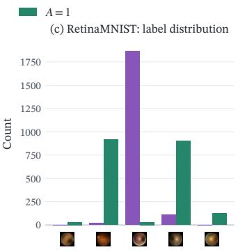  
Figure 12: MNIST (Scenario II, left) and RetinaMNIST (Scenario III, right). Panels (a) and (c) show label distributions under each treatment. Panels (b) and (d) show sampled image outcomes.

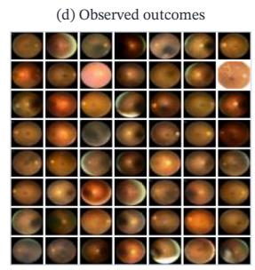

<table><tr><td>Dataset</td><td>N</td><td>Scenario</td><td>DR-KTE</td><td>DR-KTE-Opt</td><td>DR-KTE-Deep</td></tr><tr><td rowspan="6">MNIST</td><td rowspan="3">1500</td><td>I</td><td> $0 . 0 4 6 { \scriptstyle \pm 0 . 0 0 3 }$ </td><td> $0 . 0 4 6 { \scriptstyle \pm 0 . 0 0 3 }$ </td><td> $0 . 0 5 1 { \scriptstyle \pm 0 . 0 0 3 }$ </td></tr><tr><td>II</td><td> $0 . 7 3 1 { \scriptstyle \pm 0 . 0 2 6 }$ </td><td> $0 . 7 3 1 { \scriptstyle \pm 0 . 0 2 6 }$ </td><td> $\mathbf { 0 . 8 7 0 { \scriptstyle \pm 0 . 0 2 4 } }$ </td></tr><tr><td>III</td><td> $0 . 7 2 1 { \scriptstyle \pm 0 . 0 2 4 }$ </td><td> $0 . 7 2 1 { \scriptstyle \pm 0 . 0 2 4 }$ </td><td> $\mathbf { 0 . 8 0 3 { \scriptstyle \pm 0 . 0 2 3 } }$ </td></tr><tr><td rowspan="3">3000</td><td>I</td><td> $0 . 0 4 9 { \scriptstyle \pm 0 . 0 0 3 }$ </td><td> $0 . 0 4 9 { \scriptstyle \pm 0 . 0 0 3 }$ </td><td> $0 . 0 4 9 { \scriptstyle \pm 0 . 0 0 4 }$ </td></tr><tr><td>II</td><td> $0 . 9 4 8 { \scriptstyle \pm 0 . 0 0 8 }$ </td><td> $0 . 9 4 8 { \scriptstyle \pm 0 . 0 0 8 }$ </td><td> $\mathbf { 0 . 9 8 6 { \scriptstyle \pm 0 . 0 0 2 } }$ </td></tr><tr><td>III</td><td> $0 . 9 3 8 { \scriptstyle \pm 0 . 0 1 0 }$ </td><td> $0 . 9 3 7 { \scriptstyle \pm 0 . 0 1 0 }$ </td><td> $\mathbf { 0 . 9 7 3 { \scriptstyle \pm 0 . 0 0 6 } }$ </td></tr><tr><td rowspan="6">RetinaMNIST</td><td rowspan="3">1500</td><td>I</td><td> $0 . 0 5 3 { \scriptstyle \pm 0 . 0 0 3 }$ </td><td> $0 . 0 5 2 { \scriptstyle \pm 0 . 0 0 3 }$ </td><td> $0 . 0 5 1 { \scriptstyle \pm 0 . 0 0 4 }$ </td></tr><tr><td>II</td><td> $0 . 5 8 5 { \scriptstyle \pm 0 . 0 1 7 }$ </td><td> $0 . 5 8 7 { \scriptstyle \pm 0 . 0 1 7 }$ </td><td> $\mathbf { 0 . 6 4 7 { \scriptstyle \pm 0 . 0 2 2 } }$ </td></tr><tr><td>III</td><td> $0 . 4 7 4 { \scriptstyle \pm 0 . 0 2 0 }$ </td><td> $0 . 4 8 6 { \scriptstyle \pm 0 . 0 2 2 }$ </td><td> $\mathbf { 0 . 7 3 2 { \scriptstyle \pm 0 . 0 3 5 } }$ </td></tr><tr><td rowspan="3">3000</td><td>I</td><td> $0 . 0 5 3 { \scriptstyle \pm 0 . 0 0 4 }$ </td><td> $0 . 0 5 4 { \scriptstyle \pm 0 . 0 0 3 }$ </td><td> $0 . 0 5 0 { \scriptstyle \pm 0 . 0 0 3 }$ </td></tr><tr><td>II</td><td> $0 . 7 9 8 { \scriptstyle \pm 0 . 0 1 3 }$ </td><td> $0 . 7 9 9 { \scriptstyle \pm 0 . 0 1 3 }$ </td><td> $\mathbf { 0 . 8 8 1 { \scriptstyle \pm 0 . 0 1 1 } }$ </td></tr><tr><td>III</td><td> $0 . 7 4 3 { \scriptstyle \pm 0 . 0 1 4 }$ </td><td> $0 . 7 5 9 { \scriptstyle \pm 0 . 0 1 4 }$ </td><td> $\mathbf { 0 . 9 3 9 { \scriptstyle \pm 0 . 0 0 9 } }$ </td></tr><tr><td rowspan="4">BUSI</td><td rowspan="2">1500</td><td>I</td><td> $0 . 0 4 8 { \scriptstyle \pm 0 . 0 0 3 }$ </td><td> $0 . 0 4 9 { \scriptstyle \pm 0 . 0 0 3 }$ </td><td> $0 . 0 4 6 { \scriptstyle \pm 0 . 0 0 4 }$ </td></tr><tr><td>III</td><td> $0 . 8 7 8 { \scriptstyle \pm 0 . 0 1 4 }$ </td><td> $0 . 8 8 0 { \scriptstyle \pm 0 . 0 1 4 }$ </td><td> $\mathbf { 0 . 9 1 1 { \pm } 0 . 0 1 3 }$ </td></tr><tr><td rowspan="2">3000</td><td>I</td><td> $0 . 0 4 5 { \scriptstyle \pm 0 . 0 0 2 }$ </td><td> $0 . 0 4 6 { \scriptstyle \pm 0 . 0 0 2 }$ </td><td> $0 . 0 4 9 { \scriptstyle \pm 0 . 0 0 4 }$ </td></tr><tr><td>III</td><td> $0 . 9 5 4 { \scriptstyle \pm 0 . 0 0 6 }$ </td><td> $0 . 9 5 6 { \scriptstyle \pm 0 . 0 0 6 }$ </td><td> $\mathbf { 0 . 9 7 3 { \scriptstyle \pm 0 . 0 0 5 } }$ </td></tr></table>

Table 6: Average rejection rates for MNIST, RetinaMNIST, and BUSI image outcomes at $\alpha = 0 . 0 5 .$ . Scenario I reports Type-I error; Scenarios II and III report power. Efect strengths are $\delta = 1 . 0$ and 1.5 for MNIST II and III, $\delta = 2 . 0$ and 4.0 for RetinaMNIST II and III, and $\delta = 4 . 0$ for BUSI III. Values are means ± one standard error across 20 independent outer repetitions.

Fake-MNIST. We now consider a treatment that changes the source dataset of the sampled image, adapting the comparison of Liu et al. (2020) between real MNIST images and images generated by a generative adversarial network (GAN). We use a single digit covariate $X _ { i } \in \{ 0 , \ldots , 9 \}$ , sampled uniformly, and assign treatment according to

$$
A _ { i } \mid X _ { i } \sim \operatorname { B e r n o u l l i } \{ \pi _ { 0 } ( 1 \mid X _ { i } ) \} , \qquad \pi _ { 0 } ( 1 \mid X _ { i } ) = \exp \left\{ \sigma \left( s _ { \pi } \frac { X _ { i } - 4 . 5 } { \sqrt { 8 . 2 5 } } \right) , 0 . 0 7 , 0 . 9 3 \right\} ,
$$

where 4.5 and $\sqrt { 8 . 2 5 }$ are the respective mean and standard deviation of a uniformly sampled digit, and $s _ { \pi }$ is a scaling hyperparameter.

Under $H _ { 0 } ,$ , we sample real MNIST images of digit $X _ { i }$ under both interventions. Under $H _ { 1 }$ , we sample a GAN-generated image of digit $X _ { i }$ with probability

$$
r ( A _ { i } , X _ { i } ) = A _ { i } \frac { X _ { i } + 1 } { s _ { r } } ,
$$

and a real MNIST image otherwise, where $s _ { r }$ is a scaling hyperparameter. Outcomes under $A _ { i } = 0$ are thus always real images, while outcomes under $A _ { i } = 1$ can be real or GAN-generated. Larger digits are more likely to be assigned $A _ { i } = 1$ and, under $A _ { i } = 1$ , to be replaced by a GAN-generated image

Average Type-I error and power at $N = 1 5 0 0$ and $N = 3 0 0 0$ are reported in Table 7. Under $H _ { 1 }$ , DR-KTE-Deep exceeds all baselines at both sample sizes. DR-KTE-Opt slightly improves power over DR-KTE. Under $H _ { 0 }$ , rejection rates range from 0.050 to 0.054 across all methods and sample sizes, close to the nominal level.

<table><tr><td> $N$ </td><td>Scenario</td><td>DR-KTE</td><td>DR-KTE-Opt</td><td>DR-KTE-Deep</td></tr><tr><td rowspan="2">1500</td><td> $H _ { 0 }$ </td><td>0.051±0.003</td><td> $0 . 0 5 2 { \scriptstyle \pm 0 . 0 0 3 }$ </td><td> $0 . 0 5 0 { \scriptstyle \pm 0 . 0 0 4 }$ </td></tr><tr><td> $H _ { 1 }$ </td><td>0.225±0.008</td><td> $0 . 2 2 9 { \scriptstyle \pm 0 . 0 0 8 }$ </td><td> $\mathbf { 0 . 3 8 0 { \scriptstyle \pm 0 . 0 5 0 } }$ </td></tr><tr><td rowspan="2">3000</td><td> $H _ { 0 }$ </td><td>0.054±0.004</td><td>0.054±0.004</td><td> $0 . 0 5 0 { \scriptstyle \pm 0 . 0 0 3 }$ </td></tr><tr><td> $H _ { 1 }$ </td><td>0.502±0.012</td><td> $0 . 5 1 4 { \scriptstyle \pm 0 . 0 1 2 }$ </td><td> $\mathbf { 0 . 9 6 1 { \scriptstyle \pm 0 . 0 1 9 } }$ </td></tr></table>

Table 7: Type-I error $\left( H _ { 0 } \right)$ and power $\left( H _ { 1 } \right)$ for Fake-MNIST at $\alpha = 0 . 0 5$ . Values are means $\pm$ one standard error across 20 independent outer repetitions.

## D.2 Causal-Blob

We evaluate our method on a Gaussian mixture dataset adapted from the Blob dataset of Liu et al. (2020) to a causal setting with covariates. For each unit, we sample a mode index $M _ { i } \in \{ 1 , \ldots , 9 \}$ uniformly with centres $\left\{ \mu _ { m } \right\} _ { m = 1 } ^ { 9 } = \left\{ ( j , k ) : j , k \in \{ 0 , 1 , 2 \} \right\}$ . The covariate is then a noisy version of the mode location:

$$
X _ { i } = \mu _ { M _ { i } } + \varepsilon _ { X } , \quad \varepsilon _ { X } \sim \mathcal { N } ( 0 , \sigma _ { X } ^ { 2 } I _ { 2 } ) .
$$

Treatment is sampled as in Equation (42). The potential outcomes follow the mode-centred Gaussians

$$
Y _ { i } ^ { 0 } \mid M _ { i } = m \sim { \mathcal { N } } ( \mu _ { m } , \Sigma _ { P } ) , \qquad Y _ { i } ^ { 1 } \mid M _ { i } = m \sim { \mathcal { N } } ( \mu _ { m } , \Sigma _ { Q , m } ) ,
$$

where $\Sigma _ { P } = 0 . 0 3 I _ { 2 }$ is isotropic and shared across modes, while $\Sigma _ { Q , m }$ has the same diagonal entries as $\Sigma _ { P }$ but a mode-dependent of-diagonal entry $\rho _ { m }$ . We use $\sigma _ { X } = 0 . 3$ and $\pmb { \alpha } = ( 1 . 2 , - 0 . 8 ) ^ { \top }$ . The two outcome distributions thus have the same mean but difer in higher-order moments under $H _ { 1 }$

Table 8 shows that DR-KTE-Deep achieves the highest power on Causal-Blob at both sample sizes, with the largest gain over DR-KTE-Opt at $N = 3 0 0 0$ . DR-KTE-Opt also improves power over DR-KTE. Type-I error for all three tests remains close to the nominal level at both sample sizes.

<table><tr><td colspan="4">Power/Type-I error  $\left( H _ { 1 } / H _ { 0 } \right)$ </td></tr><tr><td>N</td><td>DR-KTE</td><td>DR-KTE-Opt</td><td>DR-KTE-Deep</td></tr><tr><td>1500</td><td> $0 . 3 2 2 { \scriptstyle \pm 0 . 0 1 4 } / 0 . 0 4 9 { \scriptstyle \pm 0 . 0 0 4 }$ </td><td> $0 . 3 5 1 { \scriptstyle \pm 0 . 0 1 6 } / 0 . 0 5 1 { \scriptstyle \pm 0 . 0 0 3 }$ </td><td> $\mathbf { 0 . 3 8 2 { \pm } 0 . 0 2 4 } / 0 . 0 5 0 { \pm } 0 . 0 0 4$ </td></tr><tr><td>3000</td><td> $0 . 7 1 0 { \scriptstyle \pm 0 . 0 2 0 } / 0 . 0 4 6 { \scriptstyle \pm 0 . 0 0 3 }$ </td><td> $0 . 7 8 0 { \scriptstyle \pm 0 . 0 2 2 } / 0 . 0 4 8 { \scriptstyle \pm 0 . 0 0 3 }$ </td><td> $\mathbf { 0 . 8 9 1 { \pm } 0 . 0 1 9 / 0 . 0 4 5 { \pm } 0 . 0 0 3 }$ </td></tr></table>

Table 8: Power and Type-I error for Causal-Blob at $\alpha = 0 . 0 5$ . Each cell reports $H _ { 1 } / H _ { 0 }$ , with means ± one standard error across 20 independent outer repetitions.

## D.3 Scalar Outcomes

We also evaluate our method on scalar outcomes. We adapt the scalar-outcome scenarios of Muandet et al. (2021) with binary treatments. Covariates and treatments are sampled as in Equations (41) and (42), and we use the scalar outcomes of Equation (44) directly. Scenarios I, II and III cover the null hypothesis, a mean shift and a mean-preserving distributional shift respectively. We additionally consider Scenario IV of Zenati et al. (2025b), with $b _ { i } ( \delta ) = 4 \delta Z _ { i }$ , where $Z _ { i } \sim \mathrm { B e r n o u l l i } ( 0 . 5 )$ . This represents a change in both the mean and variance of the outcome distributions.

Table 9 reports average Type-I error for Scenario I and average power for Scenarios II-IV. Type-I error is close to the nominal level for the kernel tests at both sample sizes. Power is close to one in Scenarios II and IV, with little improvement from learning a deep kernel. Scenario III is more challenging, although power increases substantially with sample size. DR-KTE-Opt achieves the highest estimated power in Scenario III at both sample sizes.
<table><tr><td rowspan="2"></td><td rowspan="2"></td><td colspan="3">Power/Type-I error  $\left( H _ { 1 } / H _ { 0 } \right)$ </td></tr><tr><td>DR-KTE</td><td>DR-KTE-Opt</td><td>DR-KTE-Deep</td></tr><tr><td rowspan="3">1500</td><td>II</td><td> $0 . 9 9 9 { \scriptstyle \pm 0 . 0 0 0 } / 0 . 0 5 5 { \scriptstyle \pm 0 . 0 0 4 }$ </td><td> $\mathbf { 1 . 0 0 0 { \scriptstyle \pm 0 . 0 0 0 } } / 0 . 0 5 9 { \scriptstyle \pm 0 . 0 0 4 }$ </td><td> $0 . 9 9 5 { \scriptstyle \pm 0 . 0 0 2 } / 0 . 0 5 5 { \scriptstyle \pm 0 . 0 0 4 }$ </td></tr><tr><td>III</td><td> $0 . 6 1 1 { \scriptstyle \pm 0 . 0 2 8 } / 0 . 0 5 5 { \scriptstyle \pm 0 . 0 0 4 }$ </td><td> $\mathbf { 0 . 6 5 3 { \scriptstyle \pm 0 . 0 2 7 } } / 0 . 0 5 9 { \scriptstyle \pm 0 . 0 0 4 }$ </td><td> $0 . 6 1 4 { \scriptstyle \pm 0 . 0 2 8 } / 0 . 0 5 5 { \scriptstyle \pm 0 . 0 0 4 }$ </td></tr><tr><td>IV</td><td> $0 . 9 8 0 { \scriptstyle \pm 0 . 0 0 7 } / 0 . 0 5 5 { \scriptstyle \pm 0 . 0 0 4 }$ </td><td> $\mathbf { 0 . 9 8 5 { \scriptstyle \pm 0 . 0 0 5 } } / 0 . 0 5 9 { \scriptstyle \pm 0 . 0 0 4 }$ </td><td> $0 . 9 8 1 { \scriptstyle \pm 0 . 0 0 4 } / 0 . 0 5 5 { \scriptstyle \pm 0 . 0 0 4 }$ </td></tr><tr><td rowspan="3">3000</td><td>II</td><td> $\mathbf { 1 . 0 0 0 { \scriptstyle \pm 0 . 0 0 0 } } / 0 . 0 4 8 { \scriptstyle \pm 0 . 0 0 3 }$ </td><td> $\mathbf { 1 . 0 0 0 { \scriptstyle \pm 0 . 0 0 0 } } / 0 . 0 4 6 { \scriptstyle \pm 0 . 0 0 3 }$ </td><td> $\mathbf { 1 . 0 0 0 { \scriptstyle \pm 0 . 0 0 0 } } / 0 . 0 4 8 { \scriptstyle \pm 0 . 0 0 3 }$ </td></tr><tr><td>) III</td><td> $0 . 9 0 3 { \scriptstyle \pm 0 . 0 1 3 } / 0 . 0 4 8 { \scriptstyle \pm 0 . 0 0 3 }$ </td><td> $\mathbf { 0 . 9 2 7 { \scriptstyle \pm 0 . 0 1 2 } } / 0 . 0 4 6 { \scriptstyle \pm 0 . 0 0 3 }$ </td><td> $0 . 9 1 4 { \scriptstyle \pm 0 . 0 1 3 } / { 0 . 0 4 8 \pm 0 . 0 0 3 }$ </td></tr><tr><td>IV</td><td> $\mathbf { 0 . 9 9 4 { \pm 0 . 0 0 2 } } / 0 . 0 4 8 { \pm 0 . 0 0 3 }$ </td><td> $\mathbf { 0 . 9 9 4 { \pm 0 . 0 0 2 } } / 0 . 0 4 6 { \pm 0 . 0 0 3 }$ </td><td> $0 . 9 9 0 { \scriptstyle \pm 0 . 0 0 2 } / 0 . 0 4 8 { \scriptstyle \pm 0 . 0 0 3 }$ </td></tr></table>

Table 9: Power and Type-I error for scalar outcomes at $\alpha = 0 . 0 5$ , with $\delta = 0 . 8$ and $M = 5$ . Each cell reports $H _ { 1 } / H _ { 0 }$ with means ± one standard error across 20 independent outer repetitions.

## D.4 Estimator Comparison

We study how the choice of estimator afects test power and Type-I error, using the same learned outcome kernel for all methods. We consider the continuous-treatment construction of Zenati et al. (2025b). We compare doubly robust estimation with inverse-propensity weighting (IPW) and a kernel policy test. For each unit, we sample the covariate as

$$
X _ { i } \sim { \mathcal { N } } ( 0 , I _ { 5 } ) ,
$$

and treatment is assigned as

$$
A _ { i } \mid X _ { i } \sim { \mathcal { N } } ( X _ { i } ^ { \top } w , 1 ) .
$$

The outcome is then

$$
\begin{array} { r } { Y _ { i } = X _ { i } ^ { \top } \beta + A _ { i } + 0 . 1 \varepsilon _ { i } , \quad \varepsilon _ { i } \sim \mathcal { N } ( 0 , 1 ) , } \end{array}
$$

where $w , \beta \in \mathbb { R } ^ { 5 }$ are fixed coeficient vectors.

We compare two interventions $\pi$ and $\pi ^ { \prime }$ and set $\pi : = \pi _ { 0 }$ We consider four policy-test scenarios adapted from Zenati et al. (2025b) with continuous treatments. Scenario I tests the null hypothesis with $\pi ^ { \prime } ( \cdot \mid x ) = \mathcal { N } ( x ^ { \top } w _ { \mathrm { I } } , 1 )$ , where w $\neq$ w and $\| \beta + w _ { \mathrm { I } } \| = \| \beta + w \|$ , so the two interventions induce the same marginal outcome distribution. In Scenario $\operatorname { I I } , \pi ^ { \prime } ( \cdot \mid x ) = \mathcal { N } ( x ^ { \top } ( w + 2 \mathbf { 1 } _ { 5 } ) , 1 )$ . In Scenario III, $\pi ^ { \prime } ( \cdot \mid x )$ is an equal mixture of the distributions $\mathcal { N } ( \boldsymbol { x } ^ { \top } ( \boldsymbol { w } + \mathbf { 1 } _ { 5 } ) , 1 )$ and $\mathcal { N } ( \boldsymbol { x } ^ { \top } ( \boldsymbol { w } - \mathbf { 1 } _ { 5 } ) , 1 )$ . Finally, in Scenario IV, $\pi ^ { \prime } ( \cdot \mid x )$ is an equal mixture of the distributions $\mathcal { N } ( \boldsymbol { x } ^ { \top } ( \boldsymbol { w } + 2 \mathbf { 1 } _ { 5 } ) , 1 )$ and $\mathcal { N } ( \boldsymbol { x } ^ { \top } \boldsymbol { w } , 1 )$

We compare our doubly robust estimator, DR-KTE-Deep, to a cross-U IPW estimator, IPW-Cross, obtained by setting $\hat { \mu } _ { \boldsymbol { \theta } } ( a , x ) : = 0$ in the plug-in estimator of Equation (1). We additionally compare our method to a kernel policy test, KPT, following Zenati et al. (2025b). All methods use the same deep outcome kernel, learned with the doubly robust criterion. We divide the data into four equal samples for learning, validation, nuisance fitting and testing. For this comparison, checkpoint selection uses variance regularisation $1 0 ^ { - 4 }$ , and the final cross-U statistics are unregularised. KPT uses 10,000 permutations to calibrate its test. These choices hold the learned kernel and data budget fixed while comparing the test estimators.

Table 10 shows that DR-KTE-Deep achieves higher estimated power than IPW-Cross and KPT in all three alternative scenarios, with the largest gains in Scenario III. Under the null hypothesis, its rejection rate is close to the nominal level of $\alpha = 0 . 0 5$ , while IPW-Cross and KPT have higher Type-I error.

<table><tr><td rowspan="2">Scenario</td><td colspan="3">Power/Type-I error  $\left( H _ { 1 } / H _ { 0 } \right)$ </td></tr><tr><td>DR-KTE-Deep</td><td>IPW-Cross</td><td>KPT</td></tr><tr><td>Scenario II</td><td> $\mathbf { 0 . 9 6 1 { \scriptstyle \pm 0 . 0 0 7 } } / 0 . 0 4 8 { \scriptstyle \pm 0 . 0 0 3 }$ </td><td> $0 . 9 2 0 { \scriptstyle \pm 0 . 0 1 2 } / 0 . 0 8 5 { \scriptstyle \pm 0 . 0 0 9 }$ </td><td> $0 . 6 3 8 { \scriptstyle \pm 0 . 0 2 2 } / 0 . 0 7 0 { \scriptstyle \pm 0 . 0 1 3 }$ </td></tr><tr><td>Scenario III</td><td> $\mathbf { 0 . 7 3 9 { \scriptstyle \pm 0 . 0 1 1 } } / 0 . 0 4 8 { \scriptstyle \pm 0 . 0 0 3 }$ </td><td> $0 . 5 7 4 { \scriptstyle \pm 0 . 0 0 8 } / 0 . 0 8 5 { \scriptstyle \pm 0 . 0 0 9 }$ </td><td> $0 . 2 9 1 { \scriptstyle \pm 0 . 0 1 7 } / 0 . 0 7 0 { \scriptstyle \pm 0 . 0 1 3 }$ </td></tr><tr><td>Scenario IV</td><td> $\mathbf { 0 . 9 4 5 { \scriptstyle \pm 0 . 0 0 9 } } / 0 . 0 4 8 { \scriptstyle \pm 0 . 0 0 3 }$ </td><td> $0 . 9 0 3 { \scriptstyle \pm 0 . 0 1 3 } / 0 . 0 8 5 { \scriptstyle \pm 0 . 0 0 9 }$ </td><td> $0 . 6 0 7 { \scriptstyle \pm 0 . 0 2 7 } / 0 . 0 7 0 { \scriptstyle \pm 0 . 0 1 3 }$ </td></tr></table>

Table 10: Power and Type-I error at $\alpha = 0 . 0 5$ $N = 1 6 0 0$ and $M = 1$ for diferent choices of estimator. Each cell reports $H _ { 1 } / H _ { 0 }$ , with means ± one standard error across 20 independent outer repetitions.

## D.5 Robustness to Outcome Model Misspecification

We analyse the contribution of fitting the conditional outcome embedding with the logging policy known. We compare the fitted embedding with $\hat { \mu } _ { \boldsymbol { \theta } } ( \boldsymbol { a } , \boldsymbol { x } ) \equiv 0$ , while maintaining $\hat { \pi } _ { 0 } ( a \mid x ) \equiv \pi _ { 0 } ( a \mid x )$ and a learned deep outcome kernel. We evaluate the comparison on Causal-Blob (Section D.2) and the four scalar-outcome scenarios of Section D.3.

Table 11 shows similar Type-I error for the fitted and zero outcome embeddings, with rejection rates close to the nominal level. Using the fitted outcome embedding improves power on Causal-Blob and in Scenarios II and III, with the largest gain in Scenario III. Both estimators achieve power close to one in Scenario IV.

<table><tr><td rowspan="2">Environment</td><td colspan="2">Power/Type-I error  $\left( H _ { 1 } / H _ { 0 } \right)$ </td></tr><tr><td>Fitted  $\hat { \mu } _ { \boldsymbol { \theta } }$ </td><td> $\hat { \mu } _ { \boldsymbol { \theta } } \equiv 0$ </td></tr><tr><td>Causal-Blob</td><td> $0 . 3 1 8 { \scriptstyle \pm 0 . 0 2 4 } / 0 . 0 4 7 { \scriptstyle \pm 0 . 0 0 6 }$ </td><td> $0 . 2 4 7 { \scriptstyle \pm 0 . 0 1 7 } / 0 . 0 4 7 { \scriptstyle \pm 0 . 0 0 7 }$ </td></tr><tr><td>Scenario II</td><td> $0 . 9 9 9 { \scriptstyle \pm 0 . 0 0 1 } / 0 . 0 5 6 { \scriptstyle \pm 0 . 0 0 4 }$ </td><td> $0 . 9 2 7 { \scriptstyle \pm 0 . 0 1 2 } / 0 . 0 5 7 { \scriptstyle \pm 0 . 0 0 3 }$ </td></tr><tr><td>Scenario III</td><td> $0 . 6 1 6 { \scriptstyle \pm 0 . 0 1 5 } / 0 . 0 5 6 { \scriptstyle \pm 0 . 0 0 4 }$ </td><td> $0 . 3 4 9 { \scriptstyle \pm 0 . 0 1 3 } / 0 . 0 5 7 .$  ±0.003</td></tr><tr><td>Scenario IV</td><td> $1 . 0 0 0 { \scriptstyle \pm 0 . 0 0 0 } / 0 . 0 5 6 { \scriptstyle \pm 0 . 0 0 4 }$ </td><td> $0 . 9 9 9 { \scriptstyle \pm 0 . 0 0 1 } / 0 . 0 5 7 { \scriptstyle \pm 0 . 0 0 3 }$ </td></tr></table>

Table 11: Power and Type-I error at $\alpha = 0 . 0 5$ , N = 1500 and $M = 1$ . Each cell reports $H _ { 1 } / H _ { 0 }$ , with means ± one standard error across 20 independent outer repetitions.

## D.6 Training Objective Comparison

We test whether our power learning objective improves detection compared to a reconstruction objective. On OCT-Drusen and Fake-MNIST, we compare DR-KTE-Deep with a frozen randomly initialised CNN and a pixel autoencoder. All variants share the same encoder architecture, initial encoder weights, learning and validation observations, and test datasets.

DR-KTE-Deep has the highest power on both constructions under $H _ { 1 }$ (Table 12), while Type-I error remains close to the nominal level for all methods.
<table><tr><td>Scenario</td><td></td><td>Random Weights Pixel Autoencoder DR-KTE-Deep</td><td></td></tr><tr><td rowspan="2">OCT-Drusen</td><td> $H _ { 1 }$ </td><td> $0 . 0 5 7 \pm 0 . 0 0 4$ </td><td> $0 . 0 5 2 \pm 0 . 0 0 4$ </td></tr><tr><td> $H _ { 0 }$ </td><td> $0 . 0 5 4 \pm 0 . 0 0 4$   $0 . 0 5 0 \pm 0 . 0 0 3$ </td><td> $0 . 0 5 8 \pm 0 . 0 0 5$ </td></tr><tr><td rowspan="2">Fake-MNIST</td><td> $H _ { 1 }$ </td><td> $0 . 2 0 4 \pm 0 . 0 0 8$ </td><td> $0 . 2 0 0 \pm 0 . 0 1 2$ </td></tr><tr><td> $H _ { 0 }$ </td><td> $0 . 0 5 3 \pm 0 . 0 0 4$ </td><td> $0 . 0 5 5 \pm 0 . 0 0 4$   $0 . 0 5 0 \pm 0 . 0 0 4$ </td></tr></table>

Table 12: Power under $H _ { 1 }$ and Type-I error under $H _ { 0 }$ at $N = 1 5 0 0$ . Values are means and one standard error across 20 independent outer repetitions.

## D.7 Text Representation Ablation

We consider an alternative representation for the text outcomes described in Section 5, mapping each outcome to a fixed-length vector using the Qwen3-Embedding-0.6B (Zhang et al., 2025) embedding model. Since a language-model embedding can capture semantic information, a simple Gaussian kernel may be well suited to detecting diferences in outcome distributions.

Table 13 shows that all three methods achieve high, similar power using this representation. Type-I error remains close to the nominal level for Oncology Notes and Clinical Notes, while all three methods are conservative on Movie Reviews.

However, this embedding is not guaranteed to be injective: distinct texts can collapse to the same embedding. A Gaussian kernel, even if characteristic on the embedding space, might therefore not detect every diference between the original text outcome distributions. Additionally, this representation can be more costly than a sequence of tokens, as it requires inference over an embedding model.

<table><tr><td rowspan="2">Scenario</td><td colspan="3">Power/Type-I error  $\left( H _ { 1 } / H _ { 0 } \right)$ </td></tr><tr><td>DR-KTE</td><td>DR-KTE-Opt</td><td>DR-KTE-Deep</td></tr><tr><td>Oncology Notes</td><td> $\mathbf { 0 . 8 2 8 { \scriptstyle \pm 0 . 0 3 5 } } / 0 . 0 5 7 { \scriptstyle \pm 0 . 0 1 0 }$ </td><td> $0 . 8 2 7 { \scriptstyle \pm 0 . 0 3 5 } / 0 . 0 5 8 { \scriptstyle \pm 0 . 0 1 0 }$ </td><td> $\mathbf { 0 . 8 2 8 { \scriptstyle \pm 0 . 0 3 6 } } / 0 . 0 5 8 { \scriptstyle \pm 0 . 0 1 0 }$ </td></tr><tr><td>Movie Reviews</td><td> $0 . 8 9 2 { \scriptstyle \pm 0 . 0 0 9 } / 0 . 0 2 9 { \scriptstyle \pm 0 . 0 0 4 }$ </td><td> $\mathbf { 0 . 8 9 5 { \scriptstyle \pm 0 . 0 0 8 } } / 0 . 0 2 9 { \scriptstyle \pm 0 . 0 0 4 }$ </td><td> $\mathbf { 0 . 8 9 5 { \scriptstyle \pm 0 . 0 0 8 } } / 0 . 0 2 9 { \scriptstyle \pm 0 . 0 0 4 }$ </td></tr><tr><td>Clinical Notes</td><td> $\mathbf { 0 . 8 9 4 { \scriptstyle \pm 0 . 0 2 7 } } / 0 . 0 4 9 { \scriptstyle \pm 0 . 0 0 7 }$ </td><td> $\mathbf { 0 . 8 9 4 { \scriptstyle \pm 0 . 0 2 7 } } / 0 . 0 4 9 { \scriptstyle \pm 0 . 0 0 7 }$ </td><td> $\mathbf { 0 . 8 9 4 { \scriptstyle \pm 0 . 0 2 7 } } / 0 . 0 5 0 { \scriptstyle \pm 0 . 0 0 7 }$ </td></tr></table>

Table 13: Power $\left( H _ { 1 } \right)$ and Type-I error $\left( H _ { 0 } \right)$ at $N = 1 5 0 0$ and $\alpha = 0 . 0 5$ for text outcomes represented as text embeddings.

## D.8 Efect of Ensemble Size

We evaluate the efect of memberwise averaging by varying the number of separately trained kernels included in the ensemble. We perform five independent batches, each consisting of 20 independent outer repetitions. In each repetition, we train five members and form ensembles with $M \in \{ 1 , 2 , 3 , 5 \}$ , using the first M members. All ensemble sizes share the same observations, nuisance estimates and member kernels. We use Causal-Blob and OCT-Drusen at $N = 1 5 0 0$ and $\delta = 1 . 0 $ , following the procedure in Section C.1.

For each outer repetition and ensemble size, we estimate power as the rejection rate over 200 fresh test datasets under $H _ { 1 } .$ , at $\alpha = 0 . 0 5$ . We then compute the mean and sample standard deviation of the 20 power estimates within each batch. For each statistic, we report its mean and one standard error across five independent batches.

On OCT-Drusen, power increases slightly with ensemble size, and its standard deviation is lower at $M = 5$ than at $M = 1$ . On Causal-Blob, average power increases from 0.350 to 0.394, while variability does not decrease consistently (Table 14 and Figure 13).

While Proposition B.3 establishes variance reduction for the population discrepancy with the training data fixed, it does not imply that empirical power becomes less variable across repetitions.
<table><tr><td>Dataset</td><td>Statistic</td><td> $M = 1$ </td><td> $M = 2$ </td><td> $M = 3$ </td><td> $M = 5$ </td></tr><tr><td>Causal-Blob</td><td>Power</td><td> $0 . 3 5 0 { \scriptstyle \pm 0 . 0 0 3 }$ </td><td> $0 . 3 7 3 { \scriptstyle \pm 0 . 0 0 7 }$ </td><td> $0 . 3 8 3 { \scriptstyle \pm 0 . 0 0 7 }$ </td><td> $0 . 3 9 4 { \scriptstyle \pm 0 . 0 0 8 }$ </td></tr><tr><td rowspan="2">OCT-Drusen</td><td>SD</td><td> $0 . 1 5 0 { \scriptstyle \pm 0 . 0 1 1 }$ </td><td> $0 . 1 5 7 { \scriptstyle \pm 0 . 0 1 5 }$ </td><td> $0 . 1 5 0 { \scriptstyle \pm 0 . 0 1 4 }$ </td><td> $0 . 1 5 1 { \scriptstyle \pm 0 . 0 1 4 }$ </td></tr><tr><td>Power</td><td> $0 . 9 9 3 { \scriptstyle \pm 0 . 0 0 0 }$ </td><td> $0 . 9 9 5 { \scriptstyle \pm 0 . 0 0 0 }$ </td><td> $0 . 9 9 5 { \scriptstyle \pm 0 . 0 0 0 }$ </td><td> $0 . 9 9 6 { \scriptstyle \pm 0 . 0 0 1 }$ </td></tr><tr><td></td><td>SD</td><td> $0 . 0 1 1 { \scriptstyle \pm 0 . 0 0 1 }$ </td><td> $0 . 0 0 9 { \scriptstyle \pm 0 . 0 0 2 }$ </td><td> $0 . 0 0 9 { \scriptstyle \pm 0 . 0 0 2 }$ </td><td> $0 . 0 0 7 { \scriptstyle \pm 0 . 0 0 1 }$ </td></tr></table>

Table 14: Mean and standard deviation (SD) of empirical power at $N = 1 5 0 0$ and $\delta \ : = \ : 1 . 0 .$ Each statistic is computed across 20 independent outer repetitions within each batch; values are means ± one standard error across five independent batches.

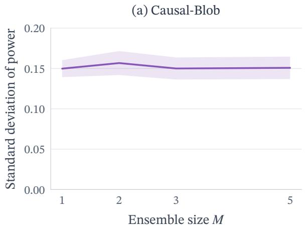

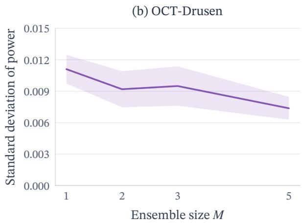  
Figure 13: Average standard deviation of empirical power against ensemble size at $N = 1 5 0 0$ and $\delta = 1 . 0 .$ Shaded bands show ± one standard error across five independent batches.

## D.9 Weisfeiler-Lehman Outcome Kernel

We consider an alternative base kernel for the graph-outcome experiments. We replace the Gaussian kernel used as $k ^ { \mathrm { c h a r } }$ with a Weisfeiler-Lehman (WL) subtree kernel (Shervashidze et al., 2011) and denote the resulting tests by DR-KTE-WL and DR-KTE-WL-Deep. Since the WL kernel is not generally characteristic, these methods do not retain the same omnibus guarantees as the Gaussian-based ones.

Table 15 reports average power under $H _ { 1 }$ and average Type-I error under $H _ { 0 }$ for both WL-based methods. Learning the outcome kernel increases power from 0.743 to 0.964 on LLM Code Repairs. On Contact Networks, the two variants achieve similar power, with a slightly higher average for the learned kernel. Type-I error remains close to the nominal level for both constructions and methods.
<table><tr><td rowspan="2">Scenario</td><td colspan="2">Power/Type-I error  $\left( H _ { 1 } / H _ { 0 } \right)$ </td></tr><tr><td>DR-KTE-WL</td><td>DR-KTE-WL-Deep</td></tr><tr><td>LLM Code Repairs</td><td> $0 . 7 4 3 { \scriptstyle \pm 0 . 0 2 3 } / 0 . 0 5 9 { \scriptstyle \pm 0 . 0 0 6 }$ </td><td> $\mathbf { 0 . 9 6 4 { \pm } 0 . 0 0 8 / 0 . 0 5 0 { \pm } 0 . 0 0 4 }$ </td></tr><tr><td>Contact Networks</td><td> $0 . 9 7 1 { \scriptstyle \pm 0 . 0 0 5 } / 0 . 0 5 7 { \scriptstyle \pm 0 . }$  003</td><td> $\mathbf { 0 . 9 7 2 { \scriptstyle \pm 0 . 0 0 5 } } / 0 . 0 5 6 { \scriptstyle \pm 0 . 0 0 4 }$ </td></tr></table>

Table 15: Power $\left( H _ { 1 } \right)$ and Type-I error $\left( H _ { 0 } \right)$ for graph outcomes using Weisfeiler-Lehman base kernels at $N = 1 5 0 0$ Each cell reports $H _ { 1 } / H _ { 0 }$ , with means ± one standard error across 20 outer repetitions. Gaussian-kernel results are given in Table 3.

## D.10 Linear Outcome Kernel

We compare DR-KTE-Deep with DR-ATE, using a linear outcome kernel $k ( y , y ^ { \prime } ) = \phi ( y ) ^ { \top } \phi ( y ^ { \prime } )$ , where $\phi ( y )$ is the numerical representation of the structured outcome. DR-ATE therefore only tests for average treatment efects.

For the medical-image experiments, Causal-Blob and the scalar outcomes Scenario III, which construct a mean-matched but distributional efect, DR-KTE-Deep has high power, while DR-ATE rejects around the nominal rate (Tables 16, 20 and 21). In the remaining experiments, where the construction introduces a mean-shift in interventional outcomes, DR-ATE often has high power, but DR-KTE-Deep always achieves higher rejection rates (Tables 17 to 19).

<table><tr><td rowspan="2">Scenario</td><td colspan="2">Power/Type-I error  $\left( H _ { 1 } / H _ { 0 } \right)$ </td></tr><tr><td>DR-ATE</td><td>DR-KTE-Deep</td></tr><tr><td>Breast-Tumor</td><td> $0 . 0 5 2 { \scriptstyle \pm 0 . 0 0 3 } / 0 . 0 4 7 { \scriptstyle \pm 0 . 0 0 4 }$ </td><td> $\mathbf { 0 . 9 8 9 { \pm } 0 . 0 0 2 } / 0 . 0 5 4 { \pm } 0 . 0 0 3$ </td></tr><tr><td>Chest-Cardiomegaly</td><td> $0 . 0 4 4 { \scriptstyle \pm 0 . 0 0 3 } / 0 . 0 4 3 { \scriptstyle \pm 0 . 0 0 3 }$ </td><td> $\mathbf { 0 . 9 2 8 { \scriptstyle \pm 0 . 0 4 6 } } / 0 . 0 5 1 { \scriptstyle \pm 0 . 0 0 4 }$ </td></tr><tr><td>Chest-Effusion</td><td> $0 . 0 4 6 { \scriptstyle \pm 0 . 0 0 5 } / 0 . 0 4 9 { \scriptstyle \pm 0 . 0 0 3 }$ </td><td> $\mathbf { 0 . 9 9 9 { \scriptstyle \pm 0 . 0 0 0 } } / 0 . 0 4 8 { \scriptstyle \pm 0 . 0 0 4 }$ </td></tr><tr><td>Chest-Mass</td><td> $0 . 0 5 2 { \scriptstyle \pm 0 . 0 0 3 } / 0 . 0 5 1 { \scriptstyle \pm 0 . 0 0 4 }$ </td><td> $\mathbf { 1 . 0 0 0 { \scriptstyle \pm 0 . 0 0 0 } } / 0 . 0 5 6 { \scriptstyle \pm 0 . 0 0 4 }$ </td></tr><tr><td>Derma-Melanoma</td><td> $0 . 0 4 5 { \scriptstyle \pm 0 . 0 0 4 } / 0 . 0 4 8 { \scriptstyle \pm 0 . 0 0 2 }$ </td><td> $\mathbf { 0 . 8 9 8 { \scriptstyle \pm 0 . 0 4 0 } } / 0 . 0 5 3 { \scriptstyle \pm 0 . 0 0 4 }$ </td></tr><tr><td>OCT-CNV</td><td> $0 . 0 5 1 { \scriptstyle \pm 0 . 0 0 4 } / 0 . 0 5 6 { \scriptstyle \pm 0 . 0 0 3 }$ </td><td> $\mathbf { 1 . 0 0 0 { \scriptstyle \pm 0 . 0 0 0 } } / 0 . 0 5 3 { \scriptstyle \pm 0 . 0 0 3 }$ </td></tr><tr><td>OCT-DME</td><td> $0 . 0 5 2 { \scriptstyle \pm 0 . 0 0 3 } / 0 . 0 5 9 { \scriptstyle \pm 0 . 0 0 4 }$ </td><td> $\mathbf { 1 . 0 0 0 { \scriptstyle \pm 0 . 0 0 0 } } / 0 . 0 6 3 { \scriptstyle \pm 0 . 0 0 5 }$ </td></tr><tr><td>OCT-Drusen</td><td> $0 . 0 4 6 { \scriptstyle \pm 0 . 0 0 3 } / 0 . 0 5 3 { \scriptstyle \pm 0 . 0 0 5 }$ </td><td> $\mathbf { 0 . 3 7 1 { \pm } 0 . 0 8 0 } / 0 . 0 5 8 { \pm } 0 . 0 0 5$ </td></tr><tr><td>Pneumonia</td><td> $0 . 0 5 3 { \scriptstyle \pm 0 . 0 0 3 } / 0 . 0 4 7 { \scriptstyle \pm 0 . 0 0 2 }$ </td><td> $\mathbf { 0 . 9 9 8 { \scriptstyle \pm 0 . 0 0 1 } } / 0 . 0 5 3 { \scriptstyle \pm 0 . 0 0 4 }$ </td></tr><tr><td>Retina-Severe</td><td> $0 . 0 5 6 { \scriptstyle \pm 0 . 0 0 3 } / 0 . 0 4 4 { \scriptstyle \pm 0 . 0 0 3 }$ </td><td> $\mathbf { 0 . 9 5 9 { \scriptstyle \pm 0 . 0 0 8 } } / 0 . 0 5 2 { \scriptstyle \pm 0 . 0 0 3 }$ </td></tr></table>

Table 16: Comparison with DR-ATE for medical-image outcomes at $N = 1 5 0 0 .$ . Each cell reports $H _ { 1 } / H _ { 0 }$ , with means ± one standard error across 20 outer repetitions.
<table><tr><td>Dataset</td><td>Scenario</td><td>DR-ATE</td><td>DR-KTE-Deep</td></tr><tr><td rowspan="3">MNIST</td><td>I</td><td> $0 . 0 4 5 { \scriptstyle \pm 0 . 0 0 3 }$ </td><td> $0 . 0 5 1 { \scriptstyle \pm 0 . 0 0 3 }$ </td></tr><tr><td>II</td><td> $0 . 6 7 7 { \scriptstyle \pm 0 . 0 2 7 }$ </td><td> $\mathbf { 0 . 8 7 0 { \scriptstyle \pm 0 . 0 2 4 } }$ </td></tr><tr><td>III</td><td> $0 . 6 9 5 { \scriptstyle \pm 0 . 0 2 3 }$ </td><td> $\mathbf { 0 . 8 0 3 { \scriptstyle \pm 0 . 0 2 3 } }$ </td></tr><tr><td rowspan="3">RetinaMNIST</td><td>I</td><td> $0 . 0 5 2 { \scriptstyle \pm 0 . 0 0 3 }$ </td><td> $0 . 0 5 1 { \scriptstyle \pm 0 . 0 0 4 }$ </td></tr><tr><td>II</td><td> $0 . 4 3 4 { \scriptstyle \pm 0 . 0 1 6 }$ </td><td> $\mathbf { 0 . 6 4 7 { \scriptstyle \pm 0 . 0 2 2 } }$ </td></tr><tr><td>III</td><td> $0 . 2 3 5 { \scriptstyle \pm 0 . 0 1 0 }$ </td><td> $\mathbf { 0 . 7 3 2 { \scriptstyle \pm 0 . 0 3 5 } }$ </td></tr><tr><td rowspan="2">BUSI</td><td>I</td><td> $0 . 0 5 4 { \scriptstyle \pm 0 . 0 0 3 }$ </td><td> $0 . 0 4 6 { \scriptstyle \pm 0 . 0 0 4 }$ </td></tr><tr><td>III</td><td> $0 . 7 7 1 { \scriptstyle \pm 0 . 0 1 6 }$ </td><td> $\mathbf { 0 . 9 1 1 } { \scriptstyle \pm 0 . 0 1 3 }$ </td></tr><tr><td rowspan="2">Fake-MNIST</td><td> $H _ { 0 }$ </td><td> $0 . 0 5 2 { \scriptstyle \pm 0 . 0 0 3 }$ </td><td> $0 . 0 5 0 { \scriptstyle \pm 0 . 0 0 4 }$ </td></tr><tr><td> $H _ { 1 }$ </td><td> $0 . 1 1 4 { \scriptstyle \pm 0 . 0 0 4 }$ </td><td> $\mathbf { 0 . 3 8 0 { \scriptstyle \pm 0 . 0 5 0 } }$ </td></tr></table>

Table 17: Comparison with DR-ATE for MNIST, RetinaMNIST, BUSI and Fake-MNIST at $N = 1 5 0 0$ . Scenario I and Fake-MNIST $H _ { 0 }$ report Type-I error; Scenarios II and III and Fake-MNIST $H _ { 1 }$ report power. Values are means ± one standard error across 20 outer repetitions.
<table><tr><td rowspan="2">Scenario</td><td colspan="2">Power/Type-I error  $\left( H _ { 1 } / H _ { 0 } \right)$ </td></tr><tr><td>DR-ATE</td><td>DR-KTE-Deep</td></tr><tr><td>Oncology Notes</td><td> $0 . 3 7 5 { \scriptstyle \pm 0 . 0 1 5 } / 0 . 0 5 1 { \scriptstyle \pm 0 . 0 0 3 }$ </td><td> $\mathbf { 0 . 8 0 9 { \scriptstyle \pm 0 . 0 2 3 } } / 0 . 0 5 5 { \scriptstyle \pm 0 . 0 0 3 }$ </td></tr><tr><td>Movie Reviews</td><td> $0 . 1 4 1 { \scriptstyle \pm 0 . 0 0 9 } / 0 . 0 4 8 { \scriptstyle \pm 0 . 0 0 3 }$ </td><td> $\mathbf { 0 . 4 4 9 { \scriptstyle \pm 0 . 0 2 6 } } / 0 . 0 5 3 { \scriptstyle \pm 0 . 0 0 4 }$ </td></tr><tr><td>Clinical Notes</td><td> $0 . 0 5 3 { \scriptstyle \pm 0 . 0 0 4 } / 0 . 0 5 3 { \scriptstyle \pm 0 . 0 0 3 }$ </td><td> $\mathbf { 0 . 9 3 9 { \pm } 0 . 0 1 3 / 0 . 0 5 8 { \pm } 0 . 0 0 4 }$ </td></tr></table>

Table 18: Comparison with DR-ATE for text outcomes at $N = 1 5 0 0$ . Each cell reports $H _ { 1 } / H _ { 0 }$ , with means $\pm$ one standard error across 20 outer repetitions.
<table><tr><td rowspan="2">Scenario</td><td colspan="2">Power/Type-I error  $\left( H _ { 1 } / H _ { 0 } \right)$ </td></tr><tr><td>DR-ATE</td><td>DR-KTE-Deep</td></tr><tr><td>LLM Code Repairs</td><td> $0 . 8 7 4 { \scriptstyle \pm 0 . 0 1 9 } / 0 . 0 5 6 { \scriptstyle \pm 0 . 0 0 4 }$ </td><td> $\mathbf { 1 . 0 0 0 { \scriptstyle \pm 0 . 0 0 0 } } / 0 . 0 5 1 { \scriptstyle \pm 0 . 0 0 3 }$ </td></tr><tr><td>Contact Networks</td><td> $0 . 9 2 3 { \scriptstyle \pm 0 . 0 0 9 } / 0 . 0 5 9 { \scriptstyle \pm 0 . 0 0 4 }$ </td><td> $\mathbf { 0 . 9 6 2 { \scriptstyle \pm 0 . 0 0 6 } } / 0 . 0 5 1 { \scriptstyle \pm 0 . 0 0 2 }$ </td></tr></table>

Table 19: Comparison with DR-ATE for graph outcomes at $N = 1 5 0 0$ . Each cell reports $H _ { 1 } / H _ { 0 }$ , with means $\pm$ one standard error across 20 outer repetitions.

<table><tr><td rowspan="2">Scenario</td><td colspan="2">Power/Type-I error  $\left( H _ { 1 } / H _ { 0 } \right)$ </td></tr><tr><td>DR-ATE</td><td>DR-KTE-Deep</td></tr><tr><td></td><td>Causal-Blob0.049±0.003/0.043±0.002</td><td> $\mathbf { 0 . 3 8 2 { \scriptstyle \pm 0 . 0 2 4 } } / 0 . 0 5 0 { \scriptstyle \pm 0 . 0 0 4 }$ </td></tr></table>

Table 20: Comparison with DR-ATE on Causal-Blob at $N = 1 5 0 0$ . Each cell reports $H _ { 1 } / H _ { 0 }$ , with means $\pm$ one standard error across 20 outer repetitions.
<table><tr><td rowspan="2">Scenario</td><td colspan="2">Power/Type-I error  $\left( H _ { 1 } / H _ { 0 } \right)$ </td></tr><tr><td>DR-ATE</td><td>DR-KTE-Deep</td></tr><tr><td>Scenario II</td><td> $0 . 9 3 9 { \scriptstyle \pm 0 . 0 0 9 } / 0 . 0 9 7 { \scriptstyle \pm 0 . 0 0 7 }$ </td><td> $\mathbf { 0 . 9 9 5 { \scriptstyle \pm 0 . 0 0 2 } } / 0 . 0 5 5 { \scriptstyle \pm 0 . 0 0 4 }$ </td></tr><tr><td>Scenario III</td><td> $0 . 0 5 0 { \scriptstyle \pm 0 . 0 0 4 } / 0 . 0 9 7 { \scriptstyle \pm 0 . 0 0 7 }$ </td><td> $\mathbf { 0 . 6 1 4 { \pm } 0 . 0 2 8 } / 0 . 0 5 5 { \pm } 0 . 0 0 .$  4</td></tr><tr><td>Scenario IV</td><td> $0 . 9 7 2 { \scriptstyle \pm 0 . 0 0 6 } / 0 . 0 9 7 { \scriptstyle \pm 0 . 0 0 7 }$ </td><td> $\mathbf { 0 . 9 8 1 { \pm } 0 . 0 0 4 } / 0 . 0 5 5 { \pm } 0 . 0 0 4$ </td></tr></table>

Table 21: Comparison with DR-ATE for scalar outcomes at $N = 1 5 0 0$ . Each alternative is paired with the shared Scenario I null. Each cell reports $H _ { 1 } / H _ { 0 }$ , with means ± one standard error across 20 outer repetitions.

## D.11 Scaling with Outcome Dimension

We compare DR-ATE, DR-KTE, DR-KTE-Opt and DR-KTE-Deep as the outcome dimension increases. We use Causal-Blob (Section D.2), where we vary the outcome dimension by appending independent noise coordinates to the two-dimensional outcomes. For $d > 2$ , the augmented outcome is

$$
Y _ { i } ^ { ( d ) } = \binom { Y _ { i } ^ { ( 2 ) } } { Z _ { i } } , \quad Z _ { i } \sim \mathcal { N } ( 0 , 0 . 1 7 ^ { 2 } I _ { d - 2 } ) , Y _ { i } ^ { ( 2 ) } = ( 1 - A _ { i } ) Y _ { i } ^ { 0 } + A _ { i } Y _ { i } ^ { 1 } ,
$$

where $Z _ { i }$ is independent of the covariates, treatment and original outcome $Y _ { i } ^ { ( 2 ) }$ . Since the appended coordinates $Z _ { i }$ have the same distribution under both treatments, the treatment efect is confined to the first two coordinates.

Figure 14 shows that DR-KTE-Opt improves power over DR-KTE, while DR-KTE-Deep achieves substantially higher power through $d = 8$ . DR-ATE has little power beyond its null rejection rate throughout, as expected for this mean-preserving alternative. At d = 16 and $d = 3 2$ , all four methods have little power beyond their null rejection rates. Type-I error is above the nominal level for all four methods.

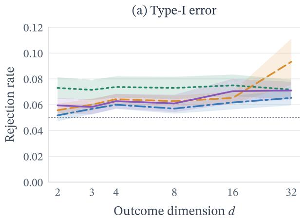

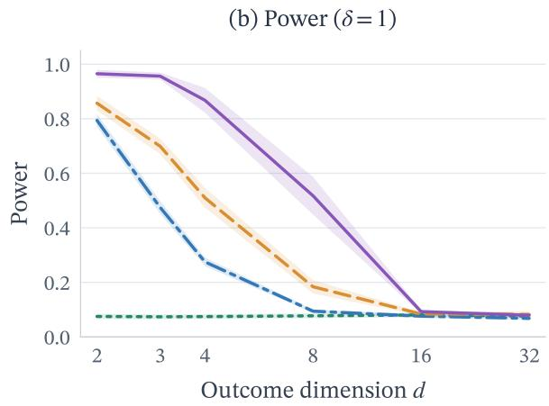  
Figure 14: Causal-Blob at $N = 4 0 0 0$ when varying the outcome dimension, with $\delta = 0$ under $H _ { 0 }$ and $\delta = 1 . 0$ under $H _ { 1 }$ . Shaded bands show ± one standard error across 20 independent outer repetitions. The dotted grey line marks $\alpha = 0 . 0 5$

## D.12 Efect of Joint Maximisation

We compare DR-KTE-Deep to a variant that jointly maximises the power learning criterion of the averaged ensemble. In DR-KTE-Deep, each kernel member is trained and selected separately. The final ensemble can therefore be composed of members selected from diferent training epochs. The joint maximisation variant instead selects a single ensemble checkpoint on the validation sample. Joint maximisation therefore removes the flexibility to select each member at its own best validation checkpoint.

Joint maximisation generally yields similar or lower estimated power than DR-KTE-Deep, while improving on DR-KTE (Table 22). OCT-Drusen is the exception, with higher power under joint maximisation. Type-I error remains close to the nominal level.

<table><tr><td rowspan="2">Scenario</td><td colspan="3">Power/Type-I error  $( H _ { 1 } / H _ { 0 } )$ </td></tr><tr><td>DR-KTE</td><td>DR-KTE-Deep</td><td>Joint maximisation</td></tr><tr><td>Breast-Tumor</td><td> $0 . 7 4 9 { \scriptstyle \pm 0 . 0 1 8 } / 0 . 0 5 3 { \scriptstyle \pm 0 . 0 0 3 }$ </td><td> $\mathbf { 0 . 9 8 9 { \pm } 0 . 0 0 2 } / 0 . 0 5 4 { \pm } 0 . 0 0 3$ </td><td> $\mathbf { 0 . 9 8 9 { \pm } 0 . 0 0 3 / 0 . 0 5 3 { \pm } 0 . 0 0 3 }$ </td></tr><tr><td>Chest-Cardiomegaly</td><td> $0 . 1 5 6 { \scriptstyle \pm 0 . 0 0 7 } / 0 . 0 5 0 { \scriptstyle \pm 0 . 0 0 3 }$ </td><td> $\mathbf { 0 . 9 2 8 { \scriptstyle \pm 0 . 0 4 6 } } / 0 . 0 5 1 { \scriptstyle \pm 0 . 0 0 4 }$ </td><td> $0 . 7 6 3 { \scriptstyle \pm 0 . 0 7 7 } / 0 . 0 5 1 { \scriptstyle \pm 0 . 0 0 4 }$ </td></tr><tr><td>Chest-Effusion</td><td> $0 . 2 3 1 { \scriptstyle \pm 0 . 0 0 9 } / 0 . 0 5 3 { \scriptstyle \pm 0 . 0 0 4 }$ </td><td> $\mathbf { 0 . 9 9 9 { \scriptstyle \pm 0 . 0 0 0 } } / 0 . 0 4 8 { \scriptstyle \pm 0 . 0 0 4 }$ </td><td> $0 . 9 9 8 { \scriptstyle \pm 0 . 0 0 1 } / 0 . 0 5 6 { \scriptstyle \pm 0 . 0 0 4 }$ </td></tr><tr><td>Chest-Mass</td><td> $0 . 4 3 6 { \pm } 0 . 0 1 8 / 0 . 0 5 0 { \pm } 0 . 0 0 3$ </td><td> $\mathbf { 1 . 0 0 0 { \scriptstyle \pm } 0 . 0 0 0 } / 0 . 0 5 6 { \scriptstyle \pm } 0 . 0 0 4$ </td><td> $0 . 9 9 9 { \scriptstyle \pm 0 . 0 0 0 } / 0 . 0 5 0 { \scriptstyle \pm 0 . 0 0 4 }$ </td></tr><tr><td>Derma-Melanoma</td><td> $0 . 1 7 1 { \scriptstyle \pm 0 . 0 0 9 } / 0 . 0 5 1 { \scriptstyle \pm 0 . 0 0 2 }$ </td><td> $\mathbf { 0 . 8 9 8 { \scriptstyle \pm 0 . 0 4 0 } } / 0 . 0 5 3 { \scriptstyle \pm 0 . 0 0 4 }$ </td><td> $0 . 7 9 5 { \scriptstyle \pm 0 . 0 6 0 } / 0 . 0 4 6 { \scriptstyle \pm 0 . 0 0 3 }$ </td></tr><tr><td>OCT-CNV</td><td> $0 . 9 0 7 { \scriptstyle \pm 0 . 0 1 4 } / 0 . 0 5 2 { \scriptstyle \pm 0 . 0 0 3 }$ </td><td> $\mathbf { 1 . 0 0 0 { \pm } 0 . 0 0 0 } / 0 . 0 5 3 { \pm } 0 . 0 0 3$ </td><td> $\mathbf { 1 . 0 0 0 { \pm } 0 . 0 0 0 } / 0 . 0 5 3 { \pm } 0 . 0 0 3$ </td></tr><tr><td>OCT-DME</td><td> $0 . 1 3 9 { \pm } 0 . 0 0 8 / 0 . 0 5 5 { \pm } 0 . 0 0 4$ </td><td> $\mathbf { 1 . 0 0 0 { \scriptstyle \pm 0 . 0 0 0 } } / 0 . 0 6 3 { \scriptstyle \pm 0 . 0 0 5 }$ </td><td> $\mathbf { 1 . 0 0 0 { \pm } 0 . 0 0 0 } / 0 . 0 5 8 { \pm } 0 . 0 0 4$ </td></tr><tr><td>OCT-Drusen</td><td> $0 . 0 5 1 { \scriptstyle \pm 0 . 0 0 3 } / 0 . 0 5 8 { \scriptstyle \pm 0 . 0 0 4 }$ </td><td> $0 . 3 7 1 { \scriptstyle \pm 0 . 0 8 0 } / 0 . 0 5 8 { \scriptstyle \pm 0 . 0 0 5 }$ </td><td> $\mathbf { 0 . 4 8 3 { \pm } 0 . 0 8 9 } / 0 . 0 5 3 { \pm } 0 . 0 0 4$ </td></tr><tr><td>Pneumonia</td><td> $0 . 8 5 7 { \scriptstyle \pm 0 . 0 2 1 } / 0 . 0 5 5 { \scriptstyle \pm 0 . 0 0 3 }$ </td><td> $\mathbf { 0 . 9 9 8 { \scriptstyle \pm 0 . 0 0 1 } } / 0 . 0 5 3 { \scriptstyle \pm 0 . 0 0 4 }$ </td><td> $0 . 9 9 6 { \scriptstyle \pm 0 . 0 0 1 } / 0 . 0 5 1 { \scriptstyle \pm 0 . 0 0 3 }$ </td></tr><tr><td>Retina-Severe</td><td> $0 . 2 8 5 { \scriptstyle \pm 0 . 0 1 5 } / 0 . 0 5 0 { \scriptstyle \pm 0 . 0 0 3 }$ </td><td> $\mathbf { 0 . 9 5 9 { \pm } 0 . 0 0 8 / 0 . 0 5 2 { \pm } 0 . 0 0 3 }$ </td><td> $0 . 9 5 2 { \scriptstyle \pm 0 . 0 0 9 } / 0 . 0 4 9 { \scriptstyle \pm 0 . 0 0 3 }$ </td></tr><tr><td>Oncology Notes</td><td> $0 . 3 7 1 { \scriptstyle \pm 0 . 0 1 5 } / 0 . 0 4 8 { \scriptstyle \pm 0 . 0 0 3 }$ </td><td> $\mathbf { 0 . 8 0 9 { \scriptstyle \pm 0 . 0 2 3 } } / 0 . 0 5 5 { \scriptstyle \pm 0 . 0 0 3 }$ </td><td> $0 . 7 7 0 { \scriptstyle \pm 0 . 0 3 3 } / 0 . 0 5 0 { \scriptstyle \pm 0 . 0 0 5 }$ </td></tr><tr><td>Movie Reviews</td><td> $0 . 2 5 5 { \scriptstyle \pm 0 . 0 1 2 } / 0 . 0 5 0 { \scriptstyle \pm 0 . 0 0 3 }$ </td><td> $\mathbf { 0 . 4 4 9 { \scriptstyle \pm 0 . 0 2 6 } } / 0 . 0 5 3 { \scriptstyle \pm 0 . 0 0 4 }$ </td><td> $0 . 4 2 3 { \scriptstyle \pm 0 . 0 3 1 } / 0 . 0 5 4 { \scriptstyle \pm 0 . 0 0 5 }$ </td></tr><tr><td>Clinical Notes</td><td> $0 . 0 5 8 { \scriptstyle \pm 0 . 0 0 4 } / 0 . 0 5 2 { \scriptstyle \pm 0 . 0 0 3 }$ </td><td> $\mathbf { 0 . 9 3 9 { \pm } 0 . 0 1 3 / 0 . 0 5 8 { \pm } 0 . 0 0 4 }$ </td><td> $0 . 9 3 3 { \scriptstyle \pm 0 . 0 1 4 } / 0 . 0 6 2 { \scriptstyle \pm 0 . 0 0 4 }$ </td></tr><tr><td>LLM Code Repairs</td><td> $0 . 9 6 8 { \scriptstyle \pm 0 . 0 0 8 } / 0 . 0 4 8 { \scriptstyle \pm 0 . 0 0 4 }$ </td><td> $\mathbf { 1 . 0 0 0 { \pm } 0 . 0 0 0 } / 0 . 0 5 1 { \pm } 0 . 0 0 3$ </td><td> $\mathbf { 1 . 0 0 0 { \scriptstyle \pm 0 . 0 0 0 } } / 0 . 0 4 8 { \scriptstyle \pm 0 . 0 0 4 }$ </td></tr><tr><td>Contact Networks</td><td> $0 . 9 5 9 { \scriptstyle \pm 0 . 0 0 6 } / 0 . 0 5 2 { \scriptstyle \pm 0 . 0 0 3 }$ </td><td> $\mathbf { 0 . 9 6 2 { \scriptstyle \pm 0 . 0 0 6 } } / 0 . 0 5 1 { \scriptstyle \pm 0 . 0 0 2 }$ </td><td> $0 . 9 6 2 { \scriptstyle \pm 0 . 0 0 6 } / 0 . 0 5 1 { \scriptstyle \pm 0 . 0 0 3 }$ </td></tr></table>

Table 22: Efect of joint maximisation at $N = 1 5 0 0$ and $\alpha = 0 . 0 5 .$ . Each cell reports $H _ { 1 } / H _ { 0 } ,$ with ${ \mathrm { m e a n s } } \pm { \mathrm { o n e } }$ standard error across 20 outer repetitions.