# Dream-COP: Guiding Algorithm Discovery for Combinatorial Optimization Problems in an Experience World

Kuan Xu<sup>1∗</sup> Jianming Wang<sup>2</sup> Ni Zhang<sup>1</sup> Yaoxin Wu<sup>3</sup> Yong Wang<sup>4</sup> Zhiguang Cao<sup>1</sup>

<sup>1</sup>Singapore Management University

<sup>2</sup>University of Science and Technology of China

<sup>3</sup>Eindhoven University of Technology

<sup>4</sup>Central South University

## ABSTRACT

Large language models (LLMs) enable algorithm discovery for combinatorial optimization problems (COPs) through iterative program generation and evaluation. A central challenge is how to organize search to discover better algorithms within a limited budget. Our key insight is that past search trajectories and their recorded outcomes form an experience world, which can be used to facilitate the COP solving through replay. We introduce Dream-COP, in which a policy agent learns executable policies through dreaming in this experience world to guide a discovery agent in generating and refining COP programs. Specifically, policy replay provides feedback on the quality of the programs revealed and the search steps used, to guide policy selection more effectively. Across five COPs, DREAM discovers better algorithms than fixed exploration in both heuristic component design and complete solver generation. Particularly, it matches the optimal values on KP and reduces the gap on OBPP from 2.112% to 1.199% while using 42.5% fewer search requests. Moreover, the learned exploration policies transfer effectively across different COPs with the assitance of the experience world.

## 1 INTRODUCTION

Combinatorial optimization problems (COPs) are central to efficient resource use in transportation, production scheduling, and resource allocation, yet finding optimal solutions becomes increasingly computationally demanding as problem size and complexity grow (Korte & Vygen, 2018). Heuristics and metaheuristics play a central role in obtaining high-quality solutions under practical computational constraints (Gendreau & Potvin, 2019). Developing effective heuristics often requires substantial expertise and repeated experimentation (Bengio et al., 2021), motivating methods that can automate algorithm design for different problems (Figure 1).

Automatic heuristic design (AHD) automates the selection, composition, and configuration of heuris tics and their components (Burke et al., 2013; Stützle & López-Ibáñez, 2019). Large language models (LLMs) expand this design space by expressing algorithmic ideas in natural language and generating executable programs (Romera-Paredes et al., 2024; Liu et al., 2024). Evaluation and evolutionary search then support repeated selection and revision of these programs using measured performance and execution feedback (van Stein & Bäck, 2025). Subsequent approaches use this experience to provide reflective guidance and organize development trajectories into trees for structured exploration (Ye et al., 2024; Zheng et al., 2025). Reinforcement learning enables the LLM to improve its generation behavior from evaluated candidates (?Huang et al., 2026) and learn decisions within multi-turn AHD interactions (Lv et al., 2026). These advances highlight the value of experience in improving heuristic generation.

Algorithm discovery also requires deciding which candidate program to revise and evaluate next. Different revision branches exhibit different patterns of improvement, failure, and stagnation. How the search budget is allocated among these branches, and when exploration stops, therefore directly influence the quality of the algorithms discovered. Historical trajectories record these patterns together with the outcomes of earlier revisions, providing evidence for learning how to make such decisions. We therefore ask: how can historical search trajectories help us learn better exploration policies?

World-model research suggests a useful principle: experience can provide an internal environment for improving policies before they guide further real interaction (Sutton, 1990; Ha & Schmidhuber, 2018; Hafner et al., 2020; 2025). For algorithm discovery, this motivates turning past searches into an environment where explo ration policies can be evaluated before allocating new generation and evaluation requests.

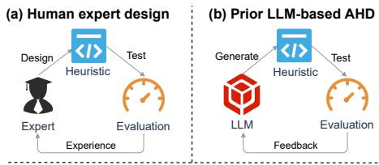

Our key insight is that historical search trees record both what was discovered and how discovery unfolded, providing exactly the structure needed for such an internal environment. We introduce Dream-COP, which learns search policies by dreaming in an experience world constructed from these trees (Figure 1c). The relationships among programs, together with their recorded evaluation outcomes, allow candidate search policies to be replayed over these development trajectories. Particularly, a policy agent proposes executable search policies that decide which revision branch to extend, when to open a new branch, and when to stop. During replay,

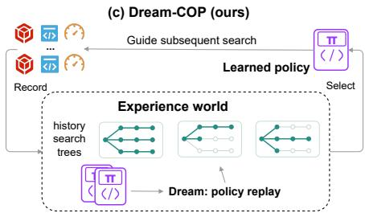  
Figure 1: Three approaches to heuristic design: (a) human expertise, (b) LLM-based heuristic search, and (c) Dream-COP, which learns exploration policies through historical replay in the experience world.

each policy sees only the outcomes revealed by its own actions and is evaluated by the quality of the programs it reveals and the number of search steps it uses. These evaluations guide subsequent policy proposals and policy selection. The selected policy then directs a discovery agent’s program generation and evaluation, producing new search trajectories that expand the experience world. This cycle turns each completed search into two assets: candidate algorithms and experience for learning more effective exploration policies.

Our contributions are threefold. (1) We formulate historical search trees as an experience world, enabling policies to be compared through recorded outcomes without additional solver generation or evaluation during replay. (2) We develop Dream-COP, which proposes executable policies for budget allocation, and selects candidate policies using a replay objective that balances algorithm quality against the number of search steps. (3) We conduct experiments across five COPs, and the results show that Dream-COP discovers better algorithms with fewer search requests than fixed exploration. Meanwhile, it also achieves superior performance against existing LLM-based AHD methods. Cross-problem experiments further show that exploration policies learned from search experience on one COP remain effective when guiding algorithm discovery on another.

## 2 RELATED WORK

LLM-based algorithm discovery. Automated algorithm design builds on configuration methods that optimize parameter settings from measured performance (Hutter et al., 2011; López-Ibáñez et al., 2016) and neural approaches that learn solution-construction policies for recurring optimization problems (Khalil et al., 2017; Kool et al., 2019). LLM-based discovery generates executable programs, using evaluated candidates as the basis for proposing new algorithms (Liu et al., 2023; Romera-Paredes et al., 2024; Zhu et al., 2026a). Existing frameworks can jointly develop natural-language heuristic ideas and their implementations (Liu et al., 2024), generate complete metaheuristics and solvers (van Stein & Bäck, 2025; Zhang et al., 2026), and extend evaluator-guided code evolution to broader scientific and computational problems (Novikov et al., 2025). At the same time, search organization determines which programs receive further development. Reflective methods use performance feedback to guide program revision (Ye et al., 2024; Malik et al., 2026), while MCTS-AHD organizes heuristic development into a tree to explore promising continuations (Zheng et al., 2025). AB-MCTS uses external feedback to choose adaptively between generating new candidates and refining existing ones (Inoue et al., 2025). PathWise organizes heuristic discovery around an entailment graph that records derivation relationships and evaluation history (Gungordu et al., 2026). These methods demonstrate the value of feedback for directing search. Differently, Dream-COP makes the allocation rule itself an object of program discovery: an LLM proposes executable policies that choose which revision branch to develop and when to stop, and historical replay evaluates these policies before deployment.

Experience-driven search-policy adaptation. Experience can change both how candidates are generated and how discovery decisions are made. EvoPH co-evolves prompts and heuristics using feedback from past search (Liu et al., 2026). CALM and RFTHGS use evaluated algorithms to improve the LLM generation through reinforcement learning (Huang et al., 2026; Zhu et al., 2026b). AHD Agent extends learning to multi-turn heuristic design, training an LLM to decide between generating heuristics and using tools to obtain evidence in synthesized environments (Lv et al., 2026). These works adapt prompts, model parameters, or interactive generation behavior. Dream-COP learns a separate executable controller over the program-search tree, updating budget allocation decisions while keeping LLM weights fixed.

Language agents also adapt through textual feedback, from iterative output refinement to reflections retained across trials (Madaan et al., 2023; Shinn et al., 2023). Agent-Pro optimizes behavioral policies through reflection on trajectories and beliefs (Zhang et al., 2024), while MetaReflection learns instructions from past reflections (Gupta et al., 2024). We likewise use accumulated feedback to guide policy proposals. To evaluate a proposed policy, we execute it on the same historical trees and compare the quality of the programs it reveals and the number of search steps it uses.

Policy learning in internal environments. Dyna couples real interaction with planning through a learned environment model (Sutton, 1990). World Models train controllers inside a learned recurrent environment and transfer them to real interaction (Ha & Schmidhuber, 2018). Dreamer learns behavior from imagined trajectories in latent world models (Hafner et al., 2020; 2021; 2025). These approaches use internal environments to improve policies before further interaction. Dream-COP applies this principle to algorithm discovery through an experience world whose transitions and outcomes come directly from recorded program revisions. A policy’s actions reveal these records in sequence, allowing alternative allocation and stopping strategies to be compared without new algorithm generation or evaluation during replay. The selected policy then controls subsequent real search, which supplies new trees for learning. This connects experience reuse to an explicit cycle of exploration-policy proposal, replay evaluation, and deployment.

## 3 DREAM-COP

Dream-COP learns search policies by replaying completed search trees (Figure 2). Particularly, a discovery agent generates and evaluates solver programs, recording their development as search experience; a policy agent uses this experience to learn executable policies that allocate subsequent search budget and decide when to stop. Both agents are instantiated with the same LLM backbone.

## 3.1 THE DISCOVERY AGENT AND SEARCH TREES

Let p denote a solver program and let $q ( p ; \mathcal { D } _ { \mathrm { d e v } } )$ be its quality on a fixed development set, normalized so that larger values are better. The discovery agent generates either a heuristic within a fixed controller or a complete solver. An independent evaluator verifies solutions and computes their quality, providing feedback under either interface.

A search round begins with a feasible root program. At each search step, the discovery agent receives the task specification, the selected parent program, the hypotheses associated with its revision branch, and evaluation feedback. It returns a revised program together with a brief description of the change. The evaluator then records the result. Each request consumes one search step, including requests that fail to produce a valid revision.

We record each round as a rooted tree $T = ( V , E )$ , where only the root may have multiple children, and every other node has at most one child. The tree thus represents alternative branches of program revisions. At the same time, a search policy (i.e., generated by the policy agent) chooses whether to open a new branch, extend an existing branch, or stop.

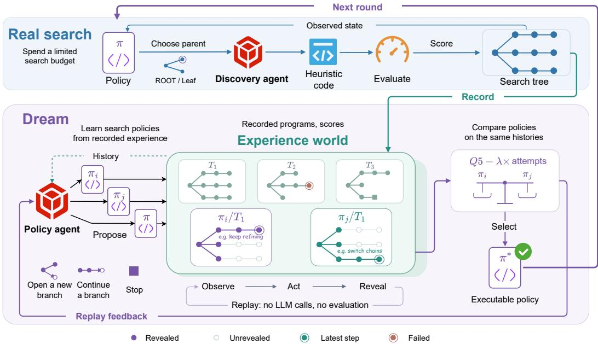  
Figure 2: Learning search policies from recorded experience. The discovery agent generates and evaluates candidate programs, recording their development trajectories as historical search trees. These trees provide an experience world in which the policy agent compares executable policies. During replay, each policy sees only the outcomes revealed by its own actions; the world supplies recorded transitions without new solver generation or evaluation. Replay feedback guides successive policy proposals, and the selected policy controls the next real search round. The depicted trajectories illustrate alternative search allocations.

## 3.2 EXECUTABLE POLICIES FOR BUDGET ALLOCATION

At step t, the observation $o _ { t }$ summarizes the revealed tree together with the remaining budget and action history. Then, an executable policy maps this observation to a single action:

$$
a _ { t } = \pi ( o _ { t } , \alpha ) \in \{ { \mathsf { R O O T } } \} \cup { \mathcal { L } } _ { t } \cup \{ { \mathsf { N o n e } } \} .\tag{1}
$$

Here, $\mathcal { L } _ { t }$ is the set of current leaf identifiers; the policy selects ROOT to open a new branch, $\ell \in \mathcal { L } _ { t }$ to extend the corresponding branch; or None to stop the round. The policy agent proposes policies between rounds; during real search, DREAM executes the selected policy after observing each completed outcome. Its input α expresses the preference between further exploration and earlier stopping. Appendix A details the observation fields and presents an example of a learned policy. For comparison, FIXED follows a predetermined policy that opens B revision branches and allocates L search steps to each branch. DREAM uses this policy in its first round. Both methods run for R rounds with a budget of BL search steps per round. Learned policies can redistribute this budget across branch counts and lengths, or stop early.

## 3.3 HISTORICAL TREES AS AN EXPERIENCE WORLD

The experience world allows a policy to explore the recorded transitions of $T = ( V , E )$ in its own order. Let $V _ { t } \subseteq V$ be the nodes revealed after t replay steps and $b _ { t }$ the remaining replay budget. Initially, $V _ { 0 }$ contains only the root. For a non-stopping action $a _ { t }$ with $b _ { t } > 0$ , replay updates

$$
\begin{array} { l } { V _ { t + 1 } = V _ { t } \cup C _ { T } ( a _ { t } , V _ { t } ) , } \\ { b _ { t + 1 } = b _ { t } - 1 . } \end{array}\tag{2}
$$

Here, $C _ { T } ( a _ { t } , V _ { t } )$ contains the next unrevealed child of the root in recorded order, or the recorded child of the selected leaf. It is empty when no continuation remains. Newly revealed nodes expose their stored feasibility and quality outcomes without calling the discovery agent or the evaluator.

During replay, the policy uses the same observation interface as in real search and sees only the outcomes revealed by its actions, including feasibility, solution quality, and execution failures. The same recorded tree can therefore support different search trajectories: a policy may stop after exploring one branch or alternate among branches. These decisions determine which programs are revealed and how many replay steps are used.

Each request to the root or a leaf counts as one replay step, including empty requests with $C _ { T } ( a _ { t } , \bar { V _ { t } } ) = \emptyset$ . Replay ends when the policy returns None, the replay budget is exhausted $( b _ { t } = 0 )$ or all recorded nodes have been revealed $( V _ { t } ~ = ~ V )$ . Appendix A specifies replay budgets and eligibility rules for the accumulated history $\mathcal { H } _ { r }$ after round r.

## 3.4 REPLAY OBJECTIVE

A useful search policy should reveal high-quality programs while avoiding unproductive requests. For policy π and exploration setting $\alpha ,$ , let $S _ { \pi , \alpha , T }$ denote the multiset of development scores of feasible nodes revealed during replay on tree $T$ , including the score of the root node. With $m = | S _ { \pi , \alpha , T } |$ , sort these scores as $s _ { ( 1 ) } \geq \cdot \cdot \cdot \geq s _ { ( m ) }$ and define

$$
Q ( \pi , \alpha , T ) = \frac { 1 } { k } \sum _ { i = 1 } ^ { k } s _ { ( i ) } , k = \operatorname * { m i n } ( 5 , m ) .\tag{3}
$$

When development scores are closely clustered, the best score alone provides a narrow view of a policy’s search performance. We therefore average the top five feasible scores to capture progress across several promising candidates. Five serves as a practical cutoff that keeps this quality measure focused on high-performing programs while limiting the influence of lower-ranked candidates.

Let $A ( \pi , \alpha , T )$ count replay steps, then the replay objective at boundary $r$ is

$$
\begin{array} { c } { { U _ { r } ( \pi , \alpha , T ) = Q ( \pi , \alpha , T ) - \lambda A ( \pi , \alpha , T ) , } } \\ { { J _ { r } ( \pi , \alpha ) = \displaystyle \frac { 1 } { | \mathcal { H } _ { r } ^ { \star } | } \sum _ { T \in \mathcal { H } _ { r } ^ { \star } } U _ { r } ( \pi , \alpha , T ) , } } \end{array}
$$

where $\mathcal { H } _ { r } ^ { \star }$ is the nonempty set of eligible trees available at this boundary, weighted equally. The fixed coefficient λ penalizes each replay step in units of normalized development quality. Thus, α controls exploration preference, while λ determines the trade-off between program quality and search cost in the replay objective $J _ { r } ( \pi , \alpha )$

## 3.5 THE POLICY AGENT: LEARNING FROM REPLAY

Let $c _ { r } = \left( \pi _ { r } , \alpha _ { r } \right)$ be the pair deployed in round r. Starting with $\mathcal { H } _ { 0 } = \mathcal { O }$ , the first round uses $\pi _ { 1 } = \mathrm { F I X E D }$ , which ignores its α input. Each round generates a search tree and expands the history:

$$
\begin{array} { r l } & { T _ { r } = \mathrm { S e a r c h } ( \pi _ { r } , \alpha _ { r } ; B L ) , } \\ & { \mathcal { H } _ { r } = \mathcal { H } _ { r - 1 } \cup \{ T _ { r } \} , } \end{array}\tag{4}
$$

where Search executes the discovery agent under the deployed policy with at most BL search steps.

Before the next round $( r < R )$ , policy learning runs whenever the expanded history contains eligible trees, i.e., $\mathcal { H } _ { r } ^ { \star } \neq \emptyset$ . The policy agent proposes executable policies through four sequential LLM calls, using the current policy and historical evidence. After each call, replay evaluates the proposals; rewards, quality, step counts, and failures inform the next call. This feedback guides refinement of stopping, branching, allocation, and revisiting decisions. Appendix A.2 provides the prompt template.

For a policy–parameter pair $c = ( \pi , \alpha )$ , write $J _ { r } ( c ) = J _ { r } ( \pi , \alpha )$ . Let $\mathcal { C } _ { r }$ contain the valid pairs generated at this boundary, then the pair with the highest mean replay reward is deployed as:

$$
c _ { r + 1 } = \left\{ \begin{array} { l l } { \arg \operatorname* { m a x } _ { c \in \mathcal { C } _ { r } } J _ { r } ( c ) , } & { \mathcal { C } _ { r } \neq \emptyset , } \\ { c _ { r } , } & { \mathcal { C } _ { r } = \emptyset . } \end{array} \right.\tag{5}
$$

<table><tr><td rowspan="2">LLM Model</td><td rowspan="2">Method</td><td colspan="2">N = 50</td><td colspan="2">N = 100</td><td colspan="2">N = 200</td><td colspan="2">N = 500</td><td colspan="2">TSPLIB</td></tr><tr><td>Obj.↓</td><td>Gap (%)</td><td>Obj.↓</td><td>Gap (%)</td><td>Obj.↓</td><td>Gap (%)</td><td>Obj.↓</td><td>Gap (%)</td><td>Obj.↓</td><td>Gap (%)</td></tr><tr><td rowspan="4"></td><td>LKH ref.</td><td>5.675</td><td></td><td>7.768</td><td></td><td>10.708</td><td></td><td>16.531</td><td></td><td>46392.7</td><td></td></tr><tr><td>Greedy</td><td>6.959</td><td>22.622</td><td>9.706</td><td>24.936</td><td>13.461</td><td>25.711</td><td>20.813</td><td>25.903</td><td>57055.2</td><td>24.332</td></tr><tr><td>POMO</td><td>5.697</td><td>0.383</td><td>8.001</td><td>2.999</td><td>12.897</td><td>20.447</td><td>24.156</td><td>46.135</td><td>60654.7</td><td>23.923</td></tr><tr><td>EoH</td><td>6.629</td><td>16.822</td><td>9.252</td><td></td><td>19.114 12.939</td><td>20.842</td><td>20.202</td><td>22.209</td><td>55974.5</td><td>21.060</td></tr><tr><td rowspan="4">GPT-4o-mini</td><td>ReEvo</td><td>6.959</td><td>22.622</td><td>9.706</td><td>24.936</td><td>13.461</td><td>25.711</td><td>20.813</td><td>25.903</td><td>57055.2</td><td>24.332</td></tr><tr><td>MCTS-AHD</td><td>6.578</td><td>15.906</td><td>9.231</td><td>18.832</td><td>12.974</td><td>21.166</td><td>20.258</td><td>22.549</td><td>55759.7</td><td>19.306</td></tr><tr><td>FIXED</td><td>6.959</td><td>22.622</td><td>9.706</td><td>24.936</td><td>13.461</td><td>25.711</td><td>20.813</td><td></td><td>25.903 57055.2</td><td>24.332</td></tr><tr><td>Dream-COP</td><td>6.490</td><td>14.379</td><td>9.006</td><td>15.952</td><td>12.587</td><td>17.557</td><td>19.696</td><td>19.149</td><td>54416.3</td><td>17.390</td></tr><tr><td rowspan="5">GPT-6-Luna</td><td>EoH</td><td>6.630</td><td>16.819</td><td>9.241</td><td>18.955</td><td>12.882</td><td>20.305</td><td>20.019</td><td></td><td>21.099 56590.2</td><td>20.658</td></tr><tr><td>ReEvo</td><td>6.566</td><td>15.682</td><td>9.204</td><td>18.493</td><td>12.881</td><td>20.292</td><td>20.075</td><td>21.440</td><td>55454.1</td><td>20.782</td></tr><tr><td>MCTS-AHD</td><td>6.582</td><td>15.959</td><td>9.161</td><td>17.929</td><td>12.758</td><td>19.143</td><td>19.792</td><td>19.728</td><td>55893.7</td><td>20.226</td></tr><tr><td>FIXED</td><td>6.543</td><td>15.275</td><td>9.123</td><td>17.432</td><td>12.688</td><td>18.495</td><td>19.734</td><td>19.378</td><td>54476.4</td><td>18.355</td></tr><tr><td>Dream-COP</td><td>6.214</td><td>9.489</td><td>8.647</td><td></td><td>11.316 12.031</td><td></td><td>12.361 18.714</td><td></td><td>13.20951666.6</td><td>11.984</td></tr></table>

Table 1: Constructive TSP: mean tour length and gap (%) to LKH, which matches the official optima on all 15 TSPLIB instances. We also include Greedy and POMO (Kwon et al., 2020) as baselines. LLM-based results are averaged over 3 runs. Bold: best non-reference result; shading: best LLM result within each model, including ties.
<table><tr><td rowspan="2">LLM Model Method</td><td rowspan="2"></td><td colspan="2"> $N = 5 0 , W = 1 2 . 5$ </td><td colspan="2">N = 100, W = 25</td><td colspan="2">N = 200, W = 25</td><td colspan="2">N = 500, W = 25</td></tr><tr><td>Obj.↑</td><td>Gap (%)</td><td>Obj.↑</td><td>Gap (%)</td><td>Obj.↑</td><td>Gap (%)</td><td>Obj.↑</td><td>Gap (%)</td></tr><tr><td rowspan="3"></td><td>OR-Tools opt.</td><td>20.037</td><td></td><td>40.272</td><td></td><td>57.447</td><td></td><td>90.963</td><td></td></tr><tr><td>Greedy</td><td>19.985</td><td>0.261</td><td>40.225</td><td>0.118</td><td>57.395</td><td>0.090</td><td>90.919</td><td>0.048</td></tr><tr><td>POMO</td><td>19.510</td><td>2.548</td><td>39.431</td><td>2.034</td><td>57.209</td><td>0.417</td><td>85.414</td><td>6.096</td></tr><tr><td rowspan="3">GPT-6-Luna</td><td>MCTS-AHD</td><td>20.037</td><td>0.000</td><td>40.272</td><td>0.000</td><td>57.447</td><td>0.000</td><td>90.945</td><td>0.020</td></tr><tr><td>FIXED</td><td>20.033</td><td></td><td>0.019 40.264</td><td></td><td>0.02057.436</td><td>0.020</td><td>90.954</td><td>0.010</td></tr><tr><td>Dream-COP</td><td>20.037</td><td></td><td>0.000 40.272</td><td></td><td>0.000 57.447</td><td></td><td>0.000 90.963</td><td>0.000</td></tr></table>

Table 2: Constructive KP: mean objective value and gap (%) to the OR-Tools optimum by item count N and capacity W, averaging 1,000 test instances per size. LLM-based methods use GPT-6-Luna. Bold: best non-reference result; shading: best LLM result, including ties.

Policy learning leaves LLM weights unchanged. The selected policy remains fixed throughout the next real search round, which supplies new experience. Appendix A provides execution and selection details and the complete procedure (Algorithm 1).

## 4 EXPERIMENTS

Our experiments address three questions: (1) Can Dream-COP discover better algorithms with fewer search requests? (2) Does historical replay improve the effectiveness of learned search policies? (3) How well do these policies transfer across different COPs?

We first evaluate Dream-COP on four tasks in which the discovery agent evolves heuristic components within fixed controllers: constructive variants of the traveling salesman problem (TSP) and knapsack problem (KP), online bin packing (OBPP), and flow-shop scheduling (FSSP). We further use offline two-dimensional bin packing (2D-BPP) to evaluate complete solver generation and to analyze policy replay and the trade-off between solution quality and search cost. Moreover, we evaluate crossproblem policy transfer among TSP, OBPP, and FSSP. Complete DREAM-discovered programs are provided in Appendix E.

## 4.1 EVALUATION SETTINGS

Tasks and instances. For constructive TSP and KP, we aim to evolve next-city and next-item selectors within fixed construction procedures to minimize tour length and maximize total item value, respectively. Each task is evaluated on 1,000 test instances at each size N ∈ {50, 100, 200, 500}. TSP additionally includes 15 TSPLIB instances, totaling 4,015 test instances. For OBPP, we aim to evolve a bin-scoring rule to minimize bin count and evaluate it on 30 test instances spanning

1,000–10,000 items and capacities 100 and 500. For FSSP, we aim to evolve a perturbation function within a fixed local-search controller to minimize makespan and evaluate it on 110 Taillard test instances covering 11 sizes (Taillard, 1993). For 2D-BPP, we aim to evolve complete solvers to minimize bin count and evaluate them on 500 BWMV test instances with 20–100 rectangles per instance (Martello & Vigo, 1998).

Following MCTS-AHD (Zheng et al., 2025), we use its released development sets of 64 TSP instances with 50 cities, 64 KP instances with 100 items, and four OBPP instances. For FSSP, we use the 64 development instances with 50 jobs released in EoH (Liu et al., 2024). For 2D-BPP, we generate 60 instances following the BWMV class distributions (Martello & Vigo, 1998). These development sets are disjoint from the corresponding test sets. Task specifications are detailed in Appendix B.

Methods and setting. We compare with applicable implementations of FunSearch, EoH, ReEvo, and MCTS-AHD (Romera-Paredes et al., 2024; Liu et al., 2024; Ye et al., 2024; Zheng et al., 2025). Both FIXED and DREAM use the same discovery agent and run for $R = 1 0$ rounds. FIXED opens B = 6 branches per round with a maximum depth of $L = 4 ,$ , whereas DREAM adaptively allocates the same budget of $B L = 2 4$ search steps per round and may stop early. Both therefore allow at most 240 search steps overall; the other baselines receive a budget of 240 candidates, including initialization. Invalid generations and failed evaluations count toward these budgets. Search steps measure algorithm-discovery effort, whereas token costs also account for policy learning. The main backbone is GPT-6-Luna; TSP and FSSP also use GPT-4o-mini, and 2D-BPP also uses GPT-6-Sol. In the GPT-6-Luna experiments on TSP and 2D-BPP, FIXED and DREAM share the initial solver within each comparison. For each run, we freeze the solver with the highest development score before testing it directly on all test instances. All reported evaluations are complete, with zero failed instances. Appendix C provides detailed experimental configurations.

## 4.2 PERFORMANCE ACROSS PROBLEMS AND SIZES

Constructive TSP and KP. Table 1 shows that DREAM achieves the lowest mean tour length among the compared LLM-based AHD methods across all four synthetic sizes and TSPLIB, using either LLM backbone, i.e., GPT-6-Luna or GPT-4o-mini. Here, with GPT-6-Luna, it reduces the overall mean gap to LKH from FIXED’s 17.65% to 11.60% while using 13.75% fewer search requests.

These gains show that learned search policies discover constructive programs that generalize beyond the development instances. $\mathrm { A t } \ : N = 5 0 0 .$ DREAM also reduces the mean solve time per instance from 137 seconds with FIXED to 80 seconds, improving both tour quality and execution efficiency (Appendix D.1). Figure 3 shows the mean best-so-far development score across three runs, with shading indicating ±1 standard error. DREAM reaches a higher final score than FIXED while using fewer search requests. It also surpasses the compared LLM-based baselines, showing that more selective use of the search budget can improve the quality of the discovered programs.

Table 2 reports the constructive KP results across four item counts. DREAM matches the OR-Tools optimal values to the displayed precision at all

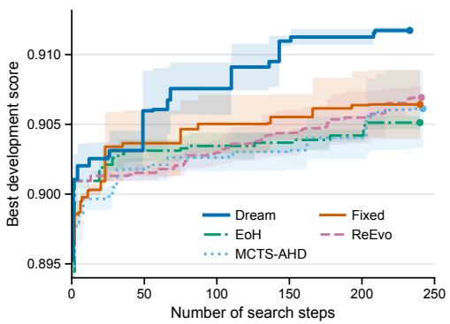  
Figure 3: TSP development score using GPT-6- Luna, averaged over three independent runs per method.

four sizes, whereas none of the compared baselines consistently achieves a zero gap. At the largest size, $N = 5 0 0$ , MCTS-AHD and FIXED retain gaps of 0.020% and 0.010%, respectively. DREAM attains its higher solution quality while using 17.5% fewer search requests than FIXED, demonstrating more effective use of the discovery budget.

Online packing and flow-shop scheduling. Table 3 reports OBPP gaps at capacity $C = 1 0 0 .$ , with each cell averaging five instances. Table 9 in the Appendix includes both $C \stackrel { - } { = } 1 0 0$ and $C = 5 0 0$ Averaged over all 30 test instances across both capacities, DREAM reduces the gap to the volume lower bound from FIXED’s 2.112% to 1.199%, using 42.5% fewer search steps. The improvement is concentrated in longer item sequences at capacity 100, where DREAM outperforms all included baselines. Since every method uses the same packing controller, this gain reflects a more effective bin-scoring rule discovered through adaptive search.

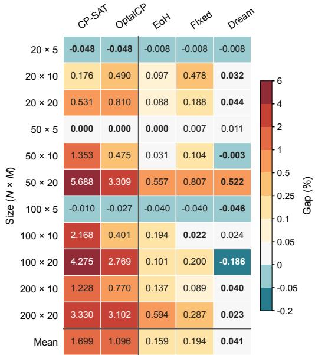

<table><tr><td>N FunSearch</td><td>EoH ReEvo MCTS</td><td>FIXED</td><td>DREAM</td></tr><tr><td>1k</td><td>4.771 4.771 4.522</td><td>3.926</td><td>4.371 4.477</td></tr><tr><td>5k</td><td>4.307 4.307 3.743</td><td>3.357 3.585</td><td>1.089</td></tr><tr><td>10k</td><td>4.0494.049 3.730</td><td>3.291 3.501</td><td>0.459</td></tr></table>

Table 3: OBPP with GPT-6-Luna: mean gap (%) to the volume lower bound at capacity C = 100, by item count (lower is better). Shading marks the best method at each size.
<table><tr><td rowspan="2">N</td><td rowspan="2">BRKGA</td><td colspan="2">GPT-6-Luna</td><td colspan="2">GPT-6-Sol</td></tr><tr><td>Total FIXED</td><td>DREAM</td><td>FIXED</td><td>DREAM</td></tr><tr><td>20</td><td>515</td><td>+0.3</td><td>0.0</td><td>0.0</td><td>0.0</td></tr><tr><td>40</td><td>977</td><td>+2.0</td><td>+1.0</td><td>+1.0</td><td>+1.0</td></tr><tr><td>60</td><td>1446</td><td>+6.3</td><td>+4.7</td><td>+2.7</td><td>+1.3</td></tr><tr><td>80</td><td>1964</td><td>+5.0</td><td>+3.3</td><td>+2.3</td><td>+0.3</td></tr><tr><td>100</td><td>2332</td><td>+12.0</td><td>+8.7</td><td>+5.3</td><td>+3.0</td></tr><tr><td>All</td><td>7234</td><td>+25.7</td><td>+17.7</td><td>+11.3</td><td>+5.7</td></tr></table>

Figure 4: FSSP mean gap (%) to the Taillard reference upper bound by size (lower is better). LLM-based methods use GPT-6-Luna. Bold marks the best method per row.  
Table 4: 2D-BPP: BRKGA total bins and excess bins (∆) for FIXED/DREAM, averaged over three runs. Each size has 100 instances (500 total). Shading marks the smaller excess within each model, including ties.

On FSSP, DREAM achieves the lowest aggregate makespan among the LLM-based methods with both LLM backbones, with improvements over FIXED and EoH extending to the largest job counts. With GPT-6-Luna, its mean gap to the upper bound is 0.0412%. Across the 110 instances, DREAM records 59 wins, 40 ties, and 11 losses against FIXED. Excluding ties, a two-sided exact sign test gives $p = 4 . 4 7 \times 1 0 ^ { - 9 }$ . This extends the benefit of learned search from constructive decisions to perturbations within iterative local search. Figure 4 further shows that DREAM’s 60-second GLS protocol achieves a lower mean gap than CP-SAT and OptalCP under their 300-second limits. The LLM-based results in the heatmap use GPT-6-Luna, where each entry for a given problem size averages ten instances, while the overall mean averages all 110 instances. Appendix D.2 provides the complete makespan/time results (Table 8) and settings.

## 4.3 DESIGNING COMPLETE 2D-BPP SOLVERS

The preceding tasks evolve components within fixed controllers. For 2D-BPP, we instead ask the discovery agent to generate complete solvers that assign rectangles to bins and determine their positions without rotation. Each solver implements its own construction and improvement logic within a given time budget. An independent geometric checker verifies the resulting packing layouts.

We evaluate candidate solvers on 60 development instances using mean squared bin utilization as the score. The selected solvers are then tested on 500 BWMV instances with a 60-second budget per instance. Table 4 reports their excess bin counts relative to the published BRKGA reference (Gonçalves & Resende, 2013). All selected solvers produce feasible layouts on every instance, and DREAM uses fewer bins than FIXED with both settings. With GPT-6-Luna, it saves eight bins over the 500-instance test set, with most of the improvement occurring on larger instances. These results show that learned search policies remain effective when the discovery agent must coordinate construction, placement, and improvement within a complete solver.

## 4.4 EXPERIMENTAL ANALYSIS

We examine the two terms of the replay objective by comparing quality measures across all five COPs and varying the cost penalty on 2D-BPP. We then use 2D-BPP to assess the contribution of policy replay and illustrate how learned policies allocate the search budget.

Replay quality measure. The replay quality term $Q$ in Eq. (3) averages the top five feasible development scores. We denote it by $Q _ { 5 }$ and compare it with $Q _ { 1 } = \operatorname* { m a x } S _ { \pi , \alpha , T }$ , keeping the request penalty unchanged. Whereas $Q _ { 1 }$ increases only when a new best score is revealed, $Q _ { 5 }$ also captures improvements in the overall quality of the top-five candidates. We examine whether this richer signal helps exploration through periods without a new best. Both objectives use GPT-6-Luna with the same root programs and budgets for discovery and policy learning, with one completed run per objective and problem.

We count a delayed improvement when a new best development score is reached within a round after at least three consecutive requests without a new best. To account for varying search effort, we report these events per 100 discovery requests across the learned-policy rounds, excluding the initial round. Failed requests count toward both the stagnation interval and the request total. Figure 5 shows higher delayed-improvement rates with $Q _ { 5 }$ on all five problems, suggesting that the quality of several promising candidates provides useful guidance during stagnation.

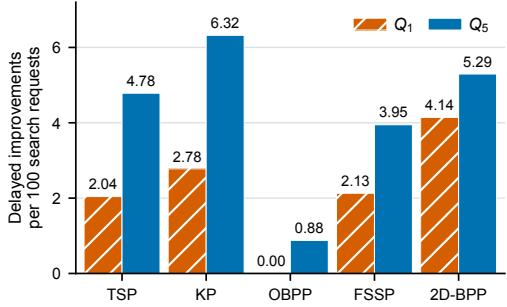  
Figure 5: Delayed improvements per 100 discovery requests under $Q _ { 1 }$ and $Q _ { 5 }$ with GPT-6-Luna.

The selected solvers also achieve higher development scores and better test performance with $Q _ { 5 }$ on TSP, FSSP, and 2D-BPP, with identical KP results (see Appendix D.4). Together, these results support using multiple promising candidates to assess replay quality and guide continued exploration.

Cost penalty. We next examine the cost term of the replay objective by varying λ on 2D-BPP. Figure 6 compares search progress under different penalties and with or without policy replay, averaging three runs per setting. DREAM with $\lambda = { \overline { { 1 0 } } } ^ { = } 7$ and $1 0 ^ { - 5 }$ reaches higher mean development scores than FIXED with fewer search steps, whereas $\lambda = 1 0 ^ { - 3 }$ favors shorter searches. Increasing λ from $1 0 ^ { - 5 }$ to $1 0 ^ { - 3 }$ reduces mean search steps by 44.1%, while the final mean development score changes from 0.75451 to 0.75209. $\mathrm { A t } \lambda = 1 0 ^ { - 3 }$ , DREAM uses 106 search steps on average, compared with 240 for FIXED, and still achieves a lower mean test bin count (14.51333 versus 14.51933). We use $\lambda = 1 0 ^ { - 5 }$ as the default to balance quality and cost. $\mathsf { A p - }$ pendix D.5 provides the full sensitivity results in Table 12 and round-level statistics in Figure 10.

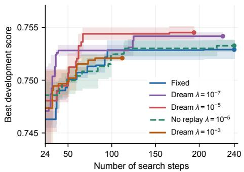  
Figure 6: 2D-BPP search progress under different cost penalties and with or without policy replay, using GPT-6-Luna. Curves show the bestso-far development score, averaged over three runs per setting.

The reduction in search effort also yields net token savings. Including policy learning, DREAM at $\lambda = 1 0 ^ { - 3 }$ reduces mean total recorded tokens by 23.8% relative to FIXED, as the savings in solver discovery exceed the cost of policy learning. Appendix D.5 reports the token breakdown.

Policy-replay ablation. Using the default cost penalty, we next examine the contribution of replaybased policy evaluation and selection. We compare DREAM with No replay, which uses the same historical-evidence interface and algorithm-discovery budget. At each learning boundary, No replay makes one LLM call to generate a single policy and deploys it after syntax and interface checks, without replay-based evaluation or selection. In Figure 6, No replay remains close to FIXED, whereas

DREAM reaches a higher development score with fewer search steps. Comparing three-run mean bin counts on each of the 500 test instances gives DREAM 15 wins, 483 ties, and 2 losses against No replay. Excluding ties, a two-sided exact sign test gives $p = 0 . 0 0 2 3 5$ . These results support the replay-based policy-learning loop, which evaluates policies in the experience world before deployment.

Learned budget allocation in real search. To illustrate how these policies guide individual search decisions, Figure 7 follows DREAM within a round’s 24-step budget. It allocates different numbers of steps to the six branches, extending promising ones beyond FIXED’s four-step limit. After two lower-scoring revisions on the first branch, it explores other branches before returning at step 20. This revisit produces the program with the highest development score in the run, at depth eight. The trajectory shows how learned policies combine deeper refinement with exploration of alternatives under the same total budget.

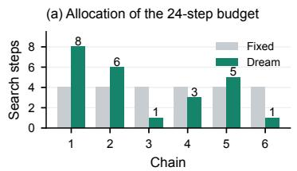  
(c) Real search tree (node labels: search step)

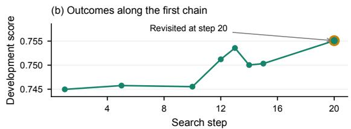

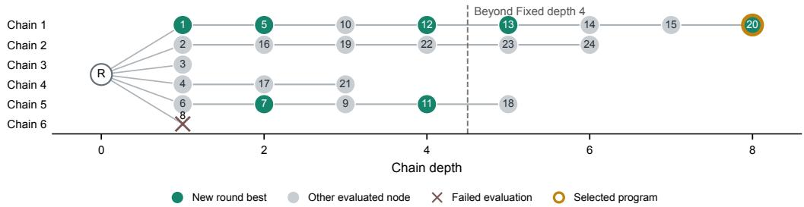  
Figure 7: 2D-BPP search round 9 with GPT-6-Luna. (a) Allocation of the 24-step budget across branches, compared with four steps per branch under FIXED. (b) Development scores along the first branch. (c) Complete search tree, with nodes labeled by search step. The highlighted program has the highest development score in the run and is selected for testing.

## 4.5 CROSS-PROBLEM POLICY TRANSFER

We further examine whether learned search policies transfer effectively across COPs. We consider three directions: TSP → OBPP, OBPP → FSSP, and FSSP → TSP. For TSP, we report mean tour length with N ∈ {50, 100, 200}. For each transfer, we deploy the final search policy learned in a DREAM run on the source problem, keeping its code fixed throughout target search.

All target runs use GPT-6-Luna, B = 6, L = 4, and R = 10. For each transfer run, we freeze the program with the highest development score before testing. Table 5 compares transferred policies with the FIXED and DREAM results. Transferred policies improve test quality over FIXED in all three directions while using 25.0–64.2% fewer search steps. On OBPP, transfer also surpasses DREAM, reducing the mean gap from 1.1988% to 1.0637%. A plausible explanation is that transfer benefits from an exploration strategy already learned on the source problem, which guides OBPP discovery from the first round, whereas DREAM initially collects target-problem experience before learning its policy online. These results demonstrate that learned exploration policies provide reusable guidance for algorithm discovery across different COPs.

## 5 CONCLUSION

We introduced Dream-COP, which learns search policies through historical replay to guide algorithm discovery for combinatorial optimization problems. Recorded transitions and outcomes enable executable search policies to be evaluated and refined through replay, without additional solver generation or evaluation. The learned policies then guide budget allocation in subsequent search rounds. Experiments across five COPs demonstrate that this approach discovers better algorithms with fewer search requests than fixed exploration. These gains hold for the generation of both heuristic components and complete solvers. The replay ablation further supports evaluating candidate policies in the experience world before deployment. Cross-problem experiments further show that learned search policies remain effective beyond the problems on which they were learned. Together, these results demonstrate that historical search experience can be used to learn policies that guide more effective algorithm discovery.

<table><tr><td>Transfer</td><td>Method</td><td>Dev. score↑</td><td>Test metric↓</td><td>Search steps↓</td></tr><tr><td rowspan="3">TSP → OBPP</td><td>FIXED</td><td>0.98142</td><td>2.1124</td><td>240</td></tr><tr><td>DREAM</td><td>0.98409</td><td>1.1988</td><td>138</td></tr><tr><td>Transferred DREAM</td><td>0.98710</td><td>1.0637</td><td>86</td></tr><tr><td rowspan="3">OBPP → FSSP</td><td>FIXED</td><td>0.54973</td><td>0.1940</td><td>240</td></tr><tr><td>DREAM</td><td>0.54990</td><td>0.0412</td><td>176</td></tr><tr><td>Transferred DREAM</td><td>0.54981</td><td>0.0872</td><td>174</td></tr><tr><td rowspan="3">FSSP → TSP</td><td>FIXED</td><td>0.90642</td><td>9.4513</td><td>240</td></tr><tr><td>DREAM</td><td>0.91173</td><td>8.9643</td><td>207</td></tr><tr><td>Transferred DREAM</td><td>0.91114</td><td>8.9863</td><td>180</td></tr></table>

Table 5: Cross-problem policy transfer with GPT-6-Luna, using one paired run per direction. Test metric reports mean tour length for TSP and mean gap (%) for OBPP and FSSP. Dev. score reports the highest development score in each run. Search steps count algorithm-discovery requests, including failures, with a maximum of 240 per run. Bold marks the better result within each comparison.

## REFERENCES

Yoshua Bengio, Andrea Lodi, and Antoine Prouvost. Machine learning for combinatorial optimization: A methodological tour d’horizon. European Journal of Operational Research, 290(2):405–421, 2021.

Edmund K. Burke, Michel Gendreau, Matthew Hyde, Graham Kendall, Gabriela Ochoa, Ender Özcan, and Rong Qu. Hyper-heuristics: A survey of the state of the art. Journal ofthe Operational Research Society, 64(12):1695–1724, 2013. doi: 10.1057/jors.2013.71.

Michel Gendreau and Jean-Yves Potvin (eds.). Handbook ofMetaheuristics, volume 272 of International Series in Operations Research & Management Science. Springer, Cham, third edition, 2019. doi: 10.1007/978-3-319-91086-4.

José Fernando Gonçalves and Mauricio G.C. Resende. A biased random key genetic algorithm for 2d and 3d bin packing problems. International Journal ofProduction Economics, 145(2):500–510, October 2013. ISSN 0925-5273. doi: 10.1016/j.ijpe.2013.04.019.

Oguzhan Gungordu, Siheng Xiong, and Faramarz Fekri. PathWise: Planning through world model for automated heuristic design via self-evolving LLMs. In Proceedings ofthe 43rd International Conference on Machine Learning, volume 306, pp. 37779–37816. PMLR, 2026.

Priyanshu Gupta, Shashank Kirtania, Ananya Singha, Sumit Gulwani, Arjun Radhakrishna, Gustavo Soares, and Sherry Shi. MetaReflection: Learning instructions for language agents using past reflections. In Proceedings ofthe 2024 Conference on Empirical Methods in Natural Language Processing, pp. 8369–8385. Association for Computational Linguistics, 2024. doi: 10.18653/v1/ 2024.emnlp-main.477.

David Ha and Jürgen Schmidhuber. Recurrent world models facilitate policy evolution. In Advances in Neural Information Processing Systems, volume 31, 2018.

Danijar Hafner, Timothy Lillicrap, Jimmy Ba, and Mohammad Norouzi. Dream to control: Learning behaviors by latent imagination. In International Conference on Learning Representations, 2020.

Danijar Hafner, Timothy Lillicrap, Mohammad Norouzi, and Jimmy Ba. Mastering atari with discrete world models. In International Conference on Learning Representations, 2021.

Danijar Hafner, Jurgis Pasukonis, Jimmy Ba, and Timothy Lillicrap. Mastering diverse control tasks through world models. Nature, 640:647–653, 2025. doi: 10.1038/s41586-025-08744-2.

Ziyao Huang, Weiwei Wu, Kui Wu, Wei-Bin Lee, and Jianping Wang. CALM: Co-evolution of algorithms and language model for automatic heuristic design. In International Conference on Learning Representations, 2026.

Frank Hutter, Holger H. Hoos, and Kevin Leyton-Brown. Sequential Model-Based Optimization for General Algorithm Configuration. In Learning and Intelligent Optimization, volume 6683 of Lecture Notes in Computer Science, pp. 507–523. Springer Berlin Heidelberg, 2011. doi: 10.1007/978-3-642-25566-3\_40.

Yuichi Inoue, Kou Misaki, Yuki Imajuku, So Kuroki, Taishi Nakamura, and Takuya Akiba. Wider or Deeper? Scaling LLM Inference-Time Compute with Adaptive Branching Tree Search. In Advances in Neural Information Processing Systems, volume 38, pp. 35448–35484. Curran Associates, Inc., 2025. doi: 10.52202/085713-1191.

Elias Khalil, Hanjun Dai, Yuyu Zhang, Bistra Dilkina, and Le Song. Learning Combinatorial Optimization Algorithms over Graphs. In Advances in Neural Information Processing Systems, volume 30. Curran Associates, Inc., 2017.

Wouter Kool, Herke van Hoof, and Max Welling. Attention, Learn to Solve Routing Problems! In International Conference on Learning Representations, 2019.

Bernhard Korte and Jens Vygen. Combinatorial Optimization: Theory and Algorithms, volume 21 of Algorithms and Combinatorics. Springer, Berlin, Heidelberg, sixth edition, 2018. doi: 10.1007/ 978-3-662-56039-6.

Yeong-Dae Kwon, Jinho Choo, Byoungjip Kim, Iljoo Yoon, Youngjune Gwon, and Seungjai Min. Pomo: Policy optimization with multiple optima for reinforcement learning. In H. Larochelle, M. Ranzato, R. Hadsell, M.F. Balcan, and H. Lin (eds.), Advances in Neural Information Processing Systems, volume 33, pp. 21188–21198. Curran Associates, Inc., 2020.

Fei Liu, Xialiang Tong, Mingxuan Yuan, and Qingfu Zhang. Algorithm Evolution Using Large Language Model. arXiv preprint arXiv:2311.15249, 2023.

Fei Liu, Xialiang Tong, Mingxuan Yuan, Xi Lin, Fu Luo, Zhenkun Wang, Zhichao Lu, and Qingfu Zhang. Evolution of heuristics: Towards efficient automatic algorithm design using large language model. In Proceedings ofthe 41st International Conference on Machine Learning, volume 235, pp. 32201–32223. PMLR, 2024.

Yihong Liu, Junyi Li, Hongyu Lu, Wayne Xin Zhao, and Ji-Rong Wen. Experience-driven reflective co-evolution of prompts and heuristics for autonomous algorithm design. In Findings ofthe Associationfor Computational Linguistics: ACL 2026, pp. 4981–4995. Association for Computational Linguistics, 2026. doi: 10.18653/v1/2026.findings-acl.245.

Manuel López-Ibáñez, Jérémie Dubois-Lacoste, Leslie Pérez Cáceres, Thomas Stützle, and Mauro Birattari. The irace package: Iterated racing for automatic algorithm configuration. Operations Research Perspectives, 3:43–58, 2016. doi: 10.1016/j.orp.2016.09.002.

Haoze Lv, Ning Lu, Ziang Zhou, Yew-Soon Ong, and Shengcai Liu. AHD Agent: Agentic reinforcement learning for automatic heuristic design. arXiv preprint arXiv:2605.08756, 2026.

Aman Madaan, Niket Tandon, Prakhar Gupta, Skyler Hallinan, Luyu Gao, Sarah Wiegreffe, Uri Alon, Nouha Dziri, Shrimai Prabhumoye, Yiming Yang, Shashank Gupta, Bodhisattwa Prasad Majumder, Katherine Hermann, Sean Welleck, Amir Yazdanbakhsh, and Peter Clark. Self-Refine: Iterative Refinement with Self-Feedback. In Advances in Neural Information Processing Systems, volume 36, pp. 46534–46594. Curran Associates, Inc., 2023. doi: 10.52202/075280-2019.

Manuj Malik, Jianan Zhou, Shashank Reddy Chirra, and Zhiguang Cao. PyVRP<sup>+</sup>: LLM-driven metacognitive heuristic evolution for hybrid genetic search in vehicle routing problems. In Proceedings of the 25th International Conference on Autonomous Agents and Multiagent Systems, pp. 2800–2808, 2026. doi: 10.65109/isfv2587.

Silvano Martello and Daniele Vigo. Exact solution of the two-dimensional finite bin packing problem. Management Science, 44(3):388–399, 1998. doi: 10.1287/mnsc.44.3.388.

Alexander Novikov, Ngân Vu, Marvin Eisenberger, Emilien Dupont, Po-Sen Huang, Adam Zsolt Wag-˜ ner, Sergey Shirobokov, Borislav Kozlovskii, Francisco J. R. Ruiz, Abbas Mehrabian, M. Pawan Kumar, Abigail See, Swarat Chaudhuri, George Holland, Alex Davies, Sebastian Nowozin, Pushmeet Kohli, and Matej Balog. AlphaEvolve: A coding agent for scientific and algorithmic discovery. arXiv preprint arXiv:2506.13131, 2025.

Bernardino Romera-Paredes, Mohammadamin Barekatain, Alexander Novikov, Matej Balog, M. Pawan Kumar, Emilien Dupont, Francisco J. R. Ruiz, Jordan S. Ellenberg, Pengming Wang, Omar Fawzi, Pushmeet Kohli, and Alhussein Fawzi. Mathematical discoveries from program search with large language models. Nature, 625:468–475, 2024. doi: 10.1038/s41586-023-06924-6.

Noah Shinn, Federico Cassano, Ashwin Gopinath, Karthik Narasimhan, and Shunyu Yao. Reflexion: language agents with verbal reinforcement learning. In Advances in Neural Information Processing Systems, volume 36, pp. 8634–8652. Curran Associates, Inc., 2023. doi: 10.52202/075280-0377.

Thomas Stützle and Manuel López-Ibáñez. Automated design of metaheuristic algorithms. In Michel Gendreau and Jean-Yves Potvin (eds.), Handbook ofMetaheuristics, volume 272 of International Series in Operations Research & Management Science, pp. 541–579. Springer, Cham, third edition, 2019. doi: 10.1007/978-3-319-91086-4\_17.

Richard S. Sutton. Integrated architectures for learning, planning, and reacting based on approximating dynamic programming. In Proceedings ofthe Seventh International Conference on Machine Learning, pp. 216–224, 1990. doi: 10.1016/B978-1-55860-141-3.50030-4.

Eric Taillard. Benchmarks for basic scheduling problems. European Journal of Operational Research, 64(2):278–285, 1993.

Niki van Stein and Thomas Bäck. LLaMEA: A large language model evolutionary algorithm for automatically generating metaheuristics. IEEE Transactions on Evolutionary Computation, 29(2): 331–345, 2025. doi: 10.1109/TEVC.2024.3497793.

Haoran Ye, Jiarui Wang, Zhiguang Cao, Federico Berto, Chuanbo Hua, Haeyeon Kim, Jinkyoo Park, and Guojie Song. ReEvo: Large language models as hyper-heuristics with reflective evolution. In Advances in Neural Information Processing Systems, volume 37, pp. 43571–43608. Curran Associates, Inc., 2024. doi: 10.52202/079017-1381.

Ni Zhang, Zhiguang Cao, Jianan Zhou, Cong Zhang, and Yew-Soon Ong. An agentic framework with LLMs for solving complex vehicle routing problems. In International Conference on Learning Representations, 2026.

Wenqi Zhang, Ke Tang, Hai Wu, Mengna Wang, Yongliang Shen, Guiyang Hou, Zeqi Tan, Peng Li, Yueting Zhuang, and Weiming Lu. Agent-Pro: Learning to evolve via policy-level reflection and optimization. In Proceedings of the 62nd Annual Meeting of the Association for Computational Linguistics (Volume 1: Long Papers), pp. 5348–5375. Association for Computational Linguistics, 2024. doi: 10.18653/v1/2024.acl-long.292.

Zhi Zheng, Zhuoliang Xie, Zhenkun Wang, and Bryan Hooi. Monte Carlo tree search for comprehensive exploration in LLM-based automatic heuristic design. In Proceedings of the 42nd International Conference on Machine Learning, volume 267, pp. 78338–78373. PMLR, 2025.

Jianghan Zhu, Cong Zhang, Rongjie Zhu, Chi Zhang, and Zhiguang Cao. SimpleEvol: Efficient intelligence conversion via less human prior in automated heuristic design. In Advances in Neural Information Processing Systems, 2026a.

Rongjie Zhu, Cong Zhang, and Zhiguang Cao. Refining hybrid genetic search for CVRP via reinforcement learning-finetuned LLM. In International Conference on Learning Representations, 2026b.

## A ALGORITHM AND AGENT DETAILS

Algorithm 1 summarizes how solver discovery and policy learning alternate across rounds. Each completed search round contributes a tree to the accumulated history, providing experience for evaluating policy proposals through replay and selecting a policy for subsequent search. The following sections detail the policy interface and observations, history eligibility and replay rules, and the policy-selection procedure. We also provide the core prompts for the discovery and policy agents, followed by an executable policy example that illustrates how the learned decision rules operate.

Algorithm 1 Dream-COP: real search and policy learning   
Require: Task, reference program, R, B, L, penalty λ   
1: π ← FIXED; α ← None; H ← ∅   
2: for r = 1, . . . , R do   
3: Initialize root $v _ { 0 } ^ { ( r ) }$ under the task contract   
4: T<sub>r</sub> ← Search(v<sup>(r)</sup><sub>0</sub> , π, α, BL)   
5: H ← H ∪ {T<sub>r</sub>}   
6: H<sup>⋆</sup> ← Eligible(H)   
7: if r < R and H<sup>⋆</sup> ̸= ∅ then   
8: C ← ∅   
9: for j = 1, . . . , 4 do   
10: Propose policies using accumulated feedback   
11: Replay each at five α values on H<sup>⋆</sup>   
12: Add valid pairs to C; summarize outcomes   
13: end for   
14: Update (π, α) by Eq. (5)   
15: end if   
16: end for   
17: Select and freeze the solver with the highest development score   
18: Evaluate the frozen solver directly on the test set

Policy interface. A policy is implemented as policy(observation, alpha). At each step, it returns ROOT to start a new branch, a current leaf to extend an existing branch, or None to stop the current round. DREAM executes one search request at a time.

The observation contains the search settings B, L, and R, together with the total, used, and remaining budget. For each node in the revealed search tree, it records the parent, program and development score. It also reports the branch count and identifies the root and current leaves as the points at which the policy can start a new branch or extend an existing one, respectively. Unselected branches remain available for subsequent exploration, even after a failed search step.

To compare branches, the observation provides the global best score and top-five mean, per-branch best and current scores, and quality gaps. Branch depth, recent gains, stagnation, and the number of steps since a branch’s last request help the policy decide whether to continue or revisit it. Feasibility, execution status, failures, and empty-request counts distinguish evaluated outcomes from missing continuations. The action history records previous choices and revealed outcomes, along with the budget and quality after each step, allowing the policy to reconstruct its past decisions within the current tree.

A program that produces an infeasible solution receives no numerical quality score. An interrupted request still consumes budget, but is not classified as a solver failure. During replay, an empty request indicates that no recorded continuation is available, whereas a request reaching an invalid program reveals the recorded failure. Both consume one replay step, and the request status is included in the next observation. All observation fields use only information revealed so far, excluding future scores and counts of unrevealed descendants. Completed trees are provided separately to the policy agent for policy learning.

Each policy decision runs in a fresh restricted scope, so the policy must reconstruct its earlier decisions from the supplied action history. Execution permits only approved operations, with no access to files or networks, and is limited to one second and 256 MiB of memory per decision.

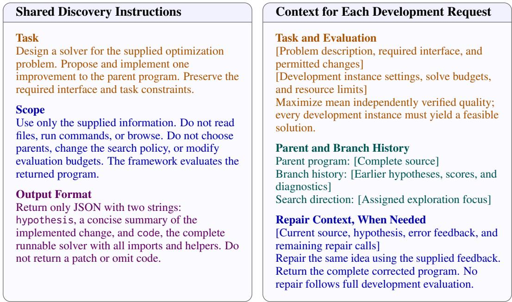  
Figure 8: Core discovery-agent prompt modules. Brackets denote dynamic inputs.

History and replay budgets. The history $\mathcal { H } _ { r }$ contains completed, replayable search trees. A tree is eligible for policy learning once it contains sufficiently many recorded search steps:

$$
\mathcal { H } _ { r } ^ { \star } = \left\{ T \in \mathcal { H } _ { r } : | V ( T ) | - 1 \geq \left\lceil \frac { B L } { 5 } \right\rceil \right\} .\tag{6}
$$

Here, V(T) is the node set of T. The count excludes the root and includes failed search steps; eligibility does not require an improvement in solution quality. With $B = 6$ and $L = 4 ,$ , a tree becomes eligible after five recorded search steps. Before each subsequent round $( r < R )$ , policy learning uses all eligible trees accumulated so far. Learning proceeds whenever this set is nonempty, even if the latest round contributes no newly eligible tree. Otherwise, the current policy and parameter are retained.

Replay evaluation. Real search allows at most BL search steps per round, whereas replay allows at most 2BL steps per historical tree. Requests that reveal a failure or have no recorded continuation both consume one replay step.

Replay quality is computed from the scores of revealed feasible nodes, including the root, using Eq. (3). Each node contributes once, and equal scores from different nodes are counted separately. If fewer than five feasible nodes have been revealed, all available scores are averaged. Failed nodes do not contribute to the quality statistic.

Policy proposals and selection. Policy learning consists of four sequential LLM calls, each requesting four distinct executable policies. Each proposed policy is replayed at $\alpha \in \{ 0 . 1 , 0 . 3 , 0 . 5 , 0 . 7 , 0 . 9 \}$ in ascending order. Replay results and generation or execution failures are summarized as feedback for the next call. Valid proposals are retained even if other proposals in the same call fail; no additional repair or retry calls are made.

After all four calls, we select the valid generated policy–parameter pair with the highest replay reward. Ties favor the earlier policy proposal and, within a policy, the smaller α. The incumbent policy and FIXED are also replayed to provide reference results for feedback, but are excluded from candidate selection. The incumbent is retained only if no valid generated pair is available.

Discovery repairs. The discovery agent may make up to two repair attempts for generation or compilation errors before full development evaluation. No further repairs are allowed once that evaluation begins. Every search step consumes budget, including steps that end in generation or evaluation failure. Appendix C provides the cost-accounting details.

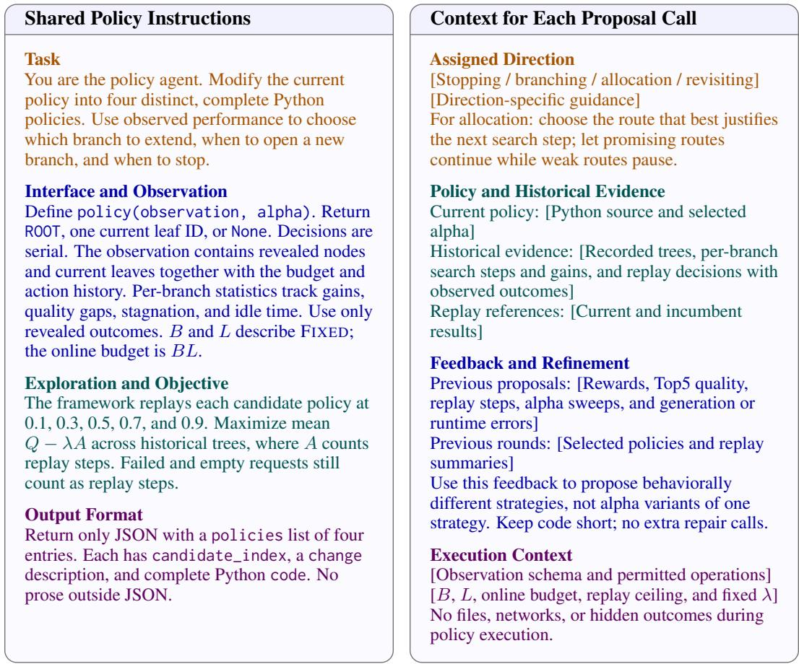  
Figure 9: Core policy-learning prompt modules. Brackets denote dynamic inputs.

## A.1 CORE DISCOVERY-AGENT PROMPT

Figure 8 summarizes the shared instructions and request context used to develop a solver. The required interfaces, objectives, and evaluation protocols are specified in Appendix B. Bracketed placeholders contain the parent program, branch-local feedback, and evaluation settings. The search policy selects the parent program, and the discovery agent proposes and implements a revision.

## A.2 CORE POLICY-LEARNING PROMPT

Figure 9 presents a condensed policy-learning prompt from a TSP run, separating shared instructions from context updated for each proposal call. Bracketed placeholders denote the policy source, historical search records, and replay feedback. The four calls focus in turn on stopping, branching, allocation, and revisiting.

Each subsequent call receives replay results and generation or execution failures from earlier calls. The policy supplied for refinement is the valid proposal with the highest replay reward so far in the current update. If no valid proposal is available, the incumbent is supplied instead. The policy agent uses completed historical trees to guide proposal generation. During execution, each proposed policy receives observations containing only outcomes revealed by its own actions.

## A.3 AN EXAMPLE OF A LEARNED POLICY

Listing 1 shows a learned policy from the GPT-6-Luna TSP experiment. It was selected after the eighth search round and deployed in the ninth with $\alpha = 0 . 9$ . The ninth round produced the program with the highest development score in the run. The code is reproduced with only line wrapping changed. Appendix D.6 follows its decisions and the resulting real search trajectory.

The policy balances continuing recent progress with revisiting previously promising branches. It continues branches that show recent gains, little stagnation, and a small gap to the best observed quality. It also revisits paused branches whose earlier gains and current quality justify further exploration. Eligible branches are ranked by a score that rewards gains and penalizes stagnation and quality gaps. If the highest-ranked branch exceeds the continuation threshold, the policy extends it. Otherwise, it opens a new branch if fewer than B branches exist, or stops the round. This learned policy therefore retains B as its branching cap while adapting branch lengths and revisits to observed progress.

Increasing α lowers the recent-gain and continuation thresholds and relaxes quality-gap limits. For revisiting a branch, it also permits more stagnation while requiring a longer interval since the branch’s last request.

Here, recent\_gains contains up to three most recent increases in a branch’s best score, and gap\_to\_best measures how far that score trails the global best. stagnation counts requests to the branch since its last improvement. idle\_batches counts completed serial search steps since the branch’s last request. All quantities are computed from revealed outcomes.

## B BENCHMARK TASKS, INTERFACES, AND METRICS

Reference gaps. For objective $z _ { i }$ and reference $b _ { i }$ on instance i, the mean relative gap over M instances is

$$
\mathrm { G a p } = \frac { 1 0 0 } { M } \sum _ { i = 1 } ^ { M } \left\{ { { { \left( { { z _ { i } } - b _ { i } } \right) } / { b _ { i } } } , \mathrm { { \ m i n i m i z a t i o n } , } } \right.\tag{7}
$$

We compute gaps relative to LKH tour lengths for TSP, certified OR-Tools optima for KP, the volume lower bound for OBPP, and the supplied Taillard upper bounds for FSSP. A negative gap of FSSP indicates a makespan below the reference upper bound $( C _ { \mathrm { m a x } } < b _ { i } )$

Traveling salesman problem (TSP). The evolved selector implements select\_next\_node( current\_node, destination\_node, unvisited\_nodes, distance\_matrix). It receives the current city, the return destination (city zero), the unvisited cities, and the matrix of unrounded Euclidean distances, and returns one unvisited city ID. The fixed constructor starts at city zero and repeatedly invokes the selector until all cities have been visited, then closes the tour.

The development set consists of 64 50-city instances in train50\_dataset.npy from the public MCTS-AHD dataset.<sup>1</sup> For each 50-city instance, a tour of length ℓ gives quality $1 - \ell / ( 5 0 \sqrt { 2 } )$ All reported methods and reference solvers are evaluated on the same 4,000 synthetic instances at $N ~ \mathsf { \bar { \Lambda } } \in ~ \{ 5 0 , 1 0 0 , 2 0 0 , 5 0 0 \}$ and 15 TSPLIB instances, totaling 4,015 test instances. Gaps are computed relative to LKH tour lengths, which match the official optima on all 15 TSPLIB instances (Appendix D.1).

Knapsack problem (KP). The evolved selector implements select\_next\_item( remaining\_capacity, weights, values). It receives the remaining knapsack capacity and the weight and value arrays of the remaining items, and returns the index of an item that fits within the remaining capacity. The index refers to the supplied arrays. The fixed constructor removes the selected item, updates the remaining capacity, and repeats until no remaining item fits. The selected subset is checked against the original instance.

$$
\alpha = 0 . 9 .
$$

```python
1 def policy(observation, alpha):
2 if (observation["remaining"] <= 0
3 or observation["used"] >= observation["budget"]):
4 return None
5 leaves = observation.get("leaves", [])
6 options = []
7 for r in observation.get("branch_stats", []):
8 leaf = next((n for n in leaves
9 if n["id"] == r["leaf_id"]), None)
10 if leaf is None or leaf.get("status") == "interrupted":
11 continue
12 gains = r.get("recent_gains", [])
13 peak = max(gains) if gains else 0.0
14 recent = sum(gains) / max(1, len(gains))
15 stale = r.get("stagnation", 0)
16 gap = r.get("gap_to_best", 0.0)
17 idle = r.get("idle_batches", 0)
18 delayed = (peak >= 0.001 and idle >= 1 + int(3 * alpha)
19 and stale <= 2 + int(2 * alpha)
20 and gap <= 0.004 + 0.008 * alpha)
21 active = (recent >= 0.0003 * (1.0 - alpha) + 0.00004
22 and stale <= 1 and gap <= 0.003 + 0.007 * alpha)
23 if delayed or active:
24 value = max(peak / (2.0 + stale) if delayed else 0.0,
25 recent / (1.0 + stale)) - 0.04 * gap
26 options.append((value, idle if delayed else -idle, leaf["id"]))
27 if options:
28 value, _, leaf_id = max(options)
29 if value > 0.00012 * (1.0 - alpha):
30 return leaf_id
31 if observation["branches"] < observation["B"]:
32 return "ROOT"
33 return None
```

The development set consists of 64 instances at $N = 1 0 0$ in train100\_dataset.npy from the public MCTS-AHD dataset.<sup>2</sup> Item weights and values are uniformly distributed in [0, 1]. The knapsack capacity is $W = 1 2 . 5$ for $N = 5 0$ items and $W = 2 5$ for $N \dot { \in } \{ 1 0 0 , 2 0 0 , 5 0 0 \}$ . The development score is the total value of the selected items divided by 100. Test results report the total selected value without normalization. The official test checker uses a feasibility tolerance of $1 0 ^ { - 6 }$ . The OR-Tools reference enforces the original capacities without this tolerance.

Online bin packing problem (OBPP). The evolved function implements score(item, bins), where item is the arriving item’s size and bins contains the remaining capacities of all feasible bins, including unused bins. It returns one score for each supplied bin. The fixed controller places the item in the bin with the highest score, breaking ties by choosing the first bin in the supplied order.

We use the released MCTS-AHD dataset for $\mathrm { O B P P } ^ { 3 }$ The four development instances cover the combinations of $N \in \{ 1 , 0 0 0 , 5 , 0 0 0 \}$ items and bin capacities $C \in \{ 1 0 0 , 5 0 0 \}$ The 30 test instances additionally include N = 10, 000 at both capacities. For an instance with item weights w , and K used bins, the volume lower bound is $b = \tilde { \lceil \sum _ { i } w _ { i } / C \rceil }$ . The development score is $b / K$ averaged equally across the four development instances. Test performance is the percentage excess in bin count over this bound, $1 0 0 ( K / b - \hat { 1 } )$ , averaged equally across the 30 test instances.

Flow-shop scheduling problem (FSSP). The evolved perturbation function implements get\_matrix\_and\_jobs(current\_sequence, time\_matrix, m, n). Here, current\_sequence lists the current job order, time\_matrix is the $n \times m$ processing-time matrix, and n and m are the numbers of jobs and machines, respectively. The function returns a modified processing-time matrix of the same shape and a list of job IDs to perturb. The fixed controller initializes the sequence with NEH and uses these outputs to guide swap and insertion perturbations within GLS. Makespan is computed from the original processing times.

The development set consists of all 64 instances in the public EoH training set, with 50 jobs and 2–20 machines. <sup>4</sup> The development score is $1 - C _ { \mathrm { m a x } } / 7 0 0 0$ . Testing uses the 110 Taillard instances, with ten instances per job–machine size. The supplied upper bounds serve as reference makespans.

GLS is allowed up to 30 seconds during development and 60 seconds during testing, with a maximum of 1,000 iterations in both phases. Reaching the iteration cap can therefore end a run before its time budget is exhausted.

Two-dimensional bin packing problem (2D-BPP). The evolved program implements solve(instance, time\_budget, seed). The instance provides the bin dimensions and rectangle sizes, time\_budget specifies the solve time allowance in seconds, and seed controls randomness. The program returns one (bin, x, y) placement per rectangle in input order, specifying its bin ID and lower-left coordinates. The checker verifies integer coordinates, preservation of the original orientations, bin containment, and pairwise non-overlap.

The development set consists of 60 instances generated following the BWMV class distributions, with a 20-second solve budget per instance. The development score is $K ^ { - 1 } \sum _ { b = 1 } ^ { K } u _ { b } ^ { 2 }$ , where K is the number of used bins and $u _ { b }$ is the area utilization of bin b. Testing uses 500 BWMV instances with a 60-second budget per instance and reports the number of used bins. <sup>5</sup> These instances cover ten problem classes and five sizes from 20 to 100 items in increments of 20, with ten instances per class–size combination.

The reference results use the aNB variant of BRKGA without rotation (Gonçalves & Resende, 2013), with equal weight assigned to each class-–size combination. Table 4 reports the BRKGA bin counts and the excess bin counts of FIXED and DREAM relative to this reference. Each size row sums over 100 instances, and the All row sums over all 500 instances.

Local reference solvers. Greedy uses nearest-neighbor construction from city zero for TSP and selects feasible items by value-to-weight ratio for KP. POMO is evaluated locally using the official TSP50 (Python version) and KP200 (legacy version) checkpoints fixed before testing. We use greedy decoding from a single start at index zero without augmentation, following the MCTS-AHD setting (Zheng et al., 2025). POMO runs on NVIDIA RTX PRO 6000 Blackwell GPUs. CPU reference evaluations run on a dual-socket AMD EPYC 9555 machine.

LKH-3.0.13 uses ten runs, with at most 1,000 trials and a 60-second limit per run. <sup>6</sup> Distances are scaled by 10<sup>6</sup> and rounded for search, while reported tour lengths are recomputed from the original coordinates.

OR-Tools 9.14 uses its multidimensional branch-and-bound knapsack solver with one capacity constraint and a 60-second limit. <sup>7</sup> The stored binary inputs are scaled by $2 ^ { 5 3 }$ to obtain exact integer representations. Assertions verify exact representability and compliance with the signed 64-bit range. OR-Tools certifies optimality for every evaluated KP instance.

## C EXPERIMENTAL DETAILS AND COST ACCOUNTING

For each task and search method, we select the solver with the highest development score in each run and evaluate it directly on the test set.

Baseline coverage. Baseline coverage is determined by the problem-specific implementations publicly released by the original authors. Accordingly, we include EoH, ReEvo, and MCTS-AHD for constructive TSP; MCTS-AHD for KP; EoH for FSSP; and FunSearch, EoH, ReEvo, and MCTS-AHD for OBPP. Model names indicate the LLM backbones used for algorithm discovery.

Rounds and execution. For root generation in each round, the discovery agent receives only the same task specification and reference program. Evaluation caches are maintained separately for each round. Search experience therefore transfers across rounds through the learned policy. In the paired GPT-6-Luna TSP and 2D-BPP comparisons, FIXED and DREAM share the initial solver. FIXED permits up to W concurrent development requests, whereas DREAM issues one request at a time.

Cost accounting. Token counts cover recorded LLM usage for solver development and policy learning, including root generation and repair calls. Invalid and failed search steps still consume the search budget. A single search step may involve multiple LLM calls when repairs are needed, so we report search steps and token usage separately.

Result aggregation. All reported metrics are computed from complete per-instance evaluation results. Reference gaps are calculated for each instance before averaging. For results reported over three runs, we average the run-level means with equal weight. In particular, the overall GPT-6-Luna TSP gap averages all 4,015 test instances equally within each run, then averages across the three runs. Table highlighting is based on values rounded to the displayed precision.

Development-curve aggregation. Figures 3 and 6 show the mean best-so-far development score across three runs at each search step. Invalid candidates and failed evaluations leave each run’s best score unchanged. Within each method, the final best scores of runs that end earlier are carried forward until the longest run ends. Shading indicates ±1 standard error across the three runs.

## D EXTENDED RESULTS

This appendix supplements Section 4 with detailed comparisons and analyses of search behavior. We first report TSP solution quality and running times, FSSP results alongside CP baselines, and OBPP performance across item counts and bin capacities. We then examine the effects of policy replay and the cost penalty on 2D-BPP, including paired comparisons and token expenditure. Finally, we use real search trajectories to illustrate how learned policies extend promising branches, revisit alternatives, and decide when to stop.

## D.1 TSP SOLUTION QUALITY AND RUNNING TIMES

Table 6 reports mean reference gaps and per-instance solve times for the same solvers and test instances as Table 1. GPT-6-Luna results average three runs per method. With this backbone, DREAM achieves lower mean gaps and shorter mean solve times than FIXED in all five test groups. Reported times measure solver evaluation. For LLM-generated solvers, timing covers only the solver call and excludes process startup and CPU queueing.

POMO runs on the GPU, while the other methods run on CPUs. For synthetic instances, POMO’s per-instance time is the synchronized batch inference time divided by the actual batch size, with up to 60 instances per batch. TSPLIB instances are evaluated individually because their sizes vary. Reported times correspond to the tours used for gap calculation and are averaged equally over instances within each test group. GPT-6-Luna results then average the three run-level means. Times are reported with up to three significant figures and at most four decimal places.

Larger and structured instances. The selected solvers are evaluated on all 1,000 released 500-city MCTS-AHD instances and the 15 TSPLIB instances listed in Table 7. Each constructor runs to completion without a CPU or wall-clock cutoff. Evaluation permits at most 50 concurrent instances per solver.

Before inference, TSPLIB coordinates are translated by subtracting the minimum on each axis and uniformly scaled by the larger of the two coordinate ranges. Inference uses a single start at city zero without augmentation. Returned tours are evaluated on the original coordinates using TSPLIB EUC\_2D nearest-integer edge costs. LKH uses the same edge costs. Gaps are computed relative to LKH tour lengths, which match the official optima on all 15 instances. 8

<table><tr><td rowspan="2">LLM Model</td><td rowspan="2">Method</td><td colspan="2">N = 50</td><td>N = 100</td><td></td><td>N = 200</td><td></td><td>N = 500</td><td></td><td colspan="2">TSPLIB</td></tr><tr><td> $\mathrm { G a p } \left( \% \right)$ </td><td>Time (s)</td><td> $\mathrm { G a p } \left( \% \right)$ </td><td>Time (s)</td><td>Gap (%)</td><td>Time (s)</td><td>Gap (%)</td><td>Time (s)</td><td>Gap (%)</td><td>Time (s)</td></tr><tr><td rowspan="4"></td><td>LKH ref.</td><td></td><td>0.479</td><td></td><td>1.83</td><td></td><td>6.06</td><td></td><td>31.3</td><td></td><td>29.1</td></tr><tr><td>Greedy</td><td>22.622</td><td>0.0002</td><td>24.936</td><td>0.0005</td><td>25.711</td><td>0.0013</td><td>25.903</td><td>0.0239</td><td>24.332</td><td>0.0065</td></tr><tr><td>POMO†</td><td>0.383</td><td>0.0005</td><td>2.999</td><td>0.0004</td><td>20.447</td><td>0.0008</td><td>46.135</td><td>0.0024</td><td>23.923</td><td>0.0502</td></tr><tr><td>EoH</td><td>16.822</td><td>0.001</td><td>19.114</td><td>0.0025</td><td>20.842</td><td>0.0085</td><td>22.209</td><td>0.0502</td><td>21.060</td><td>0.0096</td></tr><tr><td rowspan="5">GPT-4o-mini MCTS-AHD</td><td>ReEvo</td><td>22.622</td><td>0.0006</td><td>24.936</td><td>0.0014</td><td>25.711</td><td>0.005</td><td>25.903</td><td>0.0467</td><td>24.332</td><td>0.0084</td></tr><tr><td></td><td>15.906</td><td>0.0049</td><td>18.832</td><td>0.0203</td><td>21.166</td><td>0.0858</td><td>22.549</td><td>0.527</td><td>19.306</td><td>0.0936</td></tr><tr><td>FIXED</td><td>22.622</td><td>0.0006</td><td>24.936</td><td>0.0013</td><td>25.711</td><td>0.0044</td><td>25.903</td><td>0.0528</td><td>24.332</td><td>0.0095</td></tr><tr><td>Dream-COP</td><td>14.379</td><td>0.0006</td><td>15.952</td><td>0.0013</td><td>17.557</td><td>0.0044</td><td>19.149</td><td>0.0526</td><td>17.390</td><td>0.0105</td></tr><tr><td>EoH</td><td>16.819</td><td>0.0716</td><td>18.955</td><td>0.599</td><td>20.305</td><td>5.32</td><td>21.099</td><td>98.3</td><td>20.658</td><td>12.2</td></tr><tr><td rowspan="5">GPT-6-Luna</td><td>ReEvo</td><td>15.682</td><td>0.602</td><td>18.493</td><td>0.62</td><td>20.292</td><td>0.834</td><td>21.440</td><td>5.04</td><td>20.782</td><td>1.01</td></tr><tr><td>MCTS-AHD</td><td>15.959</td><td>0.21</td><td>17.929</td><td>1.92</td><td>19.143</td><td>18.5</td><td>19.728</td><td>488</td><td>20.226</td><td></td></tr><tr><td>FIXED</td><td>15.275</td><td>0.0807</td><td>17.432</td><td>0.668</td><td>18.495</td><td>6.21</td><td>19.378</td><td>137</td><td>18.355</td><td>64 14.5</td></tr><tr><td>Dream-COP</td><td>9.489</td><td>0.0622</td><td>11.316</td><td>0.398</td><td>12.361</td><td>3.56</td><td>13.209</td><td>80.3</td><td>11.984</td><td>10.3</td></tr><tr><td></td><td></td><td></td><td></td><td></td><td></td><td></td><td></td><td></td><td></td><td></td></tr></table>

Table 6: TSP mean gaps (%) to LKH and per-instance solve times (seconds). Bold indicates the lowest gap among non-reference methods. Shading indicates the lowest gap within each LLM backbone, including ties at displayed precision. <sup>†</sup>POMO’s synthetic-instance times are GPU batch inference times divided by batch size.
<table><tr><td rowspan="2">Instance</td><td rowspan="2"></td><td rowspan="2">N LKH (ref.)</td><td colspan="2">Greedy Length Gap (%)</td><td colspan="2">POMO Length Gap (%)</td><td colspan="2">EoH Length Gap (%)</td><td colspan="2">ReEvo Length Gap (%)</td><td colspan="2">MCTS-AHD Length Gap (%)</td><td colspan="2">FIXED Length Gap (%)</td><td colspan="2">Dream-COP Length Gap (%)</td></tr><tr><td></td><td></td><td></td><td></td><td></td><td></td><td></td><td></td><td></td><td></td><td></td><td></td><td></td><td></td></tr><tr><td>ts225</td><td>225</td><td>126643</td><td>162697.0</td><td>28.469</td><td>182934.0</td><td>44.449</td><td>145719.7</td><td>15.063</td><td>146561.7</td><td>15.728</td><td>152030.7</td><td>20.047</td><td>148299.7</td><td>17.101</td><td>141445.0</td><td>11.688</td></tr><tr><td>rat99</td><td>99</td><td>1211</td><td>1558.0</td><td>28.654</td><td>1332.0</td><td>9.992</td><td>1424.7</td><td>17.644</td><td>1437.7</td><td>18.717</td><td>1544.0</td><td>27.498</td><td>1456.0</td><td>20.231</td><td>1355.7</td><td>11.946</td></tr><tr><td>bier127</td><td>127</td><td>118282</td><td>135848.0</td><td>14.851</td><td>134250.0</td><td>13.500</td><td>150183.0</td><td>26.970</td><td>133371.3</td><td>12.757</td><td>137271.7</td><td>16.055</td><td>132660.3</td><td>12.156</td><td>127479.7</td><td>7.776</td></tr><tr><td>lin318</td><td>318</td><td>42029</td><td>54019.0</td><td>28.528</td><td>59945.0</td><td>42.628</td><td>50308.0</td><td>19.698</td><td>53587.7</td><td>27.502</td><td>51346.7</td><td>22.170</td><td>51914.0</td><td>23.519</td><td>48487.0</td><td>15.366</td></tr><tr><td>eil51</td><td>51</td><td>426</td><td>511.0</td><td>19.953</td><td>429.0</td><td>0.704</td><td>487.0</td><td>14.319</td><td>475.3</td><td>11.581</td><td>487.0</td><td>14.319</td><td>513.3</td><td>20.501</td><td>479.7</td><td>12.598</td></tr><tr><td>d493</td><td>493</td><td>35002</td><td>43395.0</td><td>23.979</td><td>55695.0</td><td>59.119</td><td>41895.3</td><td>19.694</td><td>40781.0</td><td>16.510</td><td>41178.0</td><td>17.645</td><td>41451.7</td><td>18.427</td><td>38873.0</td><td>11.059</td></tr><tr><td>kroB100</td><td>100</td><td>22141</td><td>29158.0</td><td>31.692</td><td>22904.0</td><td>3.446</td><td>26536.3</td><td>19.852</td><td>27662.7</td><td>24.939</td><td>26526.0</td><td>19.805</td><td>26782.3</td><td>20.963</td><td>24791.0</td><td>11.969</td></tr><tr><td>kroC100</td><td>100 130</td><td>20749</td><td>26327.0</td><td>26.883</td><td>22999.0</td><td>10.844</td><td>24969.3</td><td>20.340</td><td>24882.7</td><td>19.922</td><td>25009.3</td><td>20.533</td><td>23857.3</td><td>14.981</td><td>22639.3</td><td>9.110</td></tr><tr><td>ch130 pr299</td><td>299</td><td>6110</td><td>7578.0</td><td>24.026</td><td>6530.0</td><td>6.874</td><td>7073.7</td><td>15.772</td><td>7319.0</td><td>19.787</td><td>7052.0</td><td>15.417</td><td>6966.0</td><td>14.010</td><td>6914.0</td><td>13.159 11.968</td></tr><tr><td>fl417</td><td>417</td><td>48191</td><td>62738.0</td><td>30.186</td><td>70010.0</td><td>45.276</td><td>59506.3</td><td>23.480</td><td>58868.0</td><td>22.156</td><td>58805.3</td><td>22.026</td><td>57259.3</td><td>18.817</td><td>53958.3</td><td>14.260</td></tr><tr><td>kroA150 150</td><td></td><td>11861</td><td>14598.0</td><td>23.076</td><td>15072.0</td><td>27.072</td><td>15062.3</td><td>26.990</td><td>16228.7</td><td>36.824</td><td>14634.3</td><td>23.382</td><td>15013.0</td><td>26.574</td><td>13552.3</td><td>12.705</td></tr><tr><td>pr264</td><td>264</td><td>26524 49135</td><td>33612.0</td><td>26.723 17.967</td><td>29279.0 63174.0</td><td>10.387 28.572</td><td>31133.3 60580.0</td><td>17.378 23.293</td><td>32189.7 58899.7</td><td>21.361 19.873</td><td>31163.7 58717.0</td><td>17.492</td><td>30266.7</td><td>14.110</td><td>29894.0</td><td>13.236</td></tr><tr><td>pr226</td><td>226</td><td>80369</td><td>57963.0 94277.0</td><td>17.305</td><td>87381.0</td><td>8.725</td><td>99982.0</td><td>24.404</td><td>96235.7</td><td>19.742</td><td>97972.3</td><td>19.501 21.903</td><td>58391.7 89031.7</td><td>18.839 10.779</td><td>55638.7 88338.3</td><td>9.916</td></tr><tr><td>pr439</td><td>439</td><td>107217 131549.0</td><td></td><td>22.694 157886.0</td><td></td><td>47.258 133991.7</td><td></td><td>24.972</td><td>133310.7</td><td>24.337</td><td>134668.0</td><td>25.603</td><td></td><td>24.311</td><td>121153.0</td><td>12.998</td></tr><tr><td></td><td></td><td></td><td></td><td></td><td></td><td></td><td></td><td></td><td></td><td></td><td></td><td></td><td>133283.0</td><td></td><td></td><td></td></tr><tr><td>Mean</td><td></td><td>46392.7</td><td>57055.2</td><td>24.332</td><td>60654.7</td><td>23.923</td><td>56590.2</td><td>20.658</td><td>55454.1</td><td>20.782</td><td>55893.7</td><td>20.226</td><td>54476.4</td><td>18.355</td><td>51666.6</td><td>11.984</td></tr></table>

Table 7: TSPLIB tour lengths and gaps (%) to LKH, which matches the optima on all 15 instances. LLM-based results use GPT-6-Luna and average three runs per method. Bold indicates the best nonreference result. Shading indicates the best LLM-based result, including ties at displayed precision.

## D.2 FSSP EVALUATION AND CP SOLVER SETTINGS

Table 8 reports mean makespan and per-instance solve time for the FSSP methods, including the two CP baselines. DREAM achieves the lowest mean makespan among the LLM-based methods with both GPT-4o-mini and GPT-6-Luna.

We choose OR-Tools CP-SAT 9.14.6206 and OptalCP 2026.4.0 as CP baselines. Both enforce the permutation flow-shop constraints: every job visits the machines in order, operations on each machine cannot overlap, and all machines follow the same job permutation. CP-SAT represents the shared job order using pairwise ordering variables across machines. OptalCP enforces it through a same-sequence constraint on the machine sequence variables. Both minimize makespan and use the same deterministic NEH solution as a warm start. The supplied Taillard reference upper bounds are used only for reporting.

Each CP solver uses one thread per instance and has a 300-second time limit. Timing starts after model construction and NEH initialization. Every returned permutation is independently checked, and its makespan is recomputed using the original processing times. Both solvers return feasible solutions on all 110 instances. CP-SAT proves optimality on 30 instances, and OptalCP on five.

<table><tr><td rowspan="3" colspan="2">N M Taillard UB</td><td rowspan="3" colspan="2"> $\mathrm { C P - S A T }$ </td><td rowspan="2" colspan="2">OptalCP</td><td colspan="6">GPT-4o-mini</td><td colspan="6">GPT-6-Luna</td></tr><tr><td colspan="2">EoH</td><td colspan="2">FIXED</td><td colspan="2">Dream-COP</td><td colspan="2">EoH</td><td colspan="2">FIXED</td><td colspan="2">Dream-COP</td></tr><tr><td colspan="2"> $C _ { \mathrm { m a x } }$  Time</td><td colspan="2"> $C _ { \mathrm { m a x } }$  Time</td><td colspan="2"> $C _ { \mathrm { m a x } }$  Time</td><td colspan="2">Time  $C _ { \mathrm { m a x } }$ </td><td colspan="2">Time</td><td colspan="2">Time  $C _ { \mathrm { m a x } }$ </td><td colspan="2">Time  $C _ { \mathrm { m a x } }$ </td></tr><tr><td>20 5</td><td> $C _ { \mathrm { m a x } }$  1222.5</td><td>1221.9</td><td>5.87</td><td>1221.9</td><td>270</td><td>1223.6 0.280</td><td></td><td>Cmax 1223.6 0.282</td><td></td><td>1222.40.270</td><td></td><td> $C _ { \mathrm { m a x } }$  1222.40.356</td><td></td><td>1222.4</td><td></td><td></td><td>Time</td></tr><tr><td>20 10</td><td></td><td>1513.7 1516.5</td><td>245</td><td>1521.1</td><td>300</td><td></td><td>1516.20.330</td><td></td><td>1516.2 0.327</td><td>1515.5</td><td>0.313</td><td></td><td>1515.20.444</td><td>1521.1</td><td>2.09 2.68</td><td>1514.2</td><td>1222.40.536 0.639</td></tr><tr><td>20 20</td><td></td><td>2235.1 2246.8</td><td>300</td><td>2253.3</td><td>300</td><td></td><td>2237.90.494</td><td></td><td>2237.90.501</td><td>2239.60.438</td><td></td><td></td><td>2237.1 0.691</td><td>2239.3</td><td>4.34</td><td>2236.1</td><td>0.920</td></tr><tr><td>50 5</td><td></td><td>2736.4 2736.4</td><td>13.7</td><td>2736.4</td><td>182</td><td>2736.5</td><td>2.19</td><td>2736.5</td><td>2.23</td><td>2736.4</td><td>1.94</td><td>2736.4</td><td>2.21</td><td>2736.6</td><td>5.12</td><td>2736.7</td><td>2.51</td></tr><tr><td>50 10</td><td></td><td>2997.6 3037.8</td><td>300</td><td>3011.7</td><td>300</td><td>3000.1</td><td>2.77</td><td>3000.1</td><td>2.95</td><td>3001.5</td><td>2.55</td><td>2998.6</td><td>2.99</td><td>3000.7</td><td>3.87</td><td>2997.5</td><td>3.16</td></tr><tr><td>50 20</td><td></td><td>3731.0 3943.0</td><td>300</td><td>3854.4</td><td>300</td><td>3756.3</td><td>4.78</td><td>3756.3</td><td>5.19</td><td>3761.6</td><td>4.67</td><td>3751.8</td><td>5.64</td><td>3761.1</td><td>6.90</td><td>3750.4</td><td>5.47</td></tr><tr><td>100</td><td>5</td><td>5246.9 5246.4</td><td>153</td><td>5245.5</td><td>300</td><td>5245.0</td><td>12.5</td><td>5245.0</td><td>13.7</td><td>5244.5</td><td>13.5</td><td>5244.8</td><td>14.8</td><td>5244.8</td><td>26.1</td><td>5244.5</td><td>13.9</td></tr><tr><td>100</td><td>10</td><td>5630.0 5752.0</td><td>300</td><td>5652.6</td><td>300</td><td>5637.9</td><td>18.5</td><td>5637.9</td><td>18.8</td><td>5635.2</td><td>19.3</td><td>5641.0</td><td>20.4</td><td>5631.2</td><td>33.7</td><td>5631.3</td><td>19.9</td></tr><tr><td>100 20</td><td></td><td>6362.6 6634.4</td><td>300</td><td>6538.7</td><td>300</td><td>6380.3</td><td>37.3</td><td>6380.3</td><td>35.1</td><td>6384.4</td><td>36.2</td><td>6369.0</td><td>34.0</td><td>6375.3</td><td>40.8</td><td>6350.8</td><td>39.0</td></tr><tr><td>200 10</td><td>10673.0</td><td>10803.8</td><td></td><td>300 10755.5</td><td></td><td>30010700.4</td><td></td><td>6010700.4</td><td></td><td>6010676.6</td><td></td><td>60 10687.5</td><td></td><td>60 10682.4</td><td>60</td><td>10677.3</td><td>60</td></tr><tr><td>200 20</td><td></td><td>11373.6 11752.4</td><td></td><td>300 11726.5</td><td></td><td>300 11440.3</td><td></td><td>6011430.9</td><td></td><td>6011411.7</td><td></td><td>6011441.2</td><td></td><td>60 11406.2</td><td>60</td><td>11376.2</td><td>60</td></tr><tr><td>Mean</td><td>4883.9</td><td>4990.1</td><td>229</td><td>4956.1</td><td>287</td><td>4897.7</td><td>18.1</td><td>4896.8</td><td>18.1</td><td>4893.6</td><td>18.1</td><td>4895.0</td><td>18.3</td><td>4892.8</td><td>22.4</td><td>4885.2</td><td>18.8</td></tr></table>

Table 8: FSSP mean makespan and per-instance solve time (seconds) for N jobs and M machines. Bold indicates the lowest makespan among non-reference methods. Shading indicates the lowest makespan within each LLM backbone, including ties at displayed precision.

Paired FIXED/DREAM comparison. For each LLM backbone, we pair FIXED and DREAM makespans by instance ID on all 110 instances under the same 60-second GLS limit. A win for DREAM means a lower makespan than FIXED on the same instance; ties require exact equality of integer makespans. With GPT-6-Luna, DREAM records 59 wins, 40 ties, and 11 losses, with a mean makespan reduction of 7.61. With GPT-4o-mini, DREAM yields 38 wins, 46 ties, and 26 losses, with a mean reduction of 3.25. Excluding ties, separate two-sided exact sign tests of equal win and loss probabilities give $p = 4 . 4 7 \times 1 0 ^ { - 9 }$ on 70 non-tied instances for GPT-6-Luna and $p = 0 . 1 6 9$ on 64 for GPT-4o-mini.

## D.3 ONLINE BIN PACKING RESULTS

Table 9 breaks down OBPP performance by item count and bin capacity. DREAM achieves its largest gains over FIXED on longer sequences at $C = 1 0 0 . \mathrm { A t } N = 1 0$ , 000, it reduces the mean gap from 3.501% to 0.459%, using 122 fewer bins per instance on average. At $C = 5 0 0$ , the methods obtain similar bin counts close to the volume lower bound.
<table><tr><td rowspan="2"> $N$ </td><td rowspan="2"> $C$ </td><td colspan="2">Ref. LB</td><td colspan="2">FunSearch</td><td colspan="2">EoH</td><td colspan="2">ReEvo</td><td colspan="2">MCTS-AHD</td><td colspan="2">FIXED</td><td colspan="2">Dream-COP</td></tr><tr><td>Bins</td><td> $G \mathrm { a p } \left( \% \right)$ </td><td>Bins</td><td> $\mathrm { G a p } \left( \% \right)$ </td><td>Bins</td><td> $\mathrm { G a p } \left( \% \right)$ </td><td>Bins</td><td> $\mathrm { G a p } \left( \% \right)$ </td><td>Bins</td><td> $G \mathrm { a p } \left( \% \right)$ </td><td>Bins</td><td> $G \mathrm { a p } \left( \% \right)$ </td><td>Bins</td><td>Gap (%)</td></tr><tr><td>1k 100</td><td></td><td>402.4</td><td></td><td>421.6</td><td>4.771</td><td>421.6</td><td>4.771</td><td>420.6</td><td>4.522</td><td>418.2</td><td>3.926</td><td>420.0</td><td>4.371</td><td>420.4</td><td>4.477</td></tr><tr><td>1k 500</td><td></td><td>80.6</td><td></td><td>80.8</td><td>0.247</td><td>80.8</td><td>0.247</td><td>80.8</td><td>0.247</td><td>80.8</td><td>0.247</td><td>80.8</td><td>0.247</td><td>80.8</td><td>0.247</td></tr><tr><td>5k 100</td><td></td><td>2019.4</td><td></td><td>2106.4</td><td>4.307</td><td>2106.4</td><td>4.307</td><td>2095.0</td><td>3.743</td><td>2087.2</td><td>3.357</td><td>2091.8</td><td>3.585</td><td>2041.4</td><td>1.089</td></tr><tr><td>5k 500</td><td></td><td>402.4</td><td></td><td>404.6</td><td>0.547</td><td>404.6</td><td>0.547</td><td>404.6</td><td>0.547</td><td>404.6</td><td>0.547</td><td>404.4</td><td>0.497</td><td>404.2</td><td>0.448</td></tr><tr><td>10k</td><td>100</td><td>4010.6</td><td></td><td>4173.0</td><td>4.049</td><td>4173.0</td><td>4.049</td><td>4160.2</td><td>3.730</td><td>4142.6</td><td>3.291</td><td>4151.0</td><td>3.501</td><td>4029.0</td><td>0.459</td></tr><tr><td>10k 500</td><td></td><td>802.4</td><td></td><td>806.2</td><td>0.474</td><td>806.2</td><td>0.474</td><td>806.2</td><td>0.474</td><td>806.2</td><td>0.474</td><td>806.2</td><td>0.474</td><td>806.2</td><td>0.474</td></tr></table>

Table 9: OBPP mean bin counts and gaps (%) to the volume lower bound by item count N and bin capacity C. All LLM-based methods use GPT-6-Luna. Each row averages five instances. Ref. LB reports the mean volume lower bound. Shading marks the lowest non-reference values in each row and metric, including ties at displayed precision.

## D.4 COMPARING REPLAY QUALITY MEASURES

To complement the analysis of delayed improvements in Section 4.4, we compare the final programs discovered under the two replay quality measures. As in the main-text analysis, we use GPT-6-Luna and one completed run per measure and problem, with the same root programs and budgets for solver discovery and policy learning. Only the quality term changes from the top-five mean $Q _ { 5 }$ in Eq. (3) to the best revealed score $Q _ { 1 } ,$ while the request penalty remains unchanged. For each run, we select the solver with the highest development score and evaluate it directly on the test set.

For TSP and KP, this comparison uses 3,000 test instances per problem with $N \in \{ 5 0 , 1 0 0 , 2 0 0 \}$ For OBPP, FSSP, and 2D-BPP, we use 30, 110, and 500 test instances, respectively. Table 10 reports the best development score and test performance for each quality measure. $Q _ { 5 }$ improves both metrics on TSP, FSSP, and 2D-BPP and matches $Q _ { 1 }$ on KP at the displayed precision. These final results complement the higher delayed-improvement rates with $Q _ { 5 }$ in Figure 5, supporting its use for guiding exploration toward better programs.
<table><tr><td rowspan="2">Problem</td><td colspan="2">Best dev. score↑</td><td rowspan="2">Test metric</td><td colspan="2">Test result  $Q _ { 1 }$ </td></tr><tr><td> $Q _ { 1 }$ </td><td> $Q _ { 5 }$ </td><td></td><td> $Q _ { 5 }$ </td></tr><tr><td>TSP</td><td>0.903628</td><td>0.911622</td><td>Tour length↓</td><td>9.7762</td><td>9.2079</td></tr><tr><td>KP</td><td>0.401890</td><td>0.401890</td><td>Value↑</td><td>39.25212</td><td>39.25212</td></tr><tr><td>OBPP</td><td>0.986612</td><td>0.984093</td><td>Gap (%)↓</td><td>1.1238</td><td>1.1988</td></tr><tr><td>FSSP</td><td>0.549795</td><td>0.549904</td><td>Gap (%)↓</td><td>0.1864</td><td>0.0412</td></tr><tr><td>2D-BPP</td><td>0.752726</td><td>0.755089</td><td>Bins↓</td><td>14.520</td><td>14.504</td></tr></table>

Table 10: Comparison of replay quality terms $Q _ { 1 }$ and $Q _ { 5 }$ with GPT-6-Luna, using one run per quality term and problem. Test results use the solver with the highest development score in each run. Bold marks the better value within each problem and metric, including ties at displayed precision.

## D.5 2D-BPP ABLATIONS AND COSTS

Shared paired-comparison protocol. All paired 2D-BPP comparisons use the same 500 BWMV instances with a 60-second budget per instance. For each method, ${ \bar { K } } _ { i }$ is the mean bin count across three runs on instance i. Each instance contributes one comparison, and a lower mean bin count is better. Ties are identified by exact equality of the integer bin-count sums across the three runs. We use two-sided exact sign tests of equal win and loss probabilities, excluding ties.

Paired FIXED/DREAM comparison. For GPT-6-Luna, DREAM uses $\lambda = \bar { 1 0 } ^ { - 5 }$ . We define $\delta _ { i } = \bar { K } _ { i , \mathrm { F I X E D } } - \bar { K } _ { i , \mathrm { D R E A M } }$ as the bin-count reduction achieved by DREAM on instance i. Positive, zero, and negative values give a DREAM win, tie, and loss, respectively. Table 11 shows more wins than losses for DREAM with both backbones. Across the 500 instances, the total savings average 8 bins with GPT-6-Luna and 5.7 bins with GPT-6-Sol over three runs.

<table><tr><td>Model</td><td>W/T/L</td><td>Mean  $\delta _ { i }$ </td></tr><tr><td>GPT-6-Luna</td><td>20/479/1</td><td>0.016  $2 . 1 0 \times 1 0 ^ { - 5 }$ </td></tr><tr><td>GPT-6-Sol</td><td>13/486/1</td><td>0.011 0.002</td></tr></table>

Table 11: Paired 2D-BPP comparison using three-run mean bin counts. W/T/L counts wins, ties, and losses for DREAM. Mean $\delta _ { i }$ reports bins saved per instance by DREAM. The p-values are from two-sided exact sign tests excluding ties.

No replay protocol. No replay uses the same historical-evidence interface, history eligibility rule, and search budget $( B L = 2 \bar { 4 } , \dot { R } = 1 0 )$ as DREAM. At each policy update, it makes a single LLM call to generate one policy and deploys it at $\alpha = 0 . 5$ after syntax and interface checks. It performs no replay or reward-based ranking. DREAM instead uses four proposal calls and replay-based selection of the policy–parameter pair, as described in Appendix A.

Paired replay comparison. Across three runs, DREAM at $\lambda = 1 0 ^ { - 5 }$ achieves a higher mean final development score than No replay (0.75451 versus 0.75327) with fewer search steps (189.7 versus 233.3). On the 500 test instances, the paired comparison records 15 wins, 483 ties, and 2 losses for DREAM. A two-sided exact sign test on the 17 non-tied instances gives $p = 0 . 0 0 2 3 5$

Cost-penalty sensitivity. Table 12 shows the effect of the cost penalty on development quality, search steps, and test bin counts. Among the evaluated settings, $1 0 ^ { - 5 }$ achieves the highest development score and the lowest mean test bin count. Increasing λ to $1 0 ^ { - 3 }$ reduces mean search steps from 189.7 to 106.0 (44.1%), with an increase of 0.010 bins per test instance.
<table><tr><td>Method</td><td>λ Dev. score ↑</td><td>Steps↓</td><td>Test bins ↓</td></tr><tr><td>FIXED</td><td>0.75290</td><td>240.0</td><td>14.51933</td></tr><tr><td>DREAM</td><td> $1 0 ^ { - 7 }$  0.75417</td><td>204.7</td><td>14.51333</td></tr><tr><td>DREAM  $1 0 ^ { - 5 }$ </td><td>0.75451</td><td>189.7</td><td>14.50333</td></tr><tr><td>DREAM  $1 0 ^ { - 3 }$ </td><td>0.75209</td><td>106.0</td><td>14.51333</td></tr></table>

Table 12: Effect of the cost penalty λ on 2D-BPP with GPT-6-Luna. Entries average three runs. Dev. score reports the final best development score. Steps counts discovery requests. Test bins reports the mean bin count over 500 test instances. Bold marks the best value in each metric.

Search trajectories. In Figure 6, development requests are indexed in submission order, excluding root initialization. The horizontal axis begins at step 24 to highlight progress beyond the initial search phase. Figure 10 shows that DREAM at $\lambda = 1 0 ^ { \bar { - } 5 }$ surpasses FIXED’s final mean development score by the third round, while using fewer search steps per round thereafter.

Token costs. Figure 11 decomposes recorded token usage into solver discovery and policy learning. Across the three penalty settings, mean policy-learning usage ranges from 2.68 to 3.06 M tokens. Algorithm-discovery usage falls from 8.26 M at $\lambda { \overset { \smile } { = } } 1 0 ^ { - 7 }$ to 3.92 M at $\lambda = 1 0 ^ { - 3 }$ Most of the reduction therefore comes from solver discovery.

$\mathrm { A t } \lambda = 1 0 ^ { - 3 }$ , DREAM reduces discovery tokens by 54.7% relative to FIXED. Adding 2.68 M policy-learning tokens brings its mean total to 6.61 M, compared with 8.67 M for FIXED. The reduction in discovery expenditure exceeds the policy-learning cost by 2.06 M tokens, yielding a net reduction of 23.8%.

One cancelled call in a FIXED run has no recorded usage. As a sensitivity check, assigning it the 0.029 M tokens recorded for its successful retry increases the three-run FIXED mean by 0.11%.

(a) Cumulative best performance  
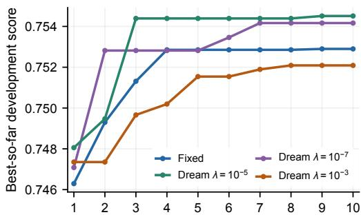  
(b) Search steps per round

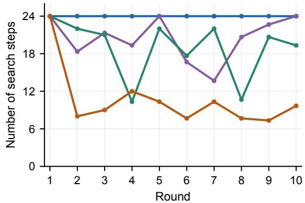  
Figure 10: Round-level 2D-BPP development quality and search effort with GPT-6-Luna. (a) Cumulative best development score at the end of each round. (b) Search steps per round, including failures. Each point averages three runs.

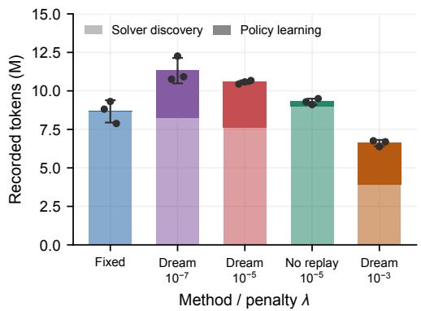  
Figure 11: Recorded token usage for 2D-BPP with GPT-6-Luna. Stacked bars show three-run means, split into algorithm discovery (unhatched) and policy learning (hatched). Whiskers indicate ±1 sample standard deviation of total tokens. Dots show total tokens for individual runs.

## D.6 LEARNED POLICIES IN REAL SEARCH

We examine TSP and 2D-BPP search trajectories to illustrate how learned policies adapt branch continuation, revisiting, and stopping to observed progress. Both cases use GPT-6-Luna and show the ninth search round. Node labels indicate the order of search steps, and branch depth counts successive revisions from the root.

<table><tr><td rowspan=1 colspan=3>(a) Replay on eight historical trees</td></tr><tr><td rowspan=1 colspan=1>Policy</td><td rowspan=1 colspan=1>Top-5 score</td><td rowspan=1 colspan=1>Replay steps</td></tr><tr><td rowspan=1 colspan=1>Fixed</td><td rowspan=1 colspan=1>0.901457</td><td rowspan=1 colspan=1>20.375</td></tr><tr><td rowspan=1 colspan=1>Learned</td><td rowspan=1 colspan=1>0.901947</td><td rowspan=1 colspan=1>16.875</td></tr><tr><td rowspan=1 colspan=3>17.18% fewer replay steps</td></tr></table>

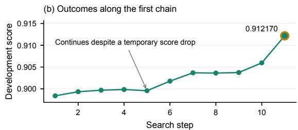

(c) Real search tree (node labels: search step)  
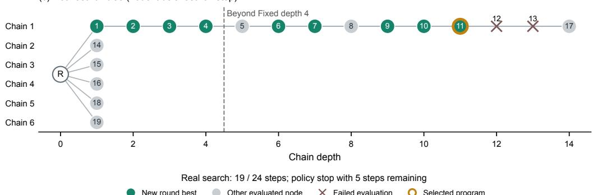  
Figure 12: TSP search round 9 with GPT-6-Luna. (a) Mean top-five score and replay steps on eight historical trees before deployment. (b) Development scores along the first branch up to the program selected for testing. (c) Complete search tree, with nodes labeled by search step. The policy stops after 19 of the 24 available steps.

TSP: extending a productive branch and stopping early. Figure 12 follows the policy in Listing 1, deployed in round nine with α = 0.9. Before deployment, replay on eight historical trees yields a mean top-five score of 0.901947, compared with 0.901457 for FIXED. Mean replay expenditure falls from 20.375 to 16.875 steps per tree, a reduction of 17.18%.

In real search, the policy extends the first branch beyond FIXED’s four-step depth limit. The development score falls from 0.899847 at depth four to 0.899567 at depth five, then recovers to 0.901768 at depth six. The policy’s recent-gain and stagnation conditions permit continuation through this temporary decline. At depth eleven, the branch reaches 0.912170. This node contains the solver with the highest development score in the run, which is selected for testing.

After two failed evaluations on this branch, the policy explores three other branches before returning to the first at step 17. It then opens two further branches. With all six branches opened and no continuation exceeding its threshold, the policy stops after 19 search steps, leaving five steps unused.

2D-BPP: reallocating a full search budget. $\mathrm { A t } \lambda = 1 0 ^ { - 5 }$ , the policy uses all 24 search steps but distributes them unevenly across branches (Figure 7). It ranks branch extensions using recent gains, stagnation, and quality gaps, and compares them with starting a new branch. The resulting branch lengths are (8, 6, 1, 3, 5, 1), whereas FIXED assigns four steps to each of six branches.

The first branch reaches 0.751209 at depth four (step 12) and improves to 0.753565 at depth five. After two lower-scoring revisions, the policy pauses this branch and allocates steps 16–19 elsewhere. Returning at step 20 produces a score of 0.755089 at depth eight, the highest development score in the run. The corresponding solver is selected for testing.

## E PROGRAMS DISCOVERED BY DREAM

We provide the DREAM programs for each task. Each listing reproduces the complete evaluated source, with line wrapping for presentation only. TSP and KP include their construction wrappers. OBPP and FSSP expose learned components to the fixed controllers described in Appendix B. The 2D-BPP program implements the full solver. Each listing shows a single selected program; its performance below refers to that program. Table 1 averages three runs for GPT-6-Luna TSP, and Table 4 averages three runs for each 2D-BPP method and backbone.

## E.1 CONSTRUCTIVE TSP

The GPT-6-Luna program in Listing 2 combines short lookahead with residual minimum-spanningtree and greedy completion costs. It solves the final ten or fewer unvisited cities by subset dynamic programming. Its mean gap to LKH is 11.00% over all 4,015 test instances, comprising 4,000 synthetic instances and 15 TSPLIB instances.

## Listing 2: DREAM’s constructive TSP program.

```python
import numpy as np
2 import math
3
4 def select_next_node(current_node, destination_node, unvisited_nodes, distance_matrix):
5 nodes = sorted(unvisited_nodes)
6 if len(nodes) == 1:
7 return int(nodes[0])
8
9 # Solve the small endgame exactly, including the final return to the start.
10 if len(nodes) <= 10:
11 count = len(nodes)
12 full_mask = (1 << count) - 1
13 memo = {}
14
15 def tail_cost(last_index, remaining_mask):
16 key = (last_index, remaining_mask)
17 if key in memo:
18 return memo[key]
19 if remaining_mask == 0:
20 return float(distance_matrix[nodes[last_index], destination_node])
21 best = float("inf")
22 for next_index in range(count):
23 bit = 1 << next_index
24 if remaining_mask & bit:
25 cost = float(distance_matrix[nodes[last_index], nodes[next_index]])
26 cost += tail_cost(next_index, remaining_mask ^ bit)
27 if cost < best:
28 best = cost
29 memo[key] = best
30 return best
31
32 best_cost = float("inf")
33 best_city = nodes[0]
34 for index, city in enumerate(nodes):
35 cost = float(distance_matrix[current_node, city])
36 cost += tail_cost(index, full_mask ^ (1 << index))
37 if cost < best_cost:
38 best_cost = cost
39 best_city = city
40 return int(best_city)
41
42 current_distances = np.asarray(distance_matrix[current_node, nodes], dtype=float)
43 order = np.argsort(current_distances, kind="stable")
44 shortlist_size = min(len(nodes), max(3, int(math.ceil(math.sqrt(len(nodes))))))
45 candidates = [nodes[int(i)] for i in order[:shortlist_size]]
```

46   
47 def residual\_mst\_cost(vertices):   
48 count = len(vertices)   
49 if count <= 1:   
50 return 0.0   
51 used = [False] \* count   
52 best\_edge = [float("inf")] \* count   
53 best\_edge[0] = 0.0   
54 total = 0.0   
55 for \_ in range(count):   
56 chosen = -1   
57 chosen\_cost = float("inf")   
58 for i in range(count):   
59 if not used[i] and best\_edge[i] < chosen\_cost:   
60 chosen = i   
61 chosen\_cost = best\_edge[i]   
62 if chosen < 0:   
63 break   
64 used[chosen] = True   
65 total += chosen\_cost   
66 source = vertices[chosen]   
67 for i in range(count):   
68 if not used[i]:   
69 edge = float(distance\_matrix[source, vertices[i]])   
70 if edge < best\_edge[i]:   
71 best\_edge[i] = edge   
72 return total   
73   
74 def greedy\_tail\_cost(start, vertices):   
75 remaining = set(vertices)   
76 last = start   
77 total = 0.0   
78 while remaining:   
79 nxt = min(remaining, key=lambda node: (float(distance\_matrix[last, node]),   
node))   
80 total += float(distance\_matrix[last, nxt])   
81 remaining.remove(nxt)   
82 last = nxt   
83 total += float(distance\_matrix[last, destination\_node])   
84 return total   
85   
86 best\_key = None   
87 best\_city = candidates[0]   
88 for city in candidates:   
89 first = float(distance\_matrix[current\_node, city])   
90 remaining = [node for node in nodes if node != city]   
91   
92 if remaining:   
93 second = min(float(distance\_matrix[city, node]) for node in remaining)   
94 next\_city = min(remaining, key=lambda node: (float(distance\_matrix[city,   
node]), node))   
95 after\_next = [node for node in remaining if node != next\_city]   
96 if after\_next:   
97 third = min(float(distance\_matrix[next\_city, node]) for node in   
after\_next)   
98 else:   
99 third = float(distance\_matrix[next\_city, destination\_node])   
100 else:   
101 second = third = 0.0   
102   
103 residual\_vertices = list(remaining)   
104 if destination\_node not in residual\_vertices:   
105 residual\_vertices.append(destination\_node)   
106 global\_tail = residual\_mst\_cost(residual\_vertices)   
107 completion\_tail = greedy\_tail\_cost(city, remaining)

```python
108 score = first + 0.12 * second + 0.04 * third + 0.12 * global_tail + 0.18 *
completion_tail
109 key = (score, first, city)
110 if best_key is None or key < best_key:
111 best_key = key
112 best_city = city
113 return int(best_city)
114
115 def solve(instance, time_budget, seed):
116 points = np.asarray(instance["points"], dtype=float)
117 n = len(points)
118 distance_matrix = np.sqrt(np.sum((points[:, None, :] - points[None, :, :]) ** 2,
axis=-1))
119 tour = [0]
120 unvisited = set(range(1, n))
121 while unvisited:
122 node = select_next_node(tour[-1], 0, unvisited.copy(), distance_matrix.copy())
123 if isinstance(node, (bool, np.bool_)) or not isinstance(node, (int,
np.integer)) or node not in unvisited:
124 raise ValueError("select_next_node must return an unvisited integer city")
125 node = int(node)
126 tour.append(node)
127 unvisited.remove(node)
128 return tour
```

## E.2 CONSTRUCTIVE KNAPSACK

The GPT-6-Luna selector in Listing 3 uses a beam search ordered by value density and guided by an optimistic completion bound. It returns the first item of the best retained partial solution, and the constructor repeats this decision as capacity decreases. Its mean value is 52.1798 over all 4,000 test instances at the four reported item counts.

## Listing 3: DREAM’s constructive knapsack program.

```python
1 import numpy as np
2
3 def select_next_item(remaining_capacity, weights, values):
4 n = len(weights)
5 if n == 0:
6 raise ValueError("No items are available")
7
8 capacity = float(remaining_capacity)
9 feasible = np.flatnonzero(weights <= capacity)
10 if not len(feasible):
11 # Tolerance-feasible fallback required when no strictly feasible item exists.
12 return int(np.argmin(weights))
13
14 # Process promising items first so the beam explores useful combinations early.
15 density = values / np.maximum(weights, 1e-15)
16 order = np.argsort(-density, kind="mergesort")
17 sorted_weights = weights[order]
18 sorted_values = values[order]
19 sorted_density = density[order]
20
21 # Each state is (used weight, collected value, first selected current index).
22 # A beam bound adds the fractional-knapsack value available from later items.
23 beam = [(0.0, 0.0, -1)]
24 beam_width = 128
25 for position in range(n):
26 item_weight = float(sorted_weights[position])
27 item_value = float(sorted_values[position])
28 current_index = int(order[position])
29 candidates = []
```

```python
30 for used_weight, total_value, first_item in beam:
31 candidates.append((used_weight, total_value, first_item))
32 new_weight = used_weight + item_weight
33 if new_weight <= capacity:
34 new_first = current_index if first_item < 0 else first_item
35 candidates.append((new_weight, total_value + item_value, new_first))
36
37 next_density = float(sorted_density[position + 1]) if position + 1 < n else 0.0
38 remaining_total_weight = float(np.sum(sorted_weights[position + 1:]))
39 ranked = []
40 for used_weight, total_value, first_item in candidates:
41 residual = max(0.0, capacity - used_weight)
42 # The fractional bound is inexpensive and admissible for the remaining
items.
43 optimistic_extra = min(residual, remaining_total_weight) * next_density
44 ranked.append((-(total_value + optimistic_extra), -total_value,
used_weight, first_item, used_weight, total_value, first_item))
45 ranked.sort()
46 beam = [(row[4], row[5], row[6]) for row in ranked[:beam_width]]
47
48 best = min(beam, key=lambda state: (-state[1], state[0], state[2] if state[2] >= 0
else n))
49 if best[2] < 0:
50 return int(feasible[0])
51 return int(best[2])
52
53 def solve(instance, time_budget, seed):
54 weights = np.asarray(instance["weights"], dtype=float)
55 values = np.asarray(instance["values"], dtype=float)
56 remaining_capacity = float(instance["capacity"])
57 epsilon = float(instance["feasibility_epsilon"])
58 indices = np.arange(len(weights))
59 selected = []
60 while len(weights) and remaining_capacity + epsilon > float(weights.min()):
61 item = select_next_item(remaining_capacity=remaining_capacity,
weights=weights.copy(), values=values.copy())
62 if isinstance(item, (bool, np.bool_)) or not isinstance(item, (int,
np.integer)) or not 0 <= item < len(weights):
63 raise ValueError("select_next_item must return an integer index in the
current arrays")
64 item = int(item)
65 if not remaining_capacity + epsilon > weights[item]:
66 raise ValueError("Selected item exceeds remaining capacity")
67 selected.append(int(indices[item]))
68 remaining_capacity -= weights[item]
69 weights = np.delete(weights, item)
70 values = np.delete(values, item)
71 indices = np.delete(indices, item)
72 return selected
```

## E.3 ONLINE BIN PACKING

The GPT-6-Luna scoring rule in Listing 4 penalizes small positive residual capacity and rewards exact fits. It uses 1,297.0 bins on average over the 30 test instances, with a mean gap of 1.199% to the lower bound. The benchmark supplies \_obpp\_pack, the fixed controller that applies these scores to feasible bins.

Listing 4: DREAM’s online bin-packing scoring rule and controller entry point.

1 import numpy as np   
2   
3 def score(item, bins):   
4 remaining = np.asarray(bins, dtype=float) - float(item)

5 scores = -remaining.copy()   
6   
7 # Future items have a typical size near the Weibull scale (45).   
8 # Smoothly discourage positive scraps smaller than that size.   
9 scrap\_limit = 45.0   
10 tiny\_scrap = (remaining > 1e-9) & (remaining < scrap\_limit)   
11 deficit = (scrap\_limit - remaining[tiny\_scrap]) / scrap\_limit   
12 scores[tiny\_scrap] -= 3.0 \* scrap\_limit \* deficit \* deficit   
13   
14 # Exact fits avoid consuming capacity that could serve later items.   
15 scores[remaining <= 1e-9] += 100.0   
16 return scores   
17   
18 def solve(instance, time\_budget, seed):   
19 return \_obpp\_pack(instance, seed, score)

## E.4 FLOW-SHOP SCHEDULING

The GPT-6-Luna program in Listing 5 traces a critical path to prioritize jobs and machines for perturbation. Its mean gap to the upper bounds is 0.0412% over 110 test instances. The benchmark supplies \_fssp\_gls, the fixed NEH-initialized guided local search controller that calls get\_matrix\_and\_jobs.

Listing 5: DREAM’s flow-shop perturbation rule and controller entry point.

```python
import numpy as np
2
3
4 def get_matrix_and_jobs(current_sequence, time_matrix, m, n):
5 times = np.asarray(time_matrix, dtype=float)
6 jobs_count, machines = times.shape
7 if jobs_count == 0 or machines == 0:
8 return times.copy(), []
9
10 # Keep one valid occurrence of each job in sequence order.
11 seq = []
12 seen = set()
13 for value in current_sequence:
14 job = int(value)
15 if 0 <= job < jobs_count and job not in seen:
16 seq.append(job)
17 seen.add(job)
18 if not seq:
19 seq = list(range(jobs_count))
20
21 # Completion times support a backward trace of one critical path.
22 completion = np.zeros((len(seq), machines), dtype=float)
23 for i, job in enumerate(seq):
24 for k in range(machines):
25 above = completion[i - 1, k] if i > 0 else 0.0
26 left = completion[i, k - 1] if k > 0 else 0.0
27 completion[i, k] = max(above, left) + times[job, k]
28
29 path_counts = np.zeros(jobs_count, dtype=float)
30 critical_machines = np.zeros(machines, dtype=float)
31 path_positions = np.zeros(len(seq), dtype=bool)
32 i, k = len(seq) - 1, machines - 1
33 while i >= 0 and k >= 0:
34 job = seq[i]
35 path_positions[i] = True
36 path_counts[job] += 1.0
37 critical_machines[k] += 1.0
38 if i == 0 and k == 0:
```

39 break   
40 above = completion[i - 1, k] if i > 0 else -1.0   
41 left = completion[i, k - 1] if k > 0 else -1.0   
42 if above >= left:   
43 i -= 1   
44 else:   
45 k -= 1   
46   
47 # Add a modest boundary signal for jobs directly adjacent to critical   
48 # operations; these jobs often determine whether a critical block can move.   
49 boundary = np.zeros(jobs\_count, dtype=float)   
50 for pos, on\_path in enumerate(path\_positions):   
51 if on\_path:   
52 if pos > 0 and not path\_positions[pos - 1]:   
53 boundary[seq[pos - 1]] += 0.5   
54 if pos + 1 < len(seq) and not path\_positions[pos + 1]:   
55 boundary[seq[pos + 1]] += 0.5   
56   
57 total\_load = np.sum(times, axis=1)   
58 critical\_load = times @ critical\_machines   
59 mean\_load = float(np.mean(critical\_load)) + 1e-12   
60 priority = (2.5 \* path\_counts + boundary + critical\_load / mean\_load   
61 + 0.15 \* total\_load / (float(np.mean(total\_load)) + 1e-12))   
62   
63 count = min(5, jobs\_count)   
64 pool\_size = min(jobs\_count, max(count, min(16, 3 \* count)))   
65 order = sorted(range(jobs\_count), key=lambda j: (priority[j], path\_counts[j],   
total\_load[j]), reverse=True)   
66 pool = np.asarray(order[:pool\_size], dtype=int)   
67 weights = np.asarray([1.0 + max(0.0, priority[j]) for j in pool], dtype=float)   
68 weights = np.maximum(weights, 1e-9)   
69 probabilities = weights / np.sum(weights)   
70 chosen = np.random.choice(pool, size=count, replace=False, p=probabilities).tolist()   
71   
72 # Concentrate perturbation on machines appearing on the path, with a small   
73 # shoulder on neighboring machines to expose adjacent bottleneck effects.   
74 focus = critical\_machines.copy()   
75 for machine in range(machines):   
76 amount = critical\_machines[machine]   
77 if amount > 0.0:   
78 if machine > 0:   
79 focus[machine - 1] += 0.25 \* amount   
80 if machine + 1 < machines:   
81 focus[machine + 1] += 0.25 \* amount   
82 if not np.any(focus > 0.0):   
83 focus[-1] = 1.0   
84 focus /= max(float(np.max(focus)), 1e-12)   
85   
86 modified = times.copy()   
87 for job in chosen:   
88 # Jobs with greater path participation receive a stronger perturbation.   
89 job\_strength = 0.85 + 0.15 \* min(1.0, path\_counts[int(job)] / max(1.0,   
float(np.max(path\_counts))))   
90 factor = float(np.random.uniform(1.15, 1.45)) \* job\_strength   
91 scale = np.maximum(focus, 0.10 \* (focus > 0.0))   
92 modified[int(job), :] \*= 1.0 + (factor - 1.0) \* scale   
93   
94 modified = np.nan\_to\_num(modified, nan=0.0, posinf=1.0e12, neginf=0.0)   
95 modified = np.maximum(modified, 0.0)   
96 return modified, [int(job) for job in chosen]   
97   
98   
99 def solve(instance, time\_budget, seed):   
100 return \_fssp\_gls(instance, time\_budget, seed, get\_matrix\_and\_jobs)

## E.5 COMPLETE TWO-DIMENSIONAL BIN PACKING

The full solver in Listing 6 was discovered with GPT-6-Sol at λ = 0. It combines free-rectangle placement with randomized item orders and partial repacking. Accepted layouts are checked for feasibility, and a valid fallback is maintained throughout the search. It uses 7,240 bins over the 500 BWMV instances, or 14.480 bins per instance.

Listing 6: DREAM’s complete two-dimensional bin-packing solver.

```python
import random
2 import time
3
4
5 def _valid(placements, items, width, height):
6 if not isinstance(placements, list) or len(placements) != len(items):
7 return False
8 bins = {}
9 for i, placement in enumerate(placements):
10 if not isinstance(placement, (list, tuple)) or len(placement) != 3:
11 return False
12 if any(type(value) is not int or value < 0 for value in placement):
13 return False
14 bid, x, y = placement
15 w, h = items[i]
16 if x + w > width or y + h > height:
17 return False
18 for ox, oy, ow, oh in bins.get(bid, ()):
19 if x < ox + ow and ox < x + w and y < oy + oh and oy < y + h:
20 return False
21 bins.setdefault(bid, []).append((x, y, w, h))
22 return True
23
24
25 def _split_free(free, x, y, w, h):
26 pieces = []
27 right = x + w
28 top = y + h
29 for fx, fy, fw, fh in free:
30 fr = fx + fw
31 ft = fy + fh
32 if right <= fx or fr <= x or top <= fy or ft <= y:
33 pieces.append((fx, fy, fw, fh))
34 continue
35 if x > fx:
36 pieces.append((fx, fy, x - fx, fh))
37 if right < fr:
38 pieces.append((right, fy, fr - right, fh))
39 if y > fy:
40 pieces.append((fx, fy, fw, y - fy))
41 if top < ft:
42 pieces.append((fx, top, fw, ft - top))
43 result = []
44 for i, rect in enumerate(pieces):
45 ax, ay, aw, ah = rect
46 contained = False
47 for j, other in enumerate(pieces):
48 if i == j:
49 continue
50 bx, by, bw, bh = other
51 if bx <= ax and by <= ay and ax + aw <= bx + bw and ay + ah <= by + bh:
52 if rect != other or j < i:
53 contained = True
54 break
55 if not contained:
56 result.append(rect)
```

```python
57 return result
58
59
60 def _contact(x, y, w, h, rectangles, width, height):
61 value = (h if x == 0 else 0) + (h if x + w == width else 0)
62 value += (w if y == 0 else 0) + (w if y + h == height else 0)
63 for ox, oy, ow, oh in rectangles:
64 if x + w == ox or ox + ow == x:
65 value += max(0, min(y + h, oy + oh) - max(y, oy))
66 if y + h == oy or oy + oh == y:
67 value += max(0, min(x + w, ox + ow) - max(x, ox))
68 return value
69
70
71 def _build(order, kept, base, items, width, height, style, deadline):
72 placements = [None] * len(items)
73 bins = []
74 remap = {}
75 for i in kept:
76 if time.monotonic() >= deadline:
77 return None
78 old_bid, x, y = base[i]
79 if old_bid not in remap:
80 remap[old_bid] = len(bins)
81 bins.append([[(0, 0, width, height)], 0, []])
82 bid = remap[old_bid]
83 w, h = items[i]
84 bins[bid][0] = _split_free(bins[bid][0], x, y, w, h)
85 bins[bid][1] += w * h
86 bins[bid][2].append((x, y, w, h))
87 placements[i] = [bid, x, y]
88 for i in order:
89 if time.monotonic() >= deadline:
90 return None
91 w, h = items[i]
92 area = w * h
93 best_key = None
94 options = []
95 for bid, (free, used, rectangles) in enumerate(bins):
96 if time.monotonic() >= deadline:
97 return None
98 for fx, fy, fw, fh in free:
99 if w > fw or h > fh:
100 continue
101 waste = fw * fh - area
102 short = min(fw - w, fh - h)
103 if style == 0:
104 key = (-used, waste, short)
105 elif style == 1:
106 key = (waste, -used, short)
107 elif style == 2:
108 key = (short, -used, waste)
109 else:
110 key = (-used, short, waste)
111 if best_key is None or key < best_key:
112 best_key = key
113 options = []
114 if key == best_key:
115 for x in (fx, fx + fw - w):
116 for y in (fy, fy + fh - h):
117 options.append((bid, x, y))
118 if not options:
119 bid = len(bins)
120 bins.append([[(0, 0, width, height)], 0, []])
121 x = y = 0
```

```python
122 else:
123 bid, x, y = min(
124 options,
125 key=lambda p: (-_contact(p[1], p[2], w, h, bins[p[0]][2], width,
height), p[2], p[1], p[0]),
126 )
127 bins[bid][0] = _split_free(bins[bid][0], x, y, w, h)
128 bins[bid][1] += area
129 bins[bid][2].append((x, y, w, h))
130 placements[i] = [bid, x, y]
131 return placements, [entry[1] for entry in bins]
132
133
134 def _order(indices, items, mode, rng, noise):
135 priorities = []
136 for i in indices:
137 w, h = items[i]
138 if mode == 0:
139 priority = w * h
140 elif mode == 1:
141 priority = max(w, h)
142 elif mode == 2:
143 priority = w + h
144 elif mode == 3:
145 priority = w
146 elif mode == 4:
147 priority = h
148 else:
149 priority = min(w, h)
150 if noise:
151 priority *= 0.65 + 0.70 * rng.random()
152 priorities.append((-priority, i))
153 priorities.sort()
154 return [i for _, i in priorities]
155
156
157 def solve(instance, time_budget, seed, lower_bound=0):
158 start = time.monotonic()
159 width, height = instance['bin_size']
160 items = instance['items']
161 count = len(items)
162 if count == 0:
163 return []
164 fallback = [[i, 0, 0] for i in range(count)]
165 if not _valid(fallback, items, width, height):
166 raise ValueError('No feasible single-item-bin fallback')
167 best = fallback
168 areas = [w * h for w, h in items]
169 best_numerator = sum(area * area for area in areas)
170 best_bins = count
171 rng = random.Random(seed)
172 deadline = start + max(0.0, float(time_budget)) * 0.85
173 iteration = 0
174 while time.monotonic() < deadline:
175 mode = iteration % 6
176 style = iteration % 4 if iteration < 16 else rng.randrange(4)
177 if iteration >= 16 and iteration % 5 != 0:
178 occupied = {}
179 for i, placement in enumerate(best):
180 bid = placement[0]
181 occupied[bid] = occupied.get(bid, 0) + areas[i]
182 ranked = sorted(occupied, key=lambda bid: (occupied[bid], bid))
183 pivot = rng.choice(ranked[:min(4, len(ranked))])
184 selected = {pivot}
185 target = min(len(ranked), 1 + rng.randrange(4))
```

186 others = [bid for bid in ranked if bid != pivot]   
187 rng.shuffle(others)   
188 selected.update(others[:target - 1])   
189 kept = [i for i in range(count) if best[i][0] not in selected]   
190 removed = [i for i in range(count) if best[i][0] in selected]   
191 order = \_order(removed, items, mode, rng, True)   
192 result = \_build(order, kept, best, items, width, height, style, deadline)   
193 else:   
194 order = \_order(range(count), items, mode, rng, iteration >= 6)   
195 result = \_build(order, (), best, items, width, height, style, deadline)   
196 if result is None:   
197 break   
198 candidate, used\_areas = result   
199 numerator = sum(area \* area for area in used\_areas)   
200 bin\_count = len(used\_areas)   
201 if numerator \* best\_bins > best\_numerator \* bin\_count:   
202 if \_valid(candidate, items, width, height):   
203 best = candidate   
204 best\_numerator = numerator   
205 best\_bins = bin\_count   
206 iteration += 1   
207 return best if \_valid(best, items, width, height) else fallback