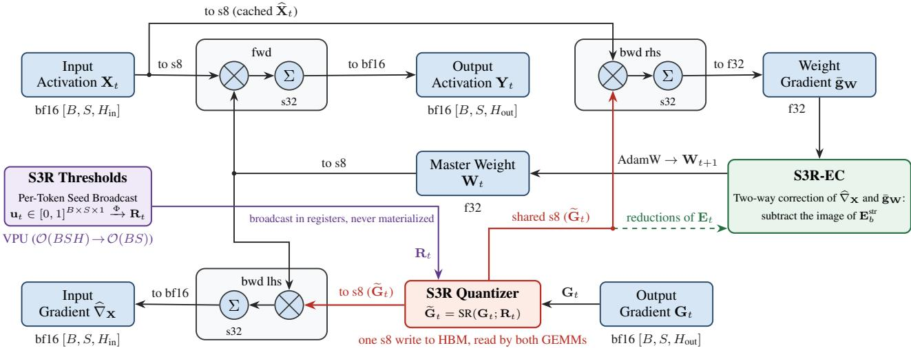
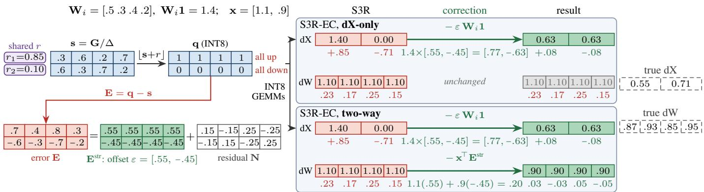
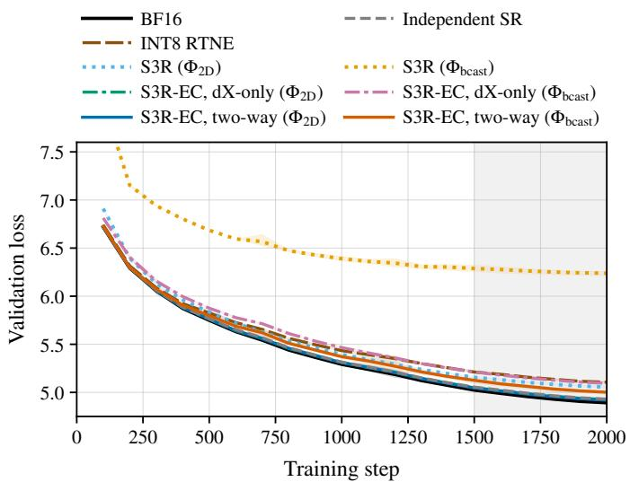
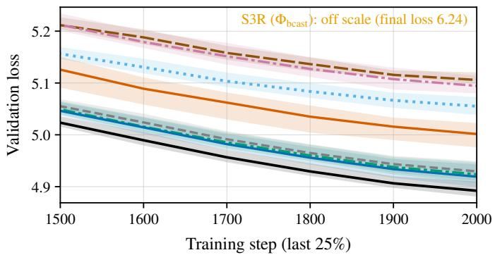

# Efficient Quantization Training with Stochastic Rounding via Structured Subspace Randomness

Zeyu Wang, Yiheng Duan, Tao Chen, Donghyun Koo, Sihan Liu, Wenbo Zhang∗, Chuan He, Liang Liu Google, Mountain View, CA, USA

{xavierzeyuwang, yhduan, taoc, koodk, liusih, wenbozhang, hec, liangliu}@google.com ∗Corresponding author

Abstract—Low-precision training often relies on stochastic rounding (SR) to keep quantized gradients unbiased and prevent small updates from rounding to zero. Standard SR draws an independent random threshold for every gradient element. However, accelerators generate random numbers on vector units whose throughput lags far behind their matrix units. Drawing one threshold per element saturates the vector unit and can make INT8 training with SR slower than BF16 training. Sharing random thresholds across tensor elements removes this cost but forces those elements to round in the same direction and shifts their rounding errors by a common offset. We find that this offset degrades training primarily through the activation gradient, which propagates the error backward into earlier layers. Because earlier layers cannot cancel an incoming offset using their own local rounding errors, the offset must be removed at the layer where it originates. We propose Structured Subspace Stochastic Rounding (S3R), which quantizes each upstream gradient once for both the activation and weight gradient matrix multiplications and shares a single threshold per token across the hidden dimension. Its error correction, S3R-EC, subtracts the structured mean rounding error from the activation and weight gradients while leaving the optimizer unchanged. In LLM pre-training experiments, uncorrected threshold sharing degrades convergence, whereas S3R-EC eliminates this degradation and matches the validation loss of independent SR. Furthermore, S3R-EC accelerates full INT8 training steps of dense LLMs on TPU v5p by 1.24x to 1.32x over BF16 and by 1.11x over independent SR.

Index Terms—Stochastic rounding, quantization training, random number generation, variance-covariance analysis, large language models.

## I. INTRODUCTION

Training large language models (LLMs) demands massive compute and memory bandwidth [1]–[3]. To reduce both costs during pre-training and fine-tuning, full quantization training (QT) accelerates the training step itself by executing both the forward- and backward-pass matrix multiplications in 8-bit or 4-bit precision [4]–[9]. On GPUs, fine-grained FP8 recipes rely on an exponential quantization grid whose step size shrinks near zero, preserving small values under standard deterministic rounding [8]. In contrast, integer formats such as INT8 (the native 8-bit format on accelerators like Google Cloud TPU v5p [9]) use a uniform grid with a constant step size, and emerging 4-bit floating-point formats (NVFP4 and MXFP4) [10], [11] have an extremely coarse grid, making the backward pass in both settings prone to severe underflow.

Specifically, because backward gradients are heavy-tailed and span a wide dynamic range, many of their entries fall below half a quantization step. Deterministic round-to-nearesteven (RTNE) maps these entries to zero every time, causing the affected parameters to stall in a failure mode known as gradient stagnation [12]. Stochastic rounding (SR) prevents this stagnation by rounding each value up or down with probabilities proportional to its distance from the two neighboring grid points. The quantized gradient remains unbiased, and small updates survive in expectation [13]–[15].

Standard SR, however, requires an independent uniform random threshold for every gradient element. On modern accelerators, general matrix multiplications (GEMMs) execute on dedicated matrix units (MXUs, such as systolic arrays or Tensor Cores), whereas counter-based pseudo-random number generators (PRNGs, such as Threefry and Philox [16]) execute on the vector processing unit (VPU). Because matrix throughput has scaled much faster than vector throughput across hardware generations, generating a 32-bit random word per gradient element saturates the VPU and stalls the MXU. Consequently, INT8 training with SR can run slower than BF16 training despite INT8 offering twice the peak MXU throughput of BF16. For example, using JAX’s default Threefry generator [17] on TPU v5p, independent SR executes a single feed forward network (FFN) block at only 0.58x the speed of BF16 for smaller model dimensions.

To eliminate this random number generation bottleneck, we propose Structured Subspace Stochastic Rounding (S3R), which shares each random threshold across multiple tensor elements. Because each threshold remains uniformly distributed, every element is still rounded without bias. Unlike standard SR with independent draws [14], sharing a threshold forces elements in the same group to round in the same direction, shifting their rounding errors by a common offset. We show that this offset degrades convergence primarily through the activation gradient, which propagates the error backward into earlier layers. Because earlier layers cannot cancel an incoming offset using only their own local rounding errors, we pair S3R with a structured error correction method (S3R-EC) that subtracts the offset directly at the layer where it is generated. Our contributions are as follows.

1) We design S3R to eliminate the random number generation overhead of SR. Standard quantized training quantizes the upstream gradient twice in the backward pass, once for the activation gradient and once for the weight gradient, drawing a separate random threshold for every tensor element. S3R instead quantizes each upstream gradient once for both matrix multiplications and draws a single random threshold per token, sharing it across the hidden dimension. Implemented in standard JAX without custom kernels, S3R allows XLA to broadcast these thresholds directly inside vector registers without materializing the full random tensor in memory.

2) We analyze the error covariance induced by shared thresholds and derive S3R-EC (Sections III-C and III-D). Because sharing a threshold across a sequence correlates errors across tokens, S3R shares one threshold per token across the hidden dimension. We prove that pertoken sharing preserves the weight gradient variance of independent SR and confines the positive error covariance to each token’s activation gradient, which propagates into earlier layers (Lemma 2 and Proposition 1). We then show that subtracting the mean rounding error removes this covariance (Theorem 1 and Corollary 1). Building on this result, S3R-EC subtracts the mean error along the token and hidden dimensions without extra random draws or optimizer changes (Proposition 2), while its dX-only variant corrects only the activation gradient to capture nearly the full accuracy gain at lower overhead.

3) We evaluate convergence in Llama-style language model pre-training and show that while uncorrected threshold sharing degrades validation loss, S3R-EC eliminates this degradation and matches the quality of independent SR (Section IV-C). In end-to-end benchmarks on TPU v5p, S3R-EC accelerates full training steps of three dense LLMs [3], [18], [19] by 1.24x to 1.32x over BF16 and by 1.11x over independent SR (Section IV-D). On two mixture-of-experts (MoE) models [18], [20], S3R and S3R-EC achieve speedups of 1.09x to 1.11x and 1.04x to 1.06x over independent SR, respectively.

## II. RELATED WORK

## A. Low-Precision Training and Stochastic Rounding

Full quantization training runs the forward product and both backward products in low precision [4]–[6]. FP8 recipes train LLMs at scale with fine-grained scaling and stability fixes [7], [8], [21] and also compress optimizer states and activations [22]. INT8 recipes quantize the whole data flow [9] or keep the weight-gradient product in 16 bits [23]. At 4 bits, NVFP4 and MXFP4 recipes apply SR to gradients after a random Hadamard transform [10], [11], and LUQ rounds them without bias on a logarithmic grid [24]. Other 4-bit recipes sample gradients by leverage score [25] or, like Quartet, prefer round-to-nearest [26].

By preventing gradient stagnation [12], unbiased SR enabled early 8-bit floating-point training [13]. Under independent draws, its errors are mean-independent, which gives probabilistic error bounds that grow with the square root of the problem size [14]. SR also implicitly regularizes tall-and-thin matrices [27], and Croci et al. survey its uses [15]. In training, SR yields unbiased gradient estimators whose variance depends on the quantizer [28], and its interaction with Adam has been analyzed for LLMs [29]. These analyses assume independent or mean-independent errors, which shared thresholds violate (Lemma 2, Proposition 1).

## B. The Cost of Randomness

Counter-based generators such as Philox and Threefry compute each random word as a keyed function of a counter [16], and JAX uses Threefry by default [17]. Each word takes many rounds of integer operations on the vector unit, which has scaled far more slowly than the matrix units. In inference, a few extra vector instructions per multiply-accumulate can already make a kernel vector-bound [30]. On TPU v5p, the independent-SR quantizer issues more than a hundred vector operations per element (Section IV-D). Materializing random tensors also adds off-chip traffic, which costs far more energy than arithmetic [31], [32]. S3R broadcasts its thresholds in vector registers without materializing them, and it writes the quantized INT8 gradient to HBM once for both backward products.

Hardware support lowers the cost of SR. Graphcore’s IPU supports SR in binary16 and binary32 arithmetic [15], proposed SR units accelerate SR in fixed-point arithmetic [33], and Blackwell GPUs provide conversion instructions (cvt.rs) that round to FP16, BF16, FP8, FP6 or FP4 with random bits supplied by software [34]. Such support, however, is tied to particular chips and number formats, and it still needs a random value for every element, which software must generate for cvt.rs. S3R needs no special hardware and far fewer random values.

With few random bits per element, SR becomes biased unless the implementation compensates. El Arar et al. analyze limited-precision SR [35], and Fitzgibbon and Felix show that natural few-bit implementations can be significantly biased [36]. S3R uses 7-bit thresholds shifted by half a grid step (Section III) and thus falls in this regime. Slicing one random word into several narrow values, as S3R also does, is existing practice in JAX’s legacy Threefry path [17] and in cvt.rs [34]. Generator-free SR instead takes random bits from values already present in training [37]. Our contribution concerns the far larger saving from sharing one random value across many elements, and what this sharing does to training.

## C. Shared Randomness and Error Correction

SR is equivalent to round-to-nearest with non-subtractive dither, which adds a uniform offset over one quantization step before rounding [38]. Prior work uses non-subtractive dither to sparsify backward gradients [39] and couples random draws across distributed clients so their quantization errors partially cancel upon aggregation [40]. Rather than coupling draws across clients to cancel errors, S3R shares random thresholds within a tensor to reduce generation cost. Because LLM token representations are anisotropic with persistent outlier channels across tokens [41]–[43], S3R shares each threshold across the hidden dimension within a token rather than across tokens.

  
Fig. 1. Overview of INT8 (S8) quantization training with S3R and its structured error correction S3R-EC. On the VPU, S3R broadcasts a compact seed $\mathbf { u } _ { t } \in [ 0 , 1 ] ^ { B \times S \times 1 }$ , one threshold per token, to $\mathbf { R } _ { t } \overset { \cdot } { = } \Phi ( \mathbf { u } _ { t } )$ inside the vector registers, so Rt is never materialized. In the backward pass, the upstream gradient $\mathbf { G } _ { t }$ is quantized once, and the int8 result is written to HBM once and read by both the activation-gradient product $\widetilde { \mathbf { G } } _ { t } \mathbf { W } _ { t } ^ { \top }$ and the weight-gradient product $\widehat { \mathbf { X } } _ { t } ^ { \top } \widetilde { \mathbf { G } } _ { t }$ . S3R-EC subtracts the token-constant and channel-constant parts of the rounding error from $\hat { \nabla } _ { \mathbf { X } }$ eand from the FP32 weight gradient g¯ , and b ethe AdamW update is unchanged.

Within each token, this shared threshold shifts element rounding errors by a common offset (Proposition 1).

To reduce quantization error after rounding, classical subtractive dither subtracts the exact dither signal from every element [38], while post-training bias correction subtracts the expected output error of quantized weights [44]. S3R-EC instead operates on the realized backward gradient error without per-element subtraction, removing only the mean rounding error along the token and hidden dimensions to eliminate the shared offset (Section III-D). Because these mean errors have zero expectation, subtracting their linear effect acts as a control variate that keeps the gradients unbiased while complementing few-bit SR techniques.

## III. METHODOLOGY AND THEORETICAL FRAMEWORK

In this section, we first introduce SR in quantized backpropagation, then describe how S3R works and shares thresholds, and analyze the effect of sharing, which motivates the structured error correction S3R-EC for both the dX-only and two-way variants.

## A. Quantized Backpropagation with Stochastic Rounding

Consider a linear projection $\mathbf { Y } = \mathbf { X } \mathbf { W }$ of a Transformer with activations $\mathbf { X } \ \in \ \overset { \vartriangle } { \mathbb { R } } ^ { B \times S \times H _ { \mathrm { i n } } }$ , weights $\mathbf { W } ~ \in ~ \mathbb { R } ^ { H _ { \mathrm { i n } } \times H _ { \mathrm { o u t } } }$ micro-batch size $B ,$ and sequence length S. Writing $H = H _ { \mathrm { o u t } }$ for brevity, let $\mathbf { G } = \partial \ell / \overset { \cdot } { \partial } \mathbf { Y } \in \mathbb { R } ^ { \overset { \cdot } { B } \times S \times H }$ be the upstream gradient of the summed per-token loss $\begin{array} { r } { \ell = \sum _ { b , s } \ell _ { b , s } } \end{array}$ , where the training loss is the token mean $\mathcal { L } = \ell / ( B S )$ . The backward pass computes two matrix products: the activation-gradient (dX) product $\mathbf { \dot { G } } \mathbf { W } ^ { \top }$ and the weight-gradient (dW) product $\mathbf { X } ^ { \top } \mathbf { G }$ where G serves as the left-hand (LHS) and right-hand (RHS) operand, respectively.

In the INT8 pipeline (Fig. 1), each operand of the forward and backward products is scaled, rounded from BF16 to S8, multiplied as an S8 general matrix multiplication (GEMM) with S32 accumulation, and rescaled. In the backward pass, SR is applied to G. For a step size $\Delta > 0$ and thresholds R ∈ $[ 0 , 1 ] ^ { B \times \hat { S } \times H }$ , the stochastic rounding operator $\widetilde { \mathbf { G } } = \mathbf { S } \mathbf { R } ( \mathbf { G } ; \mathbf { R } )$ rounds each element up when its normalized residual $\mathbf { P } =$ $\mathbf { G } / \Delta - \lfloor \mathbf { G } / \Delta \rfloor$ reaches its threshold:

$$
\mathrm { S R } ( G _ { b , s , h } ; R _ { b , s , h } ) = \Delta \left( \left\lfloor \frac { G _ { b , s , h } } { \Delta } \right\rfloor + \mathbb { I } \left( P _ { b , s , h } \ge R _ { b , s , h } \right) \right) ,\tag{1}
$$

where I(·) is the indicator function. With rounding error $\mathbf { E } ( \mathbf { G } , \mathbf { R } ) \ = \ \widetilde { \mathbf { G } } \ - \ \mathbf { G }$ and uniform thresholds, each entry $E _ { b , s , h } = \Delta ( \mathbb { I } ( P _ { b , s , h } \geq R _ { b , s , h } ) - P _ { b , s , h } )$ is a centered Bernoulli variable scaled by $\Delta .$ . For example, with $\Delta = 1$ , the value 0.3 is rounded to 1 with probability 0.3 and to 0 otherwise, so its mean is exactly 0.3. Our quantizer computes $\Delta [ G / \Delta + R ]$ which is (1) with the threshold $1 - R ;$ this threshold is uniform and shared wherever R is, so all results apply.

The forward product applies RTNE with per-token scales ${ \bf s } _ { x }$ and per-output-channel scales ${ \bf s } _ { w } ,$ so that $\bar { \mathbf X ^ { \mathrm { } } } \approx \mathrm { d i a g } ( \mathbf s _ { x } ) \widehat { \mathbf X }$ and $\mathbf { W } \approx \widehat { \mathbf { W } } \mathrm { d i a g } ( \mathbf { s } _ { w } )$ with S8 operands $\widehat { \mathbf X }$ and $\widehat { \bf W }$ . When both backward products share a quantized gradient (as in RTNE and S3R), the backward pass folds both scales into the gradient and quantizes the result once:

$$
\begin{array} { r } { \mathbf { G } ^ { \prime } = \mathrm { d i a g } ( \mathbf { s } _ { x } ) \mathbf { G } \mathrm { d i a g } ( \mathbf { s } _ { w } ) , } \\ { \widehat { \nabla } _ { \mathbf { X } } = \mathrm { d i a g } ( \mathbf { s } _ { x } ) ^ { - 1 } \Delta \mathbf { Q } \widehat { \mathbf { W } } ^ { \top } , } \\ { \widehat { \nabla } _ { \mathbf { W } } = \Delta \widehat { \mathbf { X } } ^ { \top } \mathbf { Q } \mathrm { d i a g } ( \mathbf { s } _ { w } ) ^ { - 1 } , } \end{array}\tag{2}
$$

where $\Delta = \operatorname* { m a x } | \mathbf { G } ^ { \prime } | / 1 2 7$ and ${ \bf Q } = { \bf S } { \bf R } ( { \bf G } ^ { \prime } ; { \bf R } ) / \Delta$ holds the S8 codes. With $\mathbf { G } ^ { \prime }$ in place of $\Delta \mathbf { Q } ,$ , the two products equal $\mathbf { G W } ^ { \top }$ and $\mathbf { X } ^ { \top } \mathbf { G }$ for the dequantized operands. One S8 tensor feeds both GEMMs, which contract its channels (dX) and its tokens (dW), so only a per-tensor step can be applied after S32 accumulation; fine-grained recipes such as DeepSeek-V3 [8] instead requantize an operand for its transposed use. Below, G, W and $\mathbf { X }$ denote G′, Wc and ${ \widehat { \mathbf { X } } } ,$ , and the fixed rescalings by $1 / \mathbf { s } _ { x }$ and $1 / \mathbf { s } _ { w } .$ , which preserve unbiasedness, are left implicit.

  
Fig. 2. Worked example of S3R-EC (two tokens, four channels, units of ∆). Left: one shared threshold per token $( r _ { 1 } = 0 . 8 5 , r _ { 2 } = 0 . 1 0 )$ rounds all channels of token 1 up and all of token 2 down; the known error $\mathbf { E } = \mathbf { q }$ s splits into $\mathbf { E } ^ { \mathrm { s t r } }$ and a residual N with zero row and column sums. Here $\mathbf { E } ^ { \mathrm { s t r } }$ reduces to one offset ε per token (in general it also has a per-channel term). Right: both variants subtract $\varepsilon \mathbf { W } _ { i } \mathbf { 1 }$ from the activation gradient (row Wi of W); two-way also subtracts $\mathbf { x } ^ { \top } \mathbf { E } ^ { \mathrm { s t r } }$ from the weight gradient (input feature x), which dX-only leaves unchanged.

Conventional QT implementations draw independent full-size thresholds $\mathbf { R } ^ { \mathrm { L H S } }$ ， $\mathbf { R } ^ { \mathrm { R H S } } \sim \mathcal { U } ( [ 0 , 1 ] ^ { B \times S \times H } )$ for the two products: $\widehat { \nabla } _ { \mathbf { X } } = \mathrm { S R } ( \mathbf { G } ; \mathbf { R } ^ { \mathrm { L H S } } ) \mathbf { W } ^ { \dagger }$ estimates $\mathbf { G } \mathbf { W } ^ { \top }$ , and $\widehat { \nabla } _ { \mathbf { W } } =$ $\mathbf { X } ^ { \top } \mathbf { S } \mathbf { R } ( \mathbf { G } ; \mathbf { R } ^ { \mathrm { R H S } } )$ estimates $\mathbf { X } ^ { \top } \mathbf { G }$ , so $\bar { \bf g } _ { \bf W } ~ = ~ \widehat \nabla _ { \bf W } / ( B S )$ estimates $\nabla _ { \mathbf { W } } \mathcal { L }$ . This costs 2BSH 32-bit Threefry words per projection, one per element and product. Each word is hashed on the VPU, so the quantizer issues more than ten times as many vector operations as an RTNE quantizer, while the S8 GEMMs on the MXU take the same time.

## B. Structured Subspace Randomness

S3R reduces this cost in two steps (Fig. 1): it uses one threshold tensor for both backward products, and it broadcasts a small seed to the full tensor. Only the second step changes the error distribution of each product. Each threshold is a 7-bit bf16 value; as in existing implementations [17], [34], S3R cuts four thresholds from each 32-bit Threefry word [16], and a half-step shift of the threshold grid bounds the resulting rounding bias by $\Delta / 2 5 6$ . Lemma 1 thus holds up to this discretization. S3R builds on partitionable Threefry, which gives bitwise-identical thresholds under pure-FSDP, mixed and pure-TP factorizations without added collectives.

1) Inter-Operand Sharing: With separate PRNG keys, the gradient is quantized twice. S3R uses one threshold tensor for both products, ${ \bf R } ^ { \mathrm { L H S } } = { \bf R } ^ { \mathrm { R H S } } = { \bf R }$ , so the quantizations coincide, as under RTNE, and Q in (2) is computed once. XLA compiles the quantizer into a fusion that writes $\mathbf { Q }$ to HBM once, at one byte per element, for both GEMMs to read. This halves the backward quantization work and the S8 writes $( \alpha _ { \mathrm { s h a r e } } = 1 / 2 )$ , and both products remain unbiased (Lemma 1, Part 2). Their errors become correlated, but the correlation enters none of the second moments analyzed below.

2) Threshold Broadcasting: The second step draws a compact seed $\mathbf { u } \sim \mathcal { U } ( [ 0 , 1 ] ^ { d _ { 0 } } )$ with $d _ { 0 } \ll B S H$ and expands it to $\mathbf { R } = \Phi ( \mathbf { u } ) \in [ 0 , 1 ] ^ { B \times S \times H }$ with a broadcast Φ. XLA fuses the broadcast into the quantizer, so thresholds are broadcast in vector registers and R is never materialized. Every Φ keeps thresholds marginally uniform; sharing more saves draws but correlates more errors, because elements that share a threshold tend to round in the same direction. Independent SR shares nothing; we study two choices:

Per token, $\Phi _ { 2 \mathbf { D } }$ (default). Here $\mathbf { u } \in [ 0 , 1 ] ^ { B \times S \times 1 }$ and $R _ { b , s , h } ~ = ~ u _ { b , s }$ . This cuts PRNG work by a factor of H and keeps rounding errors independent across tokens. Errors within a token remain positively correlated across channels (Corollary 1); S3R-EC removes this covariance (Proposition 2).

Per example, $\Phi _ { \mathbf { b c a s t } }$ (ablation). Here $\mathbf { u } \in [ 0 , 1 ] ^ { B \times 1 \times 1 }$ and $R _ { b , s , h } = u _ { b }$ . This needs only B draws per layer, but it correlates the errors of all tokens of an example, and their common part reaches the activation gradient of every token (Proposition 1), so we use it only as an ablation.

## C. Why Sharing Hurts and How S3R-EC Repairs It

Sharing a threshold biases no gradient, but it ties together the rounding errors of the elements that share it. We show in turn that these errors are positively correlated, where the correlation adds error, and that subtracting their known mean, which is what S3R-EC does, removes the correlation. Throughout, G is fixed and only the thresholds are random; we assume nothing about the residuals and require only that every threshold be uniform on [0, 1).

1) First-Order Unbiasedness: SR is unbiased whenever each threshold is marginally uniform. Expectation is linear, so correlations among the thresholds do not matter.

Lemma 1 (First-Order Marginal Unbiasedness). Fix ${ \textbf { G } } \in$ $\mathbb { R } ^ { B \times S \times H }$ (fixed residuals), and let $\mathbf { R } = \Phi ( \mathbf { u } )$ be any random threshold field whose entries are marginally uniform, $R _ { b , s , h } \sim$ $\mathcal { U } ( 0 , 1 )$ . Then:

1) Linear maps: $\mathbb { E } _ { \mathbf { u } } [ T ( S R ( \mathbf { G } ; \Phi ( \mathbf { u } ) ) ) ] = T ( \mathbf { G } )$ for every linear operator T.

2) Shared quantized gradient: When both backward products use the same $\begin{array} { r l r } { \widetilde { \bf G } , \mathbb { E } _ { \bf u } [ \widetilde { \bf G } { \bf W } ^ { \top } ] } & { = } & { { \bf G } { \bf W } ^ { \top } } \end{array}$ and $\mathbb { E } _ { \mathbf { u } } [ \mathbf { X } ^ { \top } \widetilde { \mathbf { G } } ] = \mathbf { X } ^ { \top } \mathbf { G }$ . Hence $\mathbb { E } _ { \mathbf { u } } [ \bar { \mathbf { g } } _ { \mathbf { W } } ] = \nabla _ { \mathbf { W } } \mathcal { L } .$

The lemma composes across layers: backpropagation is linear in the upstream gradient, and each layer draws its thresholds independently of the noise from above, so by the tower property every layer’s gradient is unbiased with respect to the backward pass of the executed forward graph (with Xb , Wc if it is quantized). The topology Φ can therefore be chosen for its cost and its second moments alone.

2) Broadcasting Makes the Errors Move Together: With independent thresholds, every element chooses its rounding direction on its own, and the errors of different elements are independent. With a broadcast threshold, one draw chooses for the whole group: a large draw rounds most of its elements up, and a small draw rounds most of them down.

Lemma 2 (Covariance of Shared-Threshold Errors). Round with $\Delta [ G / \Delta + R ]$ and marginally uniform thresholds, and let $P _ { i }$ be the residual of element i. If elements i and k share one threshold, their rounding errors satisfy

$$
C o \nu ( E _ { i } , E _ { k } ) = \Delta ^ { 2 } \big ( \operatorname* { m i n } ( P _ { i } , P _ { k } ) - P _ { i } P _ { k } \big ) \in [ 0 , \Delta ^ { 2 } / 4 ] .\tag{3}
$$

If their thresholds are independent, $C o \nu ( E _ { i } , E _ { k } ) = 0 .$

Every pair of errors in a group that shares a threshold is thus nonnegatively correlated. The covariance is largest when both residuals are near $\textstyle { \frac { 1 } { 2 } }$ and vanishes when either element is almost exactly representable. If the residuals of a group are spread evenly over [0, 1), each error has variance about $\Delta ^ { 2 } / 6$ and each pair has covariance about $\Delta ^ { 2 } / 1 2$ , so half of the variance of every element is shared with the rest of its group. Under $\Phi _ { \mathrm { 2 D } }$ , a group is the $D = H _ { \mathrm { o u t } }$ channels of one token, and different tokens have independent thresholds.

3) Where the Correlation Adds Error: A backward product adds up errors with weights, and the variance of such a sum is the sum of the variances plus the sum of all pairwise covariances. Independent SR pays only the first part. Correlated errors also pay the second, because they no longer cancel.

Proposition 1 (Where Sharing Adds Error). Use per-token thresholds, $\Phi _ { 2 D } ,$ , and let $\mathbf { E } _ { b , s } \in \mathbb { R } ^ { D }$ be the rounding error of token $( b , s )$

1) Every entry of the weight-gradient error has the same variance as under independent SR.

2) Entry i of the activation-gradient error of token $( b , s )$ $\begin{array} { r } { \sum _ { j } W _ { i j } E _ { b , s , j } , } \end{array}$ has the variance it would have under independent SR plus $\begin{array} { r } { \sum _ { j \neq k } W _ { i j } W _ { i k } C o \nu ( E _ { b , s , j } , E _ { b , s , k } ) } \end{array}$ If every pair of channels of the token has covariance $c ,$ this extra term is $c \big ( ( \mathbf { W } _ { i } \mathbf { 1 } _ { D } ) ^ { 2 } - \| \mathbf { W } _ { i } \| _ { 2 } ^ { 2 } \big )$

3) This error is part of the upstream gradient of the layer below. A correction of this layer’s weight gradient leaves it unchanged, and the layer below, whose thresholds are independent of it, cannot cancel it with a correction built from its own rounding error.

Per-token sharing thus keeps the weight gradient exactly as accurate as independent SR and puts the whole cost into the activation gradient, which sums over exactly the channels that share a threshold. The extra term is large when the rows of W have a common component, because $( \mathbf { W } _ { i } \mathbf { 1 } _ { D } ) ^ { 2 }$ then grows with the square of the width while $\Vert \mathbf { W } _ { i } \Vert _ { 2 } ^ { 2 }$ grows linearly. The shared part of a token’s error is its mean $\begin{array} { r } { \varepsilon _ { b , s } = \frac { 1 } { D } \mathbf { 1 } _ { D } ^ { \top } \mathbf { E } _ { b , s } . } \end{array}$ which enters the activation gradient as $\varepsilon _ { b , s } \mathbf { W } \mathbf { 1 } _ { D }$ , along the same direction for every token. By the last statement, this error has to be removed in the activation gradient, where it arises. In a Transformer it does not arrive unchanged: the RMSNorm backward rescales each token and removes its component along the normalized input, and the attention backward mixes tokens. The proposition is therefore a mechanism, not an exact model. If all tokens of an example shared one threshold, the weight gradient would pay the same price over the tokens.

4) Subtracting the Mean Removes the Correlation: The quantizer knows every rounding error exactly, so it can compute the mean error of a group and subtract it. The theorem below shows what this does to correlated errors; it holds for any covariances.

Theorem 1 (Centering Reduces Covariance). Let $X _ { 1 } , \ldots , X _ { n } ,$ $n \geq 2 ,$ be zero-mean errors with average variance $\bar { \sigma } ^ { 2 }$ and average pairwise covariance c¯, let X¯ be their mean, and let $Y _ { i } = X _ { i } - { \bar { X } }$ . Then $\begin{array} { r } { V a r ( \bar { X } ) = \frac { 1 } { n } \bar { \sigma } ^ { 2 } + \frac { n - 1 } { n } \bar { c } , } \end{array}$ and:

1) Covariance: The average pairwise covariance of the $Y _ { i }$ is $\begin{array} { r } { \bar { c } - V a r ( \bar { X } ) = - \frac { 1 } { n } ( \bar { \sigma } ^ { 2 } - \bar { c } ) \leq 0 . } \end{array}$

2) Variance: The average variance of the $Y _ { i }$ is $\bar { \sigma } ^ { 2 } \mathrm { ~ - ~ }$ $\begin{array} { r } { V a r ( \bar { X } ) = \frac { n - 1 } { n } ( \bar { \sigma } ^ { 2 } - \bar { c } ) } \end{array}$

3) Equal covariances: If every $X _ { i }$ has variance $\sigma ^ { 2 }$ and every pair has covariance $c ,$ each pair’s covariance falls from c $t o - { \textstyle { \frac { 1 } { n } } } ( \sigma ^ { 2 } - c )$ , andfor any weights $w _ { i }$ with mean w¯, ${ \it V a r } ( \sum _ { i } \stackrel { \prime \prime } { w _ { i } } Y _ { i } ) = ( \sigma ^ { 2 } - c ) \sum _ { i } ( w _ { i } - \bar { w } ) ^ { 2 }$

The average covariance and the average variance fall by the same amount, the variance of the mean. For errors that share a threshold, $\bar { c } \geq 0$ by Lemma $^ { 2 , }$ and for large n this amount is about c¯. Subtracting the mean therefore removes the positive correlation that broadcasting created, and the centered errors are even slightly negatively correlated, like draws without replacement. The case of equal covariances shows the mechanism. Each error is then a shared part with variance c plus a private part with variance $\sigma ^ { 2 } - c .$ . Subtracting the mean deletes the shared part and keeps the private parts, which are uncorrelated, so any weighted sum of centered errors has at most the variance of the same sum of independent errors with variance $\sigma ^ { 2 } - c .$ For evenly spread residuals, this is about $\Delta ^ { 2 } / 1 2$ , half of the $\Delta ^ { 2 } / 6$ of independent SR.

The first two statements are averages and hold for any covariances. The third needs equal covariances, which fixed residuals do not give: by Lemma 2, an element that is almost exactly representable is nearly uncorrelated with the rest of its group, and subtracting the group mean adds the noise of the group to it. In general, element i becomes less noisy exactly when $2 { \cos } ( \bar { X _ { i } } , \bar { X } ) > { \ o \mathrm { V a r } } ( \bar { X } )$ . For $X _ { 1 } = - Z$ and $X _ { 2 } = X _ { 3 } = Z ,$ , the variance of the first element grows to ${ \frac { 1 6 } { 9 } } \mathrm { V a r } ( Z )$ , while the average variance falls to ${ \scriptstyle { \frac { 8 } { 9 } } } \operatorname { V a r } ( Z )$ . Single outputs of a GEMM can behave in the same way. In an exact computation on a synthetic layer with unequal residuals, 17– 27% of the activation-gradient outputs become noisier after centering, while their summed variance falls by 40–63% and stays below that of independent SR.

5) Which Axis to Center: Centering removes covariance only along an axis whose errors are correlated.

Corollary 1 (Centering under Per-Token Thresholds). Use $\Phi _ { 2 D }$ and consider one example.

1) Subtracting the mean error of a token over its D channels lowers their average pairwise covariance from $\bar { c } _ { b , s } \geq 0$ to $\begin{array} { r } { \mathrm { ~ , ~ } - \frac { 1 } { D } \big ( \bar { \sigma } _ { b , s } ^ { 2 } - \bar { c } _ { b , s } \big ) } \end{array}$ , where $\bar { \sigma } _ { b , s } ^ { 2 }$ is their average variance.

2) Subtracting the mean error of channel j over the S tokens finds no covariance to remove, because the tokens have independent thresholds, and lowers the average variance $\bar { \sigma } _ { b , j } ^ { 2 }$ of its entries by only $\textstyle { \frac { 1 } { S } } { \bar { \sigma } } _ { b , j } ^ { 2 }$

Under per-token thresholds, the activation-gradient term of S3R-EC, which centers each token, therefore does nearly all of the work, and the weight-gradient term adds little. If the tokens of an example also shared a threshold, centering over tokens would remove their covariance as well, and both terms would matter. Section IV-C confirms both predictions.

## D. Structured Error Correction (S3R-EC)

By Proposition 1, the cost of sharing is the covariance of the errors within each token, which enters the activation gradient and travels to every lower layer. S3R-EC removes this covariance by subtracting the known mean error, the operation analyzed in Theorem 1, along both axes of the error of each example.

1) Two-Way Correction: The idea is simple (Fig. 2). The quantizer knows G and $\widetilde { \mathbf { G } } ,$ and hence the rounding error $\bar { \mathbf { E } } = \widetilde { \mathbf { G } } - \mathbf { G }$ , exactly. S3R-EC takes two averages of E: the mean error of each token over its channels, which carries the covariance created by the shared threshold, and the mean error of each channel over the tokens of an example. After the unchanged INT8 GEMMs, it subtracts their effect: from the activation gradient, the averages times W, which for the token mean is the mean times the precomputed row sums ${ \bf W } { \bf 1 } _ { D } ;$ from the weight gradient, the inputs times the same averages. What remains sums to zero along every row and every column. No extra random numbers are needed.

Formally, with G, X and W as in (2), the averages of example b form the orthogonal projection of $\mathbf { E } _ { b } \in \overline { { \mathbb { R } } } ^ { S \times D }$ $( D = H _ { \mathrm { o u t } } )$ onto the subspace $\bar { \mathbf { \Xi } } S = \mathbf { \bar { \{ 1 _ { S } a } ^ { \top } + c 1 _ { D } ^ { \top } \} }$ of sums of row-constant and column-constant matrices:

$$
\begin{array} { r } { \bar { \mathbf { e } } _ { b } = \frac { 1 } { S } \mathbf { E } _ { b } ^ { \top } \mathbf { 1 } _ { S } , \quad \varepsilon _ { b } = \frac { 1 } { D } \mathbf { E } _ { b } \mathbf { 1 } _ { D } , \quad m _ { b } = \frac { 1 } { S D } \mathbf { 1 } _ { S } ^ { \top } \mathbf { E } _ { b } \mathbf { 1 } _ { D } , } \\ { \mathbf { E } _ { b } ^ { \mathrm { s t r } } = \mathbf { 1 } _ { S } \bar { \mathbf { e } } _ { b } ^ { \top } + ( \varepsilon _ { b } - m _ { b } \mathbf { 1 } _ { S } ) \mathbf { 1 } _ { D } ^ { \top } . \quad \quad } \end{array}\tag{4}
$$

Passing $\mathbf { E } _ { b } ^ { \mathrm { s t r } }$ through both backward products and subtracting the result gives

$$
\widehat { \nabla } _ { \mathbf { X } _ { b } } ^ { \mathrm { c o r r } } = \widehat { \nabla } _ { \mathbf { X } _ { b } } - \mathbf { 1 } _ { S } ( \mathbf { W } \bar { \mathbf { e } } _ { b } ) ^ { \top } - ( \varepsilon _ { b } - m _ { b } \mathbf { 1 } _ { S } ) ( \mathbf { W } \mathbf { 1 } _ { D } ) ^ { \top } ,\tag{5}
$$

$$
\bar { \bf g } _ { \bf W } ^ { \mathrm { c o r r } } = \bar { \bf g } { \bf w } - \frac { 1 } { B S } \sum _ { b = 1 } ^ { B } \left[ \bar { \bf x } _ { b } { \bf e } _ { b } ^ { \top } + { \bf X } _ { b } ^ { \top } ( \varepsilon _ { b } - m _ { b } { \bf 1 } _ { S } ) { \bf 1 } _ { D } ^ { \top } \right] ,\tag{6}
$$

where $\bar { \mathbf { x } } _ { b } = \frac { 1 } { S } \mathbf { X } _ { b } ^ { \top } \mathbf { 1 } _ { S }$ and $\mathbf { e } _ { b } = S \bar { \mathbf { e } } _ { b }$ . In (6), the first term removes the mean error of each channel over the tokens of an example, and the second removes the mean error that each token shares across its channels. The corrected gradients go to the unchanged optimizer, AdamW [45] in our experiments. The correction keeps both gradients unbiased and leaves the remaining errors of every token and every channel with a nonpositive average covariance:

Proposition 2 (Properties of the Two-Way Correction). Consider any threshold topology with marginally uniform thresholds, and fix the residuals. Let $\mathbf { N } _ { b } = \mathbf { E } _ { b } - \mathbf { E } _ { b } ^ { s t r }$ be the error that remains. Then:

1) Unbiasedness: $\mathbb { E } _ { \mathbf { u } } [ \widehat { \nabla } _ { \mathbf { X } } ^ { c o r r } ] \ = \ \mathbf { G } \mathbf { W } ^ { \top }$ and $\mathbb { E } _ { \mathbf { u } } [ \bar { \mathbf { g } } _ { \mathbf { W } } ^ { c o r r } ] ~ =$ $\nabla _ { \mathbf { W } } \mathcal { L } .$

2) Orthogonal Decomposition: $\mathbf { E } _ { b } ^ { s t r }$ is the orthogonal projection of $\mathbf { E } _ { b }$ onto S. Hence $\bar { \mathbf { N } } _ { b } ^ { \top } \mathbf { 1 } _ { S } = \mathbf { 0 } , \ \mathbf { N } _ { b } \mathbf { 1 } _ { D } = \mathbf { 0 }$ and $\lVert \mathbf { N } _ { b } \rVert _ { F } \leq \lVert \mathbf { E } _ { b } \rVert _ { F }$ on every realization.

3) Covariance Removal: Within every token and within every channel of example b, the remaining errors sum to zero, so their average pairwise covariance is $- { \frac { 1 } { n - 1 } }$ times their average variance, with n = D for a token and $n = S$ for a channel. In particular, the shared term $\varepsilon _ { b , s } \mathbf { W } \mathbf { 1 } _ { D }$ of every token’s activation-gradient error is removed.

$$
\begin{array} { r l r l r } { { 4 } ) ~ V a r i a n c e ~ R e d u c t i o n : } & { { } \sum _ { s , j } V a r ( N _ { b , s , j } ) } & { } & { { } = } \\ { ~ \sum _ { s , j } V a r ( E _ { b , s , j } ) - \mathbb { E } \| { \mathbf E } _ { b } ^ { s t r } \| _ { F } ^ { 2 } . } & { { } } & { } & { { } } \end{array}
$$

The covariance statement is the first statement of Theorem 1 applied to every row and every column of the error, and under per-token thresholds the rows carry nearly all of the removed covariance, by Corollary 1.

Relation to dithering. The correction is a control variate, akin to bias correction in post-training quantization [44]. SR rounds to nearest after adding the dither $\Delta ( r - { \frac { 1 } { 2 } } )$ ; because the dither is shared, the error it causes is known and can be subtracted, as in subtractive dither [38]. Correlated quantization [40] likewise gains from shared randomness. The diagnostics agree in direction: with the two-way correction, $\Phi _ { \mathrm { 2 D } }$ has a bottom-layer activation-gradient error of 0.476 vs. 0.572 for independent SR (Table II).

2) Cost and the dX-Only Variant: The correction reuses E and adds only per-example reductions and small products. With the batch sharded, its weight-gradient term all-gathers small per example factors such as $\bar { \mathbf { x } } _ { b }$ and $\bar { \mathbf { e } } _ { b }$ instead of reducing a weightsized f32 partial, which lowers the f32 all-reduce volume of a compiled two-layer model from 422.6 MiB to 3.1 MiB per step, at the cost of about 8 MiB of small factor all-gathers. Under $\Phi _ { \mathrm { 2 D } }$ , the errors of different tokens are uncorrelated, so centering over tokens finds almost no covariance to remove (Corollary 1), and the activation-gradient term (5) alone keeps nearly all of the benefit, including the removal of the shared term of every token’s activation-gradient error. Intuitively, the token offsets are independent under $\Phi _ { \mathrm { 2 D } }$ , so they largely average out in the weight gradient, a sum over tokens, but not in each token’s activation gradient (Fig. 2). This dX-only correction matches the two-way correction within seed noise (Section IV-C) and adds 1.1–1.8% to the S3R step time of the three dense models. $\Phi _ { \mathrm { b c a s t } } .$

whose tokens share thresholds, needs both terms; Section IV-D reports the remaining costs.

## IV. EXPERIMENTS

We report model quality first (Section IV-C) and speed second (Section IV-D), because a faster configuration is useful only if it trains as well as its baseline.

## A. Setup

All experiments run on Google Cloud TPU v5p with JAX/XLA [17]. We use three workloads.

1) Convergence runs. A 12-layer Llama-style decoder is trained on English C4 [46] for 2000 steps $( S = 2 0 4 8 ,$ B = 8, 32.8M tokens). We report the mean and sample standard deviation of the final validation loss over three seeds, with each configuration at its best learning rate on seed 0.

2) Single-block FFN benchmarks. Forward and backward passes of one SwiGLU FFN block at nine shapes $( W _ { 1 } { - } W _ { 9 } )$ taken from models of 1B to 70B parameters (Table III).

3) Full training steps. MaxText training steps of five models from four families [3], [18]–[20]: the dense Llama 3.1- 8B, Qwen3-8B, and Gemma 3-12B, and the mixture-of experts (MoE) models Qwen3-30B-A3B and DeepSeek-V2-Lite (16B). The devices form a two-dimensional mesh with Fully Sharded Data Parallelism (FSDP) [47] and Tensor Parallelism (TP) [48], orchestrated via Pathways [49]. Each chip processes 4 synthetic sequences of 4096 tokens per step, with full rematerialization and flash attention [50]. Step times are medians over 20 steps after 12 warm-up steps and differ by at most 0.6% between repeated runs.

## B. Compared Configurations

All INT8 configurations quantize as in Section III: RTNE in the forward pass, one per-tensor step ∆ for the backward gradient, and int32 accumulation. In the full training steps, each GEMM rounds its output to bf16 per shard, so the TP partial sums are reduced in bf16, as in the BF16 baseline. The flash-attention products, the embedding, and the logits projection stay in bf16. They differ only in how the upstream gradient is rounded:

BF16 and INT8 RTNE: the 16-bit baseline and deterministic rounding.

Independent SR (Threefry): one 32-bit random threshold per element from JAX’s default Threefry generator, which S3R also uses. In full training steps, it quantizes the upstream gradient once per backward product, as in AQT.

S3R $( \Phi _ { 2 \mathbf { D } } ) ,$ the default with one threshold per token, and S3R $( \Phi _ { \mathrm { b c a s t } } )$ , the ablation with one threshold per example.

S3R-EC, two-way and S3R-EC, dX-only: S3R with the correction of Section III-D, applied to both backward products or to the activation gradient only.

  
Fig. 3. Validation loss versus training step for all configurations of Table I, each at its best learning rate. Lines show the mean over 3 seeds, and shaded bands span the seed minimum to maximum. The bottom panel enlarges the last 25% of steps. S3R $( \Phi _ { \mathrm { b c a s t } } )$ lies off this scale (final loss 6.24).

TABLE I  
FINAL VALIDATION LOSS OF THE 12-LAYER MODEL AFTER 2000 STEPS (32.8M C4 TOKENS) WITH 8-BIT PER-TENSOR BACKWARD GRADIENTS. MEAN SAMPLE STD OVER 3 SEEDS AT EACH CONFIGURATION’S BEST LEARNING RATE, CHOSEN ON SEED 0. ALL CONFIGURATIONS USE ADAMW. †LOWEST LEARNING RATE TRIED
<table><tr><td>Configuration</td><td>Best LR</td><td>Val. loss</td><td>Gap to BF16</td></tr><tr><td>BF16</td><td> $6 \times 1 0 ^ { - 4 }$ </td><td> $4 . 8 9 2 \pm 0 . 0 1 5$ </td><td></td></tr><tr><td>INT8 RTNE</td><td> $6 \times 1 0 ^ { - 4 }$ </td><td> $5 . 1 0 6 \pm 0 . 0 1 3$ </td><td>+0.214</td></tr><tr><td>Independent SR</td><td> $6 \times 1 0 ^ { - 4 }$ </td><td> $4 . 9 2 9 \pm 0 . 0 1 9$ </td><td>+0.037</td></tr><tr><td>S3R (Φ2D)</td><td> $3 \times 1 0 ^ { - 4 }$ </td><td> $5 . 0 5 5 \pm 0 . 0 1 7$ </td><td>+0.163</td></tr><tr><td>S3R-EC, dX-only (Φ2D)</td><td> $6 \times 1 0 ^ { - 4 }$ </td><td> $4 . 9 2 4 \pm 0 . 0 2 1$ </td><td>+0.032</td></tr><tr><td>S3R-EC, two-way  $( \Phi _ { 2 \mathrm { D } } )$ </td><td> $6 \times 1 0 ^ { - 4 }$ </td><td> $4 . 9 1 9 \pm 0 . 0 2 2$ </td><td>+0.027</td></tr><tr><td>S3R  $( \Phi _ { \mathrm { b c a s t } } )$ </td><td> $3 . 7 5 \times 1 0 ^ { - 5 \dagger }$ </td><td> $6 . 2 3 9 \pm 0 . 0 2 6$ </td><td>+1.347</td></tr><tr><td>S3R-EC, dX-only  $( \Phi _ { \mathrm { b c a s t } } )$ </td><td> $6 \times 1 0 ^ { - 4 }$ </td><td> $5 . 0 9 4 \pm 0 . 0 1 8$ </td><td>+0.202</td></tr><tr><td>S3R-EC, two-way  $( \Phi _ { \mathrm { b c a s t } } )$ </td><td> $6 \times 1 0 ^ { - 4 }$ </td><td> $5 . 0 0 2 \pm 0 . 0 2 4$ </td><td>+0.109</td></tr></table>

## C. Model Quality

Table I lists the final validation loss of every configuration, and Fig. 3 shows the loss curves of all of them.

SR is still needed at 8 bits. With deterministic rounding, INT8 RTNE ends 0.176 above independent SR (Welch $t \approx 1 3 . 2 )$ and 0.214 above BF16 (Table I).

Sharing hurts, mainly through the activation gradient.

TABLE II  
TABLE III  
RELATIVE STOCHASTIC GRADIENT ERROR (FROBENIUS NORM RELATIVE TO THE BF16 GRADIENT) ON A BF16 CHECKPOINT AT STEP 1000 (LR $6 \times 1 0 ^ { - 4 }$ , SEED 0), POOLED OVER 4–9 FIXED TRAINING BATCHES. LAYER 0 IS THE BOTTOM OF THE 12-LAYER MODEL. THE DW-ONLY CORRECTION (CORR.) KEEPS ONLY THE TOKEN-MEAN TERM OF THE  
WEIGHT-GRADIENT CORRECTION. THE LAST TWO ROWS CHOOSE THE THRESHOLDS OF THE TWO BACKWARD PRODUCTS SEPARATELY AND USE THE DW-ONLY CORRECTION
<table><tr><td></td><td colspan="2">dX error</td><td>dW error</td><td>Emb.</td></tr><tr><td>Configuration</td><td>layer 0</td><td>layer 11</td><td>layer 0</td><td>error</td></tr><tr><td>Independent SR</td><td>0.572</td><td>0.111</td><td>0.456</td><td>0.457</td></tr><tr><td>S3R (Φ2D)</td><td>0.877</td><td>0.228</td><td>0.691</td><td>0.703</td></tr><tr><td>S3R  $( \Phi _ { 2 \mathrm { D } } ) .$  dW-only corr.</td><td>0.882</td><td>0.228</td><td>0.694</td><td>0.706</td></tr><tr><td>S3R-EC, two-way  $( \Phi _ { 2 \mathrm { D } } )$ </td><td>0.476</td><td>0.103</td><td>0.377</td><td>0.378</td></tr><tr><td>S3R  $( \Phi _ { \mathrm { b c a s t } } )$ </td><td>3.157</td><td>0.313</td><td>5.141</td><td>5.285</td></tr><tr><td>S3R  $( \Phi _ { \mathrm { b c a s t } } ) .$  dW-only corr.</td><td>3.150</td><td>0.313</td><td>4.529</td><td>5.262</td></tr><tr><td>S3R-EC, two-way  $( \Phi _ { \mathrm { b c a s t } } )$ </td><td>0.521</td><td>0.105</td><td>0.551</td><td>0.558</td></tr><tr><td>dX  $\Phi _ { \mathrm { 2 D } } ,$  dW  $\Phi _ { \mathrm { b c a s t } }$ </td><td>0.893</td><td>0.227</td><td>0.746</td><td>0.714</td></tr><tr><td>dX  $\Phi _ { \mathrm { b c a s t } } , \mathrm { d W } \ \Phi _ { 2 \mathrm { D } }$ </td><td>3.494</td><td>0.261</td><td>5.979</td><td>6.849</td></tr></table>

Without a correction, S3R $( \Phi _ { 2 \mathrm { D } } )$ ends 0.126 above independent SR. S3R $( \Phi _ { \mathrm { b c a s t } } )$ does not train usefully, and its loss keeps improving as the learning rate decreases, down to the lowest rate we tried (Table I). A causal ablation in the last two rows of Table II locates the damage. These rows quantize G separately for the two backward products. Per-example thresholds on the activation-gradient product alone reproduce the gradient error of S3R $( \Phi _ { \mathrm { b c a s t } } )$ , and per-token thresholds there remove almost all of $\mathrm { i t , }$ whichever thresholds the weight-gradient product uses.

With per-token thresholds, S3R-EC restores quality within seed noise. S3R-EC, two-way $( \Phi _ { 2 \mathrm { D } } )$ reaches $4 . 9 1 9 \pm 0 . 0 2 2$ , against 4.929 ± 0.019 for independent SR. Its seed band overlaps that of independent SR over the last 25% of training, and its best learning rate returns to that of BF16. With per-example thresholds, the correction closes most of the gap but not all of it. It stays 0.073 above independent SR (Welch t ≈ 4.1) and 0.109 above BF16 (Table I, Fig. 3).

The dX-only correction suffices for $\Phi _ { 2 \mathbf { D } }$ but not for $\Phi _ { \mathbf { b c a s t } } .$ With per-token thresholds, the dX-only and two-way variants end within seed noise of each other. Because it skips the weight-gradient term, the dX-only variant is also cheaper in full training steps (Section IV-D). With per-example thresholds, correcting the activation gradient alone recovers most of the loss, but the dX-only variant stays 0.092 above the two-way correction (Welch $t \ = \ 5 . 4 ;$ Table I). This pattern agrees with the analysis. Per-token thresholds leave the errors of different tokens uncorrelated, so the weight-gradient half of the correction, which centers over tokens, has almost no covariance to remove; per-example thresholds correlate the tokens, and this half then removes their covariance too (Corollary 1).

The correction lowers the gradient error itself, whereas the rounding variance barely affects the optimizer. Table II measures every configuration on the same BF16 checkpoint. Under Φ2D, the two-way correction brings every listed error below that of independent SR, for example to 0.48 against

SPEEDUP OVER BF16 OF ONE SWIGLU FFN BLOCK (FORWARD + BACKWARD, PER DEVICE) ON TPU V5P, AND EXTRA DEVICE TIME OF S3R-EC OVER S3R $( \Phi _ { 2 \mathrm { D } } )$ . B = 8 (4 FOR W9), $S = 2 0 4 8 ;$ MEDIAN OVER REPEATED STEPS. S3R-EC: MEAN OF TWO FURTHER RUNS, EACH AGAINST S3R IN THE SAME RUN.
<table><tr><td></td><td></td><td colspan="3">Speedup over BF16 (×)</td><td colspan="2">S3R-EC, extra time over S3R (%)</td></tr><tr><td>Shape</td><td> $( H , D _ { \mathrm { f f n } } )$ </td><td>INT8 RTNE</td><td>Indep. SR (Threefry)</td><td>S3R (Φ2D)</td><td>Two-way</td><td>dX-only</td></tr><tr><td> $W _ { 1 }$ </td><td>(512, 2048)</td><td>1.12</td><td>0.58</td><td>1.08</td><td>+13.0</td><td>+14.8</td></tr><tr><td> $W _ { 2 }$ </td><td>(1024, 4096)</td><td>1.45</td><td>0.91</td><td>1.44</td><td>+7.3</td><td>+9.6</td></tr><tr><td> $W _ { 3 }$ </td><td>(2048, 8192)</td><td>1.73</td><td>1.29</td><td>1.73</td><td>-0.6</td><td>+1.7</td></tr><tr><td> $W _ { 4 }$ </td><td>(3072, 12288)</td><td>1.92</td><td>1.54</td><td>1.92</td><td>+4.8</td><td>+4.1</td></tr><tr><td> $W _ { 5 }$ </td><td>(3840, 15360)</td><td>1.84</td><td>1.53</td><td>1.83</td><td>+2.8</td><td>+3.3</td></tr><tr><td> $W _ { 6 }$ </td><td>(4096, 12288)</td><td>1.89</td><td>1.60</td><td>1.90</td><td>+2.7</td><td>+3.1</td></tr><tr><td> $W _ { 7 }$ </td><td>(4096, 14336)</td><td>1.87</td><td>1.56</td><td>1.87 1.81</td><td>+3.4</td><td>+3.1</td></tr><tr><td> $W _ { 8 }$ </td><td>(5120, 17920)</td><td>1.82</td><td>1.58</td><td>1.81</td><td>+0.7</td><td>+2.7</td></tr><tr><td> $W _ { 9 }$ </td><td>(8192, 28672)</td><td>1.81</td><td>1.66</td><td></td><td>+3.8</td><td>+2.2</td></tr></table>

0.57 in the bottom-layer activation gradient. Under $\Phi _ { \mathrm { b c a s t } } ,$ it lowers the bottom-layer activation-gradient error from 3.16 to $0 . 5 2 ,$ below that of independent SR, although the weightgradient error stays higher. The rounding variance makes up at most 0.094 of the AdamW second-moment estimate $v _ { t }$ late in training, so it barely changes the per-coordinate step size of AdamW.

Limits. Three seeds per configuration resolve differences of about 0.05 or more. Smaller differences remain undetermined, including the one between independent SR and the two-way S3R-EC with $\Phi _ { \mathrm { 2 D } }$ . The learning rate of each configuration was selected on seed 0, which is also part of the mean.

## D. Throughput and Memory

INT8 nearly halves the GEMM time, and vector work decides how much of this saving remains. The S8 GEMMs run on the MXU and take the same time in every uncorrected INT8 configuration, 47.55–47.63 ms for one FFN block at $W _ { 9 }$ against 90.29 ms for BF16. Scaling, rounding, threshold generation and the correction run on the VPU and do not get cheaper with a narrower format. We convert extra device time to int32 VPU operations per upstream-gradient element at the measured $1 4 . 3 \times 1 0 ^ { 1 2 }$ operations/s.

Per-element Threefry is the expensive step, and S3R removes it. Independent SR hashes one 32-bit word per gradient element, which costs 120–133 operations per element over INT8 RTNE at every shape and takes 56.5% of the busy time at $W _ { 1 }$ and 9.9% at $W _ { 9 } .$ . It is therefore slower than BF16 at $W _ { 1 }$ and $W _ { 2 }$ (Table III). S3R $( \Phi _ { 2 \mathrm { D } } )$ hashes one word per four tokens and broadcasts the thresholds in vector registers inside the quantizer fusion, so they are never written to memory. It costs −2 to +6 operations per element, runs within 1% of INT8 RTNE at $W _ { 2 } – W _ { 9 }$ and 4.3% slower at $W _ { 1 }$ , and is 1.08–1.92× faster than BF16.

S3R-EC adds small reductions and products. It reuses the rounding error inside the quantizer fusion, and its per-token and per-channel reductions, matrix-vector products and rank-1 updates leave the GEMM time nearly unchanged. On a single block, both variants add 15–23 operations per element at most shapes and 8–14% temporary memory. This is 13–15% of the device time of S3R at $W _ { 1 }$ , 7–10% at $W _ { 2 }$ and at most 5% from $W _ { 3 }$ on, so only $W _ { 1 }$ becomes slower than BF16 (0.94–0.96×; Table III). The two-way variant does more arithmetic but is not always slower, because both variants change how XLA fuses the GEMMs.

TABLE IV  
FULL TRAINING STEP (FORWARD, BACKWARD, AND ADAMW UPDATE) ON TPU V5P WITH BF16-OUTPUT INT8 GEMMS. MEDIAN STEP TIME (MS) OVER 20 STEPS AFTER 12 WARM-UP STEPS; PER-DEVICE BATCH 4, S = 4096. IN PARENTHESES: SPEEDUP OVER BF16 ON THE DENSE MODELS. S3R-EC, TWO-WAY, USES THE FACTOR ALL-GATHER; ON THE DENSE GEMMS, IT ALSO COMPUTES A PER-CHANNEL ROUNDING-VARIANCE STATISTIC THAT THE UPDATE DOES NOT USE, SO ITS TIMES ARE SLIGHTLY PESSIMISTIC. ON THE MOE MODELS, THE EXPERT GEMMS RECEIVE ONLY THE CHANNEL-MEAN PART OF THE CORRECTION.
<table><tr><td></td><td colspan="3">Dense models</td><td colspan="2">MoE models</td></tr><tr><td>Configuration</td><td>Llama 3.1-8B</td><td>Qwen3-8B</td><td>Gemma 3-12B</td><td>Qwen3-30B-A3B</td><td>DeepSeek-V2-Lite (16B)</td></tr><tr><td>BF16</td><td>3862</td><td>4018</td><td>6550</td><td>6454</td><td>3659</td></tr><tr><td>INT8 RTNE</td><td>2926 (1.320×)</td><td>3110 (1.292×)</td><td>4822 (1.358×)</td><td>7305</td><td>3842</td></tr><tr><td>Independent SR (Threefry)</td><td>3350 (1.153×)</td><td>3607 (1.114×)</td><td>5526 (1.185×)</td><td>7914</td><td>4269</td></tr><tr><td>S3R  $\left( \Phi _ { \mathrm { 2 D } } \right)$ </td><td>2903 (1.331×)</td><td>3104 (1.294×)</td><td>4853 (1.350×)</td><td>7286</td><td>3840</td></tr><tr><td>S3R-EC, two-way</td><td>3008 (1.284×)</td><td>3243 (1.239×)</td><td>4961 (1.320×)</td><td>7621</td><td>4029</td></tr><tr><td>S3R-EC, dX-only</td><td>2935 (1.316×)</td><td>3160 (1.272×)</td><td>4911 (1.334×)</td><td>7548</td><td>3984</td></tr><tr><td colspan="6">Speedup over independent SR (Threefry)</td></tr><tr><td>S3R</td><td>1.154×</td><td>1.162×</td><td>1.139×</td><td>1.086×</td><td>1.112×</td></tr><tr><td>S3R-EC, two-way</td><td>1.114×</td><td>1.112×</td><td>1.114×</td><td>1.038×</td><td>1.060×</td></tr><tr><td>S3R-EC, dX-only</td><td>1.141×</td><td>1.141×</td><td>1.125×</td><td>1.049×</td><td>1.072×</td></tr></table>

On the dense models, the GEMM saving reaches the full step. In a Llama 3.1-8B step, INT8 RTNE spends 1182 ms in the GEMMs against 2236 ms for BF16, and 249 against 174 ms in vector fusions. S3R matches INT8 RTNE to within 1% on all five models and is 1.29–1.35× faster than BF16 on the dense models (Table IV), but without a correction it trails independent SR in quality (Section IV-C). Independent SR also quantizes the upstream gradient twice in full steps, doubling the quantization work and the S8 writes, and is only 1.11– 1.19× faster than BF16. S3R-EC, two-way, is 1.24–1.32× faster than BF16 and 1.11× faster than independent SR. Its weight-gradient term needs extra reductions and small factor all-gathers (Section III-D) and adds 2.2–4.5% to the S3R step; the dX-only correction skips it and adds 1.1–1.8%. By XLA’s compile-time estimate, S3R needs the same full-step device memory as RTNE on the dense models, and S3R-EC, two-way, at most 0.4 GB more.

On the MoE models, S3R and S3R-EC are also faster than independent SR. S3R is 1.09–1.11× faster, runs as fast as INT8 RTNE, and needs 0.4 and 0.7 GB more device memory than RTNE. With the expert-path correction fused into Pallas kernels over the expert-sorted rows, the two-way correction adds 4.6% and 4.9% to the S3R step, so S3R-EC is 1.04× and 1.06× faster than independent SR; with the dX-only correction, it is 1.05× and 1.07× faster.

## V. CONCLUSIONS

Stochastic rounding keeps low-precision gradients unbiased, but standard SR draws one random threshold per element on the vector units, which can make INT8 training slower than

BF16 training. Sharing thresholds removes this cost but shifts the rounding errors of all elements that share a threshold by a common offset. We showed that this offset harms training mainly through the activation gradient, which carries it to every lower layer, so it must be removed where it is produced. S3R quantizes each upstream gradient once for both backward products and uses one threshold per token. S3R-EC subtracts the structured part of the known rounding error from the activation and weight gradients, keeps them unbiased, and leaves the optimizer unchanged. In pre-training, uncorrected sharing degrades quality, whereas S3R-EC removes this loss and reaches the quality of independent SR. At this quality, S3R-EC makes full training steps of three dense LLMs 1.24–1.32× faster than BF16 and about 1.11× faster than independent SR.

## REFERENCES

[1] T. Brown et al., “Language models are few-shot learners,” Advances in neural information processing systems, vol. 33, pp. 1877–1901, 2020.

[2] H. Touvron et al., “Llama 2: Open foundation and fine-tuned chat models,” arXiv preprint arXiv:2307.09288, 2023.

[3] A. Grattafiori et al., “The Llama 3 herd of models,” arXiv preprint arXiv:2407.21783, 2024.

[4] I. Hubara, M. Courbariaux, D. Soudry, R. El-Yaniv, and Y. Bengio, “Quantized neural networks: Training neural networks with low precision weights and activations,” journal of machine learning research, vol. 18, no. 187, pp. 1–30, 2018.

[5] X. Sun et al., “Ultra-low precision 4-bit training of deep neural networks,” Advances in Neural Information Processing Systems, vol. 33, pp. 1796– 1807, 2020.

[6] P. Micikevicius et al., “Fp8 formats for deep learning,” arXiv preprint arXiv:2209.05433, 2022.

[7] H. Peng et al., “FP8-LM: Training FP8 large language models,” arXiv preprint arXiv:2310.18313, 2023.

[8] DeepSeek-AI et al., “DeepSeek-V3 technical report,” arXiv preprint arXiv:2412.19437, 2024.

[9] H. Xi, Y. Chen, K. Zhao, K. J. Teh, J. Chen, and J. Zhu, “Jetfire: Efficient and accurate transformer pretraining with int8 data flow and per-block quantization,” arXiv preprint arXiv:2403.12422, 2024.

[10] F. Abecassis et al., “Pretraining large language models with nvfp4,” arXiv preprint arXiv:2509.25149, 2025.

[11] A. Tseng, T. Yu, and Y. Park, “Training LLMs with MXFP4,” in International Conference on Artificial Intelligence and Statistics (AISTATS), vol. 258. PMLR, 2025.

[12] S. Gupta, A. Agrawal, K. Gopalakrishnan, and P. Narayanan, “Deep learning with limited numerical precision,” in International conference on machine learning. PMLR, 2015, pp. 1737–1746.

[13] N. Wang, J. Choi, D. Brand, C.-Y. Chen, and K. Gopalakrishnan, “Training deep neural networks with 8-bit floating point numbers,” Advances in neural information processing systems, vol. 31, 2018.

[14] M. P. Connolly, N. J. Higham, and T. Mary, “Stochastic rounding and its probabilistic backward error analysis,” SIAM Journal on Scientific Computing, vol. 43, no. 1, pp. A566–A585, 2021.

[15] M. Croci, M. Fasi, N. J. Higham, T. Mary, and M. Mikaitis, “Stochastic rounding: implementation, error analysis and applications,” Royal Society Open Science, vol. 9, no. 3, p. 211631, 2022.

[16] J. K. Salmon, M. A. Moraes, R. O. Dror, and D. E. Shaw, “Parallel random numbers: As easy as 1, 2, 3,” in Proceedings of the International Conference for High Performance Computing, Networking, Storage and Analysis (SC), 2011, pp. 1–12.

[17] J. Bradbury, “Jax: composable transformations of python+ numpy programs,” 2018.

[18] A. Yang et al., “Qwen3 technical report,” arXiv preprint arXiv:2505.09388, 2025.

[19] G. Team et al., “Gemma 3 technical report,” arXiv preprint arXiv:2503.19786, 2025.

[20] A. Liu et al., “Deepseek-v3 technical report,” arXiv preprint arXiv:2412.19437, 2024.

[21] M. Fishman, B. Chmiel, R. Banner, and D. Soudry, “Scaling FP8 training to trillion-token LLMs,” in International Conference on Learning Representations (ICLR), 2025.

[22] H. Xi et al., “Coat: Compressing optimizer states and activations for memory-efficient fp8 training,” in International Conference on Learning Representations, vol. 2025, 2025, pp. 42 989–43 011.

[23] M. Wortsman, T. Dettmers, L. Zettlemoyer, A. Morcos, A. Farhadi, and L. Schmidt, “Stable and low-precision training for large-scale visionlanguage models,” in Advances in Neural Information Processing Systems (NeurIPS), vol. 36, 2023.

[24] B. Chmiel, R. Banner, E. Hoffer, H. B. Yaacov, and D. Soudry, “Accurate neural training with 4-bit matrix multiplications at standard formats,” arXiv preprint arXiv:2112.10769, 2021.

[25] H. Xi, C. Li, J. Chen, and J. Zhu, “Training transformers with 4-bit integers,” Advances in Neural Information Processing Systems, vol. 36, pp. 49 146–49 168, 2023.

[26] R. Castro et al., “Quartet: Native fp4 training can be optimal for large language models,” Advances in Neural Information Processing Systems, vol. 38, pp. 43 552–43 572, 2026.

[27] G. Dexter, C. Boutsikas, L. Ma, I. C. Ipsen, and P. Drineas, “Stochastic rounding implicitly regularizes tall-and-thin matrices,” SIAM Journal on Matrix Analysis and Applications, vol. 46, no. 1, pp. 341–369, 2025.

[28] J. Chen, Y. Gai, Z. Yao, M. W. Mahoney, and J. E. Gonzalez, “A statistical framework for low-bitwidth training of deep neural networks,” in Advances in Neural Information Processing Systems (NeurIPS), vol. 33, 2020.

[29] K. Ozkara, T. Yu, and Y. Park, “Stochastic rounding for LLM training: Theory and practice,” in International Conference on Artificial Intelligence and Statistics (AISTATS), vol. 258. PMLR, 2025.

[30] Y. Lin et al., “Qserve: W4a8kv4 quantization and system co-design for efficient llm serving,” Proceedings of Machine Learning and Systems, vol. 7, 2025.

[31] S. Han, J. Pool, J. Tran, and W. Dally, “Learning both weights and connections for efficient neural network,” Advances in neural information processing systems, vol. 28, 2015.

[32] S. Han et al., “EIE: Efficient inference engine on compressed deep neural network,” in ACM/IEEE 43rd Annual International Symposium on Computer Architecture (ISCA). IEEE, 2016, pp. 243–254.

[33] M. Mikaitis, “Stochastic rounding: Algorithms and hardware accelerator,” in 2021 International Joint Conference on Neural Networks (IJCNN). IEEE, 2021, pp. 1–6.

[34] NVIDIA Corporation, “Parallel thread execution ISA, release 9.0,” https: //docs.nvidia.com/cuda/parallel-thread-execution/, 2025, instruction cvt, stochastic rounding mode .rs.

[35] E.-M. El Arar, M. Fasi, S.-I. Filip, and M. Mikaitis, “Probabilistic error analysis of limited-precision stochastic rounding,” SIAM Journal on Scientific Computing, vol. 47, no. 5, pp. B1227–B1249, 2025.

[36] A. Fitzgibbon and S. Felix, “On stochastic rounding with few random bits,” in IEEE 32nd Symposium on Computer Arithmetic (ARITH), 2025, pp. 133–140.

[37] G. Yuan et al., “You already have it: A generator-free low-precision dnn training framework using stochastic rounding,” in European Conference on Computer Vision. Springer, 2022, pp. 34–51.

[38] R. M. Gray and T. G. Stockham, “Dithered quantizers,” IEEE Transactions on Information Theory, vol. 39, no. 3, pp. 805–812, 1993.

[39] S. Wiedemann, T. Mehari, K. Kepp, and W. Samek, “Dithered backprop: A sparse and quantized backpropagation algorithm for more efficient deep neural network training,” in 2020 IEEE/CVF Conference on Computer Vision and Pattern Recognition Workshops (CVPRW). IEEE, 2020, pp. 3096–3104.

[40] A. T. Suresh, Z. Sun, J. Ro, and F. Yu, “Correlated quantization for distributed mean estimation and optimization,” in International Conference on Machine Learning. PMLR, 2022, pp. 20 856–20 876.

[41] K. Ethayarajh, “How contextual are contextualized word representations? Comparing the geometry of BERT, ELMo, and GPT-2 embeddings,” in Proceedings of the Conference on Empirical Methods in Natural Language Processing and the International Joint Conference on Natural Language Processing (EMNLP-IJCNLP), 2019, pp. 55–65.

[42] G. Xiao, J. Lin, M. Seznec, H. Wu, J. Demouth, and S. Han, “Smoothquant: Accurate and efficient post-training quantization for large language models,” in International conference on machine learning. PMLR, 2023, pp. 38 087–38 099.

[43] J. Lin et al., “AWQ: Activation-aware weight quantization for on-device LLM compression and acceleration,” in Proceedings of Machine Learning and Systems (MLSys), vol. 6, 2024, pp. 87–100.

[44] M. Nagel, M. v. Baalen, T. Blankevoort, and M. Welling, “Datafree quantization through weight equalization and bias correction,” in Proceedings of the IEEE/CVF international conference on computer vision, 2019, pp. 1325–1334.

[45] I. Loshchilov and F. Hutter, “Decoupled weight decay regularization,” arXiv preprint arXiv:1711.05101, 2017.

[46] C. Raffel et al., “Exploring the limits of transfer learning with a unified text-to-text transformer,” Journal of machine learning research, vol. 21, no. 140, pp. 1–67, 2020.

[47] S. Rajbhandari, J. Rasley, O. Ruwase, and Y. He, “ZeRO: Memory optimizations toward training trillion parameter models,” in SC20: International Conference for High Performance Computing, Networking, Storage and Analysis, 2020, pp. 1–16.

[48] M. Shoeybi, M. Patwary, R. Puri, P. LeGresley, J. Casper, and B. Catanzaro, “Megatron-lm: Training multi-billion parameter language models using model parallelism,” arXiv preprint arXiv:1909.08053, 2019.

[49] P. Barham et al., “Pathways: Asynchronous distributed dataflow for ml,” Proceedings of Machine Learning and Systems, vol. 4, pp. 430–449, 2022.

[50] T. Dao, D. Y. Fu, S. Ermon, A. Rudra, and C. Re, “FlashAttention: Fast´ and memory-efficient exact attention with IO-awareness,” in Advances in Neural Information Processing Systems (NeurIPS), vol. 35, 2022.