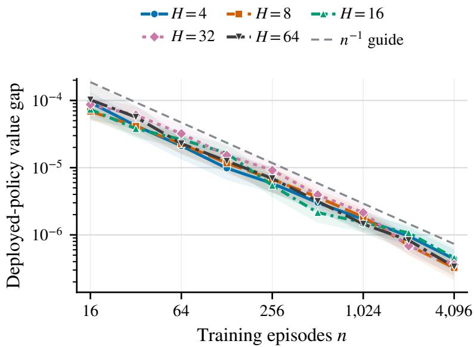
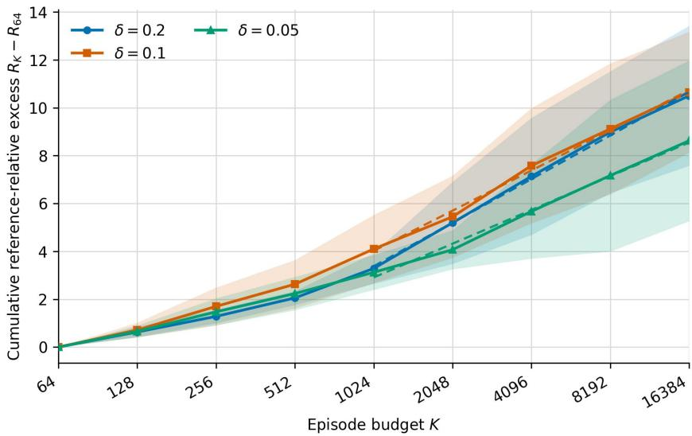
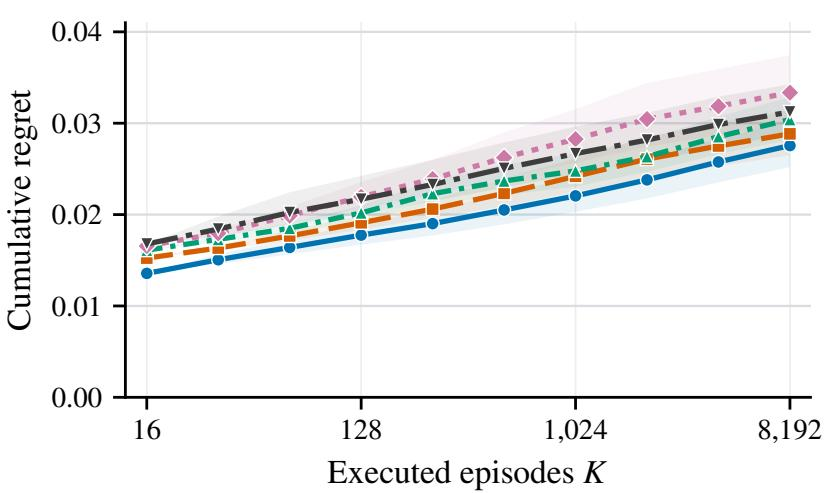
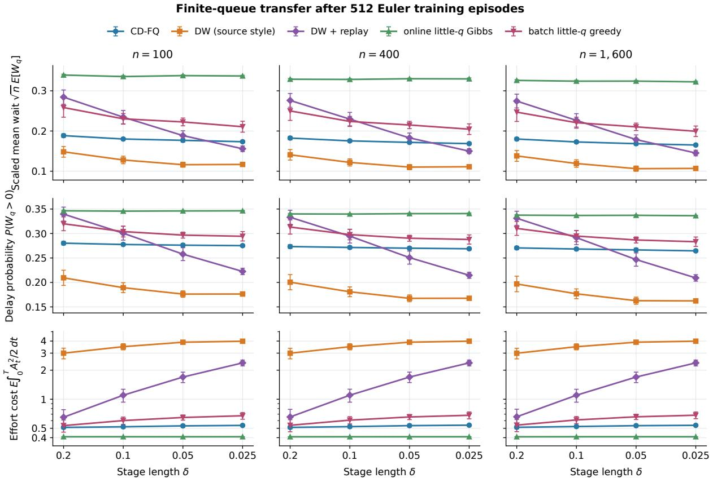

# Frequency-Uniform Log-Regret Reinforcement Learning for Difusions

Jose Blanchet∗

Lutong Hao∗

Renyuan Xu∗

October 26, 2026

## Abstract

High-frequency control problems are often studied through time discretization, but refining the timestep δ increases the discrete horizon H = T/δ and can make standard finite-horizon regret guarantees deteriorate even when the physical horizon T is fixed. We study episodic valuebased reinforcement learning for Euler discretizations of controlled difusions. The performance is measured as the cumulative regret over K episodes relative to the optimal policy of the corresponding Euler model. Under stability and regularity conditions on value function gradients, Bellman residual derivatives, and fitted critics, we prove an O(log K) regret bound with constants uniform in δ. For dynamics with drift linear in unknown parameters and unknown constant difusion covariance, we verify localized versions of these conditions for a constrained, model-based controlled-difusion fitted-Q algorithm (CD-FQ) and obtain high-probability O(log K log log K) regret for fixed and finite T, again with constants uniform in δ.

## 1 Introduction

A learning guarantee for a stochastic control system should distinguish between how long the system operates and how often its decisions are updated. In a service system controlled over a fixed planning period, halving the time between interventions doubles the number of decision stages but leaves the physical duration unchanged. A regret bound polynomial in the stage count can therefore predict an arbitrarily large learning cost as the decision grid is refined. This sensitivity matters when choosing how frequently to observe, learn, and act: it obscures whether a performance guarantee reflects the dificulty of controlling the system or the temporal resolution used to describe it. Our objective is to identify conditions under which value-based reinforcement learning retains fast regret guarantees as that resolution increases.

Sequential decision problems arise throughout science and engineering whenever present actions afect the uncertain evolution of a system. Examples include treatment planning (Wang et al. 2024), robotic control (Djeumou et al. 2023), inventory (Dai and Yao 2013), service operations (Ward and Kumar 2008), and financial decisions (Pham 2009). Reinforcement learning for queueing networks (Dai and Gluzman 2022) and optimal execution in financial markets (Wang et al. 2026a) illustrate the value of exploiting the structure of the underlying stochastic dynamics in the context of learning. This perspective motivates our focus on controlled difusions, which provide tractable approximations of complex operational systems by capturing the aggregate efects of their random events (Harrison and Van Mieghem 1997, Braverman et al. 2020). These models also provide a foundation for stochastic control (Ata et al. 2026) and continuous-time reinforcement learning (Wang et al. 2020).

We study episodic value-based learning for Euler discretizations of controlled difusions in continuous state and action spaces. Over a fixed physical horizon T, a timestep δ produces $H = T / \delta$ decision stages per episode. The learner uses data from previous episodes to select policies and is evaluated by cumulative conditional expected regret relative to the optimal policy of the same Euler model.

Existing finite-horizon analyses can achieve logarithmic regret in the number of episodes while retaining polynomial dependence on H. For example, the leading fast-rate term in the online fitted-Q guarantee of Duan and Wainwright (2024) contains an $H ^ { 4 }$ factor. Substituting $H = T / \delta$ gives a polynomial penalty in $1 / \delta$ at fixed T, because it tracks only the number of stages and not how one-step rewards and state increments scale with the timestep. This raises a distinct question:

How can we design online learning algorithms that retain fast rate and log regret as the observation and decision frequency increases?

The question is particularly delicate for value-based learning. Because an action is held for only one timestep, its efect on the one-step value and the action-dependent diferences in the ordinary Q-function are of order δ. Learning must therefore resolve a shrinking action signal while controlling error propagation across $T / \delta$ stages, and keep the deployed policies informative. This scaling also motivates advantage-rate representations and continuous-time q-learning (Tallec et al. 2019, Jia and Zhou 2023).

## 1.1 Our work and contributions

We develop a regret framework that guides the design and analysis of a fitted-Q algorithm.

A discrete-to-continuous fast-regret framework. We formulate episodic value-based learning for a family of Euler models indexed by the timestep δ, separating episode count, physical horizon, and decision frequency, and placing discrete-time regret analysis and difusion control in a common framework. The benchmark is the optimum of the corresponding Euler model, so statistical learning regret remains distinct from continuous-time discretization error (Section 2). Our bounds concern statistical performance at fixed physical horizon; the number of observations and the computationa efort can still grow as the grid is refined.

Discretization-uniform logarithmic regret. We formulate criteria on fitted critics that are suficient for fast regret, separating the policy-performance argument from algorithm-specific verification (Criterion 1 and Criterion 2a). Under quadratic advantage and value-gradient stability conditions, Bellman-residual derivatives of order $\delta / \sqrt { k }$ after k episodes yield critic action-gradient errors of the same order, with constants governed by physical time. Quadratic policy loss then gives

$\mathcal { O } ( \delta / \sqrt { k } )$ action-gradient error $\implies \mathcal { O } ( \delta / k )$ loss per stage $\implies \mathcal { O } ( T / k )$ loss per episode.

Summing over episodes gives O(log K) regret for fixed T, with constants uniform in δ (Theorem 2.7). An explicit fitted-critic construction shows that exponential growth in T of the logarithmic-regret coeficient is unavoidable for a guarantee uniform over this general class (Proposition 2.10).

End-to-end learning to verify ${ \widetilde { \mathcal { O } } } ( \log K )$ regret. For controlled difusions with drift linear in unknown parameters and unknown constant difusion covariance, we develop a constrained, model-based fitted-Q algorithm (CD-FQ) that permits finitely many separated optimal branch points. It estimates the drift parameter by projected least squares and the covariance from residual increments, simulates from the fitted Euler model, fits constrained critics backward from the terminal reward (a discrete analogue of solving the HJB equation), and chooses a policy greedily. Under regularity, exploration, approximation, and simulation-budget conditions, it achieves high-probability O(log K log log K) regret with constants uniform in δ (Theorem 3.5). The analysis jointly establishes critic accuracy and the continued self-exploration property of the greedy policies.

Verification and numerical evidence. A model with two optimal branches jointly verifies all assumptions of the learning theorem (Section 5.1). Queueing experiments examine cumulative regret, stability under timestep refinement, and transfer of learned difusion policies to finite many-server queues (Section 5.2). These experiments extend beyond the theorem’s smoothness, boundedness, and action-space assumptions and assess the practical value of exploiting difusion structure.

## 1.2 Related work

Stability and fast rates in discrete-time RL. The closest fast-rate analyses are Duan and Wainwright (2024) and Wang et al. (2026b). Duan and Wainwright (2024) obtain quadratic performance bounds and fast ofline and online rates through Bellman and occupation-measure stability. Wang et al. (2026b) study value-based RL in discounted stochastic control with continuous actions. They prove an $\mathcal { O } ( n ^ { - 1 } )$ ) expected policy gap for the deployed policy, where n indexes estimator accuracy and may represent sample size, but without an end-to-end online algorithm. Our analysis shares a related quadratic error-to-loss mechanism and tracks how derivative bounds on stagewise Bellman residuals propagate through the finite-horizon recursion. Under the stated conditions, this gives logarithmic cumulative online regret with constants uniform in δ at the fixed physical horizon T. The regret bounds in Duan and Wainwright (2024) retain polynomia dependence on the number of decision stages H, which does not by itself establish uniformity as δ decreases at fixed T. Our bound establishes this uniformity while having exponential dependence on T, sharp under our assumptions (Proposition 2.10).

Episodic learning in continuous time. The square-root regret bounds for jump processes in Gao and Zhou (2026) and fast rates for structured difusions in Basei et al. (2022), Szpruch et al. (2026) highlight the role of structure and information in continuous-time learning. In particular, Szpruch et al. (2026) distinguish explicit exploration from self-exploration, where greedy exploitation supplies informative data. Guo et al. (2023) analyze episodic learning for linear-convex jump-difusions through stability of feedback controls, linking least-squares estimation error to sublinear regret. For exploratory finite-horizon linear-quadratic control, Giegrich et al. (2024) establish convergence of policy-gradient methods with guarantees that remain stable as the action frequency increases. We develop this mechanism for fitted critics with approximation error and multiple optimal branch points, extending the scope under diferent model and regularity assumptions.

Continuous-time q-learning and function approximation. For deterministic policies, Cheng et al. (2025) derive a continuous-time policy gradient via an advantage-rate function, leading to a model-free algorithm stable across time discretizations. The exploratory-control framework of Wang et al. (2020) and continuous-time q-learning of Jia and Zhou (2023) replace vanishing one-step action gaps with instantaneous advantages. Recent work establishes regret guarantees for exploratory policy improvement and q-learning (Tang and Zhou 2024), as well as model-free, of-policy guarantees for value and advantage approximation (Mou 2026). We instead study cumulative online regret for deterministic greedy fitted-Q policies and verify the required derivative accuracy for a learned parametric difusion.

Discretization and continuous-time approximation. A related line of work asks how well discrete-time procedures recover their continuous-time counterparts. Approximating continuous-time stochastic control by discrete models has a classical foundation in numerical stochastic control (Kushner and Dupuis 2001). PhiBE (Zhu 2024) and the high-order Bellman schemes of Mou and Zhu (2026) evaluate policies from discretely observed difusion trajectories, and Optimal-PhiBE (Zhu et al. 2025) and PhiBE-Q-Learning (Zhu and Ren 2026) carry this PDE-based approach over to policy optimization and of-policy learning. On the implementation side, Jia et al. (2026) quantify the error of executing a continuous-time stochastic policy by resampling actions on a grid, and Pham et al. (2026) bound the gap between regularized discrete-time Bellman problems and the underlying continuous-time control problem. In each case the quantity of interest is an approximation error, whether of a value function, policy, or execution scheme. We ask a diferent question: how much cumulative regret an online learner incurs against the Euler optimum at step size δ, with bounds that hold uniformly in δ.

Roadmap. The rest of the paper is organized as follows. Section 2 develops the residual-to-regret framework. Section 3 introduces our method and states its main regret guarantee, proved in Section 4. Section 5 presents numerical experiments. The appendices provide supporting proofs and implementation details, with notation and constants summarized in Appendix F for ease of reference.

## 2 From Bellman residuals to logarithmic regret

We formulate the Euler learning problem and identify suficient conditions for discretization-uniform fast regret. The argument combines three ingredients: the benchmark inequalities in Assumption A.3, fitted-envelope regularity in Criterion 1, and Bellman residual derivative control in Criterion 2a. Together they give the general regret-transfer result in Theorem 2.7. The later sections establish a localized version of this mechanism for a constrained fitted-Q algorithm (CD-FQ).

Fix a physical horizon $T > 0$ , a state space $\mathbb { R } ^ { n }$ , and a nonempty, compact, convex action set $A \subset \mathbb { R } ^ { d }$ . Consider the controlled difusion

$$
\mathrm { d } \bar { X } _ { t } ^ { \alpha } = \mu ^ { \star } ( \bar { X } _ { t } ^ { \alpha } , \alpha _ { t } ) \mathrm { d } t + ( \Sigma ^ { \star } ) ^ { 1 / 2 } \mathrm { d } B _ { t } , \qquad \bar { X } _ { 0 } ^ { \alpha } \sim p _ { 0 } , \quad 0 \leq t \leq T .
$$

Here B is an n-dimensional Brownian motion on a filtered probability space $( \Omega , \mathcal { F } , ( \mathcal { F } _ { t } ) , \mathbb { P } )$ satisfying the usual conditions, $\bar { X } _ { 0 } ^ { \alpha }$ is ${ \mathcal { F } } _ { 0 } .$ -measurable, and $\alpha = ( \alpha _ { t } ) _ { 0 \leq t \leq T }$ is an A-valued, $( \mathcal { F } _ { t } ) \ –$ progressively measurable control process. The drift $\mu ^ { \star } : \mathbb { R } ^ { n } \times \mathcal { A }  \mathbb { R } ^ { n }$ and constant covariance $\Sigma ^ { \star } \in \mathbb { R } ^ { n \times n } , \Sigma ^ { \star } \succeq 0$ , are unknown. The running reward is $r ( x , a )$ , and the terminal reward is $u ( x )$ Fix a maximum timestep $\delta _ { \mathrm { m a x } } > 0$ . We call a timestep δ admissible if $0 < \delta \leq \delta _ { \mathrm { m a x } }$ and $T / \delta \in \mathbb { N }$ The ceiling is the range over which our assumptions hold uniformly; it does not depend on the episode budget or confidence levels and is fixed when comparing physical horizons.

Our learning model is the Euler discretization with an admissible timestep δ, $H : = T / \delta$ , and grid times $t _ { h } = h \delta$ . Freezing the drift at the observed state $X _ { h }$ and chosen action $A _ { h }$ over $[ t _ { h } , t _ { h + 1 } )$ gives

$$
X _ { h + 1 } = X _ { h } + \delta \mu ^ { \star } ( X _ { h } , A _ { h } ) + \sqrt { \delta } \left( \Sigma ^ { \star } \right) ^ { 1 / 2 } \xi _ { h + 1 } , \qquad X _ { 0 } \sim p _ { 0 } ,
$$

where $\xi _ { h + 1 } \sim \mathcal { N } ( 0 , I _ { n } )$ is independent of all information available when $A _ { h }$ is chosen. Thus the Euler transition kernel is

$$
P ^ { \star } ( \cdot \mid x , a ) = \mathcal { N } \left( x + \delta \mu ^ { \star } ( x , a ) , \delta \Sigma ^ { \star } \right) ,\tag{1}
$$

with its δ-dependence suppressed. This kernel generally difers from the exact sampled difusion law. The one-step reward $\delta r ( x , a )$ approximates the running reward over one interval, and $u ( X _ { H } )$ is paid at time $T .$

A deterministic Markov policy is a sequence $\pi = \left( \pi _ { 0 } , \ldots , \pi _ { H - 1 } \right)$ of Borel maps $\pi _ { h } : \mathbb { R } ^ { n } \to { \mathcal { A } }$ with $A _ { h } = \pi _ { h } ( X _ { h } )$ . Each episode uses a fresh initial state from $p _ { 0 }$ and fresh transition noises, independent of preceding episodes. The expected Euler return is

$$
J _ { \delta } ( \pi ) = \mathbb { E } _ { \pi } \left[ \sum _ { h = 0 } ^ { H - 1 } \delta r ( X _ { h } , A _ { h } ) + u ( X _ { H } ) \right] .
$$

For any transition kernel $P ,$ write $\mathcal { P }$ for its associated expectation operator:

$$
( { \mathcal { P } } v ) ( x , a ) : = \int _ { \mathbb { R } ^ { n } } v ( x ^ { \prime } ) P ( d x ^ { \prime } \mid x , a ) .
$$

The Bellman recursion starts from $V _ { H } ^ { \star } = u$ and proceeds backward via

$$
Q _ { h } ^ { \star } ( x , a ) = \delta r ( x , a ) + ( \mathcal { P } ^ { \star } V _ { h + 1 } ^ { \star } ) ( x , a ) , \qquad V _ { h } ^ { \star } ( x ) = \operatorname* { m a x } _ { a \in \mathcal { A } } Q _ { h } ^ { \star } ( x , a ) , \qquad h = H - 1 , \ldots , 0 .
$$

The following standing assumption ensures that this recursion is well defined.

Assumption A.1 (Well-posedness, reward growth, and moments). The following conditions hold uniformly over the admissible timesteps.

(i) There is a function $W : \mathbb { R } ^ { n } \to [ 1 , \infty )$ and constants $B _ { r } , B _ { u } \ge 0$ such that

$$
| r ( x , a ) | \leq B _ { r } W ( x ) , \qquad | u ( x ) | \leq B _ { u } W ( x ) , \qquad \int W ( x ) p _ { 0 } ( d x ) < \infty .
$$

(ii) For some $c _ { W } \geq 0$ , the kernel (1) satisfies

$$
\int W ( y ) P ^ { \star } ( d y \mid x , a ) \leq ( 1 + c _ { W } \delta ) W ( x ) , \qquad x \in \mathbb { R } ^ { n } , \ a \in { \mathcal { A } } .\tag{2}
$$

(iii) The functions $r , u , \mu ^ { \star }$ , and W are continuous, and so is $\begin{array} { r } { ( x , a ) \mapsto \int W ( y ) P ^ { \star } ( d y \mid x , a ) } \end{array}$

Under Assumption $\mathrm { A . 1 }$ , the Bellman recursion gives finite, continuous optimal critics and value functions satisfying $| Q _ { h } ^ { \star } ( x , a ) | , | V _ { h } ^ { \star } ( x ) | \leq C _ { h } W ( x )$ for finite constants $C _ { h }$ . The action maxima are attained, and an optimal deterministic Borel Markov policy exists. Iterating (2) gives $\mathbb { E } _ { \pi } W ( X _ { h } ) \le$ $e ^ { c _ { W } t _ { h } } \int W d p _ { 0 }$ , so every value-to-go is integrable. $\begin{array} { r } { | J _ { \delta } ( \pi ) | \le B _ { J } : = ( T B _ { r } + B _ { u } ) e ^ { c _ { W } T } \int W d p _ { 0 } } \end{array}$ for all policies and timesteps, and

$$
J _ { \delta } ^ { \star } = \int V _ { 0 } ^ { \star } d p _ { 0 } = \operatorname* { s u p } _ { \pi } J _ { \delta } ( \pi ) .
$$

Bounded rewards are the case $W \equiv 1 , c _ { W } = 0$ . Later on, Remark 3.1 verifies the conditions with $W ( x ) = \sqrt { 1 + \| x \| ^ { 2 } }$ in the localized model.

For the derivative-based analysis below, fix an open neighborhood ${ \mathcal { A } } ^ { \mathrm { o } } \supset { \mathcal { A } } .$

Assumption A.2 (Diferentiable drift and reward). The drift $\mu ^ { \star }$ and running reward r admit $C ^ { 1 }$ extensions to $\mathbb { R } ^ { n } \times \mathcal { A } ^ { \mathrm { o } }$ . There are finite constants $L _ { \mu , x }$ and $\scriptstyle L _ { \mu , a }$ such that

$$
\operatorname* { s u p } _ { ( x , a ) \in \mathbb { R } ^ { n } \times \mathcal { A } ^ { \mathrm { o } } } \| \partial _ { x } \mu ^ { \star } ( x , a ) \| _ { \mathrm { o p } } \leq L _ { \mu , x } , \qquad \operatorname* { s u p } _ { ( x , a ) \in \mathbb { R } ^ { n } \times \mathcal { A } ^ { \mathrm { o } } } \| \partial _ { a } \mu ^ { \star } ( x , a ) \| _ { \mathrm { o p } } \leq L _ { \mu , a } .\tag{3}
$$

Before episode $k ,$ , the learner selects $\pi _ { k }$ using prior data and internal randomization. Conditional on this information, ${ \cal J } _ { \delta } ( \pi _ { k } )$ averages over fresh episode randomness. The cumulative regret is

$$
\operatorname { R e g } ( K , \delta ) = \sum _ { k = 1 } ^ { K } \left\{ J _ { \delta } ^ { \star } - J _ { \delta } ( \pi _ { k } ) \right\} .\tag{4}
$$

We study this Euler-model regret as K and δ vary with T fixed.

In what follows, we adopt a value-based reinforcement learning approach: after constructing an estimated critic sequence with each $\widehat { Q } _ { h } \in C ^ { 1 } ( \mathbb { R } ^ { n } \times A ^ { \mathrm { o } } )$

$$
\widehat { Q } = ( \widehat { Q } _ { 0 } , \ldots , \widehat { Q } _ { H - 1 } ) ,
$$

define the following greedy policy $\widehat { \pi }$ based on $\widehat { Q } \mathtt { i }$

$$
{ \widehat { \pi } } _ { h } ( x ) \in \mathop { \mathrm { a r g } } _ { a \in { \mathcal { A } } } \widehat { Q } _ { h } ( x , a ) .
$$

## 2.1 Policy loss from critic action-gradient error

## 2.1.1 Optimal advantage performance diference

Our analysis starts from an exact performance-diference identity under the trajectory law of the candidate policy. The optimal-advantage loss $V _ { h } ^ { \star } ( x ) - Q _ { h } ^ { \star } ( x , a ) \geq 0$ is the one-stage loss from taking action a at state x, followed by optimal continuation.

Lemma 2.1 (Optimal-advantage performance-diference identity). Under Assumption A.1, every deterministic Borel Markov policy π satisfies

$$
J _ { \delta } ^ { \star } - J _ { \delta } ( \pi ) = \sum _ { h = 0 } ^ { H - 1 } \mathbb { E } _ { \pi } \left[ V _ { h } ^ { \star } ( X _ { h } ) - Q _ { h } ^ { \star } \big ( X _ { h } , \pi _ { h } ( X _ { h } ) \big ) \right] .\tag{5}
$$

Proof. See Appendix A.1.

This is the sign-reversed optimal-benchmark form of the classical performance-diference lemma (Kakade and Langford 2002). It involves only ${ V } _ { h } ^ { \star } , \ { Q } _ { h } ^ { \star }$ , and the law of $\pi ,$ so it needs no choice of optimal policy and allows nonunique maximizers

## 2.1.2 Benchmark inequalities and quadratic policy loss

By Lemma 2.1, the suboptimality of a policy is the sum of its stagewise optimal-advantage losses.   
Two benchmark properties of $Q ^ { \star }$ in Assumption A.3 make these losses small for greedy policies.

Together with the fitted-envelope regularity and residual control in Criterion 1 and Criterion 2a, these properties give the fast-rate mechanism. For a fixed physical horizon $T _ { \ast }$ , the backward recursion converts $\mathcal { O } ( \delta / \sqrt { k } )$ Bellman-residual derivatives into critic action-gradient error of the same order. The quadratic loss bound then squares this error at the cost of a factor $1 / \delta$ before the $H = T / \delta$ stages add up:

$$
\begin{array} { l } { { \mathrm { r e s i d u a l ~ d e r i v a t i v e ~ } { \cal O } \bigl ( \frac { \delta } { \sqrt { k } } \bigr ) \Rightarrow \mathrm { a c t i o n - g r a d i e n t ~ e r r o r ~ } { \cal O } \bigl ( \frac { \delta } { \sqrt { k } } \bigr ) } } \\ { { \Rightarrow \mathrm { s t a g e ~ l o s s ~ } { \cal O } \bigl ( \frac { \delta } { k } \bigr ) \Rightarrow \mathrm { e p i s o d e ~ l o s s ~ } { \cal O } \bigl ( \frac { T } { k } \bigr ) . } } \end{array}
$$

Summing over $K$ episodes gives logarithmic regret, uniformly in $\delta$ when the benchmark, drift, and normalized residual constants are.

To include actions on the boundary of A, define the maximization normal cone

$$
N _ { \mathit { A } } ( a ) : = \{ v \in \mathbb { R } ^ { d } : \langle v , b - a \rangle \leq 0 \mathrm { ~ f o r ~ e v e r y ~ } b \in \mathcal { A } \} .
$$

If a diferentiable function $q$ is maximized at a over the convex set ${ \mathcal { A } } ,$ first-order optimality gives $\nabla q ( a ) \in N _ { \cal A } ( a )$

Using the extensions in Assumption A.2, define the canonical critic on the open action neighborhood by

$$
\begin{array} { r } { Q _ { h } ^ { \star } ( x , a ) : = \delta r ( x , a ) + ( { \mathcal P } ^ { \star } V _ { h + 1 } ^ { \star } ) ( x , a ) , \qquad ( x , a ) \in { \mathbb R } ^ { n } \times \mathcal { A } ^ { \circ } , } \end{array}\tag{6}
$$

where the Gaussian kernel uses the corresponding extension of the drift; it agrees with the Bellman critic on $\mathbb { R } ^ { n } \times \mathcal { A }$ . When it is diferentiable, its normal-cone stationarity residual is

$$
d _ { h } ( x , a ) : = \mathrm { d i s t } \big ( \nabla _ { a } Q _ { h } ^ { \star } ( x , a ) , N _ { A } ( a ) \big ) .\tag{7}
$$

Assumption A.3 (Quadratic advantage and value-gradient stability). For every $h \ < \ H$ , the canonical critic in (6) is finite and belongs to $C ^ { 1 } ( \mathbb { R } ^ { n } \times \mathcal { A } ^ { \mathrm { o } } )$ , and its optimal envelope $V _ { h } ^ { \star }$ belongs to $C ^ { 1 } ( \mathbb { R } ^ { n } )$ . There are constants $\bar { m } > 0$ and $0 \leq \kappa < \infty$ , independent of h and the admissible timestep $\delta ,$ such that, for every $x \in \mathbb { R } ^ { n }$ and $a \in { \mathcal { A } }$

$$
V _ { h } ^ { \star } ( x ) - Q _ { h } ^ { \star } ( x , a ) \leq \frac { d _ { h } ( x , a ) ^ { 2 } } { 2 \delta \bar { m } } ,\tag{8}
$$

$$
\| \nabla _ { x } Q _ { h } ^ { \star } ( x , a ) - \nabla V _ { h } ^ { \star } ( x ) \| \leq \kappa d _ { h } ( x , a ) .\tag{9}
$$

The two inequalities play diferent roles: The first converts stationarity error into quadratic optimal-advantage loss; the second controls the efect of action selection on the value gradient, so value errors can propagate backward through the Bellman recursion in Theorem 2.7.

At any optimal action $a ^ { \star }$ , first-order optimality gives $d _ { h } ( x , a ^ { \star } ) = 0$ , so (9) gives

$$
\nabla V _ { h } ^ { \star } ( x ) = \nabla _ { x } Q _ { h } ^ { \star } ( x , a ^ { \star } ) , \qquad a ^ { \star } \in \arg \operatorname* { m a x } _ { a \in \mathcal { A } } Q _ { h } ^ { \star } ( x , a ) .\tag{10}
$$

These requirements allow nonunique optimal actions. They are stated here on the full action set; Section 3 uses them inside optimal bins by proving that fitted greedy actions enter those bins. Strong concavity with mixed-gradient control is one suficient condition to Assumption A.3:

Proposition 2.2 (Strong concavity and mixed-gradient control). Suppose that for every $h < H$ the canonical critic in (6) is finite and belongs to $C ^ { 1 } ( \mathbb { R } ^ { n } \times A ^ { \mathrm { o } } )$ , and that there are constants $\bar { m } > 0$ and $0 \leq \bar { L } _ { x a } < \infty$ , independent of h and $\delta ,$ such that $Q _ { h } ^ { \star } ( x , \cdot )$ is δm¯ -strongly concave and $\nabla _ { x } Q _ { h } ^ { \star } ( x , \cdot )$ is $\delta \bar { L } _ { x a } . . L i p s c h i t z$ on A: for every $x \in \mathbb { R } ^ { n }$ and $a , b \in { \mathcal { A } }$

$$
\begin{array} { r l } & { \langle \nabla _ { a } Q _ { h } ^ { \star } ( x , a ) - \nabla _ { a } Q _ { h } ^ { \star } ( x , b ) , a - b \rangle \leq - \delta \bar { m } \| a - b \| ^ { 2 } , } \\ & { \qquad \| \nabla _ { x } Q _ { h } ^ { \star } ( x , a ) - \nabla _ { x } Q _ { h } ^ { \star } ( x , b ) \| \leq \delta \bar { L } _ { x a } \| a - b \| . } \end{array}
$$

Then $V _ { h } ^ { \star } \in C ^ { 1 } ( \mathbb { R } ^ { n } )$ for every $h < H$ and satisfies (10). Assumption A.3 holds with the same m¯ and $\kappa = \bar { L } _ { x a } / \bar { m }$

Proof. See Appendix A.2.

Remark 2.3 (Explanation of the curvature scaling). The factors of δ match the Hamiltonian expansion of the Euler critic. Under smoothness and uniform derivative bounds justifying the expansion and its action derivatives,

$$
\begin{array} { r } { Q _ { h } ^ { \star } ( x , a ) = V _ { h + 1 } ^ { \star } ( x ) + \delta \left\{ r ( x , a ) + \mu ^ { \star } ( x , a ) ^ { \top } \nabla V _ { h + 1 } ^ { \star } ( x ) + \frac { 1 } { 2 } \operatorname { t r } \bigl ( \Sigma ^ { \star } \nabla ^ { 2 } V _ { h + 1 } ^ { \star } ( x ) \bigr ) \right\} + o ( \delta ) . } \end{array}
$$

Uniform action-curvature and mixed-derivative bounds on the bracketed term thus give the order-δ scales in Proposition 2.2 when the remainder derivatives are controlled.

At greedy actions, the stationarity residual $d _ { h }$ is controlled by the critic’s action-gradient error.

Corollary 2.4 (Performance of the greedy policy). Under Assumption A.3, whenever the squared gradient errors below are integrable,

$$
J _ { \delta } ^ { \star } - J _ { \delta } ( \widehat { \pi } ) \leq \frac { 1 } { 2 \delta \bar { m } } \sum _ { h = 0 } ^ { H - 1 } \mathbb { E } _ { \widehat { \pi } } \left[ \left. \nabla _ { a } \bigl ( \widehat { Q } _ { h } - Q _ { h } ^ { \star } \bigr ) \bigl ( X _ { h } , \widehat { \pi } _ { h } ( X _ { h } ) \bigr ) \right. ^ { 2 } \right] .
$$

Proof. Fix $h < H$ and $x \in \mathbb { R } ^ { n }$ , and set $\widehat { a } = \widehat { \pi } _ { h } ( x )$ . Since $\widehat { Q } _ { h } ( x , \cdot )$ is diferentiable on an open neighborhood of A and is maximized at ${ \widehat { a } } .$ , first-order optimality on the convex set A gives $\nabla _ { a } \widehat { Q } _ { h } ( x , \widehat { a } ) \in N _ { \cal A } ( \widehat { a } )$ Using this normal vector in the distance defining $d _ { h }$ gives

$$
d _ { h } ( x , \widehat { a } ) \leq \left\| \nabla _ { a } ( \widehat { Q } _ { h } - Q _ { h } ^ { \star } ) ( x , \widehat { a } ) \right\| .
$$

This estimate requires no curvature assumption. Substitution into (8) gives

$$
V _ { h } ^ { \star } ( x ) - Q _ { h } ^ { \star } ( x , \widehat { a } ) \leq \frac { 1 } { 2 \delta \bar { m } } \left\| \nabla _ { a } \big ( \widehat { Q } _ { h } - Q _ { h } ^ { \star } \big ) ( x , \widehat { a } ) \right\| ^ { 2 } .\tag{11}
$$

The squared gradient errors are Borel measurable because ${ \widehat { Q } } _ { h }$ and $Q _ { h } ^ { \star }$ are $C ^ { 1 }$ and $\widehat { \pi } _ { h }$ is Borel. Taking expectations in (11), using the assumed integrability, and summing over h gives the result by Lemma 2.1, which applies under the standing Assumption A.1. □

The factor $1 / \delta$ is the scale of (8). The performance estimate needs action-gradient accuracy only at selected actions along the learned policy’s trajectories. In particular, it imposes no concavity on ${ \widehat { Q } } _ { h }$

## 2.2 Residual accuracy and regret transfer

The performance estimate reduces regret control to bounding critic action-gradient errors at the selected actions. We bound these by derivatives of the Bellman residuals under the true kernel. The Euler structure and value-gradient stability control the backward propagation, independently of how the fitted critics were constructed.

## 2.2.1 Fitted critics and true residual certificates

Let $\mathcal { G } _ { k }$ be the sigma-field generated by real data through episode k and all auxiliary randomness in the fitted-Q update. In this subsection and Section 2.2.2, we condition on $\mathcal { G } _ { k }$ , fixing a critic sequence $\widehat { Q } _ { k }$ , its greedy envelope, and the greedy policy $\pi _ { k + 1 }$ for episode $k + 1$ . Expectations are over a fresh episode under the true kernel.

We separate fitted-envelope regularity (Criterion 1) from residual accuracy (Criterion 2a); the localized construction keeps the former and replaces the latter by the two-scale certificate of Criterion 2b, introduced in Section 3.3.

Criterion 1 (Fitted-envelope regularity). Fix an update index k. A fitted critic sequence $\widehat { Q } _ { k } =$ $( \widehat { Q } _ { k , 0 } , \ldots , \widehat { Q } _ { k , H - 1 } )$ satisfies the fitted-envelope regularity criterion if, for every $h < H$ 2

(i) $\widehat { Q } _ { k , h }$ has a $C ^ { 1 }$ extension to $\mathbb { R } ^ { n } \times \mathcal { A } ^ { \mathrm { o } }$ ;

(ii) its full-action envelope belongs to $C ^ { 1 } ( \mathbb { R } ^ { n } )$

$$
\widehat { V } _ { k , h } ( x ) : = \operatorname* { m a x } _ { a \in A } \widehat { Q } _ { k , h } ( x , a ) \in C ^ { 1 } ( \mathbb { R } ^ { n } ) .
$$

At the terminal stage, set $\widehat { V } _ { k , H } : = u$

Criterion 1 supplies the diferentiability used by the envelope identity and backward transfer; it is verified for the algorithm in Proposition 4.1.

Lemma 2.5 (Greedy policy and envelope identity). Suppose Criterion 1 holds. Then there exists a deterministic Borel Markov policy $\pi _ { k + 1 }$ satisfying, for every $h < H$ and $x \in \mathbb { R } ^ { n }$

$$
\pi _ { k + 1 , h } ( x ) \in \mathop { \mathrm { a r g } } _ { a \in \mathcal { A } } \widehat { Q } _ { k , h } ( x , a ) .\tag{12}
$$

For each such h and $x ,$ every maximizing action $^ { a , }$ including the $\pi _ { k + 1 , h } ( x )$ , also satisfies

$$
\nabla \widehat { V } _ { k , h } ( x ) = \nabla _ { x } \widehat { Q } _ { k , h } ( x , a ) .\tag{13}
$$

Proof. See Appendix A.3.

Define the true Bellman residual of the realized fitted critic by

$$
\begin{array} { r } { e _ { k , h } ( x , a ) : = \delta r ( x , a ) + ( \mathcal { P } ^ { \star } \widehat { V } _ { k , h + 1 } ) ( x , a ) - \widehat { Q } _ { k , h } ( x , a ) , \qquad h < H . } \end{array}\tag{14}
$$

Its extension to $\mathbb { R } ^ { n } \times \mathcal { A } ^ { \mathrm { o } }$ is the same Bellman expression with the fixed extensions of drift, reward, and critic; Criteria 2a and 2b require it to be finite, so the next-stage fitted value is absolutely integrable, and $C ^ { 1 }$ . Set

$$
\Delta Q _ { k , h } : = \widehat { Q } _ { k , h } - Q _ { h } ^ { \star } , \qquad \Delta V _ { k , h } : = \widehat { V } _ { k , h } - V _ { h } ^ { \star } , \qquad \Delta V _ { k , H } = 0 .
$$

Criterion 2a (Bellman-residual derivative certificate). Suppose Criterion 1 holds, and choose the greedy policy in (12). For nonnegative radii $d _ { x , k }$ and $d _ { a , k }$ independent of $\delta ,$ we say that the fitted critic sequence satisfies a true-residual derivative certificate at the selected greedy actions if every $e _ { k , h }$ has a $C ^ { 1 }$ extension to $\mathbb { R } ^ { n } \times \mathcal { A } ^ { \mathrm { o } }$ and

$$
\operatorname* { s u p } _ { h < H } \operatorname* { s u p } _ { x \in \mathbb { R } ^ { n } } \left\| \nabla _ { x } e _ { k , h } \big ( x , \pi _ { k + 1 , h } ( x ) \big ) \right\| \leq \delta d _ { x , k } , \qquad \operatorname* { s u p } _ { h < H } \operatorname* { s u p } _ { x \in \mathbb { R } ^ { n } } \left\| \nabla _ { a } e _ { k , h } \big ( x , \pi _ { k + 1 , h } ( x ) \big ) \right\| \leq \delta d _ { a , k } .\tag{15}
$$

The radii may be $\mathcal { G } _ { k }$ -measurable; after conditioning on the post-update history, they are fixed numbers.

Criterion 2a controls the state and action residual derivatives at the fitted greedy actions, and supplies the accuracy input to Theorem 2.7. Since $d _ { a , k }$ and $d _ { x , k }$ are independent of $\delta ,$ the derivative bounds scale linearly in δ, matching the Euler scaling of the action and state derivatives in Lemma 2.6. The localized extension uses Criterion 2b to establish bin entry before applying local derivative control; that certificate is verified in Theorem 4.2.

## 2.2.2 Residual derivatives to regret transfer

We now connect the residual derivative bounds in Criterion 2a to regret. In Assumption A.3, value-gradient stability closes a backward recursion for the value-gradient error, and the quadratic advantage bound converts action-gradient error into policy loss. The transfer holds for arbitrary finite residual radii; a root-k rate then gives logarithmic regret in Theorem 2.7. The true residual and critic-error definitions give

$$
\Delta Q _ { k , h } = \mathcal { P } ^ { \star } \Delta V _ { k , h + 1 } - e _ { k , h } .
$$

This identity propagates critic error backward through the true Euler kernel. Since the covariance is constant, diferentiating the kernel acts only through its mean, so action derivatives carry a factor δ and state derivatives are $I _ { n } + { \mathcal { O } } ( \delta )$

Lemma 2.6 (Diferentiation of the Euler kernel). Let $v \in C ^ { 1 } ( \mathbb { R } ^ { n } )$ satisfy $\| \nabla \boldsymbol { v } \| _ { \infty } < \infty$ . Under Assumption A.2, the function $( x , a ) \mapsto ( { \mathcal { P } } ^ { \star } v ) ( x , a )$ belongs to $C ^ { 1 } ( \mathbb { R } ^ { n } \times A ^ { \mathrm { o } } )$ , and

$$
\begin{array} { r l } & { \nabla _ { x } ( \mathcal { P } ^ { \star } v ) ( x , a ) = \{ I _ { n } + \delta \partial _ { x } \mu ^ { \star } ( x , a ) \} ^ { \top } \mathcal { P } ^ { \star } [ \nabla v ] ( x , a ) , } \\ & { \nabla _ { a } ( \mathcal { P } ^ { \star } v ) ( x , a ) = \delta \{ \partial _ { a } \mu ^ { \star } ( x , a ) \} ^ { \top } \mathcal { P } ^ { \star } [ \nabla v ] ( x , a ) . } \end{array}
$$

Proof. See Appendix A.4.

For $\tau \in [ 0 , T ]$ and $L \geq 0$ , define the physical-time propagation factor

$$
\Phi _ { \tau } ( L ) : = \left\{ \frac { e ^ { L \tau } - 1 } { L } , \quad L > 0 , \right.
$$

Theorem 2.7 (Logarithmic regret from root-k residual accuracy). Let $K \geq 2$ . Suppose Assumptions A.2 and A.3 hold. Suppose further that, simultaneously for every update $k = 1 , \ldots , K - 1$ , the fitted critic satisfies Criterion 1 and Criterion 2a with radii obeying

$$
d _ { x , k } \leq \frac { c _ { x } } { \sqrt { k } } , \qquad d _ { a , k } \leq \frac { c _ { a } } { \sqrt { k } } , \qquad k = 1 , \ldots , K - 1 ,\tag{16}
$$

for constants $c _ { x } , c _ { a } \geq 0$ independent of k, K, δ. Set

$$
L _ { E } : = L _ { \mu , x } + \kappa L _ { \mu , a } , \qquad C : = c _ { a } + L _ { \mu , a } \Phi _ { T } ( L _ { E } ) ( c _ { x } + \kappa c _ { a } ) .
$$

Then

$$
\mathrm { R e g } ( K , \delta ) \leq 2 B _ { J } + \frac { T C ^ { 2 } } { 2 \bar { m } } \sum _ { k = 1 } ^ { K - 1 } \frac { 1 } { k } \leq 2 B _ { J } + \frac { T C ^ { 2 } } { 2 \bar { m } } \big ( 1 + \log ( K - 1 ) \big ) .\tag{17}
$$

For fixed T, the bound is O(log K) uniformly over admissible timesteps δ.

Proof. Step 1: residual-to-gradient transfer. Steps 1 and 2 use only that the radii are finite and nonnegative; the rate (16) enters in Step 3. For each update, define

$$
b _ { E , k } : = d _ { x , k } + \kappa d _ { a , k } , \qquad c _ { k } : = d _ { a , k } + L _ { \mu , a } \Phi _ { T } ( L _ { E } ) b _ { E , k } .
$$

Fix an update index k and condition on $\mathcal { G } _ { k }$ as in Section 2.2.1. By Criterion 1 and Assumption A.3, $\Delta V _ { k , h } \in C ^ { 1 } ( \mathbb { R } ^ { n } )$ for $h < H$ , and $\Delta V _ { k , H } = 0$ . Define the possibly infinite quantities

$$
E _ { k , h } : = \operatorname* { s u p } _ { \boldsymbol { x } \in \mathbb { R } ^ { n } } \left\| \nabla \Delta V _ { k , h } ( \boldsymbol { x } ) \right\| .
$$

We prove finiteness and bounds by backward induction from $E _ { k , H } = 0$

Assume that $E _ { k , h + 1 } < \infty$ . Then the $C ^ { 1 }$ value error satisfies

$$
| \Delta V _ { k , h + 1 } ( y ) | \leq | \Delta V _ { k , h + 1 } ( 0 ) | + E _ { k , h + 1 } \| y \| ,
$$

so it is absolutely integrable under every Euler transition, including those with $a \in \mathcal { A } ^ { \mathrm { o } }$ . The optimal value function has finite expectation by Assumption $\mathrm { { A . 3 } ; }$ hence $\widehat { V } _ { k , h + 1 } = V _ { h + 1 } ^ { \star } + \Delta V _ { k , h + 1 }$ is also integrable. This justifies the error identity on the open domain before diferentiating it. The kernel lemma needs only the bounded gradient of $\Delta V _ { k , h + 1 }$ , not of $\widehat { V } _ { k , h + 1 }$ . Applying Lemma 2.6 to $\Delta Q _ { k , h } = \mathcal { P } ^ { \star } \Delta V _ { k , h + 1 } - e _ { k , h }$ gives, on $\mathbb { R } ^ { n } \times \mathcal { A }$ ，

$$
\begin{array} { r l } & { \nabla _ { a } \Delta Q _ { k , h } ( x , a ) = \delta \{ \partial _ { a } \mu ^ { \star } ( x , a ) \} ^ { \top } \mathcal { P } ^ { \star } [ \nabla \Delta V _ { k , h + 1 } ] ( x , a ) - \nabla _ { a } e _ { k , h } ( x , a ) , } \\ & { \nabla _ { x } \Delta Q _ { k , h } ( x , a ) = \{ I _ { n } + \delta \partial _ { x } \mu ^ { \star } ( x , a ) \} ^ { \top } \mathcal { P } ^ { \star } [ \nabla \Delta V _ { k , h + 1 } ] ( x , a ) - \nabla _ { x } e _ { k , h } ( x , a ) . } \end{array}\tag{18}
$$

Fix $x \in \mathbb { R } ^ { n }$ and write $\widehat { a } = \pi _ { k + 1 , h } ( x )$ . The drift bounds (3) and the residual bounds (15) of Criterion 2a imply

$$
\begin{array} { r } { \| \nabla _ { a } \Delta Q _ { k , h } ( x , \widehat { a } ) \| \leq \delta d _ { a , k } + \delta L _ { \mu , a } E _ { k , h + 1 } . } \end{array}\tag{19}
$$

By Lemma 2.5 and (10),

$$
\nabla \Delta V _ { k , h } ( x ) = \nabla _ { x } \Delta Q _ { k , h } ( x , \widehat { a } ) + \nabla _ { x } Q _ { h } ^ { \star } ( x , \widehat { a } ) - \nabla V _ { h } ^ { \star } ( x ) .
$$

Value-gradient stability (9) and the greedy stationarity argument in the proof of Corollary 2.4 give

$$
\| \nabla _ { x } Q _ { h } ^ { \star } ( x , \widehat { a } ) - \nabla V _ { h } ^ { \star } ( x ) \| \leq \kappa d _ { h } ( x , \widehat { a } ) \leq \kappa \| \nabla _ { a } \Delta Q _ { k , h } ( x , \widehat { a } ) \| .
$$

Combining this with (18), the same drift and residual bounds, and (19) gives, for every $x ,$

$$
\begin{array} { r l } & { \| \nabla \Delta V _ { k , h } ( x ) \| \leq \delta d _ { x , k } + ( 1 + \delta L _ { \mu , x } ) E _ { k , h + 1 } + \delta \kappa \big ( d _ { a , k } + L _ { \mu , a } E _ { k , h + 1 } \big ) } \\ & { \qquad = \delta b _ { E , k } + ( 1 + \delta L _ { E } ) E _ { k , h + 1 } . } \end{array}
$$

The right-hand side is finite and independent of x. Taking the supremum therefore gives

$$
E _ { k , h } \le \delta b _ { E , k } + ( 1 + \delta L _ { E } ) E _ { k , h + 1 } < \infty ,\tag{20}
$$

closing the induction. Iterating (20) from $E _ { k , H } = 0$ gives

$$
E _ { k , h } \leq \delta b _ { E , k } \sum _ { j = 0 } ^ { H - h - 1 } ( 1 + \delta L _ { E } ) ^ { j } \leq b _ { E , k } \Phi _ { T - t _ { h } } ( L _ { E } ) \leq b _ { E , k } \Phi _ { T } ( L _ { E } ) .\tag{21}
$$

The geometric-sum bound also holds at $L _ { E } = 0$ by definition of Φ. Substitution into (19) gives

$$
\operatorname* { s u p } _ { x \in \mathbb { R } ^ { n } } \left\| \nabla _ { a } \Delta Q _ { k , h } \big ( x , \pi _ { k + 1 , h } ( x ) \big ) \right\| \leq \delta \left\{ d _ { a , k } + L _ { \mu , a } \Phi _ { T - t _ { h + 1 } } ( L _ { E } ) b _ { E , k } \right\} \leq \delta c _ { k } .\tag{22}
$$

Step 2: one-episode loss and cumulative regret. Conditional on $\mathcal { G } _ { k }$ , each squared action-gradient error is Borel measurable and bounded by $\overline { { \delta ^ { 2 } c _ { k } ^ { 2 } } }$ by (22), hence integrable under the fresh episode law. Thus Corollary 2.4 applies and, using $H \delta = T$ , gives

$$
J _ { \delta } ^ { \star } - J _ { \delta } ( \pi _ { k + 1 } ) \leq \frac { H \delta ^ { 2 } c _ { k } ^ { 2 } } { 2 \delta \bar { m } } = \frac { T } { 2 \bar { m } } c _ { k } ^ { 2 } .
$$

The factor $\delta ^ { 2 }$ therefore cancels both the factor $1 / \delta$ in the quadratic advantage bound and the stage count $H = T / \delta$ . Summing over updates and bounding the initial episode by $2 B _ { J }$ gives, for arbitrary finite radii,

$$
\mathrm { R e g } ( K , \delta ) \leq 2 B _ { J } + \frac { T } { 2 \bar { m } } \sum _ { k = 1 } ^ { K - 1 } c _ { k } ^ { 2 } .\tag{23}
$$

Step 3: root-k rate. By (16), $b _ { E , k } \leq ( c _ { x } + \kappa c _ { a } ) / \sqrt { k }$ , hence $c _ { k } \leq C / \sqrt { k }$ . Substituting into (23) and using $\begin{array} { r } { \sum _ { k = 1 } ^ { K - 1 } k ^ { - 1 } \le 1 + \log ( K - 1 ) } \end{array}$ proves (17). □

Remark 2.8 (Scope of the benchmark inequalities). On the full action set, the quadratic-advantage inequality implies that any action with $d _ { h } ( x , a ) = 0$ is optimal. The proof of Theorem 2.7, however, uses both inequalities in Assumption A.3 only at the fitted greedy actions. Section 3 exploits this by establishing bin entry together with backward transfer, so each selected action lies where the inequalities hold.

Remark 2.9 (Dependence on physical time). The factor in (21) depends on the remaining physical time $T - t _ { h }$ , not on the number of remaining stages, so the recursion introduces no polynomial factor in H when $L _ { \mu , x } , L _ { \mu , a } , \kappa , d _ { x , k } , d _ { a , k }$ are uniform in δ. For $L _ { E } > 0 , \Phi _ { T } ( L _ { E } ) = \mathcal { O } ( e ^ { L _ { E } T } )$ , so the regret bound is $\mathcal { O } ( \bar { T } e ^ { 2 L _ { E } T } \log K )$ , which is discretization-uniform for fixed T. It extends to nonuniform grids with steps $\Delta _ { h } \leq \delta$ (Appendix A.5). By Proposition 2.10, the exponential rate cannot be improved under the hypotheses of Theorem 2.7.

Proposition 2.10 shows that exponential growth of the large-K logarithmic-regret coeficient is unavoidable under these general transfer conditions.

Proposition 2.10 (Sharpness of the residual-to-regret transfer). Fix $\lambda , m , c _ { x } > 0$ . There exist a one-dimensional model with structural constants independent of T and δ, and fitted critics satisfying the hypotheses of Theorem 2.7 with $L _ { E } = \lambda , \bar { m } = m , \kappa = 0 , d _ { x , k } = c _ { x } / \sqrt { k }$ , and $d _ { a , k } = 0$ , whose regret satisfies

$$
\operatorname* { l i m } _ { \delta \downarrow 0 } \operatorname* { l i m } _ { K  \infty } \frac { \mathrm { R e g } ( K , \delta ) } { c _ { x } ^ { 2 } \log K } = \frac { 1 } { 2 m } \int _ { 0 } ^ { T } \Phi _ { t } ( \lambda ) ^ { 2 } d t \sim \frac { e ^ { 2 \lambda T } } { 4 m \lambda ^ { 3 } } \quad ( T  \infty ) ,\tag{24}
$$

where the timestep limit is along admissible refinements at fixed T.

Proof. See Appendix A.6.

The rate is attained with $\kappa = 0$ . This is a sharpness result for bounds derived from the general residual-to-regret transfer, though not a minimax lower bound over learning algorithms. Its unbounded-drift example used in the proof lies outside the localized model class in Section 3.

## 3 Localized learning: algorithm and main result

Section 2 identifies suficient benchmark properties and residual accuracy for fast regret. We now localize the mechanism for a concrete learning algorithm. With several separated optimal branches, the benchmark inequalities may hold only inside unknown bins. The learner still maximizes over the full action set, so the proof must establish that its fitted greedy actions lie in regions where the inequalities apply.

The two-scale residual control in Criterion 2b addresses this requirement. A coarse action-residual bound establishes bin entry jointly with backward transfer. Sharper residual bounds inside the bins then give local gradient control and quadratic policy loss. The local geometry also bounds distance to the optimal-action set, which supports the coverage and self-exploration arguments

across epochs. The algorithm does not use the unknown bins; they enter only in the analysis.   
Table 10 in Appendix F collects the notation and constants used here and in the proof.

## 3.1 Model assumptions and setup

This subsection states the assumptions together with the notation needed. Assumptions A.4 to A.6 restrict the environment; Assumptions A.7, A.8 and A.10 are choices the learner controls; Assumption A.9 links the two. Basic structural consequences are stated alongside these assumptions; verification of fitted-output regularity is given in Section 4.1.

## 3.1.1 Experiment, epochs, and the parametric model.

Fix a target number of episodes $K \geq 2$ and one admissible timestep $0 < \delta \leq \delta _ { \mathrm { m a x } }$ throughout the localized construction. All probabilities refer to this fixed-δ experiment; uniformity in δ refers only to deterministic constants.

Let $n _ { 0 } \geq 1$ be the planned number of initial exploration episodes. If $K \le n _ { 0 }$ , the learner explores for all K episodes and the trivial bound $\mathrm { R e g } ( K , \delta ) \le 2 B _ { J } K$ applies. Henceforth consider the nontrivial case $1 \leq n _ { 0 } < K$ . After the exploration episodes, the learner uses the doubling schedule

$$
n _ { j } = 2 ^ { j } n _ { 0 } , \qquad j = 0 , 1 , \ldots ,\tag{25}
$$

with epochs indexed by $j = 0 , 1 , \dotsc , J _ { K }$ , where $J _ { K }$ is the last index for which $n _ { j } < K$ . At the beginning of epoch $j ,$ the learner has observed $n _ { j }$ complete episodes, constructs a policy $\pi ^ { ( j ) }$ , and deploys it for the next $n _ { j }$ episodes, truncating the final epoch at episode K if necessary. Hence

$$
J _ { K } + 1 = \lceil \log _ { 2 } ( K / n _ { 0 } ) \rceil \le \bar { J } _ { K } , \qquad \bar { J } _ { K } : = 1 + \lceil \log _ { 2 } K \rceil .\tag{26}
$$

The deterministic bound $\bar { J } _ { K }$ is used in confidence allocations, avoiding circular dependence between $J _ { K }$ and the number of exploration episodes.

Assumption A.4 (Parametric Euler dynamics and reward access). There is a known feature map $\Phi _ { \mu } : \mathbb { R } ^ { n } \times \mathcal { A }  \mathbb { R } ^ { n \times p }$ and an unknown parameter $\theta ^ { \star } \in \mathbb { R } ^ { p }$ such that

$$
\mu ^ { \star } ( x , a ) = \Phi _ { \mu } ( x , a ) \theta ^ { \star } , \qquad \| \theta ^ { \star } \| \leq B _ { \theta } .
$$

The parameter bound $B _ { \theta }$ is known. The map $\Phi _ { \mu }$ has a $C ^ { 1 }$ extension to $\mathbb { R } ^ { n } \times \mathcal { A } ^ { \mathrm { o } }$ and satisfies

$$
\| \Phi _ { \mu } \| _ { \infty } \leq B _ { \Phi _ { \mu } } , \qquad \| \partial _ { x } \Phi _ { \mu } \| _ { \infty } \leq L _ { \Phi _ { \mu } , x } , \qquad \| \partial _ { a } \Phi _ { \mu } \| _ { \infty } \leq L _ { \Phi _ { \mu } , a } .
$$

The learner knows constants $0 < \lambda _ { 0 } \le \Lambda _ { 0 }$ , independent of the timestep, episode budget, and confidence levels, such that $\lambda _ { 0 } I _ { n } \preceq \Sigma ^ { \star } \preceq \Lambda _ { 0 } I _ { n }$

The stage reward r and terminal reward u are known to the learner. The stage reward r has a $C ^ { 1 }$ extension to $\mathbb { R } ^ { n } \times \mathcal { A } ^ { \mathrm { o } }$ with bounded first derivatives, and the terminal reward $u \in C ^ { 1 , 1 } ( \mathbb { R } ^ { n } )$ with bounded first derivative.

A linear-in-parameter drift with known features and an unknown bounded parameter is standard in continuous-time episodic RL (Basei et al. 2022), (Guo et al. 2023, (H.3(1))). In discrete time the counterpart is the linear MDP.

Remark 3.1 (Regularity and a suficient moment condition). Suppose Assumption A.4 holds, then Assumption A.2 holds with $L _ { \mu , s } = B _ { \theta } L _ { \Phi _ { \mu } , s } , s \in \{ x , a \}$ , and $\| \mu ^ { \star } \| _ { \infty } \leq B _ { \Phi _ { \mu } } B _ { \theta }$ . If, in addition, $\textstyle \int \| x \| p _ { 0 } ( d x ) < \infty$ , then Assumption A.1 holds with

$$
W ( x ) = \sqrt { 1 + \| x \| ^ { 2 } } , \qquad c _ { W } = B _ { \Phi _ { \mu } } B _ { \theta } + \frac { n \Lambda _ { 0 } } { 2 } ,
$$

and the following time-homogeneous constants: $\begin{array} { r } { B _ { r } = \operatorname* { s u p } _ { a \in \mathcal { A } } | r ( 0 , a ) | + \| \nabla _ { x } r \| _ { \infty } , B _ { u } = | u ( 0 ) | + } \end{array}$ $\| \nabla u \| _ { \infty }$ . See proof in Appendix A.7.

Remark 3.2 (Stage-dependent extension). All results extend directly to known stage-dependent features, with each feature map satisfying the same level and derivative bounds uniformly in h.

## 3.1.2 Optimal-action sets and local bin geometry.

For every $h < H$ and $x \in \mathbb { R } ^ { n }$ , define the full optimal action set

$$
\ A _ { h } ^ { \star } ( x ) : = \operatorname * { a r g m a x } _ { a \in \mathcal { A } } Q _ { h } ^ { \star } ( x , a ) .
$$

Assumption A.5 (Separated bins with local strong concavity). There exist constants $M _ { \star } < \infty$ ， $\bar { m } > 0 , \bar { L } _ { x a } < \infty , \gamma > 0$ , independent of h and δ, with the following properties. For every $( h , x )$ 2 there are at most $M _ { \star }$ closed convex bins $B _ { h , \ell } ^ { \star } ( x ) \subseteq \mathcal { A } , \ell \in \mathcal { T } _ { h } ( x )$ , whose graphs are Borel measurable. Define

$$
\mathcal { U } _ { h } ^ { \star } ( x ) : = \bigcup _ { \ell \in \mathcal { T } _ { h } ( x ) } B _ { h , \ell } ^ { \star } ( x ) .
$$

Then:

(i) Every optimal action belongs to the union, and every bin contains a unique globally optimal branch point:

$$
\begin{array} { r } { \boldsymbol { \mathcal { A } } _ { h } ^ { \star } ( \boldsymbol { x } ) \subseteq \boldsymbol { \mathcal { U } } _ { h } ^ { \star } ( \boldsymbol { x } ) , \qquad \boldsymbol { \mathcal { A } } _ { h } ^ { \star } ( \boldsymbol { x } ) \cap \boldsymbol { B } _ { h , \ell } ^ { \star } ( \boldsymbol { x } ) = \{ \boldsymbol { a } _ { h , \ell } ^ { \star } ( \boldsymbol { x } ) \} . } \end{array}
$$

(ii) On each bin, the benchmark is strongly concave and its state gradient is Lipschitz in the action: for all $a , b \in B _ { h , \ell } ^ { \star } ( x )$ 2

$$
\begin{array} { r l } & { \langle \nabla _ { a } Q _ { h } ^ { \star } ( x , a ) - \nabla _ { a } Q _ { h } ^ { \star } ( x , b ) , a - b \rangle \leq - \delta \bar { m } \| a - b \| ^ { 2 } , } \\ & { \qquad \| \nabla _ { x } Q _ { h } ^ { \star } ( x , a ) - \nabla _ { x } Q _ { h } ^ { \star } ( x , b ) \| \leq \delta \bar { L } _ { x a } \| a - b \| . } \end{array}\tag{27}
$$

(iii) There is a normalized margin outside the union of all bins:

$$
V _ { h } ^ { \star } ( x ) - \operatorname* { s u p } _ { a \in \mathcal { A } \backslash \mathcal { U } _ { h } ^ { \star } ( x ) } Q _ { h } ^ { \star } ( x , a ) \geq \delta \gamma ,\tag{28}
$$

with the condition understood as vacuous when $\mathcal { U } _ { h } ^ { \star } ( x ) = \mathcal { A }$

Part (ii) localizes the standard global action concavity of the linear-convex literature, which is the case $M _ { \star } = 1$ (Szpruch et al. 2026, (H.1(2))), (Guo et al. 2023, (H.1(3))); with $M _ { \star } > 1$ optimal actions may be nonunique. Part (iii) is a gap condition in the spirit of He et al. (2021, Assumption 3.3), but weaker: it is required only outside the union of bins, and its $\delta$ normalization keeps it from degenerating as $\delta \downarrow 0$

Assumption A.5 provides local suficient conditions for the benchmark inequalities in Assumption A.3. Together with the regularity established in Lemma Lemma 3.3, it gives both inequalities on the union of optimal bins, with $\kappa = \bar { L } _ { x a } / \bar { m }$ . Theorem Theorem 4.3 establishes that the fitted greedy actions enter this union.

Lemma 3.3 (Optimal-envelope regularity from local geometry). Under Assumptions A.4 and $A . 5 ,$ the following conclusions hold. For each $h < H$ the optimal critic $Q _ { h } ^ { \star } \in C ^ { 1 } ( \mathbb { R } ^ { n } \times A ^ { \mathrm { o } } )$ , and its optimal action set $\mathcal { A } _ { h } ^ { \star } ( x )$ is nonempty and compact, with a closed graph as a correspondence in x. Moreover, $V _ { h } ^ { \star } \in C ^ { 1 } ( \tilde { \mathbb { R } ^ { n } } )$ and

$$
\nabla V _ { h } ^ { \star } ( x ) = \nabla _ { x } Q _ { h } ^ { \star } ( x , a ) = \nabla _ { x } Q _ { h } ^ { \star } ( x , a ^ { \prime } ) , \qquad a , a ^ { \prime } \in \mathcal { A } _ { h } ^ { \star } ( x ) .\tag{29}
$$

The common active gradient is continuous in x and bounded uniformly in h and δ.

Proof. The proof is given in Appendix A.8.

The uniform positive margin in (28), together with concavity inside each bin, ensures that every optimal action at a state is approached by optimal actions at nearby states. This forces the active state gradients to agree. The lemma gives $C ^ { 1 }$ regularity for each $( h , \delta )$ and a uniform gradient bound.

## 3.1.3 Coverage and self-exploration

For a deterministic Markov policy π, define its per-episode population information matrix

$$
\Gamma ( \pi ) : = \mathbb { E } _ { \pi } \left[ \frac { 1 } { H } \sum _ { h = 0 } ^ { H - 1 } \Phi _ { \mu } ( X _ { h } , \pi _ { h } ( X _ { h } ) ) ^ { \top } \Phi _ { \mu } ( X _ { h } , \pi _ { h } ( X _ { h } ) ) \right] .
$$

For analysis, define the policy neighborhood of the optimal-action sets for a $\varrho > 0$

$$
\Pi _ { \mathrm { l o c } } ( \varrho ) : = \left\{ \pi : \operatorname* { s u p } _ { h < H } \operatorname* { s u p } _ { x \in \mathbb { R } ^ { n } } \mathrm { d i s t } ( \pi _ { h } ( x ) , \boldsymbol { \mathcal { A } } _ { h } ^ { \star } ( x ) ) \le \varrho \right\} .
$$

The learner need not know these sets or any policy in this class. We prove its fitted greedy policies belong to such neighborhood after the initial exploration phase.

Assumption A.6 (Coverage and self-exploration of optimal policies). There are a known Borel exploration policy $\pi ^ { \mathrm { e x p } }$ and known constants $\lambda _ { \mathrm { e x p } } , \lambda _ { \mathrm { l o c } } > 0$ , uniform over the admissible timesteps, such that

$$
\Gamma ( \pi ^ { \mathrm { e x p } } ) \succeq 2 \lambda _ { \mathrm { e x p } } I _ { p } ,\tag{30}
$$

and every Borel optimal policy $\pi ^ { \star }$ satisfies

$$
\Gamma ( \pi ^ { \star } ) \succeq 4 \lambda _ { \mathrm { l o c } } I _ { p } .\tag{31}
$$

Here an optimal policy is a deterministic Markov policy with $\pi _ { h } ^ { \star } ( x ) \in \mathcal { A } _ { h } ^ { \star } ( x )$ for every $( h , x )$ . Set $\lambda _ { \mu } = \operatorname* { m i n } \{ \lambda _ { \mathrm { e x p } } , \lambda _ { \mathrm { l o c } } \}$

The two conditions have distinct roles. Coverage (30) asks for a known policy whose trajectories are informative about the unknown drift parameter; it imposes no requirement that this policy be close to optimal, either in its actions or its return. By contrast, self-exploration (31) of optimal policies is a structural property of the true environment. Similar coverage and self-exploration conditions appear in Szpruch et al. (2026, (H.3, Theorem 3.8)), Guo et al. (2023, (H.4)), and Basei et al. (2022, (H.1(2))).

We do not assume self-exploration of learned policies. Instead, they are derived once entry has been established, from the following extension to a neighborhood of the optimal-action sets.

Lemma 3.4 (Neighborhood self-exploration from optimal policies). Suppose Assumptions A.4 to A.6 hold. There is a known radius $\varrho _ { \mathrm { c o v } } > 0$ , independent of $^ { \cdot } \delta ,$ such that, uniformly over admissible timesteps,

$$
\Gamma ( \pi ) \succeq 2 \lambda _ { \mathrm { l o c } } I _ { p } , \qquad \pi \in \Pi _ { \mathrm { l o c } } ( \varrho _ { \mathrm { c o v } } ) .\tag{32}
$$

Proof. The quantitative bound and an explicit choice of radius are given in Appendix A.8. □

In the remainder of the paper, fix a known positive radius $\varrho _ { \mathrm { c o v } }$ as in Lemma 3.4.

## 3.1.4 Critic class and feasible envelopes

Fix an admissible timestep $\delta > 0$ . At epoch $j$ and stage $h ,$ use the afine critic family with coeficient dimension $q _ { j } \in \mathbb { N } \colon$

$$
Q _ { h , j , w } ( \boldsymbol { x } , \boldsymbol { a } ) : = q _ { 0 , h , j } ( \boldsymbol { x } , \boldsymbol { a } ) + \Psi _ { h , j } ( \boldsymbol { x } , \boldsymbol { a } ) ^ { \top } w , \qquad w \in \mathcal { C } _ { h , j } \subset \mathbb { R } ^ { q _ { j } } .\tag{33}
$$

The underlying sieve level is chosen deterministically from $( n _ { j } , \delta )$ before the Monte Carlo labels are generated. For each $\delta ,$ the level is nondecreasing in $n _ { j }$ , and the coeficient dimension is nondecreasing with the sieve level. At a fixed sieve level, the features $\Psi _ { h , j } ( x , a )$ do not scale with δ, while ofsets $q _ { 0 , h , j } ( x , a )$ and feasible sets $C _ { h , j }$ may. This lets the critic carry an order-one value level and order-δ action diferences, which is the separation of scales behind continuous-time q-learning (Jia and Zhou 2023). For example, $q _ { 0 , h , j } ( x , a ) = \delta r ( x , a )$ builds in the known reward.

Assumption A.7 (Envelope-stable shape-preserving critic class). For every admissible timestep and every $( j , h )$ , the set $\mathcal { C } _ { h , j }$ is nonempty, compact, and convex. The ofsets and features have $C ^ { 1 }$ extensions to $\mathbb { R } ^ { n } \times \mathcal { A } ^ { \mathrm { o } }$ . At each fixed sieve level, the quantities

$$
\operatorname* { s u p } _ { h } \operatorname* { s u p } _ { w \in \mathcal { C } _ { h , j } } \| w \| , \qquad \operatorname* { s u p } _ { h } \| \Psi _ { h , j } \| _ { \infty } , \qquad \operatorname* { s u p } _ { h } \| \nabla _ { x } q _ { 0 , h , j } \| _ { \infty } , \quad \operatorname* { s u p } _ { h } \| \nabla _ { a } q _ { 0 , h , j } \| _ { \infty }
$$

have known finite upper bounds independent of the admissible timestep. The feature derivatives satisfy

$$
\operatorname* { s u p } _ { h } \operatorname* { s u p } _ { x , a } \| \nabla _ { s } \Psi _ { h , j } ( x , a ) \| _ { \mathrm { o p } } \leq L _ { \Psi , s , j } , \quad s \in \{ x , a \} .
$$

Here $\boldsymbol { L } _ { \Psi , s , j }$ is finite and known; it may depend on the sieve level but is independent of the admissible timestep at a fixed level.

There are constants $G _ { 0 } , M _ { 0 }$ , independent of the sieve level and the admissible timestep, such that active state gradients are bounded and Lipschitz across states: uniformly in $( j , h , w )$ , for every x, y and any actions $a _ { x } , a _ { y }$ maximizing $Q _ { h , j , w } ( x , \cdot )$ and $Q _ { h , j , w } ( y , \cdot )$ , respectively,

$$
\begin{array} { r l r l r } { \| \nabla _ { x } Q _ { h , j , w } ( x , a _ { x } ) \| \le G _ { 0 } , } & { } & & { \| \nabla _ { x } Q _ { h , j , w } ( x , a _ { x } ) - \nabla _ { x } Q _ { h , j , w } ( y , a _ { y } ) \| \le M _ { 0 } \| x - y \| . } \end{array}\tag{34}
$$

The terminal reward satisfies the same $C ^ { 1 , 1 }$ bounds $\| \nabla u \| _ { \infty } \leq G _ { 0 }$ and $[ \nabla u ] _ { \mathrm { L i p } } \leq M _ { 0 }$

The compact convex feasible set $\mathcal { C } _ { h , j }$ with uniform bounds is analogous to Definition 1.1 and Definition 3.1 of Szpruch et al. (2026): in both cases the purpose is to keep the learned object in a set on which regularity constants are uniform. The fitted-output consequences of this class condition are proved in Section 4.1, where Proposition 4.1 verifies Criterion 1 for the algorithm.

## 3.1.5 Synthetic design and projected Bellman approximation

The design matrices below enter the approximation assumption. Simulation budgets are discussed in Section 3.2.

Assumption A.8 (Predictable synthetic critic design). For every $( h , j )$ , the learner can choose design points $( Z _ { j , h , i } ) _ { i \leq N _ { j , h } ^ { Q } }$ in $\mathbb { R } ^ { n } \times \mathcal { A }$ , measurable with respect to the pre-simulation history and fixed before the fresh stage-h draws, with $N _ { j , h } ^ { Q } \ge q _ { j }$ , such that

$$
S _ { j , h } ^ { Q } : = \sum _ { i = 1 } ^ { N _ { j , h } ^ { Q } } \Psi _ { h , j } ( Z _ { j , h , i } ) \Psi _ { h , j } ( Z _ { j , h , i } ) ^ { \top } \succeq c _ { Q , j } N _ { j , h } ^ { Q } I _ { q _ { j } } ,\tag{35}
$$

where $c _ { Q , j } > 0$ is known and uniform in h and δ, but may depend on the sieve level.

The positive-definite Gram matrix in Assumption A.8 makes the unpenalized least-squares objective strictly convex, so its minimizer over the nonempty compact convex feasible set is unique. We therefore use constrained least squares for the theoretical critic update. Conditioning on the entire design before sampling the fresh labels gives a concentration bound normalized by $S _ { j , h } ^ { Q }$ , as proved in Appendix B.4.

Requiring the learner to place design points so that the Gram matrix is well conditioned is a synthetic design principle. The points $Z _ { j , h , i }$ are simulated, so (35) is something the learner can enforce by construction at no regret cost, rather than a hypothesis about the environment or the data-generating policy.

Using the covariance bounds fixed in Assumption A.4, set

$$
S _ { 0 } : = \{ S = S ^ { \top } : \lambda _ { 0 } I _ { n } \preceq S \preceq \Lambda _ { 0 } I _ { n } \} .
$$

For each admissible timestep, an admissible kernel belongs to the Gaussian family

$$
\begin{array} { r } { \begin{array} { r } { P _ { \theta , \Sigma } ( \cdot \mid x , a ) : = \mathcal { N } ( x + \delta \Phi _ { \mu } ( x , a ) \theta , \delta \Sigma ) , \qquad \| \theta \| \leq B _ { \theta } , \qquad \Sigma \in S _ { 0 } . } \end{array} } \end{array}\tag{36}
$$

The approximation condition below is imposed over this entire family. For a feasible continuation v, an admissible kernel P with associated operator P, and a stage h, define

$$
G _ { h } ^ { P , v } ( x , a ) : = \delta r ( x , a ) + ( \mathcal { P } v ) ( x , a ) .
$$

Let $\nu _ { h + 1 , j }$ be the set of envelopes generated by the feasible stage- $( h + 1 )$ epoch-j critic class in (33);   
at $h = H - 1$ , take $\mathcal { V } _ { H , j } = \{ \boldsymbol { u } \}$ .

For each realization of the prescribed predictable design, define the noiseless constrained leastsquares projection by

$$
\bar { w } _ { j , h } ^ { P , v } : = \underset { w \in \mathcal { C } _ { h , j } } { \arg \operatorname* { m i n } } \sum _ { i = 1 } ^ { N _ { j , h } ^ { Q } } \left| G _ { h } ^ { P , v } ( Z _ { j , h , i } ) - Q _ { h , j , w } ( Z _ { j , h , i } ) \right| ^ { 2 } , \qquad \bar { Q } _ { j , h } ^ { P , v } : = Q _ { h , j , \bar { w } _ { j , h } ^ { P , v } } .\tag{37}
$$

By Assumptions $\mathrm { A . 7 }$ and $\mathrm { A } . 8 .$ , the minimizer is unique, measurable, and fixed before the Monte Carlo labels.

The vector ρ used below is specified with the computational budgets in Section 3.2.

Assumption A.9 (Two-scale Bellman approximation). There are constants $b _ { \mathrm { e n t r y } } , c _ { a } ^ { \mathrm { g l o b } } , c _ { x } ^ { \mathrm { l o c } }$ $c _ { a } ^ { \mathrm { l o c } } \geq 0$ , independent of $( \delta , j , h , K , \rho )$ , with the following property. For every admissible $\delta ,$ every epoch–stage pair $( j , h )$ , every kernel P in (36), every $v \in \mathcal { V } _ { h + 1 , j }$ , and every realization of the learner’s prescribed predictable design in Assumption A.8, the projection (37) satisfies

$$
\operatorname* { s u p } _ { x , a } \| \nabla _ { a } ( G _ { h } ^ { P , v } - \bar { Q } _ { j , h } ^ { P , v } ) ( x , a ) \| \leq \delta \left( b _ { \mathrm { e n t r y } } + \frac { c _ { a } ^ { \mathrm { g l o b } } } { \sqrt { n _ { j } } } \right) ,\tag{38}
$$

$$
\operatorname* { s u p } _ { x } \operatorname* { s u p } _ { a \in \mathcal { U } _ { h } ^ { \star } ( x ) } \| \nabla _ { s } ( G _ { h } ^ { P , v } - \bar { Q } _ { j , h } ^ { P , v } ) ( x , a ) \| \leq \frac { \delta c _ { s } ^ { \mathrm { l o c } } } { \sqrt { n _ { j } } } , \qquad s \in \{ x , a \} .\tag{39}
$$

The entry floor is strictly below the normalized entry margin:

$$
\mathrm { d i a m } ( \mathcal { A } ) b _ { \mathrm { e n t r y } } < \frac { \gamma } { 2 } .
$$

Here, “glob” refers to bounds over the full action set ${ \mathcal { A } } ,$ while “loc” refers to bounds over the union of optimal-action bins $\mathcal { U } _ { h } ^ { \star } ( x )$ . Both bounds are uniform over all states $x \in \mathbb { R } ^ { n }$

This is a derivative form of approximate Bellman completeness, uniform over the kernel family and continuation class, as in discrete-time analogues like “for all $f$ in the class”. Derivatives are needed because the greedy policy is driven by the action gradient. The δ factor makes the condition scale-free, and the global floor $b _ { \mathrm { e n t r y } }$ needs only to leave a strict entry margin. For the constructed example in Section 5.1 with two optimal branch points, Appendix D.3 verifies it using a Fourier–Chebyshev sieve, with constants uniform in δ.

## 3.2 Estimation scheme and learning algorithm

At the start of epoch $j ,$ the learner checks empirical coverage. If it passes, the learner uses al previously collected real transitions to estimate the dynamics. It then generates fresh synthetic Bellman targets under the estimated kernel, fits the critics backward in time, and deploys the greedy policy for the rest of the epoch. If the check fails, it instead deploys the exploration policy and skips both fits. We specify the construction here, and prove finite-sample accuracy in Section 4.1.

Dynamics estimation from real transitions. After $n _ { j }$ episodes, there are $n _ { j } H = n _ { j } T / \delta$ observed Euler transitions. Flatten the episode–stage indices into a single chronological index: for episode $k \in \{ 1 , \ldots , n _ { j } \}$ and stage $h \in \{ 0 , \ldots , H - 1 \}$ , let

$$
i = ( k - 1 ) H + h + 1 , \quad \quad X _ { i } : = X _ { k , h } , \quad A _ { i } : = A _ { k , h } , \quad X _ { i , + } : = X _ { k , h + 1 } .
$$

The coverage check uses the empirical model information after n episodes,

$$
\widehat { \Gamma } _ { n } : = \frac { 1 } { n H } \sum _ { k = 1 } ^ { n } \sum _ { h = 0 } ^ { H - 1 } \Phi _ { \mu } ( X _ { k , h } , A _ { k , h } ) ^ { \top } \Phi _ { \mu } ( X _ { k , h } , A _ { k , h } ) .
$$

The observed regression response is the state increment

$$
Y _ { i } : = X _ { i , + } - X _ { i } = \delta \Phi _ { \mu } ( X _ { i } , A _ { i } ) \theta ^ { \star } + \sqrt { \delta } \eta _ { i } , \qquad \eta _ { i } \mid \mathcal { F } _ { i - 1 } \sim \mathcal { N } ( 0 , \Sigma ^ { \star } ) .\tag{40}
$$

Both $Y _ { i }$ and $\Phi _ { \mu } ( X _ { i } , A _ { i } )$ are known after transition i is observed; $\theta ^ { \star }$ and $\eta _ { i }$ are unknown.

Define the projected least-squares estimator directly by

$$
\widehat { \theta } _ { j } = \Pi _ { \{ \theta : \| \theta \| \leq B _ { \theta } \} } \left( \underset { \theta \in \mathbb { R } ^ { p } } { \arg \operatorname* { m i n } } \sum _ { i \leq n _ { j } H } \| Y _ { i } - \delta \Phi _ { \mu } ( X _ { i } , A _ { i } ) \theta \| ^ { 2 } \right) .\tag{41}
$$

Here arg min denotes the minimum-norm least-squares solution, so the estimator is well defined and measurable even for a singular Gram matrix.

Let $\Pi _ { S _ { 0 } } ^ { \mathrm { F } }$ denote metric projection in Frobenius norm onto the covariance set fixed above. Define

$$
\overline { { \Sigma } } _ { j } : = \frac { 1 } { n _ { j } H \delta } \sum _ { i \leq n _ { j } H } ( Y _ { i } - \delta \Phi _ { \mu } ( X _ { i } , A _ { i } ) \widehat { \theta } _ { j } ) ( Y _ { i } - \delta \Phi _ { \mu } ( X _ { i } , A _ { i } ) \widehat { \theta } _ { j } ) ^ { \top } , \qquad \widehat { \Sigma } _ { j } : = \Pi _ { S _ { 0 } } ^ { \mathrm { F } } ( \overline { { \Sigma } } _ { j } ) .\tag{42}
$$

The learned drift and kernel are

$$
\widehat { \mu } _ { j } ( x , a ) = \Phi _ { \mu } ( x , a ) \widehat { \theta } _ { j } , \qquad \widehat { P } _ { j } ( \cdot \mid x , a ) = \mathcal { N } \left( x + \delta \widehat { \mu } _ { j } ( x , a ) , \delta \widehat { \Sigma } _ { j } \right) .\tag{43}
$$

Write $\widehat { \mathcal { P } } _ { j }$ for the expectation operator associated with $\widehat { P } _ { j }$ . The projections in (41)– (42) ensure that every learned kernel belongs to (36) for every data realization.

Synthetic labels and backward critic fitting. The two sample counts serve diferent purposes. At stage $h , N _ { j , h } ^ { Q }$ is the number of design rows $Z _ { j , h , i } = ( x _ { i } , a _ { i } )$ (repeats allowed), and $M _ { j , h }$ is the number of fresh draws from $\widehat { P } _ { j }$ (estimated using $n _ { j } H$ observed transitions) per row, so the fit uses $N _ { j , h } ^ { Q } M _ { j , h }$ synthetic transitions and no additional environment interaction.

Starting from $\widehat { V } _ { j , H } = u$ , work backward over $h = H - 1 , \ldots , 0$ . At each stage, fix the predictable design from Assumption A.8 before drawing fresh conditionally independent samples and forming the labels

$$
\begin{array} { r l r } {  { X _ { j , h , i , m } ^ { \prime } \sim \widehat { P } _ { j } ( \cdot \mid Z _ { j , h , i } ) , \quad } } & { i \le N _ { j , h } ^ { Q } , \quad m \le M _ { j , h } , } \\ & { } & { \qquad Y _ { j , h , i } ^ { Q } : = \delta r ( Z _ { j , h , i } ) + \displaystyle \frac { 1 } { M _ { j , h } } \sum _ { m = 1 } ^ { M _ { j , h } } \widehat { V } _ { j , h + 1 } ( X _ { j , h , i , m } ^ { \prime } ) . } \end{array}\tag{44}
$$

The continuation $\widehat { V } _ { j , h + 1 }$ is fixed by the preceding backward steps. Compute the exact constrained least-squares fit

$$
\widehat { w } _ { j , h } : = \underset { w \in \mathcal { C } _ { h , j } } { \arg \operatorname* { m i n } } \sum _ { i = 1 } ^ { N _ { j , h } ^ { Q } } \big ( Y _ { j , h , i } ^ { Q } - Q _ { h , j , w } ( Z _ { j , h , i } ) \big ) ^ { 2 } ,\tag{45}
$$

set $\widehat { Q } _ { j , h } : = Q _ { h , j , \widehat { w } _ { j , h } }$ , and define its full-action envelope and a measurable greedy policy by

$$
\begin{array} { r l } & { \widehat { V } _ { j , h } ( x ) : = \displaystyle \operatorname* { m a x } _ { a \in \cal A } \widehat { Q } _ { j , h } ( x , a ) , } \\ & { \pi _ { h } ^ { ( j ) } ( x ) \in \displaystyle \operatornamewithlimits { a r g m a x } _ { a \in \cal A } \widehat { Q } _ { j , h } ( x , a ) , \qquad h = 0 , \ldots , H - 1 . } \end{array}\tag{46}
$$

The algorithm below combines these updates with the coverage check.

On the main high-probability event, the coverage check passes after the exploration episodes. The learner neither knows nor tests the bins; entry and containment follow from the analysis, and the guarantees hold for any measurable greedy selection (Proposition 4.1).

Algorithm 1 Controlled-difusion fitted-Q (CD-FQ)   
Require: Episode budget K; number of exploration episodes $n _ { 0 } ;$ rewards $( r , u ) ;$ ; exploration policy   
$\pi ^ { \mathrm { e x p . } }$ coverage threshold $\lambda _ { \mu } ;$ critic-class schedule and design rule; budgets $( \bar { N } _ { j , h } ^ { Q ^ { - } } , M _ { j , h } )$   
1: Execute $\pi ^ { \mathrm { e x p } }$ for min $\{ n _ { 0 } , K \}$ episodes and retain all transitions; stop if $K \leq { \stackrel { \triangledown } { n } } _ { 0 }$   
2: for $j = 0 , \dots , J _ { K }$ do   
3: Set $n _ { j }  2 ^ { j } n _ { 0 }$ and compute $\widehat { \Gamma } _ { n _ { j } }$   
4: if $\widehat { \Gamma } _ { n _ { j } } \not \subset \lambda _ { \mu } I _ { p }$ then   
5: Set $\pi ^ { ( j ) }  \pi ^ { \mathrm { e x p } }$   
6: else   
7: Select the prescribed epoch-j critic class and fix the design rule.   
8: Estimate $\widehat { P } _ { j }$ from all $n _ { j } H$ observed transitions using (41)–(43).   
9: Set $\widehat { V } _ { j , H } \gets u$   
10: for $\overset { \cdot \cdot } { h } = H - 1 , H - 2 , \ldots , 0$ do   
11: Fix the predictable design as in Assumption A.8.   
12: Draw fresh conditionally independent samples and form labels via (44).   
13: Solve (45) exactly; form $\widehat { Q } _ { j , h } , \widehat { V } _ { j , h } ,$ and $\pi _ { h } ^ { ( j ) }$ as in (46).   
14: end for   
15: end if   
16: Execute $\pi ^ { ( j ) }$ for min $\{ n _ { j } , K - n _ { j } \}$ episodes and retain the new transitions.   
17: end for

Computational budgets. Fix component failure probabilities $\rho _ { \mathrm { c o v } } , \rho _ { \theta } , \rho _ { \Sigma } , \rho _ { \mathrm { M C } } \in ( 0 , 1 )$ whose sum is less than one, and write

$$
\rho : = ( \rho _ { \mathrm { c o v } } , \rho _ { \theta } , \rho _ { \Sigma } , \rho _ { \mathrm { M C } } ) .
$$

The budgets below limit the Monte Carlo fitting error to $\mathcal { O } ( \delta / \sqrt { n _ { j } } )$ in both state and action derivatives.

Assumption A.10 (Monte Carlo and design budgets). Fix a universal constant $\mathrm { \mathit { C } _ { M C } } \ge 2$ . There are constants $c _ { N } , c _ { \mathrm { M C } , x } , c _ { \mathrm { M C } , a } \ > \ 0$ , independent of $( \delta , j , h , K , \rho )$ , such that, for every $( j , h )$ , the positive integer budgets $N _ { j , h } ^ { Q }$ and $M _ { j , h }$ satisfy $N _ { j , h } ^ { Q } \ge \operatorname* { m a x } \{ c _ { N } n _ { j } , q _ { j } \}$

Define the dimension and confidence factor

$$
\kappa _ { j } ^ { Q } : = 2 q _ { j } \log 2 + 4 \log \frac { C _ { \mathrm { M C } } \bar { J } _ { K } H } { \rho _ { \mathrm { M C } } } .
$$

The simulation budgets satisfy, for $s \in \{ x , a \}$

$$
\frac { L _ { \Psi , s , j } G _ { 0 } } { \delta \sqrt { c _ { Q , j } N _ { j , h } ^ { Q } } } \sqrt { \frac { \delta \Lambda _ { 0 } \kappa _ { j } ^ { Q } } { M _ { j , h } } } \leq \frac { c _ { \mathrm { M C } , s } } { \sqrt { n _ { j } } } .\tag{47}
$$

If $N _ { j , h } ^ { Q } \asymp n _ { j }$ and $L _ { \Psi , s , j } / \sqrt { c _ { Q , j } }$ is uniformly bounded, a suficient choice is $M _ { j , h } \asymp \kappa _ { j } ^ { Q } / \delta = \widetilde { \mathcal { O } } \left( q _ { j } / \delta \right)$

This condition constrains the learner’s simulation sizes $N _ { j , h } ^ { Q }$ and $M _ { j , h }$ . For any design satisfying Assumption A.8 and the design-size lower bound, (47) can be met by increasing $M _ { j , h }$ . The factor $G _ { 0 } \sqrt { \delta \Lambda _ { 0 } \kappa _ { j } ^ { Q } / M _ { j , h } }$ bounds the Monte Carlo coeficient error in the $S _ { j , h } ^ { Q }$ norm; the remaining factor converts it into a δ-normalized derivative error (Appendix B.4). The two-level sample, with $N _ { j , h } ^ { Q }$ design points and $M _ { j , h }$ next-state draws per point, is that of sampling-based fitted value iteration (Munos and Szepesv´ari 2008). Conditional on the entire design, Abbasi-Yadkori et al. (2011, Theorem 1) applies with initial matrix $S _ { j , h } ^ { Q }$ and final normalizing matrix $2 S _ { j , h } ^ { Q } .$ , yielding the factor $\kappa _ { j } ^ { Q }$ above. This matrix choice is part of the concentration argument; the regression objective is unpenalized. Under the calibration above, an epoch uses $\begin{array} { r } { \sum _ { h } N _ { j , h } ^ { Q } M _ { j , h } = \widetilde { \mathcal { O } } ( T n _ { j } q _ { j } / \delta ^ { 2 } ) } \end{array}$ synthetic transitions and no additional episodes.

## 3.3 Two-scale residual control and main guarantee

Two-scale residual control. The local geometry calls for the following two-scale counterpart of Criterion 2a. For an epoch-j fitted critic, write $\widehat { Q } _ { j , h }$ and $\widehat { V } _ { j , h }$ for its critic and full-action envelope, using the notation of Criterion 1 with k replaced by j. The true Bellman residual is

$$
e _ { j , h } : = \delta r + \mathcal { P } ^ { \star } \widehat { V } _ { j , h + 1 } - \widehat { Q } _ { j , h } , \qquad h < H .\tag{48}
$$

The canonical-extension convention following (14) also applies here.

Criterion 2b (Two-scale residual control). Suppose the epoch-j critic satisfies Criterion 1. For nonnegative radii $d _ { a , j } ^ { \mathrm { g l o b } }$ and $d _ { s , j } ^ { \mathrm { l o c } } , s \in \{ x , a \}$ , it satisfies the two-scale certificate if every $e _ { j , h }$ has a $C ^ { 1 }$ extension to $\mathbb { R } ^ { n } \times \check { A ^ { \mathrm { o } } }$ and

$$
\begin{array} { r l } { \underset { h < H ~ x , a } { \operatorname* { s u p } } \Vert \nabla _ { a } e _ { j , h } ( x , a ) \Vert \le \delta d _ { a , j } ^ { \mathrm { g l o b } } , } & { } \\ { \underset { h < H } { \operatorname* { s u p } } \underset { x } { \operatorname* { s u p } } \underset { a \in \mathcal { U } _ { h } ^ { \star } ( x ) } { \operatorname* { s u p } } \Vert \nabla _ { s } e _ { j , h } ( x , a ) \Vert \le \delta d _ { s , j } ^ { \mathrm { l o c } } , \qquad s \in \{ x , a \} . } \end{array}
$$

The global action-derivative bound is used for bin entry; the local certificate is restricted to the union of bins $\mathcal { U } _ { h } ^ { \star } ( x )$

The criterion does not require decay on its radii. The local rates needed for the regret guarantee are established in Theorem 4.2, including their confidence dependence.

Main guarantee. Define the model confidence factor

$$
\ell _ { \mathrm { m d l } } : = p + \log \frac { \bar { J } _ { K } n ^ { 2 } } { \rho _ { \theta } \wedge \rho _ { \Sigma } } .\tag{49}
$$

The Monte Carlo confidence level $\rho _ { \mathrm { M C } }$ is absorbed into the simulation budget in Assumption A.10;   
after that budget is imposed, it does not enlarge the statistical regret numerator.

Fix T and the structural parameters, we display the dependence of coeficients and thresholds on $( K , \rho )$ only for simplicity. The notation $\mathcal { O } ( \cdot )$ hides constants independent of $( K , \rho , \delta )$ . The theorem involves two deterministic quantities constructed in Section 4. The exploration threshold $n _ { \star } ( K , \rho )$ is the number of exploration episodes after which empirical coverage holds and every fitted greedy policy enters the union of optimal bins. The coeficient $C _ { \mathrm { g r a d . e r r } } ( K , \rho )$ controls the action-gradient error of each fitted critic at its greedy actions. On the event in the following theorem, for every fitted epoch j and stage $h < H$ 2

$$
\frac { 1 } { \delta } \operatorname* { s u p } _ { x } \left\| \nabla _ { a } ( \widehat { Q } _ { j , h } - Q _ { h } ^ { \star } ) ( x , \pi _ { h } ^ { ( j ) } ( x ) ) \right\| \leq \frac { C _ { \mathrm { g r a d . e r r } } ( K , \rho ) } { \sqrt { n _ { j } } } .
$$

For notational simplicity, we use this same coeficient to bound both the local action-gradient error and the decaying part of the global entry radius. The global entry radius also contains the separate, nondecaying term $b _ { \mathrm { e n t r y } }$ (Corollary 4.4). The threshold depends on K only through log log K factors.

Theorem 3.5 (High-probability ${ \widetilde { \mathcal { O } } } ( \log K )$ localized regret). Fix $K \geq 2$ and an admissible timestep $\delta ,$ and hence the experiment with $H = T / \delta$ stages per episode. Suppose Assumptions A.1 and $A . 4$ to A.10 hold. Let $n _ { \star } ( K , \rho )$ be the exploration threshold in (104) and $C _ { \mathrm { g r a d . e r r } } ( K , \pmb { \rho } )$ the gradient-error coeficient in Corollary $4 { \cdot } 4 .$ Assume $K > n _ { \star } ( K , \rho )$ , set $n _ { 0 } = n _ { \star } ( K , \rho )$ , and run Algorithm 1 with the doubling schedule (25). There is an event $\mathcal { E } _ { \mathrm { a l l } } ( \delta )$ satisfying

$$
\mathbb { P } \left( \mathcal { E } _ { \mathrm { a l l } } ( \delta ) ^ { c } \right) \le \rho _ { \mathrm { c o v } } + \rho _ { \theta } + \rho _ { \Sigma } + \rho _ { \mathrm { M C } }
$$

on which

$$
\mathrm { R e g } ( K , \delta ) \le 2 B _ { J } n _ { \star } ( K , \rho ) + \frac { T } { 2 \bar { m } } \{ C _ { \mathrm { g r a d _ { - } e r r } } ( K , \rho ) \} ^ { 2 } ( J _ { K } + 1 ) .\tag{50}
$$

Consequently, if the physical horizon $T _ { i }$ , the dimensions, structural constants, and component confidence levels are fixed, then on the same event

$$
\mathrm { R e g } ( K , \delta ) = \mathcal { O } ( \log K \log \log K ) = \widetilde { \mathcal { O } } ( \log K ) .
$$

The regret bound has no polynomial dependence on $1 / \delta$ . The order above concerns K at fixed $T$ Its implicit constant may depend on T, including exponentially through gradient propagation. An explicit bound on the horizon dependence is given in Remark $4 . 7 .$

## 4 Proof of the main theorem

Fix (K, δ) and the assumptions of Theorem 3.5. The proof closes a loop over epochs: empirical coverage at the epoch boundary $n _ { j }$ gives Criterion 1 and Criterion 2b at epoch $j ;$ these criteria give bin entry and local gradient control for $\pi ^ { ( j ) }$ ; and the resulting proximity of $\pi ^ { ( j ) }$ to the optimal-action sets implies coverage at the next fitted boundary $n _ { j + 1 }$ , when $n _ { j + 1 } < K$

Section 4.1 verifies the two criteria on a simultaneous deviation event; Section 4.2 derives, deterministically for one epoch, bin entry, local gradient control, and proximity to the optimalaction set; Section 4.3 closes the loop by forward induction over epochs; and Section 4.4 sums the one-episode losses over epochs. Concentration arguments are in Appendix B and detailed proofs and threshold calculations in Appendix C. The residual, transfer, and threshold constants are summarized in Table 10.

## 4.1 Verification of criteria on fitted critics

Proposition 4.1 (Verification of fitted-envelope regularity). Under Assumptions A.7 and A.8, every fit performed by Algorithm 1 has a unique, measurable coeficient minimizer in $\mathcal { C } _ { h , j }$ . For every realization, each fitted critic sequence satisfies Criterion 1, with the stronger uniform bounds

$$
\widehat { V } _ { j , h } \in C ^ { 1 , 1 } ( \mathbb { R } ^ { n } ) , \qquad \| \nabla \widehat { V } _ { j , h } \| _ { \infty } \leq G _ { 0 } , \qquad [ \nabla \widehat { V } _ { j , h } ] _ { \mathrm { L i p } } \leq M _ { 0 } ,\tag{51}
$$

including $\widehat V _ { j , H } = u$ . The greedy policy $\pi ^ { ( j ) }$ can be chosen jointly Borel in the history and state. For every $h < H$ and $x \in \mathbb { R } ^ { n }$ , it satisfies the envelope identity:

$$
\begin{array} { r } { \nabla \widehat { V } _ { j , h } ( x ) = \nabla _ { x } \widehat { Q } _ { j , h } \big ( x , \pi _ { h } ^ { ( j ) } ( x ) \big ) . } \end{array}
$$

Proof. First establish regularity for every feasible critic, apply Lemma 2.5, and then pass these properties to the measurable constrained-regression outputs. See Appendix C.1. □

For the realized continuation value at epoch $j ,$ define the exact learned-model Bellman target

$$
G _ { j , h } : = \delta r + \widehat { \mathcal { P } } _ { j } \widehat { V } _ { j , h + 1 } .
$$

The true residual in (48) splits into model estimation and critic fitting errors:

$$
\begin{array} { r } { e _ { j , h } = ( \mathcal { P } ^ { \star } - \widehat { \mathcal { P } } _ { j } ) \widehat { V } _ { j , h + 1 } + ( G _ { j , h } - \widehat { Q } _ { j , h } ) . } \end{array}\tag{52}
$$

Under the assumptions of the theorem below, the model event $\mathcal { E } _ { \mathrm { m d l } } : = \mathcal { E } _ { \boldsymbol { \theta } } \cap \mathcal { E } _ { \Sigma }$ controls drift score and covariance noise at every epoch endpoint; and the Monte Carlo event $\mathcal { E } _ { \mathrm { M C } }$ controls Monte Carlo noise in all fits performed. They satisfy

$$
\begin{array} { r } { \mathbb { P } \big ( ( \mathcal { E } _ { \mathrm { m d l } } ) ^ { c } \big ) \leq \rho _ { \theta } + \rho _ { \Sigma } , \qquad \mathbb { P } \big ( ( \mathcal { E } _ { \mathrm { M C } } ) ^ { c } \big ) \leq \rho _ { \mathrm { M C } } . } \end{array}
$$

Their constructions impose no empirical coverage condition. On ${ \mathcal { E } } _ { \mathrm { m d l } }$ , simultaneously at every epoch with $\widehat { \Gamma } _ { n _ { j } } \succeq \lambda _ { \mu } I _ { p }$ and $n _ { j } T \geq \delta _ { \mathrm { m a x } } \ell _ { \mathrm { m d l } }$ 2

$$
\frac { 1 } { \delta } \| \nabla _ { s } ( \mathcal { P } ^ { \star } - \widehat { \mathcal { P } } _ { j } ) v \| _ { \infty } \leq \mathcal { O } \left( \sqrt { \frac { \ell _ { \mathrm { m d l } } } { n _ { j } T } } \right) , \qquad s \in \{ x , a \} ,\tag{53}
$$

uniformly over all $v \in C ^ { 1 , 1 } ( \mathbb { R } ^ { n } )$ with $\| \nabla v \| _ { \infty } \leq G _ { 0 }$ and $[ \nabla v ] _ { \mathrm { L i p } } \leq M _ { 0 }$ . This includes the adaptive fitted continuations in (51). The constant hidden in $\mathcal { O } ( \cdot )$ is structural and uniform in $( j , h , \delta , K , \rho )$ with the horizon and structural parameters fixed. On E , simultaneously for all fitted critics,

$$
\begin{array} { r l } & { \displaystyle \frac { 1 } { \delta } \operatorname* { s u p } _ { x , a } \| \nabla _ { a } ( G _ { j , h } - \widehat { Q } _ { j , h } ) ( x , a ) \| \leq b _ { \mathrm { e n t r y } } + \frac { c _ { a } ^ { \mathrm { g l o b } } + c _ { \mathrm { M C } , a } } { \sqrt { n _ { j } } } , } \\ & { \displaystyle \frac { 1 } { \delta } \operatorname* { s u p } _ { x } \operatorname* { s u p } _ { a \in \mathcal { U } _ { h } ^ { \star } ( x ) } \| \nabla _ { s } ( G _ { j , h } - \widehat { Q } _ { j , h } ) ( x , a ) \| \leq \frac { c _ { s } ^ { \mathrm { l o c } } + c _ { \mathrm { M C } , s } } { \sqrt { n _ { j } } } , \quad s \in \{ x , a \} . } \end{array}\tag{54}
$$

The approximation and Monte Carlo coeficients are those in Assumptions A.9 and A.10; they are independent of $( j , h , \delta , K , \rho )$ . The explicit choices, constructions, and proofs of these estimates are given in Appendices B.3 and B.4. Combining the estimates gives the following verification of Criterion 2b.

Theorem 4.2 (Verification of Criterion 2b). Suppose Assumptions A.4, A.5 and A.7 to A.10 hold. There is a nonnegative deterministic residual coeficient $C _ { \mathrm { r e s } } ( K , \rho )$ such that

$$
C _ { \mathrm { r e s } } ( K , \pmb { \rho } ) = \mathcal { O } \left( 1 + \sqrt { \ell _ { \mathrm { m d l } } / T } \right) .\tag{55}
$$

This coeficient is independent of $( j , h , \delta )$ and depends on $( K , \rho )$ only through $\ell _ { \mathrm { m d l } }$ . The intersection $\mathcal { E } _ { \mathrm { m d l } } \cap \mathcal { E } _ { \mathrm { M C } }$ satisfies

$$
\begin{array} { r } { \mathbb { P } \big ( ( \mathcal { E } _ { \mathrm { m d l } } \cap \mathcal { E } _ { \mathrm { M C } } ) ^ { c } \big ) \leq \rho _ { \theta } + \rho _ { \Sigma } + \rho _ { \mathrm { M C } } . } \end{array}\tag{56}
$$

On this intersection event, the following holds simultaneously at every epoch: $i f \widehat { \Gamma } _ { n _ { j } } \succeq \lambda _ { \mu } I _ { p }$ and $n _ { j } T \geq \delta _ { \mathrm { m a x } } \ell _ { \mathrm { m d l } }$ , then the fitted output satisfies Criterion 2b, with radii satisfying

$$
d _ { a , j } ^ { \mathrm { g l o b } } \leq b _ { \mathrm { e n t r y } } + \frac { C _ { \mathrm { r e s } } ( K , \rho ) } { \sqrt { n _ { j } } } ,\tag{57}
$$

$$
d _ { s , j } ^ { \mathrm { l o c } } \leq \frac { C _ { \mathrm { r e s } } ( K , \pmb \rho ) } { \sqrt { n _ { j } } } , \quad s \in \{ x , a \} .\tag{58}
$$

We use the common upper bound $C _ { \mathrm { r e s } } ( K , \rho )$ for notational simplicity. The three decaying residual coeficients may difer, and we may simply take their maximum.

Proof. The uniform envelope bounds in Proposition 4.1 permit application of (53) to the adaptive continuation. Add (54) using (52). The fitting numerators are structural constants, while the model numerators are structural multiples of $\sqrt { \ell _ { \mathrm { m d l } } / T } ;$ taking the maximum of the three resulting sums gives (55) and the claimed rates. The event probability follows by a union bound. An explicit choice of $C _ { \mathrm { r e s } } ( K , \rho )$ is given in Appendix B.5. □

The sample-size condition in Theorem 4.2 holds at every epoch with $n _ { j } \geq n _ { \Sigma }$ , where

$$
n _ { \Sigma } : = \left\lceil \frac { \delta _ { \mathrm { m a x } } \ell _ { \mathrm { m d l } } } { T } \right\rceil \vee 1 .\tag{59}
$$

The coverage condition $\widehat { \Gamma } _ { n _ { j } } \succeq \lambda _ { \mu } I _ { p }$ is established at every fitted epoch in Section 4.3.

## 4.2 Bin entry and local gradient control

For a single epoch satisfying Criterion 1 and Criterion 2b, we derive bin entry and local gradient control, then a sample threshold beyond which the verified rates meet the required radius conditions. Write

$$
\Delta Q _ { j , h } = \widehat { Q } _ { j , h } - Q _ { h } ^ { \star } , \qquad \Delta V _ { j , h } = \widehat { V } _ { j , h } - V _ { h } ^ { \star } , \qquad \Delta V _ { j , H } = 0 .
$$

Take $\kappa = \bar { L } _ { x a } / \bar { m }$ in Theorem 2.7 and write $L _ { E } : = L _ { \mu , x } + \kappa L _ { \mu , a }$ . Define the local and global action-gradient radii after backward transfer by

$$
\begin{array} { r } { D _ { j } ^ { \mathrm { l o c } } : = d _ { a , j } ^ { \mathrm { l o c } } + L _ { \mu , a } \Phi _ { T } ( L _ { E } ) \big ( d _ { x , j } ^ { \mathrm { l o c } } + \kappa d _ { a , j } ^ { \mathrm { l o c } } \big ) , } \\ { D _ { j } ^ { \mathrm { g l o b } } : = d _ { a , j } ^ { \mathrm { g l o b } } + L _ { \mu , a } \Phi _ { T } ( L _ { E } ) \big ( d _ { x , j } ^ { \mathrm { l o c } } + \kappa d _ { a , j } ^ { \mathrm { l o c } } \big ) . } \end{array}\tag{60}
$$

Theorem 4.3 (Backward union entry and local gradient transfer). Suppose Assumptions $A . 1 , A . 4$ and A.5 hold. Fix an epoch-j fitted critic satisfying Criterion 1 and Criterion 2b. If diam $( A ) D _ { j } ^ { \mathrm { g l o b } } \leq$ $\gamma / 2$ , then $\pi _ { h } ^ { ( j ) } ( x ) \in \mathcal { U } _ { h } ^ { \star } ( x )$ for every $h < H$ and $x \in \mathbb { R } ^ { n }$ . Furthermore,

$$
\operatorname* { s u p } _ { x } \| \nabla \Delta V _ { j , h } ( x ) \| \leq \Phi _ { T - t _ { h } } ( L _ { E } ) \big ( d _ { x , j } ^ { \mathrm { l o c } } + \kappa d _ { a , j } ^ { \mathrm { l o c } } \big ) ,\tag{61}
$$

$$
\operatorname* { s u p } _ { x } \| \nabla _ { a } \Delta Q _ { j , h } ( x , \pi _ { h } ^ { ( j ) } ( x ) ) \| \le \delta D _ { j } ^ { \mathrm { l o c } } ,\tag{62}
$$

$$
\operatorname* { s u p } _ { x } \mathrm { d i s t } ( \pi _ { h } ^ { ( j ) } ( x ) , \mathcal { A } _ { h } ^ { \star } ( x ) ) \leq \frac { D _ { j } ^ { \mathrm { l o c } } } { \bar { m } } .\tag{63}
$$

Proof outline. We follow the backward gradient-transfer argument of Theorem 2.7, establishing bin entry at each stage before using the local benchmark inequalities. For this proof outline, set

$$
E _ { j , h } : = \operatorname* { s u p } _ { x } \| \nabla \Delta V _ { j , h } ( x ) \| , \qquad A _ { j , h } : = \operatorname* { s u p } _ { x } \| \nabla _ { a } \Delta Q _ { j , h } ( x , \pi _ { h } ^ { ( j ) } ( x ) ) \| .
$$

Proceed backward from $E _ { j , H } = 0$ . Assuming the stated value-gradient bound at $h + 1$ , kernel diferentiation and the full-action residual bound give

$$
\operatorname* { s u p } _ { x , a } \| \nabla _ { a } \Delta Q _ { j , h } ( x , a ) \| \leq \delta \big ( d _ { a , j } ^ { \mathrm { g l o b } } + L _ { \mu , a } E _ { j , h + 1 } \big ) \leq \delta D _ { j } ^ { \mathrm { g l o b } } .
$$

For any $a ^ { \star } \in \mathcal { A } _ { h } ^ { \star } ( x )$ and $a \in \mathcal { A } \setminus \mathcal { U } _ { h } ^ { \star } ( x )$ , convexity of ${ \mathcal { A } } ,$ the entry margin, and the entry condition diam $( \mathcal { A } ) D _ { j } ^ { \mathrm { g l o b } } \leq \gamma / 2$ give

$$
\widehat { Q } _ { j , h } ( x , a ^ { \star } ) - \widehat { Q } _ { j , h } ( x , a ) \geq \delta \big ( \gamma - \mathrm { d i a m } ( \boldsymbol { A } ) D _ { j } ^ { \mathrm { g l o b } } \big ) \geq \frac { \delta \gamma } { 2 } > 0 .
$$

Hence every fitted maximizer enters the union of bins, so the local residual bounds in Criterion 2b apply at the selected greedy actions. Greedy optimality and strong concavity in a containing bin give the distance bound below; the mixed-gradient bound and envelope identities give the recursion:

$$
A _ { j , h } \leq \delta \bigl ( d _ { a , j } ^ { \mathrm { l o c } } + L _ { \mu , a } E _ { j , h + 1 } \bigr ) \leq \delta D _ { j } ^ { \mathrm { l o c } } ,
$$

$$
\operatorname* { s u p } _ { x } \mathrm { d i s t } \bigl ( \pi _ { h } ^ { ( j ) } ( x ) , \mathcal { A } _ { h } ^ { \star } ( x ) \bigr ) \leq \frac { A _ { j , h } } { { \delta } \bar { m } } \leq \frac { D _ { j } ^ { \mathrm { l o c } } } { \bar { m } } ,
$$

$$
\begin{array} { r } { E _ { j , h } \leq \delta \big ( d _ { x , j } ^ { \mathrm { l o c } } + \kappa d _ { a , j } ^ { \mathrm { l o c } } \big ) + ( 1 + \delta L _ { E } ) E _ { j , h + 1 } . } \end{array}
$$

Backward summation closes the induction with the factor $\Phi _ { T - t _ { h } } ( L _ { E } )$ . No optimal branch point is fixed in advance. The full proof is in Appendix C.2. □

The coverage argument also needs $D _ { j } ^ { \mathrm { l o c } } \leq \bar { m } \varrho _ { \mathrm { c o v } }$ , so that (63) places the fitted policy in $\Pi _ { \mathrm { l o c } } ( \varrho _ { \mathrm { c o v } } )$ The next result gives a common sample threshold for this and the entry condition.

Corollary 4.4 (Finite entry threshold and post-entry containment). Suppose Assumptions A.1, A.4 and A.5 hold. Let the epoch-j fitted critic satisfy Criterion 1 and Criterion 2b, with radii satisfying (57)–(58) for the fixed coeficient $C _ { \mathrm { r e s } } ( K , \rho )$ above. Assume diam $( \mathcal { A } ) b _ { \mathrm { e n t r y } } < \gamma / 2$ . There is a nonnegative deterministic coeficient $C _ { \mathrm { g r a d . e r r } } ( K , \pmb { \rho } )$ , uniform over epochs and independent of δ, such that

$$
D _ { j } ^ { \mathrm { l o c } } \leq \frac { C _ { \mathrm { g r a d \_ e r r } } ( K , \rho ) } { \sqrt { n _ { j } } } , \qquad D _ { j } ^ { \mathrm { g l o b } } \leq b _ { \mathrm { e n t r y } } + \frac { C _ { \mathrm { g r a d \_ e r r } } ( K , \rho ) } { \sqrt { n _ { j } } } .\tag{64}
$$

For this coeficient, there is a finite deterministic episode threshold, independent of $\delta ,$ , such that

$$
\mathrm { d i a m } ( \cal { A } ) D _ { j } ^ { \mathrm { g l o b } } \leq \frac { \gamma } { 2 } , \qquad D _ { j } ^ { \mathrm { l o c } } \leq \bar { m } \varrho _ { \mathrm { c o v } }
$$

whenever $n _ { j }$ exceeds that threshold. For such epochs, all conclusions of Theorem 4.3 hold and $\pi ^ { ( j ) } \in \Pi _ { \mathrm { l o c } } ( \bar { \varrho } _ { \mathrm { c o v } } )$

Proof. Substitute the residual rates into (60). Since $\gamma / 2 - \mathrm { d i a m } ( \mathcal { A } ) b _ { \mathrm { e n t r y } } > 0 .$ , taking $n _ { j }$ suficiently large makes diam $( \mathcal { A } ) C _ { \mathrm { g r a d . e r r } } ( K , \pmb { \rho } ) / \sqrt { n _ { j } }$ no larger than this positive diference, and makes $C _ { \mathrm { g r a d . e r r } } ( K , \pmb { \rho } ) / \sqrt { n _ { j } }$ no larger than $\bar { m } \varrho _ { \mathrm { c o v } }$ . These are the entry and proximity conditions, respectively. Then apply Theorem 4.3. The common coeficient and threshold calculation are given in Appendix C.3. □

## 4.3 Coverage at every epoch

Theorem 4.2 assumes empirical coverage $\widehat { \Gamma } _ { n _ { j } } \succeq \lambda _ { \mu } I _ { p }$ at the epoch. We now show that this holds at every fitted epoch. Coverage at $n _ { j }$ depends on the population information of all policies deployed before $n _ { j } ;$ each is either the exploration policy or a fitted policy from an earlier epoch.

The exploration policy satisfies $\Gamma ( \pi ^ { \mathrm { e x p } } ) ~ \succeq ~ 2 \lambda _ { \mathrm { e x p } } I _ { p }$ under Assumption A.6. Whenever the conclusions of Corollary 4.4 hold at epoch $j ,$ the fitted policy $\pi ^ { ( j ) }$ lies in $\Pi _ { \mathrm { l o c } } ( \varrho _ { \mathrm { c o v } } )$ , and Lemma 3.4 gives $\lambda _ { \mathrm { m i n } } \Gamma ( \pi ^ { ( j ) } ) \ge 2 \lambda _ { \mathrm { l o c } }$ . Since $\lambda _ { \mu } = \operatorname* { m i n } \{ \lambda _ { \mathrm { e x p } } , \lambda _ { \mathrm { l o c } } \}$ , each such policy $\pi \in \{ \pi ^ { \mathrm { e x p } } \} \cup \Pi _ { \mathrm { l o c } } ( \varrho _ { \mathrm { c o v } } )$ satisfies $\Gamma ( \pi ) \succeq 2 \lambda _ { \mu } I _ { p } .$ The following deviation event transfers this population bound to the empirical matrix once the sample count meets the deterministic coverage threshold calibrated in Appendix B.2.

Lemma 4.5 (Coverage deviation event). Suppose Assumption A.4 holds, and let $\pi _ { k }$ be the policy deployed in episode k; its population information conditional on the pre-episode history is $\Gamma ( \pi _ { k } )$ There is an event $\mathcal { E } _ { \mathrm { c o v } }$ with $\mathbb { P } ( ( \mathcal { E } _ { \mathrm { c o v } } ) ^ { c } ) \le \rho _ { \mathrm { c o v } }$ on which, simultaneously at every prescribed endpoint $n _ { j } < K$ whose sample count is at least the deterministic episode threshold in (84),

$$
\frac { 1 } { n _ { j } } \sum _ { k = 1 } ^ { n _ { j } } \Gamma ( \pi _ { k } ) \succeq 2 \lambda _ { \mu } I _ { p } \quad \Longrightarrow \quad \widehat { \Gamma } _ { n _ { j } } \succeq \lambda _ { \mu } I _ { p } .\tag{65}
$$

Proof. The construction in Appendix B.2 assumes neither population nor empirical coverage. The conditional information is computed under the original probability law; the event is used only for the pathwise implication (65). □

Let $n _ { \star } ( K , \rho )$ be the deterministic exploration threshold calibrated in (104). It satisfies the model sample requirement $n _ { \star } ( K , \pmb { \rho } ) \geq n _ { \Sigma }$ from (59), the sample requirement for entry and proximity in Corollary 4.4, and the coverage sample requirement in Lemma 4.5. For $K > n _ { \star } ( K , \rho )$ , choose $n _ { 0 } = n _ { \star } ( K , \rho )$ , meeting all three thresholds.

The following theorem combines the deviation events with coverage and post-entry exploration to verify the criteria throughout the run.

Theorem 4.6 (End-to-end coverage and entry event). Fix the admissible timestep δ and its associated experiment. Suppose Assumptions A.1 and A.4 to A.10 hold. Assume $K > n _ { \star } ( K , \rho )$ and choose $n _ { 0 } = n _ { \star } ( K , \rho )$ . Then there is an event $\mathcal { E } _ { \mathrm { a l l } } ( \delta )$ with

$$
\mathbb { P } \left( \mathcal { E } _ { \mathrm { a l l } } ( \delta ) ^ { c } \right) \le \rho _ { \mathrm { c o v } } + \rho _ { \theta } + \rho _ { \Sigma } + \rho _ { \mathrm { M C } }\tag{66}
$$

on which, at every fitted epoch boundary $n _ { j } < K$

(i) $\widehat { \Gamma } _ { n _ { j } } \succeq \lambda _ { \mu } I _ { p } ,$ so the coverage check in Algorithm 1 passes and no exploration fallback is used after the exploration episodes;

(ii) the output satisfies Criterion 2b with the rates (57)– (58);

(iii) the transfer rates (64), the entry condition diam $( \mathcal { A } ) D _ { j } ^ { \mathrm { g l o b } } \ \leq \ \gamma / 2$ , and all conclusions of Theorem 4.3 hold, with $\pi ^ { ( j ) } \in \Pi _ { \mathrm { l o c } } ( \varrho _ { \mathrm { c o v } } )$

Proof outline. Define

$$
\mathcal { E } _ { \mathrm { a l l } } ( \delta ) : = \mathcal { E } _ { \mathrm { c o v } } \cap \mathcal { E } _ { \mathrm { m d l } } \cap \mathcal { E } _ { \mathrm { M C } } .
$$

Lemma 4.5 and (56) give (66) by a union bound, before any coverage conclusion is imposed. On this intersection, exploration gives conditional population information of at least $2 \lambda _ { \mu } I _ { p }$ . Since $n _ { 0 } = n _ { \star } ( K , \rho )$ meets the coverage sample requirement, (65) gives empirical coverage at the first fitted epoch. The same choice ensures $n _ { 0 } \geq n _ { \Sigma }$ , so Theorem 4.2 supplies the residual rates. It also meets the sample requirement of Corollary 4.4, which then gives entry and proximity. The first fitted policy therefore enters the union of bins and lies in $\Pi _ { \mathrm { l o c } } ( \varrho _ { \mathrm { c o v } } )$

Suppose these conclusions hold through epoch $j .$ Every policy used so far is either the exploration policy or belongs to the self-exploration neighborhood, so its population information is at least $2 \lambda _ { \mu } I _ { p }$ . By (65), empirical coverage holds at the next fitted endpoint $n _ { j + 1 } < K$ . Since sample counts are nondecreasing, both remaining thresholds still hold, and the verification and entry arguments apply again. Thus a first failure cannot occur. The full induction, including the coverage check and endpoint details, is in Appendix C.6. □

## 4.4 Proof of the main theorem’s regret bound

The preceding coverage theorem supplies entry and local gradient control at every fitted epoch. We now bound one policy’s loss, sum the losses over the doubling epochs, and evaluate the sizes of the constants.

Proof of Theorem 3.5. For the choice $n _ { 0 } = n _ { \star } ( K , \pmb { \rho } ) < K$ , Theorem 4.6 supplies $\mathcal { E } _ { \mathrm { a l l } } ( \delta )$ with the probability in (66). Work on this event throughout. At every fitted epoch, the entry and gradient bounds of Theorem 4.3 and the rates (64) hold.

Step 1: one-episode loss. Fix a fitted epoch j. Within an entered bin, strong concavity and greedy stationarity give, for every $h < H$ and $x ,$

$$
V _ { h } ^ { \star } ( x ) - Q _ { h } ^ { \star } ( x , \pi _ { h } ^ { ( j ) } ( x ) ) \leq \frac { 1 } { 2 \delta \bar { m } } \| \nabla _ { a } \Delta Q _ { j , h } ( x , \pi _ { h } ^ { ( j ) } ( x ) ) \| ^ { 2 } \leq \frac { \delta } { 2 \bar { m } } ( D _ { j } ^ { \mathrm { l o c } } ) ^ { 2 } ,
$$

where the last step uses (62). The binwise comparison is detailed in Appendix C.4. By Lemma 2.1, summing under the learner’s trajectory law over $H = T / \delta$ stages and applying (64) gives

$$
J _ { \delta } ^ { \star } - J _ { \delta } ( \pi ^ { ( j ) } ) \leq \frac { T } { 2 \bar { m } } ( D _ { j } ^ { \mathrm { l o c } } ) ^ { 2 } \leq \frac { T \{ C _ { \mathrm { g r a d . e r r } } ( K , \rho ) \} ^ { 2 } } { 2 \bar { m } n _ { j } } .\tag{67}
$$

The first inequality holds for any fitted policy under the hypotheses of Theorem 4.3 alone. The direct bound through $D _ { j } ^ { \mathrm { l o c } }$ uses only local residual errors. The common upper bound also includes the decaying entry-error coeficient, while the floor $b _ { \mathrm { e n t r y } }$ afects only the entry condition.

Step 2: summing the epoch losses. Each exploration episode costs at most $2 B _ { J }$ , and each fitted policy is used for at most $n _ { j }$ episodes. Thus applying (67) gives (50):

$$
\begin{array} { l } { \displaystyle \mathrm { R e g } ( K , \delta ) \leq 2 B _ { J } n _ { \star } ( K , \rho ) + \sum _ { j = 0 } ^ { J _ { K } } n _ { j } \frac { T \{ C _ { \mathrm { g r a d . e r r } } ( K , \rho ) \} ^ { 2 } } { 2 \bar { m } n _ { j } } } \\ { = 2 B _ { J } n _ { \star } ( K , \rho ) + \frac { T } { 2 \bar { m } } \{ C _ { \mathrm { g r a d . e r r } } ( K , \rho ) \} ^ { 2 } ( J _ { K } + 1 ) . } \end{array}
$$

Step 3: sizes of the constants and the final rate. For fixed T, the coeficient and threshold calculations in Appendix C.5 give

$$
\{ C _ { \mathrm { g r a d _ { - } e r r } } ( K , \rho ) \} ^ { 2 } = \mathcal { O } \left( 1 + \frac { \ell _ { \mathrm { m d l } } } { T } \right) ,\tag{68}
$$

$$
n _ { \star } ( K , \rho ) = \mathcal { O } \left( 1 + \frac { \ell _ { \mathrm { m d l } } } { T } + \log \frac { 2 p \bar { J } _ { K } } { \rho _ { \mathrm { c o v } } } \right) .\tag{69}
$$

Substitute these bounds into (50) and use $J _ { K } + 1 \le \bar { J } _ { K } = \mathcal { O } ( \log ( 2 K ) )$ to obtain, on $\mathcal { E } _ { \mathrm { a l l } } ( \delta )$

$$
\begin{array} { r l } & { \mathrm { R e g } ( K , \delta ) = { \mathcal O } \left( 1 + \displaystyle \frac { \ell _ { \mathrm { m d l } } } { T } + \log \displaystyle \frac { 2 p \bar { J } _ { K } } { \rho _ { \mathrm { c o v } } } + ( T + \ell _ { \mathrm { m d l } } ) ( J _ { K } + 1 ) \right) } \\ & { \qquad = { \mathcal O } \left( \left[ 1 + p + \log \displaystyle \frac { n ^ { 2 } \log ( 2 K ) } { \rho _ { \theta } \wedge \rho _ { \Sigma } } + \log \displaystyle \frac { p \log ( 2 K ) } { \rho _ { \mathrm { c o v } } } \right] \log ( 2 K ) \right) . } \end{array}\tag{70}
$$

This is O(log K log log K) for fixed dimensions, structural constants, and confidence levels. All bounds are uniform in δ. The dependence on H is absorbed by the Monte Carlo budget. □

Remark 4.7 (Dependence on the physical horizon). The rates above are for fixed T. Suppose the stage and terminal rewards are uniformly bounded, $T \geq 1 , L : = L _ { E } > 0$ , and all structural constants and $\delta _ { \mathrm { m a x } }$ are held fixed as $T$ varies, with $\varrho _ { \mathrm { c o v } }$ chosen explicitly as in $\mathrm { A }$ ppendix $\mathrm { A } . 8$ . Then, on $\mathcal { E } _ { \mathrm { a l l } } ( \delta )$ and for $K > n _ { \star } ( K , \rho )$

$$
\mathrm { R e g } ( K , \delta ) = { \cal O } \biggl ( e ^ { 2 L T } ( T + \ell _ { \mathrm { m d l } } ) [ T + \log ( 2 K ) ] + T \log { \frac { 2 p \bar { J } _ { K } } { \rho _ { \mathrm { c o v } } } } \biggr ) ,
$$

with $e ^ { 2 L T }$ is replaced by $T ^ { 2 }$ when $L = 0$ . This bound explicitly shows how the regret grows with the physical horizon $T _ { i }$ , with implicit constants that are independent of the discretization parameter δ. See Appendix C.5 for the proof.

This exponential factor comes from backward propagation of gradient errors used to certify pointwise bin entry and continued coverage. Note that since we consider a smaller policy class here, it may be possible to improve this exponential dependence, whereas in the general setting of Section 2, we showed that it matches the lower bound. We leave this question for future investigation.

## 5 Numerical experiments

In this section, we perform two sets of experiments. The first provides an end-to-end numerical validation of the theory in a model satisfying all assumptions (Section 5.1); the second benchmarks CD-FQ against baseline methods in a queueing model (Section 5.2).

## 5.1 Constructive verification: a model with two branch points

Model and critic family. Take $T = 1 , 0 < \delta \leq 1$ with $H = 1 / \delta \in \mathbb { N } , \mathcal { A } = [ - \sqrt { 2 } , \sqrt { 2 } ]$ , and $X _ { 0 } = \pi / 2$ in every episode. The dynamics and rewards are

$$
X _ { h + 1 } = X _ { h } + \delta \theta ^ { \star } \left( 1 + \frac { A _ { h } ^ { 2 } } { 4 } \right) + \sqrt { \delta } \sigma ^ { \star } \xi _ { h + 1 } , \xi _ { h + 1 } \sim \mathcal { N } ( 0 , 1 ) ,\tag{71}
$$

$$
r ( x , a ) = - 2 ( a ^ { 2 } - 1 ) ^ { 2 } , \qquad u ( x ) = \cos x .\tag{72}
$$

The noises are independent across stages and episodes. The unknown parameters satisfy $| \theta ^ { \star } | \leq 1$ and $1 \leq ( \sigma ^ { \star } ) ^ { 2 } \leq 2$ . The drift feature is $\Phi _ { \mu } ( x , a ) = 1 + a ^ { 2 } / 4$

The efective action $b = a ^ { 2 } \in [ 0 , 2 ]$ has a unique interior optimal value $b _ { h } ^ { \star } ( x )$ , giving $A _ { h } ^ { \star } ( x ) =$ $\{ - \sqrt { b _ { h } ^ { \star } ( x ) } , \sqrt { b _ { h } ^ { \star } ( x ) } \}$ . The two branch points have identical rewards and transitions, while the unknown drift afects their common magnitude. We use critics of the form $Q _ { h , L , w } ( x , a ) = - 2 \delta ( a ^ { 2 } -$ $1 ) ^ { 2 } + P _ { L , w } ( x , a ^ { 2 } )$ , where $P _ { L , w }$ is a real Fourier–Chebyshev expansion with state frequencies and efective-action polynomial degree at most L, and $q _ { L } = ( 2 L + 1 ) ( L + 1 )$ coeficients.

Proposition 5.1 (Joint verification for the model with two branch points). For (71)–(72), the construction in Appendix D satisfies all assumptions of Theorem 3.5. For fixed component confidence levels, Algorithm 1 with this construction and $n _ { 0 } = n _ { \star } ( K , \pmb { \rho } ) < K$ exploration episodes satisfies

$$
\mathrm { R e g } ( K , \delta ) = \mathcal { O } ( \log K \log \log K )
$$

with probability at least $1 - \rho _ { \mathrm { c o v } } - \rho _ { \theta } - \rho _ { \Sigma } - \rho _ { \mathrm { M C } }$ , with an implied constant independent of δ.

Since $\Phi _ { \mu } ( x , a ) = 1 + a ^ { 2 } / 4 \geq 1$ , every policy in this example satisfies $\Gamma ( \pi ) \geq 1$ . The experiment therefore illustrates learning with multiple optimal actions in a setting where all policies provide information about the unknown drift.

Experimental set-up and results. For each $H \in \{ 4 , 8 , 1 6 , 3 2 , 6 4 \}$ , we run 64 independent seeds of $K = 8 1 9 2$ episodes with $\theta ^ { \star } = 0 . 7 5$ and $( \sigma ^ { \star } ) ^ { 2 } = 1 . 5$ . After $n _ { 0 } = 1 6$ exploration episodes at $a = 1$ the learner refits at $n = 1 6 , 3 2 , \ldots , 4 0 9 6$ and deploys each fitted policy for n episodes, with a fixed level $L = 6$ (91 coeficients). Unlike the construction in Proposition 5.1, the implementation uses this practical choice of $n _ { 0 }$ , a fixed critic space, deterministic labels, and numerical constraint checks; details are in Appendix D.5.

Figure 1 shows the mean deployed-policy gap decaying at rate approximately $n ^ { - 1 }$ at every resolution; the mean fitted log–log slope over $n = 1 2 8 , \dots , 4 0 9 6 { \mathrm { ~ i s ~ } } - 1 . 0 0 9$ . Final learning regret at $K = 8 1 9 2$ ranges from 0.0136 to 0.0168 across H, and all pairwise bootstrap intervals contain zero, so it shows no detectable change across the sixteenfold grid refinement. Exploration regret approaches an extrapolated limit of 0.0170 at approximately first order in $\delta ,$ reflecting convergence of the Euler benchmark. Cumulative regret grows approximately linearly in log K (Appendix D.5).

  
Figure 1: Mean deployed-policy gap against the true-model optimum after n training episodes, in the model with two branch points. Each curve averages 64 independent runs at resolution $H = 1 / \delta ;$ shading gives pointwise 95% percentile bootstrap intervals from 2,000 resamples of complete runs. The gray dashed line is an $n ^ { - 1 }$ rate reference.

## 5.2 Halfin–Whitt queueing example

We next study service-speed control in a many-server queue under Halfin–Whitt scaling (Halfin and Whitt 1981). To assess the framework’s learning eficiency and robustness, we examine cumulative regret, stability under timestep refinement, performance relative to two value-based baselines, and transferrability of Euler-trained policies to finite queues.

## 5.2.1 Experimental setup

The state is the difusion-scaled number of customers relative to the number of servers, and the action increases service speed. With $x ^ { + } = \operatorname* { m a x } \{ x , 0 \}$ and $x ^ { - } = \operatorname* { m a x } \{ - x , 0 \}$ , training uses the Euler model

$$
X _ { h + 1 } = X _ { h } + \delta ( - \beta + \mu X _ { h } ^ { - } - \kappa A _ { h } ) + \sqrt { 2 \mu \delta } \varepsilon _ { h } , \qquad \varepsilon _ { h } ^ { \mathrm { ~ \scriptsize { i i d } } } N ( 0 , 1 ) ,\tag{73}
$$

over $H = T / \delta$ stages, with $T = 5 , X _ { 0 } = 0 , \mu = 1 , \beta = 1 / 2$ , and $\kappa = 1$ . We minimize $J _ { \delta } ( \pi ) =$ $\begin{array} { r } { \mathbb { E } _ { \pi } \sum _ { h = 0 } ^ { H - 1 } \delta \ell ( X _ { h } , A _ { h } ) } \end{array}$ , where $\ell ( x , a ) = q x ^ { + } + c a ^ { 2 } / 2$ and $q = c = 1$ , with zero terminal cost. In the reward convention of Section $2 , r = - \ell$ . Actions lie on $\mathcal { A } _ { 0 . 2 5 } = \{ 0 , 0 . 2 5 , \dots , 2 \}$

Our learner, controlled-difusion fitted-Q (CD-FQ), estimates $( \beta , \kappa )$ and the difusion variance from fixed-stage observations, retaining the known drift term $\mu x ^ { - }$ . After initial exploration (64 episodes in Experiments $1 ( \mathrm { a } ) \mathrm { - } 1 ( \mathrm { b } )$ , and 32 in $2 ( \mathrm { a } ) { - } 2 ( \mathrm { b } ) )$ , it fits constrained cubic-spline critics using fresh Gaussian next-state samples from the estimated model and updates the greedy policy at dyadic episode counts. Numerical parameters are fixed across timesteps within each study.

For the policy $\pi _ { k }$ deployed in episode $k ,$ we measure

$$
R _ { K } = \sum _ { k = 1 } ^ { K } \{ J _ { \delta } ( \pi _ { k } ) - J _ { \delta } ( \pi _ { \delta } ^ { \mathrm { r e f } } ) \} ,\tag{74}
$$

where $\pi _ { \delta } ^ { \mathrm { r e f } }$ is a numerical Euler reference on the same action grid and timestep, computed by dynamic programming using the true model parameters. Thus $R _ { K }$ is the regret (4) with $J _ { \delta } ^ { \star }$ replaced by $J _ { \delta } \big ( \pi _ { \delta } ^ { \mathrm { r e f } } \big )$ , and $J _ { \delta } ( \pi ) - J _ { \delta } ( \pi _ { \delta } ^ { \mathrm { r e f } } )$ is the policy gap of π. These are evaluated using 32,768 paired simulations episodes, with the learned and reference policies receiving identical Gaussian noise draws within each pair.

Experiments 1(a) and 1(b) each use eight independent training seeds per timestep, with separate seed sets. Experiments $2 ( \mathrm { a } )$ and $2 ( \mathrm { b } )$ use 15 new matched seeds per timestep and a 512-episode budget; Experiment 2(b) transfers the policies from 2(a). Reported intervals are marginal 95% Student-t intervals across the training seeds.

Appendix E.1 gives the queue scaling, Appendix E.2 the implementation, and Appendix E.3 the reference solver and evaluation details. This model lies outside our theory: the action set is a finite grid, the cost $q x ^ { + }$ is not $C ^ { 1 }$ , and the known drift term $\mu x ^ { - }$ is unbounded and not $C ^ { 1 }$ . The experiments are therefore a stress test of CD-FQ beyond the assumptions of Theorem 3.5.

## 5.2.2 Experiment 1(a): growth of cumulative regret

We run $K = 1 6 3 8 4$ episodes at $\delta \in \{ 0 . 2 , 0 . 1 , 0 . 0 5 \}$ . Figure 2 plots $R _ { K } - R _ { 6 4 }$ , excluding the initial exploration cost.

Regret grows near-logarithmically in K. The mean curves are approximately afine in $\log _ { 2 } K$ at larger budgets. The last doubling adds 0.82, 1.00, and 0.97 times the previous increment, whereas $\sqrt { K }$ or linear growth would give about 1.41 or 2. The fitted slopes per doubling, 1.82, 1.68, and 1.41 (Appendix E.4), do not increase as δ decreases. Both the near-logarithmic growth in K and the stability under timestep refinement are consistent with our theoretical O(log K log log K) regret bound, whose implied constant is independent of δ.

## 5.2.3 Experiment 1(b): stability under timestep refinement

We fix $K = 2 0 4 8$ and $T = 5$ and vary δ from 0.2 to 0.025.

Stable regret as δ decreases. Table 1 shows comparable cumulative regret and terminal policy gaps across diferent discretizations. These results support stability over the tested range, while the number of decisions per episode increases from 25 to 200.

Little loss after exploration. On the scale of the problem, the terminal gaps are 0.05–0.08% of the reference cost. The 64 exploration episodes account for about 96% of $R _ { 2 0 4 8 }$ . Over the remaining 1984 episodes, the average policy gap is 0.0034–0.0042. This illustrates entry into the fast rate regime soon after an initial exploration phase, exploiting the difusion structure of the underlying mode.

  
Figure 2: Experiment 1(a): cumulative regret after the 64 exploration episodes, at fixed physical horizon $T = 5$ . Lines are seed means; shading gives 95% intervals. Each timestep uses its own matched Euler reference. Dashed line segments are linear fits in $\log _ { 2 } K$ over the last 5 values of $K =$ 1024, . . . , 16384.

Table 1: Experiment 1(b): timestep refinement at $T = 5$ and $K = 2 0 4 8$ . The terminal gap evaluates the recommendation fitted after episode 2048; cumulative regret includes only deployed policies.
<table><tr><td>δ</td><td>H</td><td> $R _ { 2 0 4 8 } - R _ { 6 4 }$ </td><td>Terminal gap</td><td></td></tr><tr><td>0.200</td><td>25</td><td>7.64 [4.06, 11.22]</td><td></td><td>0.001183 [0.000507, 0.001858]</td></tr><tr><td>0.100</td><td>50</td><td>8.36 [5.06, 11.67]</td><td></td><td>0.000851 [0.000645, 0.001057]</td></tr><tr><td>0.050</td><td>100</td><td>7.37 [4.75, 9.99]</td><td></td><td>0.000644 [0.000380, 0.000908]</td></tr><tr><td>0.025</td><td>200</td><td>6.82 [4.20, 9.45]</td><td></td><td>0.000824 [0.000510, 0.001139]</td></tr></table>

## 5.2.4 Experiment 2(a): common-budget Euler learning

We compare CD-FQ with two families of baselines at a common interaction budget. CD-FQ assumes the parametric controlled-difusion form of (73), which the Euler training model satisfies exactly, and is given the known drift term $\mu x ^ { - }$ ; the baselines use neither. Experiment 2(b) tests whether the advantage persists when the learned policies are transferred to finite queues, which the difusion only approximates.

The first baseline is backward fitted-Q iteration following Duan and Wainwright (2024) (DW). Source-style DW fits only the newest epoch’s episodes at each refit. DW + replay pools all past episodes, including initial exploration, while re-using the other DW settings. The second family is a finite-action implementation of little-q (Jia and Zhou 2023), which learns a value function and action score from martingale orthogonality conditions. Online little-q updates after every episode; batch little-q solves the conditions on all observed data at dyadic refits. The main comparison uses online little-q’s native Gibbs policy at temperature $\nu = 0 . 2$ . Batch little-q also uses $\nu = 0 . 2$ and ridge coeficient $\rho = 1 0 ^ { - 5 }$ with a greedy policy for the terminal comparison (Appendix E.5).

Every run receives the same type of fixed-stage tuple $( X _ { h } , A _ { h } , \delta \ell ( X _ { h } , A _ { h } ) , X _ { h + 1 } )$ on the same action grid, $K = 5 1 2$ episodes, and $n _ { 0 } = 3 2 { \mathrm { ~ } }$ initial exploration episodes. The 15 seed labels are matched across methods and timesteps, though trajectories can difer when actions difer. This gives $K T = 2 5 6 0$ units of physical interaction and 512H observed transitions per run at each horizon. Here CD-FQ uses exactly zero coeficient ridge. Timings and solver diagnostics appear in Appendix E.6.

The primary endpoint is the terminal value gap: the expected cost of the policy fitted after episode 512 minus that of the matched numerical Euler reference. It is estimated on the Euler model using paired simulation paths. Each reported interval is a marginal 95% Student-t interval across the 15 independent training seeds. Statistical estimation error from finite randomized training samples and Monte Carlo error from the finite evaluation samples are not estimated separately.

Table 2: Experiment $2 ( \mathrm { a } )$ : percentage terminal value gaps after K = 512 episodes. Each method entry is 100 times the mean paired-simulation gap divided by the deterministic Euler reference cost $V _ { \delta } ^ { \mathrm { g r i d } }$ ; both endpoints of its marginal 95% interval across 15 training seeds are scaled by the same factor. All method entries are percentages; comparator entries are rounded to three significant digits. Absolute gaps and reference costs appear in Table 7 in Appendix E.6.
<table><tr><td>δ</td><td>CD-FQ (ours)</td><td>DW without replay</td><td>DW + replay</td><td>Online little-q native Gibbs</td><td>Batch little-q greedy</td></tr><tr><td>0.200</td><td>0.21 [0.11, 0.30]</td><td>162 [139, 185]</td><td>44.2 [39.5, 49.0]</td><td>43.3 [43.1, 43.5]</td><td>25.9 [22.5, 29.2]</td></tr><tr><td>0.100</td><td>0.17 [0.12, 0.23]</td><td>196 [181, 212]</td><td>62.0 [54.0, 70.0]</td><td>46.1 [45.9, 46.3]</td><td>24.1 [21.8, 26.3]</td></tr><tr><td>0.050</td><td>0.18 [0.14, 0.23]</td><td>224 [216,232]</td><td>89.6 [78.0, 101]</td><td>47.7 [47.6, 47.9]</td><td>24.8 [22.9, 26.6]</td></tr><tr><td>0.025</td><td>0.12 [0.08, 0.16]</td><td>233 [226, 241]</td><td>129 [118, 139]</td><td>48.5 [48.3, 48.6]</td><td>23.7 [21.7, 25.6]</td></tr></table>

CD-FQ has the smallest terminal value gap. Its mean gap is 0.12–0.21% of the reference cost across the four timesteps (Table 2). Replay reduces source-style DW’s mean gap by 45–73%, but its Euler gap exceeds online little-q’s at every tested timestep. Batch little-q has the smallest mean gap among the baselines, but it is still about 24–26% of the reference cost and 125–195 times CD-FQ’s gap.

Coverage under the instantiated exploration schedule. All methods receive the same 32 uniform-action exploration episodes. Thereafter CD-FQ deploys greedy policies; its smallest saved information-matrix eigenvalue is 0.1104, above the coverage threshold 0.025. This diagnostic concerns its cumulative design, including the initial exploration data.

The online construction of Duan and Wainwright (2024, Section 3.2 and footnote 6) also uses an exploratory burn-in followed by greedy deployment and blockwise FQI refits on the newest epoch. It is presented as a conceptual consequence of their stability framework rather than as a fully specified practical algorithm. Our source-style DW instantiates this using the common 32-episode prefix. DW + replay retains the prefix observations and improves performance without additional exploration. Accordingly, the comparison characterize our finite-budget instantiation and its data-reuse choices, not the source paper’s general stability framework or its conditional guarantee.

The DW gaps increase under finer discretization. As δ decreases from 0.2 to 0.025, the source-style DW mean gap increases from 2.2811 to 3.1641, and replay’s from 0.6229 to 1.7441. CD-FQ’s gap has no upward trend, while batch little-q’s greedy gap remains between 0.3211 and 0.3642. Online little-q’s gap rises modestly, from 0.6098 to 0.6575, but its policy remains close to initialization (Appendix E.6). These observations are consistent with the dificulty of regressing the ordinary Q-function’s O(δ) action signal through $T / \delta$ stages. They do not isolate that mechanism from diferences in model knowledge, function approximation, regularization, or computation.

CD-FQ also has the lowest realized training excess. For the complete learning trajectory, define $\begin{array} { r } { \widehat { R } _ { 5 1 2 } ^ { \mathrm { r e a l } } = \sum _ { k = 1 } ^ { 5 1 2 } C _ { k } - 5 1 2 V _ { \delta } ^ { \mathrm { g r i d } } } \end{array}$ , where $C _ { k }$ is the observed cost of the policy deployed in episode k and $V _ { \delta } ^ { \mathrm { g r i d } }$ is the deterministic Euler Bellman-grid value. This measure includes the common exploration phase. It equals $R _ { 5 1 2 }$ in (74) plus mean-zero episode sampling noise and an ofset between the reference policy’s expected cost and the numerical Bellman value, so its mean across runs estimates $\mathbb { E } [ R _ { 5 1 2 } ]$ . Appendix E.6 gives the exact relation and Table 9. The mean ordering is CD-FQ, batch little-q, online little-q, DW + replay, then source-style DW at every timestep. CD-FQ’s mean excess is 91.24–101.93, versus 558.51–1254.88 for replay. All primary comparatorminus-CD-FQ paired intervals are positive. Removing the shared exploration prefix leaves CD-FQ with mean realized excess 10.04–19.46 over 480 episodes.

## 5.2.5 Experiment 2(b): transfer to finite queues

We freeze the terminal policies from the 512-episode, 15-seed Euler comparison and deploy them directly at $n \in \{ 1 0 0 , 4 0 0 , 1 6 0 0 \}$ } servers. The queue has arrival rate $n \mu - \beta { \sqrt { n } } .$ , per-busy-server service rate $\mu + \kappa A / { \sqrt { n } } ,$ initial population $N _ { 0 } = n$ , and capacity $n + \lceil 6 \sqrt { n } \rceil$ . Each policy observes $X = ( N - n ) / \sqrt { n }$ and holds its action between δ boundaries. We evaluate physical cost $J _ { n } ( \pi ) =$ $\begin{array} { r } { \mathbb { E } _ { \pi } \int _ { 0 } ^ { T } \ell ( X _ { t } , A _ { t } ) } \end{array}$ dt by finite-state CTMC uniformization, comparing with the numerical queue reference on the same action grid and decision clock. Seed intervals reflect variability in the learned policies; this evaluator has no Monte Carlo sampling error.

Table 3: Experiment 2(b): physical-cost gaps of policies frozen after 512 Euler episodes over the matched fixed-stage queue reference. Entries give means and marginal 95% intervals across 15 training seeds; comparator entries are rounded to three significant digits. Batch little-q uses greedy extraction. Online little-q is omitted because its terminal deployed policy remains efectively unchanged from initialization; see Appendix E.6. Reference costs range from 1.337 to 1.392.
<table><tr><td>δ</td><td>n</td><td>CD-FQ (ours)</td><td></td><td>DW without replay</td><td>DW + replay</td><td>Batch little-q greedy</td></tr><tr><td>0.200</td><td>100</td><td>0.0049 [0.0036, 0.0063]</td><td></td><td>2.31 [1.97, 2.64]</td><td>0.596 [0.531, 0.662]</td><td>0.349 [0.304, 0.394]</td></tr><tr><td></td><td>400</td><td>0.0040 [0.0027, 0.0053]</td><td></td><td>2.29 [1.96, 2.62]</td><td>0.608 [0.543, 0.673]</td><td>0.357 [0.310, 0.404]</td></tr><tr><td></td><td>1600</td><td>0.0038 [0.0024, 0.0052]</td><td>2.28 [1.95, 2.61]</td><td></td><td>0.614 [0.550, 0.677]</td><td>0.360 [0.312, 0.408]</td></tr><tr><td>0.100</td><td>100</td><td>0.0039 [0.0032, 0.0045]</td><td></td><td>2.75 [2.52, 2.97]</td><td>0.844 [0.733, 0.956]</td><td>0.320 [0.291, 0.349]</td></tr><tr><td></td><td>400</td><td>0.0030 [0.0024, 0.0035]</td><td></td><td>2.72 [2.50, 2.95]</td><td>0.846 [0.736, 0.956]</td><td>0.324 [0.295, 0.354]</td></tr><tr><td></td><td>1600</td><td>0.0028 [0.0021, 0.0035]</td><td></td><td>2.71 [2.49, 2.94]</td><td>0.847 [0.737, 0.956]</td><td>0.326 [0.296, 0.356]</td></tr><tr><td>0.050</td><td>100</td><td>0.0038 [0.0026, 0.0050]</td><td></td><td>3.09 [2.98, 3.20]</td><td>1.23 [1.07, 1.39]</td><td>0.328 [0.304, 0.353]</td></tr><tr><td></td><td>400</td><td>0.0028 [0.0020, 0.0036]</td><td>3.07 [2.96, 3.18]</td><td></td><td>1.22 [1.06, 1.38]</td><td>0.331 [0.306, 0.355]</td></tr><tr><td></td><td>1600</td><td>0.0026 [0.0019, 0.0032]</td><td>3.06 [2.95, 3.17]</td><td></td><td>1.22 [1.06, 1.38]</td><td>0.332 [0.308, 0.356]</td></tr><tr><td>0.025</td><td>100</td><td>0.0031 [0.0027, 0.0035]</td><td></td><td>3.20 [3.09, 3.30]</td><td>1.77 [1.63, 1.91]</td><td>0.314 [0.289, 0.338]</td></tr><tr><td></td><td>400</td><td>0.0021 [0.0017, 0.0024]</td><td>3.18 [3.08, 3.28]</td><td></td><td>1.75 [1.61, 1.90]</td><td>0.316 [0.290, 0.341]</td></tr><tr><td></td><td>1600</td><td>0.0018 [0.0014, 0.0022]</td><td>3.17 [3.07, 3.27]</td><td></td><td>1.75 [1.61, 1.89]</td><td>0.317 [0.291, 0.343]</td></tr></table>

CD-FQ transfers to finite queues best. Its mean queue gap is 0.0018–0.0049, the smallest in all 12 configurations (Table 3). Batch little-q is the strongest comparator in every cell (0.314–0.360). Replay improves on source-style DW throughout. CD-FQ’s mean queue gap decreases with n at each timestep. At n = 1600, it is 0.0038 versus the Euler gap 0.0029 at δ = 0.2, and 0.0018 versus 0.0017 at $\delta = 0 . 0 2 5$ . These point estimates are consistent with a residual Euler discretization efect: the queue approaches the difusion, whereas training uses its Euler discretization. They do not establish a convergence rate. The comparator queue gaps remain within about 5% of their respective Euler gaps, indicating that transfer changes their reference-relative costs much less than the separation between learned policies.

Table 4: Experiment 2(b): customer-level outcomes after 512 Euler training episodes. Entries are ranges of point estimates over the 12 $( \delta , n )$ cells, not uncertainty intervals. Waits and delay probabilities are pooled customer ratios; efort is integrated over [0, T]; physical cost is from uniformization. Figure 4 gives per-cell operational means and intervals.
<table><tr><td>Method</td><td>Scaled mean wait</td><td>Delay probability</td><td>Effort</td><td>Physical cost</td></tr><tr><td>CD-FQ (ours)</td><td>0.165-0.189</td><td>0.264–0.280</td><td>0.511-0.538</td><td>1.340-1.396</td></tr><tr><td>DW without replay</td><td>0.106–0.148</td><td>0.162–0.209</td><td>2.992–3.989</td><td>3.672-4.532</td></tr><tr><td>DW + replay</td><td>0.145-0.284</td><td>0.209–0.340</td><td>0.651-2.378</td><td>1.978–3.106</td></tr><tr><td>Online little-q, native Gibbs</td><td>0.322–0.339</td><td>0.336-0.346</td><td>0.409</td><td>1.970-2.007</td></tr><tr><td>Batch little-q, greedy</td><td>0.199–0.258</td><td>0.283-0.320</td><td>0.533-0.683</td><td>1.651-1.752</td></tr></table>

CD-FQ balances congestion and efort. A separate customer-level simulation estimates scaled mean wait, delay probability, and efort (Table 4). Wait and delay are pooled ratios over admitted arrivals, with 95% seed-cluster delta-method intervals $\left( t _ { 1 4 } \right)$ , marginal or paired within seed; customers still waiting at T are served at zero efort, so efort cost accumulates only through T. Source-style DW has shorter waits and lower delay probability than CD-FQ but uses 5.8–7.4 times the efort. Online little-q uses 20–24% less efort but roughly doubles the scaled mean wait. Replay’s tradeof depends on resolution: at $\delta = 0 . 0 2 5$ it waits less than CD-FQ but at much greater efort. Batch little-q has longer waits and higher delay probability in all 12 cells without saving efort (0.533–0.683 vs. 0.511–0.538). CD-FQ has the lowest physical cost throughout. Note that these results concern frozen-policy transfer.

## Acknowledgments

J. Blanchet gratefully acknowledges support from the Ofice of Naval Research (ONR) under award N00014-24-1-2655 and the National Science Foundation (NSF) under grants CCF-2312204 and CCF-2403007. R. Xu gratefully acknowledges support from the NSF CAREER Award DMS-2614933.

## References

Abbasi-Yadkori Y, P´al D, Szepesv´ari C (2011) Improved algorithms for linear stochastic bandits. Advances in Neural Information Processing Systems, volume 24 (Red Hook, NY: Curran Associates, Inc.).

Ata B, Guang J, Harrison JM, Si N (2026) Difusion-based policies for dynamic control of stochastic processing networks. Preprint, arXiv:2608.14289.

Basei M, Guo X, Hu A, Zhang Y (2022) Logarithmic regret for episodic continuous-time linearquadratic reinforcement learning over a finite-time horizon. J. Mach. Learn. Res. 23(178):1–34.

Boucheron S, Lugosi G, Massart P (2013) Concentration Inequalities: A Nonasymptotic Theory of Independence (Oxford, UK: Oxford University Press).

Braverman A, Gurvich I, Huang J (2020) On the Taylor expansion of value functions. Oper. Res. 68(2):631–654.

Cheng Z, Guo X, Zhang Y (2025) Deterministic policy gradient for reinforcement learning with continuous time and state. Preprint, arXiv:2509.23711, version 2, March 2026.

Dai JG, Gluzman M (2022) Queueing network controls via deep reinforcement learning. Stoch. Syst. 12(1):30–67.

Dai JG, Yao D (2013) Brownian inventory models with convex holding cost, part 1: Average-optimal controls. Stoch. Syst. 3(2):442–499.

Djeumou F, Neary C, Topcu U (2023) How to learn and generalize from three minutes of data: Physics-constrained and uncertainty-aware neural stochastic diferential equations. Proceedings of the 7th Conference on Robot Learning, volume 229 of Proceedings of Machine Learning Research (PMLR).

Duan Y, Wainwright MJ (2024) Taming “data-hungry” reinforcement learning? Stability in continuous state-action spaces. Advances in Neural Information Processing Systems, volume 37 (Red Hook, NY: Curran Associates, Inc.).

Gao X, Zhou XY (2026) Square-root regret bounds for continuous-time episodic Markov decision processes. Math. Oper. Res. 51(1):333–357.

Giegrich M, Reisinger C, Zhang Y (2024) Convergence of policy gradient methods for finite-horizon exploratory linear-quadratic control problems. SIAM J. Control Optim. 62(2):1060–1092.

Guo X, Hu A, Zhang Y (2023) Reinforcement learning for linear-convex models with jumps via stability analysis of feedback controls. SIAM J. Control Optim. 61(2):755–787.

Halfin S, Whitt W (1981) Heavy-trafic limits for queues with many exponential servers. Oper. Res. 29(3):567–588.

Harrison JM, Van Mieghem JA (1997) Dynamic control of Brownian networks: State space collapse and equivalent workload formulations. Ann. Appl. Probab. 7(3):747–771.

He J, Zhou D, Gu Q (2021) Logarithmic regret for reinforcement learning with linear function approximation. Proceedings of the 38th International Conference on Machine Learning, volume 139 of Proceedings of Machine Learning Research, 4171–4180 (PMLR).

Jia Y, Ouyang D, Zhang Y (2026) Accuracy of discretely sampled stochastic policies in continuoustime reinforcement learning. SIAM J. Control Optim. 64(3):1889–1929.

Jia Y, Zhou XY (2023) q-learning in continuous time. J. Mach. Learn. Res. 24(161):1–61.

Kakade SM, Langford J (2002) Approximately optimal approximate reinforcement learning. Proceedings of the 19th International Conference on Machine Learning, 267–274 (San Francisco: Morgan Kaufmann).

Kushner HJ, Dupuis P (2001) Numerical Methods for Stochastic Control Problems in Continuous Time, volume 24 of Stochastic Modelling and Applied Probability (New York: Springer), 2 edition.

Mou W (2026) Continuous-time reinforcement learning: Ellipticity enables model-free value function approximation. Preprint, arXiv:2602.06930.

Mou W, Zhu Y (2026) On Bellman equations for continuous-time policy evaluation: High-order discretization and function approximation. SIAM J. Math. Data Sci. 8(3):520–548.

Munos R, Szepesv´ari C (2008) Finite-time bounds for fitted value iteration. J. Mach. Learn. Res. 9:815–857.

Pham H (2009) Continuous-Time Stochastic Control and Optimization with Financial Applications, volume 61 of Stochastic Modelling and Applied Probability (Berlin: Springer).

Pham H, Zhang YP, Zhu Y (2026) Discretization error from regularized reinforcement learning to continuous-time stochastic control. Preprint, arXiv:2604.21179.

Szpruch L, Treetanthiploet T, Zhang Y (2026) Exploration-exploitation trade-of for continuous-time episodic reinforcement learning with linear-convex models. Ann. Appl. Probab. 36(2):959–1001.

Tallec C, Blier L, Ollivier Y (2019) Making deep Q-learning methods robust to time discretization. Proceedings of the 36th International Conference on Machine Learning, volume 97 of Proceedings of Machine Learning Research, 6096–6104 (PMLR).

Tang W, Zhou XY (2024) Regret of exploratory policy improvement and q-learning. Preprint, arXiv:2411.01302.

Tropp JA (2011) Freedman’s inequality for matrix martingales. Electron. Commun. Probab. 16:262– 270.

Vershynin R (2019) High-Dimensional Probability, volume 47 of Cambridge Series in Statistical and Probabilistic Mathematics (Cambridge, UK: Cambridge University Press).

Wang B, Gao X, Li L (2026a) Reinforcement learning for continuous-time optimal execution: Actor–critic algorithm and error analysis. Finance and Stochastics 30(2):597–655.

Wang H, Zariphopoulou T, Zhou XY (2020) Reinforcement learning in continuous time and space: A stochastic control approach. J. Mach. Learn. Res. 21(198):1–34.

Wang M, Scott JG, Vladimirsky A (2024) Threshold-awareness in adaptive cancer therapy. PLOS Comput. Biol. 20(6):e1012165.

Wang S, Blanchet J, Glynn P (2026b) Fast convergence of policy regret in learning stochastic optimal control. Preprint, arXiv:2605.26361.

Ward AR, Kumar S (2008) Asymptotically optimal admission control of a queue with impatient customers. Math. Oper. Res. 33(1):167–202.

Zhu Y (2024) PhiBE: A PDE-based Bellman equation for continuous time policy evaluation. Preprint, arXiv:2405.12535, version 4, February 2026.

Zhu Y, Ren Y (2026) PhiBE-Q-learning: Bridging of-policy reinforcement learning and continuoustime control. Preprint, arXiv:2606.21925, version 1, June 2026.

Zhu Y, Zhang YP, Zhang H (2025) Optimal-PhiBE: A PDE-based model-free framework for continuous-time reinforcement learning. Preprint, arXiv:2506.05208.

## A Auxiliary analytic proofs

## A.1 Performance-diference identity

Throughout the appendix, write

$$
\mathcal { D } _ { h } ^ { \star } ( x , a ) : = V _ { h } ^ { \star } ( x ) - Q _ { h } ^ { \star } ( x , a ) \geq 0 , \qquad h < H ,
$$

for the optimal-advantage loss, the negative of the conventional signed advantage. For a deterministic Borel Markov policy π, let

$$
\begin{array} { r l } & { ( \mathcal { P } _ { h } ^ { \pi } f ) ( x ) : = ( \mathcal { P } ^ { \star } f ) ( x , \pi _ { h } ( x ) ) , \quad \quad V _ { H } ^ { \pi } = u , } \\ & { \quad V _ { h } ^ { \pi } ( x ) = \delta r ( x , \pi _ { h } ( x ) ) + ( \mathcal { P } _ { h } ^ { \pi } V _ { h + 1 } ^ { \pi } ) ( x ) , \quad \quad h < H . } \end{array}
$$

Writing $\mathbb { E } _ { j , x } ^ { \pi }$ for expectation under the controlled chain started from $X _ { j } = x$ , the statewise form of Lemma 2.1 is, under Assumption A.1,

$$
V _ { j } ^ { \star } ( x ) - V _ { j } ^ { \pi } ( x ) = \mathbb { E } _ { j , x } ^ { \pi } \left[ \sum _ { h = j } ^ { H - 1 } { \mathcal { D } } _ { h } ^ { \star } ( X _ { h } , \pi _ { h } ( X _ { h } ) ) \right] , \qquad j \le H ,\tag{75}
$$

where the sum is zero for $j = H$

Proof of Lemma 2.1. Since $\pi _ { h }$ is Borel, $x \mapsto P ^ { \star } ( \cdot \mid x , \pi _ { h } ( x ) )$ is a Borel probability kernel. Backward induction gives Borel functions $V _ { h } ^ { \pi }$ and finite constants $C _ { h }$ such that

$$
| V _ { h } ^ { \star } ( x ) | , \ | V _ { h } ^ { \pi } ( x ) | \leq C _ { h } W ( x ) .
$$

Indeed, one may take $C _ { H } = B _ { u }$ and $C _ { h } = \delta B _ { r } + ( 1 + c _ { W } \delta ) C _ { h + 1 }$ . For every Borel function f satisfying $| f | \le C W$ , kernel integration is measurable and

$$
( \mathcal { P } _ { h } ^ { \pi } | f | ) ( x ) \leq C ( 1 + c _ { W } \delta ) W ( x ) .
$$

Together with $\mathbb { E } _ { \pi } W ( X _ { h } ) \le e ^ { c _ { W } t _ { h } }$ $\int W d p _ { 0 }$ , these bounds ensure absolute integrability of the values, their diferences, and their next-state conditional expectations. They therefore justify the tower property and the integrations used below. Set $D _ { h } ^ { \pi } : = V _ { h } ^ { \star } - V _ { h } ^ { \pi }$ , so $D _ { H } ^ { \pi } = 0$ . Subtracting the Bellman recursions gives

$$
D _ { h } ^ { \pi } ( x ) = \mathcal { D } _ { h } ^ { \star } ( x , \pi _ { h } ( x ) ) + ( \mathcal { P } _ { h } ^ { \pi } D _ { h + 1 } ^ { \pi } ) ( x ) .
$$

Iteration and the Markov property prove (75). Integrating at $j = 0$ against $p _ { 0 }$ gives (5), since $\begin{array} { r } { J _ { \delta } ^ { \star } = \int V _ { 0 } ^ { \star } d p _ { 0 } } \end{array}$ and $\begin{array} { r } { J _ { \delta } ( \pi ) = \int V _ { 0 } ^ { \pi } d p _ { 0 } } \end{array}$ □

## A.2 Verification under strong concavity

Proof of Proposition 2.2. Assume the hypotheses of Proposition 2.2 and fix $h < H$ . For the envelope statement, compactness and continuity give a maximizer $a _ { h } ^ { \star } ( x )$ at every x, unique by strong concavity. If $x _ { i } \to x$ , compactness gives every subsequence of $a _ { h } ^ { \star } ( x _ { i } )$ a convergent further subsequence, whose limit is optimal at x by joint continuity, hence equal to $a _ { h } ^ { \star } ( x )$ . Thus $a _ { h } ^ { \star }$ is continuous. Danskin’s theorem gives (10), whose right-hand side is continuous, so $V _ { h } ^ { \star } \in C ^ { 1 }$

For the quadratic-advantage bound, fix x and $a , b \in { \mathcal { A } }$ . Integrating the strong-concavity gradient inequality along $a + t ( b - a ) , t \in [ 0 , 1 ]$ , gives

$$
Q _ { h } ^ { \star } ( x , b ) \leq Q _ { h } ^ { \star } ( x , a ) + \langle \nabla _ { a } Q _ { h } ^ { \star } ( x , a ) , b - a \rangle - \frac { \delta \bar { m } } { 2 } \| b - a \| ^ { 2 } .\tag{76}
$$

Write $a ^ { \star } = a _ { h } ^ { \star } ( x )$ ; every $v \in N _ { \mathcal { A } } ( a )$ satisfies $\langle v , a ^ { \star } - a \rangle \leq 0$ . Applying (76) with $b = a ^ { \star }$ and completing the square gives

$$
\mathcal { D } _ { h } ^ { \star } ( x , a ) \leq \langle \nabla _ { a } Q _ { h } ^ { \star } ( x , a ) - v , a ^ { \star } - a \rangle - \frac { \delta \bar { m } } { 2 } \| a - a ^ { \star } \| ^ { 2 } \leq \frac { \| \nabla _ { a } Q _ { h } ^ { \star } ( x , a ) - v \| ^ { 2 } } { 2 \delta \bar { m } } .
$$

Taking the infimum over v proves (8).

For value-gradient stability, we first derive a distance bound. Optimality at $a ^ { \star }$ gives

$$
\left. \nabla _ { a } Q _ { h } ^ { \star } ( x , a ^ { \star } ) , a - a ^ { \star } \right. \leq 0 .
$$

Combining this with strong concavity and $\langle v , a ^ { \star } - a \rangle \leq 0$ gives

$$
\delta \bar { m } \| \boldsymbol { a } - \boldsymbol { a } ^ { \star } \| ^ { 2 } \leq \langle \nabla _ { \boldsymbol { a } } Q _ { h } ^ { \star } ( \boldsymbol { x } , \boldsymbol { a } ) - \boldsymbol { v } , \boldsymbol { a } ^ { \star } - \boldsymbol { a } \rangle \leq \| \nabla _ { \boldsymbol { a } } Q _ { h } ^ { \star } ( \boldsymbol { x } , \boldsymbol { a } ) - \boldsymbol { v } \| \| \boldsymbol { a } - \boldsymbol { a } ^ { \star } \| .
$$

Dividing when $a \neq a ^ { \star }$ and taking the infimum over v yields

$$
\| a - a ^ { \star } \| \leq \frac { d _ { h } ( x , a ) } { \delta \bar { m } } ,\tag{77}
$$

which also holds when $a = a ^ { \star }$ . The envelope identity, the $\delta \bar { L } _ { x a ^ { - } } ]$ Lipschitz bound on $\nabla _ { x } Q _ { h } ^ { \star } ( x , \cdot )$ , and (77) give

$$
\| \nabla _ { x } Q _ { h } ^ { \star } ( x , a ) - \nabla V _ { h } ^ { \star } ( x ) \| \leq \delta \bar { L } _ { x a } \| a - a ^ { \star } \| \leq \frac { \bar { L } _ { x a } } { \bar { m } } d _ { h } ( x , a ) .
$$

This proves (9) with $\kappa = \bar { L } _ { x a } / \bar { m }$ and completes the verification of Assumption A.3.

## A.3 Greedy selection and the envelope identity

Proof of Lemma 2.5. For $h < H$ , define

$$
\widehat { \mathcal { M } } _ { k , h } ( x ) : = \mathop { \mathrm { a r g } \operatorname* { m a x } } _ { a \in \mathcal { A } } \widehat { Q } _ { k , h } ( x , a ) .
$$

Joint continuity and compactness give nonempty compact values; the measurable maximum theorem on the Polish spaces $\mathbb { R } ^ { n }$ and $\mathcal { A }$ supplies a Borel greedy selection. By Danskin’s directional formula and diferentiability of the envelope,

$$
\operatorname* { m a x } _ { a \in \widehat { \mathcal { M } } _ { k , h } ( x ) } \langle \nabla _ { x } \widehat { Q } _ { k , h } ( x , a ) , v \rangle = D \widehat { V } _ { k , h } ( x ; v ) = \langle \nabla \widehat { V } _ { k , h } ( x ) , v \rangle .
$$

For each active $^ { a , }$ the inner product is at most the right-hand side; applying this to v and $- v$ gives equality for every $v \in \mathbb { R } ^ { n }$ , proving (13) for every maximizing action. □

## A.4 Diferentiation of the Euler kernel

Proof of Lemma 2.6. For $\xi \sim \mathcal { N } ( 0 , I _ { n } )$

$$
( \mathcal { P } ^ { \star } v ) ( x , a ) = \mathbb { E } v \bigl ( x + \delta \mu ^ { \star } ( x , a ) + \sqrt { \delta } ( \Sigma ^ { \star } ) ^ { 1 / 2 } \xi \bigr ) .
$$

Bounded $\nabla \boldsymbol { v }$ implies at most linear growth and finiteness of this expectation. The fundamental theorem of calculus bounds directional diference quotients of the integrand, in directions $z _ { x } , z _ { a }$ , by

$$
\| \nabla v \| _ { \infty } ( 1 + \delta L _ { \mu , x } ) \| z _ { x } \| , \qquad \delta \| \nabla v \| _ { \infty } L _ { \mu , a } \| z _ { a } \| ,
$$

respectively, for suficiently small perturbations within the open domain. Dominated convergence therefore gives both derivative formulas in the lemma; applied again to those formulas, with continuity of the drift Jacobians and $\nabla \boldsymbol { v } ,$ it proves continuity of the derivatives. □

## A.5 Nonuniform time grids

For a deterministic partition $0 = t _ { 0 } < \cdots < t _ { H } = T$ with $\Delta _ { h } : = t _ { h + 1 } - t _ { h } \le \delta$ , Theorem 2.7 retains its bounds relative to the grid’s Euler optimum if the model, rewards, and stagewise hypotheses use $\Delta _ { h }$ in place of δ, with constants uniform over partitions. Backward induction gives

$$
E _ { k , h } \leq \Delta _ { h } b _ { E , k } + ( 1 + L _ { E } \Delta _ { h } ) E _ { k , h + 1 } \leq b _ { E , k } \Phi _ { T - t _ { h } } ( L _ { E } ) ,
$$

and the episode loss is at most $T c _ { k } ^ { 2 } / ( 2 \bar { m } )$ since $\textstyle \sum _ { h } \Delta _ { h } = T$ . No minimum step size is needed, but residual derivative bounds must scale with each $\Delta _ { h }$ rather than the upper bound δ.

## A.6 Sharpness of exponential physical time dependence

Proof of Proposition 2.10. Fix $\lambda , m , c _ { x } > 0$ and $\sigma \geq 0$ . For $T > 0$ and admissible δ with $H = T / \delta$ take $X _ { 0 } = 0$ and

$$
\mathcal { A } = [ - 1 , 1 ] , \quad \mu ^ { \star } ( x , a ) = \lambda x + a , \quad \Sigma ^ { \star } = \sigma ^ { 2 } , \quad r ( x , a ) = - \frac { m } { 2 } a ^ { 2 } , \quad u \equiv 0 .
$$

The zero policy is optimal, with $V _ { h } ^ { \star } = 0$ and $Q _ { h } ^ { \star } ( x , a ) = - \delta m a ^ { 2 } / 2$ . The hypotheses of Proposition 2.2 hold with $( \bar { m } , \bar { L } _ { x a } ) = ( m , 0 )$ , so Assumption A.3 holds with $( \bar { m } , \kappa ) = ( m , 0 )$ . Since $( L _ { \mu , x } , L _ { \mu , a } ) =$ $( \lambda , 1 )$ , we have $L _ { E } = \lambda$ . The standing assumptions hold with $W = 1 , B _ { r } = m / 2$ , and $B _ { u } = c _ { W } = 0$ These primitive constants are independent of $T , \delta ,$ , while $B _ { J } = m T / 2$

Define

$$
F _ { j , \delta } : = \delta \sum _ { i = 0 } ^ { j - 1 } ( 1 + \lambda \delta ) ^ { i } = { \frac { ( 1 + \lambda \delta ) ^ { j } - 1 } { \lambda } } , \qquad j \geq 0 ,
$$

with $F _ { 0 , \delta } = 0$ . For $\eta _ { k } = c _ { x } / \sqrt { k }$ , construct backward from $\widehat { V } _ { k , H } = 0 :$

$$
\begin{array} { r l } & { \widehat { Q } _ { k , h } ( x , a ) : = - \displaystyle \frac { \delta m } { 2 } a ^ { 2 } + ( \mathcal { P } ^ { \star } \widehat { V } _ { k , h + 1 } ) ( x , a ) + \delta \eta _ { k } x , } \\ & { \quad \widehat { V } _ { k , h } ( x ) : = \displaystyle \operatorname* { m a x } _ { a \in [ - 1 , 1 ] } \widehat { Q } _ { k , h } ( x , a ) . } \end{array}
$$

If $\widehat { V } _ { k , h + 1 } ( x ) = b _ { k , h + 1 } x + q _ { k , h + 1 }$ and $\rho = 1 + \lambda \delta$ , then

$$
\widehat { Q } _ { k , h } ( x , a ) = ( \rho b _ { k , h + 1 } + \delta \eta _ { k } ) x + q _ { k , h + 1 } + \delta b _ { k , h + 1 } a - \frac { \delta m } { 2 } a ^ { 2 } .
$$

Hence the envelope is afine, with $b _ { k , h } = \rho b _ { k , h + 1 } + \delta \eta _ { k } = \eta _ { k } F _ { H - h , \delta }$ and $b _ { k , H } = 0$ , and its unique greedy policy is

$$
\pi _ { k + 1 , h } ( x ) = \operatorname* { m i n } \left\{ \frac { \eta _ { k } F _ { H - h - 1 , \delta } } { m } , 1 \right\} .
$$

Smooth critics and afine envelopes verify Criterion 1. The true residual $e _ { k , h } ( x , a ) = - \delta \eta _ { k } x$ verifies Criterion 2a on the full state-action space with $d _ { x , k } = c _ { x } / \sqrt { k }$ and $d _ { a , k } = 0$ . Moreover,

$$
\begin{array} { c } { { \displaystyle | | \nabla \Delta V _ { k , h } | | _ { \infty } = \frac { c _ { x } } { \sqrt { k } } F _ { H - h , \delta } , } } \\ { { \displaystyle \operatorname* { s u p } _ { x } | \nabla _ { a } \Delta Q _ { k , h } ( x , \pi _ { k + 1 , h } ( x ) ) | = \frac { \delta c _ { x } } { \sqrt { k } } F _ { H - h - 1 , \delta } . } } \end{array}
$$

Thus (19) and (20) hold with equality, unafected by the centered Gaussian noise.

The state-independent policy has exact loss

$$
J _ { \delta } ^ { \star } - J _ { \delta } ( \pi _ { k + 1 } ) = \frac { \delta m } { 2 } \sum _ { h = 0 } ^ { H - 1 } \operatorname* { m i n } \left\{ \frac { c _ { x } ^ { 2 } F _ { H - h - 1 , \delta } ^ { 2 } } { m ^ { 2 } k } , 1 \right\} .
$$

Set

$$
\mathcal { B } _ { T , \delta } : = \frac { \delta } { 2 m } \sum _ { j = 0 } ^ { H - 1 } F _ { j , \delta } ^ { 2 } , \qquad k _ { 0 } : = \operatorname* { m a x } \left\{ 1 , \left\lceil \left( \frac { c _ { x } F _ { H - 1 , \delta } } { m } \right) ^ { 2 } \right\rceil \right\} .
$$

For $k \geq k _ { 0 }$ , every fraction in the minimum is at most one, so

$$
J _ { \delta } ^ { \star } - J _ { \delta } ( \pi _ { k + 1 } ) = \frac { c _ { x } ^ { 2 } } { k } B _ { T , \delta } , \qquad k \geq k _ { 0 } .
$$

Choose $\pi _ { 1 , h } = 0$ . The earlier losses have a finite nonnegative sum for fixed $T , \delta , c _ { x }$ , so for $K > k _ { 0 }$

$$
\mathrm { R e g } ( K , \delta ) \geq c _ { x } ^ { 2 } \mathcal { B } _ { T , \delta } \sum _ { k = k _ { 0 } } ^ { K - 1 } \frac { 1 } { k } , \operatorname* { l i m } _ { K  \infty } \frac { \mathrm { R e g } ( K , \delta ) } { c _ { x } ^ { 2 } \log K } = \mathcal { B } _ { T , \delta } .\tag{78}
$$

The threshold $k _ { 0 }$ may grow exponentially with $T ,$ but each episode’s loss is at most $m T / 2 { \mathrm { ; } }$ ; this coeficient describes the small-residual regime.

At fixed T, $F _ { j , \delta } - \Phi _ { j \delta } ( \lambda )  0$ uniformly for $0 \le j \le H$ along admissible refinements. Riemann summation gives

$$
\begin{array} { c l } { { } } & { { \displaystyle \mathcal { B } _ { T , \delta } \longrightarrow \mathcal { B } _ { T } : = \displaystyle \frac { 1 } { 2 m } \int _ { 0 } ^ { T } \Phi _ { t } ( \lambda ) ^ { 2 } d t } } \\ { { } } & { { \displaystyle \qquad = \frac { 1 } { 2 m \lambda ^ { 2 } } \{ \frac { e ^ { 2 \lambda T } - 1 } { 2 \lambda } - \frac { 2 ( e ^ { \lambda T } - 1 ) } { \lambda } + T \} \sim \frac { e ^ { 2 \lambda T } } { 4 m \lambda ^ { 3 } } \quad ( T  \infty ) . } } \end{array}
$$

Together with (78), this proves (24). Any bound

$$
\mathrm { R e g } ( K , \delta ) \leq A ( T , \delta , c _ { x } ) + c _ { x } ^ { 2 } M ( T ) \log K
$$

valid for all fitted-critic sequences under Theorem 2.7 with $c _ { a } = 0$ , A independent of $K ,$ and M uniform in $\delta ,$ must satisfy $M ( T ) \geq B _ { T } ;$ : first send $K  \infty$ , then $\delta \downarrow 0$ . Thus no subexponential regret coeficient sufices for this class. The refinement limit also attains $\Phi _ { T } ( \lambda )$ for gradient transfer. These sharpness conclusions concern $\kappa = 0 ;$ ; they establish neither the full exponent for $\kappa > 0$ nor necessity of the extra factor $T$ in the upper bound, nor a minimax lower bound over learning algorithms, including the algorithm in Section 3. □

## A.7 Reward growth and moment bounds

Proof of Remark 3.1. The reward bounds follow from the fundamental theorem of calculus and $1 , \| x \| \leq W ( x )$ , while $W ( x ) \leq 1 + \| x \|$ ensures $f W d p _ { 0 } < \infty$ . Since $\| \nabla W \| \leq 1$ and $0 \preceq \nabla ^ { 2 } W \preceq I _ { n }$ Taylor’s inequality and the centered Gaussian increment give

$$
\begin{array} { l } { \displaystyle \int W ( y ) P ^ { \star } ( d y \mid x , a ) \leq W ( x + \delta \mu ^ { \star } ( x , a ) ) + \frac { \delta } { 2 } \mathrm { t r } { \Sigma } ^ { \star } } \\ { \leq W ( x ) + \delta c _ { W } \leq ( 1 + c _ { W } \delta ) W ( x ) , } \end{array}
$$

using $\| \boldsymbol { \mu } ^ { \star } \| _ { \infty } \leq B _ { \Phi _ { \boldsymbol { \mu } } } B _ { \theta }$ and t $\mathrm { r } \Sigma ^ { \star } \leq n \Lambda _ { 0 }$ . This is (2). For clause (iii) of Assumption $\mathrm { A } . 1 , r , u , W$ , and $\mu ^ { \star } = \Phi _ { \mu } \theta ^ { \star }$ are continuous. For $\xi \sim \mathcal { N } ( 0 , I _ { n } )$ , define the Euler draw $Y _ { x , a } : = x + \delta \mu ^ { \star } ( x , a ) + \sqrt { \delta } ( \Sigma ^ { \star } ) ^ { 1 / 2 } \xi$ Then $W ( Y _ { x , a } ) \leq 1 + \| x \| + \delta B _ { \Phi _ { \mu } } B _ { \theta } + \sqrt { \delta \Lambda _ { 0 } } \| \xi \|$ . This bound is integrable and locally uniform in $( x , a )$ , so dominated convergence makes $\begin{array} { r } { ( x , a ) \mapsto \int W d P ^ { \star } ( \cdot \mid x , a ) } \end{array}$ continuous. □

## A.8 Optimal-envelope regularity and self-exploration

Proof of Lemma 3.3. Fix an admissible δ. We first construct the Bellman recursion using only Assumption A.4. Set $L _ { \mu , x } = B _ { \theta } L _ { \Phi _ { \mu } , x }$ and $L _ { h } = \mathrm { L i p } ( V _ { h } ^ { \star } )$ , starting from the globally Lipschitz terminal reward ${ \cal V } _ { H } ^ { \star } \ = \ u ,$ with $L _ { H } \leq \| \nabla u \| _ { \infty }$ If $V _ { h + 1 } ^ { \star }$ is finite and globally Lipschitz, then $| V _ { h + 1 } ^ { \star } ( z ) | \leq | V _ { h + 1 } ^ { \star } ( 0 ) | + L _ { h + 1 } \| z \|$ . The finite first moments of the Euler transitions, uniformly over $a \in { \mathcal { A } }$ for fixed x, make the Bellman expectation finite. Coupling transitions with the same Gaussian noise, using continuity of r and $\mu ^ { \star }$ , gives joint continuity of $Q _ { h } ^ { \star }$ on $\mathbb { R } ^ { n } \times \mathcal { A } ^ { \mathrm { o } }$ . Compactness of A then gives a finite maximum and nonempty compact optimal-action sets with a closed graph. The same coupling yields

$$
L _ { h } \leq \delta \| \nabla _ { x } r \| _ { \infty } + ( 1 + \delta L _ { \mu , x } ) L _ { h + 1 } .\tag{79}
$$

This closes the Lipschitz induction and proves continuity of every $V _ { h } ^ { \star }$ . The construction is pointwise in the starting state and does not integrate against $p _ { 0 }$ or use Assumption A.1.

We now prove $C ^ { 1 }$ regularity by backward induction, again starting from $V _ { H } ^ { \star } = u \in C ^ { 1 }$ with bounded gradient. If $V _ { h + 1 } ^ { \star }$ has these properties, the drift and reward regularity in Assumption A.4 and Lemma 2.6 give $Q _ { h } ^ { \star } \stackrel { - } { = } \delta r + \mathcal { P } ^ { \star } V _ { h + 1 } ^ { \star } \in C ^ { 1 } ( \mathbb { R } ^ { n } \times \mathcal { A } ^ { \mathrm { o } } )$

Fix x and $a \in \mathcal { A } _ { h } ^ { \star } ( x )$ . Continuity gives $V _ { h } ^ { \star } ( y ) - Q _ { h } ^ { \star } ( y , a ) \to 0$ as $y  x$ , so for nearby y this gap is less than $\delta \gamma$ and (28) forces $a \in \mathcal { U } _ { h } ^ { \star } ( y )$ . Choose a bin there containing $^ { a , }$ , with optimal branch point $b _ { y }$ . Strong concavity on the convex bin and optimality at $b _ { y }$ imply

$$
\frac { \delta \bar { m } } { 2 } \| b _ { y } - a \| ^ { 2 } \leq Q _ { h } ^ { \star } ( y , b _ { y } ) - Q _ { h } ^ { \star } ( y , a ) = V _ { h } ^ { \star } ( y ) - Q _ { h } ^ { \star } ( y , a ) ,
$$

hence $b _ { y }  a$ , without assuming diferentiability of $V _ { h } ^ { \star }$ . Optimality at x and y now gives the sandwich

$$
Q _ { h } ^ { \star } ( y , a ) - Q _ { h } ^ { \star } ( x , a ) \leq V _ { h } ^ { \star } ( y ) - V _ { h } ^ { \star } ( x ) \leq Q _ { h } ^ { \star } ( y , b _ { y } ) - Q _ { h } ^ { \star } ( x , b _ { y } ) .
$$

By the fundamental theorem of calculus, joint $C ^ { 1 }$ regularity, and $b _ { y }  a$ , both endpoints equal $\langle \nabla _ { x } Q _ { h } ^ { \star } ( x , a ) , y - x \rangle + o ( \| y - x \| )$ . Thus $V _ { h } ^ { \star }$ is Fr´echet diferentiable; since a was arbitrary, (29) follows.

For $x _ { i } \to x .$ , choose $a _ { i } \in \mathcal { A } _ { h } ^ { \star } ( x _ { i } )$ . Every subsequence has a further subsequence with $a _ { i }  a ;$ continuity makes a optimal at x. Along it, $\nabla V _ { h } ^ { \star } ( x _ { i } ) = \nabla _ { x } Q _ { h } ^ { \star } ( x _ { i } , a _ { i } )  \nabla _ { x } Q _ { h } ^ { \star } ( x , a ) = \nabla V _ { h } ^ { \star } ( x )$ . This common subsequential limit proves continuity of the gradient.

Since $V _ { h } ^ { \star }$ is globally Lh-Lipschitz, $\| \nabla V _ { h } ^ { \star } \| _ { \infty } \leq L _ { h } < \infty$ , closing the bounded-gradient induction. Geometric summation in (79) yields

$$
\| \nabla V _ { h } ^ { \star } \| _ { \infty } \leq e ^ { L _ { \mu , x } ( T - t _ { h } ) } \| \nabla u \| _ { \infty } + \Phi _ { T - t _ { h } } ( L _ { \mu , x } ) \| \nabla _ { x } r \| _ { \infty } .
$$

For $L \geq 0 , ( 1 + \delta L ) ^ { H - h } \leq e ^ { L ( T - t _ { h } ) }$ and $\delta \textstyle \sum _ { i = 0 } ^ { H - h - 1 } ( 1 + \delta L ) ^ { i } \leq \Phi _ { T - t _ { h } } ( L )$ ; at $L = 0$ the sum equals $T - t _ { h }$ . The bound is uniform in $h , \delta$ □

Proof of Lemma $\ 3 . 4 \cdot$ With $L _ { \mu , a } = B _ { \theta } L _ { \Phi _ { \mu } , a }$ , define the information-sensitivity constant

$$
L _ { \Gamma } : = 2 B _ { \Phi _ { \mu } } L _ { \Phi _ { \mu } , a } + B _ { \Phi _ { \mu } } ^ { 2 } L _ { \mu , a } \sqrt { T / \lambda _ { 0 } } .
$$

Fix $\varrho > 0$ , admissible δ, and $\pi \in \Pi _ { \mathrm { l o c } } ( \varrho )$ . We show that $\lambda _ { \mathrm { m i n } } \Gamma ( \pi ) \ge 4 \lambda _ { \mathrm { l o c } } - L _ { \Gamma } \varrho$ . By Lemma 3.3, the optimal-action correspondence has nonempty compact values and a closed graph. The measurable minimum theorem therefore gives a Borel nearest-optimal policy with $\pi _ { h } ^ { \star } ( x ) \in \mathcal { A } _ { h } ^ { \star } ( x )$ and $\parallel \pi _ { h } ( x ) -$ $\pi _ { h } ^ { \star } ( x ) \| \leq \varrho$ . No policy continuity is required.

Let $\mathbb { P } _ { \pi } , \mathbb { P } _ { \pi ^ { \star } }$ be the state-trajectory laws on $( X _ { 0 } , \ldots , X _ { H } )$ with common initial law $p _ { 0 }$ . At the same state, action Lipschitzness bounds the diference of transition means by $\delta L _ { \mu , a } \varrho _ { \mathrm { \ell } }$ , while their common covariance is at least $\delta \lambda _ { 0 } I _ { n }$ . The Gaussian relative entropy formula, chain rule, and Pinsker inequality give

$$
D _ { \mathrm { K L } } ( \mathbb { P } _ { \pi } \| \mathbb { P } _ { \pi ^ { \star } } ) \leq \frac { T L _ { \mu , a } ^ { 2 } \varrho ^ { 2 } } { 2 \lambda _ { 0 } } , \qquad \| \mathbb { P } _ { \pi } - \mathbb { P } _ { \pi ^ { \star } } \| _ { \mathrm { T V } } \leq \frac { L _ { \mu , a } \varrho } { 2 } \sqrt { \frac { T } { \lambda _ { 0 } } } ,
$$

where total variation is the supremum over measurable events. Replacing the action at a fixed state changes $\Phi _ { \mu } ^ { \intercal } \Phi _ { \mu }$ by at most $2 B _ { \Phi _ { \mu } } L _ { \Phi _ { \mu } , a } \varrho$ in operator norm; the trajectory average evaluated at $\pi ^ { \star }$ has norm at most $B _ { \Phi _ { \mu } } ^ { 2 }$ . Comparing actions first and then trajectory laws gives

$$
\Vert \Gamma ( \pi ) - \Gamma ( \pi ^ { \star } ) \Vert _ { \mathrm { o p } } \leq 2 B _ { \Phi _ { \mu } } L _ { \Phi _ { \mu } , a \varrho } + 2 B _ { \Phi _ { \mu } } ^ { 2 } \Vert \mathbb { P } _ { \pi } - \mathbb { P } _ { \pi ^ { \star } } \Vert _ { \mathrm { T V } } \leq L _ { \Gamma \varrho } .
$$

By (31), $\lambda _ { \mathrm { m i n } } \Gamma ( \pi ) \ge 4 \lambda _ { \mathrm { l o c } } - L _ { \Gamma } \varrho$ . The same bound holds for the infimum over $\Pi _ { \mathrm { l o c } } ( \varrho )$ . Any positive radius satisfying $L _ { \Gamma } \varrho _ { \mathrm { c o v } } \leq 2 \lambda _ { \mathrm { l o c } }$ therefore yields (32). In particular, choose

$$
\varrho _ { \mathrm { c o v } } = \frac { 2 \lambda _ { \mathrm { l o c } } } { L _ { \Gamma } } \quad \mathrm { i f } \ L _ { \Gamma } > 0 ;
$$

if $L _ { \Gamma } = 0$ , any fixed positive radius is valid. This choice uses only known bounds; all constants are independent of δ because the transition bound accumulates through $H \delta = T$ . For the physicalhorizon calculation in Remark 4.7, keep the radius fixed as T varies when $L _ { \Gamma } = 0$ □

## B Detailed concentration and event proofs

All deviation events below are defined without coverage assumptions; coverage is used only to invert the realized model Gram matrix.

## B.1 Filtrations and fresh randomness

Let $\mathcal { H } _ { k - 1 }$ contain all real and synthetic observations and learner randomization available before episode k. Conditional on this history, the episode’s policy is fixed, $X _ { k , 0 } \sim p _ { 0 }$ is fresh, and its transition innovations are independent. In the chronological increment filtration, $\Phi _ { \mu } ( X _ { i } , A _ { i } )$ is F -measurable and $\eta _ { i } \mid { \mathcal { F } } _ { i - 1 } \sim { \mathcal { N } } ( 0 , \Sigma ^ { \star } )$

Before a synthetic fit, the level, feasible class, learned kernel, stage design, and continuation $\widehat { V } _ { j , h + 1 }$ are fixed. Conditional on this history, the draws have the independent laws in (44). The doubling endpoints are deterministic functions of $( K , n _ { 0 } )$ , and (26) bounds their number by $\bar { J } _ { K }$ and the number of fits by $\bar { J } _ { K } H$

## B.2 Adaptive matrix coverage

For episode k, set

$$
\mathsf { G } _ { k } : = \frac { 1 } { H } \sum _ { h = 0 } ^ { H - 1 } \Phi _ { \mu } ( X _ { k , h } , A _ { k , h } ) ^ { \top } \Phi _ { \mu } ( X _ { k , h } , A _ { k , h } ) , \qquad 0 \preceq \mathsf { G } _ { k } \preceq B _ { \Phi _ { \mu } } ^ { 2 } I _ { p } .
$$

Lemma B.1 (Adaptive matrix concentration at epoch boundaries). Let $\mathcal { H } _ { k - 1 }$ be the history before episode k, and fix $\lambda > 0$ . Consider at most L prescribed episode-count endpoints N, and set $C _ { \mathrm { c o v } } : = 2 8 / 3$ . There is an event ${ \mathcal { E } } _ { \mathrm { d e v } }$ with $\mathbb { P } \big ( ( \mathcal { E } _ { \mathrm { d e v } } ) ^ { c } \big ) \ : \leq \ : \rho _ { \mathrm { c o v } }$ such that, simultaneously at every endpoint satisfying

$$
N \geq C _ { \mathrm { c o v } } \frac { B _ { \Phi _ { \mu } } ^ { 4 } } { \lambda ^ { 2 } } \log \frac { 2 p L } { \rho _ { \mathrm { c o v } } } ,\tag{80}
$$

one has

$$
\frac { 1 } { N } \sum _ { k = 1 } ^ { N } \left( \mathsf { G } _ { k } - \mathbb { E } [ \mathsf { G } _ { k } \mid \mathcal { H } _ { k - 1 } ] \right) \succeq - \lambda I _ { p } .\tag{81}
$$

Consequently, whenever

$$
\frac { 1 } { N } \sum _ { k = 1 } ^ { N } \mathbb { E } [ \mathsf { G } _ { k } \mid \mathcal { H } _ { k - 1 } ] \succeq 2 \lambda I _ { p } ,\tag{82}
$$

the empirical information satisfies, on the same event,

$$
\frac { 1 } { N } \sum _ { k = 1 } ^ { N } \mathsf { G } _ { k } \succeq \lambda I _ { p } .\tag{83}
$$

Proof. The matrices $Z _ { k } = \mathsf { G } _ { k } - \mathbb { E } [ \mathsf { G } _ { k } \mid \mathcal { H } _ { k - 1 } ]$ are martingale diferences satisfying

$$
\| Z _ { k } \| _ { \mathrm { o p } } \leq 2 B _ { \Phi _ { \mu } } ^ { 2 } , \qquad \left\| \sum _ { k = 1 } ^ { N } \mathbb { E } [ Z _ { k } ^ { 2 } \mid \mathcal { H } _ { k - 1 } ] \right\| _ { \mathrm { o p } } \leq 4 N B _ { \Phi _ { \mu } } ^ { 4 } .
$$

The matrix Freedman inequality (Tropp 2011, Theorem 1.2) therefore gives

$$
\mathbb { P } \Bigg ( \lambda _ { \operatorname* { m i n } } \Bigg ( \sum _ { k = 1 } ^ { N } Z _ { k } \Bigg ) \le - t \Bigg ) \le p \exp \Bigg \{ - \frac { t ^ { 2 } } { 2 ( 4 N B _ { \Phi _ { \mu } } ^ { 4 } + 2 B _ { \Phi _ { \mu } } ^ { 2 } t / 3 ) } \Bigg \} .
$$

For $0 < \lambda \leq B _ { \Phi _ { \mu } } ^ { 2 }$ , take $t = N \lambda$ . Since $2 B _ { \Phi _ { \mu } } ^ { 2 } t / 3 \le 2 N B _ { \Phi _ { \mu } } ^ { 4 } / 3$ , the bound is at most $p \exp \{ - N \lambda ^ { 2 } / ( C _ { \mathrm { c o v } } B _ { \Phi _ { \mu } } ^ { 4 } ) \}$ with $C _ { \mathrm { c o v } } = 2 8 / 3$ , which is at most $\rho _ { \mathrm { c o v } } / ( 2 L )$ under (80). For $\lambda > B _ { \Phi _ { \mu } } ^ { 2 }$ , the deviation bound holds deterministically. A union bound over at most L endpoints satisfying (80) proves (81); adding (82) gives (83). □

Coverage event for the prescribed experiment. Define the deterministic coverage threshold by

$$
n _ { \mathrm { g r a m } } : = \left\lceil C _ { \mathrm { c o v } } \frac { B _ { \Phi _ { \mu } } ^ { 4 } } { \lambda _ { \mu } ^ { 2 } } \log \frac { 2 p \bar { J } _ { K } } { \rho _ { \mathrm { c o v } } } \right\rceil ,\tag{84}
$$

with $C _ { \mathrm { c o v } } = 2 8 / 3$ . The empirical matrix satisfies $\widehat { \Gamma } _ { N } = N ^ { - 1 } \sum _ { k = 1 } ^ { N } \mathsf { G } _ { k }$ . Define

$$
\mathcal { E } _ { \mathrm { c o v } } : = \bigcap _ { \tiny \begin{array} { c } { j : n _ { j } < K } \\ { n _ { j } \geq n _ { \mathrm { g r a m } } } \end{array} } \left\{ \widehat { \Gamma } _ { n _ { j } } \succeq \frac { 1 } { n _ { j } } \sum _ { k = 1 } ^ { n _ { j } } \mathbb { E } [ \mathsf { G } _ { k } \mid \mathcal { H } _ { k - 1 } ] - \lambda _ { \mu } I _ { p } \right\} .\tag{85}
$$

By the definition of $n _ { \mathrm { g r a m } } .$ , every endpoint in the intersection meets (80), so Lemma B.1 with $\lambda = \lambda _ { \mu }$ and $L = \bar { J } _ { K }$ gives $\mathcal { E } _ { \mathrm { d e v } } \subseteq \mathcal { E } _ { \mathrm { c o v } }$ and hence

$$
\mathbb { P } ( ( \mathcal { E } _ { \mathrm { c o v } } ) ^ { c } ) \le \rho _ { \mathrm { c o v } } .
$$

If $\pi _ { k }$ is the policy deployed in episode $k ,$ the independent reset gives

$$
\mathbb { E } [ \mathsf { G } _ { k } \mid \mathcal { H } _ { k - 1 } ] = \Gamma ( \pi _ { k } ) ,
$$

where $\mathcal { H } _ { k - 1 }$ is the pre-episode history. Substitution in (85) proves (65) and hence Lemma 4.5. Its population premise follows initially from (30), and subsequently from (32) once entry places deployed policies in $\Pi _ { \mathrm { l o c } } ( \varrho _ { \mathrm { c o v } } )$ ; see Theorem 4.6.

## B.3 Model estimation and kernel derivative transfer

Define the model event using the Gaussian noise in (40). Put

$$
Z _ { j } : = \sum _ { i \leq n _ { j } H } \Phi _ { \mu } ( X _ { i } , A _ { i } ) ^ { \top } \eta _ { i } , \qquad U _ { j } : = \frac { 1 } { n _ { j } H } \sum _ { i \leq n _ { j } H } ( \eta _ { i } \eta _ { i } ^ { \top } - \Sigma ^ { \star } ) .
$$

For a suficiently large universal constant $c _ { \mathrm { m d l } }$ , let $\mathcal { E } _ { \mathrm { m d l } } : = \mathcal { E } _ { \boldsymbol { \theta } } \cap \mathcal { E } _ { \Sigma }$ where

$$
\mathcal { E } _ { \theta } : = \bigcap _ { j : n _ { j } < K } \left\{ \Vert Z _ { j } \Vert \leq c _ { \mathrm { m d l } } B _ { \Phi _ { \mu } } \sqrt { \Lambda _ { 0 } n _ { j } H \ell _ { \mathrm { m d l } } } \right\} ,
$$

$$
\mathcal { E } _ { \Sigma } : = \bigcap _ { j : n _ { j } < K } \left\{ | | U _ { j } | | _ { \mathrm { F } } \leq c _ { \mathrm { m d l } } \Lambda _ { 0 } n \left( \sqrt { \frac { \ell _ { \mathrm { m d l } } } { n _ { j } H } } + \frac { \ell _ { \mathrm { m d l } } } { n _ { j } H } \right) \right\} .\tag{86}
$$

The intersections run over the prescribed epoch endpoints of the fixed $( K , \delta )$ experiment.

Lemma B.2 (Epochwise kernel and derivative transfer). Suppose Assumption $A . 4$ holds. For a suficiently large universal $c _ { \mathrm { m d l } }$ , the event (86) satisfies

$$
\begin{array} { r } { \mathbb { P } ( \mathscr { E } _ { \theta } ^ { c } ) \leq \rho _ { \theta } , \qquad \mathbb { P } ( ( \mathscr { E } _ { \Sigma } ) ^ { c } ) \leq \rho _ { \Sigma } , \qquad \mathbb { P } ( ( \mathscr { E } _ { \mathrm { m d l } } ) ^ { c } ) \leq \rho _ { \theta } + \rho _ { \Sigma } . } \end{array}\tag{87}
$$

There are finite nonnegative structural constants $D _ { x } , D _ { a }$ such that, on ${ \mathcal { E } } _ { \mathrm { m d l } }$ , simultaneously at every epoch with

$$
\widehat { \Gamma } _ { n _ { j } } \succeq \lambda _ { \mu } I _ { p } , \qquad n _ { j } T \geq \delta _ { \mathrm { m a x } } \ell _ { \mathrm { m d l } } ,
$$

and for every $v \in C ^ { 1 , 1 } ( \mathbb { R } ^ { n } )$ satisfying $\| \nabla v \| _ { \infty } \leq G _ { 0 }$ and $[ \nabla v ] _ { \mathrm { L i p } } \leq M _ { 0 }$ 2

$$
\frac { 1 } { \delta } \| \nabla _ { s } ( \mathcal { P } ^ { \star } - \widehat { \mathcal { P } } _ { j } ) \upsilon \| _ { \infty } \leq D _ { s } \sqrt { \frac { \ell _ { \mathrm { m d l } } } { n _ { j } T } } , \qquad s \in \{ x , a \} .\tag{88}
$$

The constants depend only on the model bounds, the fixed timestep ceiling $\delta _ { \mathrm { m a x } }$ , the coverage level $\lambda _ { \mu . }$ , and the envelope bounds $G _ { 0 } , M _ { 0 }$ ; they are independent of $( j , h , \delta , K , \rho )$ and uniform over $0 < \delta \leq \delta _ { \mathrm { m a x } }$ . The same event works for all such $v ,$ including the adaptive fitted continuations.

Proof of Lemma B.2. Step 1: model estimation. Write $N = n _ { j } H = n _ { j } T / \delta , \Phi _ { i } = \Phi _ { \mu } ( X _ { i } , A _ { i } )$ , and $\begin{array} { r } { S _ { j } = \sum _ { i \leq N } \Phi _ { i } ^ { \top } \Phi _ { i } } \end{array}$ . For unit $v \in \mathbb { R } ^ { p }$ and $\lambda \in \mathbb { R }$ , predictability gives

$$
\mathbb { E } \left[ e ^ { \lambda v ^ { \top } \Phi _ { i } ^ { \top } \eta _ { i } } \mid \mathcal { F } _ { i - 1 } \right] \leq \exp \left( \frac { \lambda ^ { 2 } \Lambda _ { 0 } \| \Phi _ { i } v \| ^ { 2 } } { 2 } \right) .
$$

Thus every unit projection of the score $Z _ { j }$ in (86) is sub-Gaussian with variance proxy $N B _ { \Phi _ { \mu } } ^ { 2 } \Lambda _ { 0 }$ . A $1 / 2 \AA$ -net of size at most $5 ^ { p }$ (Vershynin 2019, Corollary 4.2.13) and a union bound over $\bar { J } _ { K }$ endpoints yield $\mathbb { P } ( \mathcal { E } _ { \theta } ^ { c } ) \le \rho _ { \theta }$ . Entrywise Gaussian-product Bernstein bounds (Vershynin 2019, Lemma 2.7.7 and Corollary 2.8.3), union-bounded over $n ^ { 2 } \bar { J } _ { K }$ entries and endpoints, give $\mathbb { P } ( \mathcal { E } _ { \Sigma } ^ { c } ) \le \rho _ { \Sigma }$ . The factor $\ell _ { \mathrm { m d l } }$ in (49) bounds both p log 5 and log $[ n ^ { 2 } \bar { J } _ { K } / ( \rho _ { \theta } \wedge \rho _ { \Sigma } ) ]$ up to universal multipliers. Increasing cmdl absorbs the numerical factors, and a union bound proves (87).

On ${ \mathcal { E } } _ { \mathrm { m d l } }$ , fix an epoch with $S _ { j } / N \succeq \lambda _ { \mu } I _ { p }$ . The unprojected parameter error is $\delta ^ { - 1 / 2 } S _ { j } ^ { - 1 } Z _ { j }$ Nonexpansiveness of projection onto the ball containing $\theta ^ { \star }$ gives

$$
\| \widehat { \theta } _ { j } - \theta ^ { \star } \| \leq \frac { \| Z _ { j } \| } { N \lambda _ { \mu } \sqrt { \delta } } \leq C _ { \theta } \sqrt { \frac { \ell _ { \mathrm { m d l } } } { n _ { j } T } } = : D _ { \theta , j } , \qquad C _ { \theta } : = \frac { c _ { \mathrm { m d l } } B _ { \Phi _ { \mu } } \sqrt { \Lambda _ { 0 } } } { \lambda _ { \mu } } .\tag{89}
$$

Put $z = \ell _ { \mathrm { m d l } } / N , a _ { j } = c _ { \mathrm { m d l } } \Lambda _ { 0 } n ( \sqrt { z } + z )$ , and $q _ { \Sigma , j } = n \Lambda _ { 0 } + \sqrt { n } a _ { j }$ . On $\mathcal { E } _ { \Sigma } , \Vert U _ { j } \Vert _ { \mathrm { F } } \leq a _ { j }$ and $N ^ { - 1 } \sum _ { i } \| \eta _ { i } \| ^ { 2 } \leq q _ { \Sigma , j }$ . For $d _ { i } = \Phi _ { i } ( \theta ^ { \star } - \widehat { \theta } _ { j } )$ , expansion gives

$$
\overline { { \Sigma } } _ { j } - \Sigma ^ { \star } = U _ { j } + \frac { \sqrt { \delta } } { N } \sum _ { i \leq N } ( \eta _ { i } d _ { i } ^ { \top } + d _ { i } \eta _ { i } ^ { \top } ) + \frac { \delta } { N } \sum _ { i \leq N } d _ { i } d _ { i } ^ { \top } .
$$

Cauchy–Schwarz gives $\begin{array} { r } { \Vert N ^ { - 1 } \sum _ { i } \eta _ { i } d _ { i } ^ { \top } \Vert _ { \mathrm { F } } \leq B _ { \Phi _ { \mu } } D _ { \theta , j } \sqrt { q _ { \Sigma , j } } } \end{array}$ without assuming independence of $d _ { i }$ and $\eta _ { i }$ . Hence

$$
\begin{array} { r } { \| \overline { { \Sigma } } _ { j } - \Sigma ^ { \star } \| _ { \mathrm { F } } \leq a _ { j } + 2 \sqrt { \delta } B _ { \Phi _ { \mu } } D _ { \theta , j } \sqrt { q _ { \Sigma , j } } + \delta B _ { \Phi _ { \mu } } ^ { 2 } D _ { \theta , j } ^ { 2 } . } \end{array}
$$

Since $D _ { \theta , j } \leq C \sqrt { z / \delta } , q _ { \Sigma , j } \leq C ( 1 + \sqrt { z } + z )$ , and $z ^ { 3 / 4 } \leq \sqrt { z } + z .$ , the right-hand side is at most $C ( { \sqrt { z } } + z )$ . Metric projection in Frobenius norm onto $S _ { 0 } \ni \Sigma ^ { \star }$ is nonexpansive, so

$$
\Vert \widehat { \Sigma } _ { j } - \Sigma ^ { \star } \Vert _ { \mathrm { F } } \leq C _ { \Sigma } \left\{ \sqrt { \frac { \delta \ell _ { \mathrm { m d l } } } { n _ { j } T } } + \frac { \delta \ell _ { \mathrm { m d l } } } { n _ { j } T } \right\} .\tag{90}
$$

The constants $C _ { \theta } , C _ { \Sigma }$ depend only on model bounds and $\lambda _ { \mu } ;$ both estimates hold simultaneously at all covered epochs.

Step 2: kernel coupling and derivatives. Define

$$
\omega _ { j } : = \delta B _ { \Phi _ { \mu } } \| \widehat { \theta } _ { j } - \theta ^ { \star } \| + \frac { \sqrt { \delta } } { 2 \sqrt { \lambda _ { 0 } } } \| \widehat { \Sigma } _ { j } - \Sigma ^ { \star } \| _ { \mathrm { F } } .
$$

The common covariance lower bound implies

$$
\| ( \Sigma ^ { \star } ) ^ { 1 / 2 } - \widehat { \Sigma } _ { j } ^ { 1 / 2 } \| _ { \mathrm { F } } \leq \frac { \| \Sigma ^ { \star } - \widehat { \Sigma } _ { j } \| _ { \mathrm { F } } } { 2 \sqrt { \lambda _ { 0 } } } .
$$

Coupling the transitions with the same $\xi \sim \mathcal { N } ( 0 , I _ { n } )$ and applying Cauchy–Schwarz gives, uniformly in $( x , a )$

$$
\begin{array} { r l } & { W _ { 1 } \big ( P ^ { \star } ( \cdot \mid x , a ) , \widehat { P } _ { j } ( \cdot \mid x , a ) \big ) \leq \delta B _ { \Phi _ { \mu } } \| \widehat \theta _ { j } - \theta ^ { \star } \| } \\ & { \phantom { \frac { 1 } { 1 } } + \sqrt { \delta } \| ( { \Sigma } ^ { \star } ) ^ { 1 / 2 } - \widehat { \Sigma } _ { j } ^ { 1 / 2 } \| _ { \mathrm { F } } \leq \omega _ { j } . } \end{array}
$$

Let $v \in C ^ { 1 , 1 } ( \mathbb { R } ^ { n } )$ with $\| \nabla v \| _ { \infty } \leq G _ { v }$ and $[ \nabla v ] _ { \mathrm { L i p } } \leq M _ { v }$ . Since the covariances are constant in $( x , a )$ , Lemma 2.6 gives

$$
\nabla _ { \boldsymbol { x } } ( \mathcal { P } ^ { \star } - \widehat { \mathcal { P } } _ { j } ) \boldsymbol { v } = ( I _ { n } + \delta \partial _ { \boldsymbol { x } } \mu ^ { \star } ) ^ { \top } ( \mathcal { P } ^ { \star } - \widehat { \mathcal { P } } _ { j } ) [ \nabla \boldsymbol { v } ] + \delta \{ \partial _ { \boldsymbol { x } } ( \mu ^ { \star } - \widehat { \mu } _ { j } ) \} ^ { \top } \widehat { \mathcal { P } } _ { j } [ \nabla \boldsymbol { v } ] ,
$$

$$
\nabla _ { a } ( \mathcal { P } ^ { \star } - \widehat { \mathcal { P } } _ { j } ) \boldsymbol { v } = \delta ( \partial _ { a } \mu ^ { \star } ) ^ { \top } ( \mathcal { P } ^ { \star } - \widehat { \mathcal { P } } _ { j } ) [ \nabla \boldsymbol { v } ] + \delta \{ \partial _ { a } ( \mu ^ { \star } - \widehat { \mu } _ { j } ) \} ^ { \top } \widehat { \mathcal { P } } _ { j } [ \nabla \boldsymbol { v } ] .
$$

The coupling bounds the expectation diference by $M _ { v } \omega _ { j }$ , while $\| \widehat { \mathcal { P } } _ { j } [ \nabla v ] \| _ { \infty } \leq G _ { \iota }$ and $\| \partial _ { s } ( \mu ^ { \star }$ $\widehat { \mu } _ { j } ) \| _ { \infty } \leq L _ { \Phi _ { \mu } , s } \| \widehat { \theta } _ { j } - \theta ^ { \star } \|$ . Using $\| I _ { n } + \delta \partial _ { x } \mu ^ { \star } \| _ { \mathrm { o p } } \leq 1 + \delta L _ { \mu , x }$ and $\| \partial _ { a } \mu ^ { \star } \| _ { \mathrm { o p } } \leq L _ { \mu , a }$ yields

$$
\begin{array} { r } { \| \nabla _ { x } ( \mathcal { P } ^ { \star } - \widehat { \mathcal { P } } _ { j } ) v \| _ { \infty } \leq ( 1 + \delta L _ { \mu , x } ) M _ { v } \omega _ { j } + \delta G _ { v } L _ { \Phi _ { \mu } , x } \| \widehat \theta _ { j } - \theta ^ { \star } \| , } \end{array}\tag{91}
$$

$$
\begin{array} { r } { \| \nabla _ { a } ( \mathcal { P } ^ { \star } - \widehat { \mathcal { P } } _ { j } ) v \| _ { \infty } \leq \delta L _ { \mu , a } M _ { v } \omega _ { j } + \delta G _ { v } L _ { \Phi _ { \mu } , a } \| \widehat { \theta } _ { j } - \theta ^ { \star } \| . } \end{array}\tag{92}
$$

Step 3: normalization. Choose

$$
D _ { \omega } : = B _ { \Phi _ { \mu } } C _ { \theta } + { \frac { C _ { \Sigma } } { \sqrt { \lambda _ { 0 } } } } ,
$$

$$
D _ { x } : = ( 1 + \delta _ { \operatorname* { m a x } } L _ { \mu , x } ) M _ { 0 } D _ { \omega } + G _ { 0 } L _ { \Phi _ { \mu } , x } C _ { \theta } ,
$$

$$
D _ { a } : = \delta _ { \mathrm { m a x } } L _ { \mu , a } M _ { 0 } D _ { \omega } + G _ { 0 } L _ { \Phi _ { \mu } , a } C _ { \theta } .
$$

If $n _ { j } T \geq \delta _ { \mathrm { m a x } } \ell _ { \mathrm { m d l } }$ , then $\delta \ell _ { \mathrm { m d l } } / ( n _ { j } T ) \le 1$ , so (90) gives $\Vert \widehat { \Sigma } _ { j } - \Sigma ^ { \star } \Vert _ { \mathrm { F } } \leq 2 C _ { \Sigma } \sqrt { \delta \ell _ { \mathrm { m d l } } / ( n _ { j } T ) }$ . Together with (89), this yields

$$
\omega _ { j } \leq \delta D _ { \omega } { \sqrt { \frac { \ell _ { \mathrm { { m d l } } } } { n _ { j } T } } } .
$$

For $G _ { v } \leq G _ { 0 }$ and $M _ { v } \le M _ { 0 }$ , substitution into (91)–(92), division by $\delta ,$ and $\delta \leq \delta _ { \mathrm { m a x } }$ prove (88).   
These pathwise bounds are uniform in v, so they also apply to adaptive fitted continuations.

## B.4 Conditional Monte Carlo fits

Lemma B.3 (Constrained least-squares fitting bounds for Criterion 2b). Suppose Assumptions A.7 to A.10 hold. There is an event $\mathcal { E } _ { \mathrm { M C } }$ , with $\mathbb { P } \big ( ( \mathcal { E } _ { \mathrm { M C } } ) ^ { c } \big ) \ : \leq \ : \rho _ { \mathrm { M C } }$ , on which, simultaneously for all epoch-stage fits actually performed by the algorithm,

$$
\operatorname* { s u p } _ { x , a } \| \nabla _ { a } ( G _ { j , h } - \widehat { Q } _ { j , h } ) ( x , a ) \| \leq \delta \left( b _ { \mathrm { e n t r y } } + \frac { c _ { a } ^ { \mathrm { g l o b } } + c _ { \mathrm { M C } , a } } { \sqrt { n _ { j } } } \right) ,\tag{93}
$$

$$
\operatorname* { s u p } _ { x } \operatorname* { s u p } _ { a \in \mathcal { U } _ { h } ^ { \star } ( x ) } \| \nabla _ { s } ( G _ { j , h } - \widehat { Q } _ { j , h } ) ( x , a ) \| \leq \frac { \delta \big ( c _ { s } ^ { \mathrm { l o c } } + c _ { \mathrm { M C } , s } \big ) } { \sqrt { n _ { j } } } , \qquad s \in \{ x , a \} .\tag{94}
$$

The displayed sums combine the finite nonnegative approximation and Monte Carlo coeficients from Assumptions A.9 and A.10. After the dimension and confidence factor $\kappa _ { j } ^ { Q }$ has been absorbed by the simulation budget (47), these sums are independent of $( j , h , \delta , K , \rho )$

Proof of Lemma B.3. Fix a fit and condition on its pre-fit history, including the learned kernel, the continuation, the sample counts, and the entire design. By Assumption A.8, all of these are fixed before the fresh stage-h labels are sampled. Write $G _ { j , h } = \delta r + \widehat { \mathcal { P } } _ { j } \widehat { V } _ { j , h + 1 }$ . The parameter and covariance projections give $\| \widehat { \theta } _ { j } \| \leq B _ { \theta }$ and $\widehat { \Sigma } _ { j } \in { \cal S } _ { 0 }$ pathwise, so $\widehat { P } _ { j }$ belongs to (36); since $\widehat { V } _ { j , h + 1 } \in \mathcal { V } _ { h + 1 , j }$ , the approximation assumption applies with $P = \widehat { P } _ { j }$ and $v = \widehat { V } _ { j , h + 1 }$ . Let $\bar { w } _ { j , h } , \bar { Q } _ { j , h }$ be the resulting noiseless projection and critic, which are fixed under the conditioning.

For $\psi _ { i } = \Psi _ { h , j } ( Z _ { j , h , i } )$ , set $\zeta _ { j , h , i } = Y _ { j , h , i } ^ { Q } - G _ { j , h } ( Z _ { j , h , i } )$ and $\begin{array} { r } { U _ { j , h } = \sum _ { i } \psi _ { i } \zeta _ { j , h , i } } \end{array}$ . By (51), Gaussian concentration (Boucheron et al. 2013, Theorem 5.5) applies to the G0-Lipschitz continuation. Averaging $M _ { j , h }$ independent draws gives conditionally independent, centered, sub-Gaussian noise variables with variance proxy $\sigma _ { j , h } ^ { 2 } \le G _ { 0 } ^ { 2 } \delta \Lambda _ { 0 } / M _ { j , h }$ . Under the conditioning, $\begin{array} { r } { S _ { i , h } ^ { Q } = \sum _ { i } \psi _ { i } \psi _ { i } ^ { \top } } \end{array}$ is fixed and positive definite. Apply the self-normalized inequality (Abbasi-Yadkori et al. 2011, Theorem 1) conditionally with initial matrix $V = S _ { j , h } ^ { Q }$ . The final normalizing matrix is $2 S _ { j , h } ^ { Q }$ , with determinant ratio $2 ^ { q _ { j } }$ ; rescaling its norm gives, with conditional failure probability at most $\alpha \in ( 0 , 1 )$

$$
\left\| \boldsymbol U _ { j , h } \right\| _ { ( S _ { j , h } ^ { Q } ) ^ { - 1 } } \leq G _ { 0 } \sqrt { \frac { \delta \Lambda _ { 0 } } { M _ { j , h } } } \left[ 2 q _ { j } \log 2 + 4 \log \frac { 1 } { \alpha } \right] ^ { 1 / 2 } .
$$

The initial matrix is used only for concentration and adds no penalty to the regression objective. With $\alpha = \rho _ { \mathrm { M C } } / ( C _ { \mathrm { M C } } \bar { J } _ { K } H )$ and $\kappa _ { j } ^ { Q }$ from Assumption A.10, define

$$
\varrho _ { j , h } ^ { \mathrm { M C } } : = G _ { 0 } \sqrt { \frac { \delta \Lambda _ { 0 } \kappa _ { j } ^ { Q } } { M _ { j , h } } } .
$$

Since the conditional bound holds for every pre-fit history, iterated expectation and a union bound over at most $\bar { J } _ { K } H$ performed fits give an unconditional event $\mathcal { E } _ { \mathrm { M C } }$ , with complement probability at most $\bar { J } _ { K } H \alpha = \rho _ { \mathrm { M C } } / C _ { \mathrm { M C } } \leq \rho _ { \mathrm { M C } }$ , on which $\| U _ { j , h } \| _ { ( S _ { j , h } ^ { Q } ) ^ { - 1 } } \leq \varrho _ { j , h } ^ { \mathrm { M C } }$ for every performed fit.

Let $d = \widehat { w } _ { j , h } - \bar { w } _ { j , h }$ and $b _ { i } = G _ { j , h } ( Z _ { j , h , i } ) - \bar { Q } _ { j , h } ( Z _ { j , h , i } )$ . The variational inequality for (37) gives $\langle d , \sum _ { i } \psi _ { i } b _ { i } \rangle \leq 0$ . Testing the variational inequality for the noisy constrained least-squares fit (45) against $\bar { w } _ { j , h }$ therefore gives

$$
\| d \| _ { S _ { j , h } ^ { Q } } ^ { 2 } \leq \left. d , \sum _ { i } \psi _ { i } ( \zeta _ { j , h , i } + b _ { i } ) \right. \leq \langle d , U _ { j , h } \rangle \leq \| d \| _ { S _ { j , h } ^ { Q } } \| U _ { j , h } \| _ { ( S _ { j , h } ^ { Q } ) ^ { - 1 } } .
$$

The approximation residuals $b _ { i }$ need not vanish: their contribution is nonpositive by the noiseless projection’s variational inequality. Dividing when $d \neq 0$ (the case $d = 0$ is immediate) yields

$$
\begin{array} { r } { \| \widehat { w } _ { j , h } - \bar { w } _ { j , h } \| _ { S _ { j , h } ^ { Q } } \leq \| U _ { j , h } \| _ { ( S _ { j , h } ^ { Q } ) ^ { - 1 } } \leq \varrho _ { j , h } ^ { \mathrm { M C } } . } \end{array}
$$

By (35) and (47), for $s \in \{ x , a \}$ ,

$$
\begin{array} { r l } { \underset { x , a } { \operatorname* { s u p } } \left\| \nabla _ { s } ( \widehat { Q } _ { j , h } - \bar { Q } _ { j , h } ) ( x , a ) \right\| \leq L _ { \Psi , s , j } \| d \| } & { } \\ { \leq \frac { L _ { \Psi , s , j } \varrho _ { j , h } ^ { \mathrm { M C } } } { \sqrt { c _ { { Q , j } } N _ { j , h } ^ { Q } } } \leq \frac { \delta c _ { \mathrm { M C } , s } } { \sqrt { n _ { j } } } . } \end{array}
$$

Adding the approximation bounds (38)–(39) proves (93)–(94).

## B.5 Verification of two-scale residual control and event assembly

Proof of Theorem $4 . 2$ . Using the model-transfer constants from Lemma B.2 and the fitting bounds from Lemma B.3, set

$$
C _ { \mathrm { r e s } } ( K , \rho ) : = \operatorname* { m a x } \left\{ c _ { a } ^ { \mathrm { g l o b } } + c _ { \mathrm { M C } , a } + D _ { a } \sqrt { \frac { \ell _ { \mathrm { m d } } } { T } } , \operatorname* { m a x } _ { s \in \{ x , a \} } \left( c _ { s } ^ { \mathrm { l o c } } + c _ { \mathrm { M C } , s } + D _ { s } \sqrt { \frac { \ell _ { \mathrm { m d } } } { T } } \right) \right\} .\tag{95}
$$

On $\mathcal { E } _ { \mathrm { m d l } } \cap \mathcal { E } _ { \mathrm { M C } }$ , fix an epoch with $\widehat { \Gamma } _ { n _ { j } } \succeq \lambda _ { \mu } I _ { p }$ and $n _ { j } T \geq \delta _ { \mathrm { m a x } } \ell _ { \mathrm { m d l } }$ . By Proposition 4.1, the model bound applies to every fitted continuation; adding it to each fitting bound through (52) and bounding the resulting coeficient by $C _ { \mathrm { r e s } } ( K , \rho )$ gives $( 5 7 ) \mathrm { - } ( 5 8 )$ , verifying Criterion 2b. Each of the three component expressions is a fixed nonnegative constant plus a fixed multiple of $\sqrt { \ell _ { \mathrm { m d l } } / T }$ , proving (55) and independence of $( j , h , \delta )$ . A union bound gives (56). □

## C Detailed proofs and calibration for the main theorem

We give the deterministic proofs and calibrations used in Section 4, using the concentration bounds of Appendix B.

## C.1 Verification of fitted-envelope regularity

Proof of Proposition 4.1. Feasible critics. Fix $Q _ { h , j , w }$ and write $V _ { h , j , w } ( x ) : = \operatorname* { m a x } _ { a \in \mathcal { A } } Q _ { h , j , w } ( x , a )$ . In this proof, let $\begin{array} { r } { \mathcal { M } _ { h , j , w } ( x ) : = \arg \operatorname* { m a x } _ { a \in \mathcal { A } } Q _ { h , j , w } ( x , a ) } \end{array}$ denote its maximizing-action set. The class assumption gives a $C ^ { 1 }$ extension of $Q _ { h , j , w }$ , and compactness of A gives nonempty compact active sets $\mathcal { M } _ { h , j , w } ( x )$ . Taking $y = x$ in (34) gives a common active state gradient $g _ { w } ( x )$ . Hence Danskin’s formula yields

$$
D V _ { h , j , w } ( x ; z ) = \operatorname* { m a x } _ { a \in \mathcal { M } _ { h , j , w } ( x ) } \langle \nabla _ { x } Q _ { h , j , w } ( x , a ) , z \rangle = \langle g _ { w } ( x ) , z \rangle .
$$

The same class condition makes $g _ { w }$ continuous and bounded by $G _ { 0 }$ , so $V _ { h , j , w } \in C ^ { 1 }$ , Criterion 1 holds, and Lemma 2.5 gives, for every $a \in \mathcal { M } _ { h , j , w } ( x )$ ，

$$
\nabla V _ { h , j , w } ( x ) = \nabla _ { x } Q _ { h , j , w } ( x , a ) , \qquad \| \nabla V _ { h , j , w } \| _ { \infty } \le G _ { 0 } .\tag{96}
$$

Then (34) gives $[ \nabla V _ { h , j , w } ] _ { \mathrm { L i p } } \leq M _ { 0 }$ . The measurable maximum theorem applied to the jointly continuous $Q _ { h , j , w } ( x , a )$ on the fixed compact action set gives a Borel selector $( w , x ) \mapsto a _ { h , j } ( w , x ) \in$ $\mathcal { M } _ { h , j , w } ( x )$

Fitted outputs. The constrained least-squares objective in (45) is continuous on the nonempty compact convex set $\mathcal { C } _ { h , j }$ . By Assumption A.8, its Hessian is

$$
2 S _ { j , h } ^ { Q } \succeq 2 c _ { Q , j } N _ { j , h } ^ { Q } I _ { q _ { j } } ,
$$

so its minimizer is unique. By the measurable argmin theorem, this minimizer $\widehat { w } _ { j , h }$ is measurable in the predictable design and labels, so backward induction from u makes every fitted coeficient measurable in the history and synthetic draws. Feasibility transfers the envelope bounds to all fitted outputs; the terminal bounds follow from the class assumption. Composing $a _ { h , j } ( w , x )$ with $\widehat { w } _ { j , h }$ gives the jointly Borel greedy policy and its identity (96). □

## C.2 Backward bin entry and local transfer

In the epoch notation of Section 4.2, subtracting the Bellman equations gives

$$
\Delta Q _ { j , h } = \mathcal { P } ^ { \star } \Delta V _ { j , h + 1 } - e _ { j , h } .\tag{97}
$$

Proof of Theorem $4 . 3 .$ Lemma 3.3 and Remark 3.1 give $C ^ { 1 }$ optimal envelopes with bounded gradients and verify Assumption A.2. Within this proof, set

$$
E _ { j , h } : = \operatorname* { s u p } _ { x } \| \nabla \Delta V _ { j , h } ( x ) \| , \qquad A _ { j , h } : = \operatorname* { s u p } _ { x } \| \nabla _ { a } \Delta Q _ { j , h } ( x , \pi _ { h } ^ { ( j ) } ( x ) ) \| .
$$

For the backward recursion in this proof, abbreviate

$$
b _ { E , j } ^ { \mathrm { l o c } } : = d _ { x , j } ^ { \mathrm { l o c } } + \kappa d _ { a , j } ^ { \mathrm { l o c } } , \qquad \kappa = \frac { \bar { L } _ { x a } } { \bar { m } } .
$$

Proceed backward from $E _ { j , H } = 0$ , assuming entry at later stages and (61) at $h + 1$ . The bound $E _ { j , h + 1 } < \infty$ gives at most linear growth of $\Delta V _ { j , h + 1 }$ and hence integrability under every Euler transition. The optimal continuation also has at most linear growth by Lemma 3.3, so the fitted continuation is integrable. Thus (97) holds on $\mathbb { R } ^ { n } \times \mathcal { A } ^ { \mathrm { o } }$ , and Lemma 2.6 applies to the error.

Current-stage entry. By Lemma 2.6, diferentiating (97) gives

$$
\nabla _ { a } \Delta Q _ { j , h } ( x , a ) = \delta \{ \partial _ { a } \mu ^ { \star } ( x , a ) \} ^ { \top } \mathcal { P } ^ { \star } [ \nabla \Delta V _ { j , h + 1 } ] ( x , a ) - \nabla _ { a } e _ { j , h } ( x , a ) .\tag{98}
$$

The global action-residual bound and the induction hypothesis imply

$$
\operatorname* { s u p } _ { x , a } \| \nabla _ { a } \Delta Q _ { j , h } ( x , a ) \| \leq \delta D _ { j } ^ { \mathrm { g l o b } } .
$$

For $a ^ { \star } \in \mathcal { A } _ { h } ^ { \star } ( x )$ , convexity of A yields

$$
| \Delta Q _ { j , h } ( x , a ) - \Delta Q _ { j , h } ( x , a ^ { \star } ) | \leq \delta \mathrm { d i a m } ( \varLambda ) D _ { j } ^ { \mathrm { g l o b } } .
$$

Thus (28) and the entry condition diam $( \mathcal { A } ) D _ { j } ^ { \mathrm { g l o b } } \leq \gamma / 2$ give $\widehat { Q } _ { j , h } ( x , a ^ { \star } ) - \widehat { Q } _ { j , h } ( x , a ) \geq \delta \gamma / 2 > 0$ whenever a $\notin { \mathcal { U } } _ { h } ^ { \star } ( x )$ . Every full-action fitted maximizer lies in the union, so the local residual bound now applies in (98):

$$
A _ { j , h } \leq \delta d _ { a , j } ^ { \mathrm { l o c } } + \delta L _ { \mu , a } E _ { j , h + 1 } .\tag{99}
$$

Local geometric comparison. Fix $a \in \mathcal { U } _ { h } ^ { \star } ( x )$ and the optimal branch point $b = a _ { h , \ell } ^ { \star } ( x )$ in a bin containing a. Strong concavity, $\langle \nabla _ { a } Q _ { h } ^ { \star } ( x , b ) , a - b \rangle \leq 0$ , and $\langle v , b - a \rangle \leq 0$ for $v \in N _ { \mathcal { A } } ( a )$ give

$$
\delta \bar { m } \| a - b \| ^ { 2 } \leq \langle \nabla _ { a } Q _ { h } ^ { \star } ( x , a ) - v , b - a \rangle \leq \| \nabla _ { a } Q _ { h } ^ { \star } ( x , a ) - v \| \| a - b \| .
$$

Divide by $\| a - b \|$ when $a \neq b$ and take the infimum over v. Using (7) and $b \in \mathcal { A } _ { h } ^ { \star } ( x )$ gives, also when $a = b$

$$
\mathrm { d i s t } ( a , \boldsymbol { \mathcal { A } } _ { h } ^ { \star } ( \boldsymbol { x } ) ) \leq \| a - b \| \leq \frac { d _ { h } ( \boldsymbol { x } , a ) } { \delta \bar { m } } .\tag{100}
$$

The optimal-envelope identity at b and (27) on the same bin give

$$
\| \nabla _ { x } Q _ { h } ^ { \star } ( x , a ) - \nabla V _ { h } ^ { \star } ( x ) \| \leq \delta \bar { L } _ { x a } \| a - b \| \leq \frac { \bar { L } _ { x a } } { \bar { m } } d _ { h } ( x , a ) .
$$

Close the backward recursion. By Lemmas 2.5 and 3.3,

$$
\begin{array} { r } { \nabla \Delta V _ { j , h } ( x ) = \nabla _ { x } \Delta Q _ { j , h } ( x , \pi _ { h } ^ { ( j ) } ( x ) ) + \nabla _ { x } Q _ { h } ^ { \star } ( x , \pi _ { h } ^ { ( j ) } ( x ) ) - \nabla V _ { h } ^ { \star } ( x ) . } \end{array}
$$

Full-action greedy optimality gives $\nabla _ { a } \widehat { Q } _ { j , h } ( x , \pi _ { h } ^ { ( j ) } ( x ) ) \in N _ { A } ( \pi _ { h } ^ { ( j ) } ( x ) )$ . Using this normal vector in (7),

$$
d _ { h } ( x , \pi _ { h } ^ { ( j ) } ( x ) ) \leq \| \nabla _ { a } \Delta Q _ { j , h } ( x , \pi _ { h } ^ { ( j ) } ( x ) ) \| .\tag{101}
$$

Diferentiate (97) in x and use the local state-residual bound, the preceding envelope comparisons, and (99) to obtain

$$
E _ { j , h } \leq \delta d _ { x , j } ^ { \mathrm { l o c } } + ( 1 + \delta L _ { \mu , x } ) E _ { j , h + 1 } + \frac { L _ { x a } } { \bar { m } } A _ { j , h } \leq \delta b _ { E , j } ^ { \mathrm { l o c } } + ( 1 + \delta L _ { E } ) E _ { j , h + 1 } .
$$

Backward summation proves (61). Substitute into (99) to obtain (62); (100) and (101) then give (63). □

## C.3 Entry and exploration thresholds

Fix the common residual coeficient $C _ { \mathrm { r e s } } ( K , \rho )$ from Theorem 4.2. Define the common gradient-error coeficient by

$$
C _ { \mathrm { g r a d _ { - } e r r } } ( K , \rho ) : = \left[ 1 + L _ { \mu , a } \Phi _ { T } ( L _ { E } ) \left( 1 + \frac { \bar { L } _ { x a } } { \bar { m } } \right) \right] C _ { \mathrm { r e s } } ( K , \rho ) .\tag{102}
$$

This choice gives the bounds in (64), with $b _ { \mathrm { e n t r y } }$ added only to the global entry radius. Set $\gamma _ { 0 } : = \gamma / 2 - \mathrm { d i a m } ( \mathcal { A } ) b _ { \mathrm { e n t r y } } > 0$ and define

$$
n _ { \mathrm { e n t } } : = \left\lceil \{ C _ { \mathrm { g r a d _ { - } e r r } } ( K , \rho ) \} ^ { 2 } \operatorname* { m a x } \left\{ \frac { \mathrm { d i a m } ( \varLambda ) ^ { 2 } } { \gamma _ { 0 } ^ { 2 } } , \frac { 1 } { \bar { m } ^ { 2 } \varrho _ { \mathrm { c o v } } ^ { 2 } } \right\} \right\rceil .
$$

Proof of Corollary 4.4. Substituting (57)–(58) into (60) gives (64). Combining (102) with (55) gives

$$
C _ { \mathrm { g r a d _ { \mathrm { - } } e r r } } ( K , \rho ) = \mathcal { O } \left( [ 1 + \Phi _ { T } ( L _ { E } ) ] \left[ 1 + \sqrt { \frac { \ell _ { \mathrm { m d l } } } { T } } \right] \right) ,\tag{103}
$$

for fixed $T ;$ the structural coeficients and $\varrho _ { \mathrm { c o v } }$ need not remain uniformly controlled as $T$ varies. For $n _ { j } \geq n _ { \mathrm { e n t } }$ , (64) gives

$$
\mathrm { d i a m } ( \boldsymbol { A } ) D _ { j } ^ { \mathrm { g l o b } } \leq \mathrm { d i a m } ( \boldsymbol { A } ) b _ { \mathrm { e n t r y } } + \gamma _ { 0 } = \frac { \gamma } { 2 } , \qquad D _ { j } ^ { \mathrm { l o c } } \leq \bar { m } \varrho _ { \mathrm { c o v } } .
$$

Thus Theorem 4.3 gives entry and $\pi ^ { ( j ) } \in \Pi _ { \mathrm { l o c } } ( \varrho _ { \mathrm { c o v } } )$ . These conclusions persist for nondecreasing sample counts whenever Criterion 2b and the rate bounds (57)–(58) hold. □

Remaining exploration thresholds. The thresholds $n _ { \Sigma }$ and $n _ { \mathrm { g r a m } }$ are defined in (59) and (84), with $C _ { \mathrm { c o v } } = 2 8 / 3$ the constant from Lemma B.1. The first threshold guarantees $n _ { j } T \geq \delta _ { \mathrm { m a x } } \ell _ { \mathrm { m d l } } ;$ the second gives the event probability and coverage implication in Appendix B.2. The overall exploration threshold is

$$
n _ { \star } ( K , \rho ) : = \operatorname* { m a x } \{ n _ { \mathrm { e n t } } , n _ { \mathrm { g r a m } } , n _ { \Sigma } \} .\tag{104}
$$

Thus $n _ { j } \geq n _ { \star } ( K , \rho )$ meets the model sample, entry and proximity, and coverage sample requirements simultaneously.

## C.4 Local one-episode policy loss

Proof of the first inequality in (67). Assume the hypotheses of Theorem 4.3. For $h < H , x$ , and $a \in \mathcal { U } _ { h } ^ { \star } ( x )$ , choose the globally optimal branch point b in a bin containing a. The segment $[ a , b ]$ lies in that convex bin, where strong concavity holds, and every $v \in N _ { \mathcal { A } } ( a )$ satisfies $\langle v , b - a \rangle \leq 0$ . The square-completion argument of Appendix A.2, followed by the infimum over this global normal cone, therefore gives

$$
V _ { h } ^ { \star } ( x ) - Q _ { h } ^ { \star } ( x , a ) \leq \frac { d _ { h } ( x , a ) ^ { 2 } } { 2 \delta \bar { m } } , \qquad a \in \mathcal { U } _ { h } ^ { \star } ( x ) .
$$

Entry permits this comparison at the fitted greedy action. By (101) and (62), the right-hand side is at most $\delta ( D _ { j } ^ { \mathrm { l o c } } ) ^ { 2 } / ( 2 \bar { m } )$ . The performance-diference identity in Lemma 2.1, summed over $H = T / \delta$ stages, gives the first inequality in (67). □

## C.5 Size of the fixed-horizon constants

Details for (68) and (69). For fixed T, squaring (103) and using $( 1 + { \sqrt { z } } ) ^ { 2 } \leq 2 ( 1 + z )$ gives (68). The entry threshold is the ceiling of the squared common coeficient times the maximum of two fixed structural multipliers, hence $n _ { \mathrm { e n t } } = \mathcal { O } ( 1 + \ell _ { \mathrm { m d l } } / T )$ . Likewise, $\lceil z \rceil \leq z + 1$ gives

$$
n _ { \Sigma } = \mathcal { O } ( 1 + \ell _ { \mathrm { m d l } } / T ) , \qquad n _ { \mathrm { g r a m } } = \mathcal { O } \biggl ( 1 + \log \frac { 2 p \bar { J } _ { K } } { \rho _ { \mathrm { c o v } } } \biggr ) .
$$

Taking the maximum proves (69).

General physical-horizon factors. To expose the continuation, entry, and exploration factors suppressed by the fixed-T orders, put

$$
A _ { T } : = 1 + L _ { \mu , a } \left( 1 + \frac { \bar { L } _ { x a } } { \bar { m } } \right) \Phi _ { T } ( L _ { E } ) ,
$$

$$
Q _ { T } : = \operatorname* { m a x } \left\{ \frac { \mathrm { d i a m } ( \mathcal { A } ) ^ { 2 } } { \gamma _ { 0 } ^ { 2 } } , \frac { 1 } { \bar { m } ^ { 2 } \varrho _ { \mathrm { c o v } } ^ { 2 } } \right\} .
$$

If the structural multipliers in Lemmas B.2 and B.3 remain bounded as $T$ varies, the coeficient choices in (95) and (102) give

$$
\begin{array} { r l } & { \{ C _ { \mathrm { g r a d _ { \mathrm { - } } e r r } } ( K , \rho ) \} ^ { 2 } = \mathcal { O } \bigg ( A _ { T } ^ { 2 } \left[ 1 + \frac { \ell _ { \mathrm { m d l } } } { T } \right] \bigg ) , } \\ & { \quad \quad \quad n _ { \star } ( K , \rho ) = \mathcal { O } \left( 1 + \frac { \delta _ { \mathrm { m a x } } \ell _ { \mathrm { m d l } } } { T } + \frac { B _ { \Phi _ { \mu } } ^ { 4 } } { \lambda _ { \mu } ^ { 2 } } \log \frac { 2 p \bar { J } _ { K } } { \rho _ { \mathrm { c o v } } } + Q _ { T } A _ { T } ^ { 2 } \left[ 1 + \frac { \ell _ { \mathrm { m d l } } } { T } \right] \right) , } \\ & { \quad \quad \quad \quad \mathrm { R e g } ( K , \delta ) = \mathcal { O } \left( B _ { J } n _ { \star } ( K , \rho ) + \frac { A _ { T } ^ { 2 } } { \bar { m } } ( T + \ell _ { \mathrm { m d l } } ) ( J _ { K } + 1 ) \right) . } \end{array}
$$

The last bound holds on $\mathcal { E } _ { \mathrm { a l l } } ( \delta )$ for $K > n _ { \star } ( K , \rho )$ , with all $\mathcal { O } ( \cdot )$ multipliers independent of $( T , K , \rho , \delta )$ under the stated uniform control. These orders follow, respectively, by squaring the coeficient bounds, substituting into the three thresholds, and applying (50).

For fixed drift and curvature bounds with $L _ { E } > 0 , A _ { T } ^ { 2 } = \mathcal { O } ( e ^ { 2 L _ { E } T } )$ ; if $L _ { E } = 0 .$ , then $A _ { T } ^ { 2 } =$ $\mathcal { O } ( ( 1 + T ) ^ { 2 } )$ because $\Phi _ { T } ( 0 ) = T$ With fixed primitive bounds and positive lower bounds on $\gamma _ { 0 } , \bar { m } , \lambda _ { \mathrm { l o c } }$ , the choice $\varrho _ { \mathrm { c o v } } = 2 \lambda _ { \mathrm { l o c } } / L _ { \Gamma }$ from the calibration in Appendix A.8 gives $Q _ { T } = \mathcal { O } ( 1 + T )$ since $L _ { \Gamma } = \mathcal { O } ( 1 + \sqrt { T } )$ ; when $L _ { \Gamma } = 0$ , take a fixed positive radius. Exploration also retains the return factor $B _ { J } = ( T B _ { r } + B _ { u } ) e ^ { c _ { W } T } \int W d p _ { 0 }$ . The theorem assumes only fixed-horizon control: structural multipliers may have further T-dependence, so uniformity over timestep refinements does not imply a uniform or polynomial bound in $T .$

## C.6 Coverage and entry at all fitted epochs

Details of the induction in Theorem $4 . 6 .$ . Work on $\mathcal { E } _ { \mathrm { a l l } } ( \delta )$ , with the probability bound established in the main proof. Independent resets give

$$
\mathbb { E } [ \mathsf { G } _ { k } \mid \mathcal { H } _ { k - 1 } ] = \Gamma ( \pi _ { k } )
$$

in the notation of Appendix B.2, under the original probability law; the success event is used only for pathwise implications.

At $n _ { 0 } \geq \operatorname* { m a x } \{ n _ { \mathrm { g r a m } } , n _ { \Sigma } , n _ { \mathrm { e n t } } \}$ , exploration gives conditional information at least $2 \lambda _ { \mu } I _ { p }$ . Thus (85) gives empirical coverage, and Theorem 4.2 and Corollary 4.4 give the residual certificate, bin entry, and membership in $\Pi _ { \mathrm { l o c } } ( \varrho _ { \mathrm { c o v } } )$

Inductively, every policy deployed before the next fitted endpoint $n _ { j + 1 } < K$ is either $\pi ^ { \mathrm { e x p } }$ or an earlier fitted policy in $\Pi _ { \mathrm { l o c } } ( \varrho _ { \mathrm { c o v } } )$ . By (30) and (32), each has conditional information at least $2 \lambda _ { \mu } I _ { p } .$ so the same deviation event gives coverage. Since $n _ { j + 1 } \geq n _ { 0 }$ , all thresholds remain satisfied and the same verification and entry results apply. Every fitted endpoint therefore passes the coverage check. If $n _ { j + 1 } \geq K$ , no further fit or coverage check is performed. □

## D Verification of the controlled example with two branch points

We verify Proposition 5.1 with constants uniform in $0 < \delta \leq 1$ . In the efective action $b = a ^ { 2 } \in [ 0 , 2 ]$ the Bellman target for an admissible kernel $P = P _ { \theta , \sigma ^ { 2 } }$ is

$$
F _ { h } ^ { { \cal P } , v } ( x , b ) = - 2 \delta ( b - 1 ) ^ { 2 } + \mathbb { E } v \left( x + \delta \theta \left( 1 + \frac { b } { 4 } \right) + \sqrt { \delta } \sigma \xi \right) , \qquad G _ { h } ^ { { \cal P } , v } ( x , a ) = F _ { h } ^ { { \cal P } , v } ( x , a ^ { 2 } ) .\tag{105}
$$

Write $F _ { h } ^ { \star } = F _ { h } ^ { P ^ { \star } , V _ { h + 1 } ^ { \star } }$

## D.1 Feasible critics and envelope regularity

For $t _ { h } = h \delta$ , set

$$
{ \mathsf { B } } _ { h } = 1 + \frac { 2 1 } { 1 0 } ( 1 - t _ { h } ) , \qquad { \mathsf { g } } _ { h } = 1 + \frac { 1 } { 1 0 } ( 1 - t _ { h } ) , \qquad { \mathsf { M } } _ { h } = 1 + \frac { 1 } { 5 } ( 1 - t _ { h } ) .
$$

Require each efective critic $F$ to be real, 2π-periodic in $x ,$ and $C ^ { 2 }$ on $\mathbb { R } \times [ 0 , 2 ]$ , with

$$
\begin{array} { c c } { | F | \leq \mathsf { B } _ { h } , } & { | F _ { x } | \leq \mathsf { g } _ { h } , } \\ { | F _ { x x } | \leq \mathsf { M } _ { h + 1 } + \delta / 1 0 , } & { | F _ { x b } | \leq \delta ( \mathsf { M } _ { h + 1 } / 4 + 1 / 1 0 ) , } \\ { - 6 \delta \leq F _ { b b } \leq - 2 \delta , } & { | F _ { b } ( x , 1 ) | \leq 3 \delta / 2 . } \end{array}\tag{106}
$$

Let $T _ { m } ( \cos t ) = \cos ( m t )$ and use the normalized bases

$$
\begin{array} { r l } & { \varphi _ { L } ( x ) = ( 1 , \sqrt 2 \cos x , \sqrt 2 \sin x , \ldots , \sqrt 2 \cos L x , \sqrt 2 \sin L x ) , } \\ & { \quad \tau _ { L } ( b ) = ( 1 , \sqrt 2 T _ { 1 } ( b - 1 ) , \ldots , \sqrt 2 T _ { L } ( b - 1 ) ) . } \end{array}
$$

For $L \geq 2$ , take

$$
\Psi _ { L } ( \boldsymbol { x } , a ) = \varphi _ { L } ( \boldsymbol { x } ) \otimes \tau _ { L } ( a ^ { 2 } ) , \qquad Q _ { h , L , w } ( \boldsymbol { x } , a ) = - 2 \delta ( a ^ { 2 } - 1 ) ^ { 2 } + \Psi _ { L } ( \boldsymbol { x } , a ) ^ { \top } w ,
$$

with $q _ { L } = ( 2 L + 1 ) ( L + 1 )$ coeficients. The feasible set $\mathcal { C } _ { h , L }$ consists of coeficients w with $\lVert w \rVert \leq 6$ whose efective critics satisfy (106); it is compact and convex and contains $w = 0$ . Extending the Chebyshev factors afinely beyond $b \in [ 0 , 2 ]$ , matching values and first derivatives, gives features that are $C ^ { 1 }$ on $\mathbb { R } \times A ^ { \mathrm { o } }$ , where $\mathcal { A } ^ { \mathrm { o } } = ( - 2 , 2 )$ , and satisfy

$$
\| \Psi _ { L } \| _ { \infty } , \ L _ { \Psi , x , L } , \ L _ { \Psi , a , L } \leq D _ { L } : = 8 ( L + 1 ) ^ { 3 } \sqrt { q _ { L } } .
$$

Indeed, $| T _ { m } ^ { \prime } | \leq m ^ { 2 } \ \mathrm { o n } \ [ - 1 , 1 ]$ bounds each extended tensor component and its x and a derivatives by $2 ( 1 + 2 L ^ { 2 } ) , 2 L ( 1 + 2 L ^ { 2 } )$ , and $8 L ^ { 2 }$ , respectively.

Envelope bounds. Strong concavity and the slope bound at $b = 1$ give a unique maximizer $b _ { F } ( x ) \in [ 1 / 4 , 7 / 4 ]$ . The implicit function theorem yields

$$
v _ { F } ^ { \prime } = F _ { x } ( x , b _ { F } ) , \qquad v _ { F } ^ { \prime \prime } = F _ { x x } ( x , b _ { F } ) - \frac { F _ { x b } ( x , b _ { F } ) ^ { 2 } } { F _ { b b } ( x , b _ { F } ) } , \qquad v _ { F } ( x ) : = F ( x , b _ { F } ( x ) ) .
$$

Since $\mathsf { M } _ { h + 1 } \le 6 / 5$ , the second derivative is bounded by $\mathsf { M } _ { h + 1 } + 9 \delta / 5 0 \leq \mathsf { M } _ { h }$ . Thus $v _ { F }$ is periodic and $C ^ { 2 }$ , with

$$
\| v _ { F } \| _ { \infty } \leq \mathsf { B } _ { h } , \qquad \| v _ { F } ^ { \prime } \| _ { \infty } \leq \mathsf { g } _ { h } , \qquad \| v _ { F } ^ { \prime \prime } \| _ { \infty } \leq \mathsf { M } _ { h } .\tag{107}
$$

The critic has state gradient $v _ { F } ^ { \prime } ( x )$ at both maximizing actions $\pm \sqrt { b _ { F } ( x ) }$ . The ofset $q _ { 0 , h , L } ( x , a ) =$ $- 2 \delta ( a ^ { 2 } - 1 ) ^ { 2 }$ satisfies $\| \nabla _ { x } q _ { 0 , h , L } \| _ { \infty } = 0$ and $\| \nabla _ { a } q _ { 0 , h , L } \| _ { \infty } \leq 4 8$ on $\mathbb { R } \times \mathcal { A } ^ { \mathrm { o } }$ for $0 < \delta \leq 1$ . Thus Assumption A.7 holds with $G _ { 0 } = 1 1 / 1 0$ and $M _ { 0 } = 6 / 5$ . Also $Q _ { a a } ( x , 0 ) = 2 F _ { b } ( x , 0 ) \geq \delta$ so global action concavity is not imposed.

Bellman feasibility. For the target $F = F _ { h } ^ { P , v }$ with a next-stage continuation v satisfying (107), diferentiation of (105) gives

$$
\begin{array} { c c } { { | F | \leq \mathsf { B } _ { h } - \delta / 1 0 , } } & { { \qquad | F _ { x } | \leq \mathsf { g } _ { h } - \delta / 1 0 , } } \\ { { \qquad | F _ { x x } | \leq \mathsf { M } _ { h + 1 } , } } & { { \qquad | F _ { x b } | \leq \delta \mathsf { M } _ { h + 1 } / 4 , } } \\ { { | F _ { b b } + 4 \delta | \leq 3 \delta / 4 0 , } } & { { \qquad | F _ { b } ( x , 1 ) | \leq 1 1 \delta / 4 0 . } } \end{array}
$$

These bounds use $| \theta | \leq 1$ and $\delta \leq 1$ and leave at least $\delta / 1 0 0$ slack in every constraint. Hence any periodic $C ^ { 2 }$ function f with $\| f - F \| _ { C ^ { 2 } } \leq \delta / 1 0 0$ is shape-feasible, where $\begin{array} { r } { \| f \| _ { C ^ { 2 } } : = \operatorname* { m a x } _ { p + r \leq 2 } \| \partial _ { x } ^ { p } \partial _ { b } ^ { r } f \| _ { \infty } . } \end{array}$ Starting from $u = \cos$ , backward induction gives the same bounds for the optimal targets and envelopes.

## D.2 Bin geometry and exploration

The optimal efective action satisfies $| b _ { h } ^ { \star } ( x ) - 1 | \leq \mathsf { g } _ { h + 1 } / 8 \leq 1 1 / 8 0$ . For $\eta = 1 / 1 6$ , use the bins

$$
B _ { h , + } ^ { \star } ( x ) = [ \sqrt { b _ { h } ^ { \star } ( x ) - \eta } , \sqrt { b _ { h } ^ { \star } ( x ) + \eta } ] , \qquad B _ { h , - } ^ { \star } ( x ) = - B _ { h , + } ^ { \star } ( x ) .
$$

Their endpoints are continuous, and each bin contains exactly one optimal branch point. On their union, $a ^ { 2 } \geq 1 1 / 1 6$ and $| F _ { h , b } ^ { \star } | \le 6 \delta \eta$ , giving

$$
Q _ { h , a a } ^ { \star } = 2 F _ { h , b } ^ { \star } + 4 a ^ { 2 } F _ { h , b b } ^ { \star } \leq - 1 9 \delta / 4 , \qquad | Q _ { h , x a } ^ { \star } | \leq ( 3 \sqrt { 2 } / 5 ) \delta < \delta .
$$

Outside the union, strong concavity in b gives $V _ { h } ^ { \star } - Q _ { h } ^ { \star } \geq \delta | a ^ { 2 } - b _ { h } ^ { \star } | ^ { 2 } \geq \delta \eta ^ { 2 }$ . Thus Assumption A.5 holds with

$$
M _ { \star } = 2 , \qquad \bar { m } = 4 , \qquad \bar { L } _ { x a } = 1 , \qquad \gamma = 1 / 2 5 6 .
$$

Since $\Phi _ { \mu } ^ { 2 } \geq 1 \qquad $ , population and empirical information are at least one under every policy. Taking $\pi _ { h } ^ { \mathrm { e x p } } = 1 , \lambda _ { \mathrm { e x p } } = 1 / 2$ , and $\lambda _ { \mathrm { l o c } } = \lambda _ { \mu } = 1 / 4$ verifies Assumption $\mathrm { A . 6 ; }$ the coverage check always passes. The constants $B _ { \Phi _ { \mu } } = 2 , L _ { \Phi _ { \mu } , a } = L _ { \mu , a } = 1$ , and $T = \lambda _ { 0 } = 1$ give $L _ { \Gamma } = 8$ and the valid radius $\varrho _ { \mathrm { c o v } } = 1 / 1 6$ . The unknown drift afects the optimal magnitude: diferentiating the laststage first-order condition at $\theta = 0$ gives $\partial _ { \theta } b _ { H - 1 } ^ { \star , \theta } ( x ) | _ { \theta = 0 } = - e ^ { - \delta \sigma ^ { 2 } / 2 } \sin ( x ) / 1 6$ , which is nonzero at $x = \pi / 2$

## D.3 Synthetic design and projected approximation

Use the $q _ { L }$ tensor anchors

$$
x _ { i } = { \frac { 2 \pi i } { 2 L + 1 } } , \quad i = 0 , \ldots , 2 L , \qquad a _ { m } = { \sqrt { 1 + \cos { \frac { \left( m + 1 / 2 \right) \pi } { L + 1 } } } } , \quad m = 0 , \ldots , L .
$$

Discrete Fourier and cosine orthogonality give $\begin{array} { r } { q _ { L } ^ { - 1 } \sum _ { i , m } \Psi _ { L } ( x _ { i } , a _ { m } ) \Psi _ { L } ( x _ { i } , a _ { m } ) ^ { \top } = I _ { q _ { L } } } \end{array}$ . Complete repetitions therefore yield $S _ { j , h } ^ { Q } = N _ { j , h } ^ { Q } I _ { q _ { L } }$ , verifying Assumption A.8 with $c _ { Q , L } = 1$ . Positive-action anchors sufice because the features are even in a.

Define

$$
\varepsilon _ { L } ( \delta ) : = 8 \left\{ \sum _ { k > L } k ^ { 2 } e ^ { - \delta k ^ { 2 } / 2 } + ( L + 1 ) ^ { 3 } ( e / 4 ) ^ { L } \right\} .
$$

For a fit using level $L ,$ we show that whenever $\varepsilon _ { L } ( \delta ) \leq \delta / 1 0 0$ , the noiseless constrained projection satisfies, uniformly over admissible kernels, feasible next-stage continuations (with $v = u$ at the terminal stage), and repeated anchor designs,

$$
\operatorname* { s u p } _ { x , a } | \partial _ { s } ( G _ { h } ^ { P , v } - \bar { Q } _ { j , h } ^ { P , v } ) ( x , a ) | \leq ( 3 + D _ { L } ) \varepsilon _ { L } ( \delta ) , \qquad s \in \{ x , a \} .\tag{108}
$$

Let $\widehat { v } _ { k }$ be the Fourier coeficients of $v ,$ with $| \widehat { v } _ { k } | \le \| v \| _ { \infty } \le 3 1 / 1 0$ . Approximate the Gaussian continuation by

$$
S _ { L } ( x , b ) = \sum _ { | k | \leq L } \widehat { v } _ { k } e ^ { - \delta \sigma ^ { 2 } k ^ { 2 } / 2 } e ^ { i k ( x + 5 \delta \theta / 4 ) } \sum _ { m = 0 } ^ { L } \frac { ( i k \delta \theta / 4 ) ^ { m } ( b - 1 ) ^ { m } } { m ! } .
$$

Conjugate symmetry makes $S _ { L }$ real and in the tensor span. Since admissible kernels have $\sigma ^ { 2 } \geq \lambda _ { 0 } = 1$ the discarded Fourier modes contribute at most $\begin{array} { r } { ( 3 1 / 5 ) \sum _ { k > L } k ^ { 2 } e ^ { - \delta k ^ { 2 } / 2 } } \end{array}$ in $C ^ { 2 }$ norm. For retained modes, Taylor’s remainder and $( L + 1 ) ! \geq ( ( L + 1 ) / e ) ^ { L + 1 }$ give, for $p + r \leq 2$

$$
| k | ^ { p } \left| \partial _ { b } ^ { r } \left( e ^ { i c ( b - 1 ) } - \sum _ { m = 0 } ^ { L } \frac { ( i c ( b - 1 ) ) ^ { m } } { m ! } \right) \right| \leq \frac { | k | ^ { p } | c | ^ { L + 1 } } { ( L + 1 - r ) ! } \leq ( L + 1 ) ^ { 2 } ( e / 4 ) ^ { L + 1 } , \quad c = \frac { k \delta \theta } { 4 } .
$$

Summing over $| k | \leq L$ bounds this contribution by $8 ( L + 1 ) ^ { 3 } ( e / 4 ) ^ { L }$ . Therefore $F _ { L } = - 2 \delta ( b - 1 ) ^ { 2 } + S _ { L }$ has $C ^ { 2 }$ error at most $\varepsilon _ { L }$ and is shape-feasible. Let $w _ { L }$ be the coeficient vector of $S _ { L }$ in the tensor basis. Orthonormality under the uniform–Chebyshev product probability measure gives $\| w _ { L } \| = \| S _ { L } \| _ { L ^ { 2 } } \leq 3 1 / 1 0 + \varepsilon _ { L } < 6$

For this fit, write $N = N _ { i , h } ^ { Q } , Z _ { i } = Z _ { j , h , i } .$ and $\bar { w } = \bar { w } _ { j , h } ^ { P , v }$ , and put $\Delta = \bar { w } - w _ { L }$ . The variational inequality and the identity Gram matrix imply

$$
N \| \Delta \| ^ { 2 } \leq \sum _ { i } \Psi _ { L } ( Z _ { i } ) ^ { \top } \Delta \left( G _ { h } ^ { P , v } - Q _ { h , L , w _ { L } } \right) ( Z _ { i } ) \leq N \| \Delta \| \varepsilon _ { L } .
$$

Thus $\| \Delta \| \le \varepsilon _ { L }$ . Composing with $b = a ^ { 2 }$ multiplies the direct derivative error by at most $2 \sqrt { 2 } < 3$ and replacing $w _ { L }$ by w¯ adds at most $D _ { L } \varepsilon _ { L }$ , proving (108). Choose the deterministic, nondecreasing level rule

$$
L _ { j } : = \operatorname* { m i n } \left\{ L \ge 2 : ( 3 + D _ { L } ) \varepsilon _ { L } ( \delta ) \le \frac { \delta } { 1 0 0 \sqrt { n _ { j } } } \right\} .
$$

For fixed $\delta > 0$ , it is finite because $\varepsilon _ { L }$ decays exponentially while $D _ { L }$ grows polynomially. Hence Assumption A.9 holds with $b _ { \mathrm { e n t r y } } = 0$ and $c _ { a } ^ { \mathrm { g l o b } } = c _ { x } ^ { \mathrm { l o c } } = c _ { a } ^ { \mathrm { l o c } } = 1 / 1 0 0$

## D.4 Budgets and completion of the verification

Proposition D.1 (Simulation calibration). Write $q _ { j } = q _ { L _ { j } }$ , and let $\kappa _ { j } ^ { Q }$ be the confidence factor in Assumption A.10. At every stage, repeat the complete anchor set and take

$$
N _ { j , h } ^ { Q } = N _ { j } : = q _ { j } \left\lceil \frac { n _ { j } } { q _ { j } } \right\rceil , \quad M _ { j , h } : = \left\lceil \frac { G _ { 0 } ^ { 2 } \Lambda _ { 0 } D _ { L _ { j } } ^ { 2 } \kappa _ { j } ^ { Q } } { \delta } \right\rceil ,
$$

where $G _ { 0 } = 1 1 / 1 0 , \Lambda _ { 0 } = 2$ , and $\mathrm { \mathit { C } _ { M C } } \ge 2$ is the constant in Assumption A.10. That assumption holds with $c _ { N } = c _ { \mathrm { M C } , x } = c _ { \mathrm { M C } , a } = 1$

Proof. We have $S _ { j , h } ^ { Q } = N _ { j } I , c _ { Q , j } = 1$ , and $N _ { j } \geq \operatorname* { m a x } \{ n _ { j } , q _ { j } \}$ . The specified constants and $D _ { L _ { j } } > 0$ give $M _ { j , h } \ge 1$ . Using $L _ { \Psi , s , j } \leq D _ { L _ { j } }$ , for $s \in \{ x , a \}$ ,

$$
\frac { L _ { \Psi , s , j } G _ { 0 } } { \delta \sqrt { N _ { j } } } \sqrt { \frac { \delta \Lambda _ { 0 } \kappa _ { j } ^ { Q } } { M _ { j , h } } } \le \frac { 1 } { \sqrt { N _ { j } } } \le \frac { 1 } { \sqrt { n _ { j } } } .
$$

This verifies both simulation-budget inequalities.

Completion of the proof of Proposition 5.1. The bounded rewards and continuous Gaussian kernel verify Assumption $\mathrm { A . 1 }$ with $W = 1 , c _ { W } = 0 , B _ { r } = 2 , B _ { u } = 1$ , and $B _ { J } = 3$ . On $\mathcal { A } ^ { \mathrm { o } } = ( - 2 , 2 )$ the drift feature has bounds $( B _ { \Phi _ { \mu } } , L _ { \Phi _ { \mu } , x } , L _ { \Phi _ { \mu } , a } ) = ( 2 , 0 , 1 )$ and $| r _ { a } | \leq 4 8$ . Together with $u = \cos$ $B _ { \theta } = \lambda _ { 0 } = 1$ , and $\Lambda _ { 0 } = 2$ , this verifies Assumption A.4. The preceding construction verifies the bin geometry, exploration, critic, design, approximation, and budget assumptions. Their structural and normalized error constants are independent of δ, so Theorem 3.5 proves the claim. □

This construction permits timestep-dependent sieve levels and synthetic budgets; it uses $H N _ { j } M _ { j , 0 }$ synthetic transitions per epoch. It assumes exact constrained regression and efective-action maximization, with any Borel choice of sign; the fixed sieve and numerical constraint checks of Section 5.1 approximate it in practice.

## D.5 Numerical details and supplementary results

The implementation in Section 5.1 uses 128 periodic state points, 16 Fourier modes for envelopes, and Fourier damping for Gaussian expectations. On repeated tensor anchors, fits minimize summed squared errors plus $\delta ^ { 2 } \| w \| ^ { 2 } / ( 1 4 4 D _ { 6 } ^ { 2 } )$ . Fourier-amplitude bounds and diferentiated Chebyshev coeficients verify (106) and $\| w \| \leq 6$ over $\mathbb { R } \times [ 0 , 2 ]$ , subject to floating-point arithmetic. Every fitted critic passed these checks. Figure 3 shows mean cumulative regret, and Table 5 reports its decomposition at $K = 8 1 9 2$

$$
\begin{array} { l l l } { { - \bullet - H = 4 } } & { { = \bullet \cdot H = 8 } } & { { - \bullet \cdot H = 1 6 } } \\ { { } } & { { } } & { { } } \\ { { = \Phi = H = 3 2 } } & { { = \Psi = \cdot H = 6 4 } } \end{array}
$$

  
Figure 3: Mean cumulative regret through K executed episodes in the model with two branch points, including the 16 exploration episodes. Each curve averages 64 independent runs at resolution $H = 1 / \delta $ shading gives pointwise 95% percentile bootstrap intervals from 2,000 resamples of complete runs.

Table 5: Final cumulative regret at $K = 8 1 9 2$ . Exploration regret is deterministic; learning regret is reported as its mean and 95% percentile bootstrap interval from 64 independent runs and 2,000 complete-run resamples per resolution. Totals may difer from component sums due to rounding.
<table><tr><td>Steps H</td><td>Exploration regret (16 episodes)</td><td>Mean learning regret</td><td>95% interval</td><td>Total regret</td></tr><tr><td>4</td><td>0.01356</td><td>0.01399</td><td>[0.01163, 0.01678]</td><td>0.02755</td></tr><tr><td>8</td><td>0.01524</td><td>0.01360</td><td>[0.01125, 0.01621]</td><td>0.02884</td></tr><tr><td>16</td><td>0.01611</td><td>0.01429</td><td>[0.01207, 0.01676]</td><td>0.03040</td></tr><tr><td>32</td><td>0.01656</td><td>0.01679</td><td>[0.01348, 0.02090]</td><td>0.03335</td></tr><tr><td>64</td><td>0.01678</td><td>0.01445</td><td>[0.01202, 0.01748]</td><td>0.03124</td></tr></table>

## E Implementation and evaluation of the Halfin–Whitt experiments

## E.1 Queue scaling and experimental scope

Consider an untruncated queue with n servers and customer count $N _ { t }$ . Arrivals are Poisson with rate $n \mu - \beta { \sqrt { n } } .$ , and each of the min $\{ N _ { t } , n \}$ busy servers completes service at rate $\mu + \kappa A _ { t } / \sqrt { n }$ . For $X _ { t } ^ { ( n ) } = ( N _ { t } - n ) / \sqrt { n } ,$ the limiting drift and infinitesimal variance are $- \beta + \mu x ^ { - } -$ κa and $2 \mu$ , giving the controlled difusion

$$
d X _ { t } = ( - \beta + \mu X _ { t } ^ { - } - \kappa A _ { t } ) d t + \sqrt { 2 \mu } d W _ { t } , \qquad A _ { t } \in [ 0 , 2 ] ,
$$

with physical cost E $\begin{array} { r } { \int _ { 0 } ^ { T } ( q X _ { t } ^ { + } + c A _ { t } ^ { 2 } / 2 ) } \end{array}$ dt and no terminal cost. Experiments $1 ( \mathrm { a } ) { - } 2 ( \mathrm { a } )$ use the Euler model (73) with stage cost $\delta \ell ;$ n does not enter once its coeficients are fixed. Experiment $2 ( \mathrm { b } )$ transfers the resulting policies to finite queues. These studies use nonsmooth coeficients and a finite action grid; they do not verify the main theorem’s smoothness and approximation hypotheses. The numerical reference uses the learner’s action grid.

## E.2 Estimation, critic, and computational budgets

The learner observes $( X _ { h } , A _ { h } , \delta \ell ( X _ { h } , A _ { h } ) , X _ { h + 1 } )$ , retains all observations across fits, and subtracts the known drift contribution $\mu X _ { h } ^ { - }$ before estimating $\theta = ( \beta , \kappa ) ^ { \top }$ . Index observed transitions by $i ,$ with $X _ { i , + }$ denoting the successor of $X _ { i }$ . With $\phi ( x , a ) = ( - 1 , - a ) ^ { \top }$ , the estimator first solves

$$
\widetilde { \theta } \in \arg \operatorname* { m i n } _ { \theta \in \mathbb { R } ^ { 2 } } \sum _ { i } \left\{ \frac { X _ { i , + } - X _ { i } } { \delta } - \mu X _ { i } ^ { - } - \phi ( X _ { i } , A _ { i } ) ^ { \top } \theta \right\} ^ { 2 } ,
$$

and radially projects onto the Euclidean ball of radius 4; this is not a constrained least-squares solve. The difusion variance estimate is the second moment of residual increments divided by $\delta ,$ clipped to [0.25, 8]. The fitted Gaussian kernel supplies synthetic Bellman successors.

Using the spline coordinate $u ( x ) = ( 1 + \operatorname { t a n h } ( x / 4 ) ) / 2$ and clamped cubic B-splines $B _ { j }$ in $u ,$ the cost critic is

$$
C _ { h } ( \boldsymbol { x } , \boldsymbol { a } ) = \sum _ { j = 1 } ^ { m } B _ { j } ( \boldsymbol { u } ( \boldsymbol { x } ) ) ( w _ { 0 , h j } + a w _ { 1 , h j } + a ^ { 2 } w _ { 2 , h j } ) + ( H - h ) \delta q \ \mathrm { s o f t p l u s } _ { 0 , 2 5 } ( \boldsymbol { x } ) + \frac { \delta c } { 2 } a ^ { 2 } ,\tag{109}
$$

where softplus $\mathbf { \rho } _ { 3 } ( x ) = s \log ( 1 + e ^ { x / s } )$ . Bellman targets use the exact stage cost $\delta \ell ,$ despite the smooth known ofset in (109). The coeficient constraints are

$$
| w _ { 0 , h j } | \leq 2 0 , \qquad | w _ { 1 , h j } | \leq 2 0 \delta , \qquad 0 \leq w _ { 2 , h j } \leq 1 0 \delta ,
$$

and the coeficient ridge is $1 0 ^ { - 4 } \delta ^ { 2 }$ in Experiments $1 ( \mathrm { a } ) \mathrm { - } 1 ( \mathrm { b } )$ and exactly zero at every fit in Experiments $2 ( \mathrm { a } ) \mathrm { - 2 ( \mathrm { b } ) }$ . Zero ridge leaves the box constraints, parameter projection, covariance clipping, and coverage check in place. The nonnegative quadratic coeficients and the known action-cost term make the critic strongly convex in the continuous action; deployment minimizes it over $\mathcal { A } _ { 0 . 2 5 }$

The spline refinement level after k episodes is $\lfloor \log _ { 2 } ( k / n _ { 0 } ) / 3 \rfloor$ . In Experiments $1 ( \mathrm { a } ) - 1 ( \mathrm { b } ) , n _ { 0 } = 6 4$ gives 16 segments at fits through episode 256 and 32 at episode 512. In Experiments $2 ( \mathrm { a } ) \mathrm { - 2 ( \mathrm { b } ) }$ , the common $n _ { 0 } = 3 2 { \mathrm { ~ } }$ advances this first refinement to episode 256, with 16 segments at fits through episode 128 and 32 at episodes 256 and 512. These choices give $m = 1 9$ and $m = 3 5$ basis functions and critic dimension $d _ { Q } = 3 m$ . At a fit after k observed episodes, 2m state anchors equally spaced in $u \in [ 0 . 0 0 5 , 0 . 9 9 5 ]$ are crossed with actions 0, 1, 2. The resulting 6m rows are tiled until their count N is at least k, and each row uses $M = \lceil d _ { Q } / \delta \rceil$ fresh Gaussian successors at each stage. At the terminal fit $k = 5 1 2$ 2 $H = 5 0$ , this gives $N = 6 3 0$ and $M = 1 0 5 0$ , or about $3 . 3 \times 1 0 ^ { 7 }$ synthetic draws. With critic and anchor dimensions fixed, both H and M scale as $1 / \delta$ , so the eightfold timestep refinement in Experiment 1(b) raises the leading synthetic work per fit by about a factor of 64.

Experiments 1(a)–1(b) use 64 uniform-action episodes and dyadic refits at $k = 6 4 , 1 2 8 , 2 5 6 , \ldots$ All saved coverage checks pass, with minimum eigenvalues 0.0839 in the three long-horizon cohorts and 0.0947 in the 32 Experiment 1(b) runs. In Experiment $2 ( \mathrm { a } )$ , all five methods share 32 exploration episodes, with no additional exploration. CD-FQ refits at $k = 3 2 , 6 4 , 1 2 8 , 2 5 6 , 5 1 2$ and holds policies fixed between refits. Every saved coverage check passes the 0.025 threshold; the minimum information eigenvalue is 0.1104. The fit after episode 512 is used only for terminal Euler and queue evaluation; training costs use fits through episode 256. Likewise, Experiment $\mathrm { 1 ( b ) \vec { s } }$ terminal fit after episode 2048 does not enter $R _ { 2 0 4 8 }$

## E.3 Euler reference and evaluation protocol

For each timestep, backward dynamic programming computes the Euler Bellman-grid value $V _ { \delta } ^ { \mathrm { g r i d } }$ on $x \in [ - 8 , 1 2 ]$ with state spacing 0.02 and the nine actions in $\mathcal { A } _ { 0 . 2 5 }$ . Gaussian integration uses piecewise-linear value interpolation with linear extrapolation and a nine-standard-deviation tail truncation. The reference policy $\pi _ { \delta } ^ { \mathrm { r e f } }$ uses the action at the nearest state knot, so its deployed actions stay on the declared grid; it is a numerical benchmark, not a certified optimum over continuous states and actions.

A resolution check over state spacings 0.02, 0.01, and 0.005 found a paired cost diference of $- 1 . 2 \times 1 0 ^ { - 5 } \pm 3 . 3 \times 1 0 ^ { - 5 }$ between the coarsest and finest reference policies. This supports the resolution at the reported gap scale but does not certify all reference errors uniformly in δ.

Euler policy gaps use 32,768 evaluation paths with common Brownian increments for each learned policy and its matched reference. Experiments $1 ( \mathrm { a } ) \mathrm { - } 1 ( \mathrm { b } )$ weight each deployed-policy gap by its epoch length; reusing gaps correlates Monte Carlo errors across cumulative checkpoints. Experiment $2 ( \mathrm { a } )$ evaluates terminal policies this way but uses observed training costs for cumulative excess, without re-evaluating intermediate policies. For Experiment 1(b)’s terminal recommendations, per-run paired Monte Carlo standard errors range from $5 . 8 \times 1 0 ^ { - 5 }$ to $2 . 4 \times 1 0 ^ { - 4 }$

Experiments 1(a) and 1(b) use separate eight-seed cohorts, matched across timesteps within each cohort, and Student-t intervals with seven degrees of freedom. Experiments $2 ( \mathrm { a } ) \mathrm { - 2 ( \mathrm { b } ) }$ share 15 prespecified seeds across methods and timesteps; all 60 timestep–seed runs per method are included, with two-sided 95% Student-t intervals using 14 degrees of freedom. Paired intervals use within-seed comparator-minus-CD-FQ diferences. Independent training seeds are the replicates; timesteps, episodes, and evaluation paths are not treated as independent training replicates. Intervals are marginal and unadjusted for multiple comparisons; they include Euler evaluation noise but do not

propagate reference-solver bias.

Numerical settings are selected on separate development seeds and fixed across timesteps within each study. Comparison methods share exogenous training streams and the 32-episode exploration prefix; subsequent trajectories can difer with their actions.

## E.4 Growth fits and endpoint uncertainty

Table 6 gives uncertainty at the final checkpoint of Figure 2. Least-squares fits of the five seed-mean checkpoints $K = 1 0 2 4 , 2 0 4 8 , 4 0 9 6 , 8 1 9 2 , 1 6 3 8 4$ against log2 K have slopes 1.82, 1.68, and 1.41 per doubling and $R ^ { 2 }$ values 0.998, 0.996, and 0.994 for $\delta = 0 . 2 , 0 . 1 , 0 . 0 5$ , respectively. These fits are descriptive: the cumulative measurements are dependent, not independent observations for a rate test. Nor do the overlapping endpoint intervals establish that smaller timesteps improve performance.

Table 6: Experiment $\mathrm { 1 ( a ) }$ : cumulative regret after exploration at $K = 1 6 3 8 4$ . Intervals are pointwise 95% Student-t intervals across eight training seeds.
<table><tr><td>δ</td><td>H</td><td> $R _ { 1 6 3 8 4 } - R _ { 6 4 }$  , mean [pointwise 95% CI]</td></tr><tr><td>0.200</td><td>25</td><td>10.503 [7.580, 13.426]</td></tr><tr><td>0.100</td><td>50</td><td>10.653 [8.127, 13.179]</td></tr><tr><td>0.050</td><td>100</td><td>8.622 [5.264, 11.980]</td></tr></table>

## E.5 Comparison-method implementations

The four baselines use Experiment $2 ( \mathrm { a } )$ ’s observation format and action grid; their terminal policies are frozen for Experiment 2(b).

Source-style DW (without replay). Source-style DW uses real Euler successors and the backward cost target $\begin{array} { r } { \delta \ell ( X _ { h } , A _ { h } ) + \operatorname* { m i n } _ { a \in A _ { 0 . 2 5 } } \widehat { C } _ { h + 1 } ( X _ { h + 1 } , a ) } \end{array}$ ; the final-stage cost is known exactly. Its 33 features tensorize linear state hats on $\{ - 1 0 , - 4 , - 2 , - 1 , 0 , 0 . 5 , 1 , 2 , 3 , 4 , 6 \}$ with the first three Legendre polynomials in $a - 1$ . The objective is mean-squared loss plus $1 0 ^ { - 5 }$ times the coeficient norm squared. After 32 common uniform-action episodes it refits at $k = 3 2$ , 64, 128, 256, followed by a terminal fit at $k = 5 1 2$ , on the newest epoch’s episodes only, and deploys a deterministic greedy policy between fits. It estimates no transition model and uses no synthetic successors. The frozen Euler critic, including its knots, is unchanged during queue transfer.

DW + replay. This adaptation pools all observed episodes, including the 32 exploration episodes, and otherwise retains source-style DW’s features, ridge, action grid, refit schedule, and deterministic greedy deployment. It preserves exploratory observations without action mixing, at the cost of larger regressions.

Online little-q. Let $F ( t , x )$ tensorize 11 linear time hats in $t / T$ with 16-segment cubic state splines in $( 1 + \operatorname { t a n h } ( x / 4 ) ) / 2$ . In the reward convention $r = - \ell$ used in the main text, the value function and action score are

$$
V _ { \vartheta } ( t , x ) = ( 1 - t / T ) F ( t , x ) ^ { \top } \vartheta , \qquad s _ { \psi } ( t , x , a ) = a F ( t , x ) ^ { \top } \psi - c a ^ { 2 } / 2 .
$$

On the common action grid, set $\begin{array} { r } { q _ { \psi } ~ = ~ s _ { \psi } - \nu \log \sum _ { a ^ { \prime } } \exp ( s _ { \psi } ( t , x , a ^ { \prime } ) / \nu ) } \end{array}$ and $\pi _ { \psi } ( a \mid t , x ) =$ $\exp ( { q _ { \psi } ( t , x , a ) / \nu } )$ . Using the pre-update parameters, the episode residuals are

$$
e _ { h } = V _ { \vartheta } ( t _ { h + 1 } , X _ { h + 1 } ) - V _ { \vartheta } ( t _ { h } , X _ { h } ) - \delta \ell ( X _ { h } , A _ { h } ) - \delta q _ { \psi } ( t _ { h } , X _ { h } , A _ { h } ) .
$$

The updates add $\begin{array} { r } { \alpha _ { V , k } \sum _ { h } \nabla _ { \vartheta } V _ { \vartheta } e _ { h } } \end{array}$ and $\begin{array} { r } { \alpha _ { q , k } \sum _ { h } \nabla _ { \psi } q _ { \psi } e _ { h } } \end{array}$ to the two parameter vectors after every episode, including the 32 common uniform-action exploration episodes. The parameters are selected on a separate development seed and fixed across timesteps:

$$
\nu = 0 . 2 , \qquad \alpha _ { V , k } = 1 0 ^ { - 3 } ( 1 + ( k - 1 ) / 6 4 ) ^ { - 0 . 6 } , \qquad \alpha _ { q , k } = 5 \times 1 0 ^ { - 4 } ( 1 + ( k - 1 ) / 6 4 ) ^ { - 0 . 6 } ,
$$

with no gradient clipping or coeficient ridge. The native Gibbs policy is the primary output;   
maximizing $s _ { \psi }$ gives the secondary greedy policy. Both are evaluated under unregularized cost.

Batch little-q. This variant retains online little-q’s parameterization, action grid, and 32 exploration episodes, but solves the discretized martingale orthogonality conditions in batches. At a refit after k episodes, let $e _ { i h } ( \vartheta , \psi )$ denote the residual above for stage h of episode $i \leq k$ . The fit solves

$$
\sum _ { i = 1 } ^ { k } \sum _ { h = 0 } ^ { H - 1 } \nabla _ { \vartheta } V _ { \vartheta } ( t _ { h } , X _ { i h } ) e _ { i h } ( \vartheta , \psi ) = \lambda _ { k } \vartheta , \qquad \sum _ { i = 1 } ^ { k } \sum _ { h = 0 } ^ { H - 1 } F ( t _ { h } , X _ { i h } ) \left( A _ { i h } - \bar { a } _ { i h } \right) e _ { i h } ( \vartheta , \psi ) = \lambda _ { k } \psi ,\tag{110}
$$

where $\bar { a } _ { i h }$ is the generating policy’s mean action at $( t _ { h } , X _ { i h } )$ (equal to 1 during exploration) and $\lambda _ { k } = \rho k T$ . The martingale condition holds under any behavior policy, allowing all episodes to be pooled; both instruments in (110) are known at decision time. Unlike online little-q’s iteratedependent instrument $\nabla _ { \psi } q _ { \psi } = F ( t _ { h } , X _ { h } ) ( A _ { h } - \mathbb { E } _ { \pi _ { \psi } } [ a \mid t _ { h } , X _ { h } ] )$ , the batch behavior-policy instrument is fixed by the data. Ridge keeps unvisited basis coeficients at zero.

The equations are linear in ϑ and smooth in ψ; we solve them by damped Newton iteration with the exact Jacobian, warm-started from the previous fit, stopping when the relative step falls below 10−10. Refits occur at k = 32, 64, 128, 256 and after episode 512, with the native Gibbs policy deployed between refits. Training costs therefore describe those deployed Gibbs policies, including when the reported terminal extraction is greedy.

We use $( \nu , \rho ) = ( 0 . 2 , 1 0 ^ { - 5 } )$ for all batch results. These parameters are selected on a separate development seed at $H \in \{ 2 5 , 2 0 0 \}$ by minimizing the larger terminal greedy gap among converged settings, and are fixed for the reported runs.

## E.6 Comparison diagnostics and realized training excess

Terminal value gaps. Table 7 gives the absolute terminal value gaps and deterministic reference costs underlying the percentage results in Table 2.

Online little-q diagnostics. Every evaluated online little-q greedy terminal policy selects action zero. Its Euler gaps are 1.0813 [1.0755, 1.0870], 1.1291 [1.1243, 1.1339], 1.1541 [1.1503, 1.1578], and 1.1652 [1.1615, 1.1689] for $\delta = 0 . 2 , 0 . 1 , 0 . 0 5 , 0 . 0 2 5$ . Its queue gaps from uniformization are 1.03909–1.13474, with no training-seed variation for these identical policies. Across the 60 Euler evaluations, the native sampled mean action is 0.2836–0.2846, close to 0.2840 for the Gibbs policy with zero learned score, $\pi ( a ) \propto \exp \{ - c a ^ { 2 } / ( 2 \nu ) \}$ on $\mathcal { A } _ { 0 . 2 5 }$ . Thus action rankings change little at this budget, and comparisons with greedy methods also include entropy-induced randomization cost.

Table 7: Experiment $2 ( \mathrm { a } )$ : terminal value gaps after K = 512 episodes. Method entries give the mean and its marginal 95% Student-t confidence interval across 15 training seeds; comparator entries are rounded to three significant digits. The reference-cost column gives the deterministic Euler Bellman-grid value $V _ { \delta } ^ { \mathrm { g r i d } }$ . Calculations use the unrounded source estimates.
<table><tr><td>δ</td><td>Reference cost  $V _ { \delta } ^ { \mathrm { g r i d } }$ </td><td>CD-FQ (ours)</td><td></td><td>DW source style</td><td>DW + replay</td><td>Online little-q native Gibbs</td><td>Batch little-q greedy</td></tr><tr><td>0.200</td><td>1.408281</td><td></td><td>0.0029 [0.0016, 0.0043]</td><td>2.28 [1.96, 2.60]</td><td>0.623 [0.556, 0.690]</td><td>0.610 [0.607, 0.613]</td><td>0.364 [0.317,0.411]</td></tr><tr><td>0.100</td><td>1.378613</td><td></td><td>0.0024 [0.0017, 0.0032]</td><td>2.71 [2.49, 2.92]</td><td>0.855 [0.744, 0.965]</td><td>0.636 [0.633, 0.639]</td><td>0.332 [0.301, 0.362]</td></tr><tr><td>0.050</td><td>1.363004</td><td></td><td>0.0025 [0.0019, 0.0031]</td><td>3.05 [2.94, 3.16]</td><td>1.22 [1.06, 1.38]</td><td>0.651 [0.649, 0.652]</td><td>0.338 [0.313, 0.363]</td></tr><tr><td>0.025</td><td>1.355958</td><td></td><td>0.0017 [0.0011, 0.0022]</td><td>3.16 [3.06, 3.27]</td><td>1.74 [1.60, 1.89]</td><td>0.658 [0.655, 0.660]</td><td>0.321 [0.295, 0.348]</td></tr></table>

DW coverage. For source-style DW, fixed resets and deterministic greedy deployment give a rank-one first-stage design at the later refits k = 64, 128, 256, 512 in all 60 runs. Both DW variants have first-stage rank three at the initial fit $k = 3 2 ;$ replay preserves that rank at later fits by retaining exploratory observations; the full feature dimension is 33, and the fixed initial state prevents full first-stage rank even with replay. Replay improves the mean gap at every timestep, but the result depends on data reuse and coverage and does not isolate an intrinsic property of the estimator under its theoretical assumptions.

Batch little-q diagnostics. Across the four timesteps, mean terminal gaps of the native Gibbs policy range from 0.5267 to 0.5414, compared with 0.3211–0.3642 after greedy extraction. Training costs use the deployed Gibbs policies. Of 300 fits, 196 meet the stopping rule and 104 do not, including three of the 60 terminal fits. All prespecified runs, including these unconverged fits, remain in the reported estimates.

Computational cost. Across the four timesteps, mean learning wall times range from 8.78 to 708.17 seconds for CD-FQ, 0.96 to 7.87 for source-style DW, 0.97 to 7.80 for DW + replay, 2.97 to 21.64 for online little-q, and 80.25 to 175.27 for batch little-q. Timings were collected separately under potentially diferent machine loads and do not establish an equal-computation or simultaneous speed comparison.

Realized excess after exploration. Write $J _ { H } ^ { \mathrm { r e f } } = V _ { \delta } ^ { \mathrm { g r i d } }$ for the deterministic Euler Bellman-grid value and abbreviate $\widehat { R } _ { k } ^ { \mathrm { r e a l } }$ by $\widehat { R } _ { k }$ . Table 8 reports Experiment $\mathrm { 2 ( a ) ^ { \cdot } }$ s realized excess over episodes 33–512; the full-budget quantity appears in Table 9. They are

$$
\widehat { R } _ { 5 1 2 } = \sum _ { k = 1 } ^ { 5 1 2 } C _ { k } - 5 1 2 J _ { H } ^ { \mathrm { r e f } } , \qquad \widehat { R } _ { 5 1 2 } - \widehat { R } _ { 3 2 } = \sum _ { k = 3 3 } ^ { 5 1 2 } C _ { k } - 4 8 0 J _ { H } ^ { \mathrm { r e f } } .
$$

Both use observed costs, including Gibbs action sampling for the two little-q methods, and the deterministic Bellman value rather than a Monte Carlo reference estimate. Post-exploration, CD-FQ’s mean is 10.04–19.46; intervals at the two coarser timesteps cross zero and are retained without clipping. Replay reduces DW’s mean at every timestep, though its mean grows from 477.32 to 1171.23 under refinement.

Table 8: Experiment $2 ( \mathrm { a } )$ : realized post-exploration excess $\widehat { R } _ { 5 1 2 } - \widehat { R } _ { 3 2 }$ over episodes 33–512. Entries are means and 95% Student-t intervals across the same 15 seeds as Table 7. Both little-q columns describe native Gibbs data collection.
<table><tr><td>CD-FQ</td><td></td><td></td><td>DW (source style)</td><td> $\mathrm { D W + r e p l a y }$ </td><td>Online little-q</td><td>Batch little-q</td></tr><tr><td></td><td>0.200 10.04 [−7.03, 27.12]</td><td></td><td>1263.89 [1186.36, 1341.42]</td><td>477.32 [449.72, 504.91]</td><td>301.06 [275.36, 326.76]</td><td>293.42 [272.29, 314.55]</td></tr><tr><td></td><td>0.10015.12 [-4.18,34.43]</td><td></td><td>1367.83 [1280.00, 1455.67]</td><td>705.24 [643.89, 766.60]</td><td>321.53 [293.12,349.94]</td><td>294.66 [268.41, 320.91]</td></tr><tr><td>0.050</td><td>19.46 [7.96, 30.96]</td><td></td><td>1469.01 [1433.00, 1505.02]</td><td>958.45 [910.29, 1006.61]</td><td>338.93 [321.11,356.75]</td><td>297.07 [285.21, 308.92]</td></tr><tr><td></td><td>0.025 18.29 [4.68, 31.90]</td><td></td><td></td><td>1490.74 [1422.62, 1558.86] 1171.23 [1137.89, 1204.58] 341.55 [318.67, 364.42] 294.25 [271.24, 317.26]</td><td></td><td></td></tr></table>

Full-budget realized excess. Table 9 includes the common 32 exploration episodes. Let $\mathcal { H } _ { k - 1 }$ be the information available before episode $k ,$ including its deployed policy $\pi _ { k }$ . Then $\mathbb { E } [ C _ { k } \ | \ \mathcal { H } _ { k - 1 } ] = J _ { \delta } ( \pi _ { k } )$ , averaging over trajectory noise and Gibbs action sampling. Thus, with $R _ { K }$ from (74),

$$
\widehat { R } _ { K } = R _ { K } + \sum _ { k = 1 } ^ { K } \{ C _ { k } - J _ { \delta } ( \pi _ { k } ) \} + K \{ J _ { \delta } ( \pi _ { \delta } ^ { \mathrm { r e f } } ) - J _ { H } ^ { \mathrm { r e f } } \} .
$$

The sum is a mean-zero martingale sampling term; the last term is the numerical benchmark ofset. Consequently,

$$
\mathbb { E } [ \widehat { R } _ { K } ] = \mathbb { E } [ R _ { K } ] + K \{ J _ { \delta } ( \pi _ { \delta } ^ { \mathrm { r e f } } ) - J _ { H } ^ { \mathrm { r e f } } \} .
$$

The policy-dependent $R _ { K }$ remains random. When the benchmark values coincide, the independentrun mean of $\widehat { R } _ { K }$ is unbiased for $\mathbb { E } [ R _ { K } ]$ ; this need not hold conditional on the entire adaptive policy sequence, since later policies depend on earlier observations. If conditional episode-cost variances are bounded by $\sigma ^ { 2 }$ , the martingale term has standard deviation at most $\sigma \sqrt { K }$ and can obscure logarithmic regret growth in individual runs. Confidence intervals across seeds include learning, trajectory, and Gibbs-action variation, but not the numerical benchmark ofset. The distinction from Experiment 1’s epoch-weighted policy-gap estimates and the paired-seed protocol are described in Appendix E.3.

Table 9: Experiment $2 ( \mathrm { a } )$ : realized cumulative excess at $K = 5 1 2$ , including the common 32 exploration episodes. Entries give means and marginal 95% Student-t confidence intervals across training seeds, including trajectory and action-sampling variation. Both little-q arms collect data with Gibbs policies.
<table><tr><td>δ</td><td>CD-FQ</td><td>DW (without replay)</td><td></td><td>DW + replay</td><td>Online little-q native Gibbs</td><td>Batch little-q native Gibbs</td></tr><tr><td>0.200</td><td>91.24 [74.93, 107.54]</td><td>1345.08 [1266.14, 1424.03]</td><td></td><td>558.51 [530.46, 586.56]</td><td>382.26 [357.34, 407.17]</td><td>374.61 [353.45, 395.78]</td></tr><tr><td></td><td>0.100 97.02 [77.64, 116.40]</td><td>1449.73 [1362.83, 1536.63]</td><td></td><td>787.13 [725.44, 848.83]</td><td>403.42 [374.79, 432.05]</td><td>376.55 [349.92, 403.19]</td></tr><tr><td></td><td>0.050101.54 [89.52, 113.56]</td><td>1551.09 [1515.42, 1586.75]</td><td></td><td>1040.53 [990.44, 1090.62]</td><td>421.01 [402.69, 439.32]</td><td>379.14 [367.09, 391.20]</td></tr><tr><td></td><td>0.025101.93 [86.92, 116.95] 1574.38 [1506.64, 1642.13]</td><td></td><td></td><td>1254.88 [1218.90, 1290.85]</td><td>425.19 [401.62, 448.77] 377.89 [354.35, 401.44]</td><td></td></tr></table>

## E.7 Finite-queue transfer evaluation

For each $( \delta , n )$ , backward dynamic programming minimizes over the nine grid actions held for a full stage. The same finite-state uniformization routine evaluates the frozen policies and the fixed-stage reference, integrating physical cost over [0, T] with Poisson truncation tolerance 10−16. For online little-q, it averages the action-specific stage costs and transitions under the Gibbs probabilities at the stage’s initial state; the sampled action is then held throughout that stage.

The intervals in Table 3 use the 15 training seeds, with no Monte Carlo evaluation error; reference and policy costs remain numerical quantities subject to truncation.

Customer-level evaluation. Figure 4 uses 16,384 event-driven paths per policy and training seed. Actions are chosen only at stage boundaries, with an independent Gibbs draw for each online little-q path and stage. Methods share ofered-arrival and service-hazard streams within each seed cluster. For admitted arrivals before T, we record full FCFS waits $W _ { j }$ , including zero waits. Arrivals stop at T and action zero drains the admitted cohort to avoid censoring; efort cost is integrated only over [0, T]. Scaled mean wait and delay probability are the pooled ratios ${ \sqrt { n } } \sum _ { j } W _ { j } / \sum A$ and $\Sigma D / \Sigma A$ , where A counts admissions and D counts admitted arrivals finding all servers busy. Their intervals use the seed-cluster delta method with $t _ { 1 4 }$ across 15 clusters, and paired comparisons preserve within-seed covariance. Customers are not treated as independent training replicates.

  
Figure 4: Experiment 2(b): service and efort after $K = 5 1 2$ Euler training episodes and $n _ { 0 } = 3 2 { \mathrm { ~ } }$ common exploration episodes. The five frozen policies are CD-FQ with zero coeficient ridge, source-style DW, DW + replay, online little-q native Gibbs, and batch little-q greedy, all on their training decision clocks. Columns are queue sizes; rows show scaled mean wait, delay probability, and efort cost (log scale). Points are pooled customer ratios or seed means; bars are pointwise 95% intervals using 15 seed clusters and 16,384 paths per policy/seed.

The paired efort intervals for batch little-q relative to CD-FQ cross zero at $\delta = 0 . 2 ;$ all operational intervals are marginal and unadjusted. The largest pooled blocking-probability estimate is $6 . 4 6 \times 1 0 ^ { - 5 }$ Customer-level sampled costs were checked against uniformization in all 12 timestep–queue-size cells, with maximum absolute standardized discrepancy 3.20.

## F Notation and constants for localized learning

Table 10 summarizes the notation in Sections 3 and 4; references give full definitions. Here $s \in \{ x , a \}$ indexes state or action derivatives, glob denotes the full action set, loc the optimal-bin union, and ent bin entry. Residual and action-gradient radii are normalized by δ. Timestep uniformity is for fixed T, with events defined separately for each fixed-δ experiment.

Table 10: Notation and constants for Sections 3 and 4. References point to definitions or the corresponding bounds.
<table><tr><td>Notation</td><td>Meaning</td><td>Reference</td></tr><tr><td colspan="3">Sampling, model, and coverage</td></tr><tr><td> $T , \delta , H ; n , d , p$ </td><td>Physical horizon, timestep, stages  $H = T / \delta ;$  and drift-parameter dimensions.</td><td>state, action, Section 2 and As- sumption A.4</td></tr><tr><td> $K , n _ { 0 } , n _ { j } ; J _ { K } , \bar { J } _ { K }$ </td><td>Episode budget, exploration count, and observed episodes (25), (26)  $n _ { j } = 2 ^ { j } n _ { 0 }$  before epoch  $j ;$  last epoch index and epoch-count bound.</td><td></td></tr><tr><td> $\Phi _ { \mu } , \theta ^ { \star } , B _ { \theta }$ </td><td>Known drift features, unknown parameter, and its norm Assumption A.4 bound.</td><td></td></tr><tr><td> $B _ { \Phi _ { \mu } } , L _ { \Phi _ { \mu } , s } , L _ { \mu , s }$ </td><td>Feature magnitude and derivative bounds; drift-derivative Assumption A.4 bounds  $L _ { \mu , s } = B _ { \theta } L _ { \Phi _ { \mu } , s } .$ </td><td>and Remark 3.1</td></tr><tr><td> $\Sigma ^ { \star } , \lambda _ { 0 } , \Lambda _ { 0 } , { \cal S } _ { 0 }$ </td><td>True covariance, known lower and upper eigenvalue bounds, and admissible covariance set.</td><td>Assumption A.4; (36)</td></tr><tr><td> $\widehat { \theta } _ { j } , \widehat { \Sigma } _ { j } , \widehat { P } _ { j }$ </td><td>Projected drift-parameter and covariance estimates, and (41)-(43) fitted Euler kernel;  $\widehat { \mathcal { P } } _ { j }$  is its expectation operator.</td><td></td></tr><tr><td> $\mathcal { A } _ { h } ^ { \star } ( x ) , B _ { h , \ell } ^ { \star } ( x ) , a _ { h , \ell } ^ { \star } ( x ) .$   $\mathcal { U } _ { h } ^ { \star } ( x )$ </td><td>Optimal-action set, local convex bins, unique optimum in Assumption A.5 each bin, and bin union.</td><td></td></tr><tr><td> $M _ { \star } , \bar { m } , \bar { L } _ { x a } , \gamma$ </td><td>Bin-count bound; local action curvature, mixed-gradient Assumption A.5 bound, and off-bin margin, each normalized by δ.</td><td></td></tr><tr><td> $\Gamma ( \pi ) , { \widehat \Gamma } _ { n _ { j } }$ </td><td>Population information averaged over stages; empirical information averaged over  $n _ { j } H$  observed transitions.</td><td>Assumption A.6 and Section 3.2</td></tr><tr><td> $\pi ^ { \mathrm { e x p } } , \lambda _ { \mathrm { e x p } } , \lambda _ { \mathrm { l o c } } , \lambda _ { \mu }$ </td><td>Exploration policy and excitation constants; coverage threshold  $\lambda _ { \mu } = \operatorname* { m i n } \{ \lambda _ { \mathrm { e x p } } , \lambda _ { \mathrm { l o c } } \}$ </td><td>Assumption A.6</td></tr><tr><td> $\Pi _ { \mathrm { l o c } } ( \varrho ) , \varrho _ { \mathrm { c o v } }$ </td><td>Policies uniformly within distance ρ of optimal actions; timestep-independent radius ensuring  $\Gamma ( \pi ) \succeq 2 \lambda _ { \mathrm { l o c } } I _ { p }$  for  $\pi \in \Pi _ { \mathrm { l o c } } ( \varrho _ { \mathrm { c o v } } )$ </td><td>Lemma 3.4</td></tr><tr><td> $\rho$ </td><td>Failure budgets for coverage, drift, covariance, and Monte Assumption A.10 Carlo events, with sum less than one.</td><td></td></tr><tr><td> $\ell _ { \mathrm { m d l } }$ </td><td>Model confidence factor; n in its definition is the state dimension.</td><td>(49)</td></tr><tr><td colspan="3">Critic class, design, and simulation</td></tr><tr><td> $q _ { j } ; Q _ { h , j , w } , q _ { 0 , h , j } , \Psi _ { h , j } , \mathcal { C } _ { h , j }$ </td><td>Coefficient dimension, critic affine in w, known offset, features, and feasible coefficient set.</td><td>(33)</td></tr><tr><td> $L _ { \Psi , s , j } , s \in \{ x , a \}$ </td><td>Feature-derivative bounds, uniform in stage and timestep Assumption A.7 at each fixed sieve level.</td><td></td></tr><tr><td> $G _ { 0 } , M _ { 0 }$ </td><td>Uniform magnitude and Lipschitz bounds on fitted value (51) gradients.</td><td></td></tr><tr><td> $Z _ { j , h , i } , N _ { j , h } ^ { Q } , M _ { j , h }$ </td><td>Predictable design rows, row count, and fresh successors  $N _ { j , h } ^ { Q } M _ { j , h }$  per row; transitions per fit.</td><td>(44)</td></tr><tr><td> $S _ { j , h } ^ { Q } , c _ { Q , j }$ </td><td>Critic Gram matrix and conditioning constant:  $S _ { j , h } ^ { Q } \succeq c _ { Q , j } N _ { j , h } ^ { Q } I _ { q _ { j } }$ </td><td>(35)</td></tr><tr><td> $G _ { h } ^ { P , v } , \bar { Q } _ { j , h } ^ { P , v }$ </td><td>Exact Bellman target and its noiseless constrained least-squares projection.</td><td>(37)</td></tr><tr><td> $\widehat { Q } _ { j , h } , \widehat { V } _ { j , h } , \pi _ { h } ^ { ( j ) }$ </td><td>Fitted critic, full-action maximum, and greedy policy.</td><td>(45), (46)</td></tr><tr><td> $c _ { N } , c _ { \mathrm { M C } , s }$ </td><td>Design-size lower-bound coefficient; normalized Monte Carlo derivative-error coefficients.</td><td>Assumption A.10</td></tr><tr><td> $\kappa _ { j } ^ { Q } , C _ { \mathrm { M C } }$ </td><td>Dimension and confidence factor for Monte Carlo fits; universal allocation constant.</td><td>Assumption A.10</td></tr><tr><td colspan="3">Approximation and true-residual bounds</td></tr><tr><td> $b _ { \mathrm { e n t r y } } , c _ { a } ^ { \mathrm { g l o b } } , c _ { s } ^ { \mathrm { l o c } }$ </td><td>Nondecaying global approximation floor, global decay coefficient, and local decay coefficients.</td><td>Assumption A.9</td></tr><tr><td> $G _ { j , h } , e _ { j , h }$ </td><td>Learned-model Bellman target and true-kernel residual.</td><td>(48), (52)</td></tr><tr><td> $d _ { a , j } ^ { \mathrm { g l o b } } , d _ { s , j } ^ { \mathrm { l o c } }$ </td><td>Global action-derivative and local s-derivative radii for the residual; local bounds hold on  $\mathcal { U } _ { h } ^ { \star } ( x )$ </td><td>Criterion 2b</td></tr><tr><td> $C _ { \mathrm { r e s } } ( K , \rho )$ </td><td> $n _ { j } ^ { - 1 / 2 }$  Common coefficient in the residual-derivative bounds; the global action bound also includes  $b _ { \mathrm { e n t r y } } .$ </td><td>(95); (57)–(58)</td></tr><tr><td colspan="3">Backward transfer and policy accuracy</td></tr><tr><td> $\Delta Q _ { j , h } , \Delta V _ { j , h }$   $\kappa , L _ { E } , \Phi _ { \tau } ( L )$ </td><td>Critic and value errors;  $\Delta V _ { j , H } = 0 .$  Local geometry ratio, gradient-propagation rate, and</td><td>Section 4.2 Sections 2.2.2</td></tr><tr><td></td><td>accumulation factor, with  $\Phi _ { \tau } ( 0 ) = \tau .$ </td><td>and 4.2</td></tr><tr><td> $D _ { j } ^ { \mathrm { l o c } } , D _ { j } ^ { \mathrm { g l o b } }$ </td><td>Local and global action-gradient radii after backward transfer; the latter controls entry.</td><td>(60)</td></tr><tr><td> $C _ { \mathrm { g r a d \mathrm { - } e r r } } ( K , \rho )$ </td><td> $n _ { j } ^ { - 1 / 2 }$  Common coefficient in the action-gradient bounds; (102) the global bound also includes  $b _ { \mathrm { e n t r y } } .$ </td><td></td></tr><tr><td colspan="3">Exploration thresholds and success events</td></tr><tr><td> $n _ { \Sigma }$   $n _ { \star } ( K , \rho )$ </td><td>Covariance-estimation sample threshold. Overall exploration threshold for model estimation, entry, (104)</td><td>(59)</td></tr><tr><td></td><td>proximity, and coverage. Drift-score and covariance-noise deviation events;</td><td></td></tr><tr><td> $\mathcal { E } _ { \theta } , \mathcal { E } _ { \Sigma } , \mathcal { E } _ { \mathrm { m d l } }$ </td><td> $\mathcal { E } _ { \mathrm { m d l } } = \mathcal { E } _ { \theta } \cap \mathcal { E } _ { \Sigma }$  , with failure probability at most  $\rho _ { \theta } + \rho _ { \Sigma }$  Simultaneous Monte Carlo fitting event; failure</td><td>(86)</td></tr><tr><td> $\mathcal { E } _ { \mathrm { M C } }$ </td><td>probability at most  $\rho _ { \mathrm { M C } } .$  Event transferring average population coverage to</td><td>Lemma B.3</td></tr><tr><td> $\mathcal { E } _ { \mathrm { c o v } }$ </td><td>empirical coverage at eligible epoch endpoints; failure probability at most  $\rho _ { \mathrm { c o v } }$ </td><td></td></tr><tr><td> $\mathcal { E } _ { \mathrm { a l l } } ( \delta )$ </td><td>Intersection of coverage, model, and Monte Carlo events (66) supporting the coverage-entry induction.</td><td></td></tr></table>

The coeficients $C _ { \mathrm { r e s } } ( K , \rho )$ and $C _ { \mathrm { g r a d . e r r } } ( K , \pmb { \rho } )$ depend on $( K , \rho )$ only through $\ell _ { \mathrm { m d l } }$ when the horizon, structural parameters, and tuning parameters are fixed. Suppressing these dependencies does not imply uniformity over those parameters.