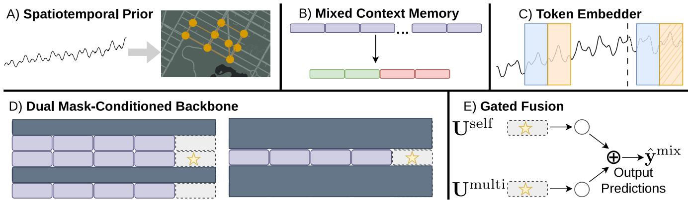
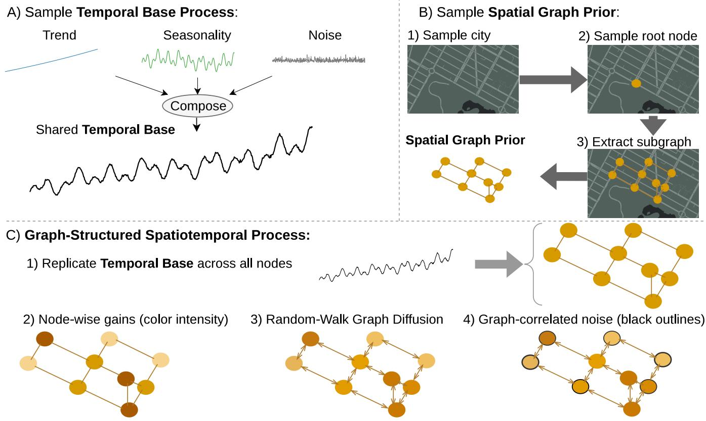
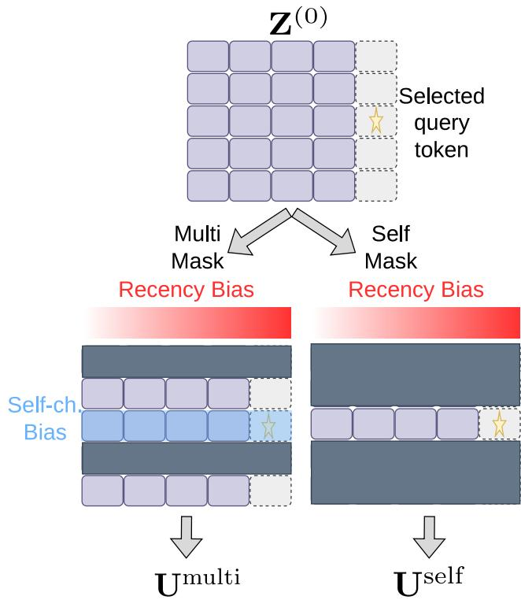
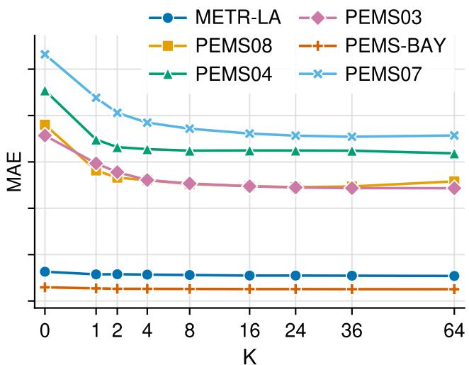
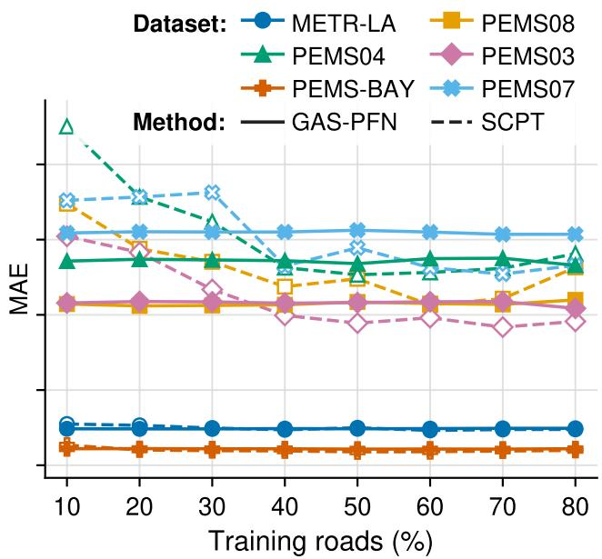

# GAS-PFN: Graph-Aware Spatiotemporal Prior-Data Fitted Networks for Zero-Shot Trafic Forecasting

Joseph Natter,1 Long Vu,1 Yifan Zhang,2 Bobin Deng,1 Kun Suo,1 Rui Wu1

1Kennesaw State University 2Missouri State University

## Abstract

Trafic forecasting requires modeling both complex temporal dynamics and the spatial dependencies imposed by road topology. Supervised graph-based models achieve strong performance, but are typically trained for a particular dataset and sensor graph, making deployment to new or evolving networks costly. Prior-Data Fitted Networks (PFNs) ofer a zero-shot alternative by learning in-context inference from synthetic task priors, which provide an explicit mechanism for encoding domain-specific assumptions. Existing forecasting PFNs, however, do not explicitly represent the graph-structured dependencies governing trafic dynamics.

To combine graph-aware trafic modeling with zero-shot adaptation, we introduce the Graph-Aware Spatiotemporal Prior-Data Fitted Network (GAS-PFN). GAS-PFN incorporates sampled road topology into its synthetic task prior through random-walk difusion, teaching the model to learn graphcoupled dynamics during pretraining. Its co-designed inference architecture uses two mask-conditioned passes through a shared Transformer backbone to separately model sensorspecific temporal dynamics and spatiotemporal interactions among neighboring sensors before integrating their representations for prediction. This design enables GAS-PFN to use target-network structure and context without parameter updates.

Across six benchmarks at the 90-minute horizon, GAS-PFN reduces MSE by 34.0% on average relative to TimePFN, its closest PFN-based predecessor. It also reduces MSE by 27.7% on average relative to four recent industry-developed generalpurpose zero-shot forecasters. In this comparison, all models receive 90 minutes of contiguous recent history, and any additional context is drawn from each dataset’s chronological training split. These results indicate that aligning PFN priors and inference architectures with graph structure improves in-context learning for zero-shot trafic forecasting.

## Introduction

Trafic conditions evolve over a road network, and congestion on one road can afect connected roads. Road topology shapes these interactions, but the patterns that actually emerge also depend on changing factors such as travel demand, incidents, weather, and human behavior, making them dificult to capture with a fully specified mechanistic model. Deep neural models provide a flexible means of learning these nonlinear spatiotemporal relationships directly from data, and graph neural networks and Transformer-based models have consequently achieved strong forecasting performance (Li et al. 2018; Wu et al. 2020; Jiang et al. 2023; Liu et al. 2023).

Despite their strong performance, these models are typically trained for a particular dataset and sensor graph, requiring substantial data and computation when deployed to a new road network or adapted to changes in an existing one. Prior work reports that training a forecasting model on approximately one third of California’s highway network required nearly eight GPU-days (Mallick et al. 2020; Prabowo et al. 2024). Trafic-sensing deployments are also not static: sensors may be added, removed, or relocated, while sensor failures and communication interruptions can break the recent observation history even when older measurements remain available (Zuo et al. 2023). These conditions motivate forecasting methods that can adapt to a target network without repeated parameter optimization or reliance on a long uninterrupted recent history.

Recent time-series foundation models, including Chronos-2, TimesFM-2.5, Moirai-2, and Lag-Llama, address the need for forecasting without task-specific retraining and have demonstrated strong zero-shot performance across heterogeneous datasets (Ansari et al. 2025; Das et al. 2024; Liu et al. 2025; Rasul et al. 2024). However, these models are primarily designed as general-purpose sequence forecasters and do not explicitly incorporate the relational structure of road networks. This leaves a conceptual gap between transferable zero-shot forecasting and graph-aware trafic modeling.

Prior-Data Fitted Networks (PFNs) ofer one emerging route toward bridging this gap by framing zero-shot prediction as in-context inference (Müller et al. 2022; Hollmann et al. 2023). During pretraining, PFNs learn from synthetic tasks sampled from a prior to approximate Bayesian posterior predictive inference from context examples and a query. Their synthetic task priors provide an explicit mechanism for representing domain-specific assumptions, while inferencetime conditioning enables adaptation without gradient-based optimization (i.e., training or fine-tuning). Recent work has extended this framework to time-series forecasting (Taga, Ildiz, and Oymak 2025); however, existing time-series PFNs do not explicitly incorporate known graph topology into either their synthetic task priors or inference architectures.

  
Figure 1: High-level overview of GAS-PFN. The method constructs graph-structured prior tasks, assembles mixed-context memory, embeds context and query patches as tokens, applies dual mask-conditioned backbone inference, and fuses the branch outputs to produce zero-shot forecasts.

Building on this idea, this work introduces the Graph-Aware Spatiotemporal Prior-Data Fitted Network (GAS-PFN), which proposes PFN-style forecasting for graphstructured trafic signals. GAS-PFN is pretrained on synthetic tasks in which interactions among channels are generated by difusion over sampled road-network topologies. This exposes the model to spatially coupled temporal processes rather than treating each series as independent or only implicitly related. At inference time, GAS-PFN performs two diferently masked passes through a shared Transformer backbone. A sensor-local pass restricts interactions to observations from the same sensor, capturing its intrinsic temporal dynamics. A neighborhood-aware pass allows interactions across both time and neighboring sensors, capturing graph-conditioned spatiotemporal dependencies. The resulting representations are then fused for prediction. By conditioning on both recent measurements and historical examples from the target network, GAS-PFN adapts through in-context learning rather than task-specific parameter updates.

Evaluation across six trafic forecasting benchmarks and three prediction horizons shows that GAS-PFN achieves the strongest overall zero-shot performance under the limitedrecent-history protocol. At the 90-minute horizon, it obtains the best MAE and MSE on five of six datasets and achieves lower average MSE than both TimePFN and four recent general-purpose zero-shot forecasters. GAS-PFN also outperforms supervised SCPT when target-road training coverage is limited. These results indicate that encoding graph structure in both the synthetic prior and inference architecture improves zero-shot forecasting under limited recent context.

Contributions. The main contributions are as follows:

• A graph-aware synthetic task prior that uses road-network topology and random-walk difusion to expose a PFN to graph-coupled spatiotemporal dynamics during pretraining.

• A co-designed inference architecture that separately models sensor-specific temporal dynamics and spatiotemporal interactions among neighboring sensors, enabling the model to exploit its graph-aware prior during zero-shot

prediction.

• A comprehensive evaluation across six trafic forecasting benchmarks and three prediction horizons, in which GAS-PFN achieves the best result in 27 of 36 MAE/MSE comparisons and outperforms supervised SCPT when targetroad training coverage is limited.

## Related Work

## Zero-Shot Time-Series Forecasting

Recent time-series foundation models have demonstrated strong zero-shot forecasting performance across heterogeneous datasets. Chronos-2 uses group attention to support univariate, multivariate, and covariate-informed forecasting within a single pretrained model (Ansari et al. 2025). TimesFM 2.5 builds on a patch-based decoder-only Transformer trained for zero-shot forecasting across domains, horizons, and temporal resolutions (Das et al. 2024). Moirai 2.0 adopts a decoder-only architecture with quantile forecasting and multi-token prediction to improve both forecasting accuracy and inference eficiency (Liu et al. 2025). These models support general-purpose zero-shot forecasting but do not explicitly incorporate known relational structure between channels, such as road-network topology. GAS-PFN instead investigates how such domain structure can be encoded directly into zero-shot pretraining and inference.

## Trafic Forecasting and Cross-Network Generalization

Trafic forecasting methods commonly exploit spatial dependencies among sensors through graph-based architectures. DCRNN models trafic propagation as difusion over a directed graph and combines graph convolution with recurrent temporal modeling (Li et al. 2018). Graph WaveNet introduces adaptive adjacency learning and dilated temporal convolutions to capture spatial relationships and longrange temporal dependencies (Wu et al. 2019). More recent Transformer-based methods include PDFormer, which incorporates propagation-delay-aware spatial attention (Jiang et al. 2023), and STAEformer, which obtains strong performance through learned spatiotemporal embeddings (Liu et al. 2023).

  
Figure 2: Overview of the proposed prior data generation process. (A) A shared temporal base is constructed by composing trend, seasonality, and noise components. (B) A spatial graph prior is sampled from a real-world road network by selecting a root node and extracting a connected subgraph. (C) The temporal base is lifted to all nodes, modulated by node-wise gains, propagated via a random-walk difusion operator, and perturbed with graph-correlated noise to yield the final spatiotemporal process.

These models achieve strong supervised performance but are generally optimized for a particular dataset and sensor graph. Graph-dependent components such as node embeddings, adjacency representations, and attention masks may therefore be tied to the network observed during training, limiting direct application to altered node sets or unseen road networks. Transfer-oriented methods address this limitation by learning representations intended to generalize beyond the roads observed during training. Mallick et al. transfer a graph neural trafic forecaster between highway networks (Mallick et al. 2020), while SCPT contrastively pretrains a spatial encoder to infer representations for roads excluded from supervised training (Prabowo et al. 2024). These methods learn representations that generalize to new roads, whereas GAS-PFN adapts at inference time through context examples from the target graph.

## Prior-Data Fitted Networks

Prior-Data Fitted Networks (PFNs) learn to approximate Bayesian posterior predictive inference by training on synthetic tasks sampled from a predefined prior (Müller et al. 2022; Hollmann et al. 2023). At inference time, predictions are produced by conditioning on observed context examples rather than updating model parameters. ForecastPFN applied this approach to zero-shot forecasting using a fully synthetic time-series distribution (Dooley et al. 2023). LaT-PFN combines PFN-based inference with a joint-embedding predictive architecture, performing in-context learning within a prediction-oriented latent space (Verdenius, Zerio, and Wang 2024). TimePFN extends PFN forecasting to multivariate series through synthetic Gaussian-process tasks and an architecture that models temporal and cross-channel dependencies (Taga, Ildiz, and Oymak 2025), making it the closest PFN-based predecessor to GAS-PFN.

A distinguishing feature of PFNs is that the synthetic task prior constitutes an explicit modeling choice through which domain-specific assumptions can be introduced. Existing forecasting PFNs, however, do not encode graph topology within their synthetic task priors and inference architectures. GAS-PFN addresses this gap by co-designing graphstructured synthetic tasks and graph-aware in-context inference for trafic forecasting.

## Method

GAS-PFN combines a graph-aware synthetic task prior with an inference architecture designed to exploit graph-structured context. Figure 1 summarizes the full pipeline. We first formalize the zero-shot PFN setting, then introduce a graphaware spatiotemporal prior that exposes the model to traficlike temporal dynamics and graph-coupled interactions, followed by an architecture designed to learn these patterns during pretraining and infer them from context at test time.

## Problem Setting and PFN Inference

Consider forecasting over a graph $G = ( V , E )$ , where each node $v \in V$ corresponds to a sensor and $\mathbf { y } ( t ) \in \mathbb { R } ^ { | V | }$ denotes the graph signal observed at time t. For a node v and temporal endpoint τ, we define a lookback patch and prediction target as

$$
\begin{array} { r l } & { \mathbf { x } _ { v , \tau } = [ y _ { v } ( \tau - L + 1 ) , \ldots , y _ { v } ( \tau ) ] \in \mathbb { R } ^ { L } , } \\ & { \mathbf { y } _ { v , \tau } = [ y _ { v } ( \tau + 1 ) , \ldots , y _ { v } ( \tau + H ) ] \in \mathbb { R } ^ { H } , } \end{array}\tag{1}
$$

where L and H are the lookback and forecast lengths.

For each node $v \in V$ , let $\mathcal { C } _ { v }$ denote the set of contextwindow endpoints selected for that node. The context set is

$$
\begin{array} { r } { \mathcal { D } _ { \mathrm { c t x } } = \left\{ \left( \mathbf { x } _ { v , \tau } , \mathbf { y } _ { v , \tau } \right) : v \in V , \tau \in \mathcal { C } _ { v } \right\} . } \end{array}\tag{2}
$$

At inference time, the model conditions on $\mathcal { D } _ { \mathrm { c t x } }$ and a query lookback patch $\mathbf { x } _ { v , \tau }$ whose target ${ \bf y } _ { v , \tau }$ is unobserved. The resulting prediction is

$$
\hat { \mathbf { y } } _ { v , \tau } = q _ { \theta } \left( \mathbf { x } _ { v , \tau } \mid \mathcal { D } _ { \mathrm { c t x } } , G \right) ,\tag{3}
$$

where $\theta$ remains fixed when the model is applied to a target dataset. In this work, zero-shot denotes inference without target-dataset parameter updates; context examples may be drawn from the target dataset’s chronological training split.

Following the PFN framework (Müller et al. 2022), qθ is pretrained on synthetic tasks sampled from a prior Π and learns to approximate the posterior predictive induced by Π through context rather than task-specific parameter updates. The node-local patch representation keeps token dimensionality independent of $| V |$ , allowing the same model to process sensor graphs of diferent sizes.

## Spatiotemporal Prior

The central prior-design principle is to expose the PFN to temporal processes whose channels interact over realistic road-network structures. Each synthetic task combines a compositional temporal process with a connected graph sampled from a bank of real road networks, as illustrated in figure 2.

The univariate temporal generator adapts the compositional prior used by LaT-PFN, itself derived from ForecastPFN (Verdenius, Zerio, and Wang 2024; Dooley et al. 2023). We modify its composition rule, parameter distributions, and exponential-trend construction, and extend it with road-network sampling and graph-structured spatial perturbations to produce multivariate trafic processes.

A univariate temporal base $y _ { 0 } ( t )$ is formed by composing trend, seasonal, and stochastic components sampled from broadly defined distributions. The sampled graph G is obtained by selecting a road network, choosing a root node, and extracting a connected subgraph. Detailed component distributions and graph-sampling procedures are provided in Appendix A.

  
Figure 3: Dual mask-conditioned backbone. A shared Transformer backbone evaluates $\mathbf { Z } ^ { ( 0 ) }$ under separate multichannel and self-channel attention masks. Each branch shows the mask and attention biases for the selected query token; gray blocks denote masked keys. Only the resulting querytoken representations, $\mathbf { U } ^ { \mathrm { m u l t i } }$ and $\mathbf { U } ^ { \mathrm { s e l f } }$ , are retained.

Let A denote the adjacency matrix of $G ,$ , and define the random-walk transition matrix

$$
\mathbf { P } = \mathbf { D } ^ { - 1 } ( \mathbf { A } + \mathbf { I } ) ,\tag{4}
$$

where D is the corresponding degree matrix. We use the lazy random-walk difusion operator

$$
\mathcal { P } ( \mathbf { u } ) = \frac { 1 } { 2 } \left( \mathbf { u } + \mathbf { P u } \right) ,\tag{5}
$$

which locally smooths a graph signal while retaining part of its original value (Shuman et al. 2013; Ortega et al. 2018). This retains an explicit identity contribution while applying one step of neighborhood averaging, limiting potential oversmoothing.

The temporal base is replicated across nodes as

$$
\mathbf { y } _ { 0 } ( t ) = y _ { 0 } ( t ) \mathbf { 1 } .\tag{6}
$$

Node-specific gains g introduce local variation,

$$
g _ { v } \sim 1 + \sigma _ { g } \mathcal { N } ( 0 , 1 ) , \qquad \mathbf { z } ( t ) = \mathbf { g } \odot \mathbf { y } _ { 0 } ( t ) ,\tag{7}
$$

after which graph propagation produces

$$
\mathbf { z } _ { \mathrm { p r o p } } ( t ) = ( 1 - \beta ) \mathbf { z } ( t ) + \beta \mathcal { P } ( \mathbf { z } ( t ) ) .\tag{8}
$$

We additionally sample Gaussian noise ${ \bf n } ( t ) \sim \mathcal { N } ( { \bf 0 } , { \bf I } )$ and apply a graph-filtering operator:

$$
\begin{array} { r } { \epsilon _ { G } ( t ) = \mathcal { P } _ { \epsilon } ( \mathbf { n } ( t ) ) , } \end{array}\tag{9}
$$

where the noise-filtering operator $\mathcal { P } _ { \epsilon }$ is defined in $\mathsf { A p - }$ pendix A. The final graph signal is

$$
\mathbf { y } ( t ) = \mathbf { y } _ { 0 } ( t ) + \alpha \left[ \mathbf { z } _ { \mathrm { p r o p } } ( t ) - \mathbf { y } _ { 0 } ( t ) + \boldsymbol { \epsilon } _ { G } ( t ) \right] ,\tag{10}
$$

where α controls the overall strength of spatial variation and $\beta$ controls graph propagation.

Each sampled task therefore combines shared temporal behavior with node-specific and graph-correlated deviations. By biasing the synthetic task distribution toward graphcoupled functions, this construction is intended to reduce prior mismatch when target trafic dynamics exhibit local road-network dependence, encouraging the PFN to infer both temporal dynamics and spatial interactions from context.

## Graph-Aware ICL Architecture

Mixed-context memory and token embedding. For each node, GAS-PFN constructs a mixed-context memory from two equally sized sources of historical context: the K most recent windows from the dataset’s chronological training split and K older anchor windows distributed across the remaining training split. Let Crecent and $\mathcal { C } _ { v } ^ { \mathrm { a n c h o r } }$ denote their respective window endpoints. The per-node context set is

$$
\widetilde { \mathcal { C } } _ { v } = \mathcal { C } ^ { \mathrm { r e c e n t } } \cup \mathcal { C } _ { v } ^ { \mathrm { a n c h o r } } , \qquad \left| \mathcal { C } ^ { \mathrm { r e c e n t } } \right| = \left| \mathcal { C } _ { v } ^ { \mathrm { a n c h o r } } \right| = K .\tag{11}
$$

Recent windows use common timestamps across sensors, whereas historical anchors are sampled across chronological strata independently for each node and need not be timealigned. We use $\dot { K } = 1 6$ , yielding 32 historical support patches per node.

Let Q denote the set of query-window endpoints. The selected context patches and query windows are embedded as

$$
\begin{array} { r l } & { { \bf e } _ { v , \tau } ^ { \mathrm { c t x } } = \phi _ { \mathrm { c t x } } \left( \left[ { \bf x } _ { v , \tau } ; { \bf y } _ { v , \tau } \right] \right) , \quad \tau \in \widetilde { \mathcal { C } } _ { v } , } \\ & { { \bf e } _ { v , \tau } ^ { \mathrm { q r y } } = \phi _ { \mathrm { q r y } } \left( \left[ { \bf x } _ { v , \tau } ; { \bf 0 } _ { H } \right] \right) , \quad \tau \in \mathcal { Q } . } \end{array}\tag{12}
$$

where $\phi _ { \mathrm { c t x } }$ and $\phi _ { \mathrm { q r y } }$ are learned afine projections. Each token retains its node index and window-end timestamp for attention masking.

Let ${ \bf E } ^ { \mathrm { c t x } }$ denote the embeddings of all selected context tokens and $\mathbf { E } ^ { \mathrm { q r y } }$ the embeddings of the query tokens. The Transformer input is

$$
{ \bf Z } ^ { ( 0 ) } = \left[ { \bf E } ^ { \mathrm { c t x } } ; { \bf E } ^ { \mathrm { q r y } } \right] .\tag{13}
$$

Dual mask-conditioned backbone. GAS-PFN evaluates the same Transformer backbone under two attention masks:

$$
\begin{array} { r } { \begin{array} { r c l } { \mathbf { U } ^ { \mathrm { s e l f } } = f _ { \theta } \big ( \mathbf { Z } ^ { ( 0 ) } ; \mathcal { M } ^ { \mathrm { s e l f } } \big ) _ { \mathrm { q r y } } , } \\ { \mathbf { U } ^ { \mathrm { m u l t i } } = f _ { \theta } \big ( \mathbf { Z } ^ { ( 0 ) } ; \mathcal { M } ^ { \mathrm { m u l t i } } \big ) _ { \mathrm { q r y } } . } \end{array} } \end{array}\tag{14}
$$

The two passes share backbone parameters but impose different structural constraints, as shown in figure 3.

The self mask restricts attention to causally valid tokens from the same sensor and disables query–query attention, thereby modeling sensor-local temporal dynamics. The multi-channel mask permits attention within a selected sensor neighborhood and, in the reported evaluation protocol, allows query–query interactions only among tokens at the same forecast time. Historical anchors retain their original window timestamps, preserving causal ordering even when anchors are not aligned across sensors.

For token pairs permitted by the corresponding mask, the pre-softmax attention logit for a given head and branch is

$$
\ell _ { i j } = \frac { \mathbf { q } _ { i } ^ { \mathsf { T } } \mathbf { k } _ { j } } { \sqrt { d _ { h } } } - \gamma \operatorname* { m a x } ( t _ { i } - t _ { j } , 0 ) + b _ { \mathrm { s a m e } } \delta ( c h _ { i } , c h _ { j } ) ,\tag{15}
$$

where $\delta ( c h _ { i } , c h _ { j } ) = 1$ when tokens i and j belong to the same sensor and 0 otherwise. Each head learns its own temporal-distance coeficient $\gamma$ and self-channel bias $b _ { \mathrm { s a m e } } .$ In the self pass, the self-channel term is constant across all visible keys and therefore cancels under the softmax; in the multi-channel pass, it distinguishes self-channel from neighboring-channel interactions.

Neighborhoods combine known graph connectivity with semantic similarity. Let A denote the row-scaled task-local graph-score matrix and Ssem the cosine-similarity matrix computed from encoded, aggregated channel representations. We define

$$
\mathbf { S } ^ { \mathrm { h y b } } = ( 1 - \eta ) \overline { { \mathbf { A } } } + \eta \mathbf { S } ^ { \mathrm { s e m } } , \qquad \mathcal { N } _ { v } = \mathrm { T o p K } ( \mathbf { S } _ { v , : } ^ { \mathrm { h y b } } ) ,\tag{16}
$$

where $\eta$ balances the graph-connectivity and semanticsimilarity terms. The selected channel neighborhoods are converted into token-level attention constraints for the multichannel mask. Further details are provided in Appendix B.

Fusion and training objective. A learned gate combines the two query representations:

$$
\begin{array} { r } { \begin{array} { r l } & { \mathbf { g } = \sigma \left( g _ { \theta } [ \mathbf { U } ^ { \mathrm { s e l f } } ; \mathbf { U } ^ { \mathrm { m u l t i } } ] \right) , } \\ & { \mathbf { U } ^ { \mathrm { m i x } } = \left( 1 - \mathbf { g } \right) \odot \mathbf { U } ^ { \mathrm { s e l f } } + \mathbf { g } \odot \mathbf { U } ^ { \mathrm { m u l t i } } , } \\ & { \widehat { \mathbf { Y } } ^ { \mathrm { m i x } } = h _ { \theta } ( \mathbf { U } ^ { \mathrm { m i x } } ) , } \end{array} } \end{array}\tag{17}
$$

where $h _ { \theta }$ is a shared output projection.

The same projection produces auxiliary predictions $\widehat { \mathbf { Y } } ^ { \mathrm { s e l f } }$ and $\widehat { \mathbf { Y } } ^ { \mathrm { m u l t i } }$ from the individual branch representations.

Training minimizes

$$
\begin{array} { r l } & { \mathcal { L } = \mathrm { M S E } \left( \widehat { \mathbf { Y } } ^ { \mathrm { m i x } } , \mathbf { Y } \right) } \\ & { \qquad + \lambda _ { \mathrm { a u x } } \mathrm { M S E } \left( \widehat { \mathbf { Y } } ^ { \mathrm { s e l f } } , \mathbf { Y } \right) } \\ & { \qquad + \lambda _ { \mathrm { a u x } } \mathrm { M S E } \left( \widehat { \mathbf { Y } } ^ { \mathrm { m u l t i } } , \mathbf { Y } \right) } \\ & { \qquad - \lambda _ { \mathrm { e n t } } \mathcal { H } ( \mathbf { g } ) . } \end{array}\tag{18}
$$

where the auxiliary losses keep both branches individually predictive and the entropy term discourages premature gate collapse. At inference time, only the fused prediction is returned.

<table><tr><td rowspan="2">Dataset</td><td rowspan="2">Horizon</td><td colspan="2">GAS-PFN</td><td colspan="2">Chronos-2</td><td colspan="2">TimesFM-2.5</td><td colspan="2">Moirai-2</td><td colspan="2">Lag-Llama</td><td colspan="2">TimePFN</td></tr><tr><td>MAE</td><td>MSE</td><td>MAE</td><td>MSE</td><td>MAE</td><td>MSE</td><td>MAE</td><td>MSE</td><td>MAE</td><td>MSE</td><td>MAE</td><td>MSE</td></tr><tr><td rowspan="3">METR-LA</td><td>30 min</td><td>3.97±0.05</td><td>68.31±1.92</td><td>3.68</td><td>70.62</td><td>3.80</td><td>72.30</td><td>4.23</td><td>83.92</td><td>4.86</td><td>86.23</td><td>4.86</td><td>69.41</td></tr><tr><td>60 min</td><td>4.83±0.06</td><td>97.61±2.92</td><td>4.38</td><td>91.23</td><td>4.73</td><td>108.38</td><td>5.30</td><td>124.56</td><td>6.21</td><td>130.31</td><td>5.59</td><td>94.33</td></tr><tr><td>90 min</td><td>5.50±0.05</td><td>119.69±4.15</td><td>4.95</td><td>107.42</td><td>5.45</td><td>136.04</td><td>6.35</td><td>163.35</td><td>7.41</td><td>178.32</td><td>6.13</td><td>112.73</td></tr><tr><td rowspan="3">PEMS-BAY</td><td>30 min</td><td>1.73±0.01</td><td>14.85±0.09</td><td>1.61</td><td>12.90</td><td>1.65</td><td>15.01</td><td>1.74</td><td>15.53</td><td>2.60</td><td>45.83</td><td>2.41</td><td>22.35</td></tr><tr><td>60 min</td><td>2.21±0.01</td><td>25.22±0.09</td><td>2.24</td><td>27.25</td><td>2.18</td><td>27.70</td><td>2.36</td><td>29.99</td><td>2.99</td><td>52.64</td><td>2.85</td><td>32.51</td></tr><tr><td>90 min</td><td>2.59±0.01</td><td>34.45±0.08</td><td>2.71</td><td>40.58</td><td>2.62</td><td>39.32</td><td>2.91</td><td>44.67</td><td>3.29</td><td>58.78</td><td>3.21</td><td>41.51</td></tr><tr><td rowspan="3">PEMS03</td><td>30 min</td><td>17.57±0.49</td><td>749.58±29.82</td><td>17.74</td><td>747.80</td><td>19.52</td><td>894.14</td><td>19.64</td><td>913.24</td><td>20.23</td><td>918.27</td><td>34.50</td><td>2201.97</td></tr><tr><td>60 min</td><td>21.51±0.75</td><td>1160.61±56.57</td><td>23.22</td><td>1320.70</td><td>25.26</td><td>1496.84</td><td>25.74</td><td>1646.29</td><td>27.25</td><td>1672.31</td><td>38.46</td><td>2788.31</td></tr><tr><td>90 min</td><td>25.97±1.10</td><td>1740.93±105.99</td><td>28.98</td><td>2080.14</td><td>31.61</td><td>2357.27</td><td>32.36</td><td>2666.41</td><td>34.66</td><td>2709.34</td><td>42.60</td><td>3417.89</td></tr><tr><td rowspan="3">PEMS04</td><td>30 min</td><td>22.52±0.23</td><td>1243.43±10.90</td><td>24.24</td><td>1402.54</td><td>25.25</td><td>1586.96</td><td>25.90</td><td>1518.06</td><td>27.62</td><td>1698.79</td><td>43.19</td><td>3218.50</td></tr><tr><td>60 min</td><td>27.16±0.34</td><td>1782.98±21.60</td><td>31.26</td><td>2300.66</td><td>31.77</td><td>2514.64</td><td>33.45</td><td>2523.53</td><td>38.54</td><td>3152.43</td><td>47.91</td><td>3987.86</td></tr><tr><td>90 min</td><td>32.32±0.43</td><td>2517.88±44.66</td><td>37.92</td><td>3370.61</td><td>38.58</td><td>3708.20</td><td>41.73</td><td>3966.89</td><td>50.72</td><td>5371.03</td><td>52.92</td><td>4841.89</td></tr><tr><td rowspan="3">PEMS07</td><td>30 min</td><td>25.15±0.44</td><td>1493.64±27.66</td><td>25.95</td><td>1522.69</td><td>26.25</td><td>1612.32</td><td>28.74</td><td></td><td></td><td>1911.20</td><td>46.42</td><td></td></tr><tr><td>60 min</td><td>30.81±0.61</td><td>2223.93±45.83</td><td>32.76</td><td>2366.80</td><td>33.96</td><td>2627.48</td><td>38.36</td><td>1858.14 3342.03</td><td>29.20 39.99</td><td>3328.94</td><td>52.46</td><td>4035.22</td></tr><tr><td>90 min</td><td>37.15±0.80</td><td>3239.16±77.26</td><td>40.01</td><td>3558.66</td><td>42.17</td><td>4053.21</td><td>48.91</td><td>5490.79</td><td>50.77</td><td>5272.50</td><td>58.75</td><td>5170.30 6523.84</td></tr><tr><td rowspan="3">PEMS08</td><td>30 min</td><td>17.78±0.15</td><td>767.87±14.13</td><td>19.10</td><td>834.07</td><td>18.50</td><td></td><td>20.44</td><td></td><td></td><td></td><td></td><td></td></tr><tr><td>60 min</td><td>21.35±0.30</td><td>1112.37±33.62</td><td>24.15</td><td>1305.08</td><td>23.54</td><td>816.30 1313.15</td><td>26.77</td><td>961.84 1666.28</td><td>22.67 32.68</td><td>1121.92 2297.85</td><td></td><td>26.941488.01</td></tr><tr><td>90 min</td><td>25.21±0.38</td><td>1548.52±58.23</td><td>29.44</td><td>1922.89</td><td>28.60</td><td>1924.25</td><td>33.96</td><td>2695.22</td><td>43.51</td><td>4055.36</td><td>31.22 36.54</td><td>2031.89</td></tr><tr><td colspan="2">Overall metric wins</td><td>27</td><td></td><td></td><td>8</td><td>1</td><td></td><td></td><td>0</td><td>0</td><td></td><td></td><td>2864.76 0</td></tr></table>

Table 1: Zero-shot forecasting performance across datasets and prediction horizons. Lower values indicate better performance. Best results are shown in bold and second-best results are underlined. GAS-PFN reports mean ± standard deviation over three independently trained checkpoints; each baseline uses a single released pretrained checkpoint.

## Results

Datasets and metrics. We evaluate GAS-PFN on six widely used trafic forecasting benchmarks, all sampled at five-minute intervals. METR-LA contains trafic-speed measurements from 207 highway sensors in Los Angeles County collected from March through June 2012, while PEMS-BAY contains speed measurements from 325 sensors in the San Francisco Bay Area collected from January through May 2017 (Li et al. 2018). PEMS03, PEMS04, PEMS07, and PEMS08 contain trafic-flow measurements from 358, 307, 883, and 170 sensors, respectively, drawn from the corresponding California Performance Measurement System districts (Chen et al. 2001). Their collection periods span September–November 2018, January–February 2018, May– August 2017, and July–August 2016, respectively (Guo et al. 2019). These benchmarks provide a standard basis for comparison while covering both speed and flow prediction across road networks of diferent sizes and geographic settings. We use chronological 70%/10%/20% train, validation, and test splits and report MAE and MSE cumulatively at horizons of 6, 12, and 18 steps, corresponding to 30, 60, and 90 minutes; MAE summarizes typical absolute error, whereas MSE places greater weight on large deviations. Following standard trafic-forecasting practice, zero-valued targets are masked when computing the training loss and evaluation metrics, as zero commonly serves as the missing-value marker in these benchmarks (Zuo et al. 2023; Li et al. 2018). More information on datasets and experimental setups is provided in

## Appendix C.

Zero-shot Benchmarks. Table 1 compares GAS-PFN with PFN-based and general-purpose zero-shot forecasters across six datasets and three prediction horizons. Each baseline is evaluated under two prespecified context regimes. The recent-only regime uses the same 18 most recent observations as GAS-PFN. The history-augmented regime uses the context length specified by the baseline’s default configuration, with the final 18 observations drawn from the recent window and any earlier inputs drawn from the dataset’s chronological training split. This gives each baseline access to the same recent history and training-split historical data pool as GAS-PFN without imposing a common context length. Table 1 reports, for each baseline and dataset, the regime with lower cumulative 18-step MAE; complete results for both regimes are provided in Appendix D. GAS-PFN uses a fixed mixed-context configuration and the same hyperparameters across all datasets. For PEMS07, the largest sensor network, GAS-PFN uses memory-bounded channel-cohort inference; details are provided in Appendix C.

GAS-PFN achieves the best result in 27 of 36 dataset– horizon–metric comparisons, including the lowest MSE in 14 of 18 settings. At the 90-minute horizon, it obtains the best MAE and MSE on five of six datasets. Its MSE is 34.0% lower than TimePFN on average across the six datasets and 27.7% lower on average across comparisons with four recent industry-developed general-purpose zero-shot forecasters. Additional experiments in Appendix D show that

  
Figure 4: MAE as a function of the per-source context budget K at the 90-minute horizon. Each setting uses K recent and K historical support patches per node. Values are computed using a single fixed GAS-PFN checkpoint.

GAS-PFN’s advantage over TimePFN persists even when TimePFN is fine-tuned on target-domain data while GAS-PFN receives no parameter updates. GAS-PFN outperforms fine-tuned TimePFN across every dataset and horizon under a matched 32-patch historical-data budget and remains stronger in a majority of settings when TimePFN is given 64 patches for fine-tuning, twice GAS-PFN’s budget. In addition, ablations in Appendix E provide consistent evidence that the dual-branch architecture, mixed-context support, and hybrid neighborhood routing each contribute to inferencetime forecasting performance.

Context budget analysis. Figure 4 varies the number of recent and historical support patches per node. At the 90- minute horizon, increasing the budget from no context to K = 16 recent and K = 16 historical patches reduces MAE by 25.4% on average. The improvement is particularly large on PEMS03, PEMS04, PEMS07, and PEMS08, where MAE decreases by 28.5–34.9%, but is smaller on METR-LA and PEMS-BAY, where it decreases by 12.9–13.2%. Beyond K = 16, gains become smaller and dataset-dependent, suggesting diminishing returns beyond 32 total support patches per node. The smaller context gains on METR-LA and PEMS-BAY coincide with less consistent advantages over the zero-shot baselines in Table 1.

Cross-road generalization. Figure 5 compares GAS-PFN with SCPT at the 12-step (60-minute) horizon across varying supervised road budgets. This comparison allows each model to operate under its own evaluation paradigm, and favors SCPT in terms of target-specific training: SCPT is trained using the full historical record from the indicated fraction of roads, while forecasts on held-out roads use its maximum lookback of60 minutes; GAS-PFN performs zeroshot inference without dataset-specific parameter updates. Despite SCPT’s access to target-specific training, GAS-PFN achieves lower MAE and MSE on all six datasets when SCPT is trained on only 10% of the roads, reducing MSE by 34.7% on average. GAS-PFN remains better on five of six datasets at both the 20% and 30% budgets, with average MSE reductions of 20.0% and 11.1%, respectively. On PEMS08, GAS-PFN matches or outperforms SCPT across all roadtraining fractions. SCPT generally becomes stronger as its supervised road coverage increases, showing that GAS-PFN is particularly efective when target-network training coverage is limited or unavailable. Complete MAE and MSE results are provided in Appendix D.

  
Figure 5: MAE of GAS-PFN and SCPT at the 60-minute horizon as the fraction of roads available for SCPT training varies. Values average three runs with matched road-split and checkpoint seeds.

## Conclusion

We introduced GAS-PFN, a graph-aware Prior-Data Fitted Network for zero-shot trafic forecasting. GAS-PFN codesigns graph-structured synthetic pretraining tasks with mixed-context memory and dual mask-conditioned inference, enabling it to adapt to a target road network without parameter updates and with only 90 minutes of contiguous recent history. Across six trafic benchmarks, GAS-PFN achieves the strongest overall zero-shot performance. It also remains competitive with supervised cross-road forecasting under limited target-road training. These results suggest utility in two deployment settings: forecasting on newly added roads when supervised coverage is limited, and forecasting on existing networks when recent observations are interrupted but older measurements remain available. Conceptually, these results support synthetic task priors as a practical mechanism for introducing domain-specific structure into PFNs, suggesting applications in other structured prediction domains. Disclosure: Generative AI tools assisted with language editing, LATEX formatting, and manuscript review.

## References

Ansari, A. F.; Shchur, O.; Küken, J.; Auer, A.; Han, B.; Mercado, P.; Rangapuram, S. S.; Shen, H.; Stella, L.; Zhang, X.; Goswami, M.; Kapoor, S.; Maddix, D. C.; Guerron, P.; Hu, T.; Yin, J.; Erickson, N.; Desai, P. M.; Wang, H.; Rangwala, H.; Karypis, G.; Wang, Y.; and Bohlke-Schneider, M. 2025. Chronos-2: From Univariate to Universal Forecasting. arXiv preprint arXiv:2510.15821.

Chen, C.; Petty, K.; Skabardonis, A.; Varaiya, P.; and Jia, Z. 2001. Freeway Performance Measurement System: Mining Loop Detector Data. Transportation Research Record, 1748(1): 96–102.

Das, A.; Kong, W.; Sen, R.; and Zhou, Y. 2024. A Decoder-Only Foundation Model for Time-Series Forecasting. In Proceedings of the 41st International Conference on Machine Learning, volume 235 of Proceedings ofMachine Learning Research, 10148–10167. PMLR.

Dooley, S.; Khurana, G. S.; Mohapatra, C.; Naidu, S. V.; and White, C. 2023. ForecastPFN: Synthetically-Trained Zero-Shot Forecasting. In Advances in Neural Information Processing Systems, volume 36.

Guo, S.; Lin, Y.; Feng, N.; Song, C.; and Wan, H. 2019. Attention Based Spatial-Temporal Graph Convolutional Networks for Trafic Flow Forecasting. In Proceedings of the AAAI Conference on Artificial Intelligence, volume 33, 922–929.

Hollmann, N.; Müller, S.; Eggensperger, K.; and Hutter, F. 2023. TabPFN: A Transformer That Solves Small Tabular Classification Problems in a Second. In International Conference on Learning Representations.

Jiang, J.; Han, C.; Zhao, W. X.; and Wang, J. 2023. PDFormer: Propagation Delay-Aware Dynamic Long-Range Transformer for Trafic Flow Prediction. In Proceedings of the AAAI Conference on Artificial Intelligence, volume 37, 4365–4373.

Li, Y.; Yu, R.; Shahabi, C.; and Liu, Y. 2018. Difusion Convolutional Recurrent Neural Network: Data-Driven Trafic Forecasting. In International Conference on Learning Representations.

Liu, C.; Aksu, T.; Liu, J.; Liu, X.; Yan, H.; Pham, Q.; Sahoo, D.; Xiong, C.; Savarese, S.; and Li, J. 2025. Moirai 2.0: When Less Is More for Time Series Forecasting. arXiv preprint arXiv:2511.11698.

Liu, H.; Dong, Z.; Jiang, R.; Deng, J.; Deng, J.; Chen, Q.; and Song, X. 2023. STAEformer: Spatio-Temporal Adaptive Embedding Makes Vanilla Transformer SOTA for Trafic Forecasting. In Proceedings ofthe 32nd ACM International Conference on Information and Knowledge Management, 4125–4129.

Mallick, T.; Balaprakash, P.; Rask, E.; and Macfarlane, J. 2020. Transfer Learning with Graph Neural Networks for Short-Term Highway Trafic Forecasting. arXiv preprint arXiv:2004.08038.

Müller, S.; Hollmann, N.; Pineda Arango, S.; Grabocka, J.; and Hutter, F. 2022. Transformers Can Do Bayesian Inference. In International Conference on Learning Representations.

Ortega, A.; Frossard, P.; Kovačević, J.; Moura, J. M. F.; and Vandergheynst, P. 2018. Graph Signal Processing: Overview, Challenges, and Applications. Proceedings of the IEEE, 106(5): 808–828.

Prabowo, A.; Xue, H.; Shao, W.; Koniusz, P.; and Salim, F. D. 2024. Trafic Forecasting on New Roads Using Spatial Contrastive Pre-Training (SCPT). Data Mining and Knowledge Discovery, 38: 913–937.

Rasul, K.; Ashok, A.; Williams, A. R.; Ghonia, H.; Bhagwatkar, R.; Khorasani, A.; Darvishi Bayazi, M. J.; Adamopoulos, G.; Riachi, R.; Hassen, N.; Biloš, M.; Garg, S.; Schneider, A.; Chapados, N.; Drouin, A.; Zantedeschi, V.; Nevmyvaka, Y.; and Rish, I. 2024. Lag-Llama: Towards Foundation Models for Probabilistic Time Series Forecasting. arXiv preprint arXiv:2310.08278.

Shuman, D. I.; Narang, S. K.; Frossard, P.; Ortega, A.; and Vandergheynst, P. 2013. The Emerging Field of Signal Processing on Graphs: Extending High-Dimensional Data Analysis to Networks and Other Irregular Domains. IEEE Signal Processing Magazine, 30(3): 83–98.

Taga, E. O.; Ildiz, M. E.; and Oymak, S. 2025. TimePFN: Effective Multivariate Time Series Forecasting with Synthetic Data. In Proceedings of the AAAI Conference on Artificial Intelligence, volume 39, 20761–20769.

Verdenius, S.; Zerio, A.; and Wang, R. L. M. 2024. LaT-PFN: A Joint Embedding Predictive Architecture for In-Context Time-Series Forecasting. arXiv preprint arXiv:2405.10093.

Wu, Z.; Pan, S.; Long, G.; Jiang, J.; Chang, X.; and Zhang, C. 2020. Connecting the Dots: Multivariate Time Series Forecasting with Graph Neural Networks. In Proceedings of the 26th ACM SIGKDD International Conference on Knowledge Discovery and Data Mining, 753–763.

Wu, Z.; Pan, S.; Long, G.; Jiang, J.; and Zhang, C. 2019. Graph WaveNet for Deep Spatial-Temporal Graph Modeling. In Proceedings ofthe Twenty-Eighth International Joint Conference on Artificial Intelligence, 1907–1913.

Zuo, J.; Zeitouni, K.; Taher, Y.; and Garcia-Rodriguez, S. 2023. Graph Convolutional Networks for Trafic Forecasting with Missing Values. Data Mining and Knowledge Discovery, 37: 913–947.

# Supplementary Material for “GAS-PFN: Graph-Aware Spatiotemporal Prior-Data Fitted Networks for Zero-Shot Trafic Forecasting”

Anonymous submission

## A Additional Synthetic Prior Details

The synthetic prior used for pretraining was generated offline and stored as a frozen bank. Construction proceeded in two stages. First, a bank of univariate temporal base series was generated from compositional trend, seasonal, and stochastic components. Each base series was then lifted to a sampled road subgraph and modified using node-specific gains, random-walk difusion, and graph-correlated process noise. The resulting bank contains one million multivariate series of length $T \stackrel { - } { = } 1 2 { , } 0 0 0$

## Temporal Base Generator

The univariate temporal component builds on the compositional synthetic priors introduced by ForecastPFN and subsequently adapted by LaT-PFN (Dooley et al. 2023; Verdenius, Zerio, and Wang 2024). GAS-PFN modifies this temporal base and extends it with road-network sampling and graphstructured spatial perturbations to produce multivariate traffic processes. The precise modifications and parameter distributions are documented below.

Let i index a univariate series and $t \in \{ 0 , \ldots , T - 1 \}$ index its stored time points. Several hyperparameters are shared by series generated together in a vectorized generator call. We denote by C the index set of series produced in one such call and state explicitly when a sampled quantity is shared within C. Unless noted otherwise, the underlying random draws are independent.

Synthetic time coordinate. A temporal resolution is sampled once per generator call as

$$
U _ { \rho } \sim \mathcal { U } ( \log _ { 2 } 6 , \log _ { 2 } 6 1 ) , \qquad \rho = \frac { 2 ^ { U _ { \rho } } - 1 } { 5 0 } .\tag{1}
$$

The corresponding coordinate span and time coordinate are

$$
x _ { \mathrm { m a x } } = \left\lceil \frac { T } { \rho } \right\rceil , \qquad x ( t ) = \frac { t } { T - 1 } x _ { \mathrm { m a x } } .\tag{2}
$$

The coordinate $x ( t )$ is measured in nominal days for the purpose of constructing weekly, monthly, and annual seasonal phases. It does not represent a real calendar timestamp.

Trend component. For each series $i \in { \mathcal { C } } .$ , the raw linear slope is sampled as

$$
\widetilde { \lambda } _ { i } ^ { \mathrm { l i n } } = - 0 . 0 1 5 + 0 . 0 3 B _ { i } ^ { \mathrm { l i n } } + 0 . 0 0 5 \xi _ { i } ^ { \mathrm { l i n } } .\tag{3}
$$

Here, $B _ { i } ^ { \mathrm { l i n } } \sim \mathrm { B e t a } ( 2 , 2 )$ and $\xi _ { i } ^ { \mathrm { l i n } } \sim \mathcal { N } ( 0 , 1 )$ are independent. Slopes generated in the same call are aligned to the sign of their median:

$$
\lambda _ { i } ^ { \mathrm { l i n } } = \left| \widetilde { \lambda } _ { i } ^ { \mathrm { l i n } } \right| \mathrm { s i g n } \left( \mathrm { m e d i a n } _ { i ^ { \prime } \in \mathcal { C } } \widetilde { \lambda } _ { i ^ { \prime } } ^ { \mathrm { l i n } } \right) .\tag{4}
$$

The linear ofset is sampled independently for each series:

$$
o _ { i } ^ { \mathrm { l i n } } \sim \mathcal { U } ( - 1 , 1 . 2 ) .\tag{5}
$$

For the exponential component, let

$$
B _ { i } ^ { \mathrm { e x p } } \sim \mathrm { B e t a } ( 2 , 2 ) , \qquad \xi _ { i } ^ { \mathrm { e x p } } \sim \mathcal { N } ( 0 , 1 ) .\tag{6}
$$

The raw exponential base is

$$
\begin{array} { r l } & { \widetilde { b } _ { i } ^ { \mathrm { e x p } } = 1 + 3 0 0 \log _ { 2 } \left[ 2 ^ { - 1 / 6 0 0 0 0 } \right. } \\ & { \qquad \left. + \left( 2 ^ { 1 / 6 0 0 } - 2 ^ { - 1 / 6 0 0 0 0 } \right) B _ { i } ^ { \mathrm { e x p } } + 0 . 0 0 1 \xi _ { i } ^ { \mathrm { e x p } } \right] . } \end{array}\tag{7}
$$

As with the linear slope, deviations from one are aligned to a common sign within the generator call:

$$
b _ { i } ^ { \mathrm { e x p } } = 1 + \left| \widetilde { b } _ { i } ^ { \mathrm { e x p } } - 1 \right| \mathrm { s i g n } \left[ \mathrm { m e d i a n } _ { i ^ { \prime } \in \mathcal { C } } \left( \widetilde { b } _ { i ^ { \prime } } ^ { \mathrm { e x p } } - 1 \right) \right]\tag{8}
$$

The exponential ofset and lower-bounded base are

$$
o _ { i } ^ { \mathrm { e x p } } \sim \mathcal { U } ( - 1 . 5 , 2 ) , \qquad \overline { { b } } _ { i } ^ { \mathrm { e x p } } = \operatorname* { m a x } \bigl ( b _ { i } ^ { \mathrm { e x p } } , 1 0 ^ { - 5 } \bigr ) .\tag{9}
$$

Combining the linear and exponential components gives the total trend factor

$$
\begin{array} { r l } & { \mathcal { T } _ { i } ( t ) = \left[ 1 + \lambda _ { i } ^ { \mathrm { l i n } } \left( \boldsymbol { x } ( t ) - o _ { i } ^ { \mathrm { l i n } } \boldsymbol { x } _ { \mathrm { m a x } } \right) \right] } \\ & { \quad \quad \quad \quad \times \left( \overline { { b } } _ { i } ^ { \mathrm { e x p } } \right) ^ { \boldsymbol { x } ( t ) / x _ { \mathrm { m a x } } - o _ { i } ^ { \mathrm { e x p } } } . } \end{array}\tag{10}
$$

The lower bound in Eq. (9) applies only to the base of the exponential component; the resulting trend and final temporal series are not clipped.

Seasonal component. Let

$$
\mathcal { I } = \{ \mathrm { y r } , \mathrm { m o } , \mathrm { w k } \}\tag{11}
$$

index the annual, monthly, and weekly seasonal families. For a cycle length $q > 0$ and bin width $p > 0$ , define

$$
\iota _ { q , p } ( x ) = \left\lfloor \frac { x } { p } \right\rfloor + 1\tag{12}
$$

and

$$
\begin{array} { r } { \mathrm { b i n } _ { q , p } ( x ) = \left\{ \begin{array} { l l } { \iota _ { q , p } ( x ) , } & { \iota _ { q , p } ( x ) \leq q , } \\ { \big ( \iota _ { q , p } ( x ) \mathrm { m o d } q \big ) + 1 , } & { \iota _ { q , p } ( x ) > q . } \end{array} \right. } \end{array}\tag{13}
$$

The seasonal phases are

$$
\begin{array} { r l } & { \phi _ { \mathrm { y r } } ( t ) = \frac { \mathrm { b i n } _ { 1 2 , 3 0 . 4 1 7 } ( x ( t ) ) } { 1 2 } , } \\ & { \phi _ { \mathrm { m o } } ( t ) = \frac { \mathrm { b i n } _ { 3 0 . 4 1 7 , 1 } ( x ( t ) ) } { 3 0 . 4 1 7 } , } \\ & { \phi _ { \mathrm { w k } } ( t ) = \frac { \mathrm { b i n } _ { 7 , 1 } ( x ( t ) ) } { 7 } . } \end{array}\tag{14}
$$

For each series, the corresponding seasonal amplitudes are

$$
\begin{array} { r l r } & { \omega _ { i , \mathrm { y r } } = - 1 2 + 2 4 B _ { i , \mathrm { y r } } + 0 . 1 5 \xi _ { i , \mathrm { y r } } ^ { \mathrm { s e a } } , } & \\ & { \omega _ { i , \mathrm { m o } } = - 6 + 1 2 B _ { i , \mathrm { m o } } + 0 . 1 5 \xi _ { i , \mathrm { m o } } ^ { \mathrm { s e a } } , } & \\ & { \omega _ { i , \mathrm { w k } } = - 3 + 6 B _ { i , \mathrm { w k } } + 0 . 1 5 \xi _ { i , \mathrm { w k } } ^ { \mathrm { s e a } } , } & \end{array}\tag{15}
$$

where

$$
B _ { i , j } \sim \mathrm { B e t a } ( 2 , 2 ) , \qquad \xi _ { i , j } ^ { \mathrm { s e a } } \sim \mathcal { N } ( 0 , 1 ) , \qquad j \in \mathcal { I } ,\tag{16}
$$

with independent draws across series and seasonal families. Because Gaussian perturbations are added after the Betascaled draws, the displayed endpoint values are not strict support bounds.

The number of harmonics for each seasonal family is sampled independently and uniformly:

$$
H _ { j } \stackrel { \mathrm { i i d } } { \sim } \mathrm { D i s c r e t e U n i f o r m } \{ 2 , 3 , 4 , 5 , 6 , 7 \} , \qquad j \in \mathcal { I } .\tag{17}
$$

Each $H _ { j }$ is shared by the series in the same generator call. For series i, family $j ,$ and harmonic $h \in \{ 1 , \ldots , H _ { j } \}$ , raw sine and cosine coeficients are sampled independently as

$$
\widetilde { a } _ { i j h } \sim { \cal N } ( 0 , h ^ { - 2 } ) , \qquad \widetilde { c } _ { i j h } \sim { \cal N } ( 0 , h ^ { - 2 } ) .\tag{18}
$$

The coeficients for each seasonal family are normalized jointly over the series and harmonic dimensions of the generator call. Define

$$
\kappa _ { j } = \left[ \sum _ { i \in \mathcal { C } } \sum _ { h = 1 } ^ { H _ { j } } \big ( \widetilde { a } _ { i j h } ^ { 2 } + \widetilde { c } _ { i j h } ^ { 2 } \big ) \right] ^ { 1 / 2 } .\tag{19}
$$

The normalized coeficients are

$$
a _ { i j h } = \frac { \widetilde { a } _ { i j h } } { \kappa _ { j } } , \qquad c _ { i j h } = \frac { \widetilde { c } _ { i j h } } { \kappa _ { j } } .\tag{20}
$$

The Fourier component for seasonal family j is

$$
F _ { i j } ( t ) = \sum _ { h = 1 } ^ { H _ { j } } [ a _ { i j h } \sin ( 2 \pi h \phi _ { j } ( t ) ) + c _ { i j h } \cos ( 2 \pi h \phi _ { j } ( t ) ) ] .\tag{21}
$$

The complete seasonal factor is

$$
s _ { i } ( t ) = \prod _ { j \in \mathcal { I } } \left[ 1 + \omega _ { i , j } F _ { i j } ( t ) \right] .\tag{22}
$$

No clipping or positivity constraint is imposed on the individual seasonal factors or their product.

Stochastic component and composition. The Weibull shape parameter is sampled independently for each series:

$$
k _ { i } = 0 . 5 + 3 B _ { i } ^ { \mathrm { w e i } } , \qquad B _ { i } ^ { \mathrm { w e i } } \sim \mathrm { B e t a ( 2 , 2 ) } .\tag{23}
$$

Once per generator call, a noise-amplitude interval is selected as

$$
( L _ { \nu } , U _ { \nu } ) = \left\{ \begin{array} { l l } { { ( 0 , 0 . 2 ) , } } & { { \mathrm { w i t h ~ p r o b a b i l i t y ~ 0 . 4 , } } } \\ { { ( 0 . 3 , 0 . 7 ) , } } & { { \mathrm { w i t h ~ p r o b a b i l i t y ~ 0 . 4 , } } } \\ { { ( 0 . 8 , 1 . 2 ) , } } & { { \mathrm { w i t h ~ p r o b a b i l i t y ~ 0 . 2 . } } } \end{array} \right.\tag{24}
$$

Conditional on this shared interval, the series-level noise amplitude is sampled independently as

$$
\begin{array} { r } { \nu _ { i } \sim \mathcal { U } ( L _ { \nu } , U _ { \nu } ) . } \end{array}\tag{25}
$$

Let

$$
R _ { i } ( t ) \sim \mathrm { W e i b u l l } ( k _ { i } , 1 )\tag{26}
$$

denote a unit-scale Weibull realization sampled independently over series and time. Its median-rescaled form is

$$
W _ { i } ( t ) = ( \log 2 ) ^ { - 1 / k _ { i } } R _ { i } ( t ) ,\tag{27}
$$

for which median $[ W _ { i } ( t ) ] = 1$ . The resulting multiplicative stochastic factor is

$$
m _ { i } ( t ) = 1 + \nu _ { i } \left[ W _ { i } ( t ) - 1 \right] .\tag{28}
$$

An overall amplitude is sampled independently for each series:

$$
\zeta _ { i } \sim \mathcal { U } ( 0 . 5 , 4 ) .\tag{29}
$$

The composition branch and additive-branch trend weight are sampled once per generator call:

$$
\chi _ { \mathrm { a d d } } \sim \mathrm { B e r n o u l l i } ( 0 . 5 ) , \qquad w _ { \mathrm { a d d } } \sim \mathcal { U } ( 0 . 2 , 0 . 3 ) ,\tag{30}
$$

where $\chi _ { \mathrm { a d d } } = 1$ selects additive composition and $\chi _ { \mathrm { a d d } } = 0$ selects multiplicative composition.

The stored univariate temporal base is

$$
\begin{array} { r } { y _ { 0 , i } ( t ) = \left\{ \begin{array} { l l } { \zeta _ { i } \left[ w _ { \mathrm { a d d } } \mathcal { T } _ { i } ( t ) + s _ { i } ( t ) \right] \mathcal { T } _ { i } ( t ) m _ { i } ( t ) , } & { \chi _ { \mathrm { a d d } } = 1 , } \\ { \zeta _ { i } \mathcal { T } _ { i } ( t ) ^ { 2 } s _ { i } ( t ) m _ { i } ( t ) , } & { \chi _ { \mathrm { a d d } } = 0 . } \end{array} \right. } \end{array}\tag{31}
$$

Equation (31) makes the final trend multiplication explicit: after the additive or multiplicative composition is formed, it is multiplied by $\tau _ { i } ( t )$ and $m _ { i } ( t )$ . The multiplicative branch therefore contains $\dot { \mathcal { T } _ { i } } ( t ) ^ { 2 }$ . No normalization, standardization, clipping, discretization, zero inflation, non-negativity transformation, or acceptance–rejection step is applied to the resulting temporal base series.

## Road-Graph Bank and Subgraph Sampling

Graph-bank construction procedure. The road-graph bank was constructed from OpenStreetMap drive networks obtained through OSMnx. It contains networks for 20 U.S. metropolitan areas: Atlanta, Austin, Boston, Chicago, Dallas, Denver, Houston, Los Angeles, Miami, Minneapolis, New York, Philadelphia, Phoenix, Portland, Sacramento, San Diego, San Francisco, San Jose, Seattle, and Washington, DC.

For each metropolitan area, the road topology was simplified and its largest weakly connected component was retained. Networks containing more than 512 nodes were reduced to 512 nodes by breadth-first expansion from a maximum-degree node in an undirected view of the graph.

The OpenStreetMap data accessed through OSMnx are used only to define road connectivity and direction; no traffic measurements or spatiotemporal observations from the benchmark datasets enter synthetic-prior generation. For a sampled graph with N nodes, let $\mathbf { A } _ { d } ^ { \bullet } \in \{ \breve { 0 } , 1 \} ^ { N \times N }$ denote its directed adjacency matrix. For nodes v and $\mid \boldsymbol { v } ^ { \prime } ,$

$$
( \mathbf { A } _ { d } ) _ { v v ^ { \prime } } = \mathbb { I } [ v  v ^ { \prime } ] ,\tag{32}
$$

where I[·] is the indicator function and $v  v ^ { \prime }$ denotes a directed road edge. Parallel edges between the same ordered pair are collapsed to one binary entry. The corresponding undirected adjacency is

$$
\mathbf { A } _ { u } = \mathbb { I } \big [ \mathbf { A } _ { d } + \mathbf { A } _ { d } ^ { \top } > 0 \big ] ,\tag{33}
$$

where the indicator is applied elementwise. Road length, geographic distance, speed, road class, geometry, coordinates, and other edge attributes are not used as adjacency or difusion weights.

Subgraph-sampling procedure. The multivariate bank is divided into 50 shards. Target subgraph sizes cycle through 24, 36, 48, and 60 nodes across successive shards. For each shard, one eligible metropolitan network is selected uniformly. A connected component large enough to contain the target number of nodes is selected, a root node is sampled within that component, and a connected subgraph of the target size is extracted by breadth-first expansion with randomized neighbor order. The 50 shards use seeds 42–91 for network and subgraph sampling. Metropolitan networks are sampled independently across shards, so repeated selections are allowed.

Realized graph bank. One sampled subgraph is fixed for each shard and shared by all 20,000 multivariate series in that shard. The frozen bank used in the reported experiments therefore contains 50 fixed graph configurations: 13 with 24 nodes, 13 with 36 nodes, 12 with 48 nodes, and 12 with 60 nodes.

## Graph-Structured Multivariate Process

Fix a temporal base series $y _ { 0 } ( t )$ generated by Eq. (31) and a sampled graph $G = ( V , E )$ , where V and E are its node and edge sets and $N = | \dot { V } |$ . We omit the temporal-series index i in the remainder of this section.

For $r \in \{ u , d \}$ , where u and d denote the undirected and directed graphs, respectively, define

$$
\begin{array} { r l } & { \tilde { \mathbf { A } } _ { r } = \mathbf { A } _ { r } + \mathbf { I } _ { N } , } \\ & { \mathbf { D } _ { r } = \operatorname { d i a g } \left( \tilde { \mathbf { A } } _ { r } \mathbf { 1 } _ { N } \right) , } \\ & { \mathbf { P } _ { r } = \mathbf { D } _ { r } ^ { - 1 } \tilde { \mathbf { A } } _ { r } . } \end{array}\tag{34}
$$

Here, ${ \mathbf { I } } _ { N }$ is the $N \times N$ identity matrix, 1N is the N-dimensional all-ones vector, and 0N denotes the $N _ { - }$ dimensional zero vector. The sampled subgraphs used in the reported frozen bank contained no diagonal adjacency entries before ${ \mathbf { I } } _ { N }$ was added, so each node receives one explicit self-loop.

Both ${ \bf P } _ { u }$ and $\mathbf { P } _ { d }$ are row-stochastic random-walk matrices. Under the directed convention in Eq. (32), row v of $\mathbf { P } _ { d }$ averages node v with its outgoing road neighbors. For a graph signal $\mathbf { x } \in \mathbb { R } ^ { N }$ , define the one-step lazy random-walk operator

$$
\mathcal { P } _ { r } ( \mathbf { x } ) = \frac { 1 } { 2 } \left( \mathbf { x } + \mathbf { P } _ { r } \mathbf { x } \right) , \qquad r \in \{ u , d \} .\tag{35}
$$

The graph-difusion operator $\mathcal { P }$ used in the main-paper overview is the undirected operator $\mathcal { P } _ { u }$ used here.

The temporal base is replicated across graph nodes as

$$
\begin{array} { r } { { \bf y } _ { 0 } ( t ) = y _ { 0 } ( t ) { \bf 1 } _ { N } . } \end{array}\tag{36}
$$

Node-specific gains are sampled once per multivariate series and remain fixed over time:

$$
\begin{array} { r } { \pmb { \xi } _ { g } \sim \mathcal { N } ( \mathbf { 0 } _ { N } , \mathbf { I } _ { N } ) , } \\ { \mathbf { g } = \mathbf { 1 } _ { N } + \sigma _ { g } \pmb { \xi } _ { g } , } \\ { \mathbf { z } ( t ) = \mathbf { g } \odot \mathbf { y } _ { 0 } ( t ) , \qquad } \end{array}\tag{37}
$$

where ⊙ denotes elementwise multiplication and $\sigma _ { g } = 0 . 0 5$ The deterministic graph-propagated signal is

$$
\begin{array} { r } { { \bf z } _ { \mathrm { p r o p } } ( t ) = ( 1 - \beta ) { \bf z } ( t ) + \beta \mathcal { P } _ { u } ( { \bf z } ( t ) ) , \qquad \beta = 0 . 7 . } \end{array}\tag{38}
$$

Equivalently,

$$
\mathbf { z } _ { \mathrm { p r o p } } ( t ) = 0 . 6 5 \mathbf { z } ( t ) + 0 . 3 5 \mathbf { P } _ { u } \mathbf { z } ( t ) .\tag{39}
$$

Thus, deterministic propagation of the temporal signal uses only the undirected road topology. The remaining weight $1 - \beta \ : = \ : 0 . 3$ is an identity contribution, not a directedtransport term.

For the process-noise component, a Gaussian vector is sampled independently at each time and independently of the node gains:

$$
\mathbf { n } ( t ) \sim \mathcal { N } ( \mathbf { 0 } _ { N } , \mathbf { I } _ { N } ) .\tag{40}
$$

The same realization is filtered through both graph operators. Following the notation in the main paper, we absorb the process-noise scale into $\epsilon _ { G } ( t )$

$$
\begin{array} { r l } & { \epsilon _ { G } ( t ) = \sigma _ { \epsilon } \Bigl [ \beta \mathcal { P } _ { u } ( { \bf n } ( t ) ) + ( 1 - \beta ) \mathcal { P } _ { d } ( { \bf n } ( t ) ) \Bigr ] , } \\ & { \quad \sigma _ { \epsilon } = 0 . 0 2 . } \end{array}\tag{41}
$$

The final multivariate signal is

$$
\begin{array} { r } { \mathbf { y } ( t ) = \mathbf { y } _ { 0 } ( t ) + \alpha \Big [ \mathbf { z } _ { \mathrm { p r o p } } ( t ) - \mathbf { y } _ { 0 } ( t ) + \boldsymbol { \epsilon } _ { G } ( t ) \Big ] , } \\ { \alpha = 0 . 0 5 . \qquad } \end{array}\tag{42}
$$

For reference, the complete process-noise contribution after applying the outer scale α is

$$
\begin{array} { r l } & { \alpha \epsilon _ { G } ( t ) = 0 . 0 0 0 5 \mathbf { n } ( t ) + 0 . 0 0 0 3 5 \mathbf { P } _ { u } \mathbf { n } ( t ) } \\ & { ~ + ~ 0 . 0 0 0 1 5 \mathbf { P } _ { d } \mathbf { n } ( t ) . } \end{array}\tag{43}
$$

The directed adjacency enters through the graph-correlated process-noise component, whereas deterministic propagation uses the undirected road topology.

## B Additional Method Details

This section provides additional details on pretraining-task sampling, context construction, tokenization, neighborhood routing, attention masking, and the training objective. The synthetic spatiotemporal prior is described separately in Appendix A.

## Pretraining Task Construction

Each pretraining task begins with one multivariate realization $\{ \mathbf { \bar { y } } ( t ) \} _ { t = 0 } ^ { T - 1 }$ and its associated graph $G = ( V , E )$ , where $\mathbf { y } ( t ) \in \mathbb { R } ^ { | V | }$ and $T = 1 2 { , } 0 0 0$ . The lookback and forecast lengths are fixed to

$$
L = H = 1 8 .\tag{44}
$$

Temporal partition. Let

$$
T _ { \mathrm { s p l i t } } = \lfloor 0 . 8 T \rfloor .\tag{45}
$$

Eligible context and query endpoints are

$$
\begin{array} { c } { { \mathcal { E } _ { \mathrm { c t x } } = \left\{ \tau : L - 1 \leq \tau \leq T - H - 1 , \right. } } \\ { { \left. \tau + H \leq T _ { \mathrm { s p l i t } } \right\} , } } \end{array}\tag{46}
$$

and

$$
\begin{array} { r l } & { \mathcal { E } _ { \mathrm { q r y } } = \{ \tau : L - 1 \leq \tau \leq T - H - 1 , } \\ & { ~ \tau - L + 1 \geq T _ { \mathrm { s p l i t } } \} . } \end{array}\tag{47}
$$

Every context target therefore ends at or before the temporal split, while every query lookback begins at or after it.

Context and query sampling. The number of raw context patches is sampled as

$$
C = \left\lfloor \exp ( U _ { C } ) \right\rfloor , \qquad U _ { C } \sim { \mathcal U } \left( \log 6 4 , \log 7 6 8 \right) ,\tag{48}
$$

and the number of query patches is

$$
Q \sim \mathrm { D i s c r e t e U n i f o r m } \{ 1 , \ldots , 3 2 \} .\tag{49}
$$

For each context occurrence $r \in \{ 1 , \ldots , C \}$ , an endpoint $\tau _ { r } ^ { \mathrm { c t x } }$ is sampled uniformly from ${ \mathcal E } _ { \mathrm { c t x } }$ and a node $v _ { r } ^ { \mathrm { c t x } }$ is sampled uniformly from V. Query occurrences are sampled analogously from $\mathcal { E } _ { \mathrm { q r y } }$ and V. Sampling is performed with replacement.

For each node $v ,$ let

$$
\mathcal { C } _ { v } ^ { \mathrm { r a w } } = \left\{ \tau _ { r } ^ { \mathrm { c t x } } : v _ { r } ^ { \mathrm { c t x } } = v \right\}\tag{50}
$$

denote its raw context-endpoint collection, and let

$$
\mathcal { Q } _ { v } = \{ \tau _ { r } ^ { \mathrm { q r y } } : v _ { r } ^ { \mathrm { q r y } } = v \}\tag{51}
$$

denote its query-endpoint collection. These collections are treated as multisets during pretraining because duplicate node–endpoint draws are possible. A task need not contain every node in the stored graph. The task-local graph is restricted to the distinct nodes represented by at least one context or query occurrence.

For a node v and endpoint τ, the node-local lookback and target patches are

$$
\mathbf { x } _ { v , \tau } = [ y _ { v } ( \tau - L + 1 ) , \ldots , y _ { v } ( \tau ) ] \in \mathbb { R } ^ { L } ,\tag{52}
$$

and

$$
\begin{array} { r } { \mathbf { y } _ { v , \tau } = [ y _ { v } ( \tau + 1 ) , \ldots , y _ { v } ( \tau + H ) ] \in \mathbb { R } ^ { H } . } \end{array}\tag{53}
$$

Overlapping windows and exact duplicate patches are permitted.

Task-level scaling. A shared normalizer is computed from all scalar values in the sampled context lookbacks. Let $\mu _ { \mathrm { c t x } }$ and $m _ { \mathrm { c t x } }$ denote their mean and median, respectively, and define

$$
s _ { \mathrm { c t x } } = \operatorname* { m a x } \left\{ 1 . 4 8 2 6 ~ \mathrm { m e d i a n } _ { r , \ell } \left| x _ { r \ell } - m _ { \mathrm { c t x } } \right| , 0 . 1 0 \right\} .\tag{54}
$$

Every context and query lookback and target is transformed elementwise as

$$
\mathcal { N } _ { \mathrm { t a s k } } ( \mathbf { a } ) = \mathrm { c l i p } \left( \frac { \mathbf { a } - \mu _ { \mathrm { c t x } } } { s _ { \mathrm { c t x } } } , - 1 0 , 1 0 \right) .\tag{55}
$$

No missing-value or zero-target mask is synthesized during pretraining.

## Tokenization and Sequence Assembly

Let $\overline { { \mathbf { x } } } _ { v , \tau }$ and $\overline { { \mathbf { y } } } _ { v , \tau }$ denote the normalized lookback and target patches under the active preprocessing pipeline. During pretraining, these are obtained using Eq. (55); benchmark preprocessing is described in Appendix C.

Context and query patches are embedded by separate afine projections:

$$
\mathbf { e } _ { v , \tau } ^ { \mathrm { c t x } } = \mathbf { W } _ { \mathrm { c t x } } \left[ \overline { { \mathbf { x } } } _ { v , \tau } ; \overline { { \mathbf { y } } } _ { v , \tau } \right] + \mathbf { b } _ { \mathrm { c t x } } ,\tag{56}
$$

and

$$
\mathbf e _ { v , \tau } ^ { \mathrm { q r y } } = \mathbf W _ { \mathrm { q r y } } \left[ \overline { { \mathbf x } } _ { v , \tau } ; \mathbf { 0 } _ { H } \right] + \mathbf b _ { \mathrm { q r y } } ,\tag{57}
$$

where

$$
\mathbf { W } _ { \mathrm { c t x } } , \mathbf { W } _ { \mathrm { q r y } } \in \mathbb { R } ^ { d \times ( L + H ) } , \qquad \mathbf { b } _ { \mathrm { c t x } } , \mathbf { b } _ { \mathrm { q r y } } \in \mathbb { R } ^ { d } ,\tag{58}
$$

$d = 5 1 2 .$ , and ${ \bf 0 } _ { H }$ is the H-dimensional zero vector. The two projections have independent parameters and contain no additional normalization, activation, or hidden layer.

Each token retains its node v, endpoint τ, and context/query role as separate metadata. These metadata are used to construct attention masks, temporal attention terms, and routed neighborhoods; they are not added to the token value. The architecture contains no node embedding, timestamp embedding, context/query type embedding, or absolute sequence-position embedding.

After context construction, let $\widetilde { \mathcal { C } } _ { v }$ denote the retained context endpoints for node v. The Transformer input is assembled as

$$
{ \bf Z } ^ { ( 0 ) } = \left[ \left( { \bf e } _ { v , \tau } ^ { \mathrm { c t x } } \right) _ { v \in V _ { \mathrm { t o k } } , \tau \in \widetilde { \mathcal { C } } _ { v } } ; \left( { \bf e } _ { v , \tau } ^ { \mathrm { q r y } } \right) _ { v \in V _ { \mathrm { t o k } } , \tau \in \mathcal { Q } _ { v } } \right] ,\tag{59}
$$

where

$$
V _ { \mathrm { t o k } } = \left\{ v \in V : \widetilde { \mathcal { C } } _ { v } \neq \emptyset \mathrm { o r } \mathcal { Q } _ { v } \neq \emptyset \right\} .\tag{60}
$$

All retained context occurrences precede all query occurrences. Context tokens are globally ordered by endpoint before the query block is appended. Chronology enters the model through endpoint metadata and attention constraints rather than absolute sequence position.

## Context Construction

The reported checkpoints and target-dataset evaluations use diferent context-assembly procedures. During pretraining, a larger randomly sampled context is reduced using recent raw tokens, historical raw tokens, and attention-pooled memory tokens. During reported zero-shot evaluation, the pooling module is bypassed and each node receives $K = 1 6$ recent and $K = 1 6$ historical raw support patches.

Pretraining Context Construction Each pretraining task initially samples between 64 and 768 context patches. The context is capped at 16 tokens per represented sensor, comprising up to eight recent raw patches, four older raw patches, and four pooled summaries of the remaining older context. Sensors with fewer sampled patches contribute fewer tokens. The resulting retained context endpoints are denoted by $\widetilde { \mathcal { C } } _ { v }$

At target-dataset inference, GAS-PFN instead uses the fixed raw-support context described below.

Target-Dataset Mixed Context Let

$$
\left\{ \tau _ { u } \right\} _ { u = 0 } ^ { W - 1 }\tag{61}
$$

denote the endpoints ofall stride-one windows from the target dataset’s chronological training split, ordered by time. The recent endpoint set is

$$
\mathcal { C } ^ { \mathrm { r e c e n t } } = \left\{ \tau _ { W - K } , . . . , \tau _ { W - 1 } \right\} , \qquad K = 1 6 .\tag{62}
$$

The same recent endpoints are used for every node, preserving temporal alignment across sensors.

Historical anchors are drawn from

$$
\mathcal { F } = \left\{ 0 , \ldots , W - K - 1 \right\} .\tag{63}
$$

To prefer windows with informative targets, define

$$
r _ { u } = \frac { 1 } { | V | H } \sum _ { v \in V } \sum _ { h = 1 } ^ { H } \mathbb { I } \left[ \left( \mathbf { y } _ { v , u } ^ { \mathrm { r a w } } \right) _ { h } \neq 0 \right] ,\tag{64}
$$

where $\mathbf { y } _ { v , u } ^ { \mathrm { r a w } }$ is the original-scale target associated with training window $u , \left( \cdot \right) _ { h }$ selects forecast step $h ,$ and $\mathbb { I } [ \cdot ]$ denotes the indicator function. The preferred historical indices are

$$
\mathcal { F } ^ { + } = \left\{ u \in \mathcal { F } : r _ { u } \geq 0 . 5 \right\} .\tag{65}
$$

For each node v, eight anchors are first drawn across equalcount chronological strata of ${ \mathcal { F } } ^ { + }$ . If fewer than eight preferred indices are available, all available preferred indices are retained and the remaining positions are filled by stratified sampling from ${ \mathcal F } .$ After removing the first group, eight additional anchors are drawn across equal-count chronological strata of the remaining historical indices.

Let

$\mathcal { C } _ { v } ^ { \mathrm { a n c h o r } } = \{ \tau _ { u }$ : u is selected as an anchor for v} .

(66)

Anchor selection is performed independently for each node, so historical anchors need not align across sensors. Selected anchor indices are unique within a node, although their lookback or target windows may overlap.

The retained target-domain context endpoints are

$$
\widetilde { \mathcal { C } } _ { v } = \mathcal { C } ^ { \mathrm { r e c e n t } } \cup \mathcal { C } _ { v } ^ { \mathrm { a n c h o r } } , \qquad \left| \widetilde { \mathcal { C } } _ { v } \right| = 3 2 .\tag{67}
$$

Historical anchors retain their original training-window endpoints. The context is selected once and reused for all test queries and all three reported checkpoints. No attentionpooled memory tokens are supplied during target-dataset evaluation.

## Graph-Representation Neighborhood Routing

The multi-channel branch uses a hard router that combines target-graph connectivity with content-derived representation similarity. Let $\mathbf { A } \in \dot { \mathbb { R } } ^ { | V _ { \mathrm { t o k } } | \times | V _ { \mathrm { t o k } } | }$ denote the graph-score matrix restricted to $V _ { \mathrm { t o k } }$ . Before routing, its diagonal is set to one. The matrix is not otherwise symmetrized, binarized, or degree-normalized; its stored directionality and weights are retained.

Each graph-score row is independently min–max scaled:

$$
\overline { { A } } _ { v v ^ { \prime } } = \frac { A _ { v v ^ { \prime } } - \underset { w \in V _ { \mathrm { t o k } } } { \operatorname* { m i n } } A _ { v w } } { \underset { w \in V _ { \mathrm { t o k } } } { \operatorname* { m a x } } A _ { v w } - \underset { w \in V _ { \mathrm { t o k } } } { \operatorname* { m i n } } A _ { v w } + 1 0 ^ { - 8 } } .\tag{68}
$$

Content-derived representations. A fixed, seedinitialized MLP $\psi _ { \omega _ { 0 } } : \mathbf { \bar { \mathbb { R } } } ^ { d } \to \mathbb { R } ^ { d }$ is applied to the learned patch-token embeddings:

$$
\psi _ { \omega _ { 0 } } ( \mathbf { z } ) = \mathbf { W } _ { 2 } \mathrm { D r o p } _ { 0 . 1 } [ \mathrm { G E L U } ( \mathbf { W } _ { 1 } \mathrm { L N } ( \mathbf { z } ) + \mathbf { b } _ { 1 } ) ] + \mathbf { b } _ { 2 } .\tag{69}
$$

where LN denotes layer normalization, $\mathbf { W } _ { 1 } , \mathbf { W } _ { 2 } \in \mathbb { R } ^ { d \times d } ,$ and $\mathbf { b } _ { 1 } , \mathbf { b } _ { 2 } \in \mathbb { R } ^ { d }$ . Dropout is disabled during evaluation.

For each represented node, define the multiset ofits context and query endpoints as

$$
\mathcal { T } _ { v } = \widetilde { \mathcal { C } } _ { v } \uplus \mathcal { Q } _ { v } ,\tag{70}
$$

where ⊎ denotes multiset union. Its encoded summary is

$$
\mathbf { h } _ { v } = \frac { 1 } { | \mathcal { T } _ { v } | } \sum _ { \tau \in \mathcal { T } _ { v } } \psi _ { \omega _ { 0 } } \left( \mathbf { Z } _ { v , \tau } ^ { ( 0 ) } \right) .\tag{71}
$$

When multiple token occurrences share the same $( v , \tau )$ metadata, each occurrence contributes separately to the sum.

The summary is normalized as

$$
\widehat { \mathbf { h } } _ { v } = \frac { \mathbf { h } _ { v } } { \operatorname* { m a x } \left( \lVert \mathbf { h } _ { v } \rVert _ { 2 } , 1 0 ^ { - 1 2 } \right) } ,\tag{72}
$$

and semantic similarity is

$$
S _ { v v ^ { \prime } } ^ { \mathrm { s e m } } = \widehat { \mathbf { h } } _ { v } ^ { \top } \widehat { \mathbf { h } } _ { v ^ { \prime } } .\tag{73}
$$

The hybrid routing score is

$$
S _ { v v ^ { \prime } } ^ { \mathrm { h y b } } = ( 1 - \eta ) \overline { { A } } _ { v v ^ { \prime } } + \eta S _ { v v ^ { \prime } } ^ { \mathrm { s e m } } , \qquad \eta = 0 . 4 .\tag{74}
$$

For each node v, the routed neighborhood is

$$
\begin{array} { r } {  { \mathcal { N } } _ { v } = \mathrm { T o p K } _ { v ^ { \prime } } \left( S _ { v v ^ { \prime } } ^ { \mathrm { h y b } } , k _ { v } \right) , \qquad k _ { v } = \mathrm { m i n } \left( 7 , | V _ { \mathrm { t o k } } | \right) . } \end{array}\tag{75}
$$

Selection is performed independently by row and is not symmetrized. Self-membership is determined by the score rather than imposed separately.

The hard TopK indices are converted directly into a Boolean attention mask; the continuous routing scores are not passed to the Transformer. The routing path therefore provides no forecasting-loss gradient to $\psi _ { \omega _ { 0 } }$ or to its inputs, and $\omega _ { 0 }$ remains at its seed-specific initialization. The patch-token embeddings supplied to the router are nevertheless learned through the ordinary forecasting path, so the resulting neighborhoods remain content-dependent and may change during pretraining. This construction avoids requiring a continuous relaxation or surrogate-gradient estimator for discrete neighborhood selection.

Neighborhoods are recomputed once for each branch forward from the current token sequence. The resulting Boolean neighborhood mask is shared across all Transformer layers.

## Exact Attention Constraints

A token is identified by its node and endpoint pair $( v , \tau )$ together with its position in the token multiset. Duplicate occurrences sharing the same $( v , \tau )$ metadata obey the same attention conditions but remain separate sequence elements. Context and query endpoint collections are disjoint in the executed pretraining and evaluation protocols.

Let

$$
\mathcal { A } _ { ( v , \tau ) , ( v ^ { \prime } , \tau ^ { \prime } ) } ^ { ( b ) } \in \{ 0 , 1 \}\tag{76}
$$

indicate whether token $( v , \tau )$ may attend to key/value token $( v ^ { \prime } , \tau ^ { \prime } )$ in branch b ∈ {self, multi}.

Self branch. The self-branch mask is

$$
\begin{array} { r } { \mathcal { A } _ { ( v , \tau ) , ( v ^ { \prime } , \tau ^ { \prime } ) } ^ { ( \mathrm { s e l f } ) } = \mathbb { I } [ v = v ^ { \prime } ] \mathbb { I } \left[ \tau ^ { \prime } \in \widetilde { \mathcal { C } } _ { v ^ { \prime } } \right] \mathbb { I } [ \tau ^ { \prime } \leq \tau ] . } \end{array}\tag{77}
$$

Both context and query tokens therefore attend only to causal context from the same node. Context-to-query and queryto-query attention are disabled, including query-token selfattention.

Multi-channel branch. For the reported target-dataset evaluation,

$$
\begin{array} { r l } & { \mathcal { A } _ { ( v , \tau ) , ( v ^ { \prime } , \tau ^ { \prime } ) } ^ { ( \mathrm { m u l t i } ) } = \mathbb { I } \left[ v ^ { \prime } \in \mathcal { N } _ { v } \right] } \\ & { \quad \times \left\{ \begin{array} { l l } { \mathbb { I } [ \tau ^ { \prime } \leq \tau ] , } & { \tau ^ { \prime } \in \widetilde { \mathcal { C } } _ { v ^ { \prime } } , } \\ { \mathbb { I } \left[ \tau \in \mathcal { Q } _ { v } \right] \mathbb { I } [ \tau ^ { \prime } = \tau ] , } & { \tau ^ { \prime } \in \mathcal { Q } _ { v ^ { \prime } } . } \end{array} \right. } \end{array}\tag{78}
$$

Context-to-query attention remains blocked. Query-to-query attention is permitted only among selected nodes at the same forecast origin. Here, “same forecast time” means equality of query-window endpoints; one query token predicts all $\dot { H }$ future steps.

During checkpoint pretraining, the query-key case instead uses

$$
\mathbb { I } \left[ \tau \in \mathcal { Q } _ { v } \right] \mathbb { I } [ \tau ^ { \prime } \leq \tau ] , \qquad \tau ^ { \prime } \in \mathcal { Q } _ { v ^ { \prime } } ,\tag{79}
$$

allowing a query token to attend to same-time and earlier query tokens inside its selected neighborhood. The self branch uses Eq. (77) during both pretraining and evaluation.

Attention logits. At a given Transformer layer and attention head $h ,$ let $\mathbf { q } _ { v , \tau } ^ { ( b , h ) }$ and $\mathbf { k } _ { v ^ { \prime } . \tau ^ { \prime } } ^ { ( b , h ) }$ denote the query and key vectors for tokens $( v , \tau )$ and $( v ^ { \prime } , \tau ^ { \prime } )$ . The layer index is omitted for clarity. With hidden dimension $d \stackrel { } { = } 5 1 2$ and eight heads, the head dimension is

$$
d _ { h } = 6 4 .\tag{80}
$$

The unmasked attention score is

$$
\begin{array} { r } { \widetilde { \ell } _ { ( v , \tau ) , ( v ^ { \prime } , \tau ^ { \prime } ) } ^ { ( b , h ) } = \frac { \left( \mathbf { q } _ { v , \tau } ^ { ( b , h ) } \right) ^ { \top } \mathbf { k } _ { v ^ { \prime } , \tau ^ { \prime } } ^ { ( b , h ) } } { \sqrt { d _ { h } } } } \\ { - \gamma _ { h } \operatorname* { m a x } ( \tau - \tau ^ { \prime } , 0 ) } \\ { + b _ { \mathrm { s a m e } , h } ^ { ( b ) } \mathbb { I } [ v = v ^ { \prime } ] . } \end{array}\tag{81}
$$

The attention mask is then applied as

$$
\ell _ { ( v , \tau ) , ( v ^ { \prime } , \tau ^ { \prime } ) } ^ { ( b , h ) } = \left\{ \begin{array} { l l } { \widetilde { \ell } _ { ( v , \tau ) , ( v ^ { \prime } , \tau ^ { \prime } ) } ^ { ( b , h ) } , } & { \mathcal { A } _ { ( v , \tau ) , ( v ^ { \prime } , \tau ^ { \prime } ) } ^ { ( b ) } = 1 , } \\ { - \infty , } & { \mathrm { o t h e r w i s e } . } \end{array} \right.\tag{82}
$$

Each head learns its own temporal-distance coeficient $\gamma _ { h }$ , initialized to

$$
\gamma _ { h } = 0 . 0 1 .\tag{83}
$$

The coeficients are shared across the two branches and all Transformer layers. The self-channel coeficient $b _ { \mathrm { s a m e } , h } ^ { ( b ) }$ is learned separately for each head and branch and is shared across layers. In the self branch, the self-channel term is constant over every visible key and therefore cancels under the softmax. In the multi-channel branch, it distinguishes same-node from neighboring-node interactions.

The two branches otherwise use the same patch projections, Transformer backbone, query/key/value projections, layer normalizations, and feed-forward parameters.

## Fusion and Pretraining Objective

For a query token $( v , \tau )$ with $\tau \in \mathcal { Q } _ { v }$ , let

$$
\mathbf { u } _ { v , \tau } ^ { \mathrm { s e l f } } , \mathbf { u } _ { v , \tau } ^ { \mathrm { m u l t i } } \in \mathbb { R } ^ { d }\tag{84}
$$

denote the two retained backbone representations. A scalar gate is computed as

$$
g _ { v , \tau } = \sigma \left( \mathbf { w } _ { g } ^ { \top } \left[ \mathbf { u } _ { v , \tau } ^ { \mathrm { s e l f } } ; \mathbf { u } _ { v , \tau } ^ { \mathrm { m u l t i } } \right] + b _ { g } \right) ,\tag{85}
$$

where $\mathbf { w } _ { g } \in \mathbb { R } ^ { 2 d } , b _ { g } \in \mathbb { R }$ , and $\sigma ( \cdot )$ is the sigmoid function. There is one scalar gate per query token, broadcast across all latent features.

The fused representation is

$$
\mathbf { u } _ { v , \tau } ^ { \mathrm { m i x } } = \left( 1 - g _ { v , \tau } \right) \mathbf { u } _ { v , \tau } ^ { \mathrm { s e l f } } + g _ { v , \tau } \mathbf { u } _ { v , \tau } ^ { \mathrm { m u l t i } } .\tag{86}
$$

Larger gate values therefore assign greater weight to the multi-channel representation.

A shared afine prediction head $h _ { \theta } : \mathbb { R } ^ { d }  \mathbb { R } ^ { H }$ produces

$$
\begin{array} { r l } & { \widehat { { \bf y } } _ { v , \tau } ^ { \mathrm { s e l f } } = h _ { \theta } \left( { \bf u } _ { v , \tau } ^ { \mathrm { s e l f } } \right) , } \\ & { \widehat { { \bf y } } _ { v , \tau } ^ { \mathrm { m u l t i } } = h _ { \theta } \left( { \bf u } _ { v , \tau } ^ { \mathrm { m u l t i } } \right) , } \\ & { \widehat { { \bf y } } _ { v , \tau } ^ { \mathrm { m i x } } = h _ { \theta } \left( { \bf u } _ { v , \tau } ^ { \mathrm { m i x } } \right) . } \end{array}\tag{87}
$$

Let

$$
\mathcal { Q } = \bigcup _ { v \in V _ { \mathrm { t o k } } } \left\{ ( v , \tau ) : \tau \in \mathcal { Q } _ { v } \right\}\tag{88}
$$

denote the multiset of query-token occurrences, so that $| { \mathcal { Q } } | =$ Q. For $b \in$ {self, multi, mix}, the forecast loss is

$$
\mathcal { L } _ { b } = \frac { 1 } { Q H } \sum _ { ( v , \tau ) \in \mathcal { Q } } \left. \widehat { \mathbf { y } } _ { v , \tau } ^ { b } - \overline { { \mathbf { y } } } _ { v , \tau } \right. _ { 2 } ^ { 2 } .\tag{89}
$$

No missing-value or zero-target mask is applied during synthetic pretraining.

For numerical stability, define

$$
g _ { v , \tau } ^ { \epsilon } = \operatorname* { m i n } \left( 1 - \epsilon , \operatorname* { m a x } ( \epsilon , g _ { v , \tau } ) \right) , \qquad \epsilon = 1 0 ^ { - 6 } .\tag{90}
$$

The mean binary gate entropy is

$$
\begin{array} { r l } & { \mathcal { H } _ { \mathrm { g a t e } } = - \displaystyle \frac { 1 } { Q } \sum _ { ( v , \tau ) \in \mathcal { Q } } \left[ g _ { v , \tau } ^ { \epsilon } \log g _ { v , \tau } ^ { \epsilon } \right. } \\ & { ~ \left. + \left( 1 - g _ { v , \tau } ^ { \epsilon } \right) \log \left( 1 - g _ { v , \tau } ^ { \epsilon } \right) \right] . } \end{array}
$$

The pretraining objective is

(91)

$$
\mathcal { L } = \mathcal { L } _ { \mathrm { m i x } } + 0 . 3 \mathcal { L } _ { \mathrm { s e l f } } + 0 . 3 \mathcal { L } _ { \mathrm { m u l t i } } - 0 . 0 3 \mathcal { H } _ { \mathrm { g a t e } } .\tag{92}
$$

The auxiliary losses keep both branches individually predictive, while the negative entropy term discourages premature gate saturation. At inference time, only $\widehat { \mathbf { y } } _ { v , \tau } ^ { \mathrm { m i x } }$ is returned.

## C Additional Experimental Details Datasets, Splits, and Preprocessing

We evaluate on METR-LA and PEMS-BAY (Li et al. 2018) and on PEMS03, PEMS04, PEMS07, and PEMS08 (Chen et al. 2001; Guo et al. 2019). All series are treated as having nominal five-minute resolution. The executed preprocessing retains every loaded sensor and time point and performs no interpolation, resampling, deduplication, gap filling, or missing-value imputation. METR-LA and PEMS-BAY use all non-timestamp columns from their CSV files. For PEMS03, PEMS04, and PEMS08, preprocessing extracts feature index zero from the public time-by-sensor-by-feature tensors and stores the resulting time-by-sensor matrices. For PEMS07, the tensor representation is retained, and feature index zero is selected during evaluation. Calendar and timestamp features are not supplied to GAS-PFN.

Chronological splits. For a dataset δ containing $T _ { \delta }$ time points, the split sizes are

$$
T _ { \delta } ^ { \mathrm { t r } } = \left\lfloor 0 . 7 T _ { \delta } \right\rfloor , \qquad T _ { \delta } ^ { \mathrm { t e } } = \left\lfloor 0 . 2 T _ { \delta } \right\rfloor ,\tag{93}
$$

and

$$
T _ { \delta } ^ { \mathrm { v a l } } = T _ { \delta } - T _ { \delta } ^ { \mathrm { t r } } - T _ { \delta } ^ { \mathrm { t e } } .\tag{94}
$$

The intervals are contiguous and ordered as training, validation, and test. Sliding windows are constructed separately for each split. Validation and test targets remain entirely within their respective intervals, while the first lookback in each of those intervals uses the final 18 observations immediately preceding it.

All benchmark windows use $L = 1 8 , H = 1 8$ , and stride one. Reported horizons $h \in \{ 6 , 1 2 , 1 8 \}$ are cumulative: each result aggregates forecast leads $1 , \ldots ,$ h rather than only lead h.

Normalization. Let $V _ { \delta }$ denote the sensor set of dataset $\delta .$ For each $v \in V _ { \delta }$ , GAS-PFN fits a separate standardizer from the training rows:

$$
\mu _ { v } ^ { ( \delta ) } = \frac { 1 } { T _ { \delta } ^ { \mathrm { t r } } } \sum _ { t = 0 } ^ { T _ { \delta } ^ { \mathrm { t r } } - 1 } y _ { v } ^ { ( \delta ) } ( t ) ,\tag{95}
$$

$$
\left( \sigma _ { v } ^ { ( \delta ) } \right) ^ { 2 } = \frac { 1 } { T _ { \delta } ^ { \mathrm { t r } } } \sum _ { t = 0 } ^ { T _ { \delta } ^ { \mathrm { t r } } - 1 } \left( y _ { v } ^ { ( \delta ) } ( t ) - \mu _ { v } ^ { ( \delta ) } \right) ^ { 2 } ,\tag{96}
$$

and

$$
\widetilde { y } _ { v } ^ { ( \delta ) } ( t ) = \frac { y _ { v } ^ { ( \delta ) } ( t ) - \mu _ { v } ^ { ( \delta ) } } { \sigma _ { v } ^ { ( \delta ) } } .\tag{97}
$$

The same sensor-specific transformation is applied to training supports and test queries. Predictions and targets are inversetransformed before metric computation. The synthetic tasklevel robust scaling in Eq. (55) is not applied to benchmark data, and no output clipping is performed.

Dataset graph inputs. GAS-PFN consumes the stored adjacency matrix associated with each benchmark. Its diagonal is set to one before neighborhood routing; the matrix is not otherwise symmetrized, binarized, thresholded, or degreenormalized.

The METR-LA and PEMS-BAY matrices are weighted and numerically asymmetric. PEMS03, PEMS04, and PEMS08 use symmetric binary connectivity; available edge attributes beyond connectivity are not used. For PEMS07, an undirected edge with positive recorded cost cost $( \boldsymbol { v } , \boldsymbol { v } ^ { \prime } )$ is assigned

$$
A _ { v v ^ { \prime } } = \exp \left( - \frac { \mathrm { c o s t } ( v , v ^ { \prime } ) } { \sigma _ { \mathrm { c o s t } } } \right) ,\tag{98}
$$

where $\sigma _ { \mathrm { c o s t } }$ is the standard deviation of the retained positive edge costs. Parallel entries retain their maximum weight, and no threshold is applied. These stored graph matrices are distinct from the row-scaled graph scores in Eq. (68).

## Evaluation Metrics

Let $W _ { \delta } ^ { \mathrm { t e } }$ denote the number of test windows for dataset δ. Let $\widehat { y } _ { u , s , v } ^ { ( \delta ) }$ and $y _ { u , s , \ i } ^ { ( \delta ) }$ denote the original-scale prediction and ground truth for test window $u \in \{ 1 , \ldots , \dot { W } _ { \delta } ^ { \mathrm { t e } } \}$ , forecast lead $s \in \{ 1 , \ldots , H \}$ , and sensor $v \in V _ { \delta }$

For cumulative horizon $h ,$ , define

$$
\Omega _ { \delta } ( h ) = \left\{ \begin{array} { l l } { 1 \leq u \leq W _ { \delta } ^ { \mathrm { t e } } , } \\ { ( u , s , v ) : } \\ { v \in V _ { \delta } , } \\ { y _ { u , s , v } ^ { ( \delta ) } \neq 0 } \end{array} \right\} .\tag{99}
$$

The reported metrics are

$$
\mathrm { M A E } _ { \delta } ( h ) = \frac { 1 } { | \Omega _ { \delta } ( h ) | } \sum _ { ( u , s , v ) \in \Omega _ { \delta } ( h ) } \left| \widehat { y } _ { u , s , v } ^ { ( \delta ) } - y _ { u , s , v } ^ { ( \delta ) } \right| ,\tag{100}
$$

and

$$
\mathrm { M S E } _ { \delta } ( h ) = \frac { 1 } { \vert \Omega _ { \delta } ( h ) \vert } \sum _ { ( u , s , v ) \in \Omega _ { \delta } ( h ) } \left( \widehat { y } _ { u , s , v } ^ { ( \delta ) } - y _ { u , s , v } ^ { ( \delta ) } \right) ^ { 2 } .\tag{101}
$$

Table 1: Dataset dimensions, chronological splits, and graph inputs. The row counts refer to raw time points. Test windows use an 18-step forecast horizon and stride one.
<table><tr><td>Dataset</td><td>Signal</td><td>Time points</td><td>Sensors</td><td>Train / val. / test rows</td><td>Test windows</td><td>Graph input</td></tr><tr><td>METR-LA</td><td>Speed</td><td>34,272</td><td>207</td><td>23,990 / 3,428 / 6,854</td><td>6,837</td><td>Weighted, asymmetric</td></tr><tr><td>PEMS-BAY</td><td>Speed</td><td>52,116</td><td>325</td><td>36,481 / 5,212 / 10,423</td><td>10,406</td><td>Weighted, asymmetric</td></tr><tr><td>PEMS03</td><td>Flow</td><td>26,208</td><td>358</td><td>18,345 / 2,622 / 5,241</td><td>5,224</td><td>Binary, symmetric</td></tr><tr><td>PEMS04</td><td>Flow</td><td>16,992</td><td>307</td><td>11,894 / 1,700 / 3,398</td><td>3,381</td><td>Binary, symmetric</td></tr><tr><td>PEMS07</td><td>Flow</td><td>28,224</td><td>883</td><td>19,756 / 2,824 / 5,644</td><td>5,627</td><td>Weighted cost kernel, symmetric</td></tr><tr><td>PEMS08</td><td>Flow</td><td>17,856</td><td>170</td><td>12,499 / 1,786 / 3,571</td><td>3,554</td><td>Binary, symmetric</td></tr></table>

The zero comparison is exact and is applied to raw ground truth after inverse transformation. For each dataset, MAE and MSE are computed by pooling errors across all valid test windows, forecast steps $1 , \ldots , h ,$ and sensors. Crossdataset averages are unweighted arithmetic means of the six dataset-level metrics.

Zero masking in Eqs. (100) and (101) applies to benchmark evaluation. GAS-PFN’s synthetic pretraining objective does not use a benchmark zero-value mask.

## GAS-PFN Configuration and Evaluation

Hyperparameters governing synthetic-prior generation are reported in Appendix A. Table 2 summarizes the architecture, optimization, and target-evaluation settings.

The three primary GAS-PFN checkpoints are independently pretrained with seeds 42, 43, and 44. Each checkpoint is the terminal state after one million optimizer steps. The frozen synthetic bank is shared across runs, while task sampling and optimization are independently seeded.

Target-domain context. For each sensor v, the main zeroshot evaluation uses the retained endpoint set $\widetilde { \mathcal { C } } _ { v }$ defined in Eq. (67): 16 aligned recent supports and 16 sensor-specific historical anchors. The context is reconstructed identically for each checkpoint and cached for every test query. No attention-pooled memory tokens are used during benchmark evaluation.

Full-channel and PEMS07 inference. METR-LA, PEMS-BAY, PEMS03, PEMS04, and PEMS08 are evaluated with all sensors present in each forward pass. PEMS07 uses memory-bounded channel-cohort inference, while the other five datasets use full-channel inference. For the channel cohort strategy, target sensors are grouped in sets of at most 50, and each group’s active context pool contains the union of the targets’ selected one-hop channel neighborhoods. The groups are assigned via a greedy algorithm designed to minimize repeated processing of the same channels for context. Every active sensor retains all 32 raw context patches.

This fallback preserves the complete selected context and planned context neighborhood of each target sensor. Query tokens are retained only for the cohort’s target sensors, and representations and routing are recomputed within the reduced token universe. The reported PEMS07 results therefore use cohort inference; the other five datasets use fullchannel inference.

Checkpoint aggregation. Let ar denote a metric obtained from checkpoint seed $r \in \{ 4 2 , 4 3 , 4 4 \}$ . The primary GAS-PFN table reports

$$
\begin{array} { c } { { \displaystyle \overline { { { a } } } = \frac { 1 } { 3 } \sum _ { r \in \{ 4 2 , 4 3 , 4 4 \} } a _ { r } , } } \\ { { \displaystyle \sigma _ { \mathrm { p o p } } = \left[ \frac { 1 } { 3 } \sum _ { r \in \{ 4 2 , 4 3 , 4 4 \} } \left( a _ { r } - \overline { { { a } } } \right) ^ { 2 } \right] ^ { 1 / 2 } . } } \end{array}\tag{102}
$$

## Zero-Shot Baseline Configuration

Chronos-2 (Ansari et al. 2025), TimesFM-2.5 (Das et al. 2024), Moirai-2 (Liu et al. 2025), Lag-Llama (Rasul et al. 2024), and TimePFN (Taga, Ildiz, and Oymak 2025) are each evaluated under a recent-only and a history-augmented context regime. Except for model-specific input requirements described below, the recent-only regime uses the 18 observations immediately preceding each forecast origin. The history-augmented regime concatenates a contiguous prefix from the end of the 70% training split with the same 18 recent observations. The training prefix and recent window are disjoint.

For each baseline and dataset, both regimes are rescored using Eqs. (100) and (101). We report the regime with lower cumulative 18-step test MAE and use that single regime for every reported horizon and both metrics. The lower-MAE regime is selected once per baseline and dataset and is then used for every reported horizon and both metrics. GAS-PFN uses one fixed 32-patch support configuration.

Chronos-2 is evaluated through its multivariate data-frame interface without exogenous covariates. TimesFM-2.5 is applied independently to each sensor with its native input normalization and positive-output configuration. Moirai-2 is also applied independently by sensor, without static or dynamic covariates, and its median quantile is used as the point forecast. TimePFN is evaluated as a multivariate model over contiguous sensor blocks of at most 161 channels, with predictions restored to the original sensor order. All external prediction arrays are inverse-transformed by their corresponding wrappers and rescored using the common raw-scale metric implementation.

The external pretrained checkpoints use deterministic inference paths and are therefore reported as single values. Chronos-2, TimesFM-2.5, and Moirai-2 use their 0.5- quantile forecasts, Lag-Llama uses its analytic predictive mean, and TimePFN uses its direct point output; repeated executions produced byte-identical predictions.

Table 2: GAS-PFN architecture, pretraining, and evaluation hyperparameters.
<table><tr><td>Category</td><td>Setting</td><td>Value</td></tr><tr><td>Architecture</td><td>Lookback / forecast length</td><td>18/18</td></tr><tr><td>Architecture</td><td>Transformer blocks / attention heads</td><td>10/8</td></tr><tr><td>Architecture</td><td>Hidden / feed-forward dimension</td><td>512/2048</td></tr><tr><td>Architecture</td><td>Attention-head dimension</td><td>64</td></tr><tr><td>Architecture</td><td>Dropout</td><td>0.1</td></tr><tr><td>Architecture</td><td>Temporal-distance initialization</td><td> $\gamma _ { h } = 0 . 0 1$ </td></tr><tr><td>Architecture</td><td>Router mixture  $( 1 - \eta ) / \eta$ </td><td> $0 . 6 / 0 . 4$ </td></tr><tr><td>Architecture</td><td>Routed neighborhood</td><td>Up to 7 selected channels</td></tr><tr><td>Architecture</td><td>Fusion</td><td>Scalar gate per query token</td></tr><tr><td>Architecture</td><td>Model parameters</td><td>32,100,395</td></tr><tr><td>Pretraining</td><td>Context cap per represented sensor</td><td>8 recent raw +4 older raw +4 pooled memory</td></tr><tr><td>Pretraining</td><td>Optimizer</td><td>AdamW</td></tr><tr><td>Pretraining</td><td>Learning rate / weight decay</td><td> $1 0 ^ { - 4 } / 0 . 0 5$ </td></tr><tr><td>Pretraining</td><td>AdamW  $( \beta _ { 1 } , \beta _ { 2 } , \epsilon )$ </td><td> $( 0 . 9 , \dot { 0 } . 9 5 , 1 0 ^ { - 8 } )$ </td></tr><tr><td>Pretraining</td><td>Learning-rate schedule</td><td>50,000-step warmup, then cosine decay to  $1 0 ^ { - 5 }$ </td></tr><tr><td>Pretraining</td><td>Meta-task batch / gradient accumulation</td><td>1/none</td></tr><tr><td>Pretraining</td><td>Gradient clipping</td><td>Global norm 1.0</td></tr><tr><td>Pretraining</td><td>Training length</td><td>1,000,000 steps (400 epochs × 2,500 tasks)</td></tr><tr><td>Pretraining</td><td>Precision</td><td>Float32 Terminal state at step 1,000,000 (epoch 400)</td></tr><tr><td>Pretraining</td><td>Reported checkpoint</td><td></td></tr><tr><td>Evaluation</td><td>Target-domain support per sensor</td><td>16 recent raw +16 historical raw patches</td></tr><tr><td>Evaluation</td><td>Query batch size</td><td>4 consecutive forecast origins</td></tr><tr><td>Evaluation</td><td>Multi-branch query attention</td><td>Same forecast origin only</td></tr></table>

Lag-Llama context handling. Lag-Llama constructs its inputs using a fixed set of lagged values. Accordingly, we preserve the released model’s native lag-feature construction by providing the additional historical bufer required to instantiate those lags. Its recent-only and history-augmented configurations therefore consume 1,110 and 1,124 raw observations, respectively, even though their designated modelcontext lengths are 18 and 32 and the contiguous recent window remains 18 observations. This preserves the released model’s native lag-feature construction without modifying its architecture.

## Additional Comparison Protocols

TimePFN fine-tuning. The TimePFN fine-tuning comparison uses labeled-window budgets of 32 and 64 on METR-LA, PEMS-BAY, PEMS03, PEMS04, and PEMS08; PEMS07 is excluded because the registered fine-tuning configuration exceeded available GPU memory. Budgets are nested, and the same sampled window indices are shared across the two TimePFN context variants for each seed.

All TimePFN parameters are updated using AdamW with learning rate $2 \bar { \times } 1 0 ^ { - 4 }$ , weight decay 0.01, batch size 16, and at most eight epochs. The learning rate is halved after each epoch, early-stopping patience is three epochs, and checkpoint selection uses validation performance. Training and validation minimize original-scale, exact-zero-masked MAE. Results are aggregated over seeds 42, 43, and 44.

SCPT selected-road evaluation. The cross-road experiment uses SCPT (Prabowo et al. 2024) with a 12-step lookback and an 18-step output. For each dataset, the fraction of roads available for SCPT training ranges from 10% to 80%; 10% of roads are reserved for validation, and the remaining roads form the unseen test set. Seeds 42, 43, and 44 define independent road permutations. Each GAS-PFN result is paired with the checkpoint having the same seed, while SCPT is trained separately for that road partition.

SCPT retains its native preprocessing, which computes one scalar mean and standard deviation over the complete time-by-road matrix before the temporal and road splits. GAS-PFN instead uses the train-only sensor-specific scaling in Eqs. (95)– (97). For the final comparison, both methods are inverse-transformed, aligned to the same raw target tensor, and rescored using the identical exact-zero mask.

The selected-road results report the arithmetic mean and sample standard deviation over the three paired model and road-partition seeds. This variation therefore includes both independently pretrained GAS-PFN checkpoints and diferent supervised-road partitions.

## D Additional Benchmark Results Additional Zero-shot Results

Table 4 reports both evaluated context regimes for every external baseline across all datasets and forecast horizons. “Recent 18” uses a contiguous recent window of 18 observations, while “Recent + prefix” additionally supplies a contiguous tail from the training split. The Total column reports raw temporal input per channel. For Lag-Llama, marked by †, this total also includes the longer raw-history bufer required by its native lag features, as detailed in Appendix C. GAS-PFN’s total counts 18 recent values together with 32 support patches of 36 scalar values each, yielding 1,170 scalar input slots.

Table 3: External zero-shot baseline implementations and context regimes. “Training tail” denotes observations drawn contiguously from the end of the 70% training split. For Lag-Llama, the raw-history totals include the additional bufer required to construct its fixed lag features.
<table><tr><td>Model</td><td>Implementation</td><td>Recent-only regime</td><td>History-augmented regime</td></tr><tr><td>Chronos-2</td><td>amazon/chronos-2; chronos-forecasting 2.2.2</td><td>18 recent observations</td><td>8,174 training-tail +18 recent = 8,192</td></tr><tr><td>TimesFM-2.5</td><td>google/timesfm-2.5- 200m-pytorch; timesfm 2.0.0</td><td>18 recent observations</td><td>78 training-tail +18 recent = 96</td></tr><tr><td>Moirai-2</td><td>Salesforce/moirai-2.0- R-small; uni2ts 2.0.0</td><td>18 recent observations</td><td>1,662 training-tail +18 recent = 1,680</td></tr><tr><td>Lag-Llama</td><td>Released lag-1lama.ckpt</td><td>Nominal context: 18 recent; 1,110 raw observations includ-</td><td>Nominal context: 14 training-tail +18 recent = 32; 1,124 raw ob-</td></tr><tr><td>TimePFN</td><td>Released TimePFN checkpoint with benchmark adapters</td><td>ing lag buffer 18 recent observations, left- padded to length 96</td><td>servations including lag buffer 78 training-tail +18 recent = 96</td></tr></table>

These expanded results reinforce the main-paper observation that more contiguous history is not uniformly beneficial: the efect of adding a training-tail prefix varies substantially across models and datasets. GAS-PFN instead uses one fixed graph-aware mixed-context construction, supporting the claim that the organization and use of historical context matter in addition to its raw quantity.

Computing infrastructure. All experiments were run as single-GPU jobs on a server equipped with eight NVIDIA A100-SXM4-80GB GPUs, AMD EPYC 7742 processors, and approximately 1.97 TiB of system memory. The server ran Ubuntu 24.04.4 LTS. GAS-PFN training and evaluation used CPython 3.12.3 and PyTorch 2.6.0+cu124 with CUDA 12.4.

## TimePFN Fine-Tuning Comparison

Table 5 compares zero-shot GAS-PFN with TimePFN after target-specific fine-tuning using 32 or 64 labeled patches. For TimePFN, “Recent 18” uses only the 18 observations immediately preceding each forecast origin, while “Recent + prefix” also supplies a contiguous tail from the training split. GAS-PFN instead uses its fixed mixed-context configuration and performs no target-specific parameter updates. Across the five evaluated datasets, GAS-PFN achieves the best mean result in 27 of the 30 dataset–horizon–metric comparisons. Fine-tuning TimePFN with 64 patches narrows the gap and yields the best 90-minute MSE on PEMS03, PEMS04, and PEMS08, but does not otherwise surpass GAS-PFN. These results reinforce that the graph-aware prior and in-context architecture remain competitive even against limited targetdomain parameter adaptation.

## Full SCPT Comparison

Table 6 expands the main-paper cross-road comparison by reporting complete MAE and MSE results at the cumulative

30-, 60-, and 90-minute horizons. SCPT12 is trained separately for each road split using the full historical record from the indicated fraction of roads, with 10% reserved for validation and the remaining roads held out for testing. GAS-PFN instead performs zero-shot inference without targetspecific parameter updates. The 60-minute results reproduce the main-paper finding that GAS-PFN is strongest when supervised road coverage is limited: it outperforms SCPT12 on all six datasets at the 10% budget and on five of six datasets at both 20% and 30%. The additional horizons show the same broad pattern, while SCPT12 generally becomes more competitive as its access to supervised roads increases. Full preprocessing and split details are provided in Appendix C.

## E Ablation Tests

Table 7 presents targeted frozen-checkpoint ablations of three components: dual-branch fusion, mixed-context support, and hybrid neighborhood routing. Across the resulting 36 dataset–horizon–metric settings, the full learned mixture achieves the best mean in 23 cases and ranks among the top two in 35. It outperforms both individual experts in 34 settings, while either learned or fixed equal fusion is best in 32, supporting the use of complementary self-channel and multichannel representations. Removing the historical supports degrades performance in all 36 settings, indicating that the trained model makes efective use of its mixed-context memory. The hybrid router also outperforms graph-only routing in 33 settings, although these gains are generally smaller and remain dataset-dependent. Because these variants use frozen checkpoints, they isolate the inference-time contribution of each component.

AI-use disclosure. Generative AI tools were used for language editing, LAT X formatting assistance, and manuscript review. The authors verified and take responsibility for all content.

Table 4: Zero-shot MAE and MSE under recent-only and history-augmented context regimes at cumulative 30-, 60-, and 90-minute horizons. Lower is better. Bold and underlined values denote the best and second-best results, respectively, using unrounded values.
<table><tr><td rowspan="2">Model</td><td rowspan="2">Context</td><td rowspan="2">Total</td><td colspan="2">30 min</td><td colspan="2">60 min</td><td colspan="3">90 min</td></tr><tr><td>MAE</td><td>MSE</td><td>MAE</td><td>MSE</td><td>MAE</td><td colspan="2">MSE</td></tr><tr><td>METR-LA</td><td></td><td></td><td></td><td></td><td></td><td></td><td></td><td colspan="2"></td></tr><tr><td>GAS-PFN</td><td>Mixed</td><td>1,170</td><td> $3 . 9 7 \pm 0 . 0 7$ </td><td> ${ \bf 6 8 . 3 1 \pm 2 . 3 5 }$ </td><td> $4 . 8 3 \pm 0 . 0 7$ </td><td> $9 7 . 6 1 \pm 3 . 5 8$ </td><td> $5 . 5 0 \pm 0 . 0 6$ </td><td colspan="2"> $1 1 9 . 6 9 \pm 5 . 0 8$ </td></tr><tr><td rowspan="2">Chronos-2</td><td>Recent 18</td><td>18</td><td>4.31</td><td>91.60</td><td>5.74</td><td>152.61</td><td>6.66</td><td colspan="2">193.68</td></tr><tr><td>Recent + prefix</td><td>8,192</td><td>3.68</td><td>70.62</td><td>4.38</td><td>91.23</td><td>4.95</td><td colspan="2">107.42</td></tr><tr><td rowspan="2">TimesFM-2.5</td><td>Recent 18</td><td>18</td><td>4.10</td><td>86.15</td><td>5.19</td><td>133.05</td><td>6.06</td><td colspan="2">171.30</td></tr><tr><td>Recent + prefix</td><td>96</td><td>3.80</td><td>72.30</td><td>4.73</td><td>108.38</td><td>5.45</td><td colspan="2">136.04</td></tr><tr><td rowspan="2">Moirai-2</td><td>Recent 18</td><td>18</td><td>4.23</td><td>83.92</td><td>5.30</td><td>124.56</td><td>6.35</td><td colspan="2">163.35</td></tr><tr><td>Recent + prefix</td><td>1,680</td><td>4.25</td><td>77.87</td><td>5.63</td><td>123.07</td><td>6.53</td><td colspan="2">154.96</td></tr><tr><td rowspan="2">Lag-Llama</td><td>Recent 18†</td><td>1,110</td><td>4.86</td><td>86.23</td><td>6.21</td><td>130.31</td><td>7.41</td><td colspan="2">178.32</td></tr><tr><td>Recent + prefix†</td><td>1,124</td><td>6.69</td><td>230.75</td><td>7.42</td><td>255.05</td><td>8.02</td><td colspan="2">277.87</td></tr><tr><td rowspan="2">TimePFN</td><td>Recent 18</td><td>18</td><td>5.84</td><td>77.06</td><td>6.59</td><td>102.16</td><td>7.16</td><td colspan="2">118.44</td></tr><tr><td>Recent + prefix</td><td>96</td><td>4.86</td><td>69.41</td><td>5.59</td><td>94.33</td><td>6.13</td><td colspan="2">112.73</td></tr><tr><td>PEMS-BAY</td><td></td><td></td><td></td><td></td><td></td><td></td><td></td><td colspan="2"></td></tr><tr><td>GAS-PFN</td><td>Mixed</td><td>1,170</td><td> $1 . 7 3 \pm 0 . 0 1$ </td><td> $\underline { { 1 4 . 8 5 } } \pm 0 . 1 2$ </td><td> $\underline { { 2 . 2 1 } } \pm 0 . 0 2$ </td><td> ${ \bf 2 5 . 2 2 \pm 0 . 1 1 }$ </td><td> ${ \bf 2 . 5 9 \pm 0 . 0 1 }$ </td><td colspan="2">34.45 ± 0.09</td></tr><tr><td rowspan="2">Chronos-2</td><td>Recent 18</td><td>18</td><td>1.77</td><td>16.28</td><td>2.50</td><td>35.14</td><td>2.98</td><td colspan="2">49.30</td></tr><tr><td>Recent + prefix</td><td>8,192</td><td>1.61</td><td>12.90</td><td>2.24</td><td>27.25</td><td>2.71</td><td colspan="2">40.58</td></tr><tr><td rowspan="2">TimesFM-2.5</td><td>Recent 18</td><td>18</td><td>1.78</td><td>18.20</td><td>2.40</td><td>34.61</td><td>2.88</td><td colspan="2">49.03</td></tr><tr><td>Recent + prefix</td><td>96</td><td>1.65</td><td>15.01</td><td>2.18</td><td>27.70</td><td>2.62</td><td colspan="2">39.32</td></tr><tr><td rowspan="2">Moirai-2</td><td>Recent 18</td><td>18</td><td>1.74</td><td>15.53</td><td>2.36</td><td>29.99</td><td>2.91</td><td colspan="2">44.67</td></tr><tr><td>Recent + prefix</td><td>1,680</td><td>1.85</td><td>17.52</td><td>2.66</td><td>40.00</td><td>3.17</td><td colspan="2">55.69</td></tr><tr><td rowspan="2">Lag-Llama</td><td>Recent 18†</td><td>1,110</td><td>2.58</td><td>41.38</td><td>3.01</td><td>48.85</td><td>3.35</td><td colspan="2">55.81</td></tr><tr><td>Recent + prefix†</td><td>1,124</td><td>2.59</td><td>45.83</td><td>2.99</td><td>52.64</td><td>3.29</td><td colspan="2">58.78</td></tr><tr><td rowspan="2">TimePFN</td><td>Recent 18</td><td>18</td><td>2.62</td><td>22.67</td><td>3.03</td><td>32.66</td><td>3.37</td><td colspan="2"></td></tr><tr><td>Recent + prefix</td><td>96</td><td>2.41</td><td>22.35</td><td>2.85</td><td>32.51</td><td>3.21</td><td colspan="2">40.82</td></tr><tr><td>PEMS03</td><td></td><td></td><td></td><td></td><td></td><td></td><td></td><td colspan="2">41.51</td></tr><tr><td>GAS-PFN</td><td>Mixed</td><td>1,170 17.57 ± 0.60</td><td></td><td></td><td></td><td></td><td>749.58 ± 36.52 21.51 ± 0.92 1160.61 ± 69.29 25.97 ± 1.35 1740.93 ± 129.80</td><td colspan="2"></td></tr><tr><td rowspan="2">Chronos-2</td><td>Recent 18</td><td>18</td><td>19.11</td><td>923.53</td><td></td><td></td><td></td><td colspan="2"></td></tr><tr><td>Recent + prefix</td><td>8,192</td><td>17.74</td><td>747.80</td><td>25.46 23.22</td><td>1696.22 1320.70</td><td>31.02 28.98</td><td colspan="2">2510.18 2080.14</td></tr><tr><td rowspan="2">TimesFM-2.5</td><td>Recent 18</td><td>18</td><td>19.54</td><td>937.01</td><td>25.82</td><td>1699.79</td><td>31.91</td><td colspan="2">2638.02</td></tr><tr><td>Recent + prefix</td><td>96</td><td>19.52</td><td>894.14</td><td>25.26</td><td>1496.84</td><td>31.61</td><td colspan="2">2357.27</td></tr><tr><td rowspan="2">Moirai-2</td><td>Recent 18</td><td>18</td><td>19.64</td><td></td><td></td><td></td><td></td><td colspan="2"></td></tr><tr><td>Recent + prefix</td><td>1,680</td><td></td><td>913.24 1135.31</td><td>25.74 32.96</td><td>1646.29</td><td>32.35</td><td colspan="2">2666.41 3812.48</td></tr><tr><td rowspan="2">Lag-Llama</td><td>Recent 18†</td><td></td><td>22.44</td><td></td><td></td><td>2457.30</td><td>41.67</td><td colspan="2"></td></tr><tr><td>Recent + prefix† 1,124</td><td>1,110</td><td>20.79 20.23</td><td>993.79 918.27</td><td>29.50 27.25</td><td>2006.43</td><td>39.31 34.66</td><td colspan="2">3556.25</td></tr><tr><td rowspan="2">TimePFN</td><td>Recent 18</td><td>18</td><td>34.50</td><td>2201.97</td><td>38.46</td><td>1672.31 2788.31</td><td>42.60</td><td colspan="2">2709.34 3417.89</td></tr><tr><td>Recent + prefix</td><td>96</td><td>39.47</td><td>2742.86</td><td>43.29</td><td>3366.56</td><td>48.19</td><td colspan="2">4240.31</td></tr><tr><td>PEMS04</td><td></td><td></td><td></td><td></td><td></td><td></td><td></td><td></td></tr><tr><td>GAS-PFN</td><td>Mixed</td><td colspan="8">1,170 22.52 ± 0.281243.43 ± 13.35 27.16 ± 0.41 1782.98 ± 26.45 32.32 ± 0.53 2517.88 ± 54.69</td></tr><tr><td>Chronos-2</td><td>Recent 18</td><td>18</td><td>24.23</td><td>1402.54</td><td>31.26</td><td>2300.66</td><td>37.92</td><td>3370.61</td></tr><tr><td></td><td>Recent + prefix</td><td>8,192</td><td>25.61</td><td>1402.39</td><td>32.89</td><td>2266.07</td><td>40.67</td><td>3466.71</td></tr><tr><td>TimesFM-2.5</td><td>Recent 18</td><td>18</td><td>25.33</td><td>1491.79</td><td>32.81</td><td>2476.17</td><td>40.18</td><td>3712.61</td></tr><tr><td></td><td>Recent + prefix</td><td>96</td><td>25.25</td><td>1586.96</td><td>31.77</td><td>2514.64</td><td>38.58</td><td>3708.20</td></tr><tr><td>Moirai-2</td><td>Recent 18</td><td>18</td><td>25.90</td><td>1518.06</td><td>33.45</td><td>2523.53</td><td>41.73</td><td>3966.89</td></tr><tr><td></td><td>Recent + prefix</td><td>1,680</td><td>28.88</td><td>1734.25</td><td>40.59</td><td>3390.69</td><td>52.15</td><td>5730.72</td></tr><tr><td>Lag-Llama</td><td>Recent 18†</td><td>1,110</td><td>27.62</td><td>1698.79</td><td>38.54</td><td>3152.43</td><td>50.72</td><td>5371.03</td></tr><tr><td></td><td>Recent + prefix†</td><td>1,124</td><td>33.65</td><td>2411.36</td><td>54.64</td><td>6231.24</td><td>74.20</td><td>11249.26</td></tr><tr><td></td><td>Recent 18</td><td>18</td><td>43.19</td><td>3218.50</td><td>47.91</td><td>3987.86</td><td>52.92</td><td>4841.89</td></tr><tr><td>TimePFN</td><td>Recent + prefix</td><td>96</td><td>61.26</td><td>7452.77</td><td>66.46</td><td>8623.08</td><td>73.41</td><td>10500.47</td></tr><tr><td>PEMS07</td><td></td><td></td><td></td><td></td><td></td><td></td><td></td><td></td></tr><tr><td>GAS-PFN</td><td>Mixed</td><td></td><td></td><td>1,170 25.15 ± 0.54 1493.64 ± 33.87 30.81 ± 0.75</td><td></td><td>2223.93 ± 56.13 37.15 ± 0.98 3239.16 ± 94.62</td><td></td><td></td></tr><tr><td>Chronos-2</td><td>Recent 18</td><td>18</td><td>26.69</td><td>1726.37</td><td>35.12</td><td>3000.69</td><td>42.82</td><td>4450.07</td></tr><tr><td></td><td>Recent + prefix</td><td>8,192</td><td>25.95</td><td>1522.68</td><td>32.76</td><td>2366.80</td><td>40.01</td><td>3558.66</td></tr><tr><td>TimesFM-2.5</td><td>Recent 18</td><td>18</td><td>27.95</td><td>1838.07</td><td>37.16</td><td>3274.80</td><td>46.14</td><td>5088.31</td></tr><tr><td></td><td>Recent + prefix</td><td>96</td><td>26.25</td><td>1612.32</td><td>33.96</td><td>2627.48</td><td>42.16</td><td>4053.21</td></tr><tr><td>Moirai-2</td><td>Recent 18</td><td>18</td><td>28.74</td><td>1858.14</td><td>38.36</td><td>3342.03</td><td>48.91</td><td>5490.79</td></tr><tr><td></td><td>Recent + prefix</td><td>1,680</td><td>31.90</td><td>2371.38</td><td>47.45</td><td>5832.52</td><td>61.01</td><td>9626.35</td></tr><tr><td>Lag-Llama</td><td>Recent 18†</td><td>1,110</td><td>31.03</td><td>2071.72</td><td>44.76</td><td>4168.11</td><td>59.52</td><td>7317.76</td></tr><tr><td></td><td>Recent + prefix†</td><td>1,124</td><td>29.20</td><td>1911.20</td><td>39.99</td><td>3328.94</td><td>50.77</td><td>5272.50</td></tr><tr><td>TimePFN</td><td>Recent 18</td><td>18</td><td>50.69</td><td>4168.78</td><td>56.65</td><td>5309.43</td><td>62.77</td><td>6544.13</td></tr><tr><td></td><td>Recent + prefix</td><td>96</td><td>46.42</td><td>4035.22</td><td>52.46</td><td>5170.30</td><td>58.75</td><td>6523.84</td></tr><tr><td>PEMS08</td><td></td><td></td><td></td><td></td><td></td><td></td><td></td><td></td></tr><tr><td>GAS-PFN</td><td>Mixed</td><td></td><td>1,170 17.78 ± 0.19</td><td> $7 6 7 . 8 7 \pm 1 7 . 3 1$ </td><td></td><td></td><td>21.35 ± 0.36 1112.37 ± 41.18 25.21 ± 0.47 1548.52 ± 71.32</td><td></td></tr><tr><td></td><td>Recent 18</td><td>18</td><td>19.66</td><td>938.59</td><td>25.87</td><td>1634.48</td><td>31.55</td><td>2393.38</td></tr><tr><td>Chronos-2</td><td>Recent + prefix</td><td>8,192</td><td>19.10</td><td>834.07</td><td>24.15</td><td>1305.08</td><td>29.44</td><td>1922.89</td></tr><tr><td>TimesFM-2.5</td><td>Recent 18</td><td>18</td><td>20.41</td><td>983.52</td><td>26.94</td><td>1715.18</td><td>33.37</td><td>2620.24</td></tr><tr><td></td><td>Recent + prefix</td><td>96</td><td>18.50</td><td>816.30</td><td>23.54</td><td>1313.15</td><td>28.60</td><td>1924.25</td></tr><tr><td></td><td>Recent 18</td><td>18</td><td>20.44</td><td>961.84</td><td>26.77</td><td>1666.28</td><td>33.96</td><td>2695.22</td></tr><tr><td>Moirai-2</td><td>Recent + prefix</td><td>1,680</td><td>24.60</td><td>1400.30</td><td>35.85</td><td>3230.58</td><td>45.13</td><td>5152.02</td></tr><tr><td></td><td>Recent 18†</td><td>1,110</td><td>22.67</td><td>1121.92</td><td>32.68</td><td>2297.85</td><td>43.51</td><td>4055.36</td></tr><tr><td>Lag-Llama</td><td>Recent + prefix†</td><td>1,124</td><td>26.21</td><td>1392.03</td><td>40.16</td><td>3152.78</td><td>53.65</td><td>5579.32</td></tr><tr><td></td><td>Recent 18</td><td>18</td><td>36.59</td><td>2299.04</td><td>40.71</td><td>2861.44</td><td>45.09</td><td>3500.04</td></tr><tr><td>TimePFN</td><td>Recent + prefix</td><td>96</td><td>26.94</td><td>1488.01</td><td>31.22</td><td>2031.89</td><td>36.54</td><td>2864.76</td></tr></table>

Table 5: Comparison of zero-shot GAS-PFN with TimePFN fine-tuned using 32 or 64 target-domain patches. Results are mean ± sample standard deviation over seeds 42, 43, and 44. Lower is better; bold and underlined values denote the best and second-best means, respectively, using unrounded results.
<table><tr><td rowspan="2">Model</td><td rowspan="2">Budget Context</td><td colspan="2">30 min</td><td colspan="2">60 min</td><td colspan="2">90 min</td></tr><tr><td>MAE</td><td>MSE</td><td>MAE</td><td>MSE</td><td>MAE</td><td>MSE</td></tr><tr><td>METR-LA</td><td></td><td></td><td></td><td></td><td></td><td></td><td></td></tr><tr><td>GAS-PFN –</td><td>Mixed</td><td> ${ \bf 3 . 9 7 \pm 0 . 0 7 }$ </td><td> ${ \bf 6 8 . 3 1 \pm 2 . 3 5 }$ </td><td> ${ \bf 4 . 8 3 \pm 0 . 0 7 }$ </td><td> ${ \bf 9 7 . 6 1 \pm 3 . 5 8 }$ </td><td> ${ \bf 5 . 5 0 \pm 0 . 0 6 }$ </td><td> $\mathbf { 1 1 9 . 6 9 \pm 5 . 0 8 }$ </td></tr><tr><td rowspan="4">FT-32 TimePFN</td><td>Recent 18</td><td> $5 . 1 2 \pm 0 . 6 7$ </td><td> $1 1 2 . 6 7 \pm 2 4 . 7 0$ </td><td> $6 . 0 7 \pm 0 . 6 2$ </td><td> $1 5 5 . 5 1 \pm 2 6 . 4 5$ </td><td> $6 . 7 8 \pm 0 . 5 6$ </td><td> $1 8 6 . 4 7 \pm 2 9 . 5 4$ </td></tr><tr><td>Recent + prefix</td><td> $5 . 1 4 \pm 0 . 5 0$ </td><td> $1 0 7 . 2 7 \pm 1 6 . 5 2$ </td><td> $6 . 0 6 \pm 0 . 4 8$ </td><td> $1 4 9 . 4 2 \pm 1 9 . 1 7$ </td><td> $6 . 7 6 \pm 0 . 4 3$ </td><td> $1 8 1 . 2 9 \pm 2 1 . 3 7$ </td></tr><tr><td>Recent 18</td><td> $4 . 6 8 \pm 0 . 2 1$ </td><td> $9 7 . 0 1 \pm 7 . 1 5$ </td><td> $5 . 5 8 \pm 0 . 1 6$ </td><td> $1 3 4 . 0 8 \pm 1 0 . 8 2$ </td><td> $6 . 3 3 \pm 0 . 1 3$ </td><td> $1 6 3 . 6 8 \pm 1 4 . 6 6$ </td></tr><tr><td>FT-64 Recent + prefix</td><td> $\underline { { 4 . 6 4 } } \pm 0 . 1 0$ </td><td> $9 1 . 6 8 \pm 3 . 2 7$ </td><td> ${ \underline { { 5 . 5 7 } } } \pm 0 . 0 8$ </td><td> $1 2 7 . 9 8 \pm 4 . 0 2$ </td><td> $6 . 3 1 \pm 0 . 0 7$ </td><td> $\underline { { 1 5 7 . 8 4 } } \pm 5 . 3 5$ </td></tr><tr><td>PEMS-BAY</td><td></td><td></td><td></td><td></td><td></td><td></td><td></td></tr><tr><td>GAS-PFN –</td><td>Mixed</td><td> ${ \bf 1 . 7 3 \pm 0 . 0 1 }$ </td><td> ${ \bf 1 4 . 8 5 \pm 0 . 1 2 }$ </td><td> ${ \bf 2 . 2 1 } \pm 0 . 0 2$ </td><td> ${ \bf 2 5 . 2 2 \pm 0 . 1 1 }$ </td><td> ${ \bf 2 . 5 9 \pm 0 . 0 1 }$ </td><td> $\mathbf { 3 4 . 4 5 \pm 0 . 0 9 }$ </td></tr><tr><td rowspan="3">FT-32 TimePFN</td><td>Recent 18</td><td> $1 . 8 9 \pm 0 . 0 2$ </td><td> $1 7 . 5 5 \pm 0 . 5 2$ </td><td> $2 . 3 4 \pm 0 . 0 4$ </td><td> $2 8 . 7 0 \pm 1 . 2 9$ </td><td> $2 . 7 1 \pm 0 . 0 4$ </td><td> $3 8 . 2 9 \pm 2 . 0 5$ </td></tr><tr><td>Recent + prefix</td><td> $1 . 9 3 \pm 0 . 0 3$ </td><td> $1 7 . 4 4 \pm 0 . 4 9$ </td><td> $2 . 3 9 \pm 0 . 0 5$ </td><td> $2 8 . 4 8 \pm 1 . 4 2$ </td><td> $2 . 7 8 \pm 0 . 0 5$ </td><td> $3 8 . 2 3 \pm 1 . 9 0$ </td></tr><tr><td>Recent 18</td><td> $\underline { { 1 . 7 9 } } \pm 0 . 0 1$ </td><td> $1 5 . 8 7 \pm 0 . 0 5$ </td><td> $\underline { { 2 . 2 4 } } \pm 0 . 0 3$ </td><td> $\underline { { 2 6 . 1 5 } } \pm 0 . 1 5$ </td><td> $\underline { { 2 . 6 1 } } \pm 0 . 0 4$ </td><td> $3 5 . 3 0 \pm 0 . 4 6$ </td></tr><tr><td>FT-64</td><td>Recent + prefix</td><td> $1 . 8 2 \pm 0 . 0 2$ </td><td> $\underline { { 1 5 . 8 3 } } \pm 0 . 2 1$ </td><td> $2 . 2 8 \pm 0 . 0 2$ </td><td> $2 6 . 2 0 \pm 0 . 1 2$ </td><td> $2 . 6 6 \pm 0 . 0 2$ </td><td> $3 5 . 5 9 \pm 0 . 1 6$ </td></tr><tr><td>PEMS03</td><td></td><td></td><td></td><td></td><td></td><td></td><td></td></tr><tr><td>GAS-PFN –</td><td>Mixed</td><td></td><td></td><td></td><td>17.57 ± 0.60 749.58 ± 36.52 21.51 ± 0.92 1160.61 ± 69.29 25.97 ± 1.35 1740.93 ± 129.80</td><td></td><td></td></tr><tr><td rowspan="3">FT-32 TimePFN</td><td>Recent 18</td><td></td><td>21.09 ± 0.20 1094.25 ± 25.23 25.70 ± 0.40 1677.81 ± 69.23 30.19 ± 0.43</td><td></td><td></td><td></td><td> $2 2 9 8 . 7 3 \pm 1 0 1 . 9 4$ </td></tr><tr><td></td><td></td><td>Recent + prefix 22.38 ± 0.45 1166.82 ± 38.88 26.93 ± 0.71 1759.91 ± 95.60 31.39 ± 0.75</td><td></td><td></td><td></td><td> $2 4 3 7 . 3 9 \pm 1 3 1 . 6 4$ </td></tr><tr><td>Recent 18</td><td> $1 9 . 7 4 \pm 0 . 4 4$ </td><td>929.47 ± 41.18</td><td></td><td>23.04 ± 0.60 1311.65 ± 76.47 26.52 ± 0.72</td><td></td><td> $1 7 4 0 . 5 0 \pm 9 8 . 8 0$ </td></tr><tr><td>FT-64</td><td></td><td>Recent + prefix 19.61 ± 0.25</td><td>877.52 ± 21.51</td><td></td><td>22.72 ± 0.22 1215.10 ± 18.20 26.09 ± 0.12</td><td></td><td> $\mathbf { 1 6 4 0 . 4 3 \pm 7 . 2 7 }$ </td></tr><tr><td>PEMS04</td><td></td><td></td><td></td><td></td><td></td><td></td><td></td></tr><tr><td>GAS-PFN –</td><td>Mixed</td><td> $2 2 . 5 2 \pm 0 . 2 8 \ 1 2 4 3 . 4 3 \pm 1 3 . 3 5 \ 2 7 . 1 6 \pm 0 . 4 1 \ 1 7 8 2 . 9 8 \pm 2 6 . 4 5 \ 3 2 . 3 2 \pm 0 . 5 3 \ 2 5 1 7 . 8 8 \pm 5 4 . 6 9 4 . 9 8 \ 2 7 . 1 4 6 \ 1 8 . 0 9 8$ </td><td></td><td></td><td></td><td></td><td></td></tr><tr><td>FT-32</td><td>Recent 18</td><td></td><td></td><td></td><td>27.00 ± 1.28 1538.41 ± 83.40 31.26 ± 0.81 2085.04 ± 63.11 35.92 ± 0.52</td><td></td><td> $2 7 2 0 . 0 1 \pm 8 6 . 1 7$ </td></tr><tr><td>TimePFN</td><td>Recent + prefix</td><td> $2 7 . 5 7 \pm 0 . 4 4$ </td><td></td><td></td><td>1712.73 ± 38.58 32.81 ± 0.63 2454.12 ± 74.49 38.33 ± 0.74 3404.70 ± 108.27</td><td></td><td></td></tr><tr><td>FT-64</td><td>Recent 18</td><td></td><td></td><td></td><td>25.04 ± 0.571389.74 ± 52.5028.68 ± 0.681828.83 ± 88.2732.74 ± 0.72 2343.80 ± 110.14</td><td></td><td></td></tr><tr><td></td><td></td><td></td><td>Recent + prefix 25.57 ± 0.34 1528.04 ± 48.25 30.39 ± 0.52 2186.02 ± 86.02 35.64 ± 0.61</td><td></td><td></td><td></td><td></td></tr><tr><td>PEMS08</td><td></td><td></td><td></td><td></td><td></td><td></td><td> $3 0 4 4 . 3 7 \pm 1 1 8 . 6 5$ </td></tr><tr><td>GAS-PFN –</td><td>Mixed</td><td></td><td>17.78 ± 0.19 767.87 ± 17.31 21.35 ± 0.36 1112.37 ± 41.18 25.21 ± 0.47</td><td></td><td></td><td></td><td></td></tr><tr><td></td><td>Recent 18</td><td></td><td>21.71 ± 1.09 1013.32 ± 57.76 25.56 ± 0.63 1418.37 ± 31.71 29.79 ± 0.37</td><td></td><td></td><td></td><td> $\underline { { 1 5 4 8 . 5 2 } } \pm 7 1 . 3 2$   $1 8 9 2 . 3 9 \pm 5 6 . 3 9$ </td></tr><tr><td>FT-32</td><td></td><td></td><td>Recent + prefix 21.54 ± 0.70 998.85 ± 51.57</td><td></td><td>24.61 ± 0.85 1326.38 ± 78.51 28.43 ± 1.15</td><td></td><td> $1 7 6 8 . 0 8 \pm 1 1 9 . 9 2$ </td></tr><tr><td>TimePFN</td><td>Recent 18</td><td>20.43 ± 0.59</td><td>914.07 ± 49.24</td><td></td><td>23.86 ± 0.66 1269.17 ± 71.42 27.72 ± 0.61</td><td></td><td> $1 7 0 8 . 4 8 \pm 7 9 . 4 6$ </td></tr><tr><td>FT-64</td><td></td><td></td><td></td><td></td><td></td><td></td><td></td></tr><tr><td></td><td></td><td>Recent + prefix19.60 ± 0.12</td><td>864.92 ± 9.32</td><td></td><td>22.39 ± 0.14 1151.18 ± 19.0325.69 ± 0.261532.11 ± 45.59</td><td></td><td></td></tr></table>

<table><tr><td rowspan="2">Train roads Model</td><td colspan="2">30 min</td><td colspan="2">60 min</td><td colspan="2">90 min</td></tr><tr><td>MAE</td><td>MSE</td><td>MAE</td><td>MSE</td><td>MAE</td><td>MSE</td></tr><tr><td colspan="7">METR-LA</td></tr><tr><td>10%</td><td>GAS-PFN 3.99 ± 0.08 SCPT12 4.32 ± 0.55</td><td>76.25 ± 7.20</td><td>68.29 ± 2.57 4.85 ± 0.10 5.48 ± 1.02</td><td>97.40 ± 4.41 119.35 ± 19.44 6.36 ± 1.26</td><td> ${ \bf 5 . 5 2 \pm 0 . 1 3 }$ </td><td>119.25 ± 6.98 154.20 ± 26.70</td></tr><tr><td></td><td>GAS-PFN 3.99 ± 0.13</td><td>68.20 ± 3.57</td><td>4.84 ± 0.17</td><td>97.04 ± 6.11</td><td>5.50 ± 0.23</td><td>118.63 ± 9.13</td></tr><tr><td>20%</td><td>SCPT12 4.26 ± 0.44 GAS-PFN 3.99 ± 0.12</td><td>77.03 ± 6.41 68.07 ± 3.33</td><td>5.31 ± 0.49 4.83 ± 0.16</td><td>119.07 ± 8.59</td><td>6.13 ± 0.57  ${ \bf 5 . 4 9 \pm 0 . 2 2 }$ </td><td>152.71 ± 12.12 117.47 ± 8.85</td></tr><tr><td>30%</td><td>SCPT12 4.00 ± 0.07</td><td>74.70 ±</td><td>3.02 4.95 ± 0.15</td><td>96.40 ± 5.81 114.32 ± 8.67</td><td>5.70 ± 0.20</td><td>147.04 ± 12.63</td></tr><tr><td>40%</td><td>GAS-PFN 4.02 ± 0.15 SCPT12 3.87 ± 0.07</td><td>68.75 ± 70.62 ± 0.26</td><td>4.46 4.88 ± 0.20 4.72 ± 0.07</td><td>97.51 ± 7.31 104.84 ± 2.26</td><td>5.55 ± 0.26 5.38 ± 0.09</td><td>119.02 ± 10.34 132.73 ± 3.56</td></tr><tr><td>50%</td><td>GAS-PFN 4.00 ± 0.15 SCPT12 4.00 ± 0.36</td><td>74.09</td><td>68.33 ± 4.35 4.85 ± 0.19 ± 6.36 4.99 ± 0.59</td><td>97.19 ±7.27 111.98 ± 12.78</td><td>5.52 ± 0.25 5.72 ± 0.74</td><td>118.96 ± 10.31 141.90 ± 17.20</td></tr><tr><td>60%</td><td>GAS-PFN 4.02 ± 0.16 SCPT12 3.78 ± 0.15</td><td>67.90 68.86 ±</td><td>± 3.60 4.87 7 ± 0.22 2.77 4.63 ± 0.18</td><td>96.49 ± 6.38 102.33 ± 2.79</td><td>5.55 ± 0.29 5.30 ± 0.21</td><td>118.19 ± 9.84 129.56 ± 1.86</td></tr><tr><td>70%</td><td>GAS-PFN 4.03 ± 0.11 SCPT12 3.84 ± 0.11</td><td>67.67 71.82 ± 1.86</td><td>± 1.46 4.91 ± 0.09 4.76 ± 0.10</td><td>96.86 ± 1.30 108.71 ± 2.00</td><td>5.61 ± 0.10 5.50 ± 0.10</td><td>119.33 ± 2.54 138.44 ± 1.14</td></tr><tr><td>80%</td><td>GAS-PFN 4.01 ± 0.40 SCPT12</td><td>69.34 ± 6.23</td><td>4.92 ± 0.46</td><td>100.36 ± 8.83</td><td>5.64 ± 0.53</td><td>124.44 ± 12.57</td></tr><tr><td>PEMS-BAY</td><td>3.82 ± 0.21</td><td>71.80 ± 3.32</td><td>4.77 7 ± 0.16</td><td>109.75 ± 4.14</td><td>5.53 ± 0.14</td><td>140.74 ± 5.04</td></tr><tr><td>10%</td><td>GAS-PFN 1.72 ± 0.04 14.78 ± 0.35</td><td></td><td>2.20 ± 0.04</td><td>25.12 ± 0.38</td><td> ${ \bf 2 . 5 8 \pm 0 . 0 4 }$ </td><td>34.33 ± 0.44</td></tr><tr><td></td><td>SCPT12 1.83 ± 0.21</td><td>12.53 ± 1.28</td><td>2.67 7 ± 0.88</td><td>26.51 ± 10.90</td><td> $3 . 5 3 \pm 1 . 7 6$ </td><td> $4 5 . 8 6 \pm 3 2 . 2 6$ </td></tr><tr><td>20%</td><td>GAS-PFN 1.73 ± 0.05 SCPT12 1.63 ± 0.04</td><td>14.95 ± 0.57 11.48 ± 0.45</td><td>2.21 ± 0.06 2.04 ± 0.06</td><td>25.41 ± 0.72 19.60 ± 0.96</td><td>2.60 ± 0.06 2.34 ± 0.07</td><td>34.76 ± 0.67 25.95 ± 1.10</td></tr><tr><td>30%</td><td>GAS-PFN 1.71 ± 0.05</td><td>14.73 ± 0.40</td><td>2.19 ± 0.06</td><td>25.17 ± 0.51</td><td>2.57 ± 0.06</td><td>34.49 ± 0.49</td></tr><tr><td></td><td>SCPT12 1.54 ± 0.07</td><td>10.57 ± 0.51</td><td>1.94 ± 0.11</td><td>17.50 ± 0.59</td><td>2.25 ± 0.16</td><td>23.05 ± 0.69</td></tr><tr><td>40%</td><td>GAS-PFN 1.71 ± 0.06</td><td>14.66 ± 0.69</td><td>2.19 ± 0.08</td><td>25.03 ± 1.11</td><td> $2 . 5 7 \pm 0 . 0 9$ </td><td> $3 4 . 3 1 \pm 1 . 3 4$ </td></tr><tr><td></td><td>SCPT12 1.54 ± 0.02</td><td></td><td>10.86 ± 0.50 1.91 ± 0.03</td><td>18.30 ± 1.48</td><td> ${ \bf 2 . 1 7 \pm 0 . 0 5 }$ </td><td> $\mathbf { 2 4 . 1 6 \pm 2 . 2 1 }$ </td></tr><tr><td></td><td></td><td></td><td></td><td></td><td></td><td></td></tr><tr><td>50%</td><td>GAS-PFN 1.68 ± 0.05</td><td>14.09 ± 0.78</td><td>2.15 ± 0.07</td><td>24.01 ± 1.37</td><td>2.52 ± 0.09</td><td> $3 2 . 8 7 \pm 1 . 9 3$ </td></tr><tr><td></td><td>SCPT12 1.45 ± 0.01</td><td>9.66 ± 0.44</td><td>1.79 ± 0.01</td><td>15.85 ± 0.43</td><td>2.04 ± 0.01</td><td>20.60 ± 0.25</td></tr><tr><td>60%</td><td>GAS-PFN 1.69 ± 0.08</td><td>14.32 ±</td><td>1.17 2.16 ± 0.10</td><td>24.39 ± 1.89</td><td> $2 . 5 3 \pm 0 . 1 2$ </td><td> $3 3 . 3 7 \pm 2 . 5 7$ </td></tr><tr><td></td><td>SCPT12 1.45 ± 0.07</td><td>10.00 ±</td><td>0.87 1.81 ± 0.08</td><td>16.86 ± 1.04</td><td></td><td></td></tr><tr><td></td><td></td><td></td><td></td><td></td><td>2.07 ± 0.10</td><td>22.77 ± 1.30</td></tr><tr><td>70%</td><td>GAS-PFN 1.68 ± 0.08</td><td>14.12 ± 1.31</td><td>2.15 ± 0.10</td><td>24.20 ± 2.12</td><td> $2 . 5 3 \pm 0 . 1 1$ </td><td> $3 3 . 2 2 \pm 2 . 8 0$ </td></tr><tr><td></td><td>SCPT12 1.48 ± 0.06</td><td>10.19 ±</td><td>0.77 1.90 ± 0.05</td><td>17.48 ± 1.06</td><td>2.25 ± 0.09</td><td>23.62 ± 1.13</td></tr><tr><td></td><td></td><td></td><td></td><td></td><td></td><td></td></tr><tr><td></td><td>GAS-PFN 1.72 ± 0.13</td><td>14.48 ± 1.11</td><td>2.20 ± 0.14</td><td>24.58 ± 1.82</td><td> $2 . 5 8 \pm 0 . 1 6$ </td><td></td></tr><tr><td>80%</td><td>SCPT12</td><td></td><td>1.54 ± 0.11 11.16 ± 0.78 1.98 ± 0.09</td><td>19.87 ± 0.73</td><td>2.31 ± 0.09</td><td> $3 3 . 5 7 \pm 2 . 8 1$  27.61 ± 2.25</td></tr></table>

Table 6: Cross-road comparison of zero-shot GAS-PFN and SCPT12 across supervised road fractions and cumulative 30-, 60-, and 90-minute horizons. Results are mean ± sample standard deviation over paired seeds 42, 43, and 44. Lower is better; bold denotes the lower unrounded mean within each road fraction, horizon, and metric.

Table 6 continued
<table><tr><td colspan="2">Train roads Model</td><td colspan="2">30 min</td><td colspan="2">60 min</td><td colspan="2">90 min</td></tr><tr><td colspan="2"></td><td>MAE</td><td>MSE</td><td>MAE</td><td>MSE</td><td>MAE</td><td>MSE</td></tr><tr><td>PEMS03</td><td>GAS-PFN</td><td>17.64 ± 0.69</td><td>753.83 ± 49.48</td><td>21.58 ± 1.02</td><td>1167.46 ± 95.74</td><td>26.05 ± 1.46</td><td>1751.57 ± 173.62</td></tr><tr><td rowspan="2">10%</td><td>SCPT12</td><td>23.76 ± 2.41</td><td>1474.14 ± 269.95</td><td>30.43 ± 4.14</td><td>2443.89 ± 623.04</td><td>36.68 ± 5.58</td><td>3559.57 ± 1016.24</td></tr><tr><td>GAS-PFN</td><td>17.80 ± 0.61</td><td>762.80 ± 46.22</td><td>21.77 ± 0.90</td><td>1181.56 ± 91.13</td><td>26.27 ± 1.31</td><td>1771.99 ± 165.93</td></tr><tr><td rowspan="2">20%</td><td>SCPT12</td><td>22.57 ± 2.96</td><td>1305.09 ± 301.00</td><td>28.30 ± 4.85</td><td>2095.35 ± 735.58</td><td>34.13 ± 7.00</td><td>3121.79 ± 1310.33</td></tr><tr><td>GAS-PFN</td><td>17.77 ± 0.35</td><td>757.35 ± 34.66</td><td>21.72 ± 0.55</td><td>1171.21 ± 74.17</td><td>26.20 ± 0.85</td><td>1754.35 ± 137.57</td></tr><tr><td rowspan="2">30%</td><td>SCPT12</td><td>19.07 ± 1.69</td><td>952.62 ± 58.43</td><td>23.37 ± 3.05</td><td>1410.53 ± 130.50</td><td>27.82 ± 5.05</td><td>1994.66 ± 355.93</td></tr><tr><td>GAS-PFN</td><td>17.62 ± 0.46</td><td>747.38 ± 42.85</td><td>21.55 ± 0.64</td><td>1155.99 ± 85.87</td><td>26.00 ± 0.92</td><td>1732.82 ± 152.98</td></tr><tr><td rowspan="2">40%</td><td>SCPT12</td><td>16.92 ± 0.96</td><td>798.44 ± 194.74</td><td>19.92 ± 1.39</td><td>1084.35 ± 268.59</td><td>23.00 ± 1.45</td><td>1417.65 ± 301.37</td></tr><tr><td>GAS-PFN</td><td>17.67 ± 0.43</td><td>748.69 ± 47.63</td><td>21.62 ± 0.57</td><td>1160.46 ± 95.33</td><td>26.08 ± 0.78</td><td>1740.03 ± 167.95</td></tr><tr><td rowspan="2">50%</td><td>SCPT12</td><td>16.09 ± 0.36</td><td>748.79 ± 167.27</td><td>18.90 ± 0.53</td><td>999.71 ± 140.97</td><td>21.82 ± 1.19</td><td>1301.00 ± 73.33</td></tr><tr><td>GAS-PFN</td><td>17.75 ± 0.80</td><td>751.35 ± 72.78</td><td>21.73 ± 1.01</td><td>1166.89 ± 133.32</td><td>26.24 ± 1.31</td><td>1752.80 ± 226.64</td></tr><tr><td rowspan="2">60%</td><td>SCPT12</td><td>16.73 ± 0.71</td><td>895.80 ± 272.09</td><td>19.61 ± 1.16</td><td>1176.12 ± 350.13</td><td>22.59 ± 1.53</td><td>1499.05 ± 426.91</td></tr><tr><td>GAS-PFN</td><td>17.79 ± 0.17</td><td>753.31 ± 15.29</td><td>21.77 ± 0.23</td><td></td><td></td><td>1752.22 ± 76.11</td></tr><tr><td rowspan="2">70%</td><td>SCPT12</td><td>16.04 ± 0.27</td><td>767.52 ± 324.62</td><td>18.37 ± 0.45</td><td>1168.44 ± 38.69 997.21 ± 394.86</td><td>26.28 ± 0.35 20.79 ± 0.67</td><td>1261.68 ± 452.70</td></tr><tr><td></td><td></td><td></td><td></td><td></td><td></td><td></td></tr><tr><td rowspan="2">80%</td><td>GAS-PFN</td><td>17.02 ± 0.27 16.24 ± 0.61</td><td>673.95 ± 43.09 585.95 ± 3.48</td><td>20.86 ± 0.37 19.12 ± 0.64</td><td>1054.08 ± 102.41</td><td>25.24 ± 0.55</td><td>1595.88 ± 203.21</td></tr><tr><td>SCPT12</td><td></td><td></td><td></td><td>835.66 ± 23.90</td><td>21.94 ± 0.78</td><td>1120.94 ± 46.64</td></tr><tr><td>PEMS04 10%</td><td>GAS-PFN</td><td>22.53 ± 0.52</td><td>1250.46 ± 30.00</td><td>27.15 ± 0.73</td><td></td><td></td><td></td></tr><tr><td rowspan="2"></td><td>SCPT12</td><td>36.13 ± 15.56</td><td>3029.26 ± 2380.93</td><td>45.05 ± 22.39</td><td>1787.00 ± 50.78 4600.27 ± 4015.58</td><td>32.28 ± 0.92 53.35 ± 28.57</td><td>2516.84 ± 88.98 6399.14 ± 5932.10</td></tr><tr><td></td><td></td><td></td><td></td><td></td><td></td><td></td></tr><tr><td rowspan="2">20%</td><td>GAS-PFN SCPT12</td><td>22.75 ± 0.57 29.56 ± 3.96</td><td>1268.18 ± 40.49 1809.83 ± 327.14</td><td>27.39 ± 0.75 35.69 ± 4.77</td><td>1813.71 ± 49.37</td><td>32.56 ± 0.89</td><td>2557.23 ± 67.91</td></tr><tr><td></td><td></td><td></td><td></td><td>2581.80 ± 343.00</td><td>42.21 ± 5.71</td><td>3666.12 ± 451.95</td></tr><tr><td rowspan="2">30%</td><td>GAS-PFN SCPT12</td><td>22.67 ± 0.25 25.75 ±1.37</td><td>1259.84 ± 4.94 1479.77 ± 47.21</td><td>27.30 ± 0.45 32.39 ± 2.62</td><td>1799.57 ± 15.85</td><td>32.46 ± 0.67</td><td>2536.79 ± 62.14</td></tr><tr><td></td><td></td><td></td><td></td><td>2278.99 ± 148.44</td><td>39.02 ± 3.91</td><td>3326.64 ± 335.14</td></tr><tr><td rowspan="2">40%</td><td>GAS-PFN SCPT12</td><td>22.59 ± 0.38</td><td>1245.65 ± 25.52</td><td>27.20 ± 0.59</td><td>1782.38 ± 52.47</td><td>32.35 ± 0.87</td><td>2518.22 ± 114.79</td></tr><tr><td></td><td>22.59 ± 0.29</td><td>1191.91 ± 38.32</td><td>26.27 ± 0.66</td><td>1570.22 2 ± 72.18</td><td>30.00 ± 1.39</td><td>2024.34 ± 121.34</td></tr><tr><td rowspan="2">50%</td><td>GAS-PFN</td><td>22.20 ± 0.33</td><td>1198.10 ± 18.90</td><td>26.80 ± 0.52</td><td>1729.92 ± 50.51</td><td>31.95 ± 0.78</td><td>2459.15 ± 115.93</td></tr><tr><td>SCPT12</td><td>21.69 ± 0.72</td><td>1109.04 ± 58.69</td><td>25.33 ± 1.18</td><td>1482.22 ± 125.65</td><td>29.23 ± 1.61</td><td>1949.34 ± 186.84</td></tr><tr><td rowspan="2">60%</td><td>GAS-PFN</td><td>22.79 ± 0.29</td><td>1258.91 ± 31.33</td><td>27.47 ± 0.43</td><td>1810.84 ± 59.39</td><td>32.69 ± 0.62</td><td>2562.43 ± 109.23</td></tr><tr><td>SCPT12</td><td>22.36 ± 0.15</td><td>1145.27 ± 15.29</td><td>25.64 ± 0.11</td><td>1482.25 ± 40.99</td><td>28.96 ± 0.27</td><td>1889.31 ± 99.03</td></tr><tr><td rowspan="2">70%</td><td>GAS-PFN</td><td>22.88 ± 0.91</td><td>1273.32 ± 153.18</td><td>27.53 ± 0.95</td><td>1828.01 ± 199.31</td><td>32.70 ± 1.14</td><td>2581.52 ± 265.26</td></tr><tr><td>SCPT12</td><td>22.69 ± 1.13</td><td>1197.25 ± 138.11</td><td>26.18 ± 1.38</td><td>1581.78 ± 199.02</td><td>29.77±1.78</td><td>2056.09 ± 306.52</td></tr><tr><td rowspan="2">80%</td><td>GAS-PFN</td><td>22.02 ± 0.55</td><td>1170.51 ± 53.70</td><td>26.58 ± 0.52</td><td>1703.73 ± 73.83</td><td>31.70 ± 0.61</td><td>2430.69 ± 144.66</td></tr><tr><td>SCPT12</td><td>22.97 ± 2.82</td><td>1193.95 ± 169.60</td><td>28.14 ± 5.41</td><td>1778.84 ± 479.19</td><td>32.90 ± 7.47</td><td>2447.87 ± 803.34</td></tr><tr><td>PEMS07</td><td></td><td></td><td></td><td></td><td></td><td></td></tr><tr><td>10%</td><td>GAS-PFN 25.21 ± 0.57 SCPT12 28.34 ± 0.99</td><td>1502.58 ± 44.38 1796.27 7 ± 117.07</td><td>30.89 ± 0.80 35.22 ± 0.83</td><td>2238.09 ± 78.90 2763.04 ± 2 254.87</td><td>37.23 ± 1.05 42.19 ± 2.30</td><td>3257.79 ± 133.56 3988.32 ± 571.39</td></tr><tr><td></td><td>GAS-PFN 25.36 ± 0.65</td><td>1522.72 ± 51.96</td><td>31.05 ± 0.90</td><td>2263.22 ± 94.49</td><td>37.41 ± 1.16</td><td>3288.00 ± 156.24</td></tr><tr><td>20%</td><td>SCPT12 27.62 ± 2.68</td><td>1711.78 ± 330.57</td><td>35.67 ± 7.02</td><td>2854.59 ± 1022.40</td><td>43.91 ± 11.83</td><td>4411.63 ± 2085.96</td></tr><tr><td>30%</td><td>GAS-PFN 25.32 ± 0.56 SCPT12 28.18±7.70</td><td>1526.94 ± 1839.26 ± 877.65</td><td>39.60 31.01 ± 0.79 36.26 ± 14.41</td><td>2269.69 ± 80.99 3079.99 ± 2201.38</td><td>37.37 ± 1.03 43.97 ± 20.70</td><td>3296.82 ± 142.17 4604.30 ± 3925.94</td></tr><tr><td>40%</td><td>GAS-PFN 25.34 ± 0.49</td><td>1531.86 ± 44.88</td><td>31.01 ± 0.69</td><td>2273.58 ± 92.14</td><td>37.36 ± 0.88</td><td>3299.81 ± 156.95</td></tr><tr><td></td><td>SCPT12 23.31 ± 0.38</td><td>1328.37 ± 88.44</td><td>26.49 ± 0.63</td><td>1681.33 ± 123.01</td><td>29.68 ± 0.73</td><td>2080.28 ± 131.83</td></tr><tr><td>50%</td><td>GAS-PFN 25.56 ± 0.43 SCPT12 24.90 ± 1.76</td><td>1563.00 ± 34.29 1373.35 ± 109.85</td><td>31.25 ± 0.55 28.91 ± 2.25</td><td>2315.38 ± 57.90</td><td>37.60 ± 0.69 33.06 2.74</td><td>3350.11 土 101.54 331.25</td></tr><tr><td></td><td>GAS-PFN 25.34 ± 0.76</td><td></td><td></td><td>1814.06 ± 196.47</td><td>±</td><td>2345.67 ±</td></tr><tr><td>60%</td><td>SCPT12 22.97 ± 1.18</td><td>1541.25 6 ± 85.62 1256.87 ± 103.71</td><td>31.01 ± 0.94 26.27 ± 1.76</td><td>2285.99 ± 116.30</td><td>37.33 ± 1.08</td><td>3305.68 ± 149.14</td></tr><tr><td></td><td></td><td></td><td></td><td>1622.91 ± 186.12</td><td>29.72 ± 2.71</td><td>2058.34 ± 338.67</td></tr><tr><td>70%</td><td>GAS-PFN 25.02 ± 1.08 SCPT12</td><td>1499.77 7 ± 146.00</td><td>30.70 ± 1.35</td><td>2241.97 ± 2 220.56</td><td>37.03 ± 1.56</td><td>3262.10 ± 295.05</td></tr><tr><td></td><td>22.13 ± 1.08</td><td>1185.12 ± 150.90</td><td>25.42 ± 1.59</td><td>1525.59 ± 236.48</td><td>28.66 ± 2.24</td><td>1899.34 ± 347.03</td></tr><tr><td>80%</td><td>GAS-PFN 25.04 ± 0.45</td><td>1470.91 ± 77.77</td><td>30.71 ± 0.61</td><td>2198.89 ± 100.53</td><td>37.08 ± 0.76</td><td>3212.95 ± 129.80</td></tr><tr><td>SCPT12</td><td>22.85 ± 0.57</td><td>1220.04 ± 76.38</td><td>26.58 ± 1.11</td><td>1627.09 ± 117.81</td><td>30.16 ± 1.66</td><td>2066.06 ± 188.88</td></tr><tr><td>PEMS08</td><td></td><td></td><td></td><td></td><td></td><td></td></tr><tr><td>10%</td><td>GAS-PFN 17.87 ± 0.47</td><td>776.64 ± 49.05</td><td>21.44 ± 0.53</td><td></td><td></td><td></td></tr><tr><td>SCPT12</td><td>28.06 ± 4.89</td><td>1559.90 ± 508.94</td><td>34.78 ± 6.31</td><td>1124.74 ± 73.40 2366.32 ± 727.39</td><td>25.30 ± 0.58 42.60 ± 8.65</td><td>1564.47 ± 107.52 3647.52 ± 1272.74</td></tr><tr><td>GAS-PFN</td><td>N 17.66 ± 0.59</td><td></td><td></td><td></td><td></td><td></td></tr><tr><td>20% SCPT12</td><td>23.11 ± 1.36</td><td>761.56 ± 58.90 1123.62 ± 119.80</td><td>21.19 ± 0.68 28.79 ± 2.68</td><td>1101.24 ± 90.92</td><td>25.02 ± 0.79</td><td>1530.77 ± 135.73</td></tr><tr><td></td><td></td><td></td><td></td><td>1749.58 ± 228.90</td><td>34.24 ± 3.86</td><td>2518.53 ± 380.07</td></tr><tr><td>30% SCPT12</td><td>GAS-PFN 17.72 ± 0.50</td><td>768.85 ± 48.42</td><td>21.25 ± 0.55</td><td>1110.83 ± 76.49</td><td>25.07 ± 0.63</td><td>1541.61 ± 116.88</td></tr><tr><td></td><td>22.51 ± 4.23</td><td>1105.21 ± 347.21</td><td>27.05 ± 4.53</td><td>1599.94 ± 4 455.89</td><td>31.53 ± 4.44</td><td>2171.71 ± 513.66</td></tr><tr><td>40%</td><td>GAS-PFN 17.80 ± 0.64</td><td>783.97 ± 62.80</td><td>21.34 ± 0.72</td><td>1129.80 ± 96.65</td><td>25.17 ± 0.85</td><td>1564.52 ± 148.20</td></tr><tr><td></td><td>SCPT12 19.53 ± 2.07</td><td>849.91 ± 149.35</td><td>23.75 ± 3.85</td><td>1255.96 ± 342.69</td><td>27.85 ± 5.35</td><td>1739.50 ± 577.39</td></tr><tr><td>50%</td><td>GAS-PFN 18.12 ± 1.09</td><td>815.00 ± 83.95</td><td>21.71 ± 1.25</td><td>1171.62 ± 124.00</td><td>25.60 ± 1.49</td><td>1621.95 ± 190.02</td></tr><tr><td></td><td>SCPT12 19.80 ± 0.48</td><td>908.42 ± 84.29</td><td>24.79 ± 3.82</td><td>1445.54 ± 461.72</td><td>29.59 ± 6.46</td><td>2086.29 ± 847.38</td></tr><tr><td>60%</td><td>GAS-PFN 18.00 ± 1.43</td><td>809.61 ± 96.05</td><td>21.50 ± 1.51</td><td>1154.59 ± 126.17</td><td>25.31 ± 1.65</td><td>1591.03 ± 178.20</td></tr><tr><td></td><td>SCPT12 18.44 ± 0.89</td><td>777.06 ± 52.34</td><td>21.32 ± 0.60</td><td>1038.83 ± 15.46</td><td>24.29 ± 0.57</td><td>1345.00 ± 24.03</td></tr><tr><td></td><td>GAS-PFN 17.98 ± 1.71</td><td>780.12 ± 142.08</td><td>21.38 ± 1.99</td><td>1097.55 ± 204.06</td><td>25.14 ± 2.29</td><td>1509.89 ± 284.98</td></tr><tr><td>70%</td><td>SCPT12 18.46 ± 1.33</td><td>813.42 ± 82.73</td><td>22.15 ± 0.82</td><td>1148.50 ± 74.68</td><td>26.17 ± 1.28</td><td></td></tr><tr><td></td><td></td><td></td><td></td><td></td><td></td><td>1577.58 ± 200.51</td></tr><tr><td></td><td>GAS-PFN 18.47 ± 3.02</td><td>804.82 ± 261.39</td><td>21.99 ± 3.66</td><td>1140.90 ± 382.05</td><td>25.84 ± 4.35</td><td>1580.26 ± 541.06</td></tr><tr><td>80% SCPT12</td><td>20.90 ± 3.46</td><td>943.24 ± 281.56</td><td>26.31 ± 4.25</td><td>1508.69 ± 401.19</td><td>31.85 ± 4.83</td><td>2248.25 ± 552.31</td></tr></table>

Table 7: Frozen-checkpoint ablations of branch fusion, context construction, and neighborhood routing across six datasets and cumulative 30-, 60-, and 90-minute horizons. Results are mean ± sample standard deviation over seeds 42, 43, and 44. Lowe is better; bold and underlined values denote the best and second-best unrounded means, respectively.
<table><tr><td rowspan=1 colspan=8>30 min                      60 min                      90 minVariantMAE         MSE         MAE         MSE         MAE         MSE</td></tr><tr><td rowspan=2 colspan=8>METR-LALearned mixture (full model)                                             $9 7 . 6 1 \pm 3 . 5 8$   ${ \bf 5 . 5 0 \pm 0 . 0 6 }$   $1 1 9 . 6 9 \pm 5 . 0 8$ </td></tr><tr><td rowspan=1 colspan=3></td><td rowspan=1 colspan=2>4.83 ± 0.07 97.61 ± 3.58</td></tr><tr><td rowspan=1 colspan=3>Self expert only             $4 . 0 9 \pm 0 . 0 3$   $7 1 . 7 1 \pm 1 . 5 8$ </td><td rowspan=1 colspan=2> $4 . 9 7 \pm 0 . 0 3$   $1 0 3 . 2 8 \pm 2 . 5 0$ </td><td rowspan=1 colspan=3> $5 . 6 6 \pm 0 . 0 4$   $1 2 8 . 3 3 \pm 3 . 9 1$ </td></tr><tr><td rowspan=1 colspan=1>Multi expert only</td><td rowspan=1 colspan=2> $4 . 0 3 \pm 0 . 1 0$   $6 9 . 1 3 \pm 2 . 8 5$ </td><td rowspan=1 colspan=2> $4 . 8 9 \pm 0 . 1 1$   $9 8 . 1 4 \pm 4 . 1 2$ </td><td rowspan=1 colspan=3> $5 . 5 6 \pm 0 . 1 0$   $\underline { { 1 1 9 . 4 6 } } \pm 5 . 4 2$ </td></tr><tr><td rowspan=1 colspan=1>Fixed equal fusion</td><td rowspan=1 colspan=4> $3 . 9 8 \pm 0 . 0 6$   $6 8 . 3 9 \pm 1 . 8 7$   $4 . 8 4 \pm 0 . 0 5$   $9 7 . 8 9 \pm 2 . 8 8$ </td><td rowspan=1 colspan=3> $5 . 5 1 \pm 0 . 0 5$   $1 2 0 . 5 2 \pm 4 . 4 7$ </td></tr><tr><td rowspan=1 colspan=8>Recent context only          $4 . 0 9 \pm 0 . 0 8$   $7 2 . 1 7 \pm 2 . 6 7$   $4 . 9 7 \pm 0 . 0 6$   $1 0 1 . 9 4 \pm 3 . 2 9$   $5 . 6 4 \pm 0 . 0 7$   $1 2 4 . 2 0 \pm 5 . 9 4$ </td></tr><tr><td rowspan=1 colspan=8>Graph similarity only        3.98 ± 0.07   ${ \bf 6 8 . 2 0 \pm 2 . 3 8 }$   $\underline { { 4 . 8 3 } } \pm 0 . 0 7$   ${ \bf 9 7 . 3 7 \pm 3 . 4 3 }$   ${ \underline { { 5 . 5 0 } } } \pm 0 . 0 6$   ${ \bf 1 1 9 . 4 3 \pm 4 . 7 8 }$ </td></tr><tr><td rowspan=2 colspan=8>PEMS-BAY ${ \bf 2 . 5 9 \pm 0 . 0 1 }$   $\mathbf { 3 4 . 4 5 \pm 0 . 0 9 }$ </td></tr><tr><td rowspan=1 colspan=3></td><td rowspan=1 colspan=1>2.21 ± 0.02</td><td rowspan=1 colspan=1>25.22 ± 0.11</td></tr><tr><td rowspan=1 colspan=3>Self expert only             $1 . 8 0 \pm 0 . 0 2$    $1 5 . 9 5 \pm 0 . 0 7$ </td><td rowspan=1 colspan=1> $2 . 2 9 \pm 0 . 0 1$ </td><td rowspan=1 colspan=1> $2 7 . 1 1 \pm 0 . 1 3$ </td><td rowspan=1 colspan=3> $2 . 6 7 \pm 0 . 0 1$    $3 7 . 0 0 \pm 0 . 2 8$ </td></tr><tr><td rowspan=1 colspan=2>Multi expert only            $1 . 7 6 \pm 0 . 0 2$ </td><td rowspan=1 colspan=1> $1 5 . 0 3 \pm 0 . 1 8$ </td><td rowspan=1 colspan=1> $2 . 2 3 \pm 0 . 0 3$ </td><td rowspan=1 colspan=1> $2 5 . 3 7 \pm 0 . 2 2$ </td><td rowspan=1 colspan=3> $2 . 6 1 \pm 0 . 0 2$    $\underline { { 3 4 . 5 4 } } \pm 0 . 1 3$ </td></tr><tr><td rowspan=1 colspan=2>Fixed equal fusion          $1 . 7 4 \pm 0 . 0 1$ </td><td rowspan=1 colspan=1> $1 4 . 8 5 \pm 0 . 0 8$ </td><td rowspan=1 colspan=1> $2 . 2 2 \pm 0 . 0 1$ </td><td rowspan=1 colspan=1> $2 5 . 3 1 \pm 0 . 1 5$ </td><td rowspan=1 colspan=3> $2 . 6 0 \pm 0 . 0 1$    $3 4 . 6 3 \pm 0 . 2 6$ </td></tr><tr><td rowspan=1 colspan=3>Recent context only          $1 . 9 2 \pm 0 . 0 0$    $1 8 . 0 7 \pm 0 . 2 5$ </td><td rowspan=1 colspan=1> $2 . 4 3 \pm 0 . 0 0$ </td><td rowspan=1 colspan=1> $3 0 . 0 5 \pm 0 . 3 5$ </td><td rowspan=1 colspan=3> $2 . 8 5 \pm 0 . 0 1$    $4 0 . 9 0 \pm 0 . 7 4$ </td></tr><tr><td rowspan=1 colspan=2>Graph similarity only         $\underline { { 1 . 7 4 } } \pm 0 . 0 1$ </td><td rowspan=1 colspan=1> $1 4 . 9 3 \pm 0 . 1 2$ </td><td rowspan=1 colspan=1> $\underline { { 2 . 2 1 } } \pm 0 . 0 2$ </td><td rowspan=1 colspan=1> $2 5 . 3 6 \pm 0 . 1 6$ </td><td rowspan=1 colspan=3> $\underline { { 2 . 5 9 } } \pm 0 . 0 1$    $3 4 . 6 4 \pm 0 . 0 7$ </td></tr><tr><td rowspan=1 colspan=2>PEMS03</td><td rowspan=1 colspan=1></td><td rowspan=1 colspan=1></td><td rowspan=1 colspan=1></td><td rowspan=2 colspan=3>5.97 ± 1.351740.93 ± 129.80</td></tr><tr><td rowspan=1 colspan=2>Learned mixture (full model) 17.57 ± 0.60</td><td rowspan=1 colspan=1>749.58 ± 36.52</td><td rowspan=1 colspan=1>21.51 ± 0.921</td><td rowspan=1 colspan=1>160.61 ± 69.292</td></tr><tr><td rowspan=1 colspan=1>Self expert only</td><td rowspan=1 colspan=1> $1 8 . 1 9 \pm 0 . 2 7$ </td><td rowspan=1 colspan=1>794.55 ± 10.20</td><td rowspan=1 colspan=1>22.67 ± 0.30</td><td rowspan=1 colspan=1>01267.97 ± 21.84</td><td rowspan=1 colspan=2>27.57 ± 0.38</td><td rowspan=1 colspan=1>1925.85 ± 39.88</td></tr><tr><td rowspan=1 colspan=1>Multi expert only</td><td rowspan=1 colspan=1> $1 7 . 8 5 \pm 0 . 6 7$ </td><td rowspan=1 colspan=1>770.64 ± 46.44</td><td rowspan=1 colspan=1>21.81 ± 1.17 1</td><td rowspan=1 colspan=1>189.97 ± 100.60</td><td rowspan=1 colspan=2>26.29 ± 1.81 1</td><td rowspan=1 colspan=1>779.50 ± 194.49</td></tr><tr><td rowspan=1 colspan=1>Fixed equal fusion</td><td rowspan=1 colspan=1>17.54 ± 0.49</td><td rowspan=1 colspan=1>745.94 ± 24.89</td><td rowspan=1 colspan=1>21.49 ± 0.72 1</td><td rowspan=1 colspan=1>156.30 ± 44.52</td><td rowspan=3 colspan=2>25.93 ± 1.0435.33 ± 1.40 26.37 ± 1.38 1</td><td rowspan=3 colspan=1>1731.77 ± 84.19947.72 ± 215.51807.21 ± 141.31</td></tr><tr><td rowspan=1 colspan=2>Recent context only         23.19 ± 1.36 1</td><td rowspan=1 colspan=1>231.18 ± 141.04</td><td rowspan=2 colspan=1>29.60 ± 1.42 221.79 ± 0.94 1</td><td rowspan=2 colspan=1>045.32 ± 186.21198.56 ± 75.07 2</td></tr><tr><td rowspan=1 colspan=2>Graph similarity only        17.72 ± 0.61</td><td rowspan=1 colspan=1>766.13 ± 38.67</td></tr><tr><td rowspan=2 colspan=2>PEMS04Learned mixture (full model) 22.52 ±</td><td rowspan=1 colspan=1></td><td rowspan=1 colspan=1></td><td rowspan=1 colspan=1></td><td rowspan=2 colspan=2>532.32 ± 0.53</td><td rowspan=3 colspan=1>2517.88 ± 54.69677.98 ± 42.77</td></tr><tr><td rowspan=1 colspan=1>0.281243.43 ± 1</td><td rowspan=1 colspan=1>3.3527.16 ± 0</td><td rowspan=1 colspan=1>.41 1782.98 ± 26.4</td></tr><tr><td rowspan=1 colspan=1>Self expert only</td><td rowspan=1 colspan=1>23.00 ± 0.08</td><td rowspan=1 colspan=1>1302.06 ± 10.46</td><td rowspan=1 colspan=1>27.82 ± 0.13 1</td><td rowspan=1 colspan=1>890.23 ± 23.07 3</td><td rowspan=1 colspan=2>3.11 ± 0.23 2</td></tr><tr><td rowspan=1 colspan=2>Multi expert only           22.94 ± 0.281</td><td rowspan=1 colspan=1>277.37 ± 16.97</td><td rowspan=1 colspan=1>27.72 ± 0.49 1</td><td rowspan=1 colspan=1>836.38 ± 45.04 3</td><td rowspan=1 colspan=2>3.03 ± 0.71 2</td><td rowspan=1 colspan=1>594.46 ± 93.05</td></tr><tr><td rowspan=1 colspan=2>Fixed equal fusion         22.49 ± 0.22</td><td rowspan=1 colspan=1>1243.53 ± 7.52</td><td rowspan=1 colspan=1>27.12 ± 0.30 1</td><td rowspan=1 colspan=1>785.02 ± 15.03 3</td><td rowspan=1 colspan=2>2.27 ± 0.39 2</td><td rowspan=3 colspan=1>520.70 ± 42.99515.84 ± 122.61524.79 ± 35.37</td></tr><tr><td rowspan=1 colspan=2>Recent context only         $2 5 . 6 8 \pm 0 . 1 4$ </td><td rowspan=1 colspan=1>1505.82 ± 14.72</td><td rowspan=1 colspan=1>32.36 ± 0.10</td><td rowspan=1 colspan=1>2366.55 ± 50.17 3</td><td rowspan=2 colspan=2>9.24 ± 0.39 332.33 ± 0.41 2</td></tr><tr><td rowspan=1 colspan=2>Graph similarity only       22.56 ± 0.261</td><td rowspan=1 colspan=1>248.64 ± 11.49</td><td rowspan=1 colspan=1>27.17 ± 0.33 1</td><td rowspan=1 colspan=1>787.35 ± 15.84</td></tr><tr><td rowspan=1 colspan=2>PEMS07</td><td rowspan=2 colspan=1>0.541493.64 ± 31609.67 ± 23.75</td><td rowspan=2 colspan=1>3.87 30.81 ± 032.94 ± 0.31</td><td rowspan=2 colspan=1>.752223.93 ± 56.12504.72 ± 57.46</td><td rowspan=2 colspan=2>3 37.15 ± 0.940.11 ± 0.35</td><td rowspan=4 colspan=1>83239.16 ± 94.623734.87 ± 87.14246.51 ± 132.053272.79 ± 78.99</td></tr><tr><td rowspan=1 colspan=2>Learned mixture (full model) 25.15 ±Self expert only            26.31 ± 0.25</td></tr><tr><td rowspan=1 colspan=2>Multi expert only           25.44 ± 0.56 1</td><td rowspan=1 colspan=1>520.44 ± 43.87</td><td rowspan=1 colspan=1>31.03 ± 0.90 2</td><td rowspan=1 colspan=1>245.55 ± 83.57 3</td><td rowspan=1 colspan=2>7.29 ± 1.24 3</td></tr><tr><td rowspan=1 colspan=2>Fixed equal fusion          $2 5 . 1 8 \pm 0 . 4 3$ </td><td rowspan=1 colspan=1>1495.28 ± 21.85</td><td rowspan=1 colspan=1>30.94 ± 0.57</td><td rowspan=1 colspan=1>2240.81 ± 42.61</td><td rowspan=1 colspan=2>37.36 ± 0.73</td></tr><tr><td rowspan=1 colspan=2>Recent context only         $3 2 . 6 5 \pm 2 . 0 4$ </td><td rowspan=1 colspan=1>2302.57 ± 243.58</td><td rowspan=1 colspan=1>42.05 ± 2.36</td><td rowspan=2 colspan=1>3820.24 ± 365.822298.15 ± 64.31 3</td><td rowspan=2 colspan=2>50.86 ± 2.377.84 ± 1.02 3</td><td rowspan=2 colspan=1>5625.98 ± 449.48372.69 ± 109.55</td></tr><tr><td rowspan=1 colspan=2>Graph similarity only       25.39 ± 0.52</td><td rowspan=1 colspan=1>1529.15 ± 36.90</td><td rowspan=1 colspan=1>31.26 ± 0.75</td></tr><tr><td rowspan=2 colspan=3>PEMS08Learned mixture (full model) 17.78 ± 0.19 767.87 ± 17.31 21.35 ± 0.36 1112.37 ± 41.18 25.21 ± 0.47 1548.52 ± 71.32</td><td rowspan=2 colspan=1>21.35 ± 0.36</td><td rowspan=2 colspan=1>1112.37 ± 41.18</td><td rowspan=2 colspan=2>25.21±0.47</td><td rowspan=4 colspan=1>543.48 ± 89.51</td></tr><tr><td rowspan=1 colspan=2>Learned mixture (full model) 17.78 ± 0.19</td></tr><tr><td rowspan=1 colspan=2>Self expert only            18.55 ± 0.11</td><td rowspan=1 colspan=1>831.76 ± 17.25</td><td rowspan=1 colspan=1>22.59 ± 0.10</td><td rowspan=1 colspan=1>1243.81 ± 34.50</td><td rowspan=1 colspan=1>26.96 ± 0</td><td rowspan=1 colspan=1>11</td></tr><tr><td rowspan=1 colspan=2>Multi expert only           $1 7 . 9 4 \pm 0 . 4 5$ </td><td rowspan=1 colspan=1>773.35 ± 26.72</td><td rowspan=1 colspan=1>21.54 ± 0.80</td><td rowspan=1 colspan=1>1114.12 ± 57.73</td><td rowspan=1 colspan=2>25.43 ± 0.97 1</td></tr><tr><td rowspan=1 colspan=2>Fixed equal fusion          $\underline { { 1 7 . 8 4 } } \pm 0 . 1 4$ </td><td rowspan=1 colspan=1>774.38 ± 17.10</td><td rowspan=1 colspan=1>21.47 ± 0.27</td><td rowspan=1 colspan=1>1128.82 ± 39.72</td><td rowspan=1 colspan=2>25.38 ± 0.34</td><td rowspan=3 colspan=1>1577.33 ± 68.79099.19 ± 142.38577.23 ± 65.29</td></tr><tr><td rowspan=1 colspan=2>Recent context only         $2 0 . 9 8 \pm 0 . 7 8$ </td><td rowspan=1 colspan=1>1006.39 ± 59.22</td><td rowspan=1 colspan=1>26.20 ± 1.21</td><td rowspan=1 colspan=1>1481.44 ± 98.07</td><td rowspan=1 colspan=2>31.66 ± 1.46 2</td></tr><tr><td rowspan=1 colspan=3>Graph similarity only        17.88 ± 0.19777.69 ± 17.73</td><td rowspan=1 colspan=1>21.50 ± 0.35</td><td rowspan=1 colspan=1>1130.83 ± 39.462</td><td rowspan=1 colspan=2>5.41 ± 0.42 1</td></tr></table>

## References

Ansari, A. F.; Shchur, O.; Küken, J.; Auer, A.; Han, B.; Mercado, P.; Rangapuram, S. S.; Shen, H.; Stella, L.; Zhang, X.; Goswami, M.; Kapoor, S.; Maddix, D. C.; Guerron, P.; Hu, T.; Yin, J.; Erickson, N.; Desai, P. M.; Wang, H.; Rangwala, H.; Karypis, G.; Wang, Y.; and Bohlke-Schneider, M. 2025. Chronos-2: From Univariate to Universal Forecasting. arXiv preprint arXiv:2510.15821.

Chen, C.; Petty, K.; Skabardonis, A.; Varaiya, P.; and Jia, Z. 2001. Freeway Performance Measurement System: Min-

ing Loop Detector Data. Transportation Research Record, 1748(1): 96–102.

Das, A.; Kong, W.; Sen, R.; and Zhou, Y. 2024. A Decoder-Only Foundation Model for Time-Series Forecasting. In Proceedings of the 41st International Conference on Machine Learning, volume 235 of Proceedings of Machine Learning Research, 10148–10167. PMLR.

Dooley, S.; Khurana, G. S.; Mohapatra, C.; Naidu, S. V.; and White, C. 2023. ForecastPFN: Synthetically-Trained Zero-Shot Forecasting. In Advances in Neural Information Processing Systems, volume 36.

Guo, S.; Lin, Y.; Feng, N.; Song, C.; and Wan, H. 2019. Attention Based Spatial-Temporal Graph Convolutional Networks for Trafic Flow Forecasting. In Proceedings of the AAAI Conference on Artificial Intelligence, volume 33, 922–929.

Li, Y.; Yu, R.; Shahabi, C.; and Liu, Y. 2018. Difusion Convolutional Recurrent Neural Network: Data-Driven Trafic Forecasting. In International Conference on Learning Representations.

Liu, C.; Aksu, T.; Liu, J.; Liu, X.; Yan, H.; Pham, Q.; Sahoo, D.; Xiong, C.; Savarese, S.; and Li, J. 2025. Moirai 2.0: When Less Is More for Time Series Forecasting. arXiv preprint arXiv:2511.11698.

Prabowo, A.; Xue, H.; Shao, W.; Koniusz, P.; and Salim, F. D. 2024. Trafic Forecasting on New Roads Using Spatial Contrastive Pre-Training (SCPT). Data Mining and Knowledge Discovery, 38: 913–937.

Rasul, K.; Ashok, A.; Williams, A. R.; Ghonia, H.; Bhagwatkar, R.; Khorasani, A.; Darvishi Bayazi, M. J.; Adamopoulos, G.; Riachi, R.; Hassen, N.; Biloš, M.; Garg, S.; Schneider, A.; Chapados, N.; Drouin, A.; Zantedeschi, V.; Nevmyvaka, Y.; and Rish, I. 2024. Lag-Llama: Towards Foundation Models for Probabilistic Time Series Forecasting. arXiv preprint arXiv:2310.08278.

Taga, E. O.; Ildiz, M. E.; and Oymak, S. 2025. TimePFN: Effective Multivariate Time Series Forecasting with Synthetic Data. In Proceedings of the AAAI Conference on Artificial Intelligence, volume 39, 20761–20769.

Verdenius, S.; Zerio, A.; and Wang, R. L. M. 2024. LaT-PFN: A Joint Embedding Predictive Architecture for In-Context Time-Series Forecasting. arXiv preprint arXiv:2405.10093.