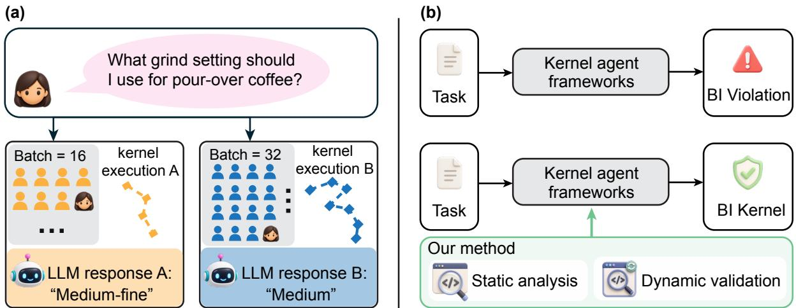
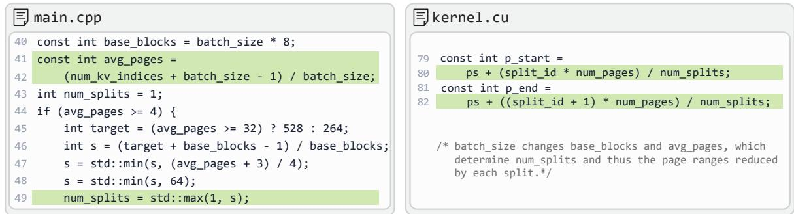
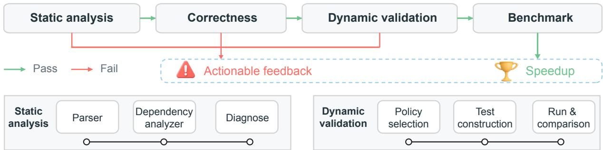
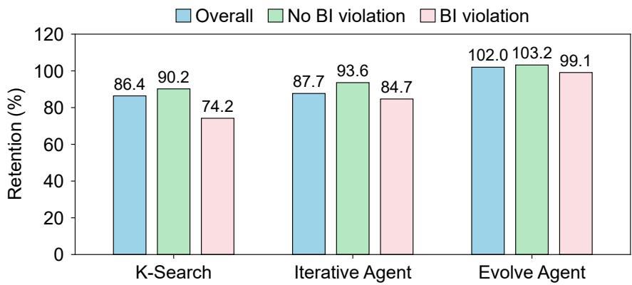

# God Does Not Play Dice: Enforcing Batch Invariance in Agentic Kernel Generation

Youwei Bao1,† Chengpeng Wang2 Simin Chen1,\*

1STAR Lab, George Mason University 2National University of Singapore

## ABSTRACT

Large language model (LLM) serving systems dynamically batch user requests for GPU execution, so the same request may be processed alongside different requests across runs. If the GPU kernels lack batch invariance (BI), this changing batch context can alter the numerical output for an unchanged input, undermining reproducibility. Existing kernel generation agents focus on correctness and efficiency but overlook BI. We find 19 confirmed BI violations among 83 batch-applicable released artifacts. To address this limitation, we propose BIEvolve, which combines contract-guided static dependency analysis with dynamic validation of bitwise consistency across batch contexts. BIEvolve is designed as a plug-in component for general kernel agents, allowing their original optimization capabilities to be reused while adding BI enforcement. We integrate it as successive acceptance gates in the optimization loop, rejecting structurally risky or dynamically non-invariant candidates before performance benchmarking and returning feedback to the agent. Experiments across three agent frameworks under baseline and BI-aware generation on real world LLM serving tasks show that BIEvolve improves the BI pass rate from 67.6% to 91.9% while retaining 91.8% of the baseline geometric mean speedup. These results demonstrate that BIEvolve can be incorporated into kernel optimization by agents as an additional reliability objective alongside correctness and speed.

GitHub: https://github.com/STAR-Computing/BIEvolve

Keywords LLM Agents, GPU Kernel Optimization, Code Generation, Batch Invariance, Reproducibility

## 1 Introduction

Large language model (LLM) agents are increasingly used to generate and optimize high performance GPU kernels [1; 2; 3; 4]. Existing kernel agents are typically evaluated along two axes: functional correctness and execution efficiency. A generated kernel is considered successful if it matches a reference implementation on test inputs while achieving lower latency, as exemplified by KernelBench [5]. However, this evaluation paradigm overlooks a critical reliability requirement: whether an unchanged input produces consistent numerical results as its execution context changes.

We focus on such overlooked reliability property, batch invariance (BI). For workloads in which samples are semantically independent, BI requires that an unchanged sample produce exactly the same output regardless of batch size or batch composition [6; 7]. A BI violation occurs when changing the batch context changes that sample’s output, as illustrated in Figure 1(a). Existing generated kernels are not necessarily BI because changing the batch context can alter low-level execution decisions, such as kernel tiling, parallel decomposition, and reduction order. Since floating point arithmetic is non-associative, these implementation changes can produce different results even with identical model weights and deterministic sampling settings [6; 8; 9]. Thus, a kernel may pass conventional correctness tests while still exhibiting batch-dependent behavior, undermining reproducibility, reliability and security [10; 9].

Evidence from released agent-generated kernels confirms that the problem occurs in practice (Table 1). Among 131 released artifacts, 83 have a meaningful semantic batch dimension, and 19 of these 83 (22.9%) contain confirmed BI violations.

BI is particularly important in modern LLM systems because batch contexts change continuously in practice. Dynamic and continuous batching repeatedly regroup user prompt request, so the same request may be executed under different batch configurations across runs [11]. Even small numerical deviations can propagate through autoregressive decoding and alter the final outputs. Enforcing BI

Table 1. BI evidence from released kernel artifacts.
<table><tr><td>Artifact source / benchmark</td><td>Batch- applicable / released</td><td>Confirmed BI violations</td><td>BI pass (%)</td></tr><tr><td>KernelBench.com / KernelBench.com</td><td>79 / 126</td><td>18</td><td>77.2</td></tr><tr><td>K-Search /</td><td>4/5</td><td>1</td><td>75.0</td></tr><tr><td>Total</td><td>83 /131</td><td>19</td><td>77.1</td></tr></table>

therefore improves reproducibility and predictable serving, facilitates debugging by making divergent operations easier to localize [12], and can reduce batch-dependent rollout, training mismatch in LLM reinforcement learning [13; 14; 15].

Existing work has introduced BI kernels and deterministic execution modes for specific inference systems [6; 7]. However, these methods rely on specialized, system-specific changes and cover only a limited set of kernels, making them hard to scale to agent-generated kernels. For example, Thinking Machines Lab [16] reports replacing only four PyTorch operators, providing limited coverage of the operator space. Moreover, recovering performance after enforcing BI execution still requires substantial kernel engineering, motivating an optimization agent that can search for efficient invariant implementations across operators and hardware. At the same time, replacing existing kernel agents would lose the strong optimization capabilities they already provide. This motivates a more general approach:

Adding batch invariance as a lightweight plug-in to existing kernel generation agents, while reusing their original optimization pipelines.

Figure 1 shows the working mechnisms of BIEvolve, which combines a domain specific language (DSL)-guided static analysis module with dynamic validation module. The DSL specifies BI-relevant task semantics, and the static analysis module consumes this specification to detect forbidden dependencies from declared batch symbols to protected parameters. The dynamic validation module compares an unchanged target sample across batch contexts. Candidates pass through DSL-guided static analysis, reference correctness testing, and dynamic validation before performance benchmarking. Rejected candidates receive actionable diagnostics that guide subsequent optimization attempts.

We plug BIEvolve into three representative LLM-based kernel optimization agents and evaluate it, evolving existing kernel agents to generate BI kernels. Across controlled agent reruns, BIEvolve improves the BI pass rate from 67.6% to 91.9% while retaining 91.8% of the baseline geometric mean speedup on tasks covering diverse kernel families and subtypes. We report tolerancebased reference correctness separately from exact BI and analyze the complementary violations detected by the static analysis module and dynamic validation module.

Our contributions are:

  
Figure 1. Batch dependence and the BIEvolve workflow. (a) An illustrative request can receive different outputs when its batch context changes. (b) A DSL-guided static analysis module rejects forbidden dependencies specified by contracts, while dynamic validation checks realized behavior across batch contexts.

• Problem Novelty. We identify BI as an overlooked reliability requirement in LLM-driven GPU kernel generation and optimization.

• Technique Novelty. We introduce BIEvolve, a plug-in for general kernel generation and optimization agents, combining a DSL-guided static analysis module with dynamic validation across semantically matched batch contexts.

• Empirical Evaluation. We integrate BIEvolve into three agent pipelines and evaluate BIEvolve on a task suite drawn from KernelBench.com and FlashInfer Bench workloads.

To our knowledge, this is the first work to make BI an acceptance criterion during LLM-driven GPU kernel optimization.

## 2 Background and Problem Statement

## 2.1 GPU Kernel Execution and Nondeterminism

A GPU executes a kernel by launching a grid of thread blocks, each containing multiple threads. To improve hardware utilization, GPU operator implementations often specialize execution to the input shape through library dispatch or shape-dependent kernel logic. Numerical outputs can therefore vary across executions for several distinct reasons, depending on what changes between them. Run-to-run nondeterminism can arise even for the same input and execution context, originating from unordered floating point atomics, although such atomics are uncommon in modern LLM forward inference. Numerical differences can also arise when the hardware or software environment changes [17; 9; 18; 19; 20; 21]. These sources are distinct from batchdependent variation, where the target input and execution environment remain unchanged but its surrounding batch context changes.

We focus on batch-dependent variation because batch contexts naturally change in modern LLM serving [22; 23; 24]. Dynamic batching and scheduling can alter the batch size, composition, and associated workload shapes seen by a kernel, even when the target request itself is unchanged. Consequently, changing the batch context can select a different kernel variant, alter tile dimensions, or change how work is partitioned across thread blocks, including the use of split reductions.

For reductions such as summation, matrix multiplication, and normalization, these threads compute partial results in parallel and subsequently combine them. Since floating-point addition is not associative, rounding can cause $( a + b ) + c$ to differ from $a + ( b + c ) $ . The numerical result can therefore depend on how a reduction is partitioned and in which order its partial results are accumulated [25; 9]. Changing the batch context can consequently change the reduction order, and thus the output bits for a target sample, even though the sample and its mathematical computation remain unchanged [26; 6; 9].

In attention, for example, changes in workload shape can alter tiling or Split-KV strategies and thereby change the floating point reduction order. Prior studies therefore identify batchdependent changes in floating point reduction and decomposition as a central source of batch variance in LLM kernels [6; 27]. In Figure 2, we provide a concrete code example identified in our study of a batch dependent split/reduction: batch\_size changes base\_blocks and avg\_pages, which determine num\_splits and thus the page ranges reduced by each split.

  
Figure 2. Representative kernel code patterns that introduce batch variance.

## 2.2 Batch Invariance

Unless otherwise stated, all executions considered below use the same hardware and software enviroment. Let K(B) denote the output of a candidate kernel K on a batch B, and let X denote the input domain. For each target sample $x \in \mathcal { X } ,$ , let $\mathcal C ( x )$ be the set of admissible batch contexts that preserve x and its reference semantics while allowing the batch size, composition, and position of x to vary. A context $c \in { \mathcal { C } } ( x )$ produces a batch $B _ { c }$ in which x appears at position $i _ { c } .$ We say that K is batch invariant over X if $\forall x \in { \mathcal { X } }$ and ∀c, $c ^ { \prime } \in \mathcal { C } ( x ) , K ( B _ { c } ) _ { i _ { c } } \equiv _ { \mathrm { b i t } } K ( B _ { c ^ { \prime } } ) _ { i _ { c ^ { \prime } } }$

Thus, the output associated with a preserved target sample must be bitwise identical across all admissible batch contexts. This definition treats batch invariance as an umbrella property encompassing invariance to batch size, batch composition, and batch position; restricting C(x) to changes along one dimension yields the corresponding narrower property.

Problem definition. Given a kernel task, its reference implementation, and a set of admissible batch contexts, our goal is to generate an optimized kernel that (i) satisfies the task’s numerical correctness criterion, (ii) is BI across admissible contexts under a fixed hardware and software environment, and (iii) achieves high kernel execution performance.

## 3 Methodology

BIEvolve is designed as a plug-in workflow for existing kernel agents. As illustrated in Figure 1, it combines a DSL-guided static analysis module with dynamic validation module, while retaining each framework’s native correctness test and performance benchmark. Figure 3 provides a detailed view of BIEvolve. Both modules are driven by domain knowledge, the design rules could also be automatically extracted by an agent from representative examples. The static module uses contracts that specify forbidden batch dependencies into protected parameters; the dynamic module tests whether a preserved sample produces bitwise identical outputs across valid batch contexts. When a candidate fails either module, BIEvolve returns actionable diagnostics through the agent’s existing feedback channel to guide the next optimization round.

  
Figure 3. BIEvolve candidate evaluation workflow. BI failures produce actionable feedback, while accepted candidates proceed to speedup measurement.

## 3.1 DSL-Guided Static Analysis Module

BI contract DSL. The static analysis module detects source level dependencies that are known to threaten BI before executing a generated kernel. It takes two inputs: task metadata describing the task semantics and the generated source bundle. The metadata is used to select the applicable BI contract, while the source code is parsed into a representation suitable for dependency analysis. The analyzer then checks whether any protected kernel parameter depends on the batch context. The module outputs either a pass decision or an actionable diagnosis identifying the violating dependency.

The contract DSL specifies two elements: batch context variables, including batch size and batch-derived workload quantities, and protected parameters, whose values must remain independent of the batch context variables. Contracts are organized hierarchically as global, kernel family, and subtype rules; task metadata resolves the applicable contracts, allowing a new task to inherit protections from its semantic family. Aliases map implementation specific variable names to canonical protected parameters. The simplified DSL grammar is shown below in Figure 4.

The current DSL protects key mechanisms inclduing: split/reduction structure (NUM\_SPLITS), recurrence decomposition (RECURRENCE\_SEGMENTS), and random stream state (RNG\_SEED).

Source parsing. Given task metadata, the contract parser resolves the applicable global, family, and subtype contracts and exposes their declared batch sources and protected parameters to the analyzer. In parallel, the source parser processes the complete generated source bundle. Python and Triton code are parsed using abstract syntax tree (AST)-based analysis that tracks dependencies through argument passing, container accesses, control flow, and a restricted set of same file helper functions. C/C++/CUDA code is handled with targeted dependency patterns, and embedded generated native code is included in the same analysis. The resulting representation provides the dependency information required by the subsequent analyzer.

Contract-guided dependency analysis. The analyzer treats contract-declared batch symbols and their derived global quantities as dependency sources, and protected parameters as sinks. It propagates both data and control dependence through the parsed program. A candidate is rejected if a protected parameter is assigned directly or transitively from batch context, or if its value is selected through a batch dependent conditional or loop. Thus, the contract determines what must remain batch independent, while the analyzer determines whether the generated implementation satisfies that requirement. Dependencies that cannot be reliably

$$
\begin{array} { r l } & { \mathrm { 4 c m a r a t } \lambda ^ { 2 } = \lambda ^ { 2 } \left( \begin{array} { l l l l } { 1 } & { - 2 \lambda ^ { 2 } } & { 0 } & { 0 } \\ { 0 } & { 0 } & { 0 } \\ { 0 } & { 0 } & { 0 } & { 0 } \\ { 0 } & { 0 } & { 0 } & { 0 } \end{array} \right) } \\ & { \quad \quad \quad \quad \quad \quad \quad \quad \quad \quad \quad \quad \quad \quad \quad \quad \quad \quad \quad \quad \quad \quad \quad \quad \quad \quad \quad \quad \quad \quad \quad \quad \quad \quad \quad }  \\ & { \quad \quad \quad \quad \quad \quad \quad \quad \quad \quad \quad \quad \quad \quad \quad \quad \quad \quad \quad \quad \quad \quad \quad \quad \quad \quad \quad \quad \quad \quad \quad \quad \quad \quad \quad \quad \quad \quad \quad \quad }  \\ & & { \quad \quad \quad \quad \quad \quad \quad \quad \quad \quad \quad \quad \quad \quad \quad \quad \quad \quad \quad \quad \quad \quad \quad \quad \quad \quad \quad \quad \quad \quad \quad \quad \quad \quad \quad \quad \quad \quad \quad \quad \quad \quad \quad \quad }  \\ & & { \quad \quad \quad \quad \quad \quad \quad \quad \quad \quad \quad \quad \quad \quad \quad \quad \quad \quad \quad \quad \quad \quad \quad \quad \quad \quad \quad \quad \quad \quad \quad \quad \quad \quad \quad \quad \quad \quad \quad \quad \quad \quad \quad \quad \quad \quad \quad }  \\ & & { \quad \quad \quad \quad \quad \quad \quad \quad \quad \quad \quad \quad \quad \quad \quad \quad \quad \quad \quad \quad \quad \quad \quad \quad \quad \quad \quad \quad \quad \quad \quad \quad \quad \quad \quad \quad \quad \quad \quad \quad \quad \quad \quad \quad \quad \quad \quad \quad }  \\ & & { \quad \quad \quad \quad \quad \quad \quad \quad \quad \quad \quad \quad \quad \quad \quad \quad \quad \quad \quad \quad \quad \quad \quad \quad \quad \quad \quad \quad \quad \quad \quad \quad \quad \quad \quad \quad \quad \quad \quad \quad \quad \quad \quad \quad \quad \quad } \\ & &  \quad \quad \quad \quad \quad \quad \quad \quad \quad \quad \quad \quad \quad \quad \quad \quad \quad \quad \quad \quad \quad \quad \quad \quad \quad \quad \quad  \end{array}
$$

Semantic constraints: inheritance is resolved before analysis; aliases denote the same parameter; policies

respectively forbid batch dependence, permit dependence on batch, or leave dependence unrestricted.

Figure 4. Simplified Backus-Naur Form (BNF) grammar of the BI contract DSL.

resolved statically, such as opaque runtime dispatch or autotuning behavior, are left to the dynamic validation module.

Diagnostic feedback. For a rejected candidate, the analyzer converts the detected dependency into compact feedback for the kernel agent. It reports the protected mechanism, source code location, and dependency path from the batch source to the protected parameter, together with mechanism specific repair guidance.

## 3.2 Dynamic Validation Module

Test policy selection. The dynamic validation module tests whether an executable candidate produces the same output for an unchanged sample under different batch contexts. Its input is a reference-correct candidate together with task metadata, and its output is either a pass decision or a diagnostic describing the first detected cross batch mismatch. Task metadata selects a predefined batch test policy according to the kernel family or subtype. General kernels use less batch contexts, while higher risk families such as attention use additional contexts to exercise more execution boundaries.

Cross batch comparison. For each selected batch context, the test harness constructs a valid workload around the same target sample. The target sample is first executed on the baseline batch context, and the target output is recorded. It is then executed under each larger batch context, after which the corresponding target output is extracted and compared bitwise with the baseline. BI requires identical structure, shape, dtype, and numerical values. Testing stops at the first mismatch.

Feedback. If all tested contexts produce identical target outputs, the candidate passes dynamic validation. Otherwise, dynamic module reports the failing batch context through the agent’s existing feedback path.

## 3.3 Plug into the Agent Loop

Candidate evaluation pipeline. BIEvolve is integrated into the existing candidate evaluation pipeline rather than modifying the agent’s generation or search algorithm. A lightweight framework adapter packages the information required by the static and dynamic modules, inserts both modules into the candidate evaluation pipeline, and converts BI failures into the framework’s original feedback format. At each optimization round, a generated candidate passes through four sequential stages: (1) static BI analysis, (2) reference correctness test, (3) dynamic BI validation, and (4) performance benchmarking. The static analysis first removes candidates with recognized BI violation patterns. The framework’s native correctness test then filters incorrect implementations. Dynamic validation checks the remaining candidates across batch contexts, and performance is measured only after both correctness and BIEvolve are passed. This ordering prevents unnecessary execution of statically invalid candidates and avoids interpreting correctness failures as BI violations.

Framework adapter. For each agent framework, the adapter supplies the information needed for the BI modules: the generated source and task metadata for static analysis, the test harness and task metadata for dynamic validation. The framework’s original correctness criterion, benchmark procedure, prompt, candidate selection policy, and search state remain unchanged. Thus, the BIEvolve can be attached to agents with different optimization strategies.

In addition, the adapter routes the outputs of the BI modules. If a candidate passes, the evaluation pipeline proceeds. If either BI module rejects the candidate, subsequent evaluation stages are skipped, and the diagnostic is recorded through the framework’s existing evaluation history or log and inserted into its feedback path. This allows subsequent optimization rounds to condition on previous BI failures and revise the implementation accordingly.

## 4 Experiments

In this section, we evaluate whether BIEvolve reduces BI violations in agent-generated kernels while preserving ordinary correctness and useful performance. The evaluation combines controlled kernel generation with three agent frameworks, subgroup performance analysis, and an ablation of the BIEvolve components.

## 4.1 Experimental Setup

Datasets. Our controlled kernel generation experiment uses a compact, risk-focused suite drawn from the hard tasks on KernelBench.com Arledge [28] and the FlashInfer trace and contest workloads described by Xing et al. [29] and FlashInfer Team [30]. We select batch applicable kernels spanning attention, linear attention, mixture-of-experts (MoE), normalization, and sampling. Attention covers GQA, MLA, and DSA across representative prefill and decode settings, while linear attention includes KDA and Gated DeltaNet variants.

We emphasize attention and linear attention because their execution commonly involves batch dependent partitioning, algorithm selection, and reductions, while the remaining families broaden coverage beyond these higher risk regimes.

Agent frameworks. We evaluate K-Search from Cao et al. [2] and the Iterative Agent and Evolve Agent from FlashInfer Team [31] to cover three representative search paradigms in feedback-driven kernel generation. The Iterative Agent refines a current implementation along a single trajectory; the Evolve Agent explores multiple implementations through recent and elite candidate pools; and K-Search guides implementation generation using a co-evolving world model that separates planning from code instantiation.

These frameworks differ in how they retain search history, select candidates for improvement, and explore alternative designs. Together, they provide broad architectural coverage for evaluating whether BIEvolve generalizes beyond a particular refinement policy or search state representation.

For each framework, we compare vanilla generation with a rerun using BIEvolve as described in Section 3. We use 20 optimization turns for K-Search and 25 turns for the Iterative Agent and Evolve Agent, keeping the turn budget unchanged between vanilla and BI-aware generation within each framework. Controlled generation uses Gemini 3.7 Flash for all three frameworks on an NVIDIA H100 NVL GPU.

Evaluation. We evaluate the selected kernels using the same protocol across generation configurations. Ordinary correctness compares each kernel with its task reference using the prescribed numerical tolerance. We report these outcomes separately, since tolerance-based agreement with a reference does not imply BI.

Performance is measured as speedup relative to the corresponding task reference and summarized using geometric means. Performance retention is the ratio of the BI-aware and vanilla geometric mean speedups over the same tasks.

## 4.2 Main Results

Controlled kernel generation. We report the final-solution BI pass rate, defined as the fraction of correctness-passing kernels with no confirmed BI violation, and the BI intervention rate, defined as the fraction of tasks for which BIEvolve rejects at least one generated candidate during optimization. Correctness is evaluated using the task-specific reference tolerance. Table 2 compares baseline and BI-aware generation under these metrics. GM denotes geometric mean. Speedup retained is reported once per framework for the BI-aware/baseline comparison. Retained speedup is $1 0 0 \times \mathrm { G M _ { B I - a w a r e } / G M _ { b a s e l i n e } } ,$ using the same tasks and reference implementations.

In the K-Search study, BIEvolve increases the BI pass rate from 75.7% to 97.4% under the final solution evaluation, while ordinary correctness changes from 94.9% to 97.4%. For the Iterative Agent and Evolve Agent, BI pass rates change from 48.6% to 89.2% and from 78.4% to 89.2%, respectively, while ordinary correctness remains 94.9% in both conditions for both frameworks.

The BI intervention rate is highest for the Iterative Agent at 43.6%, compared with 23.1% for K-Search and 25.6% for Evolve Agent, indicating that the framework with the weakest baseline BI pass rate required intervention on substantially more tasks and also exhibited the largest final BI pass rate improvement. Notably, intervention rates may exceed the corresponding final BI pass gains, indicating that BIEvolve also filters BI violating intermediate candidates on tasks whose baseline final solution is BI.

Table 2. Controlled kernel generation results across agent frameworks.
<table><tr><td>Framework</td><td>Generation condition</td><td>(%)</td><td>BI pass BI intervention (%)</td><td>GM speedup (x)</td><td>Speedup retained (%)</td><td>Correctness pass (%)</td></tr><tr><td rowspan="2">K-Search</td><td>Baseline</td><td>75.7</td><td></td><td>40.94</td><td rowspan="2">86.4</td><td>94.9</td></tr><tr><td>BI-aware</td><td>97.4</td><td>23.1</td><td>35.39</td><td>97.4</td></tr><tr><td rowspan="2">Iterative Agent</td><td>Baseline</td><td>48.6</td><td>–</td><td>25.84</td><td rowspan="2">87.7</td><td>94.9</td></tr><tr><td>BI-aware</td><td>89.2</td><td>43.6</td><td>22.66</td><td>94.9</td></tr><tr><td rowspan="2">Evolve Agent</td><td>Baseline</td><td>78.4</td><td>1</td><td>22.85</td><td rowspan="2">102.0</td><td>94.9</td></tr><tr><td>BI-aware</td><td>89.2</td><td>25.6</td><td>23.31</td><td>94.9</td></tr><tr><td rowspan="2">Overall</td><td>Baseline</td><td>67.6</td><td></td><td>28.91</td><td rowspan="2">91.8</td><td>94.9</td></tr><tr><td>BI-aware</td><td>91.9</td><td>30.8</td><td>26.54</td><td>95.7</td></tr></table>

Performance retention. For K-Search, the BI-aware rerun achieves a geometric mean speedup of 35.39×, compared with 40.94× for vanilla generation, retaining 86.4% of the vanilla speedup. The corresponding retention for the Iterative Agent and Evolve Agent is 87.7% and 102.0%.

Figure 5 compares performance retention across baseline BI outcomes. We partition tasks according to whether their vanilla kernels have a confirmed BI violation.

  
Figure 5. Speedup retained by baseline BI outcome across agent frameworks. Subgroups are grouped by the baseline final kernel’s BI outcome.

Aggregate retention is lower for tasks with confirmed violations than for tasks without violations (86.0% versus 95.7%), consistent with BI gating excluding fast but batch-dependent optimization choices [6]. The Evolve Agent retains nearly all performance in both subgroups, suggesting that broader search can recover invariant alternatives and that the BI cost depends partly on search strategy.

## 4.3 BIEvolve Component Ablation

To isolate the contribution of each BIEvolve component from changes in the agent search trajectory, Table 3 compares static-analysis-only, dynamic-validation-only, and full BIEvolve configurations offline on the same balanced, independently labeled candidate pool. The full BIEvolve measurement preserves sequential early exit.

BIEvolve detects 92% of confirmed violations, compared with 83% for the static analysis module and 55% for the dynamic validation module. It rejects 2% of candidates with no confirmed BI violation. Median evaluation time is 10.21 ms per candidate for full BIEvolve, versus 7.69 ms and 2.24 ms for the static analysis module and dynamic validation module, respectively. The higher BIEvolve detection rate supports the intended complementarity: static analysis covers modeled dependency patterns, while dynamic validation can expose realized behavior outside those rules.

Table 3. BIEvolve component ablation on a shared candidate pool (N = 200).
<table><tr><td rowspan="2">Component</td><td colspan="3">BI violation detection (%)</td><td rowspan="2">False rejection (%)</td><td rowspan="2">Median evaluation time (ms/candidate)</td></tr><tr><td>Overall</td><td>Unique</td><td>Overlap</td></tr><tr><td>Static module</td><td>83</td><td>37</td><td>46</td><td>2</td><td>7.69</td></tr><tr><td>Dynamic module</td><td>55</td><td>9</td><td>46</td><td>0</td><td>2.24</td></tr><tr><td>BIEvolve</td><td>92</td><td>一</td><td>一</td><td>2</td><td>10.21</td></tr></table>

## 5 Related Work

In this section, we review LLM-based GPU kernel generation and complementary approaches to deterministic inference.

Kernel generation and optimization. Existing work [32; 33; 34; 35; 36; 37; 38; 39; 40; 41; 42; 43; 44; 45] combines kernel evaluation with feedback-driven generation, learned refinement, or structured search. KernelBench, introduced by Ouyang et al. [5], formulates kernel generation as replacing a PyTorch computation with a functionally equivalent, faster implementation, and studies repeated sampling and refinement using execution and profiling feedback. FlashInfer-Bench, proposed by Xing et al. [29], extends evaluation to production LLM inference workloads through a unified representation of kernel tasks, implementations, and measurements. Its framework integrates correctness validation, performance benchmarking, and deployment. These are evaluation frameworks rather than individual agent architectures. Representative agent designs include Kevin by Baronio et al. [46], which trains multi-turn refinement through reinforcement learning with correctness and speedup rewards, and K-Search by Cao et al. [2], which separates high-level optimization planning from code implementation. K-Search updates its search tree and optimization priorities through a co-evolving intrinsic world model informed by execution feedback. Despite their different designs, these approaches primarily emphasize correctness, performance, or broader evaluation robustness. Their validation criteria do not explicitly protect BI during optimization: numerical agreement with a reference does not establish bitwise consistency across batch configurations [47; 48; 49; 50]. In this work, we focus on explicit BI protection inside the kernel optimization loop.

BI kernels and deterministic inference. He and Thinking Machines Lab [6] and vLLM Project [7] provide specialized BI kernels or serving modes for supported implementations. Their designs control batch-dependent tiling and reduction schedules, requiring careful engineering to maintain performance tuning. In addition, they do not provide BI validation for arbitrary agent-generated candidates. Yuan et al. [51] systematically links changes in evaluation batch size and hardware configuration to numerical differences and divergent generated responses.

There are alternative serving designs reduce reliance on BI kernels. LLM-42, introduced by Gond et al. [8], generates candidate tokens through ordinary decoding, then replays them under a fixed-shape verification schedule and rolls back mismatches. CoRun, introduced by Zhao et al. [52], instead controls execution shapes through scheduling and padding: it processes each prompt separately and pads decoding batches to a fixed size, while restricting attention reductions that would otherwise vary with batching. These methods illustrate complementary ways to obtain deterministic inference, whereas our contribution concerns protecting BI as agents optimize kernel implementations.

## 6 Conclusion and Future Work

BI should be an explicit evaluation dimension for generated GPU kernels when task semantics treat samples independently. Our analysis of released artifacts shows that conventional correctness and speed evaluation can miss batch-dependent outputs. We introduce BIEvolve, which plugs into kernel generation frameworks, making BI actionable within existing generation and optimization workflows. On the configured test domain, BIEvolve removes most observed violations while preserving conventional correctness and speedup. Together, these findings support evaluating BI alongside correctness and performance.

Several limitations motivate future work. The static analysis module currently provides limited cross-file analysis. Extending this analysis would improve coverage of dependencies spanning implementation boundaries. Furthermore, agent-based extraction and learning from representative examples provide paths for automatic design rule synthesis and refinement. Finally, our experiments measure batch dependence at the kernel output level, future work should assess its end-to-end effects on token generation, evaluation, serving, and reinforcement learning.

## References

[1] Juncheng Dong, Yang Yang, Tao Liu, Yang Wang, Feng Qi, Vahid Tarokh, Kaushik Rangadurai, and Shuang Yang. STARK: Strategic team of agents for refining kernels. In International Conference on Learning Representations, 2026. URL https://proceedings.iclr.cc/paper\_files/paper/2026/hash 229608737599da1f292d4cf5a18c99f0-Abstract-Conference.html.

[2] Shiyi Cao, Ziming Mao, Joseph E. Gonzalez, and Ion Stoica. K-Search: LLM kernel generation via coevolving intrinsic world model. arXiv preprint arXiv:2602.19128, 2026. doi: 10.48550/arXiv.2602.19128. URL https://arxiv.org/abs/2602.19128.

[3] Yang Yu, Peiyu Zang, Chi Hsu Tsai, Haiming Wu, Yixin Shen, Jialing Zhang, Haoyu Wang, Zhiyou Xiao, Jingze Shi, Yuyu Luo, et al. Towards automated kernel generation in the era of llms. arXiv preprint arXiv:2601.15727, 2026.

[4] Shiyi Cao, Ziming Mao, Joseph E Gonzalez, and Ion Stoica. K-search: Llm kernel generation via co-evolving intrinsic world model. arXiv preprint arXiv:2602.19128, 2026.

[5] Anne Ouyang, Simon Guo, Simran Arora, Alex L. Zhang, William Hu, Christopher Ré, and Azalia Mirhoseini. KernelBench: Can LLMs write efficient GPU kernels? In Proceedings of the 42nd International Conference on Machine Learning, volume 267 of Proceedings ofMachine Learning Research, pages 47356–47415, 2025. URL https://proceedings.mlr.press/v267/ouyang25a.html.

[6] Horace He and Thinking Machines Lab. Defeating nondeterminism in LLM inference. Thinking Machines Lab, Connectionism, September 2025. URL https://thinkingmachines.ai/blog/ defeating-nondeterminism-in-llm-inference/.

[7] vLLM Project. Batch invariance. vLLM documentation, 2026. URL https://docs.vllm.ai/en/ latest/features/batch\_invariance/. Accessed 2026-09-24.

[8] Raja Gond, Aditya K. Kamath, Ramachandran Ramjee, and Ashish Panwar. LLM-42: Enabling determinism in LLM inference with verified speculation. In Proceedings ofthe ACM SIGOPS 32nd Symposium on Operating Systems Principles, pages 916–931. Association for Computing Machinery, 2026. doi: 10.1145/3830418.3843901. URL https://doi.org/10.1145/3830418.3843901.

[9] Simin Chen, Jinjun Peng, Yixin He, Junfeng Yang, and Baishakhi Ray. Your compiler is backdooring your model: Understanding and exploiting compilation inconsistency vulnerabilities in deep learning compilers. In 2026 IEEE Symposium on Security and Privacy (SP), pages 233–251. IEEE, 2026. doi: 10.1109/SP63933.2026.00097. URL https://doi.org/10.1109/SP63933.2026.00097.

[10] Shuyin Ouyang, Jie M. Zhang, Mark Harman, and Meng Wang. An empirical study of the nondeterminism of ChatGPT in code generation. ACM Transactions on Software Engineering and Methodology, 34(2):42:1–42:28, 2025. doi: 10.1145/3697010. URL https://doi.org/10.1145/3697010.

[11] Woosuk Kwon, Zhuohan Li, Siyuan Zhuang, Ying Sheng, Lianmin Zheng, Cody Hao Yu, Joseph E. Gonzalez, Hao Zhang, and Ion Stoica. Efficient memory management for large language model serving with PagedAttention. In Proceedings of the 29th Symposium on Operating Systems Principles, pages 611–626, 2023. doi: 10.1145/3600006.3613165. URL https://doi.org/10.1145/3600006.3613165.

[12] Ziming Zhou, Yinjie Zhao, Hang Zhu, Wenxiao Wang, Zhihao Bai, Yun Zhang, Shuguang Wang, Haibin Lin, and Peng Huang. OpGuard: Bitwise alignment for precise and general debugging of production LLM training. In 20th USENIX Symposium on Operating Systems Design and Implementation (OSDI 26), pages 1385–1406. USENIX Association, 2026. URL https://www.usenix.org/conference/ osdi26/presentation/zhou-ziming.

[13] Feng Yao, Liyuan Liu, Dinghuai Zhang, Chengyu Dong, Jingbo Shang, and Jianfeng Gao. On the rollout-training mismatch in modern RL systems. In NeurIPS Workshop on Efficient Reasoning, 2025. URL https://openreview.net/forum?id=8MHqvb4lK9.

[14] Ziyang Zhang, Xinheng Ding, Jiayi Yuan, Rixin Liu, Huizi Mao, Jiarong Xing, and Zirui Liu. Deterministic inference across tensor parallel sizes that eliminates training-inference mismatch. In Proceedings of the 43rd International Conference on Machine Learning, volume 306 of Proceedings of Machine Learning Research, pages 155026–155042. PMLR, 2026. URL https://proceedings.mlr. press/v306/zhang26ag.html.

[15] Tianle Zhong, Neiwen Ling, Yifan Pi, Zijun Wei, Tianshu Yu, Geoffrey Fox, Peng Wu, and Xiao Yu. Diagnosing training inference mismatch in LLM reinforcement learning via a zero-mismatch reference. arXiv preprint arXiv:2605.14220, 2026. doi: 10.48550/arXiv.2605.14220. URL https: //arxiv.org/abs/2605.14220.

[16] Thinking Machines Lab. Batch invariant ops. GitHub repository, 2025. URL https://github.com/ thinking-machines-lab/batch\_invariant\_ops. Accessed 2026-09-24.

[17] Simin Chen, Shiyi Wei, Cong Liu, and Wei Yang. DyCL: Dynamic neural network compilation via program rewriting and graph optimization. In Proceedings of the 32nd ACM SIGSOFT International Symposium on Software Testing and Analysis, pages 614–626. Association for Computing Machinery, 2023. doi: 10.1145/3597926.3598082. URL https://doi.org/10.1145/3597926.3598082.

[18] Yifei Wang, Tianlin Li, Xiaohan Zhang, Xiaoyu Zhang, Wei Ma, Mingfei Cheng, and Li Pan. Hidden reliability risks in large language models: Systematic identification of precision-induced output disagreements. arXiv preprint arXiv:2604.19790, 2026.

[19] Jonas Möller, Erik Imgrund, Thorsten Eisenhofer, and Konrad Rieck. Hardware-triggered backdoors. arXiv preprint arXiv:2601.21902, 2026.

[20] Habibur Rahaman, Qipan Xu, Zafaryab Haider, Prabuddha Chakraborty, Swarup Bhunia, and Fnu Suya. (a) ispy: Parasitic trojans for machine learning infrastructure. arXiv preprint arXiv:2607.17550, 2026.

[21] Nils Loose, Jonas Sander, Felix Mächtle, and Thomas Eisenbarth. Floatdoor: Platform-triggered backdoors in llms. arXiv preprint arXiv:2606.19535, 2026.

[22] Woosuk Kwon, Zhuohan Li, Siyuan Zhuang, Ying Sheng, Lianmin Zheng, Cody Hao Yu, Joseph E. Gonzalez, Hao Zhang, and Ion Stoica. Efficient memory management for large language model serving with pagedattention. In Proceedings of the ACM SIGOPS 29th Symposium on Operating Systems Principles, 2023.

[23] Pierrick Pochelu, Serge G Petiton, and Bruno Conche. An efficient and flexible inference system for serving heterogeneous ensembles of deep neural networks. In 2021 IEEE International Conference on Big Data (Big Data), pages 5225–5232. IEEE, 2021.

[24] Weiguang Pang, Xiantong Luo, Kailun Chen, Dong Ji, Lei Qiao, and Wang Yi. Efficient cuda stream management for multi-dnn real-time inference on embedded gpus. Journal of Systems Architecture, 139:102888, 2023.

[25] Ravishka Rathnasuriya, Nidhi Majoju, Zihe Song, and Wei Yang. An investigation on numerical bugs in GPU programs towards automated bug detection. Proceedings of the ACM on Software Engineering, 2(ISSTA):1654–1677, 2025. doi: 10.1145/3728950. URL https://doi.org/10.1145/3728950.

[26] NVIDIA. Floating point and IEEE 754. CUDA Toolkit documentation, version 13.0.3, 2025. URL https://docs.nvidia.com/cuda/archive/13.0.3/floating-point/index.html. Accessed 2026-09- 24.

[27] Naci Cankaya. Bit-exact AI inference verification without performance tradeoffs. In ICML 2026 Workshop on Technical AI Governance Research, 2026. URL https://openreview.net/forum?id=ECU7tSBQY3.

[28] Elliot Arledge. KernelBench.com: Agentic GPU kernel benchmark results. Benchmark website, 2026. URL https://kernelbench.com/. Accessed 2026-09-24.

[29] Shanli Xing, Yiyan Zhai, Alexander Jiang, Yixin Dong, Yong Wu, Zihao Ye, Charlie F. Ruan, Yingyi Huang, Yineng Zhang, Liangsheng Yin, Aksara Bayyapu, Luis Ceze, and Tianqi Chen. FlashInfer-Bench: Building the virtuous cycle for AI-driven LLM systems. In Proceedings ofMachine Learning and Systems, volume 8, 2026. URL https://proceedings.mlsys.org/paper\_files/paper/2026/hash/ 37e44c4b5321605735be9761f9b758fc-Abstract-Conference.html.

[30] FlashInfer Team. MLSys 2026 FlashInfer AI Kernel Generation Contest. Contest website, 2026. URL https://mlsys26.flashinfer.ai/. Accessed 2026-09-24.

[31] FlashInfer Team. MLSys 2026 FlashInfer AI Kernel Generation Contest: Agent baseline. GitHub repository, 2026. URL https://github.com/flashinfer-ai/mlsys26-agent-baseline. Accessed 2026-09-24.

[32] He Du, Qiming Ge, Jiakai Hu, Aijun Yang, Zheng Cai, Zixian Huang, Sheng Yuan, Qinxiu Cheng, Xinchen Xie, Yicheng Chen, et al. Kernel-smith: A unified recipe for evolutionary kernel optimization. arXiv preprint arXiv:2603.28342, 2026.

[33] Changxin Ke, Rui Zhang, Zixiang Fang, Zhenghong Li, Yuanbo Wen, Jiashuo Shen, Shuo Wang, Jiaming Guo, Ling Li, Qi Guo, et al. Kernelzero: Co-evolving proposer and coder for continuously improved gpu kernel generation. arXiv preprint arXiv:2609.33074, 2026.

[34] Qi Fan, An Zou, and Yehan Ma. Cuda-harness: Harnessing agentic cuda kernel generation and optimization from natural language. arXiv preprint arXiv:2609.00058, 2026.

[35] Haohui Mai, Xiaoyan Guo, Xiangyun Ding, Daifeng Li, Qiuchu Yu, Chenzhun Guo, Cong Wang, Jiacheng Zhao, Christos Kozyrakis, and Binhang Yuan. Ave: Guiding agentic gpu optimization using data-flow invariants. In Proceedings ofthe ACM SIGOPS 32nd Symposium on Operating Systems Principles, pages 1055–1069, 2026.

[36] Zihao Ye, Yingyi Huang, Hongyi Jin, Bohan Hou, Junru Shao, Zhongming Yu, Jinqi Chen, Meghan Cowan, Shiyi Cao, Shanli Xing, et al. Cake: Compiler-agent co-design for frontier kernel evolution. arXiv preprint arXiv:2608.12629, 2026.

[37] Siva Kumar Sastry Hari, Vignesh Balaji, Sana Damani, Qijing Huang, and Christos Kozyrakis. Improving efficiency of gpu kernel optimization agents using a domain-specific language and speed-of-light guidance. arXiv preprint arXiv:2603.29010, 2026.

[38] Jihu Guo, Sitian Lu, Tenghui Ma, Wei Gao, Zhisheng Ye, Xingcheng Zhang, and Dahua Lin. Specgen: Accelerating agentic kernel optimization with speculative generation. arXiv preprint arXiv:2606.17518, 2026.

[39] Xinyu Xiao, Zihe Song, Dezhi Ran, Wei Yang, and Tao Xie. Tilecas: Cascading kernel development across programming abstractions. arXiv preprint arXiv:2610.14740, 2026.

[40] Taras Sereda, Burak Bartan, Ankita Nayak, Tom St John, Natalie Serrino, and Zain Asgar. Kforge: Llm-driven cross-platform kernel generation for ai accelerators. arXiv preprint arXiv:2606.02963, 2026.

[41] Dezhi Ran, Shuxiao Xie, Mingfang Ji, Ziyue Hua, Mengzhou Wu, Yuan Cao, Yuzhe Guo, Yu Hao, Linyi Li, Yitao Hu, et al. Kernelband: Boosting llm-based kernel optimization with a hierarchical and hardware-aware multi-armed bandit. arXiv e-prints, pages arXiv–2511, 2025.

[42] Nina Wiedemann, Quentin Leboutet, Michael Paulitsch, Diana Wofk, and Benjamin Ummenhofer. Kernelfoundry: Hardware-aware evolutionary gpu kernel optimization. arXiv preprint arXiv:2603.12440, 2026.

[43] Qiuyi Qu, Yicheng Sui, Yufei Sun, Rui Chen, Xiaofei Zhang, Yuzhi Zhang, Haofeng Wang, and Ge Lan. A two-stage gpu kernel tuner combining semantic refactoring and search-based optimization. arXiv preprint arXiv:2601.12698, 2026.

[44] Shuoming Zhang, Qiuchu Yu, Yangyu Zhang, Ruiyuan Xu, Xiyu Shi, Guangli Li, Xiaobing Feng, Huimin Cui, and Jiacheng Zhao. Learning when to optimize: Verified optimization skills from expert gpu-kernel lineages. arXiv preprint arXiv:2605.28213, 2026.

[45] Anjiang Wei, Tianran Sun, Yogesh Seenichamy, Hang Song, Anne Ouyang, Azalia Mirhoseini, Ke Wang, and Alex Aiken. Astra: A multi-agent system for gpu kernel performance optimization. arXiv preprint arXiv:2509.07506, 2025.

[46] Carlo Baronio, Pietro Marsella, Ben Pan, Simon Guo, and Silas Alberti. Kevin: Multi-turn RL for generating CUDA kernels. In International Conference on Learning Representations, 2026. URL https://proceedings.iclr.cc/paper\_files/paper/2026/hash/ 86ba836d4c5dd859d795a172911745e2-Abstract-Conference.html.

[47] Qitong Sun, Jun Han, Tianlin Li, Zhe Tang, Sheng Chen, Fei Yang, Aishan Liu, Xianglong Liu, and Yang Liu. Kernelskill: A multi-agent framework for gpu kernel optimization. arXiv preprin arXiv:2603.10085, 2026.

[48] Xinguo Zhu, Shaohui Peng, Jiaming Guo, Yunji Chen, Qi Guo, Yuanbo Wen, Hang Qin, Ruizhi Chen, Qirui Zhou, Ke Gao, et al. Qimeng-kernel: Macro-thinking micro-coding paradigm for llm-based high-performance gpu kernel generation. In Proceedings of the AAAI Conference on Artificial Intelligence, volume 40, pages 29168–29176, 2026.

[49] Tankun Li, Zhi Chen, and Yaohua Tang. Leap: Lean environment-feedback via adaptive pruning for code rl in gpu kernel generation. arXiv preprint arXiv:2608.01804, 2026.

[50] Arya Tschand, Muhammad Awad, Ryan Swann, Kesavan Ramakrishnan, Jeffrey Ma, Keith Lowery, Ganesh Dasika, and Vijay Janapa Reddi. Swizzleperf: Hardware-aware llms for gpu kernel performance optimization. arXiv preprint arXiv:2508.20258, 2025.

[51] Jiayi Yuan, Hao Li, Xinheng Ding, Wenya Xie, Yu-Jhe Li, Wentian Zhao, Kun Wan, Jing Shi, Xia Hu, and Zirui Liu. Understanding and mitigating numerical sources of nondeterminism in LLM inference. In Advances in Neural Information Processing Systems, volume 38, pages 188045–188077, 2025. doi: 10.52202/085713-5653. URL https://proceedings.neurips.cc/paper\_files/paper/ 2025/hash/f80094a824ba5912d4a2de169c404a40-Abstract-Conference.html.

[52] Shiju Zhao, Jiacheng Yang, Qihang Chen, Junhao Hu, Jiaqi Zheng, Guihai Chen, and Xusheng Chen. CoRun: Padding is simple and efficient for deterministic LLM inference. arXiv preprint arXiv:2608.14376, 2026. doi: 10.48550/arXiv.2608.14376. URL https://arxiv.org/abs/2608.14376.

## Appendix Table of Contents

• Appendix A: Problem evidence by kernel family and mechanism

• Appendix B: Example DSL Contract

• Appendix C: Task selection and evaluation details

• Appendix C.1: Task coverage

• Appendix C.2: Protocol details

• Appendix D: Late-stage search gains

## A Problem evidence by kernel family and mechanism

Table A1 complements the aggregate results in Table 1 by summarizing where confirmed BI violations and structural risks appear across kernel families. Together, the two tables provide evidence that batch dependence occurs in released kernels and spans multiple implementation mechanisms.

Table A1. Batch invariance evidence by kernel family and mechanism. Confirmed: test confirmed BI violation with the associated mechanism identified. Risk: potential risk identified by static inspection, with no test confirmed violation. None: no evidence reported for that mechanism, not proof of absence. N/A: no semantic batch dimension in the analyzed artifacts. Mechanisms are not mutually exclusive. GEMM = general matrix–matrix multiplication.
<table><tr><td>Kernel family</td><td>Evidence category</td><td>Work partitioning</td><td>Reduction order</td><td>Algorithm selection</td><td>Expert routing</td></tr><tr><td>Attention</td><td>High</td><td>Confirmed</td><td>Confirmed</td><td>Confirmed</td><td>None</td></tr><tr><td>Linear attention</td><td>Medium</td><td>Confirmed</td><td>None</td><td>Confirmed</td><td>None</td></tr><tr><td>Mixture of experts</td><td>Low</td><td>None</td><td>Risk</td><td>Risk</td><td>Risk</td></tr><tr><td>Top-k</td><td>Low</td><td>Risk</td><td>None</td><td>Risk</td><td>None</td></tr><tr><td>Recurrent</td><td>Low</td><td>None</td><td>None</td><td>Risk</td><td>None</td></tr><tr><td>Triangle multiplication</td><td>Low</td><td>None</td><td>Risk</td><td>Risk</td><td>None</td></tr><tr><td>Transformer decoding</td><td>N/A</td><td>N/A</td><td>N/A</td><td>N/A</td><td>N/A</td></tr><tr><td>GEMM</td><td>N/A</td><td>N/A</td><td>N/A</td><td>N/A</td><td>N/A</td></tr></table>

Evidence categories. We summarize the evidence as follows: High denotes a confirmed violation rate of at least 50% among batch-applicable artifacts (batch-applicable denotes kernels whose per-sample outputs are expected to be independent of the surrounding batch context); Medium denotes at least one confirmed violation with a rate below 50%; Low denotes no confirmed violation but at least one identified structural risk; N/A denotes no true semantic batch dimension in the analyzed artifacts. Low is an evidence category, not a measured low violation probability.

Mechanism definitions. Work partitioning includes split-K/split-KV, sequence chunking, split– merge, recurrence segmentation, and blocks per row. Reduction order includes partial-sum grouping, reduction-tree structure, BLOCK\_K or tiling changes that alter accumulation order, and partial-result merge order. Algorithm selection includes autotuning, shape- or batch-dependent dispatch, backend kernel selection, and alternate implementation paths. Expert routing includes expert–token grouping, variable expert sizes, and grouped-GEMM scheduling. These patterns threaten BI when a permitted change in batch context alters the computation for a preserved target sample; a pattern alone is not evidence of a violation. Here, K is the matrix reduction dimension, KV denotes keys and values, and BLOCK\_K is the reduction tile size. Related BI inference analyses discuss the numerical consequences of changing reduction and partition choices [6].

## B Example DSL Contract

The following listing reproduces the implemented batch\_identity.bid contract. The registry loads this file directly through parse\_contract\_file(); therefore, the listing uses executable contract syntax rather than pseudocode.

kernel BatchIdentity {   
invariant\_axis batch symbols [B, batch, batch\_size, bsz,   
num\_seqs, len\_indptr, num\_requests, num\_tokens, total\_q,   
total\_kv, num\_kv\_indices, total\_pages];   
parameter NUM\_SPLITS {   
semantic split\_structure;   
policy fixed\_across\_batch;   
aliases [num\_splits, max\_splits, num\_partitions,   
split\_factor, split\_k, splits, ns, k\_split, S, \_S,   
SPLIT, SPLITS, K\_SPLIT, SPLIT\_K, NUM\_PARTITIONS];   
}   
parameter RNG\_SEED {   
semantic rng\_stream;   
policy fixed\_across\_batch;   
aliases [seed, rng\_seed, seed\_counter, rng\_counter];   
}   
}

The invariant\_axis batch symbols declaration defines the batch-source vocabulary. For NUM\_SPLITS, the fixed\_across\_batch policy marks the canonical parameter and every listed alias as protected sinks. The analyzer consequently rejects direct or transitive data dependence, as well as batch-derived control dependence through conditionals or loops, from any declared batch symbol to NUM\_SPLITS or an alias. Dependencies that cannot be traced to a batch symbol declared in the contract are outside the current static-analysis scope.

Here, the three protected parameters are semantic abstractions rather than exhaustive code patterns: NUM\_SPLITS covers batch-dependent partitioning and reduction structure across aliases and kernel families, while opaque algorithm selection, expert-routing behavior, and other undeclared runtime effects are covered by the complementary dynamic validator.

## C Task selection and evaluation details

## C.1 Task coverage

We construct the suite to provide compact coverage of BI applicable kernel semantics rather than exhaustively enumerate FlashInfer configurations. Tasks are required to have a meaningful semantic batch dimension and are selected to cover distinct operator families and execution regimes. We prioritize higher risk attention and linear-attention kernels while retaining MoE, normalization, and sampling tasks to broaden operator coverage. Within attention, the suite spans GQA, MLA, and DSA as well as representative paged/ragged and prefill/decode regimes;

linear attention covers KDA and Gated DeltaNet. We prioritize these semantic and operator axes over additional configurations that would largely duplicate the same coverage. Overall, we evaluate diverse kernel definitions covering 1,180 benchmark workloads/shapes.

## C.2 Protocol details

Evaluation protocol. We use each framework’s original correctness, performance benchmarking, and failure-handling procedures [2; 31]. Controlled generation uses Gemini 3.7 Flash for all three frameworks. For dynamic validation, we construct sample 0 at batch size one and embed the same input unchanged as sample 0 in each larger batch, comparing only its output bitwise. Each context uses one preserved target sample; testing stops at the first mismatch. The BIEvolve workflow and acceptance gates were designed independently of evaluation data, which are used only for measurement. Dynamic validation intentionally samples a lightweight finite subset of the formal BI context space; static analysis complements it by tracing all declared batch-context symbols, not only batch size, to protected sinks. Thus, the combined modules are intended to enforce BI without exhaustive context enumeration.

Shared candidate pool. We perform an BIEvolve component ablation on one fixed pool of 200 generated candidates: 100 independently confirmed BI violations and 100 candidates with no confirmed BI violation. Candidates are drawn across the three agent frameworks, vanilla and BIaware generation, and the major task families. Selection is independent of the observed decisions under the static-analysis-only, dynamic-validation-only, and full BIEvolve configurations. We prioritize distinct violation mechanisms and limit near-duplicate candidates from the same task and run.

Independent BI labeling. Labels are assigned independently of BIEvolve output. Static inspection identifies candidate mechanisms and relevant batch boundaries; an independent local test then crosses the boundary and compares the preserved output bitwise. A candidate is confirmed only when this test observes an actual bitwise output difference for the unchanged target sample. Candidates are labeled as confirmed BI violation, or no confirmed BI violation; all unclassifiable candidates are excluded from the ablation pool.

BIEvolve component evaluation and timing. Static-analysis-only, dynamic-validation-only, and full BIEvolve configurations are applied to the shared candidate pool. Violation detection is the fraction of confirmed violations rejected by the evaluated configuration. False rejection is the fraction of candidates without confirmed violations rejected by the evaluated configuration. Evaluation time excludes LLM and application programming interface (API) calls, candidate compilation and setup, reference correctness testing, and autotuning or performance benchmarking. Dynamic validation time includes all GPU kernel launches issued by the dynamic validation module and device synchronization. Each configured batch context is warmed up 3 times and then measured over 10 synchronized repetitions. We report the median across candidates; the full BIEvolve measurement preserves its sequential execution and early exit behavior.

## D Late-stage search gains

Table A2 reports the change in best-so-far speedup over the final five optimization turns, grouping tasks by the BI outcome of the baseline final kernel. For each subgroup and condition, gain is the relative change in geometric mean best-so-far speedup over the final five optimization turns: $1 0 0 ( S _ { \mathrm { e n d } } / S _ { \mathrm { s t a r t } } - 1 ) ,$ , where S is the geometric mean best-so-far speedup across tasks. Two tasks whose final kernels failed correctness are excluded, leaving 37 tasks. Thus, Table A2 characterizes late-stage search progress, whereas main Figure 5 compares final speedups.

Table A2. Late-stage search gains by baseline BI outcome.
<table><tr><td rowspan="2">BI outcome of the baseline final kernel</td><td rowspan="2">Tasks, n</td><td colspan="2">Late-stage speedup gain (%)</td></tr><tr><td>Baseline</td><td>BI-aware</td></tr><tr><td>Confirmed violation</td><td>9</td><td>6.11</td><td>26.30</td></tr><tr><td>No confirmed violation</td><td>28</td><td>13.87</td><td>13.51</td></tr></table>

For tasks whose baseline final kernels have a confirmed BI violation, BI-aware generation achieves a larger late-stage gain (26.30% versus 6.11%). This pattern indicates that useful optimization continues later under BI constraints for this subgroup, but it does not establish performance beyond the fixed search budget.