# Graph Representation Learning via Adaptive Expectile Aggregation

Tianyi Zhu1 Wei Lan2∗

1Department of Statistics, Colorado State University Fort Collins, CO 80523, USA

2Laboratory for Data Intelligence and Innovation in Finance and Economics and Center of Statistical Research Southwestern University of Finance and Economics, Chengdu, China

tianyi.zhu@colostate.edu lanwei@swufe.edu.cn

## Abstract

Graph neural networks (GNNs) rely critically on neighborhood aggregation, yet conventional mean aggregation may fail to capture class-relevant distributional information, particularly in heterophilic graphs. We propose ExpectileGCN, an adaptive graph aggregation framework that introduces a learnable expectile level to capture neighborhood information beyond the mean. The proposed operator continuously adjusts aggregation between minimum- and maximum-type behaviors, with mean aggregation as a special case. A diferentiable approximation based on sigmoid smoothing and fixed-point iterations enables end-to-end optimization. Theoretically, we establish stability properties and transductive generalization guarantees for ExpectileGCN. We further investigate its classification risk under heterophilic neighborhood models. For informative neighborhoods, we show that expectile aggregation can exploit class-dependent scale diferences to achieve a classification advantage over mean aggregation. Under a local asymptotic regime with diminishing per-neighbor label informativeness, we establish that this advantage can persist in terms of limiting classification risk. Experiments on homophilic and heterophilic benchmark graphs demonstrate strong predictive performance and improved robustness under feature corruption and structural perturbations.

Keywords: Graph Neural Networks; Expectile Aggregation; Robust Graph Learning; Transductive Generalization; Neighborhood Informativeness

## 1 Introduction

Graph Neural Networks (GNNs) learn node representations by combining node features with information from neighboring nodes (Kipf and Welling, 2017; Hamilton et al., 2017; Veličković et al., 2018). Neighborhood aggregation plays a central role in this process, as it determines how neighboring messages are summarized for downstream prediction. Many classical GNN architectures are motivated by label homophily, where connected nodes tend to share the same class labels and neighboring features provide useful information for classification (McPherson et al., 2001; Hamilton, 2020). However, real-world graphs often exhibit heterophily, where connected nodes may belong to diferent classes. This raises the question of how neighborhood information can be efectively extracted when neighboring labels do not necessarily agree with the target label.

Heterophily does not necessarily imply that neighboring nodes are uninformative. Diferent node classes may exhibit distinct neighborhood label distributions, allowing cross-class connections to provide useful information for classification. Ma et al. (2022) showed that GCNs can perform well on heterophilic graphs under suitable neighborhood distribution conditions. However, Platonov et al. (2023) found that several widely used heterophilic benchmark datasets exhibit low label informativeness, indicating that the label of a neighboring node provides limited information about the target node’s label. These observations motivate studying how aggregation can exploit class-relevant information when individual neighbors provide only weak predictive cues.

The presence of class-relevant neighborhood information does not by itself ensure that an aggregation rule can efectively exploit it. Conventional mean aggregation summarizes neighborhood messages through their average, which may yield poorly separated class representations when the underlying message distributions have similar means but difer in scale or shape. Thus, the choice of aggregation statistic afects how distributional diferences are translated into discriminative node representations. This motivates a learnable aggregation mechanism that can adjust its response to diferent neighborhood distributions.

To address this issue, we consider expectiles, a family of location statistics defined through asymmetric least squares (Newey and Powell, 1987). Unlike the mean, expectiles assign asymmetric weights to observations above and below the aggregated value, with the degree of asymmetry controlled by a parameter $\tau \in \mathsf { \Gamma } ( 0 , 1 )$ When $\begin{array} { r } { \tau = \frac { 1 } { 2 } } \end{array}$ , expectile aggregation reduces to mean aggregation. Moving τ away from $\frac { 1 } { 2 }$ changes the relative influence of positive and negative deviations while retaining sensitivity to their magnitudes. Consequently, diferences in distributional scale can produce distinct expectile centers even when the corresponding means coincide. With one output per feature coordinate, expectiles therefore provide a compact, continuously adjustable extension of mean aggregation that directly accommodates signed messages.

Based on these properties, we propose ExpectileGCN, a graph neural network with learnable expectile aggregation. By jointly optimizing the expectile level and network parameters, ExpectileGCN adaptively adjusts the influence of neighborhood message deviations rather than relying on a fixed aggregation statistic. To facilitate end-to-end optimization, we develop a diferentiable approximation based on sigmoid smoothing and fixed-point iterations. We further establish stability properties of the resulting implicit representations and derive transductive generalization guarantees under suitable regularity conditions.

To investigate the statistical advantages of expectile aggregation, we establish two classification risk results under heterophilic neighborhood models. First, we consider a fixed neighborhood mixing profile and show that, under suitable conditions, an expectile-based nearest-center classifier achieves a lower classification risk than even the optimal classifier based on mean aggregation for suficiently large neighborhood sizes. Second, motivated by the low label informativeness observed in severa heterophilic benchmark datasets (Platonov et al., 2023), we consider a local asymptotic regime in which the class information carried by each individual neighbor progressively decreases as the neighborhood size increases. Under an additional moment condition, we show that a common expectile level achieves a strictly smaller limiting classification risk than mean aggregation when both use nearest-center classification. Consequently, this advantage also holds for all suficiently large finite neighborhood sizes. These results demonstrate how expectile aggregation can exploit class-dependent distributional information to improve classification, even when individual neighbors become weakly informative.

Finally, we evaluate ExpectileGCN on both homophilic and heterophilic benchmark datasets. In addition to standard node classification experiments, we examine its performance under feature corruption and structural perturbations. The experimental results demonstrate competitive predictive performance across diferent graph structures and improved robustness under the evaluated perturbation settings.

## 1.1 Related works

Research on neighborhood aggregation addresses several related objectives, including predictive expressiveness, adaptation to graph structure, and robustness to corrupted observations. Early GNN architectures commonly used mean or sum aggregation (Kipf and Welling, 2017; Hamilton et al., 2017). To reduce sensitivity to graph perturbations, Geisler et al. (2020) proposed SoftMedoid aggregation, inspired by robust statistics, while Chen et al. (2021) studied median-based aggregation under structural perturbations. These approaches motivate the use of statistical aggregation operators to control how neighboring messages influence a node representation.

Another line of research combines multiple neighborhood statistics to capture diferent distributional characteristics. For example, Corso et al. (2020) proposed Principal Neighbourhood Aggregation (PNA), which combines statistics such as the mean, maximum, minimum, and standard deviation with degree scalers. PNA learns to use these complementary summaries within the network. Our approach instead parameterizes the aggregation statistic itself through an expectile level, allowing its response to message deviations to vary continuously while preserving the output dimension of mean aggregation.

Parameterized aggregation also underlies GMGCN, which learns an $L _ { p } { \mathrm { - b a s e d } }$ aggregation operator (Wang et al., 2023). This approach illustrates how the aggregation behavior can be adapted through a trainable statistical parameter. Expectile aggregation uses a diferent parameterization: $\tau \in ( 0 , 1 )$ controls asymmetric weighting around an implicitly determined location, recovers the mean at $\begin{array} { r } { \tau = \frac { 1 } { 2 } } \end{array}$ , and shifts emphasis toward lower or upper messages on either side of this value. Its asymmetric least-squares definition applies directly to signed inputs. Our analysis connects this parameterization to classification risk through the scale and amplitude information present in neighborhood message distributions.

## 1.2 Contributions

We propose ExpectileGCN, a graph neural network with learnable expectile aggregation. The operator extends mean aggregation through asymmetric weighting of message deviations, accommodates positive and negative features directly, and retains one aggregated value per feature coordinate. For finite neighborhoods, varying the expectile level connects minimum-like, mean, and maximum-like aggregation behaviors, providing an interpretable parameter for adapting the statistical summary to the prediction task.

We develop a sigmoid-smoothed fixed-point formulation and an iterative implementation for endto-end learning. For the implicit model, we establish existence, uniqueness, and parameter stability under suitable conditions. Theorems 1 and 2 bound the transductive Rademacher complexity and the resulting training–test loss gap, respectively, linking the stability of the aggregation operator to generalization on a fixed graph.

We compare expectile and mean aggregation using identical input messages in two multiclass neighborhood models with self-inclusion. Theorem 3 gives a finite-neighborhood risk-ratio bound under a fixed heterophilic mixing profile, yielding strict improvement over the optimal mean-based classifier when scale separation and neighborhood size satisfy the stated conditions. Theorem 4 considers mixing profiles approaching label independence as the neighborhood grows. Under a moment condition identifying additional amplitude information, a common expectile level achieves a strictly smaller limiting risk than mean aggregation when both use nearest-center classification. These results characterize how aggregation can exploit distributional information under fixed and diminishing per-neighbor class signals.

In summary, ExpectileGCN combines learnable distribution-sensitive aggregation with stability and generalization guarantees. Our classification risk analysis further demonstrates how the choice of aggregation statistic afects the extraction of neighborhood information under diferent heterophilic mixing regimes.

Outline. The remainder of this paper is organized as follows. Section 2 introduces the ExpectileGCN framework, including expectile aggregation, its smooth approximation and fixed-point formulation, the two-layer network architecture, and computational complexity. Section 3 presents the theoretical analysis. We establish stability and transductive generalization guarantees for ExpectileGCN, and then study the classification risk of expectile aggregation from the perspective of neighborhood information, considering both informative and progressively weaker neighborhood signals. Section 4 reports experiments on homophilic and heterophilic benchmark datasets, including comparisons with baseline methods, robustness evaluations under feature and structural perturbations, and hyperparameter sensitivity analysis. Finally, Section 5 concludes the paper and discusses directions for future research. Additional experimental results are provided in the appendix; all proofs and auxiliary lemmas are collected in the Supplementary Material.

## 2 Estimation and Inference of ExpectileGCN

## 2.1 Notation

Let $\mathcal { G } = ( \nu , \mathcal { E } )$ denote a graph, where V and E are the sets of nodes and edges, respectively. We denote by $N = | \nu |$ the total number of nodes in the graph. The graph structure is represented by an adjacency matrix $\mathbf { A } \in \{ 0 , 1 \} ^ { N \times N }$ , where $A _ { i j } = 1$ if there exists an edge between nodes i and $j ,$ and $A _ { i j } = 0$ otherwise. For each node $i \in \mathcal V .$ , let ${ \mathcal { N } } ( i ) = \{ i \} \cup \{ j : A _ { i j } = 1 \}$ denote its aggregation neighborhood, including the node itself. Each node i is associated with a feature vector $\mathbf { x } _ { i } \in \mathbb { R } ^ { q }$ and the feature matrix of all nodes is denoted by $\mathbf { X } \in \mathbb { R } ^ { N \times q }$ . We write $x _ { j , m }$ for the m-th feature component of node $j$ . In addition, each node is associated with a class label $y _ { i } \in \mathcal { C }$ , where C denotes the set of node classes and $| { \mathcal { C } } | = K$ . For a given class $c \in { \mathcal { C } }$ , let $\mathcal { V } _ { c } = \{ i \in \mathcal { V } : y _ { i } = c \}$ denote the corresponding node subset. We consider the semi-supervised node classification setting, where labels are observed only for a subset of training nodes $\mathcal { V } _ { \mathrm { t r a i n } } \subset \mathcal { V }$ . Let $m = | \nu _ { \mathrm { t r a i n } } |$ denote the number of labeled training nodes. The goal is to learn a mapping $f : \mathcal { V } \to \mathcal { C }$ , using the graph structure $\mathcal { G } _ { : }$ node features $\mathbf { X } ,$ and the observed labels in $\mathcal { V } _ { \mathrm { t r a i n } }$ . Following standard graph neural network formulations, we define the row-normalized adjacency matrix with self-loops as $\tilde { \mathbf { A } } = \mathbf { D } ^ { - 1 } ( \mathbf { A } + \mathbf { I } )$ , where I is the identity matrix and D is the diagonal degree matrix of $\mathbf { A } + \mathbf { I } .$ . The entry ${ \tilde { A } } _ { i j }$ denotes the normalized propagation weight between nodes i and $j .$ . Thus, $\tilde { A } _ { i j } \geq 0$ and $\begin{array} { r } { \sum _ { j \in \mathcal { N } ( i ) } \tilde { A } _ { i j } = 1 } \end{array}$ for every node $i ,$ including isolated nodes.

## 2.2 Expectile Aggregation

Building on the preceding notation, we now define the proposed expectile-based neighborhood aggregation operator. For a node $i \in \mathcal V$ and feature dimension $m \in \{ 1 , \ldots , q \}$ , let $x _ { j , m }$ denote the m-th feature component of a neighboring node $j \in \mathcal { N } ( i )$ , and let $A _ { i j }$ denote the corresponding normalized adjacency weight. Given a fixed expectile level $\tau \in ( 0 , 1 )$ , we define the aggregated feature $\boldsymbol { r } _ { i , m } ^ { * }$ as the minimiser of the asymmetric weighted least-squares objective:

$$
r _ { i , m } ^ { * } = \arg \operatorname* { m i n } _ { u \in \mathbb { R } } \sum _ { j \in \mathcal { N } ( i ) } \tilde { A } _ { i j } \left| \tau - \mathbf { 1 } \{ x _ { j , m } \leq u \} \right| ( x _ { j , m } - u ) ^ { 2 } .\tag{1}
$$

For $\tau \in ( 0 , 1 )$ , the objective in Eq. (1) is strictly convex and coercive because the normalized weights are nonnegative and sum to one. Hence the exact expectile exists uniquely, without a contraction assumption. Equivalently, $r _ { i , m }$ can be characterized as the solution $r _ { i , m } ^ { * } \in \mathbb { R }$ of the following implicit equation (obtained by setting the derivative of Eq. (1) to zero):

$$
\sum _ { j \in \mathcal { N } ( i ) } \tilde { A } _ { i j } \alpha _ { i , j } ( r _ { i , m } ^ { * } ) \left( x _ { j , m } - r _ { i , m } ^ { * } \right) = 0 ,\tag{2}
$$

where the asymmetric coeficient $\alpha _ { i , j } ( r _ { i , m } ^ { * } )$ is defined as

$$
\begin{array} { r } { \alpha _ { i , j } ( r _ { i , m } ^ { * } ) = \left\{ \begin{array} { l l } { \tau , } & { x _ { j , m } \geq r _ { i , m } ^ { * } , } \\ { 1 - \tau , } & { x _ { j , m } < r _ { i , m } ^ { * } . } \end{array} \right. } \end{array}\tag{3}
$$

Thus, the expectile serves as an adaptive, tail-sensitive neighbourhood summary: when $\tau = 0 . 5$ the aggregation reduces to the standard mean; when $\tau > 0 . 5$ , the aggregation emphasises larger neighbour values; and when $\tau < 0 . 5$ , smaller neighbour values receive greater emphasis. As illustrated in Figure 1, this flexibility allows ExpectileGCN to move beyond uniform smoothing by selectively adjusting aggregation toward more informative structural patterns. The resulting aggregated representation of node i in dimension m is therefore the value $\boldsymbol { r } _ { i , m } ^ { * }$ that balances neighbour residuals asymmetrically according to τ . Collecting all feature dimensions yields the final expectile-aggregated vector:

$$
\mathbf { r } _ { i } ^ { * } = ( r _ { i , 1 } ^ { * } , \ldots , r _ { i , q } ^ { * } ) \in \mathbb { R } ^ { q } ,
$$

which is the representation of node i in this layer.

In addition, Figure 1 provides an intuitive illustration of the key motivation behind ExpectileGCN. Unlike the standard mean aggregator, which assigns equal influence to all neighboring signals and can therefore be highly sensitive to noisy, misleading, or structurally inconsistent neighbors, the expectile aggregator adaptively reweights neighbor contributions through the asymmetric coeficient controlled by $\tau .$ . This allows the model to adaptively emphasize diferent regions of the neighborhood message distribution, potentially capturing class-discriminative information that is not reflected in the mean.

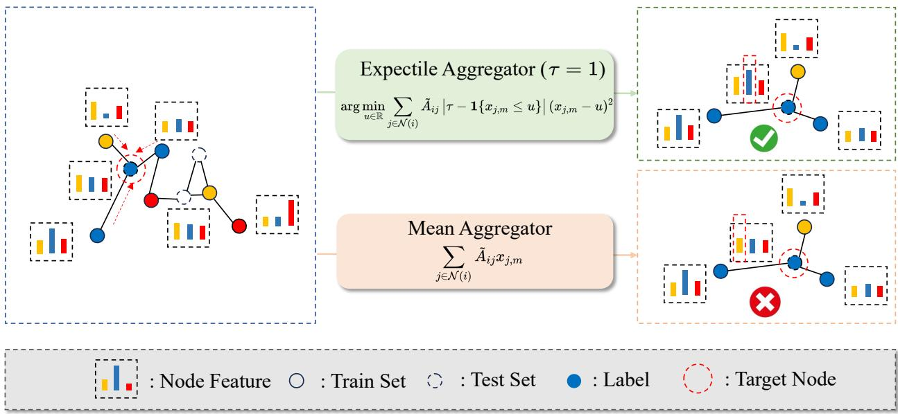  
Figure 1: Illustration of the Expectile aggregation mechanism compared with conventional mean aggregation. Mean aggregation treats all neighboring signals uniformly, which may cause representation distortion under noisy or heterophilic neighborhoods. In contrast, ExpectileGCN adaptively emphasizes diferent parts of the neighborhood distribution through the expectile parameter τ , enabling more flexible aggregation across diferent neighborhood distributions.

## 2.3 Numerical Approximation of Expectile Aggregation

While the expectile-based aggregation defined in Eq. (1) provides an adaptive neighborhood summary, its implicit definition requires a numerical procedure for integration into end-to-end neural network training. Specifically, the empirical expectile satisfies

$$
\sum _ { j \in \mathcal { N } ( i ) } \tilde { A } _ { i j } \alpha _ { i , j } ( r _ { i , m } ) ( x _ { j , m } - r _ { i , m } ) = 0 .\tag{4}
$$

The asymmetric weights depend on the unknown aggregated value through indicator functions, resulting in a piecewise-defined fixed-point operator. We therefore develop a diferentiable approximation based on sigmoid smoothing and fixed-point iterations, allowing the aggregation levels and network parameters to be optimized jointly.

We first replace the indicator function with a smooth sigmoid approximation:

$$
\begin{array} { r } { \mathbf { 1 } \{ x _ { j , m } \geq r _ { i , m } \} \approx \sigma \big ( s ( x _ { j , m } - r _ { i , m } ) \big ) , } \end{array}\tag{5}
$$

where $\sigma ( x ) = 1 / ( 1 + e ^ { - x } )$ is the sigmoid function and $s > 0$ controls the approximation sharpness. As $s  \infty ,$ , the sigmoid converges to the indicator for $x _ { j , m } \neq r _ { i , m }$ . At equality, the sigmoid equals $1 / 2$ , but the corresponding residual vanishes and therefore does not afect the limiting expectile equation. For finite $s ,$ the smoothed asymmetric coeficient is

$$
\tilde { \alpha } _ { i , j } ( r _ { i , m } ) = \tau \sigma \big ( s ( x _ { j , m } - r _ { i , m } ) \big ) + ( 1 - \tau ) \left[ 1 - \sigma \big ( s ( x _ { j , m } - r _ { i , m } ) \big ) \right] .\tag{6}
$$

The resulting coeficient is continuously diferentiable with respect to the aggregated value and input messages.

Using the smoothed coeficients, we compute the aggregated representation through fixed-point iterations. Starting from an initial value $r _ { i , m } ^ { ( 0 ) }$ , such as the normalized weighted mean, we iteratively

calculate

$$
\tilde { \alpha } _ { i , j } ^ { ( t ) } = \tau \sigma \big ( s ( x _ { j , m } - r _ { i , m } ^ { ( t ) } ) \big ) + ( 1 - \tau ) \left[ 1 - \sigma \big ( s ( x _ { j , m } - r _ { i , m } ^ { ( t ) } ) \big ) \right] ,\tag{7}
$$

followed by

$$
r _ { i , m } ^ { ( t + 1 ) } = \frac { \sum _ { j \in \mathcal { N } ( i ) } \tilde { A } _ { i j } \tilde { \alpha } _ { i , j } ^ { ( t ) } x _ { j , m } } { \sum _ { j \in \mathcal { N } ( i ) } \tilde { A } _ { i j } \tilde { \alpha } _ { i , j } ^ { ( t ) } } .\tag{8}
$$

Each iteration updates the aggregated representation using asymmetric weights determined by the current estimate. After T iterations, $r _ { i , m } ^ { ( T ) }$ serves as the numerical output of the aggregation layer.

This procedure implements expectile-based aggregation through diferentiable weighted averaging operations. The sharpness parameter s controls the approximation of the original asymmetric weighting rule, while the iteration count T determines the number of fixed-point updates. Under the contraction conditions established in the theoretical analysis, the iteration converges to a unique smoothed fixed point. The resulting approximation can be incorporated into standard GNN architectures and optimized jointly with the network parameters.

## 2.4 ExpectileGCN

Building upon the expectile aggregation operator introduced in the previous subsection, we now describe the overall GNN architecture used in this work. Since existing robust aggregation frameworks such as Geisler et al. (2020), Chen et al. (2021), and Wang et al. (2023) are primarily developed and evaluated under two-layer graph neural network architectures, we also adopt a two-layer ExpectileGCN formulation for consistency and comparability. The subsequent theoretical analysis and experimental evaluation throughout this paper follow the same two-layer setting. Let the input feature matrix be $\mathbf { X } \in \mathbb { R } ^ { N \times q }$ , where each node i is associated with a feature vector $\mathbf { x } _ { i } \in \mathbb { R } ^ { q }$ . The first and second layers use learnable weight matrices $\mathbf { W } ^ { ( 1 ) } \in \mathbb { R } ^ { q \times q _ { 1 } }$ and $\mathbf { W } ^ { ( 2 ) } \in \mathbb { R } ^ { q _ { 1 } \times K }$ , respectively. The expectile parameters for the two layers are denoted by $\tau ^ { ( 1 ) } \in ( 0 , 1 )$ and $\tau ^ { ( 2 ) } \in ( 0 , 1 )$ , respectively.

First-layer expectile aggregation. For the first layer, we write the expectile aggregation operator in component form. Let $\mathbf { z } _ { j } ^ { ( 1 ) } = ( z _ { j , 1 } ^ { ( 1 ) } , \ldots , z _ { j , q _ { 1 } } ^ { ( 1 ) } ) ^ { \top } \in \mathbb { R } ^ { q _ { 1 } }$ be the linearly transformed message of node j, where $\mathbf { z } _ { j } ^ { ( 1 ) } = \left( \mathbf { x } _ { j } ^ { \top } \mathbf { W } ^ { ( 1 ) } \right)$ ⊤ and $\mathbf { W } ^ { ( 1 ) } = ( \mathbf { w } _ { 1 } ^ { ( 1 ) } , \cdot \cdot \cdot , \mathbf { w } _ { q _ { 1 } } ^ { ( 1 ) } ) \in \mathbb { R } ^ { q \times q _ { 1 } }$ . Define the operator $T _ { \tau ^ { ( 1 ) } , \mathbf { W } ^ { ( 1 ) } } ( \cdot ; \mathbf { X } , \tilde { \mathbf { A } } ) : \mathbb { R } ^ { q _ { 1 } } \to \mathbb { R } ^ { q _ { 1 } }$ componentwise as

$$
T _ { \tau ^ { ( 1 ) } , \mathbf { W } ^ { ( 1 ) } } ( \mathbf { r } _ { i } ^ { ( 1 ) } ; \mathbf { X } , \tilde { \mathbf { A } } ) = \left( T _ { \tau ^ { ( 1 ) } , \mathbf { w } _ { 1 } ^ { ( 1 ) } } ( r _ { i , 1 } ^ { ( 1 ) } ; \mathbf { X } , \tilde { \mathbf { A } } ) , \dots , T _ { \tau ^ { ( 1 ) } , \mathbf { w } _ { q _ { 1 } } ^ { ( 1 ) } } ( r _ { i , q _ { 1 } } ^ { ( 1 ) } ; \mathbf { X } , \tilde { \mathbf { A } } ) \right) ^ { \top } .\tag{9}
$$

Each component $T _ { \tau ^ { ( 1 ) } , \mathbf { w } _ { m } ^ { ( 1 ) } } ( r _ { i , m } ^ { ( 1 ) } ; \mathbf { X } , \tilde { \mathbf { A } } )$ , corresponding to feature coordinate $m \in \{ 1 , \ldots , q _ { 1 } \}$ , is given by

$$
\frac { \displaystyle \sum _ { j \in \mathcal { N } ( i ) } \tilde { A } _ { i j } \tilde { \alpha } ( r _ { i , m } ^ { ( 1 ) } , \tau ^ { ( 1 ) } , \mathbf { w } _ { m } ^ { ( 1 ) } ; \mathbf { x } _ { j } ) z _ { j , m } ^ { ( 1 ) } } { \displaystyle \sum _ { j \in \mathcal { N } ( i ) } \tilde { A } _ { i j } \tilde { \alpha } ( r _ { i , m } ^ { ( 1 ) } , \tau ^ { ( 1 ) } , \mathbf { w } _ { m } ^ { ( 1 ) } ; \mathbf { x } _ { j } ) } ,
$$

where the smoothed asymmetric weight for neighbor j and coordinate m is defined elementwise by

$$
\begin{array} { r } { \tilde { \alpha } ( r _ { i , m } ^ { ( 1 ) } , \tau ^ { ( 1 ) } , \mathbf { w } _ { m } ^ { ( 1 ) } ; \mathbf { x } _ { j } ) = \tau ^ { ( 1 ) } \sigma ( s ( z _ { j , m } ^ { ( 1 ) } - r _ { i , m } ^ { ( 1 ) } ) ) + ( 1 - \tau ^ { ( 1 ) } ) \left[ 1 - \sigma \big ( s ( z _ { j , m } ^ { ( 1 ) } - r _ { i , m } ^ { ( 1 ) } ) \big ) \right] . } \end{array}
$$

Here $\mathbf { r } _ { i } ^ { ( 1 ) } = ( r _ { i , 1 } ^ { ( 1 ) } , \ldots , r _ { i , q _ { 1 } } ^ { ( 1 ) } ) ^ { \top } \in \mathbb { R } ^ { q _ { 1 } }$ denotes the candidate fixed point for node i at layer one, and σ denotes the sigmoid applied componentwise. By construction, the vector operator is coordinate separable: each coordinate m uses only $z _ { j , m } ^ { ( 1 ) }$ and $r _ { i , m }$ . The first layer aggregated representation of node i is the fixed point of this vector operator. Denoting the first layer fixed point by $\mathbf { r } _ { i } ^ { ( 1 ) * } = ( r _ { i , 1 } ^ { ( 1 ) * } , \cdot \cdot \cdot , r _ { i , q _ { 1 } } ^ { ( 1 ) * } ) ^ { \top } \in \mathbb { R } ^ { q _ { 1 } }$ , we have $\mathbf { r } _ { i } ^ { ( 1 ) * } = T _ { \tau ^ { ( 1 ) } , \mathbf { W } ^ { ( 1 ) } } ( \mathbf { r } _ { i } ^ { ( 1 ) * } ; \mathbf { X } )$ . Collecting the fixed-point representations of all nodes, we obtain the layer-1 aggregated feature matrix $\mathbf { R } ^ { ( 1 ) * } = \bigl ( \mathbf { \hat { r } } _ { 1 } ^ { ( 1 ) * } , \ldots , \mathbf { \hat { r } } _ { N } ^ { ( 1 ) * } \bigr ) ^ { \top } \in \mathbb { R } ^ { N \times q _ { 1 } }$ . Let $\phi ( \cdot )$ denote a pointwise activation function. In this work, we choose $\phi ( \cdot ) = \mathrm { R e L U } ( \cdot )$

Second-layer expectile aggregation. The second layer applies the same expectile aggregation mechanism as the first layer, but operates on the hidden representations obtained after nonlinear activation. Specifically, each node j is associated with the activated first-layer representation $\phi ( \mathbf { r } _ { j } ^ { ( 1 ) * } ) \in \mathbb { R } ^ { q _ { 1 } }$ . Given a weight matrix $\mathbf { W } ^ { ( 2 ) } = ( \mathbf { w } _ { 1 } ^ { ( 2 ) } , \ldots , \mathbf { w } _ { K } ^ { ( 2 ) } ) \in \mathbb { R } ^ { q _ { 1 } \times K }$ , the transformed message is the column vector $\mathbf { z } _ { j } ^ { ( 2 ) } = \left( \phi ( \mathbf { r } _ { j } ^ { ( 1 ) * } ) ^ { \top } \mathbf { W } ^ { ( 2 ) } \right) ^ { \top } \in \mathbb { R } ^ { K }$ . Its coordinate m is the scalar $z _ { j , m } ^ { ( 2 ) } =$ $\phi ( \mathbf { r } _ { i } ^ { ( 1 ) * } ) ^ { \top } \mathbf { w } _ { m } ^ { ( 2 ) }$ The second-layer aggregation operator $T _ { \tau ^ { ( 2 ) } , \mathbf { W } ^ { ( 2 ) } } ( \cdot ; \phi ( \mathbf { R } ^ { ( 1 ) * } ) , \tilde { \mathbf { A } } ) : \mathbb { R } ^ { K }  \mathbb { R } ^ { K }$ is defined componentwise using the same smoothed expectile weights as in the first layer. As before, the operator is coordinate separable and admits a fixed-point characterization. Denoting the fixed point by $\mathbf { r } _ { i } ^ { ( 2 ) * } = ( r _ { i , 1 } ^ { ( 2 ) * } , \ldots , \hat { r } _ { i , K } ^ { ( 2 ) * } ) ^ { \top } \in \mathbb { R } ^ { K }$ , we obtain the final node-level output representations. Collecting all nodes yields the second-layer output matrix ${ \bf R } ^ { ( 2 ) * } \in \mathbb { R } ^ { N \times K }$ , whose rows are used as logits for node classification.

The second layer aggregated output for node i is $\mathbf { r } _ { i } ^ { ( 2 ) * } = T _ { \tau ^ { ( 2 ) } , \mathbf { W } ^ { ( 2 ) } } ( \mathbf { r } _ { i } ^ { ( 2 ) * } ; \phi \left( \mathbf { R } ^ { ( 1 ) * } \right) , \tilde { \mathbf { A } } )$ . Collecting the fixed-point outputs of all nodes from the second layer, we obtain the final representation matrix $\mathbf { R } ^ { ( 2 ) * } = \bar { ( } \mathbf { r } _ { 1 } ^ { ( 2 ) * } , \ldots , \bar { } \mathbf { r } _ { N } ^ { ( 2 ) * } ) ^ { \top } \in \mathbb { R } ^ { N \times K }$ . Each vector $\mathbf { r } _ { i } ^ { ( 2 ) * }$ serves as the logit vector for node i in a K-class classification task. The predicted class probability is obtained via the softmax function, $\hat { \mathbf { y } } _ { i } = \mathrm { s o f t m a x } \left( \mathbf { r } _ { i } ^ { ( 2 ) * } \right)$ . Let $\mathbf { y } _ { i } \in \{ 0 , 1 \} ^ { K }$ denote the one-hot encoded ground-truth label of node i. We adopt the standard categorical cross-entropy loss $\begin{array} { r } { \ell ( \hat { \mathbf { y } } _ { i } , \mathbf { y } _ { i } ) = - \sum _ { k = 1 } ^ { K } y _ { i , k } \ln \hat { y } _ { i , k } } \end{array}$ . For the theoretical analysis, we write the same loss as a function of the logits, $g ( \mathbf { z } , \mathbf { y } ) : = \ell ( \operatorname { s o f t m a x } ( \mathbf { z } ) , \mathbf { y } ) =$ $- \mathbf { y } ^ { \top } \mathbf { z } + \log \left( \sum _ { k = 1 } ^ { K } e ^ { z _ { k } } \right)$ , where $\mathbf { z } \in \mathbb { R } ^ { K }$ and y is a one-hot label. Accordingly, the loss function is defined as

$$
\widehat { \mathcal { L } } _ { m } ( \theta ) = \frac { 1 } { m } \sum _ { i \in \mathcal { V } _ { \mathrm { t r a i n } } } g \Bigl ( \mathbf { r } _ { i } ^ { ( 2 ) * } ( \theta ) , \mathbf { y } _ { i } \Bigr ) ,\tag{10}
$$

where θ denotes the collection of all model parameters across layers. Recall that $\mathcal { V } _ { \mathrm { t r a i n } } \subset \mathcal { V }$ denotes the set of labeled training nodes with cardinality $| \mathcal { V } _ { \mathrm { t r a i n } } | = m$ . The two-layer ExpectileGCN model computes node representations through graph message passing and produces a second-layer fixed-point output $\mathbf { R } ^ { ( 2 ) * } = ( \mathbf { r } _ { 1 } ^ { ( 2 ) * } , \ldots , \mathbf { r } _ { N } ^ { ( 2 ) * } ) ^ { \top } \in \bar { \mathbb { R } } ^ { N \times K }$

## 2.5 Computational Complexity.

We compare the per-layer aggregation complexity of expectile, median, and SoftMedoid aggregation. Let N and |E| denote the numbers of nodes and edges, respectively, $d _ { \mathrm { m a x } }$ the maximum node degree excluding self-loops, and $T$ the number of fixed-point iterations. We focus on aggregation costs, excluding linear transformations and feature dimensions.

Expectile aggregation updates the asymmetric weights and aggregates messages along each edge at every fixed-point iteration. Each iteration therefore requires $O ( N + | \mathcal { E } | )$ operations, including selfmessages, giving a total complexity of $O ( T ( N + | \mathcal { E } | ) )$ . For fixed T, the aggregation cost is linear in graph size, with $O ( N + | \mathcal { E } | )$ memory for sparse graph storage and node representations. For coordinatewise median aggregation, a sorting-based implementation requires $O \left( \sum _ { v = 1 } ^ { N } ( d _ { v } + 1 ) \log ( d _ { v } + 1 ) \right) =$

$O ( ( N + | \mathcal { E } | ) \log ( d _ { \operatorname* { m a x } } + 1 ) )$ time per layer, where $d _ { v }$ is the degree of node v excluding self-loops and $d _ { \operatorname* { m a x } } = \operatorname* { m a x } _ { v } d _ { v }$ . SoftMedoid aggregation instead evaluates pairwise distances among messages within each neighborhood, requiring $O \left( \sum _ { v = 1 } ^ { N } ( d _ { v } + 1 ) ^ { 2 } \right) = O ( N ( d _ { \operatorname* { m a x } } + 1 ) ^ { 2 } )$ time in the worst case. Explicitly storing these pairwise distances can incur comparable memory costs. The neighbor truncation strategy of Geisler et al. (2020) reduces this cost to $O ( N k ^ { 2 } )$ by retaining k messages per neighborhood. Unlike SoftMedoid, expectile aggregation requires no pairwise neighborhood comparisons. Its linear dependence on graph size for fixed $T$ makes it particularly suitable for large sparse graphs and neighborhoods with high degree.

## 3 Theoretical Analysis of ExpectileGCN

## 3.1 Definitions and Assumptions

In this section, we develop an upper bound on the transductive Rademacher complexity and the resulting same-graph generalization gap for the proposed two-layer ExpectileGCN by characterizing the hypothesis class induced by its implicit aggregation mechanism. To facilitate the subsequent complexity and generalization analysis, we first formalize the class of logit functions generated by ExpectileGCN under the parameter space Θ. Throughout the smoothed-model analysis, fix an arbitrary sharpness parameter $s > 0$ in Eq. (6), common to both layers and fixed before the random partition. It is not part of the learned parameter vector $\theta ;$ its dependence is suppressed in the notation for the operators, fixed points, and hypothesis class. Specifically, we denote by H the hypothesis class induced by ExpectileGCN before the softmax transformation, defined as

$$
{ \mathcal { H } } = { \Big \{ } h _ { \theta } : ( \mathbf { X } , { \tilde { \mathbf { A } } } , i ) \mapsto \mathbf { r } _ { i } ^ { ( 2 ) * } ( \theta ) , \ i \in \mathcal { V } , \ \theta = ( \theta ^ { ( 1 ) } , \theta ^ { ( 2 ) } ) \in \Theta { \Big \} } .
$$

We analyze a fixed graph, fixed feature matrix, and fixed labels on a node set $\mathcal { V } _ { 0 } \subseteq \mathcal { V }$ of size $m + u$ The only randomness in the generalization statement is a uniformly random partition without replacement of $\mathcal { V } _ { 0 }$ into a training set $\mathcal { V } _ { \mathrm { t r a i n } }$ of size m and a test set $\mathcal { V } _ { \mathrm { t e s t } }$ of size $u ,$ , following the transductive setting of Tang and Liu (2023). The parameter set Θ, the induced hypothesis class $\mathcal { H } ,$ and all uniform bounds are fixed before the random partition is drawn; the selected parameter θ may depend on the observed training labels. Graph message passing may use the entire fixed graph; the split only determines which labels enter the training and test risks. For notational convenience, let $\bar { \mathbf { R } _ { 0 } ^ { ( 2 ) * } } ( \theta ) : = \left( \mathbf { r } _ { i } ^ { ( 2 ) * } ( \theta ) \right) _ { : \in \mathbb { V } _ { \alpha } } \in \mathbb { R } ^ { ( m + u ) \times K }$ and $\mathcal { M } _ { 0 } = \left\{ \mathbf { R } _ { 0 } ^ { ( 2 ) * } ( \theta ) ~ \Big | ~ \theta \in \Theta \right\}$ . We use $g \circ \mathcal { H }$ to denote the resulting scalar loss class. Define

$$
\widehat { \mathcal { L } } _ { m } ( \theta ) = \frac { 1 } { m } \sum _ { i \in \mathcal { V } _ { \mathrm { t r a i n } } } g \Bigl ( \mathbf { r } _ { i } ^ { ( 2 ) * } ( \theta ) , \mathbf { y } _ { i } \Bigr ) , \qquad \widehat { \mathcal { L } } _ { u } ( \theta ) = \frac { 1 } { u } \sum _ { i \in \mathcal { V } _ { \mathrm { t e s t } } } g \Bigl ( \mathbf { r } _ { i } ^ { ( 2 ) * } ( \theta ) , \mathbf { y } _ { i } \Bigr ) .
$$

Definition 1. Let $( \mathcal { M } , d )$ be a metric space and $r > 0$ . The covering number $\mathcal { N } ( \mathcal { M } , d , r )$ is defined as the smallest integer $n \in \mathbb N$ such that there exist points $m _ { 1 } , \ldots , m _ { n } \in { \mathcal { M } }$ satisfying $\textstyle { \mathcal { M } } \subset \bigcup _ { i = 1 } ^ { n } B _ { d } ( m _ { i } , r )$ , where $B _ { d } ( m _ { i } , r ) = \{ m \in \mathcal { M } : d ( m , m _ { i } ) \leq r \}$ denotes the closed ball of radius r centered at m . When the metric d is induced by a norm $\| \cdot \|$ , we write $\mathcal { N } ( \mathcal { M } , \| \cdot \| , r )$

Definition 2. Let $\begin{array} { r } { p _ { 0 } = \frac { m u } { ( m + u ) ^ { 2 } } } \end{array}$ . For a class of scalar functions $\mathcal { F }$ evaluated on the $m + u$ fixed node examples $z _ { 1 } , \ldots , z _ { m + u } .$ , its transductive Rademacher complexity is

$$
\Re _ { m + u } ^ { \mathrm { t r } } ( \mathcal { F } ) = \left( \frac { 1 } { m } + \frac { 1 } { u } \right) \mathbb { E } _ { \sigma } \left[ \operatorname* { s u p } _ { f \in \mathcal { F } } \sum _ { i = 1 } ^ { m + u } \sigma _ { i } f ( z _ { i } ) \right] ,\tag{11}
$$

where the coordinates of $\sigma$ are independent and satisfy $\operatorname* { P r } ( \sigma _ { i } = 1 ) = \operatorname* { P r } ( \sigma _ { i } = - 1 ) = p _ { 0 }$ and $\mathrm { P r } ( \sigma _ { i } = 0 ) = 1 - 2 p _ { 0 }$

For ExpectileGCN, Definition 2 gives

$$
\mathfrak { R } _ { m + u } ^ { \mathrm { t r } } ( g \circ \mathcal { H } ) = \left( \frac { 1 } { m } + \frac { 1 } { u } \right) \mathbb { E } _ { \sigma } \left[ \operatorname* { s u p } _ { \theta \in \Theta } \sum _ { i = 1 } ^ { m + u } \sigma _ { i } g \Bigl ( \mathbf { r } _ { i } ^ { ( 2 ) * } ( \theta ) , \mathbf { y } _ { i } \Bigr ) \right] .
$$

For any $s > 0$ , the smoothed indicator satisfies $\begin{array} { r } { | \partial _ { z } \sigma ( s ( z - r ) ) | = | \partial _ { r } \sigma ( s ( z - r ) ) | \le \frac { s } { 4 } } \end{array}$ This derivative bound determines the dependence of the operator Lipschitz constants on s. The following assumptions provide uniform bounds over $\theta \in \Theta$ for each such s.

Assumption 1. The $\ell _ { \mathrm { { 2 } - n o r m } }$ of the feature vector in the input space is bounded, namely, for some constant $C _ { x } > 0$ , we assume $\| \mathbf { x } _ { i } \| \leq C _ { x }$ for all nodes i.

Assumption 2. For the parameters of two layers $\boldsymbol { \theta } ^ { ( 1 ) } \ = \ ( \mathrm { v e c } \left( \mathbf { W } ^ { ( 1 ) } \right) ^ { \top } , \tau ^ { ( 1 ) } ) ^ { \top }$ and $\theta ^ { ( 2 ) } =$ $\left( \mathrm { v e c } \left( \mathbf { W } ^ { ( 2 ) } \right) ^ { \top } , \tau ^ { ( 2 ) } \right) ^ { \top }$ , we assume the following conditions hold:

(a) Each coordinate weight vector is bounded in $\ell _ { \mathrm { { 2 } ^ { - } } } \mathrm { { n o r m } }$ , namely $\| \mathbf { w } _ { m } ^ { ( 1 ) } \| \leq C _ { w }$ and $\| \mathbf { w } _ { k } ^ { ( 2 ) } \| \leq C _ { w }$ for all $1 \leq m \leq q _ { 1 }$ and $1 \leq k \leq K$ , where $C _ { w } > 0$ is a constant.

(b) The expectile level of each layer is bounded away from the degenerate values 0 and 1: $\epsilon _ { \tau } \le \tau ^ { ( l ) } \le 1 - \epsilon _ { \tau }$ for some constant $\begin{array} { r } { 0 < \epsilon _ { \tau } \le \frac { 1 } { 2 } } \end{array}$

Assumption 3. The underlying graph $\mathcal { G } = ( \nu , \mathcal { E } )$ is a simple undirected graph without self-loops or multi-edges. Self-loops are added only for aggregation through $\mathbf { A } + \mathbf { I } .$ The aggregation neighborhoods have uniformly bounded size: $1 \leq | \mathcal { N } ( i ) | = \deg _ { \mathcal { G } } ( i ) + 1 \leq$ d for all $i \in \mathcal V .$ , where $d \geq 1$ includes the self-node.

Assumption 4 (Uniform contraction margin). For the fixed sharpness $s > 0$ , there exists a constant $\kappa = \kappa ( s ) \in ( 0 , 1 )$ , independent of the node, coordinate, and parameter value, such that for every $\theta \in \Theta$ both layer-wise scalar aggregation maps are contractions with modulus at most $1 - \kappa$ Specifically, for all admissible $r , r ^ { \prime } \in \mathbb { R }$

$$
\begin{array} { r l r } & { } & { \left| T _ { \tau ^ { ( 1 ) } , { \bf w } _ { m } ^ { ( 1 ) } } ( r ; { \bf X } , \tilde { { \bf A } } ) - T _ { \tau ^ { ( 1 ) } , { \bf w } _ { m } ^ { ( 1 ) } } ( r ^ { \prime } ; { \bf X } , \tilde { { \bf A } } ) \right| \le ( 1 - \kappa ) | r - r ^ { \prime } | , } \\ & { } & { \left| T _ { \tau ^ { ( 2 ) } , { \bf w } _ { k } ^ { ( 2 ) } } ( r ; \phi ( { \bf R } ^ { ( 1 ) * } ) , \tilde { { \bf A } } ) - T _ { \tau ^ { ( 2 ) } , { \bf w } _ { k } ^ { ( 2 ) } } ( r ^ { \prime } ; \phi ( { \bf R } ^ { ( 1 ) * } ) , \tilde { { \bf A } } ) \right| \le ( 1 - \kappa ) | r - r ^ { \prime } | , } \end{array}
$$

for every admissible first-layer fixed-point matrix $\mathbf { R } ^ { ( 1 ) * }$ . The contraction margin $\kappa ( s )$ is uniform over Θ for each s.

Assumptions 1 and 2 impose standard boundedness conditions on the input features and model parameters, which are commonly used in generalization analyses of neural networks and graph neural networks to control hypothesis complexity (Liao et al., 2020; Lv, 2021; Zhou et al., 2025; Wu Fung and Berkels, 2026). These conditions also imply uniform boundedness of the implicit representations, as stated in the following proposition.

Proposition 1 (Uniform boundedness of the implicit representations). Under Assumptions 1 and 2, every first- and second-layer fixed point satisfies

$$
\left\| \mathbf { r } _ { i } ^ { ( 1 ) * } \right\| \leq \sqrt { q _ { 1 } } C _ { x } C _ { w } , \qquad \left\| \mathbf { r } _ { i } ^ { ( 2 ) * } \right\| \leq \sqrt { K q _ { 1 } } C _ { x } C _ { w } ^ { 2 } .
$$

Consequently, we define $C _ { r } : = \operatorname* { m a x } \left\{ \sqrt { q _ { 1 } } C _ { x } C _ { w } , \sqrt { K q _ { 1 } } C _ { x } C _ { w } ^ { 2 } \right\}$ , so that both fixed-point representations are uniformly bounded by $C _ { r }$ for all nodes and all $\theta \in \Theta$

Proposition 1 provides the uniform representation bound used throughout the subsequent complexity analysis. Its proof is provided in Section S1 of the Supplementary Material. Assumption 3 additionally controls the aggregation neighborhood size, while Assumption 4 ensures uniform stability of the implicit aggregation operators. In particular, the contraction margin κ guarantees unique fixed points and controls their sensitivity to model parameters, which is required for the covering-number argument below. Using Proposition 1, an explicit suficient condition for Assumption 4, when $\begin{array} { r } { 0 < \epsilon _ { \tau } < \frac { 1 } { 2 } } \end{array}$ , is

$$
\operatorname* { m a x } ( C _ { x } , C _ { r } ) C _ { w } \leq ( 1 - \kappa ) \frac { 4 \epsilon _ { \tau } ^ { 2 } } { s ( 1 - 2 \epsilon _ { \tau } ) ( 1 + \epsilon _ { \tau } ) } .
$$

For $\begin{array} { r } { \epsilon _ { \tau } = \frac { 1 } { 2 } } \end{array}$ , both operators have modulus zero and no additional parameter restriction is required. Under Assumption 4, the Banach fixed-point theorem guarantees a unique solution to each layerwise scalar equation and convergence of the corresponding fixed-point iteration. The fixed-point arguments and the verification of the suficient condition are provided in Sections S1 and S4 of the Supplementary Material. The condition becomes more stringent as the fixed sharpness s increases.

## 3.2 Generalization Analysis

We next study how the architectural complexity and the expectile mechanism of ExpectileGCN afect its generalization behavior. Since node classification is performed on a fixed graph and the training and test nodes are obtained by partitioning the same set of nodes, we adopt a transductive generalization framework, following the setting commonly used in theoretical analyses of GNNs (Tang and Liu, 2023). Our analysis first controls the capacity of the induced hypothesis class through its transductive Rademacher complexity and then translates this complexity control into a bound on the discrepancy between training and test losses.

Theorem 1. Fix $s > 0$ and let $L _ { r ^ { ( 2 ) } , \theta }$ be the uniform logit Lipschitz constant from Lemma S13 of the Supplementary Material, evaluated at this s and its contraction margin $\kappa ( s )$ . Define $p = q _ { 1 } ( q + K ) + 2$ and $C _ { \mathrm { p a r a m s } } = \sqrt { C _ { w } ^ { 2 } ( q _ { 1 } + K ) + 2 ( 1 - \epsilon _ { \tau } ) ^ { 2 } }$ . Under Assumptions $1 { - } 4 _ { i }$ , we have

$$
\mathfrak { R } _ { m + u } ^ { \mathrm { t r } } ( g \circ \mathcal { H } ) \leq 8 C _ { r } \left( \frac { 1 } { m } + \frac { 1 } { u } \right) \sqrt { ( m + u ) p } \sqrt { 1 + \ln \left( 1 + \frac { 4 L _ { r ^ { ( 2 ) } , \theta } C _ { \mathrm { p a r a m s } } } { C _ { r } } \right) } .
$$

Theorem 1 characterizes how the architecture, expectile levels, and stability of ExpectileGCN afect its hypothesis class complexity. The efective parameter dimension $p = q _ { 1 } ( q + K ) + 2$ captures the contribution of network width and input and output dimensions, while $C _ { \mathrm { p a r a m s } }$ incorporates the parameter norm bounds and the constraint $\epsilon _ { \tau } \leq \tau \leq 1 - \epsilon _ { \tau }$ . The smoothing sharpness s and contraction margin $\kappa ( s )$ enter the bound through the parameter Lipschitz constant $L _ { r ^ { ( 2 ) } , \theta } ,$ which controls the sensitivity of the logits to changes in model parameters. For fixed architectural and stability constants, when the training and test sets occupy nonvanishing fractions of the graph, the transductive Rademacher complexity decreases at the rate $\mathcal { O } ( ( m + u ) ^ { - 1 / 2 } )$

The resulting complexity control directly yields a bound on the discrepancy between training and test performance under random sampling without replacement.

Theorem 2. For the same fixed $s > 0$ and $L _ { r ^ { ( 2 ) } , \theta }$ as in Theorem 1, let $\begin{array} { r } { S _ { m , u } = \frac { 2 \operatorname* { m a x } \{ m , u \} ( m + u ) } { \big ( m + u - \frac 1 2 \big ) ( 2 \operatorname* { m a x } \{ m , u \} - 1 ) } } \end{array}$ and $c _ { 0 } = \sqrt { \frac { 3 2 \ln ( 4 e ) } { 3 } }$ . Under Assumptions $1 { - } 4 ,$ with probability at least $1 - \delta$ over the uniformly random partition without replacement, the following holds simultaneously for every $\theta \in \Theta$

$$
\begin{array} { r l r } {  { \widehat { \mathcal { L } } _ { u } ( \theta ) \leq \widehat { \mathcal { L } } _ { m } ( \theta ) + 8 C _ { r } ( \frac { 1 } { m } + \frac { 1 } { u } ) \sqrt { ( m + u ) p } \sqrt { 1 + \ln ( 1 + \frac { 4 L _ { r ^ { ( 2 ) } , \theta } C _ { \mathrm { p a r a m s } } } { C _ { r } } ) } } } \\ & { } & { \quad + C _ { \ell } c _ { 0 } ( \frac { 1 } { m } + \frac { 1 } { u } ) \sqrt { \operatorname* { m i n } \{ m , u \} } + C _ { \ell } \sqrt { \frac { S _ { m , u } } { 2 } ( \frac { 1 } { m } + \frac { 1 } { u } ) \ln \frac { 2 } { \delta } } , } \end{array}
$$

where $C _ { \ell } = \log ( 1 + ( K - 1 ) e ^ { 2 C _ { r } } )$ uniformly bounds each loss.

Theorem 2 establishes a uniform transductive generalization guarantee for ExpectileGCN, showing that its test loss is bounded by the training loss and three finite-sample terms. The first term measures model complexity through the transductive Rademacher bound in Theorem 1. It explicitly accounts for the network dimension $p ,$ the bounded parameter space $C _ { \mathrm { p a r a m s } } .$ and the parameter sensitivity $L _ { r ^ { ( 2 ) } , \theta }$ of the implicit representations. In particular, the contraction condition controls this sensitivity, linking the stability of expectile aggregation directly to the generalization bound. The second term captures the finite-sample correction associated with the transductive training and test split, while the third quantifies the sampling uncertainty at confidence level $1 - \delta$ . When the training and test sets occupy fixed positive proportions of the graph, all three terms converge to zero at the rate $O \Big ( ( m + u ) ^ { - \frac { 1 } { 2 } } \Big )$ , provided the model constants remain bounded. Thus, the diference between training and test losses becomes smaller as the number of nodes increases. Importantly, this guarantee applies uniformly over the admissible expectile levels and network parameters, providing theoretical support for learning the aggregation behavior. The result also highlights the role of contraction stability in controlling model complexity and controlling the transductive generalization gap of the smoothed ExpectileGCN hypothesis class. The analysis follows the transductive node classification setting, where training and test nodes are sampled without replacement from a fixed graph, as commonly considered in GNN generalization theory (Tang and Liu, 2023). The proofs of Theorems 1 and 2 are provided in Section S2 of the Supplementary Material.

## 3.3 Neighborhood Informativeness and Aggregation Risk

The efectiveness of neighborhood aggregation depends not only on the information contained in neighboring nodes, but also on how that information is summarized. Recent studies show that heterophilic neighborhoods can remain informative when their class distributions are distinguishable (Ma et al., 2022; Platonov et al., 2023). However, conventional mean aggregation captures only the average neighborhood message and may overlook class information expressed through other distributional characteristics. This motivates a theoretical investigation of whether expectile aggregation can extract neighborhood information more efectively than mean aggregation and thereby reduce classification risk.

We investigate this issue through two complementary classification risk comparisons. Theorem 3 considers neighborhoods with a fixed informative structure and shows that expectile aggregation can exploit diferences in message scale to achieve a lower classification risk than mean aggregation. Theorem 4 considers a more challenging setting in which the information contributed by each neighbor progressively weakens and establishes that an expectile advantage can persist even in this regime. Throughout this subsection, we consider $K \geq 3$ equally likely classes. Conditional on the root label $Y = y$ and aggregation size $D = d ,$ the neighboring messages $Z _ { 1 } , \dots , Z _ { d - 1 }$ are

independent draws from

$$
F _ { y } = \sum _ { b = 1 } ^ { K } H _ { y b } G _ { b } , \qquad G _ { b } = \mathcal { N } ( \mu _ { b } , \sigma _ { b } ^ { 2 } ) ,\tag{12}
$$

where $H _ { y b }$ is the probability of observing a class-b neighbor. The self-message $Z _ { 0 }$ is independently drawn from $G _ { y }$ , and the distribution of $D$ is common across classes. All d messages receive equal weight $\textstyle { \frac { 1 } { d } }$ , consistent with the aggregation rule based on $\mathbf { A } + \mathbf { I } .$

We compare the empirical expectile $\widehat { r } _ { \tau , d }$ with the mean $\overline { { Z } } _ { d } = \widehat { r } _ { \frac { 1 } { 2 } , d }$ using the same neighborhood messages. Their population centers are determined by $\begin{array} { r } { \widetilde { F } _ { y , d } = \frac { G _ { y } + ( \overline { { d } } - 1 ) F _ { y } } { d } } \end{array}$ . Here $d = | \mathcal { N } ( i ) |$ includes the self-node, as in Section 3.1. This setting isolates the efect of the aggregation statistic: both methods observe identical messages, but summarize their distributions diferently.

## 3.3.1 Fixed Neighborhood Information: A Finite Neighborhood Risk Bound

We first consider neighborhoods whose class information remains fixed as the neighborhood size increases. Let $\tau \in ( \frac { 1 } { 2 } , 1 )$ and consider the mixing profile $H _ { y y } = \eta$ and $\begin{array} { r } { H _ { y b } = \frac { 1 - \eta } { K - 1 } } \end{array}$ for $b \neq y$ . When $\begin{array} { r } { \eta < \frac { 1 } { K } } \end{array}$ , the graph is heterophilic, but its neighborhood distributions remain informative because the mixing probabilities difer across root classes.

Our main interest is a setting in which the class means are similar, but the message scales difer. In this case, mean aggregation may obscure class diferences, whereas expectile aggregation can capture them through asymmetric weighting. Define $\varepsilon = \operatorname* { m a x } _ { b } \left| \mu _ { b } - \mu _ { 0 } \right|$ for some common location $\begin{array} { r } { \mu _ { 0 } , \delta _ { \sigma } = \operatorname* { m i n } _ { b < K } ( \sigma _ { b + 1 } - \sigma _ { b } ) , \rho = \frac { \sigma _ { K } } { \sigma _ { 1 } } } \end{array}$ , and $\begin{array} { r } { \bar { \boldsymbol { q } } _ { H } = \frac { 1 - K \eta } { K - 1 } } \end{array}$ . After incorporating the self-message, the efective contrast between of-diagonal and diagonal mixture weights becomes $\begin{array} { r } { q _ { H , d } = \frac { ( d - 1 ) q _ { H } - 1 } { d } } \end{array}$ . For small neighborhoods, the self-message can ofset or even reverse the heterophilic mixing pattern, resulting in an efectively homophilic aggregation distribution. We therefore consider $d \geq d _ { 0 }$ , where $d _ { 0 } \geq 2$ is a fixed threshold satisfying $( d _ { 0 } - 1 ) q _ { H } > 1$ , so that the heterophilic contribution of neighboring nodes dominates the self-message. This restriction allows us to focus on how expectile aggregation exploits information from heterophilic neighborhoods.

Assumption 5 (Scale separation with a self-message). The neighbor profile is heterophilic, $0 \leq$ $\begin{array} { r } { \eta < \frac { 1 } { K } } \end{array}$ , and the class scales satisfy $0 < \sigma _ { 1 } < \cdots < \sigma _ { K }$ . The minimum aggregation size satisfies $( d _ { 0 } - 1 ) q _ { H } > 1$ . Moreover, $\varepsilon <$ min $\{ \begin{array} { l l } { \frac { \sigma _ { 1 } } { 2 } , c ( \tau , \rho ) q _ { H , d _ { 0 } } \delta _ { \sigma } \} } \end{array}$ , where $\begin{array} { r } { c ( \tau , \rho ) = \frac { ( 1 - \tau ) ( 2 \tau - 1 ) \varphi ( \rho t _ { \tau } ) } { 2 \sqrt { 5 } \tau ^ { 2 } \rho } > 0 , \varphi } \end{array}$ is the standard normal density, and $t _ { \tau } = r _ { \tau } ( \mathcal { N } ( 0 , 1 ) ) > 0$

Assumption 5 ensures that diferences in neighborhood scale dominate diferences in location. When all component means coincide, the mean aggregates have identical population centers across classes, while expectile aggregation produces distinct centers by responding to scale diferences. The assumption allows this advantage to persist when the component means difer slightly.

For Theorem $^ { 3 , }$ the expectile classifier assigns $\widehat { r } _ { \tau , d }$ to the class $k$ whose population center $r _ { \tau } ( \widetilde { F } _ { k , d } )$ is closest, using a common level $\tau$ across classes and a fixed rule for ties. Let $R _ { \tau } ( d )$ denote its misclassification probability conditional on $D = d .$ . We compare this classifier with the optimal classifier based on the mean aggregate, whose representation-induced Bayes risk is defined by (Blackwell, 1951; Reid and Williamson, 2011; Duchi et al., 2018; Yasaei Sekeh et al., 2020)

$$
R _ { \mathrm { m e a n } } ^ { * } ( d ) = \operatorname* { i n f } _ { g } \operatorname* { P r } \{ g ( { \overline { { Z } } } _ { d } , d ) \neq Y \mid D = d \} ,
$$

where the infimum is over all measurable classifiers. Thus, $R _ { \mathrm { m e a n } } ^ { * } ( d )$ represents the minimum classification risk achievable using the mean aggregate.

Theorem 3 (Finite neighborhood risk bound with self-inclusion). Under Assumption 5, there exist explicit constants $\gamma > 0$ and $B _ { K } > 0$ , depending only on $\tau , d _ { 0 }$ , and the distributional parameters, such that, for every admissible finite integer d $\geq d _ { 0 }$

$$
\frac { R _ { \tau } ( d ) } { R _ { \mathrm { m e a n } } ^ { * } ( d ) } \leq \exp \left\{ - \gamma d + \frac { \varepsilon } { \sigma _ { 1 } } \sqrt { d } + B _ { K } \right\} .\tag{13}
$$

In particular, $R _ { \tau } ( d ) < R _ { \mathrm { m e a n } } ^ { * } ( d )$ whenever $d > \left( \frac { \frac { \varepsilon } { \sigma _ { 1 } } + \sqrt { \left( \frac { \varepsilon } { \sigma _ { 1 } } \right) ^ { 2 } + 4 \gamma B _ { K } } } { 2 \gamma } \right) ^ { 2 }$ . The explicit constants and the full proof are provided in Section S3.1 of the Supplementary Material.

Theorem 3 establishes a classification advantage of expectile aggregation. Under the stated conditions, the expectile nearest-center classifier achieves a lower risk than even the optimal classifier based solely on the mean aggregate for suficiently large neighborhood sizes. Moreover, the theorem provides an exponentially decaying upper bound on their risk ratio as the neighborhood size increases. These results demonstrate that expectile aggregation can exploit class-dependent distributional information to achieve a provable reduction in classification error.

The underlying mechanism is straightforward. Mean aggregation primarily reflects diferences in average message values, whereas expectile aggregation also responds to diferences in distributional scale. When neighborhood classes are distinguished mainly by scale, the mean can discard information that the expectile retains. This result complements existing studies showing that distinguishable neighborhood distributions can support learning under heterophily (Ma et al., 2022; Wang et al., 2024). It also connects to the motivation of principal neighborhood aggregation (Corso et al., 2020), which uses distributional statistics beyond the mean. Our result provides a classification risk justification for using an asymmetric expectile summary.

## 3.3.2 Weak Neighborhood Information: A Local Eficiency Comparison

The preceding result assumes that the neighborhood information remains fixed. We next consider a more dificult setting in which individual neighbors become progressively less informative. This regime is motivated by the low label informativeness observed in several heterophilic benchmark datasets (Platonov et al., 2023). Let $a _ { 1 } < \cdots < a _ { K }$ be fixed nonzero numbers satisfying $\textstyle \sum _ { b } a _ { b } = 0$ and define

$$
{ \cal H } _ { y b } ^ { ( d ) } = { \frac { 1 } { K } } - { \frac { a _ { y } a _ { b } } { \sqrt { d } } } .
$$

For each finite $d ,$ the classification risk is defined conditional on $D = d ,$ and the asymptotic analysis considers the resulting sequence of conditional neighborhood models as $d \to \infty$ . For suficiently large $d ,$ this defines a valid symmetric and row-stochastic mixing profile with positive entries and $H _ { y y } ^ { ( d ) } < \frac { 1 } { K }$ . As d increases, the neighborhood distributions $\begin{array} { r } { F _ { y , d } = \sum _ { b } H _ { y b } ^ { ( d ) } G _ { b } } \end{array}$ approach the same limiting mixture.

The scaling $d ^ { - \frac { 1 } { 2 } }$ balances the weakening class diferences with the increasing number of neighbors. Consequently, the aggregate retains a nontrivial classification problem in which class separation and sampling variability are of comparable order. This construction is related to the graph separability analysis of Wang et al. (2024) and follows the principle of local asymptotic comparisons (van der Vaart, 1998, Chapter 14). Retaining the independent self-message $Z _ { 0 } \sim G _ { y }$ , we define $\begin{array} { r } { \stackrel { \cdot } { F } _ { y , d } = \frac { G _ { y } + ( d - 1 ) F _ { y , d } } { d } } \end{array}$ . Let $\begin{array} { r } { F _ { 0 } = K ^ { - 1 } \sum _ { b } G _ { b } , m _ { 0 } = \mathbb { E } _ { 0 } Z } \end{array}$ , and

$$
\alpha _ { b } = \mathbb { E } _ { G _ { b } } | Z - m _ { 0 } | , \qquad \beta _ { 0 } = \frac { \mathbb { E } _ { 0 } [ ( Z - m _ { 0 } ) | Z - m _ { 0 } | ] } { \mathrm { V a r } _ { 0 } ( Z ) } ,
$$

where $\mathbb { E } _ { 0 }$ denotes expectation under $F _ { 0 }$ . These quantities characterize the amplitude information in the message distributions that can contribute to the advantage of asymmetric aggregation.

Assumption 6 (Additional amplitude information). In the local model above, $\sigma _ { b } > 0$ for every class, and $\begin{array} { r } { \sum _ { b = 1 } ^ { K } a _ { b } ( \alpha _ { b } - \beta _ { 0 } \mu _ { b } ) \ne 0 } \end{array}$

Assumption $6$ ensures that the weak neighborhood signal contains amplitude information beyond that captured by the mean, while allowing general class means and scales. When the Gaussian components share a common mean, this condition simplifies to $\textstyle \sum _ { b } a _ { b } \sigma _ { b } \neq 0$

For Theorem 4, we compare expectile and mean aggregation using the same nearest-center classification rule, which assigns each observation to the class with the closest population center (Dabney, 2005; Fan and Fan, 2008). Related approaches also consider asymmetric location summaries, such as quantiles, as class representatives (Hennig and Viroli, 2016). With a common expectile level τ across classes, the class $- y$ population center and the corresponding classifier are defined as

$$
c _ { \tau , y } ^ { ( d ) } = r _ { \tau } ( \widetilde { F } _ { y , d } ) , \qquad \widehat { Y } _ { \tau , d } = \underset { 1 \leq k \leq K } { \arg \operatorname* { m i n } } \left| \widehat { r } _ { \tau , d } - c _ { \tau , k } ^ { ( d ) } \right| ,
$$

where ties are resolved by a fixed rule. The conditional classification risk is

$$
R _ { \tau } ^ { \mathrm { l o c } } ( d ) = \mathrm { P r } \left\{ \widehat { Y } _ { \tau , d } \neq Y \mid D = d \right\} .\tag{14}
$$

At $\begin{array} { r } { \tau = \frac { 1 } { 2 } } \end{array}$ , the empirical expectile and population centers reduce to the corresponding means, yielding $R _ { \operatorname* { m e a n } } ^ { \mathrm { l o c } } ( \bar { d } ) : = R _ { \frac { 1 } { 7 } } ^ { \mathrm { l o c } } \bar { ( d ) }$ . Here, $R _ { \mathrm { m e a n } } ^ { \mathrm { l o c } } ( d )$ denotes the classification risk of mean aggregation under the nearest-center rule. Thus, Theorem 4 compares expectile and mean aggregation under an identical classification rule.

Theorem 4 (Risk advantage under local alternatives). Under Assumption $\delta ,$ there exists a fixed $\tau \in ( 0 , 1 ) \setminus \{ \frac { 1 } { 2 } \}$ , common to all classes and independent of $d ,$ such that

$$
\operatorname* { l i m } _ { d \to \infty } \left\{ R _ { \mathrm { m e a n } } ^ { \mathrm { l o c } } ( d ) - R _ { \tau } ^ { \mathrm { l o c } } ( d ) \right\} > 0 .\tag{15}
$$

The proof is provided in Section S3.2 of the Supplementary Material.

Theorem 4 shows that expectile aggregation can retain a strict classification advantage even as the label informativeness of each individual neighbor approaches zero. Under the additional amplitude condition, a single expectile level achieves a smaller limiting classification risk than mean aggregation. This shows that expectile aggregation can retain a strict classification risk advantage even as the label informativeness of individual neighbors vanishes. The advantage arises from more eficient use of the remaining class signal. In this local regime, both the separation of aggregate class centers and their sampling variability afect classification accuracy. An appropriate expectile level improves the efective separation relative to this variabili $\mathrm { t y , }$ resulting in a lower limiting risk. Thus, even when the mean retains some predictive information, expectile aggregation can extract the weak distributional signal more efectively.

Together, Theorems 3 and 4 identify two complementary benefits of expectile aggregation. The first establishes a stronger finite neighborhood risk guarantee when class information is primarily expressed through distributional scale. The second shows that this advantage can persist when the information contributed by each neighbor progressively weakens. Both results demonstrate that the choice of aggregation statistic plays a fundamental role in converting available neighborhood information into accurate node classification.

Table 1: Summary statistics of benchmark datasets, including graph size, structural properties, and node feature dimensions.
<table><tr><td>Dataset</td><td>Nodes</td><td>Edges</td><td></td><td></td><td></td><td></td><td>Classes Homophily Avg Degree Diameter Node Features</td></tr><tr><td>pubmed</td><td>19,717</td><td>88,648</td><td>3</td><td>0.80</td><td>8.99</td><td>18</td><td>500</td></tr><tr><td>cora</td><td>2,708</td><td>13,264</td><td>7</td><td>0.81</td><td>9.80</td><td>19</td><td>1,433</td></tr><tr><td>minesweeper</td><td>10,000</td><td>39,402</td><td>2</td><td>0.68</td><td>7.88</td><td>99</td><td>7</td></tr><tr><td>questions</td><td>48,921</td><td>153,540</td><td>2</td><td>0.84</td><td>6.28</td><td>16</td><td>301</td></tr><tr><td>film</td><td>7,600</td><td>30,019</td><td>5</td><td>0.22</td><td>7.90</td><td>12</td><td>932</td></tr><tr><td>citeseer</td><td>2,277</td><td>62,742</td><td>6</td><td>0.74</td><td>55.11</td><td>28</td><td>3,703</td></tr><tr><td>texas</td><td>183</td><td>558</td><td>5</td><td>0.11</td><td>6.10</td><td>8</td><td>1,703</td></tr><tr><td>cornell</td><td>183</td><td>554</td><td>5</td><td>0.30</td><td>6.05</td><td>8</td><td>1,703</td></tr><tr><td>wisconsin</td><td>251</td><td>900</td><td>5</td><td>0.21</td><td>7.17</td><td>8</td><td>1,703</td></tr><tr><td>chameleon</td><td>2,277</td><td>62,742</td><td>5</td><td>0.23</td><td>55.11</td><td>11</td><td>2,325</td></tr><tr><td>squirrel</td><td>5,201</td><td>396,706</td><td>5</td><td>0.22</td><td>152.55</td><td>9</td><td>2,089</td></tr><tr><td>amazon-ratings</td><td>24,492</td><td>93,050</td><td>5</td><td>0.38</td><td>7.60</td><td>45</td><td>300</td></tr><tr><td>roman-empire</td><td>22,662</td><td>32,927</td><td>18</td><td>0.05</td><td>2.91</td><td>6,824</td><td>300</td></tr></table>

## 4 Numerical Experiments

We conduct extensive experiments to evaluate the efectiveness, robustness, and practical behavior of the proposed ExpectileGCN framework. The empirical study consists of two complementary parts. First, we evaluate ExpectileGCN on a diverse collection of real-world node classification benchmarks spanning both homophilic and heterophilic graph regimes. These experiments are designed to assess whether the proposed adaptive expectile aggregation can improve predictive performance under varying neighborhood structures. Second, to further investigate robustness under unreliable graph environments, we perform controlled perturbation experiments by injecting feature noise and structural corruption into benchmark datasets. These simulations allow us to systematically examine the stability of diferent aggregation mechanisms when node attributes or graph topology become noisy, incomplete, or misleading. Together, these experiments aim to evaluate not only the classification accuracy of ExpectileGCN under standard settings, but also its robustness and reliability under challenging graph conditions.

## 4.1 Evaluation of the Estimation Model

To assess the efectiveness of ExpectileGCN, we compare it with a range of established graph neural network architectures. The first group consists of conventional message-passing and spectral graph neural networks, including Graph Convolutional Network (GCN, Kipf and Welling, 2017), Graph Attention Network (GAT, Veličković et al., 2018), Attention-based Graph Neural Network (AGNN, Thekumparampil et al., 2018), Approximate Personalized Propagation of Neural Predictions (APPNP, Klicpera et al., 2019), and JacobiConv (Wang and Zhang, 2022). The second group comprises methods employing robust aggregation, including MedianGCN (Chen et al., 2021), SoftMedoidGCN (Geisler et al., 2020), and GMGCN (Wang et al., 2023) (denoted as $\mathrm { A G G } _ { p }$ in the original paper). All baselines are evaluated using the same dataset splits and hyperparameter tuning protocol.

## 4.2 Experimental Settings

All models are trained using the Adam optimizer, with hyperparameters selected based on validation performance. For each model and dataset, we tune the hidden dimension over {64, 128}, dropout rate over {0.3, 0.5}, learning rate over {0.005, 0.01}, and weight decay over $\{ 5 \times 1 0 ^ { - 4 } , 1 0 ^ { - 3 } \}$ . Training employs early stopping, and the model with the best validation performance is used for testing. Unless otherwise specified, all models use a two-layer architecture with ReLU activation and dropout. ExpectileGCN employs a learnable expectile level in each layer, initialized at $\tau = 0 . 5$ , with smoothing parameter s = 1 and T = 3 fixed-point iterations. We use a 60%/20%/20% training, validation, and test split, shared across all methods. Each experiment is repeated five times with diferent random seeds, and the mean and standard deviation are reported. We use cross-entropy loss for multiclass classification and binary cross-entropy loss for binary classification, reporting accuracy for multiclass datasets and ROC-AUC for minesweeper and questions. All experiments are conducted on an NVIDIA A40 GPU with 48 GB of memory.

Table 2: Test accuracy (%) (or ROC-AUC (%) for minesweeper and questions) on thirteen real-world datasets. Best results are shown in bold; ‘OOM’ denotes out-of-memory. The dashed line separates homophilic and heterophilic datasets. All-rank and Heter-rank denote average ranks over all datasets and heterophilic datasets, respectively, with lower values indicating better performance.
<table><tr><td>Dataset</td><td>ExpectileGCN</td><td>GMGCN</td><td>MedianGCN</td><td>SoftMedoidGCN</td><td>GCN</td><td>GAT</td><td>APPNP</td><td>AGNN</td><td>JacobiConv</td></tr><tr><td>pubmed</td><td>90.12±0.21</td><td>89.88±0.32</td><td>89.34±0.12</td><td>88.44±0.05</td><td>88.65±0.18</td><td>87.58±0.62</td><td>88.20±0.34</td><td>85.56±8.13</td><td>89.60±0.26</td></tr><tr><td>cora</td><td>85.89±0.52</td><td>85.71±0.60</td><td>86.34±0.38</td><td>84.42±0.38</td><td>85.75±0.19</td><td>85.08±0.53</td><td>86.85±0.19</td><td>87.11±0.45</td><td>85.75±0.47</td></tr><tr><td>minesweeper</td><td>91.57±0.05</td><td>88.38±0.44</td><td>77.74±0.38</td><td>54.55±8.27</td><td>66.33±8.52</td><td>68.41±11.59</td><td>58.55±1.68</td><td>72.96±5.22</td><td>93.06±1.60</td></tr><tr><td>questions</td><td>72.78±2.13</td><td>OOM</td><td>OOM</td><td>35.93±0.77</td><td>63.33±2.25</td><td>71.73±0.77</td><td>41.28±2.43</td><td>62.78±12.19</td><td>76.60±1.02</td></tr><tr><td>citeseer</td><td>76.61±1.66</td><td>76.01±1.24</td><td>77.45±0.90</td><td>77.90±0.22</td><td>75.74±0.32</td><td>76.43±0.74</td><td>76.70±0.35</td><td>76.25±0.63</td><td>77.18±0.73</td></tr><tr><td>film</td><td>35.82±0.79</td><td>34.32±0.78</td><td>34.92±1.20</td><td>31.59±0.41</td><td>35.03±0.77</td><td>33.88±0.77</td><td>34.63±0.65</td><td>34.51±0.53</td><td>33.39±0.15</td></tr><tr><td>texas</td><td>82.70±7.57</td><td>82.70±6.53</td><td>81.08±4.52</td><td>49.73±2.16</td><td>78.92±2.02</td><td>71.89±7.17</td><td>82.16±2.16</td><td>85.41±5.01</td><td>71.35±4.71</td></tr><tr><td>cornell</td><td>71.89±4.05</td><td>73.51±3.15</td><td>74.59±2.16</td><td>61.08±2.16</td><td>65.95±2.16</td><td>71.89±2.76</td><td>72.43±3.97</td><td>71.35±4.05</td><td>70.27±2.42</td></tr><tr><td>wisconsin</td><td>85.88±1.47</td><td>87.06±3.42</td><td>84.71±3.80</td><td>57.65±2.00</td><td>86.27±2.48</td><td>80.39±6.56</td><td>85.88±1.92</td><td>85.10±1.57</td><td>86.67±4.54</td></tr><tr><td>chameleon</td><td>63.60±1.35</td><td>59.61±0.47</td><td>60.57±1.95</td><td>60.48±0.80</td><td>63.77±1.46</td><td>65.66±1.08</td><td>54.47±0.55</td><td>61.89±0.87</td><td>57.94±1.96</td></tr><tr><td>squirrel</td><td>46.03±1.30</td><td>42.31±1.12</td><td>44.02±0.67</td><td>52.55±1.14</td><td>51.43±1.10</td><td>54.72±1.87</td><td>36.33±0.38</td><td>47.44±0.81</td><td>44.25±0.95</td></tr><tr><td>amazon-ratings</td><td>53.42±0.08</td><td>53.72±0.53</td><td>52.53±0.43</td><td>43.58±0.21</td><td>49.23±0.76</td><td>50.00±0.59</td><td>46.76±0.39</td><td>46.67±0.32</td><td>48.08±4.69</td></tr><tr><td>roman-empire</td><td>79.41±0.22</td><td>78.68±0.18</td><td>78.56±0.43</td><td>41.06±0.42</td><td>68.16±0.30</td><td>68.28±0.38</td><td>70.25±0.94</td><td>72.97±0.30</td><td>80.86±0.41</td></tr><tr><td>All-rank</td><td>2.96</td><td>4.54</td><td>4.35</td><td>7.23</td><td>5.19</td><td>5.42</td><td>5.65</td><td>5.08</td><td>4.58</td></tr><tr><td>Heter-rank</td><td>2.85</td><td>4.20</td><td>4.75</td><td>7.80</td><td>4.80</td><td>4.85</td><td>6.05</td><td>4.90</td><td>4.80</td></tr></table>

## 4.3 Evaluation on Node Classification Benchmarks

To evaluate the predictive performance of ExpectileGCN, we conduct experiments on thirteen real-world benchmark datasets: pubmed, cora, minesweeper, questions, citeseer, film, texas, cornell, wisconsin, chameleon, squirrel, amazon-ratings, and roman-empire. These datasets cover both homophilic and heterophilic graph structures, allowing us to assess the efectiveness of expectile aggregation across diferent neighborhood characteristics. We follow a semi-supervised node classifi cation setting, using the same training, validation, and test splits for all methods. Table 2 presents the classification results and average rankings across thirteen benchmark datasets. ExpectileGCN achieves the lowest average rank of 2.96 across all datasets and 2.85 across the eight heterophilic datasets, ranking first among all nine methods in both evaluations. It obtains the best results on pubmed and film and performs competitively on the remaining datasets, including minesweeper, questions, amazon-ratings, and roman-empire. Compared with other aggregation methods, ExpectileGCN achieves better average rankings than GMGCN, MedianGCN, and SoftMedoidGCN, while remaining competitive with conventional and spectral GNNs. These findings demonstrate the efectiveness of expectile aggregation across diverse graph structures, with particularly strong overall performance on heterophilic datasets. Figure 2 reports the average training time of each model on the benchmark datasets with early stopping. ExpectileGCN is substantially faster than MedianGCN and SoftMedoidGCN on most datasets, with particularly pronounced diferences on larger graphs such as pubmed, amazon-ratings, and roman-empire. Compared with GMGCN, ExpectileGCN achieves shorter training times on these three datasets, while GMGCN is generally faster on smaller graphs. Although expectile aggregation introduces additional computational overhead relative to standard message-passing models due to its fixed-point iterations, it avoids the sorting and pairwise neighborhood operations required by MedianGCN and SoftMedoidGCN. Together with the classification results in Table 2, these findings demonstrate that ExpectileGCN ofers a favorable balance between predictive performance and computational eficiency, particularly on larger graphs.

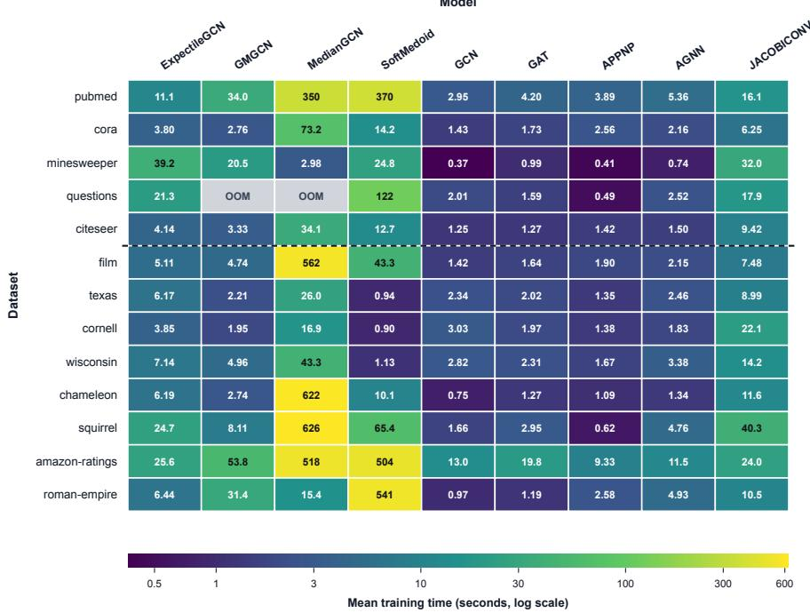  
Figure 2: Heatmap of the average training time (in seconds) for each method across diferent datasets. The reported time is the wall-clock training cost averaged over 5 runs.

## 4.4 Robustness under Feature and Structural Perturbations

To evaluate robustness under challenging graph conditions, we conduct perturbation experiments on most of the benchmark datasets. These two datasets are excluded because the benchmark results indicate relatively low classification performance, making robustness comparisons less informative. We select six representative models covering diferent aggregation mechanisms: GCN, AGNN, JacobiConv, MedianGCN, GMGCN, and the proposed ExpectileGCN. These methods include conventional and spectral graph neural networks, robust median aggregation, and nonlinear adaptive aggregation, allowing us to examine how diferent aggregation strategies respond to perturbations. We consider both node feature corruption and graph structural perturbations. For each dataset and perturbation setting, specified by a feature noise level and a structural modification ratio, we repeat the experiments with 5 random seeds and report the mean and standard deviation of the test performance.

Feature noise. To simulate attribute corruption, we independently add Gaussian noise to each feature dimension of every node, yielding $\widetilde { \mathbf { X } } = \mathbf { X } + \epsilon$ , where $\epsilon _ { i j } \sim \mathcal { N } ( 0 , \sigma ^ { 2 } )$ and $\sigma \in \{ 0 . 5 , 1 . 0 \}$ . This perturbation models measurement errors and other sources of noise in node attributes.

Structural perturbations. We perturb the graph topology at levels $p \in \{ 0 , 0 . 2 , 0 . 4 , 0 . 6 \}$ through two operations: (i) randomly removing a fraction p of edges connecting nodes with the same label to reduce homophily, and (ii) adding edges between nodes with diferent labels, with the number of added edges equal to p times the original edge count to increase heterophilic interference. These perturbations are applied separately or jointly to evaluate robustness under diferent structural corruption patterns.

Table 3: Average rank of each method across datasets. Methods are ranked by test performance under each of the 32 perturbation settings, and the reported values are averaged across settings. Lower ranks indicate better performance. Best results are shown in bold. The dashed line separates homophilic and heterophilic datasets. All-rank and Heter-rank denote average ranks over all datasets and heterophilic datasets, respectively.
<table><tr><td>Dataset</td><td>ExpectileGCN</td><td>GMGCN</td><td>JacobiConv</td><td>MedianGCN</td><td>GCN</td><td>AGNN</td></tr><tr><td>pubmed</td><td>1.19</td><td>2.88</td><td>3.25</td><td>4.81</td><td>5.59</td><td>3.28</td></tr><tr><td>cora</td><td>1.91</td><td>3.03</td><td>1.16</td><td>3.91</td><td>5.27</td><td>5.73</td></tr><tr><td>citeseer</td><td>1.78</td><td>3.50</td><td>1.31</td><td>3.41</td><td>5.00</td><td>6.00</td></tr><tr><td>minesweeper</td><td>2.66</td><td>4.38</td><td>1.06</td><td>3.22</td><td>4.88</td><td>4.81</td></tr><tr><td>questions</td><td>1.84</td><td>5.50</td><td>1.72</td><td>5.50</td><td>3.44</td><td>3.00</td></tr><tr><td>film</td><td>1.56</td><td>2.88</td><td>2.19</td><td>3.38</td><td>5.66</td><td>5.34</td></tr><tr><td>texas</td><td>1.95</td><td>1.20</td><td>4.38</td><td>4.14</td><td>5.34</td><td>3.98</td></tr><tr><td>cornell</td><td>3.66</td><td>4.06</td><td>3.02</td><td>2.89</td><td>3.92</td><td>3.45</td></tr><tr><td>wisconsin</td><td>1.95</td><td>1.17</td><td>4.30</td><td>3.22</td><td>4.83</td><td>5.53</td></tr><tr><td>chameleon</td><td>1.00</td><td>3.27</td><td>2.81</td><td>3.41</td><td>4.52</td><td>6.00</td></tr><tr><td>squirrel</td><td>1.00</td><td>3.94</td><td>2.75</td><td>2.69</td><td>5.03</td><td>5.59</td></tr><tr><td>amazon-ratings</td><td>2.22</td><td>4.11</td><td>2.86</td><td>5.20</td><td>2.41</td><td>4.20</td></tr><tr><td>roman-empire</td><td>1.78</td><td>2.13</td><td>2.13</td><td>3.97</td><td>6.00</td><td>5.00</td></tr><tr><td>All-rank</td><td>1.88</td><td>3.23</td><td>2.53</td><td>3.83</td><td>4.76</td><td>4.76</td></tr><tr><td>Heter-rank</td><td>1.96</td><td>3.26</td><td>2.72</td><td>3.76</td><td>4.60</td><td>4.69</td></tr></table>

Table 3 summarizes the robustness rankings across diferent perturbation settings. ExpectileGCN achieves the lowest All-rank of 1.88, outperforming the second-best JacobiConv (2.53). It also attains the best Heter-rank of 1.96, compared with 2.72 for JacobiConv, and ranks first on six of the thirteen datasets. These results demonstrate the strong overall robustness of ExpectileGCN across both homophilic and heterophilic graphs.

Figures 3 and 4 further illustrate robustness under feature and structural perturbations on representative homophilic and heterophilic datasets. As perturbation levels increase, ExpectileGCN generally maintains competitive performance, particularly on the heterophilic chameleon dataset. These findings are consistent with the theoretical insights of Theorems 3 and 4, which highlight how expectile aggregation can exploit class-dependent distributional information beyond the mean. Although these theorems do not directly characterize robustness under graph perturbations, they provide a complementary explanation for the potential benefits of expectile aggregation when neighborhood information is challenging to extract.

Similar robustness patterns are observed across the remaining datasets. Detailed results and visualizations for individual datasets are provided in Appendix A1.1, and hyperparameter sensitivity analyses are reported in Appendix A1.2.

## 5 Conclusion

In this article, we propose ExpectileGCN, a graph neural network that introduces expectile aggregation to flexibly capture neighborhood information beyond the mean. By learning the expectile level, ExpectileGCN adaptively weights neighborhood messages and provides a robust alternative to conventional mean aggregation. We establish transductive generalization guarantees and stability properties for the proposed model. We further show that expectile aggregation can achieve lower classification risk than mean aggregation by exploiting informative distributional structure in neighborhoods, and that this advantage can persist when the information contributed by individual neighbors becomes weak. Extensive experiments on both homophilic and heterophilic graphs demonstrate competitive predictive performance and improved robustness under feature and structural perturbations.

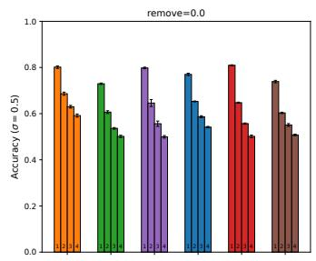

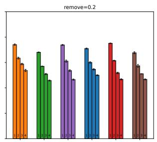

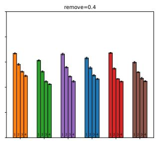

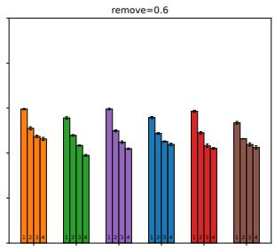

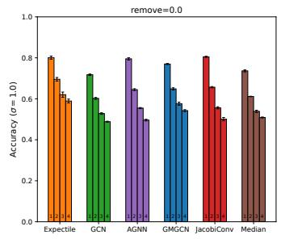

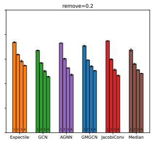

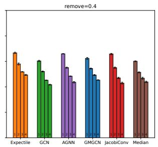

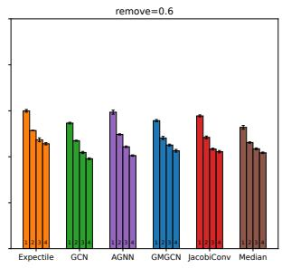  
Figure 3: Robustness comparison of diferent GNN models on the pubmed dataset. Within each subplot, each bar shows the mean test accuracy under the corresponding added edge proportion $p = \{ 0 , 0 . 2 , 0 . 4 , 0 . 6 \}$ marked as 1, 2, 3, and 4 below the bars. Black error bars denote the standard deviation across 5 independent runs.

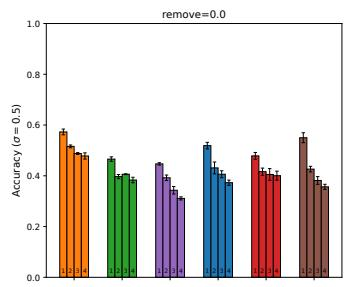

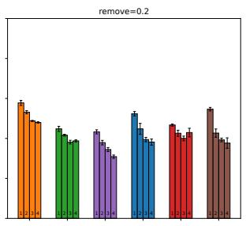

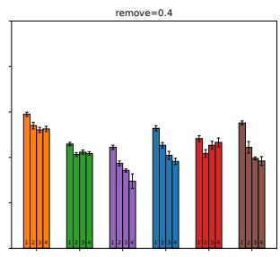

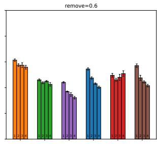

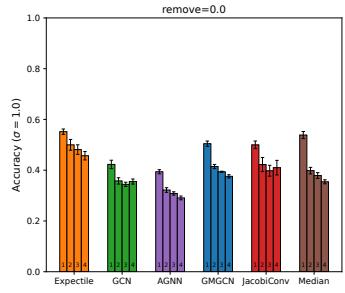

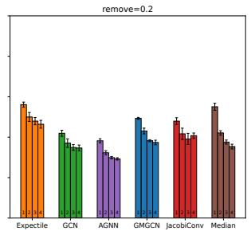

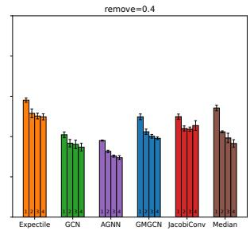

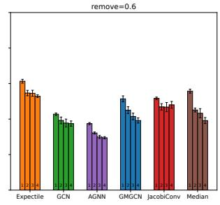  
Figure 4: Robustness comparison of diferent GNN models on the chameleon dataset. Within each subplot, each bar shows the mean test accuracy under the corresponding added edge proportion $p = \{ 0 , 0 . 2 , 0 . 4 , 0 . 6 \}$ marked as 1, 2, 3, and 4 below the bars. Black error bars denote the standard deviation across 5 independent runs.

We conclude with two directions for future research. First, the current model uses a common expectile level in neighborhood aggregation. Allowing the expectile level to adapt across nodes or local graph structures may provide greater flexibility for graphs with heterogeneous neighborhood distributions. Second, it would be interesting to extend expectile aggregation to more general relational settings, including dynamic graphs, hypergraphs, and other higher-order structures, and investigate the corresponding statistical and generalization properties.

## Acknowledgments and Disclosure of Funding

Wei Lan’s research was supported by the National Key R&D Program of China (2022YFA1003702), the National Natural Science Foundation of China (No.72422020, 72333001, 12531011), the Joint Lab of Data Science and Business Intelligence at Southwestern University of Finance and Economics.

## Appendix

This appendix reports additional robustness experiments and hyperparameter sensitivity results. All proofs and auxiliary lemmas are provided in the Supplementary Material; section and lemma numbers prefixed by S refer to that document.

## A1 Additional Experimental Results

## A1.1 Additional Robustness Visualizations

The robustness experiments on the other datasets follow the same perturbation protocol as described in the main text. Figures A1–A4 present detailed comparisons on four datasets: cora (homophilic), and squirrel, texas, and wisconsin (heterophilic). The figures report classification performance under diferent levels of feature corruption and structural perturbation, allowing comparisons of the methods across both homophilic and heterophilic settings.

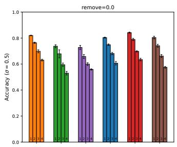

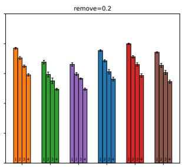

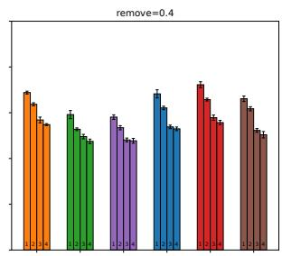

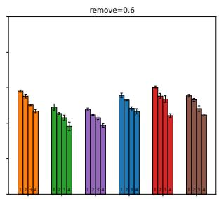

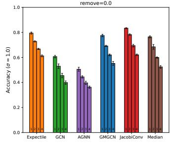

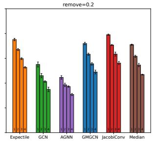

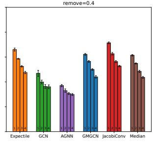

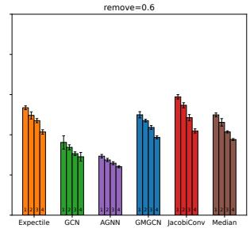  
Figure A1: Robustness comparison of diferent GNN models on the cora dataset. Within each subplot, each bar shows the mean test accuracy under the corresponding value of added-edge proportion $p = \{ 0 , 0 . 2 , 0 . 4 , 0 . 6 \}$ , marked as 1, 2, 3, and 4 on the bottom of the bars. Black error bars denote the standard deviation across 5 independent runs.

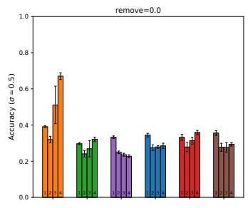

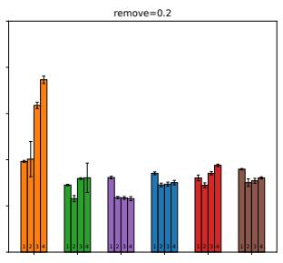

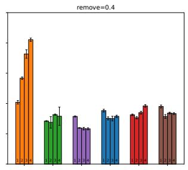

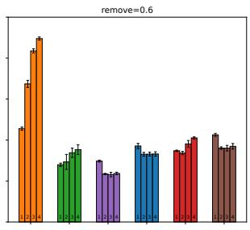

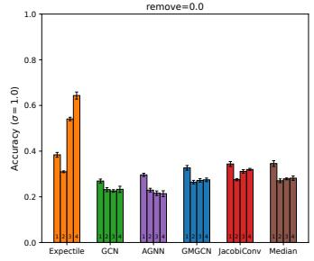

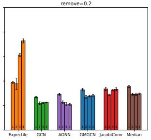

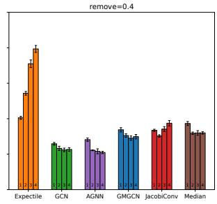

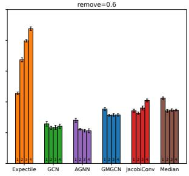  
Figure A2: Robustness comparison of diferent GNN models on the squirrel dataset. Within each subplot, each bar shows the mean test accuracy under the corresponding value of added-edge proportion $p = \{ 0 , 0 . 2 , 0 . 4 , 0 . 6 \}$ , marked as 1, 2, 3, and 4 on the bottom of the bars. Black error bars denote the standard deviation across 5 independent runs.

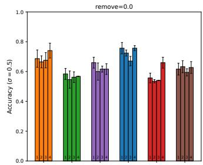

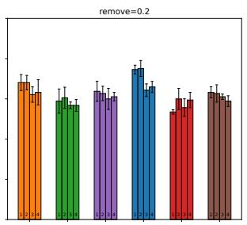

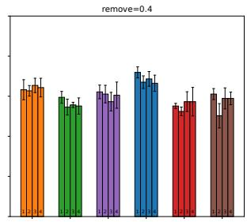

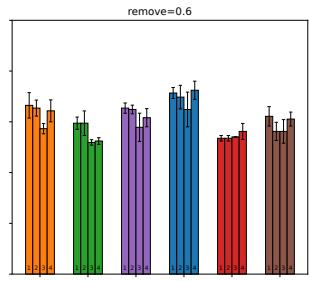

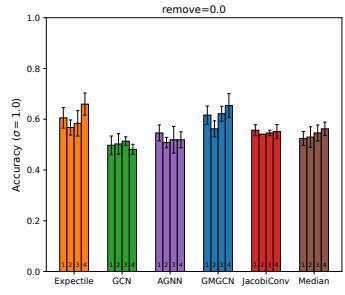

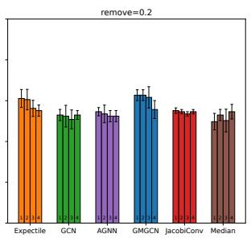

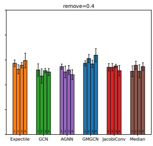

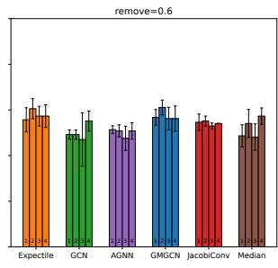  
Figure A3: Robustness comparison of diferent GNN models on the texas dataset. Within each subplot, each bar shows the mean test accuracy under the corresponding value of added-edge proportion $p = \{ 0 , 0 . 2 , 0 . 4 , 0 . 6 \}$ , marked as 1, 2, 3, and 4 on the bottom of the bars. Black error bars denote the standard deviation across 5 independent runs.

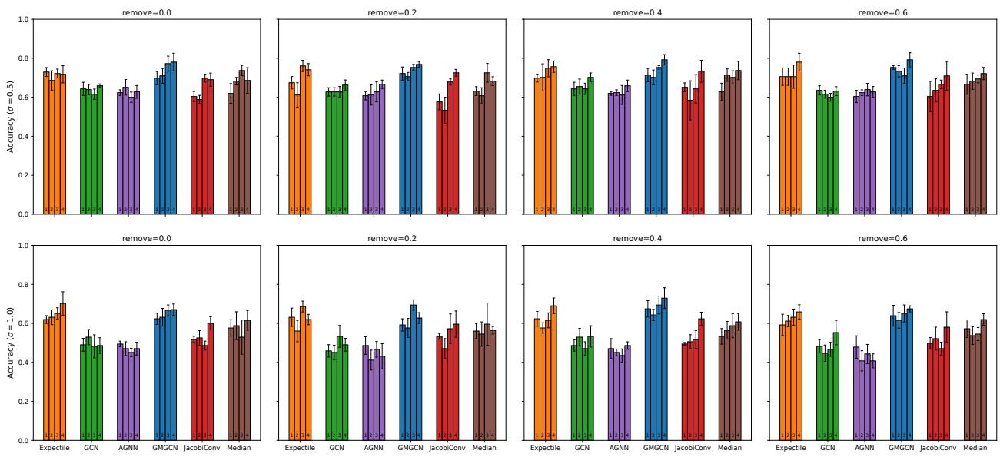  
Figure A4: Robustness comparison of diferent GNN models on the wisconsin dataset. Within each subplot, each bar shows the mean test accuracy under the corresponding value of added-edge proportion $p = \{ 0 , 0 . 2 , 0 . 4 , 0 . 6 \}$ , marked as 1, 2, 3, and 4 on the bottom of the bars. Black error bars denote the standard deviation across 5 independent runs.

## A1.2 Hyperparameter Sensitivity Analysis

We investigate the sensitivity of ExpectileGCN to two key hyperparameters: the number of fixedpoint iterations T and the sigmoid sharpness parameter s. We consider $T \in \{ 1 , 2 , 4 , 8 \}$ and $s \in \{ 1 , 3 , 5 , 1 0 \}$ across nine benchmark datasets covering both homophilic and heterophilic graphs. For each configuration, we report the mean classification accuracy and standard deviation over five independent runs.

Table A1: Sensitivity analysis of ExpectileGCN with respect to the number of fixed-point iterations T and smoothing sharpness s. Results are reported as mean accuracy (%) ± standard deviation over 5 runs.
<table><tr><td>T</td><td>S</td><td>pubmed</td><td>cora</td><td>film</td><td>citeseer</td><td>texas</td><td>cornell</td><td>wisconsin</td><td>chameleon</td><td>squirrel</td></tr><tr><td>1</td><td></td><td>90.01±0.18</td><td>85.91±0.41</td><td>35.68±0.70</td><td>76.94±1.28</td><td>87.03±4.80</td><td>71.08±3.21</td><td>84.12±1.85</td><td>63.42±1.13</td><td>45.73±0.69</td></tr><tr><td></td><td>3</td><td>89.97±0.25</td><td>85.86±0.46</td><td>35.75±0.63</td><td>76.98±1.25</td><td>85.68±6.51</td><td>71.62±3.02</td><td>82.75±2.60</td><td>63.68±1.36</td><td>45.86±0.98</td></tr><tr><td></td><td>5</td><td>90.03±0.26</td><td>85.89±0.43</td><td>35.66±0.55</td><td>76.73±1.48</td><td>85.14±6.42</td><td>71.62±3.47</td><td>83.73±2.78</td><td>63.82±1.39</td><td>45.97±0.72</td></tr><tr><td></td><td>10</td><td>89.96±0.21</td><td>85.86±0.46</td><td>35.69±0.70</td><td>76.38±1.80</td><td>84.59±6.05</td><td>71.62±3.47</td><td>84.71±2.45</td><td>63.62±0.94</td><td>46.11±0.87</td></tr><tr><td>2</td><td>1</td><td>90.05±0.21</td><td>85.91±0.41</td><td>35.68±0.70</td><td>76.71±1.53</td><td>86.76±3.30</td><td>71.08±3.21</td><td>86.08±2.05</td><td>63.42±1.13</td><td>45.86±0.84</td></tr><tr><td></td><td>3</td><td>90.13±0.18</td><td>85.84±0.49</td><td>35.73±0.65</td><td>76.98±1.25</td><td>85.68±6.63</td><td>71.62±3.02</td><td>83.73±3.40</td><td>63.68±1.36</td><td>45.98±0.97</td></tr><tr><td></td><td>5</td><td>89.96±0.18</td><td>85.86±0.48</td><td>35.71±0.61</td><td>76.64±1.65</td><td>85.41±6.64</td><td>71.62±3.47</td><td>84.12±2. .83</td><td>63.42±1.42</td><td>45.97±0.72</td></tr><tr><td></td><td>10</td><td>90.00±0.25</td><td>85.84±0.45</td><td>35.57±0.77</td><td>76.59±1.64</td><td>84.59±6.05</td><td>71.35±3.01</td><td>84.51±2.39</td><td>63.42±1.24</td><td>46.03±0.96</td></tr><tr><td>4</td><td>1</td><td>89.96±0.22</td><td>85.91±0.41</td><td>35.38±0.91</td><td>76.71±1.53</td><td>85.95±4.65</td><td>71.08±3.21</td><td>85.88±1.92</td><td>63.44±1.10</td><td>45.61±0.60</td></tr><tr><td></td><td>3</td><td>89.96±0.12</td><td>85.84±0.49</td><td>35.72±0.66</td><td>76.98±1.25</td><td>85.68±6.63</td><td>71.62±3.02</td><td>83.14±3.42</td><td>63.68±1.36</td><td>45.98±0.97</td></tr><tr><td></td><td>5</td><td>90.04±0.28</td><td>85.86±0.48</td><td>35.69±0.65</td><td>76.64±1.65</td><td>85.41±6.64</td><td>71.62±3.47</td><td>84.90±2.78</td><td>63.42±1.42</td><td>45.98±0.74</td></tr><tr><td></td><td>10</td><td>89.97±0.36</td><td>85.86±0.46</td><td>35.56±0.78</td><td>76.61±1.62</td><td>84.59±6.05</td><td>71.35±3.01</td><td>83.92±2.75</td><td>63.42±1.24</td><td>46.05±0.97</td></tr><tr><td>8</td><td>1</td><td>90.00±0.23</td><td>85.91±0.41</td><td>35.69±0.68</td><td>76.71±1.53</td><td>85.95±4.65</td><td>71.08±3.21</td><td>85.88±1.92</td><td>63.42±1.13</td><td>45.60±0.63</td></tr><tr><td></td><td>3</td><td>90.10±0.23</td><td>85.84±0.49</td><td>35.73±0.65</td><td>76.98±1.25</td><td>85.68±6.63</td><td>71.62±3.02</td><td>83.14±3.42</td><td>63.68±1.36</td><td>45.98±0.98</td></tr><tr><td></td><td>5</td><td>90.05±0.17</td><td>85.86±0.48</td><td>35.70±0.61</td><td>76.64±1.65</td><td>85.41±6.64</td><td>71.62±3.47</td><td>84.90±2.78</td><td>63.42±1.42</td><td>45.97±0.72</td></tr><tr><td></td><td>10</td><td>89.94±0.28</td><td>85.84±0.45</td><td>35.71±0.75</td><td>76.61±1.62</td><td>84.59±6.0571.35±3.01</td><td></td><td>83.92±2.75</td><td>63.42±1.24</td><td>46.03±0.96</td></tr></table>

As shown in Table A1, ExpectileGCN demonstrates stable performance across a wide range of hyperparameter choices. Variations in both mean accuracy and standard deviation remain small for diferent values of T and s. In particular, small iteration numbers such as T = 1 or 2 already achieve performance comparable to larger iteration budgets, indicating that the implicit expectile representations require only limited iterative refinement. Similarly, moderate smoothing parameters such as s = 3 or 5 perform comparably to sharper approximations $( \mathrm { e . g . } , s = 1 0 )$ , suggesting that the sigmoid-smoothed asymmetric coeficient is not sensitive to the precise smoothness specification. Overall, these results demonstrate strong hyperparameter robustness of ExpectileGCN with respect to both iterative depth and smoothing design, making the model practically efective without extensive dataset-specific tuning.

## References

David Blackwell. Comparison of experiments. In Proceedings of the Second Berkeley Symposium on Mathematical Statistics and Probability, pages 93–102, Berkeley and Los Angeles, 1951.

Liang Chen, Jintang Li, Qibiao Peng, Yang Liu, Zibin Zheng, and Carl Yang. Understanding structural vulnerability in graph convolutional networks. In Proceedings of the Thirtieth International Joint Conference on Artificial Intelligence, pages 2249–2255, 2021.

Gabriele Corso, Luca Cavalleri, Dominique Beaini, Pietro Liò, and Petar Veličković. Principal neighbourhood aggregation for graph nets. In Advances in Neural Information Processing Systems, volume 33, pages 13260–13271, 2020.

Alan R. Dabney. Classification of microarrays to nearest centroids. Bioinformatics, 21(22):4148–4154, 2005.

John C. Duchi, Khashayar Khosravi, and Feng Ruan. Multiclass classification, information, divergence and surrogate risk. The Annals of Statistics, 46(6B):3246–3275, 2018.

Jianqing Fan and Yingying Fan. High-dimensional classification using features annealed independence rules. The Annals of Statistics, 36(6):2605–2637, 2008.

Simon Geisler, Daniel Zügner, and Stephan Günnemann. Reliable graph neural networks via robust aggregation. In Advances in Neural Information Processing Systems, volume 33, pages 13272–13284, 2020.

William L Hamilton. Graph Representation Learning. Morgan & Claypool Publishers, 2020.

William L Hamilton, Rex Ying, and Jure Leskovec. Inductive representation learning on large graphs. In Advances in Neural Information Processing Systems, volume 11, page 1025–1035, 2017.

Christian Hennig and Cinzia Viroli. Quantile-based classifiers. Biometrika, 103(2):435–446, 2016.

Thomas N Kipf and Max Welling. Semi-supervised classification with graph convolutional networks. In International Conference on Learning Representations, 2017.

Johannes Klicpera, Aleksandar Bojchevski, and Stephan Günnemann. Predict then propagate: Graph neural networks meet personalized pagerank. In International Conference on Learning Representations, 2019.

Renjie Liao, Raquel Urtasun, and Richard Zemel. A pac-bayesian approach to generalization bounds for graph neural networks. arXiv preprint arXiv:2012.07690, 2020.

Shaogao Lv. Generalization bounds for graph convolutional neural networks via rademacher complexity. arXiv preprint arXiv:2102.10234, 2021.

Yao Ma, Xiaorui Liu, Neil Shah, and Jiliang Tang. Is homophily a necessity for graph neural networks? In International Conference on Learning Representations, 2022.

Miller McPherson, Lynn Smith-Lovin, and James M Cook. Birds of a feather: Homophily in social networks. Annual Review of Sociology, 27(1):415–444, 2001.

Whitney K. Newey and James L. Powell. Asymmetric least squares estimation and testing. Econometrica, 55(4):819–847, 1987.

Oleg Platonov, Denis Kuznedelev, Artem Babenko, and Liudmila Prokhorenkova. Characterizing graph datasets for node classification: Homophily-heterophily dichotomy and beyond. In Advances in Neural Information Processing Systems, volume 36, pages 523–548, 2023.

Mark D. Reid and Robert C. Williamson. Information, divergence and risk for binary experiments. Journal of Machine Learning Research, 12(22):731–817, 2011.

Huayi Tang and Yong Liu. Towards understanding generalization of graph neural networks. In Proceedings of the 40th International Conference on Machine Learning, ICML’23, 2023.

Kiran K Thekumparampil, Chong Wang, Sewoong Oh, and Li-Jia Li. Attention-based graph neural network for semi-supervised learning. arXiv preprint arXiv:1803.03735, 2018.

A. W. van der Vaart. Asymptotic Statistics. Cambridge University Press, 1998.

Petar Veličković et al. Graph attention networks. In International Conference on Learning Representations, 2018.

Beibei Wang, Bo Jiang, Jin Tang, and Bin Luo. Generalizing aggregation functions in gnns: Building high capacity and robust gnns via nonlinear aggregation. IEEE Transactions on Pattern Analysis and Machine Intelligence, 45(11):13454–13466, 2023.

Junfu Wang, Yuanfang Guo, Liang Yang, and Yunhong Wang. Understanding heterophily for graph neural networks. In Proceedings of the 41st International Conference on Machine Learning, ICML’24, 2024.

Xiyuan Wang and Muhan Zhang. How powerful are spectral graph neural networks. In Proceedings of the 39th International Conference on Machine Learning, volume 162, pages 23341–23362, 2022.

Samy Wu Fung and Benjamin Berkels. A generalization bound for a family of implicit networks. Neurocomputing, 678:133136, 2026.

Salimeh Yasaei Sekeh, Brandon Oselio, and Alfred O. Hero. Learning to bound the multi-class bayes error. IEEE Transactions on Signal Processing, 68:3793–3807, 2020.

Wenzhuo Zhou, Annie Qu, Keiland W. Cooper, Norbert Fortin, and Babak Shahbaba. A modelagnostic graph neural network for integrating local and global information. Journal of the American Statistical Association, 120(550):1225–1238, 2025.