# HeteGCD: Statistics-Aware Dual-Prototype Learning for Generalized Category Discovery on Heterophilous Graphs

Xuanzhi Xi, Tongze Zhang, Zhili Qin, Yulin Tao,

Hongliang Wang, Zhong Zhang, Qinli Yang, Junming Shao

University of Electronic Science and Technology of China, China

xuanzhixi@std.uestc.edu.cn

## Abstract

Heterophilous graphs are prevalent in real-world applications, where connected nodes often exhibit dissimilar attributes or belong to diferent classes, posing significant challenges to conventional graph learning methods based on homophily. This limitation becomes particularly pronounced in generalized category discovery (GCD), which requires models to recognize known classes and discover novel ones using labels from known classes only. However, existing graph GCD methods typically rely on aforemen tioned homophily-based inductive biases, which are ill-suited to heterophilous graphs. Meanwhile, although current heterophilous graph learning methods exploit diverse neighborhood signals, their selection and fusion are often guided by supervision across all classes, including novel classes whose labels are unavailable in GCD. These limitations raise a key question: how can heterogeneous neighborhood information be efectively leveraged for category discovery without any novel-class supervision? To answer this question, in this study we propose HeteGCD, a new statistics-aware dualprototype learning perspective for generalized category discovery on heterophilous graphs. The key idea is to examine both statistics of local attribute diferences and neighborhood class distribution to extract discriminative information in feature and probability spaces simultaneously. Specifically, a gated dual-stream encoder integrates both node attributes and local attribute-diference statistics to learn informative node representations. Afterwards, a dual-prototype classifier combines feature-based similarity with distribution-based consistency to support category discovery. Experiments on five heterophilous graphs show that HeteGCD achieves competitive performance against 24 baseline combinations.

## Keywords

Generalized Category Discovery, Heterophilous Graphs, Prototype Learning, Neighborhood Class Distributions

## 1 Introduction

Graphs are widely used to represent relationships in real-world applications, ranging from social networks to online shopping platforms. Many graph learning methods build upon the homophily as sumption that connected nodes tend to belong to the same class [34]. However, many Web graphs exhibit heterophily, with frequent connections between nodes of diferent classes [25]. In product co-purchase networks, for example, customers may purchase mobile phones and chargers together, creating links between complementary products from diferent categories. Moreover, available annotations may cover only a subset of classes. An online store, for instance, may have labeled examples of phones and laptops, while a newly introduced category, such as virtual reality (VR) headsets, has no labeled examples yet. These practical challenges motivate the study ofgeneralized category discovery (GCD) on heterophilous graphs, a problem that remains underexplored. Given labels for only some nodes from known classes, the goal is to recognize known classes and discover novel ones among the remaining unlabeled nodes [29].

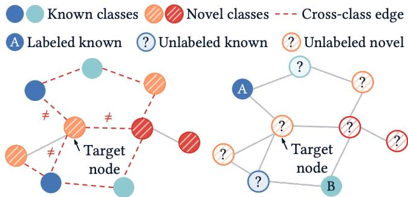  
(a) Unreliable Homophily Assumption. Nodes often connect to nodes of diferent classes, challenging graph GCD methods that rely on homophily.  
(b) Unavailable Novel-Class Supervision. Missing novel-class feedback hinders signal selection and fusion for closed-set heterophilous methods.  
Figure 1: GCD on Heterophilous Graphs. Only a subset of known-class nodes is labeled, while unlabeled nodes include both known and novel classes.

On the one hand, heterophily challenges the homophily assumption underlying existing graph GCD methods. Existing methods for graph-based category discovery and open-world node classification often rely on neighborhood agreement to select or propagate pseudo-labels [13, 32]. However, as illustrated in Figure 1(a), most of the target node’s neighbors belong to other classes, with red dashed edges highlighting these cross-class connections. Neighborhood agreement can therefore provide misleading evidence for category assignment, undermining the homophily-based inductive biases of these methods.

On the other hand, the lack of novel-class supervision challenges conventional heterophilous graph learning methods. These methods have achieved strong performance in closed-set node classification by combining node attributes with diverse neighborhood and structural signals [2, 16, 17, 20, 34]. Labels from all target classes guide these methods in learning which signals to use and how to combine them. However, in the GCD setting illustrated in Figure 1(b), only some known-class nodes are labeled, while the remaining unlabeled nodes, marked with question marks, belong to both known and novel classes. The model therefore lacks direct novel-class feedback to determine which signals help distinguish novel classes and how these signals should be combined.

When unreliable homophily priors meet missing novel-class supervision, a key question arises: how can heterogeneous neighborhood information be efectively usedfor category discovery without any novel-class supervision?

To answer this question, we examine neighborhood information from a statistical perspective, with node attributes as the basis. We study two types of neighborhood statistics: local attribute-diference statistics, which summarize a node’s deviations from its neighbors mean attributes, and neighborhood class distribution statistics, which describe the proportions of classes in its neighborhood. Our empirical analyses provide evidence of category separability in these three signals, supporting their use for discovery. These observations suggest combining node attributes and local attribute-diference statistics in embedding space, while retaining neighborhood class distributions in probability space to guide category assignment.

Based on these observations, we propose HeteGCD, a statisticsaware dual-prototype learning framework. A gated dual-stream encoder integrates node attributes and local attribute-diference statistics to learn node representations. A dual-prototype classifier combines similarity to feature prototypes with consistency between neighborhood distributions and distribution prototypes. The neighborhood distributions and distribution prototypes are estimated from evolving soft assignments over known and novel classes, without requiring novel-class labels.

Our main contributions are as follows.

• Heterophilous graph GCD. To the best of our knowledge, this is the first systematic study of GCD on heterophilous graphs, examining the joint challenges of unreliable homophily priors and unavailable novel-class supervision.

• Statistics-Aware Dual-Prototype Learning. We propose HeteGCD, which combines a gated dual-stream encoder with a dual-prototype classifier to capture category information from node attributes and neighborhood statistics in feature and probability spaces.

• Competitive performance. HeteGCD achieves the best average ranks in All and New accuracy across five heterophilous graphs when compared with 24 baseline combinations.

## 2 Related Work

## 2.1 Generalized Category Discovery

Vaze et al. [29] first learn representations through supervised and self-supervised contrastive objectives, then apply semi-supervised �-means for category discovery. SimGCD [31] unifies representation learning and parametric classification through self-distillation and entropy regularization. This joint learning framework underlies many recent visual GCD methods [3, 4, 21, 30] and also serves as the basis of HeteGCD. These visual methods primarily focus on instance features, leaving topological relations among samples insuficiently explored.

Graph GCD incorporates these relations into category discovery. Deng et al. [7] study parametric GCD on graphs and introduce SWIRL for graph contrastive learning. Related work on open-world node classification includes POWN [13], which combines prototype learning with pseudo-label propagation, and TopoNC [32], which selects pseudo-labels based on neighborhood consensus. Such homophily-based mechanisms rely on category agreement between connected nodes as evidence for discovery. On heterophilous graphs, frequent cross-class edges can make this evidence unreliable, motivating other ways to use graph relations.

## 2.2 Learning on Heterophilous Graphs

To move beyond standard GCN aggregation [15], heterophilous graph learning draws on a wider range of attribute and structural signals. Existing methods preserve node attributes and exploit multiple hops [5, 34] or select and transform hop-wise features through adaptive fusion [9, 11, 23]. Adaptive filtering and channel mixing capture local diferences and diverse frequency responses [2, 6, 12, 20]. Other approaches distinguish homophilous from heterophilous interactions [8] or encode geometric neighborhoods, global relations, and explicit adjacency [16, 17, 24].

Neighborhood class distributions provide another relational signal: nodes of the same class may have similar neighborhood compositions despite frequent cross-class edges. ND-GCN [18] and NLDGNN [33] use estimated distributions to guide propagation or construct representations, while SCNode [27] incorporates class histograms into node coordinates.

Using these signals efectively requires appropriate selection and fusion, yet GCD provides no direct novel-class supervision to guide this process. Existing neighborhood distribution methods mainly use these statistics for message passing or representation learning, while HeteGCD uses them for category assignment in probability space instead.

## 3 Problem Formulation

Graph notation. Let $G = \left( V , E , X \right)$ be an undirected attributed graph with $n = | V |$ nodes and $X \in \mathbb { R } ^ { n \times d _ { x } }$ , where row �<sub>�</sub> gives the attributes of node � with category �<sub>�</sub>. We use the row-normalized adjacency matrix � without self-loops, with zero rows for isolated nodes.

Generalized category discovery. The category set C comprises disjoint known (old) and novel (new) subsets $C _ { o }$ and $C _ { n } ,$ of sizes $K _ { o }$ and $K _ { n }$ . The labeled set ${ \mathcal { L } } \subseteq V$ contains examples from every known category and no novel categories. The unlabeled set $\mathcal { U } = V \setminus \mathcal { L }$ contains nodes from both known and novel categories. GCD aims to assign nodes in U to categories, jointly recognizing known classes and separating novel classes.

Learning setting. We consider transductive node-level GCD with known $K = K _ { o } + K _ { n }$ . All node features and edges are available during training, while training labels are restricted to L. Hyperparameter and checkpoint selection use only held-out known-class validation labels. Data splits and evaluation details are specified in Section 6.1 and Appendices B and E.

## 4 Motivation and Observations

To address the key question raised in the Introduction, we examine neighborhood information from a statistical perspective. With node attributes as the basis, we analyze local attribute-diference statistics and neighborhood class distribution statistics for evidence of category separability.

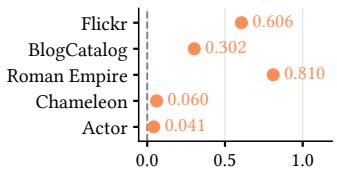

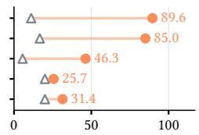  
(b) Nearest-prototype  
classification accuracy (%).

(a) Class separation above the shufled baseline.  
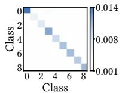  
(c) Flickr.

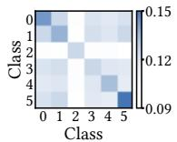  
(d) BlogCatalog.

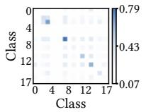  
(e) Roman Empire.  
Figure 2: Raw node attributes � retain category information across all five datasets. (a) Class separation above the shufledlabel baseline. (b) Leave-one-out nearest-prototype balanced accuracy. Triangles mark chance levels. (c–e) Mean cosine similarity between node pairs, grouped by class.

We assess category information using two measurements. Class separation is the ratio of between- to within-class distances, minus a shufled-label baseline. Leave-one-out (LOO) nearest-prototype balanced accuracy assigns each node to the nearest class mean after excluding itself, with accuracy averaged equally across classes. Heatmaps visualize within- and between-class similarity. Details are provided in Appendices C.1 and C.2.

## 4.1 Node Attributes

Intuition. Since heterophily concerns graph connectivity, raw node attributes can still carry category information before neighborhood aggregation.

Analysis. Retaining � preserves direct access to each node’s own attributes. H2GCN, LINKX, and ACM-GCN likewise treat raw attributes as a key source of category information [17, 20, 34].

Empirical observations. Figures 2a and 2b show positive geometry excess and above-chance LOO balanced accuracy across all five datasets. The heatmaps in Figures 2c–2e also show higher average similarity within categories than between categories. Together, these results support retaining � as a direct source of category information for discovery.

## 4.2 Local Attribute-Diference Statistics

Intuition. On heterophilous graphs, neighbors often belong to diferent categories. A node’s average attribute diferences from its neighbors may nevertheless exhibit category-related patterns.

Analysis. With the adjacency convention in Section 3, the local attribute-diference signal is $R = X - A X$ . For a node with a nonempty neighborhood $N ( i )$ , we compute

$$
r _ { i } = x _ { i } - \frac { 1 } { | N ( i ) | } \sum _ { j \in N ( i ) } x _ { j } = \frac { 1 } { | N ( i ) | } \sum _ { j \in N ( i ) } ( x _ { i } - x _ { j } ) .\tag{1}
$$

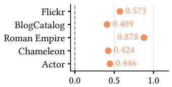

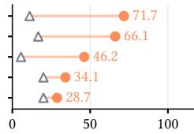  
(b) Nearest-prototype  
classification accuracy (%).

(a) Class separation above the shufled baseline.  
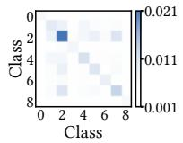

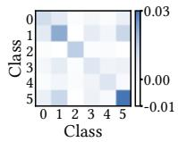  
(c) Flickr.  
(d) BlogCatalog.

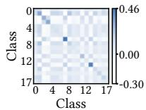  
(e) Roman Empire.  
Figure 3: Local attribute-diference statistics � − �� retain category information across all five datasets. (a) Class separation above the shufled-label baseline. (b) LOO balanced accuracy. Triangles mark chance levels. (c–e) Mean cosine similarity between local diference vectors, grouped by class.

This first-order statistic averages the signed diferences $x _ { i } - x _ { j }$ over neighbors, retaining attribute coordinates without category labels. The usefulness of local diferences for graph representation learning is also supported by FAGCN, ACM-GCN, and GREET [2, 19, 20].

Empirical observations. This statistic also shows positive geometry excess and above-chance LOO balanced accuracy on all five datasets (Figures 3a and 3b). The heatmaps in Figures 3c–3e show higher average similarity within categories than between categories. These results support � − �� as an additional source of category information.

## 4.3 Neighborhood Class Distribution Statistics

Intuition. Even on heterophilous graphs, nodes of the same category can connect to similar mixtures of categories. The relative frequencies of neighbor categories summarize these mixtures and can therefore provide clues to a node’s category.

Analysis. Let $N _ { h } ( i )$ denote the nodes at shortest-path distance exactly ℎ from node �. For a nonempty neighborhood, define the empirical neighborhood class distribution and its class mean as

$$
q _ { i } ^ { ( h ) } ( k ) = \frac { 1 } { | N _ { h } ( i ) | } \sum _ { j \in N _ { h } ( i ) } 1 \{ y _ { j } = k \} ,\tag{2}
$$

$$
\mu _ { c } ^ { ( h ) } = \frac { 1 } { | V _ { c } | } \sum _ { i \in V _ { c } } q _ { i } ^ { ( h ) } , \quad \quad V _ { c } = \{ i : y _ { i } = c \} .\tag{3}
$$

Here, $q _ { i } ^ { ( h ) }$ records empirical category proportions, and the class mean $\mu _ { c } ^ { \left( h \right) }$ summarizes typical neighborhood composition as a distribution prototype. We compare distributions using total variation distance, $\begin{array} { r } { d _ { \mathrm { T V } } ( p , q ) = \frac { 1 } { 2 } \| p - q \| _ { 1 } } \end{array}$

Prior work likewise identifies neighborhood category distributions as informative signals for distinguishing node categories [22, 27, 33], while our focus is their value for discovering novel categories without direct supervision.

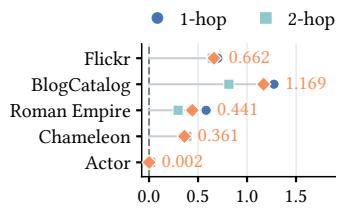

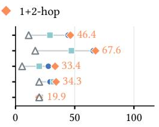  
(b) Nearest-prototype

(a) Class separation above the shufled baseline.  
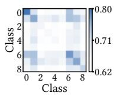

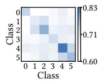  
(c) Flickr.

classification accuracy (%).  
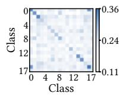  
(d) BlogCatalog.  
(e) Roman Empire.  
Figure 4: Combining 1-hop and 2-hop distributions gives higher LOO accuracy than either hop on four of five datasets. (a,b) Class separation and LOO balanced accuracy. Triangles mark chance levels. (c–e) Mean node-pair similarity $1 - d _ { \mathrm { T V } } .$ averaged across hops and grouped by class.

Empirical observations. Figure 4 compares neighborhood class distributions at exact 1-hop and 2-hop distances and their fusion on the same five datasets. To combine the two scales, we retain hop-specific prototypes and average their matching distances:

$$
d _ { 1 + 2 } ( i , c ) = \frac { 1 } { 2 } \sum _ { h = 1 } ^ { 2 } d _ { \mathrm { T V } } ( q _ { i } ^ { ( h ) } , \mu _ { c } ^ { ( h ) } ) .\tag{4}
$$

Both hops show positive geometry excess and above-chance LOO balanced accuracy on most datasets, indicating useful category information at both scales. Their relative usefulness varies, 1-hop gives higher LOO accuracy on Flickr and BlogCatalog, whereas 2-hop performs better on Chameleon. Separate analyses of the two hops are provided in Appendix C.3. Fusion exceeds both individual hops on four datasets, and its heatmaps show higher average similarity within categories than between categories. These observations support using both hops to capture complementary neighborhood category information.

In GCD, category assignments for unlabeled nodes must be estimated and may be inaccurate. Such errors alter the estimated neighborhood composition. We therefore examine whether these statistics retain category separability under corrupted assignments.

Random assignment noise. Across the evaluated noise levels, fused distributions retain positive geometry excess and abovechance LOO balanced accuracy on four of the five datasets (Figure 5), indicating that category information persists despite inaccurate neighbor assignments.

Novel-to-known assignment bias. We next concentrate erroneous novel-class assignments on known categories, using the same corrupted nodes and the same rule for known-class errors. The same four datasets retain category separability across the evaluated noise levels (Figure 6). Although separation generally weakens as corruption increases, relational category information remains available under this novel-to-known bias.

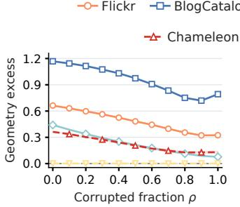  
(a) Class separation above the shufled baseline.

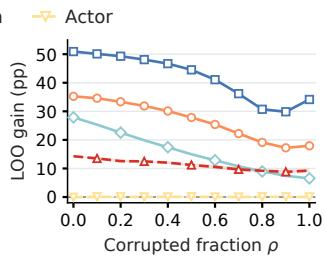  
(b) Nearest-prototype accuracy gain over chance (pp).

Figure 5: Fused 1+2-hop distributions retain category information on four of five datasets across the tested noise levels. A fraction � of unlabeled nodes per class receives random incorrect labels. (a) Class separation. (b) LOO balanced-accuracy gain over chance (percentage points).  
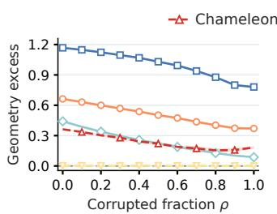

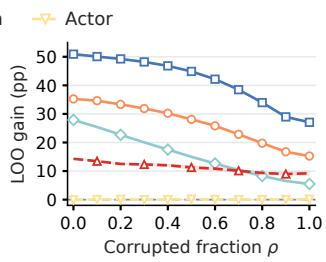  
(a) Class separation above the shufled baseline.  
(b) Nearest-prototype accuracy gain over chance (pp).  
Figure 6: Four of five datasets retain category information under novel-to-known assignment bias. Corrupted novelclass nodes receive known-class labels. Other settings and measurements follow Figure 5.

These results suggest that neighborhood class distribution statistics can retain useful category information despite assignment noise and thus help guide category assignment in GCD.

## 4.4 Design Implications

These observations suggest using the signals according to the meaning of their coordinates. � and � − �� share attribute coordinates, describing a node’s own properties and its deviations from the neighborhood mean. Their category information lies in patterns of attribute values, which motivates learning an embedding space that organizes these complementary cues for category separation.

Neighborhood class distributions already have category semantics, each coordinate records the relative frequency of a particular category in the neighborhood. Existing neighborhood distribution methods primarily use these signals to guide propagation or construct node representations. We instead retain them in probability space and match them to distribution prototypes to guide category assignment for both known and novel classes.

Together, these insights motivate a statistics-aware design: combine node attributes and local attribute-diference statistics in embedding space, and match neighborhood class distributions to distribution prototypes in probability space.

## 5 Method

HeteGCD combines a gated dual-stream encoder and a dual-prototype classifier to integrate evidence from embedding and probability spaces (Figure 7). Appendix A provides training and inference pseudocode.

## 5.1 Gated Dual-Stream Encoder

The encoder combines each node’s own attributes with its mean signed attribute diferences from neighbors. At each epoch, we generate two graph views by independent feature masking and edge dropping. For view �, let $X ^ { ( v ) }$ denote the masked attributes and $A ^ { ( v ) }$ the row-normalized adjacency without self-loops. We compute local attribute-diference statistics $X _ { \mathrm { r e s } } ^ { ( v ) } = X ^ { ( v ) } - A ^ { ( v ) } X ^ { ( v ) }$ and encode the two signals with separate residual MLPs, $f _ { x }$ and $f _ { r }$ A node-wise gate combines their embeddings:

$$
\begin{array} { r l } & { h _ { i } ^ { x } = \mathrm { n o r m } ( f _ { x } ( x _ { i } ) ) , \quad h _ { i } ^ { r } = \mathrm { n o r m } ( f _ { r } ( r _ { i } ) ) , } \\ & { \qquad g _ { i } = \sigma \Big ( w _ { g } ^ { \top } [ h _ { i } ^ { x } \| h _ { i } ^ { r } ] + b _ { g } \Big ) , } \\ & { \qquad h _ { i } = \mathrm { n o r m } ( h _ { i } ^ { x } + g _ { i } h _ { i } ^ { r } ) . } \end{array}\tag{5}
$$

Here, $x _ { i }$ and $r _ { i }$ are the node’s attributes and local attribute-diference statistics in the current view, and norm(·) denotes $\ell _ { 2 }$ normalization. The scalar gate $g _ { i }$ controls how much the diference statistics supplement the attribute representation.

A separate projector produces $z _ { i } = \mathrm { n o r m } ( g _ { \mathrm { p r o j } } ( h _ { i } ) )$ for contrastive learning, while classification operates directly on $h _ { i }$

## 5.2 Dual-Prototype Classifier

Our classifier combines feature-based similarity with distributionbased consistency for each candidate category. A trainable feature prototype represents the category in embedding space, while hopspecific distribution prototypes summarize its typical neighborhood class composition in probability space. Feature prototypes are opti mized by gradient descent, distribution prototypes are periodically estimated from soft assignments.

5.2.1 Feature Prototype Matching. Let $c _ { k }$ be a unit-norm feature prototype, as in the cosine classifier of SimGCD [31]. We place its matching score on [0, 1]:

$$
F _ { i k } = \frac { 1 + h _ { i } ^ { \top } c _ { k } } { 2 } , \qquad k = 1 , \ldots , K .\tag{6}
$$

Before optimization, prototypes are initialized by constrained $k ^ { - }$ means on the initial clean embeddings. Labeled nodes remain in their known slots, and unlabeled nodes can use all � slots. The resulting prototypes are then optimized jointly with the encoder.

5.2.2 Distribution Prototype Construction and Matching. We estimate category-specific neighborhood composition statistics from soft assignments and match each node’s distribution to them.

Assignment memory. We maintain an assignment memory $\bar { Q }$ ∈ $\mathbb { R } ^ { | V | \times K }$ , whose row $\bar { q } _ { i }$ stores a smoothed estimate of node �’s own class assignment over all $K$ categories. At epoch �, for $i \in \mathcal { U } ,$ , the current detached soft assignment $\bar { q } _ { i } ^ { ( t ) }$ updates the memory through an exponential moving average (EMA) with momentum $\mu { : }$

$$
\begin{array} { r } { \bar { q } _ { i } ^ { ( t ) } = \mu \bar { q } _ { i } ^ { ( t - 1 ) } + ( 1 - \mu ) q _ { i } ^ { ( t ) } . } \end{array}\tag{7}
$$

The first update initializes the memory with the current soft assignments, while rows for $i \in \mathcal { L }$ remain fixed to their known-label one-hot vectors.

Neighborhood class distributions. On the original graph, let $\mathcal { N } _ { r } ( i )$ contain nodes at shortest-path distance exactly $r \in \{ 1 , 2 \}$ from node �. At each refresh, we estimate the neighborhood class proportions by averaging the stored soft assignments:

$$
n _ { i } ^ { ( r ) } = \frac { 1 } { | N _ { r } ( i ) | } \sum _ { j \in N _ { r } ( i ) } \bar { q } _ { j } .\tag{8}
$$

Distribution prototype construction. Let $V _ { r }$ index nodes whose �-hop neighborhoods are nonempty. For each category $k ,$ we construct a distribution prototype by averaging these distributions, weighted by the center nodes’ soft memberships:

$$
\pi _ { k } ^ { ( r ) } = \frac { \sum _ { i \in V _ { r } } \bar { Q } _ { i k } n _ { i } ^ { ( r ) } } { \sum _ { i \in V _ { r } } \bar { Q } _ { i k } } .\tag{9}
$$

Thus $\pi _ { k } ^ { ( r ) }$ summarizes the typical neighborhood class composition of nodes assigned to �. Both the neighborhood distributions and the center-node weights come from $\breve { \bar { Q } } ,$ allowing this construction to cover known and novel categories without requiring novel-class labels.

Distribution-based consistency. We measure consistency between a node’s neighborhood composition and that ofa candidate category by averaging total-variation (TV) similarities to its distribution prototypes across available hops:

$$
D _ { i k } = \frac { 1 } { \vert \mathcal { R } _ { i k } \vert } \sum _ { r \in \mathcal { R } _ { i k } } \left( 1 - \frac { 1 } { 2 } \| n _ { i } ^ { ( r ) } - \pi _ { k } ^ { ( r ) } \| _ { 1 } \right) ,\tag{10}
$$

where $\mathcal { R } _ { i k } \subseteq \{ 1 , 2 \}$ indexes the available hops for this comparison.

5.2.3 Score Fusion. Both $F _ { i k }$ and $D _ { i k }$ lie in [0, 1]. We combine each view’s feature scores with the shared, detached distribution scores using weight � :

$$
S _ { i k } ^ { ( v ) } = ( 1 - \alpha ) F _ { i k } ^ { ( v ) } + \alpha D _ { i k } , \qquad v \in \{ 1 , 2 \} .\tag{11}
$$

The fusion weight � is adjusted during training, and the resulting scores � are converted into class probabilities via softmax.

## 5.3 Joint Training and Inference

We jointly optimize representation and category assignment, using the contrastive objectives of GCD [29] and the supervised crossentropy (CE), self-distillation, and mean-entropy maximization (MeMax) objectives of SimGCD [31]. The classification terms use the fused scores from both prototype branches.

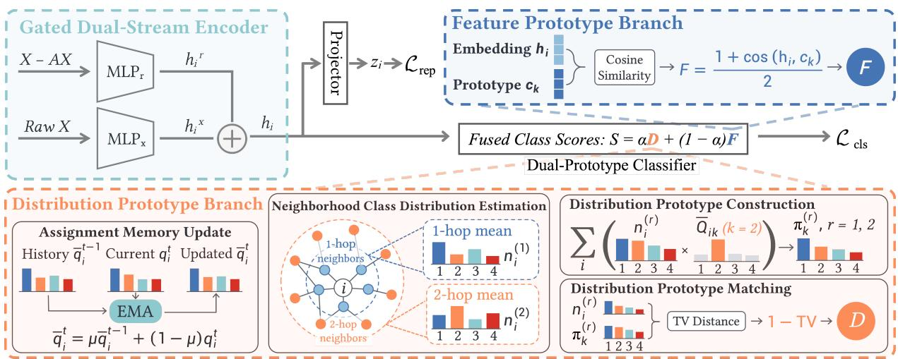  
Figure 7: Overview of HeteGCD. A gated dual-stream encoder integrates node attributes � and local attribute-diference statistics $X - A X$ into embeddings $h _ { i }$ . Matching $h _ { i }$ to trainable feature prototypes $c _ { k }$ yields scores � in embedding space. Current soft assignments $q _ { i } ^ { t }$ update memories $\bar { q } _ { i } ^ { t }$ by exponential moving average. Averaging these memories over exact �-hop neighbors estimates neighborhood class distributions $n _ { i } ^ { ( r ) } , r = 1 , 2 .$ In probability space, distribution prototype $\pi _ { k } ^ { ( r ) }$ is their weighted mean (illustrated for $k = 2 ) .$ , with weight $\bar { Q } _ { i k }$ denoting node �’s probability of belonging to class �. Total-variation similarities to these prototypes, averaged across hops, yield consistency scores �. Fused scores � support classification loss ${ \mathcal { L } } _ { \mathrm { c l s } }$ , while projected embeddings $z _ { i }$ support contrastive loss $\mathcal { L } _ { \mathrm { r e p } } .$

Representation learning. InfoNCE pairs each node with its other view, and supervised contrastive learning uses labeled nodes of the same category as positives. Both objectives act on projected features �:

$$
\mathcal { L } _ { \mathrm { r e p } } = ( 1 - \lambda ) \mathcal { L } _ { \mathrm { N C E } } + \lambda \mathcal { L } _ { \mathrm { S u p C o n } } .\tag{12}
$$

Category assignment. From the fused scores, we compute student probabilities and sharpened soft targets as

$$
\begin{array} { r l } & { p _ { i } ^ { ( v ) } = \operatorname { s o f t m a x } ( S _ { i } ^ { ( v ) } / \tau _ { s } ) , } \\ & { q _ { i } ^ { ( v ) } = \operatorname { s g } \Bigl [ \operatorname { s o f t m a x } ( S _ { i } ^ { ( v ) } / \tau _ { \mathrm { t } } ) \Bigr ] , } \end{array}\tag{13}
$$

where sg stops gradients and $\tau _ { \mathrm { t } } < \tau _ { \mathrm { s } }$ . For $\mathcal { L } _ { k } = \{ i \in \mathcal { L } : y _ { i } = k \}$ supervised CE is averaged within each known class and then across classes:

$$
\mathcal { L } _ { \mathrm { s u p } } = - \frac { 1 } { 2 K _ { o } } \sum _ { k = 1 } ^ { K _ { o } } \frac { 1 } { \left| \mathcal { L } _ { k } \right| } \sum _ { i \in \mathcal { L } _ { k } } \sum _ { v = 1 } ^ { 2 } \log p _ { i k } ^ { ( v ) } .\tag{14}
$$

For unlabeled nodes, self-distillation uses each view’s soft targets to supervise the other view. With $\ell ( q , p ) = - q ^ { \top }$ log �, the symmetric loss is

$$
\mathcal { L } _ { \mathrm { s e l f } } = \frac { 1 } { 2 | \mathcal { U } | } \sum _ { i \in \mathcal { U } } \Bigl [ \ell ( q _ { i } ^ { ( 2 ) } , \boldsymbol { \hat { p } } _ { i } ^ { ( 1 ) } ) + \ell ( q _ { i } ^ { ( 1 ) } , \boldsymbol { \hat { p } } _ { i } ^ { ( 2 ) } ) \Bigr ] .\tag{15}
$$

The MeMax regularizer encourages broad category usage by maxi mizing the entropy of the mean prediction:

$$
\begin{array} { r l } & { \bar { p } = \displaystyle \frac { 1 } { 2 | \mathcal { U } | } \sum _ { i \in \mathcal { U } } ( { p } _ { i } ^ { ( 1 ) } + { p } _ { i } ^ { ( 2 ) } ) , } \\ & { \quad H ( \boldsymbol { \hat { p } } ) = - \displaystyle \sum _ { k } p _ { k } \log \hat { p } _ { k } , } \\ & { \quad \mathcal { L } _ { \mathrm { M e M a x } } = \log K - H ( \boldsymbol { \bar { p } } ) . } \end{array}\tag{16}
$$

Using the same supervised weight � in both representation learning and category assignment, the complete objective is

$$
\begin{array} { r l } & { \mathcal { L } _ { \mathrm { c l s } } = \lambda \mathcal { L } _ { \mathrm { s u p } } + \left( 1 - \lambda \right) \left( \mathcal { L } _ { \mathrm { s e l f } } + \varepsilon \mathcal { L } _ { \mathrm { M e M a x } } \right) , } \\ & { \qquad \mathcal { L } _ { \mathrm { t o t a l } } = \mathcal { L } _ { \mathrm { r e p } } + \mathcal { L } _ { \mathrm { c l s } } . } \end{array}\tag{17}
$$

Training schedule. During warm-up, $\alpha ( t ) = 0$ and predictions use feature prototypes alone, after which � (�) increases linearly to $\alpha _ { \mathrm { { m a x } } } .$ Each epoch predicts and optimizes with the active $D ^ { ( t ) }$ then updates �<sup>¯</sup> from the soft targets saved during that forward pass. Distribution scores are first constructed at the end of warmup and refreshed every five epochs thereafter. For the next epoch, $\bar { D ^ { ( t + 1 ) } }$ is set to the refreshed scores when available and to $D ^ { ( t ) }$ otherwise. At inference, we encode the unaugmented graph and predict $\hat { y } _ { i } = \arg \operatorname* { m a x } _ { k } S _ { i k }$

## 6 Experiments

## 6.1 Experimental Setup

Datasets and protocol. We evaluate on five heterophilous graphs, namely Roman Empire [25], Chameleon (filtered) [25, 26], Actor [24], BlogCatalog [14], and Flickr [14]. All methods share five frozen class partitions and node splits, with $\lfloor K / 2 \rfloor$ known classes in each setting. Dataset statistics and split construction are given in Appendix B.

Comparisons and evaluation. We compare against 24 combinations of eight encoders and three discovery frameworks: GCD [29], SimGCD [31], and GGCD [7]. The encoders are MLP [10], GCN [15], GCNII [5], H2GCN [34], LINKX $[ 1 7 ] ,$ FSGNN [23], ACM-GCN [20], and GAMMA [9]. Old, New, and All accuracy share a single Hungarian matching over all test nodes.

Table 1: Mean test accuracy (%) of 25 methods over five settings. Rk. ranks methods by All accuracy within each dataset. Avg. Rank averages these ranks and determines Overall Rank (lower is better). Light orange, light blue, and light cyan indicate the three best distinct values per column, respectively. HeteGCD achieves the best overall rank.
<table><tr><td rowspan=1 colspan=23>Method      Roman Empire         Chameleon             Actor             BlogCatalog             Flickr          SummaryAvg.OverallEncoder    OldNew AllRk.OldNew AllRk.Old New AllRk.OldNew AllRk.OldNew AllRk.Rank Rank</td></tr><tr><td rowspan=1 colspan=1>MLP</td><td rowspan=1 colspan=1>60.89</td><td rowspan=1 colspan=3>30.9245.5814</td><td rowspan=1 colspan=2>46.1433.68</td><td rowspan=1 colspan=2>38.53 8</td><td rowspan=1 colspan=1>35.21</td><td rowspan=1 colspan=1>29.01</td><td rowspan=1 colspan=2>31.78 2</td><td rowspan=1 colspan=1>95.16</td><td rowspan=1 colspan=1>48.97</td><td rowspan=1 colspan=2>72.03 4</td><td rowspan=1 colspan=1>92.37</td><td rowspan=1 colspan=1>13.55</td><td rowspan=1 colspan=2>48.7311</td><td rowspan=1 colspan=2>7.80  2.5</td></tr><tr><td rowspan=1 colspan=1>GCN</td><td rowspan=1 colspan=1>34.50</td><td rowspan=1 colspan=1>17.98</td><td rowspan=1 colspan=2>24.5223</td><td rowspan=1 colspan=1>49.32</td><td rowspan=1 colspan=1>30.37</td><td rowspan=1 colspan=2>38.509</td><td rowspan=1 colspan=1>20.44</td><td rowspan=1 colspan=1>30.48</td><td rowspan=1 colspan=2>27.6122</td><td rowspan=1 colspan=1>73.03</td><td rowspan=1 colspan=1>45.07</td><td rowspan=1 colspan=2>59.1211</td><td rowspan=1 colspan=1>69.33</td><td rowspan=1 colspan=1>34.86</td><td rowspan=1 colspan=2>50.298</td><td rowspan=1 colspan=2>14.60  16</td></tr><tr><td rowspan=1 colspan=1>GCNII</td><td rowspan=1 colspan=1>71.55</td><td rowspan=1 colspan=1>27.01</td><td rowspan=1 colspan=2>48.68 6</td><td rowspan=1 colspan=1>45.80</td><td rowspan=1 colspan=1>26.66</td><td rowspan=1 colspan=2>35.9121</td><td rowspan=1 colspan=1>23.43</td><td rowspan=1 colspan=1>24.07</td><td rowspan=1 colspan=2>25.9325</td><td rowspan=1 colspan=1>97.02</td><td rowspan=1 colspan=1>67.66</td><td rowspan=1 colspan=2>82.322</td><td rowspan=1 colspan=1>90.91</td><td rowspan=1 colspan=1>28.54</td><td rowspan=1 colspan=2>56.364</td><td rowspan=1 colspan=2>11.60  12</td></tr><tr><td rowspan=1 colspan=1>H2GCN</td><td rowspan=1 colspan=1>52.87</td><td rowspan=1 colspan=1>28.81</td><td rowspan=1 colspan=2>40.6119</td><td rowspan=1 colspan=1>46.38</td><td rowspan=1 colspan=1>27.28</td><td rowspan=1 colspan=2>34.9925</td><td rowspan=1 colspan=1>33.64</td><td rowspan=1 colspan=1>23.76</td><td rowspan=1 colspan=2>28.4320</td><td rowspan=1 colspan=1>83.32</td><td rowspan=1 colspan=1>22.08</td><td rowspan=1 colspan=2>52.6612</td><td rowspan=1 colspan=1>88.26</td><td rowspan=1 colspan=1>26.08</td><td rowspan=1 colspan=2>53.83 6</td><td rowspan=1 colspan=2>16.40  18.5</td></tr><tr><td rowspan=1 colspan=1>GLINKX</td><td rowspan=1 colspan=1>58.29</td><td rowspan=1 colspan=1>32.90</td><td rowspan=1 colspan=2>45.0315</td><td rowspan=1 colspan=1>44.54</td><td rowspan=1 colspan=1>33.41</td><td rowspan=1 colspan=2>40.062</td><td rowspan=1 colspan=1>33.84</td><td rowspan=1 colspan=1>26.64</td><td rowspan=1 colspan=2>29.8816</td><td rowspan=1 colspan=1>97.09</td><td rowspan=1 colspan=1>25.45</td><td rowspan=1 colspan=1>61.15</td><td rowspan=1 colspan=1>9</td><td rowspan=1 colspan=1>92.41</td><td rowspan=1 colspan=1>27.58</td><td rowspan=1 colspan=2>56.513</td><td rowspan=1 colspan=2>9.00   5</td></tr><tr><td rowspan=1 colspan=1>FSGNN</td><td rowspan=1 colspan=1>76.20</td><td rowspan=1 colspan=1>34.40</td><td rowspan=1 colspan=2>54.23 1</td><td rowspan=1 colspan=1>42.18</td><td rowspan=1 colspan=1>31.53</td><td rowspan=1 colspan=1>37.55</td><td rowspan=1 colspan=1>13</td><td rowspan=1 colspan=1>13.20</td><td rowspan=1 colspan=1>41.94</td><td rowspan=1 colspan=2>31.37 3</td><td rowspan=1 colspan=1>74.65</td><td rowspan=1 colspan=1>26.30</td><td rowspan=1 colspan=1>50.65</td><td rowspan=1 colspan=1>15</td><td rowspan=1 colspan=1>86.38</td><td rowspan=1 colspan=1>10.79</td><td rowspan=1 colspan=2>44.5812</td><td rowspan=1 colspan=2>8.80   4</td></tr><tr><td rowspan=1 colspan=1>ACM-GCN</td><td rowspan=1 colspan=1>76.74</td><td rowspan=1 colspan=1>33.13</td><td rowspan=1 colspan=2>54.22 2</td><td rowspan=1 colspan=1>47.35</td><td rowspan=1 colspan=1>30.50</td><td rowspan=1 colspan=1>37.27</td><td rowspan=1 colspan=1>14</td><td rowspan=1 colspan=1>28.45</td><td rowspan=1 colspan=1>28.64</td><td rowspan=1 colspan=2>27.9721</td><td rowspan=1 colspan=1>96.53</td><td rowspan=1 colspan=1>80.91</td><td rowspan=1 colspan=2>88.62 1</td><td rowspan=1 colspan=1>92.83</td><td rowspan=1 colspan=1>30.55</td><td rowspan=1 colspan=2>58.33 1</td><td rowspan=1 colspan=2>7.80  2.5</td></tr><tr><td rowspan=1 colspan=1>GAMMA</td><td rowspan=1 colspan=1>33.00</td><td rowspan=1 colspan=1>17.87</td><td rowspan=1 colspan=2>26.5722</td><td rowspan=1 colspan=1>36.16</td><td rowspan=1 colspan=1>34.31</td><td rowspan=1 colspan=2>36.6418</td><td rowspan=1 colspan=1>38.69</td><td rowspan=1 colspan=1>21.14</td><td rowspan=1 colspan=2>29.1118</td><td rowspan=1 colspan=1>78.29</td><td rowspan=1 colspan=1>47.79</td><td rowspan=1 colspan=2>63.28 6</td><td rowspan=1 colspan=1>89.33</td><td rowspan=1 colspan=1>32.88</td><td rowspan=1 colspan=2>58.082</td><td rowspan=1 colspan=2>13.20  15</td></tr><tr><td rowspan=1 colspan=1>MLP</td><td rowspan=1 colspan=1>58.66</td><td rowspan=1 colspan=1>31.57</td><td rowspan=1 colspan=2>47.0011</td><td rowspan=1 colspan=1>45.00</td><td rowspan=1 colspan=1>33.35</td><td rowspan=1 colspan=2>38.86 6</td><td rowspan=1 colspan=1>17.53</td><td rowspan=1 colspan=1>37.51</td><td rowspan=1 colspan=2>30.689</td><td rowspan=1 colspan=1>95.82</td><td rowspan=1 colspan=1>30.36</td><td rowspan=1 colspan=2>62.91 8</td><td rowspan=1 colspan=1>94.71</td><td rowspan=1 colspan=1>3.02</td><td rowspan=1 colspan=2>43.9214</td><td rowspan=1 colspan=2>9.60   7</td></tr><tr><td rowspan=1 colspan=1>GCN</td><td rowspan=1 colspan=1>52.57</td><td rowspan=1 colspan=1>9.30</td><td rowspan=1 colspan=1>31.02</td><td rowspan=1 colspan=1>21</td><td rowspan=1 colspan=1>35.08</td><td rowspan=1 colspan=1>32.42</td><td rowspan=1 colspan=1>35.73</td><td rowspan=1 colspan=1>22</td><td rowspan=1 colspan=1>13.72</td><td rowspan=1 colspan=1>33.48</td><td rowspan=1 colspan=1>26.95</td><td rowspan=1 colspan=1>24</td><td rowspan=1 colspan=1>65.91</td><td rowspan=1 colspan=1>27.77</td><td rowspan=1 colspan=1>46.93</td><td rowspan=1 colspan=1>25</td><td rowspan=1 colspan=1>77.81</td><td rowspan=1 colspan=1>3.76</td><td rowspan=1 colspan=2>36.7825</td><td rowspan=1 colspan=2>23.40  25</td></tr><tr><td rowspan=1 colspan=1>GCNII</td><td rowspan=1 colspan=1>70.01</td><td rowspan=1 colspan=1>21.94</td><td rowspan=1 colspan=1>48.53</td><td rowspan=1 colspan=1>7</td><td rowspan=1 colspan=1>51.08</td><td rowspan=1 colspan=1>31.26</td><td rowspan=1 colspan=1>39.92</td><td rowspan=1 colspan=1>3</td><td rowspan=1 colspan=1>10.84</td><td rowspan=1 colspan=1>42.67</td><td rowspan=1 colspan=1>30.39</td><td rowspan=1 colspan=1>13</td><td rowspan=1 colspan=1>79.74</td><td rowspan=1 colspan=1>20.14</td><td rowspan=1 colspan=1>50.13</td><td rowspan=1 colspan=1>18</td><td rowspan=1 colspan=1>90.47</td><td rowspan=1 colspan=1>3.64</td><td rowspan=1 colspan=2>42.3522</td><td rowspan=1 colspan=2>12.60  13</td></tr><tr><td rowspan=1 colspan=1>H2GCN</td><td rowspan=1 colspan=1>56.06</td><td rowspan=1 colspan=1>26.50</td><td rowspan=1 colspan=1>44.13</td><td rowspan=1 colspan=1>16</td><td rowspan=1 colspan=1>41.11</td><td rowspan=1 colspan=1>29.75</td><td rowspan=1 colspan=1>36.66</td><td rowspan=1 colspan=1>17</td><td rowspan=1 colspan=1>17.49</td><td rowspan=1 colspan=1>36.11</td><td rowspan=1 colspan=1>29.53</td><td rowspan=1 colspan=1>17</td><td rowspan=1 colspan=1>92.05</td><td rowspan=1 colspan=1>6.84</td><td rowspan=1 colspan=1>49.31</td><td rowspan=1 colspan=1>20</td><td rowspan=1 colspan=1>96.09</td><td rowspan=1 colspan=1>0.00</td><td rowspan=1 colspan=2>42.8617</td><td rowspan=1 colspan=2>17.40  22</td></tr><tr><td rowspan=1 colspan=1>LINKX</td><td rowspan=1 colspan=1>63.10</td><td rowspan=1 colspan=1>31.27</td><td rowspan=1 colspan=1>47.76</td><td rowspan=1 colspan=1>9</td><td rowspan=1 colspan=1>42.27</td><td rowspan=1 colspan=1>31.78</td><td rowspan=1 colspan=1>38.32</td><td rowspan=1 colspan=1>10</td><td rowspan=1 colspan=1>13.08</td><td rowspan=1 colspan=1>41.86</td><td rowspan=1 colspan=1>30.63</td><td rowspan=1 colspan=1>10</td><td rowspan=1 colspan=1>97.84</td><td rowspan=1 colspan=1>7.31</td><td rowspan=1 colspan=2>52.3413</td><td rowspan=1 colspan=1>95.51</td><td rowspan=1 colspan=1>11.09</td><td rowspan=1 colspan=2>48.7410</td><td rowspan=1 colspan=2>10.40   8</td></tr><tr><td rowspan=1 colspan=1>FSGNN</td><td rowspan=1 colspan=1>70.02</td><td rowspan=1 colspan=1>21.29</td><td rowspan=1 colspan=1>46.82</td><td rowspan=1 colspan=1>13</td><td rowspan=1 colspan=1>44.19</td><td rowspan=1 colspan=1>31.80</td><td rowspan=1 colspan=1>39.29</td><td rowspan=1 colspan=1>4</td><td rowspan=1 colspan=1>13.75</td><td rowspan=1 colspan=1>44.30</td><td rowspan=1 colspan=1>32.26</td><td rowspan=1 colspan=1>1</td><td rowspan=1 colspan=1>84.73</td><td rowspan=1 colspan=1>13.23</td><td rowspan=1 colspan=1>49.02</td><td rowspan=1 colspan=1>21</td><td rowspan=1 colspan=1>96.30</td><td rowspan=1 colspan=1>0.00</td><td rowspan=1 colspan=2>42.9515.5</td><td rowspan=1 colspan=2>10.90  9.5</td></tr><tr><td rowspan=1 colspan=1>ACM-GCN</td><td rowspan=1 colspan=1>65.67</td><td rowspan=1 colspan=1>28.72</td><td rowspan=1 colspan=1>50.60</td><td rowspan=1 colspan=1>3</td><td rowspan=1 colspan=1>52.46</td><td rowspan=1 colspan=1>28.20</td><td rowspan=1 colspan=1>38.85</td><td rowspan=1 colspan=1>7</td><td rowspan=1 colspan=1>14.21</td><td rowspan=1 colspan=1>41.91</td><td rowspan=1 colspan=2>31.05 7</td><td rowspan=1 colspan=1>98.21</td><td rowspan=1 colspan=1>0.19</td><td rowspan=1 colspan=1>48.87</td><td rowspan=1 colspan=1>22</td><td rowspan=1 colspan=1>91.51</td><td rowspan=1 colspan=1>3.74</td><td rowspan=1 colspan=2>42.9515.5</td><td rowspan=1 colspan=2>10.90  9.5</td></tr><tr><td rowspan=1 colspan=1>GAMMA</td><td rowspan=1 colspan=1>27.24</td><td rowspan=1 colspan=1>4.28</td><td rowspan=1 colspan=1>17.78</td><td rowspan=1 colspan=1>25</td><td rowspan=1 colspan=1>40.13</td><td rowspan=1 colspan=1>30.51</td><td rowspan=1 colspan=1>36.75</td><td rowspan=1 colspan=1>15</td><td rowspan=1 colspan=1>8.88</td><td rowspan=1 colspan=1>43.42</td><td rowspan=1 colspan=1>29.91</td><td rowspan=1 colspan=1>15</td><td rowspan=1 colspan=1>80.05</td><td rowspan=1 colspan=1>20.17</td><td rowspan=1 colspan=1>50.31</td><td rowspan=1 colspan=1>17</td><td rowspan=1 colspan=1>91.45</td><td rowspan=1 colspan=1>6.28</td><td rowspan=1 colspan=2>44.2513</td><td rowspan=1 colspan=2>17.00  20</td></tr><tr><td rowspan=1 colspan=1>MLP</td><td rowspan=1 colspan=1>66.12</td><td rowspan=1 colspan=1>29.37</td><td rowspan=1 colspan=1>48.15</td><td rowspan=1 colspan=1>8</td><td rowspan=1 colspan=1>58.95</td><td rowspan=1 colspan=1>20.01</td><td rowspan=1 colspan=1>36.68</td><td rowspan=1 colspan=1>16</td><td rowspan=1 colspan=1>14.46</td><td rowspan=1 colspan=1>41.97</td><td rowspan=1 colspan=1>31.17</td><td rowspan=1 colspan=1>5</td><td rowspan=1 colspan=1>90.28</td><td rowspan=1 colspan=1>28.80</td><td rowspan=1 colspan=1>59.44</td><td rowspan=1 colspan=1>10</td><td rowspan=1 colspan=1>94.91</td><td rowspan=1 colspan=1>18.96</td><td rowspan=1 colspan=1>52.85</td><td rowspan=1 colspan=1>7</td><td rowspan=1 colspan=2>9.20   6</td></tr><tr><td rowspan=1 colspan=1>GCN</td><td rowspan=1 colspan=1>56.91</td><td rowspan=1 colspan=1>7.27</td><td rowspan=1 colspan=1>32.29</td><td rowspan=1 colspan=1>20</td><td rowspan=1 colspan=1>42.37</td><td rowspan=1 colspan=1>30.98</td><td rowspan=1 colspan=1>37.86</td><td rowspan=1 colspan=1>12</td><td rowspan=1 colspan=1>12.02</td><td rowspan=1 colspan=1>36.37</td><td rowspan=1 colspan=1>27.24</td><td rowspan=1 colspan=1>23</td><td rowspan=1 colspan=1>70.34</td><td rowspan=1 colspan=1>30.13</td><td rowspan=1 colspan=1>50.44</td><td rowspan=1 colspan=1>16</td><td rowspan=1 colspan=1>81.73</td><td rowspan=1 colspan=1>11.14</td><td rowspan=1 colspan=1>42.66</td><td rowspan=1 colspan=1>18</td><td rowspan=1 colspan=1>17.80</td><td rowspan=1 colspan=1>23</td></tr><tr><td rowspan=1 colspan=1>GCNII</td><td rowspan=1 colspan=1>66.50</td><td rowspan=1 colspan=1>23.73</td><td rowspan=1 colspan=1>47.17</td><td rowspan=1 colspan=1>10</td><td rowspan=1 colspan=1>45.30</td><td rowspan=1 colspan=1>26.84</td><td rowspan=1 colspan=1>35.49</td><td rowspan=1 colspan=1>24</td><td rowspan=1 colspan=1>10.05</td><td rowspan=1 colspan=1>44.13</td><td rowspan=1 colspan=1>31.17</td><td rowspan=1 colspan=1>4</td><td rowspan=1 colspan=1>89.98</td><td rowspan=1 colspan=1>6.45</td><td rowspan=1 colspan=1>47.78</td><td rowspan=1 colspan=1>24</td><td rowspan=1 colspan=1>93.93</td><td rowspan=1 colspan=1>0.00</td><td rowspan=1 colspan=1>41.89</td><td rowspan=1 colspan=1>24</td><td rowspan=1 colspan=1>17.20</td><td rowspan=1 colspan=1>21</td></tr><tr><td rowspan=1 colspan=1>H2GCN</td><td rowspan=1 colspan=1>56.14</td><td rowspan=1 colspan=1>25.79</td><td rowspan=1 colspan=1>42.97</td><td rowspan=1 colspan=1>17</td><td rowspan=1 colspan=1>30.27</td><td rowspan=1 colspan=1>36.92</td><td rowspan=1 colspan=1>36.51</td><td rowspan=1 colspan=1>19</td><td rowspan=1 colspan=1>17.73</td><td rowspan=1 colspan=1>38.04</td><td rowspan=1 colspan=1>30.49</td><td rowspan=1 colspan=1>12</td><td rowspan=1 colspan=1>97.26</td><td rowspan=1 colspan=1>29.43</td><td rowspan=1 colspan=1>63.18</td><td rowspan=1 colspan=1>7</td><td rowspan=1 colspan=1>90.97</td><td rowspan=1 colspan=1>3.64</td><td rowspan=1 colspan=1>42.57</td><td rowspan=1 colspan=1>19</td><td rowspan=1 colspan=1>14.80</td><td rowspan=1 colspan=1>17</td></tr><tr><td rowspan=1 colspan=1>LINKX</td><td rowspan=1 colspan=1>58.46</td><td rowspan=1 colspan=1>24.12</td><td rowspan=1 colspan=1>42.10</td><td rowspan=1 colspan=1>18</td><td rowspan=1 colspan=1>34.56</td><td rowspan=1 colspan=1>36.49</td><td rowspan=1 colspan=1>38.03</td><td rowspan=1 colspan=1>11</td><td rowspan=1 colspan=1>26.88</td><td rowspan=1 colspan=1>33.16</td><td rowspan=1 colspan=1>30.17</td><td rowspan=1 colspan=1>14</td><td rowspan=1 colspan=1>95.11</td><td rowspan=1 colspan=1>36.38</td><td rowspan=1 colspan=2>65.545</td><td rowspan=1 colspan=1>93.12</td><td rowspan=1 colspan=1>13.74</td><td rowspan=1 colspan=1>49.17</td><td rowspan=1 colspan=1>9</td><td rowspan=1 colspan=2>11.40  11</td></tr><tr><td rowspan=1 colspan=1>FSGNN</td><td rowspan=1 colspan=1>72.29</td><td rowspan=1 colspan=1>19.84</td><td rowspan=1 colspan=1>46.95</td><td rowspan=1 colspan=1>12</td><td rowspan=1 colspan=1>36.78</td><td rowspan=1 colspan=1>33.31</td><td rowspan=1 colspan=1>35.57</td><td rowspan=1 colspan=1>23</td><td rowspan=1 colspan=1>29.97</td><td rowspan=1 colspan=1>32.97</td><td rowspan=1 colspan=1>30.93</td><td rowspan=1 colspan=1>8</td><td rowspan=1 colspan=1>82.82</td><td rowspan=1 colspan=1>15.87</td><td rowspan=1 colspan=1>49.43</td><td rowspan=1 colspan=1>19</td><td rowspan=1 colspan=1>85.74</td><td rowspan=1 colspan=1>7.64</td><td rowspan=1 colspan=1>42.52</td><td rowspan=1 colspan=1>20</td><td rowspan=1 colspan=2>16.40  18.5</td></tr><tr><td rowspan=1 colspan=1>ACM-GCN</td><td rowspan=1 colspan=1>71.15</td><td rowspan=1 colspan=1>24.05</td><td rowspan=1 colspan=2>49.645</td><td rowspan=1 colspan=1>54.38</td><td rowspan=1 colspan=1>27.64</td><td rowspan=1 colspan=2>38.945</td><td rowspan=1 colspan=1>14.91</td><td rowspan=1 colspan=1>40.67</td><td rowspan=1 colspan=1>30.57</td><td rowspan=1 colspan=1>11</td><td rowspan=1 colspan=1>98.01</td><td rowspan=1 colspan=1>0.00</td><td rowspan=1 colspan=1>48.68</td><td rowspan=1 colspan=1>23</td><td rowspan=1 colspan=1>90.45</td><td rowspan=1 colspan=1>3.60</td><td rowspan=1 colspan=1>42.40</td><td rowspan=1 colspan=1>21</td><td rowspan=1 colspan=2>13.00  14</td></tr><tr><td rowspan=1 colspan=1>GAMMA</td><td rowspan=1 colspan=1>24.56</td><td rowspan=1 colspan=1>9.27</td><td rowspan=1 colspan=2>18.1324</td><td rowspan=1 colspan=1>43.50</td><td rowspan=1 colspan=1>27.29</td><td rowspan=1 colspan=2>36.1620</td><td rowspan=1 colspan=1>22.54</td><td rowspan=1 colspan=1>28.92</td><td rowspan=1 colspan=2>28.5819</td><td rowspan=1 colspan=1>72.35</td><td rowspan=1 colspan=1>29.37</td><td rowspan=1 colspan=2>50.9014</td><td rowspan=1 colspan=1>94.82</td><td rowspan=1 colspan=1>0.00</td><td rowspan=1 colspan=1>42.30</td><td rowspan=1 colspan=1>23</td><td rowspan=1 colspan=2>20.00  24</td></tr><tr><td rowspan=1 colspan=6>HeteGCD    63.2831.5450.03 4 47.12</td><td rowspan=1 colspan=3>35.9440.43</td><td rowspan=1 colspan=1>14.44</td><td rowspan=1 colspan=1>41.86</td><td rowspan=1 colspan=2>31.11 6</td><td rowspan=1 colspan=2>97.2947.85</td><td rowspan=1 colspan=2>72.49 3</td><td rowspan=1 colspan=1>95.32</td><td rowspan=1 colspan=3>20.5053.905</td><td rowspan=1 colspan=2>3.80    1</td></tr></table>

Implementation. All methods use a 100-trial Optuna [1] budget and train for 200 epochs. Each trial uses one configuration across the five settings. Hyperparameter and checkpoint selection rely only on known-class validation labels. Appendices D and E detail baseline adaptation, search spaces, and the selection rule.

## 6.2 Main Results

HeteGCD achieves the best average All and New ranks (Table 1). Its average All rank is 3.80, compared with 7.80 for both runners-up. It remains in the top six on every dataset, while each baseline ranks 13th or lower on at least one. These results demonstrate strong and consistent overall classification performance across datasets.

New accuracy more directly evaluates novel-class discovery, GCD’s central challenge. Here, HeteGCD’s average rank is 5.40 versus 8.60 for the runner-up. It ranks in the top eight on every dataset, while each baseline ranks 14th or lower on at least one. These results further demonstrate HeteGCD’s ability to discover novel classes across datasets.

This consistency is particularly valuable on heterophilous graphs. For example, ACM-GCN+GCD ranks first on BlogCatalog and Flickr but 21st on Actor in All. Strong performance on a few datasets therefore does not necessarily reflect a method’s overall efectiveness. Within the SimGCD family, HeteGCD improves All accuracy over

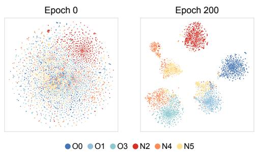  
Figure 8: t-SNE visualization of node embeddings before and after training on BlogCatalog. Cool colors denote knownclass nodes, and warm colors denote novel-class nodes.

MLP+SimGCD on all five datasets, supporting neighborhood statistics as useful complements to node attributes.

## 6.3 Embedding Space Visualization

Figure 8 shows tighter within-category groups and clearer separation between categories in the t-SNE projection [28]. This organization is visible for both known and novel categories, illustrating the discriminative embedding space learned by the encoder.

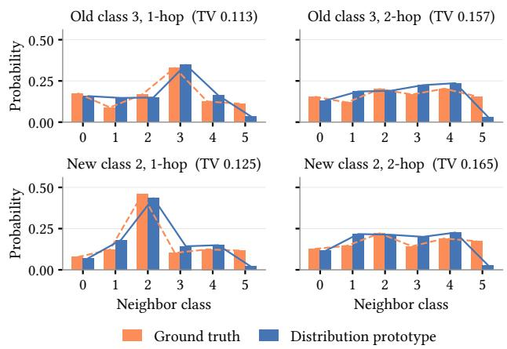

Figure 9: Neighborhood class distributions for a known and a novel class on BlogCatalog at 1-hop and 2-hop. Orange shows the displayed class’s ground-truth distribution, while blue shows its estimated distribution prototype.  
Table 2: Component ablation results with mean test accuracy (%) over five settings. Avg. Imp. averages Full-minus-ablation diferences (pp). Bold marks column maxima.
<table><tr><td rowspan="2">Variant</td><td colspan="3">Flickr</td><td colspan="3">BlogCatalog</td><td colspan="3">Roman Empire</td></tr><tr><td>Old</td><td>New</td><td>All</td><td>Old</td><td>New</td><td>All</td><td>Old</td><td>New</td><td>All</td></tr><tr><td>w/o X</td><td>83.50</td><td>14.30</td><td>45.17</td><td>80.87</td><td>32.18</td><td>56.40</td><td>62.57</td><td>30.45</td><td>48.06</td></tr><tr><td>w/o X - AX</td><td></td><td></td><td>95.18 23.91 55.71</td><td>97.60</td><td></td><td>49.40 73.41</td><td>56.45</td><td>30.07</td><td>44.79</td></tr><tr><td>w/o distribution 95.00 21.10</td><td></td><td></td><td>54.09</td><td></td><td></td><td></td><td></td><td>95.56 51.0373.26 70.82 31.90 52.47</td><td></td></tr><tr><td>Ours (Full)</td><td>95.41 22.89</td><td></td><td>55.28</td><td></td><td>97.56 49.13</td><td>73.28</td><td></td><td>63.52 31.14</td><td>49.99</td></tr><tr><td>Avg. Imp.</td><td></td><td></td><td>+4.19 +3.12 +3.62 +6.22 +4.93 +5.59 +0.24 +0.34 +1.55</td><td></td><td></td><td></td><td></td><td></td><td></td></tr></table>

## 6.4 Quality of Distribution Prototypes

Figure 9 shows that the estimated distribution prototypes closely follow the main peaks of the ground-truth distributions at 1-hop and capture their broader shapes at 2-hop. This agreement for both known and novel categories indicates that the prototypes encode meaningful category-level neighborhood composition, providing distribution-based evidence for category assignment.

## 6.5 Component Ablation

Table 2 compares Full reruns with variants removing each component under fixed configurations.

Preserving � improves mean All accuracy on all three datasets by up to 16.88 points. � −�� raises Roman Empire’s All by 5.19 points, while distribution prototypes raise Flickr’s New and BlogCatalog’s Old by 1.79 and 2.00 points, respectively. The varying gains are consistent with heterophilous graphs’ diverse attribute and connec tion patterns. Combining attribute information in embedding space with neighborhood compositions in probability space provides com plementary evidence for category discovery without novel-class labels. These gains and the best average All and New ranks support HeteGCD’s unified design across datasets.

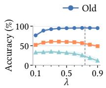  
(a) Flickr

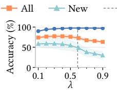  
(b) BlogCatalog

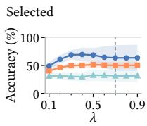  
(c) Roman Empire

Figure 10: Sensitivity to the supervised weight �. Lines show mean test accuracy over five settings, and shaded bands indicate ±1 standard deviation. Dashed vertical lines mark the selected values.  
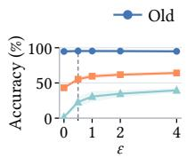  
(a) Flickr

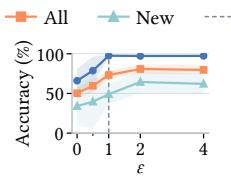  
(b) BlogCatalog

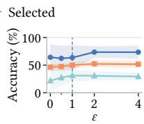  
(c) Roman Empire  
Figure 11: Sensitivity to the MeMax weight �. The plotting conventions follow Figure 10.

## 6.6 Sensitivity to Loss Weights

We vary the supervised weight � and the MeMax weight � in Eq. (17) separately on Flickr, BlogCatalog, and Roman Empire.

Supervised weight. Figure 10 shows that increasing � from a low to a moderate value improves Old and All accuracy. At larger values, Old accuracy changes little on Flickr and BlogCatalog, while New accuracy declines. New accuracy on Roman Empire varies less across the tested range.

MeMax weight. Figure 11 shows that increasing � from 0 to 2 improves All accuracy on all three datasets, with especially pronounced gains in novel-class discovery on Flickr. Further increases continue to improve New and All accuracy on Flickr, while the gains level of or slightly decline on BlogCatalog and Roman Empire.

Hyperparameters are selected using only known-class validation labels. Consequently, the selected values marked in Figures 10 and 11 do not necessarily maximize New or All accuracy.

## 7 Conclusion

In this work, we extend heterophilous graph learning beyond closed set classification to generalized category discovery. We analyze unreliable homophily priors and missing novel-class supervision, asking how to exploit heterogeneous neighborhood information for discovery. Through empirical observations and analyses from a statistical perspective, we propose HeteGCD, combining a gated dualstream encoder with a dual-prototype classifier. Experiments on five heterophilous graphs demonstrate its efectiveness. We ofer HeteGCD as a pioneering and efective baseline for heterophilous graph GCD and hope to encourage further exploration of heterophilous graph learning in open-world settings.

## References

[1] Takuya Akiba, Shotaro Sano, Toshihiko Yanase, Takeru Ohta, and Masanori Koyama. 2019. Optuna: A Next-generation Hyperparameter Optimization Frame work. In Proceedings ofthe 25th ACM SIGKDD International Conference on Knowledge Discovery and Data Mining. ACM, 2623–2631. doi:10.1145/3292500.3330701

[2] Deyu Bo, Xiao Wang, Chuan Shi, and Huawei Shen. 2021. Beyond Low-frequency Information in Graph Convolutional Networks. Proceedings ofthe AAAI Conference on Artificial Intelligence 35, 5 (2021), 3950–3957. doi:10.1609/aaai.v35i5.16514

[3] Xinzi Cao, Ke Chen, Feidiao Yang, Xiawu Zheng, Yonghong Tian, and Yutong Lu. 2025. AllGCD: Leveraging All Unlabeled Data for Generalized Category Discovery. In Proceedings ofthe IEEE/CVF International Conference on Computer Vision. IEEE, 3293–3303. doi:10.1109/ICCV51701.2025.00315

[4] Xinzi Cao, Xiawu Zheng, Guanhong Wang, Weijiang Yu, Yunhang Shen, Ke Li, Yutong Lu, and Yonghong Tian. 2024. Solving the Catastrophic Forgetting Problem in Generalized Category Discovery. In Proceedings of the IEEE/CVF Conference on Computer Vision and Pattern Recognition. IEEE, 16880–16889. doi:10. 1109/CVPR52733.2024.01597

[5] Ming Chen, Zhewei Wei, Zengfeng Huang, Bolin Ding, and Yaliang Li. 2020. Simple and Deep Graph Convolutional Networks. In Proceedings ofthe 37th International Conference on Machine Learning (Proceedings ofMachine Learning Research, Vol. 119). PMLR, 1725–1735. https://proceedings.mlr.press/v119/chen20v.html

[6] Eli Chien, Jianhao Peng, Pan Li, and Olgica Milenkovic. 2021. Adaptive Universal Generalized PageRank Graph Neural Network. In International Conference on Learning Representations. https://openreview.net/forum?id=n6jl7fLxrP

[7] Bowen Deng, Lele Fu, Jialong Chen, Sheng Huang, Tianchi Liao, Tao Zhang, and Chuan Chen. 2025. Towards Understanding Parametric Generalized Category Discovery on Graphs. In Proceedings of the 42nd International Conference on Machine Learning (Proceedings ofMachine Learning Research, Vol. 267). PMLR, 13069–13109. https://proceedings.mlr.press/v267/deng25b.html

[8] Lun Du, Xiaozhou Shi, Qiang Fu, Xiaojun Ma, Hengyu Liu, Shi Han, and Dongmei Zhang. 2022. GBK-GNN: Gated Bi-Kernel Graph Neural Networks for Modeling Both Homophily and Heterophily. In Proceedings ofthe ACM Web Conference 2022. ACM, 1550–1558. doi:10.1145/3485447.3512201

[9] Amir Ghazizadeh, Rickard Ewetz, and Hao Zheng. 2025. GAMMA: Gated Multi hop Message Passing for Homophily-Agnostic Node Representation in GNNs. In Advances in Neural Information Processing Systems, Vol. 38. Curran Associates, Inc., 11726–11777. doi:10.52202/085713-0393

[10] Ian Goodfellow, Yoshua Bengio, and Aaron Courville. 2016. Deep Learning. MIT Press, Cambridge, MA, USA. https://www.deeplearningbook.org/

[11] Ming Gu, Zhuonan Zheng, Sheng Zhou, Meihan Liu, Jiawei Chen, Qiaoyu Tan, Liangcheng Li, and Jiajun Bu. 2025. Making Classic GNNs Strong Baselines Across Varying Homophily: A Smoothness–Generalization Perspective. In Advances in Neural Information Processing Systems, Vol. 38. Curran Associates, Inc., 51025– 51060. doi:10.52202/085713-1701

[12] Mingguo He, Zhewei Wei, Zengfeng Huang, and Hongteng Xu. 2021. Bern-Net: Learning Arbitrary Graph Spectral Filters via Bernstein Approximation. In Advances in Neural Information Processing Systems, Vol. 34. Curran Asso ciates, Inc., 14239–14251. https://proceedings.neurips.cc/paper/2021/hash 76f1cfd7754a6e4fc3281bcccb3d0902-Abstract.htm

[13] Marcel Hofmann, Lukas Galke, and Ansgar Scherp. 2025. POWN: Prototypical Open-World Node Classification. In Proceedings ofthe 3rd Conference on Lifelong Learning Agents (Proceedings of Machine Learning Research, Vol. 274). PMLR, 672–691. https://proceedings.mlr.press/v274/hofmann25a.html

[14] Xiao Huang, Jundong Li, and Xia Hu. 2017. Label Informed Attributed Network Embedding. In Proceedings ofthe Tenth ACM International Conference on Web Search and Data Mining. ACM, 731–739. doi:10.1145/3018661.3018667

[15] Thomas N. Kipf and Max Welling. 2017. Semi-Supervised Classification with Graph Convolutional Networks. In International Conference on Learning Representations. https://openreview.net/forum?id=SJU4ayYg

[16] Xiang Li, Renyu Zhu, Yao Cheng, Caihua Shan, Siqiang Luo, Dongsheng Li, and Weining Qian. 2022. Finding Global Homophily in Graph Neural Networks When Meeting Heterophily. In Proceedings ofthe 39th International Conference on Machine Learning (Proceedings ofMachine Learning Research, Vol. 162). PMLR, 13242–13256. https://proceedings.mlr.press/v162/li22ad.htm

[17] Derek Lim, Felix Hohne, Xiuyu Li, Sijia Linda Huang, Vaishnavi Gupta, Omkar Bhalerao, and Ser-Nam Lim. 2021. Large Scale Learning on Non Homophilous Graphs: New Benchmarks and Strong Simple Methods. In Advances in Neural Information Processing Systems, Vol. 34. Curran Associates, Inc., Red Hook, NY, USA, 20887–20902. https://proceedings.neurips.cc/paper/2021/hash/ ae816a80e4c1c56caa2eb4e1819cbb2f-Abstract.html

[18] Siqi Liu, Dongxiao He, Zhizhi Yu, Di Jin, and Zhiyong Feng. 2025. Beyond Homophily: Neighborhood Distribution-guided Graph Convolutional Networks. Expert Systems with Applications 259 (2025), 125274. doi:10.1016/j.eswa.2024. 125274

[19] Yixin Liu, Yizhen Zheng, Daokun Zhang, Vincent C. S. Lee, and Shirui Pan. 2023. Beyond Smoothing: Unsupervised Graph Representation Learning with Edge Heterophily Discriminating. Proceedings ofthe AAAI Conference on Artificial

Intelligence 37, 4 (2023), 4516–4524. doi:10.1609/aaai.v37i4.25573

[20] Sitao Luan, Chenqing Hua, Qincheng Lu, Jiaqi Zhu, Mingde Zhao, Shuyuan Zhang, Xiao-Wen Chang, and Doina Precup. 2022. Revisiting Heterophily for Graph Neural Networks. In Advances in Neural Information Processing Systems, Vol. 35. Curran Associates, Inc., Red Hook, NY, USA, 1362–1375. doi:10.52202/068431- 0100

[21] Shijie Ma, Fei Zhu, Xu-Yao Zhang, and Cheng-Lin Liu. 2025. ProtoGCD: Unified and Unbiased Prototype Learning for Generalized Category Discovery. IEEE Transactions on Pattern Analysis and Machine Intelligence 47, 7 (2025), 6022–6038. doi:10.1109/TPAMI.2025.3557502

[22] Yao Ma, Xiaorui Liu, Neil Shah, and Jiliang Tang. 2022. Is Homophily a Necessity for Graph Neural Networks?. In International Conference on Learning Representations. https://openreview.net/forum?id=ucASPPD9GKN

[23] Sunil Kumar Maurya, Xin Liu, and Tsuyoshi Murata. 2022. Simplifying Approach to Node Classification in Graph Neural Networks. Journal ofComputational Science 62 (2022), 101695. doi:10.1016/j.jocs.2022.101695

[24] Hongbin Pei, Bingzhe Wei, Kevin Chen-Chuan Chang, Yu Lei, and Bo Yang. 2020. Geom-GCN: Geometric Graph Convolutional Networks. In International Conference on Learning Representations. https://openreview.net/forum?id=S1e2agrFvS

[25] Oleg Platonov, Denis Kuznedelev, Michael Diskin, Artem Babenko, and Liudmila Prokhorenkova. 2023. A Critical Look at the Evaluation of GNNs under Heterophily: Are We Really Making Progress?. In International Conference on Learning Representations. https://openreview.net/forum?id=tJbbQfw-5wv

[26] Benedek Rozemberczki, Carl Allen, and Rik Sarkar. 2021. Multi-Scale Attributed Node Embedding. Journal ofComplex Networks 9, 2 (2021), cnab014. doi:10.1093/ comnet/cnab014

[27] Md Joshem Uddin, Astrit Tola, Varin Singh Sikand, Cuneyt Gurcan Akcora, and Baris Coskunuzer. 2025. SCNode: Spatial and Contextual Coordinates for Graph Representation Learning. Transactions on Machine Learning Research (2025). https://openreview.net/forum?id=wdcdKeFbfQ

[28] Laurens van der Maaten and Geofrey Hinton. 2008. Visualizing Data using t-SNE. Journal ofMachine Learning Research 9, 86 (2008), 2579–2605. https: //jmlr.org/papers/v9/vandermaaten08a.html

[29] Sagar Vaze, Kai Han, Andrea Vedaldi, and Andrew Zisserman. 2022. Generalized Category Discovery. In Proceedings ofthe IEEE/CVFConference on ComputerVision and Pattern Recognition. IEEE, 7482–7491. doi:10.1109/CVPR52688.2022.00734

[30] Hongjun Wang, Sagar Vaze, and Kai Han. 2024. SPTNet: An Eficient Alternative Framework for Generalized Category Discovery with Spatial Prompt Tuning. In International Conference on Learning Representations. https://openreview.net/ forum?id=3QLkwU40EE

[31] Xin Wen, Bingchen Zhao, and Xiaojuan Qi. 2023. Parametric Classification for Generalized Category Discovery: A Baseline Study. In Proceedings ofthe IEEE/CVF International Conference on Computer Vision. IEEE, 16544–16554. doi:10.1109/ ICCV51070.2023.01521

[32] Xuanzhi Xi, Zhong Zhang, Hongliang Wang, Tongze Zhang, Hongchao Hu, Qinli Yang, and Junming Shao. 2026. Topology-Aware Neural Collapse for Generalized Category Discovery on Graphs. In Proceedings ofthe 32nd ACM SIGKDD Conference on Knowledge Discovery and Data Mining V.2. ACM, 5579– 5590. doi:10.1145/3770855.3817835

[33] Zhili Zhao, Li Wan, Xupeng Liu, Ruiyi Yan, and Shaomeng Wang. 2026. Node Classification in GNNs: Impact of Neighborhood Label Distribution on Homophily and Heterophily. IEEE Transactions on Neural Networks and Learning Systems 37, 10 (2026), 5742–5756. doi:10.1109/TNNLS.2026.3680732

[34] Jiong Zhu, Yujun Yan, Lingxiao Zhao, Mark Heimann, Leman Akoglu, and Danai Koutra. 2020. Beyond Homophily in Graph Neural Networks: Current Limitations and Efective Designs. In Advances in Neural Information Processing Systems, Vol. 33. Curran Associates, Inc., Red Hook, NY, USA, 7793–7804. https://proceedings.neurips.cc/paper/2020/hash/ 58ae23d878a47004366189884c2f8440-Abstract.html

## A Training and Inference

Algorithm 1 summarizes HeteGCD. On the original graph, N<sub>�</sub> (�) is node �’s exact �-hop neighborhood and �<sub>�</sub> contains nodes with nonempty neighborhoods. $\mathcal { R } _ { i k } \subseteq \{ 1 , 2 \}$ indexes available hops for node � and category slot �. Refreshed distribution scores take efect in the next epoch.

## B Datasets and Settings

## B.1 Datasets and Node Splits

Table 3 summarizes the graphs. The split ratios reported below follow the training/validation/test order.

```latex
Algorithm 1 HeteGCD: training and inference
Require: Graph $G = \left( V , E , X \right)$ , labeled nodes $( \mathcal { L } , y _ { \mathcal { L } } ) _ { : }$ , category count $K ,$
and training epochs � .
Ensure: Predictions for unlabeled nodes ${ \mathcal { U } } .$
1: Initialize encoder $f _ { \theta }$ and projector $g _ { \phi } ;$ initialize feature prototypes {�� }
by constrained clustering.
2: Set assignment memory $\bar { Q } \gets \emptyset$ and distribution scores $D ^ { ( 1 ) } \gets 0 ;$ use
� (�) = 0 during warm-up.
3: for $t = 1 , . . . , T$ do
Representation and assignment learning
4: Generate two views by feature masking and edge dropping.
5: For each view � ∈ {1, 2}, compute $X _ { \mathrm { r e s } } ^ { ( v ) } = X ^ { ( v ) } - A ^ { ( v ) } X ^ { ( v ) }$
6: Encode and project both views:
$H ^ { ( v ) } = f _ { \theta } ( X ^ { ( v ) } , X _ { \mathrm { r e s } } ^ { ( v ) } ) , Z ^ { ( v ) } = g _ { \phi } ( H ^ { ( v ) } ) .$
7: Compute feature scores and fuse active distribution scores:
$F _ { i k } ^ { ( v ) } = ( 1 + \langle h _ { i } ^ { ( v ) } , c _ { k } \rangle ) / 2 ,$
$\begin{array} { r } { \dot { S ^ { ( v ) } } = ( 1 - \dot { \alpha ( t ) } ) F ^ { ( v ) } + \alpha ( t ) D ^ { ( t ) } . } \end{array}$
Use feature scores alone where distribution scores are unavailable.
8: Save detached targets $Q ^ { ( v ) } = { \mathrm { s g } } [ $ [softmax $( S ^ { ( v ) } / \tau _ { \mathrm { t } } ( t ) ) ]$
9: Take one AdamW step on the joint loss (Section 5.3).
Distribution update
10: Initialize or update $\bar { Q }$ by EMA of $( Q ^ { ( 1 ) } + Q ^ { ( 2 ) } ) _ { . }$ /2; fix labeled rows
to their known-label one-hot vectors.
11: Keep the current distribution scores: $D ^ { ( t + 1 ) } \gets D ^ { ( t ) }$
12: if warm-up ends or a five-epoch distribution refresh is due then
13: Estimate neighborhood class distributions for $r \in \{ 1 , 2 \} \colon$
$n _ { i } ^ { ( r ) } \gets \frac { 1 } { | N _ { r } ( i ) | } \sum _ { j \in N _ { r } ( i ) } \bar { q } _ { j } , \quad i \in V _ { r } .$
14: Construct distribution prototypes for $k = 1 , \ldots , K \colon$
$\pi _ { k } ^ { ( r ) }  \frac { \sum _ { i \in V _ { r } } \bar { Q } _ { i k } n _ { i } ^ { ( r ) } } { \sum _ { \substack { \dots \forall r } } \bar { \mathcal { O } } _ { i k } }$
�∈�<sub>�</sub> �<sup>�</sup>
15: Compute node–slot TV distances:
$\begin{array} { r } { d _ { i k } ^ { ( r ) } \gets \frac { 1 } { 2 } \| n _ { i } ^ { ( r ) } - \pi _ { k } ^ { ( r ) } \| _ { 1 } . } \end{array}$
16: Update distribution scores for the next epoch:
$( D ^ { ( t + 1 ) } ) _ { i k } \gets \frac { 1 } { | \mathcal { R } _ { i k } | } \sum _ { r \in \mathcal { R } _ { i k } } \big ( 1 - d _ { i k } ^ { ( r ) } \big )$
17: end if
18: end for
19: Select an epoch using Appendix $\mathrm { E . 1 . }$
20: return ${ \hat { y } } _ { i } = \mathrm { a r g }$ max� $S _ { i k }$ for $i \in \mathcal { U } ,$ using the selected network on
the clean graph and its active distribution scores.
```

Roman Empire [25] is a Wikipedia word graph with sequential and syntactic edges, word-embedding features, and syntactic-role labels. We use the first five oficial 50/25/25 splits.

Chameleon [26] is a Wikipedia hyperlink graph with page-content features and five trafic-based categories from Geom-GCN [24]. We use Platonov et al.’s filtered release [25] and its first five oficial splits.

Actor [24] is an actor co-occurrence graph from Wikipedia, with keyword features. We use the first five supplied 48/32/20 splits.

BlogCatalog and Flickr [14] are user graphs from blogging and photo-sharing platforms, respectively, with user attributes. We use five fixed, class-stratified 60/20/20 splits per graph.

## B.2 Dificulty-Based Settings

We rank candidate known/novel class partitions by cross-group connectivity and feature-centroid proximity between novel and known classes. Stronger connections and closer centroids indicate

greater novel-to-known confusability. We select partitions spanning easy, intermediate, and hard regimes and pair them with fixed node splits.

## C Observation Methodology

## C.1 Attribute Signals

We examine node attributes $X$ and local attribute-diference statistics $X - A X$ , where � averages neighbor attributes without selfloops. For either signal, let $s _ { i }$ be node �’s vector and $V _ { c } ~ = ~ \{ i ~ :$ $y _ { i } = c \}$ the nodes of class $^ { c , }$ with $n _ { c } = | V _ { c } |$ . The class prototype is $\mu _ { c } \ : = \ : n _ { c } ^ { - 1 } \ : \sum _ { i \in V _ { c } } s _ { i }$ . Comparisons use cosine distance $d ( u , v ) =$ 1 − cos(�, �).

C.1.1 Class Separation. � averages distances between distinct class prototypes. � averages node-to-own-prototype distances within each class, then equally across classes:

$$
\begin{array} { c c c } { { \displaystyle B = \frac { 2 } { K ( K - 1 ) } \sum _ { c < c ^ { \prime } } d ( \mu _ { c } , \mu _ { c ^ { \prime } } ) , } } & { { } } & { { } } \\ { { { } } } & { { { } } } & { { { } } } \\ { { \displaystyle W = \frac { 1 } { K } \sum _ { c = 1 } ^ { K } \frac { 1 } { n _ { c } } \sum _ { i \in V _ { c } } d ( s _ { i } , \mu _ { c } ) , \qquad G = \frac { B } { W } . } } & { { } } \end{array}\tag{18}
$$

A larger ratio � indicates clearer separation.

For 100 label shufles preserving class sizes, we recompute prototypes and obtain $G ^ { ( b ) }$ . The geometry excess is

$$
\Delta _ { \mathrm { g e o } } = G - { \frac { 1 } { 1 0 0 } } \sum _ { b = 1 } ^ { 1 0 0 } G ^ { ( b ) } .\tag{19}
$$

Positive values indicate stronger category structure than random grouping.

C.1.2 Leave-One-Out Balanced Accuracy. For leave-one-out (LOO) evaluation, we exclude node � when computing class prototypes:

$$
\mu _ { y _ { i } } ^ { ( - i ) } = \frac { n _ { y _ { i } } \mu _ { y _ { i } } - s _ { i } } { n _ { y _ { i } } - 1 } , \qquad \mu _ { c } ^ { ( - i ) } = \mu _ { c } \quad ( c \neq y _ { i } ) .\tag{20}
$$

Let $a _ { i }$ indicate whether the nearest prototype under cosine distance is correct. Balanced accuracy averages $a _ { i }$ within classes, then equally across classes:

$$
\mathrm { B A } _ { \mathrm { L O O } } = \frac { 1 } { K } \sum _ { c = 1 } ^ { K } \frac { 1 } { n _ { c } } \sum _ { i \in V _ { c } } a _ { i } .\tag{21}
$$

Plots show this balanced accuracy as a percentage, chance is $1 / K$

## C.2 Neighborhood Class Distributions

Neighborhood class distributions record the category composition ofa node’s neighbors. We use exact 1-hop and 2-hop neighborhoods. The 2-hop set excludes the node itself and its immediate neighbors. Write $q _ { i } ^ { ( { \hat { h } } ) }$ for node �’s ℎ-hop distribution and $\mu _ { c } ^ { ( h ) }$ for the distribution prototype obtained by averaging distributions within true class �.

C.2.1 Class Separation. Class separation follows Equation (18), replacing $s _ { i }$ and $\mu _ { c }$ with $q _ { i } ^ { ( h ) }$ and $\mu _ { c } ^ { ( h ) }$ , and using total variation distance:

$$
\begin{array} { r } { d _ { \mathrm { T V } } ( p , q ) = \frac 1 2 \| p - q \| _ { 1 } . } \end{array}\tag{22}
$$

Table 3: Dataset statistics. Labeled ratio gives the minimum–maximum percentage of nodes with training labels across five settings. Edge homophily is the fraction of edges connecting nodes of the same class.
<table><tr><td>Dataset</td><td>Nodes</td><td>Edges</td><td>Features</td><td>Classes</td><td>Old Classes</td><td>New Classes</td><td>labeled ratio (%)</td><td>Edge Homophily</td></tr><tr><td>Roman Empire</td><td>22,662</td><td>32,927</td><td>300</td><td>18</td><td>9</td><td>9</td><td>10.05-29.51</td><td>0.047</td></tr><tr><td>Chameleon</td><td>890</td><td>8,854</td><td>2,325</td><td>5</td><td>2</td><td>3</td><td>16.40-19.55</td><td>0.236</td></tr><tr><td>Actor</td><td>7,600</td><td>26,659</td><td>932</td><td>5</td><td>2</td><td>3</td><td>14.21-23.76</td><td>0.217</td></tr><tr><td>BlogCatalog</td><td>5,196</td><td>171,743</td><td>8,189</td><td>6</td><td>3</td><td>3</td><td>29.08-30.81</td><td>0.401</td></tr><tr><td>Flickr</td><td>7,575</td><td>239,738</td><td>12,047</td><td>9</td><td>4</td><td>5</td><td>26.27-27.29</td><td>0.239</td></tr></table>

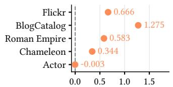  
(a) Class separation above

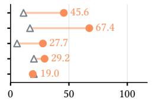  
(b) Nearest-prototype

the shufled baseline.  
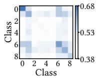  
(c) Flickr.

classification accuracy (%).  
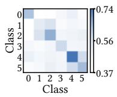  
(d) BlogCatalog.

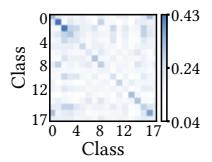  
(e) Roman Empire.  
Figure 12: Exact 1-hop neighborhood class distributions.

This gives the between- and within-class distances $B _ { h }$ and $W _ { h } .$ For fused distributions, every comparison averages the 1-hop and 2-hop distances, so the geometry ratio is

$$
G _ { 1 + 2 } = \frac { ( B _ { 1 } + B _ { 2 } ) / 2 } { ( W _ { 1 } + W _ { 2 } ) / 2 } = \frac { B _ { 1 } + B _ { 2 } } { W _ { 1 } + W _ { 2 } } .\tag{23}
$$

We subtract each signal’s shufled-label reference as in Equation (19).

For class-pair heatmaps, let $\mathcal { P } _ { a b } = \{ ( i , j ) : i \in V _ { a } , j \in V _ { b } , i \ne j \}$ The mean similarities are

$$
\begin{array} { c } { { H _ { a b } ^ { ( h ) } = \displaystyle \frac { 1 } { | \mathcal { P } _ { a b } | } \sum _ { ( i , j ) \in \mathcal { P } _ { a b } } [ 1 - d _ { \mathrm { T V } } ( q _ { i } ^ { ( h ) } , q _ { j } ^ { ( h ) } ) ] , } } \\ { { H _ { a b } ^ { ( 1 + 2 ) } = \frac { 1 } { 2 } ( H _ { a b } ^ { ( 1 ) } + H _ { a b } ^ { ( 2 ) } ) . } } \end{array}\tag{24}
$$

C.2.2 Leave-One-Out Balanced Accuracy. Following Equation (20), we exclude each node from its class prototype at each hop to obtain $\mu _ { c } ^ { ( h , - i ) }$ . The distances are

$$
\begin{array} { r } { d _ { i c } ^ { ( h ) } = d _ { \mathrm { T V } } ( q _ { i } ^ { ( h ) } , \mu _ { c } ^ { ( h , - i ) } ) , } \\ { d _ { i c } ^ { ( 1 + 2 ) } = \frac { 1 } { 2 } ( d _ { i c } ^ { ( 1 ) } + d _ { i c } ^ { ( 2 ) } ) . } \end{array}\tag{25}
$$

Balanced accuracy follows Equation (21).

Clean-observation plots show balanced accuracy as a percentage. Noise plots show the gain over chance in percentage points:

$$
\mathrm { L O O } \mathrm { g a i n } = 1 0 0 \big ( \mathrm { B A } _ { \mathrm { L O O } } - 1 / K \big ) .
$$

Zero therefore means chance-level assignment.

(26)

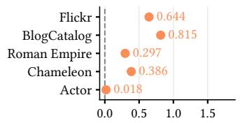  
(a) Class separation above

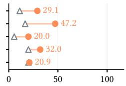  
(b) Nearest-prototype  
classification accuracy (%).

the shufled baseline.  
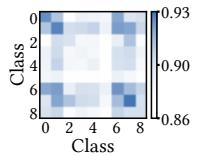  
(c) Flickr.

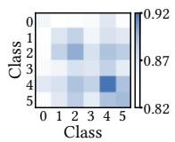  
(d) BlogCatalog.

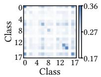  
(e) Roman Empire.  
Figure 13: Exact 2-hop neighborhood class distributions.

C.2.3 Random Assignment Noise. Random noise tests whether neighborhood class distributions retain category information under incorrect neighbor assignments. For each setting and rate $\rho \in$ $\{ 0 , 0 . 1 , \ldots , 1 \}$ , we randomly select a fraction $\rho$ of the unlabeled nodes within each true class. Each selected node receives a uniformly sampled incorrect category.

We rebuild neighborhood distributions from the corrupted assignments, then average them within each true class to obtain class prototypes. LOO accuracy is still evaluated against the nodes’ true categories. Each curve averages scores over five settings and 20 repetitions. For the class-separation baseline, we randomly regroup nodes five times per repetition and average the resulting 100 geometry ratios for each setting and noise level.

C.2.4 Novel-to-Known Assignment Bias. This bias models novelclass nodes being mistaken for known categories. We corrupt the same nodes as under random noise, assigning selected novel-class nodes uniformly to known categories. Selected known-class nodes receive exactly the same wrong categories as under random noise. We recompute distributions, prototypes, and metrics as above.

## C.3 Separate 1-Hop and 2-Hop Observations

Figures 12 and 13 provide separate 1-hop and 2-hop results and class-pair heatmaps, complementing the fusion analysis in Figure 4. Neither hop range consistently dominates across datasets, motivating the joint use of neighborhood statistics at diferent ranges.

## D Baseline Methods

The 24 baselines combine eight encoders with three category discovery frameworks. Encoders extract node representations, while frameworks learn from them and produce category assignments.

## D.1 Graph Encoders

MLP [10] transforms each node’s attributes independently through feed-forward layers, providing a feature-only reference for assessing the contribution of graph structure.

GCN [15] is a canonical message-passing network that provides a reference for conventional neighborhood aggregation. Each layer combines a node’s features with normalized neighbor features, smoothing local feature diferences.

GCNII [5] represents deep graph convolution designed to mitigate oversmoothing. Initial-feature residuals and identity mappings preserve the original node signal during propagation.

H2GCN [34] is a representative heterophily-oriented encoder that separates ego, 1-hop, and 2-hop information during aggregation. Concatenating representations from diferent stages retains these sources without immediately mixing neighbors with the node’s own features.

LINKX [17] encodes node attributes and adjacency rows with separate MLPs before combining their outputs, providing a strong non-homophilous graph baseline based on separate attribute and structural encodings.

FSGNN [23] represents multi-scale feature selection, using precomputed channels from propagation at several depths, with and without self-loops. Separate transformations, learned global weights, and concatenation combine these propagation scales.

ACM-GCN [20] provides a competitive heterophilous graph baseline through adaptive channel mixing. A node-wise mixer combines neighborhood averages, diferences from those averages, and ego features, adapting their contributions to each node.

GAMMA [9] is a recent homophily-agnostic graph encoder with adaptive multi-hop aggregation. A shared feature projection propagates over multiple hops, with learned scaling per hop and feature channel. Iterative routing assigns node-specific hop weights based on agreement with the combined representation. We use 0-, 1-, and 2-hop signals with two routing iterations.

## D.2 Category Discovery Frameworks

GCD [29] introduced the generalized category discovery setting and provides a foundational clustering-based baseline. Contrastive learning matches two views of the same sample and pulls labeled samples of the same class together. Prediction uses semi-supervised �-means on the learned embeddings, keeping labeled assignments fixed to known classes.

SimGCD [31] is a widely adopted parametric baseline that jointly learns representations and a prototype classifier through contrastive learning, supervised classification, and cross-view self-distillation, where one view’s detached predictions supervise the other. Entropy maximization encourages use of all category slots. Predictions come directly from the prototype classifier.

GGCD [7] introduced graph GCD with a focus on homophilous graphs and theoretically analyzed parametric category discovery. Auxiliary semi-supervised clustering and Semantic-aWare dIlation contRastive Learning (SWIRL) regulate category separation using graph structure, alongside contrastive learning, supervised classification, and entropy regularization. The final predictions come from an MLP classifier, while auxiliary clustering supports training.

## D.3 Graph Adaptation and Encoder Integration

Graph adaptation. We replace image augmentations with feature masking and undirected edge dropping to construct two graph views [7, 32]. The same node across views forms a positive pair, supervised contrastive pairs share a known-class label. Edge dropping is disabled for MLP and fixed-support H2GCN.

Encoder integration. Each encoder is randomly initialized and trained to produce node embeddings �, replacing the pretrained image backbone. A projection head maps � to contrastive features. Discovery objectives and prediction remain framework-specific.

## E Experimental Protocol

## E.1 Epoch Selection

In the GCD setting, novel-class validation labels are unavailable for model selection or hyperparameter tuning. We therefore use accuracy on known-class validation nodes, comparing predictions directly with known labels without Hungarian matching (Val Old RACC) [7]. Known-class validation accuracy may peak while novelcategory structure is still developing, motivating later epochs with near-optimal accuracy. Every run trains for 200 epochs. Among observed epochs from epoch 20 onward, we select the latest one whose Val Old RACC is at least 97% of the maximum over these candidates. The same rule is applied to all methods and datasets.

## E.2 Hyperparameter Search

Each method–dataset pair has an independent Optuna study [1] with 100 trials, including the default configuration. The objective averages validation scores at selected epochs over the five settings. We rerun the best completed trial’s configuration on all five settings for final evaluation. Table 4 lists HeteGCD’s 14 parameters.

Table 4: Hyperparameter search space for HeteGCD. U and LogU denote uniform and log-uniform sampling.
<table><tr><td>Parameter</td><td>Search space</td></tr><tr><td>Learning rate</td><td> $\mathrm { L o g U } [ 1 0 ^ { - 4 } , 1 0 ^ { - 2 } ]$ </td></tr><tr><td>Weight decay</td><td> $\{ 0 , 1 0 ^ { - 6 } , 1 0 ^ { - 5 } , 3 \times 1 0 ^ { - 5 } ,$ </td></tr><tr><td>Contrastive batch size</td><td> $1 0 ^ { - 4 } , 3 \times 1 0 ^ { - 4 } , 1 0 ^ { - 3 } \}$  {1024, 2048, 4096}</td></tr><tr><td>Supervised weight λ</td><td>U[0.1, 0.9]</td></tr><tr><td>MeMax weight ε</td><td>{0.5, 1, 2, 4}</td></tr><tr><td>InfoNCE temperature</td><td>LogU[0.05, 1.5]</td></tr><tr><td>SupCon temperature</td><td>LogU[0.05, 0.5]</td></tr><tr><td>Student temperature τs</td><td>LogU[0.07,0.2]</td></tr><tr><td>Embedding width</td><td>{64, 128, 256}</td></tr><tr><td>Branch dropout</td><td>{0, 0.1, 0.2, 0.3, 0.4, 0.5}</td></tr><tr><td>Feature masking rate</td><td>{0, 0.1, 0.2, 0.3, 0.5}</td></tr><tr><td>Edge dropping rate</td><td>{0, 0.1, 0.2, 0.3, 0.5}</td></tr><tr><td>Distribution warm-up fraction</td><td>{0.1, 0.2, 0.3}</td></tr><tr><td>Maximum distribution weight</td><td>{0.1, 0.2, 0.3, 0.4}</td></tr></table>