# HorizON: A Multi-Horizon Deep Operator Network for Property Prediction of Organic Battery Stacks

Subhash V.S. Ganti,1,2 Lukas W¨olfel,1 Arla Diengdoh,1 Tzvetan Mihaylov,3

Thomas Nevolianis,3 Jan Meyer,3 and Christopher Kuenneth∗,1,2

1University of Bayreuth, Faculty of Engineering Science, Universit¨atsstraße 30, 95447

Bayreuth, Germany

2University of Bayreuth, Bavarian Center for Battery Technology (BayBatt),

Universit¨atsstraße 30, 95447 Bayreuth, Germany

3Digital R&D, Covestro Deutschland AG, Kaiser-Wilhelm-Allee 60, 51373 Leverkusen,

Germany

\* E-mail: christopher.kuenneth@uni-bayreuth.de

## Conspectus

Lithium-ion batteries based on transition-metal oxide cathodes depend on critical elements such as cobalt and nickel, whose extraction raises environmental and supplychain concerns. Organic electrode materials (OEMs) ofer a promising alternative because their versatile structures enable systematic tuning of electrochemical properties. However, OEM based batteries still sufer from limited cycling stability due to challenges such as active material dissolution into the electrolyte, side reactions, and limited electronic conductivity. Addressing these challenges requires moving beyond

the active material alone and considering the complete battery stack and the coupled interactions among them. This complexity requires the joint optimization of multiple properties, including voltage, gravimetric capacity, volumetric capacity, energy density, and capacity retention. Machine learning accelerates this optimization by learning structure-property relationships across battery components and enables batter material discovery. However, most existing models predict instantaneous properties and therefore provide limited insight into how battery properties evolve over cycles. A predictive framework capable of learning across multiple properties, data fidelities, and prediction horizons is thus needed. Here, we introduce HorizON, a multi-fidelity, multihorizon deep operator network that predicts battery properties such as specific capacity versus cycle number and average voltage for organic battery stacks. HorizON takes fingerprints of the complete materials stack as inputs, along with usage conditions such as C-rate, mass loading, and voltage window. The model is trained jointly on DFT-derived and experimental data, exploiting correlations across properties and fidelity levels. On the test dataset, HorizON achieves an R2 (RMSE) of 0.96 (24.6 mA h g−1) for capacity and 0.97 (0.22 V) for voltage over cycles. We then deploy HorizON for large scale discovery and optimization of polymer cathodes. Here, HorizON is utilized to predict voltage and specific capacity for libraries exceeding 100 million chemically valid polymers spanning multiple polymer classes, with inference time below 1 ms per candidate. This capability enables exploration of chemical spaces that are dificult to investigate using conventional simulations or experiments. By identifying promising materials and suitable usage conditions, HorizON can help experimentalists move from trial-and-error synthesis and cell testing toward targeted, hypothesis driven experiments. We further apply inverse design to identify polymers with targeted battery properties and process optimization to identify suitable battery components and usage conditions. We also apply explainable artificial intelligence to identify chemical fragments associated with improved battery performance. These relationships provide a molecular interpretation of the learned structure-property relationships and connect predicted battery behavior to chemically meaningful polymer features. Beyond organic batteries, the framework is transferable to inorganic, redox-flow, and other battery chemistries, ofering a general route for data-driven discovery in complex materials systems with multiple interacting components.

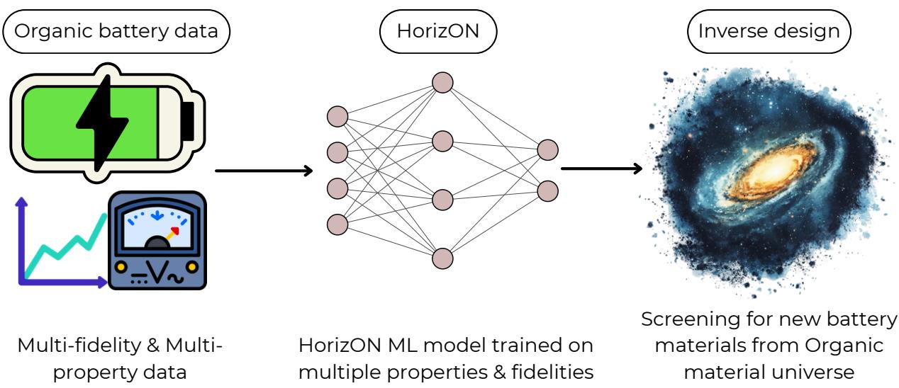

Keywords. organic batteries, multi-task learning, time-series forecasting, inverse design, battery informatics, redox-active polymers

## Introduction

Organic electrode materials (OEMs) are promising alternatives to traditional inorganic electrodes such as lithium, cobalt and nickel. 1–3 OEMs are sustainable, highly abundant and exhibit high structural flexibility. 4 Moreover, they are not prone to supply-chain risks and pose little negative environmental impact. 1 Owing to their tunable redox-active chemistries, they have shown electrochemical viability in lithium-ion cathodes (3.0 V to 4.5 V), sodiumion cells (2.5 V to 3.5 V), multivalent $\mathrm { M g ^ { 2 + } / Z n ^ { 2 + } / A l ^ { 3 + } }$ chemistries, aqueous systems, and solid-state configurations. 5–9 To date, roughly 200 organic materials, including carbonyls, phenolics, viologens, and conjugated polymers, have been reported as electroactive battery materials.10–12 However, many existing OEMs exhibit capacity loss after a few hundreds of cycles.4 The capacity loss is primarily due to the dissolution of active species into the electrolyte, side reactions, and low intrinsic electronic conductivity. 4,8,13 Overcoming these limitations require the design of new OEMs across a large possible chemical spaces.14,15

Machine learning (ML) provides an eficient approach for navigating this large chemical space and predicting battery properties. 16–18 ML models learn structure–property relationships from available battery data. 19 For OEMs, Simplified Molecular Input Line Entry System (SMILES) strings are commonly used to represent their chemical structures. 20 These strings are converted into machine-readable chemical fingerprints using methods such as polyBERT,21 Mordred,22 or circular fingerprints. 23 The resulting fingerprints serve as model inputs for predicting battery properties such as specific capacity and voltage. 24 Moreover, data-fusion and multi-task ML based methods enable joint learning across multiple battery properties and data sources. 25–27 In our previous work, we used a multi-task ML model to predict first-cycle specific capacity and voltage for diferent cathode–anode pairs across several organic material classes. 24

However, practical battery applications require predictions of cycling stability beyond first-cycle performance. 1,8,10 The cycling stability of OEMs is particularly limited by the active-material dissolution and side reactions. 1,4,8 Several strategies can mitigate these issues: (i) crosslinking to suppress dissolution; (ii) polar or ionic substituents or salt formation to reduce solubility; and (iii) electron-withdrawing or electron-donating substituents to tune the redox potential and operating voltage. 4,8,10 However, each of these strategies demand extensive optimization of the redox-active substituent, its position, and the battery materials stack design, which makes experimental screening slow. 8,10 Recent studies have applied sequence models, including RNNs, LSTMs, and attention-based temporal fusion transformers, to predict long-term capacity fade, voltage evolution, and remaining useful life. 28–30 However, these recent studies only focused on a single chemistry or cell design, limiting their transferability across OEMs. 30,31 Achieving such transferability requires a model that captures both the atomistic chemistry of OEMs and information from the full battery materials stack. We therefore develop a multi-horizon, multi-fidelity, and multi-property ML model that integrates these inputs to predict long-term performance across diverse OEM chemistries.

Figure 1a summarizes the HorizON pipeline for heterogeneous electrochemical data. Our previous multi-task model predicted first-cycle voltage and specific capacity across diverse organic battery chemistries. 24 We integrate the corresponding voltage and capacity data as the medium-fidelity subset because it excludes electrolyte and usage condition descriptors. HorizON combines these data with high-fidelity experimental capacity-versus-cycle trajectories and medium-fidelity adiabatic DFT redox potentials versus the standard hydrogen electrode (SHE). The high-fidelity trajectories include the complete organic battery-stack composition and usage conditions. Our HorizON approach comprises of five models trained cross-validated subset and a meta-learner ensemble that combines their predictions. Using the homopolymer PSMILES (Polymer Simplified Molecular Input Line Entry System) strings in the training dataset as reference structures, we generate a library of four million polymers through iterative substitutions and additions of redox-active fragments, then screen the candidates for improved cycling stability and redox potential. Finally, SHapley Additive exPlanations (SHAP) identify preferred redox-active moieties and provide interpretable

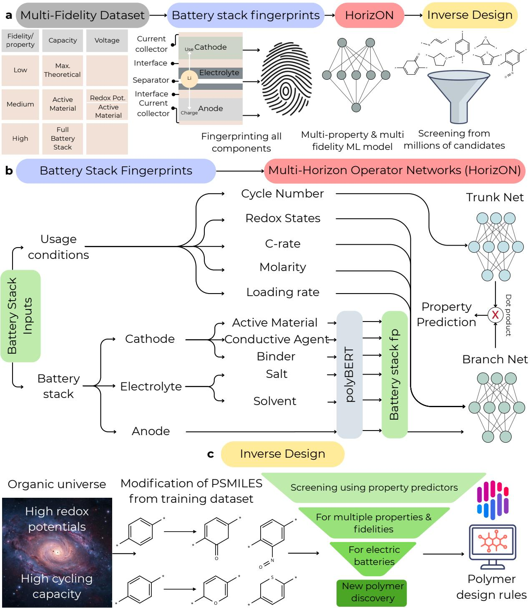  
Figure 1: Multi-Horizon Deep Operator Network workflow. a The four stages are multi-fidelity dataset construction, battery-stack fingerprinting, Multi-Horizon Deep Operator Network modeling, and inverse design. We encode the cell components as polyBERT fingerprints and combine them with fidelity and usage condition descriptors for multi-property prediction. b The Multi-Horizon Deep Operator Network architecture provides the cycle number to the trunk network and the usage conditions and battery-stack fingerprints to the branch network. A dot product combines the two latent representations to predict the target property. c The inverse-design workflow iteratively modifies the chemical structure of training polymers, screens the generated candidates with the trained model, and uses SHapley Additive exPlanations (SHAP) to derive interpretable polymer design rules.

Table 1: Overview of the multi-fidelity dataset used to train the model. We combine high-fidelity cycling data with medium-fidelity active-material experimental measurements, medium-fidelity DFT redox potentials, and low-fidelity theoretical capacities. Capacities are reported in mAh $\mathrm { g } ^ { - 1 }$ and voltages/potentials in V. An em-dash (—) marks quantities not collected for that subset.
<table><tr><td>Property</td><td>Subset</td><td>Cycle</td><td>Method</td><td></td><td>Data pts. # Cathodes</td><td># Electrolytes</td><td>Range</td><td>Fidelity</td></tr><tr><td rowspan="3">Capacity</td><td>Full-stacka</td><td>many</td><td>Exp.</td><td>457ª</td><td>18</td><td>6</td><td>[11.0, 223.0]</td><td>High</td></tr><tr><td>Active materialb</td><td>1st</td><td>Semi-Exp.c</td><td>217</td><td>217</td><td></td><td>[8.0, 691.0]</td><td>Medium</td></tr><tr><td>Theoreticalb</td><td></td><td>Faraday</td><td>130</td><td>130</td><td></td><td>[93.0, 570.0]</td><td>Low</td></tr><tr><td rowspan="2">Voltage</td><td>Active materialb,d</td><td>1st</td><td>Semi-Exp.c</td><td>197</td><td>197</td><td></td><td>[0.6, 4.07]</td><td>Medium</td></tr><tr><td>Redox potentiald</td><td></td><td>DFT</td><td>67e</td><td>45e</td><td></td><td>[-3.2, 5.45]</td><td>Medium</td></tr><tr><td colspan="3"></td><td>Total</td><td>1068</td><td>607</td><td>6</td><td></td><td></td></tr></table>

a Each battery stack comprises a cathode, lithium-metal anode, and electrolyte and contributes a distinct number of measured cycles. Together, these cycle-resolved measurements yield 457 data points.  
b Organic cathode data reused from our previous publication. 24  
c Semi-Exp.: experimental values using only the active material in the cathode and the anode (lithium). Usage conditions and electrolyte information are not available.  
d Active-material voltage is referenced to $\mathrm { L i / L i ^ { + } }$ ; redox potential to SHE.  
e The 67 redox-potential data points correspond to 45 unique cathode structures because some organic materials contribute multiple oxidation- or reduction-state transitions. The associated oxidation and reduction states are encoded as usage conditions in selector vectors.

design rules.32

## Results and Discussion

We collect and curate a dataset of 1068 data points for organic cathode materials across three fidelity levels. A synopsis of this dataset can be found in Table 1. Experimental measurements are collected from peer-reviewed literature,33–40 while simulated redox potentials are generated using DFT calculations (see the Methods section for details). The high-fidelity subset covers organic battery stacks containing 18 unique polymer cathodes, lithium-metal anodes, and six diferent electrolytes. These stacks contribute 457 experimental capacityversus-cycle measurements, corresponding to 43 % of the dataset, each including the complete battery-stack composition and usage conditions. For each measurement, we document the active-material loading $( 0 . 4 5 \mathrm { m g c m ^ { - 2 } }$ to $2 . 5 \mathrm { m g } \mathrm { c m } ^ { - 2 } )$ , the voltage window (1.5 V to 4.5 V), and the C-rate (10 to 1000), followed by the experimentally measured specific capacities $( \mathrm { { 1 1 m A h g ^ { - 1 } } }$ to 223 mAh g−1).

The medium-fidelity subset contains both experimental single-cycle data, reused from our previous publication, 24 and simulated DFT redox potentials. It contains 414 points, corresponding to 39 % of the dataset, and covers 259 homopolymer cathodes measured against a lithium anode. This subset includes 217 first-cycle discharge capacities $( 8 . 0 \mathrm { m A h } \mathrm { g } ^ { - 1 }$ to $6 9 1 \mathrm { m A h g ^ { - 1 } } )$ and 197 average voltages (0.6 V to 4.07 V), both measured versus lithium. The DFT dataset contains 67 simulated redox potentials computed for 45 homopolymer structures at diferent oxidation and reduction states. The potentials are referenced to the standard hydrogen electrode (SHE) and span −3.2 V to 5.45 V. The number of potentials exceeds the number of structures because some structures exhibit multiple redox-state transitions. The low-fidelity subset reuses theoretical-capacity data from our previous publication. 24 This subset contains 130 computed theoretical capacities for the same homopolymer cathodes and spans $9 3 . 0 \mathrm { m A h g ^ { - 1 } }$ to $5 7 0 . 0 \mathrm { m A h g ^ { - 1 } }$

Battery materials stack fingerprinting As illustrated in Figure 1, HorizON receives fingerprints of the complete battery materials stack as inputs. We first generate a 600- dimensional polyBERT fingerprint for each material as indicated in Figure 1 .21 For each battery materials stack, we calculate a composition-weighted fingerprint by summing the constituent fingerprints weighted by their respective fractions. 41 The cathode fingerprint is built from the OEM active material, conductive agent, and binder, whereas the electrolyte fingerprint is created using salt and solvent. The lithium-metal anode is represented by a separate 600-dimensional fingerprint. We concatenate the cathode, electrolyte, and anode fingerprints with seven selector variables describing the usage conditions and redox states. The resulting 1807-dimensional input enables HorizON to learn interactions across the complete battery materials stack.

Multi-horizon deep operator network (HorizON) Building on the complete batterystack representation, HorizON uses a deep operator network to predict both cycle-dependent and scalar battery properties. The branch network receives the 1807-dimensional input containing the battery-stack fingerprints, usage conditions, and redox-state descriptors as described in the previous section. The trunk network receives the cycle number. Each network maps its inputs to a latent space representation, and their dot product is passed through fully connected layers to predict the target voltage and specific capacity. Evaluating the trunk network at multiple cycle numbers produces a complete specific-capacity trajectory for a fixed battery stack and set of usage conditions. For scalar targets without cycle dependence, such as DFT redox potentials, we set the trunk input to cycle 1. The shared architecture is trained jointly across target properties and fidelity levels, enabling multi-property and multi-fidelity learning over cycles within a single model.

Model performance In HorizON, we train five models using five-fold cross-validation subset, then ensemble their predictions using a meta-learner. Figure 2a and Figure 2b present parity plots of the fold-averaged predictions. The error bars represent two standard deviations (2σ) across the five models. HorizON achieves $R ^ { 2 }$ values of 0.87 for specific capacity and 0.89 for voltage.

The points in Figure 2a and Figure 2b are colored by fidelity level. The high-fidelity subset has a maximum specific capacity of $2 2 3 \mathrm { m A h g ^ { - 1 } }$ . These measurements describe complete battery stacks under defined usage conditions and therefore reflect practical electrode behavior. Practical behavior includes the influence of electrochemically inactive binders and conductive agents, together with capacity losses caused by dissolution and side reactions. In contrast, the medium-fidelity active-material capacities range from 8 mA h $\mathrm { g } ^ { - 1 }$ to $6 9 1 \mathrm { m A h g ^ { - 1 } }$ 2 while the low-fidelity theoretical capacities range from 93 mA h $\mathrm { g } ^ { - 1 }$ to 570 mA h $\mathrm { g } ^ { - 1 }$ . These subsets omit the complete electrolyte and usage condition information or rely on theoretical capacity calculations. They therefore provide more idealized estimates of active-material

performance. The richer battery-stack information produces tighter predictions for the highfidelity targets. Joint training across all fidelity levels allows HorizON to retain this accuracy despite the limited number of high-fidelity measurements.

Reference values close to zero appear in all four panels of Figure 2. These points correspond to insulating materials included in the medium-fidelity capacity and experimentalvoltage datasets. Their poor electronic conductivity produces negligible electrochemical capacity and voltage responses. This allows HorizON to distinguish between redox active and non-redox active materials.

For the final predictions, we construct a meta-learner as an ensemble of the five fold HorizON models described in the Methods. For each battery stack, the five HorizON predictions are the inputs to the meta-learner that predicts the final property values. Figure 2c and Figure 2d show that the meta-learner has $R ^ { 2 }$ values of 0.96 for specific capacity and 0.97 for redox potential. The resulting predictions lie closer to the parity line and exhibit reduced scatter and smaller error bars. This improvement extends across all fidelity levels, including the high-fidelity battery-stack data. Performance metrics for each property and fidelity level are reported in Supplementary Table S1. HorizON therefore learns cycle-dependent and scalar targets within a shared representation, while the meta-learner reduces variability among the fold-specific models.

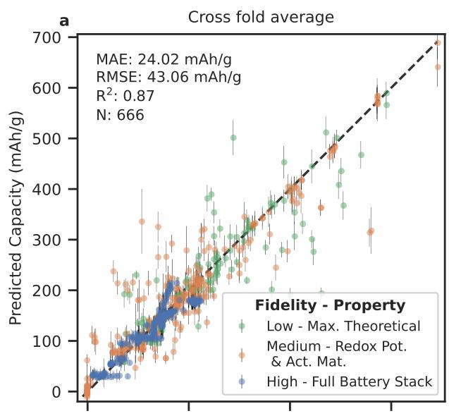

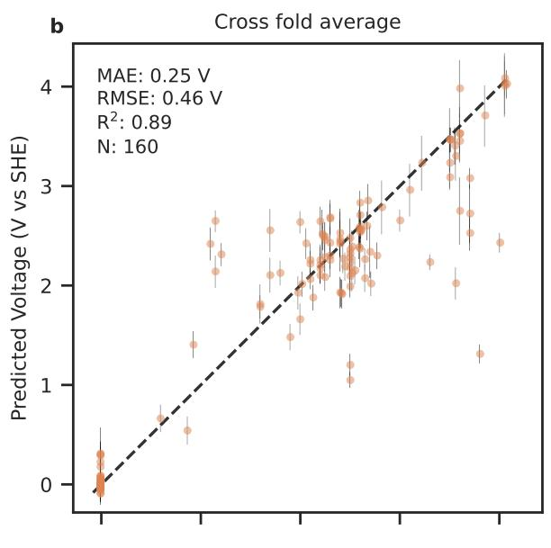

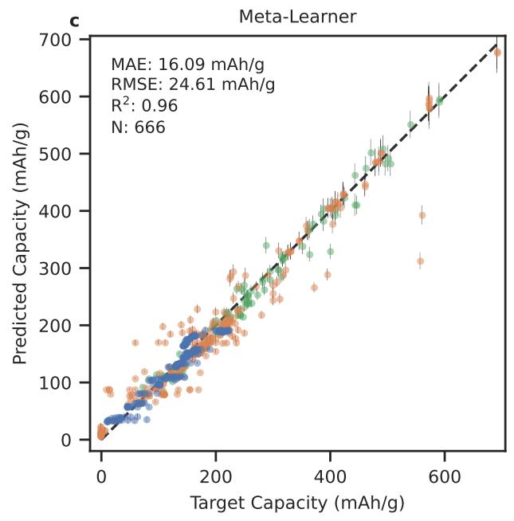

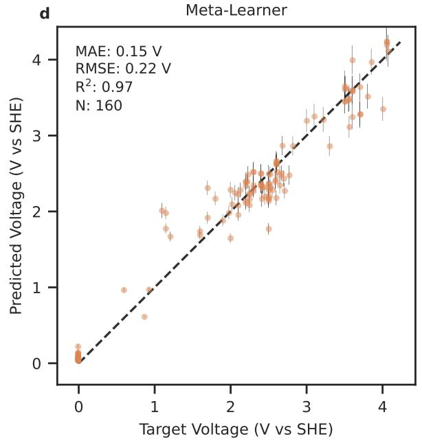  
Figure 2: Parity plots for HorizON and the meta-learner. Panels a and b show the five-fold averaged HorizON predictions for specific capacity and redox potential (V vs. SHE). Panels c and d show the corresponding meta-learner predictions. Points are colored by fidelity level. Low-fidelity points represent theoretical capacities. Medium-fidelity points represent DFT-computed redox potentials and experimental measurements without usage conditions or electrolyte information. High-fidelity points represent full battery-stack measurements. Each panel reports MAE, RMSE, $R ^ { 2 }$ , and the number of test points N.

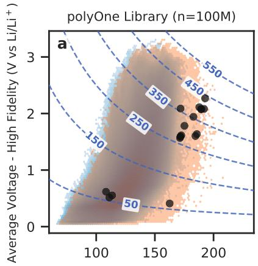

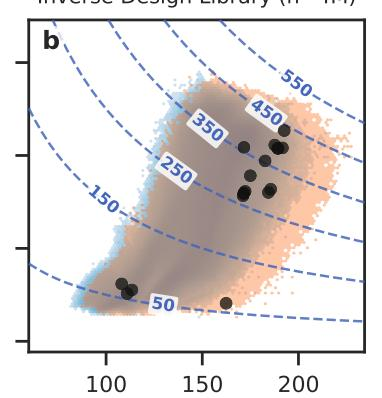  
Specific Capacity - High Fidelity (mAh/g)

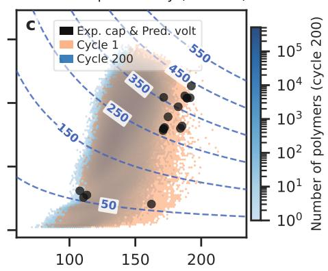

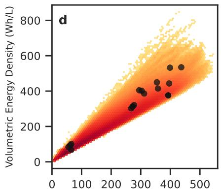

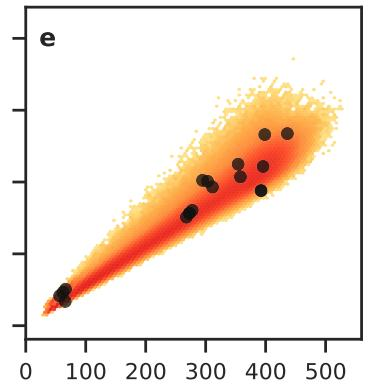  
Gravimetric Energy Density (Wh/kg)

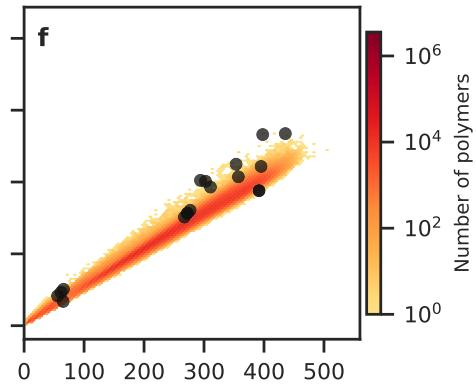  
Figure 3: Specific capacity versus average voltage (panels a to c) and gravimetric versus volumetric energy density (panels d to f) for three polymer libraries, predicted at high fidelity for the LiTFSI/TEGDME electrolyte at a 1C rate for the 1st and 200th cycles. Voltage values are average working potentials versus lithium (V vs. $\mathrm { L i ^ { + } / L i ) }$ . Panels a and d: The public polyOne library (100 M).42 Panels b and e: The inverse-design library generated in this work (4 M). Panels c and f: A single-cycle library from our previous work (1.7 M).24 Gravimetric energy density is the product of capacity and voltage; volumetric energy density additionally uses a computationally estimated polymer density. The color scale gives the number of polymers per bin and is shared across all six panels. Dashed lines in panels a to c are energy-density contours $( \mathrm { W } \mathrm { h } \mathrm { k g } ^ { - 1 } )$ . Blue points denote the experimental cathodes used to train the property predictors: capacities are measured values, voltages are model predictions, and volumetric energy densities use the same estimated density as the library predictions.

Inverse Design We utilize the trained meta-learner for inverse design. Starting from the polymer chemistries in our dataset, we iteratively substitute redox-active moieties and fragments along the main and side chains to generate a library of four million candidates. We evaluate every candidate at high fidelity and rank the candidates by predicted energy

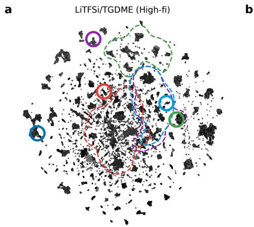

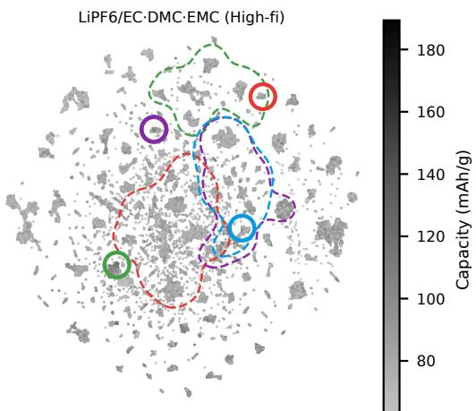

c Capacity vs Cycles-LiTFSi/TGDME (High-fi) d  
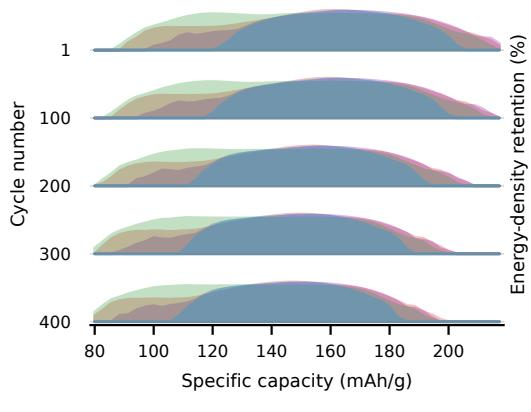

Energy Density Retention-LiTFSi/TGDME (High-fi)  
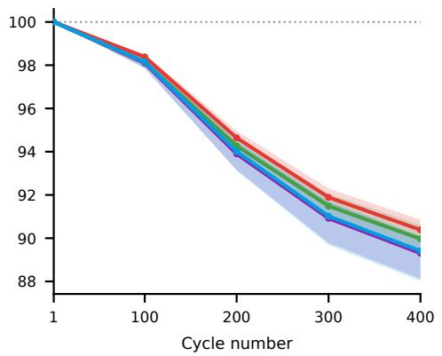

Figure 4: UMAP projections and cycling predictions at high-fidelity for our inverse-design library of 4 M polymers. Panels a and b show the predicted specific capacity for the LiTFSI and $\mathrm { L i P F _ { 6 } }$ electrolytes. Dashed outlines mark the dominant region of each polymer class in the UMAP plot, and solid circles mark the top candidate of each class. Panel c is a ridgeline plot of the library-wide specific-capacity distribution at cycles 1, 100, 200, 300 and 400 for LiTFSI/TEGDME; the distributions shift toward lower capacity as cycling proceeds. Panel d shows the predicted energy-density retention (%) of each polymer class over 400 cycles.

density within each polymer class. The complex polymer class denotes candidates with several redox-active moieties on one backbone.

Figure 3 shows the high-fidelity property space of the three libraries for the LiTFSI/TEGD electrolyte at 1C at the 1st and 200th cycles. Across all three libraries, the 200th-cycle predictions shift toward lower specific capacities relative to the 1st-cycle predictions, while preserving the overall capacity–voltage trends. Figure 3a shows the polyOne library, a general purpose dataset of 100 M polymers. Its property space spans a broad region of the capacity–voltage plane and includes a large low-voltage population. Figure 3b shows the inverse-design library generated from the existing polymer materials in the current work. Figure 3c shows the polymer library generated in our previous work and reused here.24 Although their property spaces overlap, the current inverse-design library extends further toward high specific capacities at intermediate voltages. Many newly generated polymers in this library have predicted specific capacities above the measured capacities of the literature cathodes shown as blue points in Figure 3b. The library from our previous work occupies a narrower capacity range across much of the voltage axis and shows a more prominent band near zero voltage. Both libraries are evaluated here at high fidelity under the same battery-stack and usage conditions, including the conductive agent, binder, and electrolyte. The diferences between Figure 3b and Figure 3c therefore compare the two polymer libraries rather than diferent prediction fidelities. In every panel the densest region follows the intermediate energy-density contours. The upper-right corner stays sparse exhibiting the voltage-capacity tradeof because only a few polymers reach high capacity and high voltage together. The predicted energy densities extend to roughly 550 W h kg−1. Figure 3d–f show the same three libraries as gravimetric versus volumetric energy density. Volumetric energy density is calculated using polymer densities estimated from Wildman–Crippen molar refractivity and the Lorentz–Lorenz relation (see Methods). Each library occupies a relatively narrow region in this energy-density space. The experimental cathodes lie within these regions. Their positions in Figure 3d–f agree with Figure 3a–c: candidates with favorable capacity and voltage also show favorable estimated volumetric energy density. The highest-ranked candidates contain carbonyl or quinone redox cores on extended conjugated backbones. They also carry thioether sulfur, ring nitrogen, or unsaturated linker end groups, as supported by previous studies. 43–45

Figure 4 shows the high-fidelity landscape of the inverse-design library produced in this work. Panels a and b show the UMAP plot of predicted specific capacity. Our model predicts higher capacities with LiTFSI/TEGDME than with $\mathrm { L i P F _ { 6 } }$ across the entire embedding which agrees with reports that ether-based electrolytes suppress dissolution of organic active materials.4,8 The top candidates reach $2 2 7 \mathrm { m A h g ^ { - 1 } }$ with LiTFSI/TEGDME and $1 4 3 \mathrm { m A h g ^ { - 1 } }$ with $\mathrm { L i P F _ { 6 } }$ (see Supplementary Figures S1–S2). The top candidates occupy diferent UMAP regions rather than regions dominated by a single polymer class. This arises because their multiple redox-active moieties produce fingerprints that lie between the single-class regions. The top candidates consists of a carbonyl or quinone redox core with a fused aromatic conjugated framework. Incorporating thioether sulfur or ring nitrogen provides an additional advantage. The highest predicted oxidation and reduction potentials occur for thianthreneand phenothiazine-type sulfur aromatics and hindered pyridine-ether esters, consistent with the literature (Supplementary Figures S3-S4). 45

Figure 4c and Figure 4d summarize the predicted cycling response of the LiTFSI/TEGDME candidates. Figure 4e reports the library-wide specific-capacity distribution at successive cycle numbers. The class distributions overlap over a common capacity range and shift toward lower capacity as cycling proceeds, with a predicted average loss of $3 0 \mathrm { m A h g ^ { - 1 } }$ to $4 0 \mathrm { m A h g ^ { - 1 } }$ over 400 cycles. Figure 4f reports the predicted energy-density retention of each polymer class over the same interval. All classes retain a comparable fraction of their initial energy density, between about 89 % to 91 $\%$ after 400 cycles, and the retention curves overlap within their confidence bands.

SHAP Analysis We use SHapley Additive exPlanations (SHAP)32 to quantify contributions to predicted specific capacity. We perform the analysis on the five cross-validated models at two levels: battery-component groups and chemical bonds within the cathode active material (Figure 5). The component-level analysis in Figure 5a includes capacity predictions from all fidelity levels. The cathode and electrolyte dominate the predicted capacity, whereas the anode contributes minimally because all stacks use the same lithium-metal anode. The capacity-fidelity inputs encode the fidelity of the capacity labels and contribute slightly, whereas the voltage-fidelity inputs contribute negligibly. The large electrolyte contribution confirms that capacity is a battery-stack property governed by dissolution and interfacial chemistry.46,47 This result supports training on the full battery stack rather than the cathode alone. Moreover, the SHAP analysis strategy evaluates the model and adds to its credibility

For the chemical fragment analysis of the cathode active material (Figure 5b and Figure 5c), we focus on high-fidelity predictions that include all battery components. Chemical fragments are ranked by the mean decrease in predicted capacity when the corresponding bond is removed from the cathode active material (Figure 5b). C=O, C:C, and Br–C bonds show the largest positive contributions to specific capacity. The strong attribution to carbonyl (C=O) bonds is consistent with their established role as redox centers in organic cathodes. On the other hand, C–C and imine (C= N) bonds show weaker impact on capacity and are associated with larger uncertainty, reflecting the sensitivity of these fragments to the local chemical environment.48 Moreover, F–P bonds are associated with reduced specific capacity, which is due to a higher thermodynamic barrier for electroactivity.49 These trends are consistent with prior literature. 50–54 Figure 5c maps the chemical fragment attribution on the six monomers that are utilized as the cathode active materials. Carbonyl groups and nitrogen-containing conjugated heterocyclic backbones are generally capacity-enhancing (red), whereas brominated carbon and nitrogen in non-conjugated structures are neutral or capacity-reducing (blue). Collectively, the results suggest design guidelines in which redox-active carbonyl groups and conjugated backbones support higher capacity, whereas non-conjugated structures with multiple heteroatoms tend to exhibit lower capacity.

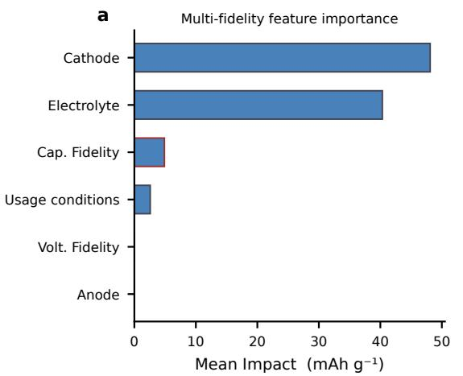

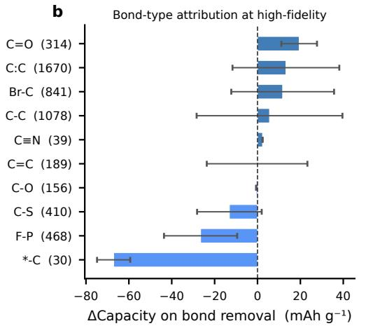

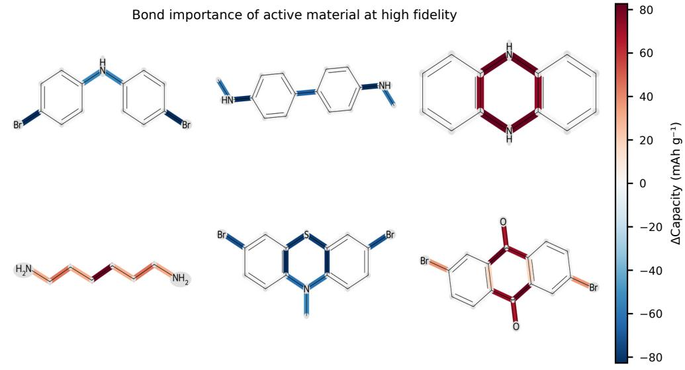  
Figure 5: SHapley Additive exPlanations (SHAP) analysis of the specific-capacity predictions. Panel a shows the mean impact of each input component group across all fidelity levels. Panel b shows the mean change in high-fidelity predicted capacity when a given bond type is removed from the cathode active material, with the bond counts given in parentheses. The error bars denote the spread across the sampled polymers. Panel c maps the high-fidelity per-bond capacity attribution to six monomers, which are used as active materials of cathode copolymers. The colors range from capacity-reducing (blue) to capacity-enhancing (red).

## Discussion

Here, we introduce HorizON, a general predictor of organic-battery stack properties trained across multiple properties, fidelity levels, and time horizons. HorizON can predict cycleresolved specific-capacity trajectories at high fidelity for full stacks, using fingerprints of the cathode, electrolyte, and lithium-metal anode. HorizON is trained in a multi-task, multifidelity setup that connects these high-fidelity trajectories with medium-fidelity DFT redox potentials and lower-fidelity proxy targets. This joint training helps the model capture correlations across properties and fidelities, allowing information learned from one task to improve another. It also mitigates data scarcity by combining datasets even when some datapoints lack certain property and fidelity labels. After training, HorizON makes predictions in under 1 ms per stack.

The space of possible organic battery stacks is extremely large because performance depends on the choice of stack components, their compositions, and usage conditions. By providing rapid, stack-level predictions of high-fidelity capacity trajectories, HorizON can support larger-scale exploration of this space and help prioritize cycling experiments. As with any data-driven model, its accuracy is bounded by the chemistries and cell designs represented in the training data. In particular, our high-fidelity stacks use lithium metal as the anode, so extending to other anodes, full-cell configurations, ion systems, or broader electrolyte families will require additional data and experimental validation. In addition, the inverse-design workflow does not evaluate synthetic accessibility, polymerizability, repeatunit stability, or electrode-fabrication compatibility, so proposed candidates should be confirmed by synthesis and electrochemical testing. Looking forward, multi-task, multi-fidelity models like HorizON can also be used for knowledge transfer across related battery domains and to guide targeted data collection for rapid model adaptation.

## Methods

Data collection and curation We collect and curate a multi-fidelity dataset with 1068 data points spanning experimental cycling measurements, first-cycle experimental properties, theoretical capacities, and DFT redox potentials. We extract the high-fidelity cycling subset from peer-reviewed publications and review articles on organic cathode half-cells with lithium-metal anodes. For each experimental system, we collect specific capacity as a function of cycle number and the corresponding usage conditions with some trajectories extending to approximately 400 cycles. For each cathode formulation, we collect PSMILES strings of the active organic material and SMILES strings for conductive agent and binder. For each electrolyte, we collect the SMILES strings of the salt and solvent. For the DFT subset, we calculate redox potentials of the redox-active component in diferent oxidation and reduction states. Before splitting the data into training and validation datasets, we apply min–max scaling independently to each target property.

DFT Redox Potential Calculations An automated computational workflow was developed that takes PSMILES strings and predicts redox potentials (see Figure 6). The workflow starts by capping redox-active polymer fragments with methyl groups and generating 3D structures using RDKit. 55 A conformer search is then performed using the CREST program56 and GFN2-xTB method,57 automatically selecting the lowest-energy conformer for further optimization. This structure is re-optimized using the M06-2X functional 58 with $6 { - } 3 1 { + } \mathrm { G } ^ { { \ast } { \ast } }$ basis sets59 in a PCM solvation model60 with acetone as the solvent. The dielectric constant is 20.7, which represents the average of the experimental solvents. 61 Previous studies62 have shown that DFT method choice does not significantly impact these results. For the final free energies, the calculations switch to the SMD solvation model 63 (still with acetone) to obtain more accurate solvation energies, yielding liquid-phase free energies for both reduced and oxidized states at the $\mathrm { S M D - M 0 6 - 2 X / 6 - 3 1 + G ^ { * * } / / P C M - M 0 6 - 2 X / 6 - 3 1 + G ^ { * * } }$ level. Redox potentials are derived from the free-energy diference between oxidized and reduced states via a standard thermodynamic cycle and referenced to SHE. All stationary points are confirmed as true minima by frequency analysis. The workflow interfaces RDKit, CREST, and Gaussian $1 6 ^ { 6 4 }$ to enable systematic processing of large polymer candidate sets.

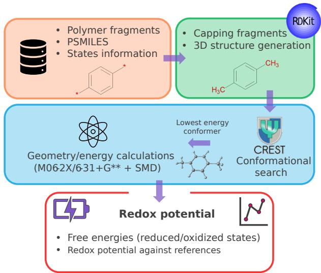  
Figure 6: Schematic of the automated DFT redox potential workflow. Starting from PSMILES strings, the pipeline proceeds through methyl capping and 3D structure generation (RDKit), conformer search (CREST/GFN2-xTB), geometry optimization (PCM-M06-2X/6- $3 1 + \mathrm { G } ^ { * * } )$ , and final single-point energy evaluation $\left( \mathrm { S M D - M 0 6 - 2 X } / 6 \mathrm { - } 3 1 \mathrm { + } \mathrm { G } ^ { \mathrm { * * } } \right)$ to yield redox potentials referenced to SHE.

Fingerprinting We encode each SMILES or PSMILES representation as a 600-dimensional polyBERT fingerprint. 21 For multicomponent materials, the composition-weighted fingerprint is computed as

$$
\mathbf { f } _ { \mathrm { m i x } } = \sum _ { i = 1 } ^ { N } w _ { i } \mathbf { f } _ { i } ,\tag{1}
$$

where $w _ { i }$ and $\mathbf { f } _ { i }$ denote the fraction and fingerprint of constituent $i ,$ and N is the number of constituents in a multicomponent material. 41 The cathode, anode, and electrolyte vectors are concatenated with seven selector variables: C-rate, active-material loading, electrolyte molarity, lower and upper voltage limits, oxidation state, and reduction state. This procedure produces the 1807-dimensional model input.

Multi-Horizon Deep Operator Network (HorizON) Architecture We split the dataset into a cross-validation (80 %) and a meta-learner subsets (20 %). We divide the cross-validation subset into five folds. For each fold, Optuna optimizes the number of layers, neurons per layer, activation functions, and learning rate. 65 We select the best model for each fold based on the validation performance.

Each of these cross-validated models predicts the property values for every sample in the meta-learner subset. The five predictions for each sample form a 5-dimensional input vector. We train the meta-learner to predict the target property from this 5-dimensional vector. The complete prediction framework, including the five cross-validated models and the meta-learner, constitutes HorizON. During inference, a new sample is passed through the five cross-validated models, and their predictions are supplied to the meta-learner to obtain the final property prediction.

Inverse Design Our inverse-design workflow starts from a set of 65 homopolymers drawn from the training dataset. We use these polymers as the starting polymer chemistries to generate a large virtual library of material candidates. We generate the library iteratively by substituting selected positions in the PSMILES strings with heteroatoms and related chemical modifications. After each substitution step, we evaluate chemical validity using RDKit and PSMILES-based checks. 21,55 This procedure yields approximately 4 000 000 chemically valid polymer candidates. We compute their polyBERT fingerprints and predict their properties using the trained meta-learner. Candidates with the highest predicted redox potentials and specific capacities are reported in the Supporting Information.

Volumetric & Gravimetric Energy Density Calculations The computation of the volumetric energy density requires the mass density of each polymer. We estimated the density for each polymer’s repeat-unit SMILES string using the RDKit’s implementation of the Wildman–Crippen atomic-contribution model, 66 which sums per-atom contributions to molar refractivity (MR) from a fitted set of atom types. We converted MR to molar volume $\left( V _ { m } \right)$ using the classical Lorentz–Lorenz relation,

$$
V _ { m } = M R \frac { n ^ { 2 } + 2 } { n ^ { 2 } - 1 } , \qquad n \approx 1 . 5 5 ,\tag{2}
$$

where n is the refractive index and 1.55 is typical of organic polymers. 67 The density is

$$
\rho = \frac { M } { V _ { m } } ,\tag{3}
$$

where M is the molecular weight of the repeat unit. To obtain the repeat-unit SMILES, the end-group markers (represented by $^ { * ) }$ in PSMILES are replaced by hydrogen atoms. Gravimetric energy density followed as

$$
E _ { \mathrm { g r a v } } = 3 . 6 \times 1 0 ^ { - 3 } Q V ,\tag{4}
$$

where $Q$ is capacity in mA h $\mathrm { g } ^ { - 1 }$ and V is voltage in volts, giving $E _ { \mathrm { g r a v } }$ in $\mathrm { M J } \mathrm { k g } ^ { - 1 }$ . Volumetric energy density followed as

$$
E _ { \mathrm { v o l } } = E _ { \mathrm { g r a v } } \rho .\tag{5}
$$

Because $\rho$ is a computational estimate rather than a measured or literature value, we report volumetric energy density as a model estimate throughout.

SHAP Analysis In the current work, we utilize a SHAP analysis strategy to quantify the importance of local chemical motifs. We estimate how individual bonds in the cathode active material contribute to the predicted capacity of the battery stack. We systematically remove individual bonds from the PSMILES strings of the cathode active material and generate polyBERT embeddings for the modified structures. We use these embeddings as inputs to the five cross-validated models and calculate the change in predicted capacity relative to the original prediction. The resulting attribution score measures the contribution of the removed bond to the predicted property. Larger positive values indicate a stronger

contribution to the predicted capacity.

## $\mathbf { C O } _ { 2 }$ Emission and Timing

We estimate the training emissions from the Bayreuth cluster carbon intensity of 0.344 kg $\mathrm { C O _ { 2 } e q k W h ^ { - 1 } }$ A 40 h run on 4 A100-40 GB GPUs with a 250 W TDP corresponds to approximately 3.44 kg $\mathrm { C O _ { 2 } e q }$ . We estimate inference emissions as $6 . 5 \mathrm { g C O _ { 2 } e q }$ per candidate for a 2 s prediction.

## Data Availability

Data are available upon request.

## Code Availability

The code used for training the HorizON models and meta learner models are available for academic use at https://github.com/kuennethgroup/HorizON.git.

## References

(1) Lu, Y.; Chen, J. Prospects of organic electrode materials for practical lithium batteries. Nature Reviews Chemistry 2020, 4, 127–142, DOI: 10.1038/s41570-020-0160-9.

(2) Kim, J.; Kim, Y.; Yoo, J.; Kwon, G.; Ko, Y.; Kang, K. Organic batteries for a greener rechargeable world. Nature Reviews Materials 2022, 8, 54–70, DOI: 10.1038/ s41578-022-00478-1.

(3) Larcher, D.; Tarascon, J.-M. Towards greener and more sustainable batteries for electrical energy storage. Nature Chemistry 2015, 7, 19–29, DOI: 10.1038/nchem.2085.

(4) Shi, R.; Jiao, S.; Yue, Q.; Gu, G.; Zhang, K.; Zhao, Y. Challenges and advances of organic electrode materials for sustainable secondary batteries. Exploration 2022, 2, 20220066, DOI: 10.1002/EXP.20220066.

(5) Wang, J.; Lakraychi, A. E.; Liu, X.; Sieuw, L.; Morari, C.; Poizot, P.; Vlad, A. Conjugated sulfonamides as a class of organic lithium-ion positive electrodes. Nature Materials 2021, 20, 665–673, DOI: 10.1038/s41563-020-00869-1.

(6) Judez, X.; Qiao, L.; Armand, M.; Zhang, H. Energy Density Assessment of Organic Batteries. ACS Applied Energy Materials 2019, 2, 4008–4015, DOI: 10.1021/acsaem. 9b00534.

(7) Bertaglia, T.; Costa, C. M.; Lanceros-M´endez, S.; Crespilho, F. N. Eco-friendly, sustainable, and safe energy storage: a nature-inspired materials paradigm shift. Materials Advances 2024, 5, 7534–7547, DOI: 10.1039/D4MA00363B.

(8) Lee, S.; Kwon, G.; Ku, K.; Yoon, K.; Jung, S.; Lim, H.; Kang, K. Recent Progress in Organic Electrodes for Li and Na Rechargeable Batteries. Advanced Materials 2018, 30, 1704682, DOI: 10.1002/adma.201704682.

(9) Esser, B.; Dolhem, F.; Becuwe, M.; Poizot, P.; Vlad, A.; Brandell, D. A perspective on organic electrode materials and technologies for next generation batteries. Journal of Power Sources 2021, 482, 228814, DOI: 10.1016/j.jpowsour.2020.228814.

(10) Schon, T. B.; McAllister, B. T.; Li, P.-F.; Seferos, D. S. The rise of organic electrode materials for energy storage. Chemical Society Reviews 2016, 45, 6345–6404, DOI: 10.1039/C6CS00173D.

(11) Liang, Y.; Tao, Z.; Chen, J. Organic Electrode Materials for Rechargeable Lithium Batteries. Advanced Energy Materials 2012, 2, 742–769, DOI: 10.1002/aenm.201100795.

(12) Bhosale, M. E.; Chae, S.; Kim, J. M.; Choi, J.-Y. Organic small molecules and polymers as an electrode material for rechargeable lithium ion batteries. Journal of Materials Chemistry A 2018, 6, 19885–19911, DOI: 10.1039/C8TA04906H.

(13) Yu, Z.; Wang, Y.; Luo, Z. Review on Redox-Active Organic Compounds for All-Organic Batteries. Industrial & Engineering Chemistry Research 2024, 63, 9619–9630, DOI: 10.1021/acs.iecr.4c00394.

(14) Reymond, J.-L. The Chemical Space Project. Accounts of Chemical Research 2015, 48, 722–730, DOI: 10.1021/ar500432k.

(15) Lu, Y.; Zhang, Q.; Chen, J. Perspectives on the Redox Chemistry of Organic Electrode Materials in Lithium Batteries. CCS Chemistry 2023, 5, 1491–1508, DOI: 10.31635/ ccschem.023.202302740.

(16) Butler, K. T.; Davies, D. W.; Cartwright, H.; Isayev, O.; Walsh, A. Machine learning for molecular and materials science. Nature 2018, 559, 547–555, DOI: 10.1038/ s41586-018-0337-2.

(17) Shen, Z.; Liu, H.; Shen, Y.; Hu, J.; Chen, L.; Nan, C. Machine learning in energy storage materials. Interdisciplinary Materials 2022, 1, 175–195, DOI: 10.1002/idm2.12020.

(18) Chen, A.; Zhang, X.; Zhou, Z. Machine learning: Accelerating materials development for energy storage and conversion. InfoMat 2020, 2, 553–576, DOI: 10.1002/inf2. 12094.

(19) Wu, Z.; Ramsundar, B.; Feinberg, E.; Gomes, J.; Geniesse, C.; Pappu, A. S.; Leswing, K.; Pande, V. MoleculeNet: a benchmark for molecular machine learning. Chemical Science 2018, 9, 513–530, DOI: 10.1039/C7SC02664A.

(20) Weininger, D. SMILES, a chemical language and information system. 1. Introduction to methodology and encoding rules. Journal of Chemical Information and Computer Sciences 1988, 28, 31–36, DOI: 10.1021/ci00057a005.

(21) Kuenneth, C.; Ramprasad, R. polyBERT: a chemical language model to enable fully machine-driven ultrafast polymer informatics. Nature Communications 2023, 14, 4099, DOI: 10.1038/s41467-023-39868-6.

(22) Moriwaki, H.; Tian, Y.-S.; Kawashita, N.; Takagi, T. Mordred: a molecular descriptor calculator. Journal of Cheminformatics 2018, 10, 4, DOI: 10.1186/ s13321-018-0258-y.

(23) Rogers, D.; Hahn, M. Extended-Connectivity Fingerprints. Journal of Chemical Information and Modeling 2010, 50, 742–754, DOI: 10.1021/ci100050t.

(24) Ganti, S. V.; W¨olfel, L.; Kuenneth, C. AI-Driven Discovery of High Performance Polymer Electrodes for Next-Generation Batteries. Journal of Polymer Science 2025, 63, DOI: 10.1002/pol.20250198.

(25) Hutchinson, M. L.; Antono, E.; Gibbons, B. M.; Paradiso, S.; Ling, J.; Meredig, B. Overcoming data scarcity with transfer learning. 2017; https://arxiv.org/abs/1711. 05099.

(26) Caruana, R. Multitask Learning. Machine Learning 1997, 28, 41–75, DOI: 10.1023/A: 1007379606734.

(27) Nevolianis, T.; Rittig, J. G.; Mitsos, A.; Leonhard, K. Multi-fidelity graph neural networks for predicting toluene/water partition coeficients. Journal of Cheminformatics 2025, 17, DOI: 10.1186/s13321-025-01057-6.

(28) Zhang, Y.; Xiong, R.; He, H.; Pecht, M. G. Long short-term memory recurrent neural network for remaining useful life prediction of lithium-ion batteries. IEEE Transactions on Vehicular Technology 2018, 67, DOI: 10.1109/TVT.2018.2805189.

(29) Lim, B.; Arık, S. O.; Loef, N.; Pfister, T. Temporal Fusion Transformers for in- ¨ terpretable multi-horizon time series forecasting. International Journal of Forecasting 2021, 37, 1748–1764, DOI: 10.1016/j.ijforecast.2021.03.012.

(30) Thakkar, P.; Khatri, S.; Dobariya, D.; Patel, D.; Dey, B.; Singh, A. K. Advances in materials and machine learning techniques for energy storage devices: A comprehensive review. Journal of Energy Storage 2024, 81, 110452, DOI: 10.1016/j.est.2024.110452.

(31) Severson, K. A.; Attia, P. M.; Jin, N.; Perkins, N.; Jiang, B.; Yang, Z.; Chen, M. H.; Aykol, M.; Herring, P. K.; Fraggedakis, D.; Bazant, M. Z.; Harris, S. J.; Chueh, W. C.; Braatz, R. D. Data-driven prediction of battery cycle life before capacity degradation. Nature Energy 2019, 4, 383–391, DOI: 10.1038/s41560-019-0356-8.

(32) Lundberg, S. M.; Lee, S. I. A unified approach to interpreting model predictions. Advances in Neural Information Processing Systems. 2017.

(33) Otteny, F.; Kolek, M.; Becking, J.; Winter, M.; Bieker, P.; Esser, B. Unlocking Full Discharge Capacities of Poly(vinylphenothiazine) as Battery Cathode Material by Decreasing Polymer Mobility Through Cross-Linking. Advanced Energy Materials 2018, 8, DOI: 10.1002/aenm.201802151.

(34) Bhosale, M.; Schmidt, C.; Penert, P.; Studer, G.; Esser, B. Anion-Rocking Chair Batteries with Tuneable Voltage using Viologen- and Phenothiazine Polymer-based Electrodes\*\*. ChemSusChem 2024, 17, DOI: 10.1002/cssc.202301143.

(35) Obrezkov, F. A.; Somova, A. I.; Fedina, E. S.; Vasil’ev, S. G.; Stevenson, K. J.; Troshin, P. A. Dihydrophenazine-Based Copolymers as Promising Cathode Materials for Dual-Ion Batteries. Energy Technology 2021, 9, DOI: 10.1002/ente.202000772.

(36) Dai, G.; Wang, X.; Qian, Y.; Niu, Z.; Zhu, X.; Ye, J.; Zhao, Y.; Zhang, X. Manipulation of conjugation to stabilize N redox-active centers for the design of high-voltage organic

battery cathode. Energy Storage Materials 2019, 16, DOI: 10.1016/j.ensm.2018.06.   
005.

(37) Xu, S.; Dai, H.; Zhu, S.; Wu, Y.; Sun, M.; Chen, Y.; Fan, K.; Zhang, C.; Wang, C.; Hu, W. A branched dihydrophenazine-based polymer as a cathode material to achieve dual-ion batteries with high energy and power density. eScience 2021, 1, DOI: 10. 1016/j.esci.2021.08.002.

(38) Liu, Y.; Niu, Z.; Dai, G.; Chen, Y.; Li, H.; Huang, L.; Zhang, X.; Xu, Y.; Zhao, Y. Phenothiazine-based copolymer with redox functional backbones for organic battery cathode materials. Materials Today Energy 2021, 21, DOI: 10.1016/j.mtener.2021. 100812.

(39) Peterson, B. M.; Ren, D.; Shen, L.; Wu, Y. C. M.; Ulgut, B.; Coates, G. W.; Abruna, H. D.; Fors, B. P. Phenothiazine-Based Polymer Cathode Materials with Ultrahigh Power Densities for Lithium Ion Batteries. ACS Applied Energy Materials 2018, 1, DOI: 10.1021/acsaem.8b00778.

(40) Iordache, A.; Delhorbe, V.; Bardet, M.; Dubois, L.; Gutel, T.; Picard, L. Perylenebased all-organic redox battery with excellent cycling stability. ACS Applied Materials and Interfaces 2016, 8, DOI: 10.1021/acsami.6b07591.

(41) Kuenneth, C.; Schertzer, W.; Ramprasad, R. Copolymer Informatics with Multitask Deep Neural Networks. Macromolecules 2021, 54, 5957–5961, DOI: 10.1021/acs. macromol.1c00728.

(42) Kuenneth, C.; Ramprasad, R. polyOne Dataset: 100 Million Hypothetical Polymers with 29 Properties. 2022; https://doi.org/10.5281/zenodo.7766806.

(43) Raj, M. R.; Kim, N.; Lee, G. A perylene-based aromatic polyimide with multiple carbonyls enabling high-capacity and stable organic lithium and sodium ion batteries. Sustainable Energy and Fuels 2021, 5, DOI: 10.1039/d0se01246g.

(44) Xu, S.; Wang, C.; Song, T.; Yao, H.; Yang, J.; Wang, X.; Zhu, J.; Lee, C. S.; Zhang, Q. A Dithiin-Linked Covalent Organic Polymer for Ultrahigh Capacity Half-Cell and Symmetric Full-Cell Sodium-Ion Batteries. Advanced Science 2023, 10, DOI: 10.1002/advs.202304497.

(45) Hatakeyama-Sato, K.; Sadakuni, K.; Kitagawa, K.; Oyaizu, K. Thianthrene polymers as 4 V-class organic mediators for redox targeting reaction with LiMn2O4 in flow batteries. Scientific Reports 2023, 13, DOI: 10.1038/s41598-023-32506-7.

(46) Zhang, S.; Xie, W.; Yang, Z.; Xu, S.; Zhao, Q.; Lu, Y.; Zhang, K.; Yan, Z.; Chen, J. Revealing the dissolution mechanism of organic carbonyl electrodes in lithium-organic batteries. Chemical Science 2025, 16, DOI: 10.1039/d4sc07932a.

(47) Yang, Z.; Lu, Y.; Xu, S.; Liu, X.; Shang, L.; Yan, Z.; Zhang, K.; Chen, J. Cathode Electrolyte Interphase Regulation for High-Performance Lithium-Organic Batteries. Journal of the American Chemical Society 2025, 147, DOI: 10.1021/jacs.4c16492.

(48) Guo, Q.; Xu, H.; Chu, X.; Huang, X.; Yu, M.; Feng, X. Structural codes of organic electrode materials for rechargeable multivalent metal batteries. 2025.

(49) Hautier, G.; Jain, A.; Ong, S. P.; Kang, B.; Moore, C.; Doe, R.; Ceder, G. Phosphates as lithium-ion battery cathodes: An evaluation based on high-throughput ab initio calculations. Chemistry of Materials 2011, 23, DOI: 10.1021/cm200949v.

(50) Peng, H.; Yu, Q.; Wang, S.; Kim, J.; Rowan, A. E.; Nanjundan, A. K.; Yamauchi, Y.; Yu, J. Molecular Design Strategies for Electrochemical Behavior of Aromatic Carbonyl Compounds in Organic and Aqueous Electrolytes. Advanced Science 2019, 6, 1900431, DOI: https://doi.org/10.1002/advs.201900431.

(51) Wu, D.; Xie, Z.; Zhou, Z.; Shen, P.; Chen, Z. Designing high-voltage carbonyl-containing polycyclic aromatic hydrocarbon cathode materials for Li-ion batteries guided by Clar’s theory. Journal of Materials Chemistry A 2015, 3, DOI: 10.1039/c5ta05437k.

(52) Shu, X.; Hu, L.; Heine, T.; Jing, Y. Rational Molecular Design of Redox-Active Carbonyl-Bridged Heterotriangulenes for High-Performance Lithium-Ion Batteries. Advanced Science 2024, 11, DOI: 10.1002/advs.202306680.

(53) Liu, Z.; Meng, X.; Cui, F.; Zhu, G. Designing strategies for high-redox-potential conjugated carbonyl organic cathodes in lithium- and sodium-ion batteries. Journal of Materials Chemistry A 2024, 12, DOI: 10.1039/d4ta03793f.

(54) Zhu, L.; Ding, G.; Xie, L.; Cao, X.; Liu, J.; Lei, X.; Ma, J. Conjugated Carbonyl Compounds as High-Performance Cathode Materials for Rechargeable Batteries. Chemistry of Materials 2019, 31, 8582–8612, DOI: 10.1021/acs.chemmater.9b03109.

(55) Landrum, G. et al. rdkit/rdkit: 2025 03 2 (Q1 2025) Release. 2025; https://doi.org/ 10.5281/zenodo.15286010.

(56) Pracht, P.; Grimme, S.; Bannwarth, C.; Bohle, F.; Ehlert, S.; Feldmann, G.; Gorges, J.; M¨uller, M.; Neudecker, T.; Plett, C.; Spicher, S.; Steinbach, P.; Weso lowski, P. A.; Zeller, F. CREST—A program for the exploration of low-energy molecular chemical space. The Journal of Chemical Physics 2024, 160, DOI: 10.1063/5.0197592.

(57) Bannwarth, C.; Ehlert, S.; Grimme, S. GFN2-xTB—An Accurate and Broadly Parametrized Self-Consistent Tight-Binding Quantum Chemical Method with Multipole Electrostatics and Density-Dependent Dispersion Contributions. Journal of Chemical Theory and Computation 2019, 15, 1652–1671, DOI: 10.1021/acs.jctc.8b01176.

(58) Zhao, Y.; Truhlar, D. G. The M06 suite of density functionals for main group thermochemistry, thermochemical kinetics, noncovalent interactions, excited states, and transition elements: two new functionals and systematic testing of four M06-class functionals and 12 other functionals. Theoretical Chemistry Accounts 2007, 120, 215–241, DOI: 10.1007/s00214-007-0310-x.

(59) Nobes, R. H.; Rodwell, W. R.; Radom, L. The 6-31G++ basis set: An economical basis set for correlated wavefunctions. Journal of Computational Chemistry 1982, 3, 561–564, DOI: https://doi.org/10.1002/jcc.540030414.

(60) Tomasi, J.; Mennucci, B.; Canc\`es, E. The IEF version of the PCM solvation method: an overview of a new method addressed to study molecular solutes at the QM ab initio level. Journal of Molecular Structure: THEOCHEM 1999, 464, 211–226, DOI: https://doi.org/10.1016/S0166-1280(98)00553-3.

(61) Hall, D. S.; Self, J.; Dahn, J. R. Dielectric Constants for Quantum Chemistry and Li-Ion Batteries: Solvent Blends of Ethylene Carbonate and Ethyl Methyl Carbonate. The Journal of Physical Chemistry C 2015, 119, 22322–22330, DOI: 10.1021/acs. jpcc.5b06022.

(62) Prata-Duque, A.; Pinto, T.; Serpa, C.; Caridade, P. Performance of functionals and basis sets in DFT calculation of organic compounds redox potentials. 2022, DOI: 10. 22541/au.165820504.41485770/v1.

(63) Marenich, A. V.; Cramer, C. J.; Truhlar, D. G. Universal Solvation Model Based on Solute Electron Density and on a Continuum Model of the Solvent Defined by the Bulk Dielectric Constant and Atomic Surface Tensions. The Journal of Physical Chemistry B 2009, 113, 6378–6396, DOI: 10.1021/jp810292n.

(64) Frisch, M. J. et al. Gaussian˜16 Revision C.01. 2016; Gaussian Inc. Wallingford CT.

(65) Akiba, T.; Sano, S.; Yanase, T.; Ohta, T.; Koyama, M. Optuna: A Next-generation Hyperparameter Optimization Framework. Proceedings of the 25th ACM SIGKDD International Conference on Knowledge Discovery & Data Mining. Anchorage AK USA, 2019; pp 2623–2631, DOI: 10.1145/3292500.3330701.

(66) Wildman, S. A.; Crippen, G. M. Prediction of physicochemical parameters by atomic

contributions. Journal ofChemical Information and Computer Sciences 1999, 39, DOI: 10.1021/ci990307l.

(67) Krevelen, D. W. V. Properties of Polymers: Their Correlation with Chemical Structure; their Numerical Estimation and Prediction from Additive Group Contributions: Fourth Edition; 2009.

## Acknowledgements

S.V.S.G., L.W, A.D, and C.K acknowledge funding from the BayBatt graduate school. Additionally, T.M, T.N, and J.M would like to express their gratitude to Jens Langanke, Head of R&D Simulations & Data Science, Covestro for valuable insights and for backing initiatives associated with this project.

## Author Contributions

S.V.S.G.: conceptualization, data, models, analysis. L.W and A.D.: data curation. T.M, T.N and J.M.: computational methodology, automated workflow development, DFT redox potential calculations, and computational data curation. C.K.: conceived, guided and funding acquisition. All the authors discussed results and commented on the manuscript.

## Competing Interests

None declared.