# How Many and How Much? Contrastive Learning with Negative Samples for Knowledge Graph Embedding

Sooho Moon   
Chung-Ang University   
Seoul, Korea   
moonwalk725@cau.ac.kr   
Yunyong Ko\*   
Chung-Ang University   
Seoul, Korea   
yyko@cau.ac.kr

## Abstract

Knowledge graph embedding (KGE), a fundamental technique for knowledge-centric Web and KG-augmented AI applications, is commonly trained through contrastive learning with negative samples to learn discriminative representations. Despite its empirical success, two crucial questions regarding negative samples remain underexplored: (Q1) how many negative samples should be used for each positive sample and (Q2) how much should each negative sample contribute to learning? To answer these questions, we propose RADAR, a novel contrastive learning framework for KGE models with two effective strategies, respectively: (1) Risk-aware negative budget allocation quantifies false-negative sampling risk by modeling an open-world KG as a stochastic partial observation of its closed-world counterpart and adaptively assigns a negative budget to each positive sample based on its risk; (2) Distributioncalibrated negative weighting assigns negative weights by calibrating the weighting strength for each positive based on two complementary characteristics of the negative-score distribution: dispersion and concentration. Extensive experiments on 3 real-world KGs with 4 KGE models reveal that RADAR achieves the best KGE performance on average across all model-KG combinations and reduces sampled false negatives by over 90% compared with conventional fixed-budget methods. Our code and datasets are available at https://anonymous.4open.science/r/KGENS-1EB6/.

## Keywords

knowledge graph, knowledge graph embedding, contrastive learning, negative sampling, open-world assumption

## 1 Introduction

The Web serves as an abundant source of information about realworld entities and their complex relationships. A knowledge graph (KG) organizes such information into structured relational knowledge, where each fact is represented as a triple, (head entity, relation, tail entity), such as Freebase [3] and YAGO [28]. By making relational knowledge explicit, KGs have become an important foundation for a wide range of knowledge-centric applications, including Web search [11, 25], recommender systems [33, 34], question answering [14, 43], and even drug discovery [35, 45].

Beyond explicit relational knowledge, KG embedding (KGE) [4, 19, 29, 32, 37–39] aims to learn representations of entities and relations to capture latent relational patterns in a KG. The learned representations can then be utilized for diverse downstream tasks. Most notably, KG completion (KGC) [4, 32, 39, 46, 48] aims to discover missing facts in a KG, where KGE estimates their plausibility based on the learned representations of the involved entities and relations. In addition to KGC, learned representations can serve as structural features for downstream tasks such as recommendation and enzyme prediction [27, 33]. They can also support emerging KG-augmented AI applications, such as LLM reasoning with graphbased RAG, by enabling the retrieval of relevant knowledge based on its similarity to a query in the latent representation space [20, 44].

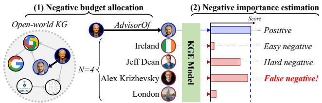  
Figure 1: Process of contrastive learning with negative samples for knowledge graph embedding.

KGE models are generally trained through contrastive learning with negative samples [13, 29, 41, 47], which learns to assign higher scores to positive samples (i.e., true facts) and lower scores to negative samples (i.e., false facts), as illustrated in Figure 1. Since false facts are not explicitly available in a KG, negative samples are typically constructed by corrupting a positive sample (h, r, t), i.e., replacing its head or tail entity with another entity such that the resulting triple is not observed in the KG. This learning paradigm enables KGE models to learn discriminative representations that distinguish true facts from false ones.

Challenges. Despite its empirical success, the following two challenges regarding negative samples still remain underexplored:

(C1) Negative budget allocation. For each positive triple, KGE models are typically trained with a fixed number of negative samples (e.g., 128 or 256) [29, 37, 47]. However, determining a proper negative budget is non-trivial since real-world KGs follow the openworld assumption (OWA) [12, 24, 40]. Under the OWA, an unobserved fact is not necessarily false, implying that some negative samples drawn from unobserved facts may actually be true—i.e., false negatives (FN). This introduces an inherent trade-off: sampling more negatives increases the risk of FNs, whereas sampling too few negatives may limit the supervision available for contrastive learning. More importantly, we observe that the number of FNs varies significantly across positive triples (see Figure 2(a)), where FNs for each training positive (h, r, t) are the triples in the validation and test sets that share the same (h, r) or (r, t) pair (i.e., anchor) but are absent from the training set. This raises a fundamental question: how many negatives should be used for each positive according to its false-negative risk? Answering this question is inherently challenging, as accurately estimating such risk requires closed-world knowledge of whether unobserved facts are actually true, which is unavailable under the OWA.

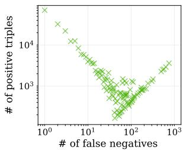

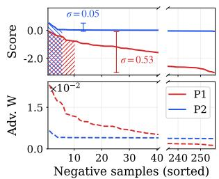  
Figure 2: Observations: (a) Varying numbers of false negatives across positive triples on FB15k237 [31], and (b) negative scores and their weights computed by Self-Adv [29] for two positive triples (P1 and P2) with different score dispersion (σ) and concentration (shaded: top-10% negative scores).

(C2) Negative importance estimation. Once negatives are sampled, another challenge is to determine how much each negative should contribute to learning. Rather than treating all negatives equally, self-adversarial weighting (Self-Adv) [29] estimates their relative hardness based on model scores: higher-scoring negatives are considered harder to distinguish from a positive and are thus assigned larger weights, allowing them to contribute more strongly to learning. Our analytical decomposition of Self-Adv, however, reveals that its weighting strength is determined solely by the dispersion of negative scores: more dispersed scores induce larger weight differences, whereas less dispersed scores yield more uniform weights. Such dispersion-based scaling can overlook another critical characteristic of the score distribution—how strongly high scores are concentrated on a few negatives. As illustrated in Figure 2(b), where P1 and P2 denote two positives, the top-10% negative scores of P1's negatives are less concentrated (red shaded), yet their larger dispersion (σ = 0.53) results in larger weight differences. In contrast, the top-10% negative of P2's negatives are concentrated on fewer negatives (blue shaded), but their smaller dispersion $( \sigma = 0 . 0 5 )$ leads to lower weights. Such an oversight of score concentration raises another fundamental question: how much should each negative contribute to learning considering both the dispersion and concentration of negative scores?

Our work. To address these challenges, in this paper, we propose RADAR, a novel contrastive learning framework for KGE that integrates (1) Risk-Aware negative budget allocation and (2) Distribution-cAlibRated negative weighting.

(1) Risk-aware negative budget allocation. We first analyze the gap between an open-world KG and its ideal closed-world counterpart, where all true facts are observed. Specifically, we interpret an open-world KG as a stochastic partial observation of its corresponding closed-world KG. Based on this interpretation, we quantify the risk of sampling false negatives for each positive triple as a probability and derive its relationship to the observed degree. We then adaptively determine the negative budget for each positive triple, allocating fewer negatives to higher-risk triples and more negatives to lower-risk ones.

(2) Distribution-calibrated negative weighting. To reflect score concentration in negative weighting, we then design an entropy-based measure that quantifies the score concentration of negatives. Specifically, the measure is computed from the entropy of a probability distribution derived from standardized negative scores, with larger values indicating that high scores are concentrated among fewer negatives. We observe that score dispersion and concentration are not strongly correlated (see Figure 4), implying that score concentration provides complementary information that is not captured solely by dispersion. Based on this observation, we jointly consider the dispersion and concentration of negative scores to determine the weighting strength for each positive triple, thereby calibrating its negative weights according to both characteristics of the negative score distribution.

Contributions. The main contributions of our work are as follows:

• Challenges. We identify two underexplored challenges in contrastive learning with negative samples for KGE: (C1) negative budget allocation and (C2) negative importance estimation.

• Framework. We propose RADAR, a novel contrastive learning framework that addresses the two challenges through (1) riskaware negative budget allocation and (2) distribution-calibrated negative weighting, respectively.

• Evaluation. Via extensive experiments on 3 real-world KGs with 4 KGE models, we demonstrate that RADAR (1) achieves the best KGE performance on average across all model-dataset combinations and (2) reduces sampled false negatives by over 90% compared with existing fixed-budget methods.

## 2 Related Work

Knowledge graph embedding. Knowledge graph embedding (KGE) models [2, 4, 29, 32, 37, 39] aim to learn latent representations of entities and relations to capture relational patterns in a KG. Translation-based models interpret a relation as a transformation between entity embeddings. TransE [4] models each relation as a translation, h + r ≈ t, while RotatE [29] models relations as rotations in complex space. HousE [18] uses Householder transformation for rotation and projection to capture complex relations. DGS [15] models cyclic and hierarchical relations using spherical and hyperbolic embedding spaces, respectively. Tensor decomposition models represent a KG as a three-way tensor and factorize it using entity and relation representations. DistMult [39] employs a diagonal bilinear scoring function, ComplEx [32] extends it to the complex domain, and TuckER [2] adopts Tucker decomposition. IVR [38] introduces intermediate-variable regularization to reduce overfitting and improve generalization.

Contrastive learning for KGE. KGE models are generally trained through contrastive learning with negative samples. Accordingly, various methods have been proposed to improve negative selection and utilization. Uniform sampling [4] randomly corrupts entities, whereas KBGAN [5] uses adversarial learning to generate informative negatives. NSCaching [47] reuses high-scoring negatives, while Self-Adv [29] assigns larger weights to high-scoring negatives. SANS [1] exploits local graph structure, whereas EANS [16] samples nearby entities in embedding space and mitigates false negatives with an auxiliary loss. ERDNS [42], motivated by optimal embedding analysis [17], adaptively allocates a fixed batch-level negative budget across positives based on their degrees. Unlike RADAR, however, its adaptation is batch-specific and does not account for open-world false-negative risk. DeMix [9] identifies likely false and true negatives based on model scores and mixes them with positives and negatives, respectively, to mitigate false negatives while generating harder negatives. M²ixKG [7] synthesizes hard negatives by mixing same-relation or high-scoring entities in embedding space. IF-NS [6] prioritizes negatives by their estimated training influence. BigramKG [8] down-weights potential false negatives using relation-entity semantic matching. ConDNS [36] generates synthetic negatives via conditional diffusion, with difficulty controlled by the denoising timestep.

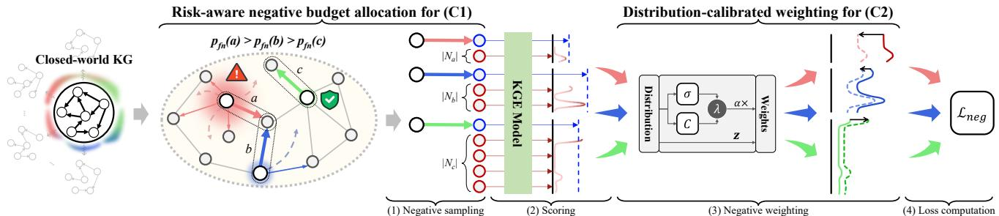  
Figure 3: Overview of RADAR. RADAR addresses (C1) “"how many negatives to sample" through risk-aware negative budget allocation and (C2) “how much should each negative contribute" through distribution-calibrated negative weighting.

## 3 Preliminary: Contrastive Learning for KGE

Let $\mathcal { G } = ( \mathcal { E } , \mathcal { R } , \mathcal { T } )$ denote a KG with entity, relation, and observed triple sets E, R, and T, respectively. Given $\mathcal { G }$ and a KGE model θ, contrastive learning with negative samples proceeds as follows:

• (1) Negative sampling. For each positive triple $( h , r , t ) \in \mathcal { T } ,$ negative triples are generated by replacing its head or tail entity.

• (2) Scoring. The KGE model computes scores for the positive and its sampled negatives, where a higher score indicates that the triple is more likely to be true.

• (3) Negative weighting. Each sampled negative is assigned a weight that determines its contribution to the training objective.

• (4) Loss computation. A contrastive loss is computed using the positive and negative scores to update the model θ.

In practice, for (1), a fixed number of negatives (e.g., 128 or 256) is typically generated for each positive, while the selection of negatives depends on the sampling strategy. For (3), negative weight assignment varies across methods: uniform weighting assigns equal weights to all negatives, whereas Self-Adv [29] assigns different weights based on their model scores. For (4), the loss function for contrastive learning with negative samples is defined as follows:

$$
\mathcal { L } = - \frac { 1 } { 2 | \mathcal { P } | } \sum _ { ( \mathbf { x } , y ^ { + } ) \in \mathcal { P } } \left[ \log \sigma ( \theta ( \mathbf { x } , y ^ { + } ) ) + \sum _ { y _ { i } ^ { - } \in N _ { \mathbf { x } , y ^ { + } } } w _ { \mathbf { x } , i } \log \sigma ( - \theta ( \mathbf { x } , y _ { i } ^ { - } ) ) \right]\tag{1}
$$

where $\mathcal { P }$ denotes the set of positive triples, $\textbf { x } = \left( h , r \right)$ or $( r , t )$ denotes an anchor for a positive $( h , r , t )$ $\mathcal { N } _ { \mathbf { x } , y ^ { + } }$ denotes its set of sampled negative targets, and $\theta ( { \bf x } , y )$ and $w _ { \mathbf { x } , i }$ denote the score of target y and the weight of the i-th negative, respectively. After training, the learned representations of entities and relations can be utilized for various downstream tasks [20, 22, 27, 34, 44]. In this work, we focus on knowledge graph completion (KGC), which predicts the missing entity in $( h , r , ? )$ or $( ? , r , t )$ . For each query, candidate entities are ranked by their scores, and the resulting rankings are evaluated using KGC metrics [23, 24, 30].

In this work, we focus on determining how many negatives to sample in Step (1) (Section 4.2) and how much each negative should contribute to learning in Step (3) (Section 4.3).

## 4 Proposed Framework: RADAR

In this section, we present RADAR, a novel contrastive learning framework for KGE. As illustrated in Figure 3, RADAR integrates two strategies: (a) risk-aware negative budget allocation for (C1) and (b) distribution-calibrated negative weighting for (C2).

## 4.1 Bridging Open-World and Closed-World KGs

To quantify the false-negative risk for each positive, we first analyze the relationship between an observed open-world KG $\mathcal { G }$ and its underlying closed-world counterpart $\mathcal { G } ^ { * }$ that contains all latent true facts. Specifically, we view $\mathcal { G }$ as a stochastic partial observation of $\mathcal { G } ^ { * }$ , where each latent fact is independently observed through a Bernoulli trial, assuming that $\mathcal { G }$ and $\mathcal { G } ^ { * }$ share the same entity and relation sets. Let $O \in \bar { ( 0 , 1 ] } ^ { | \mathcal { E } | \times | \mathcal { R } | \times | \mathcal { E } | }$ denote an observability tensor, where $O [ h , r , t ]$ corresponds to the probability that a latent fact $( h , r , t ) \in \mathcal { G } ^ { * }$ is observed in $\mathcal { G } .$ Then, the observation process is formulated as follows:

$$
\mathcal { G } = \mathcal { M } \odot \mathcal { G } ^ { * } , \quad \mathcal { M } [ h , r , t ] \sim \mathrm { B e r n o u l l i } ( O [ h , r , t ] ) ,\tag{2}
$$

where $M \in \{ 0 , 1 \} ^ { | \mathcal { E } | \times | \mathcal { R } | \times | \mathcal { E } | }$ is the resulting binary observation mask and  denotes the element-wise product.

For an anchor x, i.e., $\textbf { x } = \left( h , r \right)$ or $( r , t )$ for a positive triple $( h , r , t )$ , let $d ^ { * } ( \mathbf { x } )$ denote the number of target entities $y _ { i }$ such that $( \mathbf { x } , y _ { i } )$ forms a true fact in $\mathcal { G } ^ { * }$ . Before the observation process is realized, its observed degree can be represented as a random variable

$$
D ( \mathbf { x } ) = \sum _ { i = 1 } ^ { d ^ { * } ( \mathbf { x } ) } \mathcal { M } _ { \mathbf { x } , y _ { i } } , \qquad \mathcal { M } _ { \mathbf { x } , y _ { i } } \sim \mathrm { B e r n o u l l i } ( \epsilon _ { \mathbf { x } , y _ { i } } ) ,\tag{3}
$$

where $\epsilon _ { { \bf x } , y _ { i } }$ denotes the observability of the corresponding latent fact, i.e., its entry in O. After realization, D(x) takes the observed value $d ( \mathbf { x } )$ in $\mathcal { G } .$

Since the individual observability $\epsilon _ { { \bf x } , y _ { i } }$ cannot be determined without knowledge of the underlying closed-world KG, we assume that all latent facts are observed with a uniform probability, i.e., $\epsilon _ { { \bf x } , y _ { i } } = \epsilon$ , following a conventional assumption adopted in prior studies $[ 2 6 , 4 0 ]$ . Under this assumption, the observed-degree random variable and its mean and variance can be written as

$$
D ( \mathbf { x } ) \sim \operatorname { B i n o m i a l } \left( d ^ { * } ( \mathbf { x } ) , \epsilon \right) ,\tag{4}
$$

$$
\begin{array} { r } { \mathbb { E } [ D ( \mathbf { x } ) ] = \epsilon d ^ { * } ( \mathbf { x } ) , \quad \mathrm { V a r } [ D ( \mathbf { x } ) ] = \epsilon ( 1 - \epsilon ) d ^ { * } ( \mathbf { x } ) . } \end{array}\tag{5}
$$

Based on this relationship between the anchor degrees in the open- and closed-world $\mathrm { K G s } ,$ we can inversely estimate the latent degree from its observed degree as

$$
\widehat { d } ^ { * } ( \mathbf { x } ) = \operatorname* { m i n } \left\{ \frac { d ( \mathbf { x } ) } { \epsilon } , | \mathcal { E } | \right\} .\tag{6}
$$

Based on the estimated latent degree, we quantify the falsenegative risk for each positive triple through its anchor x. The risk can be defined as the fraction of unobserved target entities that are actually true in the latent closed-world KG. Specifically, among the $| \mathcal { E } | - d ( \mathbf { x } )$ target entities unobserved for x in ${ \mathcal G } , d ^ { * } ( \mathbf x ) - d ( \mathbf x )$ correspond to latent true facts in $\mathcal { G } ^ { * }$ . Since $d ^ { * } ( \mathbf { x } )$ is unobservable, we estimate the false-negative risk using Eq. (5) and $\operatorname { E q . } \left( 6 \right)$ as

$$
{ \widehat { p } } _ { \mathrm { f n } } ( \mathbf { x } ) = { \frac { { \widehat { d } } ^ { * } ( \mathbf { x } ) - d ( \mathbf { x } ) } { | { \mathcal { E } } | - d ( \mathbf { x } ) } } \ { \overset { d ( \mathbf { x } ) } { \ \epsilon } } \leq | { \mathcal { E } } | \ { \frac { 1 - \epsilon } { \epsilon } } { \frac { d ( \mathbf { x } ) } { | { \mathcal { E } } | - d ( \mathbf { x } ) } } .\tag{7}
$$

Since $( 1 - \epsilon ) / \epsilon$ is constant across all positives, the estimated false-negative risk is determined solely by $d ( \mathbf { x } ) / ( | \mathcal { E } | - d ( \mathbf { x } ) )$ , which monotonically increases with the observed degree $d ( \mathbf { x } )$ . Thus, a positive with a higher-degree anchor has a higher false-negative risk, whereas one with a lower-degree anchor has a lower risk. This result allows us to use the observed anchor degree d(x) as a direct proxy for false-negative risk. Based on this analysis, we next develop a risk-aware strategy that determines the negative budget for each positive according to its observed anchor degree.

## 4.2 How Many? Risk-Aware Negative Budget Allocation

Our analysis in Section 4.1 implies that the conventional fixedbudget strategy, which assigns the same number of negatives to every positive, overlooks varying false-negative risks across positive triples. To address this issue, we allocate fewer negatives to positives with higher-risk anchors and more negatives to those with lower-risk anchors. Specifically, we determine the negative budget for each positive $( { \bf x } , y ^ { + } )$ based on its anchor degree as

$$
N ( \mathbf x , y ^ { + } ) = \operatorname* { m a x } \{ 1 , \left\lfloor N _ { \operatorname* { m a x } } \left( \frac { d _ { \operatorname* { m i n } } } { d ( \mathbf x ) } \right) ^ { \gamma } \right\rceil \} , \quad \gamma \geq 0 ,\tag{8}
$$

where $N _ { \mathrm { m a x } }$ denotes the maximum negative budget, $d _ { \operatorname* { m i n } } = \operatorname* { m i n } _ { \mathbf { x } } d ( \mathbf { x } )$ is the minimum observed anchor degree, and y controls the sensitivity of the budget to the estimated risk. An anchor with $d ( \mathbf { x } ) = d _ { \operatorname* { m i n } } ,$ which has the lowest estimated risk, receives the maximum budget $N _ { \mathrm { m a x } }$ , while the budget progressively decreases as $d ( \mathbf { x } )$ increases. When $\gamma = 0 , \operatorname { E q . } \left( 8 \right)$ reduces to conventional fixed-size negative sampling, whereas a larger γ more aggressively reduces the negative budget for higher-risk anchors. In this way, our strategy mitigates false-negative exposure without explicitly identifying individual false negatives.

We further consider two adjustments to account for additional factors that may affect the observed anchor degree $d ( \mathbf { x } )$ : (a) observation uncertainty and (b) relation-level degree characteristics.

(a) Uncertainty-aware adjustment. The observed degree d(x) is a realization of the random variable D(x) and may thus deviate from its expected value even under uniform observability. To account for this observation uncertainty, we perturb $d ( \mathbf { x } )$ according to its degree-dependent variance:

$$
\widetilde { d } _ { u } ( \mathbf { x } ) = \operatorname* { m a x } \{ 1 , d ( \mathbf { x } ) + \eta _ { \mathbf { x } } \} , \qquad \eta _ { \mathbf { x } } \sim N ( 0 , \tau d ( \mathbf { x } ) ) ,\tag{9}
$$

where $\tau \geq 0$ controls the degree of uncertainty and absorbs the unknown observability factor in the variance derived in Eq. (5). When applying this adjustment, we use $\widetilde { d } _ { u } ( { \bf x } )$ in place of $d ( \mathbf { x } )$ in Eq. $( 8 ) ; \tau = 0$ recovers the original risk-aware allocation.

(b) Relation-aware adjustment. The observed degree $d ( \mathbf { x } )$ may also deviate from its expected degree associated with its relation. We therefore additionally consider relation-level information by smoothing the anchor degree toward the average degree of anchors with the same relation:

$$
\widetilde { d } _ { r } ( \mathbf { x } ) = ( 1 - \omega ) d ( \mathbf { x } ) + \omega d _ { r } , \qquad d _ { r } = \mathbb { E } _ { \mathbf { x } \in \chi _ { r } } [ d ( \mathbf { x } ) ]\tag{10}
$$

where $\textstyle \chi _ { r }$ denotes the set of anchors associated with relation $r ,$ and $\omega \in [ 0 , 1 ]$ controls the contribution of relation-level information. When applying this adjustment, we use $\widetilde { d } _ { r } ( \mathbf { x } )$ in place of d(x) in Eq. (8), where $\omega = 0$ recovers the original risk-aware allocation.

## 4.3 How Much? Distribution-Calibrated Negative Weighting

After determining the negative budget for each positive, we now address (i) how to sample the allocated number of negatives and (ii) how much each sampled negative should contribute to learning. For (i), we randomly sample the allocated number of negatives since directly identifying hard negatives requires scoring a large number of candidate entities, following Self-Adv [29]. For (ii), we first analyze the weighting mechanism of Self-Adv, which differentiates the contributions of randomly sampled negatives by assigning larger weights to higher-scoring ones as follows:

$$
w _ { \mathbf { x } , i } = \mathrm { s o f t m a x } \left( \alpha s _ { \mathbf { x } , i } \right) = \frac { \exp ( \alpha s _ { \mathbf { x } , i } ) } { \sum _ { j \in N _ { \mathbf { x } , y ^ { + } } } \exp ( \alpha s _ { \mathbf { x } , j } ) } ,\tag{11}
$$

where $s _ { \mathbf { x } , i } = \theta ( \mathbf { x } , y _ { i } ^ { - } )$ is the score of the i-th negative and α is a global scaling factor.

To better understand its weighting mechanism, we decompose each negative score as

$$
s _ { { \bf x } , i } = \mu _ { { \bf x } } + \sigma _ { { \bf x } } z _ { { \bf x } , i } , \qquad z _ { { \bf x } , i } = \frac { s _ { { \bf x } , i } - \mu _ { \bf x } } { \sigma _ { \bf x } } ,\tag{12}
$$

where $\mu _ { \mathbf { x } }$ and $\sigma _ { \mathbf { X } }$ denote the mean and standard deviation of the negative scores, respectively, and $z _ { \mathbf { x } , i }$ is the standardized relative score of the i-th negative. Since softmax is invariant to a common additive shift, Eq. (11) can be equivalently expressed as

$$
w _ { { \bf x } , i } = \mathrm { s o f t m a x } \left( \alpha ( \mu _ { { \bf x } } + \sigma _ { { \bf x } } z _ { { \bf x } , i } ) \right) = \mathrm { s o f t m a x } \left( \alpha \sigma _ { { \bf x } } z _ { { \bf x } , i } \right) .\tag{13}
$$

This decomposition shows that $z _ { \mathbf { x } , i }$ determines the relative score configuration among negatives, whereas $\alpha \sigma _ { \mathbf { x } }$ determines how strongly their differences are emphasized. Since α is globally shared across anchors, the anchor-specific weighting strength of Self-Adv is determined by the score dispersion $\sigma _ { \mathbf { x } }$

However, dispersion alone may not sufficiently characterize how much each negative should contribute to learning. As observed for P2 in Figure 2(b), high scores can be strongly concentrated on a few negatives even when their overall score dispersion is relatively small. In such cases, a small $\sigma _ { \mathbf { X } }$ makes Self-Adv weights more uniform, potentially reducing the contributions of these concentrated high-scoring negatives. This motivates us to additionally consider score concentration when determining the weighting strength.

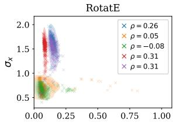

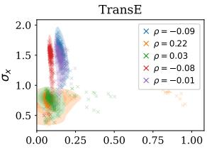

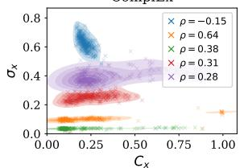

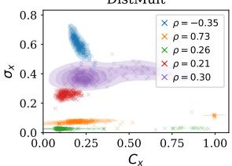  
Figure 4: Relationship between dispersion $( \sigma _ { \mathbf { x } } )$ and concentration $( C _ { \bf x } )$ of negative-score distributions during training with Self-Adv on FB15k237. Each color represents the evolution of the negative-score distribution for the same positive.

To quantify score concentration, we construct a probability distribution from the standardized negative scores:

$$
\pi _ { { \bf x } , i } = \frac { \exp ( z _ { { \bf x } , i } ) } { \sum _ { j \in N _ { { \bf x } , y ^ { + } } } \exp ( z _ { { \bf x } , j } ) } .\tag{14}
$$

We then define the concentration of probability mass on highscoring negatives using normalized entropy as

$$
C _ { \mathbf { x } } = 1 - \frac { H ( \pi _ { \mathbf { x } } ) } { \log |  { N _ { \mathbf { x } , y ^ { + } } } | } , \qquad H ( \pi _ { \mathbf { x } } ) = - \sum _ { i \in  { N _ { \mathbf { x } , y ^ { + } } } } \pi _ { \mathbf { x } , i } \log \pi _ { \mathbf { x } , i } ,\tag{15}
$$

where $C _ { \mathbf { x } } \in [ 0 , 1 ]$ . A larger $C _ { \mathbf { x } }$ indicates that high-score probability mass is concentrated on fewer negatives.

Finally, we interpolate between score dispersion and concentration to determine the weighting strength:

$$
w _ { { \bf x } , i } = \mathrm { s o f t m a x } _ { i } \left( \alpha \left[ ( 1 - \lambda ) \sigma _ { { \bf x } } + \lambda C _ { { \bf x } } \right] z _ { { \bf x } , i } \right) ,\tag{16}
$$

where $\lambda \in \left[ 0 , 1 \right]$ controls the contribution of score concentration. Analysis of dispersion and concentration. To further justify our design, we analyze the relationship between score dispersion $\sigma _ { \mathbf { x } }$ and concentration $C _ { \mathbf { x } }$ during training in Figure 4, where each point represents the negative-score distribution of a positive and each color tracks its evolution during training. The two characteristics are not strongly correlated (low ρ values) and exhibit distinct behaviors: concentration varies substantially while dispersion remains relatively stable for ComplEx and DistMult, whereas the opposite pattern appears for RotatE and TransE. These observations suggest that dispersion and concentration provide complementary information, motivating us to consider both in determining the anchor-specific weighting strength.

Budget-aware weight normalization. Unlike conventional weighting with a fixed negative budget, RADAR assigns different numbers of negatives to individual positives. Since the negative weights for each positive $( { \bf x } , y ^ { + } )$ are normalized as $\begin{array} { r } { \sum _ { i \in N _ { \mathbf { x } , u ^ { + } } } w _ { \mathbf { x } , i } = 1 } \end{array}$ , the average weight per negative becomes $1 / N ( { \bf x } , y ^ { + } )$ Consequently, a high-risk positive assigned a smaller negative budget can have larger weights on its fewer negatives. To control this effect, we introduce a budget-aware adjustment as follows:

$$
\widetilde { w } _ { { \bf x } , i } = \frac { | \mathcal { P } | N ( { \bf x } , y ^ { + } ) ^ { \beta } } { \sum _ { ( { \bf x } ^ { \prime } , y ^ { \prime } ) \in \mathcal { P } } N ( { \bf x } ^ { \prime } , y ^ { \prime } ) ^ { \beta } } w _ { { \bf x } , i } , \qquad \beta \ge 0 ,\tag{17}
$$

where $\beta$ controls the degree of weight adjustment according to the allocated negative budget. When $\beta = 0$ , negatives from smallerbudget positives have larger average weights due to the $1 / N ( { \bf x } , y ^ { + } )$ effect. $\operatorname { A s } { \beta }$ increases, the weights are adjusted according to the allocated budget: negatives from smaller-budget positives are downweighted, while those from larger-budget positives are up-weighted. In particular, when $\beta = 1$ , the effect of the budget size on the average per-negative weight is fully compensated, resulting in the same average per-negative weight across positives. Finally, the negative weights $\widetilde { w } _ { \mathbf { x } , i }$ computed by Eq. (17) are applied to the contrastive loss in $\operatorname { E q . } \left( 1 \right)$ to train the KGE model.

Connection to existing methods. RADAR generalizes two existing methods as special cases. With $\gamma = 0 , \beta = 0 ,$ and $\alpha = 0 _ { ; }$ RADAR reduces to the fixed-uniform method, using a fixed negative budget with uniform weighting. With $\gamma = 0 , \lambda = 0$ and $\beta = 0 ;$ RADAR reduces to Self-Adv, using a fixed negative budget with dispersiononly weighting. Thus, RADAR provides a unified generalization of existing fixed-budget negative sampling while adaptively controlling both the number and contribution of negative samples.

Overall, RADAR addresses the two fundamental challenges in contrastive learning with negative samples: it determines how many negatives to sample for each positive through risk-aware negative budget allocation and how much each negative should contribute through distribution-calibrated negative weighting.

## 5 Experimental Validation

In this section, we aim to answer the following evaluation questions:

• EQ1 (KGE Performance). To what extent does RADAR improve the performance of KGE models compared to existing methods?

• EQ2 (Training efficiency). How efficient is the training of RADAR compared to existing methods?

• EQ3 (Ablation study). How effective is each of our proposed strategy in improving the performance of RADAR?

• EQ4 (Sensitivity analysis). How sensitive is the performance of RADAR to its hyperparameters?

## 5.1 Experimental Setup

Datasets and KGE models. We evaluate RADAR with four KGE models, TransE [4], RotatE [29], DistMult [39], and ComplEx [32], on three widely used KGs, FB15k237 [31], WN18RR [10], and YAGO3- 10 [10]. Since RADAR is model-agnostic, it can be applied to any KGE models without modifying their underlying architectures. A detailed description of the datasets is provided in Appendix A.2.

Baselines. We compare RADAR with 15 contrastive learning methods that leverage negative samples: Uniform [4], KBGAN [5], Self-Adv [29], NSCaching [47], Uniform SANS [1], Uniform RW-SANS [1], Self-Adv SANS [1], Self-Adv RW-SANS [1], EANS [16], ERDNS [42], DeMix-Adv [9], M2ixKG [7], IF-NS [6], BigramKG [8], and ConDNS [36]. We use the official implementations for Self-Adv, SANS, EANS, ERDNS, and ConDNS. For the remaining six methods, we use their reported results (marked \*) since their code is unavailable or does

Table 1: KGE performance (MRR and H@10) comparison of RADAR with baselines. RADAR achieves the best average rank on all datasets. \* indicates results reported in the original works. Bold and underline indicate the best and the second-best results respectively. A.R. and OOM denote average rank and out of memory, respectively.
<table><tr><td rowspan="2">Dataset</td><td rowspan="2">Method</td><td colspan="2">RotatE</td><td colspan="2">TransE</td><td colspan="2">ComplEx</td><td colspan="2">DistMult</td><td rowspan="2">A.R.↓</td></tr><tr><td>MRR↑</td><td>H@10 ↑</td><td>MRR↑</td><td>H@10 ↑</td><td>MRR↑</td><td>H@10↑</td><td>MRR ↑</td><td>H@10 ↑</td></tr><tr><td rowspan="13">FB15k237</td><td>KBGAN* [NAACL&#x27;18] NSCaching* [ICDE&#x27;19]</td><td>30.9±N/A</td><td>48.6±N/A</td><td>29.4±N/A 30.0±N/A</td><td>49.7±N/A 47.4±N/A</td><td>28.2±N/A 30.2±N/A</td><td>45.4±N/A 48.1±N/A</td><td>26.7±N/A 28.3±N/A</td><td>45.3±N/A 45.6±N/A</td><td>11.5</td></tr><tr><td></td><td></td><td></td><td></td><td></td><td></td><td></td><td></td><td></td><td></td></tr><tr><td>DeMix-Adv* [ISWC&#x27;23]</td><td>32.9±N/A</td><td>51.8±N/A</td><td>31.8±N/A</td><td>51.0±N/A</td><td>30.7±N/A</td><td>47.9±N/A</td><td>30.1±N/A</td><td>47.0±N/A</td><td>9.2</td></tr><tr><td>M2ixKG* [NN&#x27;24]</td><td>33.7±N/A</td><td>53.2±N/A</td><td>33.1±N/A</td><td>52.9±N/A</td><td>32.3±N/A</td><td>51.6±N/A</td><td>31.7±N/A</td><td>50.3±N/A</td><td>4.1</td></tr><tr><td>IF-NS* [KBS&#x27;25]</td><td></td><td></td><td>31.0±N/A</td><td>48.9±N/A</td><td></td><td></td><td></td><td></td><td></td></tr><tr><td>BigramKG* [TKDE&#x27;25]</td><td>34.0±N/A</td><td>53.2±N/A</td><td>33.5±N/A</td><td>53.1±N/A</td><td>32.3±N/A</td><td>51.6±N/A</td><td>31.6±N/A</td><td>49.7±N/A</td><td>4.0</td></tr><tr><td>Uniform [NeurIPS&#x27;13]</td><td>29.5±0.1</td><td>47.9±0.1</td><td>29.3±0.0</td><td>48.1±0.1</td><td>27.2±0.1</td><td>43.2±0.1</td><td>25.5±0.0</td><td>40.4±0.1</td><td>14.6</td></tr><tr><td>Uniform SANS [EMNLP&#x27;20]</td><td>29.8±0.1</td><td>48.0±0.0</td><td>29.6±0.0</td><td>48.4±0.1</td><td>27.1±0.1</td><td>43.1±0.1</td><td>25.9±0.0</td><td>41.0±0.1</td><td>13.9</td></tr><tr><td>Uniform RW-SANS [EMNLP&#x27;20]</td><td>29.7±0.0</td><td>48.5±0.0</td><td>31.2±0.1</td><td>50.6±0.0</td><td>29.0±0.1</td><td>46.1±0.2</td><td>27.3±0.1</td><td>43.6±0.1</td><td>11.8</td></tr><tr><td>Self-Adv [ICLR&#x27;19]</td><td>33.6±0.0</td><td>53.1±0.1</td><td>33.0±0.1</td><td>52.7±0.1</td><td>32.2±0.0</td><td>51.1±0.1</td><td>30.7±0.0</td><td>48.4±0.0</td><td>6.9</td></tr><tr><td>Self-Adv SANS [EMNLP&#x27;20]</td><td>33.6±0.1</td><td>53.1±0.1</td><td>32.6±0.0</td><td>52.0±0.0</td><td>31.7±0.0</td><td>50.2±0.1</td><td>31.1±0.1</td><td>48.7±0.1</td><td>6.9</td></tr><tr><td>Self-Adv RW-SANS [EMNLP&#x27;20]</td><td>31.5±0.0</td><td>50.8±0.0</td><td>31.2±0.0</td><td>49.9±0.1</td><td>30.3±0.3</td><td>47.0±0.5</td><td>30.8±0.2</td><td>48.3±0.3</td><td>9.8</td></tr><tr><td>ERDNS [ISWC&#x27;23]</td><td>34.5±0.0</td><td>53.4±0.1</td><td>34.1±0.0</td><td>53.3±0.0</td><td>35.6±0.1</td><td>54.6±0.1</td><td>35.0±0.1</td><td>53.8±0.1</td><td>2.2</td></tr><tr><td>EANS [arXiv&#x27;22]</td><td>34.5±0.0 33.6±0.1</td><td>53.7±0.1</td><td>34.1±0.0</td><td>53.4±0.0</td><td>29.6±0.1</td><td>48.3±0.6</td><td>30.9±0.2</td><td>49.5±0.2</td><td>4.8</td></tr><tr><td>ConDNS [NC&#x27;25] RADAR (Ours)</td><td></td><td>53.1±0.1</td><td>32.9±0.1</td><td>52.7±0.1</td><td>32.3±0.1</td><td>51.1±0.1</td><td>30.8±0.0</td><td>48.5±0.1</td><td>6.4</td></tr><tr><td>KBGAN* [NAACL&#x27;18]</td><td></td><td>35.1±0.1 53.9±0.1</td><td>34.7±0.0</td><td>53.4±0.1</td><td>35.7±0.1</td><td>54.4±0.1</td><td>35.4±0.1</td><td>54.0±0.1</td><td>1.2</td></tr><tr><td>NSCaching* [ICDE&#x27;19]</td><td></td><td>47.1±N/A</td><td>18.6±N/A</td><td>45.4±N/A</td><td>42.9±N/A</td><td>47.0±N/A</td><td>38.5±N/A</td><td>44.3±N/A</td><td></td></tr><tr><td>DeMix-Adv* [ISWC&#x27;23]</td><td></td><td>55.3±N/A</td><td>20.0±N/A</td><td>47.8±N/A</td><td>44.6±N/A</td><td>50.9±N/A</td><td>41.3±N/A</td><td>45.5±N/A</td><td>12.6</td></tr><tr><td>M2ixKG* [NN&#x27;24]</td><td> $4 7 . 9 { \pm } \mathrm { N } / \mathrm { A }$  47.7±N/A</td><td>57.6±N/A</td><td>22.0±N/A</td><td>52.1±N/A</td><td>46.8±N/A</td><td>55.2±N/A</td><td>43.9±N/A</td><td>53.5±N/A</td><td>6.6</td></tr><tr><td></td><td></td><td>57.5±N/A</td><td>23.0±N/A</td><td>54.1±N/A</td><td>47.4±N/A</td><td>56.2±N/A</td><td>44.6±N/A</td><td>54.1±N/A</td><td>4.1</td></tr><tr><td>IF-NS* [KBS&#x27;25]</td><td></td><td></td><td>23.6±N/A</td><td>50.9±N/A</td><td></td><td></td><td></td><td></td><td></td></tr><tr><td>BigramKG* [TKDE&#x27;25]</td><td>47.7±N/A</td><td>57.3±N/A</td><td>22.3±N/A</td><td>52.9±N/A</td><td>47.3±N/A</td><td>56.8±N/A</td><td>44.3±N/A</td><td>54.3±N/A</td><td>5.7</td></tr><tr><td>Uniform [NeurIPS&#x27;13]</td><td>47.5±0.1</td><td>55.7±0.4</td><td>20.5±0.0</td><td>50.0±0.1</td><td>46.3±0.2</td><td>53.8±0.2</td><td>42.8±0.2</td><td>52.6±0.1</td><td>10.8</td></tr><tr><td>Uniform SANS [EMNLP&#x27;20]</td><td>47.8±0.0</td><td>56.0±0.2</td><td>20.5±0.0</td><td>50.0±0.1</td><td>42.7±0.2</td><td>47.6±0.3</td><td>41.2±0.3</td><td>47.7±1.1</td><td>11.4</td></tr><tr><td>Uniform RW-SANS [EMNLP&#x27;20]</td><td>48.0±0.1</td><td>56.8±0.2</td><td>21.9±0.0</td><td>51.0±0.2</td><td>40.7±0.3</td><td>43.6±0.2</td><td>41.8±0.2</td><td>49.9±0.2</td><td>10.0</td></tr><tr><td>Self-Adv [ICLR&#x27;19]</td><td> $4 7 . 7 { \pm } 0 . 1 $ </td><td>56.3±0.5</td><td>22.5±0.1</td><td>53.2±0.1</td><td>46.8±0.1</td><td>55.5±0.1</td><td>43.9±0.1</td><td>53.3±0.1</td><td>6.9</td></tr><tr><td>Self-Adv ŠANS [EMNLP&#x27;20]</td><td>47.7±0.1</td><td>56.0±0.2</td><td>22.5±0.1</td><td>53.1±0.1</td><td>37.5±0.4</td><td>40.0±0.5</td><td>38.2±0.4</td><td>42.6±0.5</td><td>11.6</td></tr><tr><td>Self-Adv RW-SANS [EMNLP&#x27;20]</td><td>48.2±0.1</td><td>57.2±0.2</td><td>22.3±0.3</td><td>51.1±0.4</td><td>23.0±0.2</td><td>34.4±0.1</td><td>40.0±0.4</td><td>45.1±0.3</td><td>10.6</td></tr><tr><td>ERDNS [ISWC&#x27;23]</td><td>47.7±0.1</td><td>56.5±0.4</td><td>23.9±0.0</td><td>53.2±0.1</td><td>48.4±0.1</td><td>55.7±0.2</td><td>45.5±0.1</td><td>54.8±0.3</td><td>4.4</td></tr><tr><td>EANS [arXiv&#x27;22]</td><td> $4 8 . 8 { \pm } 0 . 0 $ </td><td>57.7±0.1</td><td>22.9±0.0</td><td>53.4±0.1</td><td>45.6±0.1</td><td>53.4±0.1</td><td>43.1±0.1</td><td>51.8±0.1</td><td>5.9</td></tr><tr><td>ConDNS [NC&#x27;25] RADAR (Ours)</td><td> $\overline { { 4 7 . 8 } } \pm 0 . 1$ </td><td>56.3±0.6</td><td>22.5±0.0</td><td>53.1±0.1</td><td>46.9±0.1</td><td>55.8±0.1</td><td>43.9±0.1</td><td>53.2±0.3</td><td>6.4</td></tr><tr><td>Uniform</td><td></td><td></td><td>58.2±0.2</td><td>25.9±0.0</td><td>55.1±0.1</td><td>49.4±0.1</td><td>57.4±0.1</td><td>46.0±0.1</td><td>54.9±0.1</td><td>1.0</td></tr><tr><td>YAGO3-10</td><td>[NeurIPS&#x27;13]</td><td>49.0±0.2</td><td>64.7±0.1</td><td>41.2±0.1</td><td>63.8±0.1</td><td>39.6±0.3</td><td>54.5±0.2</td><td>36.3±0.2</td><td>49.7±0.2</td><td>6.2</td></tr><tr><td></td><td></td><td>44.7±0.1</td><td>OOM</td><td>OOM</td><td>OOM</td><td>OOM</td><td>OOM</td><td>OOM</td><td>OOM</td><td></td></tr><tr><td></td><td>Uniform SANS [EMNLP&#x27;20]</td><td>OOM</td><td></td><td></td><td></td><td></td><td>32.7±0.9</td><td>7.1±0.3</td><td></td><td>7.6</td></tr><tr><td></td><td>Uniform RW-SANS [EMNLP&#x27;20]</td><td>42.0±0.1</td><td>60.1±0.2</td><td>40.1±0.1</td><td>59.4±0.2</td><td>19.4±1.4</td><td></td><td></td><td>18.7±0.9</td><td></td></tr><tr><td></td><td>Self-Adv [ICLR&#x27;19]</td><td>49.6±0.1</td><td>67.2±0.1 OOM</td><td>50.3±0.1 OOM</td><td>67.9±0.2 OOM</td><td>48.5±0.2 O0M</td><td>66.2±0.2 OOM</td><td>46.6±0.1 OOM</td><td>64.5±0.1 OOM</td><td>2.7</td></tr><tr><td></td><td>Self-Adv ŠANS [EMNLP&#x27;20] Self-Adv RW-SANS [EMNLP&#x27;20]</td><td>OOM 41.8±0.2</td></table>

UniformUniform SANSUniform RW-SANSERDNS.ConDNS -. Self-Adv -- Self-Adv SANS . Self-Adv RW-SANS -- EANSRADAR

not reproduce the reported performance; these results are unavailable for YAGO3-10. Baseline details are provided in Appendix A.3. Evaluation protocol. Following [29, 30], we use two metrics: mean reciprocal rank (MRR) and Hits@10 (H@10), reported as percentages (%). We adopt the filtered setting [4] and tie-breaking protocol [30]. We run all experiments with five different random seeds and report the mean performance with standard deviation. Implementation details are provided in Appendix A.1.

## 5.2 EQ1. KGE Performance

Overall performance. Table 1 shows that RADAR consistently improves the performance of four KGE models across all three KGs. Compared with Uniform, RADAR improves both MRR and H@10 in every model-KG combination, demonstrating the benefit of addressing the two challenges, i.e., negative budget allocation and importance estimation, is beneficial to improving KGE performance. Moreover, RADAR achieves the best average rank (A.R.) on all three KGs, verifying consistent advantages over all baseline methods. Notably, on WN18RR, RADAR ranks first on all eight model-metric combinations, with an A.R. of 1.0 compared with 4.1 for the second-best method. These results demonstrate the importance of the challenges identified in this work and the effectiveness of RADAR in addressing them.

Analysis of false-negative sampling risk. To further analyze the performance improvement, we examine how many false negatives (FNs) are sampled by each method during training. Figure 5 shows the average number of sampled FNs per positive during training on FB15k237 and WN18RR, where a sampled negative is regarded as an FN if it appears as a positive in the validation or test set. RADAR consistently samples far fewer FNs than all baselines on both KGs, providing empirical support for our observed-degree-based measure of false-negative risk. Together with the performance gains in Table 1, this result suggests that our risk-aware budget allocation strategy effectively mitigates FN sampling, thereby contributing to improved KGE performance.

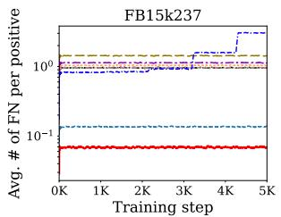

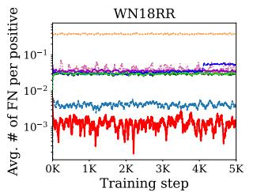  
Figure 5: The average number of false negatives sampled per positive during training $( N _ { m a x } = 2 5 6 )$ . RADAR consistently samples the fewest false negatives among all baselines.

Performance by relation cardinality. We further analyze the performance (MRR) of each method across 1-to-1, 1-to-N, N-to-1, and

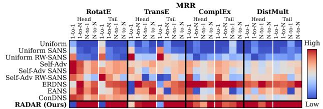  
Figure 6: KGE performance across relation cardinality categories for head and tail prediction. RADAR performs strongly on multi-valued relations.

N-to-N relation cardinality categories, following [37]. As shown in Figure 6, KGE models with RADAR outperform the baselines across 1-to-N, N-to-1, and N-to-N relations, where multiple true targets increase the risk of sampling FNs, supporting the effectiveness of our risk-aware budget allocation for such multi-valued relations. The improvement is less consistent for 1-to-1 relations, which have lower FN risk and account for the fewest triples among the four relation categories (1.6% of the total), thus having a smaller impact on overall performance. Detailed statistics and results for all datasets and KGE models are provided in Appendix A.5.

## 5.3 EQ2. Training Efficiency

Performance-efficiency trade-off. In this experiment, we evaluate the training efficiency of RADAR by comparing performance (MRR) against training time. As shown in Figure 7, RADAR achieves the highest performance while reaching its peak performance faster than all baselines across both KGE models and datasets. This indicates that our risk-aware negative budget allocation does not simply accelerate training by reducing the number of negatives, but also retains sufficient contrastive supervision for effective KGE training. By adaptively allocating negative budgets, RADAR reduces the processing of potentially adverse negatives (i.e., high-risk negatives) while preserving effective learning signals, thereby achieving a favorable accuracy-efficiency trade-off. Results for all KGE models and datasets are provided in Appendix A.6.

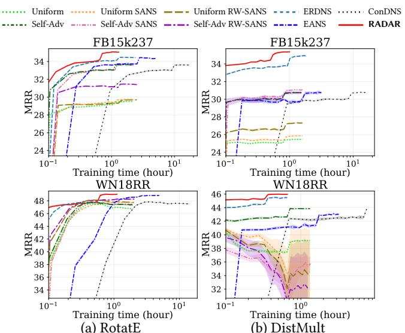  
Figure 7: Performance-efficiency trade-off of RotatE and DistMult with each method on two KGs. RADAR achieves the highest performance in the shortest training time.

Table 2: Training time (TT) and GPU memory cost (MC) of RotatE with each method on FB15k237.
<table><tr><td>Method</td><td>TT↓</td><td>Gain</td><td>MC↓</td><td>Gain</td><td>MRR ↑</td></tr><tr><td>Uniform</td><td>1h 40m</td><td>0.0%</td><td>7.5GB</td><td>0.0%</td><td>29.5</td></tr><tr><td>Uniform SANS</td><td>1h 40m</td><td>0.0%</td><td>7.5GB</td><td>0.0%</td><td>29.8</td></tr><tr><td>Uniform RW-SANS</td><td>1h 40m</td><td>0.0%</td><td>7.5GB</td><td>0.0%</td><td>29.7</td></tr><tr><td>Self-Adv</td><td>1h 40m</td><td>0.0%</td><td>7.5GB</td><td>0.0%</td><td>33.6</td></tr><tr><td>Self-Adv SANS</td><td>1h 40m</td><td>0.0%</td><td>7.5GB</td><td>0.0%</td><td>33.6</td></tr><tr><td>Self-Adv RW-SANS</td><td>1h 40m</td><td>0.0%</td><td>7.5GB</td><td>0.0%</td><td>31.5</td></tr><tr><td>ERDNS</td><td>1h 55m</td><td>+15.0%</td><td>7.5GB</td><td>0.0%</td><td>34.5</td></tr><tr><td>EANS</td><td>4h 25m</td><td>+165.0%</td><td>13.4GB</td><td>+78.2%</td><td>34.5</td></tr><tr><td>ConDNS</td><td>15h 50m</td><td>+850.0%</td><td>7.6GB</td><td>+0.5%</td><td>33.6</td></tr><tr><td>RADAR</td><td>1h 10m</td><td>-30.0%</td><td>5.0GB</td><td>-34.2%</td><td>35.0</td></tr></table>

Analysis of training resources. To further analyze the efficiency gains, we measure training time and GPU memory cost of RotatE on FB15k237. For a fair comparison, we use the same number of positives |P| = 1024, maximum negative budget $N _ { m a x } = 2 5 6 .$ and embedding dimension of 1000. As shown in Table 2, RADAR reduces training time and memory cost by 30.0% and 34.2%, respectively, compared with Uniform and Self-Adv, while achieving the highest MRR. Moreover, unlike three baselines that incur additional computational and memory overhead, RADAR achieves these reductions through its adaptive negative budgets without introducing costly auxiliary procedures. These results verify that our risk-aware negative budget allocation improves not only KGE performance but also training efficiency.

## 5.4 EQ3. Ablation Study

In this experiment, we verify the effectiveness of the two proposed components of RADAR: risk-aware negative budget allocation (RA) for (C1) and distribution-calibrated negative weighting (DW) for (C2). We compare RADAR with the following ablated variants:

• w/o RA: uses a fixed negative budget (γ = 0), while applying our distribution-calibrated weighting.

• w/o DW: uses our risk-aware negative budget allocation, but assigns uniform weights to all negatives (α = 0).

Effectiveness of individual strategies. Table 3 shows that removing either component degrades KGE performance in all modeldataset combinations, demonstrating that both RA and DW contribute to the effectiveness of RADAR. Without RA, MRR decreases by 1.6–8.4% (4.5% on average), validating the benefit of adapting the negative budget to false-negative risk. Without DW, MRR decreases by 2.5%-27.9% (11.0% on average), with the larger degradation indicating that effective weighting remains crucial even after the negative budget is adapted to reduce false-negative risk.

Table 3: Ablation study of RADAR. Ablating either of our strategies consistently degrades KGE performance.
<table><tr><td>Dataset</td><td>Method</td><td>RotatE</td><td>TransE</td><td>ComplEx</td><td>DistMult</td></tr><tr><td rowspan="3">FB15k237</td><td>RADAR</td><td>35.1</td><td>34.7</td><td>35.7</td><td>35.4</td></tr><tr><td>w/o RA</td><td>34.1 (-2.7%)</td><td>33.7 (-2.7%)</td><td>34.2 (-4.2%)</td><td>32.8 (-7.4%)</td></tr><tr><td>w/o DW</td><td>33.1 (-5.5%)</td><td>32.5 (-6.2%)</td><td>31.7 (-11.1%)</td><td>31.0 (-12.4%)</td></tr><tr><td rowspan="3">WN18RR</td><td>RADAR</td><td>49.0</td><td>25.9</td><td>49.4</td><td>46.0</td></tr><tr><td>w/o RA</td><td>47.8 (-2.5%)</td><td>23.8 (-8.4%)</td><td>47.7 (-3.6%)</td><td>44.5 (-3.1%)</td></tr><tr><td>w/o DW</td><td>47.8 (-2.5%)</td><td>23.7 (-8.4%)</td><td>47.4 (-4.2%)</td><td>44.2 (-4.1%)</td></tr><tr><td rowspan="3">YAGO3-10</td><td>RADAR</td><td>50.8</td><td>51.8</td><td>54.5</td><td>53.0</td></tr><tr><td>w/o RA</td><td>50.0 (-1.6%)</td><td>50.5 (-2.5%)</td><td>50.8 (-6.9%)</td><td>48.5 (-8.3%)</td></tr><tr><td>w/o DW</td><td>45.0 (-11.4%)</td><td>42.8 (-17.4%)</td><td>42.8 (-21.4%)</td><td>38.2 (-27.9%)</td></tr></table>

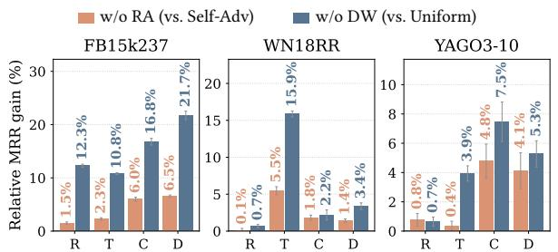  
Figure 8: Relative MRR gains over the corresponding counterparts, Self-Adv and Uniform. $\mathbf { R } , \mathbf { T } , \mathbf { C } ,$ and D denote RotatE, TransE, ComplEx, and DistMult, respectively.

Relative performance over existing counterparts. We further analyze the effectiveness of each proposed strategy by comparing its relative performance against the corresponding existing counterpart. Specifically, w/o RA uses the same fixed budget as Self-Adv but retains our DW, thereby isolating the effect of distributioncalibrated weighting. Conversely, w/o DW uses the same uniform weighting as Uniform but retains our RA, thereby isolating the effect of risk-aware budget allocation. As shown in Figure 8, w/o RA consistently outperforms Self-Adv, showing that incorporating score concentration in addition to dispersion provides more effective negative weighting. This supports our motivation that dispersion and concentration capture complementary characteristics of negative-score distributions. Moreover, w/o DW yields even larger gains over Uniform across all model-dataset combinations, despite using the same uniform weighting. This demonstrates that adapting the negative budget according to false-negative risk alone provides substantial performance gains, further validating the importance of risk-aware negative budget allocation.

## 5.5 EQ4. Sensitivity Analysis

In this experiment, we analyze the sensitivity of RADAR to its hyperparameters, γ, λ, and β. For each analysis, we vary one hyperparameter while fixing the others to their default values. Detailed settings and additional sensitivity analyses for the adjustment parameters τ and ω are provided in Appendix A.4.

Sensitivity to y. The hyperparameter γ controls the degree of adapting the negative budget to false-negative risk, where $\gamma = 0$ corresponds to a fixed negative budget and a larger γ reduces the budget for higher-risk positives more. As shown in the top row of Figure 9, the best performance is consistently achieved with $\gamma > 0$ across all KGE models and datasets, validating the benefit of adapting the negative budget according to false-negative risk rather than using a fixed budget. Performance tends to improve as y increases, with the best results typically observed around $\gamma = 0 . 6 -$ 1.0. On YAGO3-10, however, performance tends to peak around $\gamma = 0 . 6$ and then decrease, suggesting that overly aggressive budget reduction can discard useful negative supervision.

Sensitivity to λ. The hyperparameter λ balances score dispersion $\sigma _ { \mathbf { x } }$ and concentration $C _ { \mathbf { x } }$ in our distribution-calibrated weighting, where λ = 0 considers only dispersion and $\lambda = 1$ considers only concentration. Across most settings, performance initially improves

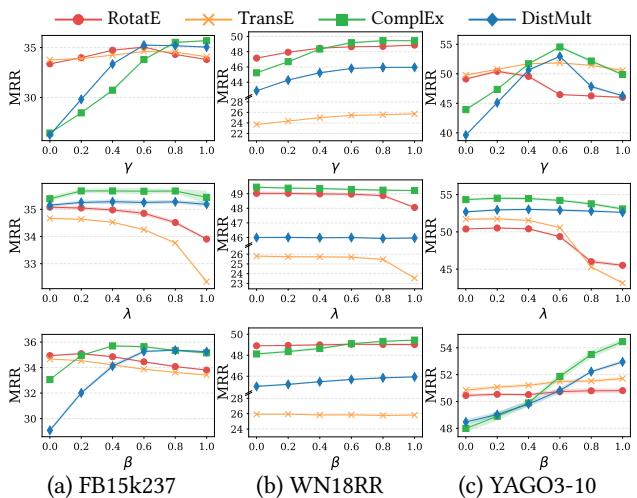  
Figure 9: Hyperparameter sensitivity analysis of RADAR.  
as λ increases and then decreases at larger values, with the best performance generally achieved at intermediate values. This indicates that neither dispersion nor concentration alone is sufficient and supports our design of jointly considering both characteristics when determining negative weights.

Sensitivity to $\beta .$ The hyperparameter $\beta$ controls budget-aware weight normalization, where $\beta = 0$ applies no normalization and increasing β compensates for the larger average per-negative weights induced by smaller budgets. Performance tends to improve as $\beta$ increases, indicating that assigning excessively large weights to negatives from smaller-budget, higher-risk positives can be detrimental. This result supports the necessity of our normalization strategy for mitigating unintended weight amplification caused by adaptive negative budgets.

## 6 Conclusion and Future Work

In this work, we identify two fundamental yet underexplored challenges in contrastive learning with negative samples for KGE: (C1) negative budget allocation and (C2) negative importance estimation. To effectively address these challenges, we propose RADAR, which employs (1) risk-aware negative budget allocation and (2) distribution-calibrated negative weighting. The former adaptively determines the negative budget based on false-negative sampling risk, while the latter calibrates negative contributions to learning based on two complementary characteristics of the negative-score distribution: dispersion and concentration. Extensive experiments with four KGE models on three real-world KGs demonstrate that RADAR (1) achieves the best average KGC performance, (2) improves training efficiency, and (3) benefits from both proposed strategies, which provide complementary gains.

While these results demonstrate the effectiveness of RADAR several aspects remain open for further works. Our analysis (Section 4.1) assumes uniform observability and shared entity and relation sets between open- and closed-world $\operatorname { K G s } ;$ extending it to heterogeneous observability and inductive settings with unseen entities or relations is an important direction for future work. Moreover, while RADAR focuses on determining the negative budget and weights, jointly optimizing the negative sampling strategy itself could further improve negative selection.

## References

[1] Kian Ahrabian, Aarash Feizi, Yasmin Salehi, William L Hamilton, and Avishek Joey Bose. Structure aware negative sampling in knowledge graphs. In Proceedings of the 2020 Conference on Empirical Methods in Natural Language Processing (EMNLP), pages 6093–6101, 2020.

[2] Ivana Balazevic, Carl Allen, and Timothy Hospedales. Tucker: Tensor factorization for knowledge graph completion. In Proceedings of the 2019 Conference on Empirical Methods in Natural Language Processing and the 9th International Foint Conference on Natural Language Processing (EMNLP-IFCNLP), pages 5185–5194, Hong Kong, China, nov 2019. Association for Computational Linguistics. doi: 10.18653/v1/D19-1522. URL https://aclanthology.org/D19-1522/.

[3] Kurt Bollacker, Colin Evans, Praveen Paritosh, Tim Sturge, and Jamie Taylor. Freebase: a collaboratively created graph database for structuring human knowledge In Proceedings of the 2008 ACM SIGMOD International Conference on Management of Data, pages 1247–1250, 2008.

[4] Antoine Bordes, Nicolas Usunier, Alberto Garcia-Duran, Jason Weston, and Oksana Yakhnenko. Translating embeddings for modeling multi-relational data. In Advances in Neural Information Processing Systems, volume 26, 2013.

[5] Liwei Cai and William Yang Wang. Kbgan: Adversarial learning for knowledge graph embeddings. In Proceedings of the 2018 conference of the North American chapter of the association for computational linguistics: human language technologies, volume 1 (long papers), pages 1470–1480, 2018.

[6] Ming Cai, Zhuolin Deng, and Chen Xiong. If-ns: A new negative sampling framework for knowledge graph embedding using influence function. Knowledge-Based Systems, 315:113258, 2025.

[7] Feihu Che and Jianhua Tao. M2ixkg: Mixing for harder negative samples in knowledge graph. Neural Networks, 177:106358, 2024.

[8] Feihu Che, Jianhua Tao, and Qionghai Dai. Hard or false: Keep the balance for negative sampling in knowledge graphs. IEEE Transactions on Knowledge and Data Engineering, 2025.

[9] Xiangnan Chen, Wen Zhang, Zhen Yao, Mingyang Chen, and Siliang Tang. Negative sampling with adaptive denoising mixup for knowledge graph embedding. In International semantic web conference, pages 253–270. Springer, 2023.

[10] Tim Dettmers, Pasquale Minervini, Pontus Stenetorp, and Sebastian Riedel. Convolutional 2d knowledge graph embeddings. In Proceedings of the AAAI Conference on Artificial Intelligence, 2018.

[11] Xin Dong, Evgeniy Gabrilovich, Geremy Heitz, Wilko Horn, Ni Lao, Kevin Murphy, Thomas Strohmann, Shaohua Sun, and Wei Zhang. Knowledge vault: A web-scale approach to probabilistic knowledge fusion. In Proceedings of the 20th ACM SIGKDD international conference on Knowledge discovery and data mining, pages 601–610, 2014.

[12] Luis Galárraga, Simon Razniewski, Antoine Amarilli, and Fabian M Suchanek. Predicting completeness in knowledge bases. In Proceedings of the tenth acm international conference on web search and data mining, pages 375–383, 2017.

[13] Michael Gutmann and Aapo Hyvärinen. Noise-contrastive estimation: A new estimation principle for unnormalized statistical models. In Proceedings of the thirteenth international conference on artificial intelligence and statistics, pages 297–304. JMLR Workshop and Conference Proceedings, 2010.

[14] Xiao Huang, Jingyuan Zhang, Dingcheng Li, and Ping Li. Knowledge graph embedding based question answering. In Proceedings of the twelfth ACM international conference on web search and data mining, pages 105–113, 2019.

[15] Roshni G Iyer, Yunsheng Bai, Wei Wang, and Yizhou Sun. Dual-geometric space embedding model for two-view knowledge graphs. In Proceedings of the 28th ACM SIGKDD conference on knowledge discovery and data mining, pages 676-686, 2022.

[16] Sang-Hyun Je. Entity aware negative sampling with auxiliary loss of false negative prediction for knowledge graph embedding. arXiv preprint arXiv:2210.06242, 2022.

[17] Hidetaka Kamigaito and Katsuhiko Hayashi. Comprehensive analysis of negative sampling in knowledge graph representation learning. In International Conference on Machine Learning, pages 10661–10675. PMLR, 2022.

[18] Rui Li, Jianan Zhao, Chaozhuo Li, Di He, Yiqi Wang, Yuming Liu, Hao Sun, Senzhang Wang, Weiwei Deng, Yanming Shen, et al. House: Knowledge graph embedding with householder parameterization. In International Conference on Machine Learning, pages 13209–13224. PMLR, 2022.

[19] Zhifei Li, Wei Huang, Xuchao Gong, Xiangyu Luo, Kui Xiao, Honglian Deng, Miao Zhang, and Yan Zhang. Decoupled semantic graph neural network for knowledge graph embedding. Neurocomputing, 611:128614, 2025.

[20] Linhao Luo, Zicheng Zhao, Reza Haffari, Dinh Phung, Chen Gong, and Shirui Pan. Gfm-rag: graph foundation model for retrieval augmented generation. In Advances in Neural Information Processing Systems, volume 38, pages 36371– 36405,2026.

[21] Farzaneh Mahdisoltani, Joanna Biega, and Fabian M Suchanek. Yago3: A knowledge base from multilingual wikipedias. In CIDR, 2013.

[22] Sameh K Mohamed, Aayah Nounu, and Vít Nováček. Biological applications of knowledge graph embedding models. Briefings in bioinformatics, 22(2):1679–1693, 2021.

[23] Sooho Moon and Yunyong Ko. How sharp and bias-robust is a model? dual evaluation perspectives on knowledge graph completion. In Proceedings of the nineteenth ACM international conference on web search and data mining, 2026.

[24] Sooho Moon, Jian Kang, and Yunyong Ko. Generalized rank-based evaluation for knowledge graph completion: Perspectives, framework, and analyses. arXiv preprint arXiv:2606.08921, 2026.

[25] Natasha Noy, Yuqing Gao, Anshu Jain, Anant Narayanan, Alan Patterson, and Jamie Taylor. Industry-scale knowledge graphs: lessons and challenges. Communications of the ACM, 62(8):36–43, 2019.

[26] Joshua Robinson, Ching-Yao Chuang, Suvrit Sra, and Stefanie Jegelka. Contrastive learning with hard negative samples. arXiv preprint arXiv:2010.04592, 2020.

[27] Tengwei Song, Long Yin, Zhen Han, and Zhiqiang Xu. Improving enzyme prediction with chemical reaction equations by hypergraph-enhanced knowledge graph embeddings. In Proceedings of the 32nd ACM SIGKDD Conference on Knowledge Discovery and Data Mining V. 1, pages 1309–1320, 2026.

[28] Fabian M Suchanek, Gjergji Kasneci, and Gerhard Weikum. Yago: a core of semantic knowledge. In Proceedings of the 16th International Conference on World Wide Web, pages 697–706, 2007.

[29] Zhiqing Sun, Zhi-Hong Deng, Jian-Yun Nie, and Jian Tang. Rotate: Knowledge graph embedding by relational rotation in complex space. In International Conference on Learning Representations (ICLR), 2019. URL https://openreview. net/forum?id=HkgEQnRqYQ

[30] Zhiqing Sun, Shikhar Vashishth, Soumya Sanyal, Partha Talukdar, and Yiming Yang. A re-evaluation of knowledge graph completion methods. In Proceedings of the 58th Annual Meeting of the Association for Computational Linguistics, pages 5516–5522, Online, jul 2020. Association for Computational Linguistics. doi: 10.18653/v1/2020.acl-main.489. URL https://aclanthology.org/2020.acl-main.489/.

[31] Kristina Toutanova and Danqi Chen. Observed versus latent features for knowledge base and text inference. In Proceedings of the 3rd Workshop on Continuous Vector Space Models and Their Compositionality, pages 57–66, 2015.

[32] Théo Trouillon, Johannes Welbl, Sebastian Riedel, Éric Gaussier, and Guillaume Bouchard. Complex embeddings for simple link prediction. In Proceedings of International Conference on Machine Learning, pages 2071–2080. PMLR, 2016.

[33] Hongwei Wang, Fuzheng Zhang, Miao Zhao, Wenjie Li, Xing Xie, and Minyi Guo. Multi-task feature learning for knowledge graph enhanced recommendation. In The world wide web conference, pages 2000–2010, 2019.

[34] Hongwei Wang, Miao Zhao, Xing Xie, Wenjie Li, and Minyi Guo. Knowledge graph convolutional networks for recommender systems. In The world wide web conference, pages 3307–3313, 2019.

[35] Yingheng Wang, Yaosen Min, Xin Chen, and Ji Wu. Multi-view graph contrastive representation learning for drug-drug interaction prediction. In Proceedings of the web conference 2021, pages 2921–2933, 2021.

[36] Zhaorongjie Wang, Nan Li, Kai Chen, Aiping Li, and Liqun Gao. Condns: A novel conditional diffusion-based negative sampling method for knowledge graph embedding. Neurocomputing, page 131751, 2025.

[37] Zhen Wang, Jianwen Zhang, Jianlin Feng, and Zheng Chen. Knowledge graph embedding by translating on hyperplanes. In Proceedings of the AAAI conference on artificial intelligence, 2014.

[38] Changyi Xiao and Yixin Cao. Knowledge graph completion by intermediate variables regularization. Advances in Neural Information Processing Systems, 37: 110218-110245,2024

[39] Bishan Yang, Wen-tau Yih, Xiaodong He, Jianfeng Gao, and Li Deng. Embedding entities and relations for learning and inference in knowledge bases. In Proceedings of International Conference on Learning Representations (ICLR), Poster Track, 2015. URL https://arxiv.org/abs/1412.6575.

[40] Haotong Yang, Zhouchen Lin, and Muhan Zhang. Rethinking knowledge graph evaluation under the open-world assumption. In Advances in Neural Information Processing Systems, volume 35, pages 8374–8385, 2022.

[41] Zhen Yang, Ming Ding, Tinglin Huang, Yukuo Cen, Junshuai Song, Bin Xu, Yuxiao Dong, and Jie Tang. Does negative sampling matter? a review with insights into its theory and applications. IEEE Transactions on Pattern Analysis and Machine Intelligence, 46(8):5692–5711, 2024.

[42] Naimeng Yao, Qing Liu, Yi Yang, Weihua Li, and Quan Bai. Entity-relation distribution-aware negative sampling for knowledge graph embedding. In International Semantic Web Conference, pages 234–252. Springer, 2023.

[43] Michihiro Yasunaga, Hongyu Ren, Antoine Bosselut, Percy Liang, and Jure Leskovec. Qa-gnn: Reasoning with language models and knowledge graphs for question answering. In Proceedings of the 2021 Conference of the North American Chapter of the Association for Computational Linguistics: Human Language Technologies, pages 535–546, 2021.

[44] Michihiro Yasunaga, Antoine Bosselut, Hongyu Ren, Xikun Zhang, Christopher D Manning, Percy S Liang, and Jure Leskovec. Deep bidirectional languageknowledge graph pretraining. In Advances in Neural Information Processing Systems, volume 35, pages 37309–37323, 2022.

[45] Xiangxiang Zeng, Xinqi Tu, Yuansheng Liu, Xiangzheng Fu, and Yansen Su. Toward better drug discovery with knowledge graph. Current Opinion in Structural Biology, 72:114–126, 2022.

[46] Yongqi Zhang and Quanming Yao. Knowledge graph reasoning with relational digraph. In Proceedings of the ACM web conference 2022, pages 912–924, 2022.

[47] Yongqi Zhang, Quanming Yao, Yingxia Shao, and Lei Chen. Nscaching: simple and efficient negative sampling for knowledge graph embedding. In 2019 IEEE 35th International Conference on Data Engineering (ICDE), pages 614–625. IEEE 2019.

[48] Zhaocheng Zhu, Zuobai Zhang, Louis-Pascal Xhonneux, and Jian Tang. Neural bellman-ford networks: A general graph neural network framework for link prediction. Advances in neural information processing systems, 34:29476-29490, 2021.

## A Appendix

## A.1 Implementation Details

The implementation details of our experiments are as follows:

• System configurations: We run all experiments on a machine with an NVIDIA RTX 5000 PRO GPU, with dual Intel Xeon Gold 6526Y CPUs (32 physical cores, 64 threads in total) with 256 GB of main memory.

• Training: We tune hyperparameters and select the configuration with the highest validation MRR. Each model is trained for 100K steps and evaluated every 5K steps. We decay the learning rate by 10% after 50K steps. For a fair comparison, all baselines are trained under the same hardware environment and memory configuration. For reproducibility, we release the code, datasets, and complete hyperparameter settings at https://anonymous. 4open.science/r/KGENS-1EB6/.

• Evaluation: We adopt the standard filtered setting [4] alongside the tie-breaking protocol from Sun et al. [30] when computing rank-based metrics. Under the filtered setting, candidate triples that exist as ground-truth facts in the dataset (other than the target entity) are excluded during ranking. Under the tie-breaking protocol, if n entities obtain a strictly higher score than the target entity and m entities receive the same score, the final rank is calculated as n + m+1 in order to resolve identical scores fairly 2 and prevent overestimation [30].

## A.2 Description of Datasets

We use the following three real-world KGs in our experiments.   
Table 4 summarizes their statistics.

• FB15k237 [31]: A subset of Freebase [3] containing real-world facts across diverse domains, such as people, locations, and organizations. It removes inverse relations from FB15k to prevent information leakage.

• WN18RR [10]: A subset of WordNet, a lexical knowledge base representing semantic relationships between words, such as hypernymy and derivational relations. It removes inverse relations from WN18.

• YAGO3-10 [10]: A subset of YAGO3 [21, 28], a large-scale knowledge graph primarily constructed from Wikipedia, containing factual relationships among real-world entities.

Table 4: Statistics of three KGs used in our experiments.
<table><tr><td></td><td>|ε|</td><td>|R|</td><td>T</td></tr><tr><td>FB15k237</td><td>14,541</td><td>237</td><td>272,115</td></tr><tr><td>WN18RR</td><td>40,943</td><td>11</td><td>86,835</td></tr><tr><td>YAGO3-10</td><td>123,182</td><td>37</td><td>1,079,040</td></tr></table>

## A.3 Description of Baselines

We compare 15 baselines with RADAR in our experiments.

• Uniform Sampling [4] randomly corrupts the head or tail entity of a positive triple using a uniformly sampled entity. While efficient, it often produces trivial negatives.

• KBGAN [5] employs an adversarial framework where a generator selects challenging negatives for a discriminator.

• NSCaching [47] maintains dynamically updated caches of highscoring negatives, balancing exploration and exploitation.

• Self-Adv [29] weights uniformly sampled negatives using a temperature-controlled softmax over model scores, emphasizing harder negatives.

• SANS and RW-SANS [1] sample structurally relevant negatives from k-hop neighborhoods and their random-walk approximations, respectively. We combine each with Uniform and Self-Adv weighting, resulting in four more variants: Uniform SANS, Uniform RW-SANS, Self-Adv SANS, and Self-Adv RW-SANS.

• EANS [16] exploits embedding similarity by reorganizing entity indices and applying Gaussian sampling to select nearby negatives, with an auxiliary loss for false-negative mitigation.

• ERDNS [42] allocates a fixed negative budget via multinomial sampling based on entity-relation frequencies, motivated by optimal embedding analysis [17].

• DeMix-Adv [9] distinguishes suspected false negatives from reliable negatives, mixing the former with positives and the latter with other negatives to generate informative samples.

• M²ixKG [7] synthesizes hard negatives through embedding interpolation, mixing entities from relation-sharing triples or highscoring negatives.

• IF-NS [6] uses influence functions to identify informative negatives and maintains a dynamically updated candidate repository.

• BigramKG [8] combines relation-entity semantic matching probabilities with model scores to emphasize hard negatives and suppress potential false negatives.

• ConDNS [36] uses conditional diffusion to generate synthetic negatives in embedding space, controlling difficulty through denoising timesteps.

## A.4 Sensitivity Analysis: τ and ω

As described in Section 4.2, we further consider two strategies for adjusting the estimated risk: (a) uncertainty-aware and (b) relationaware adjustments. (a) is controlled by τ, where τ = 0 directly uses the observed anchor degree d(x) and a larger τ incorporates greater uncertainty into d(x). (b) is controlled by ω, where ω = 0 directly uses d(x) and a larger ω places greater emphasis on the relation-level degree.

Figure 10 shows the sensitivity of the KGE performance (MRR and H@10) to τ and ω. For τ, performance remains largely stable across a wide range of values, indicating that RADAR is highly insensitive to the assumed uncertainty in d(x). This suggests that the observed anchor degree, d(x), itself provides a sufficiently reliable estimate for risk-aware negative budget allocation. For ω, performance also remains stable up to around ω = 0.8, showing that incorporating relation-level information yields comparable performance to directly using d(x). However, performance degrades when ω > 0.8, indicating that excessive reliance on relation-level information can obscure anchor-specific risk. Overall, these results demonstrate that the original degree-based design of RADAR is sufficiently reliable and RADAR is insensitive to the adjustment hyperparameters.

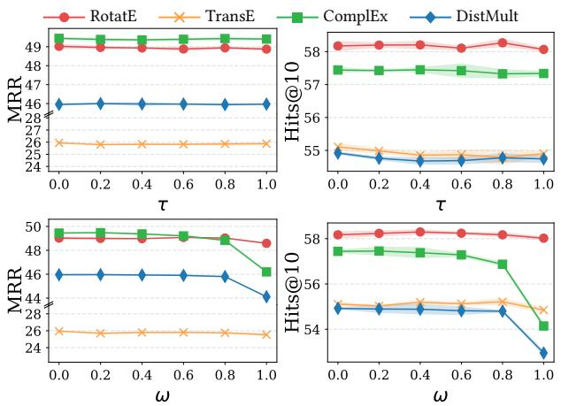  
Figure 10: Sensitivity of KGE performance to the two adjustment parameters, τ and ω, on WN18RR.

## A.5 Relation Category Analysis

We explain how relations are categorized into four types: 1-to-1, 1-to-N, N-to-1, and N-to-N. Following Wang et al. [37], for each relation r, we compute the average number of tails per head (tphr) and the average number of heads per tail (hptr) from the training data. We classify relations as follows: 1-to-1 if tphr < 1.5 and hptr < 1.5; 1-to-N if tphr ≥ 1.5 and hptr < 1.5; N-to-1 if tphr < 1.5 and hptr ≥ 1.5; and N-to-N otherwise. Statistics of relation categories are summarized in Table 5.

Table 5: Statistics of relation cardinality.
<table><tr><td>Dataset</td><td>Statistic</td><td>1-to-1</td><td>1-to-N</td><td>N-to-1</td><td>N-to-N</td></tr><tr><td rowspan="3">FB15k237</td><td># Relations</td><td>17</td><td>26</td><td>86</td><td>108</td></tr><tr><td># Train triples 4,278 (1.6%)</td><td></td><td>12,536 (4.6%)</td><td>50,635 (18.6%)</td><td>204,666 (75.2%)</td></tr><tr><td># Test triples</td><td>192 (0.9%)</td><td>1,293 (6.3%)</td><td>4,508 (22.0%)</td><td>14,473 (70.7%)</td></tr><tr><td rowspan="3">WN18RR</td><td># Relations</td><td>2</td><td>4</td><td>3</td><td>2</td></tr><tr><td></td><td># Train triples 1,218 (1.4%)</td><td>13,770 (15.9%)</td><td>40,833 (47.0%)</td><td>31,014 (35.7%)</td></tr><tr><td># Test triples</td><td>42 (1.3%)</td><td>475 (15.2%)</td><td>1,487 (47.4%)</td><td>1,130 (36.1%)</td></tr><tr><td rowspan="3">YAGO3-10 # Train triples 6,323 (0.6%)</td><td># Relations</td><td>2</td><td>5</td><td>10</td><td>20</td></tr><tr><td></td><td></td><td>15,356 (1.4%)</td><td>127,635 (11.8%)</td><td>929,726 (86.2%)</td></tr><tr><td># Test triples</td><td>30 (0.6%)</td><td>89 (1.8%)</td><td>591 (11.8%)</td><td>4,290 (85.8%)</td></tr></table>

Figure 11 shows the complete results across all KGE model– dataset combinations, complementing the relation-cardinality analysis in EQ1 (Section 5.2). Overall, RADAR performs strongly across different relation categories, with particularly consistent gains on 1-to-N, N-to-1, and N-to-N relations. These results further support the effectiveness of risk-aware negative budget allocation for multivalued relations, where false-negative risk is higher. In contrast, RADAR shows limited gains on 1-to-1 relations compared to baselines. Nevertheless, as shown in Table 5, 1-to-1 relations account for only around 1% of train/test triples across the three datasets and thus have limited impact on overall KGE performance.

## A.6 Performance-Efficiency Trade-Off

Figure 12 presents the complete performance-efficiency results across all KGE models and datasets, complementing the results in EQ2 (Section 5.3). Overall, RADAR exhibits a favorable performanceefficiency trade-off across diverse settings. On FB15k237 and WN18RR, RADAR achieves the highest KGE performance in the shortest training time than other methods. In particular, although RADAR is not always the fastest on YAGO3-10, it achieves the highest performance, demonstrating that its efficiency gains do not come at the cost of KGE performance. These results further support the effectiveness of RADAR across different models and datasets.

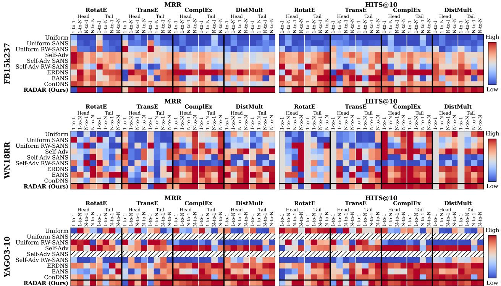  
Figure 11: Negative sampling methods evaluated on different relation categories.

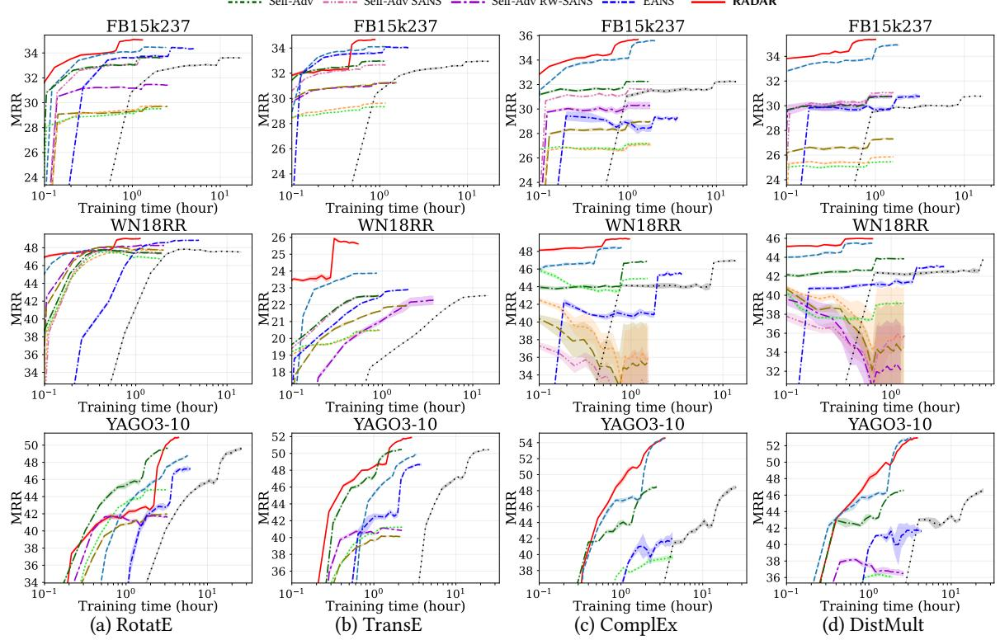  
Figure 12: Performance-efficiency trade-off of RADAR and baselines across all KGE models and datasets.