# Interpretable Meta-Policies for Neural Decision Making

Raban Emunds¹,2   
Jannis Blüml¹,2   
Quentin Delfosse¹   
Kristian Kersting1,2,3,4

raban.emunds@tu-darmstadt.de

1 Department of Computer Science, Technical University Darmstadt, Germany

2Hessian Center for Artificial Intelligence (hessian.AI)

3Centre for Cognitive Science, Darmstadt

4German Research Center for Artificial Intelligence (DFKI)

## Abstract

Deep Reinforcement Learning remains difficult to interpret and align due to the black-box nature of neural networks. While (neuro-)symbolic approaches improve transparency by incorporating symbolic reasoning, applying them directly to low-level actions results in overly complex, unreadable policies. We introduce NEXUS, a hierarchical RL framework that resolves this tension by combining neural skills with symbolic meta-policies. By shifting transparent reasoning to high-level skills rather than atomic actions, NEXUS drastically reduces symbolic complexity without sacrificing environment performance. Object-centric observations enable high-level reasoning and the design of reward functions and meta-policies by interaction with LLMs. We demonstrate that NEXUS agents learn disentangled skills, are interpretable regarding high-level goals, are better aligned to goals described in the game manual, less prone to reward hacking and more robust to game simplifications than deep RL. Finally, we isolate and evaluate the impact of different meta-policy architectures (neural, symbolic, neuro-symbolic) on environmental return and aligned task performance.

## 1 Introduction

Deep reinforcement learning (DRL) policies are highly capable (Mnih et al., 2015; Schulman et al., 2017; Gallici et al., 2024) but operate as black boxes, exhibiting behaviors that are difficult to interpret and potentially misaligned (Rudin, 2019). This opacity makes identifying and correcting undesirable behaviors a persistent challenge for practitioners (Zahavy et al., 2016; Zhang et al., 2018; Delfosse et al., 2024b)

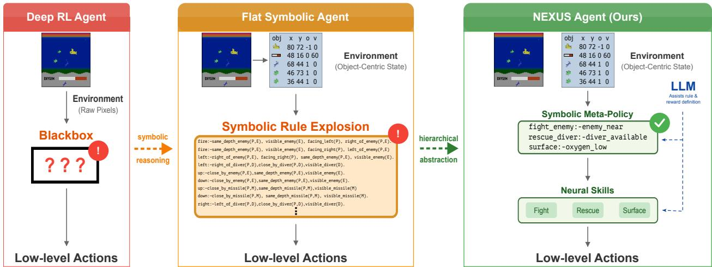  
Figure 1: NEXUS provides high-level interpretability through symbolic reasoning and abstraction. Neural network-based policies are non-modular black box models. While symbolic approaches are fully transparent by leveraging logical rules or decision trees, they quickly become excessively complex if applied to low-level actions. NEXUS abstracts low-level actions into skills and provides transparent high-level decisions.

Neuro-symbolic approaches address this issue by combining neural networks for perceptual grounding with symbolic reasoning modules for decision-making (Delfosse et al., 2023a; Hazra & Raedt, 2023; Acharya et al., 2024; Delfosse et al., 2024b; Luo et al., 2024). These architectures aim to enhance transparency by representing the policies through symbolic structures that are more readily interpretable. Despite their promise, applying symbolic reasoning directly to low-level action spaces often results in policies of prohibitive complexity (cf. Figure 1 center, Appendix A). The combinatorial explosion of symbolic rules at fine-grained action levels undermines interpretability and scalability.

Hierarchical Reinforcement Learning offers an alternative by abstracting sequences of actions into higher-level skills or options (Sutton et al., 1999; Dietterich, 2000; Barto & Mahadevan, 2003). While the framework provides a natural structure, the resulting options, when learned autonomously, are often entangled or have overlapping goals, and the meta-policy remains opaque, both hindering interpretability.

To address these limitations, we draw inspiration from the dual-process theory of cognition (Kahneman, 2011), where fast, intuitive processes and slower, deliberative reasoning continuously interact. We emulate this interplay in our hierarchical framework NEXUS, Neural EXecution Under Symbols: a low-level neural policy provides efficient, automatic execution (analogous to System 1), while a meta-policy layer of simple. interpretable rule sets (analogous to System 2) constantly guides skill selection, preserving clarity about the reasoning behind the active skill in complex environments (cf. Figure 1, right). We ensure disentangled skills, i.e. each skill corresponds to a distinct situation with clear semantics, by defining their subgoals explicitly through reward functions on objects extracted from the image.

To reduce the manual effort required, we leverage the reasoning capabilities of Large Language Models (LLMs) to assist in identifying those skills, defining the high-level meta-policy functions, and generating the reward signals that guide the training of the low-level neural controllers. Both the low-level skills and the meta-policy Q-function are learned jointly in an off-policy manner. Overall, our neuro-symbolic design enables inspectable high-level policies without compromising the efficiency of neural agents.

Our primary contributions are as follows:

(i) We extend Parallelised Q-Networks to the hierarchical setting for efficient and scalable meta-policy and skill learning (Section 3.1).

(ii) We introduce NEXUS and compare three meta-policy variants with varying degrees of interpretability and flexibility (Section 3.1 - Section 3.3).

(iii) We demonstrate that object-centric rewards and high-level meta-policy functions guide training towards disentangled skills and an interpretable high-level skill selection (Section 4.2).

(iv) We show that NEXUS agents are competitive to DRL methods while being less susceptible to reward hacking of environment rewards and more robust to game simplifications. (Section 4.3).

## 2 Background

NEXUS builds upon the deep Reinforcement Learning method Parallelised Q-Networks, which is a Deep Q-Networks variant that scales favorably and Hierarchical Reinforcement Learning that decomposes complex tasks into hierarchies of simpler sub-tasks, thereby abstracting actions into skills.

Deep and Parallelised Q-Networks. As sequential decision making framework we adopt Reinforcement Learning (RL), in which an agent learns to interact with an environment in order to maximize cumulative reward. The environment is typically modeled as a Markov Decision Process $( \mathrm { M D P } )$ , defined by the tuple $\mathcal { M } = \langle \boldsymbol { S } , \mathcal { A } , \boldsymbol { P } , \boldsymbol { R } , \boldsymbol { \gamma } \rangle$ , where $s$ is the set of states, A is the set of actions, $P ( s ^ { \prime } \mid s , a )$ is the transition probability from state s to state $s ^ { \prime }$ under action $a , \ R ( s , a )$ is the reward function and $\gamma \in [ 0 , 1 )$ is the discount factor. The goal of the agent is to learn a policy $\pi : { \mathcal { S } }  A$ that maximizes the expected discounted return: $\begin{array} { r } { \mathbb { E } _ { \pi } \left[ \sum _ { t = 0 } ^ { \infty } \gamma ^ { t } R ( s _ { t } , a _ { t } ) \right] } \end{array}$ . In Q-learning, a value-based RL algorithm, the agent seeks to learn the optimal action-value function $Q ^ { * } ( s , a )$ , which satisfies the Bellman optimality equation: $\begin{array} { r } { Q ^ { * } ( s , a ) = \operatorname { \mathbb { E } } _ { s ^ { \prime } } \left[ R ( s , a ) + \gamma \operatorname* { m a x } _ { a ^ { \prime } } Q ^ { * } ( s ^ { \prime } , a ^ { \prime } ) \right] } \end{array}$ . This function is updated iteratively via the Q-learning update rule: $Q ( s _ { t } , a _ { t } ) \gets Q ( s _ { t } , a _ { t } ) + \alpha \left[ r _ { t } + \gamma \operatorname* { m a x } _ { a ^ { \prime } } Q ( s _ { t + 1 } , a ^ { \prime } ) - Q ( { s _ { t } , a _ { t } } ) \right]$ , where α is the learning rate. With growing state space $s ,$ it becomes infeasible to store and update a tabular Q-function. Deep Q-Networks $( D Q N )$ (Mnih et al., 2015) address this by using a deep neural network $Q _ { \theta } ( s , a )$ , parameterized by θ, to approximate

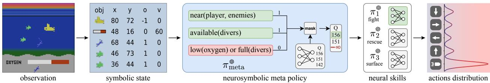

Figure 2: NEXUS with a neuro-symbolic meta-policy. First, the symbolic state is extracted from the observation. Then, the LLM-generated rules filter potential relevant skills, which the trained meta-policy Q-function selects between. Finally, the selected neural skill outputs the low-level action. Using the same experience, the meta-policy's Q-function is trained to optimize the environmental reward, while each skill is trained using its own LLM-generated reward, yielding disentangled skills with interpretable objectives.

$Q ( s , a )$ . DQN introduces several key modifications to stabilize learning, including experience replay, where transitions $\left( { { s _ { t } } , { a _ { t } } , { r _ { t } } , { s _ { t + 1 } } } \right)$ are stored in a replay buffer and sampled randomly to break correlations between consecutive updates and target networks, where a separate network $Q _ { \theta ^ { - } } ( s , a )$ is used to compute the target value and is updated periodically: $y _ { t } = r _ { t } + \gamma \operatorname* { m a x } _ { a ^ { \prime } } Q _ { \theta ^ { - } } ( s _ { t + 1 } , a ^ { \prime } )$

More recently, Gallici et al. (2024) introduced Parallelised Q-Networks (PQN), a simplified variant of DQN that eliminates the use of experience replay and target networks. Instead, PQN leverages a large number of parallel (ideally vectorized) environments and applies normalization techniques to mitigate training instabilities. This high degree of parallelization enables substantially faster training while maintaining performance.

Hierarchical Reinforcement Learning. Hierarchical reinforcement learning (HRL) decomposes complex tasks into simpler sub-tasks, often modeled as temporally extended actions or options (Sutton et al., 1999). At inference time, a meta policy selects the option, enabling more efficient exploration and transfer in environments with long horizons or sparse rewards. Sub-policies can be learned autonomously using intrinsic objectives (Bacon et al., 2017; Vezhnevets et al., 2017) or be guided by manually designed reward functions (Sutton et al., 1999; Dietterich, 2000). However, autonomous discovery often suffers from option entanglement or collapse, where multiple options overlap or only a single option is actively used (Harb et al., 2017; Hyun et al., 2019). NEXUS instead enforces its skills to be disentangled by explicitly defining reward functions for each skill, which can be LLM-generated

## 3 Neural Execution Under Symbols

To bridge the gap between well performing deep neural RL and human-interpretable logic, we introduce NEXUS, a hierarchical RL framework that integrates symbolic reasoning with neural skill execution. The overall pipeline is described in Figure 2. At a high level, NEXUS decomposes decision-making into two layers: (1) a high-level meta-policy and (2) a set of low-level neural skill policies optimized for specific sub-goals. At each step, the decision process proceeds as follows. First, object-centric representations are extracted from pixel-based inputs. Second, the meta-policy selects the most suitable skill for the current situation with the goal of maximizing environmental reward. Finally, the chosen skill executes its low-level policy to maximize the corresponding sub-goal. Object-centric representations are crucial for enabling symbolic rule definition and skill-specific reward design, both of which are difficult to obtain without such structured representations Moreover, they allow LLMs to generate those rules and reward functions.

In the following, we describe, three viable types of meta-policy function: purely neural, purely symbolic, and neuro-symbolic. The first method NEXUS (neural), cf. Section 3.1, corresponds to a hierarchical PQN method, which learns both a neural meta-policy and neural skills (based on skill-specific rewards) and which serves as the foundation for subsequent variants. While it offers disentangled skills and high flexibility due to the learned meta-policy, it is missing the ability to reason about why a given sub-goal (and the corresponding skill) is selected in the current step. This shortcoming can be facilitated by replacing the learned meta-policy with a fixed, interpretable function which can either be manually defined or LLM-generated. This variant, NEXUS (symbolic), cf. Section 3.2, is fully symbolic at the meta-policy level and thus produces the easiest to interpret meta-policy of the investigated options. Finally, we explore a hybrid approach NEXUS (nesy), cf. Section 3.3, which filters candidate skills via predefined symbolic rules, but then selects the final skill using Q-learning on the abstract skill level in ambiguous situations.

## 3.1 Hierarchical PQN

We accommodate the hierarchical learning setup by modeling the environment as two layers of MDPs. On the action level, we define a collection of MDPs $\pmb { \mathcal { M } } = \{ \langle S , \pmb { \mathcal { A } } , P , R _ { n } , \gamma \rangle \} _ { n = 1 } ^ { N }$ for N skills, each associated with a distinct option policy $\pi _ { n } \in \Pi$ that decides over the actual environment actions. The meta-level MDP $\mathcal { M } _ { \mathrm { m e t a } } = \langle S , \Pi , P , R _ { \mathrm { e n v } } , \gamma \rangle$ governs option selection through a meta-policy $\pi _ { \mathrm { m e t a } }$ that selects over the options I. Note that the option-level MDPs differ only in their reward functions $R _ { n }$ , while the meta-level MDP retains the environment's original reward $R _ { \mathrm { e n v } }$

To enable learning across sub-policies even when they are not actively selected, we adopt off-policy Q-learning This allows all the skills to learn from trajectories generated by the active skill and meta-policy while optimizing for their respective reward structures. Exploration within each skill is conducted via e-greedy action selection. For scalability through vectorization, we build our hierarchical training approach upon PQL with λ-returns (Gallici et al., 2024). However, instead of learning a single shared Q-network $Q _ { \phi }$ as in $\mathrm { P Q L } ,$ we learn separate Q-functions $Q _ { \phi _ { n } }$ for each low-level skill, along with a meta-level Q-network $Q _ { \phi _ { \mathrm { m e t a } } }$

For updating, we roll out trajectories $\left( s _ { 0 } , . . . , s _ { T } \right)$ following the global policy by selecting the next active skill $\pi _ { n } \in \Pi$ using the meta-policy Q-function $Q _ { \phi _ { \mathrm { m e t a } } }$ and find the most promising action according to the active skill's Q-function $Q _ { \phi _ { n } }$

$$
\pi _ { n } = \arg \operatorname* { m a x } _ { \pi _ { n } \in \Pi } Q _ { \phi _ { \mathrm { m e t a } } } ( s _ { t } , \pi _ { n } ) , \quad a ^ { \prime } = \arg \operatorname* { m a x } _ { a ^ { \prime } \in \mathcal A } Q _ { \phi _ { n } } ( s _ { t } , a ^ { \prime } ) .\tag{1}
$$

By executing the action in the environment, we obtain the rewards and the next environmental state for the next iteration. We employ e-greedy for exploration during both the skill and the action selection.

Next to the environment reward $r _ { \mathrm { e n v } , t }$ , we require skill-specific reward functions $r _ { n , t }$ that are based on the object-centric state $s _ { t }$ and may be automatically generated by LLMs (cf. Appendix F), which we use to compute the λ-returns recursively back in time (for details, we refer the reader to Gallici et al. (2024); Daley $\&$ Amato (2019)):

$$
R _ { n , t } ^ { \lambda } = r _ { n , t } + \gamma \left[ \lambda R _ { n , t + 1 } ^ { \lambda } + ( 1 - \lambda ) \operatorname* { m a x } _ { a ^ { \prime } } Q _ { \phi _ { n } } ( s _ { t + 1 } , a ^ { \prime } ) \right] ,\tag{2}
$$

and similarly, for the learned meta-policy using environment rewards:

$$
R _ { \mathrm { e n v } , t } ^ { \lambda } = r _ { \mathrm { e n v } , t } + \gamma \biggl [ \lambda R _ { \mathrm { e n v } , t + 1 } ^ { \lambda } + ( 1 - \lambda ) \operatorname* { m a x } _ { \pi _ { n } } Q _ { \phi _ { \mathrm { m e t a } } } ( s _ { t + 1 } , \pi _ { n } ) \biggr ] ,\tag{3}
$$

or, if $s _ { t }$ is terminal $R _ { n , t } ^ { \lambda } = r _ { n , t }$ and $R _ { \mathrm { e n v } , t } ^ { \lambda } = r _ { \mathrm { e n v } , t }$ . All learned Q-functions are updated towards their λ-returns. We provide the full algorithm in Appendix B.

## 3.2 Interpretable Meta-Policy Function

While the hierarchical structure allows to identify the active skill, it does not expose the decision process that leads to its selection. To make this process transparent, we introduce interpretable meta-policy functions implemented as rule-based programs. We choose this representation for two key reasons. First, rule-based programs offer simplicity and accessibility since conditional statements can typically be understood and modified even by users with limited programming background. Second, LLMs are highly effective at generating and editing code-like structures due to extensive pretraining on programming data. This enables generation of human-interpretable meta-policies and greatly reduces manual effort. Further details on how we employ LLMs to generate the meta-policy function are available in Appendix F.

Formally, instead of relying on a learned Q-function $Q _ { \phi _ { \mathrm { m e t a } } }$ , we define a meta-policy $\pi _ { \mathrm { m e t a } } : S  \Pi$ as a set of human-readable rules that directly maps the current object-centric state $s _ { t } \in S$ to the selected low-level policy $\pi _ { n } \in \Pi$

$$
\pi _ { n } = \pi _ { \mathrm { m e t a } } ( s _ { t } ) .\tag{4}
$$

We hereby constrain $\pi _ { \mathrm { m e t a } }$ to a set of rules $\left\{ \left( A _ { k } , \pi _ { ( k ) } \right) \right\}$ , where each condition set $A _ { k } \subseteq { \mathcal { S } }$ defines the state subspace where policy $\pi _ { ( k ) }$ is triggered. To enable transparent inspection of policy decisions, we require these activation conditions to be pairwise disjoint $( \mathrm { i . e . } \ , \ A _ { i } \cap A _ { j } = \varnothing$ for all $i \neq j )$ . This mutual exclusivity ensures that the selected skill can always be unambiguously traced back to the single unique rule that evaluated to true given the current state. Example rules are available in the evaluation section (cf. Listing 1).

## 3.3 Neuro-symbolic Meta-Policy Function

The symbolic meta-policy is a deterministic function that selects mutually exclusive skills based on the rule with the highest priority. This approach may become ineffective in situations where multiple skills are simultaneously applicable. Consider an agent controlling a submarine that can shoot a nearby enemy or surface to replenish oxygen. The most viable rule depends on the specific context: if the oxygen level is critically low, resurfacing may be prioritized; if an enemy is dangerously close, attacking may take precedence. Crafting hard-coded rules to handle all these situations, could lead to growing, less interpretable policies.

As an alternative meta-policy variant aimed at automatically resolving such situations, we also explore a neuro-symbolic (NeSy) approach. Similar to the symbolic meta-policy, this variant maintains a set of high-level, interpretable conditions (e.g., “go to surface if oxygen is low"), represented as a binary condition vector $c _ { t } ~ \in ~ \{ 0 , 1 \} ^ { N }$ indicating rule activation at time t. These rule-sets are again formulated as simple code functions derived from the symbolic meta-policies; however, in this variant, we allow multiple conditions to be active concurrently. The skill selection is then restricted by these conditions: the meta-policy selects the skill with the highest Q-value among those whose condition is active:

$$
\begin{array} { r l } & { \pi _ { n } = \arg \underset { \pi _ { n } \in \Pi _ { t } } { \operatorname* { m a x } } Q _ { \phi _ { m e t a } } ( s _ { t } , \pi _ { n } ) , } \\ & { \quad \mathrm { ~ w h e r e ~ } \Pi _ { t } = \{ \pi _ { n } \in \Pi \mid c _ { t , n } = 1 \} . } \end{array}\tag{5}
$$

where $\Pi _ { t } \subseteq \Pi$ denotes the set of skills

```latex
Algorithm 1 NEXUS Variants
Require: Skill policies $\{ \pi _ { n } \} _ { n = 1 } ^ { N }$ with Q-functions $\{ Q _ { \phi _ { n } } \} _ { n = 1 } ^ { N }$
meta-policy $Q _ { \phi _ { \mathrm { m e t a } } }$ (for learned/soft)
1: for each episode do
2: for each environment step (in parallel) do
3: Extract object-centric state $s _ { t }$
4: Select skill $\pi _ { n , t }$ as follows:
A) Neural: $\pi _ { n , t } = \arg \operatorname* { m a x } _ { \pi _ { n } } Q _ { \phi _ { \mathrm { m e t a } } } ( s _ { t } , \pi _ { n } )$
B) Symbolic: $\pi _ { n , t } = \pi _ { \mathrm { m e t a } } ( s _ { t } )$
C) NeSy: $\begin{array} { r } { \pi _ { n , t } = \arg \operatorname* { m a x } _ { \pi _ { n } : c _ { t , n } = 1 } Q _ { \phi _ { \mathrm { m e t a } } } ( s _ { t } , \pi _ { n } ) } \end{array}$
5: Select action $a _ { t }$ using €-greedy from $\pi _ { n , t }$
6: Execute $a _ { t }$ and observe transition $( \{ r _ { n , t } \} _ { n = 0 } ^ { N } , r _ { \mathrm { e n v } , t } , s _ { t + 1 } )$
7: end for
8: for each gradient step do
9: Compute $R _ { n , t } ^ { \lambda }$ and $R _ { \mathrm { e n v } , t } ^ { \lambda }$ (if A or C)
10: Update each $Q _ { \phi _ { n } }$ using skill-specific $R _ { n , t } ^ { \lambda }$
11: Update $Q _ { \phi _ { \mathrm { m e t a } } }$ using $R _ { \mathrm { e n v } , t } ^ { \lambda }$ (if A or C)
12: end for
13: end for
```

whose conditions are active at time t. In practice, this corresponds to a masked argmax in which the Q-values of inactive skills are set to —∞. This design successfully maintains interpretability at the symbolic level and simultaneously enables the agent to resolve ambiguous scenarios adaptively based on learned preferences. An overview over the entire NEXUS algorithm with the different meta-policy variations is provided in Algorithm 1.

## 4 Experimental Evaluation

This work aims to develop an object-centric pipeline for agents capable of solving complex environments while maintaining interpretability of high-level goals. We assess this objective by addressing the following research questions:

(Q1) Does NEXUS learn meaningful disentangled skills?

(Q2) Is the high-level skill selection of NEXUS interpretable?

(Q3) Can NEXUS compete with other deep methods?

(Q4) Does NEXUS improve robustness to game simplifications?

## 4.1 Experimental Setup

Our experiments assume access to pre-extracted object representations and attributes. We therefore provide the agent with symbolic environment states directly, allowing us to remain agnostic to the specific object extraction pipeline. We conduct experiments on JAXAtari (Delfosse et al., 2026), a JAX-based reimplementation of the Atari Learning Environment (ALE) (Bellemare et al., 2013), specifically using the games Kangaroo and Seaquest, with object-centric representations similar to OCatari (Delfosse et al., 2024a). Additionally. we evaluate on Crafter (Hafner, 2021), using the JAX reimplementation by Matthews et al. (2024), an environment that integrates elements from the games Minecraft and NetHack (cf. Appendix C.1). Finally, for generalization we also test the trained agents on slightly modified versions of the games. These modifications are designed to highlight the sensitivity of standard reinforcement learning agents to game simplifications For example, the simplification of removing enemies (i.e., sharks and submarines) in Seaquest already leads to a substantial drop in many deep agents performances (Delfosse et al., 2025).

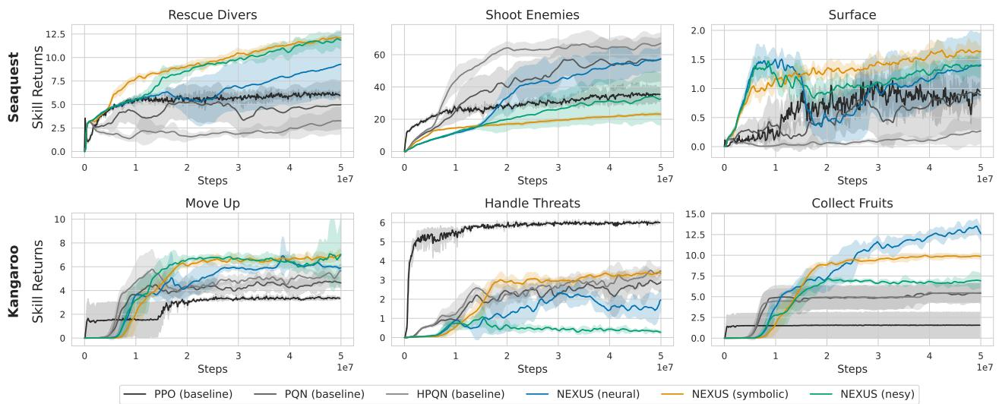  
Figure 3: NEXUS learns disentangled skills from off-policy data. In Seaquest (top), the baseline methods mainly focus on shooting enemies, while the NEXUS approaches acquire the target skills more evenly. Similarly, in Kangaroo (bottom), the NEXUS approaches learn 'Move Up' and 'Collect Fruits' reliably, while the baselines focus mostly on 'Handle Threats'. Aggregated over 6 seeds, ±1 standard deviation.

We compare the three developed meta-policy variations of NEXUS to the default, non-interpretable PQN (Gallici et al., 2024), and, in case of the Atari games, with the actor-critic PPO (Schulman et al., 2017) as baselines. Additionally, we compare to HPQN, a hierarchical PQN variation that does not employ skill-specific rewards and has a purely neural meta-policy. All results (including baselines) are directly trained on objectcentric inputs, which may affect performance compared to image based training. We adhere to the standard frame budgets of both games: 200M frames for JAXAtari and 1B frames for Crafter (cf. Appendix C). All metrics shown are aggregated over a total of six seeds.

## 4.2 Interpretability Results

Disentangled skill learning (Q1). We first evaluate whether NEXUS enables efficient learning of meaningful skills. Since each skill requires its own reward function, we leverage the reasoning capabilities of LLMs to generate them based on the game manual, skill definitions, and the object-centric state (cf. Appendix F). Figure 3 demonstrates that NEXUS is able to learn most target skills successfully from a single source of off-policy data. This confirms that a skill can learn from another skills action and is not required to be activated to do so. Unlike the baselines, which tend to mostly focus on a single skill that maximizes environment reward (e.g., Shoot Enemies for Seaquest, Handle Threats for Kangaroo), NEXUS approaches promote balanced skill acquisition. We experience a similar picture when evaluating on Crafter (cf. Figure 4). Using the game manual and state description, we query an LLM for essential skills. Recurrent versions of NEXUS are then trained explicitly for these skills and compared to a recurrent PQN baseline. NEXUS approaches are able to learn all five skills simultaneously, while the PQN baseline focuses only on some skills. An additional baseline comparison to PQN with shaped rewards is available in Appendix D.1.

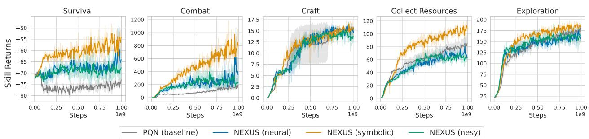  
Figure 4: NEXUS succesfully learns LLM-proposed Crafter skills. Compared to the baseline, NEXUS approaches often converge faster on the proposed skills. Aggregated over 6 seeds, ±1 standard deviation.

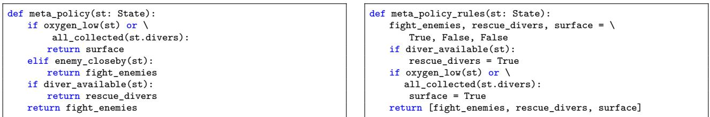

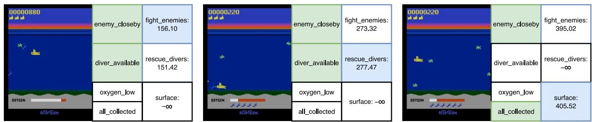  
Figure 5: NEXUS (nesy) restricts skill selection through interpretable rules but remains flexible in ambiguous scenarios. Left: enemy\_closeby and diver\_available both hold; the meta-policy prefers fighting, likely as the diver is near the enemy. Center: with the diver more accessible, rescuing is preferred. Right: with all divers collected and an enemy nearby, surfacing has the higher estimated return.  
Listing 1: Symbolic meta-policy for Seaquest.  
Listing 2: Neurosymbolic meta-policy rules Seaquest.

Interpretability of NEXUS meta-policies (Q2). Next, we assess the interpretability of NEXUS by inspecting a fixed meta-policy for Seaquest, shown in Listing 1. By abstracting raw observations into objectcentric representations and low-level actions into high-level skills, the high-level decision-making process becomes transparent, while the execution of each skill remains neural. Each option has a clear, mutually exclusive activation condition, enabling unambiguous skill selection. For example, the surfacing skill takes precedence whenever oxygen is low or all divers are collected. The resulting meta-policy is fully transparent on the high-level decisions and easily modifiable by humans. Additionally, the simplicity in rule design allows for both manual design by technical users and automated generation by LLMs (cf. Appendix F). For neuro-symbolic meta-policies, multiple conditions may be satisfied simultaneously (e.g., an enemy is nearby and oxygen is low; cf. Listing 2), which occurs frequently in practice (cf. Section D.2). In these cases, the rules transparently restrict the set of admissible skills, but the final choice among them is made by the learned meta-policy Q-function and is therefore only partially interpretable. The neuro-symbolic variant thus trades interpretability for flexibility. Figure 5 visualizes the neuro-symbolic meta-policy controlling a Seaquest agent while maintaining transparency regarding the current goals and decision logic. We analyze the neuro-symbolic meta-policy and skill activation frequencies in Appendix D.2.

## Policy complexity

To quantify the interpretability of the high-level decision logic without human studies, we measure its simulatability (Lipton, 2018) with two metrics: Average Decision Path Length (ADPL) (Wu et al., 2017), the expected number of condition checks per decision, and Rule Size / Length (Lakkaraju et al., 2016), the number of rules and their total length. Both cover only the symbolic layer, not the neural skills

Compared to the flat interpretable baseline NUDGE (Delfosse et al., 2023a) on Seaquest, NEXUS reduces policy complexity by almost an order of magnitude (cf. Table 1, Appendix C.3): NUDGE requires 16 rules with 46 literals and an ADPL of 23.56, whereas delegating low-level control to neural skills leaves NEXUS

Table 1: Quantitative interpretability metrics of the symbolic decision logic, comparing NUDGE (action level) and NEXUS (skill level) on Seaquest. NEXUS metrics cover the meta-policy only; low-level skills are neural.
<table><tr><td>Policy</td><td>Rule Size and Length Lakkaraju et al. (2016) ADPL Wu et al. (2017)</td></tr><tr><td>NUDGE (Listing 4)</td><td>16 rules, 46 predicates</td></tr><tr><td></td><td>23.56 evaluations 4 rules, 4 predicates 3 evaluations</td></tr><tr><td>NEXUS (Listing 1) NEXUS (Listing 2) 2 rules, 3 predicates</td><td>2.50 evaluations</td></tr></table>

with 2–4 rules, 3-4 predicates and an ADPL of 2.5–3, well within human working-memory bounds (7 ± 2 concepts; Miller, 1956; Lage et al., 2019).

## 4.3 Performance Results

Comparison to other approaches (Q3). We evaluate NEXUS against baselines using two metrics: Game returns and aligned environment goals, which track progress toward goals defined in game manuals (e.g. , divers rescued in Seaquest, level completion in Kangaroo). The latter aims to capture the overall alignment with the intended game objectives, which differ from simply maximizing the environmental reward, a phenomenon in deep RL known as reward hacking. As shown in Figure 6, NEXUS approaches are competitive to the baselines. In most cases,

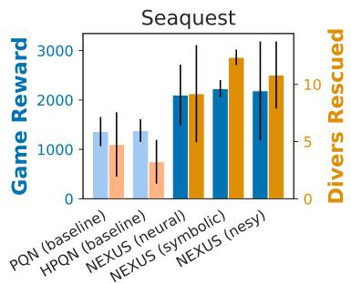

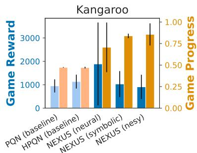  
Figure 6: NEXUS is competitive. In Seaquest, NEXUS outperforms the baselines on both game reward and rescuing divers. In Kangaroo, NEXUS approaches progress farther. Aggregated over 6 seeds, ±1 standard deviation.

they achieve comparable or even higher game reward and notably outperform the baselines on the games' actual goal described in the manual, demonstrating the baselines reward hacking tendency.

The results suggest that NEXUS mitigates reward misalignment by incorporating domain priors (game manual) into the decision-making process, while still achieving good overall game performance. We provide additional evaluations on more environments and compare NEXUS to other neuro-symbolic RL methods in Appendix D.

Robustness to game simplifications (Q4). Most RL algorithms struggle to adapt to even minor variations in the environment (Delfosse et al., 2025). Surprisingly, their performances drop even in settings that simplify the game for humans, such as removing deadly threats like enemies and their projectiles in Seaquest and Kangaroo. We assess whether NEXUS agents can generalize to such simplified variants by training the agents on the standard versions of the games and evaluating on the unseen simplifications In Seaquest and Kangaroo we remove all threats, while in Crafter we remove the need to drink water for survival. Figure 7 presents the results. As expected, the baselines suffer performance degradation under the simplifications or already had low scores. In contrast, the NEXUS variants display varying degrees of robustness. In Atari, the symbolic and neuro-symbolic variants demonstrate improved robustness, with small performance drops in Kangaroo and even gains in Seaquest, while the fully neural variant shows limited robustness. In Crafter, all NEXUS variants maintain or improve performance. We attribute this robustness to symbolic steering of the meta-policy, which deactivates unnecessary skills (handling threats, finding water).

## 5 Discussion

Overall, the empirical results highlight the strengths of our approach across multiple dimensions. Compared to the DRL baselines, NEXUS achieves competitive game rewards and exhibits a strong advantage when evaluated on metrics measuring game progress. Furthermore, we observe improved robustness against environmental simplifications. Taken together, these findings strongly suggest that (neuro-)symbolic meta-policies effectively steer reinforcement learning agents toward better-aligned and more robust policies, all while offering the crucial benefit of enhanced interpretability.

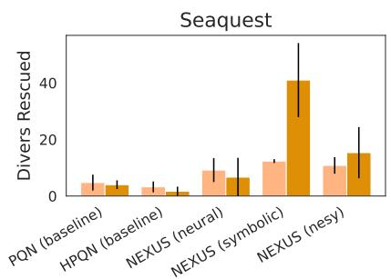

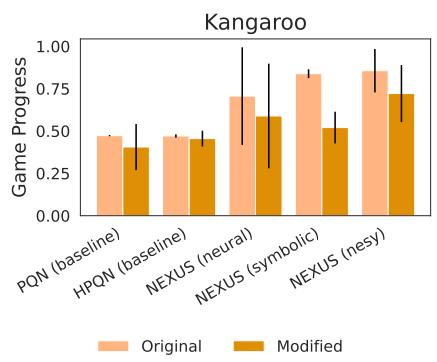

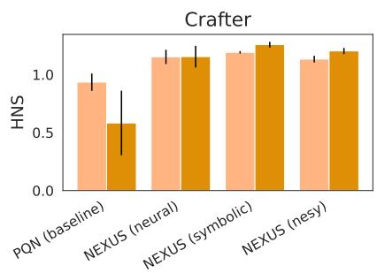  
Figure 7: NEXUS remains practical on simplified games. While baseline performance on aligned metrics remains low, neuro-symbolic and fully symbolic NEXUS improve on modified Seaquest (left). Modified kangaroo (middle) reduces performance of symbolic NEXUS, while neuro-symbolic NEXUS remains effective. Crafter performance (right) remains consistent or improves for all NEXUS versions. Aggregated over 6 seeds, ±1 standard deviation.

On the choice of the meta-policy. Based on our findings, we can offer concrete recommendations regarding the optimal meta-policy design. The purely neural meta-policy presents the simplest training paradigm as it circumvents the need for a separate symbolic layer and demonstrates strong performance in terms of raw game reward; however, it suffers from limited interpretability and degraded performance when evaluated on simplified games. In contrast, the purely symbolic meta-policy enhances both interpretability and robustness, though it introduces the overhead of rule definition. Because this process can be largely automated using LLMs, this minor investment is typically well justified. Lastly, the neuro-symbolic variant achieves game reward and goal metrics performance comparable to the symbolic meta-policy and is also similarly robust to game simplifications. However, it is more flexible in ambiguous situations. Based on these results, we recommend the purely symbolic meta-policy for practitioners prioritizing high interpretability and alignment without sacrificing performance. Meanwhile, the neuro-symbolic variation is well-suited for settings with frequent ambiguity.

Scope of interpretability. NEXUS provides interpretability at three levels of decreasing transparency: (i) the meta-policy, whose decisions are fully traceable to a single rule in the symbolic variant and restricted to rule-admissible skills in the neuro-symbolic variant, where the final choice in ambiguous states is made by the learned Q-function; (ii) the skill objectives, defined by explicit, human-readable reward functions; and (iii) the low-level action selection within each skill, which remains neural. Our claims therefore concern why a skill is selected and what it is trained to achieve, not how it is executed. Accordingly, our complexity metrics cover only the symbolic layer, and a user study evaluating human understanding of NEXUS agents is left for future work.

Prior knowledge requirements and manual adaptation. Two components of NEXUS require prior domain knowledge: the specification of skill reward functions and the definition of meta-policy rules for the symbolic and neurosymbolic variants. While these elements could be engineered manually, we leverage LLMs to minimize the need for human expert intervention. Utilizing the prompts detailed in Appendix F, the framework mainly requires the raw game manual. After obtaining the generated meta-policy and skill rewards. the user is expected to verify correctness of the output, ensure the code respects framework dependencies and refine thresholds, rule priorities and reward terms where necessary (cf. Table 5).

Limitations. NEXUS relies on object-centric scene decoders that accurately provide the agent with objects and their positions and sizes from raw images, which we assume to exist in this work. For Atari games, multiple approaches are viable (Li et al., 2017; Locatello et al., 2020; Lin et al., 2020; Delfosse et al., 2023b) with some achieving near-perfect sprite extraction (Smirnov et al., 2021). For real-world data, recent advancements have significantly improved robustness, with models like SAM2 (Ravi et al., 2025) reaching up to 90% J&F accuracy on zero-shot segmentation. However, even the best object detector will produce misdetections, so we additionally validate the performance of NEXUS under noisy detections (cf. Appendix E). The LLM based generation of reward functions and meta-policies require a pre-defined description of the task, i.e. the game's manual (as done in Wu et al. (2023)). Moreover, while the generated functions generally capture valid semantics and are logically consistent, the implementations still require framework adaptations and semantic refinements (cf. Table 5). Prior works on LLM-based reward design (e.g., Xie et al. (2024), Ma et al. (2024), Kaufmann et al. (2024)) have documented recurring issues such as reward misspecification, proxy objective selection, and over- or under-constrained preconditions, highlighting the need for careful verification. NEXUS currently addresses these risks through manual inspection of the generated code. Extending our framework by incorporating automatic mechanisms, e.g., refinement from trajectory feedback and planning, as explored by SCALAR (Zabounidis et al., 2026), is a crucial direction for enhancing robustness and scalability. Lastly, the presented approach is based on Q-learning and therefore limited to discrete action spaces, however, extension to continuous action spaces seems viable, e.g., by adopting an off-policy actor critic instead of e-greedy action selection (Lillicrap et al., 2016; Haarnoja et al., 2018).

## 6 Related Work

Interpretable and Hierarchical Reinforcement Learning. Interpretability in RL can be introduced at various stages of the pipeline (Glanois et al., 2024), often by deriving symbolic state representations from raw observations via object recognition or segmentation (Li et al., 2017; Locatello et al., 2020; Kirillov et al., 2023; Lin et al., 2020; Delfosse et al., 2023b). Such object-centric states have enabled interpretable policies through decision trees (Silva et al., 2019; Likmeta et al., 2020; Delfosse et al., 2024b), logic rules (Maes et al., 2012; Akrour et al., 2019; Delfosse et al., 2023a), parametric functions (Luo et al., 2024) or programmatic policies and trees (Verma et al., 2019; Anderson et al., 2020; Kohler et al., 2024). Neural and logical policies can also be efficiently combined (Shindo et al., 2025). Complementary efforts introduce hierarchical decompositions, where high-level interpretable policies select among low-level sub-policies, leveraging annotated task sketches (Andreas et al., 2017) or (differentiable) symbolic planning (Leonetti et al., 2016; Yang et al., 2018; Jin et al., 2022; Lyu et al., 2019; Ye et al., 2025). Hierarchical symbolic planning based on object-centric representations has been shown to be beneficial for task transferability (James et al., 2022) and robotics applications (Sharma et al., 2020). Our work extends these directions by enforcing semantic separation of skills, introducing a symbolic meta-policy to improve understandability and integrating LLMs throughout the pipeline.

Reward Shaping and Reward Machines. Prior work has explored structured reward specifications to improve learning efficiency. Potential-based reward shaping (Ng et al., 1999) provides a theoretically grounded method for augmenting rewards while preserving optimality, but relies on manually specified potential functions. Reward machines offer a more expressive automata-based formalism for encoding non-Markovian reward logic (Icarte et al., 2018), with recent work even leveraging LLMs for automated design Castanyer et al. (2025). However, these approaches typically learn a single value function over a flat action space and have not been evaluated on visually complex domains such as Atari or Crafter. In contrast, our approach learns a separate Q-function per skill within a hierarchical framework, using object-centric reward specifications to enforce semantic disentanglement.

LLM-guided skill learning. Concurrent to our work, SCALAR (Zabounidis et al., 2026) uses LLMs to propose skills as STRIPS-like operators with preconditions, effects and reward functions, sequences them with a symbolic planner, and trains the corresponding options with PPO in a skill-by-skill curriculum, refining the specifications from rollouts via trajectory analysis. While SCALAR targets sample-efficient learning of long prerequisite chains in crafting domains and executes skills in a fixed planned order, NEXUS targets interpretable high-level decision making: its (neuro-)symbolic meta-policy re-selects skills at every step from the object-centric state, all skills are learned concurrently from shared off-policy experience without state resets, and skill rewards are kept separate from the environment reward to enforce disentanglement. The two directions are complementary; SCALAR's trajectory-based refinement could automate the verification of NEXUS's LLM-generated rewards and meta-policies.

Relation to the Options framework. HRL has been studied extensively, with the Options framework (Sutton et al., 1999) as the most prominent formulation. NEXUS can be interpreted as an instantiation of the Options framework with intra-option learning, where multiple options are learned simultaneously from shared off-policy experience, using sub-policies guided by option-specific reward functions and coordinated by a neuro-symbolic meta-policy. Key differences arise in temporal abstraction and in the treatment of initiation and termination conditions. Rather than executing an option until termination, the meta-policy selects the active option at every time step, jointly determining activation and termination. The logical rule set as the meta-policy serves as a generalized initiation set, enabled by the object-centric encoding of observations.

## 7 Conclusion

In this work, we present NEXUS, a hierarchical RL method that combines high interpretability on meta-policy level with neural, low-level action execution. The evaluation suggest several advantages of our approach It learns disentangled sub-policies corresponding to identifiable skills, provides high-level interpretable and modular structures for inspection and intervention, reduces reward-hacking through integration of domain priors, and remains robust to environment simplifications where standard deep RL agents fail. We also found that LLMs can successfully be integrated into the NEXUS pipeline to generate skill decompositions, reward functions, and symbolic meta-policies, enabling interpretability and dynamic adaptation to simplified environments. Future work should increase the autonomy of policy adaptation by incorporating mechanisms to detect when new skills or meta-policy updates are required, e.g. via causal world models (Yang et al., 2025; Dillies et al., 2025), which could enable scaling to complex, open-ended environments. Updates to the skills or meta-policy could be retrieved by re-querying an LLM. In conclusion, this work advances RL interpretability and modularity through symbolic and object-centric reasoning while supporting human-in-the-loop control at the skill level, offering a promising path toward transparent, adaptable, and aligned agents.

Broader Impact. This work advances RL interpretability and modularity by integrating symbolic structure and object-centric reasoning. Beyond enhanced transparency, it enables human-in-the-loop control: practitioners may inspect, modify, or constrain agent behavior at the skill level. We believe that this precise, skill-level alignment and the flexible adaptation are among the most promising avenues opened by this approach While LLM-generated rewards and meta-policies are viable, they remain susceptible to misspecification and subsequent undesirable actions, making human oversight essential for safety-critical applications.

## References

Kamal Acharya, Waleed Raza, Carlos M. J. M. Dourado Júnior, Alvaro Velasquez, and Houbing Herbert Song. Neurosymbolic Reinforcement Learning and Planning: A Survey. IEEE Transactions on Artificial Intelligence, 5(5):1939–1953, 2024.

Riad Akrour, Davide Tateo, and Jan Peters. Towards reinforcement learning of human readable policies. In The European Conference on Machine Learning and Principles and Practice of Knowledge Discovery in Databases: The 1st Workshop on Deep Continuous-Discrete Machine Learning, 2019.

Greg Anderson, Abhinav Verma, Isil Dillig, and Swarat Chaudhuri. Neurosymbolic Reinforcement Learning with Formally Verified Exploration. In Neural Information Processing Systems, volume abs/2009.12612, 2020.

Jacob Andreas, Dan Klein, and Sergey Levine. Modular Multitask Reinforcement Learning with Policy Sketches. In International Conference on Machine Learning (ICML), pp. 166–175, 2017.

Pierre-Luc Bacon, Jean Harb, and Doina Precup. The Option-Critic Architecture. In AAAI Conference on Artificial Intelligence (AAAI), pp. 1726–1734, 2017.

Adrià Puigdomènech Badia, Bilal Piot, Steven Kapturowski, Pablo Sprechmann, Alex Vitvitskyi, Zhaohan Daniel Guo, and Charles Blundell. Agent57: Outperforming the Atari Human Benchmark. In International Conference on Machine Learning (ICML), pp. 507–517, 2020.

Andrew G Barto and Sridhar Mahadevan. Recent advances in hierarchical reinforcement learning. Discrete event dynamic systems, 13:341–379, 2003.

Marc G. Bellemare, Yavar Naddaf, Joel Veness, and Michael Bowling. The Arcade Learning Environment: An Evaluation Platform for General Agents. Journal of Artificial Intelligence Research (JAIR), 47:253–279, 2013.

Roger Creus Castanyer, Faisal Mohamed, Pablo Samuel Castro, Cyrus Neary, and Glen Berseth. Arm-FM: Automated Reward Machines via Foundation Models for Compositional Reinforcement Learning. abs/2510.14176, 2025.

Brett Daley and Christopher Amato. Reconciling λ-Returns with Experience Replay. In Conference on Neural Information Processing Systems (NeurIPS), 2019.

Quentin Delfosse, Hikaru Shindo, Devendra Singh Dhami, and Kristian Kersting. Interpretable and Explainable Logical Policies via Neurally Guided Symbolic Abstraction. In Conference on Neural Information Processing Systems (NeurIPS), 2023a

Quentin Delfosse, Wolfgang Stammer, Thomas Rothenbächer, Dwarak Vittal, and Kristian Kersting. Boosting Object Representation Learning via Motion and Object Continuity. Springer Nature Switzerland, 2023b.

Quentin Delfosse, Jannis Blüml, Bjarne Gregori, Sebastian Sztwiertnia, and Kristian Kersting. Ocatari: Object-Centric Atari 2600 Reinforcement Learning Environments. Reinforcement Learning Conference (RLC), 1:400–449, 2024a.

Quentin Delfosse, Sebastian Sztwiertnia, Mark Rothermel, Wolfgang Stammer, and Kristian Kersting Interpretable Concept Bottlenecks to Align Reinforcement Learning Agents. In Conference on Neural Information Processing Systems (NeurIPS), volume abs/2401.05821, 2024b.

Quentin Delfosse, Jannis Blüml, Fabian Tatai, Théo Vincent, Bjarne Gregori, Elisabeth Dillies, Jan Peters, Constantin Rothkopf, and Kristian Kersting. Deep reinforcement learning agents are not even close to human intelligence. arXiv preprint, 2025.

Quentin Delfosse, Raban Emunds, Paul Seitz, Sebastian Wette, Jannis Blüml, and Kristian Kersting. Jaxatari: A high-performance framework for reasoning agents. https://github.com/k4ntz/JAXAtari/, 2026.

Thomas G. Dietterich. Hierarchical Reinforcement Learning with the MAXQ Value Function Decomposition. Journal of Artificial Intelligence Research (JAIR), 13:227–303, 2000.

Elisabeth Dillies, Quentin Delfosse, Jannis Blüml, Raban Emunds, Florian Peter Busch, and Kristian Kersting Better decisions through the right causal world model. 2025

Matteo Gallici, Mattie Fellows, Benjamin Ellis, B. Pou, Ivan Masmitja, J. Foerster, and Mario Martin. Simplifying Deep Temporal Difference Learning. arXiv.org, abs/2407.04811, 2024.

Claire Glanois, Paul Weng, Matthieu Zimmer, Dong Li, Tianpei Yang, Jianye Hao, and Wulong Liu. A survey on interpretable reinforcement learning. Machine Learning, 113(8):5847–5890, 2024.

Tuomas Haarnoja, Aurick Zhou, Pieter Abbeel, and Sergey Levine. Soft actor-critic: Off-policy maximum entropy deep reinforcement learning with a stochastic actor. In International Conference on Machine Learning (ICML). Pmlr, 2018.

Danijar Hafner. Benchmarking the spectrum of agent capabilities. arXiv preprint arXiv:2109.06780, 2021.

J. Harb, Pierre-Luc Bacon, Martin Klissarov, and Doina Precup. When Waiting is not an Option : Learning Options with a Deliberation Cost. In AAAI Conference on Artificial Intelligence, volume abs/1709.04571, 2017.

Rishi Hazra and Luc De Raedt. Deep Explainable Relational Reinforcement Learning: A Neuro-Symbolic Approach. In European Conference on Machine Learning and Knowledge Discovery in Databases (PKDD), pp. 213–229, 2023.

Shengyi Huang, Rousslan Fernand Julien Dossa, Chang Ye, Jeff Braga, Dipam Chakraborty, Kinal Mehta, and João G.M. Araújo. Cleanrl: High-quality single-file implementations of deep reinforcement learning algorithms. Journal of Machine Learning Research, 23(274):1–18, 2022. URL http://jmlr.org/papers/ v23/21-1342.html.

Minsung Hyun, Junyoung Choi, and Nojun Kwak. Disentangling Options with Hellinger Distance Regularizer. arXiv.org, abs/1904.06887, 2019.

Rodrigo Toro Icarte, Toryn Q. Klassen, R. Valenzano, and Sheila A. McIlraith. Using Reward Machines for High-Level Task Specification and Decomposition in Reinforcement Learning. In International Conference on Machine Learning, pp. 2112–2121, 2018.

Steven James, Benjamin Rosman, and George Konidaris. Autonomous Learning of Object-Centric Abstractions for High-Level Planning. In International Conference on Learning Representations (ICLR), 2022.

Mu Jin, Zhihao Ma, Kebing Jin, Hankz Hankui Zhuo, Chen Chen, and Chao Yu. Creativity of AI: Automatic Symbolic Option Discovery for Facilitating Deep Reinforcement Learning. In AAAI Conference on Artificial Intelligence (AAAI), pp. 7042–7050, 2022.

Daniel Kahneman. Thinking, fast and slow. macmillan, 2011.

Timo Kaufmann, Jannis Blüml, Antonia Wüst, Quentin Delfosse, Kristian Kersting, and Eyke Hüllermeier. Ocalm: Object-centric assessment with language models. arXiv preprint arXiv:2406.16748, 2024.

Alexander Kirillov, Eric Mintun, Nikhila Ravi, Hanzi Mao, Chloé Rolland, Laura Gustafson, Tete Xiao, Spencer Whitehead, Alexander C. Berg, Wan-Yen Lo, Piotr Dollár, and Ross B. Girshick. Segment Anything. In IEEE International Conference on Computer Vision (ICCV), pp. 3992–4003, 2023.

Hector Kohler, Quentin Delfosse, R. Akrour, Kristian Kersting, and Philippe Preux. Interpretable and Editable Programmatic Tree Policies for Reinforcement Learning. arXiv.org, abs/2405.14956, 2024.

Isaac Lage, Emily Chen, Jeffrey He, M. Narayanan, Been Kim, Samuel Gershman, and Finale Doshi-Velez. An Evaluation of the Human-Interpretability of Explanation. arXiv.org, abs/1902.00006, 2019.

Himabindu Lakkaraju, Stephen H. Bach, and Jure Leskovec. Interpretable Decision Sets - A Joint Framework for Description and Prediction. In Proceedings of the 22nd ACM SIGKDD International Conference on Knowledge Discovery and Data Mining, pp. 1675–1684. ACM, 2016.

Matteo Leonetti, Luca Iocchi, and Peter Stone. A synthesis of automated planning and reinforcement learning for efficient, robust decision-making. Artificial Intelligence, 241:103–130, 2016.

Yuezhang Li, Katia P. Sycara, and Rahul Iyer. Object-sensitive Deep Reinforcement Learning. In Global Conference on Artificial Intelligence (GCAI), pp. 20–35, 2017.

Amarildo Likmeta, Alberto Maria Metelli, Andrea Tirinzoni, Riccardo Giol, Marcello Restelli, and Danilo Romano. Combining reinforcement learning with rule-based controllers for transparent and general decision-making in autonomous driving. Robotics and Autonomous Systems, 131:103568, 2020.

Timothy P. Lillicrap, Jonathan J. Hunt, Alexander Pritzel, Nicolas Heess, Tom Erez, Yuval Tassa, David Silver, and Daan Wierstra. Continuous control with deep reinforcement learning. In International Conference on Learning Representations (ICLR), 2016.

Zhixuan Lin, Yi-Fu Wu, Skand Vishwanath Peri, Weihao Sun, Gautam Singh, Fei Deng, Jindong Jiang, and Sungjin Ahn. Space: Unsupervised Object-Oriented Scene Representation via Spatial Attention and Decomposition. In International Conference on Learning Representations (ICLR), 2020.

Zachary C. Lipton. The mythos of model interpretability. Communications of the ACM, 61(10):36–43, 2018.

Francesco Locatello, Dirk Weissenborn, Thomas Unterthiner, Aravindh Mahendran, Georg Heigold, Jakob Uszkoreit, Alexey Dosovitskiy, and Thomas Kipf. Object-Centric Learning with Slot Attention. In Conference on Neural Information Processing Systems (NeurIPS), 2020.

Chris Lu, Jakub Kuba, Alistair Letcher, Luke Metz, Christian Schroeder de Witt, and Jakob Foerster Discovered policy optimisation. Advances in Neural Information Processing Systems, 35:16455–16468, 2022.

Lirui Luo, Guoxi Zhang, Hongming Xu, Yaodong Yang, Cong Fang, and Qing Li. End-to-End Neuro-Symbolic Reinforcement Learning with Textual Explanations. In International Conference on Machine Learning (ICML), 2024.

Daoming Lyu, Fangkai Yang, Bo Liu, and Steven Gustafson. Sdrl: Interpretable and Data-Efficient Deep Reinforcement Learning Leveraging Symbolic Planning. In AAAI Conference on Artificial Intelligence (AAAI), pp. 2970–2977, 2019.

Yecheng Jason Ma, William Liang, Guanzhi Wang, De-An Huang, Osbert Bastani, Dinesh Jayaraman, Yuke Zhu, Linxi Fan, and Anima Anandkumar. Eureka: Human-level reward design via coding large language models. In The Twelfth International Conference on Learning Representations, 2024. URL https://openreview.net/forum?id=IEduRU055F.

Marlos C. Machado, Marc G. Bellemare, Erik Talvitie, Joel Veness, Matthew J. Hausknecht, and Michael Bowling. Revisiting the arcade learning environment: Evaluation protocols and open problems for general agents (extended abstract). In Proceedings of the Twenty-Seventh International Joint Conference on Artificial Intelligence, 2018.

Francis Maes, Raphael Fonteneau, Louis Wehenkel, and Damien Ernst. Policy Search in a Space of Simple Closed-form Formulas: Towards Interpretability of Reinforcement Learning. In International Conference on Discovery Science (DS), pp. 37–51, 2012.

Michael Matthews, Michael Beukman, Benjamin Ellis, Mikayel Samvelyan, Matthew Jackson, Samuel Coward. and Jakob Foerster. Craftax: A Lightning-Fast Benchmark for Open-Ended Reinforcement Learning. In International Conference on Machine Learning, volume abs/2402.16801, 2024.

George A Miller. The magical number seven, plus or minus two: Some limits on our capacity for processing information. Psychological review, 63(2):81, 1956.

Volodymyr Mnih, Koray Kavukcuoglu, David Silver, Andrei A. Rusu, Joel Veness, Marc G. Bellemare, Alex Graves, Martin Riedmiller, Andreas K. Fidjeland, Georg Ostrovski, Stig Petersen, Charles Beattie, Amir Sadik, Ioannis Antonoglou, Helen King, Dharshan Kumaran, Daan Wierstra, Shane Legg, and Demis Hassabis. Human-level control through deep reinforcement learning. Nature, 518(7540):529–533, 2015.

A. Ng, Daishi Harada, and Stuart J. Russell. Policy Invariance Under Reward Transformations: Theory and Application to Reward Shaping. In International Conference on Machine Learning, pp. 278–287, 1999.

Nikhila Ravi, Valentin Gabeur, Yuan-Ting Hu, Ronghang Hu, Chaitanya Ryali, Tengyu Ma, Haitham Khedr, Roman Rädle, Chloe Rolland, Laura Gustafson, Eric Mintun, Junting Pan, Kalyan Vasudev Alwala. Nicolas Carion, Chao-Yuan Wu, Ross Girshick, Piotr Dollar, and Christoph Feichtenhofer. Sam 2: Segment Anything in Images and Videos. In The Thirteenth International Conference on Learning Representations. volume abs/2408.00714, 2025.

Cynthia Rudin. Stop explaining black box machine learning models for high stakes decisions and use interpretable models instead. Nature machine intelligence, 1(5):206–215, 2019.

John Schulman, Filip Wolski, Prafulla Dhariwal, Alec Radford, and Oleg Klimov. Proximal Policy Optimization Algorithms. arXiv.org, abs/1707.06347, 2017.

Mohit Sharma, Jacky Liang, Jialiang Zhao, Alex LaGrassa, and Oliver Kroemer. Learning to Compose Hierarchical Object-Centric Controllers for Robotic Manipulation. In Conference on Robot Learning (CoRL), pp. 822–844, 2020

Hikaru Shindo, Quentin Delfosse, Devendra Singh Dhami, and Kristian Kersting. Blendrl: A framework for merging symbolic and neural policy learning. In The Thirteenth International Conference on Learning Representations, 2025.

Andrew Silva, Taylor W. Killian, I. D. Rodriguez, Sung-Hyun Son, and M. Gombolay. Optimization Methods for Interpretable Differentiable Decision Trees in Reinforcement Learning. arXiv: Learning, 2019.

Dmitriy Smirnov, Michaël Gharbi, Matthew Fisher, Vitor Guizilini, Alexei A. Efros, and Justin M. Solomon. Marionette: Self-Supervised Sprite Learning. In Conference on Neural Information Processing Systems (NeurIPS), pp. 5494–5505, 2021.

Richard S. Sutton, Doina Precup, and Satinder Singh. Between MDPs and Semi-MDPs: A Framework for Temporal Abstraction in Reinforcement Learning. Artificial Intelligence, 112(1-2):181–211, 1999.

Abhinav Verma, Hoang Minh Le, Yisong Yue, and Swarat Chaudhuri. Imitation-Projected Programmatic Reinforcement Learning. In Conference on Neural Information Processing Systems (NeurIPS), pp. 15726- 15737, 2019.

Alexander Sasha Vezhnevets, Simon Osindero, Tom Schaul, Nicolas Heess, Max Jaderberg, David Silver, and Koray Kavukcuoglu. Feudal Networks for Hierarchical Reinforcement Learning. In International Conference on Machine Learning (ICML), pp. 3540–3549, 2017.

Mike Wu, M. Hughes, S. Parbhoo, M. Zazzi, Volker Roth, and Finale Doshi-Velez. Beyond Sparsity: Tree Regularization of Deep Models for Interpretability. In AAAI Conference on Artificial Intelligence, pp. 1670–1678, 2017.

Yue Wu, Yewen Fan, Paul Pu Liang, Amos Azaria, Yuanzhi Li, and Tom M. Mitchell. Read and Reap the Rewards: Learning to Play Atari with the Help of Instruction Manuals. In Conference on Neural Information Processing Systems (NeurIPS), 2023.

Tianbao Xie, Siheng Zhao, Chen Henry Wu, Yitao Liu, Qian Luo, Victor Zhong, Yanchao Yang, and Tao Yu. Text2reward: Reward shaping with language models for reinforcement learning. In The Twelfth International Conference on Learning Representations, ICLR 2024, Vienna, Austria, May 7-11, 2024, 2024.

Fangkai Yang, Daoming Lyu, Bo Liu, and Steven Gustafson. Peorl: Integrating Symbolic Planning and Hierarchical Reinforcement Learning for Robust Decision-Making. In International Joint Conference on Artificial Intelligence (IJCAI), pp. 4860–4866, 2018.

Yupei Yang, Biwei Huang, Fan Feng, Xinyue Wang, Shikui Tu, and Lei Xu. Towards generalizable reinforcement learning via causality-guided self-adaptive representations. In The Thirteenth International Conference on Learning Representations, 2025.

Zihan Ye, O. Arenz, and Kristian Kersting. Learning from Less: Guiding Deep Reinforcement Learning with Differentiable Symbolic Planning. arXiv, 2025.

Renos Zabounidis, Yue Wu, Simon Stepputtis, Woojun Kim, Yuanzhi Li, Tom Mitchell, and Katia Sycara. Scalar: Learning and composing skills through llm guided symbolic planning and deep rl grounding. arXiv preprint arXiv:2603.09036, 2026.

Tom Zahavy, Nir Ben-Zrihem, and Shie Mannor. Graying the black box: Understanding DQNs. In International Conference on Machine Learning (ICML), pp. 1899–1908, 2016.

Chiyuan Zhang, O. Vinyals, R. Munos, and Samy Bengio. A Study on Overfitting in Deep Reinforcement Learning. arXiv.org, abs/1804.06893, 2018.

## A Motivation - Shortcomings of existing approaches

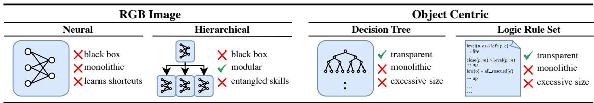  
Figure 8: Existing approaches are not interpretable. Neural RL agents are black-boxes and learn shortcuts. Hierarchical RL remains a black box and typically produces entangled skills. Symbolic agents are transparent, but grow massively with policy complexity.

## A.1 Interpretable Policy Sizes

We visualize the actual logic policies retrieved from existing interpretable RL methods in Listing 3 and Listing 4. While these policies have maximum transparency on low-level action selection, they are difficult to interpret for humans due to the massive size. NEXUS on the other hand presents a simple solution by incorporating hierarchical abstraction and thus allowing for compact and interpretable high-level policies, cf. Listing 1 and Listing 2.

def play(state):   
if state.Ball\_0.prev\_x <= 1.24:   
if state.Ball\_0.y − state.Enemy\_0.prev\_y <= −0.41:   
if state .Ball\_0.x − state.Ball\_0.prev\_x <= 0.09:   
if state .Player\_0.y − state.Enemy\_0.y <= −0.91:   
if state .Ball\_0.x <= 0.73:   
if state .Player\_0.y − state.Ball\_0.x <= −1.20:   
return "LEFT"   
else :   
return "RIGHT"   
else :   
return "NOOP"   
else :   
if state.Ball\_0.x <= −0.05:   
return "NOOP"   
else :   
if state .Player\_0.y − state.Player\_0.prev\_y <= −0.19:   
return "NOOP"   
else :   
if state.Ball\_0.prev\_x − state.Ball\_0.prev\_y <= −0.38:   
return "NOOP"   
else :   
if state .Ball 0.x − state.Ball 0.prev x <= —0.09:   
return "RIGHT"   
else :   
return "RIGHT"   
else :   
return "RIGHT"   
else :   
if state.Ball\_0.x − state.Enemy\_0.y <= −1.46:   
if state .Player\_0.y − state.Ball\_0.prev\_x <= −0.92:   
return "LEFT"   
else :

return "RIGHT"   
else :   
if state .Player\_0.y − state.Ball\_0.y <= −0.63:   
if state.Ball\_0.prev\_x <= −0.05:   
return "LEFT"   
else :   
if state .Player\_0.y − state.Ball\_0.y <= −0.80:   
return "LEFT"   
else :   
if state.Ball 0.prev x <= 0.80:   
return "LEFT"   
else :   
return "NOOP"   
else :   
if state.Ball 0.x <= −0.07:   
if state .Ball\_0.prev\_y <= −0.15:   
if state .Ball\_0.prev\_y <= −1.96:   
return "LEFT"   
else :   
return "LEFT"   
else :   
return "NOOP"   
else :   
if state .Ball\_0.y <= 1.24:   
if state.Player\_0.y − state.Ball\_0.y <= −0.48:   
if state .Ball\_0.prev\_x <= 0.68:   
return "NOOP"   
else :   
return "NOOP"   
else :   
if state .Ball\_0.x <= 0.54:   
if state .Player\_0.y <= −0.82:   
return "NOOP"   
else :   
if state .Enemy\_0.y − state.Enemy\_0.prev\_y <= −0.09:   
return "RIGHT"   
else :   
return "RIGHT"   
else :   
if state.Ball\_0.x − state.Ball\_0.y <= −0.21:   
return "NOOP"   
else :   
return "RIGHT"   
else :   
if state .Ball\_0.y <= 1.54:   
return "NOOP"   
else :   
return "LEFT"   
state .Player\_0.y − state.Ball\_0.y <= −0.54:   
if state .Player\_0.y − state.Ball\_0.y <= −0.88:   
return "LEFT"   
else :   
if state .Ball\_0.y <= −1.40:

return "RIGHT"   
else :   
return "NOOP"   
else :   
if state .Enemy\_0.y − state.Enemy\_0.prev\_y <= 0.93:   
return "RIGHT"   
else :   
return "LEFT"

Listing 3: Pong policy of SCoBots (Delfosse et al., 2024b)

```prolog
up_air(X):−oxygen_low(B).
up_divers_collected(X):—all_divers_collected(D).
fire_left (X):—same_depth_enemy(P,E),visible_enemy(E),facing_left(P),right_of_enemy(P,E).
fire_right (X):—same_depth_enemy(P,E),visible_enemy(E),facing_right(P),left_of_enemy(P,E).
left_aim(X):—right_of_enemy(P,E),facing_right(P),same_depth_enemy(P,E),visible_enemy(E).
right_aim(X):—left_of_enemy(P,E),facing_left(P),same_depth_enemy(P,E),visible_enemy(E).
down_aim(X):—higher_than_enemy(P,E),visible_enemy(E).
up_aim(X):-deeper_than_enemy(P,E),visible_enemy(E)
up_evade(X):—close_by_enemy(P,E),same_depth_enemy(P,E),visible_enemy(E).
down_evade(X):—close_by_enemy(P,E),same_depth_enemy(P,E),visible_enemy(E).
up_evade(X):—close_by_missile(P,M),same_depth_missile(P,M),visible_missile(M).
down_evade(X):—close_by_missile(P,M),same_depth_missile(P,M),visible_missile(M).
left to diver(X):—right of diver(P,D),close by diver(P,D),visible diver(D).
right_to_diver(X):—left_of_diver(P,D),close_by_diver(P,D),visible_diver(D).
up_to_diver(X):—deeper_than_diver(P,D),close_by_diver(P,D),visible_diver(D).
down_to_diver(X):—higher_than_diver(P,D),close_by_diver(P,D),visible_diver(D).
```

Listing 4: Seaquest policy of NUDGE (Delfosse et al., 2023a)

```csv
logits_noop2 = −0.074*y_agent_1*y_opponent_2 + 0.059*y_agent_1*y_opponent_3 − 0.097*
y_agent_4 − 0.16*y_opponent_1*y_opponent_2 − 0.18*y_opponent_2**2 − 0.27*y_opponent_2
+ 0.063*y_opponent_4
logits_up1 = 0.23*y_agent_1**2 + 0.59*y_agent_1*y_agent_2 + 0.4*y_agent_2**2 + 0.11*
y_agent_2 − 1.5*y_agent_4**2 − 3.6*y_agent_4 + 0.068*y_opponent_3 + 1.1
logits_down1 = 0.09*x_ball_3 + 0.12*x_ball_4 − 0.21*y_agent_1**2 + 0.12*y_agent_1*
y_opponent_1 + 0.27*y_agent_1*y_opponent_2 − 0.43*y_agent_1*y_opponent_3 − 0.28*
y_agent_1*y_opponent_4 + 0.13*y_agent_2 + 0.14*y_agent_4**2 + 0.43*y_agent_4 + 0.087*
y_ball_3 + 0.15*y_ball_4 + 0.14*y_opponent_1**2 + 0.6*y_opponent_1*y_opponent_2 + 0.61*
y_opponent_1 + 0.65*y_opponent_2**2 + 1.1*y_opponent_2 − 0.2*y_opponent_3**2 − 0.26*
y_opponent_3*y_opponent_4 − 2.8*y_opponent_3 − 0.085*y_opponent_4**2 − 0.14*
y_opponent_4 − 2.3
logits_up2 = 0.063*x_ball_4 − 0.078*y_agent_1 + 0.18*y_agent_2**2 + 0.52*y_agent_2*y_agent_3
+ 0.35*y_agent_2*y_opponent_1 + 0.29*y_agent_2*y_opponent_2 + 0.26*y_agent_2 + 0.38*
y_agent_3**2 + 0.51*y_agent_3*y_opponent_1 + 0.42*y_agent_3*y_opponent_2 + 1.6*
y_agent_3 − 8.2*y_agent_4 − 0.085*y_ball_3 + 0.17*y_opponent_1**2 + 0.28*y_opponent_1*
y_opponent_2 + 0.25*y_opponent_1 + 0.11*y_opponent_2**2 + 0.15*y_opponent_2 − 0.074*
y_opponent_3 + 0.26 logits_down2 = −0.052*x_ball_1 − 0.068*x_ball_3 − 0.093*x_ball_4 +
0.18*y_agent_1 − 0.17*y_agent_2**2 − 0.49*y_agent_2*y_agent_3 − 0.33*y_agent_2*
y_opponent_1 − 0.27*y_agent_2*y_opponent_2 − 0.39*y_agent_2 − 0.35*y_agent_3**2 − 0.48*
y_agent_3*y_opponent_1 − 0.4*y_agent_3*y_opponent_2 − 0.38*y_agent_3 + 0.15*y_agent_4
**2 + 0.54*y_agent_4 − 0.06*y_ball_1 − 0.064*y_ball_3 − 0.11*y_ball_4 − 0.17*y_opponent_1
**2 − 0.28*y_opponent_1*y_opponent_2 − 0.58*y_opponent_1 − 0.13*y_opponent_2**2 − 0.38*
y_opponent_2 + 2.2*y_opponent_3 − 0.052*y_opponent_4 − 3.6
```

```python
action_noop = [exp(logits_noop1) + exp(logits_noop2)] / sum(exp(logits))
action_up = [exp(logits_up1) + exp(logits_up2)] / sum(exp(logits))
action_down = [exp(logits_down1) + exp(logits_down2)] / sum(exp(logits))
```  
Listing 5: Pong policy of INSIGHT (Luo et al., 2024)

## B Hierarchical PQN Algorithm

The complete algorithm for hierarchical PQN with a neural meta-policy is provided in Algorithm 2.

Algorithm 2 Hierarchical PQN   
Require: Update period U, number of parallel environments E, number of skills N, exploration probability   
€   
Ensure: Learned Q-network parameters $\{ \phi _ { n } \} _ { n = 1 } ^ { N }$ φmeta   
1: Initialize Q-network parameters $\{ \phi _ { n } \} _ { n = 1 } ^ { \tilde { N } } ,$ φmeta   
2: Sample initial states $s _ { 0 } ^ { e } \sim P _ { 0 }$ for $e \in \{ 0 , \ldots , E - 1 \}$   
3: $t \gets 0$   
4: for each episode do   
5: for all $e \in \{ 0 , \ldots , E - 1 \}$ in parallel do   
6: Sample skill $\pi _ { t } ^ { e } \sim \pi _ { 1 }$ meta   
7: With probability $\epsilon \colon a _ { t } ^ { e } \sim$ Unif, else $a _ { t } ^ { e } \sim \pi _ { t } ^ { e }$   
8: Sample rewards $r _ { t } ^ { e } \sim P _ { R } ( s _ { t } ^ { e } , a _ { t } ^ { e } )$ , skill rewards $r _ { t } ^ { e , n } \sim P _ { R , n } ( s _ { t } ^ { e } , a _ { t } ^ { e } )$ for all n   
9: Sample next state $s _ { t + 1 } ^ { e } \sim P _ { S } ( s _ { t } ^ { e } , a _ { t } ^ { e } )$   
10: $t \gets t + 1$   
11: end for   
12: if t mod $U = 0$ then   
13: Compute meta λ-returns $R _ { \lambda , t - 1 } ^ { e }$ to $R _ { \lambda , t - U } ^ { e }$ for all e   
14: Compute skill λ-returns $R _ { \lambda , t - 1 } ^ { e , n }$ to $R _ { \lambda , t - U } ^ { e , n }$ for all $e , n$   
15: for number of epochs do   
16: for number of minibatches do   
17: Sample minibatch B of size $b \leq E U$ from $\{ ( t - U , 0 ) , \ldots , ( t - 1 , E - 1 ) \}$   
18: Update meta:   
$\phi _ { \mathrm { m e t a } }  \phi _ { \mathrm { m e t a } } + \frac { \alpha _ { t } } { 2 b } \nabla _ { \phi _ { \mathrm { m e t a } } } \sum _ { ( j , \tau ) \in B } ( R _ { \lambda , \tau } ^ { j } - Q _ { \phi _ { \mathrm { m e t a } } } ( s _ { \tau } ^ { j } ) ) ^ { 2 }$   
19: Update skills:   
$\phi _ { n } \gets \phi _ { n } + \frac { \alpha _ { t } } { 2 b } \nabla _ { \phi _ { n } } \sum _ { ( j , \tau ) \in B } \left( R _ { \lambda , \tau } ^ { j , n } - Q _ { \phi _ { n } } \big ( s _ { \tau } ^ { j , n } \big ) \right) ^ { 2 } , \quad \forall n \in \{ 1 , \ldots , N \}$   
20: end for   
21: end for   
22: end if   
23: end for

## C Implementation Details

Setup. We base our implementations on CleanRL (Huang et al., 2022) and PureJaxRL (Lu et al., 2022), adapting them to object-centric inputs by replacing convolutional encoders with lightweight MLPs for feature extraction. Hyperparameters are listed in Table 2 and Table 3 and remain largely consistent with the original implementations, except for an increased number of parallel environments enabled by the efficiency of JAX-based code.

The exploration parameter € was selected via a brief hyperparameter sweep in the range [1, 0.001], using final test return as the selection criterion.

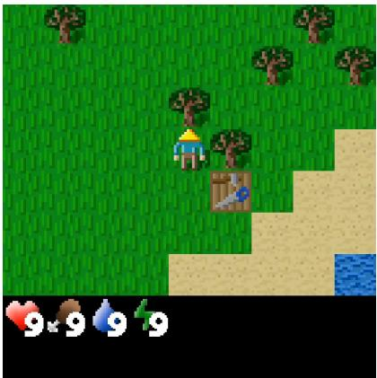  
(a) Crafter

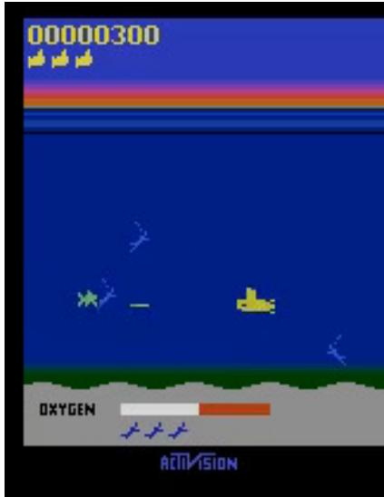  
(b) Seaquest

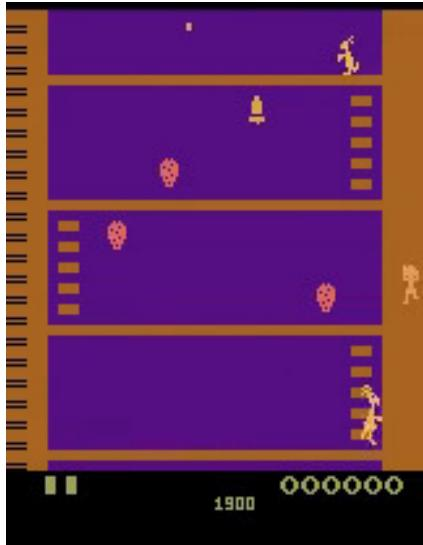  
(c) Kangaroo  
Figure 9: The evaluation environments: Crafter, Seaquest and Kangaroo.

Each experiment is run with six random seeds (0-5) to ensure robust reporting. Reported plots include the corresponding standard deviation.

All experiments were conducted on a single NVIDIA Tesla V100-SXM3-32GB-H GPU on an NVIDIA DGX Server (Version 5.1.0) with CUDA 12.4.

Our code repository¹ includes all necessary code and config files to reproduce the results from the experiments section, including plots.

## C.1 Environments

Screenshots of the environments Crafter, Seaquest and Kangaroo are available in Figure 9.

These games are selected because their gameplay naturally decomposes into low-level skills that must be combined to solve the overall task. In Kangaroo, the objective is to ascend through platforms while avoiding enemies and collecting berries. In Seaquest, the player navigates a submarine to rescue divers and return them to the surface, while avoiding hazards such as sharks and enemy submarines. These two games are known to exhibit reward hacking behavior, meaning that the agents find simple shortcuts of increasing their return rather than the intended way that humans would typically choose. Examples include exclusively shooting enemies in Seaquest and only catching falling apples or boxing monkeys in Kangaroo. Unlike Atari games, Crafter presents a more complex, open-ended challenge that requires agents to acquire and coordinate multiple skills, including navigation, combat, resource collection, and crafting

## C.2 Evaluation Metrics

We empirically evaluate agent performance using three metrics: (1) Skill Returns to test whether the skills were learned successfully, (2) Human-Normalized Score (HNS) for absolute performance relative to human and random baselines and (3) Aligned Environment Goal Scores that measure performance based on the main goals described in the game's manual.

Human Normalized Score. Human-Normalized Score standardizes agent performance across Atari environments by accounting for differences in reward scales (Mnih et al., 2015; Machado et al., 2018). Given the average agent score A, human score H, and random score R, HNS is defined as:

$$
\mathrm { H N S } = { \frac { A - R } { | H - R | } }
$$

Table 2: Atari Hyperparameters
<table><tr><td>Parameter</td><td>PQN(-based)</td><td>PPO</td></tr><tr><td>Total Timesteps</td><td> $5 \times 1 0 ^ { 7 }$ </td><td> $5 \times 1 0 ^ { 7 }$ </td></tr><tr><td>Num Environments</td><td>1024</td><td>128</td></tr><tr><td>Num Steps per Update</td><td>32</td><td>32</td></tr><tr><td>Learning Rate</td><td> $2 . 5 \times 1 0 ^ { - 4 }$ </td><td> $2 . 5 \times 1 0 ^ { - 4 }$ </td></tr><tr><td>Max Grad Norm</td><td>10</td><td>0.5</td></tr><tr><td>Discount Factor (γ)</td><td>0.99</td><td>0.99</td></tr><tr><td>GAE Lambda (λ)</td><td>0.65 (0.5 with learned meta)</td><td>0.95</td></tr><tr><td>GAE Meta Lambda (λ)</td><td>0.9</td><td></td></tr><tr><td>Num Epochs</td><td>1</td><td>2</td></tr><tr><td>Num Minibatches</td><td>256</td><td>4</td></tr><tr><td>Hidden Size</td><td>64</td><td></td></tr><tr><td>Num Layers</td><td>3</td><td></td></tr><tr><td>Normalization</td><td>Layer Norm</td><td></td></tr><tr><td>Clip €</td><td></td><td>0.2</td></tr><tr><td>Entropy Coef</td><td></td><td>0.01</td></tr><tr><td>Value Function Coef</td><td></td><td>0.5</td></tr><tr><td>Anneal LR</td><td>False</td><td>True</td></tr><tr><td> $\epsilon { \mathrm { - } } \mathrm { S t a r t / E n d / D e c a y }$ </td><td>1.0 / 0.001 / 0.1</td><td></td></tr><tr><td>Meta e-Start/End/Decay</td><td>1.0 / 0.001 / 0.3</td><td></td></tr></table>

A value of 1.0 indicates human-level performance, values greater than 1.0 indicate superhuman performance, and values below 0 denote sub-random behavior. We adopt the human and random baselines from Badia et al. (2020), derived from professional human play.

Aligned Environment Goal Scores. Environment reward signals may not always align with the intended task objectives and can be susceptible to reward hacking. In such cases, agents may learn high-reward behaviors that are non-intuitive and deviate from human-like solutions. To better capture progress toward the actual environment goals, we define two aligned goal-based metrics grounded in the objectives stated in the game manuals.

For Seaquest, the goal is to rescue as many divers as possible; for Kangaroo, it is to help the mother kangaroo reach and rescue her baby, located on the topmost platform. Accordingly, we track the number of divers retrieved and the number of platforms reached, respectively.

## C.3 Interpretability Proxies - Detailed Computation

To rigorously compare policy complexity between NUDGE (Delfosse et al., 2023a) and NEXUS, we adopt the formal rule-based complexity metrics defined by Lakkaraju et al. (2016) alongside Average Decision Path Length (Wu et al., 2017):

• Rule Size (|R|): The total number of distinct rules or conditional logic branches comprising the policy.

• Total Rule Length $\left( \mathcal { L } _ { \mathrm { t o t a l } } \right)$ : The sum of all body literals (conditions) evaluated across the entire policy $\begin{array} { r } { \left( \mathcal { L } _ { \mathrm { t o t a l } } = \sum _ { r \in \mathcal { R } } | r | \right) } \end{array}$

• Average Decision Path Length (ADPL): The expected number of condition checks executed to make a single decision under a uniform distribution over execution paths Wu et al. (2017).

Table 3: Crafter Hyperparameters
<table><tr><td>Parameter</td><td>PQN(-based)</td></tr><tr><td>Total Timesteps</td><td> $1 \times 1 0 ^ { 9 }$ </td></tr><tr><td>Num Environments</td><td>512</td></tr><tr><td>Num Steps per Update</td><td>128</td></tr><tr><td>Learning Rate</td><td> $3 . 0 \times 1 0 ^ { - 4 }$ </td></tr><tr><td>Max Grad Norm</td><td>0.5</td></tr><tr><td>Discount Factor (γ)</td><td>0.99</td></tr><tr><td>GAE Lambda (λ)</td><td>0.5</td></tr><tr><td>GAE Meta Lambda (λ)</td><td>0.5</td></tr><tr><td>Num Epochs</td><td>4</td></tr><tr><td>Num Minibatches</td><td>4</td></tr><tr><td>Hidden Size</td><td>512</td></tr><tr><td>Num Layers</td><td>1</td></tr><tr><td>Normalization</td><td>Layer Norm</td></tr><tr><td>Anneal LR</td><td>True</td></tr><tr><td> $\epsilon { \mathrm { - } } \mathrm { S t a r t / E n d / D e c a y }$ </td><td> $1 . 0 \mathrm { ~ / ~ } 0 . 0 0 5 \mathrm { ~ / ~ } 0 . 1$ </td></tr><tr><td>Meta  $\epsilon { \mathrm { - } } \mathrm { S t a r t / E n d / D e c a y }$ </td><td> $1 . 0 \mathrm { ~ / ~ } 0 . 0 0 5 \mathrm { ~ / ~ } 0 . 1$ </td></tr></table>

## 1. Metric Definitions

|R| = Total count of rules/branches in policy R

$\mathcal { L } _ { \mathrm { t o t a l } } = \sum _ { r \in \mathcal { R } } | r |$ where $| r |$ is the number of body literals in rule r

$\mathrm { \ A D P L } = \frac { 1 } { | \mathcal { K } | } \sum _ { k = 1 } ^ { | \mathcal { K } | } C _ { k }$ where $C _ { k }$ is the cumulative evaluations to trigger path k

## 2. NUDGE Policy Computations

NUDGE for Seaquest (cf. Listing 4) consists of $| \mathcal { R } | = 1 6$ sequential Prolog rules evaluated top-to-bottom.

## A. Rule Size and Total Rule Length

• Rule Size $( | \mathcal { R } | _ { \mathbf { N U D G E } } )$ : 16 rules

• Total Rule Length $( { \mathcal { L } } _ { \mathrm { N U D G E } } ) { \mathrm { : } }$

$$
{ \begin{array} { l } { \displaystyle { \mathcal { L } } _ { \mathrm { N U D G E } } = \sum _ { i = 1 } ^ { 1 6 } { \lvert r _ { i } \rvert } } \\ { \displaystyle = 1 + 1 + 4 + 4 + 4 + 4 + 2 + 2 + 3 + 3 + 3 + 3 + 3 + 3 + 3 + 3 + 3 + 3 } \\ { \displaystyle = 4 6 { \mathrm { ~ l i t e r a l s } } } \end{array} } 3
$$

## B. Average Decision Path Length (ADPLNnuDGe)

Evaluating sequentially, reaching rule k requires evaluating and failing all conditions in rules $1 \ldots k - 1$ plus evaluating rule k. The cumulative cost $\begin{array} { r } { C _ { k } = \sum _ { i = 1 } ^ { k } | r _ { i } | } \end{array}$ for each rule $k \in \{ 1 , \ldots , 1 6 \}$ is:

$$
C _ { 1 } = 1 , \quad C _ { 2 } = 2 , \quad C _ { 3 } = 6 , \quad C _ { 4 } = 1 0 , \quad C _ { 5 } = 1 4 , \quad C _ { 6 } = 1 8 , \quad C _ { 7 } = 2 0 , \quad C _ { 8 } = 2 2 ,
$$

$$
C _ { 9 } = 2 5 , \quad C _ { 1 0 } = 2 8 , \quad C _ { 1 1 } = 3 1 , \quad C _ { 1 2 } = 3 4 , \quad C _ { 1 3 } = 3 7 , \quad C _ { 1 4 } = 4 0 , \quad C _ { 1 5 } = 4 3 , \quad C _ { 1 6 } = 4 6 .
$$

Summing cumulative checks across all 16 outcomes:

$$
\sum _ { k = 1 } ^ { 1 6 } C _ { k } = 3 7 7 \implies \mathrm { A D P L } _ { \mathrm { N U D G E } } = { \frac { 3 7 7 } { 1 6 } } = 2 3 . 5 6 { \mathrm { ~ e v a l u a t i o n s } }
$$

## 3. NEXUS (symbolic) Computations

Listing 1 defines an explicit control-flow hierarchy over 4 execution branches.

## A. Rule Size and Total Rule Length

• Rule Size $\scriptstyle ( | { \mathcal { R } } | _ { \mathbf { N E X U S - 1 } } ) :$ 4 execution branches (3 conditional statements + 1 default fallback)

• Total Rule Length (LNExus-1):

$$
\begin{array} { r } { \mathcal { L } _ { \mathrm { N E X U S - 1 } } = \left| r _ { 1 } \right| + \left| r _ { 2 } \right| + \left| r _ { 3 } \right| + \left| r _ { 4 } \right| } \\ { = 2 + 1 + 1 + 0 } \\ { = 4 \mathrm { ~ c o n d i t i o n s } } \end{array}
$$

## B. Average Path Length (ADPLNExus-1)

Accounting for short-circuit evaluation across the 4 possible decision paths $( \mathcal { K } = \{ 1 , 2 , 3 , 4 \} )$ , where a satisfied disjunction requires one check and a failed disjunction two:

• Path 1 (surface): $C _ { 1 } = 1$ check

• Path 2 (fight\_enemies): $C _ { 2 } = 2 + 1 = 3$ checks

• Path 3 (rescue\_divers): $C _ { 3 } = 2 + 1 + 1 = 4$ checks

• Path 4 (fight\_enemies default): $C _ { 4 } = 2 + 1 + 1 = 4 ~ \mathrm { c h e c k s }$

$$
\mathrm { A D P L } _ { \mathrm { N E X U S - 1 } } = { \frac { 1 + 3 + 4 + 4 } { 4 } } = \bf { 3 . 0 0 } ~ \mathrm { e v a l u a t i o n s }
$$

## 4. NEXUS (nesy) Computations

Listing 2 evaluates two independent conditional blocks sequentially; fight\_enemies is always admissible.

## A. Rule Size and Total Rule Length

• Rule Size $\scriptstyle \left( | { \mathcal { R } } | _ { \mathbf { N E X U S - 2 } } \right)$ : 2 rule blocks

• Total Rule Length $\left( \mathcal { L } _ { \mathbf { N E X U S - 2 } } \right)$

$$
\begin{array} { r l } & { \mathcal { L } _ { \mathrm { N E X U S - 2 } } = | r _ { 1 } | + | r _ { 2 } | } \\ & { ~ = 1 + 2 } \\ & { ~ = \mathbf { 3 } ~ \mathrm { c o n d i t i o n s } } \end{array}
$$

## B. Average Decision Path Length (ADPLNExus-2)

Both blocks execute on every forward pass:

• Block 1 (if diver\_available): Always 1.0 check.

• Block 2 (if oxygen\_low or all\_collected): Evaluates oxygen\_low (1 check) + 50% chance of evaluating all\_collected $( + 0 . 5 ~ \mathrm { c h e c k } ) = 1 . 5 $ checks.

$$
\mathrm { A D P L _ { N E X U S - 2 } = 1 . 0 + 1 . 5 = 2 . 5 0 \ e v a l u a t i o n s }
$$

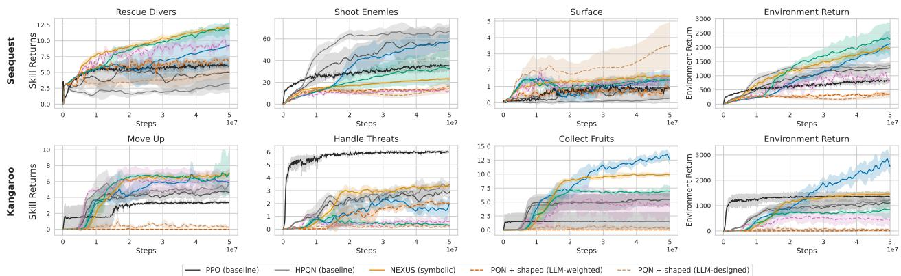  
Figure 10: Reward-shaping is not sufficient. Replacing NEXUS's neuro-symbolic meta-policy with LLM-designed or statically weighted reward shaping leads to severe performance degradation across both environments. While baselines successfully acquire isolated skills (e.g., surface in Seaquest), they fail to learn all skills equally well or to coordinate them—demonstrating that NEXUS's skill disentanglement is essential for achieving high overall performance.

## D Additional Results

## D.1 Comparative evaluation against reward shaping baselines

To isolate the benefits of NEXUS, we evaluate its performance against PQN trained on shaped rewards. To ensure a rigorous comparison, we designed three distinct reward-shaping strategies:

1. PQN + shaped (symbolic): Utilizes the same LLM-designed symbolic meta-policy as NEXUS (symbolic) to dynamically select the active skill reward at each time step, functioning analogously to a reward machine (Icarte et al., 2018; Castanyer et al., 2025).

2. PQN + shaped (uniform): Applies a static, equal weighting across all three skill rewards throughout training.

3. PQN + shaped (LLM-weighted): Leverages LLM-generated scalar weights to combine the individual skill rewards into a single fixed objective.

Across both environments, all three reward-shaping baselines fall significantly short of NEXUS in terms of overall performance. Although these baselines successfully acquire specific localized behaviors, such as rescue\_divers or surface, in Seaquest, they focus on single skills and fail to effectively coordinate them, resulting in low overall environment returns. These results demonstrate that simply augmenting RL methods with shaped or LLM-designed rewards is insufficient, whereas NEXUS's neuro-symbolic architecture enables equal skill learning and coordination.

## D.2 Analysis of neuro-symbolic meta-policy impact and skill activation dynamics

To evaluate the contribution of the neuro-symbolic meta-policy, we analyze both the performance impact of its decision-making mechanism and the activation frequencies of individual skills across Seaquest and Kangaroo (Figure 11). We first test the necessity of the Meta-Q-value maximization by replacing it in ambiguous situations where multiple skill conditions evaluate to true with a uniformly random choice over the valid skills. To prevent frequent switching, random skill selections are held for a minimum duration of 20 steps. We observe a notable drop in overall environment return and aligned evaluation metrics in both domains, with Seaquest exhibiting a stronger performance degradation than Kangaroo. This drop confirms that the neuro-symbolic meta-policy plays a critical role in selecting context-appropriate actions rather than relying on arbitrary execution. Analyzing skill activation frequencies reveals that gameplay in both environments is heavily anchored by dedicated default skills: fight\_enemies in Seaquest and navigate in Kangaroo. The meta-policy selectively departs from these defaults only when specific conditions permit alternative skills to maximize expected returns. In Seaquest, the agent heavily balances default combat with targeted objectives

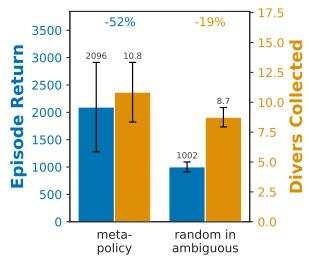

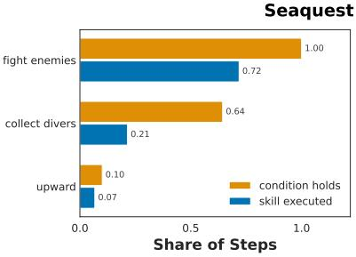

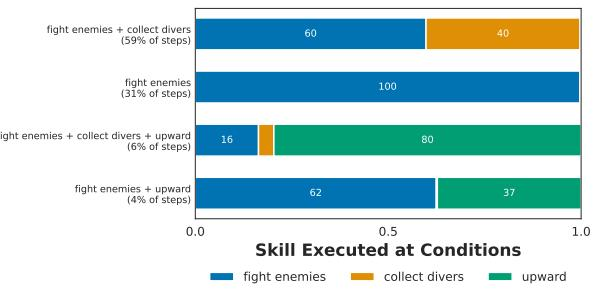

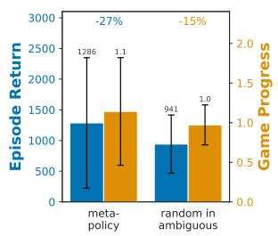

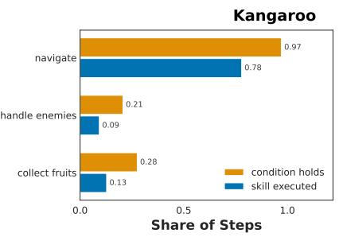

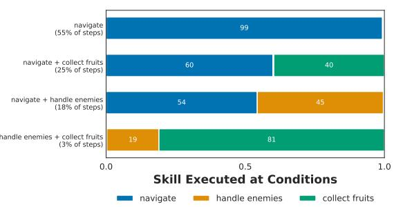  
Figure 11: Skill activation dynamics and performance impact of the neuro-symbolic metapolicy in Seaquest and Kangaroo. Replacing the meta-policy with random skill choices significantly degrades performance, demonstrating its critical role in maximizing returns. Default skills (fight\_enemies in Seaquest, navigate in Kangaroo) dominate usage, while specialized skills trigger selectively based on context: collect\_divers (20% total / 30% eligible) and upward (7% total / 70% eligible) in Seaquest, versus collect\_fruits (13% total / 46% eligible) and handle\_enemies (9% total / 40% eligible) in Kangaroo.

The collect\_divers skill activates in roughly 20% of all execution steps, corresponding to 30% of the steps where it was eligible. Conversely, the upward skill accounts for only 7% of total gameplay steps, but triggers in 70% of all valid opportunities, indicating highly efficient, situational utilization. In Kangaroo, the navigate skill overwhelmingly dominates total runtime. Secondary skills execute far more conservatively collect\_fruits accounts for 13% of all steps (46% of eligible opportunities), while handle\_enemies is invoked in just 9% of total steps (40% of eligible opportunities).

## D.3 Additional environments

To assess the generality of NEXUS, we extend our evaluation to three additional Atari environments: Pong Breakout, and Freeway. Skill learning curves for these environments are shown in Figure 12, while comparisons to baseline agents and ablations—evaluated via human-normalized scores—are presented in Figure 13. Note that these games are generally less complex than Kangaroo and Seaquest, and the learned skills are not strictly necessary to achieve the environment goals. In particular, the skills "Move Up" and "Avoid Crash" in Freeway largely correspond to atomic actions such as forward or noop. As such, a simple fixed meta-policy operating directly on primitive actions could suffice for solving this task.

## D.4 Neuro-symbolic RL baselines.

For improved comparison, we provide baseline scores of existing interpretable and neuro-symbolic methods on both the default games (cf. Figure 14) and the simplifications (cf. Figure 15). We compare to NUDGE (Delfosse et al., 2023a) and BlendRL (Shindo et al., 2025). All scores, together with the reported scores from SCoBots (Delfosse et al., 2024b) (game simplification scores from Delfosse et al. (2025)) are reported in Table 4. While prior neuro-symbolic methods achieve competitive scores, they suffer from significant limitations regarding transparency and flexibility. Primarily, interpretability in these baselines is restricted to low-level actions. Consequently, the overall behavioral policy must be defined at the action granularity, resulting in excessive complexity that is difficult to parse (cf. Section A). Furthermore, these approaches lack explicit representations of the high-level objectives currently being pursued (e.g., collect all divers').

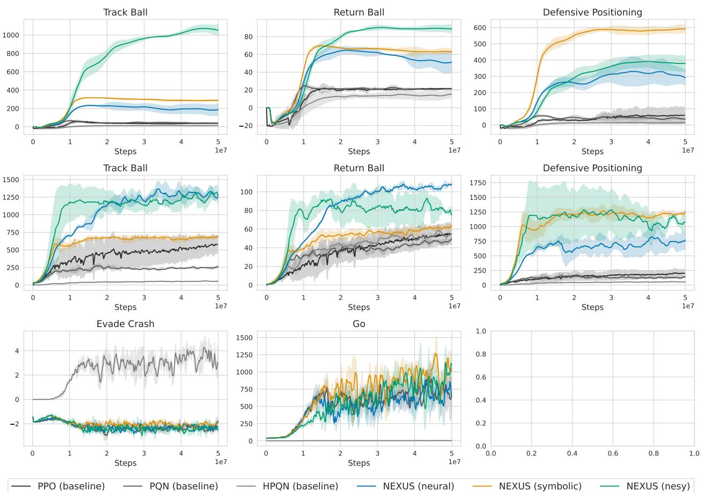

Figure 12: NEXUS successfully learns skills in Pong (top), Breakout (middle), and Freeway (bottom).  
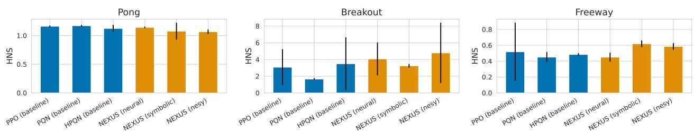  
Figure 13: NEXUS achieves performance comparable to baseline methods across the three evaluated environments.

The logical rules within NUDGE (Delfosse et al., 2023a) and BlendRL (Shindo et al., 2025) are static and strictly followed, resulting in rigid policies. While BlendRL attempts to mitigate this via a switching mechanism that activates a neural policy, this compromise diminishes transparency; the neural component maximizes extrinsic reward rather than adhering to an interpretable sub-goal.

Moreover, all baseline approaches necessitate substantial manual engineering. NUDGE and BlendRL require the definition of specific valuation functions based on detected objects and attributes, while SCoBots (Delfosse et al., 2024b) relies on the manual definition and selection of relational functions. In contrast, NEXUS operates at the abstracted level of skills, facilitating the interpretation and manipulation of the agent's active goals. As a result, the meta-policy definitions in NEXUS are significantly more concise than the action-level policies of SCoBots, NUDGE, and BlendRL. Additionally, NEXUS eliminates the need for manual valuation functions by autonomously learning skills via LLM-generated reward functions.

Finally, the performance of NUDGE and BlendRL in simplified environments is largely attributable to extensive hard-coded logic and specific valuation functions (e.g. fire if same\_depth(player, enemy) and visible(enemy) and facing right(player) and left of(player, enemy)') . Deriving these rigid rules is significantly more labor-intensive than generating meta-policy and reward functions in NEXUS, rendering the baselines less scalable to complex environments. This suggests an inherent trade-off between high-level interpretability manual labor, and performance. While previous algorithms prioritize maximum action-level transparency and performance by incorporating extensive manual inductive biases, this work targets high-level interpretability with a significantly reduced reliance on such biases.

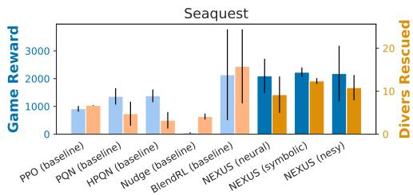

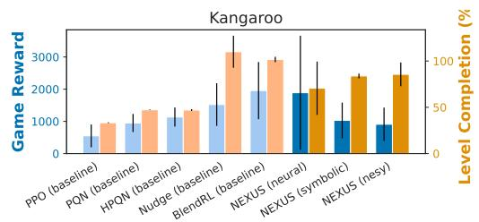

Figure 14: Comparison to other neuro-symbolic RL methods.  
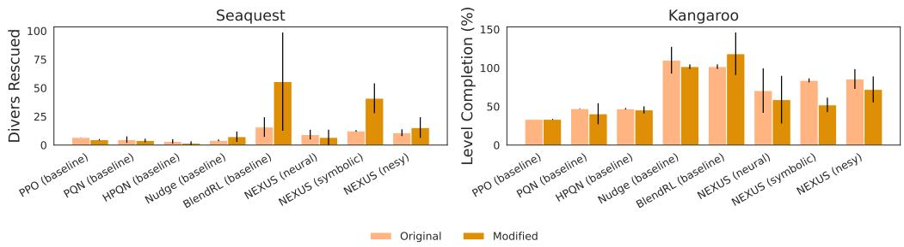  
Figure 15: Comparison to other neuro-symbolic RL methods on simplified games.

## E Noisy Detections

While object detection methods become increasingly reliable, misdetections still happen. To simulate unreliable object extractors, we incorporate a misdetection chance and gaussian noise to each object attribute during both training and testing. We conduct experiments with 10% misdetection rate and 3px gaussian noise. To emulate the effect of a kalman filter estimating the objects movements during each step, instead of zeroing out the detected objects, we keep the previous time step detections. On top of that, we add gaussian noise with a standard deviation of 3 at each attribute.

We observe significant differences between Seaquest and Kangaroo. For Seaquest, when introducing noise only during evaluation (Figure 16), all methods lose performance significantly. However, both the symbolic and neuro-symbolic approaches keep rescuing a relatively high number of divers. In Kangaroo, on the other hand, the experiments surprisingly indicate that all approaches increase in performance.

The performance drops show different characteristics when the approaches also experience noise during training (Figure 17).

In Seaquest, all NEXUS approaches drop only a small amount and remain reliable. We again observe only small performance drops (and even improvements) in Kangaroo. Our working hypothesis for the observed robustness in Kangaroo is that the noise induced a higher exploration and reduced overfitting to spurious correlations during training.

Table 4: Performance Comparison on Seaquest and Kangaroo
<table><tr><td rowspan="2">Algorithm</td><td colspan="4">Seaquest</td><td colspan="4">Kangaroo</td></tr><tr><td>Default</td><td>Divers Collected</td><td>Simplification</td><td>Divers Collected</td><td>Default</td><td>Level Completion (%)</td><td>Simplification</td><td>Level Completion (%)</td></tr><tr><td>PPO</td><td>915.3 ± 101.1</td><td>(6.7 ± 0.1)</td><td>0.0 ± 0.0</td><td>(4.7 ± 0.6)</td><td>550.0 ± 353.6</td><td>(33.3 ± 0.0)</td><td>150.0 ± 212.1</td><td>(33.3 ± 0.0)</td></tr><tr><td>PQN</td><td>1361.3 ± 294.6</td><td>(4.8 ± 2.8)</td><td>0.0 ± 0.0</td><td>(4.0 ± 1.5)</td><td>949.7 ± 279.9</td><td>(47.3 ± 0.4)</td><td>338.9 ± 209.1</td><td>(40.5 ± 13.6)</td></tr><tr><td>NEXUS (neural)</td><td>2100.7 ± 614.5</td><td>(9.2 ± 4.2)</td><td>0.0 ± 0.0</td><td>(6.7 ± 6.8)</td><td>1889.0 ± 1770.6</td><td>(70.6 ± 28.8)</td><td>551.0 ± 513.2</td><td>(58.9 ± 30.9)</td></tr><tr><td>NEXUS (symbolic)</td><td>2229.1 ± 172.9</td><td>(12.4 ± 0.7)</td><td>9416.7 ± 4363.2</td><td>(41.0 ± 13.1)</td><td>1030.3 ± 553.3</td><td>(83.8 ± 2.6)</td><td>448.7 ± 147.4</td><td>(52.0 ± 9.4)</td></tr><tr><td>NEXUS (nesy)</td><td>2185.6 ± 1000.1</td><td>(10.8 ± 2.9)</td><td>2483.3 ± 1607.7</td><td>(15.3 ± 9.0)</td><td>909.4 ± 519.1</td><td>(85.6 ± 12.8)</td><td>674.8 ± 115.8</td><td>(72.1 ± 16.9)</td></tr><tr><td>NUDGE</td><td>46.7 ± 23.1</td><td>(4.1 ± 0.7)</td><td>113.3 ± 99.6</td><td>(7.3 ± 4.5)</td><td>1522.2 ± 661.9</td><td>(110.0 ± 17.3)</td><td>1966.7 ± 290.6</td><td>(101.7 ± 2.9)</td></tr><tr><td>BlendRL</td><td>2138.9 ± 1636.0</td><td>(15.8 ± 8.6)</td><td>24755.6 ± 29438.4</td><td>(55.6 ± 43.0)</td><td>1955.6 ± 887.8</td><td>(101.7 ± 2.9)</td><td>1944.4 ± 300.6</td><td>(118.3 ± 27.5)</td></tr><tr><td>SCoBots</td><td>1055.3 ± 272.6</td><td>(- ± -)</td><td>0.0 ± 0.0</td><td>(- ± -)</td><td>2776.6 ± 1332.4</td><td>(-±-)</td><td>0.0 ± 0.0</td><td>(- ± -)</td></tr></table>

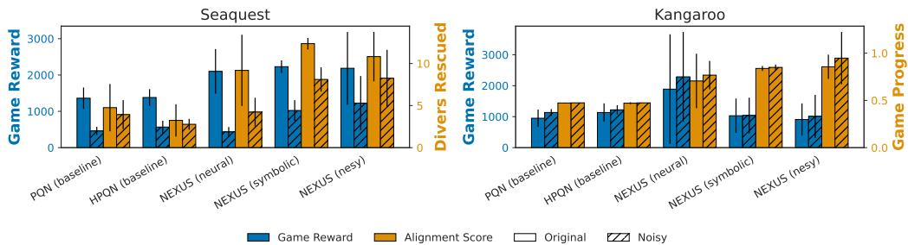  
Figure 16: Noisy evaluation under 10% misdetection and noise.

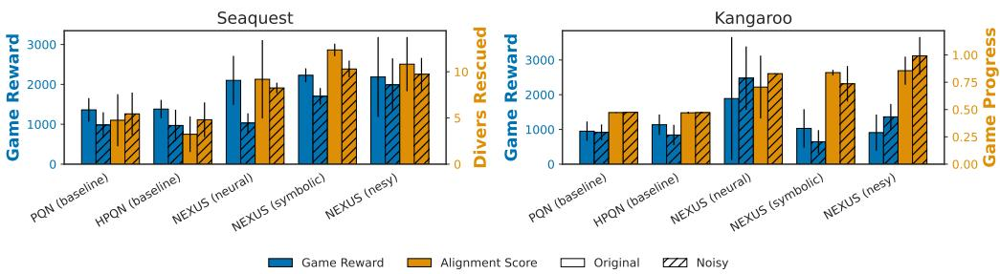  
Figure 17: Noisy training and evaluation under 10% misdetection and noise.

## F LLM Interaction

We outline the procedure for leveraging an LLM to generate task-relevant skills, associated reward functions, and a fixed meta-policy rule set. The LLM is conditioned on the game's original manual and structured type information describing the object-centric observations available to the agent

Initially, the LLM is queried for a set of skills and corresponding reward functions. These outputs can be manually refined before querying the LLM for a meta-policy function that selects which skill to execute. Prior prompts and responses are retained to maintain conversational context, consistent with standard chat behavior. We provide the entire prompt for the game Kangaroo in Figure 18. The prompt for Seaquest was generated equivalently.

Unedited responses from GPT-4o (via chatgpt.com on 21-07-2025) for the games Kangaroo and Seaquest are included in Figure 19–Figure 22.

For Crafter, we used the LLM to generate the list of important tasks, as well as the symbolic meta-policy function. Prompt and answers are available in Figure 23 and Figure 24. Rewards for the specific skills were crafted manually.

The LLM outputs served as a starting point: while the proposed skill decompositions and the structure of the meta-policies were largely retained, the final implementations required both framework adaptations (e.g., JAX compatibility, mapping to the available state variables) and semantic refinements by the authors, such as setting distance and resource thresholds, reordering rule priorities, and simplifying or rebalancing reward terms. The neuro-symbolic rule sets were derived manually from the symbolic meta-policies by making their conditions non-exclusive. Table 5 lists all changes per environment and component; the final code is available in our repository².

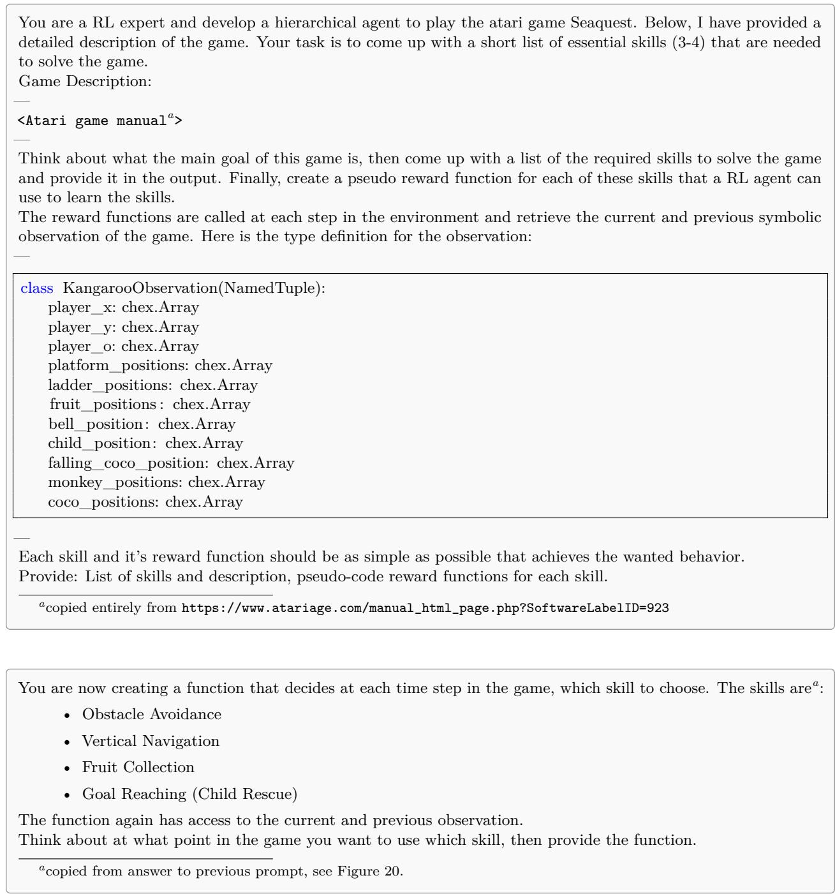  
Figure 18: Subsequent prompts (chat-function) to generate a skill-list and corresponding reward functions (top) and meta-policy function (bottom) for the game Kangaroo.

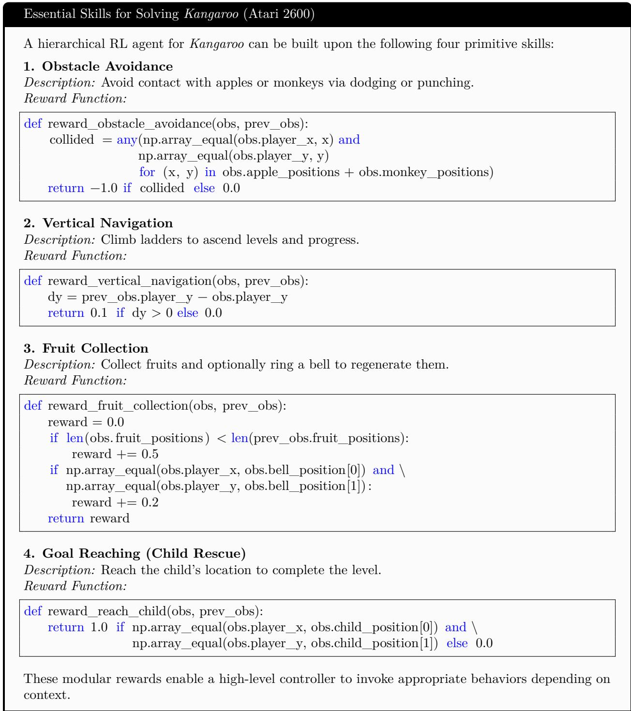  
Figure 19: Generated reward functions for Kangaroo by GPT4-O

Kangaroo Skill Selection Function   
To select appropriate skills, the agent follows a fixed priority:   
1. Obstacle Avoidance: If any apple or monkey is in close proximity.   
2. Goal Reaching: If the player is near the child on the top platform.   
3. Fruit Collection: If fruit is visible and reachable   
4. Vertical Navigation: Default behavior to explore or ascend.   
Skill Selector Function:   
def select\_skill (obs, prev\_obs):   
player\_pos = np.array([obs.player\_x, obs.player\_y])   
def in\_danger():   
danger\_entities = obs.apple\_positions + obs.monkey\_positions   
return any(np.linalg.norm(player\_pos − np.array([x, y])) <= 1.0   
for (x, y) in danger\_entities)   
def near\_child():   
child\_pos = np.array([obs.child\_position [0], obs.child\_position [1]])   
return np. linalg . norm(player\_pos − child\_pos) <= 1.5   
def fruit\_visible () :   
return any(abs(y − obs.player\_y) <= 1 and   
abs(x − obs.player\_x) <= 3   
for (x, y) in obs. fruit\_positions)   
if in\_danger():   
return obstacle\_avoidance   
elif near\_child():   
return goal\_reaching   
elif fruit\_\_visible ():   
return fruit\_collection   
else :   
return vertical\_navigation   
This rule-based selection policy balances safety, progression, and reward acquisition, enabling effective   
hierarchical control  
Figure 20: Generated fixed meta-policy function for Kangaroo by GPT4-O

Essential Skills for Solving Seaquest (Atari 2600)   
To solve Seaquest effectively, a hierarchical RL agent must master the following four core skills:   
1. Avoid Obstacles (Survival Navigation)   
Description: Avoid collisions with sharks, enemy submarines, missiles, and the patrol sub, both   
underwater and when surfacing.   
Reward Function (pseudo-code):   
def avoid\_obstacles\_reward(prev\_obs, curr\_obs):   
if player\_collided(curr\_obs):   
return -1.0   
return 0.0   
def player\_collided(obs):   
return check\_collision\_with\_sharks(obs) or \   
check\_collision\_with\_subs(obs) or\   
check\_collision\_with\_missiles(obs) or \   
check\_collision\_with\_surface\_sub(obs)   
2. Collect Divers   
Description: Navigate to and collect divers to accumulate score and progress.   
Reward Function (pseudo-code):   
def collect\_divers\_reward(prev\_obs, curr\_obs):   
prev\_count = count\_nearby\_divers(prev\_obs)   
curr\_count = count\_nearby\_divers(curr\_obs)   
return float (prev\_count > curr\_count) \* 1.0   
def count\_nearby\_divers(obs):   
return sum(is\_near(obs.player\_x, obs.player\_y, dx, dy)   
for dx, dy in obs.diver\_positions)   
3. Surface Strategically   
Description: Surface safely when carrying six divers or when oxygen is low, to drop off divers and   
replenish oxygen.   
Reward Function (pseudo-code):   
def surface\_reward(prev\_obs, curr\_obs):   
surfaced\_now = prev\_obs.player y > 0 and curr\_obs.player\_y == 0   
has\_6\_divers = num\_divers\_collected(prev\_obs) == 6   
low\_oxygen = prev\_obs.oxygen < OXYGEN\_THRESHOLD   
if surfaced\_now and (has\_6\_divers or low\_oxygen):   
return 2.0 if has\_6\_divers else 0.5   
return 0.0   
def num\_divers\_collected(obs):   
return 6 — sum(is\_valid(dx, dy) for dx, dy in obs.diver\_positions)   
4. Eliminate Threats (Combat)   
Description: Fire missiles to destroy sharks and enemy submarines, clearing paths and increasing   
score.   
Reward Function (pseudo-code):   
def eliminate\_threats\_reward(prev\_obs, curr\_obs):   
num\_enemies\_prev = count\_enemies(prev\_obs)   
num\_enemies\_curr = count\_enemies(curr\_obs)   
return float (num\_enemies\_curr < num\_enęmies\_prev) \* 0.5   
def count\_enemies(obs):   
return sum(is\_valid(dx, dy) for dx, dy in obs.shark\_positions) + \

Seaquest Skill Selection Function   
Here is a skill selection function that chooses the appropriate control skill at each time step based on   
game context   
Skill Selection Function (pseudo-code):   
def select skill (prev obs, curr obs):   
# Skill names   
AVOID = "obstacle\_avoidance"   
COLLECT = "collect divers"   
SURFACE = "surface\_strategically"   
COMBAT = "eliminate\_threats"   
# === Utility Functions ===   
def is\_threat\_near(obs: SeaquestObservation) -> bool:   
return check\_collision\_with\_sharks(obs) or \   
check\_collision\_with\_subs(obs) or \   
check collision with missiles(obs) or \   
check\_collision\_with\_surface\_sub(obs)   
def num\_divers\_collected(obs: SeaquestObservation) -> int:   
return 6 - sum(is valid(x, y) for x, y in obs.diver positions)   
def low\_oxygen(obs: SeaquestObservation) -> bool:   
return obs.oxygen < 20 # adjustable threshold   
def at\_surface(obs: SeaquestObservation) -> bool:   
return obs.player y == 0   
# === Skill Selection Logic ===   
if is\_threat\_near(curr\_obs):   
return AVOID   
if (num\_divers\_collected(curr\_obs) == 6 or low\_oxygen(curr\_obs)) and \   
not at\_surface(curr\_obs):   
return SURFACE   
if has\_nearby\_enemies(curr\_obs): # e.g. visible on screen in front   
return COMBAT   
return COLLECT   
Explanation of Logic:   
• Obstacle Avoidance is triggered immediately when any nearby threat is detected.   
• Surface Strategically is invoked if the agent has collected 6 divers or is low on oxygen, and   
is not already at the surface.   
• Eliminate Threats is used when enemies are visible but not an immediate threat.   
• Collect Divers is the default skill when no critical conditions are active.   
This rule-based selection mechanism allows a high-level controller to choose among primitive skills in   
a safety-first manner while still enabling reward-driven exploration and progress.  
Figure 22: Generated fixed metazpolicy for Seaquest by GPT4-O

You are a reinforcement learning specialist. The following is the basic description of the game Crafter, which you   
are trying to solve.   
Crafter is a game about exploring dungeons, mining, crafting and fighting enemies. The player can move in the   
four cardinal directions using WASD and can interact using SPACE. Interacting can cause the player to attempt   
to mine (a block), attack (a creature), drink (water or from a fountain), or eat (fruit).   
The player has the 'intrinsics' health, hunger, thirst and energy. Hunger, thirst and energy will naturally decrease   
and must be replenished by eating, drinking and sleeping respectively. Health will recover when hunger, thirst and   
energy are non-zero and will decrease if any of these are 0. If the players health falls beneath 0 they will die and   
the game will restart.   
First, come up with 5 basic skills that can be used to solve the game. Only provide necessary skills without   
duplications. After that, please come up with a simple function (pseudo code) that gets the game-state as input   
and returns an integer deciding on the active skill to select in the current state. The skills correspond to the ones   
that you chose before. Try to solve the game as far as possible.   
The game-state looks like this:   
@struct.dataclass   
class Inventory:   
wood: int = 0   
stone: int = 0   
coal: int = 0   
iron: int = 0   
diamond: int = 0   
sapling: int = 0   
wood\_pickaxe: int = 0   
stone\_pickaxe: int = 0   
iron pickaxe: int = 0   
wood\_sword: int = 0   
stone\_sword: int = 0   
iron\_sword: int = 0   
@struct.dataclass   
class Mobs:   
position: jnp.ndarray   
health: int   
mask: bool   
attack\_cooldown: int   
@struct.dataclass   
class EnvState:   
map: jnp.ndarray   
mob\_map: jnp.ndarray   
player\_position: jnp.ndarray   
player\_direction: int   
# Intrinsics   
player\_health: int   
player\_food: int   
player\_drink: int   
player\_energy: int   
is\_sleeping:bool   
# Second order intrinsics   
player\_recover: float   
player\_hunger: float   
player\_thirst: float   
player\_fatigue: float   
inventory: Inventory   
zombies: Mobs   
cows: Mobs   
skeletons: Mobs   
arrows: Mobs   
arrow\_directions: jnp.ndarray 34   
growing\_plants\_positions: jnp.ndarray   
growing\_plants\_age: jnp.ndarray   
plonts.mock: inp ndorr

Essential Skills for Solving Crafter   
Basic Skills. We identify the following five skills as sufficient building blocks for solving Crafter:   
1. Gather Resources: Mine wood, stone, coal, iron, or other materials when available.   
2. Craft Tools/Weapons: Use gathered resources to craft pickaxes and swords for efficiency   
and combat readiness.   
3. Eat/Drink/Sleep: Replenish food, water, or energy to maintain survival.   
4. Fight/Defend: Attack hostile mobs when they are nearby and health is sufficient.   
5. Explore/Move: Traverse unexplored areas to discover resources, water, and safe locations.   
Policy Function. The following pseudo-code outlines a rule-based strategy for selecting the active   
skill based on the current game state.   
def select\_skill(state: EnvState) -> int:   
Returns the skill index:   
0 = Gather Resources   
1 = Craft Tools/Weapons   
2 = Eat/Drink/Sleep   
3 = Fight/Defend   
4 = Explore/Move   
# --- Survival priority   
if state.player\_food <= 2 or state.player\_drink <= 2 or state.player\_energy <= 2:   
return 2 # Eat/Drink/Sleep   
# --- Combat ---   
if mob\_nearby(state) and state.player\_health > 3:   
return 3 # Fight/Defend   
# --- Resource management ---   
if resources\_nearby(state) and inventory\_needs\_tools(state.inventory):   
return 0 # Gather Resources   
if can\_craft\_better\_tools(state.inventory):   
return 1 # Craft Tools/Weapons   
# --- Default action ---   
return 4  
Figure 24: Generated list of essential skills and a rule-based policy for solving Crafter by GPT4-O. The policy prioritizes survival, then combat, followed by resource gathering and crafting, and defaults to exploration otherwise.

Table 5: Human edits to LLM-generated components (GPT-4o, App. F). F: framework adaptation (JAX, state fields); S: semantic change; M: written manually
<table><tr><td>Env.</td><td>Component</td><td>Change from LLM output to final implementation</td><td>Type</td></tr><tr><td rowspan="5">Seaquest</td><td>Skill set</td><td>4 skills → 3; avoid obstacles dropped (death penalty moved into fight)</td><td>S</td></tr><tr><td>Γcollect</td><td>diver proximity count → direct divers_collected counter</td><td>F</td></tr><tr><td> $r _ { \mathrm { f i g h t } }$ </td><td>enemy count decrease (+0.5) → score increase (+1), life lost (−1)</td><td>S</td></tr><tr><td>rsurface</td><td>surfacing with 6 divers / low oxygen → oxygen refill (+0.1)</td><td>S</td></tr><tr><td>Meta-policy</td><td>same conditions; thresholds set (enemy &lt;40px, oxygen &lt;10), priority reordered</td><td>F+S</td></tr><tr><td rowspan="5">Kangaroo</td><td>Skill set</td><td>4 skills → 3; goal reaching merged into navigate</td><td>S</td></tr><tr><td>Inavigate</td><td>+0.1 per upward step → clipped ∆y, penalty below floor 1, 0 when crashing</td><td>S</td></tr><tr><td>Tenemies</td><td>collision (−1) → monkey killed (+1), life lost (−1)</td><td>S</td></tr><tr><td>Tfruits</td><td>fruit (+0.5) and bell (+0.2) → fruit (+1)</td><td>S</td></tr><tr><td>Meta-policy</td><td>same structure without goal rule; distance thresholds set (35/50px)</td><td>F+S</td></tr><tr><td rowspan="3">Crafter</td><td>Skill set</td><td>5 skills kept (renamed)</td><td></td></tr><tr><td>Rewards</td><td>written manually</td><td>M</td></tr><tr><td>Meta-policy</td><td>helper predicates implemented; thresholds changed; combat before survival; craft- ing before collection</td><td>F+S</td></tr><tr><td>All</td><td>NeSy rules</td><td>derived manually from the symbolic meta-policy by making conditions non- exclusive</td><td>M</td></tr></table>