# Intrinsic Information-Theoretic Analysis of ReLU Nets

Johan Mylius-Kroken1 Elisabeth Wetzer1 Ali Ramezani-Kebrya2

Robert Jenssen1,3,4 Kristoffer Wickstrøm1

1UiT The Arctic University of Norway, 2University of Oslo 3Norwegian Computing Center, 4University of Copenhagen johan.m.kroken@uit.no

## Abstract

Mutual information (MI) is fundamental to representation-learning analysis in deep networks, but in high dimensions MI estimators depend on hyperparameters whose bias often dominates the signal. We show that continuous piecewise-linear (CPWL) networks, including ReLU networks, admit an intrinsic information-theoretic analysis that avoids this pitfall: their inherent partition of the input space into convex linear regions assigns to every input a discrete region label Π alongside the continuous representation T and label Y. We introduce a decomposition of the mutual information I(Y; T) into interpretable geometric terms. We show that the dominant term, the routing information I(Y; Π), admits an estimable plug-in estimator, that in the well-sampled regime, approximates a population lower bound on the joint information I(Y ; Π, T). When the partition saturates, a functional-equivalence quotient collapses regions implementing the same linear operator and restores informativeness; this extension has a single bounded, dimensionless parameter, which is reported through the quotient’s compression ratio. The routing estimator agrees strongly with three established MI baselines applied to the same networks and data. The functional quotient recovers informative estimates in the regime bordering the well-sampled and under-sampled regime. We provide a framework for analysing the internal information geometry of CPWL networks, grounded in their inherent piecewise-linear structure rather than in external discretisation. Project page: https://johanmkr.github.io/Intrinsic-IT-analysis-of-ReLU-nets/

## 1 Introduction

Information-theoretic accounts of neural networks span training dynamics [1; 42], loss design [2; 23], and representation analysis [9; 15], but their empirical validation is brittle: classical non-parametric estimators (binning, kernel density, k-nearest neighbours [24; 30]) and variational neural estimators [2; 21] all depend on user-chosen hyperparameters — bin widths, bandwidths, neighbourhood radii, or auxiliary architectures — whose biases dominate the signal in deep networks [11; 15; 33]. Can we compute information-theoretic quantities intrinsic to the network, without such choices?

Continuous Piecewise Linear (CPWL) networks [16; 18] — including ReLU networks [13] — partition the input space X into convex linear regions on which the network acts as an affine map (Fig. 1). Each region ω is uniquely identified by the binary activation pattern $\pi _ { \omega }$ obtained by thresholding pre-activations at zero, so every input carries a discrete region label Π alongside its continuous representation $T = \phi _ { \Pi } ( X )$ , and information-theoretic quantities involving Π are welldefined on a finite alphabet without any discretisation choice. We use this to develop a framework for the geometry-based information of CPWL networks. The main contributions are:

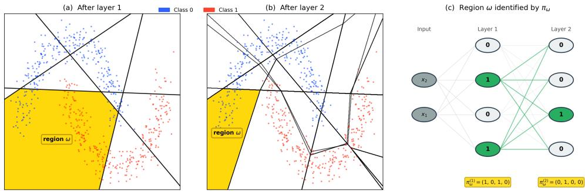  
Figure 1: From geometry to combinatorics in a ReLU network. (a) The first layer partitions the input space $\mathcal { X } \subset \mathbf { \mathbb { R } } ^ { 2 }$ into convex linear regions; black lines are the projections of the layer’s neuron hyperplanes onto X. A single region ω is highlighted in yellow. (b) Composing the second layer refines the partition: each new hyperplane subdivides regions of (a), so the partition through layer 2 is the common refinement of the per-layer partitions and ω itself is split. The network is affine on every region of this refinement. (c) The same region ω is uniquely identified by its activation pattern $\pi _ { \omega } = ( \pi _ { \omega } ^ { ( 1 ) } , \pi _ { \omega } ^ { ( 2 ) } ) = ( ( 1 , 0 , 1 , 0 ) , ( 0 , 1 , 0 , 0 ) )$ — the layer-wise binarisation of the pre-activations (green: active, white: inactive). The bijection between regions and activation patterns is the bridge between the geometric and combinatorial views of CPWL networks that our framework exploits for information-theoretic analysis.

• Information decomposition Theorem 3.1 decomposes $I ( Y ; T )$ into geometrically interpretable parts, where one is a discrete and estimable measure of routing information. Other terms are described in Proposition 3.2 and Corollaries 3.3 and 3.4.

• Routing estimator (Sec. 3.5). The plug-in estimator is computed from the partition and, in the well-sampled regime, approximates $I ( Y ; \Pi )$ . When it saturates, the functionalequivalence quotient (Proposition 3.5) introduces a coarsening of Π that merges regions implementing nearly identical linear operators under a Frobenius norm criterion. This extends the estimator into the fine-resolution regime where the number of regions approaches the number of samples.

We complement the theory with an empirical study (Sec. 5) on three structurally distinct datasets. Its calibration part is an internal-consistency check of the estimator: does the plug-in estimate on the network’s own routing alphabet agree with three established MI baselines applied to the same networks and data? It does not test whether I(Y; Π) approximates $I ( Y ; T )$ ; the two can differ in either direction (Corollary 3.4, Sec. 5.2). A saturation-correction experiment then shows that the functional-equivalence quotient recovers meaningful routing estimates at growing input dimensions.

Implications. Replacing aggregate $I ( Y ; T )$ with its decomposition turns hyperparameterconditioned IB observations on CPWL networks — whether information rises or falls with depth, whether folding destroys class content, whether MI saturates before generalisation — into measurable claims about specific terms. This is a first step towards an information-theoretic understanding of neural networks in which the base estimate originates from the network geometry.

## 2 Related Work

Geometry of CPWL networks. The combinatorial study of linear regions in ReLU networks was established by Montúfar et al. [29] and Pascanu et al. [35], with refined bounds and empirical counts in Hanin and Rolnick [18]; Serra et al. [41] – the latter showing that practical region counts are far below the theoretical maximum – and generalised to arbitrary CPWL activations via convexpartition arrangements by Goujon et al. [16], the framework we adopt in Sec. 3.1. Algorithmic extraction has been pursued through 2D-specialised exact visualisation [22], edge-subdivision [3], and polyhedral marching that prunes unreachable regions [27; 39; 47]. MI estimation in deep networks. The information-bottleneck framework [34; 42; 44; 45] views representation learning as a tradeoff between $I ( X ; T )$ and $I ( Y ; T )$ , but Saxe et al. [40] and Goldfeld et al. [15] showed that $I ( Y ; T )$ is ill-defined for deterministic networks on continuous inputs, with estimates dominated by binning and noise-injection choices. Alternative formulations include sliced MI [14; 49] and variational lower bounds [2; 46]. These replace $I ( Y ; T )$ by a better-behaved surrogate; sliced MI, for instance, averages the MI of random one-dimensional projections and adds a choice of slice distribution and count. We instead exploit the discrete partition Π inherent to CPWL networks, on which $I ( Y ; \Pi )$ is well-defined on finite alphabets and estimable without such choices. It is not a surrogate for $I ( Y ; T )$ but one term of its exact decomposition (Theorem 3.1): it lower-bounds $I ( Y ; \Pi , { \bar { T } } )$ , and its gap to $I ( Y ; T )$ is the difference between the within-region information and a routing-loss term $I ( \bar { Y } ; \Pi \mid T )$ (Corollary 3.4) that has no analogue in the standard IB framework. Sliced MI on the same networks would be a complementary view of $I ( Y ; T )$ , which we leave to future work. Activation-pattern analysis. It is established that the number of activation patterns encountered in practice is far below the theoretical maximum [19], motivating the data-restricted analysis. Lewandowski et al. [26] introduced a space-folding measure based on Hamming-distance non-monotonicity along input-space paths, and Dhayalkar [8] formalised the global combinatorial structure as the ReLU Transition Graph, and later extended it with region-entropy and KL-based analysis [7], further put into a graph framework by Gaines and Bi [10].

## 3 Intrinsic information theoretic analysis of CPWL networks

The inherent partition of CPWL networks assigns every input both a continuous representation T and a discrete region label Π, and the label takes finitely many values regardless of what the per-region affine maps do. This section uses that structure: we set up notation (Sec. 3.1), propose the exact information decomposition (Sec. 3.3) with its structural consequences (Sec. 3.4), and turn to estimation: a plug-in routing estimator (Sec. 3.5) and a functional-equivalence quotient that extends its reach into the fine-resolution regime (Sec. 3.6).

## 3.1 Preliminaries

A CPWL neural network $\mathcal { N } : \mathcal { X }  \mathcal { Y }$ is the composite function $\mathbf { y } = \mathcal { N } ( \mathbf { x } ) = ( \sigma _ { L } \circ f _ { \theta _ { L } } \circ \cdot \cdot \cdot \circ$ $\sigma _ { 1 } \circ f _ { \theta _ { 1 } } ) ( \mathbf { x } )$ , mapping input x to output y. It has affine layers $f _ { \theta _ { l } } : \mathbb { R } ^ { n _ { l - 1 } }  \mathbb { R } ^ { n _ { l } }$ parametrized by ${ \boldsymbol { \theta } } _ { l } = \{ \mathbf { \bar { W } } ^ { l } \in \mathbb { R } ^ { n _ { l } \times n _ { l - 1 } } , \mathbf { b } ^ { l } \in \mathbb { R } ^ { n _ { l } } \}$ followed by point-wise ReLU activation $\sigma ( z ) = \operatorname* { m a x } ( 0 , z )$ . We denote $\mathcal { N } ^ { l }$ the sub-network truncated after layer l, write $\mathbf { z } ^ { l } = \mathbf { W } ^ { l } \mathbf { t } ^ { l - 1 } + \mathbf { b } ^ { l }$ for its pre-activation and $\mathbf { t } ^ { l } = \sigma _ { l } ( \mathbf { z } ^ { l } ) = \mathcal { N } ^ { l } ( \mathbf { x } )$ for its (post-activation) output. When unambiguous, we drop the superscript l.

Regions, activation patterns and partition. A region $\omega \subset \mathcal { X }$ is a subset of the input domain on which $\mathcal { N } ^ { l }$ is a single affine function. Each region in layer l is uniquely identified by an activation pattern $\pi _ { \omega } = ( \pi _ { \omega } ^ { 1 } , \ldots , \pi _ { \omega } ^ { l } )$ , the concatenation of per-layer binarisations $\pi _ { \omega } ^ { l } = \mathbf { 1 } [ \mathbf { z } ^ { l } \dot { > } 0 ] \in \{ 0 , 1 \} ^ { n _ { l } }$ for layers $1 , \ldots , l ,$ , obtained by thresholding the layer-l pre-activations at zero $( \mathrm { F i g . 1 }$ , panel c). We write $\mathbf { \dot { I I } } ^ { l }$ for the collection of regions induced by the network through layer $l ,$ so that $\textstyle \bigcup _ { \omega \in \Pi ^ { l } } \omega = \mathcal { X }$ partitions the input domain. In practice, only a small fraction of $\Pi ^ { l }$ contain data [18], and all our estimators are evaluated on this subset. Given a dataset $\mathcal { D } \subset \mathcal { X }$ of $N : = | \mathcal { D } |$ samples, the datasupported regions are $\Omega _ { \mathcal { D } } ^ { l } = \{ \omega \in \Pi ^ { l } : \omega \cap \mathcal { D } \neq \emptyset \}$ with cardinalities $| \Omega _ { \mathcal { D } } ^ { l } | \leq \operatorname* { m i n } \{ | \Pi ^ { l } | , | \mathcal { D } | \}$ Within any $\boldsymbol { \omega } \in \Pi ^ { l }$ the network behaves as an affine map $\phi _ { \omega } ^ { l } : \omega  \mathbb { R } ^ { n _ { l } }$ such that $\mathcal { N } ^ { l } | _ { \omega } = \phi _ { \omega } ^ { l }$ , with

$$
\phi _ { \omega } ^ { l } ( \mathbf { x } ) = \mathbf { A } _ { \omega } ^ { l } \mathbf { x } + \mathbf { c } _ { \omega } ^ { l } , \quad \mathbf { A } _ { \omega } ^ { l } = \prod _ { i = l } ^ { 1 } \mathbf { Q } _ { \omega } ^ { i } \mathbf { W } ^ { i } , \quad \mathbf { c } _ { \omega } ^ { l } = \mathbf { Q } _ { \omega } ^ { l } \mathbf { b } ^ { l } + \sum _ { j = 1 } ^ { l - 1 } \left( \prod _ { k = l } ^ { j + 1 } \mathbf { Q } _ { \omega } ^ { k } \mathbf { W } ^ { k } \right) \mathbf { Q } _ { \omega } ^ { j } \mathbf { b } ^ { j } ,\tag{1}
$$

where $\textstyle \prod _ { i = l } ^ { 1 }$ denotes the descending product $\mathbf { Q } _ { \omega } ^ { l } \mathbf { W } ^ { l } \cdot \cdot \cdot \mathbf { Q } _ { \omega } ^ { 1 } \mathbf { W } ^ { 1 }$ (matching feed-forward composition) and $\mathbf { Q } _ { \omega } ^ { i } = \mathrm { d i a g } ( \pi _ { \omega } ^ { i } )$ selects the active neurons in layer i. Construction of $\Omega _ { \mathcal { D } } ^ { l }$ from a trained network and a dataset reduces to evaluating $\pi _ { \omega } ( \mathbf { x } )$ at every $\mathbf { x } \in \mathcal { D }$ and grouping by pattern $( \mathrm { A p p . ~ A } )$

## 3.2 Probabilistic setup for information bottleneck chain

We treat the input X and label Y as random variables with $| y | < \infty$ . For layer l and a CPWL with given parameters, both $\Pi = \pi ( X ) \in \Pi ^ { l }$ and $T = \phi ( X ) \in \mathbb { R } ^ { n _ { l } }$ are deterministic functions of X. The standard bottleneck chain $Y \overset { \cdot } {  } X  T$ lifts to the directed acyclic graph $( \mathrm { D A G } ) \colon Y \longrightarrow X$ $\Pi , \quad X \longrightarrow T , \quad \Pi \longrightarrow T$ in which Π and $T$ are parallel descendants of $X ,$ not sequential. We use two conditional independencies: $Y \perp ( \Pi , T ) \mid X$ and $H ( \Pi \mid X ) = H ( T \mid X ) \stackrel { \bullet } { = } 0$ . Neither

$X  \Pi  T$ nor $X  T $ Π holds in general: within a region T is nontrivial in X, and distinct regions can share T-values under rank-deficient $\mathbf { A } _ { \omega }$ . The special case $l = 1$ , where $\Pi = \mathbf { 1 } [ T > 0 ]$ is the only setting in which T determines Π.

We write $\nu _ { \omega } : = p _ { T | \Pi } ( \cdot | \omega )$ for the within-region latent-space density – the density of T inside region ω. By the affine map of Eq. (1), $\nu _ { \omega }$ is supported on the affine image $\phi _ { \omega } ( \omega ) \subset \mathbb { R } ^ { n _ { l } }$ (possibly singular when $\mathbf { A } _ { \omega }$ is rank-deficient), and the marginal density of $T$ is the mixture $\begin{array} { r } { p _ { T } = \bar { \sum _ { \omega } } p _ { \Pi } \bar { ( \omega ) } \bar { \nu _ { \omega } } } \end{array}$ . A formal pushforward derivation and rank discussion are in App. E.

## 3.3 Decomposition of $I ( Y ; T )$

Theorem 3.1 (CPWL Information Decomposition). From the DAG we extract the following:

$$
I ( Y ; T ) = \underbrace { I ( Y ; \Pi ) } _ { r o u t i n g } + \underbrace { I ( Y ; T \mid \Pi ) } _ { w i t h i n - r e g i o n } - \underbrace { I ( Y ; \Pi \mid T ) } _ { r o u t i n g l o s s }\tag{2}
$$

and

$$
I ( Y ; \Pi , T ) = I ( Y ; \Pi ) + I ( Y ; T \mid \Pi ) = I ( Y ; X ) - I ( Y ; X \mid \Pi , T ) .\tag{3}
$$

The decomposition follows from chain-ruling $I ( Y ; \Pi , T )$ in two ways (proof in App. E.3). Each term has a clean interpretation:

$I ( Y ; \Pi )$ – routing information: task information in which region the input lands. Finite, well-defined, and the only directly estimable term (Sec. 3.5).

$\begin{array} { r } { I ( Y ; T \mid \Pi ) = \sum _ { \omega } p _ { \Pi } ( \omega ) I _ { \omega } ( Y ; \mathbf { A } _ { \omega } X ) } \end{array}$ – within-region information: how well $\mathrm { r o w } ( \mathbf { A } _ { \omega } )$ aligns with Y-relevant directions of X.

• I(Y ; Π | T) – routing loss: class-relevant region information destroyed by reading T alone; it is the information signature of folding (Proposition 3.2).

$I ( Y ; X \mid \Pi , T )$ – representation insufficiency: task information invisible to $( \Pi , T )$ ; zero iff $( \Pi , T )$ is sufficient for Y.

Per-region expressions for all four terms are in App. E.2.

Overlapping latent supports and routing loss. The routing-loss term has a clean geometric reading: it is positive precisely when distinct regions place mass on the same $t \in \mathbb { R } ^ { n _ { l } }$ and disagree about the class distribution there.

Proposition 3.2 (Routing loss from latent overlap). $I ( Y ; \Pi \mid T ) > 0$ iff there exist distinct regions $\omega , \omega ^ { \prime } \in \Pi ^ { l }$ with $\operatorname* { s u p p } ( \nu _ { \omega } )$ ∩ $\vert \operatorname { s u p p } ( \nu _ { \omega ^ { \prime } } ) \neq \emptyset$ of positive pT-mass, and whose conditional label distributions differ on the overlap, $p _ { Y | \Pi = \omega , T = t } \neq p _ { Y | \Pi = \omega ^ { \prime } , T = t }$ on a positive-mass subset.

A simpler sufficient condition, satisfied whenever within-region label uncertainty is independent of $T ,$ is that two such overlapping regions have differing region-conditional label laws $p _ { Y | \Pi = \omega } \neq p _ { Y | \Pi = \omega ^ { \prime } }$ Proof and remarks are in App. E.5.

## 3.4 Structural inequalities

$$
I ( Y ; T ) \leq I ( Y ; \Pi , T ) \leq I ( Y ; X )
$$

$$
i f f I ( Y ; \Pi \mid T ) = 0 .
$$

$$
i f f ( \Pi , T )
$$

Corollary 3.4 (Routing vs. within-region balance). $I ( Y ; T ) - I ( Y ; \Pi ) = I ( Y ; T \mid \Pi ) - I ( Y ; \Pi \mid T )$   
In particular, $I ( Y ; T ) ^ { \smile } > I ( Y ; \Pi )$ iff within-region discrimination exceeds routing loss.

Unlike the standard information-bottleneck chain, neither of $I ( Y ; \Pi )$ and $I ( Y ; T )$ dominates unconditionally; the sign of their difference is a measurable property of the network.

## 3.5 The plug-in routing estimator

Of the four terms in Theorem 3.1, only $I ( Y ; \Pi )$ is a discrete MI on finite alphabets and directly estimable. Given counts $n _ { y , \omega } , n _ { y } , n _ { \omega }$ over the data-supported regions $\Omega _ { \mathcal { D } } ^ { l }$ , the plug-in estimator is

$$
\hat { I } ( Y ; \Omega _ { \mathcal { D } } ) = \sum _ { y , \omega } \frac { n _ { y , \omega } } { N } \log _ { 2 } \frac { n _ { y , \omega } N } { n _ { y } n _ { \omega } } , \qquad N = | \mathcal { D } | .\tag{4}
$$

In the well-sampled regime $\mathrm { P r } ( \Pi \not \in \Omega _ { \mathcal { D } } ) \ll 1 , \hat { I }$ approximates $I ( Y ; \Pi )$ , and the chain

$$
\hat { I } ( Y ; \Omega _ { \mathcal { D } } ) \approx I ( Y ; \Pi ) \le I ( Y ; \Pi , T ) \le I ( Y ; X ) \le H ( Y )\tag{5}
$$

holds up to the truncation gap, bounded by $H ( Y ) \operatorname* { P r } ( \Pi \mathrm { ~ \# ~ } \Omega _ { \mathcal { D } } ) + h _ { 2 } ( \operatorname* { P r } ( \Pi \mathrm { ~ \# ~ } \Omega _ { \mathcal { D } } ) )$ ) with $h _ { 2 }$ the binary entropy $( \mathrm { A p p . ~ E . 6 } ) . \ \hat { I }$ is the only quantity that needs to be estimated; every inequality has a clean interpretation through Theorem 3.1. The plug-in estimator is biased upwards at finite N. We compare it with four standard bias correction, Miller-Madow [28], Grassberger [17], Chao-Shen [5] and Chao-Wang-Jost [6] (App. G.2).

Target and occupancy. The chain uses $\ " \approx \ "$ rather than $\ " \leq \ "$ because ${ \hat { I } } ,$ whose empirical frequencies are normalised over the observed regions, targets $I ( Y ; \Pi \mid \Pi \in \Omega _ { \mathcal { D } } )$ . Conditioning on the observed regions can move MI in either direction, so $\hat { I }$ is not in general a population lower bound for $I ( Y ; \Pi )$ (App. E.6). To judge which regime an estimate is in, we report the occupancy

$$
\rho ^ { l } : = \vert \Omega _ { \mathcal { D } } ^ { l } \vert / N \ \in \ ( 0 , 1 ]\tag{6}
$$

together with the singletonfraction, the share of regions that hold a single sample. Both are read off the count table of Eq. (4). At small $\rho$ most regions hold several points and $\hat { I }$ is close to $I ( Y ; \Pi )$ . As $\rho  \mathbf { \bar { \rho } } .$ 1 almost every region is a singleton, the partition becomes an injective map from samples to regions, and $\hat { I }$ approaches the empirical label entropy whether or not the network has learned class structure. Estimates in this regime are not reliable, and standard bias corrections do not repair them (App. G.2). The occupancy $\rho$ is distinct from the compression ratio $\rho _ { \mathrm { f u n c } }$ of Sec. 3.6.

Computational cost. Constructing $\Omega _ { \mathcal { D } } ^ { l }$ takes one forward pass per sample, $O ( N \cdot | \theta _ { \leq l } | )$ , which is the ordinary inference cost. Hashing the activation patterns costs $\begin{array} { r } { \bar { O } ( N \sum _ { i < l } n _ { i } ) } \end{array}$ , and filling the count table and evaluating Eq. (4) costs $O ( N )$ amortised plus $O ( | \Omega _ { \mathcal { D } } | \cdot | \mathcal { V } | )$ , with $| \Omega _ { \mathcal { D } } | \leq N$ . The estimator therefore adds overhead linear in $\dot { N }$ to a forward pass that is needed anyway, and is asymptotically cheaper than the pairwise clustering of the functional quotient (App. F).

## 3.6 The fine-resolution regime and the functional quotient

Eq. (5) is informative when $N \gg | \Omega _ { \mathcal { D } } |$ . For typical networks this fails: $\pi _ { \omega } \in \{ 0 , 1 \} ^ { \sum _ { i } n _ { i } }$ admits exponentially many patterns and at modest depth $| \Omega _ { \mathcal { D } } |$ approaches N. In that regime $\hat { I }$ saturates at $\bar { H ( Y ) }$ and the bound is vacuous. The issue is structural: the partition $\Omega _ { D }$ becomes too fine to be meaningfully estimated from D. We need a coarsening of Π that lower-bounds $I ( Y ; \Pi )$ and exploits the affine structure of Eq. (1). We propose to group regions that implement the same linear operator.

Functional equivalence. Two regions arefunctionally equivalent if they implement the same linear operator: ω $\begin{array} { r } { \tilde { \bf \Gamma } \tilde { \bf \Gamma } \tilde { \bf \Gamma } \tilde { \bf \Gamma } \tilde { \bf \Gamma } \tilde { \bf \Gamma } \tilde { \bf \Gamma } \tilde { \bf \Gamma } \tilde { \bf \Gamma } \tilde { \bf \Gamma } \tilde { \bf \Gamma } \tilde { \bf \Gamma } \tilde { \bf \Gamma } \tilde { \bf \Gamma } \tilde { \bf \Gamma } \tilde { \bf \Gamma } \tilde { \bf \Gamma } \tilde { \bf \Gamma } \tilde { \bf \Gamma } \tilde { \bf \Gamma } \tilde { \bf \Gamma } \tilde { \bf \Gamma } \tilde { \bf \Gamma } \tilde { \bf \Gamma } \tilde { \bf \Gamma } \tilde { \bf \Gamma } \tilde { \bf \Gamma } \tilde { \bf \Gamma } \tilde { \bf \Gamma } \tilde { \bf \Gamma } \tilde { \bf \Gamma } \tilde { \bf \Gamma } \tilde { \bf \Gamma } \tilde { \bf \Gamma } \tilde { \bf \Gamma } \tilde { \bf \Gamma } \tilde { \bf \Gamma } \tilde { \bf \Gamma } \tilde { \bf \Gamma } \tilde { \bf \Gamma } \tilde { \bf \Gamma } \tilde { \bf \Gamma } \tilde { \bf \Gamma } \tilde { \bf \Gamma } \tilde { \bf \Gamma } \tilde { \bf \Gamma } \tilde { \bf \Gamma } \tilde { \bf \Gamma } \tilde { \bf \Gamma } \tilde { \bf \Gamma } \tilde { \bf \Gamma } \tilde { \bf \Gamma } \tilde { \bf \Gamma \Gamma } \tilde { \bf \Gamma } \tilde { \bf \Gamma \Gamma } \tilde { \bf \Gamma \quad \Gamma } \tilde { \bf \Gamma \quad \Gamma } \tilde { \bf \Gamma } \tilde { \bf \Gamma \quad \Gamma } \tilde { \bf \Gamma \quad \Gamma } \tilde { \bf \Gamma \quad \Gamma } \tilde { \bf \Gamma \quad \Gamma } \tilde { \bf \Gamma \quad \quad \Gamma } \tilde { \bf \Gamma \quad \quad \Gamma \quad \quad \Gamma } \tilde \tilde { \bf \Gamma \quad \quad \Gamma \quad \quad \Gamma \quad \quad \quad } } \end \quad \quad \quad \quad \quad \mathrm \Gamma \quad \quad \quad \Gamma \quad \quad \quad \quad \Gamma \quad \quad \quad \Gamma \quad \quad \quad \quad \quad \Gamma \quad \quad \quad \quad \quad \mathrm \Gamma \quad \quad \quad \quad \quad \quad \quad \quad \quad \Gamma \quad \quad \quad \quad \quad \quad \quad \quad \quad \quad \quad \quad \mathrm \quad \quad \quad \quad \quad \quad \quad \end{array}$ . The bias $\mathbf { c } _ { \omega } ^ { l }$ is a region-dependent offset and is excluded. The quotient is denoted $\Omega _ { \mathcal { D } , \mathrm { f u n c } } = \Omega _ { \mathcal { D } } ^ { l } / \sim _ { \mathrm { f u n c } }$

Proposition 3.5 (Tight lower bound via functional quotient). $I ( Y ; \Omega _ { \mathcal { D } , \mathrm { f u n c } } ) \leq I ( Y ; \Pi )$ , with equality $i f f p _ { Y | \Pi = \omega }$ depends on ω only through $\mathbf { A } _ { \omega } ^ { l }$

Proof and remarks (predicted vs. ground-truth label) are in App. E.7.

Computing the quotient. Materializing each $\mathbf { A } _ { \omega } ^ { l }$ is expensive. We use the active sub-network matrix $\begin{array} { r } { \tilde { \mathbf { A } } _ { \omega } ^ { l } = \prod _ { i = l } ^ { 1 } \mathbf { W } ^ { i } [ S _ { i } ^ { \omega } , S _ { i - 1 } ^ { \omega } ] } \end{array}$ , where $S _ { i } ^ { \omega } \subseteq \{ 1 , \dots , n _ { i } \}$ is the set of active neurons in layer $i ,$ read directly from $\pi _ { \omega } ^ { i }$ , with $S _ { 0 } ^ { \omega } : = \{ 1 , \ldots , n _ { 0 } \}$ , and ${ \bf W } ^ { i } [ S _ { i } ^ { \omega } , S _ { i - 1 } ^ { \omega } ]$ is the corresponding submatrix of $\mathbf { W } ^ { i } . \mathbf { A } _ { \omega } ^ { l }$ is obtained from $\tilde { \mathbf { A } } _ { \omega } ^ { l }$ by inserting zero rows at inactive output positions. Since $\tilde { \mathbf { A } } _ { \omega } ^ { l }$ is a product of l matrices, its Frobenius norm scales with $\prod _ { i } \Vert \mathbf { W } ^ { i } \Vert$ and varies with depth. We therefore use the relative Frobenius criterion at tolerance $\varepsilon \geq 0$

$$
\omega \sim _ { \varepsilon } \omega ^ { \prime } : \Longleftrightarrow S _ { l } ^ { \omega } = S _ { l } ^ { \omega ^ { \prime } } \mathrm { a n d } \frac { \| \tilde { \mathbf { A } } _ { \omega } ^ { l } - \tilde { \mathbf { A } } _ { \omega ^ { \prime } } ^ { l } \| _ { F } } { \frac { 1 } { 2 } \big ( \| \tilde { \mathbf { A } } _ { \omega } ^ { l } \| _ { F } + \| \tilde { \mathbf { A } } _ { \omega ^ { \prime } } ^ { l } \| _ { F } \big ) } \leq \varepsilon ,\tag{7}
$$

which is dimensionless, bounded in $[ 0 , 2 ]$ , and scale-invariant across layers and architectures. The endpoints have clean meaning: $\varepsilon = 0$ recovers the raw partition; $\varepsilon \geq 1$ merges most regions regardless of architecture. Sec. 5.3 identifies $\varepsilon \in [ 0 . 2 , 0 . 5 ]$ as the useful range. Details are in App. F.

The functional-quotient estimator. Eq. (4) on $\Omega _ { \mathcal { D } , \mathrm { f u n c } }$ yields $\hat { I } _ { \mathrm { f u n c } } : = \hat { I } ( Y ; \Omega _ { \mathcal { D } , \mathrm { f u n c } } )$ satisfying

$$
\begin{array} { r } { \hat { I } _ { \mathrm { f u n c } } \approx I ( Y ; \Omega _ { \mathcal { D , \mathrm { f u n c } } } ) \leq I ( Y ; \Pi ) \leq I ( Y ; \Pi , T ) \leq I ( Y ; X ) \leq H ( Y ) , } \end{array}\tag{8}
$$

extending the chain Eq. (5) with an additional estimable lower bound.

Based on the functional-quotient estimator, we propose a new diagnostic tool for understanding compression and redundancy in CPWL networks: The compression ratio

$$
\rho _ { \mathrm { f u n c } } ^ { l } ( \varepsilon ) : = \left| \Omega _ { \mathcal { D } , \mathrm { f u n c } } ^ { l } ( \varepsilon ) \right| / \left| \Omega _ { \mathcal { D } } ^ { l } \right| \in \mathrm { ~ ( 0 , 1 ] ~ }\tag{9}
$$

diagnoses how much pattern redundancy the network carries: small values indicate many distinct patterns collapsing onto few linear operators, values near 1 indicate $\hat { I } _ { \mathrm { f u n c } } \approx \hat { I } ( Y ; \Omega _ { \mathcal { D } } )$ . We track $\rho _ { \mathrm { f u n c } } ^ { l } ( \varepsilon )$ as a layerwise diagnostic in Sec. 5.3.

## 4 Experimental setup

We evaluate the framework along two axes: Sec. 4.1 calibrates the plug-in routing estimator $\hat { I } ( Y ; \Omega _ { \mathcal { D } } )$ against three established MI baselines on three structurally distinct datasets, and Sec. 4.2 stresses the estimator at growing input dimension on PCA-reduced MNIST and tests whether the functionalequivalence quotient at relative tolerance ε recovers informativeness when the raw partition saturates at $H ( Y )$ . For the baselines we use uniform binning $( K = 8$ bins per coordinate) and k-means clustering $( K = | \mathcal { V } | )$ ), both with the Miller–Madow correction, and the mixed continuous–discrete KSG estimator $\left( k = 3 \right)$ of [38], the discrete-target adaptation of [24]. Further, we use fully-connected ReLU MLPs trained for 150 epochs with SGD with momentum [43], learning rate $\dot { \alpha } = 1 0 ^ { - 3 }$ momentum $\beta = 0 . 9$ , batch size 32, cross-entropy loss; no weight decay, dropout, or augmentation. Hidden weights use He initialisation [20], output weights Glorot initialisation [12], and biases start at zero. These settings were fixed in advance, not tuned. Five seeds per configuration; the data split is fixed across seeds. Networks are trained on 80% of each dataset; every estimate, routing and baseline alike, is computed on the held-out 20% (MNIST: the standard test split; App. B.4). Implementation details, licences and compute are in App. H.

## 4.1 Study 1 – Calibration against established estimators

Datasets. Composite – a synthetic 7-class 2D mixture of moons, concentric circles, and Gaussian blobs (10 000 points, of which $N = 2 { , } 0 0 0$ are held out for estimation; $H ( Y ) = 2 . 6 3 9 \ \mathrm { b i t s } ; \mathrm { A p p . \ B } )$ . WBC – the UCI Wisconsin Breast Cancer tabular dataset [48], binary, 569 points, of which $N = 1 1 4$ 1 are held out; $H ( Y ) = 0 . 9 4 9$ bits on the held-out points. MNIST FC – MNIST [25] flattened to 784 dimensions, projected to 10 PCA components, and rescaled to $[ - 1 , 1 ] ^ { 1 0 } ; N \stackrel { - } { = }$ 10 000-image test split, $H ( Y ) = 3 . 3 1 9$ bits. The three datasets cover label entropies from 0.95 to 3.32 bits.

Architectures. Composite and WBC: six fully-connected ReLU architectures spanning depth $\in \{ 3 , 5 \}$ and width $\in \{ \bar { 5 } , 9 , 2 5 \}$ . MNIST FC: three architectures $[ 3 , 3 , 3 ] , [ 5 , 5 , 5 ] , [ 7 , \dot { 7 } , 7 ] - \mathrm { w i d e } 1$ r or deeper networks enter the saturation regime studied in Sec. 4.2. 75 networks in total.

## 4.2 Study 2 – Saturation and the functional-equivalence quotient

We project MNIST onto its top d principal components for $\begin{array} { c c l } { d } & { \in } & { \{ 2 , 3 , 4 , 5 , 1 0 , 1 5 , 2 0 \} } \end{array}$ train three-hidden-layer ReLU MLPs with widths $\{ 7 , 1 5 , 2 5 , 5 0 \}$ and report estimators at the last hidden layer. The threshold ε in Eq. (7) is evaluated on a grid of 15 values, {0, 0.01, 0.05, 0.1, 0.2, . . . , 1.0, 1.5, 2.0}; Fig. 4 shows the subset {0, 0.1, 0.2, 0.3, 0.4, 0.5, 1.0, 2.0}. This gives $7 \times 4 \times 5 = 1 4 0$ networks. The layerwise compression profile $\rho _ { \mathrm { f u n c } } ^ { l } ( \varepsilon )$ is computed on the same grid for the five-layer Study-1 networks of Composite and WBC and for [5, 5, 5] and [7, 7, 7] on MNIST FC (40 networks). Training metrics are in App. I.

## 5 Results

## 5.1 Calibration: pointwise agreement across networks

Fig. 2 scatters $\hat { I } ( Y ; \Omega _ { \mathcal { D } } )$ against each of the three baselines, with one point per network: the last hidden layer at the last epoch, estimated on the same held-out points as the baselines $( n = 7 5$ per panel). Within each dataset cluster the points lie along the diagonal: $\hat { I }$ assigns the same bit counts as the baselines without requiring a bin width, bandwidth, or cluster count. The drop in r for KSG has two sources: (i) MNIST FC, where KSG sits systematically above $\hat { I } _ { \mathrm { r a w } }$ while binning and k-means track it closely, and (ii) Composite, where KSG sits at the $H ( Y )$ ceiling for 23 of the 30 networks (within 0.02 bits of $H ( Y ) = 2 . 6 3 9 )$ while ˆI ranges from 1.777 to 2.629 bits.

Table 1: Mean bias correction (plug-in minus corrected estimate, bits) by occupancy $\rho ,$ over the 138 (dataset, architecture, PCA dimension, layer) cells of both studies; n: number of cells. Small corrections at $\rho > 0 . 9$ mean the corrected value stays at the H(Y) ceiling. Full table: Table 4.
<table><tr><td>Estimator</td><td> $\rho < 0 . 0 5 ( n = 4 1 )$ </td><td> $\rho > 0 . 3 ( n = 5 6 )$ </td><td> $\rho > 0 . 9 ( n = 1 9 )$ </td></tr><tr><td>Miller-Madow</td><td>0.114</td><td>3.739</td><td>5.403</td></tr><tr><td>Grassberger</td><td>0.029</td><td>0.067</td><td>0.006</td></tr><tr><td>Chao-Shen</td><td>0.032</td><td>0.139</td><td>0.054</td></tr><tr><td>Chao-Wang-Jost</td><td>0.032</td><td>0.185</td><td>0.065</td></tr></table>

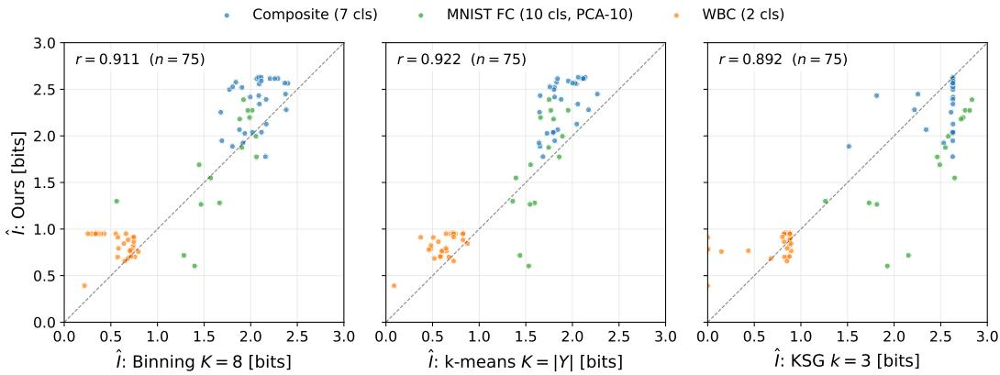  
Figure 2: Pointwise calibration of $\hat { I } ( Y ; \Omega _ { \mathcal { D } } )$ against three MI baselines: binning and k-means with the Miller–Madow correction, and the k-nearest-neighbour estimator KSG (last epoch, last hidden layer, held-out points). There is one marker per network (architecture and seed) on Composite (blue), WBC (orange), and MNIST FC (green). Pearson r pooled across all three datasets: $r = 0 . 9 1 1$ (binning, $K = 8 ) , r = 0 . 9 2 2$ (k-means, $K = | \mathcal { y } | )$ , r = 0.892 (KSG, k = 3). WBC networks with KSG near zero: App. G.5.

Finite-sample regime. The estimator is trustworthy when most regions hold several points, i.e. at small occupancy $\rho \left( \mathrm { E q . } \left( 6 \right) \right)$ . Most calibration networks are in that regime, but the two width-25 WBC architectures are not: with $N = 1 1 4$ held-out points they reach $\rho = 0 . 9 0 0$ and 0.961 at the deepest layer, so their points in Fig. 2 sit at $H ( Y )$ by construction $( \mathrm { A p p . ~ G . 1 } )$ . Standard bias corrections do not repair a saturated partition (Table 1): Miller–Madow over-corrects by several bits, into negative values, while Grassberger and the coverage-based Chao–Shen and Chao–Wang–Jost corrections leave the estimate within 0.069 bits of $H ( Y )$ at $\rho > 0 . 9 ( \mathrm { A p p . ~ G . 2 } )$ ). We therefore report $\rho$ with every estimate and treat saturation structurally (Sec. 5.3).

## 5.2 Calibration: layerwise profile at convergence

On all three datasets in Fig. 3 ˆI rises monotonically with depth, tracks binning and k-means at every layer, and stays at or below $H ( Y )$ on every layer of every one of the 75 networks (the chain Eq. (5) is empirically satisfied). KSG behaves differently: it starts near or above the routing estimator at layer 1 and then drifts down with depth on Composite $( \sim 2 . 6  2 . 4 \mathrm { b i t s } )$ , narrowing or inverting the KSG-to-routing gap by the deepest layer. On MNIST FC, KSG sits at $\sim 2 . 7 – 2 . \ 8$ bits across all three layers while ˆI rises from $\sim 0 . 9 5 \mathrm { t o } \sim 2 . 0$ , so the gap narrows from ∼ 1.8 bits at layer 1 to ∼ 0.65 bits at layer 3. Per Corollary $3 . 4 , I ( Y ; T ) - I ( Y ; \bar { \Pi } ) = I ( Y ; T \mid \Pi ) - I ( Y ; \Pi \mid \bar { T } )$ , so a positive KSG-above-routing gap signals that the within-region term $I ( Y ; T \mid \Pi )$ exceeds the routing-loss term $I ( Y ; \Pi \mid T )$ : in narrow MNIST networks the continuous geometry T within each region carries class information that the coarse routing partition Π does not yet resolve, and the gap shrinks as deeper layers route more of that information into Π.

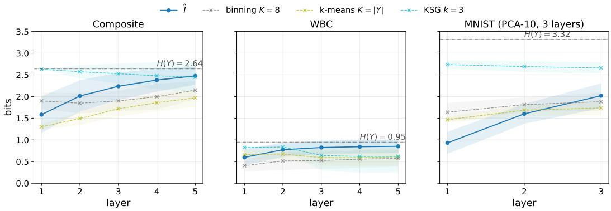  
Figure 3: Layerwise bits at the last training epoch, mean ±1σ across seeds and matching architectures. Solid: $\hat { I } ( Y ; \Omega _ { \mathcal { D } } )$ Dashed: the three baselines (binning and k-means with the Miller–Madow correction, KSG). Horizontal dash-dot: H(Y). The Composite and WBC panels pool the three five-hidden-layer architectures; the MNIST FC panel pools width 5 and 7 networks.

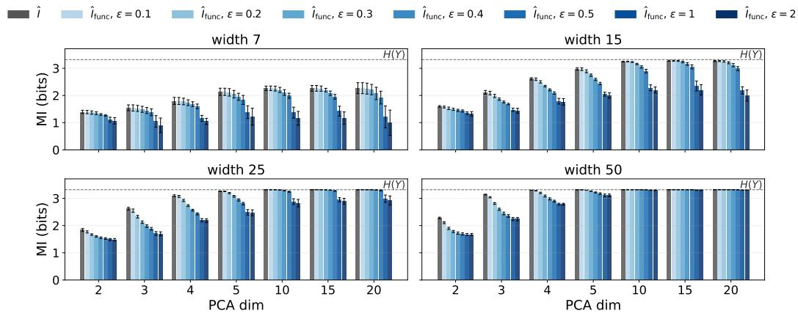  
Figure 4: Routing MI on PCA-reduced MNIST (last layer, last epoch) as a function of input dimension d, for four 3-hidden-layer architectures. Bars: ˆI (grey) and $\hat { I } _ { \mathrm { f u n c } } ( \varepsilon )$ (light to dark blue); error bars ±1σ over 5 seeds. Dashed line: $H ( Y ) = 3 . 3 1 9 . { \mathrm { ~ } } \tilde { \mathrm { A s } } { \mathrm { ~ } }$ d grows the raw bar approaches $H ( Y )$ for the wider architectures (saturation); the functional quotient at $\varepsilon \in [ 0 . 3 , 0 . 5 ]$ pulls it back below $H ( Y )$ except at widths 25 and 50.

## 5.3 Saturation and the functional-equivalence correction

Saturation. In Fig. 4, for $d \leq 5 , \hat { I } _ { \mathrm { r a w } }$ sits well below $H ( Y )$ at widths 7 and 15 (by at least 0.345 bits): the partition is informative. Widths 25 and 50 approach $H ( Y )$ already at small d (up to 3.317 bits). As d grows $( d \in \{ 1 0 , 1 5 , 2 0 \} )$ the raw estimator approaches $H ( Y )$ for widths 25 and 50: nearly every sample gets its own region, so the empirical conditional entropy $\hat { H } ( Y | \Omega _ { \mathcal { D } } )  0$ and ${ \hat { I } } _ { \mathrm { r a w } } \to { \hat { H } } ( Y )$ , whatever the network has learned.

Functional equivalence as correction. Merging starts at small $\varepsilon \colon \mathrm { a t } \ \varepsilon = 0 . 1$ and 0.2, $\hat { I } _ { \mathrm { f u n c } }$ falls up to 0.175 and 0.384 bits below $\hat { I } _ { \mathrm { r a w } }$ . At moderate $\varepsilon \in \{ 0 . 3 , 0 . 4 , 0 . 5 \}$ the quotient restores informativeness only where there are redundant linear operators to collapse: at $d \geq 1 0$ and $\varepsilon = 0 . 5$ the width-15 estimate sits 0.266–0.425 bits below $H ( Y )$ , the width-25 estimate only $0 . 0 2 7 \mathrm { - } 0 . 0 7 4$ bits, and width 50 stays saturated $( \mathrm { g a p } \leq 0 . 0 0 4$ bits): nearly every region there implements a distinct linear operator. At large $\varepsilon \in \{ 1 , 2 \}$ the quotient over-compresses; at $d = 2 , \varepsilon = 2$ keeps 0.732–0.828 of the raw value.

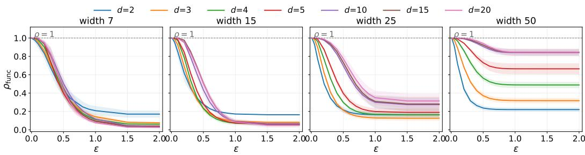  
Figure 5: $\rho _ { \mathrm { f u n c } } ( \varepsilon )$ on PCA-reduced MNIST of dimension d at the last hidden layer and training epoch. Lower $\rho _ { \mathrm { f u n c } }$ means more aggressive merging.

Compression-ratio diagnostic and layerwise compression. Fig. 5 traces $\rho _ { \mathrm { f u n c } } ( \varepsilon )$ at the last hidden layer. Small-d networks $( d { = } 2 , 3 )$ drop sharply at ε = 0.1 – many distinct routing paths share nearly identical linear operators – while large-d networks (d=15, 20) stay near 1 until $\varepsilon \approx 0 . 2 – 0 . 3$ before dropping. The transition window aligns with the window in Fig. 4 where $\hat { I } _ { \mathrm { f u n c } }$ provides informative compression: both diagnostics identify $\varepsilon \in [ 0 . 2 , 0 . 5 ]$ as the operating range. Across layers of the calibration networks (Fig. 7, App. F), $\rho _ { \mathrm { f u n c } } ^ { 1 } \dot { = } 1$ for every network, and for $\varepsilon > 0$ the ratio decreases with depth on average: functional equivalence is a phenomenon of compositions.

## 6 Discussion

## 6.1 Calibration against established MI estimators

What the calibration tests. $\hat { I } ( Y ; \Omega _ { \mathcal { D } } )$ is not proposed as a proxy for $I ( Y ; T )$ : by Corollary 3.4 the two can differ in either direction, and the KSG–routing gap discussed below shows that they do. The calibration in Sec. 5.1 is an internal-consistency check of the plug-in estimator: applied to the same networks and data, independent discretisation schemes should recover comparable information, and they do. Agreement between finite-sample estimators cannot rule out a bias they share, and the occupancy ρ (Eq. (6)) marks where that matters. The two width-25 WBC architectures sit at $\rho = 0 . 9 0 0$ and 0.961, where every estimate is pushed towards $H ( Y )$ and agreement carries little information (App. G.1).

Why the routing estimator tracks the discrete baselines. The Pearson coefficients $r = 0 . 9 1 1$ (binning) and $r = 0 . 9 2 2$ (k-means) over $7 5$ networks place $\hat { I } ( Y ; \Omega _ { \mathcal { D } } )$ within the intrinsic plug-in bias of the discrete baselines, across three structurally distinct datasets and a range from 0 bits up to $H ( Y )$ . The structural distinction is that $\Omega _ { D }$ is read from the network’s piecewise-linear geometry rather than from an external discretisation: no bin width, bandwidth, or cluster count is tuned, and the chain Eq. (5) fixes what the estimator measures (the routing information $I ( Y ; \Pi )$ , lower-bounding $I ( Y ; \Pi , { \bar { T } } ) )$ ).

The KSG–routing gap localises within-region information. KSG estimates $I ( Y ; T )$ from the continuous representation while $\hat { I } ( Y ; \Omega _ { \mathcal { D } } )$ estimates $I ( Y ; \Pi )$ , so by Corollary 3.4 a positive KSGabove-routing gap reads as $I ( Y ; T \mid \Pi ) > I ( Y ; \Pi \mid T )$ : the within-region geometry $T \mid \Pi$ carries class information that the partition Π has not yet routed. The narrowing of the gap with depth on all three datasets, and the inversion on Composite where the routing estimator overtakes KSG by layer $5 ,$ tracks Π becoming more class-discriminative. KSG’s known overestimation in lowdimensional continuous representations [15; 24] likely contributes some additional gap on MNIST $\operatorname { F C } ;$ disentangling the two contributions requires an independent estimator of $I ( Y ; T | \ \mathrm { \bar { I I } } )$ .

The $H ( Y )$ ceiling holds. Across all 75 networks, every hidden layer, and four estimators, no estimate exceeds ${ \bar { H } } ( Y )$ in Fig. 3; the chain Eq. (5) is empirically tight on MNIST FC and WBC and approached on Composite, across an order of magnitude of label entropy.

## 6.2 Functional equivalence as both correction and diagnostic

Saturation correction. When the input dimension is large enough that $| \Omega _ { \mathcal { D } } |$ approaches $N .$ , almost every region is a singleton, $\hat { I } _ { \mathrm { r a w } } \approx \hat { H } ( Y )$ , and the chain Eq. (5) carries no information. The functional quotient at $\varepsilon \in [ 0 . 3 , 0 . 5 ]$ collapses routing paths that implement nearly identical linear operators and pulls the estimate back below ${ \dot { \boldsymbol { H } } } ( { \boldsymbol { Y } } )$ when the network has such redundancy (widths 7–15 in Fig. 4); it cannot when nearly every region implements a distinct operator (width 50). Inside the window the estimate still moves with ε, by up to 0.304 bits between $\varepsilon = 0 . 3$ and 0.5. The criterion Eq. (7) is bounded in [0, 2], dimensionless, and depth- and architecture-invariant, so ε is a reportable choice rather than a tuned hyperparameter; Fig. 5 provides an audit of whether the chosen ε is in the merging window.

$\rho _ { \mathrm { f u n c } } ^ { l } ( \varepsilon )$ as a structural fingerprint. Two structural facts shape Fig. 7: $\rho _ { \mathrm { f u n c } } ^ { 1 } = 1$ identically (a single ReLU layer maps every activation pattern to a distinct linear operator), and on average $\rho _ { \mathrm { f u n c } } ^ { l }$ decreases in l at any fixed $\varepsilon > 0$ (each composition opens new opportunities for products of selection matrices to coincide). The dataset ordering – Composite most compressible, MNIST FC PCA-10 most resistant at small ε – reads as how much pattern redundancy each network develops when the data supports it: Composite admits a compact functional description by layer 5, while MNIST FC PCA-10, already in the saturation regime, requires non-trivial ε before any merging. $\rho _ { \mathrm { f u n c } } \approx 1$ throughout means $\hat { I } _ { \mathrm { f u n c } } \approx \hat { I } _ { \mathrm { r a w } }$ and the quotient is not worth computing; large drops signal that it is. On MNIST FC the routing and functional estimates separate as $\rho _ { \mathrm { f u n c } }$ drops, as the diagnostic predicts.

Limitations and scope The MNIST FC calibration was obtained on networks narrow enough that $| \Omega _ { \mathcal { D } } |$ remains below $\bar { N }$ . For wider or deeper networks the raw estimator is pushed by $H ( \breve { Y } )$ , and the functional quotient is required (Study 2). Moreover, the plug-in estimator Eq. (4) is bounded away from $I ( Y ; \Pi )$ by $H ( \bar { Y } ) \operatorname { P r } ( \Pi \ \notin \ \bar { \Omega } _ { \mathcal { D } } ) + h _ { 2 } ( \operatorname* { P r } ( \Pi \ \notin \ \bar { \Omega } _ { \mathcal { D } } ) )$ (App. E.6). The second term dominates near the saturation threshold and surfaces in Fig. 4 as the closing gap between $\hat { I } _ { \mathrm { r a w } }$ and $H ( Y )$ at large d. A bound that tracks the occupancy $\rho$ explicitly would sharpen this; until then we report ρ with every estimate, and by that measure the two width-25 WBC calibration architectures $( \rho \ge 0 . 9 0 0 )$ lie outside the reliable regime (Sec. 5.1). High routing information is also not by itself evidence of learned class structure. With randomly permuted training labels (App. G.6), the narrow [5, 5, 5] Composite network’s information about the true labels falls from 1.949 to 1.411 bits, and the functional quotient discounts it further (1.828 to 1.096 bits). The wide [25, 25, 25] network keeps 2.433 bits raw and 2.329 bits after the quotient, close to $H ( Y ) = 2 . 6 3 9$ bits, at 15.9% true-label test accuracy: a fine partition of spatially coherent classes correlates with the class whether or not the network has learned it. The quotient remains a valid lower bound by the data-processing inequality, but it removes this effect only at moderate capacity, so a high estimate should be read together with ρ and, where possible, a label-permutation control. Lastly, the quotient estimate depends on ε even inside the window [0.2, 0.5]: small ε already merges some regions $( \rho _ { \mathrm { f u n c } } ( 0 . 1 ) \geq \bar { 0 . 7 } 1 7 )$ and $\varepsilon \geq 1$ over-merges. We report ε with every estimate and audit it through $\rho _ { \mathrm { f u n c } }$ rather than treat it as an opaque hyperparameter.

## 7 Conclusion and Outlook

We introduced a framework for the internal information geometry of CPWL networks: an exact decomposition of $I ( Y ; T )$ into routing, within-region, and routing-loss terms; a hyperparameter-free plug-in routing estimator $\hat { I } ( Y ; \Omega _ { \mathcal { D } } )$ from the piecewise-linear partition; and a functional-equivalence quotient extending the estimator into the fine-resolution regime, at the cost of one bounded parameter ε that is reported and audited through $\rho _ { \mathrm { f u n c } } ( \varepsilon )$ . As an estimator sanity check, ˆI agrees with binning and k-means $( r = 0 . 9 1 1 , 0 . 9 2 2 )$ and remains at or below $H ( Y )$ across all 75 networks; the KSGabove-routing gap localises within-region information rather than estimator disagreement; and the functional quotient recovers informative estimates on PCA-reduced MNIST where the raw estimator saturates at $H ( Y )$ . Future work includes estimating the decomposition gap directly and extending the analysis to convolutional and residual architectures, where nearly every data point occupies its own region.

## Acknowledgments and Disclosure of Funding

The authors would like to thank associate professor Marta Panizzut at UiT - The Arctic University of Norway for fruitful discussions on algebraic geometry and tropical algebra.

This work was supported by the Research Council of Norway through its Centre of Excellence Integreat – The Norwegian Centre for knowledge-driven machine learning, project number 332645.

Ali Ramezani-Kebrya was supported by the Research Council of Norway through FRIPRO Grant under project number 356103.

## References

[1] L. Adilova, B. C. Geiger, and A. Fischer. Information plane analysis for dropout neural networks. In International Conference on Learning Representations, 2023.

[2] M. I. Belghazi, A. Baratin, S. Rajeshwar, S. Ozair, Y. Bengio, A. Courville, and D. Hjelm. Mutual information neural estimation. In Proceedings of the 35th International Conference on Machine Learning, volume 80 of PMLR, pages 531–540, 2018.

[3] A. Berzins. Polyhedral complex extraction from ReLU networks using edge subdivision. In Proceedings of the 40th International Conference on Machine Learning, volume 202 of PMLR, pages 2234–2244, 2023.

[4] C. M. Büth, K. Acharya, and M. Zanin. infomeasure: A comprehensive Python package for information theory measures and estimators. Scientific Reports, 15(1):29323, 2025. doi: 10.1038/s41598-025-14053-5.

[5] A. Chao and T.-J. Shen. Nonparametric estimation of Shannon’s index of diversity when there are unseen species in sample. Environmental and Ecological Statistics, 10(4):429–443, 2003. doi: 10.1023/A:1026096204727.

[6] A. Chao, Y. T. Wang, and L. Jost. Entropy and the species accumulation curve: A novel entropy estimator via discovery rates of new species. Methods in Ecology and Evolution, 4(11): 1091–1100, 2013. doi: 10.1111/2041-210X.12108.

[7] S. R. Dhayalkar. Discrete functional geometry of relu networks via relu transition graphs. In 2025 5th International Conference on Robotics, Automation, and Artificial Intelligence (RAAI), pages 153–159, 2025. doi: 10.1109/RAAI67517.2025.11423317.

[8] S. R. Dhayalkar. The geometry of ReLU networks through the ReLU transition graph. arXiv preprint arXiv:2505.11692, 2025.

[9] T. Fel, L. Béthune, A. K. Lampinen, T. Serre, and K. Hermann. Understanding visual feature reliance through the lens of complexity. In Advances in Neural Information Processing Systems, volume 37, pages 69888–69924, 2024.

[10] B. B. Gaines and J. Bi. Characterizing the discrete geometry of ReLU networks. In International Conference on Learning Representations, 2026. URL https://openreview.net/forum? id=TgLW2DiRDG.

[11] B. C. Geiger. On information plane analyses of neural network classifiers – A review. IEEE Transactions on Neural Networks and Learning Systems, 33(12):7039–7051, 2022. doi: 10. 1109/TNNLS.2021.3089037.

[12] X. Glorot and Y. Bengio. Understanding the difficulty of training deep feedforward neural networks. In Proceedings of the 13th International Conference on Artificial Intelligence and Statistics, volume 9 of PMLR, pages 249–256, 2010.

[13] X. Glorot, A. Bordes, and Y. Bengio. Deep sparse rectifier neural networks. In Proceedings of the 14th International Conference on Artificial Intelligence and Statistics, volume 15 of PMLR, pages 315–323, 2011.

[14] Z. Goldfeld and K. Greenewald. Sliced mutual information: A scalable measure of statistical dependence. In Advances in Neural Information Processing Systems, volume 34, pages 17567– 17578, 2021.

[15] Z. Goldfeld, E. van den Berg, K. Greenewald, I. Melnyk, N. Nguyen, B. Kingsbury, and Y. Polyanskiy. Estimating information flow in deep neural networks. In Proceedings ofthe 36th International Conference on Machine Learning, volume 97 of PMLR, pages 2299–2308, 2019.

[16] A. Goujon, A. Etemadi, and M. Unser. On the number of regions of piecewise linear neural networks. Journal of Computational and Applied Mathematics, 441:115667, 2024. doi: 10.1016/j.cam.2023.115667.

[17] P. Grassberger. Entropy estimates from insufficient samplings. arXiv preprint arXiv:physics/0307138, 2003.

[18] B. Hanin and D. Rolnick. Complexity of linear regions in deep networks. In Proceedings ofthe 36th International Conference on Machine Learning, volume 97 of PMLR, pages 2596–2604, 2019.

[19] B. Hanin and D. Rolnick. Deep ReLU networks have surprisingly few activation patterns. In Advances in Neural Information Processing Systems, volume 32, 2019.

[20] K. He, X. Zhang, S. Ren, and J. Sun. Delving deep into rectifiers: Surpassing human-level performance on ImageNet classification. In Proceedings of the IEEE International Conference on Computer Vision, pages 1026–1034, 2015.

[21] Z. Hu, S. Kang, Q. Zeng, K. Huang, and Y. Yang. InfoNet: Neural estimation of mutual information without test-time optimization. In Proceedings ofthe 41st International Conference on Machine Learning, volume 235 of PMLR, pages 19283–19303, 2024.

[22] A. I. Humayun, R. Balestriero, G. Balakrishnan, and R. Baraniuk. SplineCam: Exact visualiza tion and characterization of deep network geometry and decision boundaries. In Proceedings ofthe IEEE/CVF Conference on Computer Vision and Pattern Recognition, pages 3789–3798, 2023.

[23] M. Jeon, S. Shin, D. Jeon, and A. No. Information-theoretic discrete diffusion. In Advances in Neural Information Processing Systems, volume 38, pages 20913–20939, 2025.

[24] A. Kraskov, H. Stögbauer, and P. Grassberger. Estimating mutual information. Physical Review E, 69(6):066138, 2004. doi: 10.1103/PhysRevE.69.066138.

[25] Y. LeCun, L. Bottou, Y. Bengio, and P. Haffner. Gradient-based learning applied to document recognition. Proceedings ofthe IEEE, 86(11):2278–2324, 1998. doi: 10.1109/5.726791.

[26] M. Lewandowski, R. Pisoni, B. Heinzl, and B. A. Moser. Exploiting space folding by neural networks. In Proceedings of the AAAI Conference on Artificial Intelligence, volume 40, pages 22833–22840, 2026. doi: 10.1609/aaai.v40i27.39446.

[27] Y. Liu, T. Caglar, C. Peterson, and M. Kirby. Integrating geometries of ReLU feedforward neural networks. Frontiers in Big Data, 6:1274831, 2023. doi: 10.3389/fdata.2023.1274831.

[28] G. A. Miller. Note on the bias of information estimates. In H. Quastler, editor, Information Theory in Psychology: Problems and Methods, pages 95–100. Free Press, Glencoe, IL, 1955.

[29] G. Montúfar, R. Pascanu, K. Cho, and Y. Bengio. On the number of linear regions of deep neural networks. In Advances in Neural Information Processing Systems, volume 27, 2014.

[30] Y.-I. Moon, B. Rajagopalan, and U. Lall. Estimation of mutual information using kernel density estimators. Physical Review E, 52(3):2318–2321, 1995. doi: 10.1103/PhysRevE.52.2318.

[31] J. Mylius-Kroken. parx: Polyhedral Affine Region eXplorer. URL https://github.com/ Johanmkr/parx.

[32] I. Nemenman. Coincidences and estimation of entropies of random variables with large cardinalities. Entropy, 13(12):2013–2023, 2011. doi: 10.3390/e13122013.

[33] L. Paninski. Estimation of entropy and mutual information. Neural Computation, 15(6): 1191–1253, 2003. doi: 10.1162/089976603321780272.

[34] Y. Park, S. Lee, G. Kim, and D. Blei. Unsupervised representation learning via neural activation coding. In Proceedings ofthe 38th International Conference on Machine Learning, volume 139 of PMLR, pages 8391–8400, 2021.

[35] R. Pascanu, G. Montúfar, and Y. Bengio. On the number of response regions of deep feed forward networks with piece-wise linear activations. arXiv preprint arXiv:1312.6098, 2013.

[36] A. Paszke, S. Gross, F. Massa, A. Lerer, J. Bradbury, G. Chanan, T. Killeen, Z. Lin, N. Gimelshein, L. Antiga, et al. PyTorch: An imperative style, high-performance deep learning library. In Advances in Neural Information Processing Systems, volume 32, 2019.

[37] F. Pedregosa, G. Varoquaux, A. Gramfort, V. Michel, B. Thirion, O. Grisel, M. Blondel, P. Prettenhofer, R. Weiss, V. Dubourg, et al. Scikit-learn: Machine learning in Python. Journal ofMachine Learning Research, 12:2825–2830, 2011.

[38] B. C. Ross. Mutual information between discrete and continuous data sets. PLoS ONE, 9(2): e87357, 2014. doi: 10.1371/journal.pone.0087357.

[39] B. Sattelberg, R. Cavalieri, M. Kirby, C. Peterson, and R. Beveridge. Locally linear attributes of ReLU neural networks. Frontiers in Artificial Intelligence, 6:1255192, 2023. doi: 10.3389/frai. 2023.1255192.

[40] A. M. Saxe, Y. Bansal, J. Dapello, M. Advani, A. Kolchinsky, B. D. Tracey, and D. D. Cox. On the information bottleneck theory of deep learning. Journal ofStatistical Mechanics: Theory and Experiment, 2019(12):124020, 2019. doi: 10.1088/1742-5468/ab3985.

[41] T. Serra, C. Tjandraatmadja, and S. Ramalingam. Bounding and counting linear regions of deep neural networks. In Proceedings of the 35th International Conference on Machine Learning, volume 80 of PMLR, pages 4558–4566, 2018.

[42] R. Shwartz-Ziv and N. Tishby. Opening the black box of deep neural networks via information. arXiv preprint arXiv:1703.00810, 2017.

[43] I. Sutskever, J. Martens, G. Dahl, and G. Hinton. On the importance of initialization and momentum in deep learning. In Proceedings ofthe 30th International Conference on Machine Learning, volume 28 of PMLR, pages 1139–1147, 2013.

[44] N. Tishby and N. Zaslavsky. Deep learning and the information bottleneck principle. In IEEE Information Theory Workshop (ITW), pages 1–5, 2015. doi: 10.1109/ITW.2015.7133169.

[45] N. Tishby, F. C. Pereira, and W. Bialek. The information bottleneck method. In Proceedings of the 37th Annual Allerton Conference on Communication, Control, and Computing, pages 368–377, 1999.

[46] A. van den Oord, Y. Li, and O. Vinyals. Representation learning with contrastive predictive coding. arXiv preprint arXiv:1807.03748, 2018.

[47] J. A. Vincent and M. Schwager. Reachable polyhedral marching (RPM): A safety verification algorithm for robotic systems with deep neural network components. In IEEE International Conference on Robotics and Automation (ICRA), pages 9029–9035, 2021. doi: 10.1109/ ICRA48506.2021.9561956.

[48] W. H. Wolberg, W. N. Street, and O. L. Mangasarian. Breast cancer Wisconsin (diagnostic). UCI Machine Learning Repository, 1993.

[49] S. Wongso, R. Ghosh, and M. Motani. Using sliced mutual information to study memorization and generalization in deep neural networks. In Proceedings ofthe 26th International Conference on Artificial Intelligence and Statistics, volume 206 of PMLR, pages 11608–11629, 2023.

Introduction 1   
2 Related Work 2   
Intrinsic information theoretic analysis of CPWL networks 3   
3.1 Preliminaries 3   
3.2 Probabilistic setup for information bottleneck chain 3   
3.3 Decomposition of I(Y; T) 4   
3.4 Structural inequalities 4   
3.5 The plug-in routing estimator 4   
3.6 The fine-resolution regime and the functional quotient . 5   
4 Experimental setup   
4.1 Study 1 – Calibration against established estimators 6   
4.2 Study 2 – Saturation and the functional-equivalence quotient 6   
5 Results 6   
5.1 Calibration: pointwise agreement across networks 6   
5.2 Calibration: layerwise profile at convergence 7   
5.3 Saturation and the functional-equivalence correction 8   
Discussion 9   
6.1 Calibration against established MI estimators 9   
6.2 Functional equivalence as both correction and diagnostic 10   
Conclusion and Outlook 10   
A Detailed Formulation of Linear Regions for CPWL Networks 17   
B The 2D Composite Dataset 18   
B.1 Generators 18   
B.2 Class statistics and label entropy 18   
B.3 Properties relevant to partition-based analysis 18   
B.4 Train/test handling 19   
C The WBC Dataset 20   
D The MNIST FC Dataset 20   
D.1 Pipeline 20   
D.2 Architectures 20   
E Probabilistic Details for Section 3 22   
E.1 Joint factorization and pushforwards 22   
E.2 Per-region form of the decomposition terms 22   
E.3 Proof of Theorem 3.1 23   
E.4 Proofs of Corollaries 3.3 and 3.4 23   
E.5 Proof of Proposition 3.2 . 23   
E.6 Truncation gap of the plug-in routing estimator 24   
E.7 Proof of Proposition 3.5 . 24   
E.8 Relation to prior IB literature 25   
F Clustering Regions by Functional Equivalence 26   
G Finite-Sample Validation of the Routing Estimator 27   
G.1 Occupancy of the evaluated networks 27   
G.2 Bias corrections . 29   
G.3 Held-out versus in-sample estimation 29   
G.4 Sensitivity of the baselines to their hyperparameters . 30   
G.5 KSG on networks with collapsed representations 31   
G.6 Routing information without learned structure: label permutation . 31   
G.7 Sensitivity of the functional quotient to the visiting order 31   
H Implementation, Assets and Compute 33   
Training Metrics 34

## A Detailed Formulation of Linear Regions for CPWL Networks

Notation. This appendix separates the contribution of a single layer from the partition through that layer. We write $\Pi ^ { l }$ for the partition induced by the hyperplanes of layer l alone and $\Pi ^ { \le l }$ for the common refinement through layer l; the latter is the partition written $\mathbf { \dot { I } } ^ { l }$ in the main text. As there, $\pi _ { \omega } ^ { i }$ is the activation pattern of region ω at layer $i ,$ and Ω is reserved for data-supported subsets $\Omega _ { \mathcal { D } } ^ { \leq l } \subset \Pi ^ { \leq l }$ . Matrices are written without boldface. The symbol $S _ { i } ^ { \omega }$ (Sec. 3.6) denotes the set of active neurons at layer i in region $\omega ;$ to avoid collision we use $\sigma _ { \omega } ^ { l } , \dot { \Sigma } _ { \omega } ^ { l }$ for the sign vector and sign diagonal introduced below.

Let a CPWL network $\mathcal { N } : \mathcal { X }  \mathbb { R } ^ { k }$ with L layers be expressed as

$$
\mathcal { N } ( \mathbf { x } ) = F ^ { L } \circ F ^ { L - 1 } \circ \cdot \cdot \cdot \circ F ^ { 1 } ( \mathbf { x } ) , \qquad F ^ { l } ( \mathbf { z } ) = \sigma ( W ^ { l } \mathbf { z } + \mathbf { b } ^ { l } ) ,\tag{10}
$$

with weights $W ^ { l }$ , biases $\mathbf { b } ^ { l } .$ , and piecewise-linear activation $\sigma .$ . Each layer induces a partition $\Pi ^ { l }$ of the input space into convex linear regions; the arrangement through layer l is the common refinement $\textstyle \Pi ^ { \leq l } = \bigcap _ { j = 1 } ^ { l } \Pi ^ { j }$

Per-region affine form. Within $\omega \in \Pi ^ { \leq l }$ the restriction $\mathcal { N } ^ { l } | _ { \omega }$ is affine: $\mathcal { N } ^ { l } ( { \bf x } ) = A _ { \omega } ^ { l } { \bf x } + { \bf c } _ { \omega } ^ { l }$ with

$$
A _ { \omega } ^ { l } = \prod _ { i = l } ^ { 1 } Q _ { \omega } ^ { i } W ^ { i } , \qquad { \bf c } _ { \omega } ^ { l } = Q _ { \omega } ^ { l } { \bf b } ^ { l } + \sum _ { j = 1 } ^ { l - 1 } \left( \prod _ { k = l } ^ { j + 1 } Q _ { \omega } ^ { k } W ^ { k } \right) Q _ { \omega } ^ { j } { \bf b } ^ { j } ,\tag{11}
$$

where the descending product convention $\begin{array} { r } { \prod _ { i = l } ^ { 1 } M _ { i } : = M _ { l } M _ { l - 1 } \cdot \cdot \cdot M _ { 1 } } \end{array}$ matches feed-forward composition, and $Q _ { \omega } ^ { i } = \mathrm { d i a g } ( \pi _ { \omega } ^ { i } )$ is the diagonal matrix that selects active neurons at layer i for region $\omega ^ { 1 }$ . Equivalently, $A _ { \omega } ^ { l }$ and $\mathbf { c } _ { \omega } ^ { l }$ satisfy the recursion

$$
A _ { \omega } ^ { l } = Q _ { \omega } ^ { l } W ^ { l } A _ { \omega } ^ { l - 1 } , \qquad \mathbf { c } _ { \omega } ^ { l } = Q _ { \omega } ^ { l } ( W ^ { l } \mathbf { c } _ { \omega } ^ { l - 1 } + \mathbf { b } ^ { l } ) , \qquad A _ { \omega } ^ { 0 } = I , \ \mathbf { c } _ { \omega } ^ { 0 } = \mathbf { 0 } .\tag{12}
$$

The quantities $W ^ { l } A _ { \omega } ^ { l - 1 }$ and $W ^ { l } { \bf c } _ { \omega } ^ { l - 1 } + { \bf b } ^ { l }$ are the effective weights and biases of layer l restricted to region ω.

Projected inequalities. Each region $\omega \in \Pi ^ { \leq l }$ can be defined by linear inequalities in the input space derived from the hyperplanes of every layer. Construct a sign vector from the activation pattern by mapping $( 0 , 1 )  ( 1 , - 1 ) ^ { \bullet }$ :

$$
\begin{array} { r } { \pmb { \sigma } _ { \omega } ^ { l } = - 2 \pi _ { \omega } ^ { l } + \mathbf { 1 } , \qquad \Sigma _ { \omega } ^ { l } = \mathrm { d i a g } ( \pmb { \sigma } _ { \omega } ^ { l } ) . } \end{array}\tag{13}
$$

Under this convention an active neuron $( \pi _ { \omega . i } ^ { l } = 1$ , with pre-activation $z _ { i } > 0 )$ has $\sigma _ { i } = - 1$ , so the sign-corrected pre-activation $\sigma _ { i } z _ { i } \le 0$ . The layer-l constraint defining the closure of ω (the boundaries $z _ { i } = 0$ have measure zero) is therefore

$$
\Sigma _ { \omega } ^ { l } \big ( W ^ { l } A _ { \omega } ^ { l - 1 } \mathbf { x } + W ^ { l } \mathbf { c } _ { \omega } ^ { l - 1 } + \mathbf { b } ^ { l } \big ) \leq 0 .\tag{14}
$$

Aggregating the constraints from all layers up to l fully characterizes ω. Writing $D _ { \omega } ^ { l } = \Sigma _ { \omega } ^ { l } W ^ { l } A _ { \omega } ^ { l - 1 }$ and $\mathbf { g } _ { \omega } ^ { \bar { l } } = - \Sigma _ { \omega } ^ { l } ( W ^ { l } \mathbf { c } _ { \omega } ^ { l - 1 } + \mathbf { b } ^ { l } )$ , the region takes the half-space form

$$
\omega = \{ \mathbf { x } \in \mathcal { X } : D _ { \omega } ^ { l } \mathbf { x } \leq \mathbf { g } _ { \omega } ^ { l } \} .\tag{15}
$$

Data-supported regions in practice. None of the estimators needs the half-space form or an enumeration of $\Pi ^ { \le l }$ . For each $\mathbf { x } \in \mathcal { D }$ a single forward pass records the patterns $\bar { \pi ^ { 1 } } ( { \mathbf x } ) , \dots , \pi ^ { l } ( { \mathbf x } ) ;$ their concatenation is hashed, and points with the same hash lie in the same region of $\Pi ^ { \le l }$ . The distinct hashes are $\Omega _ { \overline { { \mathcal { D } } } } ^ { \leq l }$ , and counting them per label gives the table $n _ { y , \omega }$ of Eq. (4). The pattern of the first point seen in a region is stored as its representative and is the input to the functional quotient (App. F). The half-space form above describes the geometry of a region but is not used by the estimators. In order to find, characterize and use these regions, we have developed the software parx [31].

## B The 2D Composite Dataset

The Composite dataset is designed to provide a controlled but heterogeneous testbed for partitionbased information analysis. The two canonical 2D classification benchmarks — two-moons and concentric circles — each test a single topological feature (curvature in the moons, nested manifolds in the circles); separately they are too uniform to exercise the routing estimator across regimes of varying density, class entropy, and local linear separability. We combine them, together with isotropic Gaussian blobs, into a single seven-class joint distribution that mixes the three structurally distinct generators within a shared two-dimensional input domain.

## B.1 Generators

The dataset contains $N = 1 0 0 0 0$ samples across $| y | = 7$ classes drawn from three generative components:

Moons (classes 0–1, 40% of samples). We sample $N _ { 1 } = 4 0 0 0$ points (split equally between the two classes) from the standard make\_moons generator with noise $\sigma = 0 . 1 0$ , producing two interlocking half-moons, translated by $( + 0 . 5 , + 0 . 5 )$ . The resulting support is concentrated along two one-dimensional curves with mild isotropic spread; the two classes have non-linearly entangled support that requires at least one ReLU bend to separate.

Concentric circles (classes 2–3, 40% of samples). We sample $N _ { 2 } = 4 0 0 0$ points (split equally) from the standard make\_circles generator with inner-to-outer scale factor $0 . 7 5$ and noise $\sigma = 0 . 0 5$ The raw output, supported on the unit disk, is then scaled by 3.0 and translated by $( + 1 , + 1 )$ , so that both circles enclose the moons without overlapping them (Fig. 6). The two classes form nested closed loops; the inner class cannot be linearly separated from the outer, and neither circle can be separated from the moons by a single hyperplane.

Gaussian blobs (classes 4–6, 20% of samples). We sample $N _ { 3 } = 2 0 0 0$ points (667, 667 and 666 per class) from three isotropic Gaussians with $\sigma = 0 . 3$ centred at $( - 2 , 4 ) , ( 3 , - 3 )$ , and $( 5 , 4 )$ , outside the outer circle. The three classes are well separated from each other and from the moons and circles. They serve as an “easy” sub-task.

After concatenation and the train/test split (App. B.4), the inputs are min-max scaled componentwise to $[ - 1 , 1 ] ^ { 2 }$ , with the scaling fitted on the training split, bounding the input domain for stable neural-network initialisation.

## B.2 Class statistics and label entropy

The three generators produce non-uniform class proportions: the four moons-and-circles classes each carry $p = 1 / 5$ of the mass, while the three blob classes each carry $p = 1 / 1 5$ , summing exactly to 1. The resulting class entropy is

$$
H ( Y ) ~ = ~ - 4 \cdot { \textstyle \frac { 1 } { 5 } } \log _ { 2 } { \textstyle \frac { 1 } { 5 } } ~ - ~ 3 \cdot { \textstyle \frac { 1 } { 1 5 } } \log _ { 2 } { \textstyle \frac { 1 } { 1 5 } } ~ \approx ~ 2 . 6 3 9 \mathrm { b i t s } ,\tag{16}
$$

which is the data-side ceiling appearing as a horizontal reference line on the Composite panel of $\operatorname { F i g } . 3$ in the main text; the stratified held-out split has the same value, 2.639 bits. Note that $H ( Y ) < \log _ { 2 } { 7 } \approx 2 . 8 0 7 $ : the dataset is deliberately not class-balanced, which gives a non-trivial upper bound that the routing estimator must respect.

## B.3 Properties relevant to partition-based analysis

Three properties of the Composite dataset matter for our experiments:

Heterogeneous local geometry. The three generators have very different supports in the $[ - 1 , 1 ] ^ { 2 }$ domain: the blobs concentrate mass in three small isotropic regions near the corners, the moons stretch along two curves in the centre, and the circles form two concentric rings around the moons. A trained network must produce class-discriminative routing across all three regimes, so the datasupported regions $\Omega _ { D }$ are not all of the same size or shape. This stresses the routing estimator more than a single-generator dataset would.

Rich class entropy at low ambient dimension. With two input dimensions and $N = 2 { , } 0 0 0$ held-out points, every Composite network stays in the well-sampled regime (occupancy $\rho < 0 . 4 1 1$ at the deepest layer, App. G.1), and at the same time the seven classes give a non-trivial $H ( Y ) = 2 . 6 4$ bits to recover. Composite is therefore the dataset on which the routing estimator can be followed through a multi-bit range without approaching saturation.

Mixed difficulty per class. The blob classes are separated from the rest by a few linear cuts, while the moons and circles classes require non-linear bends. The dataset therefore mixes sub-tasks that a narrow network solves early with sub-tasks that need more layers and more training.

## B.4 Train/test handling

Composite and WBC are split once into a training set (80%) and a held-out test set (20%), stratified by class and fixed across seeds and architectures; MNIST FC uses the standard MNIST training and test splits (Apps. C and D). All preprocessing (min-max scaling, and PCA for MNIST) is fitted on the training set and applied unchanged to the test set, whose values are clipped to [−1, 1]. Networks are trained on the training set only. Every information-theoretic quantity in the paper — the counts $n _ { y , \omega } , n _ { y } , n _ { \omega }$ of the routing estimator, the data support ΩD of the functional quotient, and all three baselines — is computed on the held-out set, so $N = | \mathcal { D } |$ is 2,000 for Composite, 114 for WBC and 10,000 for MNIST FC. The partition is thus evaluated on points it was not fitted to, at the cost of smaller count tables, and hence of larger occupancy $\rho = | \bar { \Omega _ { \mathcal { D } } } | / N$ . App. G.3 compares this with the in-sample protocol on all points: at the deepest layer the plug-in estimate moves by at most 0.020 bits on Composite and 0.031 bits on WBC.

Fig. 6 shows a representative realisation of the dataset.

## 2D Composite Dataset (Scaled)

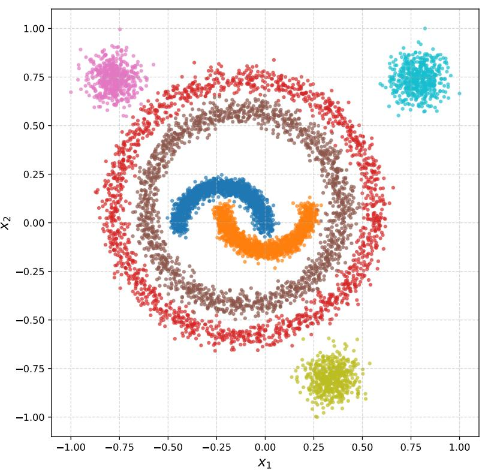  
Figure 6: A realisation of the seven-class 2D Composite dataset after min-max scaling to $[ - 1 , 1 ] ^ { 2 }$ Classes 0–1 (moons) and 2–3 (circles) each carry 20% of the mass; classes 4–6 (blobs) each carry ∼ 6.7%. The two circles enclose the moons and the blobs lie outside the circles; no two generators overlap. This gives the heterogeneous routing geometry analysed in Secs. 5.1 and 5.2.

## C The WBC Dataset

The Wisconsin Breast Cancer (Diagnostic) dataset [48] contains 569 samples with 30 real-valued features: the mean, standard error and largest value of ten characteristics of cell nuclei measured in digitised images of fine-needle aspirates. The binary label is the diagnosis, with malignant (212 samples) as the positive class and benign (357) as the negative class, so $H ( Y ) = 0 . 9 \bar { 5 } 3$ bits on all points and 0.949 bits on the 114 held-out points. The features are used without dimensionality reduction and min-max scaled to $[ - 1 , 1 ] ^ { 3 0 }$ as described in App. B.4. WBC is the smallest dataset in the study and the only one with a binary label: it tests the routing estimator at low label entropy and small N, where the occupancy ρ grows quickly with the width $( \bar { \bf A } { \bf p } { \bf p } . \mathrm { G } . 1 )$ . The architectures and the training protocol are the same as for Composite (Sec. 4.1).

## D The MNIST FC Dataset

The MNIST FC dataset complements the synthetic Composite and the small clinical WBC datasets used in our main calibration experiments. It introduces a third, structurally distinct setting: a 10-class image classification task whose label entropy $( H ( Y ) \approx 3 . 3 2$ bits) sits well above the other two datasets, and whose input is a genuine image rather than a low-dimensional synthetic vector.

## D.1 Pipeline

We start from the standard MNIST handwritten-digit dataset [25]: 60 000 training images and 10 000 test images of $2 8 \times 2 8$ greyscale digits, labelled 0–9. We flatten each image to a vector in $[ 0 , 1 ] ^ { 7 8 4 }$ and apply the following two-step preprocessing:

1. PCA to ten dimensions. We fit a principal-component analysis on the training set and project both train and test sets to the top $d _ { \mathrm { P C A } } = 1 0$ principal components. The choice of $d _ { \mathrm { P C A } } = 1 0$ is deliberate: it keeps the input dimension low enough that narrow networks stay in the well-sampled regime $( | \Omega _ { \mathcal { D } } | \ll \bar { N } )$ while retaining about half (48.8%) of the training-set pixel variance. Larger $d _ { \mathrm { P C A } }$ pushes networks of the same width into the fine-resolution regime $( | \bar { \Omega } _ { \mathcal { D } } | \approx N )$ of Sec. 3.6 where ˆI becomes uninformative; smaller $d _ { \mathrm { P C A } }$ discards class-relevant directions, so the input itself carries less information about the label (test accuracy falls below 50% at $d _ { \mathrm { P C A } } = 2 , \mathrm { F i g . ~ \bar { 1 } 1 ) }$ . The study of Sec. 4.2 varies $d _ { \mathrm { P C A } }$ from 2 to 20 with the same pipeline.

2. Min-max scaling to $[ - 1 , 1 ] ^ { 1 0 }$ . The PCA-projected coordinates are min-max scaled componentwise so that each of the ten dimensions lies in [−1, 1]. This matches the Composite preprocessing and provides comparable input scales across datasets.

The PCA basis and min-max bounds are fitted on the training set and applied unchanged to the test set, to avoid information leakage. All information-theoretic quantities reported in the main paper are computed on the 10 000-sample test set, on which $H ( Y ) = \dot { 3 } . 3 1 9$ bits (the test split is approximately balanced across digits but not exactly so).

## D.2 Architectures

We use three narrow fully-connected ReLU architectures of three hidden layers each: $[ 3 , 3 , 3 ] , [ 5 , 5 , 5 ]$ and [7, 7, 7]. The narrow widths are dictated by the requirement $| \Omega _ { \mathcal { D } } | \ll \dot { N }$ at the deepest layer: with $d _ { \mathrm { P C A } } = 1 0$ the occupancy at the last hidden layer is $\rho = 0 . 1 2 2$ at width 7, but $0 . 7 4 3$ at width 15 and 0.954 at width 25 (Table 3), where most test samples occupy their own region and the routing estimator becomes uninformative. Restricting to the well-sampled regime is therefore not a cherrypick but a stated scope of the framework; the wider networks are the subject of the saturation study (Sec. 5.3).

The [3, 3, 3] architecture is included in the calibration scatter of Fig. 2 (where it provides additional data points across the lower bit range), but its partition is very coarse $( \rho = 0 . 0 0 4 $ , about 40 regions for 10 000 points at the deepest layer) and the network reaches only about 60% test accuracy (Fig. 11); we therefore exclude it from the layerwise profile of Fig. 3. The saturation study of Sec. 5.3 trains [7, 7, 7] and the wider [15, 15, 15], [25, 25, 25] and [50, 50, 50] at every PCA dimension $d \in \{ 2 , 3 , 4 , 5 , 1 0 , 1 5 , 2 0 \}$ (Sec. 4.2); its results are reported separately in Figs. 4 and 5.

Training follows the same SGD protocol as Composite/WBC (150 epochs, $\alpha = 1 0 ^ { - 3 }$ , momentum 0.9, batch size 32, cross-entropy, no weight decay or dropout). We use five seeds per architecture, giving 15 networks total.

## E Probabilistic Details for Section 3

## E.1 Joint factorization and pushforwards

Under the DAG $Y  X  ( \Pi , T )$ with Π, T deterministic functions of X via $\Pi = \pi ( X )$ and $T = \phi _ { \Pi } ( X ) = A _ { \Pi } X + \mathbf { c } _ { \Pi }$ , the joint law factorizes as

$$
p _ { Y X \Pi T } ( y , x , \omega , t ) = p _ { Y } ( y ) p _ { X | Y } ( x \mid y ) \delta _ { \omega , \pi ( x ) } \delta ( t - \phi _ { \omega } ( x ) ) .\tag{17}
$$

The induced marginals are

$$
p _ { \Pi } ( \omega ) = \int _ { \omega } p _ { X } ( x ) d x , \qquad p _ { Y | \Pi } ( y \mid \omega ) = \frac { \int _ { \omega } p _ { X Y } ( x , y ) d x } { p _ { \Pi } ( \omega ) } ,\tag{18}
$$

and the within-region activation law is the pushforward of the within-region input law through the region’s affine map,

$$
\nu _ { \omega } : = p _ { T | \Pi } ( \cdot \mid \omega ) = ( \phi _ { \omega } ) _ { \# } p _ { X | \Pi } ( \cdot \mid \omega ) .\tag{19}
$$

Concretely, for any Borel $E \subseteq \mathbb { R } ^ { n _ { l } } , \operatorname* { P r } ( T \in E \mid \Pi = \omega ) = \operatorname* { P r } ( X \in \phi _ { \omega } ^ { - 1 } ( E ) \mid \Pi = \omega )$ . The marginal of $T$ is the mixture

$$
p _ { T } = \sum _ { \omega \in \Pi ^ { \leq l } } p _ { \Pi } ( \omega ) \nu _ { \omega } .\tag{20}
$$

Remark on rank. The pushforward $\nu _ { \omega }$ is always well-defined as a measure, regardless of $\mathrm { r a n k } ( A _ { \omega } )$ If $A _ { \omega }$ has rank $r \ < \ n _ { l }$ , then $\nu _ { \omega }$ is supported on an r-dimensional affine subspace of $\mathbb { R } ^ { n _ { l } }$ and is singular with respect to Lebesgue measure; if $A _ { \omega } = 0 $ , then $\nu _ { \omega } = \delta _ { \mathbf { c } _ { \omega } }$ . All MI terms involving $\nu _ { \omega }$ remain finite and well-defined in every case because Y takes finitely many values; the pathologies of differential entropy that afflict $I ( Y ; T )$ in general IB analyses do not apply to the decomposition terms of Theorem 3.1.

## E.2 Per-region form of the decomposition terms

Because Π measurably partitions X, three of the four terms in Theorem 3.1 localize per-region. Let $P _ { \omega }$ denote orthogonal projection onto row $\cdot ( A _ { \omega } )$ and $P _ { \omega } ^ { \perp }$ onto ker $A _ { \omega }$ . Within region $\omega , T = A _ { \omega } X + \mathbf { c } _ { \omega }$ depends on X only through $P _ { \omega } X$ , so conditioning on $T$ inside region ω is equivalent (up to the affine bijection $A _ { \omega } | _ { \mathrm { r o w } ( A _ { \omega } ) } )$ to conditioning on $P _ { \omega } X$

$$
I ( Y ; \Pi ) = \sum _ { \omega } p _ { \Pi } ( \omega ) \sum _ { y } p _ { Y | \Pi } ( y \mid \omega ) \log \frac { p _ { Y | \Pi } ( y \mid \omega ) } { p _ { Y } ( y ) } ,\tag{21}
$$

$$
I ( Y ; T \mid \Pi ) = \sum _ { \omega } p _ { \Pi } ( \omega ) I _ { \omega } ( Y ; A _ { \omega } X ) = \sum _ { \omega } p _ { \Pi } ( \omega ) I _ { \omega } ( Y ; P _ { \omega } X ) ,\tag{22}
$$

$$
I ( Y ; X \mid \Pi , T ) = \sum _ { \omega } p _ { \Pi } ( \omega ) I _ { \omega } ( Y ; P _ { \omega } ^ { \perp } X \mid P _ { \omega } X ) ,\tag{23}
$$

with $I _ { \omega }$ denoting MI under the within-region law $p . | \Pi { = } \omega \cdot$ . The conditioning on $P _ { \omega } X$ in the last line is essential: a region ω is a bounded convex polytope, so the row-space and kernel components $P _ { \omega } X$ and $P _ { \omega } ^ { \perp }$ X are in general statistically dependent under $p _ { X | \Pi = \omega }$ , and $\hat { I } _ { \omega } ( Y ; P _ { \omega } ^ { \perp } X \mid P _ { \omega } X )  I _ { \omega } ( Y ; P _ { \omega } ^ { \perp } X )$ The representation insufficiency $I ( Y ; X \mid \Pi , T )$ vanishes iff $Y \perp P _ { \omega } ^ { \perp } X \mid P _ { \omega } X$ under $p _ { X | \Pi = \omega }$ for every region ω.

The routing loss does not localize per-region because it couples regions via pushforward overlap:

$$
I ( Y ; \Pi \mid T ) = \int p _ { T } ( t ) \sum _ { y } p _ { Y \mid T } ( y \mid t ) \sum _ { \omega \in S ( t ) } p _ { \Pi | Y , T } ( \omega \mid y , t ) \log { \frac { p _ { \Pi | Y , T } ( \omega \mid y , t ) } { p _ { \Pi | T } ( \omega \mid t ) } } d t ,\tag{24}
$$

where $S ( t ) = \{ \omega : t \in \mathrm { s u p p } ( \nu _ { \omega } ) \}$

## E.3 Proof of Theorem 3.1

Applying the chain rule to $I ( Y ; \Pi , T )$ in two orders,

$$
I ( Y ; \Pi , T ) = I ( Y ; \Pi ) + I ( Y ; T \mid \Pi ) ,\tag{25}
$$

$$
I ( Y ; \Pi , T ) = I ( Y ; T ) + I ( Y ; \Pi \mid T ) .\tag{26}
$$

Equating and solving for $I ( Y ; T )$ gives (2).

For (3): since $H ( \Pi , T \mid X ) = 0$ , chain rule gives $I ( Y ; X , \Pi , T ) = I ( Y ; X )$ and $I ( Y ; X , \Pi , T ) =$ $I ( Y ; \Pi , T ) + I ( { \dot { Y } } ; X \dot { | } \Pi , { \dot { T } } )$ , whence $I ( Y ; { \bar { \Pi } } , T ) = I ( Y ; X ) - I ( Y ; X \mid { \bar { \Pi } } , T )$ □

## E.4 Proofs of Corollaries 3.3 and 3.4

Corollary 3.3. By the chain rule, $I ( Y ; \Pi , T ) = I ( Y ; T ) + I ( Y ; \Pi \mid T ) \ge I ( Y ; T )$ , with equality iff $I ( Y ; \bar { \Pi } \mid T ) = \dot { 0 } . \mathrm { B y } ( 3 ) , I ( Y ; \Pi , \dot { T } ) = I ( \dot { Y } ; X ) - I ( \dot { Y } ; X \mid \Pi , T ) \le I ( Y ; X )$ , with equality iff $I ( Y ; X \mid \Pi , T ) = 0 , { \mathrm { i . e . ~ i f f ~ } } Y \perp X \mid ( \Pi , T )$ , which is sufficiency of $( \Pi , T )$ for Y . □

Corollary 3.4. Subtracting $I ( Y ; \Pi )$ from both sides of (2) gives $I ( Y ; T ) - I ( Y ; \Pi ) = I ( Y ; T \mid$ $\Pi ) - I ( \dot { Y } ; \Pi \mid T )$ , so $I ( Y ; \bar { T } ) \stackrel { . } { > } I ( Y ; \Pi )$ iff $I ( Y ; T \mid \Pi ) > \bar { I ( Y ; \Pi \mid T ) }$ □

## E.5 Proof of Proposition 3.2

Setup. From (20), the posterior over regions given $T = t$ is

$$
p _ { \Pi | T } ( \omega \mid t ) = \frac { p _ { \Pi } ( \omega ) \nu _ { \omega } ( t ) } { \sum _ { \omega ^ { \prime } } p _ { \Pi } ( \omega ^ { \prime } ) \nu _ { \omega ^ { \prime } } ( t ) } ,\tag{27}
$$

where densities $\nu _ { \omega } ( t )$ are taken with respect to $p _ { T }$ as the dominating measure. Define $S ( t ) = \{ \omega$ $t \in \mathrm { s u p p } ( \nu _ { \omega } ) \}$ and ${ \dot { O } } = \{ t : | S ( t ) | \geq 2 \}$ ; the posterior is non-degenerate exactly on O.

KL form. The standard expansion of conditional mutual information gives

$$
I ( Y ; \Pi \mid T ) = \mathbb { E } _ { T } \left[ \sum _ { \omega \in S ( T ) } p _ { \Pi | T } ( \omega \mid T ) D _ { \mathrm { K L } } \big ( p _ { Y | \Pi = \omega , T } \| p _ { Y | T } ( \cdot \mid T ) \big ) \right] ,\tag{28}
$$

where $p _ { Y | \Pi = \omega , T } ( \cdot \mid t )$ is the joint region-and-activation conditional law of $Y ,$ , and $p _ { Y \mid T } ( \cdot \mid t ) =$ $\begin{array} { r } { \sum _ { \omega ^ { \prime \prime } \in S ( t ) } p _ { \Pi | T } ( \omega ^ { \prime \prime } \mid t ) p _ { Y | \Pi = \omega ^ { \prime \prime } , T } ( \cdot \mid t ) } \end{array}$ is its mixture over regions in the active set.

(⇐). Suppose distinct $\omega , \omega ^ { \prime }$ have supp $\left( \nu _ { \omega } \right)$ ∩ supp(νω′ ) of positive pT-mass and $p _ { Y | \Pi = \omega , T = t } \neq$ $p _ { Y | \Pi = \omega ^ { \prime } , T = t }$ on a positive-mass subset $B \subseteq O$ . On B the mixture $p _ { Y \mid T } ( \cdot \mid t )$ cannot equal both $p _ { Y | \Pi = \omega , T = t }$ and $p _ { Y | \Pi = \omega ^ { \prime } , T = t }$ since these differ; hence at least one KL term in (28) is positive on B, and $I ( Y ; \Pi \mid T ) > 0$

(⇒). If $I ( Y ; \Pi \mid T ) > 0$ , then by (28) there is a set B with $p _ { T } ( B ) > 0$ on which the inner sum is strictly positive. For each $t \in B \colon ( \mathrm { i } )$ positivity requires $| \bar { S } ( t ) | \geq 2$ , so $B \subseteq O ;$ (ii) positivity requires at least two $\omega , \omega ^ { \prime } \in S ( t )$ with $p _ { Y | \Pi = \omega , T = t } \neq p _ { Y | \Pi = \omega ^ { \prime } , T = t }$ (else every conditional equals the mixture and all ${ \mathrm { K L s } }$ vanish). Both conditions hold on a positive-mass set. □

Marginal sufficient condition. The proposition is stated in terms of the conditional laws $p _ { Y | \Pi = \omega , T = t }$ at the overlap. A simpler sufficient condition is that the overlapping regions have differing marginal region-conditional label laws $p _ { Y | \Pi = \omega } \neq p _ { Y | \Pi = \omega ^ { \prime } } ,$ , provided the within-region label distribution is independent of T, i.e. $Y \perp T \perp \Pi$ . Under that independence the two formulations coincide, and the marginal version recovers the older statement that “two overlapping regions with differing class content contribute to routing loss”. In the general case the conditional version is required: two regions can have identical marginal label laws but differ at a specific overlapping coordinate $t ,$ which is enough for the routing loss to be positive there.

Geometric reading. The proposition factors label-relevant pushforward overlap into two independent ingredients: image overlap $( p _ { T } ( O ) > 0 ) - \mathrm { t w o }$ regions with distinct affine maps produce overlapping activation-space images – and label-content disagreement at the overlap – the conditional label distributions at overlapping points t differ between regions. Routing loss is positive iff both hold simultaneously. Overlap between regions whose conditional class content at the overlap agrees (e.g. regions carrying the same class from disconnected parts of the input distribution) contributes zero to $\mathsf { \bar { I } } ( Y ; \Pi \mid \dot { T } )$ : such overlap preserves the conditional label distribution at t and is invisible to the routing loss, even though it is visible to geometric measures of partition complexity [26].

## E.6 Truncation gap of the plug-in routing estimator

The plug-in estimator (4) is the standard empirical MI, obtained by substituting maximum-likelihood counts into the Shannon formula. Its target depends on whether one views the count tables as a sample from pY,Π (giving $I ( Y ; \Pi )$ in the limit) or as the distribution of $( Y , \Pi )$ restricted to the observed support $\Omega _ { D }$ (giving $\dot { I } ( Y ; \dot { \Pi } \mid \Pi \in \Omega _ { \mathcal { D } } ) )$ ). The two limits differ by the truncation gap analysed below.

Truncation identity. Let $U = \{ \Pi \notin \Omega _ { { D } } \}$ be the event that a fresh sample hits an unobserved region, and let $\mathbf { 1 } _ { U } \in \{ 0 , 1 \}$ be its indicator. The classical truncation identity gives

$$
I ( Y ; \Pi ) \ = \ I ( Y ; \mathbf { 1 } _ { U } ) + \operatorname* { P r } ( U ^ { c } ) I ( Y ; \Pi \mid U ^ { c } ) + \operatorname* { P r } ( U ) I ( Y ; \Pi \mid U ) .\tag{29}
$$

The plug-in estimator $\hat { I } ( Y ; \Omega _ { \mathcal { D } } )$ , computed from empirical frequencies that sum to one over $\Omega _ { D }$ targets the unscaled term $I ( Y ; \dot { \Pi } \mid U ^ { c } )$ (the population MI conditional on Π being observed) rather than the scaled term $\operatorname* { P r } ( U ^ { c } ) I ( Y ; \Pi \mid U ^ { c } )$ that appears in (29). Hence $\hat { I }$ is in general not a population lower bound for $I ( Y ; \Pi )$ : because conditioning on a subset can change MI in either direction, $I ( Y ; \Pi \mid U ^ { c } )$ can lie above or below $I ( Y ; \Pi )$ in different regimes.

Gap bound. For the third term in (29), $0 \leq I ( Y ; \Pi \mid U ) \leq H ( Y \mid U ) \leq H ( Y )$ , so $\operatorname* { P r } ( U ) I ( Y ; \Pi \ |$ $U ) \overset { \vartriangle } { \leq } H ( Y ) \operatorname* { P r } ( U )$ . For the first term, $I ( Y ; \mathbf { 1 } _ { U } ) \leq H ( \mathbf { 1 } _ { U } ) = h _ { 2 } ( \operatorname* { P r } ( U ) )$ ) where $h _ { 2 }$ is the binary entropy, which scales as $- \operatorname* { P r } ( U ) \log _ { 2 } \operatorname* { P r } ( \dot { U } )$ as $\operatorname* { P r } ( U ) \to 0$ . Together,

$$
\left| I ( Y ; \Pi ) - \operatorname* { P r } ( U ^ { c } ) I ( Y ; \Pi \mid U ^ { c } ) \right| \ \leq \ H ( Y ) \ \operatorname* { P r } ( U ) + h _ { 2 } ( \operatorname* { P r } ( U ) ) .\tag{30}
$$

In the well-sampled regime $\operatorname* { P r } ( U ) \to 0$ both terms vanish and ${ \hat { I } } ( Y ; \Omega _ { \mathcal { D } } ) \to I ( Y ; \Pi \mid U ^ { c } )$ ≈ $I ( Y ; \Pi )$ . The chain (5) therefore holds up to (30); we use $^ { 6 6 } { \approx } ^ { 9 }$ in (5) to mark this approximate (rather than provable) lower-bound relationship. The right-hand inequalities $I ( Y ; \Pi , { \hat { T } } ) \leq I ( Y ; X ) \leq$ $H ( Y )$ are exact: the first is Corollary $3 . 3 ,$ the second holds because Y is discrete.

## E.7 Proof of Proposition 3.5

Let $q : \Pi ^ { l }  \Pi _ { \mathrm { f u n c } }$ be the quotient map. Since q is deterministic, $Y  \Pi  \Pi _ { \mathrm { f u n c } }$ is Markov and the data-processing inequality gives $I ( \dot { Y } ; \Pi _ { \mathrm { f u n c } } ) \dot { { \bf \leq } } I ( Y ; \Pi )$ ).   
For equality: $I ( Y ; \Pi ) = I ( Y ; \Pi _ { \mathrm { f u n c } } ) + I ( Y ; \Pi \mid \Pi _ { \mathrm { f u n c } } )$ , so the two coincide iff $I ( Y ; \Pi \mid \Pi _ { \mathrm { f u n c } } ) = 0$ i.e., iff $Y \perp \Pi \mid \Pi _ { \mathrm { f u n c } }$ . This holds iff $p _ { Y \mid \Pi = \omega }$ is constant on each equivalence class of $\mathrm { \sim _ { f u n c } , i . e . }$ , iff $p _ { Y \mid \Pi = \omega }$ depends on ω only through $A _ { \omega } ^ { l }$

Remark. The condition asks $p _ { Y | \Pi = \omega }$ to be constant on each functional-equivalence class. Two cases are worth distinguishing.

(i) Predicted label. If Y in the proposition is taken to be the network’s own predicted label $\widehat { Y } =$ arg max ${ \mathcal { N } } ( X )$ , the condition is still not automatic. Two functionally-equivalent regions share the linear part $A _ { \omega } ^ { l }$ but in general not the offset $\mathbf { c } _ { \omega } ^ { l } .$ , and they receive different inputs, so their images $\phi _ { \omega } ^ { l } ( \omega )$ differ and the head can assign them different predicted labels. The condition holds for the predicted label when, in addition, equivalent regions have equal offsets and the head is constant on the union of their images.

(ii) Ground-truth label. If Y is the data label, two functionally-equivalent regions can still differ: the regions can lie in disjoint parts of the input space and carry different ground-truth class proportions in $p _ { X , Y \mid \Pi = \omega }$ even though the linear operator $\hat { A } _ { \omega } ^ { l }$ is the same. The equality condition then additionally requires $p _ { Y \mid X , \Pi = \omega }$ to depend on $X$ only through $A _ { \omega } ^ { l } X - \mathrm { i . e }$ . no $Y .$ -relevant variation along ker $A _ { \omega } ^ { l }$ – a property of the data distribution, not of the network alone. All reported estimates use the ground-truth label, for which the quotient is a lower bound but equality is not guaranteed. The gap $I ( Y ; \Pi ) - I ( Y ; \Pi _ { \mathrm { f u n c } } ) = I ( Y ; \Pi \mid \Pi _ { \mathrm { f u n c } } )$ is what the difference $\hat { I } - \hat { I } _ { \mathrm { f u n c } }$ estimates, and it is reported with every quotient estimate (Fig. 4 and Table 8). □

## E.8 Relation to prior IB literature

The pathology of $I ( Y ; T )$ for deterministic continuous networks has been discussed by Saxe et al. [40] and Goldfeld et al. [15], who show that estimates of it are dominated by binning choices; Goldfeld et al. [15] inject noise into the network to make the quantity well-posed. Our approach is orthogonal: we analyze the joint $( \Pi , T )$ whose combinatorial component is entropy-regular by construction, giving finite exact identities without altering the model. The price is tracking the routing-loss term $I ( Y ; \Pi \mid T )$ , whose geometric interpretation via Proposition 3.2 is of independent interest.

## F Clustering Regions by Functional Equivalence

Given $\Omega _ { \mathcal { D } } .$ , network weights, and tolerance $\varepsilon \in [ 0 , 2 ]$ , we group regions by the relative Frobenius criterion of (7): ω ∼ ω′ iff $S _ { l } ^ { \omega } = S _ { l } ^ { \omega ^ { \prime } }$ and $\Vert \tilde { A } _ { \omega } ^ { l } - \tilde { A } _ { \omega ^ { \prime } } ^ { l } \Vert _ { F } / \frac { 1 } { 2 } \big ( \Vert \tilde { A } _ { \omega } ^ { l } \Vert _ { F } + \Vert \tilde { A } _ { \omega ^ { \prime } } ^ { l } \Vert _ { F } \big ) \leq \varepsilon$ . The active-set equality $S _ { l } ^ { \omega } = S _ { l } ^ { \omega ^ { \prime } }$ is required for the matrix difference to be well-defined $( \tilde { A } _ { \omega } ^ { l } , \tilde { A } _ { \omega ^ { \prime } } ^ { l }$ otherwise have incompatible row counts), so regions are first grouped by $S _ { l } ^ { \omega }$ and compared only within a group. Within a group, each quotient class is represented by its first member, and a new region joins the first class whose representative is within ε of it.

For $\varepsilon = 0$ this is exact functional equivalence (raw partition); larger ε merges progressively more pairs. Because the relation $\sim _ { \varepsilon }$ is not transitive when $\varepsilon > 0$ (regions $\omega _ { 1 } , \omega _ { 3 }$ may be more than ε apart even i $\mathrm { ~ f ~ } \omega _ { 1 } \sim _ { \varepsilon } \omega _ { 2 } \sim _ { \varepsilon } \omega _ { 3 } )$ , the greedy clustering in Algorithm 1 can produce slightly different partitions depending on the order in which regions are visited. We iterate over $\Omega _ { D }$ in first-encounter order, i.e. the order in which the regions are first reached by the data points, which is deterministic and reproducible. App. G.7 measures the effect of the order over 15 random visiting orders: at $\varepsilon = 0 . 3$ the quotient size varies by a median of 2 classes and at most 9.4% of $| \Omega _ { \mathcal { D } } ^ { - } |$ , and the Miller–Madow-corrected quotient MI by at most 0.148 bits.

Algorithm 1 Functional-quotient clustering   
Require: $\Omega _ { \mathcal { D } } .$ , weights $\{ W ^ { i } , \mathbf { b } ^ { i } \} _ { i = 1 } ^ { l } .$ , tolerance $\varepsilon \in [ 0 , 2 ]$   
Ensure: Quotient $\Omega _ { D }$ ,func   
1: $\Omega _ { \mathcal { D } , \mathrm { f u n c } }  \emptyset$   
2: for each $\omega \in \Omega _ { \mathcal { D } }$ in first-encounter order do   
3: Read $S _ { i } ^ { \omega }$ from $\pi _ { \omega } ^ { i }$ for $i = 1 , \ldots , l$   
4: $\begin{array} { r } { \tilde { A } _ { \omega } ^ { l } \gets \prod _ { i = l } ^ { 1 } W ^ { i } [ S _ { i } ^ { \omega } , S _ { i - 1 } ^ { \omega } ] } \end{array}$   
5: Search the classes of $\Omega _ { \mathcal { D } , \mathrm { f u n c } }$ with active set $S _ { l } ^ { \omega }$ , in creation order, for the first class [ω′]   
whose representative $\omega ^ { \prime }$ satisfies $\omega \sim _ { \varepsilon } \omega ^ { \prime }$   
6: if found then   
7: Add ω to $[ \omega ^ { \prime } ]$   
8: else   
9: Create new class $\{ \omega \}$ in $\Omega _ { \mathcal { D } , \mathrm { f u n c } }$ with representative $\omega$   
10: end if   
11: end for   
12: return $\Omega _ { \mathcal { D } , \mathrm { f u n c } }$

Complexity. Each comparison ω $\sim _ { \varepsilon } \omega ^ { \prime }$ costs $O ( | S _ { l } ^ { \omega } | \cdot n _ { 0 } )$ for the Frobenius distance. Each region is compared only with the representatives of existing classes in its active-set group, so the number of comparisons is at most $| \Omega _ { \mathcal { D } } | ^ { \cdot } | \Omega _ { \mathcal { D } , \mathrm { f u n c } } | ,$ , with an $O \big ( | \Omega _ { \mathcal { D } } | ^ { 2 } \big )$ worst case at small ε. In our experiments $| \Omega _ { \mathcal { D } } |$ reaches 9,997 (MNIST, width 50); for large supports the comparison can be accelerated by locality-sensitive hashing on rounded $\tilde { A } _ { \omega } ^ { l }$ , reducing the cost to near-linear in $| \Omega _ { \mathcal { D } } |$

Operating range. The relative criterion is bounded in [0, 2] and admits a clean interpretation: $\varepsilon = 0$ recovers the raw partition; $\varepsilon \in [ 0 . 2 , 0 . 5 ]$ is the window in which $\rho _ { \mathrm { f u n c } }$ drops and the quotient pulls a saturated estimate back below ${ \dot { H } } ( Y )$ , provided the network has redundant linear operators to collapse (Sec. 5.3 and Figs. 4 and 5); and $\varepsilon \geq 1$ over-merges. Merging already starts below the window, and the estimate still moves with ε inside it (Sec. 6.2), so ε is reported with every quotient estimate. Where a single value is reported (Table 8), we use $\varepsilon = 0 . 3$ as a representative operating point.

Layerwise compression ratio. Fig. 7 reports $\rho _ { \mathrm { f u n c } } ^ { l } ( \varepsilon )$ as a function of layer depth on the calibration networks. $\rho _ { \mathrm { f u n c } } ^ { 1 } = 1$ for every dataset, architecture and $\varepsilon \cdot$ the first hidden layer realises every distinct activation pattern as a distinct linear operator, so functional equivalence is a phenomenon of compositions. For $\overline { { \varepsilon } } > 0 , \rho _ { \mathrm { f u n c } } ^ { l }$ then decreases with depth on average — deeper compositions admit more activation-pattern combinations whose products of selection matrices coincide — at a rate set by ε. The decrease is not monotone for every network: of the 560 per-network curves (40 networks, 14 values of $\varepsilon > 0 )$ , 232 rise somewhere with depth, by at most 0.216.

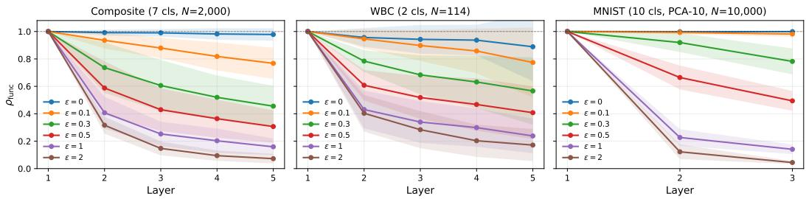  
Figure 7: $\rho _ { \mathrm { f u n c } } ^ { l } ( \varepsilon )$ as a function of hidden-layer depth on the calibration networks (the five-layer architectures of Composite and WBC, and [5, 5, 5] and [7, 7, 7] on MNIST FC), one curve per ε, mean ±1σ across architectures and seeds. $\rho _ { \mathrm { f u n c } } ^ { 1 } = 1$ structurally on every panel; for $\varepsilon > 0$ the mean ratio decreases with depth.

## G Finite-Sample Validation of the Routing Estimator

This appendix collects the evidence on when the plug-in routing estimator $\hat { I } ( Y ; \Omega _ { \mathcal { D } } )$ of Eq. (4) can be trusted. All numbers are computed on the held-out points (App. B), at the last epoch, and averaged over the five seeds; the tables are generated from the stored results of the released code. The organising quantity is the occupancy

$$
\rho : = | \Omega _ { \mathcal { D } } | / N \in ( 0 , 1 ] ,
$$

the number of data-supported regions per sample. At small ρ most regions hold several points and the counts $n _ { y , \omega }$ are informative; as $\rho  1$ almost every region holds a single point, the partition becomes an injective map from samples to regions, and $\hat { I }$ is pushed towards H(Y) whatever the network has learned (App. E.6).

## G.1 Occupancy of the evaluated networks

Tables 2 and 3 report $\rho$ at the deepest layer for every configuration, together with the fraction of regions that hold a single point and the fraction of points that sit alone in their region. The Composite networks stay below $\rho = 0 . 4 1 1$ . On WBC, with only N = 114 held-out points, the two width-25 architectures are close to saturation: $\rho = 0 . 9 0 0$ for [25, 25, 25] and $\rho = 0$ .961 for [25, 25, 25, 25, 25] (0.741 and 0.893 on all 569 points). Their calibration points in Figs. 2 and 3 lie in the regime where $\hat { I }$ is not trustworthy and should be read with that caveat. On MNIST, $\rho$ grows quickly with the PCA dimension and the width (Table 3); this is the saturation that the functional quotient addresses in Sec. 5.3. Fig. 8 shows the full distribution of region sizes behind these numbers. At low $\rho$ most points sit in regions holding tens of points or more; in the saturated networks (WBC width 25, MNIST widths 25 and 50) almost every point sits in a region of size one or two.

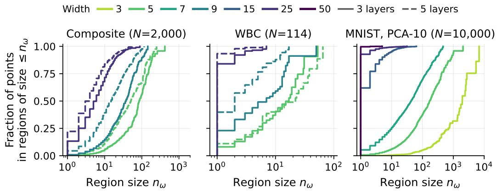  
Figure 8: Distribution of region sizes at the deepest layer: the fraction of points that lie in a region holding at most $n _ { \omega }$ points. Colour is the hidden width, line style the depth; MNIST at PCA dimension 10. Held-out points, last epoch, five seeds pooled. The value at $n _ { \omega } = 1$ is the singleton-sample fraction of Table 2; curves that reach 1 at small $n _ { \omega }$ belong to saturated partitions $( \rho \to 1 )$

Table 2: Occupancy at the deepest layer, Composite $( N = 2 , 0 0 0 )$ and WBC $( N = 1 1 4 )$ , held-out points, mean over seeds. Regions: $| \Omega _ { \mathcal { D } } | ;$ singleton regions: fraction of regions holding one point; singleton samples: fraction of points alone in their region.
<table><tr><td>Dataset</td><td>Architecture</td><td>Regions</td><td> $\rho$ </td><td>Singleton regions</td><td>Singleton samples</td></tr><tr><td rowspan="5">Composite</td><td>[5,5, 5]</td><td>59.2</td><td>0.030</td><td>0.123</td><td>0.004</td></tr><tr><td>[5, 5, 5, 5, 5]</td><td>108.2</td><td>0.054</td><td>0.138</td><td>0.009</td></tr><tr><td>[9,9,9]</td><td>128.4</td><td>0.064</td><td>0.133</td><td>0.009</td></tr><tr><td>[9, 9,9, 9,9]</td><td>294.2</td><td>0.147</td><td>0.291</td><td>0.044</td></tr><tr><td>[25, 25,25]</td><td>607.4</td><td>0.304</td><td>0.438</td><td>0.133</td></tr><tr><td rowspan="5">WBC</td><td>[25, 25, 25, 25, 25]</td><td>822.2</td><td>0.411</td><td>0.540</td><td>0.222</td></tr><tr><td>[5, 5, 5]</td><td>21.0</td><td>0.184</td><td>0.438</td><td>0.081</td></tr><tr><td>[5, 5, 5, 5, 5]</td><td>23.0</td><td>0.202</td><td>0.530</td><td>0.111</td></tr><tr><td>[9,9, 9]</td><td>41.0</td><td>0.360 0.561</td><td>0.627</td><td>0.230</td></tr><tr><td>[9,9,9, 9,9]</td><td>64.0</td><td>0.900</td><td>0.705 0.931</td><td>0.398</td></tr><tr><td></td><td>[25, 25, 25] [25, 25, 25, 25, 25]</td><td>102.6 109.6</td><td>0.961</td><td>0.970</td><td>0.840 0.933</td></tr></table>

Table 3: Occupancy $\rho$ at the last hidden layer on MNIST (N = 10 000), per architecture and PCA dimension $d .$ The calibration networks of Study 1 are [3, 3, 3], [5, 5, 5] and [7, 7, 7] at $d = 1 0 ,$
<table><tr><td>Architecture</td><td> $d = 2$ </td><td> $d = 3$ </td><td> $d = 4$ </td><td> $d = 5$ </td><td> $d = 1 0$ </td><td> $d = 1 5$ </td><td> $d = 2 0$ </td></tr><tr><td>[3, 3, 3]</td><td>一</td><td>一</td><td>一</td><td></td><td>0.004</td><td>一</td><td>一</td></tr><tr><td>[5, 5, 5]</td><td></td><td></td><td></td><td></td><td>0.030</td><td></td><td></td></tr><tr><td>[7,7,7]</td><td>0.012</td><td>0.028</td><td>0.047</td><td>0.082</td><td>0.122</td><td>0.125</td><td>0.103</td></tr><tr><td>[15, 15, 15]</td><td>0.049</td><td>0.195</td><td>0.342</td><td>0.518</td><td>0.743</td><td>0.774</td><td>0.783</td></tr><tr><td>[25, 25, 25]</td><td>0.124</td><td>0.452</td><td>0.734</td><td>0.874</td><td>0.954</td><td>0.965</td><td>0.979</td></tr><tr><td>[50, 50, 50]</td><td>0.317</td><td>0.826</td><td>0.960</td><td>0.987</td><td>0.998</td><td>0.999</td><td>1.000</td></tr></table>

## G.2 Bias corrections

The plug-in estimator is biased upwards at finite N. We compare it with four standard corrections, each applied to the same contingency table: Miller–Madow [33], which subtracts $( | \Omega _ { \mathcal { D } } | - 1 ) ( | \mathcal { V } | -$ $1 ) / ( 2 \bar { N } \ln { 2 } )$ ; Grassberger [17]; Chao–Shen [5] and Chao–Wang–Jost [6], which are designed for undersampled categorical data. The last three are computed through the decomposition ${ \hat { H } } ( \Omega ) +$ $\hat { H } ( Y ) - \hat { H } ( \Omega , Y )$ with each entropy corrected separately. All four are implemented in the released code and tested against the infomeasure package [4]. We do not report the asymptotic NSB estimator [32]. It relies on coincidences among the samples, and their number vanishes as $\rho  1$ so it is unstable in the regime where a correction would matter. It is computed in the released code. Table 4 averages over the 138 (dataset, architecture, PCA dimension, layer) cells of both studies, grouped by $\rho .$

Table 4: Bias corrections grouped by occupancy $\rho$ (n: number of cells). Value: corrected estimate; correction: plug-in minus corrected value; seed std: standard deviation over the five seeds; gap to $H ( Y ) \colon H ( \dot { Y } )$ minus the corrected value. All in bits, averaged over cells.
<table><tr><td>ρrange</td><td>Estimator</td><td>Value</td><td>Correction</td><td>Seed std</td><td>Gap to H (Y)</td></tr><tr><td rowspan="5"> $\rho < 0 . 0 5 ( n = 4 1 )$ </td><td>Plug-in</td><td>1.439</td><td>0.000</td><td>0.148</td><td>1.698</td></tr><tr><td>Miller-Madow</td><td>1.325</td><td>0.114</td><td>0.131</td><td>1.812</td></tr><tr><td>Grassberger</td><td>1.410</td><td>0.029</td><td>0.144</td><td>1.727</td></tr><tr><td>Chao-Shen</td><td>1.407</td><td>0.032</td><td>0.143</td><td>1.730</td></tr><tr><td>Chao-Wang-Jost</td><td>1.407</td><td>0.032</td><td>0.143</td><td>1.730</td></tr><tr><td rowspan="5"> $\rho > 0 . 3 ( n = 5 6 )$ </td><td>Plug-in</td><td>2.586</td><td>0.000</td><td>0.025</td><td>0.146</td></tr><tr><td>Miller-Madow</td><td>-1.153</td><td>3.739</td><td>0.092</td><td>3.886</td></tr><tr><td>Grassberger</td><td>2.519</td><td>0.067</td><td>0.031</td><td>0.214</td></tr><tr><td>Chao-Shen</td><td>2.447</td><td>0.139</td><td>0.037</td><td>0.285</td></tr><tr><td>Chao-Wang-Jost</td><td>2.402</td><td>0.185</td><td>0.055</td><td>0.331</td></tr><tr><td rowspan="4"> $\rho > 0 . 9 ( n = 1 9 )$ </td><td>Plug-in</td><td>2.941</td><td>0.000</td><td>0.002</td><td>0.004</td></tr><tr><td>Miller-Madow</td><td>-2.462</td><td>5.403</td><td>0.038</td><td>5.407</td></tr><tr><td>Grassberger</td><td>2.935</td><td>0.006</td><td>0.004</td><td>0.010</td></tr><tr><td>Chao-Shen</td><td>2.888</td><td>0.054</td><td>0.027</td><td>0.058</td></tr><tr><td></td><td>Chao-Wang-Jost</td><td>2.876</td><td>0.065</td><td>0.037</td><td>0.069</td></tr></table>

Three regimes appear. At small occupancy $( \rho < 0 . 0 5 )$ every correction is small (Miller–Madow: 0.114 bits on average) compared with the seed-to-seed variability of the plug-in value (0.148 bits), so the plug-in estimate is reliable. $\mathrm { A t } \ \rho > 0 . 3$ the Miller–Madow correction grows to 3.739 bits on average, up to 6.488 bits, and the corrected value becomes negative (as low as −3.169 bits): a first-order correction applied far outside its regime. The seed-to-seed spread of the plug-in value moves the other way, from 0.148 bits at $\rho < 0 . 0 5$ to 0.025 bits at $\rho > 0 . 3 $ the estimate is most stable where it is most biased, so its variance gives no warning of its bias. At $\rho > 0 . 9$ (19 cells) the other corrections are small, but for the wrong reason: their corrected values stay within 0.010 (Grassberger), 0.058 (Chao–Shen) and 0.069 (Chao–Wang–Jost) bits of $H ( Y )$ , the same ceiling as the plug-in value. When almost every region holds one point, the region marginal and the joint table have nearly the same support, so the corrections of $\hat { H } ( \Omega )$ and ${ \hat { H } } ( \Omega , Y )$ are nearly equal and cancel in the difference. Miller–Madow fails visibly, Grassberger and the coverage-based corrections fail silently. No statistical correction we tried turns a saturated partition into an informative estimate; this is why we treat $\rho$ as a diagnostic to report and use the functional quotient as a structural remedy, which works where the network has redundant linear operators to collapse (Sec. 5.3). Table 1 in the main text summarises the corrections.

## G.3 Held-out versus in-sample estimation

All reported estimates use held-out points. To check how much this choice matters, we recompute the routing estimator in-sample, on all points of Composite $( N = 1 0 , 0 0 0 )$ and WBC $( N = 5 6 9 )$ , for the same trained networks (Table 5). At the deepest layer the plug-in estimates differ by at most 0.020 bits on Composite and 0.031 bits on WBC (over all layers: 0.023 and 0.075 bits), even though $\rho$ is lower at the larger N. The estimate is therefore not an artefact of the particular points used to build the partition. For the two saturated WBC architectures this agreement is weaker evidence: once an estimator sits at its ceiling, its value no longer moves with N.

Table 5: Held-out versus in-sample routing estimates at the deepest layer (mean over seeds, bits). Held-out / in-sample N: Composite 2,000 / 10,000, WBC 114 / 569. ∆ ˆI: in-sample minus held-out.
<table><tr><td>Dataset</td><td>Architecture</td><td>ρ held-out</td><td>ρ in-sample</td><td>Î held-out</td><td>Î in-sample</td><td>∆Î</td></tr><tr><td rowspan="5">Composite</td><td>[5, 5, 5]</td><td>0.030</td><td>0.007</td><td>1.949</td><td>1.939</td><td>-0.010</td></tr><tr><td>[5, 5, 5, 5, 5]</td><td>0.054</td><td>0.013</td><td>2.261</td><td>2.245</td><td>-0.015</td></tr><tr><td>[9,9, 9]</td><td>0.064</td><td>0.016</td><td>2.188</td><td>2.174</td><td>-0.014</td></tr><tr><td>[9, 9,9, 9,9]</td><td>0.147</td><td>0.043</td><td>2.550</td><td>2.538</td><td>-0.012</td></tr><tr><td>[25, 25, 25]</td><td>0.304</td><td>0.104</td><td>2.535</td><td>2.515</td><td>-0.020</td></tr><tr><td rowspan="6">WBC</td><td>[25, 25, 25, 25, 25]</td><td>0.411</td><td>0.163</td><td>2.620</td><td>2.609</td><td>-0.011</td></tr><tr><td>[5, 5,5]</td><td>0.184</td><td>0.068</td><td>0.767</td><td>0.765</td><td>-0.002</td></tr><tr><td>[5, 5,5, 5, 5]</td><td>0.202</td><td>0.101</td><td>0.707</td><td>0.718</td><td>0.011</td></tr><tr><td>[9,9, 9]</td><td>0.360 0.561</td><td>0.187</td><td>0.740</td><td>0.727</td><td>-0.012</td></tr><tr><td>[9, 9, 9,9, 9] [25, 25, 25]</td><td>0.900</td><td>0.316 0.741</td><td>0.904 0.949</td><td>0.885</td><td>-0.020</td></tr><tr><td>[25, 25, 25, 25, 25]</td><td>0.961</td><td>0.893</td><td>0.949</td><td>0.919 0.943</td><td>-0.031 -0.006</td></tr></table>

## G.4 Sensitivity of the baselines to their hyperparameters

The calibration in Sec. 5.1 uses one setting per baseline. Table 6 repeats the correlation with the routing estimator for every setting we computed, both for the plug-in and the Miller–Madow-corrected binning and k-means estimates. On Composite and WBC the correlation is high for every setting except the finer Miller–Madow binnings (16 and 30 bins; lowest r = 0.655), and among the Miller– Madow binnings K = 8 is not the best-correlated bin count (K = 4 is). On MNIST FC the conclusion depends on the baseline’s hyperparameter: Miller–Madow binning with 16 and 30 bins per coordinate correlates negatively with the routing estimator (r = −0.570 and −0.888), because the correction for the many occupied bins dominates the estimate, while the plug-in variants of the same binnings stay positively correlated. This dependence on a free parameter is the problem the routing estimator avoids.

Table 6: Pearson r between the routing estimator and each baseline setting, one point per network at the last hidden layer. MM: Miller–Madow-corrected. KSG is not a plug-in estimator and has a single column. ∗The setting used in Fig. 2.
<table><tr><td rowspan="2">Baseline</td><td rowspan="2">Setting</td><td colspan="2">Composite + WBC (n = 60)</td><td colspan="2">MNIST FC (n = 15)</td></tr><tr><td>plug-in</td><td>MM</td><td>plug-in</td><td>MM</td></tr><tr><td rowspan="5">Binning (K)</td><td>2</td><td>0.923</td><td>0.946</td><td>0.877</td><td>0.875</td></tr><tr><td>4</td><td>0.966</td><td>0.973</td><td>0.758</td><td>0.728</td></tr><tr><td>8*</td><td>0.981</td><td>0.945</td><td>0.807</td><td>0.690</td></tr><tr><td>16</td><td>0.982</td><td>0.852</td><td>0.835</td><td>-0.570</td></tr><tr><td>30</td><td>0.975</td><td>0.655</td><td>0.824</td><td>-0.888</td></tr><tr><td rowspan="6">k-means (K)</td><td>KY*</td><td>0.970</td><td>0.970</td><td>0.720</td><td>0.720</td></tr><tr><td>2KY</td><td>0.974</td><td>0.974</td><td>0.866</td><td>0.866</td></tr><tr><td>4KY</td><td>0.974</td><td>0.974</td><td>0.868</td><td>0.868</td></tr><tr><td>16</td><td>0.976</td><td>0.976</td><td>0.834</td><td>0.834</td></tr><tr><td>64</td><td>0.972</td><td>0.971</td><td>0.861</td><td>0.861</td></tr><tr><td>256</td><td>0.971</td><td>0.964</td><td>0.829</td><td>0.829</td></tr><tr><td rowspan="3">KSG (k)</td><td>3*</td><td>0.944</td><td></td><td>0.759</td><td></td></tr><tr><td>5</td><td>0.948</td><td></td><td>0.762</td><td></td></tr><tr><td>10</td><td>0.953</td><td></td><td>0.772</td><td></td></tr></table>

## G.5 KSG on networks with collapsed representations

On five WBC networks the KSG baseline in Fig. 2 reads zero or nearly zero while the routing estimator and the binning baseline report 0.2–0.9 bits (Table 7). In each of them a large group of held-out points, 22.8–78.1% of the 114, shares one identical representation at the last hidden layer. Every point in such a group passes through an earlier layer in which all units are inactive, so everything downstream of that layer is the same constant vector. In four of the five networks the group is almost pure in one class.

The tie breaks the KSG estimator rather than the network. For a tied point the k-th nearest same-class neighbour lies at distance zero, so the neighbourhood the estimator counts contains the whole group instead of k points. This violates the assumption behind the estimator and biases it downwards: the raw estimate is negative on four of the networks, and the reported value is clipped at zero, as for every KSG value in the paper. The routing estimator is unaffected, because a tied group simply contributes its label counts to the regions it occupies.

The effect on the calibration is small. Removing the five networks leaves the pooled KSG correlation of Fig. 2 unchanged (0.892 with them, 0.893 without). In the WBC panel of Fig. 3, four of them ([5, 5, 5, 5, 5], seeds 101, 103, 104, 105) are tied from layer 3 onwards and pull the mean KSG curve down from 0.837 to 0.619 bits; without them, KSG stays between 0.823 and 0.840 bits at every layer while ˆI rises from 0.675 to 0.905 bits. The next-largest tied share among the WBC networks is 15.8% ([5, 5, 5], seed 105, KSG 0.436 bits); on Composite and MNIST FC it is at most 7.7% and 5.3%, with no visible effect on KSG.

Table 7: WBC networks on which KSG collapses (last hidden layer, last epoch, held-out points, N = 114). Binning: Miller–Madow, K = 8. KSG raw: the estimate before clipping at zero. Tied points: size of the largest group of points with identical representation, and its share of N. MI in bits.
<table><tr><td>Architecture</td><td>Seed</td><td>Test acc.</td><td>Î</td><td>Binning</td><td>KSG raw</td><td>KSG</td><td>Tied points</td></tr><tr><td>[5, 5, 5, 5, 5]</td><td>101</td><td>98.2%</td><td>0.791</td><td>0.736</td><td>-0.469</td><td>0.000</td><td>41 (36%)</td></tr><tr><td>[5, 5, 5, 5, 5]</td><td>103</td><td>97.4%</td><td>0.758</td><td>0.795</td><td>0.148</td><td>0.148</td><td>26 (23%)</td></tr><tr><td>[5, 5, 5, 5, 5]</td><td>104</td><td>63.2%</td><td>0.392</td><td>0.217</td><td>-3.070</td><td>0.000</td><td>89 (78%)</td></tr><tr><td>[5, 5, 5, 5, 5]</td><td>105</td><td>97.4%</td><td>0.911</td><td>0.576</td><td>-1.743</td><td>0.000</td><td>64 (56%)</td></tr><tr><td>[5, 5, 5]</td><td>104</td><td>96.5%</td><td>0.779</td><td>0.720</td><td>-1.161</td><td>0.000</td><td>53 (46%)</td></tr></table>

## G.6 Routing information without learned structure: label permutation

High routing information need not reflect learned class structure. As ρ → 1 the partition approaches an injective map of the samples, and ˆI approaches H(Y ) for any labelling. To separate the two, we train the [5, 5, 5] and [25, 25, 25] architectures on Composite and WBC with the training labels randomly permuted, and estimate the routing information about the true labels on the held-out points (Table 8). The permuted networks learn neither the true labels nor the permuted ones: on Composite their accuracy is near chance (test accuracy on true labels 19.6% and 15.9%, accuracy on their own permuted training labels 20.8% and 22.5%), and on WBC they predict close to the majority class.

For the narrow Composite network the routing information drops from 1.949 to 1.411 bits, and the functional quotient discounts it further (1.828 to 1.096 bits). For the wide network it barely moves: 2.535 to 2.433 bits raw and 2.362 to 2.329 bits after the quotient, close to $H ( Y ) = 2 . 6 3 9$ bits, although the network predicts the true label of only 15.9% of the test points. A fine partition of Composite’s spatially coherent classes correlates with the true class whether or not the network has learned it. On WBC the same holds for [25, 25, 25], whose permuted network sits at $\rho > 0 . 9$ High routing information is therefore not by itself evidence of learned structure, and the functional quotient, while a valid lower bound by the data-processing inequality, removes this effect only at moderate capacity.

## G.7 Sensitivity of the functional quotient to the visiting order

The greedy clustering of Algorithm 1 depends on the order in which regions are visited (App. F). For every clean network and layer we rerun it with 15 random orders in addition to the first-encounter order and record the spread (maximum minus minimum) of the quotient size and of the Miller–Madow

Table 8: Clean versus label-permuted training (deepest layer, held-out points, true labels, mean over seeds). Test acc.: accuracy on the true test labels; train-label acc.: accuracy on the (permuted) labels the network was trained on. $\hat { I } _ { \mathrm { f u n c } }$ and $\rho _ { \mathrm { f u n c } }$ at $\varepsilon = 0 . 3$ . MI in bits; $H ( Y ) = 2 . 6 3 9$ (Composite) and 0.949 (WBC).
<table><tr><td>Dataset</td><td>Architecture</td><td>Labels</td><td>Test acc.</td><td>Train-label acc.</td><td> $\rho$ </td><td>Î</td><td> $\hat { I } _ { \mathrm { f u n c } }$ </td><td>ρfunc</td></tr><tr><td>Composite</td><td>[5, 5, 5]</td><td>clean</td><td>97.9%</td><td></td><td>0.030</td><td>1.949</td><td>1.829</td><td>0.765</td></tr><tr><td></td><td>[5, 5, 5]</td><td>permuted</td><td>19.6%</td><td>20.8%</td><td>0.022</td><td>1.411</td><td>1.096</td><td>0.656</td></tr><tr><td></td><td>[25, 25, 25]</td><td>clean</td><td>99.5%</td><td></td><td>0.304</td><td>2.535</td><td>2.362</td><td>0.377</td></tr><tr><td></td><td>[25, 25, 25]</td><td>permuted</td><td>15.9%</td><td>22.5%</td><td>0.245</td><td>2.433</td><td>2.329</td><td>0.645</td></tr><tr><td>WBC</td><td>[5, 5, 5]</td><td>clean</td><td>97.4%</td><td></td><td>0.184</td><td>0.767</td><td>0.700</td><td>0.680</td></tr><tr><td></td><td>[5, 5, 5]</td><td>permuted</td><td>62.5%</td><td>62.8%</td><td>0.211</td><td>0.469</td><td>0.295</td><td>0.709</td></tr><tr><td></td><td>[25, 25, 25]</td><td>clean</td><td>97.2%</td><td></td><td>0.900</td><td>0.949</td><td>0.885</td><td>0.745</td></tr><tr><td></td><td>[25, 25, 25]</td><td>permuted</td><td>63.3%</td><td>65.6%</td><td>0.933</td><td>0.946</td><td>0.932</td><td>0.910</td></tr></table>

quotient MI (Table 9). $\mathrm { A t } \varepsilon = 0 . 3$ the median spread is 2 classes; the largest is 84 classes, or 9.4% of |ΩD|, and the quotient MI varies by at most 0.148 bits (0.100 bits at the deepest layer). The spread grows with ε: over all four values, $\varepsilon \in \{ 0 . 1 , 0 . 3 , 0 . 5 , 1 \}$ , it reaches 0.474 bits. The order is thus a small but not negligible source of variation at large ε, which is one more reason to stay in the moderate range.

Table 9: Spread of the functional quotient over visiting orders, per ε. Cells: (network, layer) pairs. Median, 95th percentile and maximum of the spread of the quotient size; max $/ R \colon$ largest spread relative to $| \Omega _ { \bar { \mathcal { D } } } | ;$ last column: largest spread of the Miller–Madow quotient MI (bits).
<table><tr><td>Layers</td><td>ε</td><td>Cells</td><td>Median</td><td>95th pct.</td><td>Max</td><td>Max / R</td><td>Max  $\Delta \hat { I } _ { \mathrm { f u n c } } ^ { \mathrm { M M } }$ </td></tr><tr><td>all layers</td><td>0.1</td><td>690</td><td>0</td><td>9.0</td><td>17</td><td>6.7%</td><td>0.053</td></tr><tr><td></td><td>0.3</td><td>690</td><td>2</td><td>38.5</td><td>84</td><td>9.4%</td><td>0.148</td></tr><tr><td></td><td>0.5</td><td>690</td><td>4</td><td>43.0</td><td>83</td><td>18.8%</td><td>0.348</td></tr><tr><td></td><td>1</td><td>690</td><td>1</td><td>19.0</td><td>47</td><td>14.3%</td><td>0.474</td></tr><tr><td>deepest layer</td><td>0.1</td><td>210</td><td>0</td><td>11.6</td><td>17</td><td>6.2%</td><td>0.053</td></tr><tr><td></td><td>0.3</td><td>210</td><td>11</td><td>45.5</td><td>60</td><td>6.5%</td><td>0.100</td></tr><tr><td></td><td>0.5</td><td>210</td><td>14</td><td>53.1</td><td>83</td><td>8.3%</td><td>0.348</td></tr><tr><td></td><td>1</td><td>210</td><td>5</td><td>28.0</td><td>47</td><td>10.5%</td><td>0.474</td></tr></table>

## H Implementation, Assets and Compute

Code. All code, the stored results and instructions to reproduce every figure and table are released under the MIT licence at https://github.com/Johanmkr/ Intrinsic-IT-analysis-of-ReLU-nets, with a locked environment (uv.lock) and a Dockerfile. Networks are trained with PyTorch 2.11.0 (CPU build) [36]; the Composite generators (make\_moons, make\_circles), PCA, min-max scaling and k-means come from scikit-learn 1.8.0 [37].

Baselines. Binning quantises every unit of T into K uniform bins on [−c, c], with c the largest absolute activation in the layer, and uses the joint bin index as a discrete variable. k-means uses scikit-learn with 10 initialisations, seeded by the network seed. KSG is our own implementation of the mixed continuous–discrete estimator [38] with k = 3; negative values are clipped at zero (App. G.5). Binning and k-means are scored with the plug-in and the Miller–Madow estimators (App. G.4).

Licences of existing assets. MNIST [25]: CC BY-SA 3.0. WBC [48]: CC BY 4.0 (UCI Machine Learning Repository). PyTorch, scikit-learn, NumPy and SciPy: BSD-style licences. The infomeasure package 0.6.2 [4] (AGPL-3.0) is used only in tests of our bias-correction implementa tions and is not part of the default installation.

Compute. Everything runs on CPU. On a 22-core x86-64 workstation with 20 parallel singlethreaded workers, the full pipeline takes about 2 h of wall time, about 42 CPU-hours: training the 230 networks of both studies and the label-permutation control takes 71 min (about 24 CPU-hours, mostly the MNIST networks at about 3.5 min each), the routing estimates 39 min, the baselines 8 min and the diagnostics 6 min. Memory use is small. The full research project required additional CPU compute for preliminary experiments and earlier versions of the pipeline that are not reported.

## I Training Metrics

Test accuracy and test cross-entropy loss over training, on the held-out points, for every network in the paper: the six Composite and six WBC architectures of Study 1 (Figs. 9 and 10) and all MNIST networks of both studies (Fig. 11). Curves are means over the five seeds, shaded bands ±1σ.

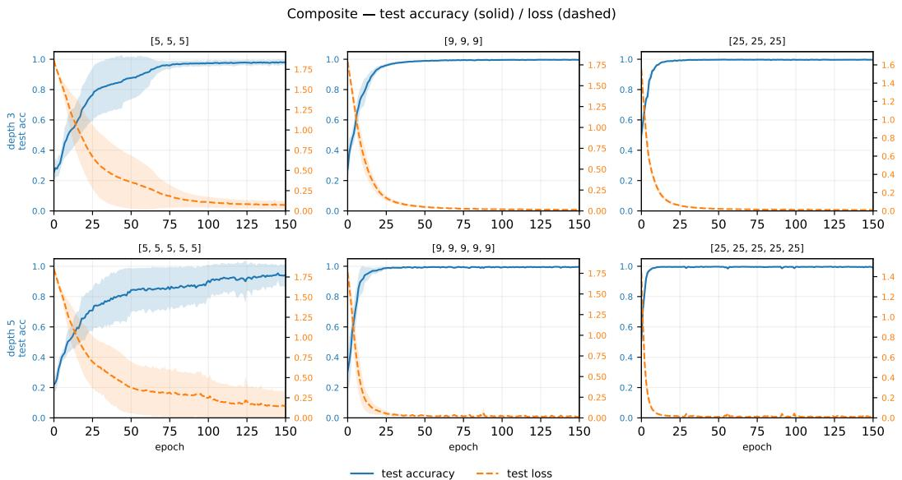  
Figure 9: Composite: test accuracy (solid) and test loss (dashed) of the six Study-1 architectures, mean ±1σ over five seeds.

## Composite

WBC One network does not converge: seed 104 of [5, 5, 5, 5, 5] ends at 63% test accuracy, close to the majority-class rate of 62.7%, which produces the wide band in that panel.

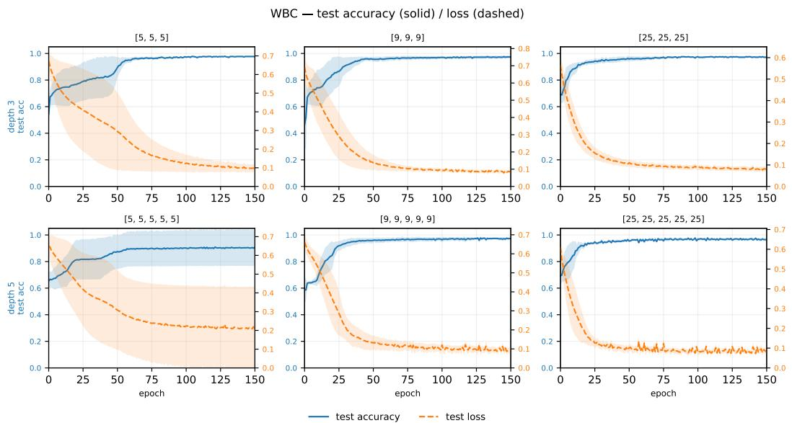  
Figure 10: WBC: test accuracy (solid) and test loss (dashed) of the six Study-1 architectures, mean ±1σ over five seeds.

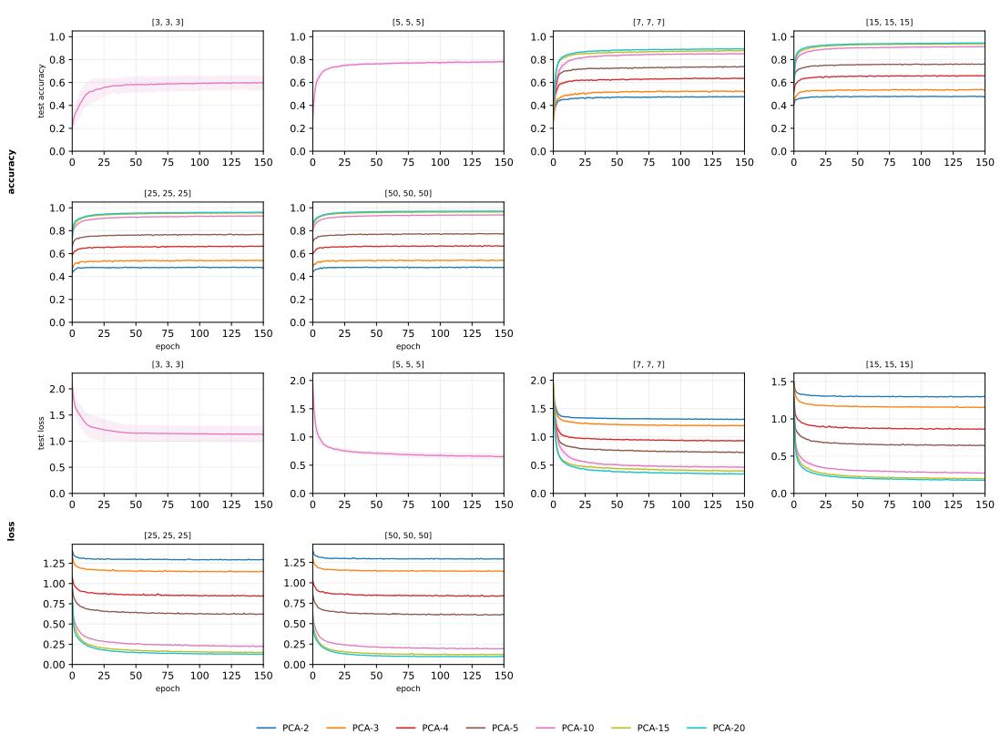  
Figure 11: MNIST: test accuracy (top two rows) and test loss (bottom two rows), one colour per PCA dimension d. [3, 3, 3] and [5, 5, 5] are the Study-1 networks at d = 10; [7, 7, 7] to [50, 50, 50] are the Study-2 networks at every d ([7, 7, 7] at d = 10 also enters Study 1). Mean ±1σ over five seeds.

MNIST