# Joint Distributional Copula Regression for Insurance Claim Frequency and Severity via Boosting

Banghee So ∗

Na Zhang †

October 28, 2026

## Abstract

In this paper, we propose a model-based boosting approach for fitting structured additive distributional copula regression models with bivariate responses, focusing particularly on the joint modeling of claim frequency and claim severity. The proposed approach is based on generalized additive models for location, scale, and shape (GAMLSS), which extend the general idea of GAMs by allowing multiple parameters of a response distribution, rather than only its conditional mean, to depend on covariates. The model is therefore intrinsically interpretable at the level of its additive predictors, providing greater transparency and auditability than black-box alternatives. We evaluate the proposed framework using synthetic and real-world data. We demonstrate its ability to recover the underlying covariate efects and dependence structure, identify informative variables, and achieve competitive predictive performance relative to benchmark models. We also illustrate how the fitted model can be interpreted.

## 1 Introduction

While modeling the conditional mean of a response is suficient for some applications, many require a deeper understanding of the entire conditional distribution, including its quantiles, tail behavior, and prediction intervals. Consequently, distributional regression models, which allow covariates to afect the entire response distribution rather than only its mean, have received increasing attention in statistical research over the past decade (Klein, 2024). This broader perspective is particularly important in actuarial applications, where efective insurance pricing and risk management demand an understanding of how policyholder characteristics drive not only expected claims but also claim variability and tail risk. Although actuarial research has increasingly considered the full conditional distribution, the literature remains relatively limited (Avanzi et al., 2024; Pala et al., 2026).

A second modeling challenge concerns the dependence between insurance outcomes. Claim frequency and claim severity, for example, may be driven by common risk factors and therefore be dependent. Nevertheless, traditional approaches often model them separately, potentially overlooking this dependence. Copula models ofer a flexible solution by linking suitable marginal models through a dependence structure. Copula-based regression has consequently been used in several actuarial studies to jointly model insurance outcomes (Shi and Zhao, 2020; Kularatne et al., 2021; Power et al., 2024).

At the same time, advances in machine learning (ML) and deep learning (DL) have intensified the trade-of between predictive accuracy and model interpretability. Since their introduction by (Nelder and Wedderburn, 1972), generalized linear models (GLMs) have played a central role in non-life insurance pricing because of their transparent parameterization and consistency with actuarial practice and regulatory expectations for interpretability. However, standard GLMs rely on prespecified predictor structures and distributional assumptions that may fail to capture complex nonlinear relationships, thereby limiting their predictive performance. Recent studies have shown that ML and DL methods can improve predictive accuracy by capturing such complex efects in high-dimensional data (W¨uthrich, 2020; Agarwal et al., 2021; Arik and Pfister, 2021; McDonnell et al., 2023). In particular, boosting methods such as Extreme Gradient Boosting, LightGBM, and CatBoost have produced promising results in automobile insurance pricing, including applications involving high-dimensional telematics data (So et al., 2021a; Henckaerts et al., 2021; So, 2024; Power et al., 2024; So and Valdez, 2025). These improvements in predictive performance often come at the cost of reduced transparency. Many modern ML and DL methods operate as black-box models whose predictions are dificult to audit or justify, creating practical challenges in regulated insurance settings (Mamiko, 2020). As in other highly regulated industries, insurance models are increasingly expected to satisfy standards of explainability, fairness, and transparency (Henckaerts et al., 2022). Post-hoc explanation approaches, including LIME (Ribeiro et al., 2016) and SHAP (Lundberg and Lee, 2017), can yield informative insights into individual predictions and the contributions of individual variables. Nevertheless, these techniques do not render the underlying model inherently interpretable, and the resulting explanations can be sensitive to the chosen approximation procedure or to minor variations in the fitted model (Alvarez-Melis and Jaakkola, 2018). These limitations have motivated the development of intrinsically interpretable, or glass-box, models within the broader field of explainable artificial intelligence (Ali et al., 2023). Generalized additive models (GAMs; (Hastie and Tibshirani, 1986)) allow nonlinear feature efects while preserving a transparent additive structure. More recently, Kr´upov´a et al. (2026) studied Explainable Boosting Machines, which combine the additive structure of GAMs with flexible boosting, while Richman and W¨uthrich (2023) introduced LocalGLMnet, which retains a GLM-like representation while allowing regression coeficients to be learned through a neural network.

Motivated by these three imperatives–distributional flexibility, joint outcome dependence, and intrinsic interpretability–we propose a model-based boosting approach for structured additive distributional copula regression. Our primary focus is the joint modeling of claim frequency and severity, representing a mixed-response scenario where frequency is a discrete count and severity is a continuous variable. Building on the generalized additive models for location, scale, and shape (GAMLSS; Rigby and Stasinopoulos, 2005) framework, our approach links each parameter of the two margina distributions, as well as the copula dependence parameter, to a structured additive predictor. Consequently, policyholder characteristics can simultaneously influence both the marginal distributions and their dependence structure. Estimation is performed using component-wise model-based boosting. Model-based boosting combines functional gradient descent (Friedman, 2001) with the component-wise fitting of predefined, regression-like base learners—such as simple linear models or splines with low degrees of freedom (B¨uhlmann and Yu, 2003). Mayr et al. (2012) subsequently extended this approach to GAMLSS. At each boosting iteration, the algorithm updates the base learner that best fits the current negative gradient, thereby providing an intrinsic mechanism for variable selection. This procedure can accommodate high-dimensional settings, including cases in which the number of covariates exceeds the number of observations. Moreover, small step lengths and early stopping regularize the fitted efects by shrinking them toward zero, which can reduce estimation variability and improve out-of-sample predictive performance (Mayr et al., 2012). Model-based boosting, therefore, provides a useful alternative to conventional unpenalized maximum likelihood estimation and complements existing Bayesian and likelihood approaches to copula regression.

The proposed framework addresses several actuarial modeling challenges simultaneously. It estimates the entire conditional joint distribution of the outcomes, rather than focusing only on conditional means, accounts for dependence between claim frequency and severity, and carries out regularized variable selection in potentially high-dimensional contexts. In addition, its structured additive predictors make it possible to directly investigate how individual covariates afect both the marginal and dependence parameters. As a result, the model is inherently interpretable through its additive predictor components, ofering more transparency and auditability than black-box alternatives—features that are especially important in regulated actuarial settings. We evaluate the framework on both simulated and real data. In simulation experiments, we examine how well it recovers true covariate efects and the dependence structure, selects informative variables, and delivers competitive predictive accuracy compared with benchmark methods. In an empirical study using telematics data, we show how the framework models the joint distribution of claim frequency and severity and compare its predictive performance to that of separate modeling strategies. We also analyze the estimated covariate efects to demonstrate how the fitted model can be interpreted.

The remainder of the paper is organized as follows. Section 2 reviews the framework for bivariate distributional copula regression with mixed discrete and continuous responses. Section 3 details the model-based boosting approach. Section 4 presents the simulation studies and summarizes their results. Section 5 illustrates the practical utility of our framework through an empirical analysis using real-world insurance telematics data. Finally, Section 6 concludes the paper.

## 2 Joint distributional copula regression

We provide an overview of structured additive distributional copula regression, with an emphasis on the modeling of bivariate responses in both discrete and continuous settings.

## 2.1 Model structure

In the bivariate response setting, let $( Y _ { 1 } , Y _ { 2 } )$ denote a bivariate response associated with a covariate vector x. We assume that the conditional marginal distributions of $Y _ { 1 }$ and $Y _ { 2 }$ belong to parametric families with cumulative distribution functions (CDFs)

$$
F _ { 1 } \left( y _ { 1 } \mid { \pmb \theta } ^ { ( 1 ) } \right) \quad \mathrm { a n d } \quad F _ { 2 } \left( y _ { 2 } \mid { \pmb \theta } ^ { ( 2 ) } \right) ,
$$

respectively, where

$$
\pmb { \theta } ^ { ( 1 ) } = \left( \theta _ { 1 } ^ { ( 1 ) } , \dots , \theta _ { K _ { 1 } } ^ { ( 1 ) } \right) ^ { \top }
$$

and

$$
\pmb { \theta } ^ { ( 2 ) } = \left( \theta _ { 1 } ^ { ( 2 ) } , \dots , \theta _ { K _ { 2 } } ^ { ( 2 ) } \right) ^ { \top }
$$

are the corresponding marginal parameter vectors. Here, $K _ { 1 }$ and $K _ { 2 }$ denote the numbers of parameters in the first and second marginal distributions, respectively.

Following Sklar’s theorem (Sklar, 1959), the joint conditional CDF can be expressed as

$$
F \left( y _ { 1 } , y _ { 2 } \mid \theta \right) = C \left( F _ { 1 } \left( y _ { 1 } \mid \theta ^ { ( 1 ) } \right) , F _ { 2 } \left( y _ { 2 } \mid \theta ^ { ( 2 ) } \right) \mid \theta ^ { ( c ) } \right) ,\tag{1}
$$

where $C : [ 0 , 1 ] ^ { 2 }  [ 0 , 1 ]$ is a bivariate copula and $\theta ^ { ( c ) }$ is its scalar dependence parameter. The copula separates the marginal distributions from their dependence structure, allowing them to be specified independently. When both margins are continuous, the copula in Equation (1) is unique. If at least one margin is discrete, it is unique only over the ranges of the marginal CDFs. Nevertheless, the copula representation still defines a valid joint distribution. For a discrete–continuous response pair, the likelihood contribution is obtained by taking a finite diference with respect to the discrete margin and diferentiating with respect to the continuous margin, as described in the following subsection. Let $K = K _ { 1 } + K _ { 2 } + 1$ denote the total number of parameters, including the copula parameter. The full parameter vector is $\pmb { \theta } = \left( \left( \pmb { \theta } ^ { ( 1 ) } \right) ^ { \top } , \left( \pmb { \theta } ^ { ( 2 ) } \right) ^ { \top } , \pmb { \theta } ^ { ( c ) } \right) ^ { \top }$

In the joint distributional copula regression framework, each component of θ is related to the covariates through a parameter-specific structured additive predictor. For notational convenience, let $K _ { c } = 1$ and $\theta _ { 1 } ^ { ( c ) } = \theta ^ { ( c ) }$ . For $\nu \in \{ 1 , 2 , c \}$ and $k = 1 , \ldots , K _ { \nu }$ , the predictor is defined as

$$
\eta _ { k } ^ { ( \nu ) } ( \pmb { x } ) = \beta _ { 0 k } ^ { ( \nu ) } + \sum _ { r = 1 } ^ { P _ { k } ^ { ( \nu ) } } s _ { r k } ^ { ( \nu ) } ( x _ { r } ) = g _ { k } ^ { ( \nu ) } \left( \theta _ { k } ^ { ( \nu ) } ( \pmb { x } ) \right) .\tag{2}
$$

Here, $\beta _ { 0 k } ^ { ( \nu ) }$ is an intercept, $g _ { k } ^ { ( \nu ) } ( \cdot )$ is a suitable link function, and $s _ { r k } ^ { ( \nu ) } ( \cdot )$ represents the efect of the rth covariate. The quantity $P _ { k } ^ { ( \nu ) }$ denotes the number of covariate efects included in the predictor. It may difer across parameters, allowing each marginal and dependence parameter to be modeled using a diferent subset of covariates.

In Equation (2), a linear covariate efect is given by

$$
s _ { r k } ^ { ( \nu ) } ( x _ { r } ) = \beta _ { r k } ^ { ( \nu ) } x _ { r } ,
$$

where $\beta _ { r k } ^ { ( \nu ) }$ is the corresponding regression coeficient. A nonlinear efect can be represented using B-spline basis functions:

$$
s _ { r k } ^ { ( \nu ) } ( x _ { r } ) = \sum _ { \ell = 1 } ^ { L _ { r } } \beta _ { r k \ell } ^ { ( \nu ) } B _ { r \ell } ( x _ { r } ) ,
$$

where $B _ { r \ell } ( \cdot )$ is the ℓth B-spline basis function and $\beta _ { r k \ell } ^ { ( \nu ) }$ is its coeficient.

The corresponding marginal or copula parameter is obtained through the inverse link function:

$$
\theta _ { k } ^ { ( \nu ) } ( { \pmb x } ) = \left( g _ { k } ^ { ( \nu ) } \right) ^ { - 1 } \left( \eta _ { k } ^ { ( \nu ) } ( { \pmb x } ) \right) .
$$

The link function is chosen to ensure that each parameter remains within its admissible range.

Although the framework can accommodate a broad range of copula families, we consider the Gumbel and Frank Archimedean copulas, motivated by their usefulness in insurance dependence modeling (Kularatne et al., 2021), together with the widely used Gaussian copula. The Gumbel copula captures positive dependence with upper-tail dependence, whereas the Frank copula captures symmetric positive or negative dependence without asymptotic tail dependence. The Gaussian copula provides a symmetric, tail-independent benchmark. These families therefore allow us to examine the proposed framework under distinct dependence structures.

## 2.2 Application to discrete–continuous responses

We now specialize the general framework in Section 2.1 to a mixed discrete–continuous response. We assume that $Y _ { 1 }$ is discrete and $Y _ { 2 }$ is continuous. For notational simplicity, define

$$
F _ { 1 } = F _ { 1 } \left( y _ { 1 } \mid { \pmb \theta } ^ { ( 1 ) } \right) , \qquad F _ { 2 } = F _ { 2 } \left( y _ { 2 } \mid { \pmb \theta } ^ { ( 2 ) } \right) ,
$$

and let

$$
f _ { 1 } = f _ { 1 } \left( y _ { 1 } ~ { \middle | } ~ \theta ^ { ( 1 ) } \right) : = \mathbb { P } \left( Y _ { 1 } = y _ { 1 } ~ { \middle | } ~ \theta ^ { ( 1 ) } \right) , \qquad f _ { 2 } = f _ { 2 } \left( y _ { 2 } ~ { \middle | } ~ \theta ^ { ( 2 ) } \right) ,
$$

denote the marginal probability mass and density evaluated at the observed responses, respectively. Since $Y _ { 1 }$ is discrete, we further define

$$
F _ { 1 } ^ { - } : = F _ { 1 } - f _ { 1 } = \mathbb { P } \left( Y _ { 1 } < y _ { 1 } \mid \pmb \theta ^ { ( 1 ) } \right) ,
$$

which is the value of the marginal CDF immediately before its jump at $y _ { 1 }$ . By the copula representation in Equation (1),

$$
\mathbb { P } \left( Y _ { 1 } \leq y _ { 1 } , Y _ { 2 } \leq y _ { 2 } \mid \pmb \theta \right) = C \left( F _ { 1 } , F _ { 2 } \mid \pmb \theta ^ { ( c ) } \right) .
$$

Because $Y _ { 1 }$ is discrete, the probability associated with the event $Y _ { 1 } = y _ { 1 }$ is obtained by taking a finite diference with respect to the first margin:

$$
\begin{array} { r l } & { \mathbb { P } \left( Y _ { 1 } = y _ { 1 } , Y _ { 2 } \leq y _ { 2 } \middle \vert \theta \right) = \mathbb { P } \left( Y _ { 1 } \leq y _ { 1 } , Y _ { 2 } \leq y _ { 2 } \middle \vert \theta \right) - \mathbb { P } \left( Y _ { 1 } < y _ { 1 } , Y _ { 2 } \leq y _ { 2 } \middle \vert \theta \right) } \\ & { \qquad = C \left( F _ { 1 } , F _ { 2 } \middle \vert \theta ^ { ( c ) } \right) - C \left( F _ { 1 } ^ { - } , F _ { 2 } \middle \vert \theta ^ { ( c ) } \right) . } \end{array}
$$

Since $Y _ { 2 }$ is continuous, the mixed probability-mass/density contribution is obtained by diferentiating this expression with respect to $y _ { 2 }$ . Specifically, define $p ( y _ { 1 } , y _ { 2 } \mid \pmb \theta )$ such that

$$
\mathbb { P } \left( Y _ { 1 } = y _ { 1 } , Y _ { 2 } \in d y _ { 2 } \mid \pmb \theta \right) = p \left( y _ { 1 } , y _ { 2 } \mid \pmb \theta \right) d y _ { 2 } .
$$

For notational convenience, let

$$
C _ { 2 } ( u , v \mid \theta ) = { \frac { \partial C ( u , v \mid \theta ) } { \partial v } }\tag{3}
$$

denote the partial derivative of the copula with respect to its second argument. Applying the chain rule gives

$$
p \left( y _ { 1 } , y _ { 2 } \mid \theta \right) = \left[ C _ { 2 } \left( F _ { 1 } , F _ { 2 } \mid \theta ^ { ( c ) } \right) - C _ { 2 } \left( F _ { 1 } ^ { - } , F _ { 2 } \mid \theta ^ { ( c ) } \right) \right] f _ { 2 } .
$$

Therefore, the contribution of a generic observation to the log-likelihood is

$$
\ell \left( y _ { 1 } , y _ { 2 } \mid \pmb \theta \right) = \log \left[ C _ { 2 } \left( F _ { 1 } , F _ { 2 } \mid \pmb \theta ^ { ( c ) } \right) - C _ { 2 } \left( F _ { 1 } ^ { - } , F _ { 2 } \mid \pmb \theta ^ { ( c ) } \right) \right] + \log f _ { 2 } .\tag{4}
$$

For n independent observations indexed by $i ,$ we obtain the joint log-likelihood

$$
\begin{array} { l } { { \displaystyle \ell \left( \pmb { \theta } _ { 1 : n } \right) = \sum _ { i = 1 } ^ { n } \ell \left( y _ { 1 i } , y _ { 2 i } \mid \pmb { \theta } _ { i } \right) } } \\ { { \displaystyle \qquad = \sum _ { i = 1 } ^ { n } \left\{ \log \left[ C _ { 2 } \left( F _ { 1 i } , F _ { 2 i } \mid \pmb { \theta } _ { i } ^ { \left( c \right) } \right) - C _ { 2 } \left( F _ { 1 i } ^ { - } , F _ { 2 i } \mid \pmb { \theta } _ { i } ^ { \left( c \right) } \right) \right] + \log f _ { 2 i } \right\} , } } \\ { { \displaystyle \theta _ { 1 : n } = \left( \pmb { \theta } _ { 1 } ^ { \top } , \ldots , \pmb { \theta } _ { n } ^ { \top } \right) ^ { \top } . } } \end{array}\tag{5}
$$

This expression applies to any copula for which the partial derivative with respect to its second argument exists. Appendix A provides the corresponding log-likelihood for Poisson–Gamma margins coupled through a Gaussian copula.

## 3 Estimation via model-based boosting

Our approach proposes estimating distributional copula regression models using model-based boosting.   
In this section, we give an overview of the algorithm.

## 3.1 Boosting algorithm for joint distributional copula regression

The parameter estimation for the distributional copula regression model with a discrete–continuous response $\pmb { Y } = ( Y _ { 1 } , Y _ { 2 } ) ^ { \top }$ can be formulated as the following optimization problem.

$$
\widehat { \pmb { \eta } } = \underset { \pmb { \eta } } { \arg \operatorname* { m i n } } \left[ \mathbb { E } _ { \pmb { Y } } \left\{ \omega \left( \pmb { Y } \mid \pmb { \eta } \right) \right\} \right] ,
$$

where

$$
\pmb { \eta } = \left( \eta _ { 1 } ^ { ( 1 ) } , \dots , \eta _ { K _ { 1 } } ^ { ( 1 ) } , \eta _ { 1 } ^ { ( 2 ) } , \dots , \eta _ { K _ { 2 } } ^ { ( 2 ) } , \eta ^ { ( c ) } \right) ^ { \top } \in \mathbb { R } ^ { K }
$$

is the vector of additive predictors associated with the model parameters, with each component specified in Equation (2). The corresponding estimates of these additive predictor functions are given by

$$
\widehat { \pmb { \eta } } = \left( \widehat { \eta } _ { 1 } ^ { ( 1 ) } , \dots , \widehat { \eta } _ { K _ { 1 } } ^ { ( 1 ) } , \widehat { \eta } _ { 1 } ^ { ( 2 ) } , \dots , \widehat { \eta } _ { K _ { 2 } } ^ { ( 2 ) } , \widehat { \eta } ^ { ( c ) } \right) ^ { \top } \in \mathbb { R } ^ { K } ,
$$

$\omega ( \cdot )$ represents the loss function. For observations $i = 1 , \ldots , n$ , we minimize the empirical risk

$$
{ \frac { 1 } { n } } \sum _ { i = 1 } ^ { n } \omega \left( \pmb { y } _ { i } \mid \pmb { \eta } _ { i } \right)
$$

instead. A common choice for $\omega$ is the negative log-likelihood; accordingly, in this paper we adopt the negative log-likelihood of the bivariate response distribution in Equation (5) as the loss function.

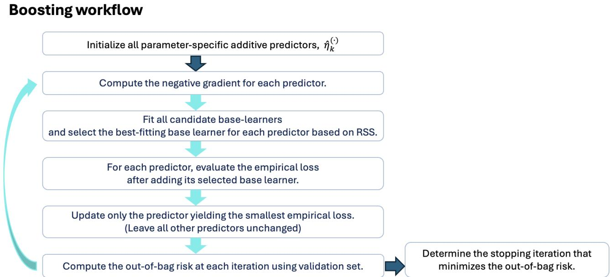  
Figure 1: Noncyclic model-based boosting algorithm

The fundamental idea behind model-based gradient boosting is to iteratively minimize the empirical risk through a stagewise descent that uses the gradient of the loss function. Similar to the classical boosting algorithm, it is a sequential ensemble approach in which the ensemble is composed of regression-function base learners. More specifically, the algorithm starts with initial values for the additive predictors and with a prespecified set of regression-type base learners for each parameter. Common options include simple linear models and regression splines with only a few degrees of freedom. The chosen base-learner type determines the kind of contribution a covariate makes to the associated additive predictor, for instance a linear versus a nonlinear efect. At iteration $m ,$ parameter-specific base learners are fitted to the corresponding negative partial gradients computed at the estimates from iteration $m - 1$ . The next subsection presents these negative gradients for each parameter for a discrete– continuous response. These gradient vectors may be viewed as pseudo-observations; for squared-error loss, they are identical to the residuals from the previous boosting step. Here, they are obtained from the first derivatives of the negative log-likelihood with respect to the associated parameter predictors $\eta _ { k } ^ { ( \bullet ) }$ . Next, for each parameter-specific gradient, the base learner providing the best fit according to a residual sum-of-squares criterion is selected. Each selected base learner is then temporarily added to its corresponding predictor, and the updated empirical loss is computed. From these candidate updates, only the predictor that achieves the lowest empirical loss is actually updated in a given iteration; this is known as noncyclic boosting. Since updates are applied only to the selected base learners, the method also performs inherent variable selection.

Two algorithmic approaches can be used to boost distributional regression models: the cyclic algorithm (Mayr et al., 2012) and the noncyclic algorithm (Thomas et al., 2017). In the cyclic approach, the additive predictors are updated sequentially by fitting the best-performing base learner for each predictor in turn. The noncyclic approach adds an extra selection step across the diferent model parameters. Concretely, at each iteration, only the parameter-specific predictor that yields the largest overall reduction in loss is updated, using its best-fitting base learner. Due to its advantages in variable selection, we focus on the noncyclic algorithm in what follows. The algorithm is given in Appendix B and is briefly outlined in Figure 1. In model-based boosting, the optimal number of iterations can be determined by minimizing the out-of-bag risk (B¨uhlmann and Hothorn (2007); Mayr et al. (2012)). To this end, the complete dataset is split into a training set and a validation set. The boosting algorithm is fitted on the training data, and its predictive performance is assessed on the validation data using the risk. The stopping iteration is then selected as the iteration at which the out-of-bag risk reaches its minimum.

## 3.2 Negative gradients of the implemented loss function

Recall that the loss is defined as the negative log-likelihood, i.e., $\omega = - \ell .$ . Hence, taking the negative derivative of the loss with respect to an additive predictor yields the associated partial derivative of the log-likelihood:

$$
- \frac { \partial \omega } { \partial \eta _ { k } ^ { ( \nu ) } } = \frac { \partial \ell } { \partial \eta _ { k } ^ { ( \nu ) } } , \qquad \nu \in \{ 1 , 2 \} , \quad k = 1 , \dots , K _ { \nu } .
$$

For the copula parameter, the relevant additive predictor is written as $\eta ^ { ( c ) }$

To simplify notation, define

$$
A = C _ { 2 } \left( F _ { 1 } , F _ { 2 } \mid \theta ^ { ( c ) } \right) - C _ { 2 } \left( F _ { 1 } ^ { - } , F _ { 2 } \mid \theta ^ { ( c ) } \right) .\tag{6}
$$

The log-likelihood in Equation (4) can then be written as

$$
\ell = \log A + \log f _ { 2 } .
$$

We further define the following partial derivatives of $C _ { 2 }$

$$
\begin{array} { l } { { C _ { 2 1 } ( u , v \mid \theta ) = \displaystyle \frac { \partial C _ { 2 } ( u , v \mid \theta ) } { \partial u } , } } \\ { { C _ { 2 2 } ( u , v \mid \theta ) = \displaystyle \frac { \partial C _ { 2 } ( u , v \mid \theta ) } { \partial v } , } } \\ { { C _ { 2 \theta } ( u , v \mid \theta ) = \displaystyle \frac { \partial C _ { 2 } ( u , v \mid \theta ) } { \partial \theta } . } } \end{array}\tag{7}
$$

For a parameter of the first marginal distribution, the negative gradient is

$$
\begin{array} { l } { { \displaystyle { \frac { \partial \ell } { \partial \eta _ { k } ^ { ( 1 ) } } = \frac { 1 } { A } \Bigg [ C _ { 2 1 } \left( F _ { 1 } , F _ { 2 } \mid \theta ^ { ( c ) } \right) \frac { \partial F _ { 1 } } { \partial \eta _ { k } ^ { ( 1 ) } } } } } \\ { { \displaystyle ~ - ~ C _ { 2 1 } \left( F _ { 1 } ^ { - } , F _ { 2 } \mid \theta ^ { ( c ) } \right) \left( \frac { \partial F _ { 1 } } { \partial \eta _ { k } ^ { ( 1 ) } } - \frac { \partial f _ { 1 } } { \partial \eta _ { k } ^ { ( 1 ) } } \right) \Bigg ] , \qquad k = 1 , \dots , K _ { 1 } . } } \end{array}\tag{8}
$$

For a parameter of the second marginal distribution, the negative gradient is

$$
\begin{array} { c } { { { \displaystyle \frac { \partial \ell } { \partial \eta _ { k } ^ { ( 2 ) } } = \frac { 1 } { A } \left[ C _ { 2 2 } \left( F _ { 1 } , F _ { 2 } \mid \theta ^ { ( c ) } \right) - C _ { 2 2 } \left( F _ { 1 } ^ { - } , F _ { 2 } \mid \theta ^ { ( c ) } \right) \right] \frac { \partial F _ { 2 } } { \partial \eta _ { k } ^ { ( 2 ) } } } } } \\ { { { + \displaystyle \frac { 1 } { f _ { 2 } } \frac { \partial f _ { 2 } } { \partial \eta _ { k } ^ { ( 2 ) } } , \qquad k = 1 , \ldots , K _ { 2 } . } } } \end{array}\tag{9}
$$

Finally, the negative gradient with respect to the copula predictor is

$$
\frac { \partial \ell } { \partial \eta ^ { ( c ) } } = \frac { 1 } { A } \left[ C _ { 2 \theta } \left( F _ { 1 } , F _ { 2 } \mid \theta ^ { ( c ) } \right) - C _ { 2 \theta } \left( F _ { 1 } ^ { - } , F _ { 2 } \mid \theta ^ { ( c ) } \right) \right] \frac { \partial \theta ^ { ( c ) } } { \partial \eta ^ { ( c ) } } .\tag{10}
$$

## 4 Simulated experiment

In this section, we evaluate the proposed distributional copula regression framework fitted using modelbased boosting through a simulation study in which the model parameters and data-generating mechanism are fully specified. The main objectives are to assess (i) predictive performance relative to benchmark approaches that fit the two responses separately and therefore assume independence, (ii) the recovery of the underlying covariate efects and dependence structure, and (iii) variable-selection performance.

## 4.1 Data generation

For the discrete–continuous response setting, we generate the discrete margin from a Poisson distribution and the continuous margin from a Gamma distribution. The two margins are linked using a Frank copula. Although the Frank copula can accommodate both positive and negative dependence, the copula predictor specified below takes only positive values and therefore generates positive dependence in this simulation. All covariates are generated independently from a uniform distribution on [0, 1]. To assess the ability of the proposed method to recover diferent forms of covariate efects, the distributional predictors include both linear and nonlinear efects:

$$
{ \begin{array} { l l } { \ln ( \lambda ) = \eta _ { 1 } ^ { ( 1 ) } = { \frac { 1 } { 2 } } \left( X _ { 1 } ^ { 3 / 2 } - 2 \cos ( 3 X _ { 1 } ) \right) + 1 . 3 X _ { 2 } - X _ { 3 } + 2 X _ { 4 } } & { { \mathrm { ( P o i s s o n ~ m e a n ) } } , } \\ { \ln ( \mu ) = \eta _ { 1 } ^ { ( 2 ) } = 1 . 5 X _ { 2 } + 0 . 5 X _ { 3 } + 5 X _ { 4 } ^ { 3 } - 6 X _ { 4 } ^ { 2 } + 2 X _ { 4 } } & { { \mathrm { ( G a m m a ~ m e a n ) } } , } \\ { \ln ( \sigma ) = \eta _ { 2 } ^ { ( 2 ) } = - 1 . 5 \left( 1 . 5 \cos ( 2 X _ { 5 } ) + 3 \operatorname { t a n h } ( X _ { 5 } ) \right) + 2 X _ { 6 } , } & { { \mathrm { ( G a m m a ~ d i s p e r s i o n ) } } } \\ { \theta ^ { ( c ) } = \eta ^ { ( c ) } = 2 \sin ( 4 X _ { 7 } ) + 3 } & { { \mathrm { ( F r a n k ~ c o p u l a ~ p a r a m ) } } } \end{array} }\tag{11}
$$

To evaluate the variable-selection performance of the boosting algorithm, we consider three covariate-dimensional settings with $p \in \{ 1 0 , 1 0 0 , 1 0 0 0 \}$ . In each setting, the seven covariates $X _ { 1 } , \ldots , X _ { 7 }$ are informative for at least one distributional or copula parameter, as specified in Equation (11), while the remaining $p - 7$ covariates are noise variables. Thus, the three settings contain 3, 93, and 993 noise variables, respectively. For each simulated data set, we create 2,000 observations. The first 1,000 observations are used as the training set to fit the model. We then use 500 observations as a tuning set to choose the best stopping iteration, and the final 500 observations serve as the test set for evaluating out-of-sample performance. For each dimensional setting, we generate 10 independent data sets and report the average and standard deviation of each performance metric over these 10 runs.

## 4.2 Estimation and evaluation setup

Since the functional form of each covariate efect is generally unknown in practice, we specify a B-spline base learner with three efective degrees of freedom for every covariate in each distributional predictor. This flexible specification allows both linear and nonlinear efects to be recovered without prespecifying their functional forms. The step length is fixed at $s _ { \mathrm { s t e p } } = 0 . 1$ for all distributional parameters. The maximum number of boosting iterations is set to $m _ { \mathrm { s t o p } } = 5 { , } 0 0 0$ , and the optimal stopping iteration is selected by minimizing the out-of-bag risk evaluated on the tuning sample.

We compare the proposed model with two benchmark approaches. The first benchmark consists of separate univariate distributional models for the Poisson and Gamma margins, both fitted using modelbased boosting. Because the two margins are modeled separately, this approach assumes independence between the responses. The second benchmark also fits separate Poisson and Gamma models under the independence assumption, but estimates them by maximum likelihood rather than boosting.

We evaluate the predictive performance of the proposed copula model and the two benchmark approaches using two proper scoring rules: the negative log-likelihood and the energy score (Gneiting et al., 2008). For the independent benchmark models, the joint negative log-likelihood is calculated as the sum of the negative marginal log-likelihoods. Let $\pmb { y } = ( y _ { 1 } , y _ { 2 } ) ^ { \top }$ denote an observed bivariate outcome and let $\widehat { F } _ { Y }$ denote its predictive distribution. The energy score is defined as:

$$
\widehat { \mathrm { E S } } \left( \widehat { F } _ { Y } , \pmb { y } \right) = \frac { 1 } { M } \sum _ { m = 1 } ^ { M } \Vert \pmb { X } _ { m } - \pmb { y } \Vert - \frac { 1 } { 2 M ^ { 2 } } \sum _ { m = 1 } ^ { M } \sum _ { m ^ { \prime } = 1 } ^ { M } \Vert \pmb { X } _ { m } - \pmb { X } _ { m ^ { \prime } } \Vert ,\tag{12}
$$

where $\| \cdot \|$ denotes the Euclidean norm on $\mathbb { R } ^ { 2 }$ , and M predictive samples $X _ { 1 } , \ldots , X _ { M }$ are drawn independently from $\widehat { F } _ { Y }$ with

$$
\begin{array} { r } { \pmb { X _ { m } } = ( X _ { m 1 } , X _ { m 2 } ) ^ { \top } \in \mathbb { R } ^ { 2 } , \qquad m = 1 , \ldots , M . } \end{array}
$$

The first term measures the distance between the predictive samples and the observed outcome, whereas the second term accounts for the dispersion of the predictive distribution. The energy score therefore evaluates the entire joint predictive distribution, including its marginal behavior and dependence structure. As with the negative log-likelihood, a lower energy score indicates better predictive performance.

## 4.3 Results

We evaluate the proposed method along three dimensions: predictive performance, recovery of the underlying covariate efects and dependence structure, and variable-selection performance.

Predictive performance. As expected, Table 1 indicates that the Frank copula boosting model attains the smallest negative log-likelihood and energy score. The model is fitted to the simulated data using a Frank copula distributional regression approach estimated via noncyclic model-based boosting. Reported values are means across 10 independent replications, with standard deviations given in parentheses. To compute the energy score, 1,000 samples $( M = 1 , 0 0 0 )$ were generated.

Table 1: Predictive performance of the proposed model and two benchmark models across diferent dimensional settings
<table><tr><td rowspan="2">Score</td><td rowspan="2">Model</td><td colspan="3">Mean (SD)</td></tr><tr><td> $\mathbf { \Delta } p = \mathbf { 1 0 }$ </td><td> $\pmb { p } = \mathbf { 1 0 0 }$ </td><td> $\pmb { p } = \mathbf { 1 0 0 0 }$ </td></tr><tr><td rowspan="3">Negative log-likelihood</td><td>Frank copula boosting</td><td>1,293 (24)</td><td>1,344 (27)</td><td>1,386 (31)</td></tr><tr><td>Univariate boosting</td><td>1,367 (29)</td><td>1,389 (28)</td><td>1,411 (31)</td></tr><tr><td>Univariate MLE</td><td>1,396 (29)</td><td>25,626 (19,180)</td><td></td></tr><tr><td rowspan="3">Energy score</td><td>Frank copula boosting</td><td>1.40 (0.04)</td><td>1.44 (0.04)</td><td>1.47 (0.03)</td></tr><tr><td>Univariate boosting</td><td>1.41 (0.05)</td><td>1.45 (0.04)</td><td>1.48 (0.03)</td></tr><tr><td>Univariate MLE</td><td>1.43 (0.06)</td><td>2.05 (0.10)</td><td></td></tr></table>

Note: Entries report the mean, with the standard deviation in parentheses, over 10 data sets. The univariate MLE model could not be estimated for $p = 1 0 0 0$

Across all three dimensional settings, the Frank copula boosting model achieves the lowest negative log-likelihood and energy score, followed by univariate boosting. This result indicates that accounting for the dependence between the two responses improves the estimation of their joint predictive distribution. The performance of both boosting approaches deteriorates moderately as the number of covariates increases from $p = 1 0 \mathrm { t o } p = 1 , 0 0 0$ . In contrast, the univariate MLE model becomes unstable as the dimensionality increases. For $p = 1 0 0$ , it produces substantially larger negative log-likelihood and energy score values than the boosting models, and it cannot be fitted successfully for $p = 1 { , } 0 0 0$ . These findings demonstrate the greater stability of model-based boosting in the settings considered here. In particular, boosting remains feasible when the number of candidate covariates equals the training sample size, whereas conventional maximum likelihood estimation encounters severe numerical and estimation dificulties.

To assess the model’s sensitivity to the choice of copula family, we additionally estimate the proposed framework using Gaussian and Gumbel copulas. Given that the synthetic data are generated from a Frank copula, these alternatives represent misspecified dependence structures. Table 2 compares their predictive performance against the correctly specified Frank copula model for $p = 1 0 .$ . The

Table 2: Efect of copula misspecification on predictive performance for $p = 1 0$
<table><tr><td>Model</td><td>Negative log-likelihood</td><td>Energy score</td></tr><tr><td>Frank copula boosting</td><td>1,293 (24)</td><td>1.40 (0.04)</td></tr><tr><td>Gaussian copula boosting</td><td>1,314 (26)</td><td>1.41 (0.04)</td></tr><tr><td>Gumbel copula boosting</td><td>1,323 (32)</td><td>1.41 (0.05)</td></tr></table>

correctly specified Frank copula model achieves the best predictive accuracy, yielding the lowest negative log-likelihood and energy score. Notably, despite their misspecified dependence structures, both the Gaussian and Gumbel copula models outperform the independence-based benchmarks (shown in Table 1) in terms of negative log-likelihood. Furthermore, their energy scores remain competitive with the univariate boosting and MLE model. These findings demonstrate that explicitly modeling dependence can improve joint probabilistic prediction even when the copula family is not correctly specified, although selecting an appropriate copula family provides an additional improvement.

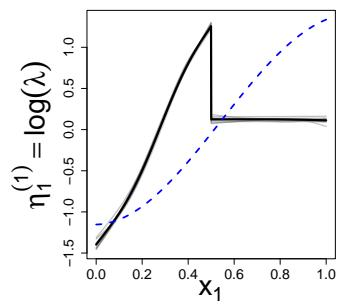

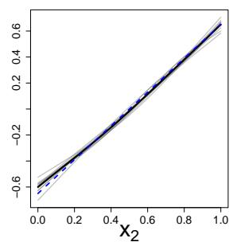

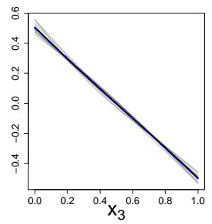

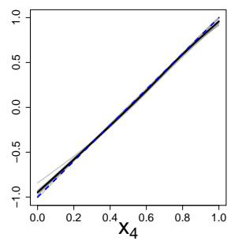

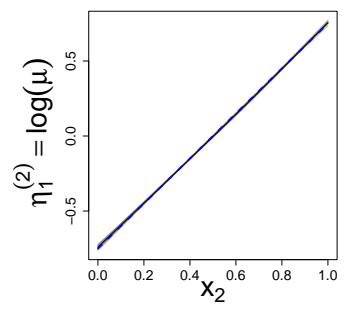

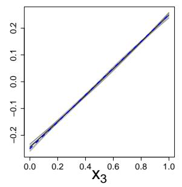

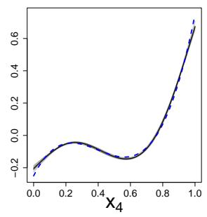

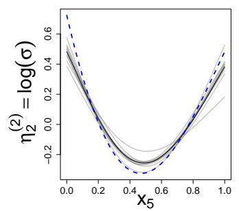

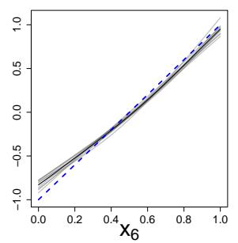

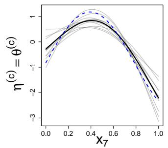  
Figure 2: Partial efects for the seven informative covariates. Blue dashed lines denote the true efects, gray lines the estimates from the 10 replicated datasets, and black solid lines their average.

Recovery of the covariate efects. To evaluate how efectively the proposed model retrieves covariate efects for both the distributional and dependence parameters, we analyze the estimated partial efects after fitting. To enhance interpretability, each estimated efect is centered to have mean zero on the link scale so that the intercept corresponds to the overall average prediction. Figure 2 shows these centered partial efects on the respective parameter-specific additive predictors, i.e., $\overline { { \eta } } _ { 1 } ^ { ( 1 ) } , \eta _ { 1 } ^ { ( 2 ) } , \eta _ { 2 } ^ { ( 2 ) }$ , and $\eta ^ { ( c ) }$ . The blue dashed curves indicate the true efects, while the solid curves display the estimated efects obtained from 10 replicated datasets. The first row of Figure 2 relates to $\eta _ { 1 } ^ { ( 1 ) }$ in Equation 11, which includes a nonlinear contribution of $X _ { 1 }$ alongside linear efects of $X _ { 2 } , X _ { 3 } ,$ and $X _ { 4 }$ . For $X _ { 1 }$ , the estimates reflect the overall upward trend at lower covariate values, but they do not entirely reproduce the true nonlinear form and become clearly flatter at higher values. By comparison, the linear efects of $X _ { 2 } , X _ { 3 }$ , and $X _ { 4 }$ are recovered with high accuracy across replications. The other rows reveal similarly strong agreement between estimated and true efects for most covariates, covering both linear and nonlinear patterns. For some nonlinear terms, the estimated magnitudes are slightly attenuated relative to the truth. This is in line with the regularization induced by component-wise gradient boosting: small step sizes and early stopping shrink efects toward zero, which reduces estimation variance (Mayr et al. (2012)). Taken together, these findings suggest that the proposed model can recover the underlying covariate efects across diferent distributional parameters while preserving boosting’s regularization. The results therefore demonstrate that the model is intrinsically interpretable at the level of its additive predictors, ofering more transparency and auditability than black-box approaches.

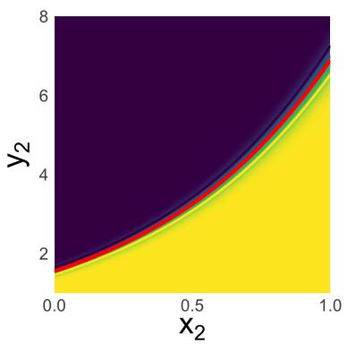

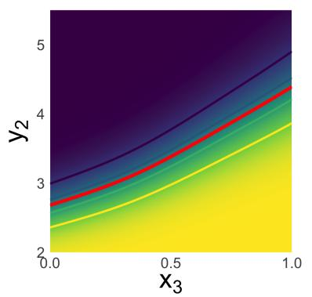

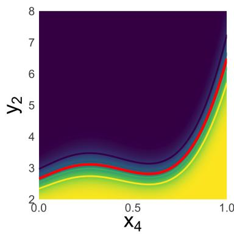

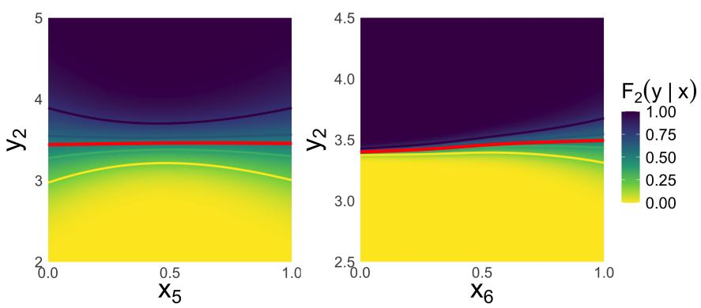  
Figure 3: Conditional Gamma cumulative distribution functions and quantiles for varying values of the selected covariates, using parameters estimated via the proposed copula-based distributional model.

Figure 3 illustrates the estimated conditional distribution of $Y _ { 2 }$ and the corresponding conditional quantiles (20%, 40%, 60%, and 80%) as each covariate $X _ { j } , j \in \{ 2 , 3 , 4 , 5 , 6 \}$ , varies. In the simulation setting, Y2 follows a Gamma distribution, with $X _ { 2 } , X _ { 3 }$ , and $X _ { 4 }$ entering the additive predictor for the conditional mean parameter $\mu ,$ and $X _ { 5 }$ and $X _ { 6 }$ entering the predictor for the scale parameter σ. The background color represents the estimated conditional CDF, $F _ { 2 } ( y \mid x )$ , the red solid line represents the estimated conditional mean, and the colored curves indicate the corresponding conditional quantiles. The resulting distributional patterns closely reflect the covariate efects specified in Equation 11. As $X _ { 2 }$ and $X _ { 3 }$ increase, the conditional mean and quantiles of $Y _ { 2 }$ also increase. The larger gaps between the quantile curves indicate an increase in conditional variability. For $X _ { 4 } ,$ the conditional mean and quantiles also follow the nonlinear pattern specified in the simulation model. For $X _ { 5 }$ , the conditional spread is relatively large near the lower end of its range, decreases toward intermediate values, and then increases again, closely reflecting the nonlinear efect specified for $\sigma .$ Likewise, the increasing efect of $X _ { 6 }$ on $\sigma$ is reflected in the gradual widening of the conditional distribution as $X _ { 6 }$ increases. Overall, these results demonstrate that the proposed copula-based distributional model fitted by model-based boosting captures not only changes in the conditional mean but also covariate-dependent changes in the shape and dispersion of the conditional Gamma distribution.

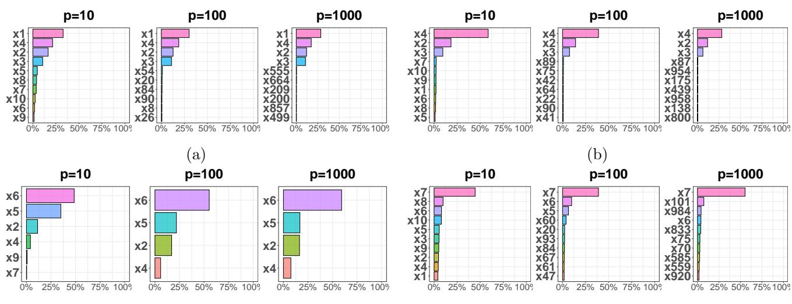  
Figure 4: Top 10 covariates based on the mean variable selection rate across 10 replications. Panels (a)–(d) correspond to predictors for $\eta _ { 1 } ^ { ( 1 ) } , \eta _ { 1 } ^ { ( 2 ) } , \eta _ { 2 } ^ { ( 2 ) }$ , and $\eta ^ { ( c ) }$ , respectively.

Variable selection performance. One advantage of model-based boosting is its intrinsic variable selection mechanism, which makes it particularly suitable for high-dimensional settings. At each boosting iteration, only the best-performing base learner is selected and updated, so informative covariates tend to be selected more frequently than non-informative ones. To examine this behavior, we calculate

(c)

(d)

the selection rate for each covariate and each parameter-specific predictor. We then average these rates over the 10 replications, and Figure 4 reports the 10 covariates with the highest mean selection rates for $p = 1 0$ , 100, and 1000. In Figure $4 ( \mathrm { c } )$ , fewer than 10 covariates are displayed because the remaining covariates were never selected in any of the 10 replications, resulting in mean selection rates of zero. In all three scenarios, the covariates used to construct each parameter-specific predictor consistently appear among the most frequently selected variables. For $\eta _ { 1 } ^ { ( 1 ) }$ , the truly informative covariates $X _ { 1 } , X _ { 2 }$ $X _ { 3 } ,$ , and $X _ { 4 }$ take the top positions. Likewise, $X _ { 2 } , X _ { 3 } ,$ , and $X _ { 4 }$ are selected most often for $\eta _ { 1 } ^ { ( 2 ) }$ , whereas selections for $\eta _ { 2 } ^ { ( 2 ) }$ are dominated by $X _ { 5 }$ and $X _ { 6 } .$ . For the dependence predictor $\eta ^ { ( c ) } , X _ { 7 }$ is consistently the most frequently chosen covariate. Notably, these patterns remain evident as the dimension grows from $p = 1 0$ to $p = 1 0 0 0$ , including the case where the number of covariates matches the number of training observations $( p = n = 1 0 0 0 )$ . While some non-informative covariates enter the top 10, their selection rates stay markedly below those of the genuinely informative covariates. Overall, these findings indicate that the proposed boosting procedure reliably recovers informative covariates while curbing the impact of irrelevant variables, even in high-dimensional settings.

## 5 Empirical Investigation

We examine the proposed distributional copula regression approach, estimated via model-based boosting, employing Poisson and Gamma marginals for claim frequency and severity, respectively, using car insurance claims data that include telematics information.

## 5.1 Data and Model Specification

To evaluate the empirical performance of the proposed framework, we used the synthetic telematics dataset developed by So et al. (2021b), which is publicly available at http://www2.math.uconn. edu/ valdez/data.html. The dataset was designed to emulate key characteristics of automobile telematics data obtained from a Canadian insurer, providing a publicly accessible benchmark without requiring access to the original confidential policyholder records. It contains 100,000 observations and 52 variables, covering traditional insurance characteristics, telematics measurements, and claims outcomes. Variable descriptions are provided in Table 4 in Appendix C.

Prior to model fitting, we restructured or excluded potentially redundant covariates, guided by the correlation analysis reported in So and Zhang (2026). The preprocessing focused primarily on groups with correlation coeficients exceeding approximately 0.80 in magnitude. The three nested driving-duration proportions were converted into covariates representing driving durations between two and three hours, between three and four hours, and beyond four hours. These were obtained by subtracting Pct.drive.3hrs from Pct.drive.2hrs, subtracting Pct.drive.4hrs from Pct.drive.3hrs, and retaining Pct.drive.4hrs, respectively. Acceleration, braking, and left- and right-turn measurements were summarized separately using logarithmically transformed weighted sums. Weights of 1–6 were assigned to the acceleration and braking thresholds, and weights of 1–5 to the turning-intensity thresholds, in ascending order. This construction places greater emphasis on measurements associated with more extreme driving behavior. The weekday and weekend proportions, Pct.drive.wkday and Pct.drive.wkend, were excluded because they summarize driving activity already represented by the day-of-week proportions. Six day-of-week proportions, corresponding to Monday through Saturday, were retained as candidate predictors, with Sunday omitted as the remaining component. We also excluded Annual.pct.driven because its correlation of approximately 0.70 with Total.miles.driven indicated overlapping information. Expected annual mileage (Annual.miles.drive) and total mileage were transformed using log(1 + x) to compress large values and reduce right-skewness.

The responses were claim count, NB Claim, and average claim amount. For policies with positive claim counts, the average claim amount was calculated as AMT Claim divided by NB Claim. The resulting candidate predictor set comprised five categorical covariates: insured sex, marital status, vehicle use, region, and territory, and 22 numerical covariates. The distributional copula regression model, with Poisson and Gamma marginals for claim count and average claim amount, respectively, was fitted using non-cyclic model-based boosting. For each distributional parameter, the additive predictor was specified using the same candidate base-learner set, with covariate efects estimated separately for each parameter. Categorical covariates were dummy coded and represented by ordinary linear base-learners. Numerical covariates were represented by B-spline base learners with degrees of freedom set to three, allowing both linear and smooth nonlinear associations. The claim frequency predictor $\eta _ { 1 } ^ { ( 1 ) }$ additionally included the logarithm of policy exposure as an ofset, with its coeficient fixed at one.

For model evaluation, the observations were randomly divided into training and test sets in an 80:20 ratio. The training set was further divided into fitting and validation subsets in an 80:20 ratio. The step length for each parameter predictor was selected by grid search over {0.001, 0.005, 0.01, 0.05, 0.1}, and the maximum number of boosting iterations was set to 2,000. Distributiona copula regression models with Frank, Gumbel, and Gaussian copulas were fitted and compared with the two benchmark models described in Section 4. All models used the same candidate base-learner set to ensure a consistent comparison. Data analysis and model estimation were implemented in R and Python.

## 5.2 Empirical Results

Table 3: Predictive performance on the synthetic telematics dataset.
<table><tr><td>Model</td><td>Negative log-likelihood</td><td>Energy score</td></tr><tr><td>Frank copula boosting</td><td>-305,276</td><td>130.8</td></tr><tr><td>Gaussian copula boosting</td><td>-305,228</td><td>131.0</td></tr><tr><td>Gumbel copula boosting</td><td>-305,065</td><td>131.3</td></tr><tr><td>Univariate boosting</td><td>-302,762</td><td>134.4</td></tr><tr><td>Univariate MLE</td><td>-297,023</td><td>132.6</td></tr></table>

Table 3 indicates that the three copula boosting models yield smaller negative log-likelihood and energy score values than the two univariate benchmark models. Within the copula family, the Frank copula delivers the strongest performance on both metrics, with the Gaussian copula next and the Gumbel copula last. Overall, these findings imply that explicitly capturing the conditional dependence between claim frequency and mean claim severity enhances joint predictive accuracy, while also providing important evidence about the form of dependence between frequency and severity. In particular, the estimated Kendall’s τ for the Frank copula varies substantially, ranging from −0.157 to 0.72, which suggests that both the sign and strength of dependence difer markedly across policyholder risk profiles. The occurrence of negative dependence $( \tau < 0 )$ points to subgroups of policyholders who tend to file claims more often but with lower average costs. Since the standard Gumbel copula is limited to positive dependence and enforces pronounced upper-tail dependence, its weaker results indicate that the relationship between claim frequency and severity is not purely positive. This also suggests that very high claim counts and extremely severe losses do not necessarily coincide in the tail.

Given its superior predictive performance, the subsequent analyses focus on the fitted Frank copula boosting model. Figure 5, panels (a)–(d), shows the covariates selected for the additive predictors $\eta _ { 1 } ^ { ( 1 ) } , \eta _ { 1 } ^ { ( \bar { 2 } ) } , \eta _ { 2 } ^ { ( 2 ) }$ , and $\eta ^ { ( c ) }$ , respectively, ordered by their boosting selection rates. In the claim frequency component, the predictor for λ retained only two covariates—Total.miles.driven and Brake.total—as informative variables, in addition to the fixed exposure ofset. Total.miles.driven contributed to over 90% of the updates, suggesting that most revisions to this predictor were driven by its efect. For claim severity, the $\mu$ predictor had three covariates with selection rates above 20%: Total.miles.driven, Credit.score, and Brake.total. In the dispersion predictor for severity, only Total.miles.driven and Credit.score surpassed this cutof, whereas Years.noclaims, Car.age, and Brake.total each showed selection rates around 10%. The total miles driven variable was repeatedly chosen in both the frequency and severity models, which aligns with the intuition that higher driving exposure raises both accident likelihood and the potential magnitude of losses. Consistent patterns were documented by So and Valdez (2025), who examined the same dataset and reported associations between claim amounts and total mileage, credit score, vehicle age, and braking and turning behavior, among others. For the copula dependence predictor, the four most frequently selected covariates were Total.miles.driven, Pct.drive.2to3hrs, Brake.total, and Accel.total, though only the first two achieved selection rates exceeding 20%. Overall, Total.miles.driven emerged as informative across all four predictors and was selected most often, highlighting its key role in modeling claim frequency, claim severity, severity dispersion, and their conditional dependence.

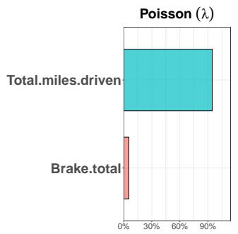  
(a)

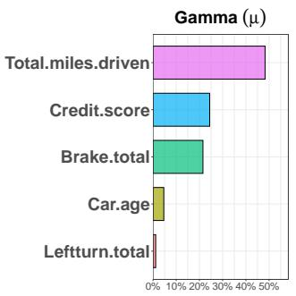  
(b)

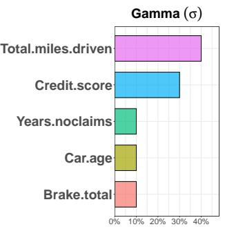  
(c)

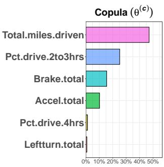  
(d)  
Figure 5: Covariates included in the predictor for each parameter, ranked by selection rate.

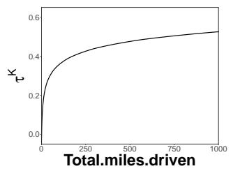  
(a)

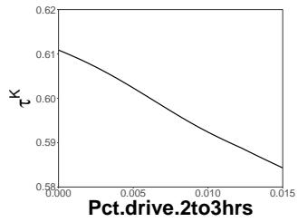  
(b)

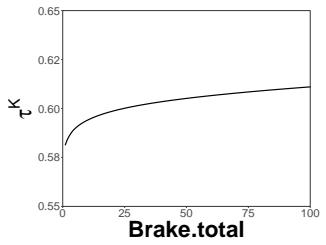  
(c)

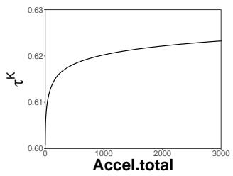  
(d)  
Figure 6: Efects of covariates on Kendall’s tau rank correlation coeficient between claim frequency and severity

We next turn to the four covariates that are most frequently selected for the Frank copula dependence predictor $\eta ^ { ( c ) }$ . Figure 6 illustrates how the model-implied Kendall’s τ varies with these four covariates. For Total.miles.driven (Figure $6 ( \mathrm { a } ) )$ ), the relationship is close to zero—or mildly negative—at very low distances, then rises rapidly before flattening. This pattern is consistent with actuarial reasoning: policyholders with minimal driving exposure typically experience minor, low-severity incidents, resulting in weak or negative dependence between frequency and severity. As total mileage grows, exposure expands to riskier settings (e.g., highways and complicated intersections), producing a pronounced positive association in which higher claim counts are much more likely to coincide with higher severities. The proportion of continuous driving between 2 and 3 hours (Figure 6(b)), used as a surrogate for fatigue and long-distance travel, shows a modest declining trend while remaining at a consistently high dependence level over its full domain $\left( \tau \approx 0 . 5 8 \mathrm { t o } 0 . 6 1 \right)$ . This sustained magnitude of τ highlights the substantial tail risk of extended driving, where crashes are intrinsically more prone to be catastrophic. The gentle negative slope may indicate that drivers with very high proportions of such trips are seasoned long-distance commuters or professional drivers; their experience with uninterrupted highway travel slightly reduces the extreme joint risk linking frequency and severity, even though dependence remains strong. Brake.total and Accel.total are both key markers of aggressive driving. Figure 6 shows a sharp early increase in τ, followed by saturation at larger numbers of events. Thus, as harsh braking and rapid acceleration become more common, the probability of observing both frequent and severe claims together increases markedly—aggressive drivers tend to crash more often and with greater collision forces. Taken together, these non-linear, covariate-dependent shifts in Kendall’s τ reinforce the importance of modeling the dependence structure in a dynamic way.

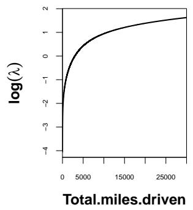

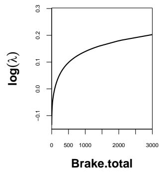  
Figure 7: Estimated partial efects on the additive predictor for the Poisson mean

In Figure 7, the estimated partial efects show that both total distance driven and the braking index are positively associated with expected claim counts. The efect of total mileage increases sharply at low mileage levels and more gradually thereafter on the log scale. This pattern is consistent with greater driving activity providing more opportunities for claims to occur. The braking index also exhibits an increasing efect, suggesting that more frequent or more intense braking is associated with higher claim frequency.

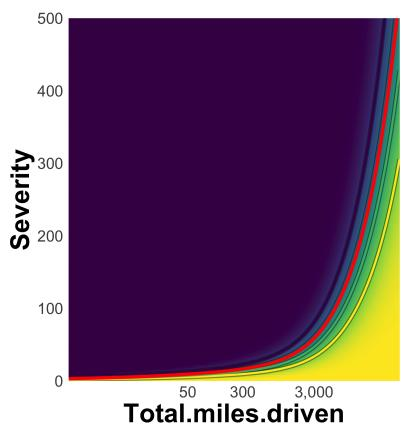

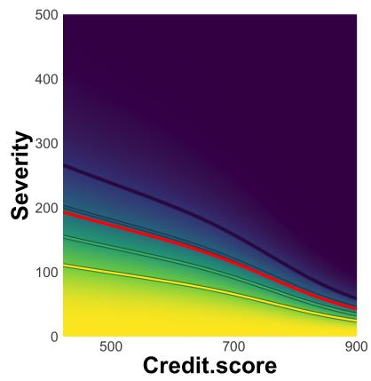

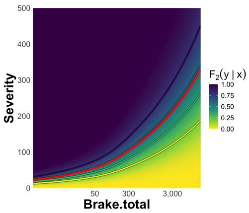  
Figure 8: Conditional Gamma cumulative distributions and quantiles of claim severity for varying values of the informative covariates.

To examine how covariates afect claim severity, we graphed the estimated conditional Gamma cumulative distribution functions and quantiles over a range of covariate values. Since the model simultaneously fits the mean and the dispersion of severity, these visualizations show how covariates modify the entire fitted distribution rather than only its center. Figure 8 displays results for Total.miles.driven, Credit.score, and Brake.total, which were chosen due to their strong contributions to the mean and dispersion components (see Figures 5(b) and 5(c)). The red solid curve denotes the estimated conditional mean claim amount. For Total.miles.driven, the severity quantiles rise steeply, and the distance between lower and upper quantiles expands markedly. This indicates that higher driving exposure increases not only expected severity but also variability and tail risk in claim amounts. By comparison, higher Credit.score shifts the quantiles downward and compresses their spread. From an actuarial perspective, credit-based insurance scores are widely viewed as a robust proxy for risk aversion and responsible conduct. The tighter distribution at high credit scores suggests these insureds tend to generate more predictable, low-severity claims. The Brake.total measure also trends upward, with upper quantiles increasing faster than lower quantiles. As a telematics-based signal of aggressive driving, frequent hard braking can reflect tailgating or slower reaction times. The resulting asymmetric widening suggests that aggressive driving disproportionately increases the right tail of the severity distribution, substantially raising the likelihood of extreme, high-cost claims. Overall, these findings highlight the usefulness of distributional regression for actuarial pricing.

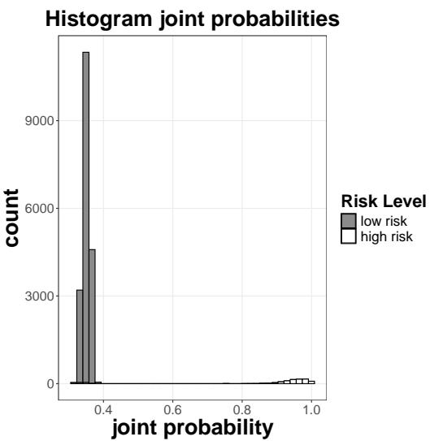  
Figure 9: Joint probabilities from the copula model separated by low risk (grey) and high risk (white)

Lastly, Figure 9 compares the estimated joint-probability values from the Frank copula model between claim-free policies (grey) and claim-positive policies (white), defined by whether the observed claim count is zero or positive. The values for claim-free policies are concentrated around 0.35, whereas those for claim-positive policies are mostly close to one, showing a clear separation between the two groups. This descriptive comparison complements the test-set performance results reported in Table 3, where the Frank copula model achieved the lowest negative log-likelihood and energy score among the models considered.

Overall, the empirical findings from the synthetic telematics dataset indicate that the proposed framework delivers better predictive accuracy without sacrificing interpretability. The boosting algorithm chooses a reduced set of candidate covariates for each distributional parameter, leading to parsimonious predictor structures. Because the method models the entire conditional distribution through a copula, it also clarifies how covariates are associated with both the location and spread of claim severity, as well as with the dependence between claim frequency and severity. Together, these properties facilitate transparent model evaluation and underscore the framework’s promise for insurance settings that require both strong predictive performance and clear interpretability.

## 6 Concluding Remarks

This paper presented a distributional copula regression framework for jointly modeling claim frequency and claim severity. It integrates interpretable, parameter-specific additive predictors for the marginal distributions with a copula whose dependence can vary with covariates, resulting in an inherently interpretable (glass-box) model. Estimation is carried out via noncyclic model-based boosting, producing sparse additive predictors and enabling automatic variable selection separately for each marginal parameter as well as for the copula dependence parameter. A simulation study and an empirical analysis on a synthetic telematics insurance dataset show that the proposed approach can enhance out-of-sample predictive performance compared with univariate benchmarks while maintaining interpretability. Partial efect plots and conditional distributional summaries demonstrate how covariates influence specific distributional parameters and the implied predictive distributions. Notably, the covariate-dependent copula ofers a clear explanation of how driving-related characteristics afect the conditional association between claim frequency and severity. By uniting predictive performance, variable selection, dependence modeling between frequency and severity, and interpretable distributional regression, the framework provides a promising tool for insurance settings that require both accurate forecasts and transparent model explanations.

## Appendix A. Poisson–Gamma responses with a Gaussian copula

We consider Poisson–Gamma marginal distributions linked through a Gaussian copula. We assume that the first marginal response follows a Poisson distribution,

$$
Y _ { 1 } \sim \mathrm { P o i s s o n } ( \lambda ) , \qquad \lambda > 0 ,
$$

and that the second marginal response follows a Gamma distribution,

$$
Y _ { 2 } \sim \mathrm { G a m m a } ( \mu , \sigma ) , ~ \mu > 0 , ~ \sigma > 0 ,
$$

where $\mu$ is the mean severity and $\sigma$ is a dispersion parameter.

For the Poisson margin, the probability mass function and CDF are

$$
f _ { 1 } = f _ { 1 } ( y _ { 1 } \mid \lambda ) = \frac { \exp ( - \lambda ) \lambda ^ { y _ { 1 } } } { y _ { 1 } ! } , \qquad F _ { 1 } = F _ { 1 } ( y _ { 1 } \mid \lambda ) = \sum _ { j = 0 } ^ { y _ { 1 } } \frac { \lambda ^ { j } \exp ( - \lambda ) } { j ! } ,\tag{13}
$$

where $y _ { 1 } = 0 , 1 , 2 , . . . .$ Because $Y _ { 1 }$ is discrete, we also define the left limit of its CDF as

$$
F _ { 1 } ^ { - } = \operatorname* { P r } ( Y _ { 1 } < y _ { 1 } ) = \sum _ { j = 0 } ^ { y _ { 1 } - 1 } { \frac { \lambda ^ { j } \exp ( - \lambda ) } { j ! } } ,\tag{14}
$$

with the convention that $F _ { 1 } ^ { - } = 0$ when $y _ { 1 } = 0$

Under the mean–dispersion parameterization of the Gamma distribution,

$$
\mathbb { E } ( Y _ { 2 } ) = \mu , \qquad \operatorname { V a r } ( Y _ { 2 } ) = \sigma ^ { 2 } \mu ^ { 2 } .
$$

Equivalently, the shape and scale parameters are $1 / \sigma ^ { 2 }$ and $\sigma ^ { 2 } \mu$ , respectively. The corresponding density and CDF are

$$
f _ { 2 } = f _ { 2 } ( y _ { 2 } \mid \mu , \sigma ) = \frac { y _ { 2 } ^ { 1 / \sigma ^ { 2 } - 1 } \exp \left( - \frac { y _ { 2 } } { \sigma ^ { 2 } \mu } \right) } { \Gamma ( 1 / \sigma ^ { 2 } ) ( \sigma ^ { 2 } \mu ) ^ { 1 / \sigma ^ { 2 } } } , \qquad F _ { 2 } = F _ { 2 } ( y _ { 2 } \mid \mu , \sigma ) , \qquad y _ { 2 } > 0 .\tag{15}
$$

For the Gaussian copula, the copula dependence parameter is the latent correlation parameter $\rho .$ The copula is defined as

$$
C ( u , v \mid \rho ) = \Phi _ { 2 } \left( \Phi ^ { - 1 } ( u ) , \Phi ^ { - 1 } ( v ) \mid \rho \right) , \qquad 0 \le u , v \le 1 , \quad - 1 < \rho < 1 ,\tag{16}
$$

where $\Phi ( \cdot )$ is the standard univariate normal CDF and $\Phi _ { 2 } ( \cdot , \cdot \mid \rho )$ is the standard bivariate normal CDF with correlation parameter $\rho .$ The partial derivative of the Gaussian copula with respect to its second argument is

$$
\frac { \partial C ( u , v \mid \rho ) } { \partial v } = \Phi \left( \frac { \Phi ^ { - 1 } ( u ) - \rho \Phi ^ { - 1 } ( v ) } { \sqrt { 1 - \rho ^ { 2 } } } \right) .\tag{17}
$$

Combining the marginal quantities in Equations (13)–(15) with the Gaussian copula derivative in Equation (17), the mixed discrete–continuous log-likelihood contribution in Equation (4) becomes

$$
\begin{array} { r l } & { \ell ( y _ { 1 } , y _ { 2 } \mid \lambda , \mu , \sigma , \rho ) = \log \left[ \Phi \left( \frac { \Phi ^ { - 1 } ( F _ { 1 } ) - \rho \Phi ^ { - 1 } ( F _ { 2 } ) } { \sqrt { 1 - \rho ^ { 2 } } } \right) \right. } \\ & { \qquad \left. - \Phi \left( \frac { \Phi ^ { - 1 } ( F _ { 1 } ^ { - } ) - \rho \Phi ^ { - 1 } ( F _ { 2 } ) } { \sqrt { 1 - \rho ^ { 2 } } } \right) \right] + \log f _ { 2 } . } \end{array}\tag{18}
$$

When $y _ { 1 } = 0 , F _ { 1 } ^ { - } = 0$ . Because $\Phi ^ { - 1 } ( 0 ) = - \infty$

$$
\Phi \left( \frac { \Phi ^ { - 1 } ( F _ { 1 } ^ { - } ) - \rho \Phi ^ { - 1 } ( F _ { 2 } ) } { \sqrt { 1 - \rho ^ { 2 } } } \right) = 0 .
$$

Therefore, the second term inside the logarithm in Equation (18) vanishes when $y _ { 1 } = 0$

For observation i, the individual log-likelihood contribution is obtained by substituting

$$
( y _ { 1 } , y _ { 2 } , \lambda , \mu , \sigma , \rho ) = ( y _ { 1 i } , y _ { 2 i } , \lambda _ { i } , \mu _ { i } , \sigma _ { i } , \rho _ { i } )
$$

into Equation (18). Thus,

$$
\ell _ { i } = \ell ( y _ { 1 i } , y _ { 2 i } \mid \lambda _ { i } , \mu _ { i } , \sigma _ { i } , \rho _ { i } ) ,
$$

and the full log-likelihood is

$$
\ell = \sum _ { i = 1 } ^ { n } \ell _ { i } .
$$

## Appendix B. Noncyclic boosting algorithm for distributional copula regression

Algorithm 1: Noncyclic model-based boosting   
Define: Base learners $b _ { k , j } ^ { ( \bullet ) } ( x _ { j } )$ , where $k$ indexes the parameter, $j$ indexes the covariate, and $\bullet \in \{ 1 , 2 , c \}$   
Set : Step length, $s _ { \mathrm { s t e p } } \ll 1$   
Maximum number of fitting iterations, $m _ { \mathrm { s t o p } } .$   
Split the observations into a training sample $( n _ { \mathrm { t r a i n } } )$ and an out-of-bag tuning sample $\left( n _ { \mathrm { m s t o p } } \right)$   
(1) Initialize all additive predictors $\widehat { \eta } _ { k , [ 0 ] } ^ { ( \bullet ) }$ using suitable ofset values   
for $m = 1 , \ldots , m _ { \mathrm { s t o p } }$ do   
foreach $\theta _ { k } ^ { \left( \bullet \right) } \in \dot { \pmb { \theta } }$ do   
(a) Compute the parameter-specific negative gradient vector   
$- g _ { k , [ m ] } ^ { ( \bullet ) } = - \left( \left. \frac { \partial \omega \left( y _ { i } \mid \eta ( x _ { i } ) \right) } { \partial \eta _ { k } ^ { ( \bullet ) } } \right| _ { \eta = \widehat { \eta } _ { [ m - 1 ] } } \right) _ { i = 1 } ^ { n _ { \mathrm { t r a i n } } } .$   
(b) Fit each parameter-specific base learner $\begin{array} { r } { b _ { k , j } ^ { ( \bullet ) } ( x _ { j } ) \mathrm { ~ t o ~ } { - } \pmb { g } _ { k , [ m ] } ^ { ( \bullet ) } } \end{array}$   
(c) Select the best-fitting base learner, $b _ { k , j _ { k } ^ { * } } ^ { ( \bullet ) }$ , using the residual sum-of-squares criterion:   
$j _ { k } ^ { * } = \operatorname * { a r g m i n } _ { j \in \{ 1 , \dots , P _ { k } ^ { ( \bullet ) } \} } \sum _ { i = 1 } ^ { n _ { \mathrm { t r a i n } } } \left[ - g _ { k , [ m ] } ^ { ( \bullet ) } ( x _ { i } ) - \widehat { b } _ { k , j } ^ { ( \bullet ) } ( x _ { i j } ) \right] ^ { 2 } .$   
(d) Compute the candidate empirical loss after the weak update:   
$L _ { k , [ m ] } = \sum _ { i = 1 } ^ { n _ { \mathrm { t r a i n } } } \omega \Big ( y _ { i } \ | \ \widehat { \pmb { \eta } } _ { [ m - 1 ] } ( \pmb { x } _ { i } ) + s _ { \mathrm { s t e p } } \ e _ { k } \widehat { b } _ { k , j _ { k } ^ { * } } ^ { ( \bullet ) } ( x _ { i j _ { k } ^ { * } } ) \Big )$   
where $e _ { k }$ is the unit vector corresponding to $\eta _ { k } ^ { ( \bullet ) }$   
(2) Select the parameter-specific predictor producing the smallest candidate loss:   
$k ^ { * } = \underset { k = 1 , . . . , K } { \arg \operatorname* { m i n } } L _ { k , [ m ] } .$   
Update the selected additive predictor:   
$\widehat { \eta } _ { k ^ { * } , [ m ] } ^ { ( \bullet ) } ( \pmb { x } _ { i } ) = \widehat { \eta } _ { k ^ { * } , [ m - 1 ] } ^ { ( \bullet ) } ( \pmb { x } _ { i } ) + s _ { \mathrm { s t e p } } \widehat { b } _ { k ^ { * } , j _ { k ^ { * } } ^ { * } } ^ { ( \bullet ) } ( \pmb { x } _ { i j _ { k ^ { * } } ^ { * } } ) .$   
(3) For all remaining predictors $k \neq k ^ { * }$ , set   
$\begin{array} { r } { \widehat { \eta } _ { k , [ m ] } ^ { ( \bullet ) } ( \pmb { x } _ { i } ) = \widehat { \eta } _ { k , [ m - 1 ] } ^ { ( \bullet ) } ( \pmb { x } _ { i } ) . } \end{array}$   
(4) Compute the out-of-bag risk:   
$\mathrm { r i s k _ { o o b a g , } } _ { [ m ] } = \sum _ { i = 1 } ^ { n _ { \mathrm { m s t o p } } } \omega \left( \pmb { y } _ { i } \mid \widehat { \pmb { \eta } } _ { [ m ] } ( \pmb { x } _ { i } ) \right) .$   
(5) Determine the optimal stopping iteration:   
$m _ { \mathrm { s t o p } } ^ { \mathrm { o p t } } = \underset { m \in \{ 1 , \dots , m _ { \mathrm { s t o p } } \} } { \arg \operatorname* { m i n } } \mathrm { r i s k } _ { \mathrm { o o b a g } , [ m ] } .$   
23

Table 4: Variables in the synthetic telematics dataset
<table><tr><td>Variable</td><td>Description</td></tr><tr><td colspan="2">Categorical covariates</td></tr><tr><td>Insured.sex</td><td>Sex of the insured driver: male or female</td></tr><tr><td>Marital</td><td>Marital status: single or married</td></tr><tr><td>Car.use</td><td>Vehicle use: private, commute, farmer, or commercial</td></tr><tr><td>Region</td><td>Region type: rural or urban</td></tr><tr><td>Territory</td><td>Territorial code: 55 distinct labels in {11, 12, . . . , 91}</td></tr><tr><td colspan="2">Compositional covariatesa</td></tr><tr><td>Pct.drive.xxx</td><td>Driving proportions by day of the week, where xxx is mon, tue, wed, thr, fri, sat, or sun</td></tr><tr><td>Pct.drive.wkday,</td><td>Driving proportions on weekdays and weekends</td></tr><tr><td>Pct.drive.wkend</td><td></td></tr><tr><td colspan="2">Percentage and ratio covariates</td></tr><tr><td>Annual.pct.driven</td><td>Annualized driving-day ratio: number of driving days divided by 365</td></tr><tr><td>Pct.drive.xhrs</td><td>Driving proportion for durations exceeding x hours, where x ∈ {2, 3, 4}</td></tr><tr><td>Pct.drive.rush.xx</td><td>Driving proportion during morning or evening rush hours, where xx is am or pm</td></tr><tr><td colspan="2">Continuous and integer covariates</td></tr><tr><td>Duration</td><td>Policy exposure, in years</td></tr><tr><td>Insured.age</td><td>Age of the insured driver, in years</td></tr><tr><td>Car.age</td><td>Age of the vehicle, in years</td></tr><tr><td>Credit.score</td><td>Credit score of the insured driver</td></tr><tr><td>Annual.miles.drive</td><td>Expected annual mileage declared by the insured driver</td></tr><tr><td>Years.noclaims</td><td>Number of years without claims</td></tr><tr><td>Total.miles.driven</td><td>Total distance driven, in miles</td></tr><tr><td>Avgdays.week</td><td>Average number of driving days per week</td></tr><tr><td>Accel.xxmilesb</td><td>Sudden acceleration events per 1,000 miles at threshold xx, in mph/s</td></tr><tr><td>Brake.xxmilesb</td><td>Sudden braking events per 1,000 miles at threshold xx, in mph/s</td></tr><tr><td>Left.turn.intensityxxc</td><td>Left-turn events per 1,000 miles at intensity level xx</td></tr><tr><td>Right.turn.intensityxx</td><td>Right-turn events per 1,000 miles at intensity level xx</td></tr><tr><td colspan="2">Response variables</td></tr><tr><td>NB_Claim</td><td>Number of claims</td></tr><tr><td>AMT_Claim</td><td>Aggregate claim amount</td></tr></table>

a Each compositional group sums to one (or 100%): the seven day-of-week proportions form one group, and the weekday/weekend proportions form another.  
b The acceleration and braking threshold labels are 06, 08, 09, 11, 12, and 14.  
c The turning-intensity labels are 08, 09, 10, 11, and 12.

## References

Agarwal, R., Melnick, L., Frosst, N., Zhang, X., Lengerich, B., Caruana, R., and Hinton, G. E. (2021). Neural additive models: Interpretable machine learning with neural nets. Advances in neural information processing systems, 34:4699–4711.

Ali, S., Abuhmed, T., El-Sappagh, S., Muhammad, K., Alonso-Moral, J. M., Confalonieri, R., Guidotti, R., Del Ser, J., D´ıaz-Rodr´ıguez, N., and Herrera, F. (2023). Explainable artificial intelligence (xai): What we know and what is left to attain trustworthy artificial intelligence. Information fusion, 99:101805.

Alvarez-Melis, D. and Jaakkola, T. S. (2018). On the robustness of interpretability methods. arXiv preprint arXiv:1806.08049.

Arik, S. O. and Pfister, T. (2021). Tabnet: Attentive interpretable tabular learning. In ¨ Proceedings of the AAAI conference on artificial intelligence, volume 35, pages 6679–6687.

Avanzi, B., Li, Y., Wong, B., and Xian, A. (2024). Ensemble distributional forecasting for insurance loss reserving. Scandinavian Actuarial Journal, 2024(9):971–1012.

B¨uhlmann, P. and Hothorn, T. (2007). Boosting algorithms: Regularization, prediction and model fitting.

B¨uhlmann, P. and Yu, B. (2003). Boosting with the l 2 loss: regression and classification. Journal of the American Statistical Association, 98(462):324–339.

Friedman, J. H. (2001). Greedy function approximation: a gradient boosting machine. Annals of statistics, pages 1189–1232.

Gneiting, T., Stanberry, L. I., Grimit, E. P., Held, L., and Johnson, N. A. (2008). Assessing probabilistic forecasts of multivariate quantities, with an application to ensemble predictions of surface winds. Test, 17(2):211–235.

Hastie, T. and Tibshirani, R. (1986). Generalized additive models. Statistical science, 1(3):297–310.

Henckaerts, R., Antonio, K., and Cˆot´e, M.-P. (2022). When stakes are high: Balancing accuracy and transparency with model-agnostic interpretable data-driven surrogates. Expert Systems with Applications, 202:117230.

Henckaerts, R., Cˆot´e, M.-P., Antonio, K., and Verbelen, R. (2021). Boosting insights in insurance tarif plans with tree-based machine learning methods. North American Actuarial Journal, 25(2):255–285.

Klein, N. (2024). Distributional regression for data analysis. Annual Review of Statistics and Its Application, 11.

Kr´upov´a, M., Rachdi, N., and Guibert, Q. (2026). Explainable boosting machine for predicting claim severity and frequency in car insurance. European Actuarial Journal, pages 1–51.

Kularatne, T. D., Li, J., and Pitt, D. (2021). On the use of archimedean copulas for insurance modelling. Annals of Actuarial Science, 15(1):57–81.

Lundberg, S. M. and Lee, S.-I. (2017). A unified approach to interpreting model predictions. Advances in neural information processing systems, 30.

Mamiko, Y.-A. (2020). The impact of big data and artificial intelligence (ai) in the insurance sector.

Mayr, A., Fenske, N., Hofner, B., Kneib, T., and Schmid, M. (2012). Generalized additive models for location, scale and shape for high dimensional data—a flexible approach based on boosting. Journal of the Royal Statistical Society Series C: Applied Statistics, 61(3):403–427.

McDonnell, K., Murphy, F., Sheehan, B., Masello, L., and Castignani, G. (2023). Deep learning in insurance: Accuracy and model interpretability using tabnet. Expert Systems with Applications, 217:119543.

Nelder, J. A. and Wedderburn, R. W. (1972). Generalized linear models. Journal of the Royal Statistical Society Series A: Statistics in Society, 135(3):370–384.

Pala, L. O., Nakamura, L. R., Sabe, E. M., and Ramires, T. G. (2026). Agricultural insurance and climate variability: analysing soybean yield risks in brazil using distributional regression models. The Geneva Papers on Risk and Insurance-Issues and Practice, 51(1):34–53.

Power, J., Cˆot´e, M.-P., and Duchesne, T. (2024). A flexible hierarchical insurance claims model with gradient boosting and copulas. North American Actuarial Journal, 28(4):772–800.

Ribeiro, M. T., Singh, S., and Guestrin, C. (2016). ” why should i trust you?” explaining the predictions of any classifier. In Proceedings of the 22nd ACM SIGKDD international conference on knowledge discovery and data mining, pages 1135–1144.

Richman, R. and W¨uthrich, M. V. (2023). Localglmnet: interpretable deep learning for tabular data. Scandinavian Actuarial Journal, 2023(1):71–95.

Rigby, R. A. and Stasinopoulos, D. M. (2005). Generalized additive models for location, scale and shape. Journal of the Royal Statistical Society: Series C (Applied Statistics), 54(3):507–554.

Shi, P. and Zhao, Z. (2020). Regression for copula-linked compound distributions with applications in modeling aggregate insurance claims. The Annals of Applied Statistics, 14(1):357–380.

Sklar, M. (1959). Fonctions de r´epartition \`a n dimensions et leurs marges. In Annales de l’ISUP, volume 8, pages 229–231.

So, B. (2024). Enhanced gradient boosting for zero-inflated insurance claims and comparative analysis of catboost, xgboost, and lightgbm. Scandinavian Actuarial Journal, 2024(10):1013–1035.

So, B., Boucher, J.-P., and Valdez, E. A. (2021a). Cost-sensitive multi-class adaboost for understanding driving behavior based on telematics. ASTIN Bulletin: The Journal of the IAA, 51(3):719–751.

So, B., Boucher, J.-P., and Valdez, E. A. (2021b). Synthetic dataset generation of driver telematics. Risks, 9(4):58.

So, B. and Valdez, E. A. (2025). Zero-inflated tweedie boosted trees with catboost for insurance loss analytics. Applied Soft Computing, 177:113226.

So, B. and Zhang, N. (2026). An interpretable neural generalized linear model for insurance pricing. North American Actuarial Journal, 0(0):1–15.

Thomas, J., Hepp, T., Mayr, A., and Bischl, B. (2017). Probing for sparse and fast variable selection with model-based boosting. Computational and mathematical methods in medicine, 2017(1):1421409.

W¨uthrich, M. V. (2020). Bias regularization in neural network models for general insurance pricing. European Actuarial Journal, 10(1):179–202.