# LIVE-OPSD: ON-POLICY SELF-DISTILLATION FORPROACTIVE STREAMING LARGE VIDEO MODELS

Kaixuan Du1,∗,† Xin Wan1,∗,‡ Dai Guan1 Ming Chen1 Xiaoxi Jiang1 Guanjun Jiang1

1Qwen Business Unit of Alibaba

∗Equal contribution. †Work done during an internship at Alibaba. ‡Corresponding author.

## ABSTRACT

Streaming multimodal assistants must make response decisions while events are still unfolding. They need to recognize when the available evidence warrants a response, produce an appropriate continuation, and remain silent otherwise. Supervised fine-tuning learns from recorded assistant turns, but does not directly train on the response prefixes produced by the evolving policy itself. We introduce Live-OPSD, an on-policy self-distillation method that uses privileged hints available only during training to supervise the policy on its own outputs. The policy first generates a continuation from the streaming context alone. The same model then re-evaluates that continuation with a hint describing the relevant evidence, and the resulting distributions guide the unhinted policy. On Qwen3-Omni-30B-A3B, Live-OPSD attains an average score of 59.64 on LiveProBench, 5.26 points above the strongest continued-SFT baseline, and stays competitive on OVO-Bench (65.84). These results indicate that guiding the policy on its own outputs with privileged hints improves both when and how a streaming assistant responds.

## 1 INTRODUCTION

For a streaming assistant, a correct answer can still be unhelpful if it arrives at the wrong moment. Unlike offline video question answering, continuous interaction requires decisions while evidence is still arriving. A user may refer to an event that has just occurred or issue a standing instruction that becomes actionable later. Speaking too early interrupts the interaction; remaining silent after the relevant event misses the opportunity to help. Proactive streaming therefore couples multimodal understanding with a temporal decision: does the current evidence warrant a response?

Recent video-language models have moved toward continuous interaction by combining streaming perception and temporally aligned dialogue with explicit response control (Chen et al., 2024; Wang et al., 2024; Qian et al., 2025; Wang et al., 2025a; Ding et al., 2025; Azad et al., 2026). Omni modal backbones further bring visual evidence, sound, and language into a shared model (Xu et al., 2025a;b). This progress provides the perception and interaction interface needed for continuous assistance, but leaves an important training question: how can a model learn from response prefixes produced by its current policy rather than only from recorded assistant turns?

Supervised fine-tuning (SFT) optimizes reference continuations at annotated prefixes. It does not directly revisit the prefixes produced when the policy speaks too early, remains silent when a response is due, or begins an unsuitable continuation despite making the correct speak-or-silence decision. Spoken responses can also contribute many more training tokens than silence, creating asymmetric supervision. AURA and StreamPro address this imbalance by reweighting recorded supervision (Lu et al., 2026; Li et al., 2026), but their targets remain tied to annotated actions and prefixes. As the policy changes, the supervision needed to correct its own continuations changes with it.

Live-OPSD targets this response-level gap through privileged-context self-distillation (Figure 1). At candidate decision points, the current policy first generates a continuation from the streaming context alone. The same model, now conditioned on a training-time hint that describes the relevant evidence and intended behavior, provides distributional targets for selected prefixes of those continuations. Distilling this privileged view guides the unhinted policy on text it produced itself, combining learning with privileged information (Vapnik & Vashist, 2009) and on-policy distillation (Agarwal et al., 2024). Not all decision points carry the same training signal: current disagreements expose errors, while consistent responses and silence preserve behavioral coverage. Decision-Aware Selection (DAS) uses this structure to construct a bounded update set.

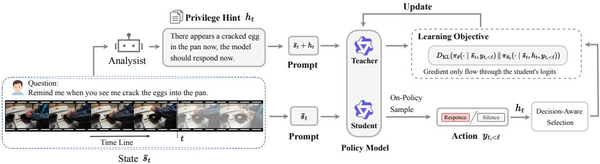  
Figure 1: Live-OPSD training. The unhinted policy generates a continuation, while the same current model uses a privileged hint to score its prefixes. DAS selects scored decision points for a reverse-KL update. The updated policy then supplies the next rollout and teacher.

We evaluate Live-OPSD as a post-training objective on Qwen2.5-Omni-7B and Qwen3-Omni-30B-A3B. Controlled comparisons use a common streaming interface and three continued-SFT objec tives. On the 30B backbone, Live-OPSD attains an average score of 59.64 on LiveProBench, compared with 54.38 for the strongest continued-SFT baseline, a gain of 5.26 points. Released proactive systems provide a separate system-level comparison on OVO-Bench and OmniMMI proactive alerting. Ablations compare the divergence objectives and evaluate the overall selection scheme against a fixed-position control. Together, the results provide evidence that post-training on current-policy response prefixes improves proactive streaming behavior beyond continued SFT in the evaluated setting.

## 2 RELATED WORK

Streaming perception and interaction. Streaming video models must preserve information from an evolving visual history while remaining responsive to new observations and user turns. VideoLLM-online learns temporally aligned dialogue over continuous video, whereas Flash-VStream and related memory-based approaches compress or retrieve historical visual states for efficient online question answering (Chen et al., 2024; Zhang et al., 2024). MMDuet instead represents video and text as interleaved turns and augments the model with informative and relevance heads for time-sensitive interaction (Wang et al., 2024). These methods establish the streaming interface on which proactive behavior can be built, but their primary contribution is not an on-policy post-training objective.

Proactive systems differ in where they place the response decision. Dispider separates perception, decision, and reaction; StreamBridge combines a persistent history with a separately trained activation model; and StreamMind invokes the language model only when a query-conditioned event gate predicts a response-worthy moment (Qian et al., 2025; Wang et al., 2025a; Ding et al., 2025). StreamReady learns an explicit answer-readiness signal, Em-Garde matches structured visual proposals during streaming, and StreamAgent uses future-aware planning to choose whether to wait, respond, or gather additional evidence (Azad et al., 2026; Zheng et al., 2026; ?). These designs modify inference-time gating, planning, memory, or computation. Live-OPSD instead introduces a post-training objective for an existing streaming policy and leaves its native inference mechanism unchanged.

Open-source proactive models provide further system-level comparisons. AURA combines streaming context management with a Silent-Speech Balanced objective; JoyAI-VL-Interaction makes response decisions within a vision-language model and can delegate generation to a background model; ROMA uses aligned audio-visual streaming units and a dedicated speak head; and MOSS VL-Realtime permits incoming visual information during generation through cross-attention (Lu et al., 2026; Yao et al., 2026; Tian et al., 2026; Wang et al., 2026). Their architectural and training differences are retained in our model-level comparison and are not conflated with the controlled objective comparison on two Qwen backbones.

Learning response timing. Supervised timing objectives primarily differ in how they weight recorded speech and silence. AURA masks supervised turns and reweights silent messages, whereas StreamPro’s CB-Stream Loss balances decision positions and response text (Lu et al., 2026; Li et al., 2026). StreamPro subsequently applies GRPO with turn-level and trajectory-level rewards, and MMDuet2 studies multi-turn reinforcement learning for timely proactive responses (Li et al., 2026; Wang et al., 2025b). These sequence-level objectives directly optimize timing rewards but require long-stream rollouts and an explicit reward definition. Live-OPSD uses a different decomposition: the current response decision determines which contexts receive the update, while a privileged teacher distribution supplies the token-level learning signal on the policy’s own continuation.

Distillation with privileged information. Knowledge distillation transfers a teacher’s output distribution to a student (Hinton et al., 2015). On-policy variants evaluate the teacher on studentgenerated continuations, thereby exposing the objective to prefixes visited by the current student (Agarwal et al., 2024; Gu et al., 2024). This shift is related to the learner-induced state distribution studied in imitation learning (Ross et al., 2011). Live-OPSD applies the same principle at streaming decision contexts. Learning with privileged information supplies the asymmetry (Vapnik & Vashist, 2009): teacher and student share the current parameters, but only the teacher receives a training-time hint.

Evaluation of streaming behavior. OVO-Bench and OmniMMI evaluate complementary aspects of causal stream understanding, including real-time perception, contextual reasoning, forward active responding, proactive alerting, and interaction (Li et al., 2025; Wang et al., 2025c). StreamArena extends this scope to hour-scale open-ended streams and jointly evaluates real-time perception, historical recall, proactive interaction, and tool use (Zhang et al., 2026). We use OVO-Bench and OmniMMI to test whether timing-oriented post-training preserves broad streaming capabilities, while LiveProBench isolates response timing under standing instructions (Du et al., 2026).

## 3 STREAMING INTERACTION

States and actions. Let $x _ { t }$ be the event arriving at step t, either an audio-visual stream chunk or a user utterance. The visible interaction history is $s _ { t } = ( x _ { 1 } , a _ { 1 } , \ldots , a _ { t - 1 } , x _ { t } )$ , where $a _ { t }$ denotes the assistant’s complete turn. The action space contains a set of natural-language responses $\mathcal { A } _ { \mathrm { s p e a k } }$ and a silence action ∅. The arriving event induces two state types and their admissible actions:

$$
\begin{array} { r } { A ( s _ { t } ) = \left\{ \begin{array} { l l } { A _ { \mathrm { s p e a k } } , } & { x _ { t } \mathrm { ~ i s ~ a ~ u s e r ~ u t t e r a n c e } , } \\ { A _ { \mathrm { s p e a k } } \cup \{ \emptyset \} , } & { x _ { t } \mathrm { ~ i s ~ a ~ s t r e a m ~ c h u n k } . } \end{array} \right. } \end{array}\tag{1}
$$

A user utterance requires a response, which can include an acknowledgment or an explanation that the available evidence is insufficient. A stream chunk permits either response or silence. Equation 1 specifies the task requirements, although the language-model decoder can still emit an inadmissible action. After acting, the state advances to $s _ { t + 1 } = s _ { t } \oplus a _ { t } \oplus x _ { t + 1 }$ . The policy has access to the visible prefix, not future observations.

Decision supervision. Write $d ( a ) = \mathcal { H } [ a \neq \emptyset ]$ for the response decision induced by an action. This decision is defined by the action’s meaning under the interaction protocol, independently of the tokens used to represent response or silence. A training point consists of a recorded context $\bar { s } _ { t } .$ a supervisory decision $b _ { t } ~ \in ~ \{ 0 , 1 \}$ , and a privileged hint $h _ { t }$ . The decision specifies whether the annotated behavior is to speak. It does not specify the full response. At a chunk step, $b _ { t } = 1$ marks a proactive response and $b _ { t } = 0$ marks silence. The hint supplies a short description of the relevant visual or acoustic evidence and its relation to the intended behavior. Figure 2 shows one annotated dialogue with these units in place.

Training instantiation. Streaming SFT initializes the policy used in our experiments, including its handling of interleaved chunks, dialogue turns, and silence. Its target at each step is the recorded action associated with $b _ { t } \colon$ an annotated response when $b _ { t } = 1$ and the silence action when $b _ { t } = 0$

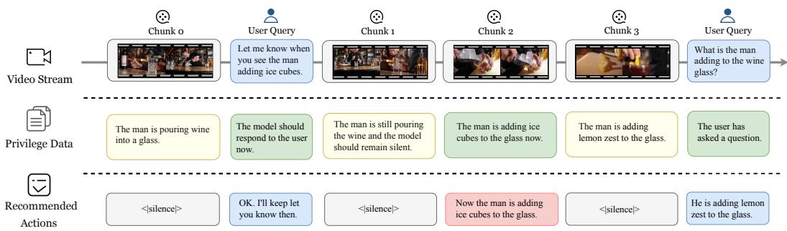  
Figure 2: Supervision at streaming decision points. Each interleaved chunk or user turn carries a decision $b _ { t }$ and a privileged hint $h _ { t } .$ . Streaming SFT learns the recorded action, whereas Live-OPSD supplies the hint only to the teacher.

Although $b _ { t }$ specifies only the binary decision, the recorded action supplies the full token-level target. Writing ${ { \bar { a } } _ { t } } = \left( { { { \bar { y } } _ { t , 1 } } , . . . , { { \bar { y } } _ { t , | { { \bar { a } } _ { t } } | } } } \right)$ for this action, let $s$ contain the silent assistant messages in a training instance and let $t ^ { + }$ denote its final non-silent assistant message, when one is present. We supervise every token of messages in ${ \cal S } \cup \{ t ^ { + } \}$ and exclude earlier non-silent messages whose supporting evidence may have been removed by window truncation. Accordingly,

$$
m _ { t , \ell } = \mathcal { k } [ t \in \mathcal { S } \cup \{ t ^ { + } \} ] , \qquad w _ { t , \ell } = \left\{ \begin{array} { l l } { 1 / N _ { \mathrm { s i l } } , } & { t \in \mathcal { S } , } \\ { 1 , } & { t = t ^ { + } , } \end{array} \right.\tag{2}
$$

where $N _ { \mathrm { s i l } } = | S |$ is the number of silent messages in the instance. With $\begin{array} { r } { N _ { \mathrm { s u p } } = \sum _ { t } \sum _ { \ell = 1 } ^ { | \bar { a } _ { t } | } m _ { t , \ell } . } \end{array}$ , the initialization objective is

$$
{ \mathcal { L } } _ { \mathrm { S F T } } ( \phi ) = - { \frac { 1 } { N _ { \mathrm { s u p } } } } \sum _ { t } \sum _ { \ell = 1 } ^ { \left| { \bar { a } } _ { t } \right| } m _ { t , \ell } w _ { t , \ell } \log \pi _ { \phi } ( { \bar { y } } _ { t , \ell } \mid { \bar { s } } _ { t } , { \bar { y } } _ { t , < \ell } ) .\tag{3}
$$

Thus, silence supervision is preserved without allowing the number of silent messages to dominate the informative response. The checkpoint obtained by minimizing ${ \mathcal { L } } _ { \mathrm { S F T } } ( \phi )$ , denoted Live-SFT-Zero, initializes Live-OPSD and supplies the first reference parameters $\theta _ { 0 }$ . The SSB-SFT row in Section 5.3 continues this objective from the same initialization, whereas Vanilla-SFT and CB-SFT use the alternative objectives defined in Appendix E. The hint $h _ { t }$ is not part of this stage’s input or target.

Live-OPSD then generates a new assistant continuation at each recorded context $\bar { s } _ { t }$ under the current decoding rule, while retaining earlier assistant turns from the recorded history. The resulting action, including a silence action, and all of its token prefixes therefore come from the current policy. Thi response-level on-policy rollout exposes the update to current-model prefixes without claiming that the entire preceding interaction was generated on policy. At deployment, earlier generated turns become part of the evolving history $s _ { t } .$ . Training and deployment thus differ in the source of earlier assistant turns, while the causal observation boundary in Equation 1 applies in both.

## 4 LIVE-OPSD

Live-OPSD couples privileged-context distribution matching with adaptive selection of streaming decision points. The two supervisory inputs play distinct roles: the hint $h _ { t }$ conditions the teacher, and the decision $b _ { t }$ guides DAS. Figure 1 shows how these paths meet in the update objective.

## 4.1 PRIVILEGED-CONTEXT SELF-DISTILLATION

A hint explains the evidence supporting an annotated response decision. For a request to report entry into a restricted area, for example, it might state that a person is visible outside the area and the assistant should remain silent. The teacher receives the hint in its system context. The student receives the same streaming observations and deployment instruction without the hint. In our implementation, an external model annotates hints offline. It supplies text, whereas the distillation teacher is the current policy conditioned on that text. Appendix B gives the annotation and prompt format.

Let $\theta _ { 0 }$ denote the parameters at the start of an update. For each point, the student generates $a _ { t } =$ $( y _ { t , 1 } , \dots , y _ { t , L _ { t } } )$ from $\pi _ { \theta _ { 0 } } ( \cdot \mid \bar { s } _ { t } )$ under the decoding rule used for training. At response position $\ell ,$ we compare

$$
\begin{array} { r l } & { P _ { t } ^ { ( \ell ) } = \pi _ { \theta _ { 0 } } ( \cdot \mid \bar { s } _ { t } , h _ { t } , y _ { t , < \ell } ) , } \\ & { Q _ { \theta , t } ^ { ( \ell ) } = \pi _ { \theta } ( \cdot \mid \bar { s } _ { t } , y _ { t , < \ell } ) , } \end{array}\tag{4}
$$

where $y _ { t , < \ell }$ is the student-generated prefix. Both roles predict the next token after that same prefix, so teacher scoring requires no separately generated teacher response. The target and generated continuation remain fixed while the student is updated from $\theta _ { 0 }$

After the update, the new parameters are used for both rollout and teacher scoring. The offline hints are reused, but the distributional targets are recomputed. The teacher’s additional context can make the evidence–decision relationship explicit, with its usefulness depending on annotation quality and the model’s ability to interpret the hint. Appendix I.1 distinguishes the information supplied by a hint from the decision advantage actually realized by the hinted model.

## 4.2 A DISTRIBUTIONAL OBJECTIVE

For teacher distribution P and student distribution $Q ,$ our default objective is reverse $\mathrm { K L }$ ${ \mathcal { D } } _ { \mathrm { r K L } } ( P , Q ) = D _ { \mathrm { K L } } ( Q \| P )$ . We compare it with forward KL, ${ \mathcal { D } } _ { \mathrm { f K L } } ( P , { \bar { Q } } ) = D _ { \mathrm { K L } } ( P \| Q )$ , and symmetric Jensen–Shannon divergence. For completeness, the implemented skew-JSD family is

$$
D _ { \mathrm { J S } } ^ { \beta } ( P , Q ) = \beta D _ { \mathrm { K L } } ( P \Vert M _ { \beta } ) + ( 1 - \beta ) D _ { \mathrm { K L } } ( Q \Vert M _ { \beta } ) , \qquad M _ { \beta } = \beta P + ( 1 - \beta ) Q ,\tag{5}
$$

where $0 ~ < ~ \beta ~ < ~ 1$ and $\beta = { \frac { 1 } { 2 } }$ gives symmetric JSD. The unscaled divergence is zero at both endpoints. Its scaled limits are

$$
\operatorname* { l i m } _ { \beta \to 0 } \frac { D _ { \mathrm { J S } } ^ { \beta } ( P , Q ) } { \beta } = D _ { \mathrm { K L } } ( P \| Q ) , \qquad \operatorname* { l i m } _ { \beta \to 1 } \frac { D _ { \mathrm { J S } } ^ { \beta } ( P , Q ) } { 1 - \beta } = D _ { \mathrm { K L } } ( Q \| P ) .
$$

We therefore implement the two KL directions as separate objectives rather than as JSD endpoint values. In every case, gradients flow through Q while P remains fixed.

Let $\boldsymbol { { B } } _ { \mathrm { s e l } }$ be the effective set of selected, teacher-scored points defined in Section 4.3. For a chosen divergence $\mathcal { D } _ { : }$ , the update minimizes its token mean over the generated assistant continuations, including silence actions:

$$
\mathcal { L } _ { \mathcal { D } } ( \boldsymbol { \theta } ; \boldsymbol { \theta } _ { 0 } ) = \frac { 1 } { \sum _ { t \in \mathcal { B } _ { \mathrm { s e l } } } L _ { t } } \sum _ { t \in \mathcal { B } _ { \mathrm { s e l } } } \sum _ { \ell = 1 } ^ { L _ { t } } \mathcal { D } \Big ( P _ { t } ^ { ( \ell ) } , Q _ { \boldsymbol { \theta } , t } ^ { ( \ell ) } \Big ) .\tag{6}
$$

We use $\mathcal { D } = \mathcal { D } _ { \mathrm { r K L } }$ by default. The generated continuations, selected points, and teacher targets are fixed during this update. Gradients optimize the student’s conditional distributions on these prefixes without differentiating through the discrete decoding process. Thus, current-policy generation supplies the training prefixes, while distillation supplies the update. Each point contributes in proportion to its continuation length under the global token-mean reduction. Appendix F describes the efficient target representation used in the implementation.

Appendix I.2 connects the default reverse-KL objective to response decisions. It bounds the student’s disagreement by the teacher’s disagreement plus cumulative reverse KL on the studentgenerated prefix that resolves the decision and characterizes the approximation used in training.

## 4.3 DECISION-AWARE SELECTION

DAS uses the current policy’s response decisions to allocate a budget of at most K training points per update. Eligible points are chunk steps, with user utterances and their responses kept in context. For a generated action $a _ { t }$ , the indicator $\dot { \delta } _ { t } = \mathcal { H } [ d ( a _ { t } ) \neq b _ { t } ]$ records disagreement with the supervisory decision $b _ { t }$ . Eligible points split into decision-inconsistent points $\mathcal { T } \left. \delta _ { t } = 1 \right.$ , consistent responses

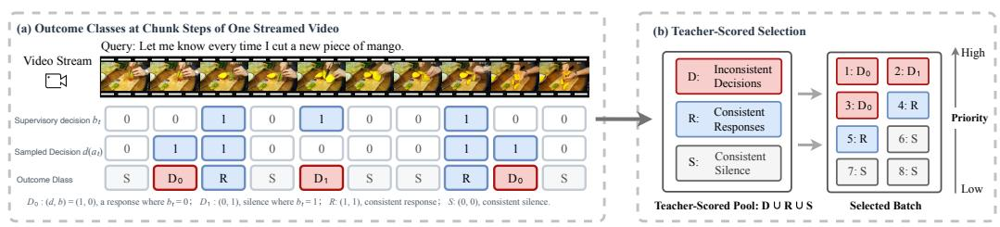  
Figure 3: Decision-Aware Selection. (a) Sampled decisions are grouped as the two inconsistency directions, consistent responses, or consistent silence. (b) DAS fills a budget of K scored points from an inconsistency quota, then consistent responses and silence. The decision label controls selection, not gradient weighting.

R, and consistent silence; teacher scoring covers I, R, and a policy-independent subsample of consistent silence.

From this scored pool DAS keeps at most K points in priority order: an inconsistency quota with the two directions alternated, then consistent responses, then silence spread across videos, relaxing to the full budget when scored silence is scarce. Selection, not gradient weighting, depends on δ : a decision-consistent action can still yield a distillation signal, because agreeing on the decision does not imply agreeing on the token distributions. Selection is refreshed from new rollouts each update. At inference, the policy uses the backbone’s native response interface without hints, DAS, or an extra classifier. Figure 3 shows the outcome classes and how the scored pool fills the budget; Appendices C and I.3 give the quota rule and the disagreement it concentrates, and Algorithm 1 (Appendix D) summarizes one update.

## 5 EXPERIMENTS

The evaluation examines whether post-training improves response timing while preserving the understanding needed for useful responses. Within-backbone comparisons assess the training procedure, system-level comparisons place it alongside released proactive models, and ablations isolate the divergence and selection rule.

## 5.1 EXPERIMENTAL SETUP

Backbones and training data. We use Qwen2.5-Omni-7B and Qwen3-Omni-30B-A3B (Xu et al., 2025a;b). Both are adapted to the same streaming interaction protocol, with audio-visual chunks interleaved with user and assistant turns. The training corpus includes direct questions and standing instructions that require proactive responses. For post-training, dialogues are expanded into causal decision contexts with aligned supervisory decisions and hints. Source videos define the split boundary so that contexts from one source remain in one split. Appendix A describes data construction, and Appendix F reports the run settings verified from the available artifacts.

Supervised baselines. We compare three objectives on each backbone. Vanilla-SFT uses standard cross-entropy on reference assistant turns. CB-SFT uses StreamPro’s CB-Stream Loss (Li et al., 2026). SSB-SFT uses AURA’s Silent-Speech Balanced Loss(Lu et al., 2026). Live-OPSD starts from a same streaming-SFT model and then applies the post-training procedure in Section 4.

Open-source proactive models. The model-level comparison on LiveProBench (Table 1) includes AURA, JoyAI-VL-Interaction, ROMA, and MOSS-VL-Realtime (Lu et al., 2026; Yao et al., 2026; Tian et al., 2026; Wang et al., 2026). Each model retains the response mechanism and context handling of its released inference configuration. For each benchmark, task-specific scoring and aggregation follow the protocol described below and in Appendix G.

Table 1: LiveProBench results (%). The average is computed from the unrounded Event Sensitivity, Onset Response, Window Response, Anomaly Alert, Sustained Silence, and Duplicate Counting scores. Boldface marks the best result within each block, excluding Live-SFT-Zero.
<table><tr><td rowspan="2">Method or model</td><td colspan="3">Event Sensitivity</td><td rowspan="2">OR</td><td rowspan="2">WR</td><td rowspan="2">AA</td><td rowspan="2">SS</td><td rowspan="2">DC</td><td rowspan="2">Avg.</td></tr><tr><td>Resp.</td><td>Sil.</td><td>Geo.</td></tr><tr><td>Open-source proactive models</td><td></td><td></td><td></td><td></td><td></td><td></td><td></td><td></td><td></td></tr><tr><td>ROMA</td><td>32.87</td><td>61.79</td><td>45.07</td><td>19.27</td><td>6.25</td><td>9.24</td><td>2.17</td><td>2.99</td><td>14.16</td></tr><tr><td>MOSS-VL-Realtime</td><td>82.87</td><td>50.41</td><td>64.63</td><td>38.07</td><td>35.00</td><td>24.79</td><td>19.57</td><td>7.46</td><td>31.59</td></tr><tr><td>AURA</td><td>34.26</td><td>99.19</td><td>58.29</td><td>62.84</td><td>60.00</td><td>37.82</td><td>25.00</td><td>0.00</td><td>40.66</td></tr><tr><td>JoyAI-VL-Interaction</td><td>47.22</td><td>78.86</td><td>61.02</td><td>52.29</td><td>47.50</td><td>18.91</td><td>30.43</td><td>35.82</td><td>41.00</td></tr><tr><td>Qwen2.5-Omni-7B</td><td></td><td></td><td></td><td></td><td></td><td></td><td></td><td></td><td></td></tr><tr><td>Live-SFT-Zero-7B</td><td>63.43</td><td>59.35</td><td>61.35</td><td>42.66</td><td>27.50</td><td>37.82</td><td>2.17</td><td>34.33</td><td>34.31</td></tr><tr><td>+ Vanilla-SFT</td><td>36.57</td><td>98.78</td><td>60.11</td><td>55.50</td><td>65.00</td><td>54.62</td><td>53.26</td><td>1.49</td><td>48.33</td></tr><tr><td>+ CB-SFT</td><td>68.06</td><td>78.86</td><td>73.26</td><td>61.47</td><td>33.75</td><td>62.61</td><td>11.96</td><td>26.87</td><td>44.98</td></tr><tr><td>+ SSB-SFT</td><td>75.93</td><td>64.23</td><td>69.83</td><td>55.05</td><td>17.50</td><td>49.58</td><td>3.26</td><td>7.46</td><td>33.78</td></tr><tr><td>+ Live-OPSD</td><td>41.20</td><td>95.12</td><td>62.60</td><td>59.63</td><td>58.75</td><td>65.13</td><td>40.22</td><td>7.46</td><td>48.97</td></tr><tr><td colspan="2">Qwen3-Omni-30B-A3B</td><td></td><td></td><td></td><td></td><td></td><td></td><td></td><td></td></tr><tr><td>Live-SFT-Zero-30B</td><td>41.67</td><td>84.55</td><td>59.36</td><td>52.29</td><td>43.75</td><td>73.11</td><td>42.39</td><td>37.31</td><td>51.37</td></tr><tr><td>+ Vanilla-SFT</td><td>41.67</td><td>99.19</td><td>64.29</td><td>63.30</td><td>67.50</td><td>57.56</td><td>70.65</td><td>2.99</td><td>54.38</td></tr><tr><td>+ CB-SFT</td><td>68.06</td><td>86.18</td><td>76.58</td><td>72.94</td><td>45.00</td><td>68.07</td><td>31.52</td><td>23.88</td><td>53.00</td></tr><tr><td>+ SSB-SFT</td><td>72.69</td><td>78.05</td><td>75.32</td><td>64.68</td><td>41.25</td><td>65.55</td><td>23.91</td><td>32.84</td><td>50.59</td></tr><tr><td>+ Live-OPSD</td><td>40.28</td><td>99.59</td><td>63.34</td><td>61.93</td><td>70.00</td><td>68.49</td><td>59.78</td><td>34.33</td><td>59.64</td></tr></table>

## 5.2 BENCHMARKS AND METRICS

We assess proactive response timing through event triggering and silence in LiveProBench and proactive alerting (PA) in OmniMMI (Du et al., 2026; Wang et al., 2025c). OmniMMI’s other tasks additionally assess the perceptual, contextual, and interaction capabilities needed for useful responses. OVO-Bench (Li et al., 2025) complements this coverage with understanding of past and present evidence and forward active responding, which tests waiting for the information needed to answer.

Table 1 reports LiveProBench’s six task scores and their arithmetic mean, including Duplicate Counting. Event Sensitivity uses the geometric mean of alert coverage and silent-segment accuracy, and we list both sides alongside that mean; the window tasks score the first response within the permitted interval, and Duplicate Counting uses exact-count accuracy. Task coverage, temporal window scoring, and full aggregation details are specified in Appendix G.

## 5.3 MAIN COMPARISONS

Table 1 is the primary comparison: it lists released proactive models first and then contrasts training methods within each backbone, including Live-SFT-Zero, the first-stage streaming-SFT checkpoint from which Live-OPSD training starts. All backbone rows are evaluated with audio disabled, and the reported 30B Live-OPSD model uses reverse KL. These matched-backbone blocks isolate the effect of the training method from differences in model scale. Tables 2 and 3 instead compare complete models on OmniMMI PA and OVO-Bench, excluding the continued-SFT variants. Together, these system-level comparisons complement the controlled LiveProBench results under established external benchmark protocols. Full system-level comparisons and subtask breakdowns for StreamingBench and OVO-Bench are provided in Appendix G.

Table 2: OmniMMI Proactive Alerting accuracy (%).
<table><tr><td>Model</td><td>PA</td></tr><tr><td>VideoLLM-Online MMDuet</td><td>0.50 22.00</td></tr><tr><td>M4-a</td><td>25.50</td></tr><tr><td>AURA ROMA</td><td>37.50 37.50</td></tr><tr><td>Live-SFT-Zero-7B</td><td>31.50</td></tr><tr><td>+ Live-OPSD Live-SFT-Zero-30B</td><td>56.50 (+25.0) 39.50</td></tr></table>

Response coverage and silence trade off: frequent responses cover more events but interrupt, while frequent silence avoids interruptions but misses events. Event Sensitivity scores both sides at once, so its geometric mean (Geo.) rises only when response coverage (Resp.) and silence accuracy (Sil.) are both high; a near-complete silence side with low coverage is not credited as balanced.

This trade-off is visible in the Qwen3-Omni-30B-A3B block of Table 1. The reverse-KL Live-OPSD model has the highest reported six-task average (59.64), exceeding Vanilla-SFT, CB-SFT, and SSB-SFT by 5.26, 6.64, and 9.05 points, respectively. The Live-SFT-Zero rows identify the checkpoints used before Live-OPSD post-training. Appendix H compares these methods on individual cases (Figure 7).

Table 3: OVO-Bench overall accuracy (%) across released systems.
<table><tr><td>Model All</td></tr><tr><td>StreamAgent 49.40 Streamo-7B 57.90 ViSpeak 61.10 MiniCPM-o-4.5 59.70</td></tr><tr><td>AURA 65.30 Qwen2.5-Omni-7B 50.30</td></tr><tr><td>+ Live-SFT &amp; Live-OPSD 61.97 Qwen3-Omni-30B-A3B 61.00 + Live-SFT &amp; Live-OPSD 65.84</td></tr></table>

reaches 65.84 overall.

The 7B comparison follows the same evaluation protocol. Live-OPSD obtains a reported average of 48.97, compared with 48.33, 44.98, and 33.78 for Vanilla-SFT, CB-SFT, and SSB-SFT, respectively. It leads Anomaly Alert, while CB-SFT leads Event Sensitivity, Onset Response, and Duplicate Counting, and Vanilla-SFT leads Window Response and Sustained Silence; Live-OPSD therefore has the highest point estimate in both backbone blocks.

Table 2 foregrounds proactive response. The two Live-OPSD models reach 56.50 and 59.00 on OmniMMI PA, compared with 37.50 for AURA. These published system-level results use different inference configurations; controlled objective comparisons appear in Table 1. Table 3 reports overall OVO-Bench accuracy. Live-OPSD improves over its backbone at both scales (50.30 to 61.97 at 7B, 61.00 to 65.84 at 30B) and

## 5.4 ABLATION STUDIES

Divergence choice. We compare reverse KL, forward KL, and JSD under identical training setups. For teacher P and student Q, the two KL objectives are $D _ { \mathrm { K L } } ( P \Vert Q )$ and $D _ { \mathrm { K L } } ( Q \| P )$ , respectively. Their probability weighting differs: the forward direction emphasizes teachersupported alternatives, while the reverse direction emphasizes alternatives currently favored by the student. The comparison tests how this probability weighting affects learning in the shared-parameter setting. The optimization budget and learning-rate selection protocol are held fixed. On the shared held-out set, reverse KL leads proactive $F _ { 1 }$ , false-alarm rate, and per-episode exact match for most of training, accepting a higher event-miss rate as its conservative trade-off. Forward KL and the fixed-suffix w/o DAS variant are less stable (Figure 5, Appendix G). On LiveProBench (Table 4), forward KL under-triggers and misses most response windows (Figure 4). Its event-sensitivity and anomalyalert scores fall to 43.03 and 11.34, producing a 36.10 mean. Reverse KL and JSD are comparable in mean score (59.64 versus 59.21), while reverse KL is higher on window response (70.00 versus 66.25) and duplicate counting (34.33 versus 22.39). We report reverse KL as the 30B Live-OPSD model in Tables 1, 2, and 3.

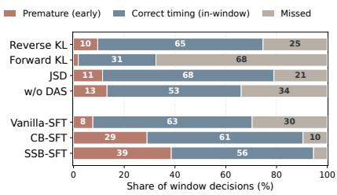  
Figure 4: LiveProBench timing outcomes for Qwen3-Omni.

Removing Decision-Aware Selection. The w/o DAS variant uses a fixed-size suffix of decision points from each source video, chosen before training independently of the policy. Each point retains its complete preceding dialogue and media context. Teacher hints and the inference protocol are unchanged. The selected-point budget and update count are matched, with candidate-generation and teacher-scoring costs reported separately. This comparison tests adaptive allocation against fixed-position selection. Appendix C specifies the fixed-position rule and its distinction from history truncation. Replacing DAS with fixed-position selection lowers the LiveProBench mean from 59.21 to 44.18 (Table 4). Duplicate Counting falls to 0.00, and both premature and missed timing bands widen relative to the full JSD variant (Figure 4).

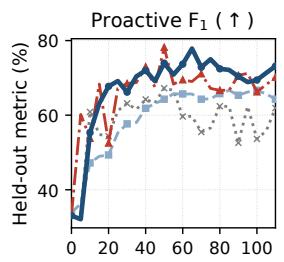

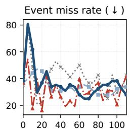

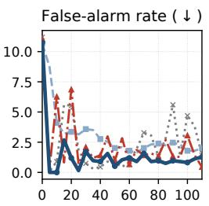

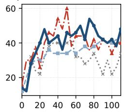  
Figure 5: Held-out ablation dynamics over 110 steps on 1,458 fixed decision points; arrows indicate the improving direction.

Table 4: LiveProBench ablations on Qwen3-Omni (%). The main Live-OPSD result uses reverse KL. The w/o DAS control retains JSD and replaces adaptive selection with a fixed-position rule.
<table><tr><td>Variant</td><td>ES</td><td>OR</td><td>WR</td><td>AA</td><td>SS</td><td>DC</td><td>Avg.</td></tr><tr><td>Reverse KL</td><td>63.34</td><td>61.93</td><td>70.00</td><td>68.49</td><td>59.78</td><td>34.33</td><td>59.64</td></tr><tr><td>Forward KL</td><td>43.03</td><td>31.19</td><td>58.75</td><td>11.34</td><td>54.35</td><td>17.91</td><td>36.10</td></tr><tr><td>JSD</td><td>67.08</td><td>67.43</td><td>66.25</td><td>70.17</td><td>61.96</td><td>22.39</td><td>59.21</td></tr><tr><td>w/o DAS</td><td>59.58</td><td>55.50</td><td>51.25</td><td>54.20</td><td>44.57</td><td>0.00</td><td>44.18</td></tr></table>

## 6 DISCUSSION AND LIMITATIONS

Scope and transfer requirements. Live-OPSD is a post-training principle for streaming interaction, instantiated with a streaming SFT checkpoint and a specific protocol. Defined through conditional policies and semantic actions rather than a mandatory two-stage framework, it requires aligned decision supervision and conditional likelihood evaluation with and without privileged context for protocol adaptation. For example, JoyAI-VL-Interaction marks silence and response with dedicated tokens (Yao et al., 2026); the decision map d reads those markers while preserving the native protocol, with teacher and student sharing a vocabulary within each backbone. Richer action spaces, such as introducing interrupt and correction actions, require corresponding supervision and selection categories.

Current instantiation. Offline hints and recorded histories make training tractable. Pilot checks found Qwen3-Omni inconsistent as its own hint annotator over multi-turn histories, so we use an external model for annotation and reserve the hinted policy for distributional scoring—motivating an implementation choice rather than revealing a backbone limitation. Generating continuations at recorded histories provides response-level on-policy supervision but mismatches model-generated deployment histories. Thus, the source of histories and feedback is an implementation choice, whereas access only to observations at each decision is a causal constraint.

Toward online self-training. Online hint generation and trajectory-level on-policy generation would align feedback with student-generated histories, and reliable multi-turn self-assessment could eventually let the model propose its own hints, provided they stay grounded in the observed stream and add information beyond its unassisted judgment. Because the current method still depends on external hints and supervised response decisions, these are steps toward online self-training rather than a fully self-supervised procedure.

## 7 CONCLUSION

We presented Live-OPSD, a post-training method that uses privileged context to supervise a streaming policy on its own continuations. A hinted model copy supplies token-level targets, while Decision-Aware Selection allocates the update budget by response decisions. On Qwen3-Omni, Live-OPSD scores 59.64 on LiveProBench, 5.26 points above the strongest continued-SFT baseline, while remaining competitive on broader benchmarks. Live-OPSD thus provides evidence for privileged on-policy distillation as a promising training principle for proactive streaming video models.

## AI USAGE STATEMENT

Generative AI tools were used only for language polishing during manuscript preparation. They were also used to synthesize SFT data and offline privileged hints as training supervision; the hint production procedure is described in Appendix B. They were not used to execute training or evaluation runs or to generate or alter the reported experimental measurements. The authors take full responsibility for the submitted content.

## ETHICS STATEMENT

All videos used in this study are drawn from publicly available datasets, and no additional private video data are introduced. The study is limited to model training and benchmark evaluation. Potential biases and privacy considerations inherited from the source datasets and pretrained models remain applicable.

## REPRODUCIBILITY STATEMENT

Sections 4 and 5.1 specify the method and comparison protocol. The appendices describe data construction, baseline objectives, selection, metrics, and settings verified from the available run artifacts. To avoid introducing unverified details, we report only configurations supported by the retained experimental records.

## REFERENCES

Rishabh Agarwal, Nino Vieillard, Yongchao Zhou, Piotr Stanczyk, Sabela Ramos, Matthieu Geist, and Olivier Bachem. On-policy distillation of language models: Learning from self-generated mistakes. In International Conference on Learning Representations (ICLR), 2024.

Shehreen Azad, Vibhav Vineet, and Yogesh Singh Rawat. StreamReady: Learning what to answer and when in long streaming videos. arXiv preprint arXiv:2603.08620, 2026.

Joya Chen, Zhaoyang Lv, Shiwei Wu, Kevin Qinghong Lin, Chenan Song, Difei Gao, Jia-Wei Liu, Ziteng Gao, Dongxing Mao, and Mike Zheng Shou. VideoLLM-Online: Online video large language model for streaming video. arXiv preprint arXiv:2406.11816, 2024.

Xin Ding, Hao Wu, Yifan Yang, Shiqi Jiang, Donglin Bai, Zhibo Chen, and Ting Cao. StreamMind: Unlocking full frame rate streaming video dialogue through event-gated cognition. arXiv preprint arXiv:2503.06220, 2025.

Kaixuan Du, Xin Wan, Hang Zhang, Meng Cao, Dai Guan, Ming Chen, and YuKun Wang. Liveprobench: Can streaming video models really interact like humans? arXiv preprint arXiv:2609.12658, 2026.

Yuxian Gu, Li Dong, Furu Wei, and Minlie Huang. MiniLLM: Knowledge distillation of large language models. In International Conference on Learning Representations (ICLR), 2024.

Geoffrey Hinton, Oriol Vinyals, and Jeff Dean. Distilling the knowledge in a neural network. arXiv preprint arXiv:1503.02531, 2015.

Ao Li, Zihan Xiao, Zihao Yue, Boshen Xu, Linli Yao, Jiaze Li, Pei Fu, Jianzhong Ju, Jian Luan, and Qin Jin. StreamPro: From reactive perception to proactive decision-making in streaming video. arXiv preprint arXiv:2605.16381, 2026.

Yifei Li, Junbo Niu, Ziyang Miao, Chunjiang Ge, Yuanhang Zhou, Qihao He, Xiaoyi Dong, Haodong Duan, Shuangrui Ding, Rui Qian, Pan Zhang, Yuhang Zang, Yuhang Cao, Conghui He, and Jiaqi Wang. OVO-Bench: How far is your video-LLMs from real-world online video understanding? arXiv preprint arXiv:2501.05510, 2025.

Junming Lin, Zheng Fang, Chi Chen, Zihao Wan, Fuwen Luo, Peng Li, Yang Liu, and Maosong Sun. StreamingBench: Assessing the gap for MLLMs to achieve streaming video understanding. arXiv preprint arXiv:2411.03628, 2024.

Xudong Lu, Yang Bo, Jinpeng Chen, Shuhan Li, Xintong Guo, Huankang Guan, Fang Liu, Dunyuan Xu, Peiwen Sun, Heyang Sun, Rui Liu, and Hongsheng Li. AURA: Always-on understanding and real-time assistance via video streams. arXiv preprint arXiv:2604.04184, 2026.

Bowen Peng, Jeffrey Quesnelle, Honglu Fan, and Enrico Shippole. YaRN: Efficient context window extension of large language models. In International Conference on Learning Representations (ICLR), 2024.

Rui Qian, Shuangrui Ding, Xiaoyi Dong, Pan Zhang, Yuhang Zang, Yuhang Cao, Dahua Lin, and Jiaqi Wang. Dispider: Enabling video LLMs with active real-time interaction via disentangled perception, decision, and reaction. arXiv preprint arXiv:2501.03218, 2025.

Stephane Ross, Geoffrey J. Gordon, and Drew Bagnell. A reduction of imitation learning and struc-´ tured prediction to no-regret online learning. In International Conference on Artificial Intelligence and Statistics (AISTATS), pp. 627–635, 2011.

Xueyun Tian, Wei Li, Bingbing Xu, Heng Dong, Yuanzhuo Wang, and Huawei Shen. ROMA: Real-time omni-multimodal assistant with interactive streaming understanding. arXiv preprint arXiv:2601.10323, 2026.

Vladimir Vapnik and Akshay Vashist. A new learning paradigm: Learning using privileged information. Neural Networks, 22(5–6):544–557, 2009.

Haibo Wang, Bo Feng, Zhengfeng Lai, Mingze Xu, Shiyu Li, Weifeng Ge, Afshin Dehghan, Meng Cao, and Ping Huang. StreamBridge: Turning your offline video large language model into a proactive streaming assistant. arXiv preprint arXiv:2505.05467, 2025a.

Pengyu Wang, Chenkun Tan, Shaojun Zhou, Qirui Zhou, Yanxin Chen, Xingyang He, Huazheng Zeng, Jijun Cheng, Chenghao Wang, Xiaomeng Qian, Pengfei Wang, Zhan Huang, Shanqing Gao, Wei Huang, Longjun Cao, Wu Ran, Jie Liu, Changtai Zhu, Hongkai Wang, Yixian Tian, Chenghao Liu, Zhen Ye, Xinghao Wang, Botian Jiang, Guoguo Feng, Zhaoye Fei, Ruixiao Li, Mingshu Chen, Yang Gao, Qinyuan Cheng, Shimin Li, and Xipeng Qiu. MOSS-VL technical report. arXiv preprint arXiv:2608.15045, 2026.

Yueqian Wang, Xiaojun Meng, Yuxuan Wang, Jianxin Liang, Jiansheng Wei, Huishuai Zhang, and Dongyan Zhao. VideoLLM knows when to speak: Enhancing time-sensitive video comprehension with video-text duet interaction format. arXiv preprint arXiv:2411.17991, 2024.

Yueqian Wang, Songxiang Liu, Disong Wang, Nuo Xu, Guanglu Wan, Huishuai Zhang, and Dongyan Zhao. MMDuet2: Enhancing proactive interaction of video MLLMs with multi-turn reinforcement learning. arXiv preprint arXiv:2512.06810, 2025b.

Yuxuan Wang, Yueqian Wang, Bo Chen, Tong Wu, Dongyan Zhao, and Zilong Zheng. OmniMMI: A comprehensive multi-modal interaction benchmark in streaming video contexts. arXiv preprint arXiv:2503.22952, 2025c.

Jin Xu, Zhifang Guo, Jinzheng He, Hangrui Hu, Ting He, Shuai Bai, Keqin Chen, Jialin Wang, Yang Fan, Kai Dang, Bin Zhang, Xiong Wang, Yunfei Chu, and Junyang Lin. Qwen2.5-Omni technical report. arXiv preprint arXiv:2503.20215, 2025a.

Jin Xu, Zhifang Guo, Hangrui Hu, Yunfei Chu, Xiong Wang, Jinzheng He, Yuxuan Wang, Xian Shi, Ting He, Xinfa Zhu, Yuanjun Lv, Yongqi Wang, Dake Guo, He Wang, Linhan Ma, Pei Zhang, Xinyu Zhang, Hongkun Hao, Zishan Guo, Baosong Yang, Bin Zhang, Ziyang Ma, Xipin Wei, Shuai Bai, Keqin Chen, Xuejing Liu, Peng Wang, Mingkun Yang, Dayiheng Liu, Xingzhang Ren, Bo Zheng, Rui Men, Fan Zhou, Bowen Yu, Jianxin Yang, Le Yu, Jingren Zhou, and Junyang Lin. Qwen3-Omni technical report. arXiv preprint arXiv:2509.17765, 2025b.

Dingyu Yao, Junhao Zhou, Chenxu Yang, Chuanyu Qin, Haowen Hou, Zheming Liang, Congcong Wang, Yuhang Cao, Shenglong Ye, Shuai Xie, Shuhuan Gu, Haoyang Huang, Qingyi Si, Nan Duan, and Jiaqi Wang. JoyAI-VL-Interaction: Real-time vision-language interaction intelligence. arXiv preprint arXiv:2606.14777, 2026.

Haoji Zhang, Yiqin Wang, Yansong Tang, Yong Liu, Jiashi Feng, Jifeng Dai, and Xiaojie Jin. Flash-VStream: Memory-based real-time understanding for long video streams. arXiv preprint arXiv:2406.08085, 2024.

Xichen Zhang, Guankai Li, Yinghao Zhu, Shijian Wang, Sitong Wu, Shaozuo Yu, Meng Chu, Yuan Lu, and Jiaya Jia. StreamArena: Toward continuous, interactive, and long-horizon agentic streaming video understanding. arXiv preprint arXiv:2608.05703, 2026.

Yikai Zheng, Xin Ding, Yifan Yang, Shiqi Jiang, Hao Wu, Qianxi Zhang, Weijun Wang, Ting Cao, and Yunxin Liu. Em-Garde: A propose-match framework for proactive streaming video understanding. arXiv preprint arXiv:2603.19054, 2026.

## A TRAINING DATA AND STREAMING CONTEXTS

Each dialogue interleaves audio-visual chunks with user instructions and assistant actions. Direct questions supervise responses from evidence available at the question time. Standing instructions instead specify a condition to monitor, with silence between relevant events. A decision context includes all preceding turns and the media visible at that point. Flattening a dialogue into training points changes the units sampled for optimization, not the information available within each context.

For Live-OPSD, each retained point has a binary supervisory decision and a teacher hint. Points without usable teacher supervision are excluded from the effective distillation set. Data statistics distinguish source videos, dialogues, and decision points because multiple contexts can come from one source. The split is established before expansion, and training sources are checked against benchmark sources to avoid overlap. Complete corpus counts are not available in the current artifact and are therefore not reported here.

The Live-OPSD dataset contains 3,712 training instances. Both Live-OPSD and the continued-SFT baselines use this dataset, with the latter trained on its reference responses. The preceding streaming-SFT stage uses approximately 196,000 training instances. All source videos are drawn from publicly available datasets.

## B PRIVILEGED HINTS AND PROMPTS

An external annotation model produces hints offline from the dialogue, reference decision, and source media. The annotator can access the full clip, but the hint concerns the evidence relevant to the current decision. It states what is visible or audible, whether the assistant should respond, and the reason. Because it is analysis rather than the answer, the reference response never appears inside the hint. The hint is passed to the current policy as privileged context; this hinted policy supplies the teacher distributions in Equation 4. The student’s prompt and multimodal input remain bounded by the current streaming time.

The deployed system prompt is:

You are an AI assistant that processes real-time streaming video. For each video stream

chunk in every interaction turn, decide whether to remain silent or respond.

\- If you remain silent, output only <|silence|>.

\- If you respond, do so naturally at the appropriate moment.

The teacher and student receive the same multimodal input and the same interaction to be answered, while the teacher additionally receives the point-specific hint in current stream context. They share the same chat template, tokenizer, and media representation. Their prompt lengths can differ, so response positions are aligned relative to the end of each prompt.

For a standing instruction to report a person in a white shirt entering an area, an illustrative hint is:

A person in a dark shirt is visible outside the monitored area, but no person in a white shirt has entered it, so the assistant should remain silent.

The hint is a teacher input, not a reference sentence for the student to repeat. The current artifact does not preserve the annotation-model identity or retention counts required to regenerate these hints exactly.

## C SELECTION DETAILS AND FIXED-SELECTION CONTROL

Let I, R, and S denote the scored pools of decision-inconsistent points, consistent responses, and consistent silence. Write $\mathcal { Z } _ { 0 } ~ = ~ \{ t ~ \in ~ \mathcal { T } ~ : ~ b _ { t } ~ = ~ 0 \}$ and $\mathcal { T } _ { 1 } ~ = ~ \{ t \in \mathcal { T } : b _ { t } = 1 \}$ for the two inconsistency directions. Their orders are randomized independently and interleaved until one pool is exhausted, after which the remaining points of the other pool follow.

A fraction $\alpha ~ \in ~ ( 0 , 1 ]$ sets the nominal discrepancy quota $q ~ = ~ \mathrm { m a x } \{ 1 , \lfloor \alpha K \rfloor \}$ . If the scored consistent-silence pool has fewer than q points, the quota is relaxed to K. Otherwise, at most q inconsistent points enter the ordered selection. The remaining slots are filled first from randomized consistent responses, then from consistent-silence points distributed round-robin across videos, with randomized order inside each video. Selection affects the sample composition; it does not introduce inverse-frequency weights into Equation 6.

The consistent-silence scoring subset is determined independently of the current response probabilities, using a stable point-level subsampling rule. The selected effective set contains only scored points. The scoring fraction, quota, and effective number of contributing points jointly determine the composition and cost of an update; the current run artifacts retain the selected budget but not the other two values.

For w/o DAS, each source video contributes a fixed-size suffix of its decision points. This set is chosen before training and is unchanged by the current policy. Earlier dialogue turns and media remain in the context of every retained point. The available run artifacts identify the 128-point selected batch but not the per-video suffix length. All retained eligible points contribute without decisiondependent prioritization or decision-dependent teacher admission. Validation and test streams retain their full decision schedules. Matching the update budget does not imply equal total computation: the full method also generates candidates that may not contribute to an update.

## D TRAINING PROCEDURE

Algorithm 1 gives one Live-OPSD update; rollout, teacher scoring, and selection are refreshed at each iteration.

## E SUPERVISED BASELINE OBJECTIVES

The supervised baselines share the streaming representation, reference assistant continuations, initialization checkpoint, and training schedule. They differ only in which assistant tokens are supervised and how those tokens are weighted. For a target token $\bar { y } _ { t , \ell } .$ , write

$$
\ell _ { t , \ell } ( \phi ) = - \log \pi _ { \phi } ( \bar { y } _ { t , \ell } \mid \bar { s } _ { t } , \bar { y } _ { t , < \ell } ) .\tag{7}
$$

Vanilla-SFT. Let A be the set of reference assistant messages retained in the training instances and let $\begin{array} { r } { N _ { \mathrm { a l l } } = \sum _ { t \in \mathcal { A } } \left| \bar { a } _ { t } \right| } \end{array}$ . Vanilla-SFT supervises all of their target tokens with equal weight:

$$
\mathcal { L } _ { \mathrm { v a n i l l a } } ( \phi ) = \frac { 1 } { N _ { \mathrm { a l l } } } \sum _ { t \in \mathcal { A } } \sum _ { \ell = 1 } ^ { | \bar { a } _ { t } | } \ell _ { t , \ell } ( \phi ) .\tag{8}
$$

Silent-Speech Balanced SFT. SSB-SFT uses the supervision mask and message-level weighting in Equation 2, following the silent-speech balanced objective of AURA (Lu et al., 2026). Within each training instance, all silent assistant messages and the final non-silent assistant message are retained. Earlier non-silent messages are masked out because a truncated window need not retain the evidence aligned with those responses. If the instance contains $N _ { \mathrm { s i l } }$ silent messages, every token in each silent message receives weight $1 / N _ { \mathrm { s i l } }$ , while every token in the retained non-silent message receives unit weight. With $N _ { \mathrm { s u p } }$ denoting the unweighted number of retained target tokens, the resulting loss is exactly Equation 3. Here $\breve { N } _ { \mathrm { s i l } }$ counts messages rather than tokens and is computed per training instance. Live-SFT-Zero is trained with this objective; the SSB-SFT baseline continues the same supervised objective from that checkpoint for the post-training comparison.

Algorithm 1 One Live-OPSD update with Decision-Aware Selection   
Require: Current parameters $\theta _ { 0 } ;$ eligible points $\overline { { \{ ( \bar { s } _ { t } , h _ { t } , b _ { t } ) \} _ { t \in B } } } ;$ budget $K .$ , quota fraction $\alpha ,$ step   
size η   
Ensure: Updated student parameters $\theta$   
1: for $t \in { \mathsf { \bar { B } } }$ do   
2: $a _ { t } \gets \mathrm { G e n e r a t e } ( \pi _ { \theta _ { 0 } } , \bar { s } _ { t } )$   
3: $\delta _ { t } \gets \mathbb { V } [ d ( a _ { t } ) \neq b _ { t } ]$   
4: end for   
5: $\mathcal { T }  \{ t : \delta _ { t } = 1 \} ; \mathcal { R }  \{ t : \delta _ { t } = 0 , \ b _ { t } = 1 \}$   
6: $\boldsymbol s \gets \mathrm { \boldsymbol { a } }$ policy-independent subsample of $\{ t : \delta _ { t } = 0 , b _ { t } = 0 \}$   
7: $B _ { \mathrm { s c o r e } } \overset { \cdot } {  } \overset { \cdot } { \cup } \mathcal { R } \overset { \cdot } { \cup } \overset { \cdot } { \mathcal { S } }$   
8: for $t \in B _ { \mathrm { s c o r e } }$ do   
9: for $\ell = 1 , \ldots , L _ { t }$ do   
10: $P _ { t } ^ { ( \ell ) } \gets \pi _ { \theta _ { 0 } } ( \cdot \ : | \ : \bar { s } _ { t } , h _ { t } , y _ { t , < \ell } )$   
11: end for   
12: end for   
13: $q $ max $\{ 1 , \lfloor \alpha K \rfloor \}$   
14: $\mathbf { i f } \mid S \mid < q$ then   
15: ${ \dot { q } } \gets K$   
16: end if   
17: Order I by alternating its two inconsistency directions; randomize within each direction   
18: Retain at most q points from $\boldsymbol { \mathcal { T } } ;$ randomize ${ \mathrm { { \bar { \mathcal { R } } } } } ;$ order $s$ across videos   
19: ${ \cal B } _ { \mathrm { s e l } }  \mathrm { u p }$ to $K$ points from the ordered groups I, R, S in succession   
20: for $t \in \bar { \boldsymbol { B } _ { \mathrm { s e l } } }$ do   
21: for $\ell = 1 , \ldots , L _ { t }$ do   
22: $Q _ { \theta , t } ^ { ( \ell ) }  \pi _ { \theta } ( \cdot \mid \bar { s } _ { t } , y _ { t , < \ell } )$   
23: end for   
24: end for   
25: $\theta \gets \theta _ { 0 } - \eta \nabla _ { \theta } \mathcal { L } _ { \mathcal { D } } ( \theta ; \theta _ { 0 } ) \big | _ { \theta = \theta _ { 0 } }$

Class-Balanced SFT. CB-SFT transfers the supervised CB-Stream objective (Li et al., 2026) to our two omni-modal backbones. Let D denote the target positions at which the model chooses between the silence and response decision tokens, and let $\bar { \tau }$ contain the subsequent response-text positions. For decision class $c \in \{ 0 , 1 \}$ , let $n _ { c }$ be its count in the current batch. The effective sample count and normalized class weight are

$$
E _ { c } = \frac { 1 - \beta ^ { n _ { c } } } { 1 - \beta } , \qquad \alpha _ { c } = \frac { E _ { c } ^ { - 1 } } { \sum _ { j \in \{ 0 , 1 \} } E _ { j } ^ { - 1 } } ,\tag{9}
$$

where $\beta \in [ 0 , 1 )$ controls the strength of reweighting. For each target position $i ,$ define

$$
w _ { i } ^ { \mathrm { C B } } = \left\{ \begin{array} { l l } { \alpha _ { c _ { i } } , } & { i \in \mathcal { D } , } \\ { \lambda _ { \mathrm { t e x t } } , } & { i \in \mathcal { T } , } \end{array} \right. \quad \mathcal { L } _ { \mathrm { C B } } ( \phi ) = \frac { 1 } { N _ { \mathrm { C B } } } \sum _ { i \in \mathcal { D } \cup \mathcal { T } } w _ { i } ^ { \mathrm { C B } } \ell _ { i } ( \phi ) ,\tag{10}
$$

where $c _ { i }$ is the silence or response class at decision position $i , \lambda _ { \mathrm { t e x t } }$ controls the contribution of linguistic tokens, and $N _ { \mathrm { C B } } = \mathbf { \bar { \tau } } | \mathcal { D } | + | \mathcal { T } |$ . This baseline contains only the supervised objective, not StreamPro’s subsequent policy-optimization stage. The available run artifacts do not preserve the baseline-specific values of $\beta$ and $\lambda _ { \mathrm { t e x t } }$ , so we do not infer them from another implementation.

The CB-SFT and SSB-SFT names therefore identify controlled objective variants. The AURA entry in Tables 1 and 2 instead refers to the released complete system.

## F EXPERIMENTAL CONFIGURATION

Data format and preprocessing. Each stream is segmented into one-second chunks. A chunk is represented by two frames, i.e. a 2 fps visual rate, together with a 16 kHz mono audio segment; every frame is rescaled to at most 448×448 pixels (200,704). Chunks are encoded as separate image and audio inputs rather than as audio-in-video, so a multi-chunk stream maps to an unambiguous token sequence. Standing instructions, user turns, and assistant decisions are interleaved with these chunk tokens in streaming order, and the same representation is used for teacher scoring and student rollout. The context window is 65,536 tokens: Qwen3-Omni-30B-A3B uses its native 64k context, and the smaller Qwen2.5-Omni backbone (native 32k) is extended to the same window with YaRN (Peng et al., 2024).

Table 5: Verified configuration of the Qwen3-Omni-30B-A3B reverse-KL run used in the main result and divergence ablation.
<table><tr><td>Setting</td><td>Value</td></tr><tr><td>Learning rate</td><td> $5 \times 1 0 ^ { - 6 }$ </td></tr><tr><td>Selected-point budget K</td><td>128</td></tr><tr><td>Teacher support size k</td><td>8</td></tr><tr><td>Log-probability floor / loss clipping</td><td>-10/+10</td></tr><tr><td>Context length</td><td>65,536</td></tr><tr><td>Chunk duration / visual sampling rate</td><td>1 s / 2 fps</td></tr><tr><td>Spatial resolution / audio preprocessing</td><td> $4 4 8 ^ { 2 } /$  16 kHz mono</td></tr><tr><td>Decoding parameters</td><td>greedy</td></tr></table>

The current artifacts do not provide a complete run manifest for the 7B model or supervised baselines. We therefore omit unverified checkpoint identifiers, seeds, hardware time, and baselinespecific coefficients rather than infer them from script defaults.

Compact teacher targets. Teacher scoring evaluates response probabilities under the hint-bearing context. Let $\mathcal { K } _ { t } ^ { ( \ell ) }$ contain the k tokens with greatest probability under $P _ { t } ^ { ( \ell ) }$ . The teacher and student distributions are restricted to these same tokens and renormalized:

$$
\widetilde { P } _ { t } ^ { ( \ell ) } ( v ) = \frac { P _ { t } ^ { ( \ell ) } ( v ) } { \sum _ { u \in \mathcal { K } _ { t } ^ { ( \ell ) } } P _ { t } ^ { ( \ell ) } ( u ) } , \qquad \widetilde { Q } _ { \theta , t } ^ { ( \ell ) } ( v ) = \frac { Q _ { \theta , t } ^ { ( \ell ) } ( v ) } { \sum _ { u \in \mathcal { K } _ { t } ^ { ( \ell ) } } Q _ { \theta , t } ^ { ( \ell ) } ( u ) } ,\tag{11}
$$

for $v \in \mathcal { K } _ { t } ^ { ( \ell ) }$ . In the implementation, each divergence in Equation 6 is evaluated on these normalized distributions. For a response of length $L _ { t } ,$ the retained targets require $O ( k L _ { t } )$ probability values and token identities rather than $O ( | \nu | \bar { L } _ { t } )$ values. This reduces target storage and transfer; it does not eliminate the model computation needed to obtain those probabilities. Teacher targets and support identities are fixed during the student update. The model used for subsequent generation and scoring is synchronized with the updated student before the next iteration.

Loss aggregation includes only valid response positions with scored targets. Padding, prompt positions, and absent teacher targets do not contribute to the numerator or denominator. All divergence variants use the same support, normalization, and token mask. Any numerical floor or clipping applied during training is reported in Table 5, since these operations can alter the objective at extreme probabilities.

## G EVALUATION DETAILS

Task coverage and benchmark aggregates. OmniMMI includes state grounding (SG), action prediction (AP), multi-turn dependency reasoning (MD), speaker identification (SI), proactive alerting (PA), and proactive turn-taking (Wang et al., 2025c). Table 2 reports only PA, which measures whether a model alerts the user when an unprompted response is warranted. Systems without a published numeric PA result are omitted; no aggregate is reconstructed from the remaining OmniMMI tasks.

StreamingBench reports real-time visual understanding, omni-source understanding, and contextual understanding (Lin et al., 2024). Its overall score follows the benchmark’s task aggregation, rather than an unweighted average of category means when the categories contain different numbers of tasks.

OVO-Bench reports backward tracing, real-time visual perception, and forward active responding (Li et al., 2025). Category scores and the aggregate use the same benchmark release, with the online observation boundary fixed.

Model response decisions. For a model using the explicit silence protocol, an empty output or the standalone silence marker denotes silence. Text accompanying that marker is treated as a response. Models with a native response gate are scored according to their released gate output. Native protocol adapters preserve the streaming observation boundary and map the model’s decision into the benchmark’s response record.

LiveProBench aggregation. LiveProBench presents each video incrementally under a standing instruction and queries the model at annotated times. Table 1 reports all six tasks; their semantics and representative cases are presented in Section H. For ES, let u be the fraction of annotated alerts covered by a response and v the fraction of annotated silent segments with no response. Its score is √uv. A silent segment is a contiguous annotated interval, so one interruption invalidates that segment. OR, WR, AA, and SS use the fraction of episodes whose first response falls inside the permitted interval; early and missing responses are reported separately. DC uses final-total exactcount accuracy and does not score whether intermediate replies align with individual completion times. The headline average is the arithmetic mean of all six task scores, including DC, rather than a pooled decision accuracy.

Coverage and content. Runs covering different examples are not directly compared, and incomplete runs are not treated as full benchmark results. The tables report aggregate scores; example counts and inference-failure counts remain in the evaluation artifacts. The optional semantic-content check in LiveProBench is distinct from its timing score. OmniMMI, StreamingBench, and OVO-Bench retain their benchmark-specific answer scoring. Evaluator identities and benchmark versions are recorded alongside the model checkpoint and input configuration.

StreamingBench system-level comparison. Table 6 reports all 18 subtasks for released systems and for Live-OPSD with audio enabled. The 30B variant has the highest overall score and leads the RTVU and OSU group averages among the displayed systems; AURA is strongest on CU.

Table 6: StreamingBench system-level performance (%) on all 18 subtasks. Subtask abbreviations follow the benchmark definition (Lin et al., 2024); external comparison results follow the AURA evaluation (Lu et al., 2026). Our Live-OPSD variants are evaluated locally with audio. For external systems, group and overall scores follow the source aggregation and need not equal unweighted means of the displayed subtasks. “All” is not the mean of the three group averages. Boldface marks the best group or overall score.
<table><tr><td></td><td colspan="10">RTVU</td><td></td><td colspan="5">OSU</td><td colspan="5">CU</td><td></td></tr><tr><td>Model</td><td>OP</td><td>CR</td><td></td><td>CS ATP</td><td>EU</td><td></td><td>TR</td><td>PR</td><td>SU</td><td>ACP</td><td>CT</td><td>Avg</td><td>ER</td><td>SCU</td><td>SD</td><td>MA</td><td>Avg</td><td>MCU</td><td>ACU</td><td>SQA</td><td>PO</td><td>Avg</td><td>All</td></tr><tr><td>Gemini-1.5-Pro</td><td>79.0</td><td>80.5</td><td>83.5</td><td>79.7</td><td>80.0</td><td>84.7</td><td>77.8</td><td></td><td>64.2</td><td>72.0</td><td>48.7</td><td>75.7 46.8</td><td></td><td>39.6</td><td>74.9</td><td>80.0 60.2</td><td></td><td>51.4</td><td>40.7</td><td>54.8</td><td>45.1</td><td>48.7</td><td>67.10</td></tr><tr><td>GPT-40</td><td>77.1</td><td></td><td>80.5</td><td>83.9 76.5</td><td>70.2</td><td></td><td>83.8</td><td>66.7</td><td>62.2</td><td>69.1</td><td>49.2</td><td>73.3</td><td>41.2</td><td>37.2</td><td>43.6</td><td>56.0</td><td>44.5</td><td>41.2</td><td>38.4</td><td>32.8</td><td>56.9</td><td>38.7</td><td>60.20</td></tr><tr><td>StreamAgent</td><td>79.6</td><td>78.3</td><td>79.3</td><td>75.9</td><td>74.7</td><td>76.9</td><td></td><td>82.9</td><td>66.3</td><td>73.7</td><td>55.4</td><td>74.3</td><td>35.9</td><td>26.3</td><td>38.9</td><td>44.0</td><td>36.3</td><td>39.7</td><td>30.3</td><td>39.6</td><td>28.9</td><td>34.6</td><td>57.00</td></tr><tr><td>ViSpeak</td><td>79.8</td><td>71.1</td><td>81.4</td><td>78.8</td><td>74.5</td><td>70.1</td><td></td><td>63.9</td><td>64.2</td><td>71.4</td><td>28.0</td><td>70.4</td><td>47.2</td><td>56.4</td><td>61.6</td><td>81.2</td><td>61.6</td><td>49.2</td><td>36.4</td><td>39.2</td><td>50.8</td><td>43.9</td><td>62.60</td></tr><tr><td>MiniCPM-0-4.5</td><td>80.9</td><td>88.3</td><td>82.0</td><td>85.0</td><td>78.9</td><td></td><td>85.4</td><td>78.7</td><td>67.1</td><td>75.6</td><td>56.0</td><td>78.2</td><td>44.4</td><td>28.0</td><td>41.6</td><td>54.4</td><td>42.1</td><td>35.2</td><td>44.0</td><td>51.2</td><td>47.6</td><td>44.5</td><td>62.70</td></tr><tr><td>AURA</td><td>87.5</td><td></td><td>84.4 93.4</td><td></td><td>89.5</td><td>83.2</td><td>87.9</td><td>86.1</td><td>76.4</td><td>82.4</td><td>47.7</td><td>83.2</td><td>56.4</td><td>48.4</td><td>62.8</td><td>80.4</td><td>62.0</td><td>54.8</td><td>70.8</td><td>57.2</td><td>53.2</td><td>59.0</td><td>73.10</td></tr><tr><td>Live-OPSD-7B</td><td>86.9</td><td></td><td>84.4 90.2</td><td>90.8</td><td>85.1</td><td>90.3</td><td></td><td>85.2</td><td>77.2</td><td>80.2</td><td>43.0</td><td>81.3</td><td>63.2</td><td>51.2</td><td>74.8</td><td>89.6</td><td>69.7</td><td>41.2</td><td>57.2</td><td>48.0</td><td>35.2</td><td>45.4</td><td>70.80</td></tr><tr><td>Live-OPSD-30B</td><td>90.2</td><td></td><td>85.9</td><td>94.3</td><td>90.5</td><td>86.3</td><td>90.0</td><td>88.9</td><td>80.1</td><td>83.9</td><td>42.5</td><td>83.3</td><td>64.0</td><td>64.8</td><td>82.0</td><td>92.0</td><td>75.7</td><td>48.4</td><td>68.4</td><td>58.4</td><td>56.8</td><td>58.0</td><td>76.00</td></tr></table>

OVO-Bench system-level comparison. Table 7 reports the full OVO-Bench comparison, with per-subtask scores for the released systems and for our backbones and their Live-OPSD variants. Live-OPSD leads real-time visual perception and backward tracing, while forward active responding stays below the strongest released system.

Table 7: OVO-Bench system-level performance (%) on all 12 subtasks. Subtask abbreviations follow the benchmark definition (Li et al., 2025); external comparison results follow the AURA evaluation (Lu et al., 2026). Our Qwen-Omni backbones and their Live-OPSD variants are evaluated locally, video only. “All” is the macro-average of the RTVP, BT, and FAR group averages. Boldface marks the best group or overall score.
<table><tr><td></td><td colspan="7">RTVP</td><td colspan="4">BT</td><td colspan="4">FAR</td><td></td></tr><tr><td>Model</td><td>OCR</td><td>ACR</td><td>ATR</td><td>STU</td><td>FPD</td><td>OJR</td><td>Avg</td><td>EPM</td><td>ASI</td><td>HLD</td><td>Avg</td><td>REC</td><td>SSR</td><td>CRR</td><td>Avg</td><td>All</td></tr><tr><td>Gemini-1.5-Pro</td><td>85.9</td><td>67.0</td><td>79.3</td><td>58.4</td><td>63.4</td><td>62.0</td><td>69.3</td><td>58.6</td><td>76.4</td><td>52.6</td><td>62.5</td><td>35.5</td><td>74.2</td><td>61.7</td><td>57.2</td><td>63.00</td></tr><tr><td>GPT-40</td><td>69.8</td><td>64.2</td><td>71.6</td><td>51.1</td><td>70.3</td><td>59.8</td><td>64.5</td><td>57.9</td><td>75.7</td><td>48.7</td><td>60.8</td><td>73.2</td><td>27.6</td><td>59.4</td><td>53.4</td><td>59.50</td></tr><tr><td>StreamAgent</td><td>71.2</td><td>53.2</td><td>63.6</td><td>53.9</td><td>67.3</td><td>58.7</td><td>61.3</td><td>54.8</td><td>58.1</td><td>25.8</td><td>41.7</td><td>35.9</td><td>48.4</td><td>52.0</td><td>45.4</td><td>49.40</td></tr><tr><td>Streamo-7B</td><td>77.2</td><td>66.1</td><td>76.7</td><td>45.5</td><td>66.3</td><td>72.8</td><td>67.4</td><td>55.6</td><td>58.1</td><td>33.9</td><td>49.2</td><td>30.8</td><td>57.6</td><td>82.5</td><td>57.0</td><td>57.90</td></tr><tr><td>ViSpeak</td><td>75.2</td><td>58.7</td><td>71.6</td><td>51.1</td><td>74.3</td><td>66.9</td><td>66.3</td><td>59.9</td><td>48.7</td><td>64.0</td><td>57.5</td><td>33.8</td><td>68.5</td><td>60.4</td><td>54.3</td><td>61.10</td></tr><tr><td>MiniCPM-o-4.5</td><td>73.2</td><td>65.1</td><td>75.0</td><td>59.0</td><td>69.3</td><td>62.5</td><td>67.3</td><td>55.2</td><td>66.9</td><td>45.7</td><td>55.9</td><td>43.0</td><td>66.0</td><td>58.8</td><td>55.9</td><td>59.70</td></tr><tr><td>AURA</td><td>89.9</td><td>79.8</td><td>80.2</td><td>70.2</td><td>77.2</td><td>81.5</td><td>79.8</td><td>54.9</td><td>67.6</td><td>58.6</td><td>60.4</td><td>30.4</td><td>75.8</td><td>61.3</td><td>55.8</td><td>65.30</td></tr><tr><td>Qwen2.5-Omni-7B</td><td>73.2</td><td>50.5</td><td>71.6</td><td>50.0</td><td>67.3</td><td>61.4</td><td>62.3</td><td>55.6</td><td>56.8</td><td>9.1</td><td>40.5</td><td>34.0</td><td>57.2</td><td>53.3</td><td>48.2</td><td>50.30</td></tr><tr><td>Live-OPSD-7B</td><td>90.6</td><td>79.8</td><td>78.5</td><td>61.2</td><td>79.2</td><td>77.7</td><td>77.8</td><td>62.0</td><td>64.9</td><td>41.4</td><td>56.1</td><td>30.4</td><td>68.5</td><td>57.1</td><td>52.0</td><td>61.97</td></tr><tr><td>Qwen3-Omni-30B-A3B</td><td>79.2</td><td>60.6</td><td>74.1</td><td>57.9</td><td>76.2</td><td>65.8</td><td>69.0</td><td>59.3</td><td>65.5</td><td>48.9</td><td>57.9</td><td>38.8</td><td>69.3</td><td>60.0</td><td>56.1</td><td>61.00</td></tr><tr><td>Live-OPSD-30B</td><td>92.6</td><td>88.1</td><td>84.5</td><td>64.0</td><td>82.2</td><td>79.4</td><td>81.8</td><td>66.7</td><td>67.6</td><td>61.3</td><td>65.2</td><td>34.8</td><td>67.3</td><td>49.6</td><td>50.6</td><td>65.84</td></tr></table>

Held-out ablation dynamics. During the divergence and DAS ablations, proactive decision quality is tracked on a fixed held-out set of 1458 decision points, identical across all legs. Because this set does not depend on each run’s on-policy batch composition, the learning curves are directly comparable across legs. Figure 5 plots proactive $F _ { 1 } ,$ event-miss rate, false-alarm rate, and per-episode exact match over the first 110 training steps. These trajectories complement the final-checkpoint scores in Table 4.

## H CASE STUDY

We use LiveProBench as a concrete case study of streaming response decisions. The benchmark covers six complementary behaviors:

• Event Sensitivity (ES) requires a response when the first relevant visual evidence appears and silence throughout annotated negative segments.

• Onset Response (OR) anchors the target to the annotated event onset and allows a 3-second grace period after that onset.

• Window Response (WR) accepts the first response anywhere in a broader annotated interval, allowing temporal ambiguity around the event.

• Anomaly Alert (AA) tests semantically ambiguous events whose alert condition is less crisply specified than a single explicit action boundary.

• Sustained Silence (SS) places the target after an especially long annotated silence window and requires no response throughout that prefix.

• Duplicate Counting (DC) presents repeated occurrences of one action and scores only the final total count; exact response timing at individual completions is not evaluated.

Figure 6 visualizes three representative patterns using annotation-only examples: ES, a firstresponse window represented by WR, and final-total counting in DC. OR, AA, and SS share the same first-response-window layout as WR and are not shown separately; they differ mainly in query type and in window length, which departs substantially from WR’s broad interval. OR anchors a short grace window to an explicit onset, AA queries a semantically ambiguous anomaly, and SS follows an especially long silence prefix.

Figure 7 compares the training methods on individual cases from the same released annotations. Each case shows the sampled frames, the annotated valid response window, and the first response emitted by Live-OPSD and the streaming-SFT baselines, using the audio-disabled predictions behind Table 1. Live-OPSD responds inside the window in every case, whereas the SFT baselines either stay silent or respond prematurely.

t=3.5s · peak

Task rule: Stay silent before the first visible evidence, then respond once.   
Example request: Tell me when the person first starts wiping the floor with the white cloth.

t=1.25s · peak

t=2.5s · start

## (a) ES · Event Sensitivity

t=0s · stay silent

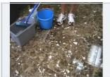  
Reference response: The person has started wiping the floor with the white cloth  
t=2s · stay silent

  
t=4s · stay silent

  
t=5s · stay silent

  
t=6s · stay silent

  
t=7s · valid response

## (b) WR · Window Response

Task rule: Stay silent before the event, then respond anywhere inside the valid window Example request: Let me know when a cowboy is on the ground and actually tying the calf's legs together.

t=12s · stay silent

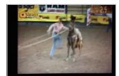

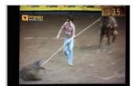  
t=13s · stay silent  
Reference response: The cowboy is on the ground now, tying the calf's legs together.

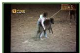  
t=14s · valid response

  
t=16s · valid response

  
t=18s · valid response

  
t=20s · valid response

## (c) DC · Duplicate Counting

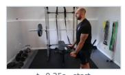  
t=0.25s · start

  
t=0.75s · lifting

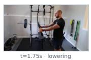

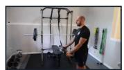  
t=2.25s · completion 1

  
t=3s · lifting  
Two of 4 repetitions are shown; DC scores only the final total, not intermediate response timing.

  
t=4s · lowering

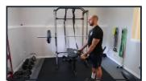  
t=4.5s · completion 2

Figure 6: Representative LiveProBench task formats from the released annotations. ES illustrates response–silence balance; WR represents the first-response-window format shared by OR, WR, AA, and SS; and DC illustrates final-total counting across repeated events. ES and WR each show six complete video frames; DC uses ten frames spanning two complete action cycles. Frame label identify silence, valid response moments, and action phases; green borders mark valid ES/WR responses. No model predictions are shown.

■ Live-OPSD @8s · in-window: “The chair is tipping over and the person is falling.”

## In-window (correct) Early (premature) Missed

## (a) Anomaly alert (AA) — BMX rider overshoots the foam pit and lands behind it

Query: If something goes wrong, tell me immediately what happened. As long as nothing goes wrong, stay silent -- no running commentary, no progress updates. lid

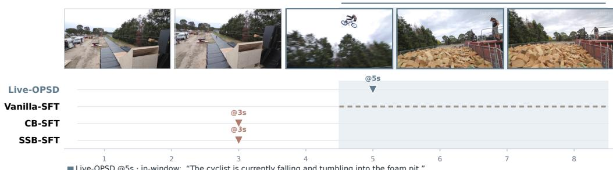  
■ Live-OPSD @5s · in-window: “The cyclist is currently falling and tumbling into the foam pit.”  
■ Vanilla-SFT · missed — no alert raised  
■ CB-SFT @3s · early: “A cyclist is riding up the ramp.”  
■ SSB-SFT @3s · early: “A cyclist is riding up the ramp.”  
Query: If something goes wrong, tell me immediately what happened. As long as nothing goes wrong, stay silent -- no running commentary, no progress updates.

(b) Anomaly alert (AA) — person falls backward off an office chair

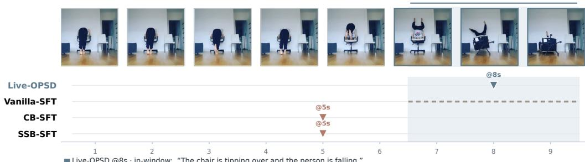  
■ Vanilla-SFT · missed — no alert raised  
■ CB-SFT @5s · early: “The person just fell off the chair.”  
■ SSB-SFT @5s · early: “The person just fell forward and is now lying face down on the chair seat.”  
Query: Tell me when the gymnast on the balance beam starts her back handspring. Until then, stay silent -- no running commentary, no progress updates.

(c) Respond at onset (OR) — gymnast begins her back handspring on the balance beam

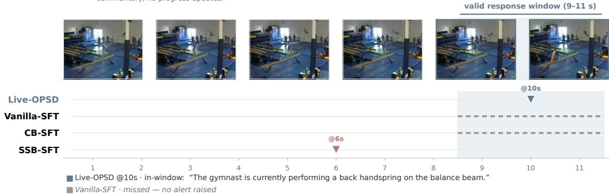  
■ CB-SFT · missed — no alert raised  
■ SSB-SFT @6s · early: “The gymnast is starting her back handspring now.”

Figure 7: Case comparison of Live-OPSD, Vanilla-SFT, CB-SFT, and SSB-SFT on released LiveProBench streams. Each panel shows the sampled video frames, the annotated valid response window, and each method’s first response, colored by verdict: in-window (correct), early (premature), or missed.

## I DECISION-LEVEL ANALYSIS OF LIVE-OPSD

Live-OPSD uses privileged context to construct a teaching signal, on-policy distillation to transfer that signal, and DAS to choose where to apply it. The analysis asks when these operations can support better response decisions. Let $( S , H , B ) \ \sim \ \rho$ denote a recorded streaming context, its training-time hint, and its supervisory decision, with $\dot { B ^ { \mathrm { ~ } } } \in \{ 0 , 1 \}$ . The student observes S, whereas the teacher also observes $\bar { H }$ . All decision risks below measure disagreement with B. We first characterize the information supplied by a hint, then relate the actual teacher–student discrepancy to decision risk, and finally identify when disagreement-based selection enriches contexts with a teaching advantage.

## I.1 PRIVILEGED CONTEXT AND DECISION AMBIGUITY

A shared parameter set need not imply identical decision information. The first result characterizes the ambiguity that can be resolved by the teacher’s additional context. Write $u ( s ) = \operatorname* { P r } ( B = 1 \mid$ $S \ = \ s )$ and $v ( s , h ) = \mathrm { P r } ( B = 1 \mid S = s , H = h )$ for the two conditional probabilities of a supervised response.

Proposition I.1 (Information advantage of privileged context). Let

$$
R _ { \mathrm { v i s } } ^ { * } = \operatorname* { i n f } _ { g } \operatorname* { P r } ( g ( S ) \neq B ) , \qquad R _ { \mathrm { p r i v } } ^ { * } = \operatorname* { i n f } _ { f } \operatorname* { P r } ( f ( S , H ) \neq B ) ,
$$

where the infima range over all measurable binary decision rules. Then

$$
\begin{array} { r } { R _ { \mathrm { v i s } } ^ { * } - R _ { \mathrm { p r i v } } ^ { * } = \mathbb { E } \big [ \big | v ( S , H ) - \frac { 1 } { 2 } \big | - \big | u ( S ) - \frac { 1 } { 2 } \big | \big ] \geq 0 . } \end{array}
$$

The inequality is strict if, for a set of contexts s ofpositive probability, $v ( s , H )$ lies on both sides of $1 / 2$ with positive conditional probability.

Proof. For a Bernoulli supervisory decision with response probability $u ,$ choosing silence incurs disagreement probability $u ,$ and choosing a response incurs $_ { 1 - u }$ . The minimum is min $\{ u , 1 - u \} =$ $1 / 2 - | u - 1 / 2 |$ . Applying this calculation under the two information sets gives

$$
\begin{array} { r l r } { R _ { \mathrm { v i s } } ^ { * } = \frac { 1 } { 2 } - \mathbb { E } | u ( S ) - \frac { 1 } { 2 } | , } & { } & { R _ { \mathrm { p r i v } } ^ { * } = \frac { 1 } { 2 } - \mathbb { E } | v ( S , H ) - \frac { 1 } { 2 } | . } \end{array}
$$

The tower property gives $u ( S ) = \mathbb { E } [ v ( S , H ) \mid S ]$ . Conditional Jensen’s inequality therefore implies

$$
\begin{array} { r } { | u ( S ) - \frac 1 2 | \leq \mathbb { E } [ | v ( S , H ) - \frac 1 2 | \mathbf \Delta | \ S ] . } \end{array}
$$

Subtracting the two minimum risks proves the identity and its nonnegativity. The absolute-value inequality is strict when its argument has both positive and negative values with positive conditional probability, yielding the stated strictness condition. □

The strictness condition identifies a source of teaching information: the hint distinguishes supervisory decisions that the visible context alone leaves ambiguous. When H is a deterministic function of ${ \dot { S } } ,$ , the two optimal risks are equal. Such a hint can still make an evidence–decision relationship explicit for a finite model, but that benefit concerns how the model uses information rather than an increase in the information available. Thus, the hint’s information advantage and the current teacher’s decision advantage are different quantities. The transfer analysis uses the latter.

## I.2 FROM ON-POLICY DISTILLATION TO RESPONSE DECISIONS

Fix a teacher and student at a training iterate. Let $\textstyle P ( \cdot \mid s , h )$ and $Q ( \cdot \mid s )$ be their autoregressive distributions over continuations of at most L tokens. Ended sequences are padded with an absorbing end symbol to give a common horizon; both conditionals put all mass on that symbol once a turn has ended, so padded positions contribute no discrepancy. The binary response decision $d ( Y )$ is determined by the complete continuation, as in Section 3. Define

$$
R ( Q ) = \mathbb { E } _ { \rho \operatorname* { P r } _ { Y \sim Q ( \cdot | S ) } } [ d ( Y ) \neq B ] , \qquad R ( P ) = \mathbb { E } _ { \rho \operatorname* { P r } _ { Y \sim P ( \cdot | S , H ) } } [ d ( Y ) \neq B ] .
$$

Although training only scores the teacher, its conditional probabilities define such a continuation distribution. This lets us ask whether matching those probabilities along student-generated prefixes also controls response decisions.

At a fixed context, let $p _ { \ell } ( \cdot \mid y _ { < \ell } )$ and $q _ { \ell } ( \cdot \mid y _ { < \ell } )$ denote the teacher and student next-token distributions. Define the cumulative on-policy reverse KL

$$
{ \mathcal K } _ { \mathrm { r } } ( P , Q ) = \mathbb { E } _ { \rho } \mathbb { E } _ { Y \sim Q } \sum _ { \ell = 1 } ^ { L } D _ { \mathrm { K L } } \big ( q _ { \ell } ( \cdot \vert Y _ { < \ell } ) \vert \vert p _ { \ell } ( \cdot \vert Y _ { < \ell } ) \big ) .
$$

The context dependence is implicit in $p \ell$ and $q \ell$ . Logarithms are natural, and the continuation expectation follows the student, as in the on-policy objective. Write $\begin{array} { r } { \mathrm { T V } ( U , V ) = \frac { 1 } { 2 } \| U - V \| . } \end{array}$ 1 for total variation.

Proposition I.2 (Decision transfer along student-generated prefixes). For the finite-horizon continuation distributions above,

$$
R ( Q ) \leq R ( P ) + \sqrt { \frac { L \mathcal { K } _ { \mathrm { r } } ( P , Q ) } { 2 } } .
$$

Proof. Fix $( s , h , b )$ and introduce hybrid continuation distributions

$$
M _ { j } ( y _ { 1 : L } ) = \prod _ { \ell = 1 } ^ { j } q _ { \ell } ( y _ { \ell } \mid y _ { < \ell } ) \prod _ { \ell = j + 1 } ^ { L } p _ { \ell } ( y _ { \ell } \mid y _ { < \ell } ) , \qquad j = 0 , \ldots , L .
$$

Thus $M _ { 0 } = P$ and ${ M } _ { L } = { Q }$ . The distributions $M _ { j - 1 }$ and $M _ { j }$ share a student-generated prefix of length $j - 1$ and the same teacher continuation after token $j .$ Summing over this common suffix gives

$$
\mathrm { T V } ( M _ { j - 1 } , M _ { j } ) = \mathbb { E } _ { Y _ { < j } \sim Q } \mathrm { T V } ( p _ { j } ( \cdot \mid Y _ { < j } ) , q _ { j } ( \cdot \mid Y _ { < j } ) ) .
$$

The triangle inequality and Pinsker’s inequality yield

$$
\mathrm { T V } ( P , Q ) \leq \mathbb { E } _ { Y \sim Q } \sum _ { j = 1 } ^ { L } \sqrt { \frac { 1 } { 2 } D _ { \mathrm { K L } } ( q _ { j } ( \cdot \mid Y _ { < j } ) \| p _ { j } ( \cdot \mid Y _ { < j } ) ) } .
$$

For the event $\{ Y : d ( Y ) \neq b \}$ , the difference between its student and teacher probabilities is at most $\mathrm { T V } ( P , Q )$ . Averaging over contexts and applying Cauchy–Schwarz to the $\bar { L }$ prefix contributions proves the result. □

The prefix distribution in this result is the student’s own. The discrepancy is therefore evaluated where the student makes the token choices that determine its action. Matching only reference continuations controls a different expectation and requires an additional coverage condition. The result concerns continuations at recorded contexts under $\rho ,$ not full model-generated interaction histories.

The bound charges one discrepancy term per response position. Response decisions are usually settled before a turn ends. Let

$\nu ( Y ) = \operatorname* { m i n } \{ j \leq L$ : d is constant on all continuations agreeing with Y in the first j tokens

be the position at which the decision is resolved, a stopping time for the token filtration, and write

$$
\bar { \nu } = \mathbb { E } _ { \rho } \mathbb { E } _ { Y \sim Q } \nu ( Y ) , \qquad \mathcal { K } _ { \mathrm { r } , \nu } ( P , Q ) = \mathbb { E } _ { \rho } \mathbb { E } _ { Y \sim Q } \sum _ { j = 1 } ^ { \nu ( Y ) } D _ { \mathrm { K L } } ( q _ { j } ( \cdot \vert Y _ { < j } ) \Vert p _ { j } ( \cdot \vert Y _ { < j } ) ) .
$$

Proposition I.3 (Decision transfer over the resolving prefix). Under the assumptions of Proposition I.2,

$$
R ( Q ) \leq R ( P ) + \sqrt { \frac { \bar { \nu } \ : K _ { \mathrm { r } , \nu } ( P , Q ) } { 2 } } .
$$

Since $\nu \leq L ,$ , this implies Proposition I.2.

Proof. Fix $( s , h , b )$ and let $A = \{ y : d ( y ) \neq b \}$ . By construction d is a function of $y _ { 1 : \nu ( y ) }$ , and the event $\{ \nu \geq j \}$ is determined by $y _ { < j }$ . With the hybrid distributions of the previous proof,

$$
M _ { j - 1 } ( A ) - M _ { j } ( A ) = \mathbb { E } _ { Y _ { < j } \sim Q } \sum _ { y _ { j } } \bigl [ p _ { j } ( y _ { j } \mid Y _ { < j } ) - q _ { j } ( y _ { j } \mid Y _ { < j } ) \bigr ] \Phi ( Y _ { < j } , y _ { j } ) ,
$$

where $\Phi ( \boldsymbol { y } _ { \le j } )$ is the probability of A under the teacher’s continuation from $y { \le } j$ . If $\nu \leq j - 1$ the prefix already determines $d ,$ so the inner sum vanishes. If $\nu \geq j $ , its magnitude is bounded by $\mathrm { \hat { T V } } ( p _ { j } , q _ { j } )$ . Telescoping, applying Pinsker’s inequality, and using Cauchy–Schwarz with the weights $\mathcal { H } [ \nu \geq j ]$ proves the result. □

Under the explicit silence protocol, a leading token other than the silence marker resolves the decision at the first position. The silent branch is resolved once the turn ends without accompanying text, following the scoring rule of Appendix $\mathbf { G }$ . The resolving prefix is therefore short compared with a full response, and $\bar { \nu }$ is measurable from the current policy. Response tokens beyond ν still receive supervision in Equation $\begin{array} { r } { 6 ; } \end{array}$ they affect response content rather than the binary response decision. Both corollaries below hold with $( L , \kappa _ { \mathrm { r } } )$ replaced by $( \bar { \nu } , \kappa _ { \mathrm { r } , \nu } )$

Corollary I.4 (Transfer of a teacher’s decision advantage). Let $Q _ { 0 }$ be a reference student and suppose the fixed teacher has decision advantage $\Delta = R ( Q _ { 0 } ) - R ( P ) > 0$ under the same context distribution. For a candidate student $Q ,$

$$
R ( Q ) - R ( Q _ { 0 } ) \leq - \Delta + \sqrt { \frac { L \mathcal { K } _ { \mathrm { r } } ( P , Q ) } { 2 } } .
$$

In particular, ${ \cal K } _ { \mathrm { r } } ( P , Q ) < 2 \Delta ^ { 2 } / L$ is sufficient for $R ( Q ) < R ( Q _ { 0 } )$

Proof. Subtract $R ( Q _ { 0 } ) = R ( P ) + \Delta$ from Proposition I.2. The right-hand side is negative under the stated condition. □

The sufficient condition compares the teacher’s decision advantage with the residual transfer discrepancy. In Live- ${ \bf \cdot O P S D } , { \bf Q } _ { 0 }$ generates the current batch and $P$ is its hinted counterpart. Equation 6 evaluates candidate updates on fixed selected samples, whereas $\mathcal { K } _ { \mathrm { r } } ( P , Q )$ averages full-vocabulary discrepancies over fresh continuations from $Q .$ . Connecting the two requires the selected samples and retained support to cover the relevant contexts, prefixes, and vocabulary. The corollary is a distribution-level sufficient condition, not a guarantee for every optimization step.

Corollary I.5 (Residual discrepancy from privileged information). For any student whose continuation depends only on S,

$$
{ \cal K } _ { \mathrm { r } } ( P , Q ) \geq \frac { 2 \big [ R _ { \mathrm { v i s } } ^ { * } - R ( P ) \big ] _ { + } ^ { 2 } } { L } , \qquad [ x ] _ { + } = \operatorname * { m a x } \{ x , 0 \} .
$$

Proof. Randomizing the response decision cannot reduce conditional disagreement below the best deterministic decision, so $\begin{array} { r } { \bar { R ( Q ) } \geq R _ { \mathrm { v i s } } ^ { * } . } \end{array}$ Combine this with Proposition I.2 and rearrange when $R _ { \mathrm { v i s } } ^ { * } > R ( P )$ . Otherwise the claim follows from nonnegativity of $\bar { \mathsf { K L } }$ □

When the hint reveals decision-relevant information unavailable in the visible context, exact teacher– student agreement can be unattainable. The objective is to improve decisions from the student’s information set; zero distillation loss is not required for useful transfer.

The discrepancies above use the full vocabulary, whereas the implementation replaces each divergence in Equation 6 with its retained-support counterpart from Equation 11. The remaining result bounds this difference by the discarded probability masses.

Proposition I.6 (From the truncated objective to full-vocabulary transfer). At each position let $m _ { j } ^ { P }$ and $m _ { j } ^ { Q }$ be the teacher and student masses retained by the support $\kappa _ { j }$ ofEquation 11, and let $\widetilde { p } _ { j } , \widetilde { q } _ { j }$ be the renormalized distributions. Then

$$
\mathrm { T V } ( p _ { j } , q _ { j } ) \leq \sqrt { \frac { 1 } { 2 } D _ { \mathrm { K L } } ( \widetilde { q } _ { j } \| \widetilde { p } _ { j } ) } + ( 1 - m _ { j } ^ { P } ) + ( 1 - m _ { j } ^ { Q } ) ,
$$

and consequently

$$
R ( Q ) \leq R ( P ) + \sqrt { \frac { \bar { \nu } \widetilde { \mathcal { K } } _ { \mathrm { r } , \nu } } { 2 } } + \mathbb { E } _ { \rho } \mathbb { E } _ { Y \sim Q } \sum _ { j = 1 } ^ { \nu ( Y ) } \big [ ( 1 - m _ { j } ^ { P } ) + ( 1 - m _ { j } ^ { Q } ) \big ] ,
$$

where ${ \widetilde { \mathcal { K } } } _ { \mathrm { r } , \nu }$ uses reverse KL between the renormalized distributions on the retained support.

Proof. Split $\| p _ { j } - q _ { j } \| .$ 1 at $\kappa _ { j }$ . The two tails outside the support contribute at most $( 1 - m _ { j } ^ { P } ) + ( 1 -$ $m _ { j } ^ { Q } )$ . Inside $\mathrm { i t } , p _ { j } = m _ { j } ^ { P } \widetilde { p } _ { j }$ and $q _ { j } = m _ { j } ^ { Q } \widetilde { q } _ { j }$ . Summing the pointwise triangle inequality and using $| \bar { m } _ { j } ^ { P } - m _ { j } ^ { Q } | \leq ( 1 - m _ { j } ^ { \bar { P } } ) + ( 1 - m _ { j } ^ { Q } )$ gives

$$
\mathrm { T V } ( p _ { j } , q _ { j } ) \leq \mathrm { T V } ( \widetilde { p } _ { j } , \widetilde { q } _ { j } ) + ( 1 - m _ { j } ^ { P } ) + ( 1 - m _ { j } ^ { Q } ) .
$$

Pinsker’s inequality proves the first claim. Substituting it into the telescoped bound for Proposition I.3 and applying Cauchy–Schwarz to the reverse-KL terms proves the second. □

With $\mathcal { D } = \mathcal { D } _ { \mathrm { r K L } }$ , the implemented form of Equation 6 minimizes the retained-support reverse-KL terms in this bound. The discarded masses isolate the effect of truncation and are computable from the teacher and student forward passes. The remaining difference between the bound and the implemented update is that training uses fixed samples at selected contexts with global token-mean normalization rather than an idealized expectation over all contexts and continuations.

## I.3 WHICH CONTEXTS DECISION-AWARE SELECTION EMPHASIZES

A sampled disagreement contains information about the context that produced it. Whether that context is useful for distillation also depends on the teacher. To separate these questions, fix the current policy $Q _ { \theta }$ and teacher $P$ , and let $Z = ( S , H , B ) \sim \rho$ . Define

$$
e _ { \theta } ( z ) = \operatorname* { P r } _ { Y \sim Q _ { \theta } ( \cdot | s ) } [ d ( Y ) \neq b ] , \qquad \bar { e } _ { \theta } = \mathbb { E } _ { Z \sim \rho } e _ { \theta } ( Z ) .
$$

Here $e _ { \theta } ( z )$ is the probability of disagreement on a fresh continuation at that context, while the indicator $\delta _ { t }$ used by DAS is one sampled outcome. Write $e _ { P } ( z ) = \operatorname* { P r } _ { Y \sim P ( \cdot | s , h ) } [ d ( Y ) \neq b ]$ for the teacher’s conditional disagreement and $g _ { \theta } ( z ) = e _ { \theta } ( z ) - e _ { P } ( z )$ for its context-specific decision advantage. A positive $g _ { \boldsymbol { \theta } } ( z )$ means that the teacher agrees with supervision more often than the current student there. Its mean $\mathbb { E } _ { \rho } g _ { \theta } ( Z )$ is the decision advantage $\Delta$ of Corollary I.4 at the current policy.

Proposition I.7 (Context enrichment and teaching advantage). Suppose $\begin{array} { r } { \bar { e } _ { \theta } > 0 } \end{array}$ . Draw a context from $\rho ,$ generate a continuation from the current policy, and retain the context when its decision disagrees with supervision. The conditional context distribution is

$$
\rho _ { \mathrm { i n c } } ( d z ) = \frac { e _ { \theta } ( z ) } { \bar { e } _ { \theta } } \rho ( d z ) .
$$

Its expected disagreement probability on afresh independent continuation is

$$
\mathbb { E } _ { \rho _ { \mathrm { i n c } } } e _ { \theta } ( Z ) = \bar { e } _ { \theta } + \frac { \mathrm { V a r } _ { \rho } ( e _ { \theta } ( Z ) ) } { \bar { e } _ { \theta } } \geq \bar { e } _ { \theta } ,
$$

with strict inequality whenever $e _ { \theta } ( Z )$ is nonconstant under $\rho .$ The expected teacher advantage satisfies

$$
\mathbb { E } _ { \rho _ { \mathrm { i n c } } } g _ { \theta } ( Z ) = \mathbb { E } _ { \rho } g _ { \theta } ( Z ) + \frac { \mathrm { C o v } _ { \rho } ( e _ { \theta } ( Z ) , g _ { \theta } ( Z ) ) } { \bar { e } _ { \theta } } .
$$

Thus, the inconsistent pool has a greater mean teacher advantage precisely when the covariance is positive.

Proof. Let D denote disagreement on the continuation used for selection. For any measurable set of contexts A,

$$
\operatorname* { P r } ( Z \in A , D ) = \int _ { A } e _ { \theta } ( z ) \rho ( d z ) , \qquad \operatorname* { P r } ( D ) = { \bar { e } } _ { \theta } .
$$

Bayes’ rule gives the stated conditional distribution. For any bounded context-level function $f ,$

$$
\begin{array} { r l } & { \mathbb { E } _ { \rho _ { \mathrm { i n c } } } f ( Z ) = \frac { \mathbb { E } _ { \rho } \left[ e _ { \theta } ( Z ) f ( Z ) \right] } { \bar { e } _ { \theta } } } \\ & { \quad \quad = \mathbb { E } _ { \rho } f ( Z ) + \frac { \operatorname { C o v } _ { \rho } \left( e _ { \theta } ( Z ) , f ( Z ) \right) } { \bar { e } _ { \theta } } . } \end{array}
$$

An independent continuation at a retained context still has disagreement probability $e _ { \theta } ( z )$ . Taking $f = e _ { \theta }$ gives the variance identity, and the variance is positive unless $e _ { \theta } ( Z )$ is almost surely constant. Taking $f = g _ { \theta }$ proves the identity for teacher advantage. Since $\bar { e } _ { \theta } > 0 ,$ , the change in that advantage has the sign of the covariance. □

Corollary I.8 (Quota relative to the current disagreement rate). Suppose $0 ~ < ~ \bar { e } _ { \theta } ~ < ~ 1$ and let $\begin{array} { r } { \rho _ { \mathrm { c o n } } ( d z ) = \frac { 1 - e _ { \theta } ( z ) } { 1 - \bar { e } _ { \theta } } \rho ( d z ) } \end{array}$ denote the complementary consistent pool. For $\rho _ { \lambda } = \lambda \rho _ { \mathrm { i n c } } + ( 1 - \lambda ) \rho _ { \mathrm { c o n } }$ with $\lambda \in [ 0 , 1 ]$

$$
\mathbb { E } _ { \rho _ { \lambda } } g _ { \theta } ( Z ) - \mathbb { E } _ { \rho } g _ { \theta } ( Z ) = \frac { ( \lambda - \bar { e } _ { \theta } ) \operatorname { C o v } _ { \rho } ( e _ { \theta } ( Z ) , g _ { \theta } ( Z ) ) } { \bar { e } _ { \theta } ( 1 - \bar { e } _ { \theta } ) } .
$$

When the covariance is positive, the mixture has a greater mean teacher advantage than $\rho$ exactly when $\lambda > \bar { e } _ { \theta } ,$ , and $\lambda = \bar { e } _ { \theta }$ reproduces $\rho .$

Proof. Write $C = \mathrm { C o v } _ { \rho } ( e _ { \theta } ( Z ) , g _ { \theta } ( Z ) )$ . Since $\mathbb { E } _ { \rho } [ ( 1 - e _ { \theta } ) g _ { \theta } ] = ( 1 - \bar { e } _ { \theta } ) \mathbb { E } _ { \rho } g _ { \theta } - C$ , dividing by $1 - \bar { e } _ { \theta }$ gives $\mathbb { E } _ { \rho _ { \mathrm { c o n } } } g _ { \theta } = \dot { \mathbb { E } } _ { \rho } g _ { \theta } - C / ( 1 - \bar { e } _ { \theta } )$ , while Proposition I.7 gives $\mathbb { E } _ { \rho _ { \mathrm { i n c } } } \dot { \boldsymbol { g } } _ { \theta } = \mathbb { E } _ { \rho } \boldsymbol { g } _ { \theta } + \boldsymbol { C } / \bar { \boldsymbol { e } } _ { \theta }$ Taking the λ-weighted combination and collecting terms yields the identity. $\operatorname { A t } \lambda = { \bar { e } } _ { \theta }$ it vanishes, consistent with $\rho = \bar { e } _ { \theta } \rho _ { \mathrm { i n c } } + ( 1 - \bar { e } _ { \theta } ) \rho _ { \mathrm { c o n } }$ □

The covariance condition connects the selection signal to the distillation signal. DAS favors useful teaching contexts when the hinted model’s advantage is greater where the current student is more likely to disagree with supervision. If both models struggle on the same contexts, disagreement alone need not indicate a stronger teaching signal. The covariance describes the quality of the selected targets. Translating that advantage into a student improvement also depends on transfer fidelity, as expressed in Corollary I.4.

The proposition characterizes the inconsistent candidate pool before DAS balances the two disagreement directions and adds consistent points. The same identities hold within each supervisory class by conditioning $\rho$ on $B = b ,$ , provided that class has positive disagreement probability. Direction balancing and the quota then determine how these pools enter the selected set, and response lengths determine their weights in Equation 6. Corollary I.8 characterizes the inconsistent share of an idealized mixture relative to the current disagreement rate $\bar { e } _ { \theta }$ . In the implemented procedure, the quota $q = \operatorname* { m a x } \{ 1 , \lfloor \alpha K \rfloor \}$ caps the number of inconsistent points before the remaining groups are filled by priority. The current run artifacts do not retain the pool counts needed to show that the realized inconsistent share exceeds $\bar { e } _ { \theta }$ at every update. Moreover, the corollary samples the remaining points in proportion to $1 - e _ { \theta }$ , whereas DAS uses a deterministic group priority, so $\rho _ { \lambda }$ is an analytical approximation rather than the exact selected-set distribution. As the policy changes, $e _ { \theta }$ and its induced context weighting change with it. The fixed-selection control in Section 5.4 removes this policy-dependent allocation while preserving each point’s visible history.