# Learning from Points and Patches: A Pre-trained Hybrid Atention Transformer for Time Series Analysis

Peiwang Tang1,2,3 Cheng HE1,2,3 Yupeng Ye1 Weitai Zhang4 Qinghua Sun4 Defu Lian1,2,✉

1University of Science and Technology of China, Hefei, Anhui, China

2State Key Laboratory of Cognitive Intelligence, Hefei, Anhui, China

3Shanghai Black Wing Asset Management, Shanghai, China

4iFLYTEK Research, Hefei, Anhui, China

tpw@mail.ustc.edu.cn cheng.he@mail.ustc.edu.cn yeyupeng@mail.ustc.edu.cn zwt2021@mail.ustc.edu.cn qhsun2@iflytek.com ✉liandefu@ustc.edu.cn

## Abstract

Time-series data generated by Web services and connected systems support applications such as user activity analysis, service monitoring, and resource management. However, learning transferable representations from heterogeneous time series remains challenging due to diverse temporal patterns, variable sequence lengths, and limited high-quality annotations. Despite the success of pre-training in natural language processing and computer vision, efective time-series pre-training requires strategies tailored to temporal data. We propose TimeHAT (Hybrid Attention Transformer), a general-purpose pre-training framework for time-series analysis that addresses two complementary questions: what to learn and how to learn. For what to learn, we introduce a Unified Point-Patch Masking Strategy (UPPMS) that integrates point-level and patch-level supervision within a unified framework for contextual reconstruction and causal extrapolation, enabling the model to capture both fine-grained temporal variations and broader temporal patterns. For how to learn, we develop a Hybrid Attention Encoder (HAE) that combines prefix-constrained bidirectional attention in initial layers with directional hybrid attention in deeper layers, aiming to preserve efective contextual interactions while mitigating rank degeneration. We evaluate TimeHAT across real-world datasets and four downstream tasks: classification, long-term forecasting, imputation, and anomaly detection. Experiments cover finetuning, few-shot, and zero-shot transfer settings, demonstrating competitive performance across diverse time-series analysis tasks. Code is available at https://github.com/TangPeiwang/TimeHAT.

## CCS Concepts

• Computing methodologies → Artificial intelligence.

## Keywords

Mask Methods, Hybrid Attention, Temporal Representation Learning, Time Series Analysis

## 1 Introduction

The World Wide Web continuously generates time-series signals through user interactions, network trafic, and service telemetry [47, 48, 53]. These signals underpin a wide range of Web applications, including sequential recommendation, user behavior modeling, trafic forecasting, resource management, and service anomaly detection [36, 50, 52]. Beyond Web systems, time-series data (TSD), collected across sequential time points to monitor dynamic phenomena, serve as a cornerstone for decision-making in diverse scientific and industrial domains [25, 43]. Despite their broad utility, real-world TSD are often heterogeneous across domains, exhibit diverse temporal patterns and pervasive noise, and frequently lack high-quality annotations [18]. These challenges motivate the development of general-purpose pre-training methods that can learn transferable representations from diverse time series and support a broad range of downstream tasks, including forecasting, classification, imputation, and anomaly detection.

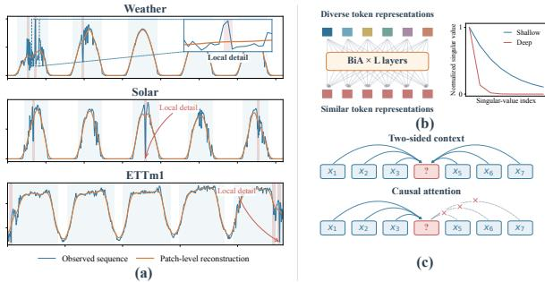  
Figure 1: (a) Patch-level reconstruction can miss fine-grained temporal details; (b) Deep bidirectional attention risks representation homogenization; (c) Causal attention cannot access two-sided context.

A natural approach to learning such representations is to draw inspiration from the large-scale pre-training paradigm that has achieved remarkable success in natural language processing (NLP) [7] and computer vision (CV) [17]. However, directly transferring these paradigms to time-series analysis (TSA) remains challenging [14, 26]. Unlike NLP and CV, which benefit from large-scale corpora and established pre-training resources such as ImageNet [56], TSA faces substantial data scarcity and heterogeneity across datasets and domains. Consequently, existing pre-training strategies may fail to adequately capture the distinctive statistical properties of time series [3, 34]. This mismatch suggests that efective time-series pre-training requires not only suficient data and model capacity, but also learning strategies and architectures tailored to temporal data [12, 31].

Despite recent progress, existing time-series pre-training methods face limitations in both reconstruction granularity and contextual modeling. (As illustrated in Figure 1). These limitations motivate two fundamental questions: what to learn from temporal data and how to learn it efectively.

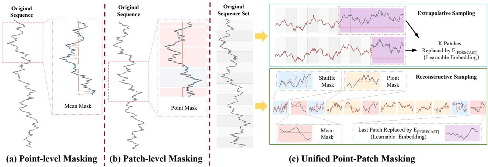  
Figure 2: Comparison of Point-Level, Patch-Level, and Unified Point-Patch Masking Strategies for Time Series Data.

Existing masking-based methods primarily reconstruct masked patches, providing supervision for segment-level temporal patterns [32, 35]. However, patch-level reconstruction does not explicitly supervise fine-grained variations within each patch, which may also carry important temporal information. Conversely, point-level masking provides finer-grained supervision but does not explicitly capture segment-level structure. Efective pre-training should therefore capture complementary temporal information at both point and patch granularities.

However, determining what temporal information to learn is only part of the challenge. The encoder must also integrate contextual information while preserving diverse representations across layers. Standard bidirectional attention (BiA), widely used in masked reconstruction, enables global token interactions but can sufer from representation homogenization and rank degeneration in deep networks [2, 9]. Directional attention can mitigate this degeneration, but applying directional masks from the initial layer may limit early global contextual competition. This motivates an encoder that combines global contextual integration in shallow layers with directionally structured attention in deeper layers.

To address these challenges, we propose TimeHAT (Hybrid Attention Transformer), a general-purpose pre-training framework for time-series analysis. For what to learn, we introduce a Unified Point-Patch Masking Strategy (UPPMS) that unifies contextual reconstruction and causal extrapolation, using point-level and patch-level supervision to capture complementary temporal information. For how to learn, we develop a Hybrid Attention Encoder (HAE) with a progressive attention architecture. It first employs prefix-constrained bidirectional attention to establish contextual representations, then introduces complementary forward and backward attention heads in deeper layers to mitigate rank degeneration while preserving causal constraints on predictive targets. We evaluate TimeHAT across diverse downstream tasks and transfer settings, and further investigate its efectiveness under limited-data conditions.

Our contributions are summarized as follows:

• We propose UPPMS, a unified masking framework that combines contextual reconstruction and causal extrapolation, incorporating point-level and patch-level supervision to capture complementary temporal information.

• We develop HAE, which combines prefix-constrained bidirectional attention in shallow layers with complementary directional attention in deeper layers, balancing contextual integration with rank stability.

• We evaluate TimeHAT across classification, long-term forecasting, imputation, and anomaly detection, including finetuning, few-shot, and zero-shot transfer settings. We further analyze its efectiveness under limited-data conditions.

## 2 Unified Point-Patch Masking Strategy

Recent masked time-series pre-training methods commonly reconstruct masked patches [32, 35]. While patch-level masking provides supervision for segment-level patterns, it does not explicitly supervise fine-grained variations within each patch. Combining pointlevel and patch-level masking can therefore provide complementary supervision for temporal representation learning.

To address this limitation, we propose a Unified Point-Patch Masking Strategy (UPPMS) that integrates point-level and patchlevel masking within a unified pre-training framework (2). UPPMS further supports two complementary learning modes: contextual reconstruction from observed sequences and causal extrapolation toward future segments.

Given a univariate time series $\mathbf { x } = \{ x _ { 1 } , \ldots , x _ { L } \}$ of length �, we divide it into $T = \lceil L / P \rceil$ non-overlapping patches $\mathcal { P } = \{ { \bf p } _ { 1 } , . . . , { \bf p } _ { T } \}$ each of length �. Zero-padding is applied to the final patch when necessary.

## 2.1 Dual-mode Sampling

We define the perturbation set $\scriptstyle { \mathcal { I } } _ { \mathrm { p e r t } }$ and the predictive target set $\mathcal { T } _ { \mathrm { t a r g e t } }$ to specify which patches are corrupted and which serve as prediction targets. The masked patch set is their disjoint union: ${ \cal T } _ { p } =$ ${ \cal J } _ { \mathrm { p e r t } } \cup { \cal J } _ { \mathrm { t a r g e t } } , \qquad { \cal J } _ { \mathrm { p e r t } } \cap { \cal J } _ { \mathrm { t a r g e t } } = \emptyset$ . During pre-training, UPPMS samples one of two modes according to a predefined sampling probability:

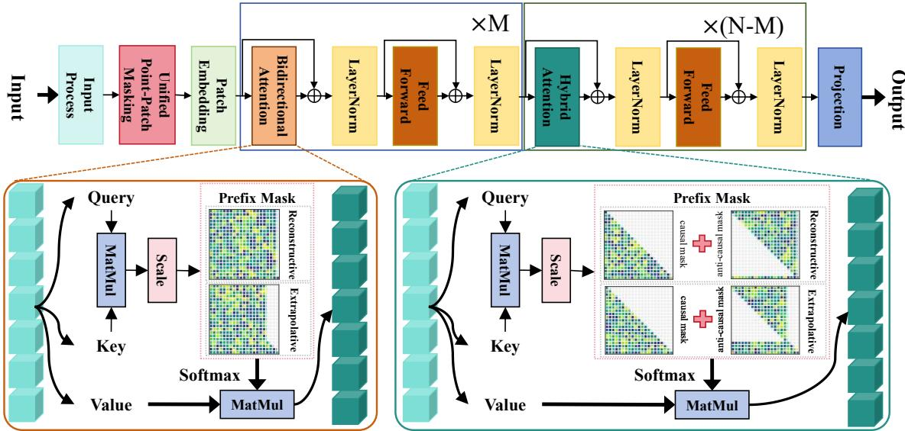  
Figure 3: Overall architecture of TimeHAT. The model employs channel-independence for multivariate inputs. Sequences undergo a Unified Point-Patch Masking Strategy, patch tokenization, and MLP embedding. A two-stage encoder then captures temporal dynamics, utilizing Bidirectional Attention in early layers for global context, and Hybrid Attention in later layers for causal constraints. Finally, an MLP projection head reconstructs the output by modeling both patch- and point-level interactions.

• Contextual Reconstruction. We uniformly sample $\lfloor r _ { p } ( T -$ 1)⌋ patches from the historical positions $\{ 1 , . . . , T - 1 \}$ to form ${ \cal T } _ { \mathrm { p e r t } } ,$ where $r _ { p } \in ( 0 , 1 )$ is the patch-level perturbation ratio. The final patch is designated as the prediction target: $\mathcal { T } _ { \mathrm { t a r g e t } } = \{ T \}$ . This mode reconstructs masked information from the historical context. The terminal target also serves as a [CLS]-like global readout for downstream tasks such as classification and anomaly detection.

• Causal Extrapolation. We disable historical perturbation, ${ \cal J } _ { \mathrm { p e r t } } = \emptyset _ { \mathrm { : } }$ , and select a contiguous tail of� patches as predic tion targets: $\mathcal { T } _ { \mathrm { t a r g e t } } = \{ T - k + 1 , \dots , T \}$ , where $1 \leq k \leq T$ This mode learns to predict future segments under causal information constraints.

## 2.2 Masking Operations.

2.2.1 Predictive Target Masking. For each target patch $i \in \mathcal { I } _ { \mathrm { t a r g e t } } ,$ its projected representation is replaced with a shared learnable query embedding $\mathbf { E } _ { \mathrm { f o r e c a s t } } \in \mathbb { R } ^ { d _ { \mathrm { m o d e l } } }$ . The query aggregates visible contextual information to reconstruct masked content or predict future segments.

2.2.2 Patch-level Masking. For each patch $i \in \mathcal { I } _ { \mathrm { p e r t } }$ , we randomly apply one of three corruption operations according to predefined proportions: (i) zero replacement, which removes the patch content and encourages recovery of missing segment-level structure; (ii) mean replacement, which replaces the patch with the global scalar mean $\bar { x } _ { v }$ of all visible observations, providing a statistical reference while obscuring its original content; and (iii) internal shufling, which randomly permutes the temporal order within $\mathbf { p } _ { i } ,$ encouraging the model to learn local information beyond the original point ordering.

2.2.3 Point-level Masking. Point-level masking is applied only in contextual reconstruction mode, keeping the historical context unperturbed at the point level during causal extrapolation. For each patch � ∉ ${ \cal T } _ { p } ,$ we uniformly sample a subset ${ \cal T } _ { p t , i } \subseteq \{ 1 , . . . , P \}$ of size $\lfloor r _ { P } t ^ { P \rfloor }$ , where $r _ { p t }$ is the point-masking ratio. Each selected value $\mathbf { \phi } _ { p _ { i , k } }$ , for $k \in \mathcal { T } _ { p t , i : }$ , is replaced with either zero or a sample from $N ( 0 , 1 )$ . This operation provides fine-grained reconstruction supervision within otherwise visible patches.

## 2.3 Prefix-constrained Attention.

The predictive target set $\mathcal { I } _ { \mathrm { t a r g e t } }$ defines a prefix constraint mask $\mathbf { M } ^ { p } \in \mathbb { R } ^ { T \times T }$ , where � and � index the query and key positions, respectively:

$$
M _ { i j } ^ { p } = \left\{ { \begin{array} { l l } { - \infty , } & { i \notin { \mathcal { I } } _ { \mathrm { t a r g e t } } , j \in { \mathcal { I } } _ { \mathrm { t a r g e t } } , } \\ { - \infty , } & { i , j \in { \mathcal { I } } _ { \mathrm { t a r g e t } } , j > i , } \\ { 0 , } & { { \mathrm { o t h e r w i s e } } . } \end{array} } \right.\tag{1}
$$

This mask prevents historical queries from accessing target tokens and enforces causal information flow among target tokens. In HAE, it is combined with layer-specific attention masks to determine the complete information flow, supporting both contextual reconstruction and causal extrapolation without target leakage.

## 3 TimeHAT

We represent a multivariate time series as $\mathbf { X } \in \mathbb { R } ^ { L \times C }$ , where � is the sequence length and � is the number of variables. TimeHAT adopts channel-independent temporal encoding, applying the same operations independently to each univariate series. This design focuses on learning temporal patterns within individual variables without relying on potentially unstable cross-variable dependencies.

For clarity, we describe the framework for a univariate series; the multivariate extension applies the same encoder independently across channels. As illustrated in Figure 3, TimeHAT adopts an encoder-only Transformer architecture inspired by masked pre training methods such as MAE. A lightweight linear projection maps encoder representations to reconstruction targets, avoiding a separate Transformer decoder and keeping the architecture focused on temporal representation learning [4, 46].

## 3.1 Input Processing and Embedding

To mitigate distribution shifts across distinct time series and stabilize the optimization process, the raw input sequence x is first standardized via standard instance normalization. Following the UPPMS, the sequence is represented by a sequence of � non-overlapping patches $\mathcal { P } = \{ { \bf p } _ { 1 } , . . . , { \bf p } _ { T } \}$

Each patch $\mathbf { p } _ { i } ,$ whether it consists of uncorrupted historical data, stochastic perturbations, or the predictive query embedding $\mathbf { E } _ { [ F O R E C A S T ] }$ , is linearly projected into a uniform �-dimensional embedding space, yielding a sequence of tokens $\boldsymbol { Z } \in \mathbb { R } ^ { T \times d }$ . Temporal order is then captured by Rotary Position Embedding (RoPE) applied to the attention queries and keys within the HA Encoder.

## 3.2 Hybrid Attention Encoder

To mitigate rank degeneration while preserving efective contextual information exchange, we develop a Hybrid Attention Encoder (HAE) with a progressive attention architecture. The first � layers employ prefix-constrained bidirectional attention (BiA) to integrate historical context, while the remaining $L _ { e } - M$ layers employ directional hybrid attention to improve rank stability in deeper layers. Throughout the encoder, prefix constraints prevent historical tokens from accessing predictive targets and preserve causal information flow among target tokens.

3.2.1 Unified Formulation and Notation. Let $L _ { e }$ denote the number of encoder layers, � the number of input tokens, and $d _ { \mathrm { m o d e l } }$ the hidden dimension. We use an even number ℎ of attention heads, each with dimension $d _ { k } = d _ { \mathrm { m o d e l } } / h$ . Let $\mathbf { X } ^ { ( l - 1 ) } \in \mathbb { R } ^ { T \times d }$ model denote the input to layer �. For each head $\alpha ,$ the query, key, and value matrices are computed as $\mathbf { Q } _ { \alpha } ^ { ( l ) } = \mathbf { X } ^ { ( l - 1 ) } \mathbf { W } _ { Q , \alpha } ^ { ( l ) } , \dot { \mathbf { K } _ { \alpha } ^ { ( l ) } } = \mathbf { \bar { X } } ^ { ( l - 1 ) } \mathbf { W } _ { K , \alpha } ^ { ( l ) } ;$ and $\mathbf { V } _ { \alpha } ^ { ( l ) } = \mathbf { X } ^ { ( l - 1 ) } \mathbf { W } _ { V , \alpha } ^ { ( l ) }$ , with projection matrices in $\mathbb { R } ^ { d _ { \mathrm { m o d e l } } \times d _ { k } }$ . The attention scores are $\mathbf { S } _ { \alpha } ^ { ( l ) } = { \mathbf { Q } _ { \alpha } ^ { ( l ) } } { \mathbf { K } _ { \alpha } ^ { ( l ) } } ^ { \top } / \sqrt { d _ { k } } ,$ , and the head output is = Softmax $( \mathbf { S } _ { \alpha } ^ { ( l ) } + \mathbf { M } _ { \alpha } ^ { ( l ) } ) \mathbf { V } _ { \alpha } ^ { ( l ) }$ , where $\mathbf { M } _ { \alpha } ^ { ( l ) } \in \left\{ 0 , - \infty \right\} ^ { T \times T }$ is the stage- and head-specific attention mask defined below.

Stage 1: Prefix-Constrained BiA Layers $( l = 1 , \ldots , M ) .$ . The first � layers apply bidirectional attention among non-target tokens while enforcing causal information flow for predictive targets. We use the prefix constraint mask $\mathbf { M } ^ { \mathrm { p r e f i x } }$ defined in Section 2.3, setting $\mathbf { M } _ { \alpha } ^ { ( l ) } = \mathbf { \bar { M } } ^ { \mathrm { { p r e f i x } } }$ for every attention head �. This allows non-target tokens to interact bidirectionally, while each target token can access historical context and preceding target tokens, including itself, without accessing subsequent targets.

Stage 2: Directional Hybrid Attention Layers $( l = M + 1 , \ldots , L _ { e } ) .$ In deeper layers, we introduce complementary directional attention to mitigate rank degeneration. We evenly divide the ℎ atten tion heads into forward and backward subsets, $\mathcal { H } _ { \mathrm { f w } }$ and $\mathcal { H } _ { \mathrm { b w } }$ , with $| \mathcal { H } _ { \mathrm { f w } } | = | \mathcal { H } _ { \mathrm { b w } } | = h / 2$ . The attention masks are defined by combining directional constraints with the prefix constraint:

$$
\mathbf { M } _ { \alpha } ^ { ( l ) } = \left\{ \mathbf { M } ^ { \mathrm { c a u s a l } } + \mathbf { M } ^ { \mathrm { p r e f i x } } , \quad \alpha \in \mathcal { H } _ { \mathrm { f w } } , \right.\tag{2}
$$

The causal mask follows the standard lower-triangular constraint, whereas the anti-causal mask adapts to the target positions:

$$
M _ { i j } ^ { \mathrm { c a u s a l } } = \left\{ \begin{array} { l l } { 0 , } & { j \leq i , } \\ { - \infty , } & { j > i , } \end{array} \right. \qquad M _ { i j } ^ { \mathrm { a n t i } } = \left\{ \begin{array} { l l } { 0 , } & { i \notin { \cal I } _ { \mathrm { t a r g e t } } , \ j \geq i , } \\ { 0 , } & { i \in { \cal I } _ { \mathrm { t a r g e t } } , \ j \leq i , } \\ { - \infty , } & { \mathrm { o t h e r w i s e } . } \end{array} \right.\tag{3}
$$

Thus, forward heads use causal attention throughout, while backward heads use anti-causal attention for historical queries and switch to causal attention for predictive targets. Combined with the prefix constraint, this design preserves access to historical context for all target queries while preventing information leakage from future targets. The resulting attention weight matrices are fullrank under these masking constraints, owing to their triangular or block-triangular structure and positive diagonal entries.

3.2.2 Layer Integration. For each layer, the outputs of all ℎ attention heads are concatenated and projected to the model dimension:

$$
\widetilde { \mathbf { X } } ^ { ( l ) } = \mathrm { C o n c a t } \big ( \mathbf { H } _ { 1 } ^ { ( l ) } , \ldots , \mathbf { H } _ { h } ^ { ( l ) } \big ) \mathbf { W } _ { O } ^ { ( l ) } ,\tag{4}
$$

where $\mathbf { W } _ { O } ^ { ( l ) } \in \mathbb { R } ^ { h d _ { k } \times d _ { \mathrm { m o d e l } } }$ . The projected output is combined with the layer input through a residual connection, followed by the FFN and its residual connection, to obtain the layer output $\mathbf { X } ^ { \left( l \right) }$

The directional hybrid attention layers use full-rank attention matrices to mitigate rank degeneration during deeper information exchange. Setting $M = 0$ yields an encoder composed entirely of directional hybrid-attention layers.

## 4 Experiments

We pre-train TimeHAT on UTSD-12G [31], a comprehensive corpus comprising 1 billion time points across diverse domains. For downstream evaluations, spanning forecasting, imputation, classification, and anomaly detection, we strictly follow the standardized protocols established by TimesNet [41].

Baselines: The baselines include CNN-based models: TimesNet [41], TimeMixer++[37]; MLP-based models: LightTS [51], DLinear [46], TimeMixer[38]; Transformer-based models: Timer-XL [28], MOMENT [13], GPT4TS[56], iTransformer [27], Autoformer [42], FEDformer [55], Non-stationary Transformer [30], ETSformer [40], PatchTST [32], TIMESBERT [49], Anomaly Transformer [44], Pyraformer [24]. Besides, Rocket [6], LSTNet [22], LSSL [15], TCN [11] and Flowformer [19] are used for classification.

## 4.1 Long-term Forecasting

We evaluate long-term forecasting across six benchmarks, reporting MSE and MAE averaged over {96, 192, 336, 720}. As detailed in Table 1, TimeHAT achieves competitive performance, achieves the best average performance on the reported benchmarks. Notably, it demonstrates a decisive advantage over both highly optimized forecasting architectures (e.g., TimeMixer++, iTransformer) and recent large-scale time series foundation models (e.g., MOMENT,

Table 1: Long-term forecasting task. Results are averaged over four prediction horizons: {96, 192, 336, 720}. Other models all adhere to the core research conclusions proposed in the original papers. The best results are represented in bold.
<table><tr><td>Methods</td><td colspan="2">TimeHAT</td><td colspan="2">MOMENT</td><td colspan="2">GPT4TS</td><td colspan="2">TimesNet</td><td colspan="2">PatchTST</td><td colspan="2">Timer-XL</td><td colspan="2">iTransformer</td><td colspan="2">CrossLinear</td><td colspan="2">TimeMixer</td><td colspan="2">TimeMixer++</td></tr><tr><td>Metric</td><td>MSE</td><td>MAE</td><td>MSE</td><td>MAE</td><td>MSE</td><td>MAE</td><td>MSE</td><td>MAE</td><td>MSE</td><td>MAE</td><td>MSE</td><td>MAE</td><td>MSE</td><td>MAE</td><td>MSE</td><td>MAE</td><td>MSE</td><td>MAE</td><td>MSE MAE</td></tr><tr><td>ETTh1</td><td>0.402</td><td>0.421</td><td>0.418</td><td>0.436</td><td>0.427</td><td>0.426</td><td>0.458</td><td>0.450</td><td>0.413</td><td>0.430</td><td>0.409</td><td>0.430</td><td>0.454 0.447</td><td></td><td>0.431</td><td>0.433 0.447</td><td>0.440</td><td>0.419</td><td>0.432</td></tr><tr><td>ETTh_2</td><td>0.322</td><td>0.368</td><td>0.352</td><td>0.395</td><td>0.346</td><td>0.394</td><td>0.414</td><td>0.427</td><td>0.330</td><td>0.379</td><td>0.352</td><td>0.402</td><td>0.383 0.407</td><td>0.368</td><td>0.396</td><td>0.364</td><td>0.395</td><td>0.339</td><td>0.380</td></tr><tr><td>ETTm1</td><td>0.336</td><td>0.366</td><td>0.344</td><td>0.379</td><td>0.352</td><td>0.383</td><td>0.400</td><td>0.406</td><td>0.351</td><td>0.387</td><td>0.359 0.382</td><td></td><td>0.407 0.410</td><td>0.370</td><td>0.393</td><td>0.369</td><td>0.378</td><td>0.369</td><td>0.378</td></tr><tr><td>ETTm2</td><td>0.252</td><td>0.309</td><td>0.259</td><td>0.318</td><td>0.266</td><td>0.326</td><td>0.291</td><td>0.333</td><td>0.255</td><td>0.315</td><td>0.271 0.322</td><td>0.288</td><td>0.332</td><td>0.272</td><td>0.320</td><td>0.275</td><td>0.323</td><td>0.269</td><td>0.320</td></tr><tr><td>Weather</td><td>0.221</td><td>0.255</td><td>0.228</td><td>0.270</td><td>0.237</td><td>0.270</td><td>0.259</td><td>0.287</td><td>0.225</td><td>0.264</td><td>0.240</td><td>0.273</td><td>0.258 0.279</td><td>0.238</td><td>0.269</td><td>0.240</td><td>0.271</td><td>0.226</td><td>0.262</td></tr><tr><td>Electricity</td><td>0.152</td><td>0.241</td><td>0.165</td><td>0.260</td><td>0.167</td><td>0.263</td><td>0.192</td><td>0.295</td><td>0.161</td><td>0.253</td><td>0.155</td><td>0.246</td><td>0.178 0.270</td><td>0.174</td><td>0.270</td><td>0.182</td><td>0.272</td><td>0.165</td><td>0.253</td></tr></table>

Table 2: Imputation task. We randomly mask the input time series at {12.5%, 25%, 37.5%, 50%}. The results are averaged from 4 diferent mask ratios. The best performance is shown in Bold.
<table><tr><td>Methods</td><td colspan="2">TimeHAT</td><td colspan="2">GPT4TS</td><td colspan="2">TimesNet</td><td colspan="2">PatchTST</td><td colspan="2">ETSformer</td><td colspan="2">LightTS</td><td colspan="2">DLinear</td><td colspan="2">FEDformer</td><td colspan="2">Non-Stationary</td><td colspan="2">Autoformer</td></tr><tr><td>Metric</td><td>MSE</td><td>MAE</td><td>MSE</td><td>MAE</td><td>MSE</td><td>MAE</td><td>MSE</td><td>MAE</td><td>MSE</td><td>MAE</td><td>MSE</td><td>MAE</td><td>MSE</td><td>MAE</td><td>MSE</td><td>MAE</td><td>MSE</td><td>MAE</td><td>MSE</td><td>MAE</td></tr><tr><td>ETTm1</td><td>0.021</td><td>0.095</td><td>0.028</td><td>0.105</td><td>0.027</td><td>0.107</td><td>0.047</td><td>0.140</td><td>0.120</td><td>0.253</td><td>0.104</td><td>0.218</td><td>0.093</td><td>0.206</td><td>0.062</td><td>0.177</td><td>0.036</td><td>0.126</td><td>0.051</td><td>0.150</td></tr><tr><td>ETTm2</td><td>0.015</td><td>0.076</td><td>0.021</td><td>0.084</td><td>0.022</td><td>0.088</td><td>0.029</td><td>0.102</td><td>0.208</td><td>0.327</td><td>0.046</td><td>0.151</td><td>0.096</td><td>0.208</td><td>0.101</td><td>0.215</td><td>0.026</td><td>0.099</td><td>0.029</td><td>0.105</td></tr><tr><td>ETTh1</td><td>0.052</td><td>0.151</td><td>0.069</td><td>0.173</td><td>0.078</td><td>0.187</td><td>0.115</td><td>0.224</td><td>0.202</td><td>0.329</td><td>0.284</td><td>0.373</td><td>0.201</td><td>0.305</td><td>0.17</td><td>0.246</td><td>0.094</td><td>0.201</td><td>0.103</td><td>0.314</td></tr><tr><td>ETTh2</td><td>0.041</td><td>0.134</td><td>0.048</td><td>0.141</td><td>0.049</td><td>0.146</td><td>0.065</td><td>0.163</td><td>0.367</td><td>0.436</td><td>0.119</td><td>0.250</td><td>0.142</td><td>0.259</td><td>0.163</td><td>0.279</td><td>0.053</td><td>0.152</td><td>0.055</td><td>0.156</td></tr><tr><td>Electricity</td><td>0.066</td><td>0.182</td><td>0.090</td><td>0.207</td><td>0.092</td><td>0.210</td><td>0.072</td><td>0.183</td><td>0.214</td><td>0.339</td><td>0.131</td><td>0.262</td><td>0.132</td><td>0.260</td><td>0.130</td><td>0.259</td><td>0.100</td><td>0.218</td><td>0.101</td><td>0.225</td></tr><tr><td>Weather</td><td>0.026</td><td>0.047</td><td>0.031</td><td>0.056</td><td>0.030</td><td>0.054</td><td>0.034</td><td>0.055</td><td>0.076</td><td>0.171</td><td>0.055</td><td>0.117</td><td>0.052</td><td>0.110</td><td>0.099</td><td>0.203</td><td>0.032</td><td>0.059</td><td>0.031</td><td>0.057</td></tr></table>

GPT4TS). This superiority stems from three synergistic mechanisms: (1) Reconstructive Sampling masks the terminal token to enforce robust next-step prediction from noisy histories; (2) Extrapolative Sampling masks continuous future sequences, optimizing the global bottleneck for extended horizons; and (3) the Hybrid Attention Encoder structurally prevents depth-induced rank collapse. Together, they seamlessly translate full-rank contextual features into highly accurate long-term extrapolations.

## 4.2 Imputation

We evaluate the models using a fixed input length of 96, applying random masking at four distinct ratios: {12.5%, 25%, 37.5%, 50%}. As reported in Table 2, TimeHAT achieves the lowest averaged MSE and MAE across the six benchmarks, substantially outperforming several strong baselines such as GPT4TS. This reconstructive superiority validates our Reconstructive Sampling and prefix-constrained BiA layers. Preserving full-rank, unconstrained interactions within the observable context allows TimeHAT to leverage global contextual competition for precise interpolation of missing segments.

## 4.3 Anomaly Detection

We evaluate the capability of TimeHAT in identifying abnormal temporal patterns across five standard benchmarks: SMD, MSL, SMAP, SWaT, and PSM. Following standard protocols, the F1-score is adopted as the primary evaluation metric. As summarized in Table 3, TimeHAT consistently outperforms specialized architectures (e.g., Anomaly Transformer) and recent foundation models (e.g., TIMESBERT). This superiority stems directly from our pretraining paradigm: by simultaneously modeling high-frequency micro-variations and macroscopic trends, the global representation bottleneck exhibits exceptional sensitivity to both structural deviations and localized anomalies.

Table 3: Anomaly detection task. We calculate the F1-score (as %) for each dataset. Bold represents the best.
<table><tr><td>Methods</td><td>SMD MSL</td><td>SMAP</td><td>SWaT</td><td>PSM</td><td>Average</td></tr><tr><td>TimeHAT</td><td>86.95 89.46</td><td>76.36</td><td>94.64</td><td>97.71</td><td>89.02</td></tr><tr><td>TIMESBERT</td><td>86.04 88.07</td><td>75.69</td><td>93.95</td><td>98.27</td><td>88.40</td></tr><tr><td>GPT4TS</td><td>86.89 82.45</td><td>72.88</td><td>94.23</td><td>97.13</td><td>86.72</td></tr><tr><td>TimesNet</td><td>84.61 81.84</td><td>69.39</td><td>93.02</td><td>97.34</td><td>85.24</td></tr><tr><td>Pyraformer</td><td>83.04 84.86</td><td>71.09</td><td>91.78</td><td>82.08</td><td>82.57</td></tr><tr><td>Anomaly Transformer</td><td>85.49 83.31</td><td>71.18</td><td>83.10</td><td>79.40</td><td>80.50</td></tr><tr><td>Informer</td><td>81.65 84.06</td><td>69.92</td><td>81.43</td><td>77.10</td><td>78.83</td></tr><tr><td>Reformer</td><td>75.32 84.40</td><td>70.40</td><td>82.80</td><td>73.61</td><td>77.31</td></tr><tr><td>LogTrans</td><td>76.21 79.57</td><td>69.97</td><td>80.52</td><td>76.74</td><td>76.60</td></tr><tr><td>Transformer</td><td>79.56 78.68</td><td>69.70</td><td>80.37</td><td>76.07</td><td>76.88</td></tr></table>

## 4.4 Classification

To adapt the pre-trained TimeHAT for time series classification, we naturally leverage the terminal token, previously established as the global representation bottleneck, to serve as a [CLS]-equivalent semantic probe. For multivariate inputs, an additional MLP head is appended to the terminal representation, efectively fusing crossvariate dependencies and projecting the unified features into the target class space. We comprehensively fine-tune the pre-trained model on 10 benchmark datasets from the UEA Multivariate Time Series Classification Archive, which encompass a diverse range of application scenarios. Utilizing classification accuracy as the primary evaluation metric, empirical results validate the superior generalization capability of our architecture. As illustrated in Figure 4, TimeHAT achieves the highest average classification accuracy across all 10 evaluated datasets.

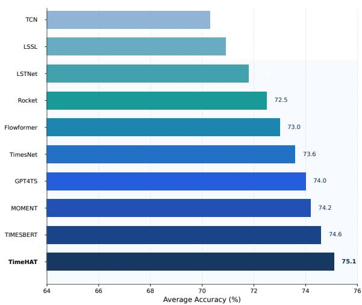  
Figure 4: Model comparison in classification.

## 4.5 Zero-shot and Few-shot Forecasting

Table 4: Zero-shot capability (MSE).
<table><tr><td>Dataset</td><td>TimeHAT</td><td>GTM</td><td>Timer</td><td>Moirai</td><td>MOMENT</td></tr><tr><td>ETTh1</td><td>0.399</td><td>0.407</td><td>0.438</td><td>0.441</td><td>0.674</td></tr><tr><td>ETTm1</td><td>0.558</td><td>0.593</td><td>0.690</td><td>0.562</td><td>0.670</td></tr><tr><td>Weather</td><td>0.170</td><td>0.172</td><td>0.181</td><td>0.195</td><td>0.255</td></tr><tr><td>Electricity</td><td>0.176</td><td>0.187</td><td>0.192</td><td>0.212</td><td>0.744</td></tr><tr><td>Traffic</td><td>0.447</td><td>0.542</td><td>0.458</td><td>0.616</td><td>1.293</td></tr></table>

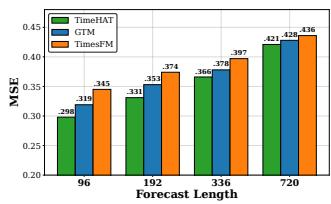

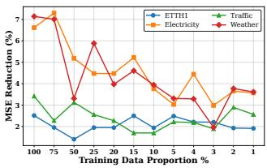  
Figure 5: Few-shot capability of TimeHAT compared to base lines.

To evaluate generalization and data eficiency, Table 4 details TimeHAT’s zero-shot performance against GTM [16], Timer [31], Moirai [39], and MOMENT [13]. Figure 5 illustrates its few-shot capabilities: the left compares MSE across varying forecast lengths against GTM and TimesFM [5], while the right demonstrates the performance improvement over Timer as training data decreases. Overall, TimeHAT consistently outperforms all baselines, proving its robust generalization in data-scarce settings.

## 4.6 Pretraining Methods Analysis

4.6.1 Direct versus Recursive Forecasting. We compare direct forecasting, which predicts the entire target horizon in one pass, with recursive forecasting, which repeatedly predicts 96 steps and feeds the predictions back as input to extend the forecast. Figure 6 shows that recursive forecasting reduces MSE across all evaluated schemes on both datasets. On ETTh1, MSE decreases by 6.57%–7.50%, with MAE reductions of 4.39%–4.98%. These results support recursive forecasting for downstream evaluation. It also allows the pre-trained reconstruction head to be reused, preserving consistency between pre-training and downstream prediction without reinitializing the head for diferent forecasting horizons.

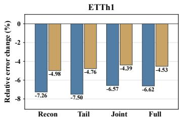

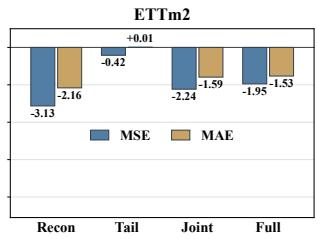  
Figure 6: Relative error changes of recursive versus direct forecasting across pre-training schemes on ETTh1 and ETTm2. Recon: Contextual Reconstruction; Tail: Causal Extrapolation; Joint: joint objectives; Full: full UPPMS.

Table 5: Relative changes in forecasting errors under UPPMS ablations (%). Positive values indicate higher errors than the full method. LPR: w/o last-patch recovery; LPA: w/o leftpadding augmentation; PO: patch-only masking; ZO: zeroonly replacement; FTL: fixed tail length.
<table><tr><td rowspan="2">Variant</td><td colspan="2">ETTh2</td><td colspan="2">ETTm1</td><td colspan="2">ETTm2</td><td colspan="2">Weather</td></tr><tr><td>MSE</td><td>MAE</td><td>MSE</td><td>MAE</td><td>MSE</td><td>MAE</td><td>MSE</td><td>MAE</td></tr><tr><td>LPR</td><td>+2.05</td><td>+0.79</td><td>-0.39</td><td>+0.01</td><td>+0.80</td><td>-0.16</td><td>-0.31</td><td>-0.25</td></tr><tr><td>LPA</td><td>+1.55</td><td>+0.45</td><td>+0.02</td><td>-0.09</td><td>-0.45</td><td>-0.79</td><td>+0.17</td><td>-0.08</td></tr><tr><td>PO</td><td>+1.79</td><td>+0.31</td><td>-0.37</td><td>-0.20</td><td>+0.40</td><td>-0.26</td><td>-0.70</td><td>-0.88</td></tr><tr><td>ZO</td><td>-1.00</td><td>-0.46</td><td>+0.36</td><td>+0.27</td><td>+1.06</td><td>+0.27</td><td>+0.10</td><td>+0.07</td></tr><tr><td>FTL</td><td>-0.92</td><td>-0.61</td><td>+0.40</td><td>+0.07</td><td>+1.52</td><td>-1.08</td><td>-0.07</td><td>-0.22</td></tr></table>

4.6.2 Sensitivity to UPPMS Design Choices. We compare the full UPPMS with variants that remove or simplify individual masking mechanisms on four datasets. Table 5 reports relative changes in MSE and MAE averaged over three fine-tuning seeds, with positive values indicating higher errors after ablation. The results reveal dataset-dependent sensitivity to masking design. Removing lastpatch recovery or restricting masking to patches increases MSE on ETTh2, while zero-only replacement degrades both metrics on three of the four datasets. Other simplifications yield mixed efects across datasets and metrics. Overall, no single simplification consistently improves both metrics across all datasets, supporting the use of complementary masking mechanisms in UPPMS to achieve balanced performance across diverse time series.

4.6.3 EfectofPre-training Objectives. We compare four pre-training schemes under the same six-layer encoder and fine-tuning protocol, using the final historical token to forecast 96 future steps. Each scheme is pre-trained on the training split, and results are averaged over three fine-tuning seeds. As shown in Table 6, the full method achieves the lowest MSE on all five datasets and the lowest MAE on four. The improvements are particularly notable on ETTh2, while ETTm1 shows a slight MAE advantage for Causal Extrapolation. These results demonstrate the benefits of the full UPPMS for downstream forecasting.

Table 6: Forecasting performance of diferent pre-training objectives. Full: full UPPMS; Tail: Causal Extrapolation; Joint: joint objectives; Random: Contextual Reconstruction.
<table><tr><td rowspan="2">Dataset</td><td colspan="2">Full</td><td colspan="2">Tail</td><td colspan="2">Joint</td><td colspan="2">Random</td></tr><tr><td>MSE</td><td>MAE</td><td>MSE</td><td>MAE</td><td>MSE</td><td>MAE</td><td>MSE</td><td>MAE</td></tr><tr><td>ETTh1</td><td>0.384</td><td>0.409</td><td>0.390</td><td>0.413</td><td>0.386</td><td>0.410</td><td>0.387</td><td>0.410</td></tr><tr><td>ETTh2</td><td>0.300</td><td>0.353</td><td>0.321</td><td>0.364</td><td>0.307</td><td>0.356</td><td>0.308</td><td>0.356</td></tr><tr><td>ETTm1</td><td>0.294</td><td>0.355</td><td>0.297</td><td>0.353</td><td>0.301</td><td>0.360</td><td>0.298</td><td>0.357</td></tr><tr><td>ETTm2</td><td>0.177</td><td>0.266</td><td>0.179</td><td>0.269</td><td>0.178</td><td>0.268</td><td>0.177</td><td>0.268</td></tr><tr><td>Weather</td><td>0.152</td><td>0.202</td><td>0.153</td><td>0.203</td><td>0.154</td><td>0.204</td><td>0.153</td><td>0.203</td></tr></table>

4.6.4 Efect of Pre-training Mode Balance. We vary the probability of assigning a pre-training sample to tail recovery, $ { p _ { \mathrm { t a i l } } } \ \in$ $\{ 0 , 0 . 2 5 , 0 . 4 0 , 0 . 5 0 , 0 . 7 5 , 1 \}$ , with the remaining samples assigned to random reconstruction. Here, $p _ { \mathrm { t a i l } } = 0$ corresponds to pure random reconstruction, whereas $p _ { \mathrm { t a i l } } = 1$ corresponds to pure tail recovery. Models are pre-trained and fine-tuned on the same dataset to evaluate how the balance between the two pre-training modes afects downstream forecasting. Table 7 shows that intermediate probabilities generally yield better results than pure tail recovery. Overall, combining random reconstruction and tail recovery provides a more efective balance than relying exclusively on tail recovery.

Table 7: Forecasting performance under diferent tail-task probabilities.
<table><tr><td>Dataset</td><td>Metric</td><td>0</td><td>0.25</td><td>0.40</td><td>0.50</td><td>0.75</td><td>1</td></tr><tr><td rowspan="2">ETTh1</td><td>MSE</td><td>0.403</td><td>0.394</td><td>0.396</td><td>0.395</td><td>0.396</td><td>0.402</td></tr><tr><td>MAE</td><td>0.412</td><td>0.411</td><td>0.412</td><td>0.411</td><td>0.412</td><td>0.416</td></tr><tr><td rowspan="2">ETTm2</td><td>MSE</td><td>0.176</td><td>0.176</td><td>0.173</td><td>0.173</td><td>0.178</td><td>0.177</td></tr><tr><td>MAE</td><td>0.257</td><td>0.258</td><td>0.258</td><td>0.257</td><td>0.258</td><td>0.263</td></tr><tr><td rowspan="2">Weather</td><td>MSE</td><td>0.150</td><td>0.150</td><td>0.149</td><td>0.149</td><td>0.149</td><td>0.152</td></tr><tr><td>MAE</td><td>0.195</td><td>0.195</td><td>0.193</td><td>0.193</td><td>0.192</td><td>0.195</td></tr></table>

## 4.7 Hybrid Attention Encoder Analysis

4.7.1 Atention Performance Across Forecast Horizons and Depth. We compare BiA, causal attention, anti-causal attention, and HA across forecast horizons and network depths. Figure 7 shows that HA achieves the lowest MSE across the evaluated horizons on ETTh1 and ETTm1. On ETTm1, it reduces MSE by 26.5%–33.3% relative to BiA, demonstrating its strong forecasting performance across diferent prediction lengths. Figure 8 examines the efect of increasing attention depth from one to six layers on ETTh2 and ETTm2. BiA exhibits substantial performance degradation as depth increases, whereas HA maintains more stable performance and achieves the lowest MSE with six layers on both datasets. Causal and anti-causal attention also exhibit greater depth robustness than BiA, suggesting that directional masking helps mitigate depth-related performance degradation. Notably, HA further improves as depth increases on ETTm2, while maintaining stable performance on ETTh2. Overall, HA achieves strong forecasting performance across prediction horizons and exhibits greater robustness to increasing attention depth than the other attention mechanisms.

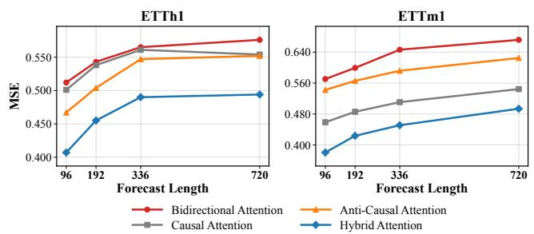  
Figure 7: Forecasting MSE of diferent attention mechanisms across prediction horizons on ETTh1 and ETTm1.

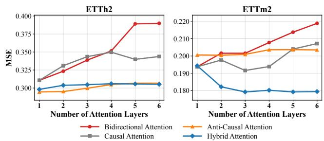  
Figure 8: Forecasting MSE of diferent attention mechanisms across network depths on ETTh2 and ETTm2.

4.7.2 EfectofAtention Composition. We investigate how the number and arrangement ofprefix-constrained BiA and Mix layers afect forecasting performance. Figure 9 shows that ETTh2 maintains relatively stable performance with up to two BiA layers at longer horizons, while Weather benefits from a small number of BiA layers across several horizons. Increasing the BiA proportion beyond this range can lead to performance degradation. Table 8 shows that the all-Mix configuration achieves the best results on the three ETT datasets, while mixed configurations yield slightly better results on Weather. These results demonstrate the efectiveness of Mix and show that incorporating a limited number of BiA layers can retain competitive forecasting performance, with additional benefits on some datasets.

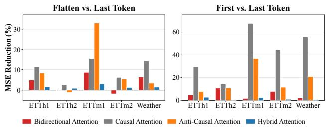

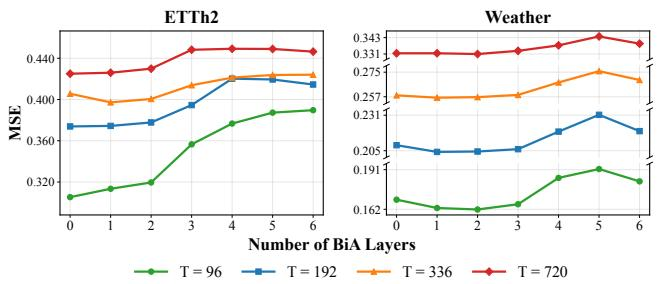  
Figure 9: Forecasting MSE with diferent numbers of prefix constrained BiA layers on ETTh2 and Weather.

Table 8: Forecasting performance of diferent BiA–HA layer configurations. B and M denote BiA and HA, respectively.
<table><tr><td rowspan="2">Config</td><td colspan="2">ETTh1</td><td colspan="2">ETTm1</td><td colspan="2">ETTm2</td><td colspan="2">Weather</td></tr><tr><td>MSE</td><td>MAE</td><td>MSE</td><td>MAE</td><td>MSE</td><td>MAE</td><td>MSE</td><td>MAE</td></tr><tr><td>MMMMMM</td><td>0.507</td><td>0.492</td><td>0.437</td><td>0.440</td><td>0.278</td><td>0.337</td><td>0.242</td><td>0.280</td></tr><tr><td>BBBMMM</td><td>0.598</td><td>0.541</td><td>0.486</td><td>0.464</td><td>0.287</td><td>0.345</td><td>0.241</td><td>0.280</td></tr><tr><td>BBBBBB</td><td>0.721</td><td>0.596</td><td>0.622</td><td>0.527</td><td>0.310</td><td>0.364</td><td>0.252</td><td>0.292</td></tr><tr><td>MMMBBB</td><td>0.538</td><td>0.508</td><td>0.444</td><td>0.444</td><td>0.280</td><td>0.339</td><td>0.249</td><td>0.285</td></tr><tr><td>BMBMBM</td><td>0.683</td><td>0.574</td><td>0.442</td><td>0.443</td><td>0.286</td><td>0.343</td><td>0.241</td><td>0.280</td></tr><tr><td>MBMBMB</td><td>0.663</td><td>0.562</td><td>0.450</td><td>0.447</td><td>0.287</td><td>0.346</td><td>0.252</td><td>0.288</td></tr></table>

4.7.3 Sensitivity to Readout Strategy. We compare diferent attention mechanisms under two readout settings. We compare Flatten-Linear and Last-Token prediction across four forecasting horizons, and First-Token and Last-Token readouts at a prediction horizon of 96. Figure 10 shows that HA exhibits small performance diferences across readout strategies in both settings. In particular, Last-Token prediction achieves results close to Flatten-Linear, indicating that the final token captures much of the predictive information avail able across the sequence. HA Attention also shows the smallest First- versus Last-Token MSE gap in the standard encoder. These results suggest that HA provides efective contextual representations with relatively low sensitivity to the choice of readout position.

4.7.4 Efect ofthe Causal-Head Ratio in Hybrid Atention. To investigate the impact of the CA proportion in HA, we adjusted the CA ratio $\alpha _ { f } \in \lbrace 0 , 0 . 2 5 , 0 . 5 , 0 . 7 5 , 1 \rbrace$ , while keeping all other hyperparameters unchanged. Here, $\alpha _ { f } = 0$ and 1 indicate that all heads adopt Anti-Causal and CA, respectively. As shown in Figure 11:

when $\alpha _ { f } = 0 . 5 ,$ the model achieves the best performance on the Exchange and ETTh2 datasets, indicating that a balanced bidirectional information flow contributes to improved forecasting accuracy.

Figure 10: Sensitivity to readout strategies across attention mechanisms.  
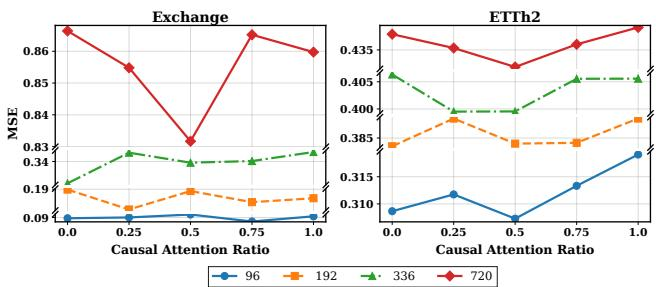  
Figure 11: Performance of Diferent Proportions of Causal Attention in Hybrid Attention.

4.7.5 Efect ofPre-training Atention Rules. We evaluate the impact of pre-training attention rules on downstream forecasting by comparing the default configuration with variants that remove task-specific constraints or modify information flow. Table 9 shows that the default rules achieve the lowest MSE across all four ETT datasets and the lowest MAE on three. Removing task-specific rules or disabling direction switching consistently increases forecasting errors. Allowing historical queries to attend to forecast tokens also increases MSE across all four datasets, although it slightly improves MAE on ETTm2. These results highlight the importance of task-specific attention constraints in pre-training, particularly for maintaining appropriate information flow and improving downstream forecasting performance.

Table 9: Downstream forecasting performance under different pre-training attention rules. TSR: task-specific rules; Hist→F: historical queries can attend to forecast tokens; DS: direction switching for forecast queries.
<table><tr><td rowspan="2">Attention Rule</td><td colspan="2">ETTh1</td><td colspan="2">ETTh2</td><td colspan="2">ETTm1</td><td colspan="2">ETTm2</td></tr><tr><td>MSE</td><td>MAE</td><td>MSE</td><td>MAE</td><td>MSE</td><td>MAE</td><td>MSE</td><td>MAE</td></tr><tr><td>Default</td><td>0.386</td><td>0.410</td><td>0.307</td><td>0.355</td><td>0.298</td><td>0.357</td><td>0.177</td><td>0.268</td></tr><tr><td>w/o TSR</td><td>0.389</td><td>0.413</td><td>0.310</td><td>0.359</td><td>0.304</td><td>0.362</td><td>0.183</td><td>0.267</td></tr><tr><td>Hist→F</td><td>0.387</td><td>0.410</td><td>0.308</td><td>0.356</td><td>0.301</td><td>0.359</td><td>0.179</td><td>0.267</td></tr><tr><td>w/o DS</td><td>0.388</td><td>0.413</td><td>0.310</td><td>0.359</td><td>0.300</td><td>0.359</td><td>0.179</td><td>0.267</td></tr></table>

## 5 Conclusion

We propose TimeHAT, a general-purpose pre-training framework for time-series analysis. Its Unified Point-Patch Masking Strategy (UPPMS) integrates point-level and patch-level supervision through contextual reconstruction and causal extrapolation, enabling the model to learn complementary temporal patterns at diferent granularities. Its Hybrid Attention Encoder (HAE) combines prefixconstrained bidirectional attention in initial layers with directional hybrid attention in deeper layers, facilitating contextual information exchange while mitigating rank degeneration. Extensive experiments across classification, long-term forecasting, imputation, and anomaly detection demonstrate competitive performance in fine-tuning, few-shot, and zero-shot transfer settings.

## References

[1] Muhammad Awais, Muzammal Naseer, Salman Khan, Rao Muhammad Anwer, Hisham Cholakkal, Mubarak Shah, Ming-Hsuan Yang, and Fahad Shahbaz Khan. 2025. Foundation models defining a new era in vision: a survey and outlook. IEEE Transactions on Pattern Analysis and Machine Intelligence (2025).

[2] Srinadh Bhojanapalli, Chulhee Yun, Ankit Singh Rawat, Sashank Reddi, and Sanjiv Kumar. 2020. Low-rank bottleneck in multi-head attention models. In International conference on machine learning. PMLR, 864–873.

[3] Ching Chang, Wei-Yao Wang, Wen-Chih Peng, and Tien-Fu Chen. 2025. Llm4ts: Aligning pre-trained llms as data-eficient time-series forecasters. ACM Transactions on Intelligent Systems and Technology 16, 3 (2025), 1–20.

[4] Si-An Chen, Chun-Liang Li, Nate Yoder, Sercan O Arik, and Tomas Pfister. 2023. Tsmixer: An all-mlp architecture for time series forecasting. arXiv preprint arXiv:2303.06053 (2023).

[5] Abhimanyu Das, Weihao Kong, Rajat Sen, and Yichen Zhou. 2024. A decoderonly foundation model for time-series forecasting. In Forty-first International Conference on Machine Learning, ICML 2024, Vienna, Austria, July 21-27, 2024 (Proceedings ofMachine Learning Research, Vol. 235). 10148–10167.

[6] Angus Dempster, François Petitjean, and Geofrey I Webb. 2020. ROCKET: excep tionally fast and accurate time series classification using random convolutional kernels. Data Mining and Knowledge Discovery 34, 5 (2020), 1454–1495.

[7] Jacob Devlin, Ming-Wei Chang, Kenton Lee, and Kristina Toutanova. 2019. Bert: Pre-training of deep bidirectional transformers for language understanding. Proceedings ofthe 2019Conference ofthe North American Chapterofthe Association for Computational Linguistics: Human Language Technologies, NAACL-HLT 2019, Minneapolis, MN, USA, June 2-7, 2019, Volume 1 (Long and Short Papers) (2019), 4171–4186.

[8] Jiaxiang Dong, Haixu Wu, Haoran Zhang, Li Zhang, Jianmin Wang, and Ming sheng Long. 2023. SimMTM: A Simple Pre-Training Framework for Masked Time-Series Modeling. In Advances in Neural Information Processing Systems 36: Annual Conference on Neural Information Processing Systems 2023, NeurIPS 2023, New Orleans, LA, USA, December 10 - 16, 2023.

[9] Yihe Dong, Jean-Baptiste Cordonnier, and Andreas Loukas. 2021. Attention is not all you need: Pure attention loses rank doubly exponentially with depth. In International Conference on Machine Learning. PMLR, 2793–2803.

[10] Vijay Ekambaram, Arindam Jati, Nam Nguyen, Phanwadee Sinthong, and Jayant Kalagnanam. 2023. TSMixer: Lightweight MLP-Mixer Model for Multivariate Time Series Forecasting. In Proceedings ofthe 29th ACM SIGKDD Conference on Knowledge Discovery and Data Mining, KDD 2023, Long Beach, CA, USA, August 6-10, 2023. ACM, 459–469.

[11] Jean-Yves Franceschi, Aymeric Dieuleveut, and Martin Jaggi. 2019. Unsupervised scalable representation learning for multivariate time series. Advances in neural information processing systems 32 (2019).

[12] Shanghua Gao, Teddy Koker, Owen Queen, Tom Hartvigsen, Theodoros Tsiligkaridis, and Marinka Zitnik. 2024. Units: A unified multi-task time series model. Advances in Neural Information Processing Systems 37 (2024), 140589– 140631.

[13] Mononito Goswami, Konrad Szafer, Arjun Choudhry, Yifu Cai, Shuo Li, and Artur Dubrawski. 2024. MOMENT: A Family of Open Time-series Foundation Models. In Forty-first International Conference on Machine Learning, ICML 2024, Vienna, Austria, July 21-27, 2024 (Proceedings of Machine Learning Research, Vol. 235). 16115–16152.

[14] Nate Gruver, Marc Finzi, Shikai Qiu, and Andrew G Wilson. 2023. Large language models are zero-shot time series forecasters. Advances in Neural Information Processing Systems 36 (2023), 19622–19635.

[15] Albert Gu, Karan Goel, and Christopher Ré. 2022. Eficiently Modeling Long Sequences with Structured State Spaces. In The Tenth International Conference on Learning Representations, ICLR 2022, Virtual Event, April 25-29, 2022.

[16] Cheng He, Xu Huang, Gangwei Jiang, Zhaoyi Li, Defu Lian, Hong Xie, Enhong Chen, Xijie Liang, and Zengrong Zheng. 2026. GTM: A General Time-series Model for Enhanced Representation Learning of Time-Series data. In The Fourteenth International Conference on Learning Representations.

[17] Kaiming He, Xinlei Chen, Saining Xie, Yanghao Li, Piotr Dollár, and Ross Girshick. 2022. Masked autoencoders are scalable vision learners. In Proceedings ofthe IEEE/CVF conference on computer vision and pattern recognition. 16000–16009.

[18] Qihe Huang, Zhengyang Zhou, Kuo Yang, and Yang Wang. 2025. Exploiting Language Power for Time Series Forecasting with Exogenous Variables. In Proceedings of the ACM on Web Conference 2025. 4043–4052.

[19] Zhaoyang Huang, Xiaoyu Shi, Chao Zhang, Qiang Wang, Ka Chun Cheung, Hongwei Qin, Jifeng Dai, and Hongsheng Li. 2022. Flowformer: A transformer architecture for optical flow. In European Conference on Computer Vision. Springer, 668–685.

[20] Ming Jin, Shiyu Wang, Lintao Ma, Zhixuan Chu, James Zhang, Xiaoming Shi, Pin-Yu Chen, Yuxuan Liang, Yuan-fang Li, Shirui Pan, et al. 2024. Time-LLM: Time Series Forecasting by Reprogramming Large Language Models. In International Conference on Learning Representations.

[21] Ming Jin, Qingsong Wen, Yuxuan Liang, Chaoli Zhang, Siqiao Xue, Xue Wang, James Zhang, Yi Wang, Haifeng Chen, Xiaoli Li, et al. 2023. Large models for time series and spatio-temporal data: A survey and outlook. arXiv preprint arXiv:2310.10196 (2023).

[22] Guokun Lai, Wei-Cheng Chang, Yiming Yang, and Hanxiao Liu. 2018. Modeling long-and short-term temporal patterns with deep neural networks. In The 41st international ACM SIGIR conference on research & development in information retrieval. 95–104.

[23] Chenghao Liu, Taha Aksu, Juncheng Liu, Xu Liu, Hanshu Yan, Quang Pham, Silvio Savarese, Doyen Sahoo, Caiming Xiong, and Junnan Li. 2025. Moirai 2.0: When less is more for time series forecasting. arXiv preprint arXiv:2511.11698 (2025).

[24] Shizhan Liu, Hang Yu, Cong Liao, Jianguo Li, Weiyao Lin, Alex X Liu, and Schahram Dustdar. 2021. Pyraformer: Low-complexity pyramidal attention for long-range time series modeling and forecasting. In International conference on learning representations.

[25] Xu Liu, Junfeng Hu, Yuan Li, Shizhe Diao, Yuxuan Liang, Bryan Hooi, and Roger Zimmermann. 2024. Unitime: A language-empowered unified model for crossdomain time series forecasting. In Proceedings ofthe ACM Web Conference 2024. 4095–4106.

[26] Xin Liu, Daniel McDuf, Geza Kovacs, Isaac Galatzer-Levy, Jacob Sunshine, Jiening Zhan, Ming-Zher Poh, Shun Liao, Paolo Di Achille, and Shwetak Patel. 2023. Large Language Models are Few-Shot Health Learners. arXiv preprint arXiv:2305.15525 (2023).

[27] Yong Liu, Tengge Hu, Haoran Zhang, Haixu Wu, Shiyu Wang, Lintao Ma, and Mingsheng Long. 2024. iTransformer: Inverted Transformers Are Efective for Time Series Forecasting. In The Twelfth International Conference on Learning Representations, ICLR 2024, Vienna, Austria, May 7-11, 2024.

[28] Yong Liu, Guo Qin, Xiangdong Huang, Jianmin Wang, and Mingsheng Long. 2025. Timer-XL: Long-Context Transformers for Unified Time Series Forecasting. In The Thirteenth International Conference on Learning Representations.

[29] Yong Liu, Guo Qin, Zhiyuan Shi, Zhi Chen, Caiyin Yang, Xiangdong Huang, Jianmin Wang, and Mingsheng Long. 2025. Sundial: A Family of Highly Capable Time Series Foundation Models. In Forty-second International Conference on Machine Learning.

[30] Yong Liu, Haixu Wu, Jianmin Wang, and Mingsheng Long. 2022. Non-stationary transformers: Rethinking the stationarity in time series forecasting. arXiv preprint arXiv:2205.14415 (2022).

[31] Yong Liu, Haoran Zhang, Chenyu Li, Xiangdong Huang, Jianmin Wang, and Mingsheng Long. 2024. Timer: generative pre-trained transformers are large time series models. In Proceedings of the 41st International Conference on Machine Learning. 32369–32399.

[32] Yuqi Nie, Nam H. Nguyen, Phanwadee Sinthong, and Jayant Kalagnanam. 2023. A Time Series is Worth 64 Words: Long-term Forecasting with Transformers. In The Eleventh International Conference on Learning Representations, ICLR 2023, Kigali, Rwanda, May 1-5, 2023.

[33] Xiaoming Shi, Shiyu Wang, Yuqi Nie, Dianqi Li, Zhou Ye, Qingsong Wen, and Ming Jin. 2025. Time-MoE: Billion-Scale Time Series Foundation Models with Mixture of Experts. In The Thirteenth International Conference on Learning Representations, ICLR 2025, Singapore, April 24-28, 2025.

[34] Chenxi Sun, Hongyan Li, Yaliang Li, and Shenda Hong. 2024. TEST: Text Prototype Aligned Embedding to Activate LLM’s Ability for Time Series. In The Twelfth International Conference on Learning Representations, ICLR 2024, Vienna, Austria, May 7-11, 2024.

[35] Peiwang Tang and Xianchao Zhang. 2022. MTSMAE: Masked Autoencoders for Multivariate Time-Series Forecasting. In 2022 IEEE 34th International Conference on Tools with Artificial Intelligence (ICTAI). IEEE, 982–989.

[36] Hua Wang, Jinghao Lu, and Fan Zhang. 2026. Eeo-tfv: Escape-explore optimizer for web-scale time-series forecasting and vision analysis. In Proceedings ofthe ACM Web Conference 2026. 7271–7282.

[37] Shiyu Wang, Jiawei Li, Xiaoming Shi, Zhou Ye, Baichuan Mo, Wenze Lin, Ju Shengtong, Zhixuan Chu, and Ming Jin. 2025. TimeMixer++: A General Time Series Pattern Machine for Universal Predictive Analysis. In ICLR 2025: The Thirteenth International Conference on Learning Representations. International Conference on Learning Representations.

[38] Shiyu Wang, Haixu Wu, Xiaoming Shi, Tengge Hu, Huakun Luo, Lintao Ma, James Y. Zhang, and Jun Zhou. 2024. TimeMixer: Decomposable Multiscale Mixing for Time Series Forecasting. In The Twelfth International Conference on Learning Representations, ICLR 2024, Vienna, Austria, May 7-11, 2024.

[39] Gerald Woo, Chenghao Liu, Akshat Kumar, Caiming Xiong, Silvio Savarese, and Doyen Sahoo. 2024. Unified Training of Universal Time Series Forecasting Transformers. Proceedings ofMachine Learning Research 235 (2024), 53140–53164.

[40] Gerald Woo, Chenghao Liu, Doyen Sahoo, Akshat Kumar, and Steven Hoi. 2022. Etsformer: Exponential smoothing transformers for time-series forecasting. arXiv preprint arXiv:2202.01381 (2022).

[41] Haixu Wu, Tengge Hu, Yong Liu, Hang Zhou, Jianmin Wang, and Mingsheng Long. 2023. TimesNet: Temporal 2D-Variation Modeling for General Time Series Analysis. In The Eleventh International Conference on Learning Representations,

ICLR 2023, Kigali, Rwanda, May 1-5, 2023.

[42] Haixu Wu, Jiehui Xu, Jianmin Wang, and Mingsheng Long. 2021. Autoformer: Decomposition transformers with auto-correlation for long-term series forecasting. Advances in Neural Information Processing Systems 34 (2021), 22419–22430.

[43] Yongzheng Xie, Hongyu Zhang, and Muhammad Ali Babar. 2025. Multivariate Time Series Anomaly Detection by Capturing Coarse-Grained Intra-and Inter-Variate Dependencies. In Proceedings ofthe ACM on Web Conference 2025. 697– 705.

[44] Jiehui Xu, Haixu Wu, Jianmin Wang, and Mingsheng Long. 2022. Anomaly Transformer: Time Series Anomaly Detection with Association Discrepancy. In The Tenth International Conference on Learning Representations, ICLR 2022, Virtual Event, April 25-29, 2022.

[45] Hao Xue and Flora D Salim. 2023. Promptcast: A new prompt-based learning paradigm for time series forecasting. IEEE Transactions on Knowledge and Data Engineering (2023).

[46] Ailing Zeng, Muxi Chen, Lei Zhang, and Qiang Xu. 2023. Are transformers efective for time series forecasting?. In Proceedings ofthe AAAI conference on artificial intelligence, Vol. 37. 11121–11128.

[47] Boning Zhang, Haishuai Wang, Zehong Hu, Jiajun Wang, Hongyi Zhang, and Jia Jia. 2026. Re-Difusion: Modeling Latent Residuals with Difusion for Time-Series Forecasting. In Proceedings ofthe ACM Web Conference 2026. 7390–7400.

[48] Fan Zhang, Shiming Fan, and Hua Wang. 2026. Time-tk: A multi-ofset temporal interaction framework combining transformer and kolmogorov-arnold networks for time series forecasting. In Proceedings ofthe ACM Web Conference 2026. 7495– 7506.

[49] Haoran Zhang, Yong Liu, Yunzhong Qiu, Haixuan Liu, Zhongyi Pei, Jianmin Wang, and Mingsheng Long. 2025. Timesbert: A bert-style foundation model for time series understanding. In Proceedings of the 33rd ACM International Conference on Multimedia. 10975–10983.

[50] Jianqi Zhang, Jingyao Wang, Wenwen Qiang, Fanjiang Xu, and Changwen Zheng. 2026. Enhancing large language models for time-series forecasting via vector injected in-context learning. In Proceedings of the ACM Web Conference 2026. 7211–7222.

[51] Tianping Zhang, Yizhuo Zhang, Wei Cao, Jiang Bian, Xiaohan Yi, Shun Zheng, and Jian Li. 2022. Less is more: Fast multivariate time series forecasting with light sampling-oriented mlp structures. arXiv preprint arXiv:2207.01186 (2022).

[52] Xu Zhang, Peng Wang, Yichen Li, and Wei Wang. 2026. Amortized predictabilityaware training framework for time series forecasting and classification. In Proceedings ofthe ACM Web Conference 2026. 5624–5635.

[53] Xu Zhang, Qitong Wang, Peng Wang, and Wei Wang. 2026. Semixer: Semantics enhanced mlp-mixer for multiscale mixing and long-term time series forecasting. In Proceedings of the ACM Web Conference 2026. 5636–5647.

[54] Wayne Xin Zhao, Kun Zhou, Junyi Li, Tianyi Tang, Xiaolei Wang, Yupeng Hou, Yingqian Min, Beichen Zhang, Junjie Zhang, Zican Dong, et al. 2023. A survey of large language models. arXiv preprint arXiv:2303.18223 (2023).

[55] Tian Zhou, Ziqing Ma, Qingsong Wen, Xue Wang, Liang Sun, and Rong Jin. 2022. Fedformer: Frequency enhanced decomposed transformer for long-term series forecasting. In International Conference on Machine Learning. PMLR, 27268– 27286.

[56] Tian Zhou, Peisong Niu, Liang Sun, Rong Jin, et al. 2023. One fits all: Power general time series analysis by pretrained lm. Advances in neural information processing systems 36 (2023), 43322–43355.

## A Related Work

Large Language Models in Time Series: Recent advances have explored applying large models like Large Language Models (LLMs) to TSA due to their ability to capture long-term dependencies and handle high-dimensional data [1, 54]. Frameworks such as PromptCast [45], GPT4TS [56], TIME-LLM [20], and LLM4TS [3] adapt language models for time series forecasting by leveraging numerical-to-text transformations, patching mechanisms, and embedding techniques. TEST [34] enhances time series tokenization and embedding through contrastive learning, while UniTime [25] leverages domain instructions, modality alignment, and masking strategies to achieve eficient generalization and transfer in cross domain time series forecasting. Despite their promising results, most of these models focus primarily on forecasting tasks, while broader applications of LLMs in TSA, such as anomaly detection and classification, remain underexplored.

Pre-trining Models in Time Series: Beyond LLMs, time seriesspecific pre-training frameworks have gained attention for their potential in learning foundational representations [21]. This trend is exemplified by foundation models released alongside large-scale datasets, such as MOMENT[13], Timer[31], TIME-MOE [33], and Sundial [29], with subsequent works expanding along dimensions like scale (Moirai [23, 39]), and task unification (UNITS [12]). Other methods, such as TimeMixer++ [37], MTSMAE [35], SimMTM [8], PatchTST [32], and TSMixer [10], focus on tasks like forecasting, reconstruction, and capturing spatio-temporal patterns through advanced techniques like masking, patch embedding, and lightweight architectures. These approaches demonstrate strong potential in TSA, addressing challenges such as memory eficiency, long-term forecasting, and inter-channel correlations.

## B Pre-Training and Downstream Training Settings

## B.1 Dataset

Timer has curated the Unified Time Series Dataset (UTSD) [31], which encompasses seven domains and includes up to 1 billion time points, organized in a hierarchical four-volume structure to facilitate research and pre-training of large models in the time series field. The Unified Time Series Dataset (UTSD) is meticulously compiled from a combination of publicly accessible online data repositories and empirical data derived from real-world machine operations. All datasets are classified into seven distinct domains by their sources: Energy, Environment, Health, Internet of Things (IoT), Nature, Transportation, and Web, with diverse sampling frequencies. UTSD is structured with hierarchical capacities, namely UTSD-1G, UTSD-2G, UTSD-4G, and UTSD-12G, where each smaller dataset is a subset of the larger ones. A larger subset means greater data dificulty and diversity. For our pre-training tasks, we directly utilized data from the UTSD-12G.

Table 10: Long-term forecasting dataset descriptions. The Dataset Splitting is organized in (Train,Validation,Test).
<table><tr><td rowspan=1 colspan=1>Dataset</td><td rowspan=1 colspan=1>Dim</td><td rowspan=1 colspan=1>InputLength</td><td rowspan=1 colspan=1>PredictionLength</td><td rowspan=1 colspan=1>TimePoints</td><td rowspan=1 colspan=1>DatasetSplitting</td><td rowspan=1 colspan=1>Frequency</td></tr><tr><td rowspan=1 colspan=1>ETTm1ETTm2</td><td rowspan=1 colspan=1>7</td><td rowspan=1 colspan=1>336</td><td rowspan=1 colspan=1>{96,192,336,720}</td><td rowspan=1 colspan=1>69,680</td><td rowspan=1 colspan=1>6:2:2</td><td rowspan=1 colspan=1>15 mins</td></tr><tr><td rowspan=1 colspan=1>ETTh1ETTh2</td><td rowspan=1 colspan=1>7</td><td rowspan=1 colspan=1>336</td><td rowspan=1 colspan=1>{96,192,336,720}</td><td rowspan=1 colspan=1>17,420</td><td rowspan=1 colspan=1>6:2:2</td><td rowspan=1 colspan=1>Hourly</td></tr><tr><td rowspan=1 colspan=1>Electricity</td><td rowspan=1 colspan=1>321</td><td rowspan=1 colspan=1>336</td><td rowspan=1 colspan=1>{96,192,336,720}</td><td rowspan=1 colspan=1>26,304</td><td rowspan=1 colspan=1>7:1:2</td><td rowspan=1 colspan=1>Hourly</td></tr><tr><td rowspan=1 colspan=1>Traffic</td><td rowspan=1 colspan=1>862</td><td rowspan=1 colspan=1>336</td><td rowspan=1 colspan=1>{96,192,336,720}</td><td rowspan=1 colspan=1>17,544</td><td rowspan=1 colspan=1>7:1:2</td><td rowspan=1 colspan=1>Hourly</td></tr><tr><td rowspan=1 colspan=1>Weather</td><td rowspan=1 colspan=1>21</td><td rowspan=1 colspan=1>336</td><td rowspan=1 colspan=1>{96,192,336,720}</td><td rowspan=1 colspan=1>52,696</td><td rowspan=1 colspan=1>7:1:2</td><td rowspan=1 colspan=1>10 mins</td></tr><tr><td rowspan=1 colspan=1>Exchange</td><td rowspan=1 colspan=1>8</td><td rowspan=1 colspan=1>336</td><td rowspan=1 colspan=1>{96,192,336,720}</td><td rowspan=1 colspan=1>7,588</td><td rowspan=1 colspan=1>7:1:2</td><td rowspan=1 colspan=1>|Daily</td></tr></table>

Timer has curated the Unified Time Series Dataset (UTSD) [31], which encompasses seven domains and includes up to 1 billion time points, organized in a hierarchical four-volume structure to facilitate research and pre-training of large models in the time series field. The Unified Time Series Dataset (UTSD) is meticulously compiled from a combination of publicly accessible online data repositories and empirical data derived from real-world machine operations. All datasets are classified into seven distinct domains by their sources: Energy, Environment, Health, Internet of Things (IoT), Nature, Transportation, and Web, with diverse sampling fre quencies. UTSD is structured with hierarchical capacities, namely UTSD-1G, UTSD-2G, UTSD-4G, and UTSD-12G, where each smaller dataset is a subset of the larger ones. A larger subset means greater data dificulty and diversity. For our pre-training tasks, we directly utilized data from the UTSD-12G.

Table 11: Other dataset descriptions. The dataset size is organized in (Train,Validation,Test).
<table><tr><td rowspan=1 colspan=1>Tasks</td><td rowspan=1 colspan=1>Dataset</td><td rowspan=1 colspan=1>Dim</td><td rowspan=1 colspan=1>SeriesLength</td><td rowspan=1 colspan=1>Dataset Size</td></tr><tr><td rowspan=4 colspan=1>mptttton</td><td rowspan=1 colspan=1>ETTm1,ETTm2(Electricity)</td><td rowspan=1 colspan=1>7</td><td rowspan=1 colspan=1>96</td><td rowspan=1 colspan=1>(34465,11521,11521)</td></tr><tr><td rowspan=1 colspan=1>ETTh1,ETTh2(Electricity)</td><td rowspan=1 colspan=1>7</td><td rowspan=1 colspan=1>96</td><td rowspan=1 colspan=1>(8545,2881,2881)</td></tr><tr><td rowspan=1 colspan=1>Electricity</td><td rowspan=1 colspan=1>321</td><td rowspan=1 colspan=1>96</td><td rowspan=1 colspan=1>(18317,2633,5261)</td></tr><tr><td rowspan=1 colspan=1>Weather</td><td rowspan=1 colspan=1>21</td><td rowspan=1 colspan=1>96</td><td rowspan=1 colspan=1>(36792,5271,10540)</td></tr><tr><td rowspan=10 colspan=1>CLas EA)</td><td rowspan=1 colspan=1>EthanolConcentration(Alcohol Industry)</td><td rowspan=1 colspan=1>3</td><td rowspan=1 colspan=1>1751</td><td rowspan=1 colspan=1>(261,0,263)</td></tr><tr><td rowspan=1 colspan=1>FaceDetection(Face)</td><td rowspan=1 colspan=1>144</td><td rowspan=1 colspan=1>62</td><td rowspan=1 colspan=1>(5890,0,3524)</td></tr><tr><td rowspan=1 colspan=1>Handwriting</td><td rowspan=1 colspan=1>3</td><td rowspan=1 colspan=1>152</td><td rowspan=1 colspan=1>(150,0.850)</td></tr><tr><td rowspan=1 colspan=1>Heartbeat(Heart Beat)</td><td rowspan=1 colspan=1>61</td><td rowspan=1 colspan=1>405</td><td rowspan=1 colspan=1>(204,0,205)</td></tr><tr><td rowspan=1 colspan=1>JapaneseVowels(Voice)</td><td rowspan=1 colspan=1>12</td><td rowspan=1 colspan=1>29</td><td rowspan=1 colspan=1>(270,0,370)</td></tr><tr><td rowspan=1 colspan=1>PEMS-SF(Transportation)</td><td rowspan=1 colspan=1>963</td><td rowspan=1 colspan=1>144</td><td rowspan=1 colspan=1>(267,0,173)</td></tr><tr><td rowspan=1 colspan=1>SelfRegulationSCP1(Health)</td><td rowspan=1 colspan=1>6</td><td rowspan=1 colspan=1>896</td><td rowspan=1 colspan=1>(268,0,293)</td></tr><tr><td rowspan=1 colspan=1>SelfRegulationSCP2(Health)</td><td rowspan=1 colspan=1>7</td><td rowspan=1 colspan=1>1152</td><td rowspan=1 colspan=1>(200,0,180)</td></tr><tr><td rowspan=1 colspan=1>SpokenArabicDigits(Voice)</td><td rowspan=1 colspan=1>13</td><td rowspan=1 colspan=1>93</td><td rowspan=1 colspan=1>(6599,0,2199)</td></tr><tr><td rowspan=1 colspan=1>UWaveGestureLibrary(Gesture)</td><td rowspan=1 colspan=1>3</td><td rowspan=1 colspan=1>315</td><td rowspan=1 colspan=1>(120,0,320)</td></tr><tr><td rowspan=5 colspan=1>Anooy Deion</td><td rowspan=1 colspan=1>SMD(Server Machine)</td><td rowspan=1 colspan=1>38</td><td rowspan=1 colspan=1>100</td><td rowspan=1 colspan=1>(566724,141681,708420)</td></tr><tr><td rowspan=1 colspan=1>MSL(Spacecraft)</td><td rowspan=1 colspan=1>55</td><td rowspan=1 colspan=1>100</td><td rowspan=1 colspan=1>(44653,11664,73729)</td></tr><tr><td rowspan=1 colspan=1>SMAP(Spacecraft)</td><td rowspan=1 colspan=1>25</td><td rowspan=1 colspan=1>100</td><td rowspan=1 colspan=1>(108146,27037,427617)</td></tr><tr><td rowspan=1 colspan=1>SWaT(Infrastructure)</td><td rowspan=1 colspan=1>51</td><td rowspan=1 colspan=1>100</td><td rowspan=1 colspan=1>(396000,99000,449919)</td></tr><tr><td rowspan=1 colspan=1>PSM(Server Machine)</td><td rowspan=1 colspan=1>25</td><td rowspan=1 colspan=1>100</td><td rowspan=1 colspan=1>(105984,26497,87841)</td></tr></table>

The datasets for downstream tasks include multiple types of test datasets, mainly covering long-term time series forecasting, imputation, classification, and anomaly detection tasks. The datasets for long-term time series forecasting include Electricity, Weather, Trafic, and the ETT family (comprising ETTh1, ETTh2, ETTm1, and ETTm2), which are utilized to evaluate long-term performance in scenarios such as energy consumption, weather forecasting, and trafic flow analysis. The imputation task datasets include Electricity, Weather, and the ETT family, focusing on solving missing data issues. The time series classification datasets are sourced from the UEA database and encompass tasks from various fields, such as EthanolConcentration (alcohol industry), Heartbeat (health monitoring), JapaneseVowels (speech recognition), PEMS-SF (trafic and transportation), and more. Anomaly detection tasks are based on five standard time series anomaly detection datasets, including SMD (server machines), MSL and SMAP (spacecraft), SWaT (infrastructure systems), and PSM (server machines). These datasets span diverse application domains, including energy, transportation, healthcare, industrial control, and space science, providing comprehensive test scenarios for various tasks.

## B.2 Pre-training Configuration

TimeHAT is instantiated with a total of � = 8 attention layers, comprising $M \ : = \ : 3$ prefix-constrained BiA layers at the bottom and 5 decoupled HA layers at the top stages. We set the hidden dimension $d _ { m o d e l } = 1 0 2 4$ , feed-forward dimension $d _ { f f } = 2 0 4 8 ,$ and the number of attention heads $H = 1 6 .$ . For temporal tokenization, the input context length is fixed at � = 1440 with a patch size of $P = 9 6$ . The resulting model contains approximately 67M trainable parameters.

We pre-train the model on the UTSD-12G dataset using UPPMS, which Reconstructive Sampling objective with a 40% masking ratio. The optimization is performed using AdamW with a weight decay of 0.01. Given the extreme sparsity of the reconstructive objective and the massive scale of the pre-training corpus, we employ a large global batch size of 10,240 to stabilize the gradient variance. Correspondingly, rather than relying on computationally expensive empirical grid search, we determine the peak learning rate via the Square Root Scaling Rule tailored for adaptive optimizers. Adopting the widely accepted empirical baseline of $L R _ { b a s e } = 1 \times 1 0 ^ { - 4 }$ for a standard batch size of $B S _ { b a s e } = 2 5 6$ , the scaled learning rate is computed as:

$$
L R _ { s c a l e d } = L R _ { b a s e } \times \sqrt { \frac { B S _ { l a r g e } } { B S _ { b a s e } } } \approx 6 . 3 \times 1 0 ^ { - 4 }
$$

While the scaling rule provides a theoretical baseline, masked reconstructive objectives typically sufer from gradient sparsity during the early stages. To compensate for this sparsity and the rapid descent nature of the cosine schedule, we empirically anchor the final peak learning rate slightly higher at $8 \times 1 0 ^ { - 4 } .$ . To prevent early gradient shock under this elevated learning rate, we apply a strict linear warmup of 4,000 steps, which eventually decays to a minimum of 10% of the peak.

The maximum training duration is set to 20 epochs. Given the extreme scale of the pre-training corpus, we adopt a high-frequency, step-based evaluation strategy rather than epoch-based validation. Specifically, the validation loss is evaluated every 5,000 steps. Training is halted via an early stopping mechanism if the validation loss does not decrease for 10 consecutive evaluations. All pre-training runs are executed using Distributed Data Parallel (DDP) across four NVIDIA RTX 5090 (32GB) GPUs.

Table 12: Forecasting performance with embedding and encoder transfer. � denotes the embedding patch size. Scratch: training from scratch; Patch: patch-level masking; Point: point-level masking.
<table><tr><td rowspan="3">Dataset</td><td colspan="6"> $P = 1$ </td><td colspan="6"> $P = 1 6$ </td></tr><tr><td colspan="2">Scratch</td><td colspan="2">Patch</td><td colspan="2">Point</td><td colspan="2">Scratch</td><td colspan="2">Patch</td><td colspan="2">Point</td></tr><tr><td>MSE</td><td>MAE</td><td>MSE</td><td>MAE</td><td>MSE</td><td>MAE</td><td>MSE</td><td>MAE</td><td>MSE</td><td>MAE</td><td>MSE</td><td>MAE</td></tr><tr><td>ETTh1</td><td>0.465</td><td>0.466</td><td>0.465</td><td>0.468</td><td>0.466</td><td>0.469</td><td>0.458</td><td>0.453</td><td>0.447</td><td>0.445</td><td>0.444</td><td>0.444</td></tr><tr><td>ETTh2</td><td>0.406</td><td>0.422</td><td>0.405</td><td>0.424</td><td>0.401</td><td>0.422</td><td>0.386</td><td>0.410</td><td>0.385</td><td>0.410</td><td>0.387</td><td>0.410</td></tr><tr><td>ETTm1</td><td>0.403</td><td>0.415</td><td>0.408</td><td>0.419</td><td>0.403</td><td>0.417</td><td>0.393</td><td>0.406</td><td>0.383</td><td>0.402</td><td>0.383</td><td>0.401</td></tr><tr><td>ETTm2</td><td>0.294</td><td>0.339</td><td>0.306</td><td>0.349</td><td>0.298</td><td>0.343</td><td>0.290</td><td>0.336</td><td>0.291</td><td>0.337</td><td>0.289</td><td>0.334</td></tr><tr><td>Weather</td><td>0.257</td><td>0.281</td><td>0.255</td><td>0.281</td><td>0.255</td><td>0.280</td><td>0.255</td><td>0.277</td><td>0.253</td><td>0.276</td><td>0.254</td><td>0.276</td></tr></table>

Table 13: Forecasting performance with encoder-only transfer. All downstream models use a newly initialized $P = 1 6$ embedding and prediction head. � denotes the embedding patch size. Patch and Point denote patch-level and point-level masking, respectively.
<table><tr><td rowspan="2">Dataset</td><td colspan="2">Patch  $P = 1$ </td><td colspan="2">Patch  $P = 1 6$ </td><td colspan="2">Point  $P = 1$ </td><td colspan="2">Point  $P = 1 6$ </td></tr><tr><td>MSE</td><td>MAE</td><td>MSE</td><td>MAE</td><td>MSE</td><td>MAE</td><td>MSE</td><td>MAE</td></tr><tr><td>ETTh1</td><td>0.450</td><td>0.449</td><td>0.448</td><td>0.445</td><td>0.456</td><td>0.452</td><td>0.447</td><td>0.445</td></tr><tr><td>ETTh2</td><td>0.389</td><td>0.411</td><td>0.385</td><td>0.410</td><td>0.387</td><td>0.411</td><td>0.387</td><td>0.410</td></tr><tr><td>ETTm1</td><td>0.392</td><td>0.405</td><td>0.386</td><td>0.403</td><td>0.393</td><td>0.407</td><td>0.387</td><td>0.404</td></tr><tr><td>ETTm2</td><td>0.288</td><td>0.334</td><td>0.288</td><td>0.333</td><td>0.288</td><td>0.334</td><td>0.286</td><td>0.332</td></tr><tr><td>Weather</td><td>0.254</td><td>0.277</td><td>0.254</td><td>0.277</td><td>0.254</td><td>0.277</td><td>0.253</td><td>0.276</td></tr></table>

## B.3 Downstream Tasks

Unlike conventional paradigms that discard the pre-training head, we retain both the pre-trained TimeHAT backbone and its projection head for sequence-to-sequence downstream tasks (i.e., forecasting, imputation, and anomaly detection). This unified architecture maximizes the direct transferability of the learned reconstructive representations. An additional classification head is appended exclusively for the classification task.

To ensure stable adaptation and mitigate the catastrophic forgetting of pre-trained representations, we employ a diferential learning rate strategy during fine-tuning. Specifically, the optimizer is re-initialized with a conservative peak learning rate for the pre-trained backbone $( L R _ { \mathrm { b a c k b o n e } } \in [ 1 \times 1 0 ^ { - 5 } , 3 \times 1 0 ^ { - 5 } ] )$ , while a relatively higher learning rate is allocated to the task-specific projection and classification heads $( L R _ { \mathrm { h e a d } } \in [ 5 \times 1 0 ^ { - 5 } , 1 \times 1 0 ^ { - 4 } ] )$ This optimization is paired with a short linear warmup comprising 5% of the total steps. The fine-tuning process spans a maximum of 20 epochs, governed by an early stopping mechanism with a patience of 5 epochs.

## C Efect of Masking Granularity and Embedding Size

We compare point-level and patch-level masking with embedding patch sizes $P = 1$ and � = 16 under two transfer protocols: transferring both the embedding and encoder, and transferring only the encoder to a common � = 16 downstream embedding. Results are averaged over four prediction horizons and three fine-tuning seeds.

Tables 12 and 13 show that patch embeddings $( P = 1 6 )$ generally yield better forecasting performance than point-wise embeddings $( P = 1 )$ , particularly under encoder-only transfer. Notably, pointlevel masking remains efective with $P = 1 6 ,$ achieving the best results on several datasets. These findings indicate that fine-grained masking supervision can be combined with patch-based representations, without requiring point-wise tokenization.

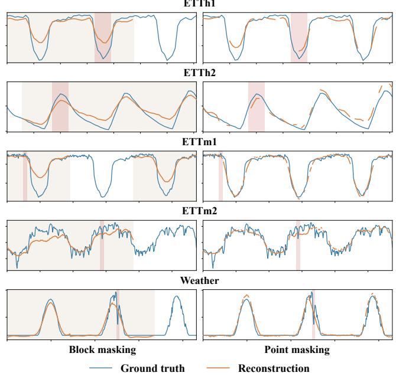  
Figure 12: Qualitative reconstruction examples under block and point masking on five datasets. Each row shows the same selected sequence and vertical scale.

We compare block-level and point-level masking on five datasets using matched masking ratios. Figure 12 shows that both approaches recover the major temporal patterns, but block masking often underestimates peak and trough amplitudes and misses fine-grained variations, particularly on ETTh1 and ETTm1. Point masking generally produces reconstructions closer to the ground truth, with clearer preservation of local details.