# META CIRCLE RESEARCH

# Meta Models: Models that Model Learning

Li Peihang1,2,3 Liu Ziming1,4,5,\*

1MetaCircle 2The University of Hong Kong 3University of California, Berkeley

4Shanghai Qizhi Institute 5Tsinghua University

\* Corresponding author

Every neural-network training run produces not only a model, but also evidence about how models learn. Can these accumulated experiments enable us to predict and compare new training runs before executing them? We study meta-models: models that predict the learning behavior of other models. From this perspective, final-performance prediction, learning-curve prediction, and hyperparameter selection are diferent queries to the same training response function. We take a first, humble empirical step toward this goal: treating real languagemodel training records as native numeric data, we find that an of-the-shelf tabular in-context learner, TabPFN, can match or outperform a fine-tuned LLM meta-model in multiple evaluated settings. Whereas recent work fine-tunes LLMs on tokenized configurations at a cost of tens to hundreds of GPU-hours, TabPFN requires seconds of fit-and-predict time without taskspecific weight updates. We argue that meta-modeling is better treated as its own numeric modality rather than as a text task for LLMs. Going one step further, augmenting TabPFN with Kolmogorov–Arnold Networks (KANs) further improves accuracy on selected prediction tasks. Finally, we pre-registered a forecast of the Marin Hero Run, a 535B-parameter public training run, whose ground truth is revealed point by point as training progresses, putting meta-model predictions to the test against training outcomes not yet observed at the time of forecasting.

## 1. Introduction

Before launching a training run, researchers already make predictions. Will a diferent learning rate help? Which data recipe should receive the next compute budget? Will a promising smallscale result survive scaling up? Each completed run supplies evidence for such judgments. Can these accumulated records become a reusable model of training, allowing new experiments to be queried before they are executed?

We call this predictive object a meta-model of training: a model that predicts the learning behavior of other models. In our loss-prediction setting,

$$
\begin{array} { r } { \widehat { \mathcal { L } } ( q , t ) = f _ { \theta } ( q , t \mid \mathcal { R } ) , \qquad \mathcal { R } = \{ ( q _ { i } , t _ { i j } , \mathcal { L } _ { i j } ) \} _ { i , j } , } \end{array}
$$

where q is a training configuration, t is progress, and R contains historical observations. Querying diferent progress values produces a trajectory; comparing configurations supports experiment selection (Figure 1). Other measured outcomes, such as downstream accuracy, define further prediction tasks.

Scaling laws connect loss to model and data size (Kaplan et al., 2020; Hofmann et al., 2022); normalized curves reveal shared dynamics under compute-optimal training (Qiu et al., 2025). NCPL extends this line of work by using a fine-tuned LLM to represent a configuration-to-performance scaling law (Zhang et al., 2026). These advances motivate a central challenge for meta-modeling: combining accurate prediction, broad applicability, and eficient adaptation. A useful meta-model should accurately predict the outcomes of training choices, support diverse configurations and prediction targets, and incorporate new observations without repeated task-specific retraining.

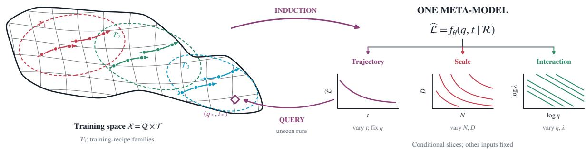  
Figure 1: Meta-modeling as induction over the space of training runs. Paths represent runs, dots their observations, and the diamond an unseen query in configuration–progress space. Dashed regions denote training-recipe families. A meta-model predicts loss from historical records; trajectory, scale, and interaction views are conditional slices of this same function. Geometry and slices are schematic, not measured embeddings or results.

We take a first, humble empirical step by treating language-model training records as a native numeric modality: configuration fields and measurements form input–output examples rather than tokenized descriptions. We find that TabPFN, a pretrained tabular model that learns predictive priors from synthetic tables (Hollmann et al., 2025; Grinsztajn et al., 2026), already supports useful predictions of training. Across tasks, we supply historical examples as context and new configurations as queries, reusing the same pretrained backbone without updating its weights.

Our experiments reveal three capabilities of this meta-model (§2): accurate prediction of training behavior, encompassing final loss and configuration-dependent trajectories, with further applications to other training observables and downstream accuracy; reuse across training questions, as the same pretrained backbone extends from dense-model prediction to MoE expert configurations, data recipes, and diferent prediction targets without task-specific fine-tuning; and adaptation through new observations, where adding the first 20% of each target trajectory to historical context reduces run-averaged future-loss MAE by 56% across seven held-out Delph runs (Held and the Marin Community, 2026), without updating backbone weights.

We further use KANs (Liu et al., 2024) to learn inspectable configuration coordinates that improve StepLaw (Li et al., 2025) final-loss and curve prediction without updating TabPFN’s backbone (§3). To move beyond retrospective evaluation, we also froze a forecast during the Marin Hero Run and evaluated it against subsequently arriving observations (§4). These studies also expose a remaining challenge: reliable extrapolation beyond observed training conditions.

## 2. TabPFN is already a strong meta-model

We test whether one frozen TabPFN backbone distinguishes training choices, forecasts trajectories, predicts downstream performance, and selects configurations to evaluate. Configuration fields, targets, and historical records change between tasks. Each supplies its own labeled context: the claim is reuse of a numerical prior across training questions, not prediction without relevant records.

Final-loss prediction provides a common reference. Table 1 selects each method by ID MAE separately for final loss and curves, restricting TabPFN to zero-shot variants. TabPFN has lower final-loss MAE than both paper-reported and reproduced NCPL on Marin and StepLaw ID. On OOD, it outperforms reproduced NCPL on Marin but not StepLaw; paper-reported NCPL has lower MAE on both. The same frozen backbone also predicts outcomes for expert configurations and data recipes. We distinguish the released NCPL interface from an extension explicitly finetuned for MoE; its limitations are not impossibility results for LLMs.

Table 1: Predicting final losses and training trajectories. One entry per method, selected by ID MAE separately for final loss and curves; all corresponding ID/OOD metrics are retained. MAE and RMSE: lower is better; ρ: higher is better. Bold marks the best displayed value within each corpus, including paperreported results; it does not indicate significance.
<table><tr><td rowspan="2">Method</td><td colspan="3">Final loss (ID)</td><td colspan="3">Final loss (OOD)</td><td colspan="2">Curve (ID)</td><td colspan="2">Curve (OOD)</td></tr><tr><td>MAE↓</td><td>RMSE↓</td><td>ρ↑</td><td>MAE↓</td><td>RMSE↓</td><td>ρ↑</td><td>MAE↓</td><td>RMSE↓</td><td>MAE↓</td><td>RMSE↓</td></tr><tr><td colspan="10">Marin</td></tr><tr><td>NCPL (paper)</td><td>0.0109</td><td>0.0169</td><td>0.9813</td><td>0.0168</td><td>0.0239</td><td>0.9299</td><td>0.0252</td><td>0.0475</td><td>0.0363</td><td>0.0644</td></tr><tr><td>NCPL (repro)</td><td>0.0115</td><td>0.0182</td><td>0.9789</td><td>0.0189</td><td>0.0290</td><td>0.9474</td><td>0.0312</td><td>0.0516</td><td>0.0350</td><td>0.0642</td></tr><tr><td>XGBoost</td><td>0.0147</td><td>0.0239</td><td>0.9621</td><td>0.0356</td><td>0.0408</td><td>0.9063</td><td>0.0242</td><td>0.0479</td><td>0.0423</td><td>0.0655</td></tr><tr><td>Parametric law</td><td>0.0285</td><td>0.0392</td><td>0.8986</td><td>0.0205</td><td>0.0276</td><td>0.7670</td><td>0.8036</td><td>2.3168</td><td>0.5821</td><td>1.8930</td></tr><tr><td>TabPFN</td><td>0.0080</td><td>0.0140</td><td>0.9872</td><td>0.0178</td><td>0.0249</td><td>0.9580</td><td>0.0283</td><td>0.0588</td><td>0.0457</td><td>0.1360</td></tr><tr><td colspan="10">StepLaw</td></tr><tr><td>NCPL (paper)</td><td>0.0097</td><td>0.0158</td><td>0.9948</td><td>0.0223</td><td>0.0345</td><td>0.9837</td><td>0.0278</td><td>0.0981</td><td>0.0415</td><td>0.1696</td></tr><tr><td>NCPL (repro)</td><td>0.0096</td><td>0.0152</td><td>0.9957</td><td>0.0204</td><td>0.0287</td><td>0.9893</td><td>0.0299</td><td>0.0972</td><td>0.0392</td><td>0.1690</td></tr><tr><td>XGBoost</td><td>0.0103</td><td>0.0160</td><td>0.9954</td><td>0.0226</td><td>0.0313</td><td>0.9860</td><td>0.0293</td><td>0.1025</td><td>0.0390</td><td>0.1741</td></tr><tr><td>Parametric law</td><td>0.0234</td><td>0.0390</td><td>0.9768</td><td>0.0257</td><td>0.0377</td><td>0.9818</td><td>0.1612</td><td>0.2682</td><td>0.1399</td><td>0.2795</td></tr><tr><td>TabPFN</td><td>0.0063</td><td>0.0102</td><td>0.9981</td><td>0.0227</td><td>0.0311</td><td>0.9852</td><td>0.0165</td><td>0.0959</td><td>0.0367</td><td>0.1740</td></tr><tr><td colspan="10">Marin-MoE</td></tr><tr><td>NCPL (MoE FT)*</td><td>0.0338</td><td>0.0529</td><td>0.9597</td><td>0.0595</td><td>0.0649</td><td>0.8495</td><td>0.0446</td><td>0.1269</td><td>0.1086</td><td>0.1261</td></tr><tr><td>Parametric law</td><td>0.0574</td><td>0.0722</td><td>0.9515</td><td>0.0579</td><td>0.0786</td><td>0.7386</td><td>0.5688</td><td>1.5075</td><td>0.2055</td><td>0.3478</td></tr><tr><td>Sparsity-aware law</td><td>0.0365</td><td>0.0615</td><td>0.9676</td><td>0.0350</td><td>0.0453</td><td>0.7635</td><td>0.5683</td><td>1.5071</td><td>0.2502</td><td>0.3828</td></tr><tr><td>TabPFN</td><td>0.0160</td><td>0.0278</td><td>0.9627</td><td>0.0187</td><td>0.0272</td><td>0.9233</td><td>0.0259</td><td>0.0614</td><td>0.0326</td><td>0.0469</td></tr><tr><td colspan="10">DataDecide</td></tr><tr><td>NCPL (transfer)*</td><td>0.1023</td><td>0.1288</td><td>0.9650</td><td>0.1247</td><td>0.1517</td><td>0.3360</td><td>0.0994</td><td>0.1257</td><td>0.1364</td><td>0.1661</td></tr><tr><td>XGBoost</td><td>0.0136</td><td>0.0200</td><td>0.9965</td><td>0.0202</td><td>0.0298</td><td>0.9916</td><td>0.0155</td><td>0.0234</td><td>0.0232</td><td>0.0344</td></tr><tr><td>Parametric law</td><td>0.0797</td><td>0.0960</td><td>0.9650</td><td>0.1102</td><td>0.1541</td><td>0.3360</td><td>0.1108</td><td>0.1423</td><td>0.1389</td><td>0.1770</td></tr><tr><td>TabPFN</td><td>0.0105</td><td>0.0160</td><td>0.9972</td><td>0.0178</td><td>0.0213</td><td>0.9899</td><td>0.0125</td><td>0.0224</td><td>0.0133</td><td>0.0157</td></tr></table>

NCPL (paper): values reported by Zhang et al. (2026); NCPL (repro): our evaluation of released checkpoints. ∗MoE uses our one-seed fine-tune; DataDecide uses the released model without adaptation. Neither has a paper-reported counterpart. TabPFN uses zero-shot variants only: frozen pretrained weights with labeled training runs as context, excluding the doc-guided tuning ladder. Settings and selection details: Appendix B.2.1.

We retain the run-level splits and released NCPL checkpoints of Zhang et al. (2026). Marin (Wen et al., 2025) and StepLaw (Li et al., 2025) vary scale and optimizer settings; Marin-MoE adds expert configurations, and DataDecide (Magnusson et al., 2025) varies data recipes. Contexts and target processing are task-specific. TabPFN predicts loss residuals, added back to corpus-specific scaling-law ofsets. No queried-run observations are supplied unless stated. ID is validation within observed model sizes, used for selection; OOD contains larger models. Loss definitions remain corpus-specific, so errors are compared within corpora (Appendix A.1).

A separate joint-context benchmark answers 1,905 final-loss queries in 1.79 seconds on one H200; this is not an end-to-end timing of Table 1’s selection and corpus-specific prediction routes. Cost accounting is in Table 3; matched-data comparisons are in Appendix C.2.

## 2.1 Predicting diferences between training configurations

At a fixed model size and training budget, can a meta-model distinguish better training configurations from worse ones? We test this capability on optimizer settings and data mixtures, withholding the outcomes of the queried configurations.

Delphi’s 3,737-run hyperparameter sweep (Held and the Marin Community, 2026), denoted Delphi-HP, lets us test whether this prediction transfers between training conditions. Inputs are model width, batch size, token budget, and seven optimizer hyperparameters; the output is final Paloma (Magnusson et al., 2023) macro evaluation loss. We withhold all outcomes at one width–batch– budget combination and give TabPFN only the configuration–loss records from the other 23 combinations. Within each held-out group, we rank configurations by predicted loss. Across all 24 folds, mean Spearman correlation is 0.967, versus 0.875 for XGBoost (Chen and Guestrin, 2016) (Figure 2a); TabPFN also has lower loss MAE in every group.

The second task predicts how training-data proportions afect evaluation loss. At fixed scale and progress, we withhold one mixture’s losses and predict them from its proportions and other mixtures’ records. Targets include domain losses and, where defined, total loss. On mixtures of five training domains from Ye et al. (2025), TabPFN’s MAE is approximately 20–40% below the best evaluated parametric law at each of four model sizes (Figure 2b). The laws have lower error on two-domain mixtures and three of four RedPajama sizes; the three-domain comparison is close. The frozen backbone thus predicts diferences between training choices, not only between larger and smaller runs.

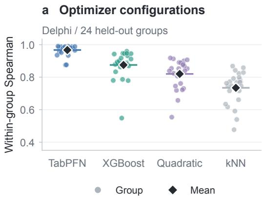

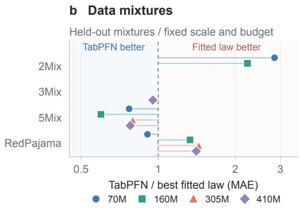  
Figure 2: Predicting configuration diferences at fixed scale and budget. (a) Delphi: each dot is the within-group rank correlation for one of all 24 held-out training-condition groups; diamonds are means. Losses are clipped at 6.0. (b) Leave-one-mixture-out MAE relative to the lowest evaluated MAE among fitted M1–M4 laws in each family–size cell. All eleven cells appear; markers denote model sizes. Below 1 favors TabPFN. Ratios are point estimates, not significance tests. Aggregation and fitting protocols: Appendices A.3 and B.2.

## 2.2 Predicting the course of training

Can a meta-model forecast how a training run will unfold before observing its losses? We provide historical runs as context and query TabPFN with a configuration and training progress; successive queries reconstruct a loss trajectory. All evaluations withhold the queried run’s losses and reuse the same frozen backbone, with corpus-specific features and context.

Configuration-dependent dynamics. TabPFN captures how learning-rate-dependent loss gaps narrow during StepLaw training (Figure 3a–b). These forecasts go beyond shifting a common decay curve by a fixed ofset: their error on time-varying OOD gaps is 38% lower than this control (c). Marin extends the test to diferent optimizers (d–e). Accuracy is not uniform, however: TabPFN’s higher Marin OOD error than reproduced NCPL arises mainly in early training (f; Table 1).

Extending to expert configurations. Adding expert count and routing settings lets the same backbone forecast Marin-MoE trajectories from historical MoE runs (Figure 3g). Across held-out OOD runs, curve MAE is approximately 70% lower than MoE-fine-tuned NCPL; this advantage persists beyond early training. The fine-tuned baseline lacks expert fields, so this comparison evaluates the systems as used, rather than isolating backbone quality under identical inputs.

Transferring data recipes across scales. On DataDecide, records from smaller models support trajectory forecasts for held-out 750M–1B models. TabPFN distinguishes the direction and approximate magnitude of recipe diferences at a common scale (Figure 3h), with lower error than recipe-aware XGBoost (i). Removing recipe identity increases OOD error nearly eightfold: the forecasts use recipe information rather than scale alone. All evaluated recipes occur in context; the transfer is to larger models, not unseen recipes.

a StepLaw ID  
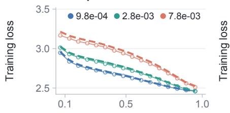

b StepLaw OOD  
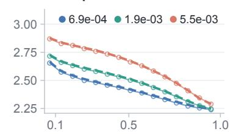

c Beyond fixed offsets  
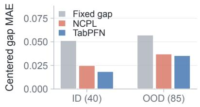

d Marin ID  
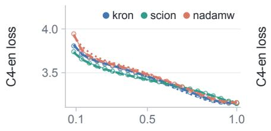

e Marin OOD  
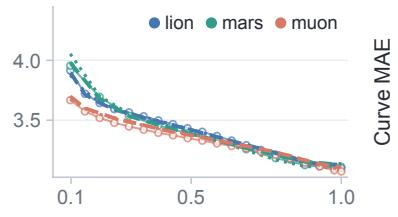

f Marin OOD by phase  
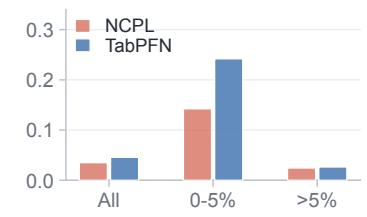

g MoE OOD  
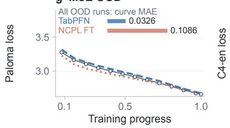

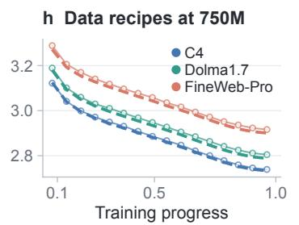

i Recipe information  
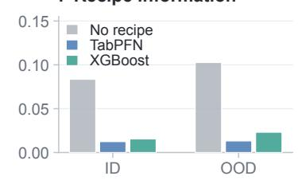  
Figure 3: One frozen backbone forecasts configuration-dependent training trajectories. (a– b) StepLaw learning-rate sweeps; (c) trajectory diferences beyond fixed ofsets. (d–e) Marin optimizer configurations; (f) an early-phase OOD weakness. (g) MoE trajectory and aggregate OOD MAE, compared with MoE-fine-tuned NCPL. (h) Data recipes at a held-out 750M scale; (i) recipe ablation and XGBoost comparison. Colors distinguish configurations in a–b, d–e, h; line styles distinguish predictors. Metadataselected curves display progress > 5%; absolute-loss aggregates retain all checkpoints. No target-run losses are supplied. Point estimates; protocols and expanded plots: Appendix A.3.

## 2.3 Predicting outcomes beyond loss

Internal training observables. Can a meta-model predict how training evolves beyond the loss curve? We use Marin records to predict parameter and gradient norms from configuration and training progress, without observing the queried run’s weights or trajectory. Figure 4a–b compares predicted and recorded trajectories for the same two held-out runs. TabPFN captures the rise and subsequent decline of parameter norms and the early decay of gradient norms, rather than imposing a shared decreasing curve on both targets. Peak timing and magnitude remain imperfect, and the forecasts do not recover individual gradient spikes. These predictions reuse the frozen backbone with observable-specific contexts and target processing.

Downstream performance. We next ask whether configuration–accuracy records from smaller models can forecast the benchmark scores of larger models. We supply historical checkpoint evaluations as context and query DataDecide’s held-out 750M–1B models, without observing their losses or benchmark scores. Figure 4c shows that TabPFN distinguishes downstream performance across configurations, although it still underestimates the strongest 1B outcomes. Ten-task OLMES (Gu et al., 2024) macro-accuracy MAE is 1.62 percentage points, versus 3.40 for XGBoost using the same historical records. Errors are lower on all ten individual tasks than under the earlier endpointcontext protocol. Together, these results extend the meta-model’s queries from loss to internal dynamics and downstream outcomes without training a new neural backbone for each target.

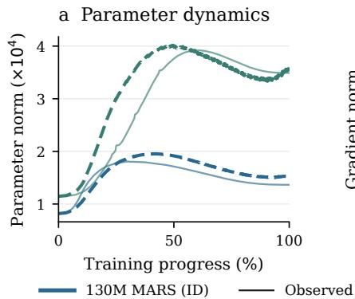

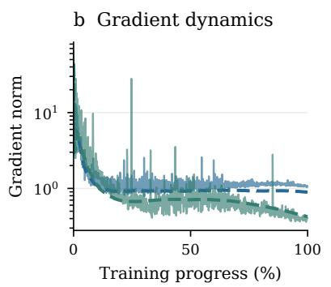

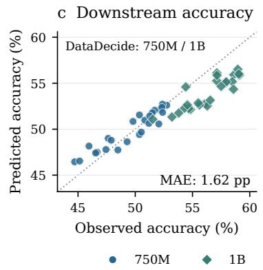  
Figure 4: Predicting internal dynamics and downstream outcomes. (a–b) Recorded (solid) and predicted (dashed) norms for the same ID and OOD runs; norms sum per-tensor L2 norms, with a log axis in (b). (c) Each point is a held-out DataDecide size–recipe group; the dotted line is perfect prediction. Targets are the last available benchmark evaluations, not necessarily completed training. All panels average two TabPFN seeds. Selection rules and scoring: Appendix A.3.

## 2.4 Adapting predictions and guiding experiments

Updating forecasts during training. We supply historical training records as context and query losses at future steps for a target configuration. As target-run measurements arrive, we append these configuration–step–loss records and query the remaining trajectory again, without updating backbone weights. On Delphi’s seven larger target runs, observing the first 20% of training reduces average remaining-curve error by 56% (Figure 5a). The benefit is not uniform across runs, but demonstrates that forecasts can be revised through observations rather than another round of model training.

Choosing training configurations. Before launching a run, we query candidate configurations and select the one with the lowest predicted final loss. Historical configuration–loss pairs supply the context; candidate losses are hidden during selection and used afterward to score the recommendation against the best measured candidate. StepLaw’s learning-rate and batch-size sweeps illustrate this procedure (Figure 5b). It also applies to Delphi’s seven-dimensional optimizer search: across 23 held-out condition groups, mean excess loss is 0.0038 nats, versus 0.0254 for XGBoost (c). On StepLaw, TabPFN can select even better: with the learned configuration coordinates of Section 3, its selection regret on larger-model sweeps falls by 80%.

Using observations to guide subsequent experiments. In ofline StepLaw replay, we reveal each selected candidate’s measured loss, append it to context, and use updated predictions to choose the next untested configuration. All policies start from the same two random evaluations. We compare history-only predictions, conditioning on the two initial outcomes but freezing context thereafter, and continual context updates. After five total evaluations, mean OOD best-found regret is 0.1398%, 0.0473%, and 0.0394%, respectively (Figure 5d). Incorporating target-condition observations brings the search closer to the best measured configuration with fewer evaluations than history-only predictions, without retraining the backbone.

We next ask whether learned configuration coordinates can improve this predictor.

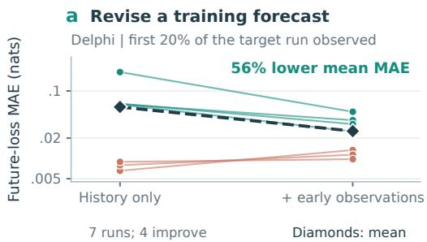

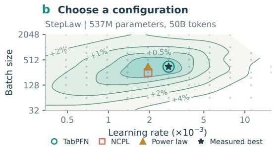

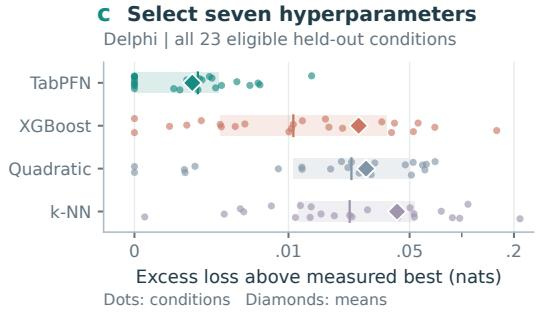

d Use experimental feedback  
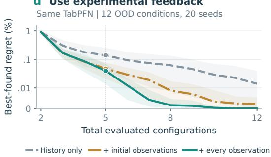  
Figure 5: Revise forecasts and guide training decisions. (a) All seven Delphi runs; diamonds mark means. (b) A StepLaw sweep; contours interpolate measured loss. (c) All 23 Delphi conditions; diamonds mark means, boxes the interquartile range. (d) Same-backbone context controls; 95% bootstrap bands over twelve conditions. Budgets include initialization; regret uses measured minima. Log axis in (a), symmetriclog regret in (c–d). Protocols: Appendix A.3.

## 3. TabPFN could be better

Good hyperparameters change with training scale. We use Kolmogorov–Arnold Networks (KANs; Liu et al., 2024) to learn scale-dependent learning-rate and batch-size references, making a configuration’s position relative to favorable choices explicit.

Learning a representation of training choices. Two small KANs learn reference values from the best-performing runs within each StepLaw training group, as functions of model size and token budget (Figure 6). We append log-ratios to these references to the original configuration fields. TabPFN’s backbone stays frozen, and no queried-run outcomes enter the KAN fit.

Improving predictions and training decisions. Against the default TabPFN route, largermodel final-loss and curve errors decrease by 29% and 16%. Selecting the configuration with lowest predicted loss reduces OOD regret by 80%: references learned from final-loss sweeps also help forecast trajectories and make decisions. ID changes are inconclusive. OOD gains persist against a same-context baseline (Appendix C.1).

Inspecting what the KAN learns. The learning-rate reference decreases with model size and increases with token budget; batch size varies nonlinearly with token budget. These inspectable relationships are fitted, not universal training laws.

We next test the backbone against prospectively arriving outcomes.

## 4. A prospective forecast of the Marin Hero Run

Can the same meta-model incorporate observations from an ongoing run and forecast what follows? We test this on the Marin Hero Run, a public MoE model with approximately 535B total and 23B active parameters (Hall, 2026). On 25 August 2026, we froze a completion forecast (V0) using four smaller ladder runs and five hero observations through 3.84% of training, its prefix. Compute, progress, and active parameter count specify each future Paloma macro-loss query. Unlike Section 2.2, target-run observations enter the context; backbone weights remain unchanged.

Our reference is Marin’s oficial scaling law, which extrapolates the same four ladder runs and was

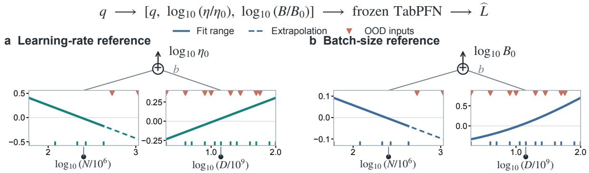

<table><tr><td>StepLaw task</td><td>Split</td><td>TabPFN</td><td>TabPFN + KAN</td><td>Change</td></tr><tr><td rowspan="2">T1 Final loss (MAE)</td><td>ID</td><td>0.0063</td><td>0.0064</td><td>+3% (n.s.)</td></tr><tr><td>OOD</td><td>0.0227</td><td>0.0161</td><td>-29%</td></tr><tr><td rowspan="2">T2 Loss curve (MAE)</td><td>ID</td><td>0.0165</td><td>0.0153</td><td>-7% (n.s.)</td></tr><tr><td>OOD</td><td>0.0367</td><td>0.0309</td><td>-16%</td></tr><tr><td rowspan="2">T3 Selection regret</td><td>ID</td><td>0.096%</td><td>0.102%</td><td>+6% (n.s.)</td></tr><tr><td>OOD</td><td>0.427%</td><td>0.084%</td><td>-80%</td></tr></table>

Lower is better; n.s.: not significant

Figure 6: Learned coordinates improve prediction and selection at larger scales. (a,b) Archived seed-0 KAN edge functions, centered for display; each pair sums with an intercept to a reference value. Bottom: StepLaw results against the default, untuned TabPFN route, which is Table 1’s TabPFN predictor. MAE is in nats, regret in percent. TabPFN pools corpora; the KAN route uses StepLaw context. Matchedcontext controls and uncertainty estimates are in Appendix C.1.

archived alongside V0. On all 14 subsequent checkpoints available in the 24 September public-log check, V0’s MAE is 0.0216, versus 0.0576 for the oficial law (Figure 7), and its nominal 90% interval covers all 14 observations. The gain comes from conditioning on the ongoing run: given only the ladder records, TabPFN’s MAE is 0.0788.

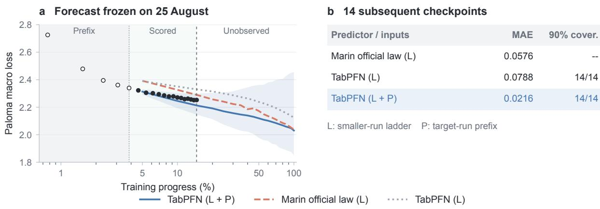

<table><tr><td>Predictor / inputs</td><td>MAE</td><td>90% cover.</td></tr><tr><td>Marin official law (L)</td><td>0.0576</td><td>--</td></tr><tr><td>TabPFN (L)</td><td>0.0788</td><td>14/14</td></tr><tr><td>TabPFN (L + P)</td><td>0.0216</td><td>14/14</td></tr></table>

Figure 7: Forecast first, score as observations arrive. (a) The V0 forecast frozen on 25 August: open/filled points are supplied/subsequent observations; the blue band is TabPFN’s nominal 90% interval. Scoring ends at 14.61%. (b) MAE and nominal 90% coverage on the 14 subsequent checkpoints. L denotes the smaller-run ladder, P the target-run prefix; the oficial law provides no interval. Target: dropless Paloma macro loss. Full chronology and scoring: Appendix D.1.

The forecast was preserved and never overwritten by later predictions. V0 preceded subsequent evaluations, but scoring rules were finalized after the first two arrived: predictions were frozen prospectively, not the entire evaluation protocol. The two predictors also use diferent information, since the oficial law does not see the prefix. This case extends a frozen backbone from ofline queries to forecasts conditioned on an ongoing run; it does not isolate a benefit from ladder records beyond the prefix alone.

## 5. Discussion and limitations

Training questions can share a predictive backbone. Configuration fields, prediction targets, and contextual observations can change without new TabPFN weights. This extends metamodeling beyond a fixed configuration-to-loss mapping, while retaining task-specific representations and target processing.

From reuse to reliable decisions. Three challenges remain: representing genuinely new regimes, such as unseen data recipes; recognizing unreliable extrapolation; and demonstrating better experimental decisions. Our ofline selection results motivate prospective, equal-budget comparisons counting pilot runs, search, and adaptation. Lower prediction error alone does not establish compute savings.

## 6. Related work

Scaling laws and training dynamics. Scaling laws extend beyond model and data size to mixtures (Ye et al., 2025), sparsity (Abnar et al., 2025), and learning-rate schedules (Tissue et al., 2024; Luo et al., 2025). Hyperparameter transfer (Yang et al., 2021; Wang and Aitchison, 2024) and scale-dependent tuning (Porian et al., 2024) further qualify these predictions. Our numerical response functions complement, rather than replace, such structured laws.

Learned predictors of training outcomes. OmniPred trains language models as general regressors (Song et al., 2024); NCPL specializes an LLM to training outcomes (Zhang et al., 2026). Our question is whether a frozen numerical backbone can serve changing configuration fields, targets, and contexts, not whether text-based regression is inherently incapable of doing so.

Learning curves and numerical in-context learning. Bayesian neural surrogates (Klein et al., 2017) and Deep Power Laws (Kadra et al., 2023) connect curve prediction to optimization. PFNs amortize inference through pretraining (Müller et al., 2022); LC-PFN, FT-PFN, and Adam-PFN specialize it to curves and hyperparameter search (Adriaensen et al., 2023; Rakotoarison et al., 2024; Athanasiadis et al., 2025). We instead reuse TabPFN’s general tabular prior (Hollmann et al., 2023, 2025) across training questions, without pretraining a dedicated training-curve model.

Downstream prediction. Model ladders predict through intermediate losses (Bhagia et al., 2025); observational laws use a low-dimensional capability space (Ruan et al., 2024), and NeuNeu learns from accuracy trajectories and token-level losses (Hu et al., 2026). Predictability remains setting-dependent (Lourie et al., 2025).

Inspectable adaptation. KANs learn univariate edge functions (Liu et al., 2024). We use them to learn inspectable configuration coordinates for a frozen predictor, rather than replace its backbone or establish causal training laws.

## Reproducibility statement

Experiments use public run corpora and released checkpoints of Zhang et al. (2026). Splits, information sets, selection rules, and leakage checks for the reported results are documented in §2–§4 and Appendices A–E. Code, cached predictions, and the timestamped forecast protocol will be released upon acceptance.

## AI use statement

The authors used generative AI assistants (OpenAI ChatGPT, Codex-based coding agents, and Anthropic Claude via Claude Code) to help refine research hypotheses and experimental designs; implement and refactor code; run and monitor experiments; build audit procedures; analyze results; design figures; search the literature; and draft, translate, and edit the manuscript. The research questions were posed by the authors, and all final methodological choices and interpretations of results were made by the authors; every experiment was approved by the authors and executed under their supervision. The authors inspected raw outputs and reviewed the code, citations, figures, and claims in the submission. All reported measurements come from the deterministic evaluators and intervention procedures described in the paper, not from language-model judgments. The authors reviewed all AI-assisted content and take full responsibility for the final paper.

## References

Samira Abnar, Harshay Shah, Dan Busbridge, Alaaeldin El-Nouby, Josh Susskind, and Vimal Thilak. Parameters vs FLOPs: Scaling laws for optimal sparsity for mixture-of-experts language models. In International Conference on Machine Learning (ICML), 2025. arXiv:2501.12370.

Steven Adriaensen, Herilalaina Rakotoarison, Samuel Müller, and Frank Hutter. Eficient Bayesian learning curve extrapolation using prior-data fitted networks. In Advances in Neural Information Processing Systems, volume 36, pages 19858–19886, 2023. URL https://arxiv.org/abs/23 10.20447.

Theodoros Athanasiadis, Steven Adriaensen, Samuel Müller, and Frank Hutter. Tune my Adam, please! arXiv preprint arXiv:2508.19733, 2025. URL https://arxiv.org/abs/2508.19733.

Akshita Bhagia, Jiacheng Liu, Alexander Wettig, David Heineman, Oyvind Tafjord, Ananya Harsh Jha, Luca Soldaini, Noah A. Smith, Dirk Groeneveld, Pang Wei Koh, Jesse Dodge, and Hannaneh Hajishirzi. Establishing task scaling laws via compute-eficient model ladders. In Conference on Language Modeling, 2025. URL https://arxiv.org/abs/2412.04403.

Stella Biderman, Hailey Schoelkopf, Quentin Anthony, et al. Pythia: A Suite for Analyzing Large Language Models Across Training and Scaling. arXiv preprint arXiv:2304.01373, 2023. URL https://arxiv.org/abs/2304.01373.

Yonatan Bisk, Rowan Zellers, Ronan Le Bras, Jianfeng Gao, and Yejin Choi. PIQA: Reasoning about Physical Commonsense in Natural Language. arXiv preprint arXiv:1911.11641, 2019. URL https://arxiv.org/abs/1911.11641.

Tianqi Chen and Carlos Guestrin. XGBoost: A scalable tree boosting system. In Proceedings of the 22nd ACM SIGKDD International Conference on Knowledge Discovery and Data Mining, pages 785–794, 2016. doi: 10.1145/2939672.2939785.

Christopher Clark, Kenton Lee, Ming-Wei Chang, Tom Kwiatkowski, Michael Collins, and Kristina Toutanova. BoolQ: Exploring the Surprising Dificulty of Natural Yes/No Questions. arXiv preprint arXiv:1905.10044, 2019. URL https://arxiv.org/abs/1905.10044.

Peter Clark, Isaac Cowhey, Oren Etzioni, Tushar Khot, Ashish Sabharwal, Carissa Schoenick, and Oyvind Tafjord. Think you have Solved Question Answering? Try ARC, the AI2 Reasoning Challenge. arXiv preprint arXiv:1803.05457, 2018. URL https://arxiv.org/abs/1803.05457.

Léo Grinsztajn, Klemens Flöge, Oscar Key, et al. TabPFN-3: Technical Report. arXiv preprint arXiv:2605.13986, 2026. URL https://arxiv.org/abs/2605.13986.

Dirk Groeneveld, Iz Beltagy, Pete Walsh, et al. OLMo: Accelerating the Science of Language Models. arXiv preprint arXiv:2402.00838, 2024. URL https://arxiv.org/abs/2402.00838.

Yuling Gu, Oyvind Tafjord, Bailey Kuehl, Dany Haddad, Jesse Dodge, and Hannaneh Hajishirzi. OLMES: A Standard for Language Model Evaluations. arXiv preprint arXiv:2406.08446, 2024. URL https://arxiv.org/abs/2406.08446.

David Hall. Marin 535B-A23B launch note. Open Athena Blog, September 2026. URL https: //openathena.ai/blog/marin-535b-launch-note/.

Will Held and the Marin Community. Scaling laws that extrapolate 300× past the fit. https: //openathena.ai/blog/delphi/, 2026.

Dan Hendrycks, Collin Burns, Steven Basart, Andy Zou, Mantas Mazeika, Dawn Song, and Jacob Steinhardt. Measuring Massive Multitask Language Understanding. arXiv preprint arXiv:2009.03300, 2020. URL https://arxiv.org/abs/2009.03300.

Jordan Hofmann, Sebastian Borgeaud, Arthur Mensch, et al. Training compute-optimal large language models. arXiv preprint arXiv:2203.15556, 2022.

Noah Hollmann, Samuel Müller, Katharina Eggensperger, and Frank Hutter. TabPFN: A transformer that solves small tabular classification problems in a second. In International Conference on Learning Representations, 2023. URL https://arxiv.org/abs/2207.01848.

Noah Hollmann, Samuel Müller, Lennart Purucker, Arjun Krishnakumar, Max Körfer, Shi Bin Hoo, Robin Tibor Schirrmeister, and Frank Hutter. Accurate predictions on small data with a tabular foundation model. Nature, 637:319–326, 2025.

Michael Y. Hu, Jane Pan, Ayush Rajesh Jhaveri, Nicholas Lourie, and Kyunghyun Cho. Neural neural scaling laws. arXiv preprint arXiv:2601.19831, 2026. URL https://arxiv.org/abs/26 01.19831.

Arlind Kadra, Maciej Janowski, Martin Wistuba, and Josif Grabocka. Scaling laws for hyperparameter optimization. In Advances in Neural Information Processing Systems, 2023. URL https://arxiv.org/abs/2302.00441.

Jared Kaplan, Sam McCandlish, Tom Henighan, Tom B Brown, Benjamin Chess, Rewon Child, Scott Gray, Alec Radford, Jefrey Wu, and Dario Amodei. Scaling laws for neural language models. arXiv preprint arXiv:2001.08361, 2020.

Aaron Klein, Stefan Falkner, Jost Tobias Springenberg, and Frank Hutter. Learning curve prediction with Bayesian neural networks. In International Conference on Learning Representations, 2017.

Houyi Li, Wenzhen Zheng, Qiufeng Wang, Hanshan Zhang, Zili Wang, Shijie Xuyang, Yuantao Fan, Zhenyu Ding, Haoying Wang, Ning Ding, Shuigeng Zhou, Xiangyu Zhang, and Daxin Jiang. Predictable scale: Part i, Step Law—optimal hyperparameter scaling law in large language model pretraining. arXiv preprint arXiv:2503.04715, 2025. URL https://arxiv.org/abs/25 03.04715.

Ziming Liu, Yixuan Wang, Sachin Vaidya, Fabian Ruehle, James Halverson, Marin Soljačić, Thomas Y. Hou, and Max Tegmark. KAN: Kolmogorov-arnold networks. arXiv preprint arXiv:2404.19756, 2024.

Nicholas Lourie, Michael Y. Hu, and Kyunghyun Cho. Scaling laws are unreliable for downstream tasks: A reality check. In Findings of the Association for Computational Linguistics: EMNLP 2025, pages 16167–16180, 2025. URL https://aclanthology.org/2025.findings-emnlp.8 77/.

Kairong Luo, Haodong Wen, Shengding Hu, Zhenbo Sun, Maosong Sun, Zhiyuan Liu, Kaifeng Lyu, and Wenguang Chen. A multi-power law for loss curve prediction across learning rate schedules. In International Conference on Learning Representations, 2025. URL https://ar xiv.org/abs/2503.12811.

Ian Magnusson, Akshita Bhagia, Valentin Hofmann, et al. Paloma: A Benchmark for Evaluating Language Model Fit. arXiv preprint arXiv:2312.10523, 2023. URL https://arxiv.org/abs/ 2312.10523.

Ian Magnusson et al. Datadecide: How to predict best pretraining data with small experiments. arXiv preprint arXiv:2504.11393, 2025.

Leland McInnes, John Healy, and James Melville. UMAP: Uniform Manifold Approximation and Projection for Dimension Reduction. arXiv preprint arXiv:1802.03426, 2018. URL https: //arxiv.org/abs/1802.03426.

Todor Mihaylov, Peter Clark, Tushar Khot, and Ashish Sabharwal. Can a Suit of Armor Conduct Electricity? A New Dataset for Open Book Question Answering. arXiv preprint arXiv:1809.02789, 2018. URL https://arxiv.org/abs/1809.02789.

Samuel Müller, Noah Hollmann, Sebastian Pineda Arango, Josif Grabocka, and Frank Hutter. Transformers can do Bayesian inference. In International Conference on Learning Representations, 2022. URL https://arxiv.org/abs/2112.10510.

Tomer Porian, Mitchell Wortsman, Jenia Jitsev, Ludwig Schmidt, and Yair Carmon. Resolving discrepancies in compute-optimal scaling of language models. In Advances in Neural Information Processing Systems, 2024. URL https://arxiv.org/abs/2406.19146.

Shikai Qiu, Lechao Xiao, Andrew Gordon Wilson, Jefrey Pennington, and Atish Agarwala. Scaling collapse reveals universal dynamics in compute-optimally trained neural networks. In Proceedings of the 42nd International Conference on Machine Learning, volume 267, pages 50697– 50720, 2025. URL https://proceedings.mlr.press/v267/qiu25j.html.

Jingang Qu, David Holzmüller, Gaël Varoquaux, and Marine Le Morvan. TabICLv2: A better, faster, scalable, and open tabular foundation model. arXiv preprint arXiv:2602.11139, 2026. URL https://arxiv.org/abs/2602.11139.

Herilalaina Rakotoarison, Steven Adriaensen, Neeratyoy Mallik, Samir Garibov, Eddie Bergman, and Frank Hutter. In-context freeze-thaw Bayesian optimization for hyperparameter optimization. In Proceedings of the 41st International Conference on Machine Learning, volume 235, pages 41982–42008, 2024. URL https://proceedings.mlr.press/v235/rakotoarison24a.h tml.

Yangjun Ruan, Chris J. Maddison, and Tatsunori Hashimoto. Observational scaling laws and the predictability of language model performance. In Advances in Neural Information Processing Systems, 2024. URL https://arxiv.org/abs/2405.10938.

Keisuke Sakaguchi, Ronan Le Bras, Chandra Bhagavatula, and Yejin Choi. WinoGrande: An Adversarial Winograd Schema Challenge at Scale. arXiv preprint arXiv:1907.10641, 2019. URL https://arxiv.org/abs/1907.10641.

Maarten Sap, Hannah Rashkin, Derek Chen, Ronan LeBras, and Yejin Choi. SocialIQA: Commonsense Reasoning about Social Interactions. arXiv preprint arXiv:1904.09728, 2019. URL https://arxiv.org/abs/1904.09728.

Xingyou Song, Oscar Li, Chansoo Lee, Bangding Yang, Daiyi Peng, Sagi Perel, and Yutian Chen. OmniPred: Language models as universal regressors. Transactions on Machine Learning Research, 2024. URL https://arxiv.org/abs/2402.14547.

Alon Talmor, Jonathan Herzig, Nicholas Lourie, and Jonathan Berant. CommonsenseQA: A Question Answering Challenge Targeting Commonsense Knowledge. arXiv preprint arXiv:1811.00937, 2018. URL https://arxiv.org/abs/1811.00937.

Howe Tissue, Venus Wang, and Lu Wang. Scaling law with learning rate annealing. arXiv preprint arXiv:2408.11029, 2024. URL https://arxiv.org/abs/2408.11029.

Xi Wang and Laurence Aitchison. How to set AdamW’s weight decay as you scale model and dataset size. arXiv preprint arXiv:2405.13698, 2024.

Kaiyue Wen, David Hall, Tengyu Ma, and Percy Liang. Fantastic pretraining optimizers and where to find them. arXiv preprint arXiv:2509.02046, 2025. URL https://arxiv.org/abs/ 2509.02046.

An Yang, Anfeng Li, Baosong Yang, et al. Qwen3 Technical Report. arXiv preprint arXiv:2505.09388, 2025. URL https://arxiv.org/abs/2505.09388.

Greg Yang, Edward J Hu, Igor Babuschkin, Szymon Sidor, Xiaodong Liu, David Farhi, Nick Ryder, Jakub Pachocki, Weizhu Chen, and Jianfeng Gao. Tensor programs V: Tuning large neural networks via zero-shot hyperparameter transfer. In Advances in Neural Information Processing Systems, 2021.

Jiasheng Ye, Peiju Liu, Tianxiang Sun, Jun Zhan, Yunhua Zhou, and Xipeng Qiu. Data mixing laws: Optimizing data mixtures by predicting language modeling performance. In International Conference on Learning Representations (ICLR), 2025. arXiv:2403.16952.

Rowan Zellers, Ari Holtzman, Yonatan Bisk, Ali Farhadi, and Yejin Choi. HellaSwag: Can a Machine Really Finish Your Sentence? arXiv preprint arXiv:1905.07830, 2019. URL https: //arxiv.org/abs/1905.07830.

Huaqing Zhang, Kaiyue Wen, and Tengyu Ma. Configuration-to-performance scaling law with neural ansatz. arXiv preprint arXiv:2602.10300, 2026.

Appendix A gives experimental details; Appendices B–D supplement Sections 2–4; Appendix E covers transfer, field-order robustness, and training responses.

## A. Experimental details

## A.1 Datasets, prediction tasks, and splits

Table 2 lists the corpora. T1 predicts final loss from configuration; T2 adds progress to predict checkpoint loss without queried-run observations; T3 selects configurations by predicted loss. Marin and StepLaw keep the released train/ID/OOD splits of Zhang et al. (2026); ID is used for selection. Targets keep a fitted corpus-specific Chinchilla ofset. Main-table selection is described in Appendix B.2.1. Released NCPL has no expert or recipe fields; its one-seed MoE fine-tune keeps the original schema.

Table 2: Corpora represented in the common schema. Counts are frozen source records before task-specific eligibility; the evaluated subset is stated where it difers. Records pair configuration metadata with scalar outcomes or checkpoint trajectories. Task-specific inputs difer; the proposed typed schema is documented separately in Appendix E.5.
<table><tr><td>Corpus</td><td></td><td>Runs Role in this paper</td><td>Principal variation and data style</td></tr><tr><td>Marin</td><td></td><td>2,549 benchmark</td><td>Dense-LM N, D, optimizer and decay sweeps; exponent-coded € and step warmup.</td></tr><tr><td>StepLaw</td><td></td><td>2,581 benchmark</td><td>Learning-rate×batch sweeps across N, D; non-embedding parameter count and smoothed train loss.</td></tr><tr><td>Marin-MoE</td><td></td><td>1,036 benchmark</td><td>Expert count and top-k; active and total parameters; fractional warmup.</td></tr><tr><td>DataDecide</td><td></td><td>1,100 benchmark (950 evaluated)</td><td>25 data recipes crossed with model size; categorical recipe identity and checkpoint losses.</td></tr><tr><td>Delphi</td><td></td><td>88 scaling extrapolation</td><td>Iso-FLOP runs and a three-rung held-out ladder; Paloma macro-loss trajectories.</td></tr><tr><td>Delphi-HP</td><td></td><td>3,737 prediction / selection</td><td>Seven optimizer hyperparameters in 24 width×batch×token cells.</td></tr><tr><td>Total</td><td></td><td>11,091 6 corpora; heterogeneous fields, clocks, units and readouts.</td><td></td></tr></table>

DataDecide. DataDecide (Magnusson et al., 2025) crosses 25 recipes with 14 OLMo (Groeneveld et al., 2024) sizes (4M–1B) at $D = 1 0 0 N$ . After removing early-stopped auxiliary seeds, 950 runs and 19,124 checkpoints remain, scored as log C4 perplexity. The 750M and 1B runs are OOD; the rest is split 8:2 by recipe–size group.

## A.2 Baseline fitting and statistical evaluation

Parametric baselines fit $L = E + A / N ^ { \alpha } + B / D ^ { \beta }$ (Hofmann et al., 2022) on training records, optionally with a log η term; XGBoost (Chen and Guestrin, 2016) is tuned on ID. The MoE sparsity-aware law (Abnar et al., 2025) uses $( N _ { \mathrm { t o t } } , D , S )$

## A.3 Evaluation and figure-construction protocols

Figure scripts verify source hashes, run identities, split disjointness, and target alignment. Illustrative trajectory examples use metadata rules (for example, the lower-median run of a fixed group).

Configuration prediction (Figure 2). Delphi-HP predicts every trial in each of 24 held-out cells (TabPFN: eight estimators, mean readout; baselines tuned by grouped five-fold CV on the remaining cells; losses capped at 6.0). Mean Spearman correlation is 0.967/0.875/0.820/0.735 for

TabPFN/XGBoost/quadratic ridge/kNN, and MAE 0.045/0.100/0.143/0.141. Mixture prediction holds out one mixture at fixed family, size, and step, averaging seeds 0–2; the denominator is the lowest M1–M4 MAE in each cell (Appendix B.2).

Trajectories (Figure 3). Curves use joint-context, two-seed medians; displays omit progress $\leq 5 \%$ , but scores keep every checkpoint. For centered contrasts, StepLaw runs are grouped by all settings except learning rate (40 ID and 85 OOD groups, 4,219 pairs), and each pair’s mean gap over shared times $T _ { i j }$ is removed:

$$
\widetilde { \Delta L } _ { i j } ( t ) = L _ { i } ( t ) - L _ { j } ( t ) - | T _ { i j } | ^ { - 1 } \sum _ { u \in T _ { i j } } [ L _ { i } ( u ) - L _ { j } ( u ) ] .
$$

OOD contrast MAE is 0.0572 for any shared-curve predictor $g ( t ) + b _ { i }$ , 0.0371 for NCPL, and 0.0354 for TabPFN. On Marin OOD (7,844 checkpoints, 415 runs), full/early (≤ 5%)/later MAE is 0.0457/0.2419/0.0264 for TabPFN versus 0.0350/0.1423/0.0244 for NCPL. MoE scores 341 checkpoints from 23 OOD runs: full/early/later MAE is 0.0326/0.0527/0.0318 for TabPFN versus 0.1086/0.1671/0.1065 for MoE-fine-tuned NCPL. The early and later subsets contain 12 and 329 checkpoints, respectively; the approximately 70% reduction therefore persists beyond the early phase omitted from the example curves. Predictions are aligned by run identifier and recorded progress and checked against the source losses before computing these aggregates. The DataDecide recipe ablation gives OOD curve MAE 0.0133 with the recipe field, 0.1027 without, and 0.0232 for XGBoost.

Observables and downstream predictions (Figure 4). The observable panels use fullconfiguration gradient-norm predictions and numerical-geometry, scale-normalized parameter predictions (Appendix B.4). The two runs are the lower-median lexicographic names within 130M MARS ID and 520M Mini OOD. Both panels show all checkpoints without smoothing, and dashed curves average two seed-specific median predictions. The portable plot data record exact run IDs, raw-prediction hashes, and the selection rule. DataDecide uses the historical-checkpoint protocol in Appendix B.5 and displays all 50 OOD size–recipe groups, averaging run seeds and TabPFN seeds for each point. Its reported MAE instead averages absolute errors per prediction seed and then by size–recipe group; it is not the error of the plotted average. Neither direct predictor receives target-run outcomes.

Selection (Figure 5). Figure 5a pairs history-only and history-plus-prefix MAE for all seven Delphi ladder runs, averaging errors over future checkpoints and three TabPFN seeds within each run; the diamonds then average runs equally (Appendix B.7). Green lines improve and coral lines worsen. Panel b shows the OOD sweep with 108 candidates at $N = 5 3 7 \mathrm { { M } } , D = 5 0 \mathrm { { B } }$ . It displays seed 0. Its contours interpolate held-out losses for display only and do not enter selection. Panel c uses original, unclipped Paloma loss to score the selected candidate in each of 23 eligible Delphi cells; diamonds are means, boxes span the 25th–75th percentiles, and internal lines mark medians. Panel d averages the 20 initializations within each condition, then weights twelve OOD conditions equally. Shading is a pointwise percentile 95% interval from 20,000 condition-level bootstrap draws, not an interval over seeds (Appendix B.8). Symmetric-log axes have a linear region below 0.01 nats in (c) and 0.01% regret in (d); zero remains visible. Portable inputs contain source hashes and the frozen matched-feedback protocol.

## A.4 Adaptation and inference cost

Final prediction uses 3,225 context rows and 1,905 queries; curves use 46,595 context points and 28,743 queries (TabPFN: eight estimators). NCPL training cost is extrapolated either from measured step time on H200s (throughput) or from the NCPL fine-tuning recipe (Zhang et al.,

Table 3: Adaptation and prediction cost. NCPL training entries are estimates; timings are medians of three warm runs and exclude foundation-model pretraining. They concern the joint-context benchmark, not the main-table final-loss routes.
<table><tr><td>Operation</td><td>Final loss</td><td>Curves</td></tr><tr><td>NCPL fine-tuning, FLOP estimate (GPU-h)</td><td>7.0</td><td>44.3</td></tr><tr><td>NCPL fine-tuning, throughput estimate (GPU-h)</td><td>24.4</td><td>145.8</td></tr><tr><td>NCPL inference, one H200 fp32 (s)</td><td>15.10</td><td>274</td></tr><tr><td>NCPL inference, TF32 allowed (s)</td><td>3.44</td><td>61.14</td></tr><tr><td>TabPFN context processing + prediction, H200 (s)</td><td>1.79</td><td>12.64</td></tr><tr><td>TabPFN context processing + prediction, CPU (s)</td><td>19.46</td><td>1,296</td></tr><tr><td>XGBoost selected fit + prediction, CPU (s)</td><td>0.19</td><td>0.86</td></tr><tr><td>XGBoost 12-configuration search, CPU (s)</td><td>1.95</td><td>5.45</td></tr></table>

2026) for Qwen3-1.7B (Yang et al., 2025) at 40% utilization (FLOPs). The 679-configuration TabPFN tuning search costs 9.9 GPU-hours (Appendix C.3).

## B. Additional results for TabPFN as a meta-model

## B.1 Delphi-HP: prediction and selection on held-out conditions

The 3,737-trial sweep (Held and the Marin Community, 2026) has 24 width–batch–token cells and seven log-transformed optimizer hyperparameters (two learning rates, epsilon, clipping, z-loss, and two betas). One cell is withheld at a time. Ranking uses loss clipped at 6.0; regret uses raw final Paloma loss on the 23 cells with at least 150 trials. TabPFN regret is 0.0038 [0.0024, 0.0052] versus XGBoost’s 0.0254. An equal-candidate-count check draws 61 trials per cell, using exactly the same candidates for every method and repeating the subsampling 100 times. Averaging repeats within each of all 24 cells, then cells equally, gives 0.00383 versus 0.01699. No trial overlaps with Marin.

## B.2 Mixture-law fitting and sensitivity

We fit M1–M4 of Ye et al. (2025) and query TabPFN on identical leave-one-mixture-out folds (268 Pythia (Biderman et al., 2023) runs in four families), at each cell’s largest step shared by all mixtures. Errors average seeds 0–2; paired mixture bootstraps (B = 2000) compare with M4. On 5Mix, TabPFN gives 0.0084–0.0113 nats versus M1’s 0.0133–0.0147 and M4’s 0.0271–0.0286; every ratio interval against M4 excludes one. 3Mix is close (0.0253 versus M1’s 0.0266). M4 is 2.2–2.8× better on 2Mix, and M2 leads at three of four RedPajama sizes, where some M1/M4 folds diverge.

## B.2.1 Main-table selection and prediction settings

Table 1 selects the lowest ID-MAE row for each method and corpus, separately for final loss and curves, and retains that row’s other metrics; neither OOD scores nor individual metric optima determine selection. TabPFN candidates include only the archived zero-shot mean/median and joint/per-corpus variants, excluding the doc-guided tuning ladder. Their unrounded, predictioncache-audited ID MAEs determine selection; the two parametric laws are grouped together, while the sparsity-aware law remains separate. Cross-lab TabPFN is excluded because it lacks in-corpus context. NCPL paper and reproduction rows remain separate. For TabPFN final loss, the selected dense-model rows are per-subset median on Marin and joint mean on StepLaw; curves use joint median on both. DataDecide uses mean for final loss and median for curves, and MoE uses median for both. In StepLaw, the joint-mean, joint-median, and per-subset-median final-loss ID MAEs all round to 0.0063, but their unrounded values are 0.00627644, 0.00632527, and 0.00634659, respectively; joint mean is therefore selected. Zero-shot here denotes no task-specific fitting of TabPFN weights, not absence of labeled context or ID-based inference-variant selection.

## B.3 DataDecide: recipe information and context controls

Without recipe identity, OOD final-loss MAE rises from 0.0178 to 0.1117. Figure 8 shows why: with DataDecide records as context, TabPFN tracks recipe-dependent losses at every size, whereas context without DataDecide recipes, or NCPL’s recipe-free interface, collapses predictions into size-quantized bands.

Released NCPL inputs are identical across recipes at a given size, forcing identical predictions. Size explains 97.6% of total variance, but recipe explains 99.2% of within-size variance, so recipe context is necessary for choosing data at fixed scale.

## B.4 Predicting observables and their trajectories

Public Marin logs supply internal observables; each target has its own eligible context and preprocessing. The backbone remains frozen, with median readouts. We report the norm evaluation used in the main text.

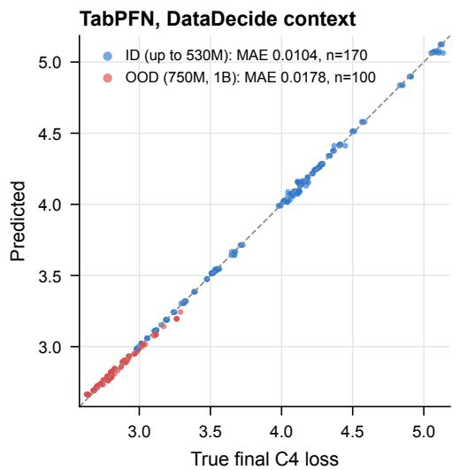

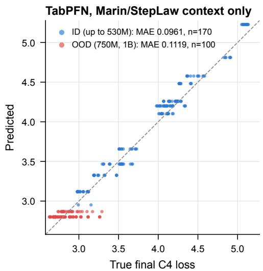

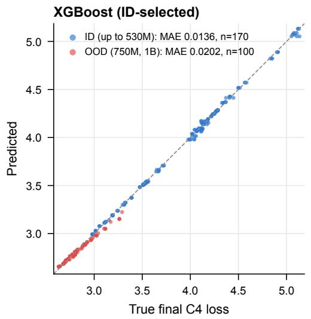

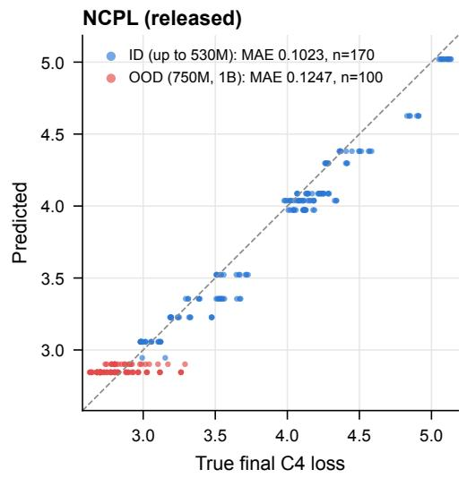  
Figure 8: DataDecide final-loss prediction, predicted versus true C4 loss (blue: ID sizes up to 530M; red: held-out 750M/1B). Top left: TabPFN with DataDecide training context (OOD MAE 0.0178). Top right: TabPFN with only Marin/StepLaw context, where recipe levels have no supporting examples (0.1119). Bottom: ID-selected XGBoost (0.0202) and released NCPL, whose interface has no recipe field (0.1247). TabPFN uses seed 0 and the mean readout.

Norm targets and protocol. Both norm targets are sums of the L2 norms of 291 disjoint tensors, not the global L2 norm of a concatenated vector. We use this tensor-sum definition consistently across all runs. The fixed split contains 281 training, 43 ID, and 233 OOD runs. Curve contexts contain 64 checkpoints per training run (17,984 rows); evaluation retains all 761,981 held-out timestamps, including initialization. Queries supply configuration and progress, never the target run’s weights, initial measured norm, or observed prefix. We average errors within each run, then across runs and two prediction seeds (eight estimators per seed).

Parameter-norm prediction preserves numerical types for model-geometry fields and predicts $\log _ { 1 0 } S ( q , t ) - \log _ { 1 0 } \widehat { S } _ { 0 } ( q )$ , where ${ \widehat S } _ { 0 }$ is fitted from training-run widths and initial norms. Test queries use only configuration to estimate this scale; the backbone is not fine-tuned. Gradientnorm predictions use the full-configuration model without this additional normalization.

The normalized parameter model improves curve error on 212 of 233 OOD runs relative to default feature typing. We use one fixed variant for all displayed parameter predictions, not a test-selected variant per optimizer. Figure 9 includes full trajectories and an additional optimizer; aggregate metrics retain spikes and all initial checkpoints.

Table 4: Observable predictions. Run-macro $\log _ { 1 0 }$ MAE, averaged over two seeds. Final-value predictors are fitted separately, not read from the curve endpoint. All variants use the same tensor-sum targets. Parameter variants compare default feature typing, explicit numerical geometry, and additional scale normalization.
<table><tr><td></td><td colspan="2">Full curve</td><td colspan="2">Final value</td></tr><tr><td></td><td>ID</td><td>OOD</td><td>ID</td><td>OOD</td></tr><tr><td>Parameter: default feature typing</td><td>0.0363</td><td>0.1615</td><td>0.0290</td><td>0.1973</td></tr><tr><td>Parameter: numerical geometry</td><td>0.0368</td><td>0.1149</td><td>0.0288</td><td>0.1228</td></tr><tr><td>Parameter: + scale normalization</td><td>0.0341</td><td>0.0726</td><td>0.0275</td><td>0.0868</td></tr><tr><td>Gradient: full configuration</td><td>0.0463</td><td>0.0994</td><td>0.0240</td><td>0.1026</td></tr></table>

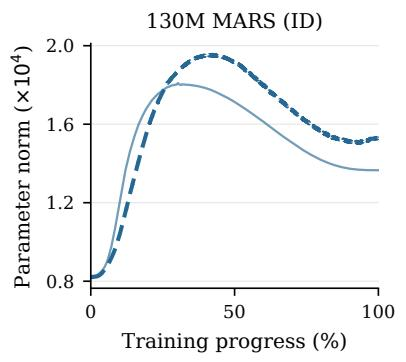

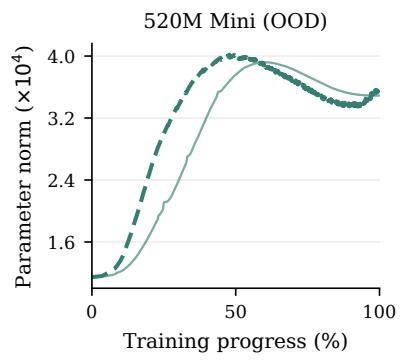

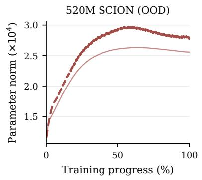

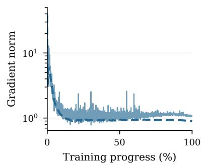

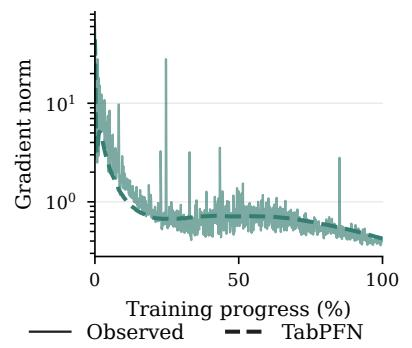

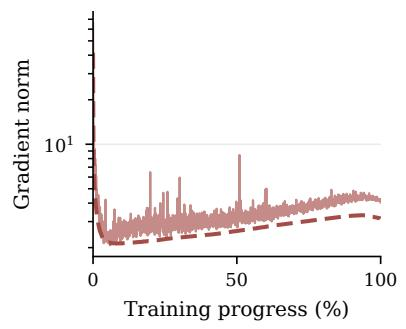  
Figure 9: Internal-observable trajectories. The first two columns expand the runs in Figure 4; the third adds a 520M SCION run. Each is the lower-median lexicographic run within its size–optimizer–split group. Every recorded checkpoint is shown, with a log scale for gradients. Solid curves are observations and dashed curves average two TabPFN median predictions. These illustrative runs are not selected by error or claimed to be typical; Table 4 scores all held-out runs.

## B.5 DataDecide: downstream prediction from training histories

The DataDecide evaluation release (Magnusson et al., 2025) ends earlier than its perplexity archive (89% of planned training at 530M, 41% at 750M), so the target is the last available evaluation, not necessarily completed training. The fixed split has 680 training, 170 ID, and 100 OOD (750M/1B) runs. Targets are ten OLMES (Gu et al., 2024) accuracies and their macro average. We score each size–recipe group equally, first averaging absolute errors over run seeds and then over two TabPFN prediction seeds. The 1B evaluation has three run seeds per recipe; 750M has one.

Historical-checkpoint protocol used in the main text. The earlier endpoint-only context covered training progress of approximately 89–100%, despite the 750M queries occurring at 41%. We now retain multiple positive-step checkpoint evaluations from the same training runs, selected at evenly spaced time indices without consulting target values. To choose among caps of 8, 32, and all available checkpoints, we use only original-training runs: successively train on smaller sizes and query 150M, 300M, and 530M runs near 40% progress and at their last evaluation. Macroaccuracy MAE, equally weighted across folds and recipe–progress groups, is 1.451, 1.676, and 1.669 percentage points, respectively. We lock the eight-checkpoint cap before final evaluation, yielding 4,975 context rows from 680 runs. No observations from an ID or OOD query run enter this context.

All configuration and progress fields retain numerical types; recipe is categorical. Each target uses the same selected rows and a frozen TabPFN v3 backbone (eight estimators; seeds 0 and 1; median readout), with no target-specific neural fine-tuning. XGBoost receives the same rows and features. Its per-target grid comprises depths {3, 6}, learning rates {0.05, 0.1, 0.3}, and tree counts {300, 800}, selected by grouped ID MAE. Its ID scores are therefore tuning performance.

Table 5: Historical observations improve downstream prediction. Macro-accuracy MAE in percentage points. The new methods use identical historical-checkpoint contexts. Targets and held-out runs are unchanged from the endpoint protocol. XGBoost ID error is its grid-selection score.
<table><tr><td>Predictor / context</td><td></td><td>ID</td><td>750M</td><td>1B</td><td>OOD average</td></tr><tr><td></td><td>TabPFN / endpoints (earlier)</td><td>0.66</td><td>1.52</td><td>3.49</td><td>2.51</td></tr><tr><td></td><td>TabPFN / historical checkpoints</td><td>0.64</td><td>0.78</td><td>2.46</td><td>1.62</td></tr><tr><td></td><td>XGBoost / historical checkpoints</td><td>0.70</td><td>1.26</td><td>5.53</td><td>3.40</td></tr></table>

Improvement and remaining extrapolation error. The revised protocol lowers OOD macro error by 35% relative to the earlier endpoint protocol and lowers error on all ten constituent targets (Table 6). It does not eliminate scale-dependent bias: 1B predictions remain low by 2.44 percentage points on average (Figure 10). In the original context, 84% of 1B outcomes exceeded the largest training accuracy (54.46%). The new experiment adds temporal evidence, not larger training models. These results support better use of existing records, not universally calibrated scale extrapolation.

Layer and head counts are treated as numerical features rather than inferred categories.

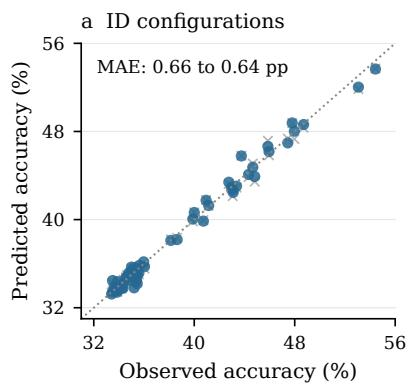

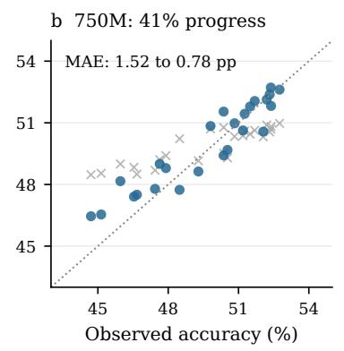

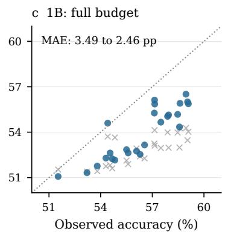  
Endpoint context ● Historical checkpoints  
Figure 10: Downstream prediction by evaluation regime. Earlier endpoint-context predictions (gray) and revised historical-checkpoint predictions (blue), with unchanged query outcomes. Points average run and prediction seeds within size–recipe groups; MAE is computed before averaging predictions. ID fit is already close, while additional historical observations improve both OOD regimes without fully removing the 1B bias.

The constituent benchmarks are ARC (Challenge and Easy; Clark et al., 2018), BoolQ (Clark et al., 2019), CommonsenseQA (Talmor et al., 2018), HellaSwag (Zellers et al., 2019), MMLU (Hendrycks et al., 2020), OpenBookQA (Mihaylov et al., 2018), PIQA (Bisk et al., 2019), SocialIQA (Sap et al., 2019), and WinoGrande (Sakaguchi et al., 2019).

Table 6: Constituent downstream targets. OOD MAE in percentage points, equally weighted across size–recipe groups. The two history methods use identical contexts; the endpoint column records the earlier TabPFN protocol. These are descriptive comparisons across the same fixed test split.
<table><tr><td>Target</td><td>TabPFN: endpoints</td><td>TabPFN: history</td><td>XGBoost: history</td></tr><tr><td>ARC-Challenge</td><td>2.12</td><td>1.43</td><td>3.40</td></tr><tr><td>ARC-Easy</td><td>1.87</td><td>1.73</td><td>4.11</td></tr><tr><td>BoolQ</td><td>6.85</td><td>5.52</td><td>6.53</td></tr><tr><td>CommonsenseQA</td><td>2.82</td><td>2.46</td><td>4.78</td></tr><tr><td>HellaSwag</td><td>2.82</td><td>1.69</td><td>6.11</td></tr><tr><td>MMLU</td><td>1.16</td><td>0.54</td><td>1.71</td></tr><tr><td>OpenBookQA</td><td>2.62</td><td>1.92</td><td>3.54</td></tr><tr><td>PIQA</td><td>1.58</td><td>1.10</td><td>2.21</td></tr><tr><td>SocialIQA</td><td>1.80</td><td>1.25</td><td>2.26</td></tr><tr><td>WinoGrande</td><td>2.92</td><td>1.33</td><td>2.78</td></tr><tr><td>Macro accuracy</td><td>2.51</td><td>1.62</td><td>3.40</td></tr></table>

## B.6 Loss-curve examples on Marin

Figures 11–13 repeat the three curve displays of Zhang et al. (2026) (their Figures 13–15) on the same run names, adding TabPFN. These use the default TabPFN v3 checkpoint with two estimators and seed 0 (mean and median readouts) rather than the joint-median route of Table 1; NCPL is the released checkpoint, and no target-run loss is supplied to either model. Boxes in the first two figures give each run’s MAE.

Ground truth NCPL (released) TabPFN, mean  
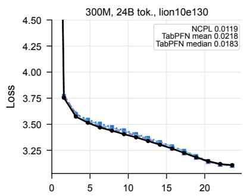

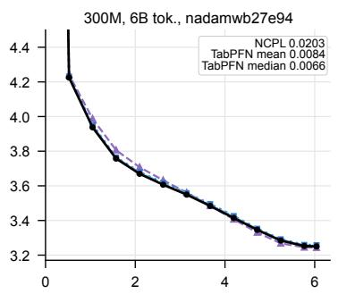

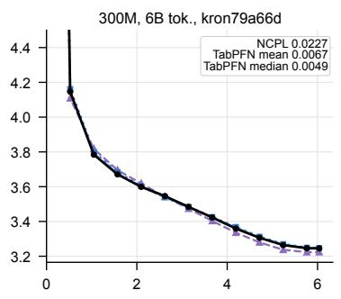

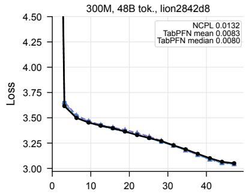

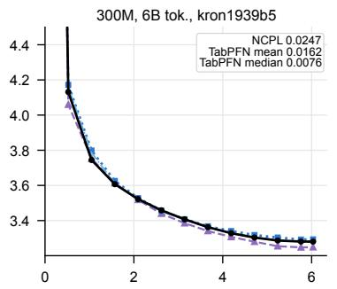

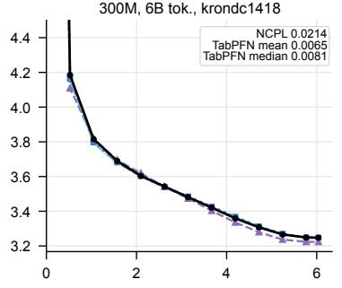

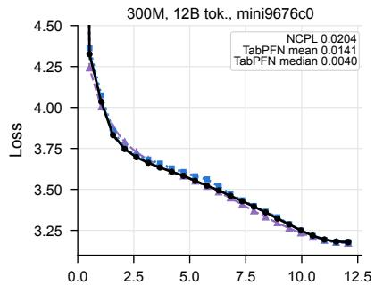

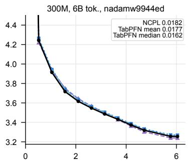

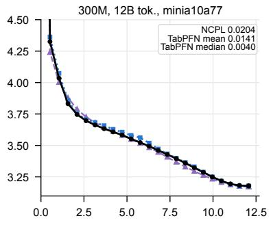

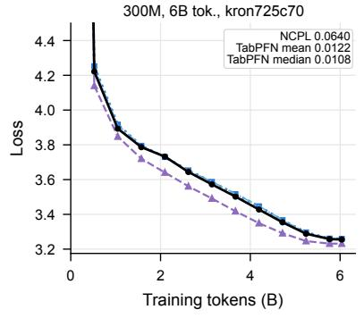

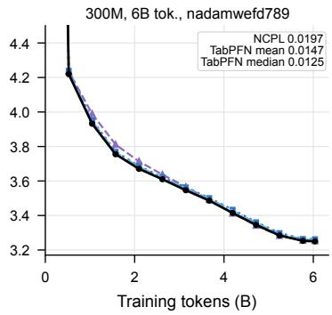

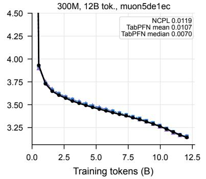  
TabPFN, median

Figure 11: Loss-curve predictions for the 12 Marin ID runs (300M) sampled in Figure 13 of Zhang et al. (2026). Black: ground truth; purple dashed: released NCPL; blue dotted and dash-dotted: TabPFN mean and median. Boxes give per-run MAE.

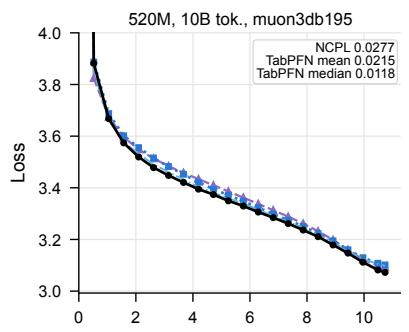

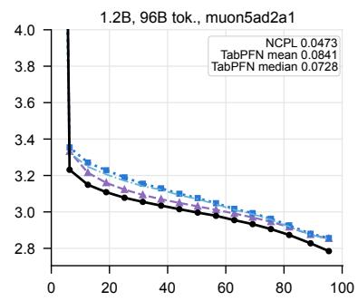

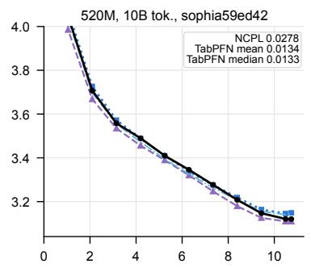

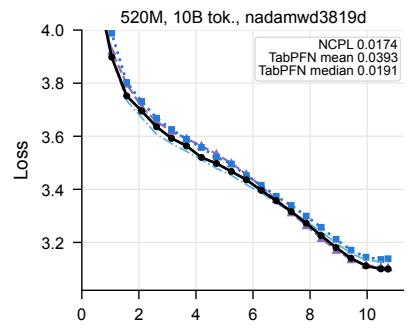

  
Figure 12: Loss-curve predictions for the 12 Marin OOD runs of Figure 14 of Zhang et al. (2026). Lines and boxes as in Figure 11.

  
Figure 13: Optimizer-specific loss curves in the setting of Figure 15 of Zhang et al. (2026): the median-final-loss run of each (N, D, optimizer) group. Solid: ground truth; dashed: NCPL; dotted: TabPFN mean. Left: ID; right: OOD.

## B.7 Updating forecasts with observations from the target run

This uses Delphi’s 88-run scaling suite (Appendix E.1): 81 historical runs and seven held-out ladder runs at $1 0 ^ { 2 1 } – 1 0 ^ { 2 3 }$ FLOPs. At cutof $p ,$ the target run’s observations with progress $f \leq p$ are appended to the historical context, and all later checkpoints are scored. Both TabPFN arms use eight estimators, seeds 0–2, mean readout, and a fixed Chinchilla ofset fitted on historical runs; only the context changes. Errors are averaged within runs, then across runs.

Table 7: New target-run observations can improve future-loss predictions. Run-averaged remaining-curve MAE (nats) on the seven Delphi ladder runs. Columns score diferent future windows; the median row is not a matched control.
<table><tr><td>Observed target prefix</td><td>20%</td><td>50%</td><td>80%</td></tr><tr><td>TabPFN mean, history only</td><td>.05787</td><td>.05425</td><td>.06344</td></tr><tr><td>TabPFN mean, history + prefix</td><td>.02537</td><td>.03078</td><td>.03922</td></tr><tr><td>Relative MAE reduction</td><td>56.2%</td><td>43.3%</td><td>38.2%</td></tr><tr><td>Runs improved</td><td>4/7</td><td>3/7</td><td>4/7</td></tr><tr><td>TabPFN median, history + prefix</td><td>.02378</td><td>.02377</td><td>.03949</td></tr><tr><td>XGBoost, history + prefix</td><td>.02367</td><td>.01951</td><td>.01751</td></tr><tr><td>Power law, prefix with fixed E</td><td>.08158</td><td>.07808</td><td>.11555</td></tr><tr><td>Last observed value</td><td>.17290</td><td>.11438</td><td></td></tr><tr><td></td><td></td><td></td><td>.16293</td></tr></table>

## B.8 Configuration selection and context updates

Figure 14 shows all 17 held-out StepLaw sweeps used for one-shot selection (5 ID, 12 OOD) with each method’s chosen candidate, together with NCPL’s and the power law’s published selections digitized from Zhang et al. (2026). Our optimum coincides with the published one in every panel. At N = 1074M and small D, the published NCPL choice lies at a larger learning rate than the released checkpoint’s, which explains the diference between printed and reproduced NCPL regret.

Matched context-update controls. Figure 5d isolates the use of target-condition observations with three policies sharing a frozen TabPFN v3 backbone (eight estimators, mean readout). Historical context contains 3,225 Marin and StepLaw training rows. All policies use the same configuration features, fixed corpus-specific Chinchilla residual target, candidate order, and two random initial observations for each of 20 seeds and 17 sweeps. The seed controls both initialization and TabPFN preprocessing. A history-only policy never receives target outcomes; an initial-frozen policy receives the two initial outcomes but no later ones; an updating policy appends each observed outcome before making the next choice. All recommend the untested candidate with lowest predicted loss, breaking ties by original candidate order. Each prediction call queries the same complete candidate feature matrix; already evaluated candidates are masked only at selection. No unseen target loss enters preprocessing or the predictor. Initial observations count toward the total budget of twelve.

All three arms are rerun under this common protocol, producing 340 matched cases and 1,020 policy trajectories. Per-step prediction vectors and context indices verify each selection; regrets are recomputed from the original measured losses. Seeds are averaged within each condition; paired percentile bootstrap intervals resample the twelve conditions 20,000 times, not the 240 initializations as independent tasks.

At budget five, conditioning on the initial outcomes reduces mean regret by 0.09249 percentage points relative to history only (95% interval [0.01642, 0.17977]). Neither replay establishes prospective training-compute savings.

  
Figure 14: All 17 held-out StepLaw sweeps. Contours: smoothed measured loss relative to the sweep optimum; gray dots: candidates. Filled markers: optimum of a quadratic fit to the measured losses (orange circle), released NCPL (red star), power law fit to the published selections (green triangle), TabPFN (blue squares, three seeds), and TabICL (Qu et al., 2026) (purple diamonds). Hollow black markers: NCPL (star) and power-law (triangle) selections digitized from Zhang et al. (2026). The two lines under each title give relative regret (%): NCPL printed / published star evaluated on our surface / released checkpoint, and power law (PL) printed / refit.

Table 8: Same-backbone feedback controls. Mean best-found measured regret (%) on twelve OOD conditions; budgets include two shared initial evaluations.
<table><tr><td>Context policy</td><td> $k = 3$ </td><td> $k = 5$ </td><td> $k = 8$ </td><td> $k = 1 2$ </td></tr><tr><td>History only</td><td>.30200</td><td>.13981</td><td>.06210</td><td>.01406</td></tr><tr><td>History + initial observations, frozen</td><td>.16719</td><td>.04733</td><td>.00872</td><td>.00220</td></tr><tr><td>History + all revealed observations</td><td>.16719</td><td>.03937</td><td>.00160</td><td>.00000</td></tr></table>

## C. Learned representations and adaptation

## C.1 KAN-learned configuration coordinates

Data and tasks. We use 1,517 StepLaw training runs to construct reference hyperparameters and prediction contexts. Final-loss prediction (T1) is evaluated on 370 ID and 694 larger-model OOD runs. Curve prediction (T2) uses their 5,177 and 10,745 recorded checkpoints, with 21,888 training checkpoints as context and no target-run prefix. All checkpoints of a run stay in one split. Configuration selection (T3) uses T1 predictions on five ID and twelve OOD model–data-size groups: we select the candidate with minimum predicted loss and report $1 0 0 ( L _ { \mathrm { s e l e c t e d } } - L _ { \mathrm { m i n } } ) / L _ { \mathrm { m i n } } ,$ where $L _ { \mathrm { m i n } }$ is the best measured candidate loss in that group.

Learning reference hyperparameters. For each of the 24 model–data-size groups in the training split, we average log learning rate and log batch size over its three lowest-loss runs. These summaries are the supervised targets of two separate pykan (Liu et al., 2024) [2, 1] networks, with standardized $( \log _ { 1 0 } N , \log _ { 1 0 } D )$ inputs and standardized targets. Each network has cubic splines with three grid intervals. We fit with 200 L-BFGS iterations, prune, refit for 100 iterations, simplify the edge functions symbolically, and refit for another 100 iterations without updating the grid.

The model-size edge is constrained to be linear in log space, an imposed power-law extrapolation prior. The data-size edge is chosen from $\{ x , x ^ { 2 } , x ^ { 3 } , \mathrm { t a n h } ( x ) \}$ by fit quality. A nonlinear candidate is retained only if leave-one-training-group-out RMSE is at least 5% below the linear candidate’s; this check uses only the 24 training groups and is applied once per target, before the prediction runs. It retains a linear edge for learning rate and a tanh edge for batch size. The KANs predict log reference values $s _ { \eta } ( N , D )$ and $s _ { B } ( N , D )$ . The added configuration fields are

$$
\Delta _ { \eta } = \log _ { 1 0 } \eta - s _ { \eta } ( N , D ) , \qquad \Delta _ { B } = \log _ { 1 0 } B - s _ { B } ( N , D ) .\tag{1}
$$

Original configuration fields, including learning rate and batch size, are retained. The same finalloss-derived references are used for curve prediction, whose queries also include training progress. No evaluation outcomes enter these fits or the contexts.

Default and matched-context comparisons. All predictors use the default TabPFN v3 checkpoint and eight estimators, with frozen backbone weights and the same fixed corpusspecific Chinchilla target ofsets. The baseline is the default, untuned TabPFN route: joint Marin/StepLaw context, mean readout and seeds 0–2 for final loss, and median readout and seeds 0–1 for curves. Its final-loss and curve predictions are those of Table 1. The KAN predictor is scored with these same task-specific readouts and seeds. T3 uses the corresponding T1 predictions without another readout selection. Figure 6 therefore reproduces Table 1’s displayed StepLaw MAEs. The KAN route uses StepLaw-only context and added coordinates, so this is a comparison of two predictor routes, not an isolated coordinate ablation. Table 9 also reports a StepLaw-only baseline without the coordinates, using the same readouts and seeds to isolate their efect. The KAN is fitted only to StepLaw; no Marin improvement is claimed.

Table 9: StepLaw results for the default TabPFN route and the KAN route: three seed-wise scores for T1/T3, two for T2, not an ensemble of predictions. T1/T2 report MAE in nats; T3 reports mean relative regret in percent.
<table><tr><td></td><td colspan="2">Final loss</td><td colspan="2">Loss curve</td><td colspan="2">Selection (%)</td></tr><tr><td>Predictor</td><td>ID</td><td>OOD</td><td>ID</td><td>OOD</td><td>ID</td><td>OOD</td></tr><tr><td>TabPFN</td><td>0.00628</td><td>0.02273</td><td>0.01653</td><td>0.03666</td><td>0.0960</td><td>0.4271</td></tr><tr><td>TabPFN (StepLaw only)</td><td>0.00640</td><td>0.02472</td><td>0.02671</td><td>0.04065</td><td>0.0694</td><td>0.3471</td></tr><tr><td>TabPFN + KAN (StepLaw only)</td><td>0.00644</td><td>0.01608</td><td>0.01531</td><td>0.03093</td><td>0.1018</td><td>0.0838</td></tr></table>

Uncertainty and scope. Paired bootstrap intervals use 10,000 resamples, with runs as units for T1/T2 (all checkpoints move together) and model–data-size groups for T3, after averaging seed-wise errors or regrets. Against the default TabPFN route, the OOD MAE diferences are −0.0066 (95% interval [−0.0076, −0.0057]) for T1 and −0.0057 ([−0.0072, −0.0044]) for T2; OOD regret decreases by 0.343 percentage points ([−0.610, −0.117]). ID intervals include zero for all three tasks: T1 [−0.0004, 0.0007], T2 [−0.0026, 0.0003], and T3 [−0.080, 0.097] percentage points. Against the matched StepLaw-context baseline, OOD mean errors and regret also improve, as shown in Table 9.

Figure provenance. Figure 6 redraws the two-input additive topology of model.plot, with legible axes, from the archived seed-0 symbolic formulas rather than a visualization refit. Input and output standardizations are inverted. Each edge is centered at its input’s training-group mean, with the constant moved into the output intercept; vertical axes therefore show contributions in log-hyperparameter units, not complete reference values. Solid lines mark each input’s marginal training range, dashed lines its extrapolation, lower ticks the training-group inputs, and upper triangles OOD inputs. Marginal support does not guarantee joint coverage. The same functions and coordinates serve all three tasks. The original prediction caches are checked for row identity, split separation, finite outputs, and exact reproduction of archived metrics. Source hashes, formulas, the cache audit, and rendering code are retained in experiments/kan\_coordinates and figs.

## C.2 Data eficiency and subset sensitivity

Matched-data NCPL fine-tunes use one sampled subset at 3%, 10%, and 30% (released checkpoint at 100%), and TabPFN receives exactly those records. At 10% (323 runs), joint-context TabPFN has ID MAE 0.0197/0.0131 on Marin/StepLaw versus NCPL’s 0.0263/0.0227. With stratified subsets, TabPFN reaches 0.0121 at 30% Marin and 0.0098 at 10% StepLaw, close to full-data NCPL (0.0115/0.0096). Each reduced-data NCPL point is a single fine-tune. Figure 15 shows the full curves.

## C.3 Input and inference tuning without backbone updates

A greedy ladder tunes encoding, derived features (ηλ, warmup fraction, tokens per update, $D / N _ { \ast }$ $\eta / B )$ , feature selection, preprocessing, target transforms, readout, and context routing. The 679- configuration, three-seed search costs 9.9 H200 GPU-hours; ID MAE selects each recipe. The tuned joint recipe lowers Marin final-loss MAE from 0.0093/0.0173 to 0.0069/0.0146 (ID/OOD); a recipe tuned on StepLaw alone lowers StepLaw MAE from 0.0063/0.0227 to 0.0051/0.0190.

Most of the gain comes from feature construction and selection.

  
Figure 15: Data amount and subset composition both afect prediction. Final-loss MAE versus the fraction of oficial training runs used as TabPFN context, XGBoost training set, or NCPL fine-tuning set. Stars: NCPL fine-tuned on one sampled subset (n = training runs); squares: per-corpus TabPFN given exactly those runs. Solid and dashed blue lines: TabPFN with per-corpus and joint context on stratified subsets; green: XGBoost. Error bars are standard deviations over three subset draws (over model seeds at 100%). TabPFN uses the mean readout.

## D. Prospective forecast

## D.1 Marin Hero Run: frozen forecasts and scoring

Chronology. V0 was committed on 25 August 2026 at 10:38 UTC, before the next evaluation at 15:43; pre-registration here means a version-controlled timestamp, not an independent registry. We evaluate this first frozen version; later revisions are outside the scope of this paper.

Forecast. V0 uses 77 checkpoints from four smaller ladder runs and five hero evaluations through 3.84% of training. Inputs are log compute, progress, and log active parameters; the target is $\log ( L - 1 . 5 )$ for dropless Paloma macro loss. TabPFN uses eight estimators, without KAN. Marin’s oficial law fits $L = 1 . 5 + A C ^ { - \alpha }$ to the ladder at each progress value and was archived with V0.

Scoring. Outcomes must follow both the forecast timestamp and the last observed step. Ofgrid predictions are interpolated piecewise-linearly in $( \log f , \log ( L - 1 . 5 ) )$ ; coverage uses the stored 5th–95th quantiles. On 24 September the public run was marked crashed at step 58,020; the last scored evaluation is step 56,999 (14.61%, loss 2.2525). V0 scores 14 outcomes with MAE 0.0216 and 90% coverage 14/14, versus 0.0576 for the oficial law and 0.0788 for TabPFN given only the ladder. V0’s completion forecast (2.031, interval [1.850, 2.455]) remains untested.

## E. Further analyses

## E.1 Delphi: extrapolating beyond the observed compute range

Delphi’s 88-run scaling suite (Held and the Marin Community, 2026) shares one Qwen3/AdamH/ WSD recipe. Its 81 context runs span $3 \times 1 0 ^ { 1 8 } – 3 \times 1 0 ^ { 2 0 }$ FLOPs; the seven held-out runs use $1 0 ^ { 2 1 }$ and $1 0 ^ { 2 2 } \ \mathrm { F L O P s }$ (three seeds each) and $1 0 ^ { 2 3 }$ FLOPs, 333× the largest context budget. Inputs are configuration fields; the target is final Paloma macro loss, residualized by a Chinchilla law fitted on context runs. TabPFN uses eight estimators and three seeds; XGBoost is selected by leave-one-budget-out (LOBO) CV.

  
Figure 16: A held-out scaling ladder. Observed versus predicted final Paloma macro loss. Dots: leave-one-budget-out predictions in the context pool; stars: held-out ladder runs (residual-mean TabPFN).

On the seven-run ladder, residual-mean TabPFN has MAE 0.0093 nats (0.005/0.006/0.032 at $1 0 ^ { 2 1 } / 1 0 ^ { 2 2 } / 1 0 ^ { 2 3 } ~ \mathrm { F L O P s } )$ , versus 0.0182 for the Delphi team’s prior forecast, 0.128 for XGBoost, 0.149 for the Chinchilla fit, and 0.204 for released NCPL (Figure 16). Within the 81-run pool, leaveone-budget-out and leave-one-width-out errors are 0.0044 and 0.0040; without residualization, ladder error rises to 0.053.

## E.2 Changing feature order without changing a training configuration

We apply eight fixed permutations to TabPFN’s columns (context and query alike) and to NCPL’s serialized key–value pairs, on the 1,905 Marin/StepLaw ID and OOD runs. TabPFN uses one estimator and three seeds, separating external permutations from its ensemble.

Across the four splits, the permutation-averaged MAE of NCPL is 1.8–4.0× its canonical MAE (for example, $0 . 0 1 1 5  0 . 0 3 3 7$ on Marin ID), rising under every permutation, whereas TabPFN stays within 0.97–1.08×.

## E.3 Row embeddings of the joint-context model

TabPFN also yields a context-conditioned 512-dimensional embedding for each run (out-of-fold for context rows). Figure 17 (top) projects all 5,130 Marin and StepLaw runs of the joint context. The runs form a horseshoe: the two corpora share the arc but remain locally separated (10-nearestneighbor same-source purity 0.985), and model size varies radially, with the larger held-out OOD runs on the inner band. Final loss varies along the arc, reaching its lowest values at the lowerright hook of compute-rich StepLaw runs (429M parameters, 50B tokens; Figure 18). Along a graph geodesic through the arc, deviation from the fitted scaling law decreases (Spearman −0.50), whereas learning rate, batch size, and weight decay are nearly uncorrelated with arc position $( | \rho | \leq 0 . 0 5 )$ .

Distance to the context in this embedding tracks OOD error on all three corpora (Figure 17, bottom; Spearman 0.40, 0.39, and 0.45 on Marin, StepLaw, and MoE). The largest StepLaw models are both the farthest from the context and the worst predicted.

Marin OOD (ρ = -0.060, n = 415)  
Raw-configuration distance  

  
Marin-MoE OOD (ρ = 0.454, n = 23)

Marin-MoE OOD (ρ = 0.683, n = 23)  
  
Figure 17: Row embeddings of the joint-context model. Top: PCA (first row) and UMAP (McInnes et al., 2018) (second row) of all 5,130 runs, colored by corpus, split, log $_ { 1 0 } N ,$ , and optimizer. Bottom: distance to the ten nearest context rows versus absolute error for OOD runs, in embedding space (first row) and raw configuration space (second row); red rings mark the largest StepLaw size (1.07B).

  
Figure 18: Probing the horseshoe. The same PCA colored by the geodesic coordinate t (left; the skeleton and its endpoints are annotated with their median configurations), by $\log _ { 1 0 } N$ (middle; size varies radially, not along the arc), and by final loss (right; crosses mark the 20 largest k-nearest-neighbor outliers).

## E.4 Training responses: recovering known relationships

We vary one configuration field at a time and compare each predictor’s response with measured sweeps (about 5,600 queries, seed 0, per-corpus mean predictions). These probe a surrogate, not new training runs.

TabPFN and NCPL both reproduce learning-rate U-curves at all 31 anchors, the optimal-learningrate exponent (−0.64; measured −0.643), and batch-size saturation beyond 256; the predicted batch-optimum exponent in token budget is 0.55 versus 0.62 measured.

## E.5 A proposed canonical training record

Main experiments use corpus-specific flat encodings. A proposed canonical schema (133 columns: 67 values and 66 masks) distinguishes recorded, inapplicable, and missing fields and fixes percorpus units.