# Normalized Cuts and Data Clustering via Matrix Fractional Programming

Yannan Chen, Member, IEEE, Beichen Huang, Licheng Zhao, Chris Ding, and Kaiming Shen, Senior Member, IEEE

Abstract—The normalized cut (NCut) problem is a fundamental one in the area of data clustering. Despite its fractional structure, the NCut problem is seldom considered from a fractional programming (FP) perspective in the existing literature. The main reason is that the conventional FP method is inadequate for this problem case: the classical Dinkelbach’s transform can only handle a single ratio and hence is limited to the two-class clustering, whereas the multi-class clustering involves multiple ratio terms. This work proposes a novel so-called multidimensional quadratic transform that is capable of dealing with the multiratio case; it recasts the NCut problem into a bipartite matching problem—which can be immediately solved by linear search. Furthermore, we explore the connection between the proposed FP method and the minorization-maximization (MM) theory, and in turn characterize the convergence behavior of our algorithm. Finally, we conduct experiments to numerically demonstrate the advantages of the proposed FP-based algorithm in a variety of data clustering and image segmentation tasks.

Index Terms—Normalized cut (NCut), graph clustering, fractional programming (FP), multidimensional quadratic transform.

## I. INTRODUCTION

timization problems involving ratio terms, as extensively considered in the areas of physics, economics, management science, signal processing, computer science, and information theory [2]–[4]. This paper explores a novel use of FP in solving the normalized cut (NCut) problem for graph clustering [5]. Not only the application but also the method of FP is new in this work. We develop the existing quadratic transform [6] into the so-called multidimensional quadratic transform to account for multiple ratios in the NCut problem. In contrast, the traditional FP method, Dinkelbach’s transform [7], is limited to the single-ratio case and thus cannot work for the NCut problem. By the proposed new FP method, the original difficult NCut problem with the 0-1 discrete constraint can be converted to a weighted bipartite matching problem that can be efficiently addressed via linear search.

Data clustering has been studied in the literature from a variety of perspectives such as K-means [8], hierarchical clustering [9], spectral clustering (SC) [10], graph clustering [11], [12], co-clustering [13], [14], and high-density clustering [15]. Graph clustering is of particular interest because of its flexibility in data types, not requiring the data clusters to be center-based as those geometry-based clustering algorithms [16]. In graph clustering, each data point is visualized as a vertex in a weighted undirected graph, where the weight of each link reflects the correlation between the two incident vertices. The task is to decompose the graph into multiple subgraphs, each subgraph representing a cluster. Intuitively speaking, we wish to put those highly correlated vertices in the same subgraph, while maximizing the “distance” between any two subgraphs. Depending on the distance metric, we would obtain different objective functions for the graph clustering problem, e.g., min cut [17], ratio cut [18], min-max cut [19], and the NCut [5]. This work adopts the NCut metric not only because it is most popular in the area but also because it yields stable performance and prevents cluster imbalance [5].

The NCut problem is a nonlinear optimization problem with the 0-1 discrete constraints, the complexity of which is shown to be NP-complete [5]. The SC method is a conventional approach to the NCut problem [5], [10]. Its main idea is to recast the NCut problem into the spectral domain and subsequently perform clustering. In this sense, SC and its variants can be viewed as two-stage methods: they first solve a relaxed spectral embedding problem and then recover discrete cluster assignments through a post-processing step such as Kmeans [5], spectral rotation [20], or discretization refinement [21]. However, the SC method can barely provide any performance guarantees; after all, it is merely a heuristic to turn the NCut problem to the new SC problem. Other approaches resort to the nonconvex optimization theory. For instance, the semidefinite relaxation (SDR) method [22] provides a bounded convex approximation for the NCut problem, while [23] employs the classical Dinkelbach’s algorithm to convexify the NCut problem. However, the aforementioned two methods are confined to the two-class NCut problem.

The multi-class NCut problem is much more challenging.

The Fast Coordinate Descent (FCD) algorithm in [24] addresses the multi-class NCut problem directly by using the standard method of block coordinate descent. In comparison, the Direct Normalized Cut (DNC) in [25] is much less straightforward, which approximates the original problem by using a bound on the NCut objective. However, the bound proposed in [25] incurs a high computational complexity. To address this issue, the Fast Iterative Normalized Cut (FINC) in [26] suggests using a different closed-form bound instead. But this new bound in FINC does not lead to an easy problem after approximation; the new problem can only be addressed in a heuristic fashion as discussed in [26]. In contrast, the building block of this paper is a novel bound on the NCut objective, which stems from the FP technique and is easy to compute. Most importantly, in light of the proposed lower bound, the original nonlinear discrete NCut problem can be recast into a weighted bipartite matching problem amenable to the linear search method. Moreover, it is worth mentioning that the proposed FP approach can be extended to those more complicated data clustering tasks such as the multi-view graph clustering [27], [28]. Graph clustering has also been applied in areas such as computer vision [29], bioinformatics [30], network analysis [31], and remote sensing [32], as well as mobilecomputing scenarios including intelligent transportation [33], UAV coordination [34], and sensor/IoT data organization [35], [36]. These applications suggest that the proposed FP-based NCut optimizer can be used for graph-based inference tasks in broader domains.

The main results of this paper are summarized in the following:

We develop a multidimensional quadratic transform for the FP purpose. This new method is more powerful than the traditional Dinkelbach’s method [7] in that it accounts for multiple ratios. The proposed method is also more general than the existing quadratic transform [6], [37] in that it can handle the matrix ratios. This feature plays a key role in converting the NCut problem to a bipartite matching problem.

We provide a strengthened convergence analysis of the proposed FP-based clustering method. Building on the minorization-maximization (MM) interpretation established in our preliminary conference work, we further establish stationary-point convergence under differentiability conditions and characterize the local convergence rate of the proposed clustering algorithm.

We develop a scalable realization of the proposed method for sparse graph settings and discuss how the similarity matrix can be constructed in practice. For small datasets, a fully connected graph constructed from a positivedefinite kernel, naturally yields a positive-semidefinite similarity (PSD) matrix. For large datasets, we adopt a sparse anchor-graph construction that also produces a PSD similarity matrix. We further show that an indefinite similarity matrix can be transformed into an equivalent PSD form.

We evaluate the saturation value of the NCut objective by the FP method. Specifically, we start from the perfect initialization (based on the ground truth) and perform the FP optimization. As a result, the quality measure of clustering (i.e., error) starts at 0% and increases, even though the objective value is monotonically improved. This experiment reveals a saturation region of the NCut objective. Within this region, solutions with smaller external clustering error cannot be meaningfully distinguished by the NCut objective alone.

An earlier version of this work appeared in NeurIPS 2024 [1]. Compared with the conference version, the present journal article further strengthens the convergence analysis, develops a scalable sparse anchor-graph realization for large-scale problems, and substantially expands the empirical study with larger datasets, additional spectral-clustering baselines, and the saturation analysis of the NCut objective.

The remainder of this paper is organized as follows. Section II reviews the NCut problem and the spectral clustering method. Section III reviews the classic FP techniques, and proposes the novel FP technique named multidimensional quadratic transform. We further show the connection between the proposed approach and the MM theory, thereby establishing its convergence behaviors. Section IV derives the proposed fractional programming-based clustering (FPC) algorithm. Section V presents numerical results. Finally, Section VI concludes the paper.

Notation: Here and throughout, bold lower-case letters represent vectors while bold upper-case letters represent matrices. For matrix $A , A ^ { \top }$ is its transpose, $A ^ { - 1 }$ is its inverse, $\lambda _ { \operatorname* { m a x } } ( A )$ is its largest eigenvalue, $A ^ { \frac { 1 } { 2 } }$ is its symmetric square root [38], and vec(A) is the vectorization of matrix A by stacking its columns to get one column vector. For vector a, $\pmb { a } ^ { \top }$ is its transpose, and $\| a \|$ is its norm. The set of real numbers, the set of nonnegative numbers, and the set of strictly positive numbers are denoted by $\mathbb { R } , \mathbb { R } _ { + }$ , and $\mathbb { R } _ { + + }$ , respectively. The set of positive semi-definite matrices and the set of positive definite matrices are denoted by $\mathbb { S } _ { + } .$ , and $\mathbb { S } _ { + + }$ , respectively. Moreover, $A \preceq B$ indicates that $( B - A ) \in \mathbb { S } _ { + }$ , and $A \prec B$ indicates that $( B - A ) \in \mathbb { S } _ { + + }$

## II. PRELIMINARY

This section comprises two parts. First, we state the NCut problem for data clustering. Second, we review the classic SC method that serves as a major benchmark in our experiments.

## A. NCut Problem for Graph Clustering

Suppose there are N data points in total. Use $i , j \in$ $\{ 1 , 2 , \ldots , N \}$ to index these data points. For a pair of data points i and $j ,$ the similarity between them is quantified as $0 \leq w _ { i j } \leq 1$ . By symmetry, we have $w _ { i j } = w _ { j i }$ . In the graph theory context, with each data point visualized as a vertex, the edge between vertex i and vertex j is assigned the weight $w _ { i j }$ (or $w _ { j i } )$ . Denote by V the set of vertices, and $\mathcal { E }$ the set of edges. The resulting graph $G = ( \nu , \mathcal { E } )$ can be recognized as a weighted undirected graph.

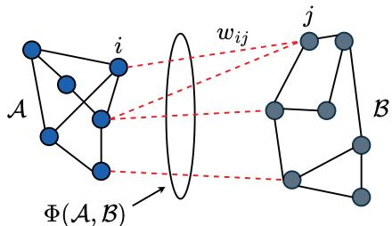  
Fig. 1. Graph cut between two disjoint subsets A and B.

For each vertex i, its degree $d _ { i }$ is the sum weights across all the incident edges:

$$
d _ { i } = \sum _ { j = 1 } ^ { N } w _ { i j } .\tag{1}
$$

Dividing the N data points into $K > 1$ clusters is equivalent to partitioning V into K disjoint subsets $\{ \mathcal { V } _ { 1 } , \mathcal { V } _ { 2 } , \ldots , \mathcal { V } _ { K } \}$ where $\textstyle \bigcup _ { k = 1 } ^ { K } \bar { \mathcal { V } } _ { k } = \mathcal { V }$ and $\nu _ { k } \cap \nu _ { k ^ { \prime } } = \emptyset$ for any $k \neq k ^ { \prime }$ . In principle, data clustering aims to group together those data points that are sufficiently similar to each other. Equivalently, we wish to minimize the similarity between any two clusters. Toward this end, one traditional strategy is to minimize

$$
\mathrm { c u t } ( \mathcal { V } _ { 1 } , \mathcal { V } _ { 2 } , \ldots , \mathcal { V } _ { K } ) = \frac { 1 } { 2 } \sum _ { k = 1 } ^ { K } \sum _ { i \in \mathcal { V } _ { k } } \sum _ { j \in \bar { \mathcal { V } } _ { k } } w _ { i j } ,\tag{2}
$$

where $\bar { \mathcal { V } } _ { k }$ is the complement of $\mathcal { V } _ { k } , \mathrm { ~ i . e . , ~ } \bar { \mathcal { V } } _ { k } \ = \ \mathcal { V } \backslash \mathcal { V } _ { k }$ . An example of two-class clustering is shown in Fig. 1. However, minimizing cu ${ \bf \Phi } _ { ; } ( \mathcal { V } _ { 1 } , \mathcal { V } _ { 2 } , \ldots , \mathcal { V } _ { K } )$ alone can be problematic— it tends to put most data points in one particular cluster while leaving other clusters almost empty, namely the cluster imbalance [39].

To address the above issue, a common method [5], [10] is to regularize the cluster volume by considering the normalized cut:

$$
\begin{array} { r } { \mathrm { n c u t } ( \mathcal { V } _ { 1 } , \mathcal { V } _ { 2 } , . . . , \mathcal { V } _ { K } ) = \displaystyle \frac { 1 } { 2 } \sum _ { k = 1 } ^ { K } \frac { \sum _ { i \in \mathcal { V } _ { k } } \sum _ { j \in \bar { \mathcal { V } } _ { k } } w _ { i j } } { \sum _ { i \in \mathcal { V } _ { k } } d _ { i } } } \\ { = \displaystyle \frac { 1 } { 2 } \sum _ { k = 1 } ^ { K } \frac { \boldsymbol { x } _ { k } ^ { \top } ( D - W ) \boldsymbol { x } _ { k } } { \boldsymbol { x } _ { k } ^ { \top } D \boldsymbol { x } _ { k } } , } \end{array}\tag{3}
$$

where $\pmb { W } = [ w _ { i j } ] \in \mathbb { R } ^ { N \times N } , ~ \pmb { D } = \mathrm { d i a g } [ d _ { 1 } , d _ { 2 } , \dotsc , d _ { N } ] \in$ $\mathbb { R } ^ { N \times N }$ , and $\pmb { x } _ { k } = ( x _ { 1 k } , \ldots , x _ { N k } ) ^ { \top } \in \{ 0 , 1 \} ^ { N }$ , where each entry $x _ { i k } \in \{ 0 , 1 \}$ equals 1 if data point i is assigned to cluster k and equals 0 otherwise. We seek the optimal clustering decision $\{ x _ { i k } \}$ that minimizes ncu ${ \bf \Phi } _ { ; } ( \mathcal { V } _ { 1 } , \mathcal { V } _ { 2 } , \ldots , \mathcal { V } _ { K } )$ . Further, because ncut $\begin{array} { r } { ( \mathcal { V } _ { 1 } , \mathcal { V } _ { 2 } , \dotsc , \mathcal { V } _ { K } ) = \frac { 1 } { 2 } K - \frac { 1 } { 2 } \sum _ { k = 1 } ^ { K } \frac { \boldsymbol { x } _ { k } ^ { \intercal } \ : W \boldsymbol { x } _ { k } } { \boldsymbol { x } _ { k } ^ { \intercal D } \boldsymbol { x } _ { k } } } \end{array}$ , the NCut minimization problem boils down to

$$
\operatorname* { m a x i m i z e } \quad \sum _ { k = 1 } ^ { K } { \frac { { \pmb x } _ { k } ^ { \top } { \pmb W } { \pmb x } _ { k } } { { \pmb x } _ { k } ^ { \top } D { \pmb x } _ { k } } }\tag{4a}
$$

$$
{ \mathrm { s u b j e c t ~ t o ~ } } \sum _ { k = 1 } ^ { K } x _ { i k } = 1 , i = 1 , \ldots , n\tag{4b}
$$

$$
x _ { i k } \in \{ 0 , 1 \} , i = 1 \ldots , n , k = 1 , \ldots . K ,\tag{4c}
$$

where the two constraints (4b) and (4c) state that each data point must be assigned to one unique cluster. The difficulties of the above problem can be recognized with two respects. First, the clustering variables $\{ x _ { i k } \}$ are discrete. Second, even when every $x _ { i k }$ is relaxed to be a continuous variable on the interval [0, 1], the problem is still nonconvex.

Remark 1: Under the binary constraint $x _ { i k } \in \{ 0 , 1 \}$ , we have

$$
\begin{array} { r } { \pmb { x } _ { k } ^ { \top } \pmb { D } \pmb { x } _ { k } = \pmb { \delta } ^ { \top } \pmb { x } _ { k } , \qquad \pmb { \delta } = [ d _ { 1 } , \dots , d _ { N } ] ^ { \top } . } \end{array}
$$

Hence, problem (4) is equivalently expressed as

$$
\operatorname* { m a x i m i z e } _ { \pmb { x } _ { k } } \quad \sum _ { k = 1 } ^ { K } \frac { \pmb { x } _ { k } ^ { \top } \pmb { W } \pmb { x } _ { k } } { \delta ^ { \top } \pmb { x } _ { k } } ,\tag{5a}
$$

$$
{ \mathrm { s u b j e c t ~ t o ~ } } ( 4 6 ) , ( 4 \mathrm { c } ) .\tag{5b}
$$

## B. Conventional Spectral Clustering (SC) Method

The SC method was initially proposed 25 years ago [5] and remains to be a popular approach to the NCut problem. First, the primal problem in (4) can be rewritten as

$$
{ \underset { X } { \mathrm { m i n i m i z e } } } \quad \operatorname { T r } { \big ( } ( X ^ { \top } D X ) ^ { - 1 } X ^ { \top } L X { \big ) }\tag{6a}
$$

$$
{ \mathrm { s u b j e c t ~ t o ~ } } ( 4 6 ) , ( 4  c ) ,\tag{6b}
$$

where $\pmb { X } = [ \pmb { x } _ { 1 } , \dots , \pmb { x } _ { K } ] \in \mathbb { R } ^ { N \times K }$ , and the Laplacian matrix L equals $D - W$ . Letting

$$
P = X ( X ^ { \top } D X ) ^ { - \frac { 1 } { 2 } } ,\tag{7}
$$

we have $P ^ { \top } D P ~ = ~ I$ . Now we change the variable as $T = D ^ { { \frac { 1 } { 2 } } } P$ , so that the optimization in X is converted to the optimization in T. The SC method preserves the identity $P ^ { \top } D P = I$ by requiring $\pmb { T } ^ { \top } \pmb { T } = \pmb { I }$ , and ignores the original constraints (4b) and (4c), thereby approximating (4) as:

$$
\operatorname* { m i n i m i z e } _ { T } \quad \operatorname { T r } ( T ^ { \top } D ^ { - \frac { 1 } { 2 } } L D ^ { - \frac { 1 } { 2 } } T )
$$

$$
{ \mathrm { s u b j e c t ~ t o ~ } } T ^ { \top } T = I .\tag{8a}
$$

(8b)

We remark that rewriting (4) as (8) is completely heuristic. The new problem (8) is a standard trace minimization problem that can be efficiently solved as follows. We first find the K largest eigenvalues $\lambda _ { 1 } \ge \lambda _ { 2 } \ge . . . \ge \lambda _ { K }$ of $D ^ { - \frac { 1 } { 2 } } L D ^ { - \frac { 1 } { 2 } }$ and their associated eigenvectors $\{ \pmb { v } _ { 1 } , \pmb { v } _ { 2 } , \dots , \pmb { v } _ { K } \}$ being linearly independent, and then obtain the solution as $\pmb { T } = [ \pmb { v } _ { 1 } , \pmb { v } _ { 2 } , \dots , \pmb { v } _ { K } ]$ Next, we recover the solution of P as $P = D ^ { - { \frac { 1 } { 2 } } } T$ . Finally, we wish to recover the original variable X from P in (7), but this is numerically difficult. A well-known heuristic [39] is to recover X by the K-means algorithm [8]. Specifically, letting $p _ { i } ~ \in ~ \mathbb { R } ^ { 1 \times K }$ be the ith row of P, we apply the K-means algorithm to group the vectors $\pmb { p } _ { 1 } , \ldots , \pmb { p } _ { N }$ into K clusters $\mathcal { C } _ { 1 } , \ldots , \mathcal { C } _ { K }$ . Finally, each $x _ { i k }$ is determined as

$$
x _ { i k } = \left\{ \begin{array} { l l } { 1 \quad } & { \mathrm { i f } p _ { i } \in \mathcal { C } _ { k } ; } \\ { 0 \quad } & { \mathrm { o t h e r w i s e . } } \end{array} \right.\tag{9}
$$

To summarize, although the SC method has been extensively considered for the NCut clustering problem, it lacks mathematical justification in two respects: first, the new problem (8) may not be equivalent to the original problem (4); second, after obtaining the solution of P, the recovery of X in (7) is difficult and can only be addressed heuristically via the Kmeans algorithm.

## III. FRACTIONAL PROGRAMMING (FP)

The NCut problem in (4) is fractionally structured in the sense that its objective function is a sum of ratios. This quick observation strongly suggests that the NCut is amenable to FP, but it turns out that very few previous works in the literature have adopted the FP approach. In the rest of this section, we first review the conventional FP methods to show why they are rarely considered for the NCut, and then introduce a recently proposed FP technique called the multidimensional quadratic transform—which forms the building block of our proposed clustering algorithm as introduced in Section IV.

## A. Existing FP Methods

The early studies in the FP field are restricted to the singleratio problem:

$$
{ \underset { x \in { \mathcal { X } } } { \operatorname* { m a x i m i z e } } } \quad { \frac { A ( x ) } { B ( x ) } } ,\tag{10}
$$

where $A ( x ) \geq 0$ is a nonnegative function, $B ( x ) > 0$ is a strictly positive function, and X is a nonempty constraint set on x. In the literature, many works further assume that $A ( x )$ is concave in $x , \ B ( x )$ is convex in $x ,$ and $\mathcal { X }$ is a convex set, namely the concave-convex condition. Notice that problem (10) is still nonconvex in general under the concave-convex condition, so the direct solving of (10) is difficult. The classic Dinkelbach’s transform in essence aims to decouple the ratio:

Proposition 1 (Dinkelbach’s Transform $I 7 J .$ The singleratio problem (10) is equivalent to

$$
\operatorname* { m a x i m i z e } _ { x \in \mathcal { X } } A ( x ) - y B ( x ) ,\tag{11}
$$

where the auxiliary variable $y$ is iteratively updated as $y =$ $A ( x ) / B ( x )$

Observe that the new problem (11) is convex in $x$ for fixed y under the concave-convex condition, and hence can be efficiently solved by the standard optimization method. Importantly, solving for x in (11) with $y$ iteratively updated guarantees convergence to the global optimum of the original problem (10). However, it is difficult to extend Dinkelbach’s transform to the multi-ratio problems (except for the max-minratios case [40]). As such, the use of Dinkelbach’s transform in the NCut area is limited to the two-class clustering that only needs to optimize a single ratio [23].

We now consider $K > 1$ pairs of the numerator function $A _ { k } ( x ) \geq 0$ and denominator function $B _ { k } ( x ) > 0$ along with a nonempty constraint set X. A sum-of-ratios problem is then formulated as

$$
\operatorname* { m a x i m i z e } _ { x \in \mathcal { X } } \ \sum _ { k = 1 } ^ { K } \frac { A _ { k } ( x ) } { B _ { k } ( x ) } .\tag{12}
$$

It is tempting to decouple each ratio $A _ { k } ( x ) / B _ { k } ( x )$ by using Dinkelbach’s transform separately, but the resulting new problem is not equivalent to problem (12). Consequently, the

classic Dinkelbach’s transform does not work for the NCut with general K clusters. A valid method to decouple multiple ratios is presented in the following proposition.

Proposition 2 (Quadratic Transform $I 6 J ) .$ : The sum-of-ratios problem (12) is equivalent to

$$
\operatorname* { m a x i m i z e } _ { x \in \mathcal { X } , y _ { k } \in \mathbb { R } } \quad \sum _ { k = 1 } ^ { K } \Big ( 2 y _ { k } \sqrt { A _ { k } ( x ) } - y _ { k } ^ { 2 } B _ { k } ( x ) \Big ) ,\tag{13}
$$

in the sense that $x ^ { \star }$ is a solution to (12) if and only if $( x ^ { \star } , y ^ { \star } )$ is a solution to (13), where an auxiliary variable $y _ { k }$ is introduced for each ratio term $A _ { k } ( x ) / B _ { k } ( x )$

We propose optimizing x and $\left\{ y _ { k } \right\}$ iteratively. When x is held fixed, each $y _ { k }$ can be optimally determined as

$$
y _ { k } ^ { \star } = \frac { \sqrt { A _ { k } ( x ) } } { B _ { k } ( x ) } .\tag{14}
$$

Furthermore, under a generalized concave-convex condition [6] wherein each $A _ { k } ( x )$ is a concave function, each $B _ { k } ( x )$ is a convex function, and X is a convex set, it can be shown that the new problem (13) is convex in x when $\left\{ y _ { k } \right\}$ are held fixed. Thus, the alternating optimization between x and $\left\{ y _ { k } \right\}$ can be performed efficiently.

Now let us return to the NCut problem in (4) and apply the above FP technique to it. Treating $\pmb { x } _ { k } ^ { \top } \pmb { W } \pmb { x } _ { k }$ and $\pmb { x } _ { k } ^ { \top } \pmb { D x } _ { k }$ respectively as numerator and denominator, we can recast problem (4) into

$$
\begin{array} { r l } { \underset { { \pmb x } _ { k } , y _ { k } \in \mathbb { R } } { \mathrm { m a x i m i z e } } } & { \displaystyle \sum _ { k = 1 } ^ { K } \left( 2 y _ { k } \sqrt { \pmb x _ { k } ^ { \top } { \pmb W } { \pmb x } _ { k } } - y _ { k } ^ { 2 } { \pmb x } _ { k } ^ { \top } \pmb D { \mathscr x } _ { k } \right) } \\ { \mathrm { s u b j e c t ~ t o } } & { ( 4 \mathbf b ) , ( 4 \mathbf c ) . } \end{array}\tag{15a}
$$

(15b)

As before, we optimize $\{ \boldsymbol { x } _ { k } \}$ and $\left\{ y _ { k } \right\}$ iteratively. For fixed $\{ \boldsymbol { x } _ { k } \}$ , the optimal solution of $y _ { k }$ is

$$
y _ { k } ^ { \star } = \frac { \sqrt { \pmb { x } _ { k } ^ { \top } \pmb { W } \pmb { x } _ { k } } } { \pmb { x } _ { k } ^ { \top } \pmb { D } \pmb { x } _ { k } } .\tag{16}
$$

It remains to optimize $\{ \boldsymbol { x } _ { k } \}$ in (15) for fixed $\left\{ y _ { k } \right\}$ . Observe that $\mathbf { \pmb { x } } ^ { \top } \mathbf { \pmb { W } } ;$ x is not a concave function of x since W is often a positive semi-definite matrix [41], and also that the constraint set of $\{ \boldsymbol { x } _ { k } \}$ is not convex because of (4c), so the aforementioned generalized concave-convex condition does not hold here. As a result, solving for $\{ \boldsymbol { x } _ { k } \}$ in (15) with $\left\{ y _ { k } \right\}$ held fixed is no longer a convex problem. The above alternating optimization between $\{ \boldsymbol { x } _ { k } \}$ and $\left\{ y _ { k } \right\}$ can be recognized as the so-called Fast Iterative Normalized Cut (FINC) algorithm of the recent work [26]. Although it manages to decouple multiple ratios in the NCut problem, we are faced with a new challenging problem. The new problem is dealt with in a heuristic fashion in [26]. This fact perhaps explains why the FP approach has not yet been considered extensively in the literature despite the fractional structure of the NCut problem.

## B. Proposed Multidimensional Quadratic Transform

We now proceed to a much more sophisticated FP toolkit that accounts for multidimensional ratios. To start, consider the following matrix extension of the traditional scalar-valued

Algorithm 1 Iterative Method for Solving Problem (17)   
1: Initialize x to a feasible value.   
2: repeat   
3: Update each $Y _ { k }$ according to (20), for $k = 1 , 2 , \ldots , K$   
4: Update x by solving the reformulated problem (19).   
5: until the original objective value converges   
f(x)   
g(x|x(t))   
g(x|x(t−1))   
x(t+1) x(t) p (t−1)

FP problem: each $A _ { k } ( x ) \geq 0$ is generalized as positive semidefinite $\mathbf { \Delta } A _ { k } ( x ) \in \mathbb { S } _ { + } ^ { m \times m }$ , while each $B _ { k } ( x ) > 0$ is generalized as positive definite $\boldsymbol { B _ { k } } ( \boldsymbol { x } ) \in \mathbb { S } _ { + + } ^ { m \times m }$ . Accordingly, the ratio term is extended to the matrix form as

$$
\frac { A _ { k } ( x ) } { B _ { k } ( x ) } \implies B _ { k } ( x ) ^ { - 1 } A _ { k } ( x ) .
$$

We then arrive at a matrix extension of the sum-of-ratios problem (12):

$$
\operatorname* { m a x i m i z e } _ { x \in \mathcal { X } } \quad \sum _ { k = 1 } ^ { K } \operatorname { T r } \left( B _ { k } ^ { - 1 } ( x ) \pmb { A } _ { k } ( x ) \right) .\tag{17}
$$

One main result of this paper is that the quadratic transform in Proposition 2 carries over to the matrix ratio case, as stated in the following proposition.

Theorem 1 (Multidimensional Quadratic Transform): Suppose that each $\mathbf { \boldsymbol { A } } _ { k } ( \boldsymbol { x } ) \in \mathbb { S } _ { + } ^ { m \times m }$ can be factorized as

$$
\begin{array} { r } { \pmb { A } _ { k } ( \pmb { x } ) = [ \pmb { Z } _ { k } ( \pmb { x } ) ] ^ { \top } [ \pmb { Z } _ { k } ( \pmb { x } ) ] \quad \mathrm { w h e r e } ~ \pmb { Z } _ { k } ( \pmb { x } ) \in \mathbb { R } ^ { \ell \times m } } \end{array}\tag{18}
$$

for some positive integer ℓ. The matrix FP problem (17) is then equivalent to

$$
\operatorname* { m a x i m i z e } _ { \boldsymbol { x } \in \mathcal { X } , \boldsymbol { Y } _ { k } \in \mathbb { R } ^ { \ell \times m } } \sum _ { k = 1 } ^ { K } \operatorname { T r } \left( 2 \boldsymbol { Y } _ { k } [ \boldsymbol { Z } _ { k } ( \boldsymbol { x } ) ] ^ { \top } - \boldsymbol { Y } _ { k } \boldsymbol { B } _ { k } ( \boldsymbol { x } ) \boldsymbol { Y } _ { k } ^ { \top } \right)\tag{19}
$$

where an auxiliary variable $Y _ { k } \in \mathbb { R } ^ { \ell \times m }$ is introduced for each matrix ratio $B _ { k } ^ { - 1 } ( x ) A _ { k } ( x )$

Proof: It can be shown that each $Y _ { k }$ in (19) is always optimally determined as

$$
Y _ { k } ^ { \star } = Z _ { k } ( x ) B _ { k } ^ { - 1 } ( x ) .\tag{20}
$$

Substituting the above $Y _ { k } ^ { \star }$ in (19) recovers the original problem (17).

It is easy to see that the multidimensional quadratic transform in Theorem 1 encompasses the conventional quadratic transform in Proposition 2 as a special case.

Remark 2: The factorization $A _ { k } ( x ) = Z _ { k } ( x ) ^ { \top } Z _ { k } ( x )$ in Theorem 1 is not an additional modeling assumption; it follows from the positive semidefiniteness of $A _ { k } ( x )$ , for example by taking a valid matrix square root. The role of Theorem 1 is therefore to provide an exact quadratic transform of the original matrix fractional objective. This differs from symmetric nonnegative matrix factorization [42], which treats graph clustering through a low-rank nonnegative factorization of a similarity matrix, and can be viewed as operating on a relaxed factorized formulation. In contrast, Theorem 1 is applied to the original NCut-related matrix fractional objective and preserves its optimizer.

Theorem 1 naturally suggests an alternating optimization procedure for solving (17). Specifically, for any fixed x, each auxiliary variable $Y _ { k }$ admits the closed-form update in (20). On the other hand, when $\left\{ { \cal Y } _ { k } \right\}$ are fixed, the reformulated objective in (19) becomes an optimization problem only with respect to x. Therefore, instead of directly handling the original matrix fractional problem (17), we can iteratively update $\left\{ { \cal Y } _ { k } \right\}$ and x based on the transformed formulation. This generic procedure is summarized in Algorithm 1.

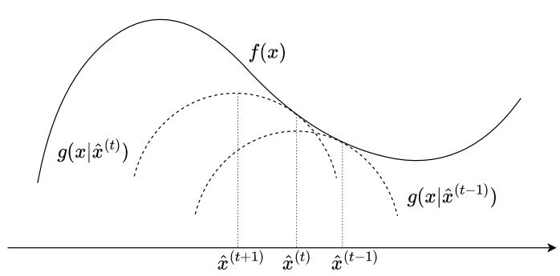  
Fig. 2. The value of the original objective f(x) is nondecreasing after each iteration of the MM method, where $g ( x | \grave { x ^ { ( t ) } } )$ is the surrogate function constructed in the tth iteration.

## C. Connection to MM Theory

It turns out that our proposed multidimensional quadratic transform has a close connection with the minorizationmaximization method. Based on this connection, we further show the convergence behavior of Algorithm 2. We begin with a brief review of the MM theory [43], [44]. Consider a general constrained optimization problem

$$
{ \underset { x \in { \mathcal { X } } } { \operatorname* { m a x i m i z e } } } \quad f ( x ) .\tag{21}
$$

Rather than solving the above problem directly, the MM theory deals with an approximation of (21) iteratively. In principle, we construct a surrogate function g(x|xˆ) of x given the condition parameter ${ \hat { x } } \in { \mathcal { X } }$ , such that

$$
\begin{array} { r } { g ( x | \hat { x } ) \leq f ( x ) , } \end{array}\tag{22}
$$

$$
g ( { \hat { x } } | { \hat { x } } ) = f ( { \hat { x } } ) .\tag{23}
$$

Then the MM method solves a sequence of new problems of the surrogate function:

$$
\operatorname* { m a x i m i z e } _ { \boldsymbol { x } \in \mathcal { X } } \quad g ( \boldsymbol { x } | \hat { \boldsymbol { x } } ) ,\tag{24}
$$

with xˆ iteratively updated to the previous solution x. Specifically, with the solution of (24) in the previous iteration denoted by xˆ, we construct a surrogate function $g ( x | \hat { x } )$ for the current iteration and then obtain the new solution xˆ of (24), and so forth, as illustrated in Fig. 2.

We now show that the alternating optimization between x and $\left\{ { \cal Y } _ { k } \right\}$ in (19) can be interpreted as an MM method. We now view the update of $Y _ { k }$ as a function of the previous solution xˆ, that is

$$
\begin{array} { r } { \mathcal { V } _ { k } ( \hat { x } ) = Z _ { k } ( \hat { x } ) B _ { k } ^ { - 1 } ( \hat { x } ) . } \end{array}\tag{25}
$$

Substituting each $Y _ { k }$ with $\mathcal { V } _ { k } ( \hat { x } )$ in the new objective function

in (19) gives rise to a function of x conditioned on ${ \hat { x } } ;$

$$
\begin{array} { r l } & { g ( x | \hat { x } ) = \displaystyle \sum _ { k = 1 } ^ { K } \mathrm { T r } ( 2 Z _ { k } ( \hat { x } ) B _ { k } ^ { - 1 } ( \hat { x } ) [ Z _ { k } ( x ) ] ^ { \top } } \\ & { ~ - ~ Z _ { k } ( \hat { x } ) B _ { k } ^ { - 1 } ( \hat { x } ) B _ { k } ( x ) [ Z _ { k } ( \hat { x } ) B _ { k } ^ { - 1 } ( \hat { x } ) ] ^ { \top } ) ) . } \end{array}\tag{26}
$$

Notice that maximizing the objective function in (19) with $\left\{ { \bf Y } _ { k } \right\}$ fixed is equivalent to maximizing $g ( x | \hat { x } )$ where xˆ is fixed at the solution of the previous iteration.

Most importantly, it can be shown that $g ( x | \hat { x } )$ meets the conditions (22) and (23) for the original objective function in (17), so the alternating optimization between x and $\left\{ \mathbf { Y } _ { k } \right\}$ in (19) amounts to an MM procedure. In light of the MM theory, we immediately have the following result.

Proposition 3: The alternating optimization between x and $\left\{ \mathbf { Y } _ { k } \right\}$ in (19) guarantees a nondecreasing convergence of the original optimization objective in (17). Furthermore, if functions $Z _ { k } ( x )$ and $B _ { k } ( x )$ are differentiable, then the alternating optimization converges to a stationary point of the original problem (17).

We now return to the NCut problem in (4). Similar to quadratic transform in Proposition 2, the optimization of the auxiliary variable $\left\{ { \bf Y } _ { k } \right\}$ with fixed x can be found in closed form as given in (20). The key step is to optimize $x$ for fixed $\left\{ { \bf Y } _ { k } \right\}$ . Recall that the primal variable $x$ is still difficult to optimize for the NCut problem after applying the quadratic transform. In contrast, it turns out that the multidimensional quadratic transform in Proposition 1 can lead us to an efficient iterative update of $x$ for the NCut problem scenario, as elaborated in the next section.

## IV. FP-BASED APPROACH TO NCUT PROBLEM

The goal of this section is to address problem (4) by means of the multidimensional FP. We begin with a special case in which the similarity matrix W is assumed to be positive semidefinite. Next, we discuss the indefinite $W$ case and how the similarity matrix is generated in the different task scenarios.

## A. Proposed Multidimensional FP-Based Clustering

It is crucial to note that the numerator part $\pmb { x } _ { k } ^ { \top } \pmb { W } \pmb { x } _ { k }$ can be factorized as

$$
\begin{array} { r } { \pmb { x } _ { k } ^ { \top } \pmb { W } \pmb { x } _ { k } = \pmb { z } _ { k } ^ { \top } \pmb { z } _ { k } \quad \mathrm { w h e r e } ~ \pmb { z } _ { k } = \pmb { W } ^ { \frac { 1 } { 2 } } \pmb { x } _ { k } . } \end{array}\tag{27}
$$

We remark that $W ^ { \frac { 1 } { 2 } }$ , i.e., the symmetric square root of W [38], is guaranteed to exist because we have assumed that ${ \pmb W } \in \mathbb { S } _ { + } ^ { \bar { m } \times m }$ for the current discussion. We then treat $\pmb { x } _ { k } ^ { \top } \pmb { W } \pmb { x } _ { k } , ~ \pmb { z } _ { k } ,$ , and $\pmb { x } _ { k } ^ { \top } \pmb { D x } _ { k }$ as $A _ { k } ( x ) , Z _ { k } ( x )$ , and $B _ { k } ( x )$ respectively, in Theorem 1, with $m = 1$ and $\ell = N$ , thus using the multidimensional quadratic transform to reformulate the NCut problem (4) as

$$
\operatorname* { m a x i m i z e } _ { \pmb { x } _ { k } , \pmb { y } _ { k } \in \mathbb { R } ^ { N } } \quad \sum _ { k = 1 } ^ { K } \operatorname { T r } \left( 2 \pmb { y } _ { k } ( \pmb { W } ^ { \frac { 1 } { 2 } } \pmb { x } _ { k } ) ^ { \top } - \pmb { y } _ { k } ( \pmb { x } _ { k } ^ { \top } \pmb { D } \pmb { x } _ { k } ) \pmb { y } _ { k } ^ { \top } \right)\tag{28a}
$$

$$
{ \mathrm { s u b j e c t ~ t o ~ } } ( 4 6 ) , ( 4  c ) .\tag{28b}
$$

We then optimize $\scriptstyle { \mathbf { 2 } } \mathbf { } \mathbf { } \mathbf { } \mathbf { } \mathbf { } \mathbf { } \mathbf { } \mathbf { } \mathbf { }$ and $\left\{ \pmb { y } _ { k } \right\}$ iteratively. When $\{ \boldsymbol { x } _ { k } \}$ is held fixed, each ${ \mathbf { } } _ { \mathbf { } ^ { 3 k } }$ is optimally determined as

$$
{ \pmb y } _ { k } ^ { \star } = \frac { { \pmb W } ^ { \frac { 1 } { 2 } } { \pmb x } _ { k } } { { \pmb x } _ { k } ^ { \top } D x _ { k } } .\tag{29}
$$

Now the core question is whether $\{ \boldsymbol { x } _ { k } \}$ could be efficiently solved when $\left\{ \pmb { y } _ { k } \right\}$ are held fixed. The optimization objective of $\{ \boldsymbol { x } _ { k } \}$ in (28a) for fixed $\left\{ \pmb { y } _ { k } \right\}$ is written as

$$
h ( \pmb { x } _ { 1 } , . . . , \pmb { x } _ { K } ) = \sum _ { k = 1 } ^ { K } \operatorname { T r } \left( 2 \pmb { y } _ { k } ( \pmb { W } ^ { \frac 1 2 } \pmb { x } _ { k } ) ^ { \top } - \pmb { y } _ { k } ( \pmb { x } _ { k } ^ { \top } \pmb { D } \pmb { x } _ { k } ) \pmb { y } _ { k } ^ { \top } \right) .\tag{30}
$$

Recall from the equivalent formulation in problem (5) that, under the binary constraint $x _ { i k } \in \{ 0 , 1 \}$ ,

$$
\begin{array} { r } { \pmb { x } _ { k } ^ { \top } \pmb { D } \pmb { x } _ { k } = \delta ^ { \top } \pmb { x } _ { k } . } \end{array}\tag{31}
$$

We can then rewrite $h ( \pmb { x } _ { 1 } , \dots , \pmb { x } _ { K } )$ as

$$
\begin{array} { l } { { \displaystyle h ( { \pmb x } _ { 1 } , \dots , { \pmb x } _ { K } ) = \sum _ { k = 1 } ^ { K } \left( 2 { \pmb y } _ { k } ^ { \top } { \pmb W } ^ { \frac { 1 } { 2 } } { \pmb x } _ { k } - { \pmb y } _ { k } ^ { \top } { \pmb y } _ { k } { \pmb \delta } ^ { \top } { \pmb x } _ { k } \right) } } \\ { ~ } \\ { { \displaystyle ~ = \sum _ { k = 1 } ^ { K } \mu _ { k } ^ { \top } { \pmb x } _ { k } } , } \end{array}\tag{32}
$$

where

$$
\pmb { \mu } _ { k } = 2 \pmb { W } ^ { \frac { 1 } { 2 } } \pmb { y } _ { k } - \delta \pmb { y } _ { k } ^ { \top } \pmb { y } _ { k } .\tag{33}
$$

In (32), the first equality follows since $\pmb { x } _ { k } ^ { \top } \pmb { D x } _ { k }$ is a scalar. Denote by $\mu _ { i k }$ the ith component of $\mu _ { k }$ . In light of (32), we can readily maximize $h ( \{ x _ { k } \} )$ under the constraints (4b) and (4c). Intuitively, for each data point $i ,$ it is optimal to set $x _ { i k }$ with the largest $\mu _ { i k }$ to one, while setting the rest $x _ { i k }$ to zero, i.e.,

$$
\begin{array} { r } { x _ { i k } ^ { \star } = \left\{ \begin{array} { l l } { 1 \quad } & { \mathrm { i f } k = \underset { k ^ { \prime } } { \arg \operatorname* { m a x } } \mu _ { i k ^ { \prime } } ; } \\ { 0 \quad } & { \mathrm { o t h e r w i s e } . } \end{array} \right. } \end{array}\tag{34}
$$

If there exists a tie $( \mathrm { i . e . }$ , when more than one cluster index $k ^ { \prime }$ maximizes $\mu _ { i k ^ { \prime } }$ for same i) then break it randomly. Further, with $\boldsymbol { y } _ { k } ^ { \star }$ in (29) plugged in (33), we obtain an efficient computation of $\mu _ { k }$ as

$$
\begin{array} { c } { \displaystyle \pmb { \mu } _ { k } = \frac { 2 W \pmb { x } _ { k } } { \pmb { x } _ { k } ^ { \top } D \pmb { x } _ { k } } - \frac { \delta \pmb { x } _ { k } ^ { \top } W \pmb { x } _ { k } } { ( \pmb { x } _ { k } ^ { \top } D \pmb { x } _ { k } ) ^ { 2 } } } \\ { = \frac { 2 W \pmb { x } _ { k } } { \delta ^ { \top } \pmb { x } _ { k } } - \frac { \delta \pmb { x } _ { k } ^ { \top } W \pmb { x } _ { k } } { ( \delta ^ { \top } \pmb { x } _ { k } ) ^ { 2 } } . } \end{array}\tag{35}
$$

The merits of rewriting $\pmb { \mu _ { k } }$ as (35) are two-fold. First, it sidesteps the update of the auxiliary variables $\left\{ \pmb { y } _ { k } \right\}$ . Second, it no longer entails computing the square root of $W$ . The resulting algorithm referred to as fractional programmingbased clustering (FPC) is summarized in the following.

Clearly, the FPC algorithm is guaranteed to converge in terms of the new objective value $h ( \pmb { x } _ { 1 } , \dots , \pmb { x } _ { K } )$ , since the iterative update of $\{ \pmb { x } _ { k } \}$ and $\{ \mu _ { k } \}$ in FPC amounts to a block coordinate ascent for problem (28) so that $h ( \pmb { x } _ { 1 } , \dots , \pmb { x } _ { K } )$ is monotonically increasing after each iteration. We can actually claim a stronger result for FPC according to Proposition $^ { 3 , }$ as stated in the subsequent proposition.

Proposition $4 { : }$ Not only the new objective value $h ( \pmb { x } _ { 1 } , \dots , \pmb { x } _ { K } )$ in (30) but also the original objective value of the NCut problem, $\begin{array} { r } { f ( \pmb { x } _ { 1 } , . . . , \pmb { x } _ { K } ) = \sum _ { k = 1 } ^ { K } \frac { \pmb { x } _ { k } ^ { \top } W \pmb { x } _ { k } } { \pmb { x } _ { k } ^ { \top } D \pmb { x } _ { k } } } \end{array}$ , is nondecreasing after each iteration of FPC.

```latex
Algorithm 2 Fractional Programming-Based Clustering
1: Initialize $\{ \boldsymbol { x } _ { k } \}$ to a feasible value satisfying $\scriptstyle \sum _ { k = 1 } ^ { K } x _ { i k } =$
1 and $x _ { i k } \in \{ 0 , 1 \}$ for each $( i , k )$
2: repeat
3: Update each $\pmb { \mu } _ { k }$ according to (35).
4: Update each $x _ { i k }$ according to (34).
5: until the value of $\begin{array} { r } { h ( \{ \pmb { x } _ { k } \} ) = \sum _ { k = 1 } ^ { K } \pmb { \mu } _ { k } ^ { \top } } \end{array}$ x<sub>k</sub> converges.
```

Since the general NCut problem with discrete constraints is NP-complete [5], this monotonic convergence result should not be interpreted as a global-optimality guarantee; our analysis focuses on monotonic improvement of the NCut objective and local convergence behavior of the iterative procedure.

## B. Convergence Rate Analysis

Moreover, in light of the MM theory [45], we can characterize the convergence rate of Algorithm 2. To facilitate the analysis, we see the objective function of the NCut problem as a function of ${ \bar { \mathbf { x } } } ,$ where $\bar { \textbf { \em x } } = [ \pmb { x } _ { 1 } , \pmb { x } _ { 2 } , \dots , \pmb { x } _ { K } ]$ is an $N K \times 1$ vector. Denote by $f ( \cdot )$ the NCut objective value, $\bar { \pmb x } ^ { * }$ the local maximizer under consideration, t the iterate index, R the radius of the local neighborhood around $\bar { \pmb x } ^ { * }$ , L the Lipschitz constant of $\nabla ^ { 2 } f ( { \bar { \pmb x } } ) , h ( { \bar { \pmb x } } , { \bar { \pmb y } } )$ the new objective function defined below, where $\bar { \pmb { y } } = [ \pmb { y } _ { 1 } , \pmb { y } _ { 2 } , \dots , \pmb { y } _ { K } ]$ , and ${ \bar { \mathbf { x } } } ^ { t }$ the solution after t iterates. Following the analysis steps in [45], we characterize the convergence rate of Algorithm 2 as stated in the following proposition.

Proposition 5: If the Hessian of the objective function $f ( { \bar { \pmb x } } )$ of the continuous relaxation of problem (5) is L-Lipschitz continuous, then the local convergence rate of the alternating optimization is

$$
\begin{array} { l } { \displaystyle | f ( \bar { \pmb x } ^ { * } ) - f ( \bar { \pmb x } ^ { 1 } ) | \leq \frac { \Lambda R ^ { 2 } } { 2 } + \frac { L R ^ { 3 } } { 6 } , } \\ { \displaystyle | f ( \bar { \pmb x } ^ { * } ) - f ( \bar { \pmb x } ^ { t } ) | \leq \frac { 2 \Lambda R ^ { 2 } + 2 L R ^ { 3 } / 3 } { t + 3 } , \quad \mathrm { f o r } t \geq 2 . } \end{array}
$$

The rest of Section IV-B is devoted to the proof of the above proposition. Recall that problems (4) and (5) are equivalent under the binary constraint, and therefore lead to the same FPC updates. For the convergence-rate analysis, however, we relax the binary constraint of problem (5) as $0 \leq x _ { i k } \leq 1$

Accordingly, in this subsection we denote

$$
f ( { \bar { \mathbf { x } } } ) = \sum _ { k = 1 } ^ { K } { \frac { { \mathbf { x } } _ { k } ^ { \top } W { \mathbf { } } { \mathbf { } } { \mathbf { x } } _ { k } } { { \delta ^ { \top } } { \mathbf { x } } _ { k } } } ,\tag{36}
$$

and use its quadratic-transform surrogate

$$
h ( \bar { \pmb { x } } , \bar { \pmb { y } } ) = \sum _ { k = 1 } ^ { K } \left( 2 \pmb { y } _ { k } ^ { \top } \pmb { W } ^ { \frac { 1 } { 2 } } \pmb { x } _ { k } - \pmb { y } _ { k } ^ { \top } \pmb { y } _ { k } \delta ^ { \top } \pmb { x } _ { k } \right) .\tag{37}
$$

For fixed ${ \bar { y } } , h ( { \bar { x } } , { \bar { y } } )$ is linear in ${ \bar { \mathbf { x } } } .$

Note that the original NCut problem is nonconvex, and the global analysis is intractable. We would like to give a

local analysis by restricting the constraint set to a small neighborhood of a local maximizer, i.e.,

$$
\mathcal { X } = \{ \bar { \pmb { x } } : \| \bar { \pmb { x } } - \bar { \pmb { x } } ^ { * } \| _ { 2 } \leq R \} ,\tag{38}
$$

where $\bar { \pmb x } ^ { * }$ is the local maximizer under consideration and the radius $R ~ > ~ 0$ is sufficiently small. In the following local analysis, we assume that $f ( { \bar { \pmb x } } )$ is concave on X and focus on the iterates that remain in X.

The convergence rate analysis also uses the MM interpretation. Conditioned on ${ \bar { \pmb x } } ^ { \prime } \in { \mathcal { X } } .$ , write the difference between $f ( { \bar { \pmb x } } )$ and the surrogate function $h ( \bar { \pmb x } , \bar { \pmb y } )$ as a function of $\bar { \pmb { x } } \in \mathcal { X } ;$

$$
\begin{array} { r l } & { \rho ( \bar { \pmb x } | \bar { \pmb x } ^ { \prime } ) } \\ & { \ = f ( \bar { \pmb x } ) - h ( \bar { \pmb x } , \mathcal { V } ( \bar { \pmb x } ^ { \prime } ) ) } \\ & { \ = \displaystyle \sum _ { k = 1 } ^ { K } \frac { { \pmb x } _ { k } ^ { \top } W { \pmb x } _ { k } } { \delta ^ { \top } { \pmb x } _ { k } } - \displaystyle \sum _ { k = 1 } ^ { K } \bigl ( 2 { \pmb y } _ { k } ^ { \top } ( { \pmb x } _ { k } ^ { \prime } ) W ^ { \frac { 1 } { 2 } } { \pmb x } _ { k } - \| { \pmb y } _ { k } ( { \pmb x } _ { k } ^ { \prime } ) \| _ { 2 } ^ { 2 } \delta ^ { \top } { \pmb x } _ { k } \bigr ) . } \end{array}
$$

It can be readily shown that

$$
\rho ( \bar { \pmb x } ^ { t } | \bar { \pmb x } ^ { t } ) = 0 ,\tag{39a}
$$

$$
\nabla \rho ( \bar { \pmb { x } } ^ { t } | \bar { \pmb { x } } ^ { t } ) = \mathbf { 0 } .\tag{39b}
$$

Moreover, define the following quantity as

$$
\Lambda = \operatorname* { s u p } _ { \bar { \pmb { x } } \in \mathcal { X } } \lambda _ { \operatorname* { m a x } } \left( \nabla ^ { 2 } \rho ( \bar { \pmb { x } } | \bar { \pmb { x } } ) \right) .\tag{40}
$$

Since $h ( \bar { \pmb x } , \mathcal { V } ( \bar { \pmb x } ^ { \prime } ) )$ is linear in x¯ for fixed $\bar { \pmb x } ^ { \prime } .$ , the Hessian of $\rho ( \bar { \pmb x } | \bar { \pmb x } ^ { \prime } )$ with respect to x¯ has the same Lipschitz constant L as $\dot { \nabla } ^ { 2 } f ( \bar { \pmb { x } } )$ . Lemma 1.2.4 in [46] states that for any twicedifferentiable function $\phi ( x )$ with an L-Lipschitz continuous Hessian, we have

$$
\begin{array} { l } { \displaystyle \bigg | \phi ( \boldsymbol { x } ^ { \prime } ) - \phi ( \boldsymbol { x } ) - \nabla \phi ( \boldsymbol { x } ) ^ { \top } ( \boldsymbol { x } ^ { \prime } - \boldsymbol { x } ) } \\ { \displaystyle \qquad - \frac { 1 } { 2 } ( \boldsymbol { x } ^ { \prime } - \boldsymbol { x } ) ^ { \top } \nabla ^ { 2 } \phi ( \boldsymbol { x } ) ( \boldsymbol { x } ^ { \prime } - \boldsymbol { x } ) \bigg | \le \frac { L } { 6 } \| \boldsymbol { x } ^ { \prime } - \boldsymbol { x } \| _ { 2 } ^ { 3 } } \end{array}\tag{41}
$$

given any two feasible x and $x ^ { \prime } .$

Applying the above lemma to the function $\rho ( \bar { \boldsymbol { x } } | \bar { \boldsymbol { x } } ^ { t - 1 } )$ as a function of x¯, with $\bar { \pmb x } ^ { t - 1 }$ fixed, and using the results in (39) give

L 6 kx¯ − x¯<sup>t</sup>−<sup>1</sup>k<sup>3</sup><sub>2</sub>   
≥ ρ(x¯|x¯<sup>t</sup>−<sup>1</sup>)   
<sup>1</sup> (x¯ − x¯<sup>t</sup>−<sup>1</sup>)⊤∇<sup>2</sup>ρ(x¯<sup>t</sup>−<sup>1</sup>|x¯<sup>t</sup>−<sup>1</sup>)(x¯ − x¯<sup>t</sup>−<sup>1</sup>)   
≥ ρ(x¯|x¯<sup>t</sup>−<sup>1</sup>) − <sup>Λ</sup> kx¯ − x¯<sup>t</sup>−<sup>1</sup>k<sup>2</sup><sub>2</sub>   
Λ   
= f(x¯) − h(x¯, y¯<sup>t</sup>) − kx¯ − x¯<sup>t</sup>−<sup>1</sup>k<sup>2</sup><sub>2</sub>   
<sup>(a)</sup>≥ f(x¯) − h(x¯<sup>t</sup>, y¯<sup>t</sup>) − <sup>Λ</sup> kx¯ − x¯<sup>t</sup>−<sup>1</sup>k<sup>2</sup><sub>2</sub>   
<sup>(b)</sup>≥ f(x¯) − h(x¯<sup>t</sup>, y¯<sup>t+1</sup>) − <sup>Λ</sup> kx¯ − x¯<sup>t</sup>−<sup>1</sup>k<sup>2</sup> 2   
<sup>(c)</sup>= f(x¯) − f(x¯<sup>t</sup>) − <sup>Λ</sup> kx¯ − x¯<sup>t</sup>−<sup>1</sup>k<sup>2</sup><sub>2</sub>,

(42)

where step (a) follows since ${ \bar { \mathbf { x } } } ^ { t }$ maximizes $h ( \bar { \pmb x } , \bar { \pmb y } )$ for the

current $\bar { y } = \bar { y } ^ { t }$ , step (b) follows since $\bar { \boldsymbol y } ^ { t + 1 }$ maximizes $h ( \bar { \pmb x } , \bar { \pmb y } )$ for the current $\bar { \mathbf { x } } = \bar { \mathbf { x } } ^ { t }$ , and step (c) follows by the property of the surrogate function.

Following Nesterov’s proof technique in [46], we let

$$
\bar { \pmb x } = \pi \bar { \pmb x } ^ { * } + ( 1 - \pi ) \bar { \pmb x } ^ { t - 1 } ,\tag{43}
$$

where $\pi \in [ 0 , 1 ]$ . Then the concavity of $f ( { \bar { \pmb x } } )$ on X gives

$$
f ( \bar { \boldsymbol { x } } ) \geq \pi f ( \bar { \boldsymbol { x } } ^ { * } ) + ( 1 - \pi ) f ( \bar { \boldsymbol { x } } ^ { t - 1 } ) .\tag{44}
$$

Denote the gap in the objective value as

$$
v _ { t } = f ( \bar { x } ^ { * } ) - f ( \bar { x } ^ { t } ) .\tag{45}
$$

Substituting (43) and (44) into (42) gives rise to

$$
\begin{array} { l } { \displaystyle v _ { t } \leq ( 1 - \pi ) v _ { t - 1 } + \frac { \pi ^ { 2 } \Lambda } { 2 } \| \bar { \boldsymbol { x } } ^ { * } - \bar { \boldsymbol { x } } ^ { t - 1 } \| _ { 2 } ^ { 2 } } \\ { \displaystyle \qquad + \frac { \pi ^ { 3 } L } { 6 } \| \bar { \boldsymbol { x } } ^ { * } - \bar { \boldsymbol { x } } ^ { t - 1 } \| _ { 2 } ^ { 3 } } \\ { \leq ( 1 - \pi ) v _ { t - 1 } + \pi ^ { 2 } \biggl ( \frac { \Lambda R ^ { 2 } } { 2 } + \frac { L R ^ { 3 } } { 6 } \biggr ) , } \end{array}\tag{46}
$$

where the second inequality follows by (38) and $0 \leq \pi \leq 1$ The choice of π depends on t.

When $t = 1$ , we let $\pi = 1$ in (46) and obtain

$$
v _ { 1 } \leq \frac { \Lambda R ^ { 2 } } { 2 } + \frac { L R ^ { 3 } } { 6 } .\tag{47}
$$

When $t \geq 2 .$ , we let

$$
\pi = \frac { v _ { t - 1 } } { \Lambda R ^ { 2 } + L R ^ { 3 } / 3 } .\tag{48}
$$

It can be shown by induction that the above π is always feasible $( \mathrm { i . e . , ~ 0 ~ \leq ~ } \pi ~ \leq ~ 1 )$ for all $t \geq 2$ . Plugging (48) in (46) yields

$$
v _ { t } \leq v _ { t - 1 } \biggl ( 1 - \frac { v _ { t - 1 } } { 2 \Lambda R ^ { 2 } + 2 L R ^ { 3 } / 3 } \biggr ) ,\tag{49}
$$

which can be further rewritten as follows. If $v _ { t } = 0$ , the desired bound holds immediately. Otherwise,

$$
\begin{array} { r l } & { \frac { 1 } { v _ { t } } \geq \frac { 1 } { v _ { t - 1 } } \cdot \left( 1 - \frac { v _ { t - 1 } } { 2 \Lambda R ^ { 2 } + 2 L R ^ { 3 } / 3 } \right) ^ { - 1 } } \\ & { \quad \geq \frac { 1 } { v _ { t - 1 } } \cdot \left( 1 + \frac { v _ { t - 1 } } { 2 \Lambda R ^ { 2 } + 2 L R ^ { 3 } / 3 } \right) } \\ & { \quad = \frac { 1 } { v _ { t - 1 } } + \frac { 1 } { 2 \Lambda R ^ { 2 } + 2 L R ^ { 3 } / 3 } , } \end{array}\tag{50}
$$

where the second inequality follows since $( 1 - a ) ^ { - 1 } \geq 1 + a$ for any $0 \leq a < 1$ . The result of (50) immediately gives

$$
\begin{array} { c } { { \displaystyle \frac { 1 } { v _ { t } } \geq \frac { 1 } { v _ { 1 } } + \frac { t - 1 } { 2 \Lambda R ^ { 2 } + 2 L R ^ { 3 } / 3 } } } \\ { { \displaystyle \geq \frac { t + 3 } { 2 \Lambda R ^ { 2 } + 2 L R ^ { 3 } / 3 } , } } \end{array}\tag{51}
$$

where the second inequality is due to (47). The proof is then completed.

## C. Similarity Matrix Generation

We now discuss how the similarity matrix W in problem (4) is generated given a particular dataset. If the dataset is sufficiently small so that the graph representation is fully connected, i.e., each vertex is linked to the rest vertices, then it is common to use a positive definite kernel [47] (e.g., the Gaussian kernel) to generate the similarity matrix. The similarity between any two data points based on the Gaussian kernel is given by

$$
w _ { i j } = \exp \left( \frac { - \| \pmb { v } _ { i } - \pmb { v } _ { j } \| _ { 2 } ^ { 2 } } { 2 \sigma ^ { 2 } } \right) ,
$$

where ${ \mathbf { } } v _ { i }$ and ${ \pmb v } _ { j }$ are the feature vectors of data points i and $j ,$ and σ is the width of Gaussian function. This setting meets our earlier assumption that the similarity matrix W is positive semi-definite.

But what if some indefinite kernel has been adopted and hence W is not necessarily positive semi-definite anymore? The following proposition provides a solution.

Proposition 6: Suppose that the similarity matrix W is indefinite. We can choose a sufficiently large $\alpha > 0$ so that the new matrix

$$
\widetilde { \pmb { W } } = \pmb { W } + \alpha \pmb { D }\tag{52}
$$

is positive semi-definite. Notice that such α must exist since

$$
\alpha = - \frac { \lambda _ { \operatorname* { m i n } } ( W ) } { \operatorname* { m i n } _ { i } d _ { i } }\tag{53}
$$

is a feasible choice. Then we can equivalently consider problem (4) with W used in place of W, which can be readily faddressed by the FPC algorithm.

Proof: First of all, because W is indefinite, its minimum eigenvalue $\lambda _ { \operatorname* { m i n } } ( W )$ must be negative. With α in (53), the matrix $\widetilde { W }$ can be rewritten as

$$
\begin{array} { l } { { \displaystyle \widetilde { \cal W } = { \cal W } - \frac { \lambda _ { \mathrm { m i n } } ( { \cal W } ) } { \mathrm { m i n } _ { i } d _ { i } } { \cal D } } } \\ { { \displaystyle ~ = { \cal W } - \lambda _ { \mathrm { m i n } } ( { \cal W } ) { \cal I } + { \cal E } } } \end{array}\tag{54}
$$

where

$$
\pmb { E } = - \lambda _ { \operatorname* { m i n } } ( W ) \mathrm { d i a g } \left[ \frac { d _ { 1 } } { \operatorname* { m i n } _ { i } d _ { i } } - 1 , \dots , \frac { d _ { N } } { \operatorname* { m i n } _ { i } d _ { i } } - 1 \right] .\tag{55}
$$

It is evident that $W - \lambda _ { \operatorname* { m i n } } ( W ) I$ and E are both positive semi-definite, so $\widetilde { W }$ is positive semi-definite too. Moreover, it fis easy to see that problem (4) is equivalent to

$$
\operatorname* { m a x i m i z e } _ { \pmb { x } _ { k } } \quad K \alpha + \sum _ { k = 1 } ^ { K } \frac { \pmb { x } _ { k } ^ { \top } W \pmb { x } _ { k } } { \pmb { x } _ { k } ^ { \top } D \pmb { x } _ { k } }\tag{56a}
$$

$$
{ \mathrm { s u b j e c t ~ t o ~ } } ( 4 6 ) , ( 4  c ) ,\tag{56b}
$$

which can be further rewritten as

$$
\operatorname* { m a x i m i z e } _ { \pmb { x } _ { k } } \quad \sum _ { k = 1 } ^ { K } \frac { \pmb { x } _ { k } ^ { \top } \widetilde { \pmb { W } } \pmb { x } _ { k } } { \pmb { x } _ { k } ^ { \top } \pmb { D } \pmb { x } _ { k } }\tag{57a}
$$

$$
{ \mathrm { s u b j e c t ~ t o ~ } } ( 4 6 ) , ( 4  c ) ,\tag{57b}
$$

The proof is then completed.

However, when it comes to a large dataset for which the fully connected graph is impractical, we must adopt a sparse graph representation in the sense that the connection weight between most pairs of vertices equals zero. In this case, the above fully-connected kernel-based similarity matrix generation is no longer feasible. Instead, we propose using the anchor graph [48] to create a sparsely connected graph representation for large datasets, as described in the following. We first generate a total of M anchors that captures the overall topology of the graph (according to some K-means procedure as specified in [48]). For a given integer 1 $\leq k \leq M$ , we obtain a bipartite graph matrix $\pmb { \check { F } } = [ f _ { i j } ] ^ {  } \in \mathbb { R } ^ { N \times M }$ that quantifies the similarity between each vertex and each anchor as

$$
f _ { i j } = \left\{ \begin{array} { l l } { \frac { \| \pmb { v } _ { i } - \pmb { u } _ { k + 1 } ^ { ( i ) } \| _ { 2 } ^ { 2 } - \| \pmb { v } _ { i } - \pmb { u } _ { j } ^ { ( i ) } \| _ { 2 } ^ { 2 } } { k \| \pmb { v } _ { i } - \pmb { u } _ { k + 1 } ^ { ( i ) } \| _ { 2 } ^ { 2 } - \sum _ { r = 1 } ^ { k } \| \pmb { v } _ { i } - \pmb { u } _ { r } ^ { ( i ) } \| _ { 2 } ^ { 2 } } , } & { \mathrm { i f ~ } j \leq k ; } \\ { 0 } & { \mathrm { o t h e r w i s e } , } \end{array} \right.\tag{58}
$$

where ${ \mathbf { } } v _ { i }$ is the feature vector of data points i, and $\pmb { u } _ { j } ^ { ( i ) }$ is the feature vector of the jth closest anchor to data point i. The similarity matrix W is then generated as

$$
\boldsymbol { W } = \boldsymbol { F } \boldsymbol { R } ^ { - 1 } \boldsymbol { F } ^ { \intercal } ,
$$

where R is a diagonal matrix whose jth diagonal entry equals $\textstyle \sum _ { i = 1 } ^ { N } f _ { i j }$ . It can be shown that the resulting W is PSD.

## D. Computational Complexity

Finally, we examine the computational complexity of the FPC algorithm under the two graph constructions. For the fully connected graph, the update of $\{ \boldsymbol { x } _ { k } \}$ as in (34) incurs a computational complexity of $\mathcal { O } ( K N )$ , while the update of $\{ \mu _ { k } \}$ as in (35) incurs a computational complexity of $\mathcal { O } ( K N ^ { 2 } )$ . If W is generated by the indefinite kernel (for the small dataset case), then we need to compute the smallest eigenvalue of W as in (53). Rather than computing all the eigenvalues and then picking the smallest, which incurs $\mathcal { O } ( N ^ { 3 } )$ ), we propose a more efficient way of computing $\lambda _ { \mathrm { m i n } } \colon$

1) Find the largest eigenvalue of $\| \mathbf { W } \| _ { \mathrm { F } } I - W$ , denoted as $\lambda _ { 1 } .$ , by the power method [49], where $\Vert \cdot \Vert _ { \mathrm { F } }$ is the Frobenius norm.

2) Compute the smallest eigenvalue as $\begin{array} { r l } { \lambda _ { \operatorname* { m i n } } ( W ) } & { { } = } \end{array}$ $\lVert \mathbf { W } \rVert _ { \mathrm { F } } - \lambda _ { 1 }$

Thus, the overall complexity of finding α as in (53) is $\mathcal { O } ( N ^ { 2 } )$ . To sum up, the per-iteration complexity of FPC equals $\mathcal { O } ( K N ^ { 2 } )$ , while the traditional SC algorithm incurs a complexity of $O ( N ^ { 3 } )$

For the anchor graph $\pmb { W } = \pmb { F } \pmb { R } ^ { - 1 } \pmb { F } ^ { \top }$ , let M be the number of anchors and let each sample be connected to k anchors. The product WX in (35) can be computed as $F R ^ { - 1 } ( F ^ { \top } X )$ without explicitly forming W, which incurs a complexity of $\mathcal { O } ( N k K )$ . Together with the $\mathcal { O } ( K ^ { 2 } N )$ update in (34), the periteration complexity of FPC is $\mathcal { O } ( N k K + N K + M K )$ . In comparison, SC obtains the spectral embedding from an $M \times$ M matrix with complexity $\mathcal { O } ( N k ^ { 2 } { + } M ^ { 3 } { + } N k \bar { K } )$ , followed by K-means clustering with per-iteration complexity $\mathcal { O } ( N K ^ { 2 } )$ Thus, the overall complexity of SC is $\mathcal { O } ( N \bar { k ^ { 2 } } + \bar { M ^ { 3 } } + \bar { N } k K + $ $N K ^ { 2 } )$ . To sum up, both algorithms scale linearly with N.

## V. EXPERIMENTS

We evaluate FPC on twelve benchmark datasets and use two mini-datasets only for the optimality tests, as summarized in Table I. The compared methods fall into two categories:

TABLE I  
DATASETS USED FOR DIVIDING N DATA POINTS INTO K CLUSTERS.
<table><tr><td>Dataset</td><td>N</td><td>K</td><td># of features</td><td>Source</td></tr><tr><td>Shuttle</td><td>15</td><td>2</td><td>6</td><td>UCI [50]</td></tr><tr><td>Balloons</td><td>16</td><td>2</td><td>4</td><td>UCI [50]</td></tr><tr><td>Breast</td><td>106</td><td>6</td><td>9</td><td>UCI [50]</td></tr><tr><td>Thyroid</td><td>215</td><td>3</td><td>5</td><td>UCI [50]</td></tr><tr><td>Office</td><td>2533</td><td>10</td><td>800</td><td>Github [51]</td></tr><tr><td>Splice</td><td>3175</td><td>3</td><td>240</td><td>UCI [50]</td></tr><tr><td>Rice</td><td>3810</td><td>2</td><td>7</td><td>UCI [50]</td></tr><tr><td>Landsat</td><td>6435</td><td>7</td><td>36</td><td>UCI [50]</td></tr><tr><td>Epileptic</td><td>11500</td><td>5</td><td>178</td><td>UCI [50]</td></tr><tr><td>STL10</td><td>13000</td><td>10</td><td>27648</td><td>[52]</td></tr><tr><td>Sensorless1</td><td>58509</td><td>11</td><td>48</td><td>UCI [50]</td></tr><tr><td>CIFAR10</td><td>60000</td><td>10</td><td>3072</td><td>[53]</td></tr><tr><td>MNIST</td><td>70000</td><td>10</td><td>784</td><td>[54]</td></tr><tr><td>RT-IoT2022</td><td>123117</td><td>12</td><td>83</td><td>UCI [50]</td></tr></table>

Two-stage methods solve a relaxed spectral problem before discretization: SC uses K-means [5], ISR uses improved spectral rotation [55], and DSSRC uses graphcut-guided nonheuristic discretization [21].

Direct NCut optimization methods include FINC, which uses a scalar quadratic transform and heuristic subproblem updates [26]; FCD, which applies block coordinate descent to the discrete assignments [24]; and FPC, which combines the multidimensional quadratic transform with weighted bipartite matching.

For small datasets, the similarity matrix is generated by using the Gaussian kernel. The width of the Gaussian function, denoted as $\sigma ,$ is set to $\textstyle { \frac { \sqrt { 2 } } { 2 } }$ . For large datasets, we use the anchor graph with the number of anchors $M = 1 0 2 4 .$ . The anchor points are randomly selected. The parameter k in (58) is set to 20. For the anchor-graph experiments, all compared methods operate on the factorized similarity representation without explicitly forming the full matrix W. Each method is evaluated over 20 runs. FINC, FCD, and FPC use the corresponding SC result for initialization. All the experiments have been carried out on a desktop equipped with 2.10 GHz CPU×12. In each table, we highlight the best performance by the bold font.

## A. Image Segmentation by Clustering

We further try out the different clustering algorithms in the image segmentation task. The image dataset from [56] is used. We first partition each image into 500 superpixels and then perform the color histogram and the local binary pattern analysis to extract features as in [57]. As shown in Fig. 3 (next page), the clustering by FPC gives clearer boundaries of the objects than other methods.

## B. Optimality Tests

This subsection aims to evaluate the gap between the performance achieved by FPC and the global optimum. We use the exhaustive search to find the global optimum. As such, we consider two mini-datasets “Shuttle” and “Balloons” as shown in Table I. Observe from Fig. 4 that FPC attains convergence to the global optimum after merely 3 iterates.

Original  
SC  
ISR  
DSSRC  
FINC  
FCD  
FPC  
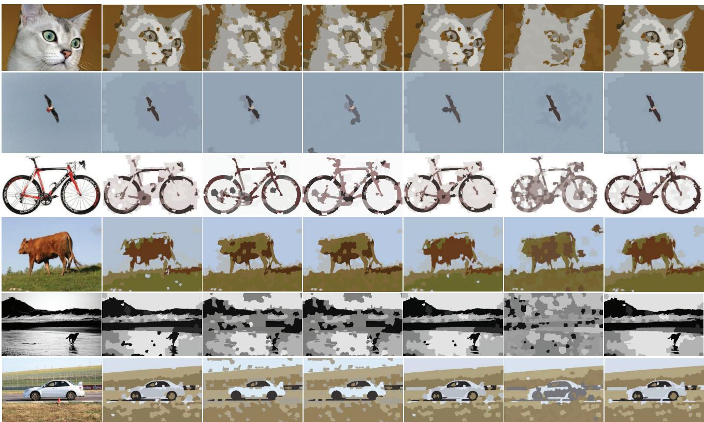  
Fig. 3. Image segmentation by the different algorithms.

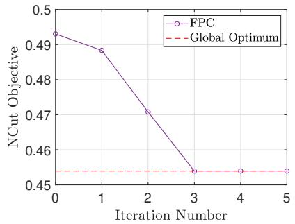  
(a) Dataset “Shuttle”

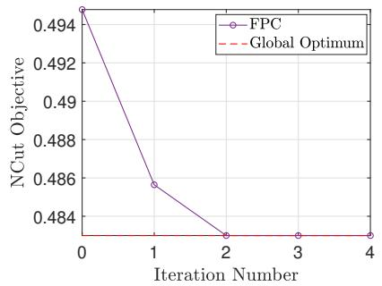  
(b) Dataset “Balloons”  
Fig. 4. Convergence in terms of the NCut objective value for two UCI datasets. FPC converges to the global optimum after only 3 iterations.

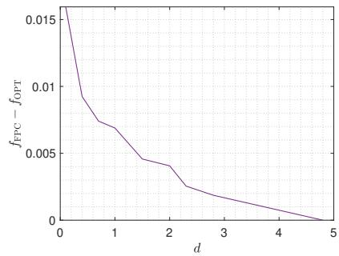  
Fig. 5. The gap between the NCut objective f<sub>FPC</sub> achieved by FPC and the global optimum f<sub>OPT</sub> for two Gaussian clusters $\check { \mathcal { N } ( 0 , pmb { I } _ { 2 } ) }$ and $\mathcal { N } ( \dot { d } , \pmb { I } _ { 2 } )$ .

Furthermore, we try out the FPC algorithm on the different clustering scenarios with the distance between two cluster centers being gradually reduced, and consequently the clustering problem becomes increasingly difficult. In this instance, two clusters are randomly generated as Gaussian mixtures. Assume that each data point is a 2D vector. The data points of the two clusters are randomly and independently generated according to the distributions $\mathcal { N } ( 0 , \pmb { I } _ { 2 } )$ and $\mathcal { N } ( d , \pmb { I } _ { 2 } )$ , respectively, where $\pmb { I } _ { 2 }$ is the 2D identity matrix, and $d \geq 0$ amounts to the distance between the two cluster centers. Observe from Fig. 5 that the solution obtained by our algorithm is fairly close to the global optimum.

## C. Sensitivity to Initialization

We further examine the sensitivity of FPC to initialization. We consider the Shuttle dataset, for which the global optimum can be obtained by exhaustive search, and run FPC from multiple random feasible initializations. As shown in Fig. 6 (next page), the final NCut objective values are generally shifted toward lower values than the initial ones, and a considerable number of runs converge to the global optimum. The results also show that different initializations may lead to different local solutions, which motivates the use of multiple runs when evaluating the proposed algorithm.

TABLE II  
NCUT OBJECTIVE VALUES ACHIEVED BY THE DIFFERENT ALGORITHMS ON DATASETS CONSTRUCTED USING FULLY CONNECTED AND ANCHOR GRAPHS.A LOWER VALUE INDICATES BETTER PERFORMANCE.
<table><tr><td rowspan="2">Method</td><td colspan="6">Fully connected graph</td><td colspan="6">Anchor graph</td></tr><tr><td>Breast</td><td>Thyroid</td><td>Office</td><td>Splice</td><td>Rice</td><td>Landsat</td><td>Epileptic</td><td>STL10</td><td>Sensorless</td><td>CIFAR10</td><td>MNIST</td><td>RT-IoT2022</td></tr><tr><td>SC</td><td>2.431325</td><td>0.983145</td><td>4.483929</td><td>0.997651</td><td>0.499193</td><td>2.490237</td><td>0.557434</td><td>1.844406</td><td>1.214324</td><td>2.073733</td><td>1.033129</td><td>0.254008</td></tr><tr><td>ISR</td><td>2.431325</td><td>0.983144</td><td>4.484089</td><td>0.997651</td><td>0.499193</td><td>2.490253</td><td>0.557458</td><td>1 .844957</td><td>1.215714</td><td>2.078630</td><td>1.033709</td><td>0.261397</td></tr><tr><td>DSSRC</td><td>2.431325</td><td>0.983144</td><td>4.484115</td><td>0.997652</td><td>0.499193</td><td>2.490246</td><td>0.677723</td><td>1.992010</td><td>1.215714</td><td>2.149170</td><td>1.057807</td><td></td></tr><tr><td>FINC</td><td>2.432491</td><td>0.988532</td><td>4.483329</td><td>0.997651</td><td>0.499193</td><td>2.490237</td><td>0.574284</td><td>1.851028</td><td>1.162947</td><td>2.062307</td><td>1.008371</td><td>0.242925</td></tr><tr><td>FCD</td><td>2.431325</td><td>0.983145</td><td>4.483670</td><td>0.997651</td><td>0.499193</td><td>2.490138</td><td>0.555138</td><td>1. .841004</td><td>1.151903</td><td>2.047859</td><td>0.995819</td><td>0.241988</td></tr><tr><td>FPC</td><td>2.431325</td><td>0.983118</td><td>4.483264</td><td>0.997638</td><td>0.499192</td><td>2.490049</td><td>0.555142</td><td>1.840981</td><td>1.151889</td><td>2.047775</td><td>0.995819</td><td>0.241988</td></tr></table>

Blue and red respectively denote improvement and degradation relative to SC. Bold values indicate the best displayed result on each dataset; – indicates that the method did not finish within the practical time budget.

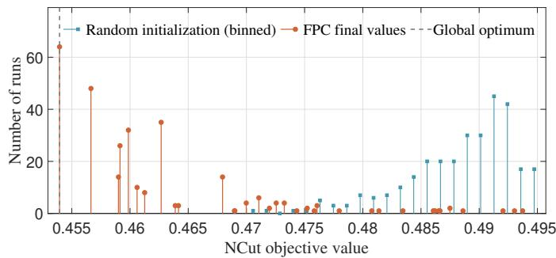  
Fig. 6. Sensitivity of FPC to random initialization on ”Shuttle” dataset.

## D. NCut Objective Optimization Performance

For each method, we perform 20 runs and report the solution attaining the smallest NCut objective value, using the same 20-run budget and selection rule for all compared methods. We then evaluate the performance of the different algorithms in minimizing ncut $( \mathcal { V } _ { 1 } , \mathcal { V } _ { 2 } , \ldots , \mathcal { V } _ { K } )$ as defined in (3) under the two graph-construction settings. Table II summarizes the results. The fully connected graph is used for the six smaller datasets, whereas the anchor graph is used for the six medium- and large-scale datasets. As expected, the direct NCut optimization methods generally attain lower objective values than the two-stage methods. This is because the latter first solve a relaxed spectral problem and then recover discrete assignments through a post-processing step, which does not directly optimize the original discrete NCut objective. Among the direct optimization methods, FPC achieves the best or tied-best result on eleven of the twelve datasets. For instance, compared with SC, FPC reduces the NCut objective by 5.14%, 4.73%, and 3.61% on Sensorless, RT-IoT2022, and MNIST, respectively. Compared with DSSRC, the corresponding reductions reach 18.09% on Epileptic, 7.58% on STL10, and 5.86% on MNIST. FINC can even degrade the SC initialization on several datasets, since its transformed subproblem is handled heuristically and is not guaranteed to be solved optimally at each iteration, as discussed in Section III-A.

We further compare the convergence behavior of the three direct optimization methods in Figs. 7 and 8 (next page). FPC monotonically improves upon the starting point on all six representative datasets under both graph constructions, while FCD remains at the SC initialization on Breast and Splice. This indicates that our method is more capable of escaping from local solutions than FCD. FINC exhibits less stable behavior: its objective can increase or oscillate, as observed on Breast and Epileptic, and it generally converges to a higher objective value than FPC. Observe also that FPC has high efficiency, with the convergence attained in fewer than 10 iterations for the datasets Breast and Splice with $N < 4 0 0 0$ and in fewer than 20 iterations for the dataset STL10 with $N = 1 3 0 0 0$

## E. Clustering Performance

Aside from the NCut optimization criterion, the following commonly used performance metrics in practice are considered for the different clustering algorithms: the accuracy (ACC), the normalized mutual information (NMI) [58], and the adjusted random index (ARI) [59]. For consistency with the preceding NCut comparison, these metrics are evaluated on the same solutions selected according to the NCut objective over the 20 runs. Unlike ncut $( \mathcal { V } _ { 1 } , \mathcal { V } _ { 2 } , \dots , \mathcal { V } _ { K } )$ , the above metrics are proportional to the performance, i.e., the higher metric value, the better clustering. The results are summarized in Table III on the next page. Although these performance metrics are not directly tied to the NCut objective, FPC still achieves the highest number of top rankings across all evaluation metrics. Specifically, it attains the best performance in ACC on 7 datasets, in NMI on 7 datasets, and in ARI on 8 datasets.

## F. Saturation of NCut Objective Function for FPC

For many datasets, as the objective function is optimized, the accuracy (quality) of clustering is usually improved. But this works only up to a point. Beyond that, further optimization of the objective will not improve the quality of clustering because the objective function does not necessarily model the data in fine detail. This characteristic of clustering objective function is formalized as the saturation of objective function according to [60]. The saturation of objective function is also examined in our problem case. For instance, FPC attains the lowest NCut objective values on Office, STL10, Sensorless, and CIFAR10. However, its ACC on these datasets remains suboptimal.

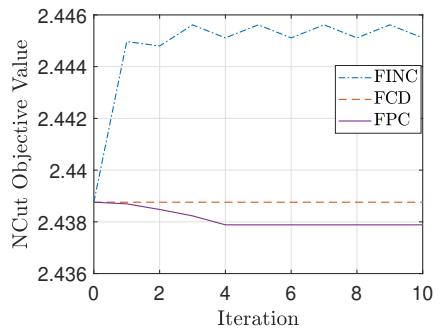  
(a) dataset “Breast”

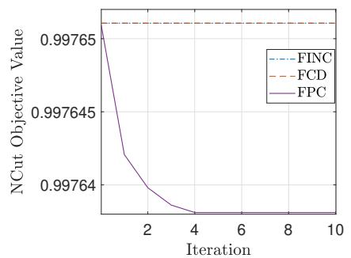  
(b) dataset “Splice”

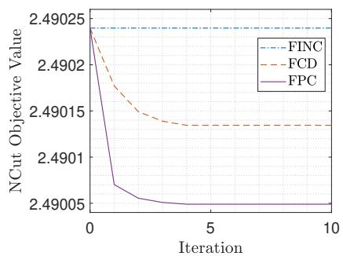  
(c) dataset “Landsat”

Fig. 7. Convergence in terms of the NCut objective value for the different datasets with the similarity matrix generated as fully connected graph.  
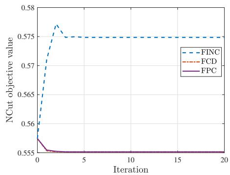  
(a) dataset “Epileptic”

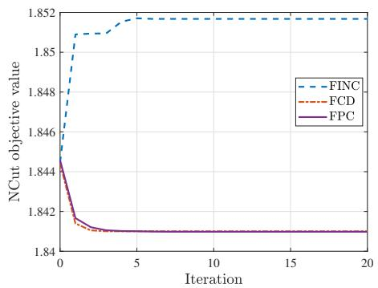  
(b) dataset “STL10”

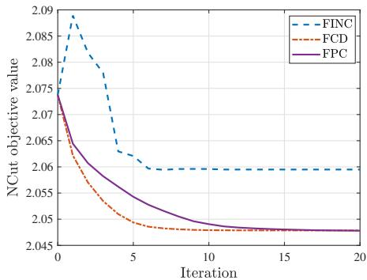  
(c) dataset “CIFAR10”  
Fig. 8. Convergence in terms of the NCut objective value for the different datasets with the similarity matrix generated as anchor graph.

TABLE III  
CLUSTERING PERFORMANCE ACHIEVED BY THE DIFFERENT ALGORITHMS ON DATASETS CONSTRUCTED USING FULLY CONNECTED AND ANCHOR GRAPHS. A HIGHER VALUE INDICATES BETTER PERFORMANCE.
<table><tr><td colspan="2"></td><td colspan="6">Fully connected graph</td><td colspan="6">Anchor graph</td></tr><tr><td rowspan="2"></td><td>Metric Method</td><td>Breast</td><td>Thyroid</td><td>Office</td><td>Splice</td><td>Rice</td><td>Landsat</td><td>Epileptic</td><td>STL10</td><td>Sensorless</td><td>CIFAR10</td><td>MNIST</td><td>RT-IoT2022</td></tr><tr><td>SC</td><td>0.509434</td><td>0.888372</td><td>0.350178</td><td>0.664882</td><td>0.896325</td><td>0.668500</td><td>0.378261</td><td></td><td>0.205769</td><td>0.259054 0.196583</td><td>0.464271</td><td>0.229221</td></tr><tr><td rowspan="5">ACC</td><td>ISR</td><td>0.509434</td><td>0.883721</td><td>0.346625</td><td>0.664567</td><td>0.896325</td><td>0.668500</td><td>0.378087</td><td>0.205615</td><td>0.259071</td><td>0.200283</td><td>0.478629</td><td>0.228336</td></tr><tr><td>DSSRC</td><td>0.509434</td><td>0.883721</td><td>0.347809</td><td>0.660787</td><td>0.896588</td><td>0.677000</td><td>0.381478</td><td>0.217769</td><td>0.259071</td><td>0.206983</td><td>0.462614</td><td></td></tr><tr><td>FINC</td><td>0.509434</td><td>0.604651</td><td>0.350572</td><td>0.664882</td><td>0.896325</td><td>0.668500</td><td>0.382870</td><td>0.206000</td><td>0.265771</td><td>0.209117</td><td>0.479329</td><td>0.235248</td></tr><tr><td>FCD</td><td>0.509434 0.888372</td><td></td><td>0.348993</td><td>0.664882</td><td>0.896325</td><td>0.654500</td><td>0.377826</td><td>0.206615</td><td>0.266198</td><td>0.198717</td><td>0.480314</td><td>0.235361</td></tr><tr><td>FPC</td><td>0.509434</td><td>0.893023</td><td>0.346230</td><td>0.673701</td><td>0.898163</td><td>0.683000</td><td>0.378000</td><td>0.206923</td><td>0.266147</td><td>0.198667</td><td>0.480329</td><td>0.235361</td></tr><tr><td rowspan="6">NMI</td><td>SC</td><td>0.480282 0.511042</td><td></td><td>0.235126</td><td>0.285693</td><td>0.512112</td><td>0.611831</td><td>0.177041</td><td>0.108122</td><td>0.297855</td><td>0.067306</td><td>0.446930</td><td>0.268947</td></tr><tr><td>ISR</td><td>0.480282</td><td>0.495642</td><td>0.227571</td><td>0.285773</td><td>0.512112</td><td>0.598479</td><td>0.176937</td><td>0.108185</td><td>0.297419</td><td>0.075624</td><td>0.448668</td><td>0.268627</td></tr><tr><td>DSSRC</td><td>0.480282</td><td>0.495642</td><td>0.227507</td><td>0.283410</td><td>0.512938</td><td>0.589606</td><td>0.177504</td><td>0.117170</td><td>0.297419</td><td>0.085738</td><td>0.439852</td><td></td></tr><tr><td>FINC</td><td>0.460500</td><td>0.270826</td><td>0.235585</td><td>0.285693</td><td>0.512112</td><td>0.611831</td><td>0.171389</td><td>0.107785</td><td>0.296373</td><td>0.073012</td><td>0.471641</td><td>0.269156</td></tr><tr><td>FCD</td><td>0.480282 0.511042</td><td>0.233231</td><td></td><td>0.285693</td><td>0.512112</td><td>0.612702</td><td>0.175288</td><td>0.108774</td><td>0.296980</td><td>0.070436</td><td>0.475403</td><td>0.269244</td></tr><tr><td>FPC</td><td>0.480282 0.526925</td><td>0.234607</td><td></td><td>0.295071</td><td>0.518077</td><td>0.618908</td><td>0.175697</td><td>0.108945</td><td>0.297035</td><td>0.070504</td><td>0.475513</td><td>0.269244</td></tr><tr><td rowspan="6">ARI</td><td>SC</td><td>0.311287 0.623665</td><td>0.143893</td><td></td><td>0.268918</td><td>0.627953</td><td>0.478430</td><td>0.133450</td><td>0.055283</td><td>0.118808</td><td>0.035444</td><td>0.301169</td><td>0.080775</td></tr><tr><td>ISR</td><td>0.311287</td><td>0.608237</td><td>0.137564</td><td>0.268437</td><td>0.627953</td><td>0.463606</td><td></td><td>0.133174</td><td>0.055500</td><td>0.118674 0.038022</td><td>0.316367</td><td></td><td>0.080125</td></tr><tr><td>DSSRC</td><td>0.311287</td><td>0.608237</td><td>0.1374180.2648100.628785</td><td></td><td></td><td>0.460109</td><td></td><td>0.140195</td><td>0.059465</td><td>0.118674</td><td>0.044224</td><td>0.297796</td><td></td></tr><tr><td>FINC</td><td>0.296489</td><td>0.206981</td><td>0.1418790.2689180.6279530.478430</td><td></td><td></td><td></td><td></td><td>0.141443</td><td>0.054702</td><td>0.119099</td><td>0.039179</td><td>0.335177</td><td>0.081637</td></tr><tr><td>FCD</td><td>0.311287</td><td>0.623665</td><td></td><td></td><td></td><td>0.1420370.2689180.6279530.485465</td><td></td><td>0.1311390.055159</td><td></td><td>0.119302</td><td>0.039380</td><td>0.337417</td><td>0.081653</td></tr><tr><td>FPC</td><td></td><td>0.3112870.6392390.1401550.2803610.6337630.5225630.1313580.055301</td><td></td><td></td><td></td><td></td><td></td><td></td><td></td><td>0.119322</td><td>0.039459</td><td>0.337461</td><td>0.081653</td></tr></table>

Bold values indicate the best displayed result on each dataset; – indicates that the method did not finish within the practical time budget.

The saturation tests are conducted for the following datasets:

Epileptic, STL10, and CIFAR10. The metric that reflects the accuracy quality is:

$$
\mathrm { E r r o r } = 1 - \mathrm { A c c u r a c y } .\tag{59}
$$

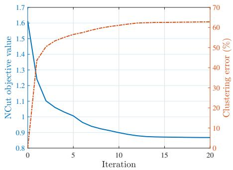  
(a) dataset “Epileptic”

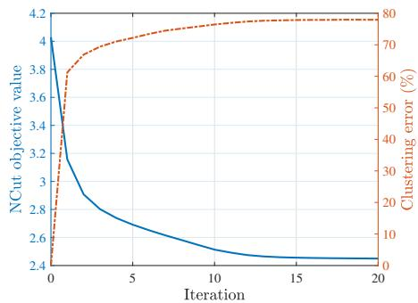  
(b) dataset “STL10”

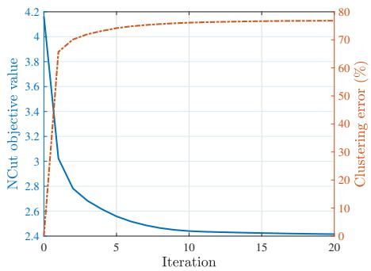  
(c) dataset “CIFAR10”

Fig. 9. Saturation behavior of FPC on Epileptic, STL10, and CIFAR10. FPC is initialized with the ground-truth labels, for which the clustering error is 0%. The objective value decreases while the error increases.  
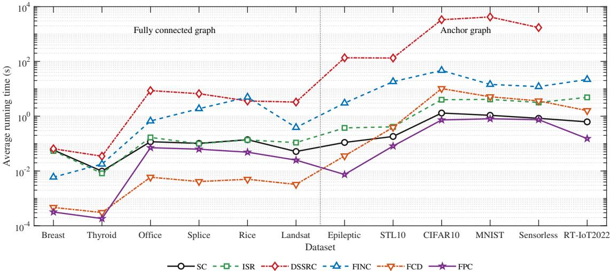  
Fig. 10. Average running time of the different algorithms on datasets constructed using fully connected and anchor graphs.

The convergence curves in terms of the NCut objective value and the error are shown in Fig. 9. The error starts at 0% and then increases, while the objective function value improves (decreases). The final converged objective function value is termed the saturation value, and the converged clustering error (accuracy) is termed the saturation error (accuracy). Since NCut optimization prefers the converged solution even though its external error is higher, an error below the observed saturation error cannot be meaningfully interpreted as indicating a better solution under the NCut objective alone. In other words, NCut cannot reliably distinguish or rank solutions within this lower-error region according to their agreement with the ground truth. This criterion-specific interpretation does not imply that a lower clustering error lacks practical value; rather, it shows that such an advantage is not represented by the NCut objective.

## G. Time Consumption

Moreover, Fig. 10 compares the average running time under the two graph-construction settings. For a fair runtime comparison, the same timing convention is adopted for all methods, and the reported runtime includes only the corresponding optimization stage, excluding the initialization and common preprocessing stages. FPC is consistently faster than all three two-stage methods, i.e., SC, ISR, and DSSRC, on every dataset for which results are available. Quantitatively, under the fully connected graph setting, the average running time of FPC is 56.58%, 63.87%, 99.07%, and 97.38% lower than those of SC, ISR, DSSRC, and FINC, respectively. Under the anchor graph setting, FPC requires 38.92%, 85.10%, and 97.83% less average running time than SC, ISR, and FINC, respectively. DSSRC is generally the most time-consuming baseline because its discrete mapping procedure is computationally expensive; on RT-IoT2022, it did not finish within a practical time budget, and hence no result is reported. FCD has the shortest running time on several datasets because it may terminate early at a suboptimal point. Overall, FPC achieves a favorable balance between computational efficiency and NCut objective improvement.

## VI. CONCLUSION

This work proposes a novel application of multidimensional FP to the NCut clustering, differing from the previous works that rely on the traditional scalar-ratio FP such as Dinkelbach’s transform and quadratic transform. The main merit of using multidimensional FP is that the new 0-1 problem can be efficiently solved via linear search. On the analytical side, the resulting FPC algorithm can be interpreted as an MM procedure with provable monotonic convergence in terms of the NCut optimization criterion. Furthermore, we characterize the convergence rate of FPC. The present work focuses on the multiclass NCut objective, while other graph partitioning criteria are beyond its main scope. Extending the proposed FP-based framework to online, streaming, multi-view, or distributed graph clustering would be an interesting direction for future research.

## REFERENCES

[1] Y. Chen, B. Huang, L. Zhao, and K. Shen, “Multidimensional fractional programming for normalized cuts,” Adv. Neural Inf. Process. Syst. (NeurIPS), vol. 37, pp. 89 563–89 583, 2024.

[2] I. M. Stancu-Minasian, Fractional programming: theory, methods and applications. Norwell, MA, USA: Kluwer, 2012.

[3] E. B. Bajalinov, Linear-fractional programming theory, methods, applications and software. Norwell, MA, USA: Kluwer, 2003.

[4] S. Schaible, “Parameter-free convex equivalent and dual programs of fractional programming problems,” Zeitschrift f¨ur Oper. Res., vol. 18, no. 5, pp. 187–196, Oct. 1974.

[5] J. Shi and J. Malik, “Normalized cuts and image segmentation,” IEEE Trans. Pattern Anal. Mach. Intell., vol. 22, no. 8, pp. 888–905, Feb. 2000.

[6] K. Shen and W. Yu, “Fractional programming for communication systems—Part I: Power control and beamforming,” IEEE Trans. Signal Process., vol. 66, no. 10, pp. 2616–2630, Mar. 2018.

[7] W. Dinkelbach, “On nonlinear fractional programming,” Manage. Sci., vol. 13, no. 7, pp. 492–498, Mar. 1967.

[8] J. B. MacQueen, “Some methods for classification and analysis of multivariate observations,” in Proc. 5th Berkeley Symp. Math. Statist. Probab., 1967.

[9] S. C. Johnson, “Hierarchical clustering schemes,” Psychometrika, vol. 32, no. 3, pp. 241–254, Sept. 1967.

[10] A. Ng, M. Jordan, and Y. Weiss, “On spectral clustering: Analysis and an algorithm,” Adv. Neural Inf. Process. Syst. (NeurIPS), vol. 14, 2001.

[11] F. Nie, C. Ding, D. Luo, and H. Huang, “Improved MinMax cut graph clustering with nonnegative relaxation,” in Proc. Joint Eur. Conf. Mach. Learn. Knowl. Discovery Databases, 2010, pp. 451–466.

[12] M. Zhao, F. Nie, C. Wang, and X. Li, “Balanced and discrete multiview clustering with adaptive graph learning,” IEEE Trans. Circuits Syst. Video Technol., early access, 2025.

[13] I. S. Dhillon, S. Mallela, and D. S. Modha, “Information-theoretic coclustering,” in Proc. ACM SIGKDD Int. Conf. Knowl. Discovery & Data Min., Aug. 2003, pp. 89–98.

[14] J. Xue, F. Nie, C. Liu, R. Wang, and X. Li, “Co-clustering by directly solving bipartite spectral graph partitioning,” IEEE Trans. Cybern., Dec. 2024.

[15] M. Ester, H.-P. Kriegel, J. Sander, X. Xu et al., “A density-based algorithm for discovering clusters in large spatial databases with noise,” in Proc. ACM SIGKDD Int. Conf. Knowl. Discovery & Data Min., vol. 96, no. 34, 1996, pp. 226–231.

[16] D. Yan, L. Huang, and M. I. Jordan, “Fast approximate spectral clustering,” in Proc. ACM SIGKDD Int. Conf. Knowl. Discovery & Data Min., June 2009, pp. 907–916.

[17] M. Stoer and F. Wagner, “A simple min-cut algorithm,” J. ACM, vol. 44, no. 4, pp. 585–591, July 1997.

[18] L. Hagen and A. B. Kahng, “New spectral methods for ratio cut partitioning and clustering,” IEEE Trans. Comput.-Aided Design Integr. Circuits Syst., vol. 11, no. 9, pp. 1074–1085, Sept. 1992.

[19] C. H. Ding, X. He, H. Zha, M. Gu, and H. D. Simon, “A min-max cut algorithm for graph partitioning and data clustering,” in IEEE Int. Conf. Data Min. (ICDM), Nov. 2001, pp. 107–114.

[20] J. Huang, F. Nie, and H. Huang, “Spectral rotation versus K-means in spectral clustering,” in Proc. AAAI Conf. Artif. Intell. (AAAI), vol. 27, no. 1, 2013.

[21] H. Zhang and X. Li, “Discretize relaxed solution of spectral clustering via a nonheuristic algorithm,” IEEE Trans. Neural Netw. Learn. Syst., vol. 35, no. 12, pp. 17 965–17 972, Dec. 2024.

[22] T. D. Bie and N. Cristianini, “Fast SDP relaxations of graph cut clustering, transduction, and other combinatorial problems,” J. Mach. Learn. Res., vol. 7, pp. 1409–1436, June 2006.

[23] B. Ghanem and N. Ahuja, “Dinkelbach NCUT: An efficient framework for solving normalized cuts problems with priors and convex constraints,” Int. J. Comput. Vision, vol. 89, pp. 40–55, Feb. 2010.

[24] F. Nie, J. Lu, D. Wu, R. Wang, and X. Li, “A novel normalized-cut solver with nearest neighbor hierarchical initialization,” IEEE Trans. Pattern Anal. Mach. Intell., vol. 46, no. 1, pp. 659–666, May 2024.

[25] X. Chen, W. Hong, F. Nie, D. He, M. Yang, and J. Z. Huang, “Spectral clustering of large-scale data by directly solving normalized cut,” in Proce. ACM SIGKDD Int. Conf. Knowl. Discovery & Data Min., July 2018, pp. 1206–1215.

[26] X. Chen, Z. Xiao, F. Nie, and J. Z. Huang, “FINC: An efficient and effective optimization method for normalized cut,” IEEE Trans. Pattern Anal. Mach. Intell., Feb. 2022.

[27] D. Shi, L. Zhu, J. Li, Z. Cheng, and Z. Zhang, “Flexible multiview spectral clustering with self-adaptation,” IEEE Trans. Cybern., vol. 53, no. 4, pp. 2586–2599, Apr. 2023.

[28] Y. Qin, G. Feng, Y. Ren, and X. Zhang, “Consistency-induced multiview subspace clustering,” IEEE Trans. Cybern., vol. 53, no. 2, pp. 832–844, Feb. 2023.

[29] H. Zhong, J. Wu, C. Chen, J. Huang, M. Deng, L. Nie, Z. Lin, and X.-S. Hua, “Graph contrastive clustering,” in IEEE Int. Conf. Comput. Vis. (ICCV), Oct. 2021, pp. 9224–9233.

[30] D. J. Higham, G. Kalna, and M. Kibble, “Spectral clustering and its use in bioinformatics,” J. Comput. Appl. Math., vol. 204, no. 1, pp. 25–37, Jan. 2007.

[31] A. Bhowmick, M. Kosan, Z. Huang, A. Singh, and S. Medya, “Dgcluster: A neural framework for attributed graph clustering via modularity maximization,” in Proc. AAAI Conf. Artif. Intell. (AAAI), vol. 38, no. 10, Feb. 2024, pp. 11 069–11 077.

[32] R. Guan, W. Tu, S. Wang, J. Liu, D. Hu, C. Tang, Y. Feng, J. Li, B. Xiao, and X. Liu, “Structure-adaptive multi-view graph clustering for remote sensing data,” in Proc. AAAI Conf. Artif. Intell. (AAAI), vol. 39, no. 16, Feb. 2025, pp. 16 933–16 941.

[33] Z. Yao, Y. Huang, L. Lin, L. Xu, X. Jia, and J. Wu, “Efl-its: An energy-efficient learning framework for load balancing in SDN-enabled intelligent transportation systems,” IEEE Trans. Mobile Comput., 2026, early access.

[34] J. Xu, H. Yao, R. Zhang, T. Mai, S. Huang, Z. Xiong, and D. Niyato, “Semantic-aware UAV swarm coordination in the metaverse: A reputation-based incentive mechanism,” IEEE Trans. Mobile Comput., vol. 23, no. 12, pp. 13 821–13 833, Dec. 2024.

[35] X. Jiang, T. Wen, S. Sun, J. Yuan, H. Liu, P. Li, L. Wu, Y. Wang, and M. Liu, “Representation optimal matching for federated learning with noisy labels in remote sensing,” IEEE Trans. Mobile Comput., 2025, early access.

[36] Y. Li, J. Zhang, and N. Xie, “Demodulation scheme against phase noise using an ensemble clustering approach,” IEEE Trans. Mobile Comput., vol. 23, no. 12, pp. 12 938–12 951, Dec. 2024.

[37] K. Shen and W. Yu, “Fractional programming for communication systems—Part II: Uplink scheduling via matching,” IEEE Trans. Signal Process., vol. 66, no. 10, pp. 2631–2644, Mar. 2018.

[38] S. P. Boyd and L. Vandenberghe, Convex optimization. U.K.: Cambridge univ. Press, 2004.

[39] U. Von Luxburg, “A tutorial on spectral clustering,” Statist. Comput., vol. 17, pp. 395–416, Aug. 2007.

[40] J. P. Crouzeix, J. A. Ferland, and S. Schaible, “An algorithm for generalized fractional programs,” J. Optim. Theory Appl., vol. 47, no. 1, pp. 35–49, Sept. 1985.

[41] B. Sch ¨olkopf, C. J. Burges, and A. J. Smola, Advances in kernel methods: support vector learning. Cambridge, MA, USA: MIT press, 1999.

[42] D. Kuang, C. Ding, and H. Park, “Symmetric nonnegative matrix factorization for graph clustering,” in Proc. SIAM Int. Conf. Data Mining, Apri. 2012, pp. 106–117.

[43] Y. Sun, P. Babu, and D. P. Palomar, “Majorization-minimization algorithms in signal processing, communications, and machine learning,” IEEE Trans. Signal Process., vol. 65, no. 3, pp. 794–816, Aug. 2016.

[44] M. Razaviyayn, M. Hong, and Z.-Q. Luo, “A unified convergence analysis of block successive minimization methods for nonsmooth optimization,” SIAM J. Optim., vol. 23, no. 2, pp. 1126–1153, 2013.

[45] K. Shen, Z. Zhao, Y. Chen, Z. Zhang, and H. V. Cheng, “Accelerating quadratic transform and WMMSE,” IEEE J. Sel. Areas Commun., vol. 42, no. 11, pp. 3110–3124, Nov. 2024.

[46] Y. Nesterov, Lectures on Convex Optimization (Second Edition). Springer, 2018.

[47] G. E. Fasshauer, “Positive definite kernels: past, present and future,” Dolomites Res. Notes Approx., vol. 4, pp. 21–63, 2011.

[48] W. Liu, J. He, and S.-F. Chang, “Large graph construction for scalable semi-supervised learning,” in Int. Conf. Mach. Learn. (ICML), 2010.

[49] G. W. Stewart, Introduction to Matrix Computations. New York, NY, USA: Academic Press, 1973.

[50] K. N. Markelle Kelly, Rachel Longjohn, “The UCI machine learning repository,” https://archive.ics.uci.edu.

[51] J. Wang et al., “Everything about transfer learning and domain adapation,” http://transferlearning.xyz.

[52] A. Coates, A. Ng, and H. Lee, “An analysis of single-layer networks in unsupervised feature learning,” in Proc. 14th Int. Conf. Artif. Intell. Stats., 2011.

[53] A. Krizhevsky, G. Hinton et al., “Learning multiple layers of features from tiny images,” University of Toronto, Toronto, ON, Canada, Tech. Rep., 2009.

[54] Y. LeCun, L. Bottou, Y. Bengio, and P. Haffner, “Gradient-based learning applied to document recognition,” Proc. IEEE, vol. 86, no. 11, pp. 2278– 2324, Nov. 1998.

[55] X. Chen, F. Nie, J. Z. Huang, and M. Yang, “Scalable normalized cut with improved spectral rotation,” in Proc. Int. Joint Conf. Artif. Intell., Aug. 2017, pp. 1518–1524.

[56] S. Gould, R. Fulton, and D. Koller, “Decomposing a scene into geometric and semantically consistent regions,” in IEEE Int. Conf. Comput. Vis. (ICCV), Sept. 2009, pp. 1–8.

[57] B. Cheng, G. Liu, J. Wang, Z. Huang, and S. Yan, “Multi-task low-rank affinity pursuit for image segmentation,” in IEEE Int. Conf. Comput. Vis. (ICCV), Nov. 2011, pp. 2439–2446.

[58] A. Lancichinetti, S. Fortunato, and J. Kert´esz, “Detecting the overlapping and hierarchical community structure in complex networks,” New J. Phys., vol. 11, no. 3, p. 033015, Mar. 2009.

[59] A. J. Gates and Y.-Y. Ahn, “The impact of random models on clustering similarity,” J. Mach. Learn. Res., vol. 18, no. 87, pp. 1–28, Jan. 2017.

[60] C. Ding and X. He, “Cluster merging and splitting in hierarchical clustering algorithms,” in IEEE Int. Conf. Data Min. (ICDM), 2002.