# Normative Deviation Modeling for EEG-based Depression Detection

Wan Jiang1, Jingqi Cheng2, Hui Zhang1, Xu Zhao2, Xiaojing Chen2, Shengeng Tang1, Jingjing Wu1, Richang Hong1 1Hefei University of Technology 2Anhui University

## Abstract

Web-enabled digital health services are expanding access to physiological monitoring and mental health screening. However, electroencephalography (EEG)-based major depressive disorder (MDD) detection remains challenging across heterogeneous data sources, where individual variability and acquisition diferences may afect disease-related representations. In this work, we investigate the use of healthy normative references for EEG-based MDD detection. Specifically, structural and distributional reference models are independently trained using healthy control (HC) recordings to characterize departures from healthy EEG patterns. We develop two diagnostic approaches that incorporate normative deviations at diferent representation levels. Scalar-level Normative Deviationguided Diagnosis (S-NDD) summarizes structural and distributional deviations into scalar scores and integrates them with deep EEG representations. Feature-level Normative Deviation-guided Diagnosis (F-NDD) retains dimension-wise residuals and combines them with deep EEG representations through attention-based aggregation and auxiliary supervision. We also employ target HC-assisted score calibration for cross-source evaluation without updating the trained models. Experiments on two public EEG datasets examine both approaches under subject-independent within-source and bidirectional cross-source settings. The results demonstrate the effectiveness ofnormative deviation-guided diagnosis across diferent evaluation settings.

## Keywords

EEG-based Depression Detection, Healthy Normative Modeling, Normative Deviation, Cross-source Diagnosis, Digital Health

## 1 Introduction

Web-enabled digital health services have created new opportunities for disease screening and health monitoring beyond conventional clinical settings [9, 43]. The demand for such services is particularly urgent in Major Depressive Disorder (MDD) screening, given the limited access to mental healthcare and persistent stigma-related barriers [45, 47]. Among various screening modalities, electroencephalography (EEG)-based MDD detection has attracted considerable attention, as EEG provides objective physiological measurements and generates digital signals that can be readily transmitted for remote analysis [19, 31]. Recent deep learning methods have achieved promising results by modeling the temporal, spectral, and spatial characteristics of EEG signals [6, 15, 49]. Despite these ad vances, ensuring reliable EEG-based MDD detection across diverse subjects and recording conditions remains a significant challenge.

This challenge primarily arises from the inherent characteristics of EEG signals, which are non-stationary, noisy, and subjectdependent. Disease-related neural patterns are often intertwined with individual physiological variability and acquisition artifacts [24].

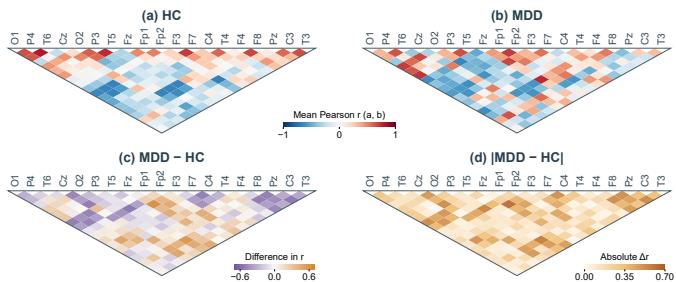  
Figure 1: Inter-electrode correlation patterns in HC and MDD EEG recordings. (a) and (b) show the mean Pearson correlation matrices for HC and MDD, respectively. (c) and (d) show their signed and absolute diferences (MDD−HC), respectively. All panels use the same electrode ordering derived from HC-based hierarchical clustering.

Consequently, supervised models may capture subject-specific or recording-related patterns alongside disease-related information, limiting their ability to generalize to unseen subjects and independently collected datasets [17]. The limited number of subjects in psychiatric EEG datasets, coupled with the high cost of clinical data collection and annotation, further exacerbates these generalization dificulties. These limitations highlight the need for learning disease-discriminative representations that remain robust to subject-specific and acquisition-related variations.

A natural way to mitigate this data limitation is to enlarge the training set through data augmentation. In particular, generative data augmentation has attracted increasing attention in EEG analysis, where generative models synthesize additional EEG samples for training [44, 53]. However, generating realistic EEG signals remains challenging, especially in low-data settings [52]. Synthetic EEG samples may exhibit artifacts and deviations from the statistical properties of authentic recordings, raising concerns about their fidelity [5, 11]. Moreover, the benefits of synthetic augmentation for downstream MDD classification may vary across datasets [4]. These concerns suggest that increasing data quantity alone does not necessarily ensure more reliable EEG-based MDD detection.

Clinical studies have reported diferences in EEG spectral activity and functional connectivity between individuals with MDD and healthy controls (HC) [7, 20]. Consistent with these findings, our preliminary analysis reveals diferences in inter-electrode correlation patterns between the two groups, as shown in Figure 1. These observations indicate that healthy and depressive EEG recordings exhibit distinct patterns of neural activity. Rather than treating HC recordings solely as a comparison group, their physiological patterns may also provide a reference for characterizing individual variations. Healthy normative modeling ofers a means of establishing such references from HC recordings and quantifying deviations from them. These deviations may provide complementary information for identifying MDD-related abnormalities. Nevertheless, normative deviations do not necessarily translate into discriminative evidence for MDD detection. Their diagnostic utility depends on how disease-relevant variations are represented and integrated with EEG features, particularly across heterogeneous data sources.

To this end, we investigate normative deviations at diferent levels of granularity, each capturing distinct aspects of departures from healthy EEG patterns. We therefore develop two diagnostic formulations to examine their respective contributions to MDD detection. Both establish structural and distributional references exclusively from healthy EEG recordings. Specifically, we propose Scalar-level Normative Deviation-guided Diagnosis (S-NDD), which summarizes structural and distributional deviations into compact scores and integrates them with deep EEG representations. We further introduce Feature-level Normative Deviation-guided Diagnosis (F-NDD), which preserves dimension-wise residuals and incorporates them into deep EEG representations through attention-based aggregation and auxiliary supervision. To accommodate cross-source shifts in diagnostic scores, both approaches support target HC-assisted score calibration without updating model parameters. We evaluate their diagnostic performance under within-source and bidirectional cross-source settings.

In summary, our key contributions are as follows:

• We establish structural and distributional healthy references to characterize normative deviations in EEG recordings. These references are learned exclusively from HC and provide complementary information for MDD diagnosis.

• We introduce two normative deviation-guided diagnostic approaches, S-NDD and F-NDD. S-NDD integrates scalar deviation scores with deep EEG representations, while F-NDD incorporates dimension-wise residuals through shared attention aggregation and auxiliary diagnostic supervision.

• We conduct comprehensive evaluations on two public EEG datasets under subject-independent within-source and bidirectional cross-source settings. We further investigate target HC-assisted score calibration to accommodate cross-source variations in diagnostic scores.

## 2 Related Work

## 2.1 EEG-based MDD Detection

EEG-based MDD detection has progressed from handcrafted features to deep representation learning. Early CNN-based methods learned discriminative EEG features [1], while graph-based approaches, including MAST-GCN [22], adaptive temporal graph networks [23], and ST-GCA [37], model spatial and temporal dependencies. Hybrid architectures combine graph convolution and Transformers, as in SLiTRANet [34], or adopt lightweight convolutional Transformers [14]. Temporal-spatial-spectral learning has also been explored using emotion-elicited EEG [28]. Research has further examined diverse acquisition and clinical settings, including single-channel detection [41] and multi-dataset diagnosis and treatment-response prediction [27]. General EEG representation models, such as EEG Conformer [35] and CBraMod [42], have advanced convolutional attention and large-scale pretraining. Nevertheless, discriminative EEG representations may retain subjectspecific and acquisition-related variations, limiting generalization across independently collected datasets.

## 2.2 Normative Modeling and Healthy References

Normative modeling characterizes individual observations relative to a reference population, providing a framework for investigating heterogeneity beyond average case–control diferences [25, 32]. In psychiatric research, normative models characterize individual deviations from expected physiological or behavioral patterns [25]. Practical frameworks have also been developed to estimate and evaluate such deviations [32]. Generative approaches further learn healthy data distributions and identify departures from these distributions for anomaly detection. For example, difusion-based models have been trained on healthy brain images to detect and segment abnormalities in CT and MRI data [29]. These studies illustrate the potential of reference-based analysis for characterizing individual abnormalities. However, findings from neuroimaging do not directly establish the diagnostic utility of normative deviations in EEG-based MDD detection. Moreover, the representation and utilization of normative deviations may influence their efectiveness across diferent subjects and data sources.

## 2.3 Cross-domain EEG Diagnosis

Domain adaptation aims to reduce distribution discrepancies between source and target domains. Representative methods include DANN [10], which learns domain-adversarial representations, DAN [21], which aligns distributions through maximum mean discrepancy, and Deep CORAL [36], which matches feature covariance statistics. Cross-domain learning has also been explored for EEG-based depression detection. TFST-SDKA [48] combines temporal-frequencyspatial representations with sub-domain knowledge alignment for cross-subject detection. While cross-subject evaluation examines unseen participants, cross-dataset evaluation additionally involves diferences in acquisition protocols, electrode configurations, and participant populations. Evaluation protocols depend on the availability of target-domain data for adaptation or calibration. However, reducing distribution discrepancies does not necessarily separate disease-related variations from source-specific characteristics.

## 3 Preliminaries

We consider EEG-based MDD detection in the context of Webenabled digital health services. The objective is to identify MDD status by analyzing the brain activity of individual subjects. Given a labeled source dataset $\mathcal { D } _ { s } = \{ ( \boldsymbol { X } _ { i } ^ { s } , \boldsymbol { \bar { y } } _ { i } ^ { s } ) \} _ { i = 1 } ^ { N _ { s } }$ , where $X _ { i } ^ { s } \in \mathbb { R } ^ { C _ { s } \times T _ { i } }$ denotes the EEG recording of subject �, $C _ { s }$ and �� represent the number of electrodes and recording length, respectively, and $\boldsymbol { y } _ { i } ^ { s } \in \{ 0 , 1 \}$ indicates HC or MDD status. Within-source MDD detection involves training and evaluating diagnostic models on disjoint subjects from the same data source. We further consider cross-source detection, where a Web-based diagnostic service receives EEG recordings from a new data source. Let $\mathcal { D } _ { t } = \{ X _ { j } ^ { t } \} _ { j = 1 } ^ { N _ { t } }$ denote an independently collected target dataset, where $X _ { j } ^ { t } \in \bar { \mathbb { R } } ^ { \bar { C } t \times T _ { j } }$ represents the recording of target subject �. The source-trained diagnostic models are applied to target subjects despite potential diferences in electrode configurations and acquisition characteristics. Cross-source detection aims to achieve reliable MDD diagnosis across heterogeneous EEG data sources.

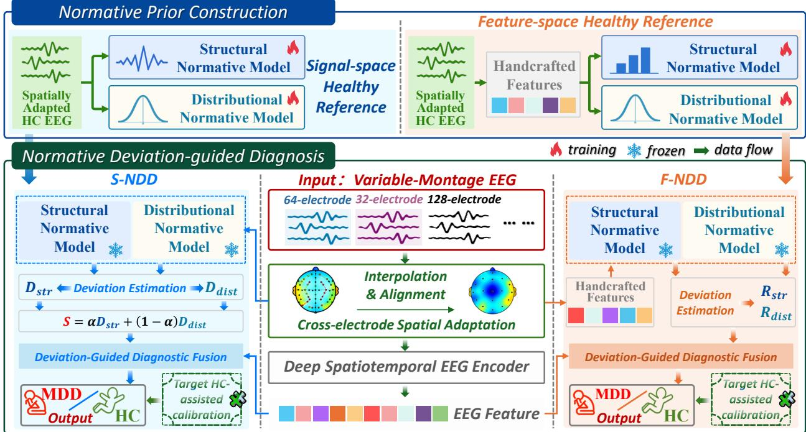  
Figure 2: Overview of S-NDD and F-NDD. Both methods establish structural and distributional healthy references in distinct representation spaces. S-NDD quantifies scalar normative deviations for deep EEG feature fusion, whereas F-NDD preserves feature-level residuals for deviation-guided diagnosis. Optional target HC-assisted calibration adjusts cross-dataset predictions.

## 4 Normative Deviation-guided Diagnosis

Our framework establishes a normative reference from healthy EEG recordings to characterize individual deviations from healthy patterns. Rather than relying solely on supervised EEG representations, we incorporate structural and distributional deviations as complementary diagnostic information. As illustrated in Figure 2, we develop two formulations that represent normative deviations at diferent levels of granularity. S-NDD summarizes deviations into scalar scores, while F-NDD preserves fine-grained deviation features. Both formulations integrate the resulting deviations with learned EEG representations for MDD detection.

## 4.1 Dual Healthy Reference Modeling

We construct normative references exclusively from healthy control (HC) recordings to characterize departures from healthy EEG patterns. Since a single reference model may not capture all aspects of healthy variability, we establish complementary structural and distributional references. Specifically, VQ-VAE [40, 51] captures recurring patterns through discrete latent quantization, while a difusion model [13, 29] learns healthy data distributions through noise-conditioned denoising. To accommodate heterogeneous electrode configurations, EEG recordings are first aligned to a common spatial layout. S-NDD trains its normative models on the aligned EEG signals, whereas F-NDD independently trains corresponding models on handcrafted features described in Section 4.3.

Cross-electrode Spatial Adaptation. To accommodate heterogeneous electrode configurations, we employ spherical spline interpolation [16] to align EEG recordings with the standard 19- electrode International 10–20 system. Given an EEG recording $\mathbf { x } _ { o r i g } \in \mathbb { R } ^ { C _ { o r i g } \times T }$ , the adapted signal $\mathbf { x } \in \mathbb { R } ^ { 1 9 \times T }$ provides a common electrode configuration for normative modeling and diagnosis. Implementation details are provided in Appendix A.1.

Structural Normative Modeling. We employ VQ-VAE [40, 51] to capture recurring patterns in healthy EEG representations. Given an HC input u, the encoder produces a latent representation $\mathbf { z } _ { e } ,$ which is quantized into $\mathbf { z } _ { q }$ through a learnable codebook. The model is optimized using reconstruction, codebook, and commitment losses:

$$
\begin{array} { r } { \mathcal { L } _ { s t r } = \mathrm { M S E } ( \mathbf { u } , D ( \mathbf { z } _ { q } ) ) + \mathrm { M S E } ( \mathrm { s g } [ \mathbf { z } _ { e } ] , \mathbf { z } _ { q } ) + \beta \mathrm { M S E } ( \mathbf { z } _ { e } , \mathrm { s g } [ \mathbf { z } _ { q } ] ) . } \end{array}\tag{1}
$$

where MSE(·, ·) denotes the mean squared error, $D ( \cdot )$ is the decoder, sg[·] denotes the stop-gradient operator, and $\beta$ weights the commitment loss. The trained VQ-VAE serves as the structural normative reference for subsequent deviation estimation.

Distributional Normative Modeling. We employ a difusion model [13, 29] to characterize the distribution of healthy EEG representations. Given an HC input $\mathbf { u } _ { 0 }$ , the forward difusion process generates $\mathbf { u } _ { t } = \sqrt { \bar { \alpha } _ { t } } \mathbf { u } _ { 0 } + \sqrt { 1 - \bar { \alpha } _ { t } } \epsilon$ , where $\epsilon \sim { \cal N } ( 0 , I )$ and $\bar { \alpha } _ { t }$ is the cumulative product of noise retention coeficients. The model is trained by minimizing

$$
\mathcal { L } _ { \mathrm { d i s t } } = \mathbb { E } _ { t , { \mathbf { u } _ { 0 } } , \epsilon } \left[ \mathrm { M S E } \left( \epsilon , \epsilon _ { \theta } ( { \mathbf { u } } _ { t } , t ) \right) \right] .\tag{2}
$$

The trained difusion model serves as the distributional normative reference for subsequent deviation estimation.

## 4.2 Scalar-level Normative Deviation-guided Diagnosis (S-NDD)

S-NDD characterizes individual EEG recordings through scalar deviations from healthy normative references. Given an EEG recording $\mathbf { x } \in \mathbb { R } ^ { 1 9 \times T }$ , the structural deviation is measured by the VQ-VAE reconstruction error:

$$
D _ { s t r } = \mathrm { M S E } \left( \mathbf { x } , D ( Q ( E ( \mathbf { x } ) ) ) \right) ,\tag{3}
$$

where $E ( \cdot ) , Q ( \cdot )$ , and $D ( \cdot )$ denote the encoder, quantizer, and decoder, respectively. The distributional deviation is measured by the difusion denoising reconstruction error:

$$
D _ { \mathrm { d i s t } } = \mathrm { M S E } \left( \mathbf { x } , \frac { \mathbf { x } _ { t } - \sqrt { 1 - \bar { \alpha } _ { t } } \epsilon _ { \theta } ( \mathbf { x } _ { t } , t ) } { \sqrt { \bar { \alpha } _ { t } } + 1 0 ^ { - 8 } } \right) ,\tag{4}
$$

where $\mathbf { x } _ { t }$ is the noisy EEG recording obtained through the forward difusion process, and $\epsilon _ { \theta }$ denotes the pretrained noise prediction network. The structural and distributional deviations are combined into a scalar score: $S = \alpha D _ { s t r } + ( 1 - \alpha ) D _ { d i s t } ,$ where � balances their contributions. The score is normalized as $\begin{array} { r } { S ^ { \prime } = \mathrm { c l i p } \left( \frac { S - P _ { 5 } } { P _ { 9 5 } - P _ { 5 } } , 0 , 1 \right) } \end{array}$ where $P _ { 5 }$ and $P _ { 9 5 }$ are the 5th and 95th percentiles of training deviation scores. A pretrained deep spatiotemporal EEG encoder extracts features $\mathbf { F } _ { \mathrm { d e e p } }$ from the spatially adapted EEG signal x. Deviationguided fusion integrates these features with the normalized deviation score $S ^ { \prime }$ as $\mathbf { F } _ { S } = \sigma ( W _ { h } \mathbf { F } _ { \mathrm { d e e p } } + W _ { s } S ^ { \prime } + \mathbf { b } )$ , where $W _ { h } , W _ { s }$ , and b are learnable parameters. The fusion layer and diagnostic classifier $C _ { S , \phi } ( \cdot )$ are jointly optimized using cross-entropy loss:

$$
\mathcal { L } _ { \mathrm { d i a g } } ^ { S } = \mathrm { C E } ( C _ { S , \phi } ( \mathbf { F } _ { S } ) , y ) ,\tag{5}
$$

where $\operatorname { C E } ( \cdot , \cdot )$ denotes the cross-entropy loss, $\phi$ represents the classifier parameters, and � is the ground-truth label. The pretrained EEG encoder and normative models remain frozen.

## 4.3 Feature-level Normative Deviation-guided Diagnosis (F-NDD)

While S-NDD summarizes departures from healthy references using scalar deviation scores, F-NDD characterizes deviations at the individual EEG feature level. It preserves dimension-wise structural and distributional residuals for subsequent diagnostic learning.

Handcrafted Feature Extraction. Given a spatially adapted EEG recording $\boldsymbol { \tau } \in \mathbb { R } ^ { 1 9 \times T }$ , we extract spectral and inter-electrode correlation features to characterize EEG activity. Spectral features describe the distribution ofsignal power across frequency bands, while correlation features capture statistical relationships between electrodes. These features are concatenated into $\mathbf { h } = H ( \mathbf { \bar { x } } ) \in \mathbb { R } ^ { 4 5 6 }$ , where �(·) denotes a deterministic feature extractor. Detailed feature definitions and extraction settings are provided in Appendix A.3.

Feature-level Deviation Modeling. Based on the extracted EEG features h, F-NDD estimates structural and distributional deviations using two normative models independently trained on sourcedomain HC features. The structural residual is computed as

$$
\mathbf { R } _ { \mathrm { s t r } } = \mathbf { h } - D ( Q ( E ( \mathbf { h } ) ) ) .\tag{6}
$$

The distributional residual is estimated from difusion-based denoised features:

$$
\mathbf { R } _ { \mathrm { d i s t } } = \frac { 1 } { | \mathcal { T } | K } \sum _ { t \in \mathcal { T } } \sum _ { k = 1 } ^ { K } \left( \mathbf { h } - \widehat { \mathbf { h } } _ { 0 } ^ { ( t , k ) } \right) ,\tag{7}
$$

where $\mathcal { T }$ denotes the selected difusion timesteps, � is the number of noise realizations per timestep, and $\widehat { \mathbf { h } } _ { 0 } ^ { ( t , k ) }$ denotes the denoised feature estimate at timestep � under the �-th noise realization. The structural and distributional residuals are concatenated into a 912- dimensional deviation representation: ${ \bf F } _ { \mathrm { d e v } } = [ { \bf R } _ { \mathrm { s t r } } ; { \bf R } _ { \mathrm { d i s t } } ] \in \mathbb { R } ^ { 9 1 2 }$ The resulting representation is normalized feature-wise using statistics estimated exclusively from source-domain HC training data. Deviation-guided Diagnosis. F-NDD integrates deep EEG representations with normative deviations through separate encoding branches. Given the �-th spatially adapted EEG window $\mathbf { x } _ { i } ,$ a deep spatiotemporal EEG encoder produces $\mathbf { u } _ { i } = E _ { \mathrm { E E G } } ( \mathbf { x } _ { i } )$ . The structural and distributional residuals are separately encoded and projected into a unified deviation representation:

$$
\mathbf { v } _ { i } = P _ { \mathrm { d e v } } \left( \left[ E _ { \mathrm { s t r } } ( \mathbf { R } _ { \mathrm { s t r } , i } ) ; E _ { \mathrm { d i s t } } ( \mathbf { R } _ { \mathrm { d i s t } , i } ) \right] \right) ,\tag{8}
$$

where $E _ { \mathrm { s t r } }$ and $E _ { \mathrm { d i s t } }$ denote the respective residual encoders, and $P _ { \mathrm { d e v } }$ is a learnable projection. To maintain consistent window contributions across the two representations, shared attention weights are derived from the deep EEG features:

$$
a _ { i } = \frac { \exp ( \mathbf { w } ^ { \top } \mathbf { u } _ { i } ) } { \sum _ { j = 1 } ^ { N } \exp ( \mathbf { w } ^ { \top } \mathbf { u } _ { j } ) } ,\tag{9}
$$

where � denotes the number of windows and w is a learnable parameter. The resulting representations are

$$
{ \bf h } _ { \mathrm { E E G } } = \sum _ { i = 1 } ^ { N } a _ { i } { \bf u } _ { i } , \qquad { \bf h } _ { \mathrm { d e v } } = \sum _ { i = 1 } ^ { N } a _ { i } { \bf v } _ { i } .\tag{10}
$$

They are concatenated as $\mathbf { F } _ { F } = \left[ \mathbf { h } _ { \mathrm { E E G } } ; \mathbf { h } _ { \mathrm { d e v } } \right]$ , which supports windowlevel prediction with $N = 1$ and subject-level prediction through multi-window aggregation. To encourage the deviation representation to retain diagnostic information, an auxiliary classification objective is imposed alongside the fusion classifier:

$$
\mathcal { L } _ { \mathrm { d i a g } } ^ { F } = \mathrm { C E } ( C _ { F } ( \mathbf { F } _ { F } ) , y ) + \lambda _ { \mathrm { d e v } } \mathrm { C E } ( C _ { \mathrm { d e v } } ( \mathbf { h } _ { \mathrm { d e v } } ) , y ) ,\tag{11}
$$

where $C _ { F }$ and $C _ { \mathrm { d e v } }$ denote the fusion and auxiliary classifiers, respectively, and $\lambda _ { \mathrm { d e v } }$ controls the auxiliary contribution. The normative models remain frozen during diagnostic optimization.

## 4.4 Target HC-assisted Score Calibration.

Cross-dataset variations in acquisition conditions and participant populations may shift the location and scale of diagnostic scores. To address these shifts, we introduce optional target HC-assisted calibration for both S-NDD and F-NDD. Given a small set of target HC recordings, the calibration center and scale for each model � are estimated as

$$
c _ { m } = Q _ { \rho } \bigl ( \mathrm { l o g i t } ( p _ { m } ^ { \mathrm { H C } } ) \bigr ) ,\tag{12}
$$

$$
s _ { m } = \operatorname* { m a x } \bigl \{ \operatorname { I Q R } ( \log \mathrm { i t } ( p _ { m } ^ { \mathrm { H C } } ) ) , \epsilon \bigr \} ,\tag{13}
$$

where $ { p _ { m } ^ { \mathrm { H C } } }$ denotes predicted MDD probabilities oftarget HC recordings, $Q _ { \rho }$ is the $\rho \cdot$ -quantile, and � bounds the scale. For a target sample, the calibrated logit is $q _ { m } = ( \mathrm { l o g i t } ( p _ { m } ) - c _ { m } ) / s _ { m }$ , where $\phi _ { m }$ is its predicted MDD probability. The final probability is $\ p _ { \mathrm { f i n a l } } =$ $\begin{array} { r } { \mathcal { T } \big ( \frac { 1 } { M } \sum _ { m = 1 } ^ { M } q _ { m } \big ) } \end{array}$ , where � is the number of models and � is the sigmoid function. Calibration uses only target HC recordings excluded from testing, requires no target MDD labels or model updates. Without target HC data, predictions remain uncalibrated.

Table 1: Performance comparison (%) on Mumtaz2016 under subject-independent 10-fold cross-validation. All baselines are evaluated using a unified protocol. Results are mean ± std., with best and second-best in bold and underlined, respectively.
<table><tr><td rowspan="2">Methods</td><td colspan="5">Window-level Metrics (%)</td><td colspan="5">Subject-level Metrics (%)</td></tr><tr><td>Acc (↑)</td><td>Pre (↑)</td><td>Rec (↑)</td><td>F1 (↑)</td><td>AUC (↑)</td><td>Acc (↑)</td><td>Pre (↑)</td><td>Rec (↑)</td><td>F1 (↑)</td><td>AUC (↑)</td></tr><tr><td colspan="10">Discriminative Learning Methods</td></tr><tr><td>XGBoost [12]</td><td>83.25 ± 3.06</td><td>83.54 ± 7.49</td><td> $\overline { { 8 2 . 4 1 \pm 5 . 1 5 } }$ </td><td>82.49 ± 5.85</td><td>88.73 ± 3.50</td><td>89.17 ± 4.66</td><td>93.71 ± 7.30</td><td>86.33 ± 5.53</td><td>89.03 ± 4.51</td><td>92.19 ± 3.92</td></tr><tr><td>1D-CNN-LSTM [2]</td><td>90.53 ± 3.25</td><td> $9 0 . 1 7 \pm 6 . 4 8$ </td><td> $9 1 . 5 8 \pm 7 . 2 7$ </td><td> $9 0 . 5 2 \pm 3 . 7 2$ </td><td> $9 3 . 1 3 \pm 3 . 3 8$ </td><td> $9 3 . 2 6 \pm 5 . 3 0$ </td><td> $9 3 . 2 5 \pm 9 . 9 2$ </td><td> $9 5 . 8 3 \pm 6 . 8 0$ </td><td> $9 4 . 0 1 \pm 5 . 1 8$ </td><td>95.13 ± 3.43</td></tr><tr><td>1D-CNN-Trans [28]</td><td>85.56 ± 4.61</td><td> $8 4 . 9 0 \pm 6 . 3 5$ </td><td> $8 7 . 9 7 \pm 5 . 7 6$ </td><td> $8 4 . 9 8 \pm 4 . 3 6$ </td><td> $9 2 . 3 9 \pm 5 . 0 3$ </td><td> $8 6 . 5 2 \pm 6 . 1 8$ </td><td> $8 6 . 0 2 \pm 6 . 6 9$ </td><td> $8 9 . 6 3 \pm 5 . 3 8$ </td><td> $8 6 . 2 1 \pm 5 . 2 4$ </td><td>93.96 ± 3.86</td></tr><tr><td>CWT-1D-CNN [30]</td><td>91.54 ± 5.36</td><td> $9 1 . 9 5 \pm 9 . 6 6$ </td><td> $9 2 . 3 0 \pm 8 . 4 0$ </td><td> $9 2 . 1 2 \pm 5 . 4 0$ </td><td> $9 2 . 5 7 \pm 5 . 4 1$ </td><td> $9 3 . 1 8 \pm 6 . 6 2$ </td><td> $9 2 . 8 0 \pm 1 0 . 2 0$ </td><td> $9 5 . 0 0 \pm 8 . 7 4$ </td><td> $9 3 . 3 1 \pm 6 . 4 7$ </td><td>95.42 ± 5.15</td></tr><tr><td>CWT-2D-CNN [30]</td><td>90.50 ± 4.61</td><td> $8 9 . 1 7 \pm 8 . 6 5$ </td><td> $9 3 . 6 3 \pm 6 . 2 5$ </td><td> $9 0 . 8 7 \pm 4 . 2 1$ </td><td> $9 4 . 4 9 \pm 2 . 0 8$ </td><td> $9 4 . 0 9 \pm 6 . 9 0 $ </td><td> $9 4 . 4 6 \pm 9 . 8 3 $ </td><td> $9 5 . 5 0 \pm 7 . 5 3$ </td><td> $9 4 . 5 4 \pm 6 . 3 5$ </td><td>96.78 ± 2.16</td></tr><tr><td>EEGNet [18]</td><td>89.75 ± 5.44</td><td> $9 0 . 4 8 \pm 1 0 . 6 6$ </td><td> $9 1 . 3 2 \pm 7 . 9 4$ </td><td> $9 0 . 9 0 \pm 6 . 9 0$ </td><td>94.29 ± 3.50</td><td> $9 1 . 6 7 \pm 7 . 8 6 $ </td><td> $9 2 . 1 2 \pm 6 . 7 7$ </td><td> $9 3 . 7 5 \pm 5 . 6 2$ </td><td>92.04 ± 8.66</td><td>95.66 ± 5.56</td></tr><tr><td>InceptionNet [38]</td><td>86.75 ± 7.99</td><td> $9 0 . 6 6 \pm 5 . 5 3 $ </td><td> $8 4 . 9 6 \pm 5 . 3 0$ </td><td> $8 6 . 1 0 \pm 3 . 9 1$ </td><td> $9 4 . 3 5 \pm 1 . 9 0$ </td><td> $9 1 . 9 0 \pm 5 . 8 9$ </td><td> $9 5 . 0 0 \pm 1 0 . 1 2$ </td><td> $9 0 . 8 3 \pm 3 . 9 5$ </td><td> $9 1 . 7 1 \pm 5 . 6 3$ </td><td>95.56 ± 0.90</td></tr><tr><td>TSception [8]</td><td> $9 0 . 2 3 \pm 4 . 3 2$ </td><td> $8 9 . 0 8 \pm 4 . 2 5$ </td><td> $9 1 . 7 4 \pm 4 . 1 0$ </td><td> $8 9 . 9 0 \pm 5 . 6 5$ </td><td> $9 6 . 1 0 \pm 2 . 9 1$ </td><td> $9 1 . 6 7 \pm 5 . 5 6 $ </td><td> $9 2 . 1 4 \pm 4 . 7 0$ </td><td> $9 2 . 0 8 \pm 5 . 8 4$ </td><td>91.38 ± 6.40</td><td>96.70 ± 4.30</td></tr><tr><td>GRU-Conv [50]</td><td> $9 0 . 9 5 \pm 5 . 5 4$ </td><td> $9 0 . 9 0 \pm 4 . 5 0$ </td><td> $9 0 . 9 2 \pm 4 . 8 5$ </td><td> $9 0 . 6 8 \pm 3 . 2 3 $ </td><td> $9 6 . 1 9 \pm 4 . 1 2$ </td><td>92.42 ± 6.16</td><td> $9 3 . 2 5 \pm 4 . 9 2$ </td><td> $9 0 . 8 3 \pm 6 . 8 7$ </td><td> $9 0 . 5 8 \pm 5 . 2 2$ </td><td>97.45 ± 5.32</td></tr><tr><td>DeprNet [33]</td><td> $9 0 . 0 0 \pm 3 . 0 0$ </td><td> $9 0 . 6 6 \pm 5 . 0 6$ </td><td> $9 1 . 0 2 \pm 6 . 3 2 $ </td><td> $9 0 . 8 4 \pm 7 . 3 9$ </td><td> $9 7 . 5 9 \pm 2 . 1 0$ </td><td> $9 1 . 5 9 \pm 6 . 8 1$ </td><td> $9 2 . 1 0 \pm 5 . 2 8$ </td><td> $9 3 . 7 5 \pm 4 . 6 2$ </td><td>92.02 ± 6.60</td><td>98.22 ± 1.50</td></tr><tr><td>GC-GRU [23]</td><td> $8 9 . 7 4 \pm 5 . 6 4$ </td><td> $9 0 . 8 4 \pm 4 . 3 2$ </td><td> $8 7 . 9 0 \pm 3 . 3 9$ </td><td> $8 8 . 7 8 \pm 7 . 7 2$ </td><td> $9 6 . 0 1 \pm 3 . 6 2$ </td><td> $9 3 . 2 6 \pm 5 . 2 6$ </td><td> $9 3 . 4 6 \pm 6 . 9 1$ </td><td> $9 1 . 0 0 \pm 5 . 0 6$ </td><td> $9 1 . 7 9 \pm 4 . 5 9$ </td><td>97.90 ± 1.61</td></tr><tr><td>ST-GCA [37]</td><td> $8 1 . 8 0 \pm 4 . 9 4$ </td><td> $7 9 . 4 5 \pm 6 . 5 4$ </td><td> $8 4 . 3 9 \pm 5 . 1 9$ </td><td> $8 1 . 4 3 \pm 4 . 1 6$ </td><td> $9 0 . 4 0 \pm 4 . 7 5$ </td><td> $8 4 . 7 7 \pm 7 . 6 4$ </td><td> $8 1 . 7 0 \pm 6 . 0 2$ </td><td> $9 0 . 8 3 \pm 5 . 5 4$ </td><td>85.40 ± 8.75</td><td>95.94 ± 4.29</td></tr><tr><td>MBA-CA [49]</td><td> $8 6 . 8 4 \pm 4 . 1 3$ </td><td> $8 6 . 9 4 \pm 5 . 5 1$ </td><td> $8 7 . 0 4 \pm 6 . 7 6$ </td><td> $8 6 . 2 5 \pm 4 . 5 0$ </td><td> $9 2 . 9 9 \pm 6 . 2 9$ </td><td> $8 8 . 2 6 \pm 4 . 0 2$ </td><td> $8 7 . 5 2 \pm 5 . 1 3$ </td><td> $8 9 . 5 8 \pm 6 . 6 6$ </td><td> $8 7 . 9 9 \pm 4 . 2 7$ </td><td>92.63 ± 6.67</td></tr><tr><td>SC-CNN [41]</td><td>88.05 ± 4.81</td><td>86.89 ± 6.98</td><td> $8 7 . 1 7 \pm 6 . 0 7$ </td><td> $8 6 . 7 3 \pm 5 . 4 0$ </td><td>92.84 ± 6.06</td><td> $8 9 . 9 2 \pm 5 . 2 3 $ </td><td> $8 7 . 9 4 \pm 6 . 2 2$ </td><td> $8 9 . 3 3 \pm 7 . 8 7$ </td><td> $8 8 . 3 2 \pm 6 . 8 9$ </td><td>94.90 ± 6.40</td></tr><tr><td>CBraMod [42]</td><td>91.47 ± 5.82</td><td> $8 7 . 9 4 \pm 9 . 2 6 $ </td><td> $9 6 . 9 2 \pm 3 . 4 7$ </td><td> $9 1 . 9 8 \pm 5 . 5 3 $ </td><td> $9 3 . 3 5 \pm 6 . 4 7$ </td><td> $9 0 . 7 6 \pm 8 . 2 8$ </td><td> $8 6 . 4 0 \pm 1 1 . 0 9$ </td><td> $9 8 . 3 3 \pm 5 . 2 7$ </td><td> $9 1 . 7 2 \pm 7 . 6 2$ </td><td> $9 6 . 8 7 \pm 5 . 1 4$ </td></tr><tr><td>BrainOmni-base [46]</td><td> $9 1 . 4 1 \pm 4 . 5 5$ </td><td> $9 1 . 0 3 \pm 8 . 7 0$ </td><td> $9 2 . 4 7 \pm 6 . 4 0$ </td><td> $9 1 . 3 5 \pm 4 . 9 4$ </td><td> $9 6 . 9 2 \pm 2 . 6 1$ </td><td> $9 4 . 1 7 \pm 5 . 6 2 $ </td><td> $9 3 . 4 9 \pm 9 . 6 8$ </td><td> $9 6 . 2 5 \pm 8 . 4 4$ </td><td> $9 4 . 2 9 \pm 6 . 0 5$ </td><td> $9 7 . 6 1 \pm 3 . 8 3 $ </td></tr><tr><td>KNN [39]</td><td> $8 6 . 2 5 \pm 4 . 1 9$ </td><td> $8 2 . 9 8 \pm 8 . 0 3$ </td><td> $9 1 . 4 3 \pm 4 . 3 4$ </td><td> $8 6 . 8 0 \pm 5 . 1 1$ </td><td>90.76 ± 5.33</td><td> $9 2 . 5 0 \pm 7 . 3 0$ </td><td> $8 7 . 7 1 \pm 1 1 . 1 1$ </td><td> $9 5 . 8 3 \pm 6 . 5 0$ </td><td> $9 1 . 1 2 \pm 6 . 3 0$ </td><td> $9 4 . 2 0 \pm 4 . 5 0$ </td></tr></table>

$$
\overline { { 9 3 . 8 5 \pm 3 . 2 4 } }
$$

$$
\overline { { 9 2 . 5 2 \pm 4 . 9 8 } }
$$

$$
\overline { { 9 4 . 8 6 \pm 4 . 2 6 } }
$$

$$
\overline { { 9 3 . 6 5 \pm 3 . 7 1 } }
$$

$$
9 5 . 3 1 \pm 1 . 7 4
$$

$$
8 8 . 3 2 \pm 1 1 . 9 3 
$$

$$
9 6 . 5 5 \pm 4 . 3 0
$$

$$
9 1 . 5 0 \pm 6 . 0 5
$$

$$
9 5 . 8 9 \pm 6 . 4 3
$$

$$
\overline { { 9 6 . 2 1 \pm 3 . 2 7 } }
$$

$$
\overline { { 9 4 . 3 3 \pm 2 . 7 9 } }
$$

$$
9 5 . 2 6 \pm 4 . 6 0
$$

$$
9 1 . 3 3 \pm 7 . 1 9
$$

$$
\overline { { 9 8 . 6 2 \pm 1 . 9 4 } }
$$

$$
9 7 . 5 8 \pm 2 . 1 1 
$$

$$
9 2 . 8 9 \pm 9 . 6 0
$$

$$
9 2 . 5 0 \pm 8 . 2 9
$$

$$
9 1 . 6 8 \pm 1 3 . 1 0
$$

$$
9 6 . 7 0 \pm 3 . 6 1
$$

$$
8 9 . 2 1 \pm 1 4 . 6 8
$$

$$
9 7 . 5 0 \pm 7 . 9 1 
$$

$$
9 3 . 5 5 \pm 8 . 1 6
$$

$$
9 8 . 5 3 \pm 1 . 0 7
$$

$$
9 3 . 3 5 \pm 4 . 6 1
$$

$$
9 3 . 2 7 \pm 6 . 2 4
$$

$$
9 5 . 8 3 \pm 1 0 . 5 8
$$

$$
9 4 . 1 9 \pm 5 . 6 7
$$

$$
9 4 . 4 4 \pm 1 4 . 1 0
$$

$$
9 3 . 5 4 \pm 4 . 2 9
$$

$$
9 6 . 6 7 \pm 4 . 8 5
$$

$$
9 4 . 5 5 \pm 9 . 0 2
$$

$$
9 7 . 1 6 \pm 2 . 8 9
$$

$$
9 5 . 0 0 \pm 5 . 8 3 
$$

$$
9 2 . 8 6 \pm 4 . 8 5
$$

$$
9 8 . 3 5 \pm 1 . 2 5 
$$

$$
9 0 . 9 1 \pm 8 . 3 1
$$

$$
9 4 . 6 5 \pm 1 2 . 6 8
$$

$$
9 4 . 9 2 \pm 9 . 4 6
$$

$$
9 1 . 9 3 \pm 7 . 7 9
$$

$$
9 7 . 0 8 \pm 6 . 2 3 
$$

$$
9 5 . 5 8 \pm 5 . 5 7
$$

$$
9 8 . 4 4 \pm 1 . 2 6
$$

$$
9 3 . 2 6 \pm 6 . 6 0
$$

$$
9 7 . 8 0 \pm 1 . 0 6 
$$

$$
9 1 . 1 7 \pm 1 0 . 3 8
$$

$$
9 5 . 0 0 \pm 1 5 . 8 1
$$

$$
9 1 . 7 6 \pm 1 0 . 4 7
$$

$$
9 7 . 8 5 \pm 1 . 8 0 
$$

$$
9 4 . 9 4 \pm 4 . 7 0
$$

$$
\underline { { 9 5 . 2 0 \pm 3 . 6 3 } }
$$

$$
9 5 . 2 1 \pm 1 0 . 0 1
$$

$$
9 4 . 6 9 \pm 5 . 7 8
$$

$$
9 8 . 0 1 \pm 1 . 3 5
$$

$$
9 7 . 5 0 \pm 4 . 0 3 
$$

$$
9 3 . 4 5 \pm 4 . 2 5 
$$

$$
9 7 . 1 8 \pm 3 . 9 4
$$

$$
9 5 . 2 8 \pm 3 . 2 5
$$

$$
9 7 . 2 2 \pm 6 . 0 0
$$

$$
9 5 . 1 8 \pm 3 . 6 2
$$

$$
{ \underline { { 9 7 . 5 0 \pm 7 . 9 1 } } }
$$

$$
9 8 . 8 3 \pm 0 . 9 5
$$

$$
9 7 . 0 7 \pm 5 . 1 2
$$

$$
9 8 . 7 5 \pm 1 . 0 5
$$

$$
9 6 . 6 7 \pm 4 . 0 3
$$

$$
9 5 . 7 9 \pm 4 . 7 2
$$

$$
9 7 . 5 0 \pm 3 . 6 6 
$$

$$
9 6 . 3 0 \pm 2 . 9 7
$$

$$
{ \bf 9 8 . 9 6 \pm 0 . 8 5 }
$$

∗ Augmentation strategies implemented in this study for comparison.

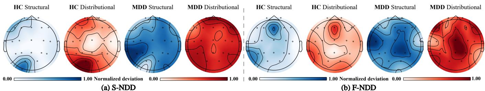  
Figure 3: Normative deviation visualization for selected HC and MDD cases on Mumtaz2016 under within-dataset evaluation. (a) S-NDD and (b) F-NDD illustrate structural and distributional deviation patterns. Deviation maps are normalized for visualization, with non-comparable color scales across methods.

## 5 Experiments

## 5.1 Experimental Setup

Implementation Details. EEG recordings are band-pass filtered at 0.5–50 Hz, resampled to 256 Hz, spatially aligned to 19 electrodes, and segmented into 5-s windows with a 2.5-s stride. The VQ-VAE codebooks contain 512 entries of dimension 64 for S-NDD and 64 entries ofdimension 32 for F-NDD, with $\beta = 0 . 2 5$ . Both methods use 500-step difusion models with a linear noise schedule from $1 0 ^ { - 4 }$ to 0.02. Normative models are trained exclusively on source-domain HC samples and frozen during diagnostic training. S-NDD fuses scalar normative deviations with deep EEG features using � = 0.7. F-NDD extracts 456-dimensional EEG features and estimates difusion residuals at T = {25, 125, 250} with � = 2 noise realizations per timestep. Both methods use a diagnostic learning rate of 5 × 10−4, with Adam for S-NDD and F-NDD. The auxiliary loss weight is $\lambda _ { \mathrm { d e v } } = 0 . 5$ . Further details are provided in Appendix A.

Datasets. We evaluate the proposed methods on Mumtaz2016 [26] and MODMA [3]. Both datasets contain MDD and HC recordings, supporting normative modeling and cross-dataset evaluation under heterogeneous acquisition settings. Mumtaz2016 comprises 34 MDD and 30 HC subjects with 19 electrodes, while MODMA includes 24 MDD and 29 HC subjects with 128 electrodes. After preprocessing, they yield 13,953 and 6,355 EEG segments, respectively. Baselines. We compare our methods with representative baselines from three categories. (i) Discriminative Learning methods include traditional classifiers such as KNN [39] and XGBoost [12], as well as deep EEG models including EEGNet [18], TSception [8], DeprNet [33], InceptionNet [38], CWT-1D-CNN and CWT-2D-CNN [30], CNN-LSTM [2], CNN-Transformer [28], GRU-Conv [50], GC-GRU [23], ST-GCA [37], MBA-CA [49], and SC-CNN [41]. We also consider pretrained EEG models, including CBraMod [42] and BrainOmni-base [46]. (ii) Generative augmentation methods include DifMDD [44] and four additional comparison strategies developed

Table 2: Cross-dataset performance (%) on MODMA with Mumtaz2016 as the source. Results are mean ± std., with best and second-best in bold and underlined, respectively.

$$
5 8 . 4 5 \pm 8 . 7 6
$$

Table 3: Cross-dataset performance (%) on Mumtaz2016 with MODMA as the source dataset. All methods use target HCassisted score calibration. Results are mean ± std., with best and second-best in bold and underlined, respectively.

$$
\overline { { 5 5 . 1 2 \pm 9 . 6 8 } }
$$

$$
\overline { { 6 0 . 3 0 \pm 7 . 9 5 } }
$$

$$
\overline { { 5 7 . 6 0 \pm 8 . 3 3 } }
$$

$$
\overline { { 5 9 . 1 8 \pm 9 . 1 2 } }
$$

$$
\mathbf { P r e } \left( \uparrow \right)
$$

$$
\begin{array} { c } { { 5 4 . 3 5 \pm 9 . 1 5 } } \\ { { . . . } } \end{array}
$$

$$
\mathbf { R e c } \left( \uparrow \right)
$$

$$
5 8 . 1 2 \pm 7 . 6 3
$$

$$
5 6 . 1 8 \pm 8 . 8 4
$$

$$
5 8 . 1 4 \pm 7 . 9 2
$$

$$
5 4 . 5 1 \pm 2 . 6 9
$$

$$
1 0 . 3 5 \pm 8 . 2 3
$$

$$
\overline { { 7 6 . 7 3 \pm 7 . 1 7 } }
$$

$$
\overline { { 3 0 . 9 5 \pm 1 7 . 6 2 } }
$$

$$
5 9 . 8 0 \pm 9 . 2 1 
$$

$$
6 0 . 4 7 \pm 8 . 6 3
$$

$$
5 7 . 6 6 \pm 8 . 5 4
$$

$$
5 7 . 5 0 \pm 9 . 4 6
$$

$$
5 7 . 3 4 \pm 7 . 8 9
$$

$$
\overline { { 4 1 . 9 1 \pm 2 0 . 0 6 } }
$$

$$
\overline { { 5 7 . 3 0 \pm 3 . 2 4 } }
$$

$$
9 0 . 5 5 \pm 8 . 7 4
$$

$$
1 6 . 6 2 \pm 1 6 . 8 6
$$

$$
5 2 . 3 9 \pm 5 . 7 7
$$

$$
7 3 . 8 1 \pm 2 0 . 6 2
$$

$$
5 6 . 3 4 \pm 5 . 4 0
$$

$$
5 6 . 5 2 \pm 2 7 . 3 1
$$

$$
1 1 . 1 3 \pm 1 2 . 8 8
$$

$$
7 9 . 3 8 \pm 1 1 . 1 2
$$

$$
8 3 . 5 7 \pm 4 . 9 2
$$

$$
5 1 . 1 6 \pm 2 . 1 2
$$

$$
4 4 . 5 3 \pm 2 3 . 0 9
$$

$$
5 9 . 7 8 \pm 3 9 . 6 9
$$

$$
5 0 . 3 4 \pm 4 . 3 9
$$

$$
4 2 . 3 9 \pm 1 5 . 1 9
$$

$$
7 4 . 9 6 \pm 9 . 4 9
$$

$$
5 5 . 9 5 \pm 2 9 . 9 5
$$

$$
6 1 . 1 1 \pm 3 . 9 4
$$

$$
5 8 . 9 7 \pm 2 1 . 3 7
$$

$$
1 3 . 8 0 \pm 7 . 0 5
$$

$$
4 9 . 5 6 \pm 3 . 2 6
$$

$$
\overline { { 4 8 . 8 4 \pm 8 . 3 9 } }
$$

$$
8 . 4 8 \pm 5 . 0 6
$$

$$
4 5 . 2 9 \pm 1 5 . 2 8
$$

$$
5 3 . 4 9 \pm 3 . 3 7
$$

$$
8 2 . 4 8 \pm 5 . 4 1
$$

$$
7 9 . 7 6 \pm 1 1 . 4 8
$$

$$
5 8 . 1 0 \pm 9 . 1 6
$$

$$
6 1 . 0 5 \pm 7 . 4 8
$$

$$
5 9 . 8 5 \pm 8 . 9 2
$$

$$
8 0 . 5 2 \pm 2 . 9 3 
$$

$$
8 0 . 0 8 \pm 5 . 9 9
$$

$$
5 6 . 4 5 \pm 7 . 7 8
$$

$$
6 0 . 1 2 \pm 9 . 5 3
$$

$$
6 2 . 8 7 \pm 6 . 2 1
$$

$$
3 8 . 4 4 \pm 2 5 . 7 3
$$

$$
4 6 . 8 2 \pm 2 . 8 7
$$

$$
5 4 . 7 6 \pm 5 . 4 6
$$

$$
7 6 . 7 4 \pm 8 . 3 9
$$

$$
5 2 . 1 3 \pm 4 2 . 6 9
$$

$$
4 8 . 8 4 \pm 4 . 0 3
$$

$$
4 1 . 4 2 \pm 1 0 . 7 6
$$

$$
5 8 . 2 0 \pm 1 . 5 3 
$$

$$
4 9 . 5 1 \pm 3 . 9 9
$$

$$
4 6 . 9 8 \pm 5 . 1 7
$$

$$
5 5 . 1 8 \pm 7 . 5 8
$$

$$
5 6 . 4 2 \pm 8 . 7 4
$$

$$
7 5 . 1 9 \pm 1 . 3 4
$$

$$
8 6 . 3 0 \pm 1 0 . 2 5
$$

$$
5 6 . 5 9 \pm 8 . 8 0
$$

$$
8 3 . 3 3 \pm 1 4 . 4 3
$$

$$
7 9 . 0 7 \pm 4 . 0 3
$$

$$
5 8 . 4 2 \pm 8 . 0 5
$$

$$
\mathrm { I n c e p t i o n N e t } \ [ 3 8 ]
$$

$$
5 2 . 3 0 \pm 9 . 7 2
$$

$$
5 6 . 8 0 \pm 8 . 8 9
$$

$$
8 3 . 6 0 \pm 4 . 1 1
$$

$$
4 9 . 2 9 \pm 3 . 9 6
$$

$$
5 3 . 8 2 \pm 7 . 9 1
$$

$$
5 4 . 8 9 \pm 9 . 2 6
$$

$$
9 1 . 1 1 \pm 2 . 1 6
$$

$$
2 7 . 3 8 \pm 4 . 1 2
$$

$$
3 4 . 1 1 \pm 2 . 6 9
$$

$$
5 6 . 7 5 \pm 9 . 0 8
$$

$$
8 7 . 6 0 \pm 7 . 9 2
$$

$$
3 5 . 0 0 \pm 2 . 9 6
$$

$$
5 1 . 2 0 \pm 8 . 6 7
$$

$$
5 5 . 4 0 \pm 9 . 3 4
$$

$$
5 4 . 7 6 \pm 2 1 . 8 2
$$

$$
6 4 . 3 4 \pm 8 . 1 7
$$

$$
3 2 . 5 4 \pm 7 . 5 2
$$

$$
1 9 . 1 5 \pm 2 7 . 5 9
$$

$$
6 4 . 9 9 \pm 1 3 . 6 5
$$

$$
4 9 . 7 0 \pm 5 . 2 4
$$

$$
7 6 . 1 2 \pm 4 . 1 3
$$

$$
\mathrm { G R U - C o n v } \ [ 5 0 ]
$$

$$
2 3 . 9 9 \pm 3 7 . 5 7
$$

$$
5 4 . 0 8 \pm 2 . 6 5
$$

$$
3 4 . 8 5 \pm 4 0 . 2 3
$$

$$
8 1 . 1 9 \pm 4 . 4 5
$$

$$
6 1 . 4 0 \pm 2 . 1 6
$$

$$
9 5 . 6 7 \pm 1 0 . 2 2
$$

$$
4 5 . 9 4 \pm 1 . 7 7
$$

$$
4 5 . 4 2 \pm 0 . 5 4
$$

$$
4 9 . 0 0 \pm 3 . 5 6
$$

$$
2 1 . 4 3 \pm 1 5 . 5 7
$$

$$
3 8 . 7 6 \pm 7 . 1 0
$$

$$
2 9 . 1 6 \pm 1 9 . 6 7
$$

$$
4 3 . 3 2 \pm 2 9 . 9 1
$$

$$
\mathbf { G C - G R U } \ [ 2 3 ]
$$

$$
4 8 . 6 6 \pm 4 . 2 9
$$

$$
6 7 . 9 5 \pm 4 7 . 1 7
$$

$$
5 2 . 7 7 \pm 9 . 0 3
$$

$$
4 3 . 7 3 \pm 8 . 3 2
$$

$$
5 0 . 3 4 \pm 0 . 5 2
$$

$$
3 1 . 8 4 \pm 2 1 . 9 7
$$

$$
4 1 . 0 9 \pm 1 2 . 8 1
$$

$$
3 8 . 1 0 \pm 3 5 . 0 5
$$

$$
\mathrm { S T - G C A } \ [ 3 7 ]
$$

$$
4 0 . 6 0 \pm 2 5 . 3 3
$$

$$
7 0 . 7 5 \pm 4 . 1 7
$$

$$
5 1 . 9 4 \pm 1 0 . 4 9
$$

$$
4 2 . 8 6 \pm 2 1 . 4 3
$$

$$
4 3 . 1 0 \pm 1 . 4 9
$$

$$
8 5 . 8 5 \pm 2 1 . 5 2 
$$

$$
5 1 . 6 7 \pm 1 8 . 4 6
$$

$$
\mathrm { M B A - C A } ^ { \mathrm { { - } } } [ 4 \dot { 9 } ]
$$

$$
8 4 . 7 5 \pm 4 . 7 4
$$

$$
6 2 . 7 0 \pm 6 . 2 8
$$

$$
7 8 . 2 9 \pm 5 . 3 7
$$

$$
\yen 80
$$

$$
8 2 . 1 4 \pm 1 4 . 2 9
$$

$$
8 2 . 7 6 \pm 5 . 9 3
$$

$$
5 4 . 6 2 \pm 1 . 4 0
$$

$$
4 9 . 0 1 \pm 2 . 9 8
$$

$$
8 7 . 4 6 \pm 3 . 4 2
$$

$$
5 5 . 3 8 \pm 2 . 0 2
$$

$$
6 9 . 6 3 \pm 2 . 8 0
$$

$$
3 4 . 5 2 \pm 2 3 . 7 8
$$

$$
5 5 . 1 8 \pm 0 . 3 0
$$

$$
4 2 . 5 9 \pm 2 5 . 7 2
$$

$$
6 3 . 1 5 \pm 1 3 . 6 4
$$

$$
2 . 5 4 \pm 0 . 3 6
$$

$$
4 . 8 7 \pm 0 . 6 5
$$

$$
4 8 . 0 6 \pm 9 . 4 0
$$

$$
4 9 . 9 0 \pm 0 . 3 5
$$

$$
5 9 . 2 9 \pm 8 . 9 0
$$

$$
6 9 . 5 8 \pm 7 . 2 0
$$

$$
2 3 . 8 1 \pm 8 . 9 9
$$

$$
3 4 . 7 4 \pm 1 0 . 0 3
$$

$$
5 2 . 5 4 \pm 4 . 2 6
$$

$$
4 3 . 4 1 \pm 3 . 5 5
$$

$$
5 9 . 5 4 \pm 1 8 . 8 4
$$

$$
5 3 . 5 7 \pm 2 4 . 7 4
$$

$$
\overline { { 6 8 . 3 4 \pm 8 . 1 9 } }
$$

$$
6 8 . 5 7 \pm 4 . 1 7
$$

$$
7 4 . 7 2 \pm 3 . 8 7
$$

$$
\overline { { 6 4 . 3 2 \pm 9 . 4 5 } }
$$

$$
\overline { { 5 8 . 6 0 \pm 8 . 6 2 } }
$$

$$
\overline { { 6 9 . 1 2 \pm 7 . 8 5 } }
$$

$$
\overline { { 5 8 . 9 4 \pm 9 . 7 8 } }
$$

$$
6 9 . 9 0 \pm 1 0 . 6 5
$$

$$
6 1 . 9 8 \pm 1 4 . 8 6
$$

$$
6 5 . 2 8 \pm 1 6 . 8 4
$$

$$
5 9 . 8 5 \pm 1 4 . 6 4
$$

$$
7 9 . 4 4 \pm 1 3 . 2 8
$$

$$
5 7 . 3 6 \pm 9 . 6 8
$$

$$
\mathrm { H y b r i d } ^ { * }
$$

$$
8 6 . 7 3 \pm 2 . 2 3
$$

$$
6 1 . 8 1 \pm 1 0 . 5 2
$$

$$
8 2 . 1 4 \pm 7 . 1 4
$$

$$
5 8 . 3 1 \pm 1 6 . 2 1
$$

$$
6 0 . 5 2 \pm 1 8 . 4 8
$$

$$
\underline { { 9 1 . 6 7 \pm 2 . 2 7 } }
$$

$$
4 8 . 9 4 \pm 1 1 . 4 7
$$

$$
5 1 . 1 4 \pm 1 0 . 6 7
$$

$$
9 2 . 5 8 \pm 6 . 4 4
$$

$$
\operatorname { C l e a n } ^ { * }
$$

$$
6 4 . 5 7 \pm 1 5 . 5 5
$$

$$
7 0 . 2 1 \pm 1 2 . 9 4
$$

$$
6 5 . 3 8 \pm 1 0 . 5 3
$$

$$
6 5 . 9 5 \pm 1 0 . 9 0
$$

$$
6 3 . 4 8 \pm 1 6 . 7 4
$$

$$
\underline { { 8 3 . 7 2 \pm 2 . 3 3 } }
$$

$$
6 7 . 2 2 \pm 1 2 . 6 3
$$

$$
5 7 . 2 2 \pm 1 3 . 1 1
$$

$$
5 7 . 9 7 \pm 1 6 . 1 4
$$

$$
\underline { { \mathrm { D i f f - A u g } } } ^ { * }
$$

$$
6 6 . 6 8 \pm 1 9 . 1 7
$$

$$
2 7 . 7 4 \pm 3 0 . 4 8
$$

$$
6 3 . 0 2 \pm 1 9 . 1 3
$$

$$
\overline { { 6 0 . 0 1 \pm 7 . 6 6 } }
$$

$$
\overline { { 5 3 . 0 2 \pm 5 . 6 1 } }
$$

$$
\overline { { 2 3 . 8 1 \pm 2 9 . 7 4 } }
$$

$$
\overline { { 5 5 . 9 5 \pm 3 . 2 7 } }
$$

$$
\overline { { 4 0 . 3 8 \pm 3 5 . 1 4 } }
$$

$$
5 9 . 2 8 \pm 4 . 1 9
$$

$$
\overline { { \phantom { - } D o m a i n . A d a p t a t i o n . M e t h o d s } }
$$

$$
2 2 . 8 7 \pm 0 . 6 5
$$

$$
\overline { { 5 0 . 0 0 \pm 4 . 1 7 } }
$$

$$
6 1 . 3 3 \pm 7 . 3 5
$$

$$
3 8 . 8 9 \pm 4 . 2 7
$$

$$
3 7 . 6 1 \pm 1 3 . 4 9
$$

$$
\overline { { 4 1 . 0 9 \pm 8 . 8 0 } }
$$

$$
\mathrm { C l e a n } ^ { * }
$$

$$
5 8 . 8 5 \pm 8 . 9 5
$$

$$
1 4 . 2 9 \pm 0 . 0 0
$$

$$
\overline { { 6 5 . 0 1 \pm 1 2 . 3 1 } }
$$

$$
5 7 . 9 4 \pm 8 . 3 6
$$

$$
2 6 . 6 0 \pm 1 . 4 4
$$

$$
\overline { { 5 5 . 8 1 \pm 6 . 9 8 } }
$$

$$
2 7 . 7 8 \pm 1 3 . 3 9
$$

$$
\overline { { 7 0 . 1 0 \pm 1 . 1 3 } }
$$

$$
5 9 . 4 4 \pm 6 . 9 7
$$

$$
6 5 . 0 0 \pm 1 1 . 2 7
$$

$$
3 7 . 2 1 \pm 2 . 3 3
$$

$$
1 6 . 6 7 \pm 2 . 0 6
$$

$$
5 5 . 0 8 \pm 1 1 . 2 4
$$

$$
7 2 . 6 9 \pm 2 3 . 9 1
$$

$$
\underline { { 6 6 . 6 7 \pm 2 . 8 2 } }
$$

$$
1 2 . 2 5 \pm 0 . 2 2
$$

$$
{ 7 5 . 2 7 \pm 2 1 . 4 6 }
$$

$$
4 0 . 3 1 \pm 3 . 5 5
$$

$$
3 8 . 1 7 \pm 2 . 7 6
$$

$$
5 1 . 9 4 \pm 1 . 3 4
$$

$$
5 8 . 3 3 \pm 1 8 . 1 6
$$

$$
7 . 1 4 \pm 0 . 0 0
$$

$$
4 3 . 3 3 \pm 5 . 7 7
$$

$$
\underline { { 7 9 . 3 1 \pm 3 . 9 0 } }
$$

$$
1 8 . 3 7 \pm 0 . 3 3 
$$

$$
{ \underline { { 5 0 . 0 0 \pm 1 5 . 0 2 } } }
$$

$$
3 7 . 1 4 \pm 3 . 3 1
$$

$$
3 3 . 3 3 \pm 1 . 3 4
$$

$$
6 6 . 5 7 \pm 1 3 . 2 1
$$

$$
\mathrm { D e e p C O R A L } \left[ 3 6 \right]
$$

$$
1 0 . 7 1 \pm 0 . 0 0
$$

$$
5 7 . 3 6 \pm 2 . 6 9
$$

$$
6 5 . 0 0 \pm 8 . 6 6
$$

$$
5 6 . 9 4 \pm 2 . 4 1
$$

$$
3 7 . 9 8 \pm 1 . 3 4
$$

$$
6 3 . 1 2 \pm 8 . 0 1
$$

$$
5 5 . 8 1 \pm 6 . 9 8
$$

$$
6 9 . 9 6 \pm 6 . 1 6
$$

$$
\overline { { \textit { D o m a i n A d a p t a t i o n m e t h o d s } } }
$$

$$
\overline { { 8 4 . 2 1 \pm 5 . 1 1 } }
$$

$$
\overline { { 8 0 . 3 9 \pm 3 . 4 0 } }
$$

$$
\overline { { 7 1 . 7 8 \pm 1 2 . 0 8 } }
$$

$$
6 4 . 2 9 \pm 2 5 . 0 0
$$

$$
8 8 . 4 7 \pm 8 . 3 9
$$

$$
\overline { { 6 9 . 7 7 \pm 8 . 3 9 } }
$$

$$
\overline { { 6 8 . 2 2 \pm 2 . 6 9 } }
$$

$$
5 1 . 9 4 \pm 2 3 . 7 5
$$

$$
7 2 . 0 6 \pm 2 2 . 9 5
$$

$$
7 5 . 3 4 \pm 9 . 8 9
$$

$$
4 2 . 5 2 \pm 4 2 . 8 6
$$

$$
4 5 . 7 1 \pm 4 0 . 5 1
$$

$$
4 2 . 8 6 \pm 4 9 . 1 0
$$

$$
7 8 . 5 0 \pm 5 . 8 1
$$

$$
7 0 . 8 2 \pm 7 . 5 7
$$

$$
2 8 . 6 8 \pm 7 . 1 0
$$

$$
1 7 . 7 8 \pm 1 6 . 7 8
$$

$$
4 . 7 6 \pm 4 . 1 2
$$

$$
7 . 4 3 \pm 6 . 4 6
$$

$$
1 8 . 8 9 \pm 8 . 1 2
$$

∗ Comparison strategies developed in this study, as in Table 1. † Target HC-assisted score calibration.

$$
\overline { { 8 9 . 1 5 \pm 1 . 3 4 } }
$$

$$
8 2 . 9 5 \pm 3 . 5 5
$$

$$
\overline { { 9 3 . 0 8 \pm 5 . 1 9 } }
$$

$$
9 0 . 4 8 \pm 5 . 4 6 
$$

$$
8 0 . 4 4 \pm 2 . 8 7
$$

$$
\overline { { 9 1 . 5 6 \pm 1 . 0 1 } }
$$

$$
9 7 . 6 2 \pm 2 . 0 6
$$

$$
\overline { { 9 4 . 2 1 \pm 0 . 9 0 } }
$$

$$
\underline { { 8 8 . 1 9 \pm 2 . 3 2 } }
$$

$$
8 8 . 5 7 \pm 2 . 7 5
$$

∗ Comparison strategies developed in this study, as in Table 1.

in this study (Dif-Aug, Hard Neg, Clean, and Hybrid). These methods investigate the use of synthetic EEG samples for depression detection. Implementation details are provided in Appendix C. (iii) Domain adaptation methods include DANN [10], DAN [21], Deep CORAL [36], and TFST-SDKA [48], which are evaluated only in cross-dataset settings.

Evaluation Metrics. Following established evaluation practices in EEG-based MDD detection [37, 44], we report Accuracy (Acc), Precision (Pre), Recall (Rec), F1-score (F1), and ROC-AUC (AUC) at both window and subject levels. Both S-NDD and F-NDD generate window-level predictions from individual EEG windows. For S-NDD, subject-level predictions are obtained by majority voting across windows, with ties assigned to MDD, and subject-level AUC is computed from the mean MDD probability. For F-NDD, subject level predictions are generated directly from attention-aggregated window representations, as described in Section 4.3.

diferent strengths across evaluation levels. Their window-level accuracies are close (95.28% and 95.20%, respectively), while S-NDD achieves higher recall, F1, and AUC. At the subject level, F-NDD achieves the highest accuracy, precision, and F1 of 97.50%, 97.22%, and 97.07%, respectively. Both variants attain 97.50% recall, with F-NDD achieving higher precision and S-NDD obtaining the highest AUC of 98.96%. These results support the diagnostic value of normative deviations across both evaluation levels, with S-NDD providing stronger window-level discrimination and F-NDD achieving better subject-level accuracy and F1.

## 5.2 MDD Detection Performance

We evaluate MDD detection on Mumtaz2016 using subject-independent 10-fold cross-validation, with all windows from each subject assigned to the same fold. As shown in Table 1, S-NDD achieves the highest window-level accuracy, recall, F1, and AUC of 95.28%, 97.18%, 95.18%, and 98.83%, respectively. Its accuracy exceeds CWT-1D-CNN, the strongest discriminative baseline in accuracy, by 3.74 percentage points. This improvement is accompanied by high sensitivity without a substantial loss of precision. For example, CBraMod achieves a comparable recall of 96.92% but only 87.94% precision, whereas S-NDD attains 97.18% recall and 93.45% precision, indicating better control of false positives. S-NDD and F-NDD exhibit

Beyond Generative Augmentation. Unlike generative augmentation methods that expand training data with synthetic EEG samples, S-NDD and F-NDD use generative models to establish healthy references and estimate normative deviations. As shown in Table 1, both variants outperform DifMDD and the four augmentation baselines in accuracy and F1 at both evaluation levels. At the window level, S-NDD achieves 95.28% accuracy and 95.18% F1, improving over DifMDD by 1.43 and 1.53 percentage points, respectively. Although Hybrid achieves a competitive AUC of 98.53%, its accuracy remains at 92.89%, suggesting that strong ranking performance does not necessarily translate into equally efective classification. S-NDD achieves a higher AUC of 98.83% together with higher accuracy and F1. At the subject level, F-NDD achieves the highest accuracy and F1 of 97.50% and 97.07%, while S-NDD obtains the highest AUC of 98.96%. These results support learning deviations from healthy references as an efective alternative to synthetic data augmentation for EEG-based MDD detection.

Normative Deviation Modeling for EEG-based Depression Detection

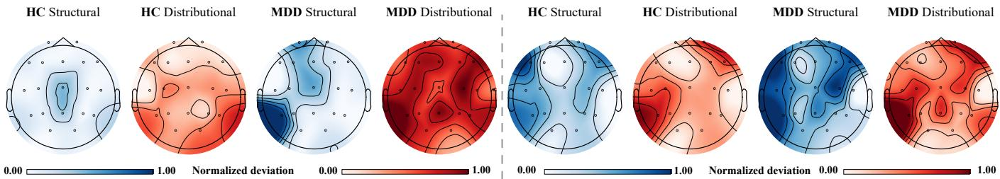

Figure 4: Normative deviation visualization for selected HC and MDD cases on MODMA under cross-dataset evaluation with Mumtaz2016 as the source dataset. (a) S-NDD and (b) F-NDD illustrate structural and distributional deviation patterns.  
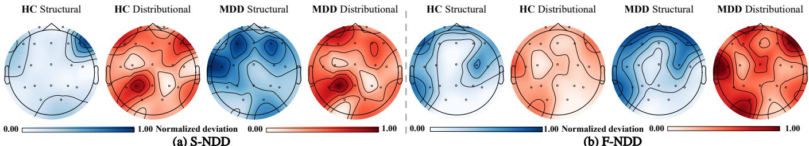  
Figure 5: Normative deviation visualization for selected HC and MDD cases on Mumtaz2016 under cross-dataset evaluation with MODMA as the source dataset. (a) S-NDD and (b) F-NDD illustrate structural and distributional deviation patterns.

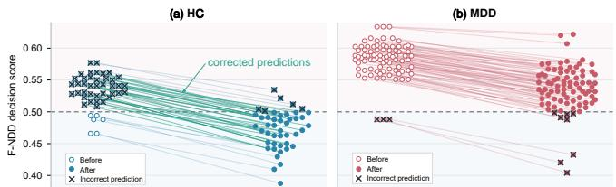  
Figure 6: F-NDD scores before and after target HC calibration for (a) HC and (b) MDD. Green lines indicate corrected predictions, crosses denote errors, and the dashed line marks the decision threshold.

Normative Deviation Visualization. Figure 3 visualizes structural and distributional deviations for selected HC and MDD cases on Mumtaz2016. In both S-NDD and F-NDD, the selected MDD cases exhibit more widespread structural deviations than their HC counterparts, suggesting that healthy-reference reconstruction captures diferences between the diagnostic groups. Meanwhile, distri butional deviations exhibit distinct spatial patterns, indicating that they characterize diferent aspects ofEEG variations from structural reconstruction errors. The two formulations also produce diferent deviation maps, reflecting their signal- and feature-space representations, respectively. Together, these observations illustrate how healthy references characterize EEG variations at diferent levels, supporting the use of normative deviations in diagnostic learning.

## 5.3 Cross-Dataset Generalization

Mumtaz2016 to MODMA. We train S-NDD and F-NDD on Mumtaz2016 and evaluate them on MODMA, mapping its 128-electrode recordings to 19 electrodes through spatial adaptation. F-NDD additionally uses target-domain HC data for score calibration. As shown in Table 2, S-NDD achieves the highest accuracy of 78.50% and F1 of 69.96%. Compared with the best results among DANN,

DAN, Deep CORAL, and TFST-SDKA, these represent gains of 21.14 and 10.52 percentage points, respectively. S-NDD also exceeds the strongest non-ours results in accuracy and F1 by 8.60 and 6.48 points, while achieving an AUC comparable to the best baseline (79.31% versus 79.44%). These results support the efectiveness of normative deviation modeling beyond the evaluated domain alignment and augmentation approaches. Compared with calibrated F-NDD, S-NDD achieves higher recall (75.34% versus 56.94%) with lower precision, yielding better overall accuracy and F1 without target-domain calibration.

MODMA to Mumtaz2016. To account for potential shifts in prediction scores, we evaluate reverse transfer using target HC-assisted score calibration for all methods. Seven target HC record groups are reserved for calibration and excluded from diagnostic testing, with model parameters kept fixed. Table 3 shows that F-NDD achieves the highest accuracy, precision, F1, and AUC of 89.15%, 93.08%, 91.56%, and 94.21%, respectively. It outperforms KNN, the strongest baseline in accuracy, by 5.43 percentage points in accuracy and 4.83 points in F1. Its accuracy also exceeds Deep CORAL, the strongest domain adaptation baseline, by 13.18 points. S-NDD achieves the highest recall of 97.62%, whereas F-NDD combines 90.48% recall with substantially higher precision (93.08% versus 80.44%). Thus, under the same calibration setting, F-NDD provides a more favorable balance between MDD detection and false-positive control.

Visualization Analysis. Figure 4 and Figure 5 visualize structural and distributional deviations in both transfer directions. The selected cases exhibit diferent regional patterns across the two views, illustrating how they characterize distinct aspects of departure from the healthy reference. For example, the S-NDD MDD case on MODMA exhibits localized structural deviations alongside more widespread distributional deviations. Figure 6 further illustrates the efect of HC-assisted calibration on F-NDD. Most HC scores move below the threshold of 0.5, correcting false positives, while most

(a) Codebook size

Table 4: Ablation results (%) of S-NDD and F-NDD on Mumtaz2016. Results are reported as mean ± std., with the best and second-best results in bold and underlined, respectively.
<table><tr><td>Methods</td><td>Acc (↑)</td><td>Pre (↑)</td><td> $\mathbf { R e c } \left( \uparrow \right)$ </td><td>F1(↑)</td><td> $\mathbf { A U C } \left( \uparrow \right)$ </td></tr><tr><td colspan="6">S-NDD Ablation Study</td></tr><tr><td>w/o Both</td><td> $8 5 . 5 6 \pm 4 . 6 1$ </td><td> $8 4 . 9 0 \pm 6 . 3 5$ </td><td> $8 7 . 9 7 \pm 5 . 7 6$ </td><td> $8 4 . 9 8 \pm 4 . 3 6$ </td><td> $9 2 . 3 9 \pm 5 . 0 3$ </td></tr><tr><td>w/o Dist.</td><td> $9 0 . 4 0 \pm 5 . 9 4$ </td><td> $9 0 . 6 9 \pm 5 . 9 9$ </td><td> $9 2 . 7 2 \pm 5 . 7 2$ </td><td> $9 0 . 9 1 \pm 5 . 0 5$ </td><td> $9 8 . 2 4 \pm 1 . 6 7$ </td></tr><tr><td>w/o Struct.</td><td> $9 3 . 1 1 \pm 4 . 8 5$ </td><td> $9 2 . 3 8 \pm 7 . 7 2$ </td><td> $9 4 . 3 4 \pm 8 . 0 9$ </td><td> $9 2 . 9 5 \pm 4 . 8 4$ </td><td> $9 7 . 9 2 \pm 2 . 9 6$ </td></tr><tr><td>Dec. Fusion</td><td> $9 3 . 1 2 \pm 5 . 0 5$ </td><td> $9 4 . 1 0 \pm 7 . 4 9$ </td><td> $9 1 . 6 2 \pm 7 . 6 0$ </td><td> $9 2 . 0 0 \pm 8 . 4 1$ </td><td> $9 8 . 5 3 \pm 1 . 4 4$ </td></tr><tr><td>Mahalanobis</td><td> $9 2 . 6 2 \pm 5 . 0 1$ </td><td> $9 0 . 9 1 \pm 7 . 5 9$ </td><td> $9 5 . 3 1 \pm 5 . 2 5$ </td><td> $9 3 . 0 6 \pm 6 . 7 2 $ </td><td> $9 7 . 8 4 \pm 2 . 9 7$ </td></tr><tr><td>OCSVM</td><td> $9 2 . 2 5 \pm 6 . 2 3$ </td><td> $8 8 . 6 6 \pm 7 . 2 8$ </td><td> $9 7 . 4 3 \pm 2 . 7 2 $ </td><td> $9 2 . 8 4 \pm 5 . 7 6$ </td><td> $9 7 . 9 4 \pm 3 . 5 8 $ </td></tr><tr><td>Simple VAE</td><td> $9 2 . 5 6 \pm 4 . 8 0$ </td><td> $9 1 . 9 7 \pm 6 . 8 9$ </td><td> $9 2 . 7 1 \pm 8 . 5 5$ </td><td> $9 2 . 3 4 \pm 5 . 7 8$ </td><td> $9 7 . 6 1 \pm 3 . 6 2 $ </td></tr><tr><td>S-NDD (Ours)</td><td> $9 5 . 2 8 \pm 3 . 2 5$ </td><td> $9 3 . 4 5 \pm 4 . 2 5$ </td><td> $9 7 . 1 8 \pm 3 . 9 4$ </td><td> $9 5 . 1 8 \pm 3 . 6 2$ </td><td> $9 8 . 8 3 \pm 0 . 9 5$ </td></tr><tr><td colspan="6">F-NDD Ablation Study</td></tr><tr><td>w/o Deviations</td><td> $8 8 . 7 5 \pm 4 . 9 6 $ </td><td> $\underline { { 8 9 . 4 3 \pm 7 . 5 8 } }$ </td><td> $8 9 . 5 9 \pm 6 . 4 1$ </td><td> $\underline { { 8 9 . 1 5 \pm 4 . 0 7 } }$ </td><td> $9 5 . 1 5 \pm 3 . 9 0 $ </td></tr><tr><td>w/o Struct.</td><td> $8 7 . 1 2 \pm 5 . 1 3$ </td><td> $8 6 . 6 2 \pm 1 0 . 4 5$ </td><td> $8 9 . 6 4 \pm 6 . 1 3$ </td><td> $8 7 . 5 6 \pm 5 . 2 7$ </td><td> $\overline { { 9 4 . 0 8 \pm 3 . 4 9 } }$ </td></tr><tr><td>w/o Dist.</td><td> $8 7 . 4 2 \pm 6 . 9 4$ </td><td> $8 5 . 3 4 \pm 1 2 . 6 1$ </td><td> $9 0 . 0 1 \pm 5 . 3 8$ </td><td> $8 7 . 2 8 \pm 8 . 3 6$ </td><td> $9 2 . 8 8 \pm 7 . 0 9$ </td></tr><tr><td>Spectral only  $\cdot ( 9 5 \mathrm { - D } )$ </td><td> $8 6 . 1 1 \pm 6 . 7 4$ </td><td> $8 5 . 1 5 \pm 1 0 . 2 6$ </td><td> $8 6 . 7 0 \pm 1 0 . 4 2$ </td><td> $8 5 . 5 6 \pm 9 . 0 0$ </td><td> $9 2 . 9 3 \pm 5 . 9 9$ </td></tr><tr><td>Correlation only (361-D)</td><td> $7 4 . 1 5 \pm 6 . 1 0$ </td><td> $7 4 . 4 2 \pm 1 3 . 1 5$ </td><td> $7 8 . 1 4 \pm 9 . 2 5$ </td><td> $7 5 . 0 1 \pm 6 . 4 2$ </td><td> $8 2 . 3 7 \pm 7 . 3 7$ </td></tr><tr><td>F-NDD (Ours)</td><td> $9 5 . 2 0 \pm 3 . 6 3$ </td><td> $9 4 . 9 4 \pm 4 . 7 0$ </td><td> $9 5 . 2 1 \pm 1 0 . 0 1$ </td><td> $9 4 . 6 9 \pm 5 . 7 8$ </td><td> $9 8 . 0 1 \pm 1 . 3 5 $ </td></tr></table>

MDD scores remain above it, with a few additional false negatives. Correspondingly, accuracy increases from 67.44% to 89.15% and F1 from 79.42% to 91.56%, whereas AUC changes modestly from 93.41% to 94.21%. This suggests that calibration primarily improves threshold-based decisions while largely preserving the model’s discriminative ranking.

## 5.4 Ablation Study

Scalar-level Deviation (S-NDD). As shown in Table 4, removing both structural and distributional deviations reduces accuracy from 95.28% to 85.56%, indicating the contribution of normative information beyond deep EEG representations. Removing the distributional or structural component yields 90.40% and 93.11% accuracy, respectively, with a larger reduction observed when distributional deviations are excluded. Replacing deviation-guided fusion with decisionlevel fusion decreases accuracy to 93.12%, supporting the adopted feature-fusion strategy. Alternative normative priors based on Mahalanobis distance, OCSVM, and Simple VAE achieve accuracies of 92.62%, 92.25%, and 92.56%, respectively. Although OCSVM attains slightly higher recall (97.43% versus 97.18%), S-NDD achieves the highest accuracy, F1, and AUC among these configurations. These results support the combined use of structural and distributional references with deviation-guided feature fusion.

Feature-level Deviation (F-NDD). As shown in Table 4, removing both deviation components reduces accuracy from 95.20% to 88.75%. Excluding structural or distributional residuals further reduces accuracy to 87.12% and 87.42%, respectively, indicating that the two components contribute jointly to diagnostic performance. The larger degradation relative to removing both deviations also suggests that retaining only one residual component does not necessarily improve the learned representation. Regarding feature composition, using only spectral features (95-D) yields 86.11% accuracy, while correlation-only features (361-D) achieve 74.15%. The complete F-NDD achieves 95.20% accuracy and 94.69% F1, supporting the combined use of spectral and inter-electrode correlation information for feature-level deviation modeling. Overall, the ablations highlight the contribution of structural and distributional deviations in both diagnostic formulations.

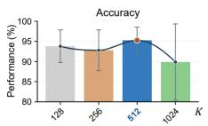

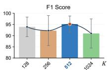

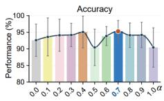

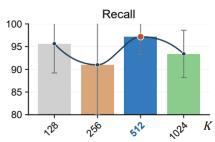

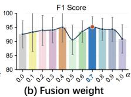

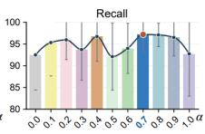

Figure 7: Sensitivity of S-NDD to (a) codebook size � and (b) fusion weight � on Mumtaz2016. Orange dots indicating the highest means.  
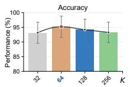

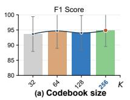

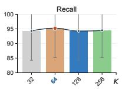

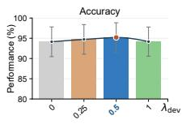

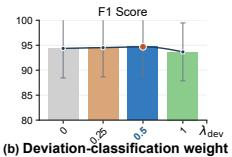

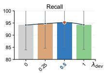  
Figure 8: Sensitivity of F-NDD to (a) codebook size � and (b) auxiliary loss weight $\lambda _ { \mathrm { d e v } }$ on Mumtaz2016. Orange dots indicating the highest means.

## 5.5 Sensitivity Analysis

We examine the sensitivity of S-NDD and F-NDD to their key hyperparameters on Mumtaz2016. As shown in Fig. $7 , \mathsf { S - N D D }$ achieves the highest mean accuracy, F1, and recall at $K = 5 1 2$ and $\alpha = 0 . 7$ in the respective sweeps. Performance generally remains stable across moderate fusion weights, while larger codebooks do not consistently improve the results. Figure 8 shows that F-NDD achieves the highest mean accuracy and recall at $K = 6 4$ , while $K = 2 5 6$ yields the highest F1. For the auxiliary loss weight, $\lambda _ { \mathrm { d e v } } = 0 . 5$ achieves the highest means across all three metrics. Overall, F-NDD exhibits small performance variations across the tested configurations.

## 6 Conclusion and Future Work

In this paper, we investigate healthy normative deviations for EEGbased MDD detection through two approaches, S-NDD and F-NDD. Both learn structural and distributional references from healthy controls and incorporate deviations at scalar and feature levels, respectively. Experiments on two public EEG datasets demonstrate their efectiveness under within-source and bidirectional cross-source settings. The two approaches exhibit distinct strengths across diagnostic levels and transfer directions. Optional target HC-assisted score calibration further improves performance in selected crosssource settings. These findings highlight the value of healthy normative references in complementing supervised EEG representations. As spatial interpolation mainly aligns electrode geometry, future work will investigate unsupervised domain adaptation to mitigate remaining acquisition-related diferences across datasets.

## References

[1] U. Rajendra Acharya, Shu Lih Oh, Yuki Hagiwara, Jen Hong Tan, Hojjat Adeli, and D. P. Subha. 2018. Automated EEG-based screening of depression using deep convolutional neural network. Computer Methods and Programs in Biomedicine 161 (2018), 103–113. doi:10.1016/j.cmpb.2018.04.012

[2] Betul Ay, Ozal Yildirim, Muhammed Talo, Ulas Baran Baloglu, Galip Aydin, Subha D Puthankattil, and U Rajendra Acharya. 2019. Automated depression detection using deep representation and sequence learning with EEG signals. Journal ofmedical systems 43, 7 (2019), 205.

[3] Hanshu Cai, Zhenqin Yuan, Yiwen Gao, Shuting Sun, Na Li, Fuze Tian, Han Xiao, Jianxiu Li, Zhengwu Yang, Xiaowei Li, et al. 2022. A multi-modal open dataset for mental-disorder analysis. Scientific data 9, 1 (2022), 178.

[4] Friedrich Philipp Carrle, Yasmin Hollenbenders, and Alexandra Reichenbach. 2023. Generation of synthetic EEG data for training algorithms supporting the diagnosis of major depressive disorder. Frontiers in Neuroscience 17 (2023), 1219133.

[5] Daniel Choi, Cordelia Yip, Andrew Choi, and Junho Park. 2026. Fail closed trust gated synthetic augmentation governs tail risk under subject shift in EEG. bioRxiv (2026), 2026–01.

[6] Shubham Choudhary, Manish Kumar Bajpai, and Kusum Kumari Bharti. 2024. Spatio-temporal features based deep learning model for depression detection using two electrodes. Measurement Science and Technology 35, 8 (2024), 086015.

[7] Jnanamay Das and Shailly Yadav. 2020. Resting state quantitative electroencephalogram power spectra in patients with depressive disorder as compared to normal controls: an observational study. Indian Journal of Psychological Medicine 42, 1 (2020), 30–38.

[8] Yi Ding, Neethu Robinson, Qiuhao Zeng, Duo Chen, Aung Aung Phyo Wai, Tih-Shih Lee, and Cuntai Guan. 2020. TSception: A deep learning framework for emotion detection using EEG. In 2020 international joint conference on neural networks (IJCNN). IEEE, 1–7.

[9] Chenglong Fu, Jian Yao, Pengjiang Qian, Weiwei Fu, Chuang Wang, and Guisong Yang. 2026. Towards Glaucoma Screening in Decentralized Clinics: A Dynamic Expert-Assisted Domain-Incremental Approach. In Proceedings ofthe ACM Web Conference 2026. 9309–9317.

[10] Yaroslav Ganin, Evgeniya Ustinova, Hana Ajakan, Pascal Germain, Hugo Larochelle, Francois Laviolette, Mario March, and Victor Lempitsky. 2016. Domain-Adversarial Training of Neural Networks. Journal of Machine Learning Research 17, 59 (2016), 1–35. https://jmlr.org/papers/v17/15-239.html

[11] Ahmed G Habashi, Ahmed M Azab, Seif Eldawlatly, and Gamal M Aly. 2023. Generative adversarial networks in EEG analysis: an overview. Journal ofneuroengineering and rehabilitation 20, 1 (2023), 40.

[12] Marwa Hassan and Naima Kaabouch. 2024. Impact offeature selection techniques on the performance of machine learning models for depression detection using EEG data. Applied Sciences 14, 22 (2024), 10532.

[13] Jonathan Ho, Ajay Jain, and Pieter Abbeel. 2020. Denoising difusion probabilistic models. Advances in neural information processing systems 33 (2020), 6840–6851.

[14] Pengfei Hou, Xiaowei Li, Jing Zhu, and Bin Hu. 2025. A lightweight convolutional transformer neural network for EEG-based depression recognition. Biomedical Signal Processing and Control 100 (2025), 107112.

[15] Mariam Khayretdinova, Ilya Zakharov, Polina Pshonkovskaya, Timothy Adamovich, Andrey Kiryasov, Andrey Zhdanov, and Alexey Shovkun. 2024. Prediction of brain sex from EEG: using large-scale heterogeneous dataset for developing a highly accurate and interpretable ML model. NeuroImage 285 (2024), 120495.

[16] George H Klem. 1999. The ten-twenty electrode system of the international federation. The international federation of clinical neurophysiology. Electroencephalogr. Clin. Neurophysiol. Suppl. 52 (1999), 3–6.

[17] Mustapha Abdulrahman Lawal, Abdultaofeek Abayomi, Abubakar Abba Salihu, Anes Aihong Aliyu, Muazu Aminu Aliyu, and Ismail Zahraddeen Yakubu. 2026. Transfer learning and domain adaptation in neuroinformatics. In Deep Learning Applications in Neuroinformatics. Elsevier, 287–310.

[18] Vernon J Lawhern, Amelia J Solon, Nicholas R Waytowich, Stephen M Gordon, Chou P Hung, and Brent J Lance. 2018. EEGNet: a compact convolutional neural network for EEG-based brain–computer interfaces. Journal of neural engineering 15, 5 (2018), 056013.

[19] Ivana Leccisotti, Anita Mollica, Rossana Laurello, Maria Claudia Moretti, Mario Altamura, Antonello Bellomo, Francesco Panza, and Madia Lozupone. 2026. Ma chine learning-assisted resting-state electroencephalography improves diagnostic accuracy in psychiatric disorders: A narrative review. Advanced Technology in Neuroscience 3, 1 (2026), 21–33.

[20] Andrew F Leuchter, Ian A Cook, Aimee M Hunter, Chaochao Cai, and Steve Hor vath. 2012. Resting-state quantitative electroencephalography reveals increased neurophysiologic connectivity in depression. PloS one 7, 2 (2012), e32508.

[21] Mingsheng Long, Yue Cao, Jianmin Wang, and Michael I. Jordan. 2015. Learning Transferable Features with Deep Adaptation Networks. In Proceedings ofthe 32nd International Conference on Machine Learning (Proceedings ofMachine Learning Research, Vol. 37). 97–105. https://proceedings.mlr.press/v37/long15.html

[22] Haifeng Lu, Zhiyang You, Yi Guo, and Xiping Hu. 2024. Mast-gcn: Multi-scale adaptive spatial-temporal graph convolutional network for eeg-based depression recognition. IEEE Transactions on Afective Computing 15, 4 (2024), 1985–1996.

[23] Gang Luo, Hong Rao, Panfeng An, Yunxia Li, Ruiyun Hong, Wenwu Chen, and Shengbo Chen. 2023. Exploring Adaptive Graph Topologies and Temporal Graph Networks for EEG-Based Depression Detection. IEEE Transactions on Neural Systems and Rehabilitation Engineering 31 (2023), 3947–3957. doi:10.1109/TNSRE. 2023.3320693

[24] RuiFang Lyu. 2026. Deep learning approaches for EEG-based healthcare applications: a comprehensive review. Frontiers in Human Neuroscience 19 (2026), 1689073.

[25] Andre F Marquand, Seyed Mostafa Kia, Mariam Zabihi, Thomas Wolfers, Jan K Buitelaar, and Christian F Beckmann. 2019. Conceptualizing mental disorders as deviations from normative functioning. Molecular Psychiatry 24, 10 (2019), 1415–1424.

[26] Wajid Mumtaz, Likun Xia, Syed Saad Azhar Ali, Mohd Azhar Mohd Yasin, Muhammad Hussain, and Aamir Saeed Malik. 2017. Electroencephalogram (EEG)-based computer-aided technique to diagnose major depressive disorder (MDD). Biomedical Signal Processing and Control 31 (2017), 108–115.

[27] Sebastian Olbrich, Natalia Jaworska, Sara de la Salle, Verner Knott, Pierre Blier, Martin Brunovsky, Tobias Welt, Mateo de Bardeci, and Cheng Teng-Ip. 2026. Deep learning using electroencephalogram (EEG) data for diagnosing and predicting SSRI response in major depressive disorder. Communications Medicine 6, 1 (2026), 159.

[28] Dan Peng, Wei-Long Zheng, and Bao-Liang Lu. 2025. Enhancing Depression Detection from Emotion EEG with Temporal-Spatial-Spectral Representation Learning. In 2025 47th Annual International Conference ofthe IEEE Engineering in Medicine and Biology Society (EMBC). IEEE, 1–5.

[29] Walter HL Pinaya, Mark S Graham, Robert Gray, Pedro F Da Costa, Petru-Daniel Tudosiu, Paul Wright, Yee H Mah, Andrew D MacKinnon, James T Teo, RolfJager, et al. 2022. Fast unsupervised brain anomaly detection and segmentation with difusion models. In International Conference on Medical Image Computing and Computer-Assisted Intervention. Springer, 705–714.

[30] U Raghavendra, Anjan Gudigar, Yashas Chakole, Praneet Kasula, DP Subha, Nahrizul Adib Kadri, Edward J Ciaccio, and U Rajendra Acharya. 2023. Automated detection and screening of depression using continuous wavelet transform with electroencephalogram signals. Expert Systems 40, 4 (2023), e12803.

[31] Hoorain Rehman, Danish M Khan, Hafsa Amanullah, Laiba Kamran, Owais Ur Rehman, Sana Taj Siddiqui, and Komal Masroor. 2025. Advances in EEG-based detection of Major Depressive Disorder using shallow and deep learning techniques: A systematic review. Computers in Biology and Medicine 192 (2025), 110154.

[32] Saige Rutherford, Seyed Mostafa Kia, Thomas Wolfers, Charlotte Fraza, Mariam Zabihi, Richard Dinga, Pierre Berthet, Amanda Worker, Serena Verdi, Henri cus G Ruhe, et al. 2022. The normative modeling framework for computational psychiatry. Nature protocols 17, 7 (2022), 1711–1734.

[33] Ayan Seal, Rishabh Bajpai,Jagriti Agnihotri, Anis Yazidi, Enrique Herrera-Viedma, and Ondrej Krejcar. 2021. DeprNet: A deep convolution neural network framework for detecting depression using EEG. IEEE Transactions on Instrumentation and Measurement 70 (2021), 1–13.

[34] Anurag Singh, Vivek Tiwari, Harshita Patel, GN Vivekananda, Dharmendra Singh Rajput, et al. 2024. Slitranet: an EEG-based automated diagnosis framework for major depressive disorder monitoring using a novel LGCN and transformer-based hybrid deep learning approach. IEEE Access 12 (2024), 173109–173126.

[35] Yonghao Song, Qingqing Zheng, Bingchuan Liu, and Xiaorong Gao. 2023. EEG Conformer: Convolutional Transformer for EEG Decoding and Visualization. IEEE Transactions on Neural Systems and Rehabilitation Engineering 31 (2023), 710–719. doi:10.1109/TNSRE.2022.3230250

[36] Baochen Sun and Kate Saenko. 2016. Deep CORAL: Correlation Alignment for Deep Domain Adaptation. In Computer Vision – ECCV 2016 Workshops. 443–450. doi:10.1007/978-3-319-49409-8\_35

[37] Yubing Sun, Jiaqi Sun, Zijian Zhou, Jing Cai, Wenjie Cui, and Guangda Liu. 2026. A Novel Spatial-Temporal Graph Neural Network for Major Depressive Disorder Detection Based on Resting State EEG Signals. IEEE Sensors Journal 26, 6 (2026), 8660–8671. doi:10.1109/JSEN.2026.3657750

[38] Christian Szegedy, Wei Liu, Yangqing Jia, Pierre Sermanet, Scott Reed, Dragomir Anguelov, Dumitru Erhan, Vincent Vanhoucke, and Andrew Rabinovich. 2015. Going deeper with convolutions. In Proceedings of the IEEE conference on computer vision and pattern recognition. 1–9.

[39] Muhammad Umair, Jawad Ahmad, Nada Alasbali, Oumaima Saidani, Muhammad Hanif, Aizaz Ahmad Khattak, and Muhammad Shahbaz Khan. 2025. Decentralized EEG-based detection of major depressive disorder via transformer architectures and split learning. Frontiers in computational neuroscience 19 (2025), 1569828

[40] Aaron Van Den Oord, Oriol Vinyals, et al. 2017. Neural discrete representation learning. Advances in neural information processing systems 30 (2017).

[41] Shruthi Narayanan Vaniya, Ahsan Habib, Maia Angelova, and Chandan Karmakar. 2026. Simplifying Depression Diagnosis: Single-Channel EEG and Deep Learning Approaches. IEEE Journal of Biomedical and Health Informatics (2026).

[42] Jiquan Wang, Sha Zhao, Zhiling Luo, Yangxuan Zhou, Haiteng Jiang, Shijian Li, Tao Li, and Gang Pan. 2025. Cbramod: A criss-cross brain foundation model for eeg decoding. In International conference on learning representations, Vol. 2025. 75310–75346.

[43] Wei Wang, Jian Chen, Junxin Chen, Zeling Xu, Yuntao Zou, and Henry HY Tong. 2026. Sustainable and Responsible ECG-Based AI Diagnostics: Masked Frequency Reconstruction with Peak-Aware Transformers. In Proceedings ofthe ACM Web Conference 2026. 9200–9210.

[44] Yilin Wang, Sha Zhao, Haiteng Jiang, Shijian Li, Benyan Luo, Tao Li, and Gang Pan. 2024. Difmdd: A difusion-based deep learning framework for mdd diagnosis using eeg. IEEE Transactions on Neural Systems and Rehabilitation Engineering 32 (2024), 728–738.

[45] World Health Organization. 2025. World Mental Health Today: Latest Data. Technical Report. World Health Organization, Geneva, Switzerland. https: //www.who.int/publications/i/item/9789240113817

[46] Qinfan Xiao, Ziyun Cui, Chi Zhang, Siqi Chen, Wen Wu, Andrew Thwaites, Alexandra Woolgar, Bowen Zhou, and Chao Zhang. 2026. Brainomni: A brain foundation model for unified eeg and meg signals. Advances in Neural Information Processing Systems 38 (2026), 41179–41212.

[47] Chenyue Xu, Longzhu Zhu, Jianbo Lai, Zeyu Luo, Jiayao Ying, Shaohua Hu, Peige Song, and Jianzhong Yang. 2026. Global and regional quality of care index in major depressive disorder: the global burden of disease study 2021. International Journal for Equity in Health (2026).

[48] Chen-Yang Xu, Fei-Yi Fan, Li-Xuan Zhao, Li-Cheng Jin, Yong-Hui Zhang, and Qing-Hao Meng. 2026. Major depressive disorder detection via temporalfrequency-spatial transformer with sub-domain knowledge alignment using EEG. Neural Networks 193 (2026), 107965. doi:10.1016/j.neunet.2025.107965 Published online 6 August 2025.

[49] Chen-Yang Xu, Wen-Qiang Li, Lan Zhang, Yong-Hui Zhang, and Qing-Hao Meng. 2026. A major depressive disorder detection network incorporating multi-branch attention and center alignment. Biomedical Signal Processing and Control 125 (2026), 110728.

[50] Guixun Xu, Wenhui Guo, and Yanjiang Wang. 2023. Subject-independent EEG emotion recognition with hybrid spatio-temporal GRU-Conv architecture. Medical & Biological Engineering & Computing 61, 1 (2023), 61–73.

[51] Wenchao Yang, Weidong Yan, Wenkang Liu, Yulan Ma, and Yang Li. 2025. THD-BAR: Topology Hierarchical Derived Brain Autoregressive Modeling for EEG Generic Representations. arXiv preprint arXiv:2511.13733 (2025).

[52] Zhishui You, Yuzhu Guo, Xiulei Zhang, and Yifan Zhao. 2025. Virtual electroencephalogram acquisition: A review on electroencephalogram generative methods. Sensors 25, 10 (2025), 3178.

[53] Yi-Dong Zhao, Yan-Kai Liu, Wei-Long Zheng, and Bao-Liang Lu. 2024. EEG data augmentation for emotion recognition using difusion model. In 2024 46th annual international conference of the ieee engineering in medicine and biology society (embc). IEEE, 1–4.

## A Normative Deviation Inference Procedures

## A.1 Cross-electrode Spatial Adaptation

We use spherical spline interpolation to map heterogeneous EEG montages to the 19-electrode International 10–20 system [16]. For MODMA, source and target electrode coordinates are obtained from the MNE GSN-HydroCel-128 and standard 10–20 templates, respectively. Coordinates are expressed in the MNE head coordinate system, centered at (0, 0, 0.04) meters, and normalized to the unit sphere.

Given an EEG recording $\mathbf { x } _ { o r i g } \in \mathbb { R } ^ { C _ { o r i g } \times T }$ , the signal at target electrode location $\mathbf { p } _ { t a r g e t }$ is interpolated as

$$
f ( \mathbf { p } _ { t a r g e t } ) = c _ { 0 } + \sum _ { j = 1 } ^ { C _ { o r i g } } c _ { j } g ( \| \mathbf { p } _ { t a r g e t } - \mathbf { p } _ { j } \| ) ,\tag{14}
$$

where $\mathbf { p } _ { j }$ is the coordinate of source electrode $j ,$ and $c _ { 0 }$ and $c _ { j }$ are interpolation coeficients. For unit-sphere coordinates, the kernel is

$$
g ( r ) = { \frac { 1 } { 4 \pi } } \sum _ { n = 1 } ^ { N _ { g } } { \frac { 2 n + 1 } { [ n ( n + 1 ) ] ^ { m } } } P _ { n } \left( 1 - { \frac { r ^ { 2 } } { 2 } } \right) ,\tag{15}
$$

where $P _ { n }$ is the degree-� Legendre polynomial. We use smoothness order � = 4 and truncation order $N _ { q } = 5 0 . \mathrm { A t }$ each time sample $\tau ,$

the coeficients are obtained by solving

$$
\begin{array} { r } { \Big [ G + \lambda I \quad 1 \Big ] \left[ \begin{array} { l } { \mathbf { c } } \\ { c _ { 0 } } \end{array} \right] = \left[ \begin{array} { c c } { \mathbf { x } _ { o r i g } ( : , \tau ) } \\ { 0 } \end{array} \right] , } \end{array}\tag{16}
$$

where $G _ { i j } = g ( \| \mathbf { p } _ { i } - \mathbf { p } _ { j } \| ) , \lambda = 1 0 ^ { - 5 }$ , and 1 is the all-ones vector. The last row enforces $1 ^ { \top } \mathbf { c } = 0 .$

## A.2 S-NDD Implementation Details

The S-NDD branch of Algorithm 1 performs spatial adaptation, computes deviations using two frozen references, and produces diagnostic predictions without iterative sample generation. The implementation samples one timestep and one noise realization per window.

Inference-score Definitions. For a preprocessed EEG window $\boldsymbol { x } \in \mathbb { R } ^ { C \times L }$ , the noised input and reconstructed signal are computed as

$$
x _ { t } = \sqrt { \bar { \alpha } _ { t } } x + \sqrt { 1 - \bar { \alpha } _ { t } } \epsilon ,\tag{17}
$$

$$
\hat { x } _ { 0 } = \frac { x _ { t } - \sqrt { 1 - \bar { \alpha } _ { t } } \epsilon _ { \theta } ( x _ { t } ) } { \sqrt { \bar { \alpha } _ { t } } + 1 0 ^ { - 8 } } ,\tag{18}
$$

where $t \sim \mathcal { U } \{ 0 , \dots , T _ { \mathrm { d i f f } } - 1 \} , \epsilon \sim N ( 0 , I )$ , and $\begin{array} { r } { \bar { \alpha } _ { t } = \prod _ { s = 0 } ^ { t } ( 1 - \beta _ { s } ) } \end{array}$ The structural and distributional deviations are

$$
D _ { \mathrm { s t r } } ( x ) = \frac { \| x - D _ { \mathrm { v q } } ( Q ( E _ { \mathrm { v q } } ( x ) ) ) \| _ { F } ^ { 2 } } { C L } ,\tag{19}
$$

$$
D _ { \mathrm { d i s t } } ( x ) = \frac { \| x - \hat { x } _ { 0 } \| _ { F } ^ { 2 } } { C L } .\tag{20}
$$

The timestep determines the noise level but is not an explicit predictor input. Structural scoring excludes codebook and commitment losses, whereas distributional scoring uses reconstruction error rather than the noise-prediction training loss. The joint deviation score and its normalized form are

$$
\begin{array} { r } { S ( x ) = \alpha D _ { \mathrm { s t r } } ( x ) + ( 1 - \alpha ) D _ { \mathrm { d i s t } } ( x ) , } \end{array}\tag{21}
$$

$$
S ^ { \prime } ( x ) = \mathrm { c l i p } \left( \frac { S ( x ) - P _ { 5 } } { \widetilde { P } _ { 9 5 } - P _ { 5 } } , 0 , 1 \right) .\tag{22}
$$

Here, $P _ { 5 }$ and $P _ { 9 5 }$ are estimated from all training-partition windows, including HC and MDD. We set $\widetilde { P } _ { 9 5 } = P _ { 9 5 }$ unless $P _ { 9 5 } - P _ { 5 } < 1 0 ^ { - 8 }$ in which case $\widetilde { P } _ { 9 5 } = P _ { 5 } + 1$ . These bounds remain fixed during inference.

## A.3 F-NDD Implementation Details

Algorithm 1 summarizes the inference procedures of S-NDD and F-NDD. For its F-NDD branch, this subsection details the construction of the 456-dimensional handcrafted features and the fixed source-HC normalization used to prepare reference-model and diagnostic inputs. The feature-space VQ-VAE and DDPM references are trained independently on source-training HC features and remain frozen during diagnostic inference.

Window Processing and Spectral Estimation. Each EEG window is sampled at 256 Hz. Each channel is demeaned and divided by its within-window temporal standard deviation, with a denominator floor of 10−12. Welch’s method estimates the one-sided power spectral density using 512-sample Hann windows, 256-sample overlap, and a 512-point FFT. Each segment is mean-detrended, and its periodogram is averaged with those of the other segments.

Algorithm 1 Inference pipelines of S-NDD and F-NDD   
Require: Formulation � ∈ {S F}; EEG windows $\{ x _ { o r i g , i } \} _ { i = 1 } ^ { N } ~ ( N = 1 )$   
for S-NDD); fixed models and normalization statistics; �, ${ \mathrm { \mathit { P } } } _ { 5 } , { \mathrm { \mathit { P } } } _ { 9 5 }$ for   
S-NDD; optional HC calibration parameters for F-NDD.   
Ensure: Prediction $\hat { y } \in \{ \mathrm { M D D } , \mathrm { H C } \}$   
1: Adapt each window: $\begin{array} { r } { x _ { i } = f _ { a d a p t } ( x _ { o r i g , i } ) \in \mathbb { R } ^ { 1 9 \times L } . } \end{array}$   
2: if � = S then   
3: Scalar-level inference   
4: $\mathrm { S e t } \boldsymbol { x } = \boldsymbol { x } _ { 1 }$ and reconstruct $\hat { x } = D _ { v q } ( Q ( E _ { v q } ( x ) ) ) .$   
5: Compute $D _ { s t r }$ using Eq. (19).   
6: Sample $t \sim \mathcal { U } \{ 0 , . . . , T _ { d i f f } - 1 \}$ and $\epsilon \sim { \cal N } ( 0 , I ) .$   
7: Obtain $D _ { d i s t }$ using Eqs. (17)–(20), with noise predictor $\epsilon _ { \theta } ( x _ { t } )$   
8: Compute � and $S ^ { \prime }$ using Eqs. (21) and (22).   
9: Extract $F _ { d e e p } =$ Extractor(�).   
10: Fuse $F _ { f i n a l } \dot { = } \sigma ( W _ { h } F _ { d e e p } + W _ { s } S ^ { \prime } + b )$   
11: Predict $\hat { y } = h _ { \psi } \left( F _ { f i n a l } \right)$   
12: else   
13: Feature-level inference   
14: for each selected F-NDD model do   
15: for each window $i = 1 , \ldots , N$ do   
16: Extract $h _ { i } = H ( x _ { i } ) \in \mathbb { R } ^ { 4 5 6 }$ and standardize using fixed HC   
statistics.   
17: Compute $d _ { s t r , i } = h _ { i } - D ( Q ( E ( h _ { i } ) ) )$   
18: Obtain $\hat { h } _ { 0 , i } ^ { ( t , k ) }$ for � ∈ {25, 125, 250}, $k \in \{ 1 , 2 \} .$   
19: Compute $\begin{array} { r } { d _ { d i s t , i } = \frac { 1 } { 6 } \sum _ { t , k } ( h _ { i } - \hat { h } _ { 0 , i } ^ { ( t , k ) } ) } \end{array}$   
20: end for   
21: Prepare diagnostic inputs using fixed source-HC scaling and asinh   
transforms.   
22: Encode all windows: $\begin{array} { r l r } { u _ { i } \ } & { { } \ } & { = \ } & { { \cal E } _ { E E G } ( h _ { i } ) , \quad v _ { i } } \end{array}$ =   
$P _ { d e v } ( [ E _ { s t r } ( d _ { s t r , i } ) ; E _ { d i s t } ( d _ { d i s t , i } ) ] ) .$   
23: Compute $a _ { i } = 1$ MaskedSoftmax $\mathbf { \Psi } _ { \left\{ \mathbf { w } ^ { \top } \mathbf { u } _ { i } + b \right\} }$   
24: Pool ℎ��� $\begin{array} { r } { = \sum _ { i } a _ { i } u _ { i } , h _ { d e v } = \sum _ { i } } \end{array}$ �� �� .   
25: Form $F _ { F } =$ [ℎ���; $h _ { d e v } ]$ and obtain logits from $C _ { F } ( F _ { F } )$   
26: Apply HC logit calibration if required by the evaluation protocol.   
27: end for   
28: Ensemble by averaging calibrated logits followed by sigmoid, or   
averaging uncalibrated MDD probabilities.   
29: Obtain �ˆ using threshold 0.5.   
30: end if   
31: return �ˆ

Spectral Features. We use five half-open frequency bands: $[ 0 . 5 , 4 )$ [4, 8), [8, 13), [13, 30), and [30, 45) Hz. For electrode $^ { c , }$ let $P _ { c , b }$ be the sum of spectral-density values in band �. The log-relative power is computed as

$$
\begin{array} { r l r } & { } & { q _ { c , b } = \frac { P _ { c , b } } { \operatorname* { m a x } \left( \sum _ { \ell = 1 } ^ { 5 } P _ { c , \ell } , 1 0 ^ { - 1 2 } \right) } , } \\ & { } & { s _ { c , b } = \log \left( \operatorname* { m a x } ( q _ { c , b } , 1 0 ^ { - 8 } ) \right) , } \end{array}\tag{23}
$$

where log denotes the natural logarithm. The 19 electrodes contribute $1 9 \times 5 = 9 5$ spectral entries.

Correlation Features and Ordering. Pearson correlations $r _ { c d }$ are computed between channel pairs within the same window, clipped to [−0.98, 0.98], and transformed as $z _ { c d } = \mathrm { a r c t a n h } ( r _ { c d } )$ . The diagonal is then set to zero. $\mathrm { A l l ~ } 1 9 \times 1 9 = 3 6 1$ entries are retained. For each electrode, its five spectral entries are concatenated with its row of 19 transformed correlations. The resulting 24-dimensional vectors are concatenated in the fixed electrode order to obtain $\mathbf { f _ { \lambda } } \in$ $\mathbb { R } ^ { 4 5 6 }$ , where $4 5 6 = 1 9 \bigl ( 5 + 1 9 \bigr ) = 9 5 + 3 6 1$ . Symmetric duplicates and zero diagonal entries are retained, so these are not 456 independent features. The extraction rules have no trainable parameters.

Source-HC Normalization. Here f denotes the features before source-HC normalization. For each source-training fold, $m _ { j }$ and $a _ { j }$ are the median and IQR of coordinate $f _ { j } ,$ , estimated exclusively from HC windows in that fold’s training partition. The reference-model input is

$$
h _ { j } = \frac { f _ { j } - m _ { j } } { \operatorname* { m a x } ( a _ { j } , 0 . 1 ) } .\tag{24}
$$

The main-text reference and residual computations use h with this normalization understood. Diagnostic input preparation applies asinh(h) to the baseline branch. Signed residual coordinates are separately centered and scaled using their source-training HC medians and IQRs, with a scale floor of 0.05, before the asinh transform and deviation encoding. These fixed operations are included in the diagnostic encoder input preparation. All normalization statistics remain fixed for validation, within-source testing, and cross-source evaluation. Target HC used for post-hoc score calibration does not contribute to these feature or residual statistics.

## B Cross-Dataset Evaluation Protocols

Source Evaluation and Partitioning. Data splits and prediction aggregation follow the main manuscript. Normative references are trained only on HC examples from the training partition, whereas diagnostic training uses labeled HC and MDD examples. Trainingderived normalization statistics, including Eq. (22), remain fixed during validation and testing. Multiple windows from one individual are not treated as independent subjects.

Mumtaz2016 to MODMA. S-NDD is trained on Mumtaz2016 and evaluated on MODMA without updating model weights or normalization statistics using target data. MODMA recordings are mapped to the 19-electrode montage as described in Appendix A.1. The source-trained references and diagnostic classifier remain fixed, yielding the source-only, zero-shot setting reported in the main manuscript.

MODMA to Mumtaz2016. F-NDD is trained on MODMA and evaluated on Mumtaz2016 at the record-group level. Each calibrated run uses seven target HC record groups, excluded from diagnostic testing, to estimate prediction-score calibration parameters. Both the normative references and diagnostic network remain fixed. Uncalibrated and calibrated predictions are distinguished; the latter constitute HC-assisted transfer rather than strict source-only evaluation. Test record groups overlap across calibration runs, so these runs do not represent independent subject cohorts.

Domain Adaptation Comparisons. The adaptation comparisons include DANN, DAN, Deep CORAL, and TFST-SDKA in both transfer directions. Target-data adaptation is distinguished from sourceonly prediction and post-hoc HC score calibration. In particular, adaptation restricted to target HC data is not equivalent to UDA with unrestricted unlabeled target data. Diferences in target-data access and prediction aggregation must be considered when interpreting comparisons. The S-NDD forward and F-NDD reverse settings do not constitute a controlled comparison of deviation granularity.

Table 5: Stage-wise training and sampling configurations of Dif-Aug. lr and wd denote the learning rate and weight decay, respectively.
<table><tr><td>Stage</td><td>Configuration</td></tr><tr><td>Condition classifier 1D-CNN-Transformer; Adam,</td><td> ${ \mathrm { l r } } = 1 0 ^ { - 3 } , { \mathrm { w d } } = 1 0 ^ { - 4 } ;$  dropout  $= 0 . 5 , { \mathrm { p a t i e n c e } } = 8 .$ </td></tr><tr><td>Diffusion training</td><td>1D-CNN-Transformer with FiLM;  $T = 1 0 0 0 , \beta \in \lbrack 1 0 ^ { - 4 } , 0 . 0 2 ] ;$   $\mathrm { M S E } , \mathrm { l r } = 1 0 ^ { - 3 } ,$  50 epochs, patience = 8.</td></tr><tr><td>Data synthesis</td><td>570 anchors, k = 3 per anchor; 100-step DDIM, guidance = 1.0.</td></tr><tr><td>Downstream training</td><td>1D-CNN-Transformer;  ${ \mathrm { l r } } = 1 0 ^ { - 4 } , $  100 epochs; δ = 0.1, patience = 15.</td></tr></table>

Table 6: Key configurations of Hard Neg. Settings not listed here follow those of Dif-Aug.
<table><tr><td>Stage</td><td>Configuration</td></tr><tr><td>Anchor selection</td><td> $s _ { i } = 0 . 7 \widetilde { D } _ { \mathrm { s t r } } + 0 . 3 \widetilde { D } _ { \mathrm { d i s t } } ;$  normalization: 5th-95th percentiles; hard range: 70th-90th percentiles; exclude the top 10%.</td></tr><tr><td>Data synthesis</td><td>Diff-Aug predictor; 100-step DDIM; classifier guidance = 2.5; five pseudo-segments per anchor.</td></tr><tr><td>Downstream training</td><td> $H _ { i } \in \mathbb { R } ^ { L \times 1 2 8 } , W _ { \mathrm { a t t } } \in \mathbb { R } ^ { 1 2 8 \times 1 }$  ; attention: SoftmaxL  $( s _ { i } H _ { i } W _ { \mathrm { a t t } } ) ;$  optimization as in Diff-Aug.</td></tr></table>

## C Generative Baseline Implementation

This section details four generative augmentation strategies developed in this study based on DifMDD [44]: Difusion Augmentation (Dif-Aug), hard-negative-guided synthesis (Hard Neg), artifact cleaning (Clean), and spatial mixing (Hybrid). Unless otherwise specified, all methods are implemented in PyTorch and optimized using Adam with a batch size of 32 on a NVIDIA RTX 6000 GPU. (i) Dif-Aug. Dif-Aug evaluates synthetic data augmentation as an alternative to normative deviation modeling, retaining the same downstream 1D-CNN–Transformer classifier. Following DifMDD, the pipeline consists of three stages. First, a 1D-CNN–Transformer classifier is pre-trained to extract class-aware condition embed dings. Next, a conditional difusion model employs a 1D-CNN– Transformer noise predictor, incorporating these embeddings throug Feature-wise Linear Modulation (FiLM). Finally, synthetic EEG segments are generated from randomly selected training anchors using classifier-guided DDIM sampling and combined with the original training data to train the classifier from scratch. Implementation settings are summarized in Table 5.

(ii) Hard Neg. Hard Neg selects training anchors based on normative deviations for conditional EEG generation and deviationconditioned classification. For each sample � , the joint score is $s _ { i } = 0 . 7 \widetilde { D } _ { \mathrm { s t r } } ( x _ { i } ) + 0 . 3 \widetilde { D } _ { \mathrm { d i s t } } ( x _ { i } )$ , where the structural and distributional deviations are normalized using the 5th and 95th percentiles of the training distribution. Samples within the 70th–90th score percentiles are selected as hard anchors, excluding the highest 10%. Following Dif-Aug, conditional generation uses 100-step DDIM sampling with classifier guidance of 2.5, producing five pseudosegments per anchor. The generated samples are combined with the original training data for classifier training. Given sequence features $H _ { i } \in \mathbb { R } ^ { L \times 1 2 8 }$ and a learnable projection $W _ { \mathrm { a t t } } \in \mathbb { R } ^ { 1 2 8 \times 1 }$ , the samplespecific scalar $s _ { i }$ modulates attention as $A _ { i } = \mathrm { S o f t m a x } _ { L } ( s _ { i } H _ { i } W _ { \mathrm { a t t } } )$

Table 7: Key configurations of Clean. Settings not listed here follow those of Dif-Aug.
<table><tr><td>Stage</td><td>Configuration</td></tr><tr><td>Data synthesis</td><td>Diff-Aug predictor; 100-step DDIM; classifier guidance = 1.0.</td></tr><tr><td>Artifact cleaning</td><td>Fourth-order Butterworth low-pass filter, cutoff = 50 Hz; zero-phase forward-backward filtering via scipy.signal.filtfilt.</td></tr><tr><td>Downstream training</td><td>Original and filtered pseudo-segments; classifier and optimization as in Diff-Aug</td></tr></table>

Table 8: Computational cost and inference latency measured on an NVIDIA RTX 6000 GPU.
<table><tr><td>Method</td><td></td><td>Synthesis Params (M)</td><td>FLOPs (G)</td><td>Latency (ms)</td></tr><tr><td>1D-CNN-Trans</td><td>X</td><td>0.59</td><td>0.14</td><td>~0.6</td></tr><tr><td>DiffMDD*</td><td>√</td><td>1.32</td><td>101.69</td><td>~94.5</td></tr><tr><td>S-NDD (Ours)†</td><td>X</td><td>1.70</td><td>1.42</td><td>~2.9</td></tr><tr><td>F-NDD (Ours)$</td><td>X</td><td>0.457</td><td>0.00405</td><td>~16.5</td></tr></table>

∗Includes 100-step DDIM synthesis. †Includes one denoising score evaluation. ‡Native single-model F-NDD; latency includes feature processing and data transfers, while FLOPs cover profiled neural operations.

where � is the sequence length and $A _ { i } \in \mathbb { R } ^ { L \times 1 }$ . The attended representation is $h _ { i } ^ { \mathrm { a t t } } = \bar { H } _ { i } ^ { \top } A _ { i } \in \bar { \mathbb { R } } ^ { 1 2 8 }$ . Other optimization settings follow Dif-Aug, with configurations summarized in Table 6.

(iii) Clean. Clean follows the Dif-Aug generation and classification pipeline, applying a fourth-order Butterworth low-pass filter with a 50 Hz cutof to each generated segment: $\widetilde { x } _ { \mathrm { g e n } } = \mathcal { B } _ { 5 0 } ( x _ { \mathrm { g e n } } )$ The filter is implemented using scipy.signal.filtfilt for zerophase forward–backward filtering. The filtered segments are used for classifier training, with settings summarized in Table 7.

(iv) Hybrid. Hybrid introduces spatial mixing to increase crosselectrode diversity in generated EEG segments. The generated segments are used for downstream supervised training under the reported evaluation splits.

## D Computational Eficiency Analysis

Table 8 summarizes the computational cost and inference latency of diferent methods. All latency measurements are conducted on an NVIDIA RTX 6000 GPU. Unlike generative augmentation methods, S-NDD and F-NDD estimate normative deviations without iterative sample synthesis. S-NDD requires 1.70M parameters and 1.42 GFLOPs, while the native single-model F-NDD contains 0.457M parameters and requires 0.00405 GFLOPs of profiled neural operations. The inference latency is approximately 2.9 ms for S-NDD and 16.5 ms for F-NDD. F-NDD latency includes feature extraction and data transfers, while its FLOPs exclude CPU feature processing. In practice, the fixed cost of S-NDD stems from one VQ-VAE reconstruction pass, one denoising score evaluation, and the diagnostic classifier. In contrast, DifMDD relies on 100-step DDIM synthesis, which dominates its 101.69 GFLOPs and approximately 94.5 ms latency; S-NDD thus reduces the FLOPs by about 72× and the latency by more than 30× with comparable parameters (1.70M versus 1.32M).