# Online gas classification at the edge

Ton Juny Pina1,2,\*, Hugh Greatorex1,2,3, Elisabetta Chicca1,2

October 28, 2026

## Abstract

Field applications in chemical sensing, from portable safety monitors to mobile robots, require models that are lightweight, fast to respond, and can be recalibrated from limited labelled data. Current gas classification pipelines assume controlled sampling cycles and ofline feature extraction, and rely on computationally expensive models. With a few thousand neurons and sub-milliwatt power consumption, insects reliably classify odours in open environments. Inspired by the insect olfactory system, we present a neural network architecture that classifies raw sensor array readings using a sparse, high-dimensional binary representation. We evaluate it on random sequences of single gases and binary mixtures, introducing new samples dynamically and classifying gas identity from the transient sensor response. In this setting, the architecture out-performs a linear Support Vector Machine (SVM) on gas mixtures and matches an optimised non-linear SVM, while maintaining online class-level frequency estimates that distinguish familiar from novel stimuli. It relies exclusively on binary weights and Hebbian-based local learning, remaining computationally lightweight and well suited to ultra-low-power neuromorphic processors. We demonstrated the network on-chip with a hazardous gas detection experiment running on the mixed-signal neuromorphic chip TEXEL. The on-chip classifier yielded an accuracy of 74.6% while running at 482 nJ per inference and 27 µW of static-power.

## 1 Introduction

Gas sensing in real-world environments presents a challenging classification problem. Turbulent plumes exhibit complex spatial and temporal structure, so traces of the same mixture can difer substantially with changes in airflow and local concentration gradients [1, 2]. The sensors themselves drift in sensitivity and selectivity: the same sensor can produce diferent responses to an identical mixture over its operating life [3, 4], so deployed devices require periodic recalibration. Established classification models are poorly matched to these conditions [5–15]: they assume controlled sampling cycles, employ ofline feature extraction, can issue predictions only after complete cycles and rely on computationally expensive operations. To operate autonomously and for extended durations – in environmental monitoring, industrial safety and mobile robotics [16–19] – devices must instead be compact, energy-eficient and computationally lightweight, and able to recalibrate on-device from few examples.

Animals have evolved to operate eficiently under highly restrictive constraints on powerconsumption, computational speed and available training examples. With only a few thousands of neurons and a sub-mW consumption [20, 21], the insect olfactory system outperforms electronicnose systems in selectivity, sensitivity, eficiency and latency, providing a great example for eficient olfactory processing. This success arises from highly specialized receptors and eficient processing units. On the animal’s head, olfactory receptor neurons innervate hair-like structures called sensilla, interacting with odorants in the air. The olfactory receptor neurons transmit the sensory information into the Antennal Lobe (AL), the first processing centre in the olfactory pathway. Dense receptor signals from the AL are expanded into a sparse, High-Dimensional (HD) odour representation in the Mushroom Body (MB) [22]. This expand-and-sparsify network induces a locality-preserving HD embedding suited to associative learning, allowing the animal rapid and robust recognition [23–25]. The computational principles of this transformation are well-studied and have been formalized as Locality Sensitive Hashing (LSH) [26–28] .

Neuromorphic hardware has made significant progress in capturing the eficiency of biological systems through distributed in-memory computing, asynchronous event-based communication and local learning rules [29, 30]. These advantages typically come at the cost of low-resolution weights, noisy neurons, and limited learning methods available. With sparse binary weights, sparse HD binary representations and associative learning, the expand-and-sparsify network supports eficient odour classification on Spiking Neural Network (SNN) processors with on-chip learning [31–33].

Taking inspiration from the olfactory processing in the insect brain, we deploy the expand-andsparsify network in a dynamic and online gas classification framework. Despite relying exclusively on binary weights and local Hebbian-based learning, the architecture outperforms linear classifi cation on gas mixtures and yields a feature-space linearization comparable to non-linear kernel methods, classifying gas identity from the transient sensor response rather than a settled steady state. The network is highly data-eficient, reaching near-peak accuracy from only a few tens of labelled exposures, and we further show that the same architecture maintains online class-frequency estimates, distinguishing familiar from novel stimuli. Finally, we demonstrate the network on-chip, running a hazardous-gas detection experiment on the mixed-signal neuromorphic processor TEXEL at 482 nJ per inference and roughly 27 µW of static power, establishing the architecture’s suitability for ultra-low-power edge deployment.

## 2 Results

## 2.1 A fly-inspired system for online gas classification

Field gas sensing presents a challenging classification problem. Turbulent transport produces intermittent odour plumes, so a single source yields variable traces over time. Stimuli are commonly composed of many volatiles that cannot be solved by a single sensor, and many sensor technologies are inherently non-selective. A deployed system must therefore infer the gas identity from a global, dynamic response of the sensor array rather than from a static fingerprint. The sensors also drift in sensitivity and selectivity over their operating life, requiring systems to periodically recalibrate [3, 4].

To study classification under these conditions we built a sensing platform around an array of commercial Metal Oxide (MOX) sensors on a custom board (Fig. 1; Methods). We chose MOX because they are inexpensive, long-lived and compatible with Micro Electro-Mechanical System (MEMS) fabrication, at the cost of poor per-gas selectivity — a trade-of that deliberately shifts the discrimination task from the sensor chemistry onto the downstream processing. Gases are delivered by three independent Mass Flow Controllers (MFCs), allowing us to arbitrarily sample single analytes (ethylene, methane and CO) and their mixtures. Instead of the conventional baseline–exposure–recovery cycle [5–15], we present mixtures sequentially in windows shorter than the characteristic response times of the sensors, so the array does not settle to steady state. The initial condition of every exposure is therefore set by the preceding stimulus, producing a broad distribution of transient trajectories per class, reproducing the non-stationarity of open-air sensing.

At the core of our pipeline is the expand-and-sparsify network. It works in two steps: the sensor reading is mapped onto a high-dimensional representation through a fixed random binary matrix, and a k-winner-take-all step then keeps only the most active units, producing a sparse, high-dimensional binary code (Fig. 2). A single feed-forward layer then maps this code to the class outputs. The key property of the expand-and-sparsify network is that it induces a localitypreserving embedding: neighbouring inputs map to overlapping sparse codes while long-range relationships are attenuated, realising an explicit and computationally eficient feature map analogous to those constructed implicitly in SVM through a kernel [34]. In this way, non-linear separability is achieved with sparse binary projections, keeping the network computationally light-weight and compatible with the constraints of ultra-low-power neuromorphic processors [32, 35]. The fidelity of the induced kernel depends on the input dimensionality, so the sensor readings are expanded into 136-dimensional feature vectors with the first- and second-order temporal derivatives (approximated online through backward diferences), and the 56 pairwise channel diferences and 56 ratios.

## 2.2 Online classification of dynamic mixtures

We evaluated the system performance on random sequences of 600 gas presentations for training and 300 for testing. Two datasets were considered: a simpler variant containing only single gases and a more challenging variant that also includes binary mixtures of these gases. Gas mixtures were introduced in periods of 20s, matching the characteristic sensor response times of 20 − 40s (Fig. S1). Performance metrics are reported in Table 1, and Fig. 3 shows the read-out neurons activity during an example training and testing sequences.

Despite relying on binary weights trained with Hebbian learning, the expand-and-sparsify architecture was competitive with the linear SVM, and its advantage tracked task dificulty. On the single-gas dataset, where the classes are close to linearly separable, the 1-bit Hebbian read-out trailed the linear SVM $( 0 . 8 8 1 \pm 0 . 0 1 4 \ \mathrm { v s } \ 0 . 9 2 3 )$ , whereas on the more challenging binary-mixture dataset it outperformed it $( 0 . 6 4 5 \pm 0 . 0 1 7 ~ \mathrm { v s } ~ 0 . 5 6 3 )$ . This reversal is consistent with the sparse HD embedding inducing a non-linear kernel: the benefit is largest precisely where linear separation fails, demonstrating online non-linear classification on a continuous stream of sensor data.

To assess the quality of the sparse HD representation independently of the read-out constraints, we included a 64-bit gradient-descended linear read-out as an upper-bound reference. Evaluated on the same sequential split as the baselines, it was competitive with the optimised non-linear SVM on both datasets: on the single-gas dataset it slightly exceeded the Radial Basis Function (RBF) SVM $( 0 . 9 5 2 \pm 0 . 0 0 3 \ \mathrm { v s } \ 0 . 9 4 0 )$ , and on the binary-mixture dataset the two were within one accuracy point of each other $( 0 . 7 9 1 \pm 0 . 0 0 8 \ \mathrm { v s } \ 0 . 8 0 0 )$ The kernel induced by the sparse HD embedding is therefore competitive with an optimised RBF kernel even when class boundaries are complex, rather than being clearly surpassed by it.

## 2.3 Few-shot learning

Recalibrating deployed devices is a central practical constraint in gas sensing. Here we analysed how eficiently the network learned the category prototypes, measuring accuracy as a function of the number of training exposures (Fig. 4). Learning speed was determined by the potentiation probability of the read-out weights p. With $p = 0 . 0 1$ accuracy rose gradually, peaking at $0 . 8 8 7 \pm$ 0.008 after 375 exposures. Raising it to $p = 0 . 1$ reached a comparable peak of $0 . 8 8 6 \pm 0 . 0 3 3$ after only 105. This faster learning came at the cost of higher trial-to-trial variance, as the quality of the learnt prototypes becomes more sensitive to how representative the training subset was of the true category prototype. At $p = 0 . 1$ , a pronounced accuracy decline appeared at large training set sizes, consistent with destructive interference between stored patterns: as potentiation accumulated, the prototypes learnt by diferent read-out neurons increasingly overlapped and more samples were misclassified. The slower potentiation at $p = 0 . 0 1$ kept the weights below this regime over the range tested. This points to the potential benefit of a stop-learning mechanism; alternatively, adding a weight depression term to the learning rule could mitigate the interference by reducing the overlap between stored prototypes in a continual-learning setup.

The architecture was highly data eficient, making it well suited to deployments where labelled data is scarce. With the smallest training set of 3 exposures (one per category) the network already reached a test accuracy of $0 . 5 9 6 \pm 0 . 1 0 9$ , well above the 0.33 chance level; at 21 exposures (7 per category) it climbed to $0 . 8 0 1 \pm 0 . 0 5 0$ , within 10% of the maximum; and at 48 exposures (16 per category) it overlapped the peak within error $( 0 . 8 6 6 \pm 0 . 0 3 7 \mathrm { v s } 0 . 8 8 6 \pm 0 . 0 3 3 )$ . In deployed settings, on-device few-shot recalibration can restore accuracy with minimal downtime and reference-gas consumption, lowering operating costs where data collection is expensive or logistically complex.

## 2.4 Performance over time during an exposure

Here we assessed how prediction accuracy depends on the time elapsed since gas presentation, with Fig. 5 reporting accuracy in both datasets as a function of exposure time. $\mathrm { A t } ~ t = 0$ accuracy was near chance $( 0 . 3 8 5 \pm 0 . 0 0 5$ for single gases, $0 . 1 7 6 \pm 0 . 0 0 8$ for binary mixtures), as expected: the incoming gas takes a few seconds to displace the previous mixture from the sensor chamber and elicit a response, so the earliest readings still reflect the preceding stimulus. Accuracy then rose rapidly, surpassing the mean test accuracy well before the sensors settled. While the time to a reliable prediction is set by the sensors’ response time and the gas-delivery latency of our setup rather than the model, the network nonetheless predicts gas identity from the transient response rather than a stabilised fingerprint.

## 2.5 Count sketch

In nature, tracking how often particular stimuli occur is a key computation that shapes behavioural decisions, helping organisms distinguish random occurrences from meaningful patterns in the environment [36]. Familiarity with olfactory and visual scenes aids insects in staying on course while foraging and returning to the nest, whereas novel stimuli can trigger exploratory or escape responses that are critical for survival [37]. Analogously, robotic systems employ similarity search over visual scenes to support autonomous navigation in dense and cluttered environments [38]. Under the hood, these computations require storing and updating an internal look-up table of frequency estimates. In computer science, this problem is addressed by count sketches [39, 40], hashing algorithms that extract approximate token frequencies from streamed data with compact memory and low computational cost.

The expand-and-sparsify architecture naturally implements a count sketch through its sparse representations [41, 42]. Owing to the locality-preserving properties, similar sensor readings map to similar sparse vectors, which drives overlapping subsets of output synapses. The read-out layer comprises a single neuron with always-on learning: any synapse whose presynaptic input is active is potentiated with probability $p .$ The potentiation probability controls the rate at which the output neuron’s activity increases with repeated presentations of a given mixture, saturating once most synapses consistently recruited by a given mixture have been potentiated. In this way, the frequency estimates are stored in the output weight matrix, approximating a class-identity count sketch with a distributed representation rather than an explicit table. We demonstrate this counting capabilities in Fig. 6 by tracking the read-out neuron activity during a sequence of single-gas presentations (CO, ethylene and methane). For each gas, the read-out activity increased linearly with the number of presentations until it saturated, efectively maintaining an online frequency estimate.

A non-trivial feature of this mechanism is that it operates at the category level, keeping overall estimates per class rather than memorizing individual samples. This generalization is particularly relevant for continual learning systems, where this mechanism can be used to determine whether an input belongs to an already familiar category or represents a novel class that requires learning.

## 2.6 On-chip hazardous emission detection

We demonstrated the system on the mixed-signal neuromorphic processor TEXEL [32] (Fig. 7a). We chose a hazardous emission detection setting, a binary classification problem which requires to detect the presence of a hazardous gas from continuous sensor signals. Following the sampling protocol used in the previous sections, we presented random sequences of CO, ethylene and methane in 20 s periods. CO was designated the hazardous category (class 0) and the ethylene and methane the non-hazardous category (class 1). The dataset comprised a training sequence of 10 exposures (2 for class 0, 8 for class 1; 190 sensor readings in total) and a test sequence of 150 exposures (50 for class 0, 100 for class 1; 2851 sensor readings in total).

Sensor data were encoded of-chip into sparse HD vectors of length 2000 with the expand-andsparsify scheme, at a fixed sparsity of 90%. The network ran on a single core of the chip, which provides 90 neurons with 58 synapses each, 54 of them plastic and binary-valued – each synaptic weight can occupy only one of two states and changes state via on-chip Spike Timing Dependent Plasticity (STDP). Neuron, synapse and learning circuits all operate in the subthreshold analogue regime, giving extremely low per-event energy and a static (idle) power consumption of 27 µW. Two readout populations of 40 neurons each were drawn at random from the good (non-spontaneouslyactive) neurons on the core, one for each class (Fig. 7b). Each HD vector was reshaped to a (40, 50) block and presented row by row, so that row t drove plastic synapses on the t-th neuron of each readout population with a per-spike jitter of 0–1 ms. Before training, all plastic synapses were set to their low (zero) state. We trained on a class-balanced subset of 76 samples (38 per class) drawn from the training split, interleaved 0, 1, 0, 1, . . . , in a single pass. For each sample the input pattern was delivered to both populations, but only the target population additionally received a static teacher spike with a fixed delay, which reliably drove post-synaptic spiking activity. Presynaptic events on plastic synapses arriving immediately before this teacher-driven post-spike fell inside the STDP potentiation window and switched those synapses from low to high; because the weights are binary, each plastic synapse can only be potentiated once and subsequent presentations of the same bit have no efect. The non-target population received the same vector shifted in time and with no teacher, so its plastic synapses was exposed to pre-spikes without a coincident post-spike and remained low.

During inference, learning was disabled and both readout populations received the same vector simultaneously (no time shift, no teacher) so that neither group could gain a transient advantage from accumulated global state. Fig. 7c shows an example of pre- and post-synaptic spikes during inference. Each pre-synaptic event arriving at a potentiated synapse contributed somatic current; output spikes from each population were summed over a 250 ms window and the class was predicted from the comparison between the population activities

$$
y _ { i } = { \left\{ \begin{array} { l l } { 0 , } & { { \mathrm { i f ~ } } S _ { 0 } > S _ { 1 } - b _ { t h r } } \\ { 1 , } & { { \mathrm { o t h e r w i s e } } } \end{array} \right. }\tag{1}
$$

where $y _ { i }$ is the predicted label for sensor reading i, $S _ { 0 }$ is the number of spikes of the neurons assigned to class 0 and $S _ { 1 }$ is the number of spikes of the neurons assigned to class 1. We tuned the classification threshold by adding a bias $b _ { t h r }$ , yielding the Receiver Operating Characteristic (ROC) curve reported in Fig. 7d. We set the operating point maximizing the Youden’s Index $J = \mathrm { T P R } - \mathrm { F P R } .$ , yielding an accuracy of 74.6%. Because both the encoding and the readout are sparse, the total spike count per inference is small, which combined with the subthreshold analog circuits results in an ultra-low-power implementation of the network at an average of 482nJ per inference and a static power of $2 7 \mathrm { { \textmu W } }$ (Fig. 7e).

## 3 Discussion

## 3.1 Ultra-low-power chemical sensing

Edge monitoring devices – portable multi-gas detectors for worker safety, residential alarms, indoor air quality systems, automotive cabin sensors and environmental monitoring devices – must acquire, process and act on sensor data under tight energy and computing budgets. The most energy (and cost) eficient devices typically employ mixed-signal Application Specific Integrated Circuit (ASIC) or 8-bit ultra-low-power Microcontroller Unit (MCU) for alarm triggering, baseline-drift compensation and end-of-life signalling, with power consumption in the range of a few hundred $\mu \mathrm { W }$ [43]. Devices with more complex requirements, such as periodic calibrations and device-todevice connectivity, typically employ 32-bit MCUs with ARM Cortex-class processors or similar, with a power consumption of the order of a few mW [44]. Current solutions use dedicated electrochemical sensors for each target gas, and detection is based on comparison against fixed thresholds. Selectivity is built into the sensor design rather than in the processing.

However, many settings require selectivity to be built into the processing. MOX sensors are more cost-efective and have a longer lifetime than electrochemical sensors, and recent MEMS-based fabrication has produced compact, low-cost units suited for large-scale deployment [45]. These are typically less selective, so replacing per-gas electrochemical sensors with other technologies shifts the selectivity from the sensor chemistry to the system level. Equally, complex odours are composed of a large number of gases and can hardly be identified by a fixed-threshold scheme, however selective the individual sensors. In both cases, the device must infer the category from the global sensor-array response.

Embedded machine learning has deployed classification models such as SVM [46], random forests [47] and neural networks [48] on ultra-low-power MCUs. The expand-and-sparsify architecture used in this work poses an alternative within a very tight power budget: the sparse HD projection has been demonstrated on the RISC-V platform PULPv3 at 2mW [49], and we demonstrated the read-out layer on the mixed-signal chip TEXEL at 482nJ per inference (27µW static-dominated total at a sampling rate of 1Hz). End-to-end, the system runs at the order of 2mW, an order of magnitude below a comparable pipeline on an ARM Cortex M4 at 20mW [49]. This gap reflects the move from a general-purpose processor to specialized low-power hardware, a move made possible by the architectural features – sparse binary projections and Hebbian learning – that fit naturally onto such substrates, where dense and high-precision floating point inference is too costly.

## 3.2 Toward field-deployable gas classification

Common gas classification models are typically developed under a predefined experimental protocol [5–15]: the sensor array is exposed to a clean-air baseline before and after each sample, and the trace is segmented into well-defined baseline, rise, steady-state and recovery phases. This protocol captures the signal transients together with the steady state response, but the issues arising from this approach make it a poor match to on-field applications. Because a prediction becomes available only after a complete baseline–exposure–recovery cycle, the scheme cannot meet the lowlatency requirements of applications such as hazardous-gas monitoring or mobile platforms. It also assumes stationary statistics within each exposure, whereas natural settings present turbulent plumes with complex spatial and temporal structure [1], so odours from the same source can difer substantially with airflow and local concentration gradients. Models validated only under baseline-exposure-recovery cycles do not necessarily transfer to such conditions. Online operation is further limited by pre-processing that relies on pre-learnt statistics, which may difer from those encountered during deployment, and is often computed ofline.

Previous work has focused on field operation, continuously estimating gas identity or concentration under fast-varying inputs, using linear and non-linear classifiers [50–52], reservoir computing [53] and bio-inspired spiking networks [54]. Our system operates in the same regime: it continuously estimates gas identity from the transient response, and its sampling protocol relaxes the stationarity assumption – mixtures are introduced in a random succession, so the initial condition of each exposure is set by the preceding stimulus, yielding a broad distribution of trajectories per category rather than steady-state patterns. It also operates directly on the raw sensor readings, removing the preprocessing mismatch between laboratory and deployment conditions. The key differentiator of our system is that it does so while learning online and on-chip, with a lightweight network suited to ultra-low-power neuromorphic hardware—an important step towards on-field, online gas classification at the edge.

## 3.3 Few-shot calibration

Gas sensors degrade over their operating lifetime through baseline drift, sensitivity loss and selectivity changes [3, 4], therefore deployed devices require periodic recalibration. Because acquiring labelled reference data is expensive, learning the category distribution from only a few labelled samples – an active and challenging problem in machine learning [55, 56] – is particularly relevant in this setting. Many existing embedded machine learning approaches deploy ofline-trained, frozen models [46–48, 57, 58]: recalibration then requires collecting fresh labelled data from each unit, retraining of-device, and redeploying the updated model. In contrast, the on-chip learning in the expand-and-sparsify network enables on-device recalibration, where a controlled re-exposure to reference gases is suficient to update the category prototypes. Its data eficiency allows recalibration with a very small number of exposures, minimizing device downtime and calibration-gas use.

## 4 Methods

## 4.1 Experimental setup

## 4.1.1 Sensor array

The sensor array consists of 16 commercial MOX sensors (see Table S1), integrated on a custom Printed Circuit Board (PCB) together with the control and read-out circuits (Fig. 8). The heater in each sensor can be switched on and of via the transistor M1, driven by digital Pulse Width

Modulated (PWM) signals. The sensor output is measured using a voltage divider formed by the load resistor $R _ { \mathrm { l o a d } }$ and the intrinsic sensor resistance $R _ { \mathrm { s e n s o r } }$ , such that the node voltage $V _ { s e n s o r }$ is given by

$$
V _ { \mathrm { s e n s o r } } = \frac { R _ { \mathrm { l o a d } } } { R _ { \mathrm { l o a d } } + R _ { \mathrm { s e n s o r } } } V _ { \mathrm { r e f } } .\tag{2}
$$

The value of $R _ { \mathrm { l o a d } }$ is chosen according to the nominal operating resistance of the sensor, following the manufacturer’s specifications. Subsequently, the output is amplified using an Operational Amplifier (OPAMP) with gain set by resistors $R _ { g 1 }$ and $R _ { g 2 } \mathrm { : }$

$$
V _ { \mathrm { o u t } } = \frac { R _ { g 1 } + R _ { g 2 } } { R _ { g 1 } } V _ { \mathrm { s e n s o r } } = \frac { R _ { g 1 } + R _ { g 2 } } { R _ { g 1 } } \frac { R _ { \mathrm { l o a d } } } { R _ { \mathrm { l o a d } } + R _ { \mathrm { s e n s o r } } } V _ { \mathrm { r e f } }\tag{3}
$$

so that $V _ { \mathrm { o u t } }$ fits within the input range of the Analog Digital Converters (ADCs).

Signal acquisition is performed using four 4-channel ADCs (ADS114, Texas Instruments), which communicate with the control unit via the Inter Integrated Circuit $\left( \mathrm { I ^ { 2 } C } \right)$ bus. Digital PWM signals for heater control are provided by an $\mathrm { I } / \mathrm { O }$ expander (PCF8575, Texas Instruments), also addressed through $\mathrm { I ^ { 2 } C }$

## 4.1.2 Gas delivery system

The test gases are supplied in 110 L pressurized cylinders (Air Products NL). Each cylinder is equipped with a fixed-flow regulator set to 1.5L min−1.

The system comprises three input lines, each regulated by a MFC (Bronkhorst FF-A005). The three input lines converge in a single line from which the gas flow is directed to the sensor array. The sensor array is placed in a hermetic container of ∼ 0.05L. The small internal volume and open geometry of the sensor chamber promotes rapid gas difusion across the sensors. Finally, an exhaust line vents the gas safely to a fume extractor for safe disposal.

## 4.1.3 Control unit

The control unit consists of a custom PCB with a Teensy 4.1 MCU. It handles sensor reading and configuration of the ADCs and I/O expander via $\mathrm { I ^ { 2 } C }$ , and controls the MFCs over Universal Asyncronous Receiver-Transmitter (UART) through a UART-to-ModBus converter.

The board integrates power management circuits with AC–DC converters and voltage regulators that supply 24V, 5V, 3.3V, and 2.3V. It can operate directly from 240V AC or from external 24V and 5V DC inputs, with the on-board regulators generating the lower-voltage rails.

## 4.2 Data acquisition

We generate random sequences with a predefined number of samples. The mixtures used are ethylene, carbon monoxide, methane and their binary mixtures, at 2000 ppm with air as the solvent gas. This gas selection is widely used in odour classification literature [6, 7, 12, 53, 59–64]. Characteristic time constants in the sensor responses lie in the 20 – 40s range (Fig. S1). Therefore the mixtures are continuously delivered to the sensor array in 20s intervals, guaranteeing steadystates are rarely reached. Single-gas mixtures are sampled by setting the corresponding MFC at $1 . 5 \mathrm { L m i n ^ { - 1 } }$ , while binary mixtures are sampled by setting two lines at $0 . 7 5 \mathrm { L m i n ^ { - 1 } }$ each, resulting in a 1:1 mixture in volume.

The heater operating voltage is maintained at 5V, and the ADCs are sampled at 1Hz via the $\mathrm { I ^ { 2 } C }$ interface. Only a subset of sensors (3, 4, 7, 8, 9, 11, 12, 13) is used in this work, corresponding to the eight sensors with the strongest responses to the test gases. Fig. 8c shows the output traces for 600s of continuous sampling.

## 4.3 The expand-and-sparsify network

At a given t, the sensor array outputs are low-dimensional vectors ${ \bf x } ( t ) \in \mathbb { R } ^ { N }$ . These are projected into a high-dimensional space with a random binary matrix $\mathbf { W } ~ \in ~ \{ 0 , 1 \} ^ { N \times M }$ , so

$$
\mathbf { z } _ { \mathrm { d e n s e } } ( t ) = \mathbf { W } ^ { T } \mathbf { x } ( t ) , \quad \mathbf { z } \in \mathbb { R } ^ { M } .\tag{4}
$$

The coeficients of W are given by $\mathrm { W } _ { i j } \equiv \mathrm { B e r n o u l l i } ( p _ { H D } )$ . Therefore, the mean sparsity of the projection matrix $\langle s _ { \mathbf { W } } \rangle = 1 - p _ { H D }$ is defined by $p _ { H D }$

Following the high-dimensional projection, zdense is sparsified with a k-Winner-Take-All (k-WTA) mechanism

$$
{ \bf z } _ { \mathrm { s p a r s e } } = \mathcal { H } _ { k } ( { \bf z } _ { \mathrm { d e n s e } } ) \mathrm { ( t o p - } k ) .
$$

The k largest elements of $\mathbf { z } _ { \mathrm { d e n s e } }$ are set to 1, and the remainder to 0. This results in a binary vector

$$
\mathbf { z } _ { \mathrm { s p a r s e } } ( t ) \in \{ 0 , 1 \} ^ { M } \quad \mathrm { w i t h ~ s p a r s i t y } \quad s = 1 - \frac { k } { M } ,\tag{5}
$$

which serves as the sparse HD representation of the sensor output. The k-WTA mechanism approximates a kernel function K [65]:

$$
\mathbb { E } \big [ \mathbf { z } _ { \mathrm { s p a r s e } } ( x _ { 1 } ) \cdot \mathbf { z } _ { \mathrm { s p a r s e } } ( x _ { 2 } ) \big ] = M ( 1 - s ) K ( \mathbf { x } _ { 1 } , \mathbf { x } _ { 2 } ) ,\tag{6}
$$

where the kernel is given by (Fig. 9a)

$$
K ( \mathbf { x } _ { 1 } , \mathbf { x } _ { 2 } ) = ( 1 - s ) + \sum _ { n = 1 } ^ { \infty } { \frac { r ^ { n } } { n ! } } \left[ { \frac { \phi ( t ) \mathrm { H e } _ { n - 1 } ( \theta ) } { ( 1 - s ) } } \right] ^ { 2 } .\tag{7}
$$

The coeficient $r = \langle \mathbf { x } _ { 1 } , \mathbf { x } _ { 2 } \rangle$ is the input correlation, $\phi ( x ) ~ = ~ { \frac { 1 } { \sqrt { 2 \pi } } } e ^ { - { \frac { x ^ { 2 } } { 2 } } }$ is the standard normal probability density function, $\mathrm { H e } _ { n }$ is the n-th Hermite polynomial, and $\theta = \Phi ^ { - 1 } ( s )$ where Φ is the Cumulative Distribution Function (CDF) of the standard normal distribution.

The kernel shape is controlled by the sparsity of the final representation, set by k in the k-WTA (Fig. 9b). Consistent with the behaviour of non-linear SVM kernels, our projected samples exhibit increased inter-class decorrelation and tighter intra-class aggregation (Fig. 9c).

## 4.4 Linear read-out

## 4.4.1 Binary weights trained with Hebbian learning

The sparse representation generated by the expand-and-sparsify architecture is projected to the read-out layer via a binary matrix $\mathbf { W _ { \mathrm { o u t } } } \ \in \ \{ 0 , 1 \} ^ { M \times L }$ , so

$$
\mathbf { o } ( t ) = \mathbf { W } _ { \mathrm { o u t } } ^ { T } \mathbf { z } _ { \mathrm { s p a r s e } } ( t ) , \quad \mathbf { o } \in \mathbb { R } ^ { L }\tag{8}
$$

where M is the dimensionality of the sparse representation and L the dimensionality of the output layer. This implements a linear separation of the sparse representations $\mathbf { z } _ { \mathrm { s p a r s e } }$ , with category estimations given by Eq. 8. The columns of $\mathbf { W _ { \mathrm { o u t } } }$ define the orientations of the hyperplanes separating the regions associated with each category.

There is a binary teacher signal ${ \bf \cal I } ( t ) \in \{ 0 , 1 \} ^ { L }$ that modulates the learning of the output synapses. $\mathbf { W _ { \mathrm { o u t } } }$ is initialized with all coeficients set at 0, and the weight potentiations are given by

$$
\Delta \mathbf { W } _ { \mathrm { p o t } } = \boldsymbol { B } \cdot ( \mathbf { z } _ { \mathrm { s p a r s e } } \otimes \mathbf { l } ) \circ ( \mathbf { 1 } - \mathbf { W } _ { \mathrm { o u t } } ) ,\tag{9}
$$

where $\mathcal { B } \sim \mathrm { B e r n o u l l i } ^ { ( M \times L ) } ( p ) \in \{ 0 , 1 \} ^ { M \times L } , \mathbf { 1 } \in \{ 1 \} ^ { M \times L }$ is a matrix of ones, $\otimes$ is the outer product and ◦ the Hadamard product. Synapses have a probability p of potentiating if the presynaptic unit is active $( z _ { i } = 1 )$ and the learning signal to the post-synaptic unit is active $( l _ { j } = 1 )$

This learning rule implements Hebbian synaptic plasticity in the output synapses [66, 67]. The output layer accumulates evidence to estimate each class distribution in the sparse HD representation. The non-deterministic weight updates allow to do so by requiring on average multiple activations of the presynaptic unit to flip the synapse. This saves storing traces of past activity per synapse.

## 4.4.2 High-resolution weights trained with gradient-descent

To establish an upper bound on the linear read-out performance, we trained a linear SVM read-out with high-resolution weights (64-bits) using gradient-descent. The category estimates are given by

$$
\mathbf { o } ( t ) = \mathbf { W } _ { \mathrm { o u t } } ^ { T } \mathbf { z } _ { \mathrm { s p a r s e } } ( t ) + \mathbf { b } , \quad \mathbf { o } \in \mathbb { R } ^ { L }\tag{10}
$$

where b is a constant bias to each read-out neuron. The weight matrix $\mathbf { W _ { \mathrm { o u t } } }$ and the biases b are optimized using a Crammer-Singer multi-class hinge loss with L2 regularization

$$
\begin{array} { r } { \mathcal { L } ( \mathbf { W } _ { \mathrm { o u t } } , \mathbf { b } ) = \displaystyle \frac { 1 } { n } \sum _ { i = 1 } ^ { n } \sum _ { j = 1 } ^ { K } \operatorname* { m a x } ( 0 , \mathbf { \mu } _ { 0 , j } - \mathbf { \sigma } _ { 0 , y _ { i } } + 1 ) + } \\ { + \displaystyle \frac { 1 } { 2 C n } \| \mathbf { W } _ { \mathrm { o u t } } \| _ { F } ^ { 2 } , } \end{array}\tag{11}
$$

where $n$ is the number of data points, K the number of categories, $\mathbf { o } _ { i , j } \equiv \mathbf { o } ( t = i ) _ { j }$ is the j-th component of the read-out activity at step i, and $y _ { i }$ is the corresponding label, C is the regularization parameter and $\lVert \cdot \rVert _ { F }$ denotes the Frobenius norm. The read-out layer is trained for 200 epochs using the Adam optimizer.

## 4.5 Network parametrisation

All software experiments share one expand-and-sparsify configuration and difer only in the readout and its potentiation probability, as summarised in Table 2. The projection operates on the $N = 1 3 6$ sensor expansion (Section 4.6, Table 3). Its two free parameters, the matrix density pHD and the k-Winner Take All (WTA) sparsity s, were fixed by a grid search on the classification task $( p _ { H D } \in [ 0 . 0 2 5 , 0 . 9 7 5 ] , k / M \in [ 0 . 0 2 5 , 0 . 5 ]$ , potentiation $p \in \{ 0 . 0 1 , 0 . 1 \}$ , 10 seeds per point) and then reused unchanged for the few-shot, exposure-time and count-sketch experiments; the repeated rows in Table 2 reflect this reuse rather than independent tuning. Each configuration was evaluated over 10 repetitions with independent random projections.

The gradient-descent read-out keeps the shared projection and replaces the binary Hebbian read-out with the 64-bit linear classifier trained by Adam. The count-sketch read-out is a single always-on Hebbian neuron with always-on learning, and its potentiation probability is set one to three orders of magnitude below the classification value so that the weights accumulate slowly and the neuron integrates presentation frequency rather than classifying. In the on-chip experiment its shorter representation $( M = 2 0 0 0 )$ is set by the chip constraints, whereas its sparsity was selected, as for the other experiments, by a grid search over the active fraction $k / M$ and the number of training presentations.

The linear and non-linear SVM baselines were tuned independently. Both were fit and evaluated on the same sequential train/test split used for the network–600 presentations for training and 300 for testing on each dataset– so that all methods are compared under identical conditions; because each fit is deterministic given its training set, the SVM entries in Table 1 are reported from a single fit $( \mathrm { s t d } = 0 )$ . The linear SVM used the Crammer–Singer multi-class hinge loss of $\operatorname { E q . }$ 11, minimised by gradient descent (Adam, 200 epochs), with its regularisation parameter $C$ selected by grid search over $C \in [ 1 0 ^ { - 2 } , 1 0 ^ { 1 0 } ]$ (ten logarithmically spaced values), yielding $C \approx 1 0 ^ { - 2 }$ for single gases and $C \approx 0 . 2 2$ for binary mixtures. The RBF SVM hyperparameters were selected by grid search over the same range of $C$ and over $\gamma \in [ 1 0 ^ { - 1 8 } , 1 0 ^ { - 3 } ]$ (sixteen logarithmically spaced values), the grid extended towards small $\gamma$ after the optimum reached the lower edge of the original range. Each kernel was optimised separately on each dataset’s own split, yielding $C \approx 2 . 2 \times 1 0 ^ { 7 } , \gamma = 1 0 ^ { - 1 2 }$ for single gases and $C \approx 2 . 2 \times 1 0 ^ { 7 } , \gamma = 1 0 ^ { - 1 1 }$ for binary mixtures.

## 4.6 Input dimensionality efect on the kernel mismatch

The kernel derivation in Eq. 7 assumes that the components of the HD projection $\mathbf { z } _ { \mathrm { d e n s e } }$ are normally distributed: each component $\begin{array} { r } { \mathrm { z } _ { i } = \sum _ { j } \mathrm { W } _ { j i } \mathrm { x } _ { j } ( t ) } \end{array}$ is the sum of a random subset of the input components $\mathrm { x } _ { j } ( t )$ , selected by the nonzero entries of the projection weights $\mathrm { W } _ { : , i }$ . The number of pooled terms is $\sim  { p _ { \mathrm { H D } } } N$ , where pHD is the density of W and N the input dimensionality. By the Central Limit Theorem (CLT), the $\mathbf { Z } _ { i }$ distribution tends to a normal as the number of pooled terms grows. For low-dimensional inputs the CLT assumption is poorly met and the realised kernel deviates from Eq. 7. Fig. 10 illustrates this efect. We estimate univariate and joint densities of $\mathbf { z } _ { \mathrm { d e n s e } }$ components from $n = 1 0 0 0 0$ random pools of input channels given by $\operatorname { B e r n o u l l i } ( p _ { H D } )$ . With the eight sensor traces, the $\mathbf { Z } _ { i }$ distributions deviate strongly from a normal $( \mathrm { M S E } \sim 1 0 ^ { - 2 } )$ , while expanding the input dimensionality brings the $\mathbf { Z } _ { i }$ distributions close to normal $( \mathrm { M S E } \sim 1 0 ^ { - 4 } )$ The input dimensionality determines the mismatch between the inner products of the transformed samples and the theoretical kernel given by Eq. 7

We next assess how this mismatch afects the linear separability of the transformed sensor data, distinguishing between two contributions: dimensionality and information content. Tab. 3 reports linear classification accuracy on the dense sensor data $\bf { x } _ { \mathrm { d e n s e } }$ and on the transformed $\mathbf { z } _ { \mathrm { s p a r s e } }$ for a range of sensor output dimensionality expansions. Linear separation of $\mathbf { x } _ { \mathrm { d e n s e } }$ shows that only adding temporal derivatives improves the separation accuracy: the expansions adding pairwise differences or ratios yield unchanged or slightly lower accuracy compared to expansions with the same number of temporal derivatives but less pairwise diferences or ratios. The backward diferences supply information about the recent history of the sensor response – which is otherwise unavailable to an instantaneous read-out – while the pairwise diferences and ratios increase the data redundancy and can potentially amplify noise without adding any new information. In contrast, both types of sensor dimensionality expansion improve the linear separability of the transformed $\bf { x } _ { \mathrm { d e n s e } }$ . Despite carrying no additional information, increasing the number of components pooled by each projection reduces the mismatch with the theoretical kernel. When the mismatch is large a given input pair no longer maps to a single inner product in the transformed space but to a broad distribution around the theoretical value. This non-deterministic mapping distorts the local geometry of the input space, complicating the class boundaries and degrading linear separability. This result highlights a counter-intuitive efect: adding redundant and noisy terms improves the data distribution in the HD feature space through their efect on the projection statistics alone.

## References

[1] E. G. Connor, M. K. McHugh, and J. P. Crimaldi, “Quantification of airborne odor plumes using planar laser-induced fluorescence”, Experiments in Fluids, vol. 59, no. 9, p. 137, 2018. doi: 10.1007/s00348- 018-2591-3

[2] N. Kadakia, M. Demir, B. T. Michaelis, B. D. DeAngelis, M. A. Reidenbach, D. A. Clark, and T. Emonet, “Odour motion sensing enhances navigation of complex plumes”, Nature, vol. 611, no. 7937, pp. 754–761, 2022. doi: 10.1038/s41586-022-05423-4

[3] A. Vergara, S. Vembu, T. Ayhan, M. A. Ryan, M. L. Homer, and R. Huerta, “Chemical gas sensor drift compensation using classifier ensembles”, Sensors and Actuators B: Chemical, vol. 166-167, pp. 320– 329, 2012. doi: 10.1016/j.snb.2012.01.074

[4] N. Dennler, S. Rastogi, J. Fonollosa, A. van Schaik, and M. Schmuker, “Drift in a popular metal oxide sensor dataset reveals limitations for gas classification benchmarks”, Sensors and Actuators B: Chemical, vol. 361, p. 131 668, 2022. doi: 10.1016/j.snb.2022.131668

[5] H. Zhang and Y. Han, “A New Mixed-Gas-Detection Method Based on a Support Vector Machine Optimized by a Sparrow Search Algorithm”, Sensors, vol. 22, no. 22, p. 8977, 2022. doi: 10.3390/ s22228977

[6] P. Peng, X. Zhao, X. Pan, and W. Ye, “Gas Classification Using Deep Convolutional Neural Networks”, Sensors, vol. 18, no. 2, p. 157, 2018. doi: 10.3390/s18010157

[7] G. Wei, G. Li, J. Zhao, and A. He, “Development of a LeNet-5 Gas Identification CNN Structure for Electronic Noses”, Sensors, vol. 19, no. 1, p. 217, 2019. doi: 10.3390/s19010217

[8] N. Wang, S. Li, and T. T. Ye, “Exploiting the Self-Attention Mechanism in Gas Sensor Array (GSA) Data With Neural Networks”, IEEE Sensors Journal, vol. 23, no. 6, pp. 5988–5996, 2023. doi: 10. 1109/JSEN.2023.3240470

[9] H. Du, J. Shen, J. Wang, Q. Li, L. Zhao, W. He, and X. Li, “Vision transformer-based electronic nose for enhanced mixed gases classification”, Measurement Science and Technology, vol. 35, no. 6, p. 066 008, 2024. doi: 10.1088/1361-6501/ad3306

[10] D. Kwon, G. Jung, W. Shin, Y. Jeong, et al., “Eficient fusion of spiking neural networks and FETtype gas sensors for a fast and reliable artificial olfactory system”, Sensors and Actuators B: Chemical, vol. 345, p. 130 419, 2021. doi: 10.1016/j.snb.2021.130419

[11] M. Kang, I. Cho, J. Park, J. Jeong, et al., “High Accuracy Real-Time Multi-Gas Identification by a Batch-Uniform Gas Sensor Array and Deep Learning Algorithm”, ACS Sensors, vol. 7, no. 2, pp. 430– 440, 2022. doi: 10.1021/acssensors.1c01204

[12] Y. Xiong, Y. Xue, Y. Chen, H. Wan, and P. Wang, “A Gas Classification Algorithm of Electronic Noses Based on Convolutional Spiking Neural Network”, ECS Meeting Abstracts, vol. MA2021-01, no. 54, p. 1317, 2021. doi: 10.1149/MA2021-01541317mtgabs

[13] A. Vanarse, A. Osseiran, A. Rassau, and P. van der Made, “Application of Neuromorphic Olfactory Approach for High-Accuracy Classification of Malts”, Sensors, vol. 22, no. 2, p. 440, 2022. doi: 10. 3390/s22020440

[14] D. Huo, J. Zhang, X. Dai, P. Zhang, et al., “A Bio-Inspired Spiking Neural Network with Few-Shot Class-Incremental Learning for Gas Recognition”, Sensors, vol. 23, no. 5, p. 2433, 2023. doi: 10.3390/ s23052433

[15] Y. Xue, S. Mou, C. Chen, W. Yu, H. Wan, L. Zhuang, and P. Wang, “A Novel Electronic Nose Using Biomimetic Spiking Neural Network for Mixed Gas Recognition”, Chemosensors, vol. 12, no. 7, p. 139, 2024. doi: 10.3390/chemosensors12070139

[16] P. K. Sekhar, E. L. Brosha, R. Mukundan, and F. Garzon, “Chemical Sensors for Environmental Monitoring and Homeland Security”, The Electrochemical Society Interface, vol. 19, no. 4, p. 35, 2010. doi: 10.1149/2.F04104if

[17] D. Kim, S. Kim, and S. Kim, “Development of novel complementary metal-oxide semiconductor-based colorimetric sensors for rapid detection of industrially important gases”, Sensors and Actuators B: Chemical, vol. 265, pp. 600–608, 2018. doi: 10.1016/j.snb.2018.03.101

[18] L. Lu, Z. Hu, X. Hu, D. Li, and S. Tian, “Electronic tongue and electronic nose for food quality and safety”, Food Research International, vol. 162, p. 112 214, 2022. doi: 10 . 1016 / j . foodres . 2022 . 112214

[19] U. Jain, V. Kansal, S. Kumari, R. K. Dewangan, K. Mishra, and A. Saroj, “A review of the evolution of mobile robot odor source localization methods”, Discover Computing, vol. 28, no. 1, p. 44, 2025. doi: 10.1007/s10791-025-09548-8

[20] K. E. Neville, T. L. Bosse, M. Klekos, J. F. Mills, S. E. Weicksel, J. S. Waters, and M. Tipping, “A novel ex vivo method for measuring whole brain metabolism in model systems”, Journal of Neuroscience Methods, vol. 296, pp. 32–43, 2018. doi: 10.1016/j.jneumeth.2017.12.020

[21] K. Panda, R. Mittapally, Q. Chen, A. Bhaskaran, P. Reddy, E. Meyhofer, and S. Yadlapalli, “Direct quantification of the metabolic heat output of individual Drosophila brains”, 2025. doi: 10.1101/ 2025.08.08.669302

[22] C. G. Galizia, “Olfactory coding in the insect brain: Data and conjectures”, European Journal of Neuroscience, vol. 39, no. 11, pp. 1784–1795, 2014. doi: 10.1111/ejn.12558

[23] R. Huerta, T. Nowotny, M. Garc´ıa-Sanchez, H. D. I. Abarbanel, and M. I. Rabinovich, “Learning Classification in the Olfactory System of Insects”, Neural Computation, vol. 16, no. 8, pp. 1601–1640, 2004. doi: 10.1162/089976604774201613

[24] B. Babadi and H. Sompolinsky, “Sparseness and Expansion in Sensory Representations”, Neuron, vol. 83, no. 5, pp. 1213–1226, 2014. doi: 10.1016/j.neuron.2014.07.035

[25] B. Webb, “Beyond prediction error: 25 years of modeling the associations formed in the insect mushroom body”, Learning & Memory, vol. 31, no. 5, a053824, 2024. doi: 10.1101/lm.053824.123

[26] S. Dasgupta, C. F. Stevens, and S. Navlakha, “A neural algorithm for a fundamental computing problem”, Science, vol. 358, no. 6364, pp. 793–796, 2017. doi: 10.1126/science.aam9868

[27] P. Indyk and R. Motwani, “Approximate nearest neighbors: Towards removing the curse of dimensionality,” in Proceedings of the thirtieth annual ACM symposium on Theory of computing - STOC ’98, Dallas, Texas, United States, 1998, pp. 604–613. doi: 10.1145/276698.276876

[28] J. Wang, H. T. Shen, J. Song, and J. Ji, “Hashing for Similarity Search: A Survey”, 2014. doi: 10.48550/arXiv.1408.2927

[29] C. Mead, “Neuromorphic electronic systems”, Proceedings of the IEEE, vol. 78, no. 10, pp. 1629–1636, 1990. doi: 10.1109/5.58356

[30] G. Indiveri, E. Chicca, and R. Douglas, “A VLSI Array of Low-Power Spiking Neurons and Bistable Synapses With Spike-Timing Dependent Plasticity”, Neural Networks, IEEE Transactions on, vol. 17, pp. 211–221, 2006. doi: 10.1109/TNN.2005.860850

[31] S. Moradi, N. Qiao, F. Stefanini, and G. Indiveri, “A scalable multi-core architecture with heterogeneous memory structures for Dynamic Neuromorphic Asynchronous Processors (DYNAPs)”, IEEE Transactions on Biomedical Circuits and Systems, vol. 12, no. 1, pp. 106–122, 2018. doi: 10.1109/ TBCAS.2017.2759700

[32] H. Greatorex, O. Richter, M. Mastella, M. Cotteret, et al., “A neuromorphic processor with on-chip learning for beyond-CMOS device integration”, Nature Communications, vol. 16, no. 1, p. 6424, 2025. doi: 10.1038/s41467-025-61576-6

[33] G. Orchard, E. P. Frady, D. B. D. Rubin, S. Sanborn, S. B. Shrestha, F. T. Sommer, and M. Davies, “Eficient Neuromorphic Signal Processing with Loihi 2,” in Proceedings of the IEEE Workshop on Signal Processing Systems (SiPS), 2021, pp. 254–259. doi: 10.1109/SiPS52927.2021.00053

[34] A. J. Smola and B. Sch¨olkopf, “A tutorial on support vector regression”, Statistics and Computing, vol. 14, no. 3, pp. 199–222, 2004. doi: 10.1023/B:STCO.0000035301.49549.88

[35] M. Davies, N. Srinivasa, T.-H. Lin, G. Chinya, et al., “Loihi: A Neuromorphic Manycore Processor with On-Chip Learning”, IEEE Micro, vol. 38, no. 01, pp. 82–99, 2018. doi: 10.1109/MM.2018.112130359

[36] C. H. Rankin, T. Abrams, R. J. Barry, S. Bhatnagar, et al., “Habituation Revisited: An Updated and Revised Description of the Behavioral Characteristics of Habituation”, Neurobiology of learning and memory, vol. 92, no. 2, pp. 135–138, 2009. doi: 10.1016/j.nlm.2008.09.012

[37] M. Collett, L. Chittka, and T. S. Collett, “Spatial Memory in Insect Navigation”, Current Biology, vol. 23, no. 17, R789–R800, 2013. doi: 10.1016/j.cub.2013.07.020

[38] L. Zhu, M. Mangan, and B. Webb, “Neuromorphic sequence learning with an event camera on routes through vegetation”, Science Robotics, vol. 8, no. 82, eadg3679, 2023. doi: 10.1126/scirobotics. adg3679

[39] M. Charikar, K. Chen, and M. Farach-Colton, “Finding Frequent Items in Data Streams,” in Automata, Languages and Programming, Berlin, Heidelberg, 2002, pp. 693–703. doi: 10.1007/3-540-45465-9\_59

[40] G. Cormode and S. Muthukrishnan, “An improved data stream summary: The count-min sketch and its applications”, Journal of Algorithms, vol. 55, no. 1, pp. 58–75, 2005. doi: 10.1016/j.jalgor. 2003.12.001

[41] S. Dasgupta, T. C. Sheehan, C. F. Stevens, and S. Navlakha, “A neural data structure for novelty detection”, Proceedings of the National Academy of Sciences of the United States of America, vol. 115, no. 51, pp. 13 093–13 098, 2018. doi: 10.1073/pnas.1814448115

[42] S. Dasgupta, D. Hattori, and S. Navlakha, “A neural theory for counting memories”, Nature Communications, vol. 13, no. 1, p. 5961, 2022. doi: 10.1038/s41467-022-33577-2

[43] M. Technology, “8-Bit CMOS Microcontrollers PIC16F193X/LF193X”, DS41364B, 2009.

[44] N. Semiconductors, “32-bit ARM Cortex-M4 SoC nRF52840”, 2016.

[45] M. I. A. Asri, M. N. Hasan, M. R. A. Fuaad, Y. M. Yunos, and M. S. M. Ali, “MEMS Gas Sensors: A Review”, IEEE Sensors Journal, vol. 21, no. 17, pp. 18 381–18 397, 2021. doi: 10.1109/JSEN.2021. 3091854

[46] M. Boubin and S. Shrestha, “Microcontroller Implementation of Support Vector Machine for Detecting Blood Glucose Levels Using Breath Volatile Organic Compounds”, Sensors, vol. 19, no. 10, p. 2283, 2019. doi: 10.3390/s19102283

[47] F. Daghero, A. Burrello, C. Xie, L. Benini, A. Calimera, E. Macii, M. Poncino, and D. J. Pagliari, “Adaptive Random Forests for Energy-Eficient Inference on Microcontrollers,” in 2021 IFIP/IEEE 29th International Conference on Very Large Scale Integration (VLSI-SoC), 2021, pp. 1–6. doi: 10. 1109/VLSI-SoC53125.2021.9606986

[48] L. Lai, N. Suda, and V. Chandra, “CMSIS-NN: Eficient Neural Network Kernels for Arm Cortex-M CPUs”, 2018.

[49] F. Montagna, A. Rahimi, S. Benatti, D. Rossi, and L. Benini, “PULP-HD: Accelerating Brain-Inspired High-Dimensional Computing on a Parallel Ultra-Low Power Platform”, 2018. doi: 10.48550/arXiv. 1804.09123

[50] M. Pardo, G. Faglia, G. Sberveglieri, M. Corte, F. Masulli, and M. Riani, “A time delay neural network for estimation of gas concentrations in a mixture”, Sensors and Actuators B: Chemical, vol. 65, no. 1-3, pp. 267–269, 2000. doi: 10.1016/S0925-4005(99)00336-6

[51] S. De Vito, A. Castaldo, F. Lofredo, E. Massera, et al., “Gas concentration estimation in ternary mixtures with room temperature operating sensor array using tapped delay architectures”, Sensors and Actuators B: Chemical, vol. 124, no. 2, pp. 309–316, 2007. doi: 10.1016/j.snb.2006.12.039

[52] M. Trincavelli, S. Coradeschi, and A. Loutfi, “Odour classification system for continuous monitoring applications”, Sensors and Actuators B: Chemical, vol. 139, no. 2, pp. 265–273, 2009. doi: 10.1016/ j.snb.2009.03.018

[53] J. Fonollosa, S. Sheik, R. Huerta, and S. Marco, “Reservoir computing compensates slow response of chemosensor arrays exposed to fast varying gas concentrations in continuous monitoring”, Sensors and Actuators B: Chemical, vol. 215, pp. 618–629, 2015. doi: 10.1016/j.snb.2015.03.028

[54] A. Diamond, M. Schmuker, A. Z. Berna, S. Trowell, and T. Nowotny, “Classifying continuous, realtime e-nose sensor data using a bio-inspired spiking network modelled on the insect olfactory system”, Bioinspiration & Biomimetics, vol. 11, no. 2, p. 026 002, 2016. doi: 10.1088/1748-3190/11/2/026002

[55] A. Parnami and M. Lee, “Learning from Few Examples: A Summary of Approaches to Few-Shot Learning”, 2022. doi: 10.48550/arXiv.2203.04291

[56] Y. Song, T. Wang, P. Cai, S. K. Mondal, and J. P. Sahoo, “A Comprehensive Survey of Few-shot Learning: Evolution, Applications, Challenges, and Opportunities”, ACM Computing Surveys, vol. 55, no. 13s, pp. 1–40, 2023. doi: 10.1145/3582688

[57] A. Gkogkidis, V. Tsoukas, S. Papafotikas, E. Boumpa, and A. Kakarountas, “A TinyML-based system for gas leakage detection,” in 2022 11th International Conference on Modern Circuits and Systems Technologies (MOCAST), 2022, pp. 1–5. doi: 10.1109/MOCAST54814.2022.9837510

[58] A. Krayden, M. Schohet, O. Shmueli, D. Shlenkevitch, T. Blank, S. Stolyarova, and Y. Nemirovsky, “CMOS-MEMS Gas Sensor Dubbed GMOS for SelectiveAnalysis of Gases with Tiny Edge Machine Learning”, Engineering Proceedings, vol. 27, no. 1, p. 81, 2022. doi: 10.3390/ecsa-9-13316

[59] A. Vergara, J. Fonollosa, J. Mahiques, M. Trincavelli, N. Rulkov, and R. Huerta, “On the performance of gas sensor arrays in open sampling systems using Inhibitory Support Vector Machines”, Sensors and Actuators B: Chemical, vol. 185, pp. 462–477, 2013. doi: 10.1016/j.snb.2013.05.027

[60] J. Fonollosa, I. Rodr´ıguez-Luj´an, M. Trincavelli, A. Vergara, and R. Huerta, “Chemical Discrimination in Turbulent Gas Mixtures with MOX Sensors Validated by Gas Chromatography-Mass Spectrometry”, Sensors, vol. 14, no. 10, pp. 19 336–19 353, 2014. doi: 10.3390/s141019336

[61] H. Lee, J. Hwang, H. D. Park, J. H. Choi, and J.-S. Lee, “Classifying Gas Data Measured Under Multiple Conditions Using Deep Learning”, IEEE Access, vol. 10, pp. 68 138–68 150, 2022. doi: 10. 1109/ACCESS.2022.3185613

[62] H. Mahdavi, R. Goldoust, and S. Rahbarpour, “A 2D-CNN Architecture for Improving the Classification Accuracy of an Electronic Nose with Diferent Sensor Positions,” in 2022 12th International Conference on Computer and Knowledge Engineering (ICCKE), 2022, pp. 452–457. doi: 10.1109/ ICCKE57176.2022.9960107

[63] J. Pan, A. Yang, D. Wang, J. Chu, F. Lei, X. Wang, and M. Rong, “Lightweight Neural Network for Gas Identification Based on Semiconductor Sensor”, IEEE Transactions on Instrumentation and Measurement, vol. 71, pp. 1–8, 2022. doi: 10.1109/TIM.2021.3135503

[64] J.-L. Zhong, L. Cheng, and Q.-X. Zeng, “Research on Rapid Gas Classification and Incremental Learning Based on Sensor Array,” in 2022 International Conference on Artificial Intelligence and Computer Information Technology (AICIT), 2022, pp. 1–4. doi: 10.1109/AICIT55386.2022.9930266

[65] H. Greatorex, “Ultra-low-power machine intelligence,” Ph.D. dissertation, University of Groningen, 2025. doi: 10.33612/diss.1435828776

[66] D. O. Hebb, The Organization of Behavior: A Neuropsychological Theory. New York, 1945. doi: 10. 4324/9781410612403

[67] T. J. Sejnowski, “The Book of Hebb Minireview”,

## Acknowledgements

The authors would like to thank Vincent Jassies and Herman Adema for their technical support in developing PCBs and firmware for the gas sensing setup. Additionally we would like to thank Madison Cotteret for his help soldering the PCBs. The authors would like to acknowledge the financial support of the CogniGron research center and the Ubbo Emmius Funds (Univ. of Groningen).

## Author contributions

Conceptualisation - T. J. P., H. G., E. C.; Methodology - T. J. P., H. G.; Software/Hardware - T.   
J. P., H. G.; Investigation - T. J. P.; Writing - T. J. P., H. G., E. C.; Visualisation - T. J. P., H.   
G., E. C.; Supervision - E. C.

## Competing interests

The authors declare no competing interests.

## Tables

<table><tr><td></td><td></td><td colspan="2">Train accuracy</td><td colspan="2">Test accuracy</td></tr><tr><td>Method</td><td>Readout</td><td></td><td></td><td></td><td>Single (n=600) Binary (n=600) Single (n=300) Binary (n=300)</td></tr><tr><td></td><td>Expand &amp; sparsify Hebbian – binary weights</td><td> $0 . 8 5 9 \pm 0 . 0 0 9$ </td><td> $\mathbf { 0 . 6 0 2 \pm 0 . 0 1 4 }$ </td><td> $0 . 8 8 1 \pm 0 . 0 1 4$ </td><td> $\mathbf { 0 . 6 4 5 \pm 0 . 0 1 7 }$ </td></tr><tr><td>Linear SVM</td><td>NA</td><td> $\mathbf { 0 . 9 0 2 \pm 0 . 0 0 0 }$ </td><td> $0 . 5 5 1 \pm 0 . 0 0 0$ </td><td> $\mathbf { 0 . 9 2 3 \pm 0 . 0 0 0 }$ </td><td> $0 . 5 6 3 \pm 0 . 0 0 0$ </td></tr><tr><td>Expand &amp; sparsify Linear classifier</td><td></td><td> $0 . 9 2 9 \pm 0 . 0 0 4$ </td><td> $0 . 8 4 9 \pm 0 . 0 0 4$ </td><td> $0 . 9 5 2 \pm 0 . 0 0 3$ </td><td> $0 . 7 9 1 \pm 0 . 0 0 8$ </td></tr><tr><td>RBF SVM</td><td>NA</td><td> $0 . 9 2 7 \pm 0 . 0 0 0$ </td><td> $0 . 8 5 3 \pm 0 . 0 0 0$ </td><td> $0 . 9 4 0 \pm 0 . 0 0 0$ </td><td> $0 . 8 0 0 \pm 0 . 0 0 0$ </td></tr></table>

Table 1: Train and test accuracy for the expand-and-sparsify architecture compared to linear and non-linear SVM methods. Network read-outs are reported as mean ± std over 10 repetitions with independent random projections; the linear and RBF SVM baselines are deterministic fits on the same sequential train/test split as the network and are therefore reported from a single run (std = 0).

<table><tr><td>Experiment</td><td>M</td><td>PHD</td><td>k</td><td>S</td><td>Read-out</td><td>L</td><td>p</td></tr><tr><td>Classification (Hebbian)</td><td>10 000</td><td>0.025</td><td>5000</td><td>0.5</td><td>Hebbian, 1-bit</td><td> $3 / 6$ </td><td>0.01</td></tr><tr><td>Classification (GD)</td><td>10000</td><td>0.025</td><td>5000</td><td>0.5</td><td>GD, 64-bit</td><td> $3 / 6$ </td><td></td></tr><tr><td>Few-shot</td><td>10 000</td><td>0.025</td><td>5000</td><td>0.5</td><td>Hebbian, 1-bit</td><td> $3 / 6$ </td><td>0.01, 0.1</td></tr><tr><td>Exposure time</td><td>10000</td><td>0.025</td><td>5000</td><td>0.5</td><td>Hebbian, 1-bit</td><td> $3 / 6$ </td><td>0.01</td></tr><tr><td>Count sketch</td><td>10 000</td><td>0.025</td><td>5000</td><td>0.5</td><td>Hebbian, 1-bit</td><td>1</td><td> $1 0 ^ { - 3 } – 4 \times 1 0 ^ { - 5 }$ </td></tr><tr><td>On-chip (TEXEL)</td><td>2000</td><td>0.025</td><td>200</td><td>0.9</td><td>STDP, binary</td><td>2</td><td></td></tr></table>

Table 2: Network parametrisation per experiment. M: dimensionality of the HD projection; pHD: density of the random binary projection matrix; k: number of k-WTA winners; $s = 1 - k / M \colon$ sparsity of the HD representation; L: read-out dimensionality (single gases / binary mixtures); p: potentiation probability of the read-out weights. All software experiments used the $N = 1 3 6$ input expansion.

<table><tr><td colspan="2"></td><td colspan="2">Test accuracy  $\left( x _ { \mathrm { d e n s e } } \right)$ </td><td colspan="2">Test accuracy  $\left( z _ { \mathrm { s p a r s e } } \right)$ </td></tr><tr><td>Expansion</td><td> $n _ { \mathrm { d e n s e } }$ </td><td>Single gases</td><td>Binary mixtures</td><td>Single gases</td><td>Binary mixtures</td></tr><tr><td>raw</td><td>8</td><td> $0 . 7 9 3 \pm 0 . 0 8 3$ </td><td> $0 . 3 9 0 \pm 0 . 0 5 4$ </td><td> $0 . 8 4 0 \pm 0 . 0 0 6$ </td><td> $0 . 5 3 3 \pm 0 . 0 1 5$ </td></tr><tr><td> $\partial ^ { 1 }$ </td><td>16</td><td> $0 . 9 1 9 \pm 0 . 0 6 9$ </td><td> $0 . 5 9 8 \pm 0 . 0 7 4$ </td><td> $0 . 9 6 9 \pm 0 . 0 0 1$ </td><td> $0 . 7 0 4 \pm 0 . 0 0 8$ </td></tr><tr><td>8D</td><td>16</td><td> $0 . 7 9 5 \pm 0 . 0 7 0$ </td><td> $0 . 3 6 8 \pm 0 . 0 5 7$ </td><td> $0 . 8 8 8 \pm 0 . 0 1 4$ </td><td> $0 . 6 1 3 \pm 0 . 0 1 5$ </td></tr><tr><td>8R</td><td>16</td><td> $0 . 8 0 7 \pm 0 . 0 6 8$ </td><td> $0 . 3 9 5 \pm 0 . 0 6 1$ </td><td> $0 . 8 3 7 \pm 0 . 0 1 1$ </td><td> $0 . 5 3 7 \pm 0 . 0 0 6$ </td></tr><tr><td> $\partial ^ { 1 } + \partial ^ { 2 }$ </td><td>24</td><td> $0 . 9 3 3 \pm 0 . 0 5 7$ </td><td> $0 . 6 2 2 \pm 0 . 0 7 4$ </td><td> $0 . 9 6 9 \pm 0 . 0 0 2$ </td><td> $0 . 7 2 1 \pm 0 . 0 1 5$ </td></tr><tr><td> $\partial ^ { 1 } + 8 \mathrm { D }$ </td><td>24</td><td> $0 . 9 0 4 \pm 0 . 0 7 9$ </td><td> $0 . 5 5 6 \pm 0 . 0 7 7$ </td><td> $0 . 9 6 8 \pm 0 . 0 0 3$ </td><td> $0 . 7 5 6 \pm 0 . 0 2 7$ </td></tr><tr><td> $\partial ^ { 1 } + 8 \mathrm { R }$ </td><td>24</td><td> $0 . 9 1 2 \pm 0 . 0 7 5$ </td><td> $0 . 6 0 5 \pm 0 . 0 7 3$ </td><td> $0 . 9 7 1 \pm 0 . 0 0 1$ </td><td> $0 . 7 1 5 \pm 0 . 0 1 4$ </td></tr><tr><td> $\mathrm { 8 D + 8 R }$ </td><td>24</td><td> $0 . 7 9 8 \pm 0 . 0 7 3$ </td><td> $0 . 3 7 6 \pm 0 . 0 6 1$ </td><td> $0 . 8 8 3 \pm 0 . 0 1 8$ </td><td> $0 . 6 0 9 \pm 0 . 0 1 5$ </td></tr><tr><td> $\partial ^ { 1 } + \partial ^ { 2 } + 8 \mathrm { R } + 8 \mathrm { D }$ </td><td>40</td><td> $0 . 9 1 7 \pm 0 . 0 6 7$ </td><td> $0 . 5 7 7 \pm 0 . 0 7 5$ </td><td> $0 . 9 7 1 \pm 0 . 0 0 2$ </td><td> $0 . 7 8 3 \pm 0 . 0 1 2$ </td></tr><tr><td> $\partial ^ { 1 } + \partial ^ { 2 } + 5 6 \mathrm { R } + 5 6 \mathrm { D }$ </td><td>136</td><td> $0 . 8 8 8 \pm 0 . 0 8 7$ </td><td> $0 . 5 0 1 \pm 0 . 0 8 3$ </td><td> $0 . 9 6 5 \pm 0 . 0 0 8$ </td><td> $0 . 7 8 9 \pm 0 . 0 1 0$ </td></tr></table>

Table 3: Linear SVM accuracy on $\bf { x } _ { \mathrm { d e n s e } }$ and $\mathbf { z } _ { \mathrm { s p a r s e } }$ for diferent expansions of the sensor traces. $\partial ^ { 1 }$ and $\partial ^ { 2 }$ denote the first- and second-order temporal derivatives approximated with backward diferences. nD and nR denote n pairwise diferences and ratios between sensor traces respectively. $n _ { \mathrm { d e n s e } }$ is the resulting dimensionality. Test accuracy is reported as mean ± standard deviation over 100 repetitions.

## Figures

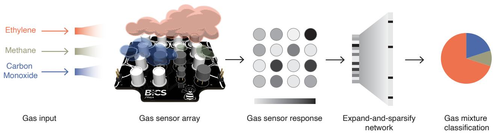  
Fig. 1: System overview. The sensor array is exposed to a randomized sequence of gas mixtures. Its response is then processed by the expand-and-sparsify network producing online category estimates.

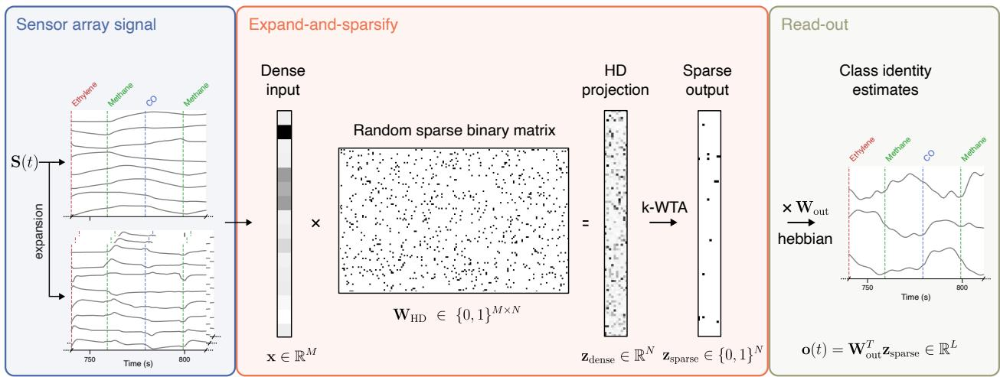  
Fig. 2: The expand-and-sparsify architecture. As the sensor array responds to a randomized sequence of gas mixtures, the first and second order derivatives of each sensor signal are approximated using backward diferences, and the 56 pairwise channel ratios and diferences are appended to form a 136-dimensional feature vector. This signal is then projected onto a higher-dimensional space via multiplication with a random sparse binary matrix, and subsequently sparsified through a k-WTA mechanism. A linear read-out layer produces online class-identity estimates.

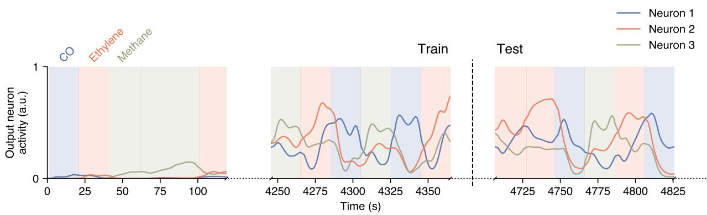  
Fig. 3: Class identity estimates from the read-out neurons activity. The activity of the read-out layer neurons as the sensor array signals are processed through the expand-and-sparsify architecture. The sensor array is exposed to a random sequence of odours (CO, ethylene, methane). During the training phase, learning signals trigger the potentiation of the output synapses, enforcing the output neurons to learn the sparse representations of its assigned category. The weights are then frozen during the testing phase.

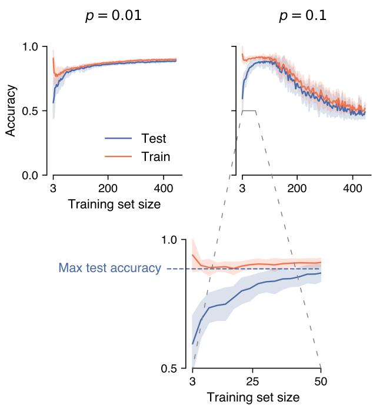  
Fig. 4: Few-shot learning. Top row: Train and test accuracy $( \mathrm { m e a n } \pm \mathrm { s . d }$ . over 10 repetitions) versus the training set size for the single-gas dataset. With $\mathrm { p } = 0 . 0 1$ (left), accuracy rises gradually and peaks at $0 . 8 8 7 \pm 0 . 0 0 8$ with 375 exposures. A higher rate $( \mathrm { p } = 0 . 1$ , right) reaches a comparable peak $( 0 . 8 8 6 \pm 0 . 0 3 3 )$ with only 105 exposures, at the cost of larger variance and a decline at larger training set sizes. Bottom: zoomed-in view of the $p = 0 . 1$ panel. The network reaches near-peak accuracy within the first 50 exposures.

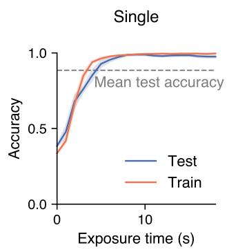

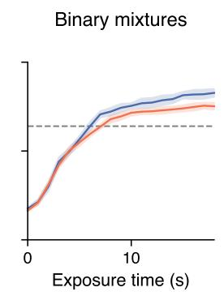  
Fig. 5: Performance over exposure time. Test accuracy (mean ± s.d. over 10 repetitions) versus time elapsed since the start of the exposure for the single-gas dataset (left) and the binary mixtures $( \mathrm { r i g h t } )$ . The model is trained on the full training set and evaluated on individual test frames grouped by position. Dashed gray lines indicate the overall mean test accuracy.

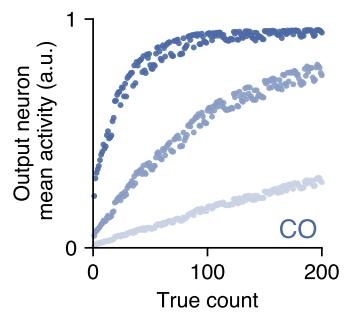

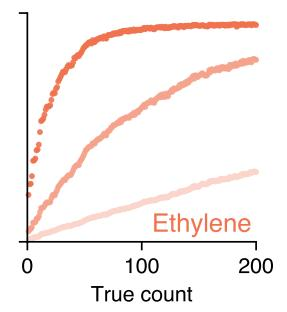

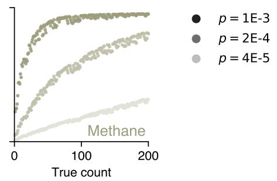  
Fig. 6: Count sketch. The mean activity of the read-out neuron for each mixture in a random sequence of 200 presentations per gas of single gases.

<table><tr><td colspan="2">Analogue Digital</td></tr><tr><td>Spike</td><td>30 pJ 400 pJ</td></tr><tr><td>SynOp</td><td>1.2 nJ 200 pJ</td></tr></table>

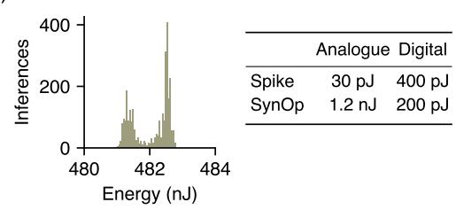

a)  
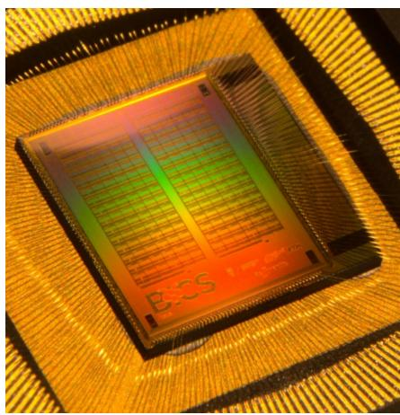

b)  
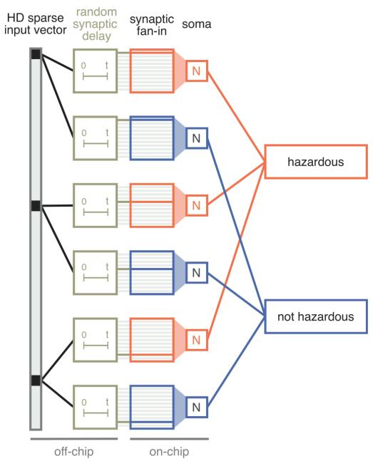

c)  
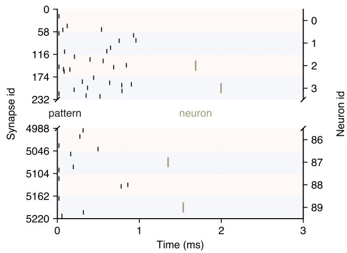

d)  
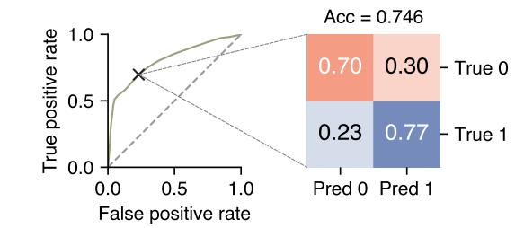  
e)  
Fig. 7: On-chip hazardous emission detection a) The custom mixed-signal neuromorphic processor TEXEL. It hosts 180 neurons distributed across two cores, with each neuron equipped with analogue synaptic circuits that emulate local plasticity mechanisms. b) The network architecture mapped onto the chip. HD input vectors are distributed across neurons and their synaptic inputs, then converted into single spikes at nonzero vector entries with random delays relative to a teacher spike during training. c) Raster plot of the input spike pattern for an inference sample, and the spiking responses of the read-out neurons. d) The ROC curve and the confusion matrix for the operating point with the highest Youden index (0: hazardous, 1: non-hazardous). e) Histogram of the dynamic power consumption per inference across the test sequence. The table shows the energy cost per spike and Synaptic Operation $\mathrm { ( S y n O p ) }$ in both analogue and digital domains, as reported in [32].

a)  
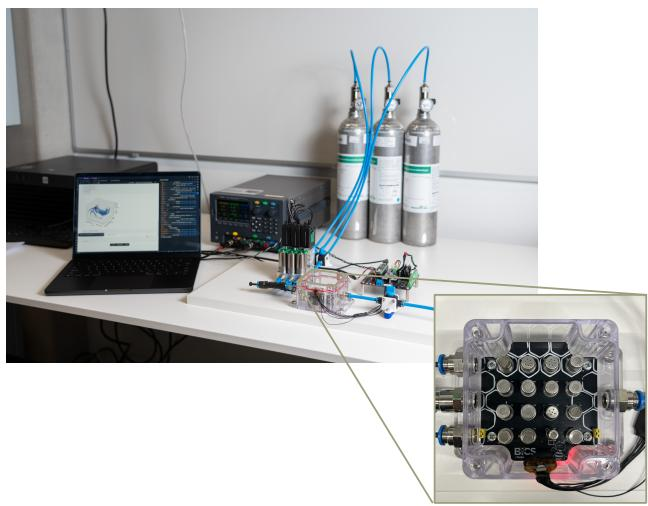  
b)

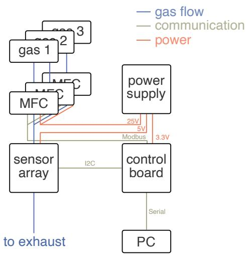

c)  
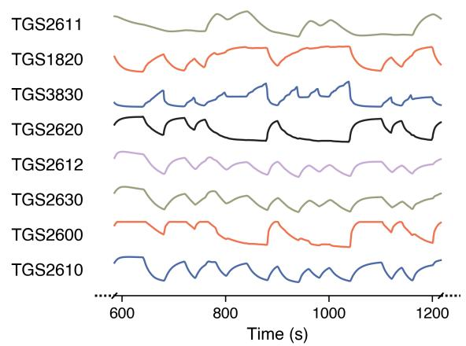

d)  
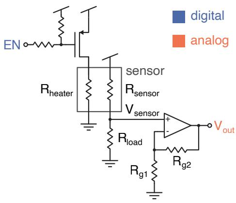  
Fig. 8: Experimental setup. a) Photography taken during a recording session. b) Schematic view of the experimental setup. c) Sensor array signals. Traces recorded from the 8 active sensors during 600s of continuous sampling. d) Sensor read-out circuit. The sensor acts as a variable resistor. The transistor, controlled by the digital enable signal (EN), switches the heater $\mathrm { o n / o f f }$ . The sensor and the load resistor form a voltage divider. The voltage $\mathrm { V _ { s e n s o r } }$ is fed into a non-inverting amplifier with a gain set by $\mathrm { R _ { g 1 } }$ and $\mathrm { R _ { g 2 } }$

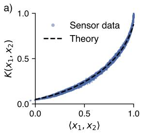

b)  
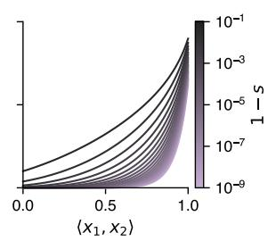

c)  
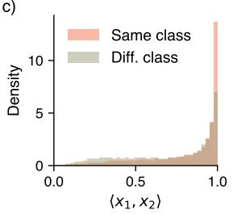

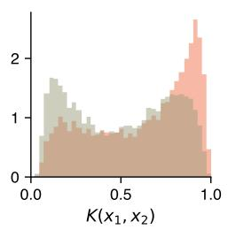  
Fig. 9: The kernel induced by the expand-and-sparsify architecture. a) The measured kernel for random pairs of expanded sensor read-outs $( n _ { p a i r s } = 1 0 0 0 0$ $d _ { i n p u t } = 1 3 6$ $p _ { H D } = 0 . 2$ and $1 - s = 0 . 2 )$ compared against the theoretical kernel. b) The theoretical kernel as a function of the sparsity of the final representation, determined by k in the k-WTA. c) Histograms representing the inner products between random pairs of sensor read-outs (left) and its sparsified representations (right).

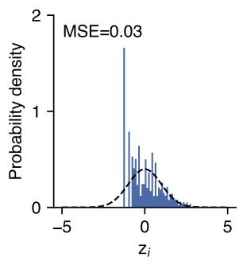

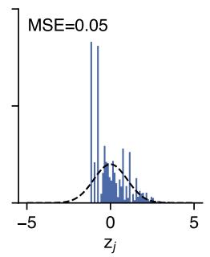

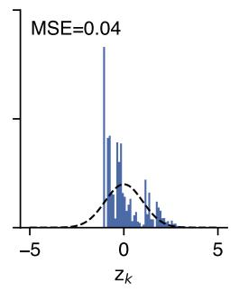

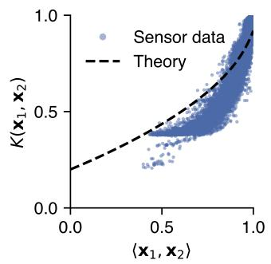

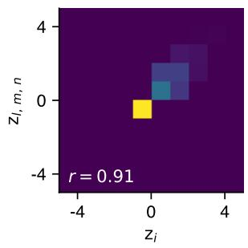

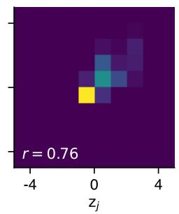

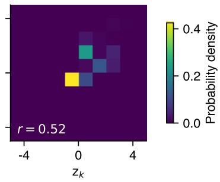

Expanded sensor data (136 components)  
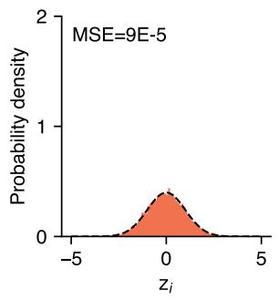

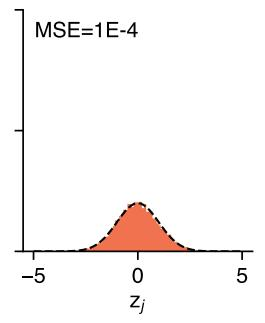

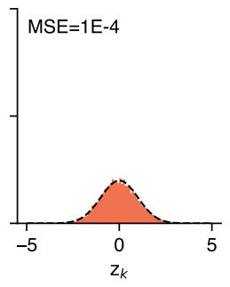

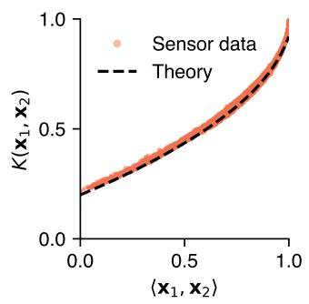

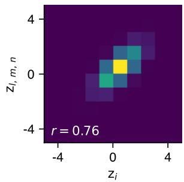

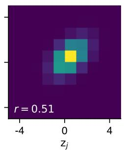

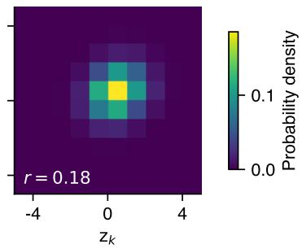  
Fig. 10: Efect of the input dimensionality on the projection statistics. Top: raw 8-channel sensor traces. Bottom: 136-dimensional expanded traces. Histograms show the empirical density of the $\mathbf { z } _ { \mathrm { d e n s e } }$ components for 3 random samples, with the MSE to the standard normal annotated $( n = 1 0 0 0 0 )$ Heat-maps show the joint density for 3 random pairs of samples $( n = 1 0 0 0 0 )$ , with the Pearson correlation between the samples annotated. Scatter plots show the measured kernel versus the theoretical one described by Eq. 7 for random pairs of samples $( n = 1 0 0 0 0 )$ .

<table><tr><td></td><td># Model</td><td></td><td>Manufacturer Target gas(es)</td><td>Detection range</td></tr><tr><td></td><td>1 MG812</td><td>Winsen</td><td> $\mathrm { C O _ { 2 } }$ </td><td>350–10,000 ppm</td></tr><tr><td></td><td>2 WSP2110</td><td>Winsen</td><td>VOCs (toluene, benzene, formalde- 1–50 ppm hyde, alcohol, acetone)</td><td></td></tr><tr><td>3</td><td>TGS1820</td><td>Figaro</td><td>Acetone</td><td>1-20 ppm</td></tr><tr><td>4</td><td>TGS2600</td><td>Figaro</td><td>Air contaminants (e.g., H2, ethanol)</td><td>1–30 ppm (as H2)</td></tr><tr><td></td><td>5 TGS2602</td><td>Figaro</td><td>Air contaminants (VOCs, NH3, H2S, 1–30 ppm (as EtOH) etc.)</td><td></td></tr><tr><td></td><td>6 TGS2603</td><td>Figaro</td><td>Odorants/air contaminants (amines, 1–10 ppm (as EtOH) sulfur compounds)</td><td></td></tr><tr><td>7</td><td>TGS2610-D00</td><td>Figaro</td><td>LP gas (propane, butane)</td><td>1-25% LEL</td></tr><tr><td>8</td><td>TGS2611-E00</td><td>Figaro</td><td>Methane (CH₄)</td><td>1-25%LEL</td></tr><tr><td>9</td><td>TGS2612-D00</td><td>Figaro</td><td>Methane, propane, iso-butane</td><td>1-25% LEL (each)</td></tr><tr><td>10</td><td>TGS2616-C00</td><td>Figaro</td><td>Hydrogen (H₂)</td><td>30–3,000 ppm</td></tr><tr><td>11</td><td>TGS2620</td><td>Figaro</td><td>Organic solvent vapors (alcohols, etc.)</td><td>50–5,000 ppm (EtOH)</td></tr><tr><td>12</td><td>TGS2630</td><td>Figaro</td><td>Refrigerant gases</td><td>1,000–10,000 ppm</td></tr><tr><td>13</td><td>TGS3830</td><td>Figaro</td><td>Halocarbon refrigerants (e.g., R-134a)</td><td>5-100 ppm</td></tr><tr><td>14</td><td>TGS3870-B00</td><td>Figaro</td><td>Methane + carbon monoxide</td><td>CH₄: 500–12,500 ppm; CO: 50- 1,000 ppm</td></tr><tr><td></td><td>15 SP3S-AQ2</td><td>FIS Inc</td><td>VOCs / air quality (MOS)</td><td> $\mathrm { n } / \mathrm { s } ^ { 1 }$ </td></tr><tr><td></td><td>16 GSBT11</td><td>Ogam Inc</td><td>VOCs, hydrocarbons, smoke, or- ganic compounds (e.g., formaldehyde, toluene)</td><td> $\mathrm { n } / \mathrm { s } ^ { 2 }$ </td></tr></table>

Table S1: Sensor target gases and detection ranges (typical values from manufacturers).

Methane

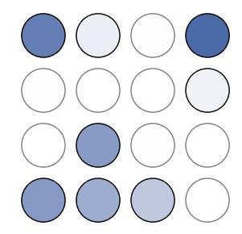  
Ethylene

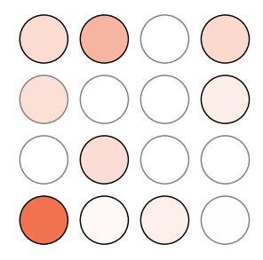  
CO

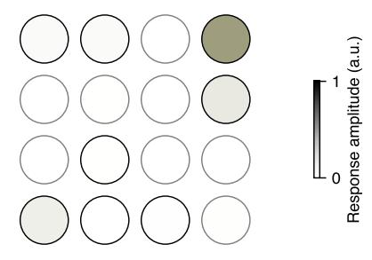

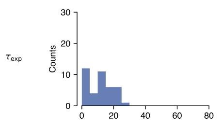

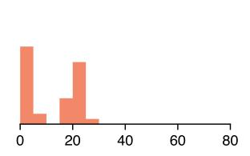

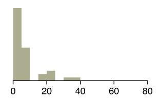

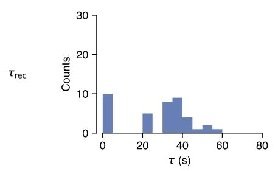

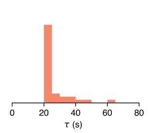

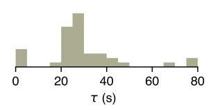  
Fig. S1: Sensor array characterisation. Response of the sensor array to single-gas baseline–exposure–recovery cycles for the three analytes (columns: methane, ethylene, CO). Top row: spatial maps of the mean response amplitude over the physical $4 \times 4$ sensor layout, averaged over five repetitions and min–max normalised per analyte to [0, 1] (arbitrary units; colour bar). Marker outlines indicate whether a sensor is used in the classification experiments — black for the eight most-responsive sensors retained by the reduced data loader, grey for the excluded ones. Middle and bottom rows: distributions of the exposure $\left( \tau _ { \mathrm { e x p } } \right)$ and recovery $\left( \tau _ { \mathrm { r e c } } \right)$ time constants, obtained from single-exponential fits to the rising and decaying transients and pooled over the five repetitions and the eight retained sensors. The time constants lie predominantly in the 20–40, s range, consistent with the sensor response times quoted in the data-acquisition protocol.