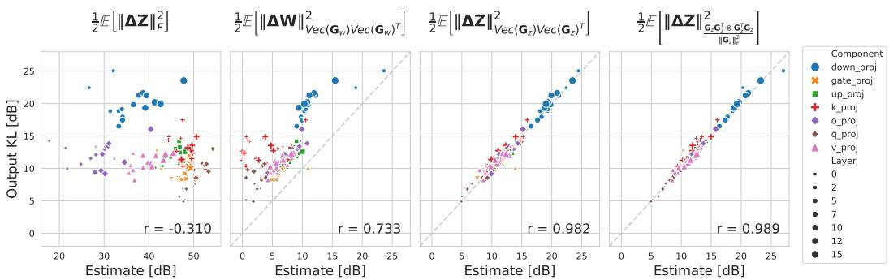
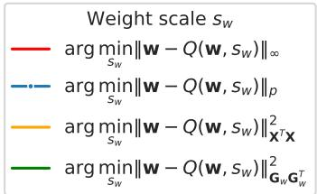
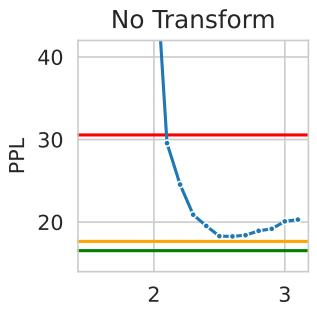
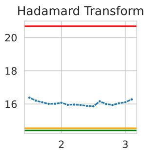
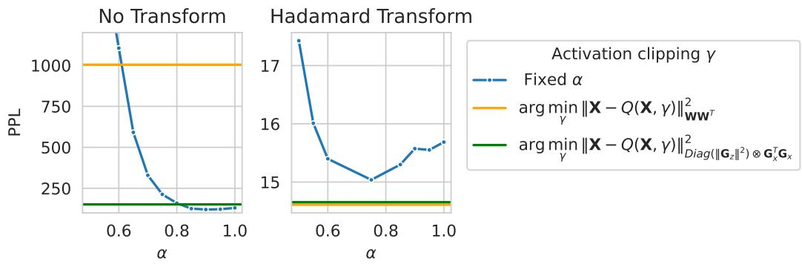

# A UNIFIED HESSIAN-GUIDED FRAMEWORK FOR POST-TRAINING QUANTIZATION

Mads Toftrup∗† Aarhus University toftrup@cs.au.dk

Marco Federici∗ Qualcomm AI Research mfederic@qualcomm.com

Paul Whatmough Qualcomm AI Research pwhatmou@qualcomm.com

Boris van Breugel Qualcomm AI Research bvanbreu@qualcomm.com

Markus Nagel Qualcomm AI Research markusn@qualcomm.com

## ABSTRACT

Low-bit quantization enables efficient deployment of large language models by reducing memory footprint and computational cost. Achieving high accuracy at low precision requires selecting quantization ranges, linear transformations, and weight rounding decisions. Existing approaches typically optimize these components independently using local reconstruction objectives, which fail to account for the varying impact of quantization errors on downstream predictions. Direct optimization of task-level metrics would provide a more faithful objective, but is challenging due to the discontinuous nature of quantization operations and the high computational cost of evaluating their downstream effects.

In this work, we derive a Hessian-guided approximation of the output change induced by joint weight and activation quantization. Based on a tractable Fisher approximation, we formulate a unified post-training quantization framework that enables the joint optimization of quantization ranges, linear transformations, and weight rounding under a common output-sensitivity objective. The resulting method remains practical for modern large language models and consistently outperforms state-of-the-art transformation and rounding methods across both channel-wise and block-wise quantization settings.

## 1 INTRODUCTION

Large language models achieve strong performance across a wide range of language tasks, but their memory and computational requirements make deployment expensive. Quantization reduces these costs by representing weights and activations at lower precision, improving memory efficiency and enabling faster integer computation. The central challenge is to obtain these benefits while preserving the predictions of the full-precision model.

We focus on integer post-training quantization (PTQ) of both weights and activations. A small calibration set informs the quantization parameters. At a fixed bit width, accuracy depends on the quantization ranges, rounding choices, and representation basis. Quantization ranges set the scales: narrower ranges give finer grids but can increase clipping error. Rounding then selects weights on those grids. Both choices operate on a given representation of the layer. An invertible, functionpreserving transform (van Breugel et al., 2026), such as a rotation or Hadamard transform (Ashkboos et al., 2024b), changes that representation by redistributing weight and activation magnitudes while preserving the full-precision layer output. Range selection and transforms can address both weights and activations, whereas adaptive rounding primarily addresses weights.

Local reconstruction evaluates these choices by the error they introduce at a layer’s output. But, as shown in Figure 1, the magnitude of local perturbations is not necessarily a good proxy for the changes in the model output. Existing methods (Tseng et al., 2026) capture these downstream effects through an approximation to the Hessian of the full-model output KL divergence with respect to a layer’s weights. However, methods based on the Weight Hessian fail to capture the error introduced by quantizing the activations (Figure 1, second column).

  
Figure 1: Relationship between the KL divergence between the original and quantized model outputs and several layer-local error proxies across linear layers of Llama 3.2 1B Instruct under W4A4 quantization. Conventional reconstruction metrics, such as the output Frobenius norm, exhibit weak correlation with downstream output degradation. Fisher-weighted weight error fails to capture the effect of activation quantization. Output Fisher-weighted error correlates more strongly with the KL divergence, and our proposed Kronecker factorization of the Output Fisher retains this correlation.

In this work, we use a quadratic expansion of the KL divergence between the original and quantized model predictions around the layer output with a tractable approximation (Figure 1, third and last column). This lets us derive a unified algorithm that optimizes transformations, range setting, and weight rounding under the same curvature metric, accounting for the downstream effects of both weight and activation quantization.

Our contributions are:

• We introduce a layer Output Kronecker-factorized approximation to the layer-output Fisher matrix that defines a quadratic proxy for the KL divergence between original and quantized outputs, accounting for both weight and activation quantization.

• Using the output Kronecker factorization, we derive $H _ { Z ^ { - } } \mathrm { P T Q } .$ , a unified procedure for transformation design, weight range selection, adaptive rounding, and activation clipping under a common downstream-sensitivity objective.

• We demonstrate improvements over existing PTQ baselines across multiple model families and quantization granularities.

## 2 BACKGROUND

We first introduce the quantization choices considered in this work. Let $\pmb { X } \in \mathbb { R } ^ { s \times i }$ represent the activation matrix for s tokens and i input features, and let $\boldsymbol { W } \in \mathbb { R } ^ { i \times o }$ be the weights of a linear layer with o output features. Its output is ${ \dot { Z } } = X W$

Quantization scales and clipping. For signed integer quantization with $b \geq 2$ bits, $k _ { \mathrm { m i n } } = - 2 ^ { b - 1 }$ and $k _ { \operatorname* { m a x } } = 2 ^ { b - 1 } - 1$ . Given a grid step $s > 0$ and shift $\mu ,$ round-to-nearest quantization is

$$
Q ( a ; s , \mu ) = \mu + s \mathrm { c l i p } \left( \mathrm { r o u n d } \left( \frac { a - \mu } { s } \right) , k _ { \mathrm { m i n } } , k _ { \mathrm { m a x } } \right) .\tag{1}
$$

The grid step s determines the tradeoff between clipping and rounding resolution. Increasing s expands the representable range and reduces clipping, but produces a coarser quantization grid. Decreasing s improves resolution within the representable range, but may clip large-magnitude values.

Unlike weights, whose grid steps $s _ { w }$ are fixed after calibration, activation scales depend on the current input. We therefore optimize a shared clipping factor $\gamma _ { x } ~ \in ~ ( 0 , 1 ]$ (Sun et al., 2025) and compute the corresponding input-dependent activation steps $s _ { x } ( { X } , \gamma _ { x } )$ at runtime. The activations $\mathbf { \Delta } _ { \mathbf { \mathcal { X } } _ { i } }$ are clipped to $\left[ - \gamma _ { x } \operatorname* { m a x } _ { i } | { \pmb x } _ { i } | , \gamma _ { x } \operatorname* { m a x } _ { i } | { \pmb x } _ { i } | \right]$ under symmetric quantization and to $[ \gamma _ { x } ( \operatorname* { m i n } _ { i } { \pmb x } _ { i } -$ $\mu ) , \gamma _ { x } ( \operatorname* { m a x } { x _ { i } - \mu } ) ]$ under asymmetric quantization. We then apply Eq. 1 using a grid fitted to these bounds, with a zero-centered grid in the symmetric case and a shifted grid in the asymmetric case.

Weight rounding. Once the representation and quantization grid are fixed, rounding assigns each weight to a representable value. Round-to-nearest treats weights independently, whereas adaptive rounding methods coordinate these decisions so that later choices can compensate for errors introduced earlier (Nagel et al., 2020; Frantar et al., 2023). Existing methods generally optimize either a layer-reconstruction objective or a weight-space approximation to the downstream model loss.

Transformations. For any invertible transformation $\pmb { T } \in \mathbb { R } ^ { i \times i }$ , transforming the activations and weights preserves the full-precision output, $( X T ) ( T ^ { - 1 } W ) = Z$ , but generally changes the quantized output, ${ \tilde { Z } } = Q ( X T ) Q ( T ^ { - 1 } W )$ We write $\Delta \boldsymbol { Z } = \boldsymbol { Z } - \boldsymbol { \widetilde { Z } }$ for the resulting layer-output perturbation. If T reduces a weight group’s range under the same quantizer, $Q ( { \pmb T } ^ { - 1 } { \pmb W } )$ can use a finer grid and have lower weight error than $Q ( W )$ in their respective representations (Sun et al., 2025). Diagonal transforms scale channels (Nagel et al., 2019; Xiao et al., 2023; Lin et al., 2023). Orthogonal transforms mix channels through randomized Hadamard transforms (Tseng et al., 2024; Ashkboos et al., 2024a), learned rotations (Liu et al., 2024), or blockwise rotations with permutations (Lin et al., 2024). More general transforms combine rotations and scaling (Hu et al., 2025). FlatQuant jointly learns invertible Kronecker factors, channel scaling, and clipping through block reconstruction (Sun et al., 2025). CAT (Federici et al., 2026) and WUSH (Chen et al., 2026a) design transforms to minimize a local error proxy.

## 3 METHOD

Our derivation proceeds in four steps. We first express PTQ as the minimization of the prediction divergence induced by replacing one full-precision layer with its quantized counterpart. We then approximate this divergence by a quadratic form in the layer-output perturbation. Because the resulting output Hessian is intractably large, we introduce a tractable approximation. Finally, we use this common quadratic proxy to derive practical optimization procedures for transformations, weight scales and rounding, and activation clipping.

## 3.1 JOINT OBJECTIVE

Ideally, post-training quantization would jointly select the transforms, weight and activation grids, and weight rounding decisions to minimize the downstream discrepancy between the full-precision and quantized models. For a linear layer, this idealized objective can be written as:

$$
\operatorname* { m i n } _ { \gamma _ { x } , s _ { w } , T , W ^ { * } } \mathbb { E } \left[ \mathcal { L } \left( \underbrace { \overbrace { Q ( X T ; s _ { x } ( X T , \gamma _ { x } ) ) } ^ { \mathrm { q u a n t i z e d ~ a c t i v a t i o n s ~ } \tilde { X } } ) \overbrace { Q ( T ^ { - 1 } W ^ { * } ; s _ { w } ) } ^ { \mathrm { q u a n t i z e d ~ w e i g h t s ~ } \widetilde { W } } } _ { \mathrm { q u a n t i z e d ~ o u t p u t ~ } \tilde { Z } } \right) \right] ,\tag{2}
$$

in which $\mathcal { L } \left( \right)$ refers to a measure of change of the model output.

To model the downstream effect of weight and activation quantization, we use a second-order Taylor expansion around the full-precision layer output $z$

$$
\mathscr { L } \left( \widetilde { \pmb { Z } } \right) \approx \mathscr { L } \left( \pmb { Z } \right) + \mathrm { v e c } \left( \Delta \pmb { Z } \right) ^ { T } \mathrm { v e c } \left( \pmb { G } \pmb { Z } \right) + \frac { 1 } { 2 } \mathrm { v e c } \left( \Delta \pmb { Z } \right) ^ { T } \pmb { H } _ { Z } \mathrm { v e c } \left( \Delta \pmb { Z } \right) ,\tag{3}
$$

in which vec () refers to a vectorization operation that stacks the rows of a matrix into a single column vector, $G _ { Z }$ is the loss gradient with respect to $Z .$ , and $H _ { Z }$ is the (flattened) Hessian matrix with shape $[ s \times \mathbf { o } , \mathbf { s } \times \mathbf { o } ]$

Common choices of loss $\mathcal { L } \left( \right)$ include measures of divergence of the model output distribution with respect to the original (unperturbed model). For these choices of loss, the zero and first order terms vanish since $\boldsymbol { z } = \widetilde { \boldsymbol { z } }$ is a global minimum for which the divergence is zero:

$$
D \left( p _ { Z } | | p _ { \widetilde { Z } } \right) \approx \frac { 1 } { 2 } \mathrm { v e c } \left( \Delta Z \right) ^ { T } H _ { Z } \mathrm { v e c } \left( \Delta Z \right) \stackrel { d e f } { = } \frac { 1 } { 2 } \| \Delta Z \| _ { H _ { Z } } ^ { 2 } ,\tag{4}
$$

where $p _ { z }$ and $p _ { \widetilde { z } }$ refer to the model output distribution induced by the original and quantized layer, respectively. We use the shorter expression $\| \Delta Z \| _ { H _ { Z } } ^ { 2 }$ to indicate that the norm of the layer output perturbation is weighted by a quadratic proxy of the output loss sensitivity $\pmb { H } _ { Z }$

## 3.2 MODELING THE HESSIAN MATRICES

Empirically estimating a full rank Hessian matrix is intractable for modern-sized deep learning architectures due to the computation and memory requirements. However, when selecting the Kullback-Leibler divergence for Equation 4, the Hessian becomes equivalent to the Fisher Information Matrix (FIM). The (empirical) Fisher matrix can be estimated by considering the outer product of the flattened Output gradients with respect to sampled labels from the output distribution:

$$
H _ { Z } = F _ { Z } \ { \stackrel { d e f } { = } } \ \operatorname { \mathbb { E } } \left[ { \mathrm { v e c } } \left( G _ { Z } \right) { \mathrm { v e c } } \left( G _ { Z } \right) ^ { T } \right] .\tag{5}
$$

Estimating a full Fisher matrix, which is quadratic in the product of sequence length and output feature dimension, is clearly still not practical for full-scale deep neural networks. For this reason, following a similar procedure as (Tseng et al., 2026), we simplify the computation by factorizing the effect of the FIM on the sequence dimension $F _ { s ( Z ) }$ and feature output dimension $F _ { f ( Z ) } .$

$$
F _ { Z } \approx F _ { \otimes Z } \ { \stackrel { d e f } { = } } \ { \overbrace { G _ { Z } G _ { Z } ^ { T } } ^ { F _ { s ( Z ) } } } \otimes { \overbrace { G _ { Z } ^ { T } G _ { Z } } ^ { F _ { f ( Z ) } } }  ,\tag{6}
$$

in which $F _ { s ( Z ) }$ and $F _ { f ( Z ) }$ represent proxies for the sequence and feature curvatures, respectively.

We refer to this approximation as the Output Kronecker Fisher factorization, which exactly reproduces each sampled gradient outer product when $G _ { Z }$ is rank 1. A summary and comparison with the literature is included in Table 1, while the correlation between the Output Kronecker Fisher weighted error and the KL divergence is visualized in Figure 1.

In order to perform the optimization, we estimate and store the following quantities on a small calibration set: the expected output feature curvature E $\lceil G _ { Z } ^ { T } G _ { Z } \rceil$ , the weight input curvature $\mathbb { E } \left[ G _ { W } G _ { W } ^ { T } \right]$ and the token gradient magnitude vector E -Diag $\left( G _ { Z } G _ { Z } ^ { T } \right) ]$ . The input feature curvature can be obtained at runtime by left and right multiplying the output feature curvature by the weight matrices E $\mathbf { \dot { \ell } } \left[ G _ { X } ^ { T } G _ { X } \right] = \mathbf { W } \mathbf { \dot { \mathbb { E } } } \left[ G _ { Z } ^ { T } G _ { Z } \right] \mathbf { \dot { W } } ^ { T }$

Table 1: Comparison of Fisher Information Metric estimates for linear layer output, weights and input implied by different approaches in literature. Normalization factors are omitted for brevity.
<table><tr><td rowspan="2">Estimate</td><td>Output Fisher:  $\scriptstyle { F _ { \otimes Z } }$ </td><td> $\operatorname { W e i g h t } \operatorname { F i s h e r } ; F _ { \otimes } \boldsymbol { w }$ </td><td>Input Fisher:  $\pmb { F } _ { \otimes } \pmb { x }$ </td><td rowspan="2">Assumptions</td></tr><tr><td> $\overbrace { F _ { s ( Z ) } } ^ { } \otimes \overbrace { F _ { f ( Z ) } } ^ { }$ </td><td> $\widetilde { \pmb { F } _ { i ( W ) } } \otimes \overline { { \pmb { F } _ { o ( W ) } } }$ </td><td> $\widetilde { { \pmb F } _ { s ( { \pmb x } ) } } \otimes \overline { { { \pmb F } _ { f ( { \pmb x } ) } } }$ </td></tr><tr><td>Isotropic</td><td> ${ { \cal I } _ { s } \otimes { \cal I } _ { o } }$ </td><td> $X ^ { T } X \otimes I _ { o }$ </td><td> $\pmb { I _ { s } } \otimes \pmb { W } \pmb { W } ^ { T }$ </td><td>Isotropic  $\pmb { F } _ { Z }$ </td></tr><tr><td>K-FAC</td><td> ${ \cal I } _ { s } \otimes { \cal G } _ { Z } ^ { T } { \cal G } _ { Z }$ </td><td> ${ \pmb X } ^ { T } { \pmb X } \otimes { \pmb G } _ { Z } ^ { T } { \pmb G } _ { Z }$ </td><td> ${ \cal I } _ { s } \otimes { \cal G } _ { X } ^ { T } { \cal G } _ { X }$ </td><td>Isotropic  $F _ { s ( Z ) }$ </td></tr><tr><td>YAQA</td><td> $G _ { Z } G _ { Z } ^ { T } \otimes G _ { W } ^ { T } G _ { W }$ </td><td> $G _ { W } G _ { W } ^ { T } \otimes G _ { W } ^ { T } G _ { W }$ </td><td> $G _ { Z } G _ { Z } ^ { T } \otimes \bar { { \cal W } } \bar { G } _ { W } ^ { T } G _ { W } { \cal W } ^ { T }$ </td><td> $\operatorname { R a n k - 1 } G _ { W }$ </td></tr><tr><td>Ours</td><td> $G _ { Z } G _ { Z } ^ { T } \otimes G _ { Z } ^ { T } G _ { Z }$ </td><td> ${ \cal G } _ { W } { \cal G } _ { W } ^ { T } \otimes { \cal G } _ { Z } ^ { T } { \cal G } _ { Z }$ </td><td> $G _ { Z } G _ { Z } ^ { T } \otimes G _ { X } ^ { T } G _ { X }$ </td><td> $\operatorname { R a n k - 1 } G _ { Z }$ </td></tr></table>

## 3.3 $H _ { Z ^ { - } } \mathrm { P T Q } \mathrm { : }$ OPTIMIZATION PROCEDURE

We start optimizing the output-Fisher-weighted proxy by considering the linear transformation $\mathbf { T } .$ This is because the transformation T affects model weights, activations, and intermediate gradients, making a joint optimization very challenging:

$$
\operatorname* { m i n } _ { \substack { \gamma _ { x } , s _ { w } , T , W _ { T } ^ { * } } } D _ { \mathrm { K L } } \left( p _ { Z } \| p _ { \widetilde { Z } } \right) \approx \frac { 1 } { 2 } \operatorname* { m i n } _ { \substack { \gamma _ { x } , s _ { w } , T , W _ { T } ^ { * } } } \mathbb { E } \left[ \| \Delta Z \| _ { F _ { \otimes Z } } ^ { 2 } \right] \approx \frac { 1 } { 2 } \operatorname* { m i n } _ { \substack { \gamma _ { x } , s _ { w } , W _ { T } ^ { * } } } \mathbb { E } \left[ \| \Delta Z _ { \hat { T } } \| _ { F _ { \otimes Z } } ^ { 2 } \right]\tag{7}
$$

in which $\hat { T }$ represents the optimal transformation arg minT $\mathbb { E } \left[ \| \Delta Z \| _ { F _ { \otimes Z } } ^ { 2 } \right]$ , and $\Delta Z _ { \hat { T } }$ is the output discrepancy with the transformation $\hat { T }$ applied. Once $\hat { T }$ is fixed, we denote the transformed activations and weights by $X _ { \hat { T } } = X \hat { T }$ and $W _ { \hat { T } } = \hat { T } ^ { - 1 } W$ , respectively. We express the corresponding

activation and weight Fisher estimates in these coordinates and use them to determine the remaining quantization parameters.

Once the transformations are fixed, using mild independence assumptions, we can factorize the effect of activation and weight quantization:

$$
\mathbb { E } \underbrace { \left[ \lVert \Delta Z _ { \hat { T } } \rVert _ { F _ { \otimes Z } } ^ { 2 } \right] } _ { \mathrm { W i g h t ~ q u a n t i z a t i o n ~ e r r o r } } \approx \underbrace { \mathbb { E } \left[ \lVert X _ { \hat { T } } ( W _ { \hat { T } } - \widetilde { W } _ { \hat { T } } ) \rVert _ { F _ { \otimes Z } } ^ { 2 } \right] } _ { \mathrm { W e i g h t ~ q u a n t i z a t i o n ~ e r r o r } } + \underbrace { \mathbb { E } \left[ \lVert \overbrace { ( X _ { \hat { T } } - X _ { \hat { T } } ) } ^ { \Delta X _ { \hat { T } } } W _ { \hat { T } } \rVert _ { F _ { \otimes Z } } ^ { 2 } \right] } _ { \mathrm { A c t i v a t i o n ~ q u a n t i z a t i o n ~ e r r o r } } .\tag{8}
$$

The approximate split in Eq. 8 permits disentangling weight- and activation-specific parameters. First, we find the optimal weight scale and rounding:

$$
\hat { s } _ { W } , \hat { W } _ { \hat { T } } ^ { * } = \arg \operatorname* { m i n } _ { s _ { w } , W ^ { * } } \mathbb { E } \left[ \| X _ { \hat { T } } \Delta W _ { \hat { T } } \| _ { F _ { \otimes } z } ^ { 2 } \right] .\tag{9}
$$

Lastly, we can determine the optimal clipping based on the updated weights $\hat { W } _ { \hat { T } } ^ { * }$ by determining:

$$
\hat { \gamma _ { x } } = \arg \operatorname* { m i n } _ { \gamma _ { x } } \mathbb { E } \left[ \| \Delta X _ { \hat { T } } \hat { W } _ { \hat { T } } ^ { * } \| _ { F _ { \otimes } z } ^ { 2 } \right] .\tag{10}
$$

We refer to the resulting framework as $H _ { Z ^ { - } } \mathrm { P T Q }$ because all optimization stages are derived from the same layer-output curvature proxy ${ \cal F } _ { \otimes Z }$ . Sections 3.4–3.6 describe each stage.

## 3.4 OPTIMAL TRANSFORMATIONS

In order to find the optimal transformation $\hat { \pmb T } _ { * }$ , we first use standard rounding-noise assumptions to explicitly express our quadratic loss proxy as a function of the transformed quantization ranges for activation and weights, which determine the stretching of the quantization grid, and the norm of the transformed gradients:

$$
\mathbb { E } \left[ \Vert \Delta Z _ { T } \Vert _ { F _ { \otimes Z } } ^ { 2 } \right] \approx \frac { \mathbb { E } \left[ \sum _ { t } \alpha _ { t } r ( \pmb { x } _ { t } T ) ^ { 2 } \right] } { 1 2 ( 2 ^ { b _ { x } } - 1 ) ^ { 2 } } \mathbb { E } \left[ \Vert \pmb { G } _ { X } \pmb { T } ^ { - T } \Vert _ { F } ^ { 2 } \right] + \frac { \mathbb { E } \left[ \sum _ { j } \beta _ { j } r \big ( \pmb { T } ^ { - 1 } \pmb { w } _ { j } \big ) ^ { 2 } \right] } { 1 2 ( 2 ^ { b _ { w } } - 1 ) ^ { 2 } } \mathbb { E } \left[ \Vert \pmb { T } ^ { T } G _ { W } \Vert _ { F } ^ { 2 } \right]\tag{11}
$$

The activation and weight bit widths are $b _ { x } , b _ { w }$ , and r(v) denotes the range of the quantization grid. The weights $\alpha _ { t } = { \parallel ( G _ { Z } ) _ { t , : } \parallel _ { 2 } ^ { 2 } } / { \parallel G _ { Z } \parallel _ { F } ^ { 2 } }$ and $\beta _ { j } = { \dot { \| ( G _ { Z } ) _ { : , j } \| _ { 2 } ^ { 2 } } } / \| G _ { Z } \| _ { F } ^ { \widetilde { 2 } }$ measure the relative gradient energy of token t and output feature $j .$ They remain unchanged by the transforms because $X _ { T } W _ { T } = Z . \mathrm { A }$ full derivation is reported in Appendix A.1. Overall, as expected, the expression in Eq. 11 is invariant to scaling of T . Furthermore, the norm of the transformed gradients $\| \dot { G } _ { X } T ^ { - T } \| _ { F } ^ { 2 }$ and $\| \pmb { T } ^ { T } \pmb { G } _ { W } \| _ { F } ^ { 2 }$ are invariant to orthogonal transformations.

Following Federici et al. (2026), we approximately minimize Eq. 11 with a two-step procedure. First, we choose the symmetric positive-definite component M to minimize the sum of squared transformed gradient norms:

$$
\hat { M } = \underset { M \sim 0 } { \operatorname { a r g m i n } } \mathbb { E } \left[ \Vert G _ { X } M ^ { - T } \Vert _ { F } ^ { 2 } \right] + \mathbb { E } \left[ \Vert M ^ { T } G _ { W } \Vert _ { F } ^ { 2 } \right] = \left( \mathbb { E } \left[ G _ { W } G _ { W } ^ { T } \right] ^ { - 1 } \# \mathbb { E } \left[ G _ { X } ^ { T } G _ { X } \right] \right) ^ { 1 / 2 } .\tag{12}
$$

Here, $\#$ denotes the matrix geometric mean, see Appendix A.2 for the derivation. In practice, we use a block-wise approximation $\hat { M } _ { \mathrm { b l o c k } } = \mathrm { B l o c k D i a g } ( \hat { M }$ , block) to reduce the memory and computation cost (Federici et al., 2026; Chen et al., 2026a).

Secondly, we apply a Hadamard rotation to reduce the quantization ranges (Federici et al., 2026). The final transformation is obtained by combining the two components $\hat { \mathbf { T } } = \hat { M } _ { \mathrm { b l o c k } } \mathbf { \cal { H } }$

Note that by making the additional assumption that the output gradients are isotropic $( G _ { Z } \propto I )$ the expression in Eq. 11 simplifies to the one reported in Federici et al. (2026), and the solution in Eq. 12 is equivalent to the transforms proposed in Federici et al. (2026); Chen et al. (2026b), for which Mˆ aligns the directions of variations of activations and weights instead of their gradients.

## 3.5 WEIGHT SCALES AND ROUNDING

The optimal quantization scales and rounding can be determined by considering:

$$
\operatorname* { m i n } _ { s _ { w } , W _ { \vec { T } } ^ { * } } \mathbb { E } \left[ \lVert X _ { \hat { T } } \Delta W _ { \hat { T } } \rVert _ { F _ { \otimes z } } ^ { 2 } \right] \approx \operatorname* { m i n } _ { s _ { w } , W _ { \vec { T } } ^ { * } } \left. W _ { \hat { T } } - Q \left( W _ { \hat { T } } ^ { * } ; s _ { w } \right) \right. _ { \frac { \hat { T } ^ { T } \mathbb { E } \left[ G _ { W } G _ { W } ^ { T } \right] \hat { T } \otimes \mathbb { E } \left[ G _ { z } ^ { T } G _ { Z } \right] } { \mathbb { E } \left[ \lVert G _ { Z } \rVert _ { 2 } ^ { 2 } \right] } } ^ { 2 } .\tag{13}
$$

In which $\hat { \pmb { T } } ^ { T } \mathbb { E } \left[ G _ { W } G _ { W } ^ { T } \right] \hat { \pmb { T } }$ determines the (transformed) weight input-side curvature while E $\lceil G _ { Z } ^ { T } G _ { Z } \rceil$ the output-side curvature. In order to disentangle the optimization of scales and rounding, we follow a procedure similar to the one introduced in Tseng et al. (2026): first we perform a block-LDL decomposition of the input and output curvature based on the size of the quantization tile $[ k _ { i } , k _ { o } ]$ . Here $k _ { i }$ represents the number of input channels that share the same scale, while $k _ { o }$ represents the number of output channels that share the same scale (usually 1):

$$
\begin{array} { r } { L _ { i } , D _ { i } = \mathrm { B l o c k L D L } \left( \hat { T } ^ { T } \mathbb { E } \left[ G _ { W } G _ { W } ^ { T } \right] \hat { T } ; k _ { i } \right) , L _ { o } , D _ { o } = \mathrm { B l o c k L D L } \left( \mathbb { E } \left[ G _ { Z } ^ { T } G _ { Z } \right] ; k _ { o } \right) . } \end{array}\tag{14}
$$

Then, we use an iterative procedure in which we alternately set a quantization scale and adjust the weight rounding, starting from the original (transformed) weights $\bar { \bf W } ^ { ( 0 ) } = { \bf W } _ { \hat { \cal T } }$

The curvature for the quantization tile in coordinate $( j , k )$ is fully determined by the block diagonal components of $D _ { i } [ j ]$ and $D _ { o } [ k ]$ . Since $D _ { o } [ k ]$ is a scalar, the optimal scale $s _ { j k }$ can be determined by selecting:

$$
\hat { s } _ { j k } = \arg \operatorname* { m i n } _ { s _ { j k } } \left\| W _ { \hat { T } , B ( j , k ) } - Q \left( W _ { B ( j , k ) } ^ { ( 0 ) } ; s _ { j k } \right) \right\| _ { D _ { i } [ j ] } ^ { 2 } ,\tag{15}
$$

in which $B ( j , k )$ is used to indicate the entries of the block $( j , k )$ . The expression in Eq. 15 can be easily optimized using a grid search over a few candidates to pick the best scale. Fixing the scale $\hat { s } _ { j k } .$ , we can determine the quantization error given by the quantization function in the block $( j , k ) { \mathrm { : } }$ $\Delta W _ { B ( j , k ) } ^ { ( 0 ) } = W _ { \hat { T } , B ( j , k ) } - Q \left( W _ { B ( j , k ) } ^ { ( 0 ) } ; \hat { s } _ { j k } \right)$ and zero everywhere else. Lastly, we can use the $\mathbf { { L } } _ { i }$ and $\scriptstyle { { \cal L } } _ { o }$ matrices to determine the correction and update the rounded weight for the remaining blocks

$$
\pmb { W } ^ { ( 1 ) } = \pmb { W } ^ { ( 0 ) } + \pmb { L } _ { i } ^ { T } \Delta \pmb { W } ^ { ( 0 ) } \pmb { L } _ { o }\tag{16}
$$

Proceeding in anti-diagonal order starting from the bottom-right, the quantization scales can be set one at a time, and the final $W ^ { ( i / k _ { i } \times o / k _ { o } ) }$ represents the adjusted weights $\hat { W } _ { \hat { T } } ^ { * }$ . The key difference from Tseng et al. (2026) lies in using $\mathbf { \nabla } D _ { i }$ to set the scale of each block and in the different Fisher proxy. Similar to Frantar et al. (2022), before running the algorithm, we sort the block rows and columns so that blocks corresponding to larger Fisher traces are quantized first.

## 3.6 ACTIVATION CLIPPING.

For the activation clipping it is non-trivial to determine a good $\gamma _ { x } \in ( 0 , 1 ]$ : a heuristic constant value may not be optimal, but training it end-to-end is expensive and may yield sub-optimal solutions. We propose to use the Hessian proxy as a good middle ground that takes into account the downstream sensitivity.

$$
\mathbb E \left[ \lVert \Delta X _ { \hat { T } } W _ { \hat { T } } \rVert _ { F _ { \otimes z } } ^ { 2 } \right] \approx \mathbb E \left[ \lVert X _ { \hat { T } } - Q ( X _ { \hat { T } } ; s _ { x } ( X _ { \hat { T } } , \gamma _ { x } ) ) \rVert _ { \mathbb { E } \left[ \mathrm { D i a g } \left( G z G _ { z } ^ { T } \right) \right] \otimes \hat { T } ^ { - 1 } \mathbb E \left[ G _ { x } ^ { T } G _ { x } \right] \hat { T } ^ { - T } } ^ { 2 } \right] ,\tag{17}
$$

The optimal $\gamma _ { x }$ can then be determined on a small calibration set by picking the minimum error over a small set of candidates. Note that instead of using the dense sequence curvature E $\left[ G _ { Z } G _ { Z } ^ { T } \right]$ , we consider only a diagonal component E -Diag $\left( G _ { Z } G _ { Z } ^ { T } \right) ]$ . This is to drastically reduce the memory requirements since only one vector needs to be stored. This approximation results in little error since we empirically validated that the sequence curvature component is mostly diagonal.

## 4 EXPERIMENTAL RESULTS

We evaluate our downstream-output proxy, compare quantization performance across models and quantization granularities, and ablate the contributions of individual components. Appendix B experimental details and Appendix C includes additional results.

Table 2: W4A4KV4 channel-wise quantization results. The effectiveness of $H _ { Z ^ { - } } \mathrm { P T Q }$ demonstrates the advantage of the joint optimization under a unified Hessian-guided objective.
<table><tr><td>Method</td><td colspan="2">Llama v3.2 1B inst. csr (↑)</td><td colspan="2">Llama v3 8B csr (↑)</td><td colspan="2">Ministral 8B inst.</td><td colspan="2">Qwen v3 8B</td></tr><tr><td>FP</td><td>|wiki (↓) |13.16</td><td>57.61</td><td>wiki (↓) |6.14</td><td>70.12</td><td>wiki (↓) |6.97</td><td>csr (↑) 71.29</td><td> $\lvert \mathrm { w i k i } \left( \downarrow \right)$  |9.73</td><td>csr (↑) 67.46</td></tr><tr><td>RTN</td><td>|878.89</td><td></td><td></td><td></td><td></td><td></td><td></td><td></td></tr><tr><td> $\mathrm { Q u a R o t ^ { + G P T Q } }$ </td><td> $2 0 . 0 3 ^ { \pm 0 . 3 3 }$ </td><td>30.02  $4 8 . 9 3 ^ { \pm 0 . 5 6 }$ </td><td>|317.60  $\mid 8 . 3 4 ^ { \pm 0 . 0 4 }$ </td><td>32.40  $6 3 . 3 9 ^ { \pm 0 . 1 5 }$ </td><td>|39.73  $8 . 1 8 ^ { \pm 0 . 0 0 }$ </td><td>40.62  $6 7 . 7 7 ^ { \pm 0 . 0 9 }$ </td><td>10441.69  $3 4 . 4 3 ^ { \pm 9 . 3 9 }$ </td><td>29.23  $5 1 . 6 4 ^ { \pm 3 . 0 5 }$ </td></tr><tr><td> $\scriptstyle \dot { \mathrm { C A T } } ^ { + \mathrm { G P T Q } }$ </td><td> $1 7 . 6 8 ^ { \pm 0 . 0 9 }$ </td><td> $5 2 . 1 9 ^ { \pm 0 . 4 6 }$ </td><td> $7 . 5 3 ^ { \pm 0 . 0 2 }$ </td><td> $6 5 . 3 8 ^ { \pm 0 . 1 3 }$ </td><td> $7 . 9 0 ^ { \pm 0 . 0 2 }$ </td><td> $6 8 . 0 6 ^ { \pm 0 . 2 1 }$ </td><td> $1 0 . 6 7 ^ { \pm 0 . 0 2 }$ </td><td> $6 4 . 6 0 ^ { \pm 0 . 3 4 }$ </td></tr><tr><td> $\mathrm { F l a t Q u a n t ^ { + G P T Q } }$ </td><td> $1 7 . 2 3 ^ { \pm 0 . 1 1 }$ </td><td> $5 2 . 9 5 ^ { \pm 0 . 4 0 }$ </td><td> $7 . 1 9 ^ { \pm 0 . 0 1 }$ </td><td> $\mathbf { 6 7 . 3 2 ^ { \pm 0 . 5 5 } }$ </td><td> $7 . 8 2 ^ { \pm 0 . 0 1 }$ </td><td> $6 8 . 8 8 ^ { \pm 0 . 3 3 }$ </td><td> $1 0 . 6 0 ^ { \pm 0 . 0 3 }$ </td><td> $6 5 . 2 6 ^ { \pm 0 . 1 1 }$ </td></tr><tr><td></td><td></td><td> $\mathbf { 5 4 . 2 1 ^ { \pm 0 . 1 1 } }$ </td><td></td><td></td><td></td><td></td><td></td><td></td></tr><tr><td> $H _ { Z } \mathrm { - P T Q }$ </td><td> $\mathbf { 1 6 . 0 5 ^ { \pm 0 . 0 2 } }$ </td><td></td><td> $\mathbf { 7 . 0 6 ^ { \pm 0 . 0 1 } }$ </td><td> $\mathbf { 6 7 . 2 5 ^ { \pm 0 . 2 3 } }$ </td><td> $\mathbf { 7 . 6 9 ^ { \pm 0 . 0 1 } }$ </td><td> $\mathbf { 6 9 . 3 2 ^ { \pm 0 . 3 7 } }$ </td><td> $\mathbf { 1 0 . 4 3 ^ { \pm 0 . 0 3 } }$ </td><td> $\mathbf { 6 5 . 5 6 ^ { \pm 0 . 4 6 } }$ </td></tr></table>

Quantization and Calibration We consider two quantization granularities and evaluate three configurations: (i) W4A4KV4, a channel-wise setting in which weights, activations, and the KV cache are quantized to 4-bit integers (Sun et al., 2025; Ashkboos et al., 2024b; Federici et al., 2026); weights use one scale per output channel, while activations use one scale per token; (ii) W4-g32, a block-wise weight-only setting in which groups of 32 weight values share a floating-point scale, similar to the one used in Tseng et al. (2026); and (iii) W4A4-g32, a block-wise weight-and-activation setting in which groups of 32 values share a floating-point scale (Chen et al., 2026b). For all methods, quantization parameters and Hessian estimates are computed using 2048 randomly sampled sequences of 2048 tokens from the DCLM-Edu dataset (Allal et al., 2025).

Evaluation Protocol Following standard evaluation practice for LLM quantization (Sun et al., 2025; Federici et al., 2026), we report perplexity on WikiText (Merity et al., 2017) using a context length of 2048 tokens and the mean normalized accuracy across six common-sense reasoning tasks (csr): PIQA (Bisk et al., 2020), WinoGrande (Sakaguchi et al., 2021), HellaSwag (Zellers et al., 2019), ARC-e and ARC-c (Clark et al., 2018), and LAMBADA (Paperno et al., 2016). For methods involving calibration-dependent optimization, we report the mean and standard deviation over three random calibration seeds.

## 4.1 CHANNEL-WISE W4A4KV4 QUANTIZATION

We first evaluate the W4A4KV4 setting, where only a single scale is available for each weight output channel and activation token. Results are reported in Table 2. $H _ { Z ^ { - } } \mathrm { P T Q }$ consistently achieves the lowest perplexity across all evaluated architectures while matching or improving reasoning accuracy. Importantly, the gains are observed for every model family considered, ranging from the 1B-parameter Llama model to larger 8B-parameter architectures. This consistency indicates that the benefits of the proposed objective are not tied to a specific model architecture or size. Compared to FlatQuant, which learns quantization-aware transformations through layer-wise optimization, $H _ { Z ^ { - } }$ PTQ achieves lower perplexity on all four models. Likewise, $H _ { Z } \mathrm { - P T Q }$ consistently outperforms CAT, despite both methods relying on the same transformation with different parameters.

## 4.2 BLOCK-WISE QUANTIZATION

We next consider block-wise quantization using groups of size 32. This setting is particularly challenging for transformation-based methods since smaller quantization groups already reduce range variability, leaving less room for improvement through range equalization alone. Following Chen et al. (2026b), we apply independent block-wise transforms before quantization and fuse the corresponding inverses into the weights. We evaluate both weight-only (W4-g32) and weight-andactivation (W4A4-g32) quantization scenarios. Results are reported in Table 3.

Despite the reduced optimization headroom available in the block-wise setting, $H _ { Z ^ { - } } \mathrm { P T Q }$ consistently achieves the lowest perplexity and highest accuracy across all evaluated architectures and quantization formats. The improvement persists in both W4 and W4A4 settings, indicating that the proposed objective benefits not only transformation design, but also downstream range selection and rounding decisions. Notably, the relative gains remain stable across model families, further supporting the robustness of the proposed framework.

Table 3: For block-wise quantization, $H _ { Z ^ { - } } \mathrm { P T Q }$ consistently achieves the lowest perplexity across both W4-g32 and W4A4-g32 settings, demonstrating that the proposed Hessian-guided objective remains effective even at finer quantization granularities.
<table><tr><td colspan="2">Method</td><td colspan="2">Llama v3.2 1B inst.</td><td colspan="2">Llama v3 8B</td><td colspan="2">Ministral 8B inst.</td><td colspan="2">Qwen v3 8B</td></tr><tr><td colspan="2">FP</td><td> $\mathrm { { w i k i } } \left( \downarrow \right)$  |13.16</td><td>csr (↑) 57.61</td><td> $\lvert \mathrm { w i k i } \left( \downarrow \right)$  |6.14</td><td>csr (↑) 70.12</td><td> ${ \bf w i k i } \left( \downarrow \right)$  |6.97</td><td>csr (↑) 71.29</td><td> ${ \bf w i k i } \left( \downarrow \right)$  |9.73</td><td>csr (↑) 67.46</td></tr><tr><td rowspan="6">RTN W4-32</td><td rowspan="9">Had.+GPTQ  $\mathrm { C A T ^ { + G P T Q } }$   $\mathrm { W U S H ^ { + G P T Q } }$ </td><td> $^ { 1 5 . 4 7 }$ </td><td> $^ { 5 5 . 2 7 }$ </td><td>|6.65</td><td>68.67</td><td> $^ { 7 . 2 8 }$ </td><td>70.88</td><td>|9.99</td><td>65.95</td></tr><tr><td> $1 3 . 7 3 ^ { \pm 0 . 0 2 }$ </td><td> $5 6 . 8 3 ^ { \pm 0 . 1 8 }$ </td><td> $6 . 4 3 ^ { \pm 0 . 0 1 }$ </td><td> $6 8 . 9 7 ^ { \pm 0 . 1 9 }$ </td><td></td><td> $7 1 . 0 1 ^ { \pm 0 . 1 2 }$ </td><td> $9 . 9 9 ^ { \pm 0 . 0 5 }$ </td><td> $6 6 . 8 0 ^ { \pm 0 . 1 5 }$ </td></tr><tr><td> $1 3 . 7 7 ^ { \pm 0 . 0 8 }$ </td><td></td><td></td><td></td><td> $7 . 1 3 ^ { \pm 0 . 0 1 }$ </td><td></td><td></td><td></td></tr><tr><td></td><td> $5 6 . 7 7 ^ { \pm 0 . 1 7 }$ </td><td> $6 . 4 4 ^ { \pm 0 . 0 1 }$ </td><td> $6 9 . 6 4 ^ { \pm 0 . 1 8 }$ </td><td> $7 . 1 4 ^ { \pm 0 . 0 0 }$ </td><td> $\mathbf { 7 0 . 9 9 ^ { \pm 0 . 0 3 } }$ </td><td> $9 . 9 2 ^ { \pm 0 . 0 4 }$ </td><td> $6 7 . 1 4 ^ { \pm 0 . 2 8 }$ </td></tr><tr><td> $1 3 . 8 5 ^ { \pm 0 . 0 8 }$ </td><td> $5 6 . 8 1 ^ { \pm 0 . 1 4 }$ </td><td> $6 . 4 4 ^ { \pm 0 . 0 1 }$ </td><td> $6 9 . 4 3 ^ { \pm 0 . 3 3 }$ </td><td> $7 . 1 3 ^ { \pm 0 . 0 1 }$ </td><td> $7 0 . 8 3 ^ { \pm 0 . 0 5 }$ </td><td> $9 . 8 8 ^ { \pm 0 . 0 8 }$ </td><td> $6 7 . 0 6 ^ { \pm 0 . 3 2 }$ </td></tr><tr><td> $1 3 . 7 4 ^ { \pm 0 . 0 2 }$ </td><td> $\mathbf { 5 7 . 0 2 ^ { \pm 0 . 1 8 } }$ </td><td> $6 . 3 9 ^ { \pm 0 . 0 0 }$ </td><td> $6 9 . 6 1 ^ { \pm 0 . 0 3 }$ </td><td> $7 . 2 2 ^ { \pm 0 . 0 0 }$ </td><td> $\mathbf { 7 0 . 9 6 ^ { \pm 0 . 1 2 } }$ </td><td> $9 . 9 3 ^ { \pm 0 . 0 6 }$ </td><td> $6 7 . 2 9 ^ { \pm 0 . 2 2 }$ </td></tr><tr><td> $\mathbf { 1 3 . 5 3 ^ { \pm 0 . 0 4 } }$ </td><td> $\mathbf { 5 7 . 0 4 ^ { \pm 0 . 1 9 } }$ </td><td> $\mathbf { 6 . 3 2 ^ { \pm 0 . 0 0 } }$ </td><td> $\mathbf { 6 9 . 9 3 ^ { \pm 0 . 1 7 } }$ </td><td> $\mathbf { 7 . 0 9 ^ { \pm 0 . 0 1 } }$ </td><td> $\mathbf { 7 0 . 9 7 ^ { \pm 0 . 0 4 } }$ </td><td> $\mathbf { 9 . 8 4 ^ { \pm 0 . 0 1 } }$ </td><td> $\mathbf { 6 7 . 4 2 ^ { \pm 0 . 2 5 } }$ </td></tr><tr><td rowspan="5">RTN  $\Omega \ \mathrm { H a d . } ^ { + \mathrm { G P T Q } }$   $\mathrm { C A T ^ { + G P T Q } }$ </td><td> $_ { 1 7 . 9 9 }$ </td><td> $^ { 5 1 . 7 5 }$ </td><td> $^ { 7 . 2 5 }$   $6 . 7 2 ^ { \pm 0 . 0 1 }$ </td><td>66.68  $6 7 . 6 6 ^ { \pm 0 . 3 7 }$ </td><td> $^ { 7 . 7 2 }$ </td><td> $^ \mathrm { 6 9 . 2 1 }$ </td><td> $^ \mathrm { 1 0 . 3 9 }$ </td><td>63.89</td></tr><tr><td> $1 4 . 5 7 ^ { \pm 0 . 0 2 }$   $1 4 . 5 4 ^ { \pm 0 . 0 9 }$ </td><td> $5 5 . 5 9 ^ { \pm 0 . 2 9 }$   $5 5 . 6 4 ^ { \pm 0 . 4 5 }$ </td><td> $6 . 7 1 ^ { \pm 0 . 0 1 }$ </td><td> $6 8 . 6 6 ^ { \pm 0 . 2 0 }$ </td><td> $\mathrm { 7 . 3 5 ^ { \pm 0 . 0 2 } }$   $7 . 4 0 ^ { \pm 0 . 0 1 }$ </td><td> $7 0 . 1 9 ^ { \pm 0 . 2 3 }$ </td><td> $1 0 . 1 9 ^ { \pm 0 . 0 6 }$ </td><td> $6 6 . 2 0 ^ { \pm 0 . 2 7 }$ </td></tr><tr><td> $\mathrm { \Delta W U S H ^ { + G P T Q } }$   $1 4 . 6 5 ^ { \pm 0 . 0 4 }$ </td><td> $5 5 . 2 8 ^ { \pm 0 . 4 5 }$ </td><td> $6 . 7 4 ^ { \pm 0 . 0 2 }$ </td><td> $6 7 . 9 8 ^ { \pm 0 . 5 4 }$ </td><td> $7 . 4 2 ^ { \pm 0 . 0 1 }$ </td><td> $7 0 . 0 2 ^ { \pm 0 . 1 4 }$   $6 9 . 8 3 ^ { \pm 0 . 2 1 }$ </td><td> $1 0 . 1 1 ^ { \pm 0 . 0 4 }$ </td><td> $6 6 . 3 8 ^ { \pm 0 . 1 1 }$ </td></tr><tr><td> $1 4 . 5 6 ^ { \pm 0 . 0 2 }$ </td><td> $5 5 . 5 3 ^ { \pm 0 . 1 7 }$ </td><td> $6 . 6 8 ^ { \pm 0 . 0 1 }$ </td><td> $6 8 . 5 1 ^ { \pm 0 . 1 5 }$ </td><td> $7 . 4 6 ^ { \pm 0 . 0 1 }$ </td><td> $7 0 . 1 0 ^ { \pm 0 . 1 1 }$ </td><td> $1 0 . 1 1 ^ { \pm 0 . 0 9 }$ </td><td> $6 6 . 3 0 ^ { \pm 0 . 3 1 }$   $6 6 . 2 2 ^ { \pm 0 . 3 3 }$ </td></tr><tr><td> $\mathrm { H a d . ^ { + Y A Q A } }$   $H _ { Z } \mathrm { - P T Q }$ </td><td> $\mathbf { 1 4 . 2 2 ^ { \pm 0 . 0 5 } }$ </td><td> $\mathbf { 5 5 . 7 5 ^ { \pm 0 . 1 6 } }$   $\mathbf { 6 . 5 6 ^ { \pm 0 . 0 0 } }$ </td><td></td><td> $\mathbf { 6 8 . 8 2 ^ { \pm 0 . 1 5 } }$ </td><td> $\mathbf { 7 . 2 9 ^ { \pm 0 . 0 0 } }$ </td><td> $\mathbf { 7 0 . 3 8 ^ { \pm 0 . 1 3 } }$ </td><td> $1 0 . 1 3 ^ { \pm 0 . 0 7 }$   $\mathbf { 9 . 9 9 ^ { \pm 0 . 0 1 } }$   $\mathbf { 6 6 . 7 7 ^ { \pm 0 . 3 8 } }$ </td></tr></table>

Table 4: Ablation for the components for $H _ { Z ^ { - } } \mathrm { P T Q }$ on W4A4KV4. −Round refers to a version with round-to-nearest and a standard $L _ { p }$ weight range-setting. $- \mathrm { T r a n s }$ . refers to the use of Hadamard transform instead of our gradient alignment transforms. −Hess. indicates the use of a GPTQ-style hessian approximation instead of our output Kronecker approximation.
<table><tr><td>Method</td><td colspan="2">Llama v3.2 1B inst.  ${ \bf w i k i } \left( \downarrow \right)$   $\operatorname { c s r } \left( \uparrow \right)$ </td><td colspan="2">Llama v3 8B wiki (↓) csr (↑)</td><td colspan="2">Ministral 8B inst.  ${ \bf w i k i } \left( \downarrow \right)$   $\operatorname { c s r } \left( \uparrow \right)$ </td><td colspan="2">Qwen v3 8B  ${ \bf w i k i } \left( \downarrow \right)$   $\operatorname { c s r } \left( \uparrow \right)$ </td></tr><tr><td> $H _ { Z ^ { - } } \mathrm { P T Q }$ </td><td> $1 6 . 0 5 ^ { \pm 0 . 0 2 }$ </td><td> $5 4 . 1 1 ^ { \pm 0 . 1 9 }$ </td><td> $7 . 0 6 ^ { \pm 0 . 0 1 }$ </td><td> $6 7 . 2 5 ^ { \pm 0 . 2 3 }$ </td><td> $7 . 6 9 ^ { \pm 0 . 0 1 }$ </td><td> $6 9 . 3 0 ^ { \pm 0 . 2 6 }$ </td><td> $1 0 . 4 3 ^ { \pm 0 . 0 3 }$ </td><td> $6 5 . 5 6 ^ { \pm 0 . 4 6 }$ </td></tr><tr><td>-Round |</td><td> $1 6 . 5 2 ^ { \pm 0 . 0 7 }$ </td><td> $5 3 . 1 3 ^ { \pm 0 . 5 7 }$ </td><td> $7 . 1 3 ^ { \pm 0 . 0 0 }$ </td><td> $6 6 . 5 4 ^ { \pm 0 . 0 4 }$ </td><td> $7 . 7 4 ^ { \pm 0 . 0 2 }$ </td><td> $6 9 . 1 0 ^ { \pm 0 . 1 5 }$ </td><td> $1 0 . 5 6 ^ { \pm 0 . 0 4 }$ </td><td> $6 5 . 1 4 ^ { \pm 0 . 4 2 }$ </td></tr><tr><td>−A.clip</td><td> $1 7 . 0 5 ^ { \pm 0 . 0 3 }$ </td><td> $5 2 . 3 5 ^ { \pm 0 . 3 6 }$ </td><td> $7 . 4 1 ^ { \pm 0 . 0 1 }$ </td><td> $6 5 . 7 2 ^ { \pm 0 . 1 4 }$ </td><td> $7 . 8 9 ^ { \pm 0 . 0 1 }$ </td><td> $6 8 . 3 5 ^ { \pm 0 . 6 2 }$ </td><td> $1 0 . 6 3 ^ { \pm 0 . 0 5 }$ </td><td> $6 4 . 0 8 ^ { \pm 0 . 0 5 }$ </td></tr><tr><td> $- \mathrm { T r a n } .$ </td><td> $1 8 . 6 4 ^ { \pm 0 . 1 3 }$ </td><td> $5 1 . 6 8 ^ { \pm 0 . 8 6 }$ </td><td> $7 . 6 1 ^ { \pm 0 . 0 1 }$ </td><td> $6 6 . 0 6 ^ { \pm 0 . 3 9 }$ </td><td> $8 . 1 3 ^ { \pm 0 . 0 1 }$ </td><td> $6 7 . 9 8 ^ { \pm 0 . 3 0 }$ </td><td> $2 5 . 1 9 ^ { \pm 0 . 9 0 }$ </td><td> $5 5 . 8 0 ^ { \pm 0 . 4 8 }$ </td></tr><tr><td>-Hess.</td><td> $1 6 . 8 3 ^ { \pm 0 . 1 0 }$ </td><td> $5 2 . 8 0 ^ { \pm 0 . 6 4 }$ </td><td> $7 . 3 7 ^ { \pm 0 . 0 2 }$ </td><td> $6 5 . 7 5 ^ { \pm 0 . 1 1 }$ </td><td> $7 . 8 3 ^ { \pm 0 . 0 3 }$ </td><td> $6 8 . 9 0 ^ { \pm 0 . 3 4 }$ </td><td> $1 0 . 4 2 ^ { \pm 0 . 0 4 }$ </td><td> $6 5 . 7 7 ^ { \pm 0 . 0 3 }$ </td></tr></table>

## 4.3 ABLATION STUDIES

Contribution of Individual Components Table 4 evaluates the contribution of each component within $H _ { Z ^ { - } } \mathrm { P T Q }$ in the W4A4KV4 setting. Removing any component results in a measurable degradation in performance, demonstrating that the final gains arise from the interaction of all optimization stages rather than from a single dominant factor. Among the examined components, the transformation stage provides the largest individual contribution, followed by activation clipping and Hessian modeling. Replacing the proposed output Kronecker Hessian approximation with a simpler gradient-free Hessian estimate also degrades performance, providing evidence that the improved results are not solely due to the optimization procedure but also depend on the quality of the underlying curvature model.

Hessian-Guided Weight Range Selection Existing range-setting methods typically minimize an $L _ { p }$ reconstruction objective, requiring the practitioner to select an appropriate value of $p .$ Figure 2 evaluates the sensitivity of this choice. The optimal value of $p$ varies substantially across quantization settings and transformation choices, making fixed reconstruction objectives difficult to tune. In contrast, the proposed Hessian-weighted objective proposed in eq. (13) directly incorporates downstream sensitivity information and consistently matches or outperforms the best manually selected $L _ { p }$ objective without requiring any hyperparameter tuning. These results suggest that incorporating curvature information into scale selection provides a more reliable objective than purely reconstruction-based metrics.

Hessian estimation and Rounding Strategies Table 5 compares different rounding algorithms under several Hessian approximations. This experiment disentangles the effect of the curvature estimate from that of the rounding procedure itself. First, for a fixed rounding algorithm, our proposed output Kronecker Hessian proxy performs on par with or outperforms the YAQA-style estimate, outperforming the gradient-free GPTQ-style hessian sketches.

  
p

  
p  
Figure 2: WikiText perplexity obtained by several weight scale-setting objectives on Llama 3.2 1B inst. under W4 per-channel quantization, with and without Hadamard transformations. Weighting the quantization error using the proposed Fisher estimate consistently exceeds the best reconstruction objective without requiring hyperparameter tuning.

Table 5: Comparison of rounding algorithms for different hessian estimates on the Llama v3.2 1B instruct architecture in two quantization settings. The bottom rows report the effect of applying a Hadamard transform prior to quantization. $\mathbf { G } _ { W } \mathbf { \bar { G } } _ { W } ^ { T }$ ⊗ $\mathbf { G } _ { Z } ^ { T } \mathbf { G } _ { Z }$ refers to our approximation.
<table><tr><td rowspan="2">Tran.</td><td rowspan="2">Hessian Estimate</td><td colspan="3">W4 Per-channel</td><td colspan="3">W4 Per-block (32)</td></tr><tr><td>GPTQ</td><td>YAQA</td><td>ours</td><td>GPTQ</td><td>YAQA</td><td>ours</td></tr><tr><td rowspan="3">Id.</td><td> $\mathbf { X } ^ { T } \mathbf { X } \otimes \mathbf { I }$ </td><td> $3 0 . 9 6 ^ { \pm 4 . 5 8 }$  </td><td> $3 0 . 5 6 ^ { \pm 0 . 0 0 }$ </td><td> $1 7 . 6 5 ^ { \pm 0 . 0 9 }$ </td><td> $1 4 . 3 5 ^ { \pm 0 . 0 4 }$ </td><td> $6 9 . 5 9 ^ { \pm 1 0 . 1 4 }$ </td><td> $1 4 . 1 1 ^ { \pm 0 . 0 7 }$ </td></tr><tr><td> $\mathbf { G } _ { W } \mathbf { G } _ { W } ^ { T } \otimes \mathbf { G } _ { W } ^ { T } \mathbf { G } _ { W }$ </td><td> $1 8 . 4 2 ^ { \pm 0 . 4 8 }$ </td><td> $1 8 . 8 1 ^ { \pm 0 . 1 0 }$ </td><td> $1 5 . 3 4 ^ { \pm 0 . 0 3 }$ </td><td> $1 4 . 2 8 ^ { \pm 0 . 1 1 }$ </td><td> $1 3 . 7 5 ^ { \pm 0 . 0 5 }$  </td><td> $\mathbf { 1 3 . 6 4 ^ { \pm 0 . 0 5 } }$ </td></tr><tr><td> $\mathbf { G } _ { W } \mathbf { G } _ { W } ^ { T } \otimes \mathbf { G } _ { Z } ^ { T } \mathbf { G } _ { Z }$ </td><td> $1 9 . 6 6 ^ { \pm 3 . 8 9 }$ </td><td> $1 9 . 4 9 ^ { \pm 0 . 4 2 }$ </td><td> $\mathbf { 1 5 . 2 3 ^ { \pm 0 . 0 6 } }$ </td><td> $1 4 . 2 6 ^ { \pm 0 . 2 5 }$ </td><td> $1 3 . 9 2 ^ { \pm 0 . 0 8 }$ </td><td> $\mathbf { 1 3 . 6 4 ^ { \pm 0 . 0 2 } }$ </td></tr><tr><td rowspan="3">Had.</td><td> ${ \mathbf { X } } ^ { T } { \mathbf { X } } \otimes { \mathbf { I } }$ </td><td> $1 4 . 9 6 ^ { \pm 0 . 0 8 }$ </td><td> $2 0 . 6 8 ^ { \pm 0 . 0 0 }$ </td><td> $1 4 . 5 0 ^ { \pm 0 . 0 1 }$ </td><td> $1 3 . 6 8 ^ { \pm 0 . 0 3 }$ </td><td> $1 3 . 9 0 ^ { \pm 0 . 0 7 }$ </td><td> $1 3 . 6 9 ^ { \pm 0 . 0 5 }$ </td></tr><tr><td> $\mathbf { G } _ { W } \mathbf { G } _ { W } ^ { T } \otimes \mathbf { G } _ { W } ^ { T } \mathbf { G } _ { W }$ </td><td> $1 4 . 5 0 ^ { \pm 0 . 0 6 }$ </td><td> $1 9 . 1 2 ^ { \pm 0 . 2 9 }$ </td><td> $1 4 . 2 6 ^ { \pm 0 . 0 5 }$ </td><td> $1 3 . 6 1 ^ { \pm 0 . 0 1 }$ </td><td> $1 3 . 7 0 ^ { \pm 0 . 0 5 }$  1</td><td> $\mathbf { 1 3 . 5 6 ^ { \pm 0 . 0 2 } }$ </td></tr><tr><td> $\mathbf { G } _ { W } \mathbf { G } _ { W } ^ { T } \otimes \mathbf { G } _ { Z } ^ { T } \mathbf { G } _ { Z }$ </td><td> $1 4 . 4 9 ^ { \pm 0 . 0 4 }$ </td><td> $1 9 . 2 9 ^ { \pm 0 . 2 4 }$ </td><td> ${ \bf 1 4 . 2 5 ^ { \pm 0 . 0 8 } }$ </td><td> $1 3 . 6 0 ^ { \pm 0 . 0 2 }$ </td><td> $1 3 . 6 6 ^ { \pm 0 . 0 1 }$ </td><td> $\mathbf { 1 3 . 5 6 ^ { \pm 0 . 0 1 } }$ </td></tr></table>

Second, for a fixed Hessian estimate, incorporating our Hessian-aware rounding and range-setting procedure consistently improves performance over conventional GPTQ/LDLQ and YAQA optimization. This observation suggests that using hessian information to set the weight ranges while performing the rounding correction can better incorporate curvature information into the local decisions. This is especially relevant for coarse grained quantization granularities. Note that when using GPTQ rounding, the output Kronecker and YAQA-style hessian are equivalent since only the first component of the Kronecker product determines the weight corrections.

## 5 DISCUSSION AND CONCLUSION

We introduced a unified Hessian-guided framework for post-training quantization. Unlike existing approaches that optimize transformations, range selection, activation clipping, and rounding independently and using separate reconstruction objectives, our framework derives all quantization decisions from a common approximation of downstream prediction loss. Central to this framework is the proposed Output Kronecker approximation, a tractable output-space Fisher factorization that better correlates with downstream KL divergence than conventional local reconstruction metrics. Across diverse architectures and quantization granularities, jointly optimizing these components consistently improved performance over existing state-of-the-art methods. These results suggest that much of the PTQ design space can be viewed as a single downstream optimization problem rather than a collection of independent heuristics.

The method, nevertheless, remains an approximation to the ideal downstream objective. Its derivation relies on a second-order expansion, a Kronecker-rank-one Fisher approximation, a decomposition of activation and weight errors, and rounding-noise and covariance assumptions. Moreover, estimating output gradients adds calibration time and memory relative to gradient-free reconstruction methods. Future work could investigate richer output-curvature models, adaptive approximations that trade accuracy for calibration cost, and extensions to non-uniform, mixed-precision, and hardware-aware quantization.

## REFERENCES

Loubna Ben Allal, Anton Lozhkov, Elie Bakouch, Gabriel Mart´ın Blazquez, Guilherme Penedo,´ Lewis Tunstall, Andres Marafioti, Hynek Kydl´ ´ıcek, Agustˇ ´ın Piqueres Lajar´ın, Vaibhav Srivastav, Joshua Lochner, Caleb Fahlgren, Xuan-Son Nguyen, Clementine Fourrier, Ben Burtenshaw, Hugo´ Larcher, Haojun Zhao, Cyril Zakka, Mathieu Morlon, Colin Raffel, Leandro von Werra, and Thomas Wolf. Smollm2: When smol goes big – data-centric training of a small language model, 2025. URL https://arxiv.org/abs/2502.02737.

Saleh Ashkboos, Amirkeivan Mohtashami, Maximilian L. Croci, Bo Li, Pashmina Cameron, Martin Jaggi, Dan Alistarh, Torsten Hoefler, and James Hensman. QuaRot: Outlier-free 4-bit inference in rotated LLMs. arXiv preprint arXiv:2404.00456, 2024a. URL https://arxiv.org/abs/ 2404.00456.

Saleh Ashkboos, Amirkeivan Mohtashami, Maximilian L. Croci, Bo Li, Martin Jaggi, Dan Alistarh, Torsten Hoefler, and James Hensman. QuaRot: Outlier-Free 4-Bit Inference in Rotated LLMs, March 2024b. URL https://arxiv.org/abs/2404.00456v1.

Yonatan Bisk, Rowan Zellers, Ronan Le Bras, Jianfeng Gao, and Yejin Choi. PIQA: Reasoning about Physical Commonsense in Natural Language. Proceedings of the AAAI Conference on Artificial Intelligence, 34(05):7432–7439, April 2020. ISSN 2374-3468. doi: 10. 1609/aaai.v34i05.6239. URL https://ojs.aaai.org/index.php/AAAI/article/ view/6239. Number: 05.

Jerry Chee, Yaohui Cai, Volodymyr Kuleshov, and Christopher De Sa. QuIP: 2-Bit Quantization of Large Language Models With Guarantees, July 2023. URL https://arxiv.org/abs/ 2307.13304v2.

Jiale Chen, Vage Egiazarian, Roberto L. Castro, Torsten Hoefler, and Dan Alistarh. WUSH: Nearoptimal adaptive transforms for LLM quantization. In Forty-third International Conference on Machine Learning, 2026a. URL https://openreview.net/forum?id=ZsECxUkbKB.

Jiale Chen, Vage Egiazarian, Roberto L. Castro, Torsten Hoefler, and Dan Alistarh. Wush: Nearoptimal adaptive transforms for llm quantization, 2026b. URL https://arxiv.org/abs/ 2512.00956.

Peter Clark, Isaac Cowhey, Oren Etzioni, Tushar Khot, Ashish Sabharwal, Carissa Schoenick, and Oyvind Tafjord. Think you have Solved Question Answering? Try ARC, the AI2 Reasoning Challenge, March 2018. URL http://arxiv.org/abs/1803.05457. arXiv:1803.05457 [cs].

Marco Federici, Boris van Breugel, Paul N. Whatmough, and Markus Nagel. Dissecting quantization error: A concentration-alignment perspective. In Forty-third International Conference on Machine Learning, 2026. URL https://openreview.net/forum?id=7BoFyTPqMr.

Elias Frantar, Saleh Ashkboos, Torsten Hoefler, and Dan Alistarh. Gptq: Accurate post-training quantization for generative pre-trained transformers. arXiv preprint arXiv:2210.17323, 2022.

Elias Frantar, Saleh Ashkboos, Torsten Hoefler, and Dan Alistarh. GPTQ: Accurate post-training quantization for generative pre-trained transformers. In The Eleventh International Conference on Learning Representations, 2023. URL https://arxiv.org/abs/2210.17323.

Aaron Grattafiori, Abhimanyu Dubey, Abhinav Jauhri, Abhinav Pandey, Abhishek Kadian, Ahmad Al-Dahle, Aiesha Letman, Akhil Mathur, Alan Schelten, Alex Vaughan, et al. The llama 3 herd of models. arXiv preprint arXiv:2407.21783, 2024.

Xing Hu, Yuan Cheng, Dawei Yang, Zukang Xu, Zhihang Yuan, Jiangyong Yu, Chen Xu, Zhe Jiang, and Sifan Zhou. OSTQuant: Refining large language model quantization with orthogonal and scaling transformations for better distribution fitting. arXiv preprint arXiv:2501.13987, 2025. URL https://arxiv.org/abs/2501.13987.

Haokun Lin, Haobo Xu, Yichen Wu, Jingzhi Cui, Yingtao Zhang, Linzhan Mou, Linqi Song, Zhenan Sun, and Ying Wei. DuQuant: Distributing outliers via dual transformation makes stronger quantized LLMs. arXiv preprint arXiv:2406.01721, 2024. URL https://arxiv.org/abs/ 2406.01721.

Ji Lin, Jiaming Tang, Haotian Tang, Shang Yang, Wei-Ming Chen, Wei-Chen Wang, Guangxuan Xiao, Xingyu Dang, Chuang Gan, and Song Han. AWQ: Activation-aware weight quantization for LLM compression and acceleration. arXiv preprint arXiv:2306.00978, 2023. URL https: //arxiv.org/abs/2306.00978.

Zechun Liu, Changsheng Zhao, Igor Fedorov, Bilge Soran, Dhruv Choudhary, Raghuraman Krishnamoorthi, Vikas Chandra, Yuandong Tian, and Tijmen Blankevoort. SpinQuant: LLM quantization with learned rotations. arXiv preprint arXiv:2405.16406, 2024. URL https: //arxiv.org/abs/2405.16406.

Stephen Merity, Caiming Xiong, James Bradbury, and Richard Socher. Pointer sentinel mixture models. In International Conference on Learning Representations, 2017.

Mistral.ai. Un ministral, des ministraux, 2025. URL https://mistral.ai/news/ ministraux.

Markus Nagel, Mart van Baalen, Tijmen Blankevoort, and Max Welling. Data-free quantization through weight equalization and bias correction. In Proceedings of the IEEE/CVF International Conference on Computer Vision (ICCV), October 2019.

Markus Nagel, Rana Ali Amjad, Mart Van Baalen, Christos Louizos, and Tijmen Blankevoort. Up or down? adaptive rounding for post-training quantization. In Proceedings of the 37th International Conference on Machine Learning, pp. 7197–7206, 2020. URL https://proceedings. mlr.press/v119/nagel20a.html.

Denis Paperno, German Kruszewski, Angeliki Lazaridou, Ngoc-Quan Pham, Raffaella Bernardi,´ Sandro Pezzelle, Marco Baroni, Gemma Boleda, and Raquel Fernandez. The lambada dataset:´ Word prediction requiring a broad discourse context. In Proceedings ofthe 54th Annual Meeting ofthe Associationfor Computational Linguistics (Volume 1: Long Papers), pp. 1525–1534, 2016.

W. Pusz and S.L. Woronowicz. Functional calculus for sesquilinear forms and the purification map. Reports on Mathematical Physics, 8(2):159–170, 1975. ISSN 0034-4877. doi: https://doi.org/ 10.1016/0034-4877(75)90061-0. URL https://www.sciencedirect.com/science/ article/pii/0034487775900610.

Keisuke Sakaguchi, Ronan Le Bras, Chandra Bhagavatula, and Yejin Choi. WinoGrande: an adversarial winograd schema challenge at scale. Commun. ACM, 64(9):99–106, August 2021. ISSN 0001-0782. doi: 10.1145/3474381. URL https://dl.acm.org/doi/10.1145/ 3474381.

Yuxuan Sun, Ruikang Liu, Haoli Bai, Han Bao, Kang Zhao, Yuening Li, Jiaxin Hu, Xianzhi Yu, Lu Hou, Chun Yuan, Xin Jiang, Wulong Liu, and Jun Yao. Flatquant: Flatness matters for LLM quantization. In Forty-second International Conference on Machine Learning, 2025. URL https://openreview.net/forum?id=uTz2Utym5n.

Qwen Team. Qwen3 technical report, 2025. URL https://arxiv.org/abs/2505.09388.

Albert Tseng, Jerry Chee, Qingyao Sun, Volodymyr Kuleshov, and Christopher De Sa. QuIP#: Even better LLM quantization with hadamard incoherence and lattice codebooks. arXiv preprint arXiv:2402.04396, 2024. URL https://arxiv.org/abs/2402.04396.

Albert Tseng, Zhaofeng Sun, and Christopher De Sa. Model-preserving adaptive rounding, 2026. URL https://openreview.net/forum?id=oGlgHjYKBi.

Boris van Breugel, Yelysei Bondarenko, Paul Whatmough, and Markus Nagel. FPTQuant: Function-preserving transforms for LLM quantization. In Forty-third International Conference on Machine Learning, 2026. URL https://arxiv.org/abs/2506.04985.

Guangxuan Xiao, Ji Lin, Mickael Seznec, Hao Wu, Julien Demouth, and Song Han. SmoothQuant: Accurate and efficient post-training quantization for large language models. In Proceedings of the 40th International Conference on Machine Learning, pp. 38087–38099, 2023. URL https: //proceedings.mlr.press/v202/xiao23c.html.

Pourya Zadeh, Reshad Hosseini, and Suvrit Sra. Geometric mean metric learning. In Proceedings of the 33rd International Conference on Machine Learning, volume 48 of Proceedings of Machine Learning Research, pp. 2464–2471. PMLR, 2016. URL https://proceedings. mlr.press/v48/zadeh16.html.

Rowan Zellers, Ari Holtzman, Yonatan Bisk, Ali Farhadi, and Yejin Choi. HellaSwag: Can a Machine Really Finish Your Sentence?, May 2019. URL http://arxiv.org/abs/1905. 07830. arXiv:1905.07830 [cs].

## A QUANTIZATION LOSS DECOMPOSITION

## A.1 DERIVATION OF THE TRANSFORMATION OBJECTIVE

We derive Eq. 11 from the output KL divergence, first separating activation and weight errors to make the derivation of the optimal transform tractable.

From output KL to a quadratic proxy. Using the second-order KL approximation in Eq. 4 and the Output Kronecker approximation in Eq. 6, we obtain

$$
\mathbb { E } \left[ D _ { \mathrm { K L } } \left( p _ { Z } | | p _ { \widetilde { Z } } \right) \right] \approx \frac { 1 } { 2 } \mathbb { E } \left[ \| \Delta Z \| _ { F _ { \otimes Z } } ^ { 2 } \right] .\tag{18}
$$

For a label $y \sim p _ { Z }$ , define $G _ { Z } = \nabla z [ - \log p z ( y ) ]$ . Here and below, expectations average calibration inputs, sampled labels, and the rounding-noise model defined next.

For the trace calculations, write $\pmb { A } = \pmb { G } _ { Z } \pmb { G } _ { Z } ^ { T } , \pmb { B } = \pmb { G } _ { Z } ^ { T } \pmb { G } _ { Z }$ , and $c = \| G _ { Z } \| _ { F } ^ { 2 }$ . For $c > 0$ and any output perturbation U, row vectorization gives $\| U \| _ { F _ { \otimes z } } ^ { 2 } = \operatorname { T r } \left( A U B U ^ { T } \right) / c .$

Rounding model and error decomposition. For this derivation, activation row t uses grid step $d _ { x , t }$ and weight column j uses grid step $d _ { w , j }$ . We model scalar rounding errors as conditionally independent and uniform on their quantization bins, with negligible clipping. Conditioning on the full-precision activations, weights, sampled gradients, and grid steps, the errors have zero mean and variances $d _ { x , t } ^ { 2 } / 1 2$ and $d _ { w , j } ^ { 2 } / 1 \bar { 2 }$

The output perturbation satisfies $\Delta \boldsymbol { Z } = \boldsymbol { X } \Delta \boldsymbol { W } + \Delta \boldsymbol { X } \boldsymbol { W } - \Delta \boldsymbol { X } \Delta \boldsymbol { W }$ . The product $\Delta X \Delta W$ contributes terms of third and fourth order in the quadratic proxy, so we omit it in the secondorder approximation. Conditional independence and zero means eliminate the mixed quadratic term between X∆W and $\Delta X W$ . This gives the activation–weight decomposition in Eq. 8, following Federici et al. (2026).

Activation contribution. The chain rule gives $G _ { X } = G _ { Z } W ^ { T }$ . Using the trace form of the proxy,

$$
\| \Delta X W \| _ { F _ { \otimes z } } ^ { 2 } = \frac { \operatorname { T r } \left( \Delta X ^ { T } A \Delta X G _ { X } ^ { T } G _ { X } \right) } { c } .\tag{19}
$$

Only matching scalar error indices survive the conditional expectation. Thus

$$
\begin{array} { l } { \displaystyle \mathbb { E } [ \Delta X ^ { T } A \Delta X ] = \frac { 1 } { 1 2 } \left( \sum _ { t } A _ { t t } \boldsymbol { d } _ { x , t } ^ { 2 } \right) { \boldsymbol { I } _ { i } } , } \\ { \displaystyle \mathbb { E } [ \| \Delta X { \boldsymbol { W } } \| _ { F _ { \otimes } z } ^ { 2 } ] = \frac { 1 } { 1 2 } \left( \sum _ { t } \alpha _ { t } \boldsymbol { d } _ { x , t } ^ { 2 } \right) \| \boldsymbol { G } _ { \boldsymbol { X } } \| _ { F } ^ { 2 } , } \end{array}\tag{20}
$$

using $\alpha _ { t } = A _ { t t } / c .$

Write $\pmb { x } _ { t } = \pmb { X } _ { t , . }$ : and $r ( { \pmb x } _ { t } ) = ( 2 ^ { b _ { x } } - 1 ) d _ { x , t }$ . For our asymmetric per-token activation grid, $r ( { \pmb x } _ { t } ) =$ $ { \operatorname* { m a x } } _ { a } X _ { t a } -  { \operatorname* { m i n } } _ { a } X _ { t a }$

Weight contribution. For the weights, $G _ { W } ~ = ~ X ^ { T } G _ { Z }$ The same calculation contracts $\Delta \boldsymbol { W } \boldsymbol { B } \Delta \mathbf { W } ^ { T }$ , whose conditional expectation is $\begin{array} { r } { \frac { 1 } { 1 2 } ( \sum _ { j } B _ { j j } d _ { w , j } ^ { 2 } ) I _ { i } } \end{array}$ . Thus

$$
\mathbb { E } [ \| X \Delta W \| _ { F _ { \otimes , z } } ^ { 2 } ] = \frac { 1 } { 1 2 } \left( \sum _ { j } \beta _ { j } d _ { w , j } ^ { 2 } \right) \| G _ { W } \| _ { F } ^ { 2 } ,\tag{21}
$$

using $\beta _ { j } = B _ { j j } / c .$ . For column $\begin{array} { r } { w _ { j } = W _ { : , j } . } \end{array}$ , define $r ( \pmb { w } _ { j } ) = ( 2 ^ { b _ { w } } - 1 ) d _ { w , j }$ using the step of the configured symmetric weight grid. This range is the grid span, with the signed endpoints defined in Section 2.

Separating ranges and gradient norms. Let $\begin{array} { r l r } { R _ { x } } & { { } = } & { \sum _ { t } \alpha _ { t } r \big ( { \pmb x } _ { t } \big ) ^ { 2 } } \end{array}$ and $\begin{array} { r l } { R _ { w } } & { { } = } \end{array}$ $\textstyle \sum _ { j } \beta _ { j } r ( { \pmb w } _ { j } ) ^ { 2 }$ . Averaging the conditional results gives $\mathbb { E } \left[ R _ { x } \Vert G _ { X } \Vert _ { F } ^ { 2 } \right] / [ 1 2 ( 2 ^ { b _ { x } } \textrm { -- } 1 ) ^ { 2 } ]$ and E $\left[ { \cal R } _ { w } \| { \cal G } _ { W } \| _ { F } ^ { 2 } \right] / [ 1 2 ( 2 ^ { b _ { w } } - 1 ) ^ { 2 } ]$ for the activation and weight contributions, respectively. To split the range and gradient terms we assume Cov $( R _ { x } , \| G _ { X } \| _ { F } ^ { 2 } ) \approx 0$ and $\operatorname { C o v } ( R _ { w } , \| G _ { W } \| _ { F } ^ { 2 } )$ ≈ 0 over calibration inputs and sampled labels. Applying $\ddot { \mathbb { E } } \left[ U \dot { V } \right] = \mathbb { E } \left[ U \right] \mathbb { E } \left[ V \right] + \operatorname { C o v } ( U , \dot { V } )$ to the two contributions yields

$$
\mathbb { E } \left[ \| \Delta X W \| _ { F _ { \otimes } z } ^ { 2 } \right] \approx \frac { \mathbb { E } \left[ \sum _ { t } \alpha _ { t } r ( \pmb { x } _ { t } ) ^ { 2 } \right] } { 1 2 ( 2 ^ { b _ { x } } - 1 ) ^ { 2 } } \mathbb { E } \left[ \| \pmb { G } _ { X } \| _ { F } ^ { 2 } \right] ,\tag{22}
$$

$$
\mathbb { E } \left[ \| X \Delta W \| _ { F _ { \otimes } z } ^ { 2 } \right] \approx \frac { \mathbb { E } \left[ \sum _ { j } \beta _ { j } r ( w _ { j } ) ^ { 2 } \right] } { 1 2 ( 2 ^ { b _ { w } } - 1 ) ^ { 2 } } \mathbb { E } \left[ \| G _ { W } \| _ { F } ^ { 2 } \right] .\tag{23}
$$

Combining these with Eq. 8 gives Eq. 11.

## A.2 GEOMETRIC-MEAN SOLUTION FOR GRADIENT BALANCING

We derive the solution of the gradient-norm objective in Eq. 12. Define the gradient second-moment matrices

$$
\pmb { A } = \mathbb { E } \left[ G _ { W } \pmb { G } _ { W } ^ { T } \right] ,
$$

$$
\pmb { { \cal B } } = \mathbb { E } \left[ G _ { X } ^ { T } \pmb { G } _ { X } \right] ,\tag{24}
$$

and assume A, $B \succ 0$ . For any invertible $M ,$ set $P = M M ^ { T } \succ 0$ . Using $\| \pmb { U } \| _ { F } ^ { 2 } = \operatorname { T r } \left( \pmb { U } ^ { T } \pmb { U } \right)$ and cyclicity of the trace, the two terms become

$$
\begin{array} { r l } & { \mathbb { E } \left[ \| G _ { X } M ^ { - T } \| _ { F } ^ { 2 } \right] = \operatorname { T r } \left( M ^ { - 1 } B M ^ { - T } \right) = \operatorname { T r } \left( B P ^ { - 1 } \right) , } \\ & { \quad \mathbb { E } \left[ \| M ^ { T } G _ { W } \| _ { F } ^ { 2 } \right] = \operatorname { T r } \left( M ^ { T } A M \right) = \operatorname { T r } \left( A P \right) . } \end{array}\tag{25}
$$

The objective therefore depends on M only through P . Every positive-definite P has a unique symmetric positive-definite square root $M \stackrel { \cdot } { = } P ^ { 1 / 2 }$ , so Eq. 12 is equivalent to

$$
\operatorname * { m i n } _ { P \succ 0 } ~ \mathrm { T r } \left( A P \right) + \mathrm { T r } \left( B P ^ { - 1 } \right) .\tag{26}
$$

This is exactly the trace minimization in Zadeh et al. (2016, Section 2.2, Eq. (8)). Their solution following Eq. (12) gives the unique minimizer

$$
\pmb { P } ^ { * } = \pmb { A } ^ { - 1 } \# B = \pmb { A } ^ { - 1 / 2 } \left( \pmb { A } ^ { 1 / 2 } \pmb { B } \pmb { A } ^ { 1 / 2 } \right) ^ { 1 / 2 } \pmb { A } ^ { - 1 / 2 } ,\tag{27}
$$

where $\#$ is the Pusz–Woronowicz geometric mean (Pusz & Woronowicz, 1975). Taking the symmetric positive-definite square root yields

$$
M ^ { * } = ( A ^ { - 1 } \# B ) ^ { 1 / 2 } ,\tag{28}
$$

which is the solution stated in Eq. 12. Over all invertible matrices, the minimizers are $M \ =$ $( P ^ { * } ) ^ { 1 / 2 } R$ with $R R ^ { T } = I _ { i }$ . Thus the gradient-norm objective fixes the positive-definite component while leaving the rotation free for the subsequent range-reduction step.

## A.3 RANGE CLIPPING FOR WEIGHTS DERIVATION

Our algorithm applies the selected transformation before setting quantization ranges and rounding the weights. These steps require gradients and Fisher estimates in the transformed coordinates. The chain rule lets us compute these quantities from the original gradient estimates, avoiding an additional backward pass through the model. For the transformed coordinates defined in Section 2, the chain rule gives

$$
G _ { X _ { T } } = G _ { Z } W _ { T } ^ { T } = G _ { X } T ^ { - T } , \qquad G _ { W _ { T } } = X _ { T } ^ { T } G _ { Z } = T ^ { T } G _ { W } .\tag{29}
$$

This shows that, instead of estimating the Fisher approximation directly from $G _ { W _ { T } }$ , we can transform the existing approximation computed from the untransformed gradient $G _ { W }$ , using the identity $G _ { W _ { T } } = { \cal T } ^ { T } G _ { W } ^ { \phantom { \dagger } }$ . This relation is used in Eq. 13 and in the weight contribution to Eq. 11.

Table 6: Details on the setting used to produce Table 2. The block size for the transforms used for CAT and our method is 128.
<table><tr><td>Method</td><td>W. Scale</td><td>W. Round</td><td>Act. Clip|</td><td>Transforms</td></tr><tr><td>RTN</td><td> $2 \operatorname* { m a x } _ { i } \left| { \pmb w } _ { i } \right|$ </td><td>None</td><td> $\gamma = 1$ </td><td>None</td></tr><tr><td> $\mathrm { Q u a R o t } ^ { + G P T Q }$ </td><td> $\begin{array} { r } { \operatorname* { m i n } _ { s _ { w } } \| \pmb { w } - \ b { Q } ( \pmb { w } ; s _ { w } ) \| ^ { 2 . 4 } } \end{array}$ </td><td>GPTQ</td><td> $\gamma = 1$ </td><td> $( { \mathrm { F u s e d } } ) H$ </td></tr><tr><td> $\bar { \mathrm { C A T } } ^ { + G P T Q }$ </td><td> $\begin{array} { r } { \operatorname* { m i n } _ { s _ { w } } \| \pmb { w } - \ b { Q } ( \pmb { w } ; s _ { w } ) \| ^ { 2 . 4 } } \end{array}$ </td><td>GPTQ</td><td> $\gamma = 1$ </td><td> $B ( \Sigma _ { X } ^ { - 1 } \# \Sigma _ { W } ) ^ { 1 / 2 } H$ </td></tr><tr><td> $\mathrm { F l a t Q u a n t } ^ { + G P T Q }$ </td><td>Learned  $s _ { w }$ </td><td>GPTQ</td><td>Learned γ</td><td> $\operatorname { L e a r n e d } T _ { i } \otimes T _ { o }$ </td></tr><tr><td> $H _ { Z } \mathrm { - P T Q }$ </td><td>Algorithm in Sec. 3.5</td><td></td><td>Sec. 3.6</td><td> $B ( \Sigma _ { G _ { W } } ^ { - 1 } \# \Sigma _ { G _ { X } } ) ^ { 1 / 2 } H$ </td></tr></table>

For fixed T and $\Delta W _ { T }$ , write $\pmb { P } = G _ { W _ { T } } \pmb { G } _ { W _ { T } } ^ { T }$ and $Q = G _ { Z } ^ { T } G _ { Z } / \Vert G _ { Z } \Vert _ { F } ^ { 2 }$ . We assume that $\| G _ { Z } \| _ { F } ^ { 2 }$ is constant, and that the correlations between the input- and output-side curvature factors contribute negligibly to the expected weight-error proxy:

$$
\mathbb { E } \left[ \mathrm { T r } \left( ( P - \mathbb { E } \left[ P \right] ) \Delta W _ { T } ( Q - \mathbb { E } \left[ Q \right] ) \Delta W _ { T } ^ { T } \right) \right] \approx 0 .\tag{30}
$$

Using $G _ { W _ { T } } = X _ { T } ^ { T } G _ { Z }$ in the trace form of the proxy gives

$$
\begin{array} { r l } & { \mathbb { E } \left[ \| X _ { T } \Delta W _ { T } \| _ { F _ { \otimes } z } ^ { 2 } \right] = \mathbb { E } \left[ \mathrm { T r } \left( \Delta W _ { T } Q \Delta W _ { T } ^ { T } P \right) \right] } \\ & { ~ \approx \mathrm { T r } \left( \Delta W _ { T } \mathbb { E } \left[ Q \right] \Delta W _ { T } ^ { T } \mathbb { E } \left[ P \right] \right) . } \end{array}\tag{31}
$$

Under the constant-norm assumption, E $[ Q ] = \mathbb { E } \left[ G _ { Z } ^ { T } G z \right] / \mathbb { E } \left[ \| G z \| _ { F } ^ { 2 } \right]$ . Substituting the definitions of $_ { P }$ and $Q$ and applying row vectorization therefore yields

$$
\begin{array} { r } { \mathbb { E } \left[ \| X _ { T } \Delta W _ { T } \| _ { F _ { \otimes z } } ^ { 2 } \right] \approx \| \Delta W _ { T } \| _ { \frac { \mathbb { E } \left[ G _ { W _ { T } } G _ { W _ { T } } ^ { T } \right] \otimes \mathbb { E } \left[ G _ { Z } ^ { T } G _ { Z } \right] } { \mathbb { E } \left[ \| G _ { Z } \| _ { F } ^ { 2 } \right] } } ^ { 2 } . } \end{array}\tag{32}
$$

## B EXPERIMENTAL DETAILS

## B.1 MODELS AND BASELINES

We evaluate across multiple model families and scales, including Llama v3 8B and Llama v3.2 1B instruct (Grattafiori et al., 2024), Ministral 8B instruct (Mistral.ai, 2025), and Qwen v3 8B (Team, 2025). We compare against representative state-of-the-art transformation methods, including Quarot (Ashkboos et al., 2024b), FlatQuant (Sun et al., 2025), CAT (Federici et al., 2026) and WUSH (Chen et al., 2026b). For rounding algorithms, we consider GPTQ/LDLQ (Frantar et al., 2022; Chee et al., 2023), and YAQA Sketch B (Tseng et al., 2026).

## B.2 DETAILED SETUP

The experimental configuration for the results reported in Table 2 and Table 3 is reported in Table 6 and Table 7, respectively. In the tables $\bar { \Sigma } _ { X }$ refers to $\mathbb { E } \left[ X ^ { T } X \right] , \Sigma _ { W }$ to $\mathbf { \textmu } _ { W W } ^ { T }$ , and $\Sigma _ { G _ { X } } = \mathbb { E } \left[ G _ { X } ^ { T } G _ { X } \right] , \Sigma _ { G _ { W } } = \mathbb { E } \left[ G _ { W } G _ { W } ^ { T } \right]$ . The matrix U refers to the eigen-decomposition of $\Sigma _ { X } ^ { - 1 } \# \Sigma _ { W } = U \Lambda U ^ { T }$ . B(·) refers to the extraction of a block-diagonal component. Note that for block-wise quantization experiments, we omit the activation clipping strategy because of the limited impact on the small block size.

For all the experiments, we use 500 candidates sampled uniformly in $\operatorname { \left[ m a x \right]} _ { i } | { \pmb w } _ { i } | , 2 \operatorname* { m a x } _ { i } | { \pmb w } _ { i } | $ to determine the minimizer for Hessian-weighted and $L _ { p }$ norms. For the minimization of the clipping parameter, we use only 100 candidates uniformly sampled in [0.5, 1], determining the best by summing the error over 32 different sequences. In block-wise quantization settings, both YAQA and our algorithm process 32 output channels at a time during rounding. We select the quantization scale independently for each block, but batch the scale search across the 32 blocks. This reduces runtime without significantly affecting quantization performance.

Table 7: Details on the setting used to produce Table 3. The transformation in this table already refer to a single block of size 32.
<table><tr><td>Method</td><td>Weight Scale</td><td>Weight Round | Act. Clip</td><td></td><td>Block Transforms</td></tr><tr><td>RTN</td><td> $2 \operatorname* { m a x } _ { i } \left| { \pmb w } _ { i } \right|$ </td><td>None</td><td> $\gamma = 1$ </td><td>None</td></tr><tr><td> $\mathrm { H a d . } ^ { + G P T Q }$ </td><td> $2 \operatorname* { m a x } _ { i } \left| { \pmb w } _ { i } \right|$ </td><td>GPTQ</td><td> $\gamma = 1$ </td><td>Hadamard</td></tr><tr><td> $\mathrm { H a d . } ^ { + Y A Q A }$ </td><td> $2 \operatorname* { m a x } _ { i } \left| { \pmb w } _ { i } \right|$ </td><td>YAQA</td><td> $\gamma = 1$ </td><td>Hadamard</td></tr><tr><td> $\mathbf { C A T } ^ { + G P T Q }$ </td><td> $2 \operatorname* { m a x } _ { i } \left| { \pmb w } _ { i } \right|$ </td><td>GPTQ</td><td> $\gamma = 1$ </td><td> $( \Sigma _ { X } ^ { - 1 } \# \Sigma _ { W } ) ^ { 1 / 2 } H$ </td></tr><tr><td> $\mathrm { W U S H } ^ { + G P T Q }$ </td><td> $2 \operatorname* { m a x } _ { i } \left| { \pmb w } _ { i } \right|$ </td><td>GPTQ</td><td> $\gamma = 1$ </td><td> $( \Sigma _ { X } ^ { - \mathrm { { 1 } } } \# \Sigma _ { W } ) ^ { 1 / 2 } U H$ </td></tr><tr><td> $H _ { Z } \mathrm { - P T Q }$ </td><td colspan="2">Algorithm in Sec. 3.5</td><td> $\gamma = 1$ </td><td> $( \Sigma _ { G _ { W } } ^ { = = } \# \Sigma _ { G _ { X } } ) ^ { 1 / 2 } H$ </td></tr></table>

  
Figure 3: Wikitext perplexity obtained by different activation clipping objectives on Llama 3.2 1B Instruct under 4-bit per token quantization, with and without Hadamard transformations.

## C ADDITIONAL RESULTS

Activation Clipping Figure 3 shows the effect of different activation clipping strategies. Overall, using the proposed Hessian proxy E -Diag $\left( [ \| \pmb { g } \pmb { z } , 1 \| _ { 2 } ^ { 2 } , \dots , \| \pmb { g } \pmb { z } , s \| _ { 2 } ^ { 2 } ] \right) \smash { \overset { * } { \otimes } \overset { * } { \mathbb { E } } \left[ \check { G } _ { X } ^ { T } \pmb { G } _ { X } \right] }$ , performs strongly against manual selection of the clipping percentage or clipping using simpler hessian proxies. However, the sub-optimality is likely due to the fact that the same ”average” offline estimated curvature is used for all tokens instead of using a curvature estimation for each token independently. For $H _ { Z ^ { - } } \mathrm { P T Q }$ we assume the covariances have been transformed by T according to Eq. 29.

Results with simple Round to Nearest Table 8 reports the results for the methods and quantization setting in Table 2 without any weight rounding adjustment. Our $H _ { Z ^ { - } } \mathrm { P T Q }$ still outperforms the baselines even without the improved weight-rounding and scale setting algorithm, demonstrating the effectiveness of our transformations and activation clipping method.

Table 8: A4W4KV4 Quantization results without any weight rounding optimization and standard $L _ { p }$ -based ranges.
<table><tr><td>Method</td><td colspan="2">Llama v3.2 1B inst. csr (↑)</td><td colspan="2">Llama v3 8B csr (↑)</td><td colspan="2">Ministral 8B inst. csr (↑)</td><td colspan="2">Qwen v3 8B csr (↑)</td></tr><tr><td>FP</td><td>wiki (↓) |13.16</td><td>57.61</td><td>wiki (↓) |6.14</td><td>70.12</td><td>wiki (↓) |6.97</td><td>71.29</td><td>wiki (↓) |9.73</td><td>67.46</td></tr><tr><td></td><td></td><td></td><td></td><td></td><td></td><td></td><td></td><td></td></tr><tr><td>QuaRot CAT</td><td>|29.77 18.20±0.10</td><td>46.23 51.41±0.28</td><td>|10.99 7.67±0.01</td><td>57.07 63.90±0.24</td><td>|9.14 7.99±0.01</td><td>64.55 67.72±0.20</td><td>|13.68 11.01±0.04</td><td>57.33 63.66±0.05</td></tr><tr><td></td><td>17.09±0.04</td><td>52.60±0.42</td><td>7.50±0.52</td><td>66.28±2.04</td><td>7.84±0.05</td><td>68.71±0.14</td><td>10.55±0.13</td><td></td></tr><tr><td>FlatQuant  $H z \cdot \mathrm { P T Q } ^ { - a . c l i p }$ </td><td>17.78±0.12</td><td>51.42±0.16</td><td>7.51±0.01</td><td>64.55±0.56</td><td>7.95±0.02</td><td>68.23±0.25</td><td> $1 0 . 7 8 ^ { \pm 0 . 0 4 }$ </td><td> $6 5 . 3 4 ^ { \pm 0 . 3 2 }$ </td></tr><tr><td> $H _ { Z } \mathrm { - P T Q }$ </td><td>16.52±0.07</td><td>53.13±0.57</td><td>7.13±0.00</td><td>66.54±0.04</td><td>7.74±0.02</td><td>69.10±0.15</td><td> $1 0 . 5 6 ^ { \pm 0 . 0 4 }$ </td><td> $6 3 . 2 1 ^ { \pm 0 . 0 0 }$   $6 5 . 1 4 ^ { \pm 0 . 4 2 }$ </td></tr></table>