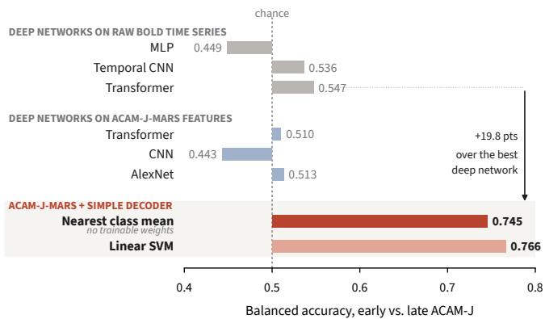
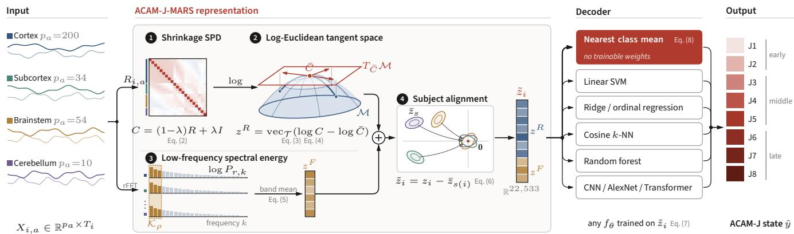
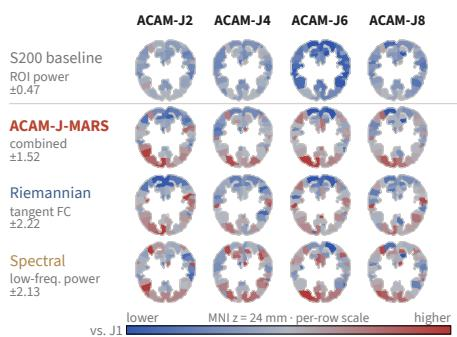
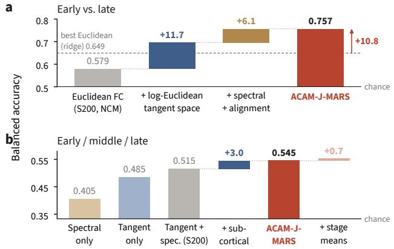

# ACAM-J-MARS: MULTI-ATLAS RIEMANNIAN SPECTRAL REPRESENTATIONS FOR DECODING ADVANCED MEDITATION STATES FROM FMRI

Jian Wang1,2, Winson F. Z. Yang1,2, Wugeng Zheng3, Matthew D. Sacchet1,2

1Meditation Research Program, Psychiatry, MGH and Harvard Medical School, Boston, MA, USA 2Martinos Center for Biomedical Imaging, Radiology, MGH and Harvard Medical School, Boston, MA, USA 3College of Engineering, Northeastern University, Boston, MA, USA

## ABSTRACT

Inferring jhana-type advanced concentration absorption meditation (ACAM-J) states from fMRI data is challenging due to the spatially distributed nature of meditation-related effects, substantial inter-individual variability that can exceed within-subject state differences, and limited sample sizes. Conventional machine-learning approaches often formulate this problem as unimodal, Euclidean, atlas-based classification, thereby neglecting the non-Euclidean geometry of functional connectivity matrices and underrepresenting temporal information in functional magnetic resonance imaging (fMRI); these limitations can lead to suboptimal classification performance. We propose ACAM-J-MARS (Multi-Atlas Riemannian Spectral representation), which computes functional connectivity using multiple atlases, represents symmetric positive definite (SPD) connectivity matrices on a Riemannian manifold, projects them into a log-Euclidean tangent space, and augments connectivity-derived features with low-frequency BOLD spectral energy to better resolve subtle state differences under heterogeneous variability. Evaluated on 204 segments from 22 practitioners, ACAM-J-MARS improves performance across multiple backbone models, achieving a balanced accuracy of 0.757 for early versus late ACAM-J classification and 0.545 for three-class classification, corresponding to a 10.8-point absolute improvement over the strongest baseline. These findings suggest that the proposed representation improves the decoding of advanced meditative brain states and may enable downstream applications such as closed-loop neurofeedback and real-time psychophysiological brain-computer interfaces.1

Index Terms— Advanced meditation; fMRI classification; Riemannian geometry; Manifold learning

## 1. INTRODUCTION

Meditation offers a controlled way to study the neural regulation of attention, arousal, and self-related processing [1, 2], and different practices recruit partly distinct brain systems [3]. Jhana, or advanced concentration absorption meditation (ACAM-J), is a sequence of eight progressive absorption states (ACAM-J1–J8). With increasing absorption, practitioners report steadier attention, reduced sensory awareness, and quieter discursive thought [4, 5]. Advanced meditators can enter ACAM-J volitionally during scanning [6, 7], making ACAM-J a rare model of internally generated, repeatable brain-state changes. 7T fMRI case studies of a single advanced meditator have linked ACAM-J to dynamic brain states [8], connectivity gradients [9], cortical eigenmodes [10], and network modularity [11], and related work points to changes in nonlinear processing and near-critical wholebrain dynamics [12, 13]. However, because most evidence comes from one person, it is unclear whether ACAM-J states have a shared neural signature across practitioners. A prior cross-subject classifier using local voxel synchrony achieved ∼66% accuracy in distinguishing state pairs in one held-out meditator [14]. A decoder of ACAM-J states that generalizes across people would turn single-case findings into a population-level account, but three challenges hinder this. First, changes across ACAM-J states likely reflect distributed cortical–subcortical interactions for attention and arousal [15], not focal activations. Second, functional connectivity is strongly individual [16] and can dominate transient state changes [17], so models trained to minimize average error may learn subject identity rather than ACAM-J state. Third, whole-brain connectivity is high-dimensional relative to the data (204 segments, 22 practitioners), making overfitting likely, and end-to-end deep networks offer little advantage in this setting [18].

  
Fig. 1. Deep neural networks cannot decode ACAM-J states across subjects. Under subject-wise cross-validation, deep models are near chance (0.44–0.55) on raw BOLD or ACAM-J-MARS features, whereas simpler classifiers perform well (nearest class mean, 0.745; linear SVM, 0.766).

Most connectivity decoders compute Pearson correlations within a cortical atlas and vectorize the matrix in Euclidean space [19], losing key structure: the non-Euclidean geometry of SPD correlation matrices [20], contributions from subcortical and brainstem regions [21], and temporal dynamics. Bigger models cannot recover this lost information: multilayer perceptrons, CNNs, and Transformers stay near chance on raw BOLD or derived features, while simple classifiers on the same features perform well (Fig. 1).

To address these challenges, we propose ACAM-J-MARS with the main contributions as follows:

• Unified geometrical–spectral representation: We introduce ACAM-J-MARS, which fuses multi-region connectivity (cortical, subcortical, brainstem, cerebellar) in the log-Euclidean tangent space of SPD matrices with regional low-frequency spectral energy. This shared vector space reduces inter-subject variability through translation adjustment, avoiding labeled calibration data.

• Classifier-agnostic decoding gains: The feature space supports robusst decoding. A parameter-free nearest classmean classifier achieves 0.757 balanced accuracy for early vs. late ACAM-J (+10.8% over the best baseline). Five other linear/centroid classifiers score 0.70–0.77 on the same features.

• Objective absorption biomarker: Across 22 practitioners, we identify a cross-subject neural correlate of absorption (ACAM-J) states. This objective measure complements introspection and supports real-time monitoring and closed-loop neurofeedback.

## 2. UNIMODAL CONNECTIVITY AND ITS LIMITATIONS

Let $X _ { i } \in \mathbb { R } ^ { p \times T _ { i } }$ be the regional BOLD time series of run $i ,$ with ACAM-J state label yi. A unimodal baseline computes the Pearson correlation matrix $R _ { i }$ on one atlas [19] and uses its upper triangle

$$
z _ { i } ^ { U } = \mathrm { v e c h } ( R _ { i } ) \in \mathbb { R } ^ { p ( p - 1 ) / 2 } .\tag{1}
$$

This feature has four limitations: (1) $R _ { i } \in { S _ { + + } ^ { p } }$ , but the Euclidean distance $\| R _ { 1 } - R _ { 2 } \| _ { F }$ ignores manifold curvature, and Euclidean averaging inflates determinants [20, 22]. (2) Cortical atlases omit subcortical and brainstem regions important for arousal and attention [21, 15]. (3) Correlation is orderinvariant, so temporal dynamics are lost. (4) Subject offsets $\beta _ { s ( i ) }$ add to the state signal and can dominate Euclidean distances [17]. On our data, $z _ { i } ^ { U }$ achieves 0.579 balanced accuracy with nearest class mean and 0.649 with ridge regression.

## 3. METHOD: ACAM-J-MARS

ACAM-J-MARS projects BOLD time-series data into a subject-aligned feature vector (Fig. 2). Each atlas $a \ \in \ A$ comprises $p _ { a }$ distinct regions.

## 3.1. Tangent-Space Connectivity

When $T _ { i }$ is close to $p _ { a } ,$ the sample correlation matrix $R _ { i , a }$ may become ill-conditioned or rank-deficient. To regularize this estimate, we apply shrinkage toward the identity matrix, corresponding to a simple Ledoit–Wolf-type estimator [23]:

$$
C _ { i , a } = ( 1 - \lambda ) R _ { i , a } + \lambda I _ { p _ { a } } , \lambda \in ( 0 , 1 ) .\tag{2}
$$

Subsequent computations are performed on $S _ { + + } ^ { p _ { a } }$ endowed with the log-Euclidean metric [22]. As a reference element, we use the log-Euclidean Frechet mean of the training runs ´ [20],

$$
\begin{array} { r } { \bar { C } _ { a } = \exp \Big ( \frac { 1 } { | \mathcal { Z } _ { \mathrm { t r } } | } \sum _ { i \in \mathcal { I } _ { \mathrm { t r } } } \log C _ { i , a } \Big ) , } \end{array}\tag{3}
$$

and represent each run by its tangent-space coordinate at $\bar { C } _ { a }$ [24]:

$$
z _ { i , a } ^ { R } = \mathrm { v e c } _ { \mathcal { T } } \left( \log C _ { i , a } - \log \bar { C } _ { a } \right) \in \mathbb { R } ^ { p _ { a } ( p _ { a } + 1 ) / 2 } .\tag{4}
$$

Here, log is the matrix logarithm. The operator vecT vectorizes a matrix’s upper triangle and rescales off-diagonal entries by $\sqrt { 2 }$ to preserve the Frobenius inner product $[ 2 4 ] ^ { 2 }$

## 3.2. Low-Frequency Spectral Energy

Because correlation-based measures ignore temporal ordering, we augment the representation with a single spectral descriptor for each region. Let $P _ { i , a , r } ( k )$ denote the periodogram of region r, and let $\kappa _ { \rho }$ be the set of the lowest $\rho = 1 0 \%$ non-DC frequency bins. Following [25], we define

$$
\begin{array} { r } { z _ { i , a , r } ^ { F } = \frac { 1 } { | \mathcal { K } _ { \rho } | } \sum _ { k \in \mathcal { K } _ { \rho } } \log \big ( 1 + P _ { i , a , r } ( k ) \big ) . } \end{array}\tag{5}
$$

The logarithmic transform is applied to stabilise variance and to convert multiplicative scaling effects into additive offsets. The resulting feature vector is formed by concatenating regional and spectral components, $z _ { i } = z _ { i } ^ { R } \overset { \cdot } { \oplus } z _ { i } ^ { F }$

## 3.3. Subject Alignment and Decoding

We use the generative model $z _ { i } = \beta _ { s ( i ) } + \mu _ { y _ { i } } + \varepsilon _ { i }$ . Since the tangent space is a vector space, we remove the subject offset $\beta _ { s ( i ) }$ by within-subject mean-centering [26]:

$$
\begin{array} { r } { \tilde { z } _ { i } = z _ { i } - \frac { 1 } { | { \mathcal { T } _ { s } } ( i ) | } \sum _ { j \in { \mathcal { T } _ { s ( i ) } } } z _ { j } . } \end{array}\tag{6}
$$

  
Fig. 2. ACAM-J-MARS. Regional BOLD signals from four atlases are converted to shrinkage-regularised SPD connectivity matrices, mapped to the log-Euclidean tangent space at the training-set Frechet mean, and concatenated with low-frequency´ spectral energy. After per-subject mean removal, the resulting features can be decoded by classifiers ranging from nearest class-mean to deep neural networks.

Table 1. Subject-level cross-validation for ACAM-J decoding. Rows cumulatively add ACAM-J-MARS components. Atlases: S200 = Schaefer200; All = A (four parcellations). Geometry: Euc. = Euclidean vectorisation; LE = log-Euclidean tangent space. Classifiers: NCM = nearest class mean (cosine); $\mathrm { R i d g e } = \ell _ { 2 }$ -regularised linear regression. Chance: 0.500 (twoclass), 0.333 (three-class). – = not tested. Best in red. Right: stage-specific regional differences vs. ACAM-J1 (MNI z=24 mm; row-wise scale).
<table><tr><td></td><td colspan="4">Representation</td><td colspan="3">Binary (early vs. late)</td><td colspan="3">Ternary (3-level)</td></tr><tr><td>Method</td><td></td><td>Atlas Geometry Spectral Classifier</td><td></td><td></td><td>Acc.</td><td>BA</td><td>F1</td><td>Acc.</td><td>BA</td><td>F1</td></tr><tr><td colspan="9">Unimodal Euclidean connectivity</td><td></td><td></td></tr><tr><td>S200 FC</td><td>S200</td><td>Euc.</td><td>x</td><td>NCM</td><td>0.5760.579</td><td></td><td>0.574</td><td></td><td></td><td></td></tr><tr><td>S200 FC</td><td>S200</td><td>Euc.</td><td>x</td><td>Ridge</td><td>0.668</td><td>0.649</td><td>0.645</td><td></td><td></td><td></td></tr><tr><td>All-atlas FC</td><td>All</td><td>Euc.</td><td>x</td><td>Ridge</td><td>0.6590.641</td><td></td><td>0.637</td><td></td><td></td><td></td></tr><tr><td colspan="9">Partial geometric representations</td></tr><tr><td>Spectral only</td><td>All</td><td></td><td>√</td><td>NCM</td><td></td><td></td><td></td><td>0.3810.405</td><td></td><td>0.352</td></tr><tr><td>Tangent only</td><td>All</td><td>LE</td><td>x</td><td>NCM</td><td>0.695 0.696</td><td></td><td>0.692</td><td>0.472 0.485</td><td></td><td>0.472</td></tr><tr><td>S200 tangent + spec.</td><td>S200</td><td>LE</td><td>√</td><td>NCM</td><td></td><td></td><td></td><td>0.495</td><td>0.515</td><td>0.497</td></tr><tr><td>ACAM-J-MARS (ours)</td><td>All</td><td>LE</td><td>√</td><td>NCM</td><td>0.751 0.757</td><td></td><td>0.750</td><td></td><td>0.5290.545</td><td>0.529</td></tr><tr><td>+ stage-level means</td><td>All</td><td>LE</td><td>√</td><td>NCM</td><td></td><td></td><td></td><td>0.530</td><td>0.552</td><td>0.531</td></tr></table>

  
atlases with $p _ { a } \in \{ 2 0 0 , 3 4 , 5 4 , 1 0 \}$ [27, 28, 21, 29], yielding $d = 2 2$ ,533 features. Main tasks are early (J1–J2) vs. late (J6–J8) and 3-class early/middle (J3–J5)/late. We also evaluate a median split (J1–J4 vs. J5–J8) and J1 vs. J8.

This centering is unsupervised and can be applied to unseen subjects, provided multiple runs are available. A decoder $f _ { \theta }$ is then trained on $\tilde { z } _ { i }$ via ERM:

$$
\begin{array} { r } { \hat { \theta } = \arg \underset { \theta } { \operatorname* { m i n } } \sum _ { i \in \mathcal { T } _ { \mathrm { t r } } } \mathcal { L } \big ( f _ { \theta } ( \tilde { z } _ { i } ) , y _ { i } \big ) . } \end{array}\tag{7}
$$

To assess representations with less dependence on the decoder, we mainly report a nearest class-mean (NCM) classifier. Let $\hat { \mu } _ { c }$ be the class mean on $\mathcal { T } _ { \mathrm { t r } } \mathrm { : }$ we predict the class with highest cosine similarity:

$$
\hat { y } _ { j } = \arg \operatorname* { m a x } _ { c } \ \frac { \langle \tilde { z } _ { j } , \hat { \mu } _ { c } \rangle } { \| \tilde { z } _ { j } \| _ { 2 } \| \hat { \mu } _ { c } \| _ { 2 } } .\tag{8}
$$

## 4. EXPERIMENTS

Data and Tasks. We use 204 fMRI ACAM-J segments from 22 advanced meditators, each with a self-reported ACAM-J1–J8 label. The atlas set A includes Schaefer200 (cortex), Tian-S2 (subcortex), and brainstem and cerebellar

Protocol & Comparisons. We use subject-wise crossvalidation [30] with disjoint subjects $( \mathcal { T } _ { \mathrm { t r } } \cap \mathcal { T } _ { \mathrm { t e } } = \emptyset )$ . Frechet´ means, standardisation, and class means are computed on $\mathcal { T } _ { \mathrm { t r } }$ only. We report balanced accuracy (BA), plus accuracy, AUC, and macro-F1 for additional contrasts. We compare: (1) single-atlas Euclidean FC with NCM and ridge; (2) multi-atlas FC in Euclidean and tangent space; (3) spectral vs. tangent features alone; and (4) alternative decoders on ACAM-J-MARS features (1D CNN, reduced AlexNet), plus deep networks on raw BOLD. To relate features to anatomy, we map each feature block’s stage-wise change relative to ACAM-J1 to brain regions (Table 1, right).

  
Fig. 3. Component contributions. Subject-wise crossvalidated balanced accuracy. a Binary (early vs. late): log-Euclidean tangent features beat Euclidean FC by 11.7 points. b Ternary: spectral+tangent features combine; extra atlases help only in tangent space.

## 5. RESULTS

Fig. 1 and Tab. 2 show that deep neural network classifiers perform near chance when trained on raw BOLD time series or ACAM-J-MARS features, whereas linear and centroidbased decoders reach much higher accuracy (0.65–0.77). This likely reflects (i) the lack of local spatial structure in tangent-space coordinates exploited by CNNs, and (ii) overfitting of flexible non-linear models in high-dimensional, low-sample settings (d = 22,533; N = 204) [18].

Tab. 1 and Fig. 3 show that single-atlas Euclidean FC yields 0.579 (NCM) and 0.649 (ridge) for binary classification. Adding subcortical atlases increases accuracy to 0.641. Four-atlas tangent-space FC improves to 0.696, and adding spectral features plus subject-level alignment reaches 0.757 (+10.8 points vs. Euclidean baselines).

In Fig. 3b, for ternary classification, spectral features score 0.405 and tangent-space features 0.485. Fusing both with Schaefer200 increases accuracy to 0.515, and fusing across all four atlases to 0.545. Baseline maps from Schaefer200 show broadly uniform decreases, while ACAM-J-MARS maps show anterior–posterior gradients.

Tab. 3 shows Euclidean FC is near chance on the median split and ACAM-J1 vs. ACAM-J8 (AUC = 0.53, 0.47), while both versions of our representation are well above chance (AUC = 0.69–0.78). In both contrasts, the tangent-space component alone matches full ACAM-J-MARS (AUC = 0.70 vs. 0.69; 0.75 vs. 0.77). Spectral and alignment features drive early vs. late ACAM-J performance (BA 0.696 to 0.757, Table 1), with the full representation reaching AUC = 0.79–0.81.

## 6. CONCLUSION

This study presents a novel fMRI-based representational framework for the classification of ACAM-J states. The proposed ACAM-J-MARS approach integrates multi-atlas connectivity estimates in tangent space, low-frequency spectral power features, and within-subject alignment procedures. Using a nearest class mean decoder, our method achieves a balanced accuracy of 0.757 for binary discrimination of early versus late ACAM-J and 0.545 for three-level classification. Our results suggest that ACAM-J states are associated with distributed patterns of functional connectivity and power in slow BOLD fluctuations. However, interpretation is constrained by reliance on self-reported labels, a single-cohort dataset comprising 22 practitioners, and an alignment strategy that requires multiple runs per participant. Future work should validate the approach in independent samples and assess prospective real-time applications, including meditationtime neurofeedback derived from the proposed features.

Table 2. Classifier Capacity and ACAM-J-MARS Features. Deep networks: seed-averaged means. Chance is 0.333 (ternary) and 0.500 (binary).
<table><tr><td>Decoder</td><td>Ternary BA</td><td>Binary BA</td></tr><tr><td colspan="3">ACAM-J-MARS, centroid and linear decoders</td></tr><tr><td>NCM, correlation (ours)</td><td>0.545</td><td>0.757</td></tr><tr><td>Stage centroids†</td><td>0.552</td><td>0.691</td></tr><tr><td>Linear SVM</td><td>0.519</td><td>0.766</td></tr><tr><td>Subject-rank ridge</td><td></td><td>0.744</td></tr><tr><td>Ordinal regression</td><td></td><td>0.721</td></tr><tr><td>Subject-rank endpoint axis</td><td>0.480</td><td>0.702</td></tr><tr><td>Ridge</td><td>0.439</td><td>0.648</td></tr><tr><td colspan="3">ACAM-J-MARS, non-parametric and non-linear</td></tr><tr><td>Cosine k-NN (k=5/3)</td><td>0.478</td><td>0.615</td></tr><tr><td>Cosine 1-NN</td><td></td><td>0.594</td></tr><tr><td>Random forest</td><td>0.332</td><td>0.511</td></tr><tr><td colspan="3">Deep networks, ACAM-J-MARS features</td></tr><tr><td>Transformer</td><td>0.362</td><td>0.510</td></tr><tr><td>CNN</td><td>0.351</td><td>0.443</td></tr><tr><td>AlexNet</td><td>0.339</td><td>0.513</td></tr><tr><td colspan="3">Deep networks, raw BOLD time series</td></tr><tr><td>MLP</td><td>0.293</td><td>0.449</td></tr><tr><td>Temporal CNN</td><td>0.344</td><td>0.536</td></tr><tr><td>Transformer</td><td>0.333</td><td>0.547</td></tr></table>

†Mean rule (ternary), max rule (binary). Bars start at chance (grey tick).

Table 3. Robustness to ACAM-J contrasts. Subject-wise cross-validation. S200 FC: single-atlas Euclidean baseline; Ours (tangent): four-atlas log-Euclidean connectivity only; Ours (full): full ACAM-J-MARS with spectral energy and subject alignment. NCM: nearest class mean; SVM: linear support vector machine. Bars show AUC above chance (0.5).
<table><tr><td>Contrast</td><td>Representation</td><td>Dec.</td><td>Acc.</td><td>AUC</td><td>F1</td></tr><tr><td>ACAM-J1-J2</td><td>Ours (full)</td><td>NCM</td><td>0.740</td><td>0.788</td><td>0.739</td></tr><tr><td>vs. ACAM-J6–J8</td><td>Ours (full)</td><td>SVM</td><td>0.764</td><td>0.805</td><td>0.762</td></tr><tr><td>ACAM-J1–J4</td><td>S200 FC</td><td>NCM</td><td>0.554</td><td>0.530</td><td>0.551</td></tr><tr><td rowspan="3">vs. ACAM-J5–J8 ACAM-J1</td><td>Ours (tangent)</td><td>NCM</td><td>0.681</td><td>0.702</td><td>0.681</td></tr><tr><td>Ours (full)</td><td>NCM</td><td>0.652</td><td>0.688</td><td>0.652</td></tr><tr><td>S200 FC</td><td>NCM</td><td>0.451</td><td>0.470</td><td>0.451</td></tr><tr><td>vs. ACAM-J8</td><td>Ours (tangent)</td><td>NCM</td><td>0.725</td><td>0.753</td><td>0.725</td></tr><tr><td rowspan="2"></td><td>Ours (tangent)</td><td>SVM</td><td>0.784</td><td>0.775</td><td>0.781</td></tr><tr><td>Ours (full)</td><td>NCM</td><td>0.745</td><td>0.772</td><td>0.745</td></tr></table>

## 7. REFERENCES

[1] Matthew D. Sacchet and Jonathan M. Lieberman, “Toward an interdisciplinary mind science of advanced meditation,” Trends Cogn. Sci., 2026, in press.

[2] Matthew D. Sacchet and Jonathan M. Lieberman, “The neuroscience of advanced meditation: The promise of third wave meditation research,” Neuron, vol. 114, 2026.

[3] C. Baten et al., “The functional neuroimaging of meditation: A quantitative whole-brain meta-analysis and systematic review,” Neurosci. Biobehav. Rev., vol. 186, pp. 106709, 2026.

[4] Terje Sparby and Matthew D. Sacchet, “Toward a unified account of advanced concentrative absorption meditation: A systematic definition and classification of jhana,”¯ Mindfulness, vol. 15, no. 6, pp. 1375–1394, 2024.

[5] Winson F. Z. Yang et al., “Volitional mental absorption in meditation: Toward a scientific understanding of advanced concentrative absorption meditation and the case of jhana,” Heliyon, vol. 10, no. 10, pp. e31223, 2024.

[6] Winson F. Z. Yang et al., “Intensive whole-brain 7T MRI case study of volitional control of brain activity in deep absorptive meditation states,” Cereb. Cortex, vol. 34, no. 1, pp. bhad408, 2024.

[7] Winson F. Z. Yang et al., “The neuroscience of highly stable, positive, and refined states of consciousness during jhanatype advanced concentration absorption meditation (ACAM-J),” bioRxiv, 2025.

[8] Isaac N. Treves et al., “Dynamic brain states underlying advanced concentrative absorption meditation: A 7-T fMRIintensive case study,” Netw. Neurosci., vol. 9, no. 1, pp. 125– 145, 2025.

[9] Umay Demir, Winson F. Z. Yang, and Matthew D. Sacchet, “Advanced concentrative absorption meditation reorganizes functional connectivity gradients of the brain: 7T MRI and phenomenology case study of jhana meditation,” Cereb. Cortex, vol. 35, no. 4, pp. bhaf079, 2025.

[10] Ruby M. Potash et al., “Investigating the complex cortical dynamics of an advanced concentrative absorption meditation called jhanas (ACAM-J): A geometric eigenmode analysis,” Cereb. Cortex, vol. 35, no. 2, pp. bhaf039, 2025.

[11] Avijit Chowdhury et al., “Multimodal neurophenomenology of advanced concentration absorption meditation: An intensively sampled case study of jhana,” NeuroImage, vol. 305, pp. 120973, 2025.

[12] Ruby M. Potash et al., “Integrated phenomenology and brain connectivity demonstrate changes in nonlinear processing in jhana advanced meditation,” J. Cogn. Neurosci., vol. 37, no. 11, pp. 2260–2283, 2025.

[13] Jakub Vohryzek et al., “Whole-brain models of minimal phenomenal experience: Approaching criticality through jhana¯ meditation,” bioRxiv, 2025.

[14] Puneet Kumar et al., “Machine learning-based classification of jhana advanced concentrative absorption meditation (ACAM-J) using 7T fMRI,” arXiv preprint arXiv:2602.13008, 2026.

[15] Michael M. Halassa and Sabine Kastner, “Thalamic functions in distributed cognitive control,” Nat. Neurosci., vol. 20, no. 12, pp. 1669–1679, 2017.

[16] Emily S. Finn et al., “Functional connectome fingerprinting: Identifying individuals using patterns of brain connectivity,” Nat. Neurosci., vol. 18, no. 11, pp. 1664–1671, 2015.

[17] Caterina Gratton et al., “Functional brain networks are dominated by stable group and individual factors, not cognitive or daily variation,” Neuron, vol. 98, no. 2, pp. 439–452.e5, 2018.

[18] Tong He et al., “Deep neural networks and kernel regression achieve comparable accuracies for functional connectivity prediction of behavior and demographics,” NeuroImage, vol. 206, pp. 116276, 2020.

[19] Kamalaker Dadi et al., “Benchmarking functional connectome-based predictive models for resting-state fMRI,” NeuroImage, vol. 192, pp. 115–134, 2019.

[20] Xavier Pennec, Pierre Fillard, and Nicholas Ayache, “A Riemannian framework for tensor computing,” Int. J. Comput. Vis., vol. 66, no. 1, pp. 41–66, 2006.

[21] Marta Bianciardi et al., “Toward an in vivo neuroimaging template of human brainstem nuclei of the ascending arousal, autonomic, and motor systems,” Brain Connect., vol. 5, no. 10, pp. 597–607, 2015.

[22] Vincent Arsigny et al., “Log-Euclidean metrics for fast and simple calculus on diffusion tensors,” Magn. Reson. Med., vol. 56, no. 2, pp. 411–421, 2006.

[23] Olivier Ledoit and Michael Wolf, “A well-conditioned estimator for large-dimensional covariance matrices,” J. Multivar. Anal., vol. 88, no. 2, pp. 365–411, 2004.

[24] Alexandre Barachant et al., “Multiclass brain–computer interface classification by Riemannian geometry,” IEEE Trans. Biomed. Eng., vol. 59, no. 4, pp. 920–928, 2012.

[25] Yu-Feng Zang et al., “Altered baseline brain activity in children with ADHD revealed by resting-state functional MRI,” Brain Dev., vol. 29, no. 2, pp. 83–91, 2007.

[26] Paolo Zanini et al., “Transfer learning: A Riemannian geometry framework with applications to brain–computer interfaces,” IEEE Trans. Biomed. Eng., vol. 65, no. 5, pp. 1107– 1116, 2018.

[27] Alexander Schaefer et al., “Local-global parcellation of the human cerebral cortex from intrinsic functional connectivity MRI,” Cereb. Cortex, vol. 28, no. 9, pp. 3095–3114, 2018.

[28] Ye Tian et al., “Topographic organization of the human subcortex unveiled with functional connectivity gradients,” Nat. Neurosci., vol. 23, no. 11, pp. 1421–1432, 2020.

[29] Maedbh King et al., “Functional boundaries in the human cerebellum revealed by a multi-domain task battery,” Nat. Neurosci., vol. 22, no. 8, pp. 1371–1378, 2019.

[30] Gael Varoquaux et al., “Assessing and tuning brain decoders:¨ Cross-validation, caveats, and guidelines,” NeuroImage, vol. 145, pp. 166–179, 2017.