# AN ODE-BASED SAMPLER FOR DISCRETE DIFFUSION MODELS

Samson Gourevitch∗<sup>,1</sup> Yazid Janati∗<sup>,2,3</sup>

Eric Moulines<sup>3,4</sup> Eric P. Xing<sup>2,3</sup> Alain Durmus†<sup>,1</sup> Giacomo Zanella†<sup>,5</sup>

<sup>1</sup> CMAP, Ecole polytechnique <sup>2</sup> Institute of Foundation Models <sup>3</sup> MBZUAI

4 EPITA, LRE <sup>5</sup> Bocconi University, Department of Decision Sciences and BIDSA

## ABSTRACT

The marginals of a continuous diffusion model can be reproduced by a deterministic ordinary differential equation (ODE), known as the probability flow ODE, which provides a foundation for accelerated sampling and consistency distillation. In this paper we address the question whether an analogous formulation exists for discrete diffusion models and answer it affirmatively by introducing exponential residual flows (ERFs). Our framework augments the discrete state with a continuous residual variable for each token and position. These residuals evolve deterministically according to piecewise-defined ODEs whose vector fields depend on the current discrete state and the forward and backward rate matrices of the prescribed diffusion model. The discrete state changes whenever a residual reaches zero. We prove that this construction preserves the marginals of the original diffusion. We derive a practical discretization of our sampler and specialize it to masked and uniform diffusion. The deterministic trajectories of ERFs support consistency distillation and yield empirical improvements over previous approaches across a variety of benchmarks including code and text generation tasks.

## 1 INTRODUCTION

Discrete diffusion models have emerged as a compelling alternative to autoregressive models. By allowing multiple positions to be updated in parallel, they offer a path toward faster decoding (Lou et al., 2024; Sahoo et al., 2024) and potentially more efficient steering and control (Schiff et al., 2024). In continuous time, these models are described by forward and reverse continuous-time Markov chains (Campbell et al., 2022; Lou et al., 2024). Standard simulation of the reverse process is inherently stochastic: Gillespie’s algorithm draws fresh randomness at each jump (Gillespie, 1977), while ancestral sampling of discrete-time reverse chains likewise relies on stochastic transitions (Shi et al., 2024; Sahoo et al., 2024; Hoogeboom et al., 2021; Schiff et al., 2024).

This raises a natural question: can one design a discrete diffusion sampler whose only randomness is the initial condition, as in the probability-flow ODE for continuous diffusion models (Song et al., 2021b;a)? A direct analogue on a finite state space is impossible because a deterministic map cannot split probability mass. Continuous auxiliary randomness is therefore required at initialization, particularly for masked diffusion, whose terminal distribution is a Dirac mass. Existing uses of auxiliary randomness serve different purposes. The projected Gaussian trajectories of Sahoo et al. (2025) act as more of a reparameterization and do not define a deterministic flow driven solely by the current discrete state. Gumbel Distillation (Zhang et al., 2026) instead uses Gumbel noise to construct deterministic training targets from an autoregressive teacher for parallel decoding, rather than a marginal-preserving deterministic flow for a discrete diffusion process.

Our contributions are as follows:

Our central contribution is a new deterministic sampler for discrete diffusion models, which we call the exponential residualflow (ERF). We augment the state with non-negative auxiliary variables, called residuals, initialized as independent exponential random variables, one for each token and position. Their evolution is then governed by an ODE determined by the forward and reverse rates of the discrete dynamics that governed jumps of the discrete state. A token change is triggered whenever a residual reaches zero. In contrast to Gillespie’s first-reaction construction, where residual clocks are refreshed after each jump, ERF continues to evolve all remaining residuals deterministically. Consequently, once the initial augmented state has been sampled, no additional randomness is required. We prove that these augmented dynamics preserve the marginal distribution of the original CTMC at every time. At each fixed time, the residuals remain independent standard exponential random variables and are independent of the discrete state. The resulting process generally differs from the reverse Markov chain and need not be Markovian.

To make this construction applicable to learned diffusion models, we introduce a novel numerical integration scheme that freezes the leave-one-out denoiser over each sampling interval while preserving the known time dependence of the transition rates. We derive explicit formulations for both masked and uniform diffusion models, and show that the resulting scheme is exact for factorized data distributions when the denoiser is exact.

We evaluate ERF against ancestral sampling under matched model-evaluation budgets and find comparable generation quality. The deterministic nature of ERF also makes it directly amenable to consistency distillation. We exploit this property to train few-step student models and evaluate the resulting speed–quality trade-offs on text generation, code generation, and Sudoku completion.

Notation. We consider integer-valued sequences in $\mathsf { X } = \mathsf { V } ^ { L }$ , where $\mathsf { V } = [ [ 1 , K ] ]$ , and write $\Delta _ { K } =$ $\textstyle \{ p \in \mathbb { R } ^ { K } : p ^ { k } \geq 0 , \sum _ { k = 1 } ^ { K } p ^ { k } = 1 \}$ for the probability simplex. For $x \in \mathsf { X } , x ^ { \ell }$ denotes its ℓ-th token and $x ^ { - \ell } \in \mathsf { V } ^ { L - 1 }$ the sequence with position ℓ removed. For masked diffusion, the mask token is $\mathsf { m } : = K$ . For any vector $x = ( x ^ { 1 } , \ldots , x ^ { d } ) \in \mathsf { V } ^ { d }$ , we denote its one-hot matrix by $\tilde { x } \in \{ 0 , 1 \} ^ { d \times K }$ with entries $\tilde { x } ^ { \ell k } : = \mathbb { 1 } _ { x ^ { \ell } = k }$ . For a single token $x \in \mathsf { V } , \tilde { x } \in \mathbb { R } ^ { K }$ denotes its one-hot vector. For $\pi \in \Delta _ { K } , \operatorname { C a t } ( \pi )$ denotes the categorical distribution, and $\operatorname { C a t } ( x ; \pi ) : = \langle \tilde { x } , \pi \rangle$ is the probability of x under $\operatorname { C a t } ( \pi )$ . We use the convention sup $\varnothing = - \infty$

## 2 BACKGROUND ON DISCRETE DIFFUSION MODELS

We first briefly introduce discrete diffusion models (Sahoo et al., 2024; Shi et al., 2024; Austin et al., 2021; Hoogeboom et al., 2021; Schiff et al., 2024). This class of generative models constructs a stochastic process that transports a simple reference distribution, $\begin{array} { r } { p _ { 1 } : = \prod _ { \ell = 1 } ^ { L } \mathrm { C a t } ( \pi ^ { \ell } ) } \end{array}$ with $\pi \in ( \Delta _ { K } ) ^ { L }$ , to a target data distribution $p _ { 0 }$ . To this end, we use a forward process that progressively corrupts the data distribution, ultimately transforming it into $p _ { 1 }$ . The generative model is then obtained by learning an approximation of the corresponding reverse process.

We consider as forward process a Continuous Time Markov Chain (CTMC) process $( Y _ { t } ) _ { t \in [ 0 , 1 ] }$ started at $p _ { 0 }$ with transitions $\begin{array} { r } { q _ { t \mid s } ( x _ { t } | x _ { s } ) = \prod _ { \ell = 1 } ^ { L } q _ { t \mid s } ^ { \ell } ( x _ { t } ^ { \ell } | x _ { s } ^ { \ell } ) } \end{array}$ , where $x _ { s } , x _ { t } \in \mathsf { X } , 0 \leq s < t \leq 1$ and

$$
\begin{array} { r } { q _ { t \mid s } ^ { \ell } \big ( x _ { t } ^ { \ell } | x _ { s } ^ { \ell } \big ) = \mathrm { C a t } \big ( x _ { t } ^ { \ell } ; \alpha _ { t \mid s } \tilde { x } _ { s } ^ { \ell } + ( 1 - \alpha _ { t \mid s } ) \pi ^ { \ell } \big ) \ , \quad 0 \le s < t \le 1 \ , } \end{array}\tag{1}
$$

where $\tilde { x } _ { s }$ denotes the one-hot encoding of $x _ { s }$ and $( \alpha _ { t } ) _ { t \in [ 0 , 1 ] }$ is a monotone noise schedule with $\alpha _ { 0 } =$ $1 , \alpha _ { 1 } \approx 0$ , and $\alpha _ { t \vert s } = \alpha _ { t } / \alpha _ { s }$ . The time-reversal of this process is obtained by reversing the direction of time and is defined as the process $( Y _ { t _ { - } } ) _ { t \in [ 0 , 1 ] }$ , backward in time<sup>1</sup> with $\begin{array} { r } { \dot { Y } _ { t _ { - } } = \operatorname* { l i m } _ { h \downarrow 0 } Y _ { t - h } } \end{array}$ . For ease of notation, we denote $Y _ { t _ { - } } \ \mathbf { b y } \ X _ { t }$ . Since $\dot { Y _ { t _ { - } } } = Y _ { t }$ almost surely for any t, the process $X _ { t }$ has marginals $p _ { t } .$ , and allows by construction to transport the source distribution $p _ { 1 }$ to the target $p _ { 0 }$ . In addition, the process $( X _ { t } ) _ { t \in [ 0 , 1 ] }$ is itself a CTMC with transitions

$$
\begin{array} { r } { p _ { s \mid t } \big ( x _ { s } \big | x _ { t } \big ) = \sum _ { x _ { 0 } } q _ { s \mid 0 , t } \big ( x _ { s } \big | x _ { 0 } , x _ { t } \big ) p _ { 0 \mid t } \big ( x _ { 0 } \big | x _ { t } \big ) , } \end{array}\tag{2}
$$

with $p _ { 0 | t } ( \cdot | x _ { t } )$ the denoising posterior and ${ q _ { s \mid 0 , t } }$ the conditional distribution of $Y _ { s }$ given $( Y _ { 0 } , Y _ { t } )$ whose explicit expression is given in Appendix B. During training, these reverse transitions are learned using a factorized model parameterized by θ: $\begin{array} { r } { p _ { s | t } ^ { \theta } ( x _ { s } | x _ { t } ) : = \prod _ { \ell = 1 } ^ { L } p _ { s | t } ^ { \theta , \ell } ( x _ { s } ^ { \ell } | x _ { t } ) } \end{array}$ . To obtain a practical model for inference, we then consider the following joint distribution:

$$
\begin{array} { r } { p _ { 0 : n } ^ { \theta } ( x _ { t _ { 0 : n } } ) = p _ { 1 } ( x _ { t _ { n } } ) \prod _ { i = 1 } ^ { n } p _ { s _ { i } | t _ { i } } ^ { \theta } ( x _ { s _ { i } } | x _ { t _ { i } } ) , } \end{array}\tag{3}
$$

$$
\begin{array} { r } { \downarrow \mathrm { ~ d } E _ { t } ^ { \ell j } = \bar { Q } _ { t } ^ { \ell } ( j \mid X _ { t } ) \mathrm { d } t \quad j \neq X _ { t } ^ { \ell } \quad \uparrow \mathrm { ~ d } E _ { t } ^ { \ell j } = - \sum _ { k \neq j } Q _ { t } ^ { \ell } ( k \mid j ) \mathrm { d } t \quad j = X _ { t } ^ { \ell } } \end{array}
$$

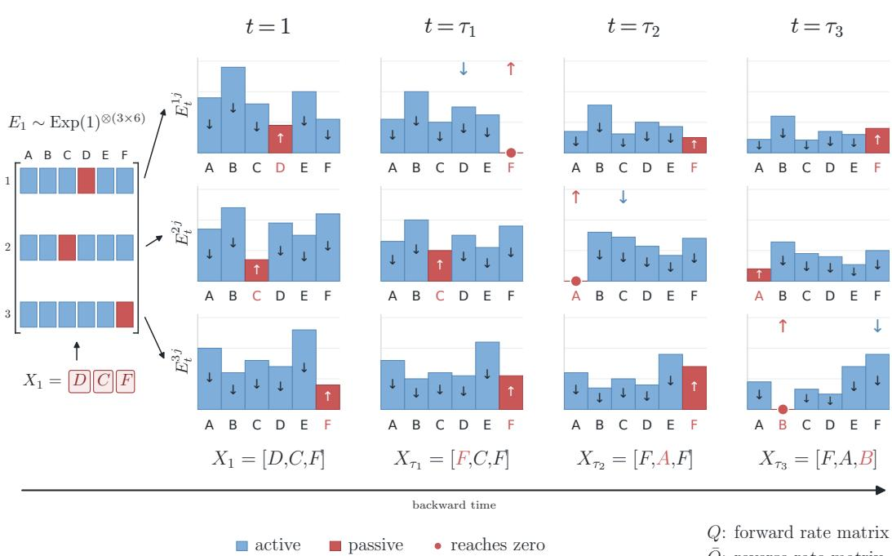  
Q: forward rate matrix Q<sup>¯</sup>: reverse rate matrix  
Figure 1: The Exponential Residual Flow algorithm. Evolution of the joint state $( X _ { t } , E _ { t } )$ , initialized independently with $X _ { 1 } ~ \sim ~ p _ { 1 }$ and $E _ { 1 } \sim \mathrm { E x p } ( 1 ) ^ { \otimes ( 3 \times 6 ) }$ . Each histogram displays the residual values at one position, which increase (red) or decrease (blue) deterministically as t decreases. A residual reaching zero triggers a single token change in $X _ { t }$

for a choice of timesteps $0 = t _ { 0 } < . . . < t _ { n } = 1$ , setting $s _ { i } = t _ { i - 1 }$ for notational convenience. A common parameterization used in the literature (Shi et al., 2024; Sahoo et al., 2024; Hoogeboom et al., 2021; Schiff et al., 2024) is $p _ { s \mid t } ^ { \theta } ( x _ { s } \vert x _ { t } ) = q _ { s \mid 0 , t } ( x _ { s } \vert \hat { x } _ { 0 } ^ { \theta } ( x _ { t } , t ) , x _ { t } )$ , where $q _ { s \mid 0 , t }$ denotes the extension of the bridge transition in (17) to simplex-valued inputs, and $\hat { x } _ { 0 } ^ { \theta }$ denotes a neural network with values in $\overline { { ( \Delta _ { K } ) } } ^ { L }$ . In what follows we assume, without any loss of generality, that it approximates the leave-one-out denoiser, whose ℓ-th component is $( t , \dot { x _ { t } } ) \mapsto \mathbb { E } [ \tilde { X } _ { 0 } ^ { \ell } \mid X _ { t } ^ { - \ell ^ { * } } = x _ { t } ^ { - \ell } ] ;$ see Appendix B.

Rate matrices and discrete score. Another useful perspective on discrete diffusion is provided through rate matrices associated to the forward and backward processes (Campbell et al., 2022; Sun et al., 2023; Lou et al., 2024). The rate matrix associated to the forward transitions (1) is given for any $x , y \in \mathsf { X }$ and $t \in [ 0 , 1 ]$ by

$\begin{array} { r } { Q _ { t } ( y | x ) = \sum _ { \ell = 1 } ^ { L } \mathbb { 1 } _ { y ^ { - \ell } = x ^ { - \ell } } Q _ { t } ^ { \ell } ( y ^ { \ell } | x ^ { \ell } ) } \end{array}$ 2 where $Q _ { t } ^ { \ell } ( y | x ) = \left( - \dot { \alpha } _ { t } / \alpha _ { t } \right) \left. \tilde { y } , \pi ^ { \ell } \right. \quad ( x \neq y )$ . (4) Here $x , y \in \mathsf { V } .$ , and $\begin{array} { r } { Q _ { t } ^ { \ell } ( x | x ) = - \sum _ { y \neq x } Q _ { t } ^ { \ell } ( y | x ) } \end{array}$ for all $\ell \in [ [ 1 , L ] ]$ . Let $( p _ { t } ) _ { t \in [ 0 , 1 ] }$ denote the family of marginals of $( Y _ { t } ) _ { t \in [ 0 , 1 ] }$ with transition probabilities given by (1) and initial distribution $p _ { 0 }$ . By definition, $( p _ { t } ) _ { t \in [ 0 , 1 ] }$ satisfies the Kolmogorov equation (Feller, 1940, Theorem 1): for $t \in ( 0 , 1 )$ and $x , y \in \mathsf { X }$

$$
\begin{array} { r } { \partial _ { t } p _ { t } ( y ) = \sum _ { x \in \mathsf { X } } Q _ { t } ( y | x ) p _ { t } ( x ) . } \end{array}\tag{5}
$$

Note that the forward transition $q _ { t \mid s } ( \cdot | x _ { s } )$ specified in (1) are obtained by solving (5) started from $\delta _ { x _ { s } }$ at time s. The family of rate matrices associated to the backward process is $( \breve { \bar { Q } } _ { t } ) _ { t \in [ 0 , 1 ] } 2$ , where $Q _ { t }$ satisfies for any $y \neq x ,$ , such that $p _ { t } ( x ) > 0 ^ { 3 }$

$$
\bar { Q } _ { t } ( y | x ) : = \frac { p _ { t } ( y ) } { p _ { t } ( x ) } Q _ { t } ( x | y ) = \sum _ { \ell = 1 } ^ { L } \mathbb { 1 } _ { y ^ { - \ell } = x ^ { - \ell } } \frac { p _ { t } ^ { \ell } ( y ^ { \ell } | x ^ { - \ell } ) } { p _ { t } ^ { \ell } ( x ^ { \ell } | x ^ { - \ell } ) } Q _ { t } ^ { \ell } ( x ^ { \ell } | y ^ { \ell } ) ,\tag{6}
$$

Algorithm 1 Gillespie next-reaction / ERF algorithm.   
Require: $0 \leq s \leq t \leq 1$ , reverse rates $( \bar { Q } _ { u } ) _ { u \in [ s , t ] } ,$ , forward exit rates $( \lambda _ { u } ) _ { u \in [ s , t ] }$   
Output: $( X _ { s } , E _ { s } )$ at time s.   
1: Initialize: $( X _ { t } , E _ { t } ) \sim p _ { t } \otimes \mathrm { E x p } ^ { \otimes ( L \times K ) } , X _ { s } \gets X _ { t } , \tau ^ { \star } \gets t , E _ { s } \gets E _ { t }$   
2: while $\tau ^ { \star } > s$ do   
3: $\begin{array} { r } { \tau ^ { \ell j }  \operatorname* { s u p } \{ u \in [ s , \tau ^ { \star } ] : \int _ { u } ^ { \tau ^ { \star } } \bar { Q } _ { r } ^ { \ell } ( j | X _ { s } ) \mathrm { d } r \geq E _ { s } ^ { \ell j } \} \mathrm { f o r } j \neq X _ { s } ^ { \ell } } \end{array}$ ▷ in parallel   
4: $( \ell ^ { \star } , j ^ { \star } ) \gets \mathrm { a r g m a x } _ { ( \ell , j ) : j \neq { X _ { s } ^ { \ell } } } ~ \tau ^ { \ell j }$   
5: $\tau _ { \mathrm { n e w } } ^ { \star }  \operatorname* { m a x } \{ s , \tau _ { . } ^ { \ell ^ { \star } j ^ { \star } } \}$   
6: $\begin{array} { r } { E _ { s } ^ { \ell j } \gets E _ { s } ^ { \ell j } - \int _ { \tau _ { \mathrm { n e w } } ^ { \star } } ^ { \tau ^ { \star } } \bar { Q } _ { r } ^ { \ell } ( j | X _ { s } ) \mathrm { d } r , \quad j \ne X _ { s } ^ { \ell } } \end{array}$ ▷ update active residuals   
7: if $X _ { s } ^ { \ell } = j$ then ▷ update passive residuals   
8: either $E _ { s } ^ { \ell j } \sim \mathrm { E x p } ( 1 )$ ▷ Gillespie   
9: or $\begin{array} { r } { E _ { s } ^ { \ell j }  E _ { s } ^ { \ell j } + \int _ { \tau _ { \mathrm { n e w } } ^ { \star } } ^ { \tau ^ { \star } } \lambda _ { r } ^ { \ell } ( j ) } \end{array}$ dr ▷ ERF (ours)   
10: end if   
11: $\mathbf { i f } \tau ^ { \ell ^ { \star } j ^ { \star } } \geq s$ then   
12: $X _ { s } ^ { \ell ^ { \star } } \gets j ^ { \star }$   
13: end if   
14: $\tau ^ { \star }  \tau _ { \mathrm { n e w } } ^ { \star }$   
15: end while   
16: return $X _ { s } , E _ { s }$

with $\begin{array} { r } { \bar { Q } _ { t } ( x | x ) : = \bar { \lambda } _ { t } ( x ) = - \sum _ { y \neq x } \bar { Q } _ { t } ( y | x ) } \end{array}$ . Using the definition of the reverse transitions in (2), (5) and (6), we obtain that the reverse transitions solve the following Kolmogorov equation: for any $x _ { t } , y \in \mathsf { X } , p _ { t } ( x _ { t } ) > 0$

$$
\begin{array} { r } { \partial _ { s } p _ { s \mid t } ( y \vert x _ { t } ) = - \sum _ { x } \bar { Q } _ { s } ( y \vert x ) p _ { s \mid t } ( x \vert x _ { t } ) , \qquad p _ { t \mid t } ( y \vert x _ { t } ) = \mathbb { 1 } _ { x _ { t } = y } . } \end{array}\tag{7}
$$

## 3 DETERMINISTIC SAMPLING VIA EXPONENTIAL RESIDUAL FLOWS

In this section, we construct a sampler whose trajectory is deterministic after a single random initialization and with one-time marginals agreeing with those of the reverse CTMC. The key idea is to augment the discrete state with the exponential variables used in Gillespie’s first-reaction method and replace their resampling at jump times with a deterministic continuous evolution, resulting in the EXPONENTIAL RESIDUAL FLOW sampler described in Algorithm 1.

## 3.1 EXPONENTIAL RESIDUAL FLOW

The CTMC $( X _ { t } ) _ { t \in [ 0 , 1 ] }$ is piecewise constant and jumps at random times. We start by presenting Gillespie’s algorithm which allows exact simulation of this CTMC. It simulates the succesive jumps of $X _ { t }$ using auxiliary exponential random variables that define random jump times. These variables introduce randomness in the trajectory of $X _ { t }$ , we show that it is possible to instead recycle the initial exponential variables according to an ODE.

Gillespie’s algorithm. Gillespie’s global algorithm (Gillespie, 1977) constructs the piecewise constant trajectory of the reverse CTMC one jump at a time. Starting from $X _ { t } = x .$ , it first determines the next backward jump time $\tau < t ,$ with $X _ { u } = \bar { x } \mathrm { f o r } u \in ( \tau , t ]$ . To do so, it draws $E \sim \mathrm { E x p } ( 1 )$ and solves $\int _ { \tau } ^ { t } { \bar { \lambda } } _ { u } ( x )$ du $\ l = E .$ At time τ , the trajectory jumps by changing a single token: the algorithm selects a position $\ell \in [ L ]$ and a new token ${ \dot { j } } \neq x ^ { \ell }$ with probability $\bar { Q } _ { \tau } ^ { \overline { { \ell } } } ( j | x ) \breve { / } \bar { \lambda } _ { \tau } ( x )$ . It sets ${ \check { X } } _ { \tau } ^ { \ell } = j ;$ leaves all other positions unchanged, and repeats from time τ and state $X _ { \tau }$ ; see Appendix C.1 for the formal construction.

Note that this construction has two sources of randomness: the exponential draw determining the jump time and the categorical draw determining the token change. Our goal is to eliminate randomness beyond initialization. We now describe Gillespie’s first-reaction algorithm, which removes the need for the categorical draw (Gillespie, 1977; Anderson, 2007). Given $X _ { t } = x .$ draw independent variables $E ^ { \ell j } \sim \mathbf { \check { E } } \mathbf { x p } ( 1 )$ for every position $\ell \in [ L ]$ and token $j \neq x ^ { \ell }$ , and determine the candidate

jump times from

$$
\int _ { \tau ^ { \ell } { j } } ^ { t } \bar { Q } _ { u } ^ { \ell } ( j | x ) \mathrm { d } u = E ^ { \ell j } .\tag{8}
$$

The next jump encountered backward from t is the largest among these jump times, so we select $( \ell ^ { \star } , j ^ { \star } ) \in \mathrm { a r g m a x } _ { ( \ell , j ) : j \neq x ^ { \ell } } \tau _ { \ast } ^ { \ell j }$ and set $\tau = \tau ^ { \ell ^ { \star } j ^ { \star } }$ The trajectory remains equal to x on $( \tau , t ] ;$ at time τ, the algorithm sets ${ \bf \tilde { \it X } } _ { \tau } ^ { \ell ^ { \star } } = j ^ { \star }$ , leaves all other positions unchanged, and repeats from time τ and state $X _ { \tau }$ . This construction simulates the reverse CTMC without categorical sampling, at the expense of drawing $L ( K - 1 )$ i.i.d. standard exponential variables at each jump.

Next-reaction method. The next-reaction method reuses the exponential variables associated with token changes that were not selected (Gibson & Bruck, 2000; Anderson, 2007; Durmus et al., 2021). To see how, we can express the calculation of the next jump as a continuous evolution. Given $X _ { t } = x$ , start from $E _ { t } ^ { \ell j } = E ^ { \ell j }$ and evolve all variables with $j \neq x ^ { \ell }$ simultaneously according to

$$
\mathrm { d } E _ { u } ^ { \ell j } / \mathrm { d } u = \bar { Q } _ { u } ^ { \ell } ( j | x ) ,
$$

with time evolving backwards. We call these evolving variables residuals. The first residual to reach zero determines the jump time $\tau ;$ its indices $( \ell ^ { \star } , j ^ { \star } )$ determine the position and new token. This gives the same jump as solving (8) for every pair and selecting the largest candidate time in line 4. Throughout this evolution, the discrete state stays equal to x until time τ, when line 12 sets $X _ { \tau } ^ { \ell ^ { \star } } = j ^ { \star }$ , leaving all other positions unchanged. By memorylessness, the residuals for the other token changes are conditionally i.i.d. standard exponential variables given the discrete trajectory, so they can be reused for the newt jump, only the residual that reached zero needs to be resampled.

We use a variant of this construction, given in Algorithm 1, that maintains one residual for every position–token pair, initialized in line 1. Residuals with $j \neq x ^ { \ell }$ are active and are updated in line 6. Those with $j = x ^ { \ell }$ are passive and are resampled in line 8. This variant requires L i.i.d. standard exponential draws at each jump.

Exponential Residual Flow. The exponential residual flow (ERF) eliminates this remaining randomness by keeping the evolution of the active residuals unchanged and replacing the resampling of the L passive residuals at each jump by deterministic evolution. In Algorithm 1, this amounts to retaining the active update in line 6 and replacing the sampling step in line 8 by the deterministic update in line 9. We initialize $( X _ { 1 } , E _ { 1 } ) \sim \overset { \cdot } { p } _ { 1 } \otimes \mathbf { \bar { E } } \mathbf { x p } ( 1 ) ^ { \otimes ( L \times \bar { K } ) }$ . The entire subsequent trajectory is deterministic given $( X _ { 1 } , E _ { 1 } )$ . More precisely, we keep track of the residuals $E _ { t } ^ { \ell j }$ that correspond to the current tokens at each position, i.e. $j = x _ { t } ^ { \ell }$ , and we increase them at a certain rate, while the other exponentials are decreased at a different rate and trigger a jump when they reach zero. The rates are chosen to preserve the marginals of the CTMC.

We can deduce from the algorithm a process $( X _ { t } , E _ { t } ) _ { t \in [ 0 , 1 ] }$ defined over [0, 1]. The algorithm defines the process at successive jump times $( \tau _ { k } ) _ { k \in \geq 0 } .$ Then, for any $k ,$ on $( \tau _ { k + 1 } , \tau _ { k } ] , X _ { t }$ is kept constant equal to $X _ { \tau _ { k } }$ and $E _ { t }$ solves the system of ODEs:

$$
\frac { \mathrm { d } } { \mathrm { d } t } E _ { t } ^ { \ell j } = \left\{ { \bar { Q } } _ { t } ^ { \ell } ( j | X _ { t } ) , \quad j \neq X _ { t } ^ { \ell } , \right.\tag{9}
$$

We call the process $( X _ { t } , E _ { t } ) _ { t \in [ 0 , 1 ] }$ the exponential residual flow (ERF) process. A simple trajectory with three successive jumps is illustrated in Figure 1.

We show in our next result that the resulting process $( X _ { t } ) _ { t \geq 0 }$ admits the same time marginals as the original CTMC. For completeness, a more formal construction of this process alongside Gillespie’s first-reaction form is given in Appendix C.1.2.

Theorem 3.1 (Correctness of the exponential residual flow). Under standard assumptions stated in Appendix I the ERF process is almost surely well defined with finitely many jumps, and, for every $t \in [ 0 , 1 ] ,$

$$
\begin{array} { r } { \mathcal { L } ( X _ { t } , E _ { t } ) = p _ { t } \otimes \mathrm { E x p } ( 1 ) ^ { \otimes ( L \times K ) } ~ . } \end{array}\tag{10}
$$

To the best of our knowledge, Theorem 3.1 yields a novel deterministic procedure for sampling the marginals of a CTMC which is deterministic given the initialization, similarly to the probability flow ODE in the continuous case (Song et al., 2021a).

We motivate the choice of the velocity (9) in Appendix I.1 by deriving a continuity equation on the extended state space from the Kolmogorov equation (5) satisfied by $( p _ { t } ) _ { t \in [ 0 , 1 ] }$ . Its vector field is precisely the one in (9). This argument, however, does not by itself prove Theorem 3.1. A complete proof instead characterizes by induction the density of the process at successive jump times and decomposes the path space according to the number of jumps. We give this proof in Appendix I.

## 3.2 INTEGRATING THE EXPONENTIAL RESIDUAL FLOW

We now describe the practical implementation of Algorithm 1. For $y \neq x ,$ , the reverse rates in (6) are commonly approximated as

$$
\begin{array} { r } { \bar { Q } _ { t } ^ { \theta } ( y | x ) : = \sum _ { \ell = 1 } ^ { L } \mathbb { 1 } _ { y ^ { - \ell } = x ^ { - \ell } } \left. \tilde { y } ^ { \ell } , s _ { t } ^ { \theta } ( x ) ^ { \ell } \right. Q _ { t } ^ { \ell } ( x ^ { \ell } | y ^ { \ell } ) , } \end{array}\tag{11}
$$

where the score approximation $s _ { t } ^ { \theta } ( x ) ^ { \ell }$ estimates the density ratios on the r.h.s. in (6) (Lou et al., 2024). We must then estimate the integrals of these approximate reverse rates in lines 3-6 and those of the associated forward exit rates in line 9. However, exact integration may be computationally challenging or infeasible.

To address this problem, most samplers introduce discretization strategies for these integration steps and consider a grid $0 = t _ { 0 } < \cdots < t _ { n } = 1$ . A first option is to adapt the τ-leaping algorithm by defining an approximate process successively on $[ s _ { i } , \bar { t _ { i } } ] \colon$ given $X _ { t _ { i } } , \top ( X _ { u } ) _ { u \in [ s _ { i } , t _ { i } ] }$ is the CTMC with constant reverse rate $\bar { Q } _ { u } ^ { \theta } ( y ; t _ { i } | x ) = \bar { Q } _ { t _ { i } } ^ { \theta } ( y | X _ { t _ { i } } )$ ; more details are provided in Appendix C.4. Another option, given the form of the reverse rate and its approximation (11), is to freeze only the score approximation at time $t _ { i } ,$ while retaining the forward rates $Q _ { u } ^ { \ell } ( y ^ { \ell } | \dot { x } ^ { \ell } )$ in (4), whose time integrals are available in closed form, similarly to (Conforti et al., 2025). We develop a different alternative here. First, note that the score is related to the leave-one-out denoiser by

$$
\langle \tilde { y } ^ { \ell } , s _ { t } ^ { \theta } ( x _ { t } ) ^ { \ell } \rangle = q _ { t | 0 } ( y ^ { \ell } | \hat { x } _ { 0 } ^ { \theta } ( x _ { t } , t ) ^ { \ell } ) \big / q _ { t | 0 } ( x _ { t } ^ { \ell } | \hat { x } _ { 0 } ^ { \theta } ( x _ { t } , t ) ^ { \ell } ) .\tag{12}
$$

This relation suggests to freeze only the leave-one-out denoiser at time $t _ { i }$ since if we plug (12) in (11), the integration with respect to time of the resulting approximate reverse rate can be made explicit for most models of interest. This choice has the advantage that it yields an exact sampler for a single token or a factorized distribution when the leave-one-out predictor is optimal contrary to other freezing strategies; see Appendix C.5.2.

Practical implementation. Given $( \hat { X } _ { t _ { i } } , \hat { E } _ { t _ { i } } )$ , a single discretization step produces $( \hat { X } _ { s _ { i } } , \hat { E } _ { s _ { i } } )$ by applying Algorithm 1 on $[ s _ { i } , t _ { i } ]$ with the following approximate reverse rate matrix:

$$
\bar { Q } _ { r } ^ { \theta } ( y ; t _ { i } | x ) : = \sum _ { \ell = 1 } ^ { L } \mathbb { 1 } _ { y ^ { - \ell } = x ^ { - \ell } } \frac { q _ { r | 0 } ^ { \ell } ( y ^ { \ell } | \hat { x } _ { 0 } ^ { \theta } ( \hat { X } _ { t _ { i } } , t _ { i } ) ^ { \ell } ) } { q _ { r | 0 } ^ { \ell } ( x ^ { \ell } | \hat { x } _ { 0 } ^ { \theta } ( \hat { X } _ { t _ { i } } , t _ { i } ) ^ { \ell } ) } Q _ { r } ^ { \ell } ( x ^ { \ell } | y ^ { \ell } ) \ , \qquad r \in [ s _ { i } , t _ { i } ] .\tag{13}
$$

For the forward exit rates, we keep the original rates $\left( \lambda _ { r } ^ { \ell } \right) _ { r \in \left[ s _ { i } , t _ { i } \right] }$ . In general, discretizing ERF requires the forward rates obtained by time-reversing the frozen reverse process on $[ s _ { i } , t _ { i } ]$ , and using those of the original forward process, e.g. (4), can lead to infinitely many jumps. For leave-one-out freezing, however, (13) is the exact time reversal, on $[ s _ { i } , t _ { i } ]$ , of the original forward process started at the factorized distribution given by $\hat { x } _ { 0 } ^ { \theta } ( \hat { X } _ { t _ { i } } , t _ { i } )$ . Each interval is therefore an exact ERF step for this distribution and has finitely many jumps; see Appendix C.5.

Specialization to MDM and UDM. Having specified the partially frozen reverse rate matrix in (13), we now specify the calculation of jump times in line 3-4 of Algorithm 1 to MDM and UDM. For a current state $\dot { X } _ { r }$ at time r for $r \in [ s _ { i } , t _ { i } ]$ and each active residual $E _ { r } ^ { \ell j }$ , the candidate time is obtained by solving $\begin{array} { r } { \int _ { u } ^ { r } \bar { Q } _ { v } ^ { \theta , \ell } ( j ; t _ { i } | X _ { r } ) \mathrm { d } v = \bar { E } _ { r } ^ { \ell j } } \end{array}$ for u (line 3 of Algorithm 1). For MDM this is straightforward since when ${ \dot { X } } _ { r } ^ { \ell } = { \mathsf { m } }$

$$
\int _ { u } ^ { r } \bar { Q } _ { v } ^ { \theta , \ell } ( j ; t _ { i } | z ) \mathrm { d } v = \hat { x } _ { 0 } ^ { \theta } ( X _ { t _ { i } } , t _ { i } ) ^ { \ell j } \log \left( \frac { 1 - \alpha _ { r } } { 1 - \alpha _ { u } } \right)\tag{14}
$$

and its candidate time follows by solving for $u .$ . Unmasked positions cannot jump so their candidate jump times are not computed. For UDM, however, the reverse rate integral is not explicitly invertible in $u ,$ and each candidate time must therefore be approximated by bisection. Since UDM can produce many jumps within a single interval, repeatedly solving these equations can be computationally costly. To control this cost, we split each interval into k subintervals and allow at most one jump per position in each, advancing all residuals to the subinterval boundary after that jump; see Appendix C.5. To reduce both the number of jumps and the cost of computing their times, we exploit the fact that different rate matrices can generate the same marginals $( p _ { t } ) _ { t \in [ 0 , 1 ] }$ (Campbell et al., 2024; 2022; Gat et al., 2024) and use the net-flux reverse rates (Zhang et al., 2023), defined for x = y as

$$
\bar { Q } _ { t } ^ { \mathrm { N F } } ( y | x ) : = \frac { \left[ p _ { t } ( x ) \bar { Q } _ { t } ( y | x ) - p _ { t } ( y ) \bar { Q } _ { t } ( x | y ) \right] _ { + } } { p _ { t } ( x ) } = - \sum _ { \ell = 1 } ^ { L } \mathbb { 1 } _ { y ^ { - \ell } = x ^ { - \ell } } \frac { \dot { \alpha } _ { t } } { K \alpha _ { t } } \left[ \frac { p _ { t } ( y ^ { \ell } | x _ { t } ^ { - \ell } ) } { p _ { t } ( x _ { t } ^ { \ell } | x _ { t } ^ { - \ell } ) } - 1 \right] _ { + }\tag{15}
$$

where $a _ { + } = \operatorname* { m a x } \{ a , 0 \}$ and $\bar { Q } _ { t }$ is the canonical UDM rate matrix. Surprisingly, the UDM netflux forward and backward rates are tractable and their time integrals are also analytically invertible which eliminates the need for bisection search for the jump times and greatly increases computational speed, as we show in the experiments. The resulting updates are given in Appendix $\mathbf { A } ,$ , with the net-flux construction in Appendix D.

Parallel sampling. Algorithm 1 processes jumps sequentially across positions because a jump may change the reverse rates. However, for MDM, UDM, and Uniform Net Flux with leave-one-out freezing, the frozen reverse rate at position $\ell , \bar { Q } _ { t } ^ { \ell } ( y | z )$ , depends on the current state z only through $z ^ { \ell } ;$ see Appendices A and C.5. This means that changes at other positions than ℓ do not affect the reverse rate at position ℓ and the associated residuals. Hence, within $[ s _ { i } , t _ { i } ]$ , the ERF dynamics can be seen as L independent single token CTMCs and different positions can be processed in parallel, with jumps at each position processed sequentially; see Algorithm 2.

## 4 APPLICATION TO DISTILLATION

As in the continuous diffusion case (Salimans & Ho, 2022; Song et al., 2023), one application of deterministic sampling is to distill a teacher diffusion model into a student model that performs better with few sampling steps. The absence of a direct analogue of the probability flow ODE in the discrete setting has often been used as an argument against trajectory-based distillation (Sahoo et al., 2025; Deschenaux & Gulcehre, 2025; Zhang et al., 2023). Our exponential residual flow supplies deterministic transport between augmented states $( X _ { t } , E _ { t } )$ and $( \bar { X _ { s } } , E _ { s } )$ , allowing student predictions to be matched along a teacher trajectory.

Consistency distillation. We rely on consistency distillation (CD) following Song et al. (2023). From an augmented state, the student predicts the clean discrete state at time 0 reached by the teacher trajectory, it does not need to predict the endpoint exponential residuals. We train its predictions from two points on the same trajectory to agree. Writing $\Psi _ { s \mid t } ^ { \theta }$ for the ERF transport of Algorithm 1, these points satisfy $( X _ { s } , E _ { s } ) = \Psi _ { s \mid t } ^ { \theta } ( X _ { t } , E _ { t } )$ for $s < t .$ . In a previous approach, Sahoo et al. (2025) couple $X _ { s }$ and $X _ { t }$ by using the same Gaussian noise in an underlying process. Their construction is deterministic conditional on this same noise, but the transition remains stochastic when conditioned only on $X _ { t } ,$ which contradicts what is required in CD (see Appendix E.5). In contrast, our approach deterministically produces $( X _ { s } , E _ { s } )$ from $( X _ { t } , E _ { t } )$ .

Since the ERF output at time 0 is uniquely determined by the augmented state at time $t ,$ a naive approach is to train a student to approximate this discrete-valued map directly. To make the learning problem more tractable, the output is relaxed at each position to an element of the probability simplex. More precisely, the student as a factorized distribution over discrete states:

$$
\begin{array} { r } { p _ { 0 \mid t } ^ { \phi } ( x _ { 0 } | x _ { t } , e _ { t } ) : = \prod _ { \ell = 1 } ^ { L } p _ { 0 \mid t } ^ { \phi , \ell } ( x _ { 0 } ^ { \ell } | x _ { t } , e _ { t } ) . } \end{array}
$$

For one current parameter $\phi$ and target parameter $\bar { \phi }$ which is held fixed during optimization, we consider the loss function:

$$
\mathcal { L } _ { \mathrm { C D } } ( \boldsymbol { \phi } ; \bar { \boldsymbol { \phi } } ) = \mathbb { E } \big [ \mathrm { K L } ( p _ { 0 | s } ^ { \bar { \phi } } ( \cdot | \boldsymbol { X _ { s } } , E _ { s } ) | | p _ { 0 | t } ^ { \phi } ( \cdot | \boldsymbol { X _ { t } } , E _ { t } ) ) \big ] ,\tag{16}
$$

where $( X _ { t } , E _ { t } ) \sim p _ { t } \otimes \mathrm { E x p } ( 1 ) ^ { \otimes L \times K } , ( X _ { s } , E _ { s } ) = \Psi _ { s \mid t } ^ { \theta } ( X _ { t } , E _ { t } )$ , t is sampled from $\mathrm { U n i f } ( \delta , 1 )$ , and $s = t - \delta ,$ , where δ is a hyperparameter. The target parameter $\phi$ is either updated by EMA after each step or frozen for a training round and refreshed between rounds. As noted in Song et al. (2023), for the minimizer to be exact, we need to impose the boundary condition $p _ { 0 | 0 } ^ { \phi } ( \cdot | x _ { 0 } , e _ { 0 } ) = \delta _ { x _ { 0 } }$ and give a non-zero probability to $s = 0$ so that at optimality, the student assigns all its mass to the clean endpoint of the ERF trajectory. Marginalizing over the augmented states $( X _ { t } , E _ { t } )$ at time t, these endpoints have law $p _ { 0 }$ . In practice, imposing the boundary condition did not improve the performance so we don’t use it, this condition’s role is to remove trivial constant solutions from the minimizer, but initializing the network with the teacher appears to be enough to reach non-trivial solutions. We also consider a biased ERF sampler to obtain $( X _ { s } , E _ { s } )$ from $( X _ { t } , E _ { t } )$ Instead of using the pretrained teacher denoiser, we use the frozen student when computing the ERF rates. Finally, for UDM, we convert the student output to a denoiser type prediction using (32) before evaluating the loss. This is because the teacher was trained to model a leave-one-out denoiser while the quantity we want the student to learn is closer to a denoiser type prediction so this conversion removes a slight mismatch at least towards the start of training. The fixed-teacher and joint-refresh procedures are given in Algorithms 4 and 5.

Sampling. We consider the refresh and bridge transitions for the discrete state which are respectively $\begin{array} { r l } { \sum _ { x _ { 0 } } q _ { s \mid 0 } ( x _ { s } | x _ { 0 } ) p _ { 0 \mid t } ^ { \phi } ( x _ { 0 } | x _ { t } , e _ { t } ) } & { { } } \end{array}$ and $\begin{array} { r l } { \sum _ { x _ { 0 } } \boldsymbol { q } _ { s \mid 0 , t } ( x _ { s } | x _ { 0 } , x _ { t } ) \boldsymbol { p } _ { 0 \mid t } ^ { \phi } ( x _ { 0 } | x _ { t } , e _ { t } ) } & { { } } \end{array}$ , with fresh exponential variables drawn independently after each transition. Refresh is exact when the teacher transports the prescribed augmented marginals and the student learns its endpoint map. Bridge is not exact in general, but performs well empirically. Both procedures are given in Algorithm 6.

## 5 RELATED WORK

CTMC sampling and discretization. Campbell et al. (2022) formulated discrete diffusion in continuous time, connecting their sampling to exact CTMC simulation (Gillespie, 1977) and τ-leaping (Gillespie, 2001). The modified next-reaction method (Anderson, 2007) preserves integrated-rate clocks across jumps but resamples the firing channel’s exponential threshold. ERF instead becomes deterministic after a single random initialization, recycling residuals while preserving the exact onetime CTMC marginals, though generally with a different trajectory law. In practice, we freeze only the leave-one-out denoiser over each step while retaining the known time and state dependence of the rates, extending Euler/τ-leaping-style discretizations.

Deterministic sampling of discrete diffusion models. Zhang et al. (2023) introduce net-flux rates (15) to reduce jumps in a discrete analogue of the probability-flow ODE; see Appendix D, but the resulting process remains stochastic. Eyring et al. (2026) obtain deterministic trajectories by reusing Gumbel noise across discretization steps, potentially drifting from the target distribution. ERF instead gives deterministic transport after initialization while exactly preserving one-time marginals.

Distillation of discrete diffusion models. Distillation reduces sampling steps through distribution- or trajectory-based objectives. D-MMD (Hoogeboom et al., 2026) uses discrete moment matching, while IDLM (Li et al., 2026) uses a path space KL objective related to distribution matching (Yin et al., 2023). Both train auxiliary denoisers on student samples. Trajectory-based methods build on progressive and consistency distillation (Salimans & Ho, 2022; Song et al., 2023): SDTT (Deschenaux & Gulcehre, 2025) aggregates teacher probabilities across stochastic unmasking steps, while DCD (Sahoo et al., 2025) matches predictions along projected Gaussian trajectories with shared clean states and noise. These trajectories remain stochastic, leading to heuristic or biased objectives. Conditioning on exponential residuals instead makes the teacher trajectory deterministic given $( X _ { t } , E _ { t } )$ ), enabling consistency distillation in the discrete setting.

## 6 EXPERIMENTS

Our experiments first study the empirical consequences of ERF’s new joint law, showing that the resulting sampler achieves generation quality comparable to standard ancestral samplers at matched NFE. We then show that ERF consistency distillation (ERC) enables competitive generation with fewer NFEs than the teacher model.

General setting. We consider masked and uniform diffusion models trained on OpenWebText (OWT; Gokaslan & Cohen, 2019) and TinyGSM (Liu et al., 2023), using DDiT backbones with 170M and 168M parameters, respectively. OWT generation is unconditional with sequences of length 1,024; we measure GPT-2 Large generative perplexity (Radford et al., 2019) together with 1-gram entropy. TinyGSM models generate Python solutions on a 512-token canvas with fixed question tokens, and we evaluate answer accuracy on GSM8K (Cobbe et al., 2021), using all 1,319 test questions for the sampling comparison and the same first 1,024 questions for the main distillation comparison. For sampling, we also evaluate the released instruction-tuned DiffusionGemma model, with 26B total and approximately 4B active parameters (Google DeepMind, 2026), on MMLU-Pro (Wang et al., 2024).

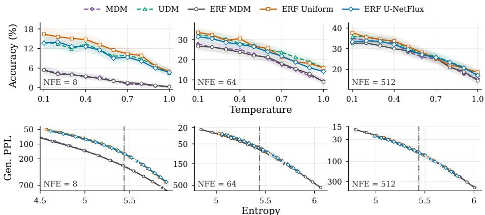  
Figure 2: Sampling quality at matched NFE on TinyGSM (top) and OpenWebText (bottom). Dashed curves denote ancestral samplers; solid curves denote ERF. TinyGSM bands are 95% bootstrap intervals over questions. OWT curves trace the generative perplexity versus 1-gram entropy frontier by sweeping the temperature in [0.8, 1.1]; ⋆ refers to temperature 1, and the vertical dash-dotted line marks the OWT dataset entropy.

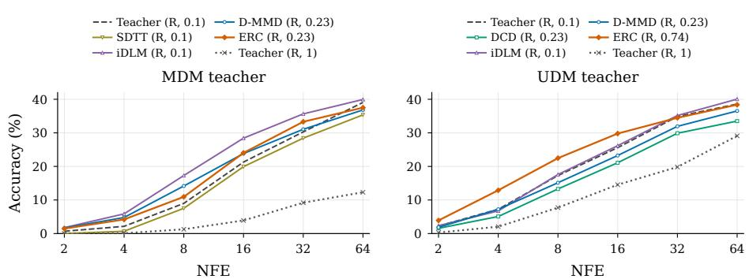  
Figure 3: TinyGSM distillation at 2–64 NFEs. Each curve fixes its sampler and temperature to maximize mean accuracy across NFEs on the same 1,024 questions. ERC selects δ = 1/64 for MDM and 1/8 for UDM. R refers to refresh sampling.

## 6.1 EVALUATION OF THE ERF SAMPLER

Sampling quality. Within each diffusion family, we compare ERF and ancestral sampling using the same pretrained checkpoint at matched NFE budgets. We use a uniform time grid and compute the ERF Uniform jump times in line 3 of Algorithm 1 using 40 bisection iterations per solve. Further evaluations appear in Appendix G.1. The results are given in Figure 2. ERF achieves sampling quality comparable to the ancestral MDM and UDM samplers across the evaluated datasets and NFE budgets. On TinyGSM, the samplers exhibit similar accuracy and temperature dependence; on OWT, their entropy–perplexity curves across temperatures largely overlap within each diffusion family.

The DiffusionGemma results support the same conclusion at a larger model scale (Table 1). At 48 NFEs and temperature 1, ERF Uniform and U-NetFlux are within 0.7 percentage points of the UDM ancestral sampler on MMLU-Pro questions. See Appendix H for experiment details.

Table 1: DiffusionGemma on 140 MMLU-Pro questions and three paired seeds. Brackets give 95% question-cluster bootstrap intervals.
<table><tr><td>Sampler</td><td>Accuracy (%)</td><td>s/question</td></tr><tr><td>Ancestral</td><td>57.4 [50.5, 64.3]</td><td>59.4</td></tr><tr><td>ERF Uniform</td><td>56.7 [49.8, 63.6]</td><td>61.1</td></tr><tr><td>ERF U-NetFlux</td><td>57.1 [50.2, 64.0]</td><td>60.4</td></tr></table>

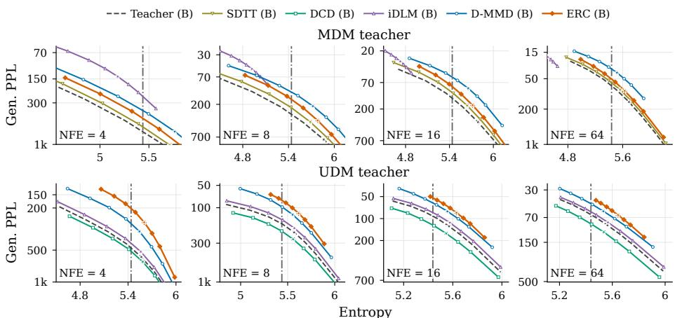  
Figure 4: OWT distillation with bridge sampling at 4, 8, 16, and 64 NFEs, with students trained for 100 GPU-hours. Each point uses 2,048 samples, with temperature applied to denoiser probabilities over [0.8, 1.2]; ⋆ marks temperature 1, and the vertical dash-dotted line marks the OWT dataset entropy. B refers to bridge sampling.

ERF Uniform vs U-NetFlux. The U-NetFlux version is the more efficient ERF sampler for uniform diffusion because we can solve explicitly for the crossing time in line 3 without bisection; see Appendix D. Furthermore, it makes substantially fewer jumps and thus requires fewer solves. At 8 NFEs, trajectories average approximately one jump per generated position, compared with seven for Uniform, yielding speedups of 2.83 on TinyGSM and 2.00 on OWT (Table 2). This gain comes while maintaining similar sampling quality in Figure 2. We also evaluate ERF Uniform with a cap on jumps within the interval $[ s _ { i } , t _ { i } ]$ ; Figures 10 and 11 show its effect on sampling quality.

Table 2: Runtime and jump averages at 8 NFEs over three batches; times are seconds per sequence and jumps are per generated po sition.
<table><tr><td>Sampler</td><td>Time (s)</td><td>Jumps</td></tr><tr><td>TinyGSM</td><td></td><td></td></tr><tr><td>Uniform</td><td>0.368</td><td>6.90</td></tr><tr><td>U-NetFlux</td><td>0.130</td><td>1.02</td></tr><tr><td>OWT</td><td></td><td></td></tr><tr><td>Uniform</td><td>0.647</td><td>7.11</td></tr><tr><td>U-NetFlux</td><td>0.323</td><td>1.04</td></tr></table>

## 6.2 DISTILLATION

Setting and baselines. We compare ERC with SDTT (Deschenaux & Gulcehre, 2025) for masked diffusion, DCD (Sahoo et al., 2025) for uniform diffusion, and D-MMD (Hoogeboom et al., 2026) and iDLM (Li et al., 2026) for both families. All results presented are from our own reimplementations and training runs, with all the students initialized from the corresponding pretrained teacher. Within each dataset and diffusion family, the methods share the same teacher checkpoint. For both MDM and UDM, the teacher models are trained using the standard ELBOs; Sahoo et al. (2024, Equation 11) and Schiff et al. (2024, Equation 19). In particular, for UDM our pre-trained model is a LOO denoiser. All the implementation details are given in Appendices E.5 and E.6.

Training. ERC conditions the student on Gumbel variables log E through a learned projection; UDM ERC uses net-flux ERF rates. On both datasets we run all the methods with the same GPU-hour budget (100 for OWT and 50 for TinyGSM) and batch size 128. ERC uses four equal training rounds and the joint target-and-teacher refresh in Algorithm 5. We sweep $\delta \in \{ 1 \dot { / } 8 , 1 / 1 6 , 1 \check { / } 3 2 , 1 / 6 4 \}$ and select one value per dataset and diffusion family using the evaluation criteria below. ERC uses forward KL on OWT and reverse KL on TinyGSM. For UDM, we apply the LOO-to-denoiser conversion formula to the student output before computing the loss (32). This gave improved results on all our experiments. Appendix G.5 gives the training and evaluation details. We disable the top-p truncation used by D-MMD (Hoogeboom et al., 2026) and fix the shared teacher’s temperature to 1, so that all methods distill the same teacher distribution.

Sampling protocol. We evaluate all methods and the teacher with both refresh and bridge sampling at matched NFE, sweeping a common temperature grid to account for differences in logit sharpness across objectives. On TinyGSM, we select one sampler, temperature placement and temperature per method, together with one ERC gap δ, and hold these choices fixed along each curve. On OWT, the main figure compares generative perplexity–entropy curves (Pynadath et al., 2026). In the TinyGSM legend, B and R denote bridge and refresh sampling; the number gives the selected inference temperature. The OWT legend marks every method with B to indicate bridge sampling.

Results. On TinyGSM, UDM ERC doubles the accuracy of the strongest competing baseline at 2 and 4 NFEs and also records higher accuracy at 8 and 16; by 32 NFEs its accuracy is close to the teacher’s. In this evaluation, it is the only method with accuracy above the teacher at some NFE budgets when fully sweeping temperature and samplers (even for the teacher). For MDM, ERC approximately matches the second-best baseline, see Figure 3. On OWT we see the same trend, UDM ERC has lower perplexity at matched entropy than the other baselines on the full frontier, while MDM ERC approximately matches the second-best baseline, see Figure 4. On Sudoku, ERC gives modest but consistent gains over the other methods in many evaluated settings. The complete sampler comparisons and Sudoku results appear in Appendices G.6 and G.9. Across these comparisons, the largest ERC gains occur with uniform diffusion, while masked-diffusion results remain competetitive with the considered baselines.

Ablations. We vary how the target and ERF transport (providing $X _ { s }$ starting from $X _ { t }$ in (16)) are updated, the training gap δ, the inference sampler, and whether ERC receives Gumbel inputs. For UDM, we also compare two placements of sampling temperature. The protocols and complete grids appear in Appendices G.7 to G.10.

## 7 CONCLUSION

In this work, we show that the prescribed marginals of a discrete diffusion can be transported by deterministic dynamics once the token state is augmented with continuous residuals. This construction generalizes Gillespie’s algorithm by recycling the exponential variables drawn at every jump according to an appropriate ODE. This gives a pathwise target for consistency distillation. In practice, leave-one-out freezing retains the analytically known time dependence of the rates and is exact for factorized data. Across the evaluated tasks, ERF achieves sampling quality comparable to ancestral updates at matched model evaluations, and its consistency objective yields its clearest few-step gains for uniform diffusion.

## AI USE STATEMENT

A generative AI assistant was used to support literature searches, discuss mathematical expressions and experimental results, and assist with manuscript drafting, editing, and LAT<sub>E</sub>X preparation. The authors take responsibility for all claims, citations, derivations, reported results, and the final content of the paper.

## ACKNOWLEDGMENTS

We thank Patrick Pynadath and Jawad Chemaou for their useful comments on the presentation of this paper.

AD received funding from the Fondation de l’Ecole polytechnique through its Servir la science cam-<sup>´</sup> paign. AD is supported by the France 2030 program under reference ANR-25-PEIA-0001 (THEO-REM project). AD is funded by the European Union (ERC-2022-SYG-OCEAN-101071601). AD is supported by Hi! Paris and the Agence Nationale de la Recherche (Grant 11-LABX-0047). This work received government funding administered by the National Research Agency (ANR) under the France 2030 program Hi! PARIS, grant number ANR-23-IACL-0005.

## REFERENCES

David F. Anderson. A modified Next Reaction Method for simulating chemical systems with time dependent propensities and delays. The Journal of Chemical Physics, 127(21):214107, 2007. doi: 10.1063/1.2799998.

Jacob Austin, Daniel D Johnson, Jonathan Ho, Daniel Tarlow, and Rianne Van Den Berg. Structured denoising diffusion models in discrete state-spaces. Advances in neural information processing systems, 34:17981–17993, 2021.

Andrew Campbell, Joe Benton, Valentin De Bortoli, Thomas Rainforth, George Deligiannidis, and Arnaud Doucet. A continuous time framework for discrete denoising models. Advances in Neural Information Processing Systems, 35:28266–28279, 2022.

Andrew Campbell, Jason Yim, Regina Barzilay, Tom Rainforth, and Tommi Jaakkola. Generative flows on discrete state-spaces: Enabling multimodal flows with applications to protein co-design, 2024. URL https://arxiv.org/abs/2402.04997.

Karl Cobbe, Vineet Kosaraju, Mohammad Bavarian, Mark Chen, Heewoo Jun, Lukasz Kaiser, Matthias Plappert, Jerry Tworek, Jacob Hilton, Reiichiro Nakano, Christopher Hesse, and John Schulman. Training verifiers to solve math word problems, 2021. URL https://arxiv. org/abs/2110.14168.

Giovanni Conforti, Alain Durmus, Le-Tuyet-Nhi Pham, and Gael Raoul. Non-asymptotic convergence of discrete diffusion models: Masked and random walk dynamics. arXiv preprint arXiv:2512.00580, 2025.

Justin Deschenaux and Caglar Gulcehre. Beyond autoregression: Fast LLMs via self-distillation through time. In International Conference on Learning Representations, 2025. URL https: //openreview.net/forum?id=uZ5K4HeNwd.

Alain Durmus, Arnaud Guillin, and Pierre Monmarche. Piecewise deterministic markov processes´ and their invariant measures, 2021. URL https://arxiv.org/abs/1807.05421.

Luca Eyring, Vincent Pauline, Stefan Bauer, Alexey Dosovitskiy, and Zeynep Akata. Ddno: Discrete diffusion noise optimization. 2026.

Eugene A. Feinberg, Manasa Mandava, and Albert N. Shiryaev. On solutions of kolmogorov’s equations for jump markov processes, 2013. URL https://arxiv.org/abs/1301.6998.

Willy Feller. On the integro-differential equations of purely discontinuous markoff processes. Transactions ofthe American Mathematical Society, 48(3):488–515, 1940.

Itai Gat, Tal Remez, Neta Shaul, Felix Kreuk, Ricky T. Q. Chen, Gabriel Synnaeve, Yossi Adi, and Yaron Lipman. Discrete flow matching. In Advances in Neural Information Processing Systems, volume 37, 2024. doi: 10.52202/079017-4239. URL https://proceedings.neurips.cc/paper\_files/paper/2024/hash/ f0d629a734b56a642701bba7bc8bb3ed-Abstract-Conference.html.

Michael A. Gibson and Jehoshua Bruck. Efficient exact stochastic simulation of chemical systems with many species and many channels. The Journal ofPhysical Chemistry A, 104(9):1876–1889, 2000. doi: 10.1021/jp993732q.

Daniel T Gillespie. Exact stochastic simulation of coupled chemical reactions. The journal of physical chemistry, 81(25):2340–2361, 1977.

Daniel T Gillespie. Approximate accelerated stochastic simulation of chemically reacting systems. The Journal ofchemical physics, 115(4):1716–1733, 2001.

Aaron Gokaslan and Vanya Cohen. Openwebtext corpus. http://Skylion007.github.io/ OpenWebTextCorpus, 2019.

Google DeepMind. DiffusionGemma. https://deepmind.google/models/gemma/ diffusiongemma/, June 2026. Accessed: 2026-06-10.

Samson Gourevitch, Yazid Janati, Dario Shariatian, Umut Simsekli, Eric Moulines, Eric P. Xing, and Alain Durmus. Uniform diffusion models revisited: Leave-one-out denoiser and absorbing state reformulation, 2026. URL https://arxiv.org/abs/2605.22765.

Emiel Hoogeboom, Didrik Nielsen, Priyank Jaini, Patrick Forre, and Max Welling. Argmax flows: ´ Learning categorical distributions with normalizing flows. In Third Symposium on Advances in Approximate Bayesian Inference, 2021.

Emiel Hoogeboom, David Ruhe, Jonathan Heek, Thomas Mensink, and Tim Salimans. Beyond single tokens: Distilling discrete diffusion models via discrete MMD, 2026. URL https:// arxiv.org/abs/2603.20155.

David Li, Nikita Gushchin, Dmitry Abulkhanov, Eric Moulines, Ivan Oseledets, Maxim Panov, and Alexander Korotin. Idlm: Inverse-distilled diffusion language models, 2026. URL https: //arxiv.org/abs/2602.19066.

Bingbin Liu, Sebastien Bubeck, Ronen Eldan, Janardhan Kulkarni, Yuanzhi Li, Anh Nguyen, Rachel Ward, and Yi Zhang. TinyGSM: achieving ¿80% on GSM8K with small language models, 2023. URL https://arxiv.org/abs/2312.09241.

Aaron Lou, Chenlin Meng, and Stefano Ermon. Discrete diffusion modeling by estimating the ratios of the data distribution. In Proceedings of the 41st International Conference on Machine Learning, volume 235 of Proceedings of Machine Learning Research, pp. 32819–32848. PMLR, 2024. URL https://proceedings.mlr.press/v235/lou24a.html.

Patrick Pynadath, Jiaxin Shi, and Ruqi Zhang. Generative frontiers: Why evaluation matters for diffusion language models, 2026. URL https://arxiv.org/abs/2604.02718.

Alec Radford, Jeffrey Wu, Rewon Child, David Luan, Dario Amodei, Ilya Sutskever, et al. Language models are unsupervised multitask learners. OpenAI blog, 1(8):9, 2019.

Subham Sahoo, Marianne Arriola, Yair Schiff, Aaron Gokaslan, Edgar Marroquin, Justin Chiu, Alexander Rush, and Volodymyr Kuleshov. Simple and effective masked diffusion language models. Advances in Neural Information Processing Systems, 37:130136–130184, 2024.

Subham Sekhar Sahoo, Justin Deschenaux, Aaron Gokaslan, Guanghan Wang, Justin Chiu, and Volodymyr Kuleshov. The diffusion duality. arXiv preprint arXiv:2506.10892, 2025.

Tim Salimans and Jonathan Ho. Progressive distillation for fast sampling of diffusion models. In International Conference on Learning Representations, 2022. URL https://openreview. net/forum?id=TIdIXIpzhoI.

Yair Schiff, Subham Sekhar Sahoo, Hao Phung, Guanghan Wang, Sam Boshar, Hugo Dalla-torre, Bernardo P de Almeida, Alexander Rush, Thomas Pierrot, and Volodymyr Kuleshov. Simple guidance mechanisms for discrete diffusion models. arXiv preprint arXiv:2412.10193, 2024.

Jiaxin Shi, Kehang Han, Zhe Wang, Arnaud Doucet, and Michalis Titsias. Simplified and general ized masked diffusion for discrete data. Advances in neural information processing systems, 37: 103131–103167, 2024.

Jiaming Song, Chenlin Meng, and Stefano Ermon. Denoising diffusion implicit models. In International Conference on Learning Representations, 2021a. URL https://openreview.net/ forum?id=St1giarCHLP.

Yang Song, Jascha Sohl-Dickstein, Diederik P Kingma, Abhishek Kumar, Stefano Ermon, and Ben Poole. Score-based generative modeling through stochastic differential equations. In International Conference on Learning Representations, 2021b.

Yang Song, Prafulla Dhariwal, Mark Chen, and Ilya Sutskever. Consistency models. In Andreas Krause, Emma Brunskill, Kyunghyun Cho, Barbara Engelhardt, Sivan Sabato, and Jonathan Scar lett (eds.), Proceedings of the 40th International Conference on Machine Learning, volume 202 of Proceedings ofMachine Learning Research, pp. 32211–32252. PMLR, 23–29 Jul 2023. URL https://proceedings.mlr.press/v202/song23a.html.

Haoran Sun, Lijun Yu, Bo Dai, Dale Schuurmans, and Hanjun Dai. Score-based continuous-time discrete diffusion models. In The Eleventh International Conference on Learning Representations, 2023. URL https://openreview.net/forum?id=BYWWwSY2G5s.

Yubo Wang, Xueguang Ma, Ge Zhang, Yuansheng Ni, Abhranil Chandra, Shiguang Guo, Weiming Ren, Aaran Arulraj, Xuan He, Ziyan Jiang, et al. Mmlu-pro: A more robust and challenging multitask language understanding benchmark. Advances in Neural Information Processing Systems, 37:95266–95290, 2024.

Tianwei Yin, Michael Gharbi, Richard Zhang, Eli Shechtman, Fredo Durand, William T Freeman,¨ and Taesung Park. One-step diffusion with distribution matching distillation. arXiv preprint arXiv:2311.18828, 2023.

Chi Zhang, Xixi Hu, Bo Liu, and Qiang Liu. Gumbel distillation for parallel text generation, 2026. URL https://arxiv.org/abs/2603.22216.

Pengze Zhang, Hubery Yin, Chen Li, and Xiaohua Xie. Formulating discrete probability flow through optimal transport, 2023. URL https://arxiv.org/abs/2311.03886.

## APPENDIX CONTENTS

A Rates and jump times used in the discretization 16   
A.1 Parallel ERF sampling 17   
B Bridge and simplex extension 17   
C CTMC integration schemes 18   
C.1 Formal construction of the exact simulation algorithms 18   
C.1.1 Gillespie’s first reaction form . 18   
C.1.2 The ERF sampler 19   
C.1.3 Gillespie’s global form 19   
C.2 Gillespie discretization with partially frozen rates 20   
C.3 Equivalence of leave-one-out-frozen Gillespie and ancestral sampling 21   
C.4 Euler and categorical tau-leaping 21   
C.5 Explicit partially frozen updates for MDM and UDM 22   
C.5.1 From integrated rates to jump updates 23   
C.5.2 Exactness of leave-one-out freezing under factorization . 23   
C.5.3 A counterexample for score freezing 24   
C.5.4 Why the explosion cannot occur with leave-one-out freezing 25   
D Net-flux rate matrix 25   
D.1 Net flux construction and relation to prior work 25   
D.2 Forward net-flux rates and passive residuals 26   
D.3 Score and denoising-posterior freezing for UDM net flux 26   
E Additional material for distillation 27   
E.1 Consistency distillation training 27   
E.2 Multi-step sampling . 30   
E.3 Bridge sampling and the ERF coupling . 30   
E.4 D-MMD 30   
E.5 DCD 31   
E.6 iDLM 32   
F Experimental details 32   
F.1 Sudoku 32   
G Additional experiments 34   
G.1 Sampling quality across NFE budgets 34   
G.2 Euler and categorical tau-leaping 36   
G.3 Uniform substeps 38   
G.4 Runtime and jump-count protocol 41   
G.5 Distillation evaluation . 42   
G.6 Sudoku distillation 43   
G.7 Target and teacher updates 43   
G.8 Consistency gap . . 47   
G.9 Bridge and refresh sampling 50   
G.10 Gumbel conditioning 58   
H DiffusionGemma experiment 59   
Proofs for the ERF sampler 59   
I.1 Intuition on the ODEs (9) . 59   
I.2 Setting . 60   
I.2.1 Notation and assumptions 60   
I.2.2 ERF sampler revisited 61   
I.3 Main result 62   
I.4 Preliminaries 62   
I.5 Change of variables . 66   
I.6 Induction on the number of jumps 70   
I.7 Bounds on the partial sums and number of jumps 72   
I.8 Proof of Theorem I.1 74   
I.9 Last-jump distribution 75

## A RATES AND JUMP TIMES USED IN THE DISCRETIZATION

Fix $[ s , t ] \ = \ [ s _ { i } , t _ { i } ]$ and condition on $X _ { t _ { i } } ~ = ~ x$ . The leave-one-out denoiser $\hat { x } _ { 0 } ^ { \theta } ( x , t _ { i } )$ is cached throughout the step. Let z be the current state at time $r \in [ s , t ]$ , and let $u \in [ s , \bar { r } ]$ be a candidate jump time. An active residual $E _ { r } ^ { \ell j }$ crosses zero when the integrated reverse rate from u to r equals

$E _ { r } ^ { \ell j }$ ; passive residuals increase by the integrated forward exit rate. More general freezing schemes and the derivations are given in Appendices C.5 and D.

For MDM, only $z ^ { \ell } = \mathsf { m }$ can jump, and then only to $j \neq \mathsf { m }$ . The integrals needed for active and passive residuals are

$$
\begin{array} { r l } & { \displaystyle \int _ { u } ^ { r } \bar { Q } _ { v } ^ { \theta , \ell } ( j ; t _ { i } | z ) \mathrm { d } v = \hat { x } _ { 0 } ^ { \theta } ( x , t _ { i } ) ^ { \ell j } \log \left( \frac { 1 - \alpha _ { r } } { 1 - \alpha _ { u } } \right) \qquad ( z ^ { \ell } = \mathsf { m } ) , } \\ & { \qquad \displaystyle \int _ { u } ^ { r } \lambda _ { v } ^ { \ell } ( z ^ { \ell } ) \mathrm { d } v = \mathbb { 1 } _ { z ^ { \ell } \neq \mathsf { m } } \log \left( \frac { \alpha _ { u } } { \alpha _ { r } } \right) . } \end{array}
$$

If $\hat { x } _ { 0 } ^ { \theta } ( x , t _ { i } ) ^ { \ell j } > 0$ and $E _ { r } ^ { \ell j } \leq \hat { x } _ { 0 } ^ { \theta } ( x , t _ { i } ) ^ { \ell j } \log ( ( 1 - \alpha _ { r } ) / ( 1 - \alpha _ { s } ) )$ , the candidate time for a masked position is

$$
T ^ { \ell j } = \alpha ^ { - 1 } \bigg ( 1 - ( 1 - \alpha _ { r } ) \exp \Biggl \{ - \frac { E _ { r } ^ { \ell j } } { \hat { x } _ { 0 } ^ { \theta } ( x , t _ { i } ) ^ { \ell j } } \Biggr \} \bigg ) ,
$$

and $T ^ { \ell j } = - \infty$ otherwise. In particular, no further active jump is possible at an unmasked position.   
Net flux does not change the MDM rates.

For UDM with net flux and $j \neq z ^ { \ell }$ , the active and passive integrals are

$$
\begin{array} { r l r } {  { \int _ { u } ^ { r } \bar { Q } _ { v } ^ { \mathrm { N F } , \theta , \ell } ( \boldsymbol { j } ; t _ { i } | z ) \mathrm { d } v = \frac { [ \hat { x } _ { 0 } ^ { \theta } ( { x } , t _ { i } ) ^ { \ell } \boldsymbol { j } - \hat { x } _ { 0 } ^ { \theta } ( { x } , t _ { i } ) ^ { \ell \varepsilon } ] _ { + } } { K \hat { x } _ { 0 } ^ { \theta } ( { x } , t _ { i } ) \varepsilon ^ { \varepsilon } - 1 } } } \\ & { } & { \times \log ( \frac { 1 + ( K \hat { x } _ { 0 } ^ { \theta } ( { x } , t _ { i } ) ^ { \ell \varepsilon ^ { \ell } } - 1 ) \alpha _ { u } } { 1 + ( K \hat { x } _ { 0 } ^ { \theta } ( { x } , t _ { i } ) ^ { \ell \varepsilon ^ { \ell } } - 1 ) \alpha _ { r } } ) , } \\ & { } & { \int _ { u } ^ { r } b _ { v } ^ { \mathrm { N F } , \ell } ( z ) \mathrm { d } v = \frac { \sum _ { \boldsymbol { j } \in \mathrm { V } \backslash \{ \hat { x } _ { 0 } ^ { \theta } ( { x } , t _ { i } ) ^ { \ell \varepsilon } - \hat { x } _ { 0 } ^ { \theta } ( { x } , t _ { i } ) ^ { \ell \varepsilon } \} _ { + } } } { K \hat { x } _ { 0 } ^ { \theta } ( { x } , t _ { i } ) \varepsilon ^ { \varepsilon \varepsilon } - 1 } } \\ & { } & { \times \log ( \frac { 1 + ( K \hat { x } _ { 0 } ^ { \theta } ( { x } , t _ { i } ) ^ { \ell \varepsilon ^ { \varepsilon } } - 1 ) \alpha _ { u } } { 1 + ( K \hat { x } _ { 0 } ^ { \theta } ( { x } , t _ { i } ) ^ { \ell \varepsilon ^ { \varepsilon } } - 1 ) \alpha _ { r } } ) . } \end{array}
$$

Here $b _ { v } ^ { \mathrm { N F } , \ell } ( z )$ is the forward net-flux exit rate at position ℓ. When $K \hat { x } _ { 0 } ^ { \theta } ( x , t _ { i } ) ^ { \ell z ^ { \ell } } = 1$ , each logarithmic quotient divided by $K \hat { x } _ { 0 } ^ { \theta } ( x , t _ { i } ) ^ { \ell z ^ { \ell } } - 1$ is understood as $\alpha _ { u } - \alpha _ { r }$ . If $\hat { x } _ { 0 } ^ { \theta } ( x , t _ { i } ) ^ { \ell j } > \hat { x } _ { 0 } ^ { \theta } ( x , t _ { i } ) ^ { \ell z ^ { \ell } }$ and the active integral at $u = s$ is at least $E _ { r } ^ { \ell j }$ , its candidate time is

$$
T ^ { \ell j } = \alpha ^ { - 1 } \left( \frac { \left( 1 + ( K \hat { x } _ { 0 } ^ { \theta } ( x , t _ { i } ) ^ { \ell z ^ { \ell } } - 1 ) \alpha _ { r } \right) \exp \left\{ \frac { ( K \hat { x } _ { 0 } ^ { \theta } ( x , t _ { i } ) ^ { \ell z ^ { \ell } } - 1 ) E _ { r } ^ { \ell j } } { \hat { x } _ { 0 } ^ { \theta } ( x , t _ { i } ) ^ { \ell j } - \hat { x } _ { 0 } ^ { \theta } ( x , t _ { i } ) ^ { \ell z ^ { \ell } } } \right\} - 1 } { K \hat { x } _ { 0 } ^ { \theta } ( x , t _ { i } ) ^ { \ell z ^ { \ell } } - 1 } \right) .
$$

For $K \hat { x } _ { 0 } ^ { \theta } ( x , t _ { i } ) ^ { \ell z ^ { \ell } } = 1$ , this becomes $T ^ { \ell j } = \alpha ^ { - 1 } ( \alpha _ { r } + E _ { r } ^ { \ell j } / ( \hat { x } _ { 0 } ^ { \theta } ( x , t _ { i } ) ^ { \ell j } - \hat { x } _ { 0 } ^ { \theta } ( x , t _ { i } ) ^ { \ell z ^ { \ell } } ) )$ . When the stated conditions for a candidate jump fail, set $\dot { T } ^ { \ell j } = - \dot { \infty }$ . The largest candidate time gives the next jump. After updating z, the residual integrals are recomputed with the same cached denoiser.

## A.1 PARALLEL ERF SAMPLING

Algorithm 2 applies the leave-one-out-frozen rates above independently at each position on each grid interval. In the algorithm, $\bar { Q } _ { r } ^ { \ell } ( j ; t _ { i } | X _ { s _ { i } } )$ denotes the chosen frozen reverse rate, and $b _ { r } ^ { \ell } ( X _ { s _ { i } } )$ denotes its forward exit rate: $\lambda _ { r } ^ { \ell } ( \dot { X } _ { s _ { i } } ^ { \ell } )$ for MDM and UDM, or $b _ { r } ^ { \mathrm { N F } , \ell } ( X _ { s _ { i } } )$ for Uniform Net Flux. We take the supremum of an empty set to be $- \infty$ . The jump-time variables inside the parallel loop are local to each position; the cached denoiser is shared across positions.

## B BRIDGE AND SIMPLEX EXTENSION

For $0 \leq s < t \leq 1$ with $\alpha _ { s } ~ > ~ 0$ , conditional independence across positions gives $\begin{array} { r } { q _ { s | 0 , t } ( x _ { s } | x _ { 0 } , x _ { t } ) = \prod _ { \ell = 1 } ^ { L } q _ { s | 0 , t } ^ { \ell } ( x _ { s } ^ { \ell } | x _ { 0 } ^ { \ell } , x _ { t } ^ { \ell } ) } \end{array}$ . For $x _ { 0 } , x _ { t } \in \mathsf { X }$ and a position ℓ such that $q _ { t | 0 } ^ { \ell } ( x _ { t } ^ { \ell } | x _ { 0 } ^ { \overline { { \ell } } } ) >$

Algorithm 2 Parallel ERF sampling with leave-one-out-frozen rates   
Require: Grid $0 = t _ { 0 } < \cdot \cdot \cdot < t _ { n } = 1$ and leave-one-out-frozen reverse and forward rates   
1: Draw $X _ { 1 } \sim p _ { 1 }$ and, independently, $E _ { 1 } ^ { \ell j } \stackrel { \mathrm { i . i . d . } } { \sim } \exp ( 1 )$ for all $( \ell , j )$   
2: for $i = n , \ldots , 1$ do   
3: Cache $\hat { x } _ { 0 } ^ { \theta } ( X _ { t _ { i } } , t _ { i } )$ and define the frozen rates on $[ s _ { i } , t _ { i } ]$   
4: $( X _ { s _ { i } } , E _ { s _ { i } } ^ { \setminus } )  ( X _ { t _ { i } } , E _ { t _ { i } } )$   
5: for all $\ell \doteq [ [ 1 , \dot { L } ] ]$ in parallel do   
6: $\tau ^ { \star }  t _ { i } ^ { \top }$   
7: while $\tau ^ { \star } > s _ { i }$ do   
8: $\begin{array} { r } { \tau ^ { \ell j }  \operatorname* { s u p } \{ u \in [ s _ { i } , \tau ^ { \star } ] : \int _ { u } ^ { \tau ^ { \star } } \bar { Q } _ { r } ^ { \ell } ( j ; t _ { i } | X _ { s _ { i } } ) \mathrm { d } r \geq E _ { s _ { i } } ^ { \ell j } \} \mathrm { f o r } j \neq X _ { s _ { i } } ^ { \ell } } \end{array}$   
9: $j ^ { \star } \gets \mathrm { a r g m a x } _ { j \neq X _ { s _ { i } } ^ { \ell } } \tau ^ { \ell j }$   
10: $\tau _ { \mathrm { n e w } } ^ { \star }  \operatorname* { m a x } \{ s _ { i } , \tau ^ { \bar { \ell } j ^ { \star } } \}$   
11: $\begin{array} { r } { E _ { s _ { i } } ^ { \ell j } \gets E _ { s _ { i } } ^ { \ell j } - \int _ { \tau _ { \mathrm { n e w } } ^ { \star } } ^ { \tau ^ { \star } } \bar { Q } _ { r } ^ { \ell } ( j ; t _ { i } | X _ { s _ { i } } ) } \end{array}$ dr for $j \neq X _ { s _ { i } } ^ { \ell }$   
12: $\begin{array} { r } { E _ { s _ { i } } ^ { \ell j }  E _ { s _ { i } } ^ { \ell j } + \int _ { \tau _ { \mathrm { n e w } } ^ { \star } } ^ { \tau ^ { \star } } b _ { r } ^ { \ell } ( X _ { s _ { i } } ) } \end{array}$ dr for $j = X _ { s _ { i } } ^ { \ell }$   
13: $\mathbf { i f } \tau ^ { \ell j ^ { \star } } \geq s _ { i }$ then   
14: $X _ { s _ { i } } ^ { \ell } \gets j ^ { \star }$   
15: end if   
16: $\tau ^ { \star }  \tau _ { \mathrm { n e w } } ^ { \star }$   
17: end while   
18: end for   
19: end for   
20: return $X _ { 0 } , E _ { 0 }$

0, Bayes’ rule yields

$$
\mathcal { Q } _ { s | 0 , t } ^ { \ell } ( \cdot | x _ { 0 } ^ { \ell } , x _ { t } ^ { \ell } ) = \mathrm { C a t } \Bigg ( \cdot ; \frac { \left[ \alpha _ { t | s } \tilde { x } _ { t } ^ { \ell } + ( 1 - \alpha _ { t | s } ) \langle \tilde { x } _ { t } ^ { \ell } , \pi ^ { \ell } \rangle \mathbf { 1 } _ { K } \right] \odot \left[ \alpha _ { s } \tilde { x } _ { 0 } ^ { \ell } + ( 1 - \alpha _ { s } ) \pi ^ { \ell } \right] } { \alpha _ { t } \langle \tilde { x } _ { t } ^ { \ell } , \tilde { x } _ { 0 } ^ { \ell } \rangle + ( 1 - \alpha _ { t } ) \langle \tilde { x } _ { t } ^ { \ell } , \pi ^ { \ell } \rangle } \Bigg )\tag{17}
$$

where $\tilde { x } _ { 0 } ^ { \ell } ~ = ~ \tilde { x } _ { 0 } ^ { \ell }$ and $\tilde { x } _ { t } ^ { \ell } \ = \ \tilde { x } _ { t } ^ { \ell } .$ For $\nu ~ \in ~ \Delta _ { K }$ , we extend this expression by replacing $x _ { 0 } ^ { \ell }$ with $\nu ,$ equivalently setting ${ q _ { s | 0 , t } ^ { \ell } ( x _ { s } ^ { \ell } | \nu , x _ { t } ^ { \ell } ) = q _ { t | s } ^ { \ell } ( x _ { t } ^ { \ell } | x _ { s } ^ { \ell } ) q _ { s | 0 } ^ { \ell } ( x _ { s } ^ { \ell } | \nu ) / q _ { t | 0 } ^ { \ell } ( x _ { t } ^ { \ell } | \nu ) } $ , where $\bar { q } _ { r | 0 } ^ { \ell } ( \cdot | \bar { \nu } ) \stackrel { \smile } { = }$ $\mathrm { C a t } ( \cdot ; \alpha _ { r } \dot { \nu } + ( 1 - \dot { \alpha } _ { r } ) \pi ^ { \ell } ) \nonumber$ The numerator in (17) has nonnegative entries whose sum is the denominator, since $\alpha _ { t | s } \alpha _ { s } = \alpha _ { t }$ . Hence the extension is a probability vector whenever the denominator is positive. Completing zero-denominator rows by any probability vector and taking the positionwise product yields a stochastic reverse transition matrix on ${ \sf X } ;$ for masked diffusion, we use $\operatorname { C a t } ( \cdot ; \tilde { x } _ { t } ^ { \ell } )$ at unmasked positions. Following Gourevitch et al. (2026, Proposition 1), define $\hat { x } _ { 0 \mid t } ^ { \mathrm { l o o } } ( x _ { t } ) ^ { \acute { \ell } } : = \mathbb { E } [ \tilde { X } _ { 0 } ^ { \ell } \mid X _ { t } ^ { - \ell } = x _ { t } ^ { - \ell } ]$ . Conditioning first on $X _ { t } ^ { - \ell }$ and then on $X _ { t } ^ { \ell }$ gives, whenever $p _ { t } ( x _ { t } ) > 0 , p _ { s | t } ^ { \ell } ( x _ { s } ^ { \ell } | x _ { t } ) = q _ { s | 0 , t } ^ { \ell } ( x _ { s } ^ { \ell } | \hat { x } _ { 0 | t } ^ { \mathrm { l o o } } ( x _ { t } ) ^ { \ell } , x _ { t } ^ { \ell } )$ Thus substituting the leave-one-out denoiser into the simplex extension recovers the exact positionwise reverse conditionals, and their product gives the factorized approximation used in (3).

## C CTMC INTEGRATION SCHEMES

## C.1 FORMAL CONSTRUCTION OF THE EXACT SIMULATION ALGORITHMS

## C.1.1 GILLESPIE’S FIRST REACTION FORM

The Gillespie’s first reaction form (Gillespie, 2001), can be used to simulate $( X _ { u } ) _ { u \in [ s , t ] }$ backward in time from $X _ { t } \sim p _ { t }$ using the reverse rate matrix $( \bar { Q } _ { u } ) _ { u \in [ s , t ] }$ . We define sequentially the jump times $( T _ { k } ^ { \star } ) _ { k \leq N }$ and states $( X _ { T _ { k } ^ { \star } } ) _ { k \le N }$ up to a maximum (random) number of jumps $N _ { \infty }$ in the following way.

Initialization. Set $T _ { 0 } ^ { \star } = t , N _ { \infty } = \infty$ and draw independently $X _ { T _ { 0 } ^ { \star } } \sim p _ { t }$ , and for every $( \ell , j ) \in$ $\mathbb { I } 1 , L \mathbb { I } \times \mathbb { I } 1 , K \mathbb { I } , E _ { T _ { 0 } ^ { \star } } ^ { \ell j } \sim \mathrm { E x p } ( 1 )$

Induction. At stage $k \geq 0 .$ , given the current jump time $T _ { k } ^ { \star }$ state $X _ { T _ { k } ^ { \star } }$ and exponential clocks $E _ { T _ { k } ^ { \star } } ^ { \ell j }$ for every $( \ell , j ) \in [ [ 1 , L ] ] \times [ [ 1 , K ] ]$ , define

$$
T _ { k + 1 } ^ { \ell j } = \operatorname* { s u p } \left\{ u \in [ s , T _ { k } ^ { \star } ] : \int _ { u } ^ { T _ { k } ^ { \star } } \bar { Q } _ { r } ^ { \ell } ( j | X _ { T _ { k } ^ { \star } } ) \mathrm { d } r \geq E _ { T _ { k } ^ { \star } } ^ { \ell j } \right\} , \qquad ( \ell _ { k + 1 } ^ { \star } , j _ { k + 1 } ^ { \star } ) \in \operatorname* { a r g m a x } _ { ( \ell , j ) } ^ { T _ { k + 1 } ^ { \ell j } } .\tag{18}
$$

We use here the convention sup $\varnothing = - \infty$

If $T _ { k + 1 } ^ { \ell _ { k + 1 } ^ { \star } j _ { k + 1 } ^ { \star } } = - \infty .$ , the procedure stops, so we set $N _ { \infty } = k$ and $X _ { s } = X _ { T _ { k } ^ { \star } }$

Otherwise, the $( k + 1 )$ -st jump occurs at $T _ { k + 1 } ^ { \star } = T _ { k + 1 } ^ { \ell _ { k + 1 } ^ { \star } j _ { k + 1 } ^ { \star } }$ . We set $X _ { T _ { k + 1 } ^ { \star } } ^ { \ell _ { k + 1 } ^ { \star } } = j _ { k + 1 } ^ { \star }$ and leave all other positions unchanged. For every $( \ell , j )$ such that $X _ { T _ { k } ^ { \star } } ^ { \ell } \neq j$ , set

$$
E _ { T _ { k + 1 } ^ { \star } } ^ { \ell j } = E _ { T _ { k } ^ { \star } } ^ { \ell j } - \int _ { T _ { k + 1 } ^ { \star } } ^ { T _ { k } ^ { \star } } \bar { Q } _ { r } ^ { \ell } ( j | X _ { T _ { k } ^ { \star } } ) \mathrm { d } r \geq 0 .
$$

Finally, draw $E _ { T _ { k + 1 } ^ { \star } } ^ { \ell _ { k + 1 } ^ { \star } j _ { k + 1 } ^ { \star } } \sim \mathrm { E x p } ( 1 )$ independently of the past.

The recursion continues until no candidate event occurs before s. Under appropriate conditions, (see the discussion in Feinberg et al. (2013)), N is almost surely finite and the algorithm produces a trajectory $( X _ { u } ) _ { u \in [ s , t ] }$ whose law is that of the reverse CTMC conditioned on $X _ { t } = x$

## C.1.2 THE ERF SAMPLER

The ERF augments $X _ { u }$ with one nonnegative residual $E _ { u } ^ { \ell j }$ for each position ℓ and token j. We construct $( \bar { X _ { u } } , E _ { u } ) _ { u \in [ s , t ] }$ as follows.

Initialization. Set $T _ { 0 } ^ { \star } = t ,$ , draw $X _ { T _ { 0 } ^ { \star } } \sim p _ { t }$ , and draw $E _ { T _ { 0 } ^ { \star } } ^ { \ell j } \stackrel { \mathrm { i . i . d . } } { \sim } \mathrm { E x p } ( 1 )$ for all $( \ell , j ) \in \left[ \left[ 1 , L \right] \right] \times$ $[ [ 1 , K ] ]$ , independently of $X _ { T _ { 0 } ^ { \star } }$

Induction. At stage $k \geq 0 ,$ given $( T _ { k } ^ { \star } , X _ { T _ { k } ^ { \star } } , E _ { T _ { k } ^ { \star } } )$ , write $z = X _ { T _ { k } ^ { \star } }$ . For each $j \neq z ^ { \ell }$ , define the candidate time

$$
T _ { k + 1 } ^ { \ell j } = \operatorname* { s u p } \left\{ u \in [ s , T _ { k } ^ { \star } ] : \int _ { u } ^ { T _ { k } ^ { \star } } \bar { Q } _ { r } ^ { \ell } ( j | z ) \mathrm { d } r \geq E _ { T _ { k } ^ { \star } } ^ { \ell j } \right\} , \qquad ( \ell _ { k + 1 } ^ { \star } , j _ { k + 1 } ^ { \star } ) \in \underset { ( \ell , j ) : j \neq z ^ { \ell } } { \operatorname { a r g m a x } } T _ { k + 1 } ^ { \ell j } .\tag{19}
$$

Set $T _ { k + 1 } ^ { \star } = T _ { k + 1 } ^ { \ell _ { k + 1 } ^ { \star } j _ { k + 1 } ^ { \star } }$

$\operatorname { I f } T _ { k + 1 } ^ { \star } = - \infty$ , the procedure stops. Set $N = k$ , keep $X _ { v } = z { \mathrm { ~ f o r ~ } } v \in [ s , T _ { k } ^ { \star } ]$ , and update the residuals on this interval by (20).

Otherwise, keep $X _ { v } = z$ for $v \in ( T _ { k + 1 } ^ { \star } , T _ { k } ^ { \star } ]$ and, for every $v \in [ T _ { k + 1 } ^ { \star } , T _ { k } ^ { \star } ]$ ], evolve all residuals by

$$
E _ { v } ^ { \ell j } = E _ { T _ { k } ^ { \star } } ^ { \ell j } + \left\{ \begin{array} { l l } { - \displaystyle \int _ { v } ^ { T _ { k } ^ { \star } } \bar { Q } _ { r } ^ { \ell } ( j | z ) \mathrm { d } r , } & { j \neq z ^ { \ell } , } \\ { \displaystyle \int _ { v } ^ { T _ { k } ^ { \star } } \lambda _ { r } ^ { \ell } ( z ^ { \ell } ) \mathrm { d } r , } & { j = z ^ { \ell } . } \end{array} \right.\tag{20}
$$

Set $X _ { T _ { k + 1 } ^ { \star } } ^ { \ell _ { k + 1 } ^ { \star } } = j _ { k + 1 } ^ { \star }$ and $X _ { T _ { k + 1 } ^ { \star } } ^ { m } = z ^ { m }$ for m $\not = \ell _ { k + 1 } ^ { \star }$

The recursion continues until no candidate event occurs before s.

## C.1.3 GILLESPIE’S GLOBAL FORM

The global form of Gillespie’s algorithm (Gillespie, 1977) uses one exponential clock per jump. As above, it constructs $( X _ { u } ) _ { u \in [ s , t ] }$ backward from $X _ { t } \sim p _ { t }$

Initialization. Set $T _ { 0 } ^ { \star } = t$ and draw $X _ { T _ { 0 } ^ { \star } } \sim p _ { t }$

```latex
Algorithm 3 Gillespie discretization with partially frozen reverse rates
Require: Grid $0 = t _ { 0 } < \cdot \cdot \cdot < t _ { n } = 1$ and a partial-freezing parameterization
1: Draw $X _ { 1 } \sim p _ { 1 }$
2: for $i = n , \ldots , 1$ do ▷ Discretize time
3: Set $r  t _ { i } , s  s _ { i } ,$ and $z  X _ { t _ { i } }$
4: Evaluate the learned component at $( t _ { i } , z )$ and define $\bar { Q } _ { \cdot } ^ { \theta } ( \cdot ; t _ { i } | \cdot )$ ▷ Approximate the rates
5: while $r > s$ do
6: Draw $E ^ { \ell j } \stackrel { \mathrm { i . i . d . } } { \sim }$ Exp(1) for every $( \ell , j )$ such that $j \neq z ^ { \ell }$
7: $\begin{array} { r } { T ^ { \ell j } \gets \operatorname* { s u p } \left\{ u \in [ s , r ] : \int _ { u } ^ { r } \bar { Q } _ { v } ^ { \theta , \ell } ( j ; t _ { i } | z ) \ \mathrm { d } v \geq E ^ { \ell j } \right\} } \end{array}$ ▷ Use the approximate rates
8: $( \widehat { \ell } , \widehat { j } )$ argma $\mathsf { \Gamma } _ { ( \ell , j ) } T ^ { \ell j }$ and u $ T ^ { \widehat { \ell j } }$
9: bif $u < s$ then
10: $r \gets s$
11: else
12: $\hat { z ^ { \ell } } \gets \hat { j }$ and $r \gets u$
13: end if
14: end while
15: $X _ { s _ { i } } \gets z$
16: end for
17: return $X _ { 0 }$
```

Induction. At stage $k \geq 0$ , given $( T _ { k } ^ { \star } , X _ { T _ { k } ^ { \star } } )$ , write $z = X _ { T _ { k } ^ { \star } }$ , let $\begin{array} { r } { \bar { \lambda } _ { r } ( z ) : = \sum _ { \ell = 1 } ^ { L } \sum _ { j : j \not = z ^ { \ell } } \bar { Q } _ { r } ^ { \ell } ( j | z ) } \end{array}$ draw $E _ { k } \sim \mathrm { E x p } ( 1 )$ independently of the past, and set

$$
T _ { k + 1 } ^ { \star } = \operatorname* { s u p } \left\{ u \in [ s , T _ { k } ^ { \star } ] : \int _ { u } ^ { T _ { k } ^ { \star } } \bar { \lambda } _ { r } ( z ) \mathrm { d } r \geq E _ { k } \right\} .\tag{21}
$$

$\operatorname { I f } T _ { k + 1 } ^ { \star } = - \infty$ , the procedure stops, so we set $N = k$ and $X _ { u } = z \operatorname { f o r } u \in [ s , T _ { k } ^ { \star } ]$

Otherwise, draw $( \ell _ { k + 1 } ^ { \star } , j _ { k + 1 } ^ { \star } )$ among the pairs with $j \neq z ^ { \ell }$ according to

$$
\mathbb { P } \big ( ( \ell _ { k + 1 } ^ { \star } , j _ { k + 1 } ^ { \star } ) = ( \ell , j ) \mid T _ { k + 1 } ^ { \star } = u , X _ { T _ { k } ^ { \star } } = z \big ) = \frac { \bar { Q } _ { u } ^ { \ell } ( j \mid z ) } { \bar { \lambda } _ { u } ( z ) } .
$$

Set $X _ { v } ~ = ~ z$ for $v ~ \in ~ ( T _ { k + 1 } ^ { \star } , T _ { k } ^ { \star } ]$ , set $X _ { T _ { k + 1 } ^ { \star } } ^ { \ell _ { k + 1 } ^ { \star } } = j _ { k + 1 } ^ { \star }$ , leave the other positions unchanged, and continue the recursion.

Under the same non-explosion conditions as in the first-reaction construction, this defines the reverse CTMC on [s, t].

## C.2 GILLESPIE DISCRETIZATION WITH PARTIALLY FROZEN RATES

Exact simulation with time-inhomogeneous Gillespie dynamics requires integrating the timedependent transition rates and reevaluating their learned component after every one-position jump. To reduce the number of neural function evaluations, consider the grid $0 = t _ { 0 } < \cdots < t _ { n } = 1$ with $s _ { i } : = t _ { i - 1 }$ , and the partially frozen reverse rate matrix $\bar { Q } _ { r } ( \cdot ; t _ { i } | \cdot )$ introduced in Section 3.2. On each interval $[ s _ { i } , t _ { i } ]$ , we approximate it with the learned neural network $\bar { Q } _ { r } ^ { \theta } ( \cdot ; t _ { i } | \cdot )$ and use a single forward pass of the model and may freeze the same component as for ERF: the full rate matrix, the score, the denoiser, or the leave-one-out denoiser. Note that this discretization is almost the same as the discretization of the ERF sampler but Gillespie discretization offers slightly more flexibility than ERF because it does not require the forward rates associated with the approximate frozen backward rates. Applying the first-reaction construction to this approximate rate matrix gives Algorithm 3.

## C.3 EQUIVALENCE OF LEAVE-ONE-OUT-FROZEN GILLESPIE AND ANCESTRAL SAMPLING

Fix $[ s , t ] = [ s _ { i } , t _ { i } ] , X _ { t } = x $ , and $\widetilde { p } _ { i } ^ { \ell } : = \widehat { x } _ { 0 } ^ { \theta } ( x , t ) ^ { \ell }$ . The transition in (3), using the bridge extension (17) is

$$
\begin{array} { r l } & { p _ { s \mid t } ^ { \theta } ( w \vert x ) = \displaystyle \prod _ { \ell = 1 } ^ { L } q _ { s \mid 0 , t } ^ { \ell } ( w ^ { \ell } \vert \widehat { p } _ { i } ^ { \ell } , x ^ { \ell } ) } \\ & { \qquad = \displaystyle \prod _ { \ell = 1 } ^ { L } \frac { q _ { s \mid 0 } ^ { \ell } ( w ^ { \ell } \vert \widehat { p } _ { i } ^ { \ell } ) q _ { t \mid s } ^ { \ell } ( x ^ { \ell } \vert w ^ { \ell } ) } { q _ { t \mid 0 } ^ { \ell } ( x ^ { \ell } \vert \widehat { p } _ { i } ^ { \ell } ) } . } \end{array}\tag{22}
$$

For $r \in [ s , t ]$ and $y \ne z ^ { \ell } ,$ , the approximate rates that we get by freezing the leave-one-out denoiser are

$$
\bar { Q } _ { r } ^ { \theta , \ell , \mathrm { l o o } } ( y ; t _ { i } | z ) = Q _ { r } ^ { \ell } ( z ^ { \ell } | y ) \frac { q _ { r | 0 } ^ { \ell } ( y | \widehat { p } _ { i } ^ { \ell } ) } { q _ { r | 0 } ^ { \ell } ( z ^ { \ell } | \widehat { p } _ { i } ^ { \ell } ) } .\tag{23}
$$

Since $q _ { r | 0 } ^ { \ell } ( y |  { \widetilde { p } } _ { i } ^ { \ell } )$ is exactly the marginal at time r of a single-token CTMC initialized from $\operatorname { C a t } (  { \widehat { p } } _ { i } ^ { \ell } )$ and evolved with $Q _ { r } ^ { \ell } ( z ^ { \ell } | y )$ b, (23) is exactly the time-reversed rates of this process. Therefore we know the transition from $x ^ { \ell }$ at time t to $w ^ { \ell }$ at time s in close form:

$$
\frac { q _ { s | 0 } ^ { \ell } ( w ^ { \ell } | \widehat { p } _ { i } ^ { \ell } ) q _ { t | s } ^ { \ell } ( x ^ { \ell } | w ^ { \ell } ) } { q _ { t | 0 } ^ { \ell } ( x ^ { \ell } | \widehat { p } _ { i } ^ { \ell } ) } = q _ { s | 0 , t } ^ { \ell } ( w ^ { \ell } | \widehat { p } _ { i } ^ { \ell } , x ^ { \ell } ) .
$$

bThe frozen rates act independently across positions. Thus on the full joint distribution, exact Gillespie sampling gives

$$
\prod _ { \ell = 1 } ^ { L } q _ { s \vert 0 , t } ^ { \ell } ( w ^ { \ell } \vert \widehat { p } _ { i } ^ { \ell } , x ^ { \ell } ) = p _ { s \vert t } ^ { \theta } ( w \vert x ) .
$$

Therefore, the proposed discretization of Gillespie’s algorithm with leave-one-out frozen rates is equivalent to standard ancestral sampling used in the discrete-time setting. The same conclusion does not hold in general when freezing the score or the ordinary denoising posterior.

## C.4 EULER AND CATEGORICAL TAU-LEAPING

Token-wise Euler. Token-wise Euler freezes the state and time dependence of the rate matrix, effectively drawing the positions conditionally independently. For each ℓ, its categorical probabilities are

$$
\mathbb { P } ( X _ { s } ^ { \ell } = y \mid X _ { t } = x ) = \left\{ \begin{array} { l l } { h \bar { Q } _ { t } ^ { \theta , \ell } ( y | x ) } & { y \neq x ^ { \ell } , } \\ { 1 + h \bar { Q } _ { t } ^ { \theta , \ell } ( x ^ { \ell } | x ) } & { y = x ^ { \ell } . } \end{array} \right.\tag{24}
$$

The step is valid whenever $\begin{array} { r } { h \sum _ { y \neq x ^ { \ell } } \bar { Q } _ { t } ^ { \theta , \ell } ( y | x ) \leq 1 } \end{array}$ for every position $\ell .$

Categorical τ-leaping. Categorical τ-leaping uses the same frozen rates but solves Kolmogorov exactly for these frozen rate until the first jump. Draw independently

$$
N _ { i } ^ { \ell y } \sim \mathrm { P o i s s o n } \Big ( h \bar { Q } _ { t } ^ { \theta , \ell } ( y | x ) \Big ) \ , \qquad \ell \in [ [ 1 , L ] ] \ , \quad y \neq x ^ { \ell } \ .\tag{25}
$$

If $\textstyle \sum _ { y \neq x ^ { \ell } } N _ { i } ^ { \ell y } = 1$ , position ℓ is set to the unique y for which $N _ { i } ^ { \ell y } = 1$ , otherwise it remains equa to $x ^ { \ell }$ . Equivalently, with $\begin{array} { r } { \bar { \lambda } _ { t } ^ { \theta , \ell } ( x ) : = \sum _ { y \neq x ^ { \ell } } \bar { Q } _ { t } ^ { \theta , \ell } ( y | x ) } \end{array}$ , the update probabilities are $\mathbb { P } ( X _ { s } ^ { \ell } = y \ )$ $X _ { t } = x ) = h \bar { Q } _ { t } ^ { \theta , \ell } ( y | x ) \exp \{ - h \bar { \lambda } _ { t } ^ { \theta , \ell } ( x ) \}$ for $y \neq x ^ { \ell }$ , and the remaining mass is assigned to $x ^ { \ell }$

## C.5 EXPLICIT PARTIALLY FROZEN UPDATES FOR MDM AND UDM

Besides the score representation in (11), the density ratio in (6) admits the identities

$$
\frac { p _ { t } ^ { \ell } ( w ^ { \ell } | x ^ { - \ell } ) } { p _ { t } ^ { \ell } ( x ^ { \ell } | x ^ { - \ell } ) } = \sum _ { x _ { 0 } \in \mathsf { V } } \frac { q _ { t | 0 } ^ { \ell } ( w ^ { \ell } | x _ { 0 } ) } { q _ { t | 0 } ^ { \ell } ( x ^ { \ell } | x _ { 0 } ) } p _ { 0 | t } ^ { \ell } ( x _ { 0 } | x ) ,\tag{26}
$$

$$
p _ { t } ^ { \ell } ( w ^ { \ell } | x ^ { - \ell } ) \_ q _ { t | 0 } ^ { \ell } ( w ^ { \ell } | \hat { x } _ { 0 | t } ^ { \mathrm { l o o } } ( x ) ^ { \ell } )
$$

$$
\overline { { p _ { t } ^ { \ell } ( x ^ { \ell } | x ^ { - \ell } ) } } \ : ^ { - } \ : \overline { { q _ { t | 0 } ^ { \ell } ( x ^ { \ell } | \hat { x } _ { 0 | t } ^ { \mathrm { l o o } } ( x ) ^ { \ell } ) } } \ : \cdot \ :\tag{27}
$$

These identities suggest three freezing schemes, by freezing the score in (11), the denoiser in (26) or the leave-one-out denoiser in (27). We give their explicit forms below.

MDM. Since $\pi ^ { \ell } = \mathsf { m } , ( 4 )$ gives $Q _ { v } ^ { \ell } ( z ^ { \ell } | y ) = ( - \dot { \alpha } v / \alpha _ { v } ) \mathbb { 1 } _ { z ^ { \ell } = \mathsf { m } }$ for $y \neq z ^ { \ell }$ . Hence (6) permits a reverse jump only from $z ^ { \ell } = \mathsf { m }$ to $y \ne \mathsf { m }$ . Under score freezing, the rate and its integral are

$$
\bar { Q } _ { v } ^ { \theta , \ell } ( y ; t _ { i } | z ) = \langle \tilde { y } , s _ { t _ { i } } ^ { \theta } ( X _ { t _ { i } } ) ^ { \ell } \rangle \left( - \frac { \dot { \alpha } _ { v } } { \alpha _ { v } } \right) , \quad \int _ { u } ^ { r } \bar { Q } _ { v } ^ { \theta , \ell } ( y ; t _ { i } | z ) \mathrm { d } v = \langle \tilde { y } , s _ { t _ { i } } ^ { \theta } ( X _ { t _ { i } } ) ^ { \ell } \rangle \log \left( \frac { \alpha _ { u } } { \alpha _ { r } } \right) .
$$

Under denoising-posterior freezing, they are

$$
\bar { Q } _ { v } ^ { \theta , \ell } ( y ; t _ { i } | z ) = p _ { 0 | t _ { i } } ^ { \theta , \ell } ( y | X _ { t _ { i } } ) \left( - \frac { \dot { \alpha } _ { v } } { 1 - \alpha _ { v } } \right) , \quad \int _ { u } ^ { r } \bar { Q } _ { v } ^ { \theta , \ell } ( y ; t _ { i } | z ) \mathrm { d } v = p _ { 0 | t _ { i } } ^ { \theta , \ell } ( y | X _ { t _ { i } } ) \log \left( \frac { 1 - \alpha _ { r } } { 1 - \alpha _ { u } } \right) .
$$

For masked diffusion, leave-one-out-denoiser and denoiser coincide on non-masked tokens so the rate and its integral have the same form as under denoising-posterior freezing.

UDM. Under score freezing, every y = z<sup>ℓ</sup> $\neq z ^ { \ell }$ has

$$
\bar { Q } _ { v } ^ { \theta , \ell } ( y ; t _ { i } | z ) = \frac { \langle \tilde { y } , s _ { t _ { i } } ^ { \theta } ( X _ { t _ { i } } ) ^ { \ell } \rangle } { K } \left( - \frac { \dot { \alpha } _ { v } } { \alpha _ { v } } \right) , \quad \int _ { u } ^ { r } \bar { Q } _ { v } ^ { \theta , \ell } ( y ; t _ { i } | z ) \mathrm { d } v = \frac { \langle \tilde { y } , s _ { t _ { i } } ^ { \theta } ( X _ { t _ { i } } ) ^ { \ell } \rangle } { K } \log \left( \frac { \alpha _ { u } } { \alpha _ { r } } \right) .
$$

For denoising-posterior freezing, the rate is

$$
\begin{array} { c l } { \displaystyle \bar { Q } _ { v } ^ { \theta , \ell } ( y ; t _ { i } | z ) = \displaystyle \frac { 1 } { K } \left( - \frac { \dot { \alpha } _ { v } } { \alpha _ { v } } \right) \left( 1 - p _ { 0 \mid t _ { i } } ^ { \theta , \ell } ( y | X _ { t _ { i } } ) - p _ { 0 \mid t _ { i } } ^ { \theta , \ell } ( z ^ { \ell } | X _ { t _ { i } } ) \right. } \\ { \displaystyle \left. + p _ { 0 \mid t _ { i } } ^ { \theta , \ell } ( y | X _ { t _ { i } } ) \frac { 1 + ( K - 1 ) \alpha _ { v } } { 1 - \alpha _ { v } } + p _ { 0 \mid t _ { i } } ^ { \theta , \ell } ( z ^ { \ell } | X _ { t _ { i } } ) \frac { 1 - \alpha _ { v } } { 1 + ( K - 1 ) \alpha _ { v } } \right) , } \end{array}
$$

whose integral is

$$
\begin{array} { r l } & { \displaystyle \int _ { u } ^ { r } \bar { Q } _ { v } ^ { \theta , \ell } ( y ; t _ { i } | z ) \mathrm { d } v = \frac { 1 } { K } \log \left( \frac { \alpha _ { u } } { \alpha _ { r } } \right) + p _ { 0 | t _ { i } } ^ { \theta , \ell } ( y | X _ { t _ { i } } ) \log \left( \frac { 1 - \alpha _ { r } } { 1 - \alpha _ { u } } \right) } \\ & { \quad \quad \quad \quad + \frac { p _ { 0 | t _ { i } } ^ { \theta , \ell } ( z ^ { \ell } | X _ { t _ { i } } ) } { K - 1 } \log \left( \frac { 1 + ( K - 1 ) \alpha _ { r } } { 1 + ( K - 1 ) \alpha _ { u } } \right) . } \end{array}
$$

Finally, under leave-one-out-denoiser freezing,

$$
\begin{array} { r l } & { \bar { Q } _ { v } ^ { \theta , \ell } ( y ; t _ { i } | z ) = \displaystyle \frac { 1 } { K } \left( - \frac { \dot { \alpha } _ { v } } { \alpha _ { v } } \right) \frac { \alpha _ { v } \langle \tilde { y } , \hat { x } _ { 0 } ^ { \theta } ( X _ { t _ { i } } , t _ { i } ) ^ { \ell } \rangle + ( 1 - \alpha _ { v } ) / K } { \alpha _ { v } \langle \tilde { z } ^ { \ell } , \hat { x } _ { 0 } ^ { \theta } ( X _ { t _ { i } } , t _ { i } ) ^ { \ell } \rangle + ( 1 - \alpha _ { v } ) / K } , } \\ & { \int _ { u } ^ { r } \bar { Q } _ { v } ^ { \theta , \ell } ( y ; t _ { i } | z ) \mathrm { d } v = \displaystyle \frac { 1 } { K } \log \left( \frac { \alpha _ { u } } { \alpha _ { r } } \right) } \\ & { \qquad + \frac { \langle \tilde { y } , \hat { x } _ { 0 } ^ { \theta } ( X _ { t _ { i } } , t _ { i } ) ^ { \ell } \rangle - \langle \tilde { z } ^ { \ell } , \hat { x } _ { 0 } ^ { \theta } ( X _ { t _ { i } } , t _ { i } ) ^ { \ell } \rangle } { K \langle \tilde { z } ^ { \ell } , \hat { x } _ { 0 } ^ { \theta } ( X _ { t _ { i } } , t _ { i } ) ^ { \ell } \rangle - 1 } \log \left( \frac { 1 + \big ( K \langle \tilde { z } ^ { \ell } , \hat { x } _ { 0 } ^ { \theta } ( X _ { t _ { i } } , t _ { i } ) ^ { \ell } \rangle - 1 \big ) \alpha _ { u } } { 1 + \big ( K \langle \tilde { z } ^ { \ell } , \hat { x } _ { 0 } ^ { \theta } ( X _ { t _ { i } } , t _ { i } ) ^ { \ell } \rangle - 1 \big ) \alpha _ { r } } \right) . } \end{array}
$$

When $K \langle \tilde { z } ^ { \ell } , \hat { x } _ { 0 } ^ { \theta } ( X _ { t _ { i } } , t _ { i } ) ^ { \ell } \rangle - 1 = 0$ , the second term is understood by continuity as

$$
\left( \langle \tilde { y } , \hat { x } _ { 0 } ^ { \theta } ( X _ { t _ { i } } , t _ { i } ) ^ { \ell } \rangle - \langle \tilde { z } ^ { \ell } , \hat { x } _ { 0 } ^ { \theta } ( X _ { t _ { i } } , t _ { i } ) ^ { \ell } \rangle \right) ( \alpha _ { u } - \alpha _ { r } ) .
$$

After every UDM transition, $z ^ { \ell }$ is replaced by the selected token and the expressions are reevaluated for the new current token using the cached posterior or leave-one-out prediction before solving for the following event.

## C.5.1 FROM INTEGRATED RATES TO JUMP UPDATES

For each candidate transition $( \ell , y )$ , the jump time $T ^ { \ell y }$ is the largest solution in $[ s , r ]$

$$
\int _ { T ^ { \ell _ { y } } } ^ { r } \bar { Q } _ { v } ^ { \theta , \ell } ( y ; t _ { i } | z ) \mathrm { d } v = E _ { r } ^ { \ell y } .\tag{28}
$$

If the integrated rate over $[ s , r ]$ is smaller than $E _ { r } ^ { \ell y }$ , set $T ^ { \ell y } = - \infty$ . The MDM and UDM jump-time updates are given below.

Closed-form update for MDM. All active rates share the same time-dependent factor, so we select the smallest normalized residual and evaluate $\alpha ^ { - 1 }$ once.

Throughout this paragraph, a quotient with zero denominator is understood $\mathrm { a s } + \infty$

Under score freezing, select

$$
( \widehat { \ell } , \widehat { y } ) \in \underset { \ell : z ^ { \ell } = \mathsf { m } } { \arg \operatorname* { m i n } } \frac { E _ { r } ^ { \ell y } } { \langle \widetilde { y } , s _ { t _ { i } } ^ { \theta } ( X _ { t _ { i } } ) ^ { \ell } \rangle } .
$$

If the minimum exceeds $\log ( \alpha _ { s } / \alpha _ { r } )$ , no transition occurs before s. Otherwise, the selected transition occurs at the single time

$$
T ^ { \star } = \alpha ^ { - 1 } \left( \alpha _ { r } \exp \left\{ \frac { E _ { r } ^ { \widehat { \ell } \widehat { y } } } { \langle \tilde { \widehat { y } } , s _ { t _ { i } } ^ { \theta } ( X _ { t _ { i } } ) ^ { \widehat { \ell } } \rangle } \right\} \right) .
$$

For denoising-posterior freezing, the selection and inversion have the form in Appendix $\mathbf { A } ,$ with its cached denoiser probability replaced by $p _ { 0 | t _ { i } } ^ { \theta , \ell } ( y | X _ { t _ { i } } )$ . In MDM, the leave-one-out and standard denoisers coincide at masked positions.

Root finding for UDM. Score-frozen UDM candidate times are also explicit. The candidate time for $( \ell , y )$ lies in $[ s , r ]$ when

$$
\frac { \langle \tilde { y } , s _ { t _ { i } } ^ { \theta } ( X _ { t _ { i } } ) ^ { \ell } \rangle } { K } \log \left( \frac { \alpha _ { s } } { \alpha _ { r } } \right) \geq E _ { r } ^ { \ell y } ,
$$

and, when its coefficient is positive,

$$
T ^ { \ell y } = \alpha ^ { - 1 } \bigg ( \alpha _ { r } \exp \bigg \{ \frac { K E _ { r } ^ { \ell y } } { \langle \tilde { y } , s _ { t _ { i } } ^ { \theta } ( X _ { t _ { i } } ) ^ { \ell } \rangle } \bigg \} \bigg ) .
$$

For denoising-posterior and leave-one-out-denoiser freezing, (28) has no closed-form solution in general so we solve the equation with bisection. If the integrated rate over $[ s , r ]$ reaches $E _ { r } ^ { \ell y }$ , bisect $[ s , r ]$ repeatedly: at midpoint m, replace the lower endpoint by m when $\textstyle \int _ { m } ^ { r ^ { \prime } } \bar { Q } _ { v } ^ { \theta , \ell } ( y ; t _ { i } | z )$ dv $\geq E _ { r } ^ { \ell y }$ and the upper endpoint by m otherwise. The integral is continuous and nonincreasing in m, so the retained intervals converge to the largest solution.

## C.5.2 EXACTNESS OF LEAVE-ONE-OUT FREEZING UNDER FACTORIZATION

Suppose that the data distribution factorizes across positions, and write $p _ { 0 } ^ { \ell } : = \mathbb { E } [ \tilde { X } _ { 0 } ^ { \ell } ] \in \Delta _ { K }$ for its ℓ-th marginal. Since the forward process also acts independently across positions, its marginal remains factorized at every time $r ,$ with ℓ-th marginal $q _ { r | 0 } ^ { \ell } \bigl ( \cdot | p _ { 0 } ^ { \ell } \bigr )$ . Independence then gives

$$
\hat { x } _ { 0 \mid r } ^ { \mathrm { l o o } } ( z ) ^ { \ell } = \mathbb { E } [ \tilde { X } _ { 0 } ^ { \ell } \mid X _ { r } ^ { - \ell } = z ^ { - \ell } ] = p _ { 0 } ^ { \ell }
$$

for every r and $z .$ . Thus, at optimum, the cached leave-one-out prediction is independent of both the endpoint $( t , x )$ and the evolving discrete state. If z and w differ only at position ℓ, the leave-one-

out-frozen rate consequently satisfies

$$
\bar { Q } _ { r } ^ { \theta , \mathrm { l o o } } ( w ; t _ { i } | z ) = Q _ { r } ^ { \ell } ( z ^ { \ell } | w ^ { \ell } ) \frac { q _ { r | 0 } ^ { \ell } ( w ^ { \ell } | p _ { 0 } ^ { \ell } ) } { q _ { r | 0 } ^ { \ell } ( z ^ { \ell } | p _ { 0 } ^ { \ell } ) } = \bar { Q } _ { r } ( w | z ) .\tag{29}
$$

Hence the partially frozen generator is the exact reverse generator throughout every discretization interval, and its exact integration introduces no discretization error. The single-token case is the special case $L = 1 :$ the conditioning context is empty, so the leave-one-out prediction is simply the data distribution $p _ { 0 }$

The other potential frozen rate formulas, for score freezing and denoiser freezing, are given in Appendix C.5: they retain either $s _ { t _ { i } } ^ { \theta } ( x ) ^ { \ell }$ or $p _ { 0 | t _ { i } } ^ { \theta , \ell } ( \cdot | x )$ as $r$ and the current state change. They do not have the same property of exactness when $p _ { 0 }$ is factorized. For example, consider a oneposition binary UDM with uniform reference distribution and $p _ { 0 } ( 1 ) = \rho \in ( \bar { 0 } , 1 ) \setminus \{ 1 / 2 \}$ . Since $p _ { r } ( 1 ) = \alpha _ { r } \rho + ( 1 - \alpha _ { r } ) / 2$ , its exact score ratio and denoising posterior satisfy

$$
\langle \tilde { 2 } , s _ { r } ( 1 ) ^ { 1 } \rangle = \frac { p _ { r } ( 2 ) } { p _ { r } ( 1 ) } , \qquad p _ { 0 | r } ^ { 1 } ( 1 | 1 ) = \frac { \rho ( 1 + \alpha _ { r } ) } { 2 p _ { r } ( 1 ) } .
$$

Both vary with $\alpha _ { r } .$ so substituting their cached values at t into the rate formulas generally differs from the exact reverse rates at $r < t .$ . For MDM, the ordinary posterior at a masked position equals the leave-one-out posterior; under factorization both equal $p _ { 0 } ^ { \ell }$ , so denoiser freezing is also exact there.

## C.5.3 A COUNTEREXAMPLE FOR SCORE FREEZING

We now show that freezing the score for the ERF procedure while keeping the original forward rates can lead to an infinite number ofjumps in finite time. Consider UDM with one position, two tokens, and the schedule $\alpha _ { t } = \exp ( - 2 t )$ . The original forward rates are constant and satisfy

$$
Q _ { t } ( 2 | 1 ) = Q _ { t } ( 1 | 2 ) = 1 .
$$

Freeze the score at time $t _ { i } = 1 / 1 0$ and state $X _ { t _ { i } } ~ = ~ 1$ , with cached value $s _ { t _ { i } } ( 1 ) = ( 1 , 2 )$ . The score-frozen rates in UDM are then

$$
\bar { Q } _ { t } ^ { \theta } ( 2 ; t _ { i } | 1 ) = 2 , \qquad \bar { Q } _ { t } ^ { \theta } ( 1 ; t _ { i } | 2 ) = 1 .
$$

The ERF nevertheless retains the original forward exit rate, equal to one, as the passive speed in either token. These active and passive speeds are incompatible: if the frozen reverse rates were the time reversal of the original forward rates under a positive law $q _ { t }$ , the two directions would require simultaneously $q _ { t } ( 2 ) / \bar { q _ { t } } ( 1 ) = 2$ and $q _ { t } ( 1 ) / q _ { t } ( 2 ) = 1$

Let $( E _ { t _ { i } } ^ { 1 1 } , E _ { t _ { i } } ^ { 1 2 } ) = ( A , B )$ with A and B independent $\exp ( 1 )$ variables. Starting from $X _ { t _ { i } } ~ = ~ 1$ and writing ${ \dot { S } } : = A + B / 2$ , the first jump occurs after backward elapsed time $B / 2$ and leaves the residual pair $( S , 0 )$ in token 2. After another time S, the process returns to 1 with residuals (0, S). More generally, starting from 1 with residuals $( 0 , R )$ , a two-jump cycle takes time R and returns to 1 with residuals $( 0 , \bar { R } / 2 )$ . The successive cycles therefore have durations $S , S / 2 , S / 4 , . . . ,$ so infinitely many jumps accumulate at

$$
T _ { \mathrm { a c c } } = \frac { B } { 2 } + S + \sum _ { n = 0 } ^ { \infty } \frac { S } { 2 ^ { n } } = 3 A + 2 B < \infty .\tag{30}
$$

For every $h > 0$ , the event $3 A + 2 B < h$ has probability $1 - 3 \exp ( - h / 3 ) + 2 \exp ( - h / 2 ) > 0$ Hence the explosion occurs with positive probability on any interval of positive length, whereas Gillespie sampling with the same bounded frozen reverse rates is nonexplosive.

The issue is not with the score approximation, the cached score can be population-optimal. Indeed, choose

$$
p _ { 0 } ( 1 ) = \frac { 1 } { 2 } - \frac { \exp ( 1 / 5 ) } { 6 } , \qquad p _ { 0 } ( 2 ) = \frac { 1 } { 2 } + \frac { \exp ( 1 / 5 ) } { 6 } .
$$

Then $p _ { t _ { i } } ( 1 ) = 1 / 3$ and $p _ { t _ { i } } ( 2 ) = 2 / 3$ , so the exact score at 1 is $( 1 , 2 )$ . Conditional on $X _ { t _ { i } } ~ = ~ 1$ the score-frozen ERF explodes before time zero on the event $3 A + 2 B < t _ { i }$ , which has positive probability.

## C.5.4 WHY THE EXPLOSION CANNOT OCCUR WITH LEAVE-ONE-OUT FREEZING

We now show that the same phenomenon cannot happen with leave-one-out freezing. The key idea is to show that the leave-one-out-frozen reverse generator in (13) is actually the exact time reversal of the original forward generator started from a different law at time $0 .$ Therefore, Theorem I.1 applies and we cannot have an infinite number of jumps. Let $\widehat { p } _ { i } ^ { \ell } : = \widehat { x } _ { 0 } ^ { \theta } ( X _ { t _ { i } } , t _ { i } ) ^ { \ell }$ , for $\ell \in [ [ 1 , L ]$ , and define the product law

$$
\widehat { p } _ { r | i } ( z ) : = \prod _ { \ell = 1 } ^ { L } q _ { r | 0 } ^ { \ell } ( z ^ { \ell } |  { \widehat { p } } _ { i } ^ { \ell } ) .
$$

Each factor is a marginal of the original forward process started at $\begin{array} { r } { p _ { 0 } \ = \ \prod _ { \ell = 1 } ^ { L } \widetilde { p } _ { i } ^ { \ell } } \end{array}$ , hence $\widehat { p } _ { r | i }$ is the marginal of the $\breve { \mathrm { C T M C } }$ with the original forward rate started from $\widehat { p } _ { i }$ . If z and w differ only at position $\ell ,$ then (13) becomes

$$
\bar { Q } _ { r } ^ { \theta , \mathrm { l o o } } ( w ; t _ { i } | z ) = \frac { \widehat { p } _ { r | i } ( w ) } { \widehat { p } _ { r | i } ( z ) } Q _ { r } ( z | w ) .
$$

bThus the frozen reverse rates are the time reversal of the original forward rates under $\widehat { p } _ { r | i }$ , and the forward exit rates $\lambda _ { r } ^ { \ell } ( z ^ { \ell } )$ are the passive speeds used by ERF.

Fix the cached predictions and an interval $[ s , t ]$ on which the forward and frozen reverse rates are finite and continuous and $\widehat { p } _ { r \mid i } ( z ) > 0$ for every $r \in [ s , t ]$ and $z \in \mathsf { X }$ . Let $B _ { i } ( z )$ be the set of $e \in ( 0 , \infty ) ^ { L K }$ for which the ERF started from $( X _ { t } , E _ { t } \bar { ) } = \mathsf { \bar { ( } } z , e )$ makes infinitely many jumps on $[ s , t ]$ . By Theorem 3.1,

$$
0 = \sum _ { z \in \mathsf { X } } \widehat { p } _ { t \mid i } ( z ) \ \mathrm { E x p } ( 1 ) ^ { \otimes L K } \big ( \mathcal { B } _ { i } ( z ) \big ) .
$$

Each $B _ { i } ( z )$ has Lebesgue measure zero, since $\widehat { p } _ { t \mid i } ( z ) > 0$ and the exponential density is positive on $( 0 , \infty ) ^ { \bar { L } \dot { K } }$ . In the actual run, the conditional law of $X _ { t }$ given the cached predictions may differ from $\widehat { p } _ { t \mid i }$ . The flow is still nonexplosive if the conditional law of $E _ { t }$ given $X _ { t } = z$ and those predictions bhas a density for every $z \mathrm { : }$ it then assigns zero probability to every $\boldsymbol { B } _ { i } ( z )$ . Thus the set of exploding residuals in the score-freezing example, which has positive Lebesgue measure, cannot occur here.

## D NET-FLUX RATE MATRIX

## D.1 NET FLUX CONSTRUCTION AND RELATION TO PRIOR WORK

The relevant decomposition is that of the probability flux induced by the reverse rates, rather than of the rates alone. Assume that $p _ { t } ( x ) > 0$ and, for x $\neq w ,$ , define

$$
F _ { t } ( x , w ) : = p _ { t } ( x ) \bar { Q } _ { t } ( w | x ) , \quad S _ { t } ( x , w ) : = \frac { F _ { t } ( x , w ) + F _ { t } ( w , x ) } { 2 } , \quad J _ { t } ( x , w ) : = F _ { t } ( x , w ) - F _ { t } ( w , x ) .
$$

Here $S _ { t }$ is the symmetric traffic along the unordered pair $\{ x , w \}$ and $J _ { t }$ is its antisymmetric current. Using $\begin{array} { r } { \bar { Q } _ { t } ( x | x ) = - \sum _ { w \neq x } \bar { Q } _ { t } ( w | x ) } \end{array}$ , the reverse Kolmogorov equation becomes

$$
\partial _ { t } p _ { t } ( x ) = - \sum _ { w } p _ { t } ( w ) \bar { Q } _ { t } ( x | w ) = \sum _ { w \neq x } \bigl ( F _ { t } ( x , w ) - F _ { t } ( w , x ) \bigr ) = \sum _ { w \neq x } J _ { t } ( x , w ) .
$$

Thus the marginal evolution depends only on $J _ { t } \colon$ the symmetric term $S _ { t }$ contributes equally in both directions and cancels in every difference $F _ { t } ( x , w ) - F _ { t } ( w , x )$ . Keeping the same current while forbidding simultaneous flux in both directions uniquely gives $\mathring { F } _ { t } ^ { \mathrm { N F } } ( x , w ) = [ J _ { t } ( x , w ) ] .$ <sub>+</sub>. Dividing this flux by the mass at its source yields

$$
\bar { Q } _ { t } ^ { \mathrm { N F } } ( w | x ) : = \frac { [ J _ { t } ( x , w ) ] _ { + } } { p _ { t } ( x ) } = \frac { \left[ p _ { t } ( x ) \bar { Q } _ { t } ( w | x ) - p _ { t } ( w ) \bar { Q } _ { t } ( x | w ) \right] _ { + } } { p _ { t } ( x ) } ,
$$

with diagonal entries chosen so that each row sums to zero. Since $a _ { + } - ( - a ) _ { + } = a _ { }$ , the net-flux rates preserve $J _ { t }$ and hence the Kolmogorov equation, while $\bar { Q } _ { t } ^ { \mathrm { N F } } ( w | \dot { x } ) \bar { Q } _ { t } ^ { \mathrm { N F } } ( \dot { x } | w ) = 0$ . Moreover, any pair of nonnegative opposing fluxes with difference $J _ { t } ( x , \dot { w } )$ has total flux at least $| J _ { t } ( x , w ) |$ with equality for the net-flux construction. It is therefore the minimum-activity generator with the same pairwise current.

The time-reversal identity gives $p _ { t } ( w ) \bar { Q } _ { t } ( x | w ) = p _ { t } ( x ) Q _ { t } ( w | x )$ , and consequently $\bar { Q } _ { t } ^ { \mathrm { N F } } ( w | x ) =$ $[ \bar { Q } _ { t } ( w | x ) - Q _ { t } ( w | x ) ] _ { + }$

A similar construction appears in Campbell et al. (2024), however the two constructions are not equivalent and ours leads to an even less stochastic process. Let us write $\bar { Q } _ { t } ^ { X _ { 0 } } ( \cdot | \cdot )$ for the reverse generator conditioned on the clean endpoint. Campbell et al. (2024) applies net flux conditionally and then averages under the posterior of $X _ { 0 }$ , whereas ours first forms the unconditional generator and then applies net flux. Thus, for x = w, the two rates are respectively

$$
\mathbb { E } \Big [ \bar { Q } _ { t } ^ { \mathrm { N F } , X _ { 0 } } ( w | x ) \mid X _ { t } = x \Big ] \qquad \mathrm { a n d } \qquad \bar { Q } _ { t } ^ { \mathrm { N F } } ( w | x ) ,
$$

and they are not equal in general because the positive-part operation in the net-flux projection does not commute with averaging. More precisely, its convexity gives

$$
\begin{array} { r } { \bar { Q } _ { t } ^ { \mathrm { N F } } ( w | x ) \leq \mathbb { E } \left[ \bar { Q } _ { t } ^ { \mathrm { N F } , X _ { 0 } } ( w | x ) \mid X _ { t } = x \right] . } \end{array}
$$

The inequality is strict when different clean endpoints induce opposing currents between x and $w .$ Hence our unconditional net-flux generator has no larger off-diagonal rate for any transition, and therefore no larger total jump intensity, while inducing the same marginal evolution. Interestingly, applying net flux once more after averaging the conditional construction recovers our generator.

## D.2 FORWARD NET-FLUX RATES AND PASSIVE RESIDUALS

ERF requires the forward rates associated with the chosen reverse generator to evolve its passive residuals. For strictly positive marginals and exact canonical rates, time reversal gives, for x $\neq w ,$

$$
Q _ { t } ^ { \mathrm { N F } } ( w | x ) : = \frac { p _ { t } ( w ) } { p _ { t } ( x ) } \bar { Q } _ { t } ^ { \mathrm { N F } } ( x | w ) = \big [ Q _ { t } ( w | x ) - \bar { Q } _ { t } ( w | x ) \big ] _ { + } .\tag{31}
$$

Indeed, substituting (15) gives $[ p _ { t } ( w ) \bar { Q } _ { t } ( x | w ) - p _ { t } ( x ) \bar { Q } _ { t } ( w | x ) ] _ { + } / p _ { t } ( x )$ , and the canonical timereversal identity reduces its first term to $Q _ { t } ( w | x )$ . Diagonal entries are the negatives of the corresponding row sums. Thus both net-flux generators are obtained by subtracting the canonical forward and reverse rates in opposite orders and taking positive parts; no additional model or density evaluation is needed.

For position ℓ, the passive speed must therefore be replaced by $\begin{array} { r l } { b _ { t } ^ { \mathrm { N F } , \ell } ( x ) } & { { } : = } \end{array}$ $\textstyle \sum _ { w : w ^ { - \ell } = x ^ { - \ell } , w ^ { \ell } \neq x ^ { \ell } } Q _ { t } ^ { \mathrm { N F } } ( w | x )$ Their leave-one-out-frozen integrals and jump times are given in Appendix A.

## D.3 SCORE AND DENOISING-POSTERIOR FREEZING FOR UDM NET FLUX

Fix $[ s , t ] = [ s _ { i } , t _ { i } ]$ , cache the learned output at $x = X _ { t _ { i } }$ , and let z be the current configuration at time $r \in [ s , t ]$ . For $y \ne z ^ { \ell } ,$ , the original UDM forward rate is $- \dot { \alpha } _ { v } / ( K \alpha _ { v } )$ . Applying the positive-part projection to the frozen canonical rates in Appendix C.5 gives the following off-diagonal rates.

Under score freezing, the projected reverse rate and the complementary passive forward exit rate at position ℓ are

$$
\begin{array} { r l r } {  { \bar { Q } _ { v } ^ { \mathrm { N F } , \theta , \ell } ( y ; t _ { i } | z ) = ( - \frac { \dot { \alpha } _ { v } } { K \alpha _ { v } } ) [  \tilde { y } , s _ { t _ { i } } ^ { \theta } ( x ) ^ { \ell }  - 1 ] _ { + } , } } \\ & { } & { b _ { v } ^ { \mathrm { N F } , \ell } ( z ) = ( - \frac { \dot { \alpha } _ { v } } { K \alpha _ { v } } ) \displaystyle \sum _ { y \in \mathsf { V } \backslash \{ z ^ { \ell } \} } [ 1 -  \tilde { y } , s _ { t _ { i } } ^ { \theta } ( x ) ^ { \ell }  ] _ { + } . } \end{array}
$$

Under denoising-posterior freezing, the corresponding rates are

$$
\begin{array} { r l r } {  { \bar { Q } _ { v } ^ { \mathrm { N F } , \theta , \ell } ( y ; t _ { i } | z ) = - \dot { \alpha } _ { v } [ \frac { p _ { 0 | t _ { i } } ^ { \theta , \ell } ( y | x ) } { 1 - \alpha _ { v } } - \frac { p _ { 0 | t _ { i } } ^ { \theta , \ell } ( z ^ { \ell } | x ) } { 1 + ( K - 1 ) \alpha _ { v } } ] _ { + } , } } \\ & { } & { \quad b _ { v } ^ { \mathrm { N F } , \ell } ( z ) = - \dot { \alpha } _ { v } \sum _ { y \in \mathsf { V } \backslash \{ z ^ { \ell } \} } [ \frac { p _ { 0 | t _ { i } } ^ { \theta , \ell } ( z ^ { \ell } | x ) } { 1 + ( K - 1 ) \alpha _ { v } } - \frac { p _ { 0 | t _ { i } } ^ { \theta , \ell } ( y | x ) } { 1 - \alpha _ { v } } ] _ { + } . } \end{array}
$$

Each passive speed is the sum of the positive-part complements $\begin{array} { r } { \big [ Q _ { v } ^ { \ell } ( y | z ^ { \ell } ) - \bar { Q } _ { v } ^ { \theta , \ell } ( y ; t _ { i } | z ) \big ] . } \end{array}$ <sub>+</sub> over $y \ne z ^ { \mathcal { \bar { \ell } } }$ , as in (31). The diagonal entries are the negatives of the corresponding row sums. The scorefrozen rates integrate directly, while each expression inside the positive part of a posterior-frozen rate changes sign at most once as $\alpha _ { v }$ varies, so its integral is obtained by splitting at that crossing.

Forward rates compatibility . The new forward rates justify the ERF construction only if they evolve a positive distribution under which the frozen reverse rates are their time reversals. This need not hold for score or denoising-posterior freezing: in the binary score example of Appendix C.5.3, the net-flux reverse rate from token 1 to token 2 is $[ 2 - 1 ] _ { + } = \bar { 1 }$ , whereas the opposite forward rate is $[ 1 - 1 ] _ { + } = 0$ . Any positive candidate distribution $q _ { v }$ would therefore have to satisfy

$$
q _ { v } ( 1 ) [ 2 - 1 ] _ { + } = q _ { v } ( 2 ) [ 1 - 1 ] _ { + } ,
$$

which forces $q _ { v } ( 1 ) = 0$ so score freezing can create incompatibile forward and backward rates leading to an infinite number of jumps. For leave-one-out freezing, as in Appendix C.5.4, we consider the distribution

$$
\widetilde { p } _ { v | i } ( \boldsymbol { z } ) : = \prod _ { \ell = 1 } ^ { L } q _ { v | 0 } ^ { \ell } ( \boldsymbol { z } ^ { \ell } | \hat { \boldsymbol { x } } _ { 0 } ^ { \theta } ( \boldsymbol { x } , t _ { i } ) ^ { \ell } ) ,
$$

the product of the forward marginals initialized by the cached leave-one-out predictions. For discrete states z, w differing at one position, the canonical time-reversal identity and its net-flux projection give

$$
\begin{array} { r l r } & { } & { \widetilde { p } _ { v | i } ( z ) \bar { Q } _ { v } ^ { \theta , \mathrm { l o o } } ( w ; t _ { i } | z ) = \widetilde { p } _ { v | i } ( w ) Q _ { v } ( z | w ) , \qquad } \\ & { } & { \widetilde { p } _ { v | i } ( z ) \left[ \bar { Q } _ { v } ^ { \theta , \mathrm { l o o } } ( w ; t _ { i } | z ) - Q _ { v } ( w | z ) \right] _ { + } = [ \widetilde { p } _ { v | i } ( w ) Q _ { v } ( z | w ) - \widetilde { p } _ { v | i } ( z ) Q _ { v } ( w | z ) ] _ { + } } \\ & { } & { = \widetilde { p } _ { v | i } ( w ) \left[ Q _ { v } ( z | w ) - \bar { Q } _ { v } ^ { \theta , \mathrm { l o o } } ( z ; t _ { i } | w ) \right] _ { + } . } \end{array}
$$

The second identity is the time-reversal balance for the new rates. The net-flux projection also preserves the difference between the two forward fluxes, so the new forward rates still evolve $\widetilde { p } _ { v \mid i } .$ Hence the augmented-marginal argument applies when ERF is initialized from this product law, and the nonexplosion argument applies to other entry laws as in Appendix C.5.4.

## E ADDITIONAL MATERIAL FOR DISTILLATION

## E.1 CONSISTENCY DISTILLATION TRAINING

The objective and its motivation are given in Section 4; the round-based training procedure is summarized below. Write D for the selected forward or reverse KL divergence. In Algorithm 4, only the frozen target is refreshed between rounds and the pretrained teacher generates every trajectory. The pretrained teacher is the original diffusion model and is evaluated from the current tokens and time.

Algorithm 4 Exponential-residual consistency distillation with roundwise target refresh   
Require: Pre-trained teacher parameters θ, student parameters $\phi ,$ gap $\delta ,$ numbers of rounds N and   
updates $M ,$ learning rate $\eta ,$ averaging decay $\rho ,$ and KL choice D   
Ensure: Distilled student parameters $\phi$   
1: $\phi ^ { \mathrm { E M A } }  \phi$   
2: for $\underline { { n } } = 1 , \ldots , N$ do   
3: $\bar { \phi }  \dot { \phi } ^ { \mathrm { E M A } }$ ▷ Freeze the target for this round   
4: for $m = 1 , \ldots , M$ do   
5: Sample $t \sim \mathrm { U n i f } ( \delta , 1 )$ and set $s \gets t - \delta$   
6: Sample $X _ { 0 } \sim p _ { 0 }$ and $\cdot X _ { t } \sim q _ { t \mid 0 } ( \cdot | X _ { 0 } )$   
7: Sample $E _ { t } ^ { \ell j } \stackrel { \mathrm { i . i . d . } } { \sim } \exp ( 1 )$ independently of $X _ { t }$   
8: $( X _ { s } , \mathbf { \tilde { \phi } } , s ) \bigcup _ { \bullet } ^ { \bullet } \psi _ { s \mid t } ^ { \theta } ( X _ { t } , \mathbf { \tilde { \phi } } , t )$   
9: $\widehat { \mathcal { L } } \gets D \Big ( p _ { 0 | t } ^ { \phi } \big ( \cdot | X _ { t } , E _ { t } \big ) , \mathrm { s g } \Big [ p _ { 0 | s } ^ { \bar { \phi } } \big ( \cdot | X _ { s } , E _ { s } \big ) \Big ] \Big )$   
10: $\phi  \phi - \eta \nabla _ { \phi } \widehat { \mathcal { L } }$   
11: $\phi ^ { \mathrm { E M A } }  \dot { \rho } \phi ^ { \mathrm { E M A } } + ( 1 - \rho ) \phi$   
12: end for   
13: end for   
14: return $\phi$

The joint-refresh variant also replaces the model that supplies the ERF rollout predictions between rounds. The first round uses the pretrained diffusion model. In every later round, the rollout uses the same frozen EMA copy $\bar { \phi }$ as the consistency target. To advance from t to s, we split the interval into numerical ERF substeps. At the beginning of a substep, say at time $u ,$ the frozen ERC network is evaluated with token input $X _ { u } ,$ time input $u ,$ and residual input  log $E _ { u } .$ For MDM, its output is the mean denoising distribution used in the masked ERF rates. For UDM, its output is the native leave-one-out distribution used directly in the UDM ERF rates. This output is frozen while one ERF substep advances the residuals and changes the tokens. The resulting (X, E) becomes the network input at the next substep. Thus, the model is reevaluated at every numerical substep, but not after each token jump occurring within that substep. The complete procedure is summarized in Algorithm 5.

Algorithm 5 Exponential-residual consistency distillation with roundwise target-and-teacher refresh   
Require: Pre-trained teacher parameters θ, student parameters $\phi ,$ gap $\delta ,$ numbers of rounds N and   
updates $M ,$ learning rate $\eta ,$ averaging decay $\rho ,$ and KL choice D   
Ensure: Distilled student parameters $\phi$   
1: $\phi ^ { \mathrm { E M A } }  \phi$   
2: for $\underline { { n } } = 1 , \ldots , N$ do   
3: $\bar { \phi }  \dot { \phi } ^ { \mathrm { E M A } }$ ▷ Freeze the target for this round   
4: for $m = 1 , \ldots , M$ do   
5: Sample $t \sim \mathrm { U n i f } ( \delta , 1 )$ and set $s \gets t - \delta$   
6: Sample $X _ { 0 } \sim p _ { 0 }$ and $\cdot X _ { t } \sim q _ { t \mid 0 } ( \cdot | X _ { 0 } )$   
7: Sample $E _ { t } ^ { \ell j } \stackrel { \mathrm { i . i . d . } } { \sim }$ Exp(1) independently of $X _ { t }$   
8: Choose the teacher grid $t = u _ { 0 } > u _ { 1 } > \cdot \cdot \cdot > u _ { J } = s$   
9: for $q = 0 , \ldots , J - \bar { 1 }$ do   
10: if $n = 1$ then   
11: Evaluate the pretrained teacher with network inputs $( X _ { u _ { q } } , u _ { q } )$   
12: else   
13: Evaluate the frozen ERC model $\bar { \phi }$ with network inputs $( X _ { u _ { q } } , u _ { q } , - \log E _ { u _ { q } } )$   
14: end if   
15: Advance $( X _ { u _ { q } } , E _ { u _ { q } } )$ to $( X _ { u _ { q + 1 } } , E _ { u _ { q + 1 } } )$ by one ERF substep with this output frozen   
16: end for   
17: $\widehat { \mathcal { L } } \gets D \Big ( p _ { 0 | t } ^ { \phi } \big ( \cdot | X _ { t } , E _ { t } \big ) , \mathrm { s g } \Big [ p _ { 0 | s } ^ { \bar { \phi } } \big ( \cdot | X _ { s } , E _ { s } \big ) \Big ] \Big )$   
18: $\phi  \phi - \eta \nabla _ { \phi } \widehat { \mathcal { L } }$   
19: $\phi ^ { \mathrm { E M A } }  \dot { \rho } \phi ^ { \mathrm { E M A } } + ( 1 - \rho ) \phi$   
20: end for   
21: end for   
22: return $\phi$

For UDM, the ERC network natively predicts a leave-one-out distribution. The two uses of this prediction must be distinguished. During a rollout, the pretrained teacher supplies its usual leave-oneout prediction, while a refreshed trajectory teacher supplies the residual-conditioned leave-one-out prediction of the frozen ERC model; in both cases, this leave-one-out distribution is used directly to construct the UDM ERF rates. In the consistency loss, both the current student prediction at $( X _ { t } , E _ { t } )$ and the frozen target prediction at $( X _ { s } , E _ { s } )$ are instead converted to mean denoising distributions before applying $\bar { D }$ . The conversion is pointwise in any additional residual conditioning, so both sides retain the same dependence on $E _ { u }$ . It is given by

$$
\hat { x } _ { 0 } ^ { \omega } ( x , u ) ^ { \ell } = \mathrm { s o f t m a x } \bigg ( \log \hat { x } _ { 0 } ^ { \omega , \mathrm { l o o } } ( x , u ) ^ { \ell } + \log \bigg ( 1 + \frac { K \alpha _ { u } } { 1 - \alpha _ { u } } \bigg ) \tilde { x } ^ { \ell } \bigg ) .\tag{32}
$$

## E.2 MULTI-STEP SAMPLING

Algorithm 6 Multi-step refresh or bridge sampling with a distilled student   
Require: Student parameters $\phi ,$ decreasing grid $1 = t _ { k } > t _ { k - 1 } > \cdot \cdot \cdot > t _ { 1 } > t _ { 0 } = 0$ with   
$s _ { i } : = t _ { i - 1 } ,$ and choice of refresh or bridge sampling   
Output: A clean state $\widehat { X } _ { 0 }$   
1: Sample $X _ { t _ { k } } \sim p _ { 1 }$ band $E _ { t _ { k } } ^ { \ell j } \stackrel { \mathrm { i . i . d . } } { \sim } \exp ( 1 )$   
2: for $i = k , k - 1 , \ldots , 1$ do   
3: Sample $\widehat { X } _ { 0 } \sim p _ { 0 \mid t _ { i } } ^ { \phi } \big ( \cdot \vert X _ { t _ { i } } , E _ { t _ { i } } \big )$   
4: if $i > 1$ b then   
5: either sample $X _ { s _ { i } } \sim q _ { s _ { i } \vert 0 } ( \cdot \vert \widehat { X } _ { 0 } )$ ▷ Refresh   
6: or sample $X _ { s _ { i } } \sim q _ { s _ { i } | 0 , t _ { i } } ( \cdot | \widehat { X } _ { 0 } , X _ { t _ { i } } )$ ▷ Bridge   
7: Sample a fresh $E _ { s _ { i } } ^ { \ell j } \stackrel { \mathrm { i . i . d . } } { \sim } \exp ( 1 )$   
8: end if   
9: end for   
10: return $\widehat { X } _ { 0 }$

## E.3 BRIDGE SAMPLING AND THE ERF COUPLING

The bridge $q _ { s \mid 0 , t } ( \cdot | y , x )$ is defined by the original forward diffusion; see (17). Therefore, to obtain samples from the marginal $p _ { s }$ , it suffices to sample $X _ { 0 } \sim p _ { 0 | t } ( \cdot | x )$ where $p _ { 0 | t } ( \cdot | x )$ is the original posterior, i.e., $\frac { p _ { 0 } ( y ) q _ { t \mid 0 } ( x \mid y ) } { \mid }$ p (x) . However, the ERF process generally changes the coupling of $X _ { t }$ and $X _ { 0 }$ . The coupling learned by the student is

$$
p _ { 0 | t } ^ { \phi } ( y | x _ { t } ) : = \mathbb { E } _ { E _ { t } } \Big [ p _ { 0 | t } ^ { \phi } ( y | x _ { t } , E _ { t } ) \Big ] .\tag{33}
$$

Consequently, the ideal endpoint distribution $p _ { 0 | t } ^ { \phi } ( \cdot | x _ { t } , E _ { t } )$ need not give a sample from the forward posterior $p _ { 0 | t } ( \cdot | x )$ and the bridge generally does not produce $p _ { s } .$ . Refresh sampling is always valid since it requires only $\widehat { X } _ { 0 } \sim p _ { 0 } \colon$ then $\begin{array} { r } { \sum _ { y } p _ { 0 } ( y ) q _ { s \mid 0 } ( z \vert y ) = p _ { s } ( z ) } \end{array}$ , and fresh independent exponential bresiduals restore the augmented marginal.

For masked diffusion, however, each position jumps at most once, from m to a token. A passive residual changed by ERF can therefore never affect a later jump. The ERF discrete path is therefore equivalent to Gillespie since the passive residuals are never re-used. MDM ERF thus has the original reverse-chain law, so its ideal endpoint student satisfies $p _ { 0 | t } ^ { \phi } ( y | x _ { t } ) = p _ { 0 | t } \big ( y | x _ { t } \big )$ and bridge sampling is exact in this case.

## E.4 D-MMD

We implement D-MMD following Hoogeboom et al. (2026). Let $\phi , \theta ,$ and ψ denote the parameters of the student, frozen teacher, and auxiliary model. For masked diffusion, training uses the path

$$
X _ { 0 } \sim p _ { 0 } , \quad X _ { t } \sim q _ { t \mid 0 } ( \cdot \vert X _ { 0 } ) , \quad \widehat { X } _ { 0 } ^ { \ell } \sim \mathrm { C a t } \Big ( \widehat { x } _ { 0 } ^ { \phi } ( X _ { t } , t ) ^ { \ell } \Big ) , \quad X _ { s } \sim q _ { s \mid 0 , t } ( \cdot \vert \widehat { X } _ { 0 } , X _ { t } ) , \qquad s < t .
$$

All sampled states, including $\widehat { X } _ { 0 }$ and $X _ { s }$ , are held fixed during differentiation, as in Hoogeboom bet al. (2026, Algorithm 1). During the generator update, only the explicit student probabilities are differentiated; teacher and auxiliary predictions are fixed. During the auxiliary update, the student and teacher predictions are fixed and only the auxiliary parameters are differentiated. Thus the displayed expressions specify surrogate losses with these stop-gradient conventions, rather than derivatives through the parameter-dependent sampling law. Writing $w _ { s } = ( 1 - \alpha _ { s } ) ^ { - 1 }$ , for masked

diffusion we alternate the objectives

$$
\begin{array} { r l } & { \mathcal { L } _ { \mathrm { g e n } } ( \phi ) = - \mathbb { E } \left[ w _ { s } \displaystyle \sum _ { \ell : X _ { s } ^ { \ell } = \mathsf { m } } \Big \langle \hat { x } _ { 0 } ^ { \phi } ( X _ { t } , t ) ^ { \ell } , \log \hat { x } _ { 0 } ^ { \theta } ( X _ { s } , s ) ^ { \ell } - \log \hat { x } _ { 0 } ^ { \psi } ( X _ { s } , s ) ^ { \ell } \Big \rangle \right] , } \\ & { \mathcal { L } _ { \mathrm { a u x } } ( \psi ) = - \mathbb { E } \left[ w _ { s } \displaystyle \sum _ { \ell : X _ { s } ^ { \ell } = \mathsf { m } } \Big \langle \hat { x } _ { 0 } ^ { \phi } ( X _ { t } , t ) ^ { \ell } + \hat { x } _ { 0 } ^ { \theta } ( X _ { s } , s ) ^ { \ell } , \log \hat { x } _ { 0 } ^ { \psi } ( X _ { s } , s ) ^ { \ell } \Big \rangle \right] . } \end{array}\tag{34}
$$

For uniform diffusion, the student, teacher, and auxiliary model all use leave-one-out predictions. We sample $\widehat { X } _ { 0 } ^ { \ell } \sim \operatorname { C a t } ( \hat { x } _ { 0 } ^ { \phi , \mathrm { l o o } } ( X _ { t } , t ) ^ { \ell } )$ and $X _ { s } \sim q _ { s \mid 0 , t } ( \cdot | \widehat { X } _ { 0 } , X _ { t } )$ , and use the correction of Hoogebboom et al. (2026, App. D): for $r < s ,$

$$
\begin{array} { r l } & { \mathcal { L } _ { \mathrm { g e n } } ^ { \mathrm { l o o } } ( \phi ) = \mathbb { E } \Bigg [ \frac { 1 } { s - r } \sum _ { \ell = 1 } ^ { L } \Big \langle q _ { r | 0 , s } ^ { \ell } ( \cdot | \hat { x } _ { 0 } ^ { \phi , \mathrm { l o o } } ( X _ { t } , t ) ^ { \ell } , X _ { s } ^ { \ell } ) , } \\ & { \qquad \log q _ { r | 0 , s } ^ { \ell } ( \cdot | \hat { x } _ { 0 } ^ { \psi , \mathrm { l o o } } ( X _ { s } , s ) ^ { \ell } , X _ { s } ^ { \ell } ) - \log q _ { r | 0 , s } ^ { \ell } ( \cdot | \hat { x } _ { 0 } ^ { \theta , \mathrm { l o o } } ( X _ { s } , s ) ^ { \ell } , X _ { s } ^ { \ell } ) \Big \rangle \Bigg ] , } \\ & { \mathcal { L } _ { \mathrm { a u x } } ^ { \mathrm { l o o } } ( \psi ) = - \mathbb { E } \Bigg [ \frac { 1 } { s - r } \sum _ { \ell = 1 } ^ { L } \Big \langle q _ { r | 0 , s } ^ { \ell } ( \cdot | \hat { X } _ { 0 } ^ { \ell } , X _ { s } ^ { \ell } ) + q _ { r | 0 , s } ^ { \ell } ( \cdot | \hat { x } _ { 0 } ^ { \theta , \mathrm { l o o } } ( X _ { s } , s ) ^ { \ell } , X _ { s } ^ { \ell } ) , } \\ & { \qquad \log q _ { r | 0 , s } ^ { \ell } ( \cdot | \hat { x } _ { 0 } ^ { \psi , \mathrm { l o o } } ( X _ { s } , s ) ^ { \ell } , X _ { s } ^ { \ell } ) \Big \rangle \Bigg ] . } \end{array}
$$

## E.5 DCD

For a fair comparison, every uniform-diffusion baseline starts from the same checkpoints trained with the UDM objective. We therefore implement DCD from Sahoo et al. (2025) directly in the UDM state space by marginalizing its Gaussian construction. Sahoo et al. draw $G ^ { \ell j } \stackrel { \mathrm { i . i . d . } } { \sim } \mathrm { N } ( 0 , 1 )$ and define

$$
X _ { u } ^ { \ell } : = \operatorname * { a r g m a x } _ { j \in [ [ 1 , K ] ] } \left\{ \widetilde { \alpha } _ { u } \mathbb { 1 } _ { j = X _ { 0 } ^ { \ell } } + \sqrt { 1 - \widetilde { \alpha } _ { u } ^ { 2 } } G ^ { \ell j } \right\} , \qquad u \in \{ s , t \} .
$$

The same $G ^ { \ell j }$ is used at both times, and $\widetilde { \alpha } _ { u }$ is chosen so that $X _ { u } ^ { \ell } \mid X _ { 0 } ^ { \ell } \sim \operatorname { C a t } ( \alpha _ { u } \tilde { X } _ { 0 } ^ { \ell } + ( 1 - \alpha _ { u } ) \mathbf { 1 } / K )$ The ordering of $G ^ { \ell j }$ for $j \ne X _ { 0 } ^ { \ell }$ eis fixed, and $\widetilde { \alpha } _ { s } / \sqrt { 1 - \widetilde { \alpha } _ { s } ^ { 2 } } \geq \widetilde { \alpha } _ { t } / \sqrt { 1 - \widetilde { \alpha } _ { t } ^ { 2 } }$ . Hence $X _ { t } ^ { \ell } = X _ { 0 } ^ { \ell }$ implies $X _ { s . } ^ { \ell } = X _ { 0 } ^ { \ell }$ , while $X _ { t } ^ { \ell } \neq X _ { 0 } ^ { \ell }$ implies $X _ { s } ^ { \ell } \in \{ X _ { t } ^ { \ell } , X _ { 0 } ^ { \ell } \}$ e e. In particular, $\{ X _ { s } ^ { \ell } = j \} \subseteq \{ X _ { t } ^ { \ell } = j \}$ for ${ \bf \chi } _ { j } \neq X _ { 0 } ^ { \mathcal { \ell } }$ , so

$$
\mathbb { P } ( X _ { s } ^ { \ell } = j \mid X _ { t } ^ { \ell } = j , X _ { 0 } ^ { \ell } ) = \frac { \mathbb { P } ( X _ { s } ^ { \ell } = j \mid X _ { 0 } ^ { \ell } ) } { \mathbb { P } ( X _ { t } ^ { \ell } = j \mid X _ { 0 } ^ { \ell } ) } = \frac { 1 - \alpha _ { s } } { 1 - \alpha _ { t } } .
$$

The remaining probability goes to $X _ { 0 } ^ { \ell } .$ , giving

$$
X _ { s } ^ { \ell } \mid ( X _ { 0 } ^ { \ell } , X _ { t } ^ { \ell } ) \sim \mathrm { C a t } \biggl ( \frac { \alpha _ { s } - \alpha _ { t } } { 1 - \alpha _ { t } } \tilde { X } _ { 0 } ^ { \ell } + \frac { 1 - \alpha _ { s } } { 1 - \alpha _ { t } } \tilde { X } _ { t } ^ { \ell } \biggr ) .
$$

This is a maximal coupling of the two one-position UDM marginals conditional on $X _ { 0 } ^ { \ell }$ (Gourevitch et al., 2026, Proposition 9). Therefore, this transition can be reproduced without the underlying Gaussian trajectory. We sample it directly, without Gaussian variables, by drawing independently across positions $\dot { U ^ { \ell } } \sim \mathrm { U n i f } ( \dot { 0 } , 1 )$ and $Y ^ { \ell } \overset { \cdot } { \sim } \mathrm { C a t } ( { \mathbf { 1 } } / { K } )$ once and setting

$$
X _ { u } ^ { \ell } = \{ { Y } ^ { \ell } , \quad { U } ^ { \ell } < 1 - \alpha _ { u } , \qquad \quad u \in \{ s , t \} .
$$

The coupling induces the transition

$$
p _ { s | t } ^ { \operatorname* { m a x } } ( x _ { s } | x _ { t } ) = \sum _ { x _ { 0 } \in \mathsf { X } } p _ { 0 | t } ( x _ { 0 } | x _ { t } ) \prod _ { \ell = 1 } ^ { L } \mathrm { C a t } \biggl ( x _ { s } ^ { \ell } ; \frac { \alpha _ { s } - \alpha _ { t } } { 1 - \alpha _ { t } } \tilde { x } _ { 0 } ^ { \ell } + \frac { 1 - \alpha _ { s } } { 1 - \alpha _ { t } } \tilde { x } _ { t } ^ { \ell } \biggr ) .
$$

At the beginning of each round, we freeze the current student parameters $\phi ^ { - }$ and double the time separation,

$$
{ \phi } ^ { - }  \phi ,
$$

$$
s = ( t - \Delta _ { k } ) _ { + } ,
$$

$$
\Delta _ { k + 1 } = 2 \Delta _ { k } .
$$

We convert both leave-one-out outputs to mean predictions using the UDM identity above and minimize the reverse KL

$$
\mathcal { L } _ { \mathrm { { D C D } } } ( \phi ; \phi ^ { - } ) = \mathbb { E } \left[ \frac { 1 } { L } \sum _ { \ell = 1 } ^ { L } \mathrm { K L } ( \hat { x } _ { 0 } ^ { \phi } ( X _ { t } , t ) ^ { \ell } \Vert \hat { x } _ { 0 } ^ { \phi ^ { - } } ( X _ { s } , s ) ^ { \ell } ) \right] .\tag{35}
$$

For fixed $\phi ^ { - }$ and t, if the target probabilities are strictly positive and their conditional logarithms are integrable, the pointwise minimizer of (35) is therefore, for $j \in [ [ 1 , K ] ]$ 2

$$
\left. \tilde { j } , \hat { x } _ { 0 } ^ { \phi ^ { \star } } ( x _ { t } , t ) ^ { \ell } \right. = \frac { \exp \Bigl \{ \mathbb { E } _ { x _ { s } \sim p _ { s \mid t } ^ { \operatorname* { m a x } } ( \cdot \vert x _ { t } ) } \Bigl [ \log \Big \langle \tilde { j } , \hat { x } _ { 0 } ^ { \phi ^ { - } } ( x _ { s } , s ) ^ { \ell } \Big \rangle \Bigr ] \Bigr \} } { \displaystyle \sum _ { k = 1 } ^ { K } \exp \Bigl \{ \mathbb { E } _ { x _ { s } \sim p _ { s \mid t } ^ { \operatorname* { m a x } } ( \cdot \vert x _ { t } ) } \Bigl [ \log \Big \langle \tilde { k } , \hat { x } _ { 0 } ^ { \phi ^ { - } } ( x _ { s } , s ) ^ { \ell } \Big \rangle \Bigr ] \Bigr \} } .
$$

If a target probability can vanish, this expression instead requires a nonempty common support with a positive finite normalizing constant. In particular, the exact mean-prediction boundary at $s = 0$ is a point mass at $X _ { 0 } ^ { \ell } .$ . If distinct clean values remain possible conditionally on $X _ { t } ,$ the expected reverse KL against that boundary is infinite for every student distribution. An implementation including $s =$ 0 must therefore specify positive target smoothing or a positive lower diffusion time; the softmax conversion above also requires an endpoint convention when $\alpha _ { s } = 1$ . At inference, each prediction is re-noised to the next time on the sampling grid, $X _ { s } ^ { \ell } \sim q _ { s \vert 0 } ^ { \ell } ( \cdot \vert \hat { x } _ { 0 } ^ { \phi } ( X _ { t } , t ) ^ { \ell } )$

## E.6 IDLM

We implement iDLM (Li et al., 2026) with a frozen teacher, a student, and a trainable auxiliary denoiser, initialized from the same pretrained checkpoint used by the other methods in the corresponding diffusion family. Training alternates student and auxiliary updates. The student minimizes the difference between teacher and auxiliary denoising losses on its generated distribution, while the auxiliary denoiser is trained on that distribution. For masked diffusion, sampled categorical states are held fixed during differentiation and gradients act on the student probabilities appearing explicitly in the loss.

For uniform diffusion, we retain the Gaussian relaxation used by iDLM to obtain differentiable noisy inputs, with relaxation temperature $1 0 ^ { - 3 }$ . The teacher remains the shared pretrained UDM checkpoint; no separately pretrained Gaussian diffusion model is introduced. Thus the Gaussian relaxation is retained for iDLM training, whereas the Gaussian variables in DCD’s coupled forward samples are marginalized as described in Appendix E.5. At evaluation, iDLM generates discrete tokens and is subject to the same sampler and temperature controls as the other students.

## F EXPERIMENTAL DETAILS

## F.1 SUDOKU

We train one MDM and one UDM teacher per difficulty. Each example concatenates an 81-digit quiz, a separator, its 81-digit solution, and an end-of-sequence token; 0 denotes a blank quiz position. The quiz and separator remain fixed, while the model predicts the solution positions. The vocabulary includes ten digits and five special tokens for padding, separation, masking, end of sequence, and unknown inputs. Tables 3 to 5 summarize the configuration. Exact-grid accuracy requires all 81 predicted positions to match the reference solution; constraint violations are also computed.

Table 3: Sudoku datasets, generated with seed 42.
<table><tr><td>Difficulty</td><td>Clues</td><td>Training examples</td><td>Validation examples</td><td>Workers</td></tr><tr><td>Easy</td><td>40</td><td>48,000</td><td>2,000</td><td>4</td></tr><tr><td>Medium</td><td>35</td><td>48,000</td><td>2,000</td><td>4</td></tr><tr><td>Hard</td><td>30</td><td>48,000</td><td>2,000</td><td>8</td></tr></table>

Table 4: Sudoku teacher architecture and diffusion configuration.
<table><tr><td>Parameter</td><td>MDM UDM</td></tr><tr><td>Backbone</td><td>DiT-style transformer</td></tr><tr><td>Transformer blocks</td><td>8</td></tr><tr><td>Hidden dimension</td><td>512</td></tr><tr><td>Attention heads</td><td>8</td></tr><tr><td>Conditioning dimension</td><td>128</td></tr><tr><td>Padded/truncated sequence length</td><td>164</td></tr><tr><td>Vocabulary size</td><td>15</td></tr><tr><td>Dropout</td><td>0.1</td></tr><tr><td>Trainable parameters</td><td>28,562,191</td></tr></table>

Table 5: Shared Sudoku teacher training recipe, applied to all six runs.
<table><tr><td>Parameter</td><td>Value</td></tr><tr><td>Optimizer steps</td><td>20,000</td></tr><tr><td>Batch size</td><td>256</td></tr><tr><td>Numerical precision</td><td>bfloat16</td></tr><tr><td>Optimizer</td><td>AdamW</td></tr><tr><td>Peak learning rate</td><td> $3 \times 1 0 ^ { - 4 }$ </td></tr><tr><td>Learning-rate schedule AdamW  $( \beta _ { 1 } , \beta _ { 2 } )$ </td><td>2,500 warmup steps, then constant  $( 0 . 9 , 0 . 9 9 9 )$ </td></tr><tr><td>Optimizer epsilon</td><td> $\mathrm { i } 0 ^ { - 8 }$ </td></tr><tr><td>Weight decay</td><td>0</td></tr><tr><td>Gradient clipping</td><td>Maximum norm 1</td></tr><tr><td>Diffusion loss</td><td>ELBO</td></tr><tr><td>Antithetic time sampling</td><td>Enabled</td></tr><tr><td></td><td> $1 0 ^ { - 3 }$ </td></tr><tr><td>Sampling epsilon</td><td></td></tr><tr><td>Training seed EMA decay</td><td>1 0.9999</td></tr></table>

## G ADDITIONAL EXPERIMENTS

## G.1 SAMPLING QUALITY ACROSS NFE BUDGETS

Figures 5 and 6 extend the main comparison to all eight evaluated NFE budgets, from 8 to 1,024. The samplers share a pretrained checkpoint within each diffusion family. TinyGSM evaluations use all 1,319 GSM8K test questions and temperatures $\{ 0 . 1 , 0 . 2 , \ldots , 1 \}$ . Accuracy is the fraction of correct answers, with pointwise 95% percentile-bootstrap intervals over questions. OpenWebText evaluations use temperatures $\{ 0 . 8 0 , 0 . { \overset { \cdot } { 8 } } 2 , \dots , 1 . 1 0 \}$ and report GPT-2 Large generative perplexity together with token entropy. The ancestral evaluations contain 960 generated sequences per point and the ERF evaluations contain 480.

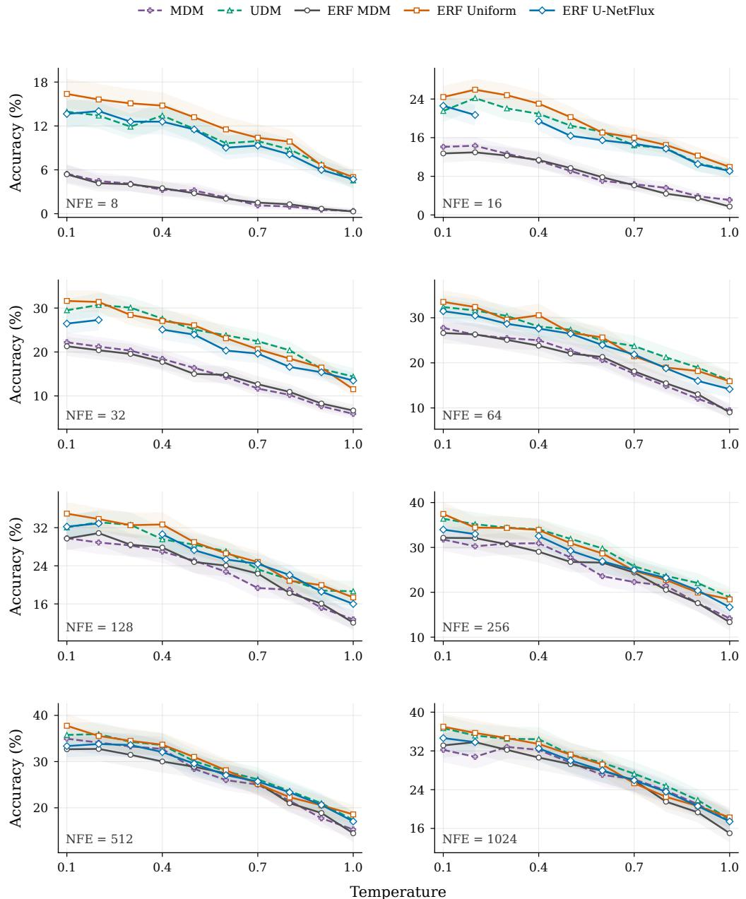  
Figure 5: TinyGSM sampling across all evaluated NFE budgets. Each panel gives GSM8K accuracy across sampling temperatures, with pointwise 95% bootstrap intervals. Dashed lines denote ancestral sampling and solid lines denote ERF.

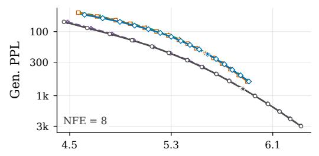

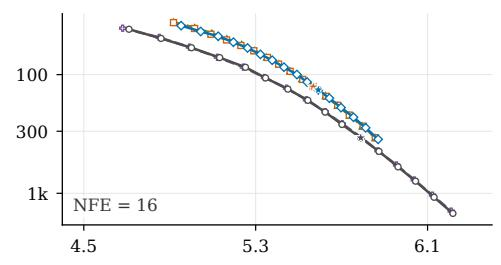

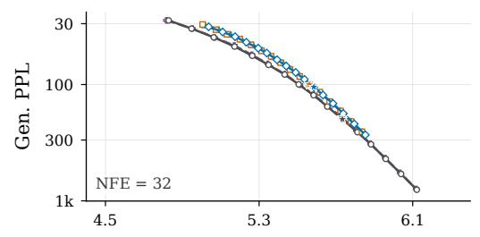

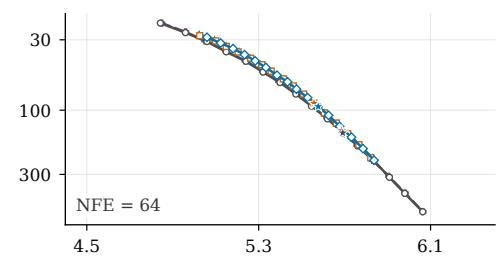

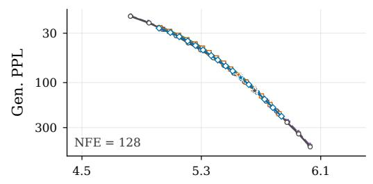

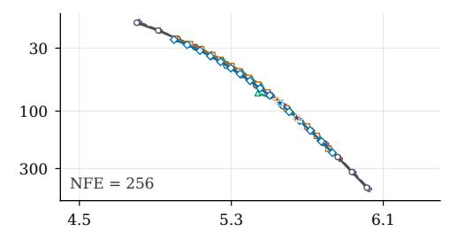

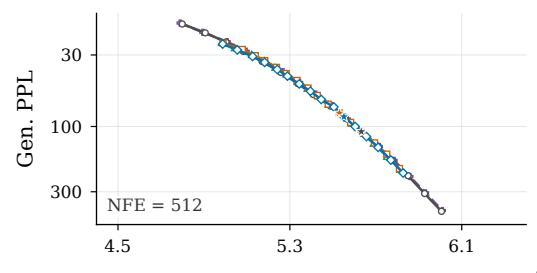

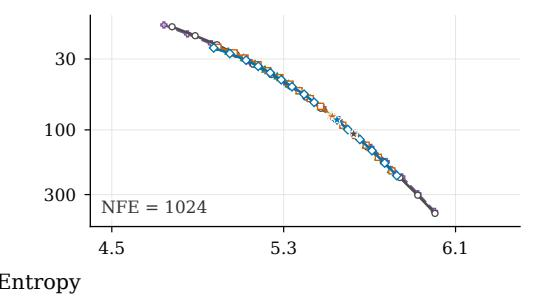  
Figure 6: OpenWebText sampling across all evaluated NFE budgets. Markers follow the temperature grid from 0.80 to 1.10, with stars at 1. Perplexity uses an inverted logarithmic axis, scaled independently in each panel.

## G.2 EULER AND CATEGORICAL TAU-LEAPING

Figures 7 to 9 compare ERF with the Euler and categorical τ-leaping schemes described in Appendix C.4, separately for masked, uniform, and U-NetFlux rates at 8, 64, and 512 NFEs. Each rate family uses one pretrained checkpoint, and the masked and uniform comparisons also include the ancestral controls from the main sampling experiment. TinyGSM evaluations use all 1,319 GSM8K test questions at temperatures 0.1, 0.2, . . . , 1 . OpenWebText evaluations use temperatures 0.80, 0.82, . . . , 1.10 , with 960 sequences per point for the reused ancestral controls and 480 for ERF, Euler, and categorical τ -leaping; all runs use seed 1. The ancestral UDM reference applies temperature to the raw model logits before the prediction conversion, whereas the other uniform samplers apply it to the converted prediction.

The Euler implementation clips the categorical weights and normalizes them when the frozen-rate step violates the probability constraint, while categorical τ -leaping rejects multiple proposed jumps at a position. Both baselines replace the final scheduled update with a denoiser prediction.

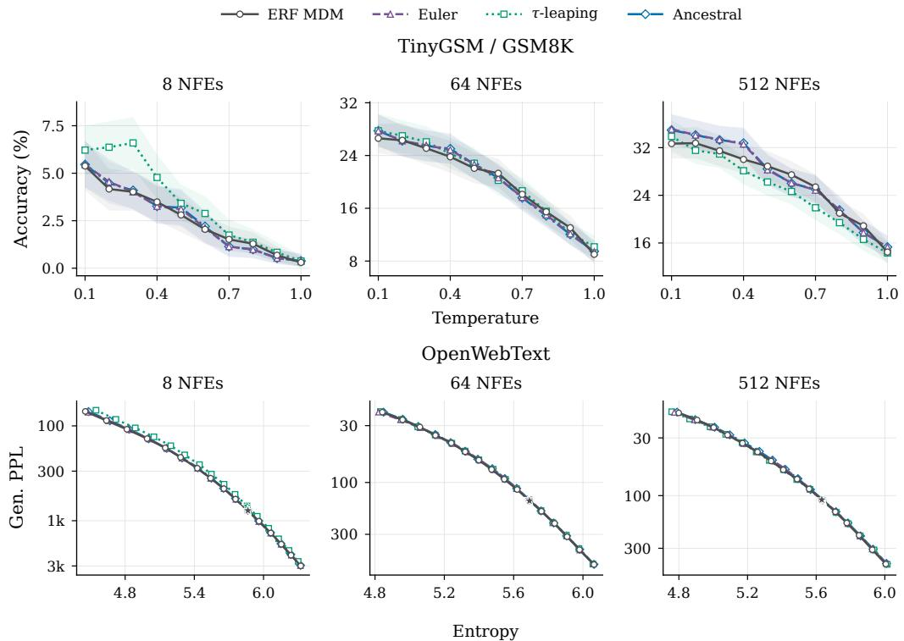  
Figure 7: ERF, ancestral sampling, Euler, and categorical τ -leaping for masked diffusion. The top row shows GSM8K accuracy across sampling temperatures, with pointwise 95% bootstrap intervals; the bottom row shows OpenWebText entropy and GPT-2 Large generative perplexity. Stars mark temperature 1. The perplexity axes are logarithmic and inverted, and panel limits follow the observed ranges.

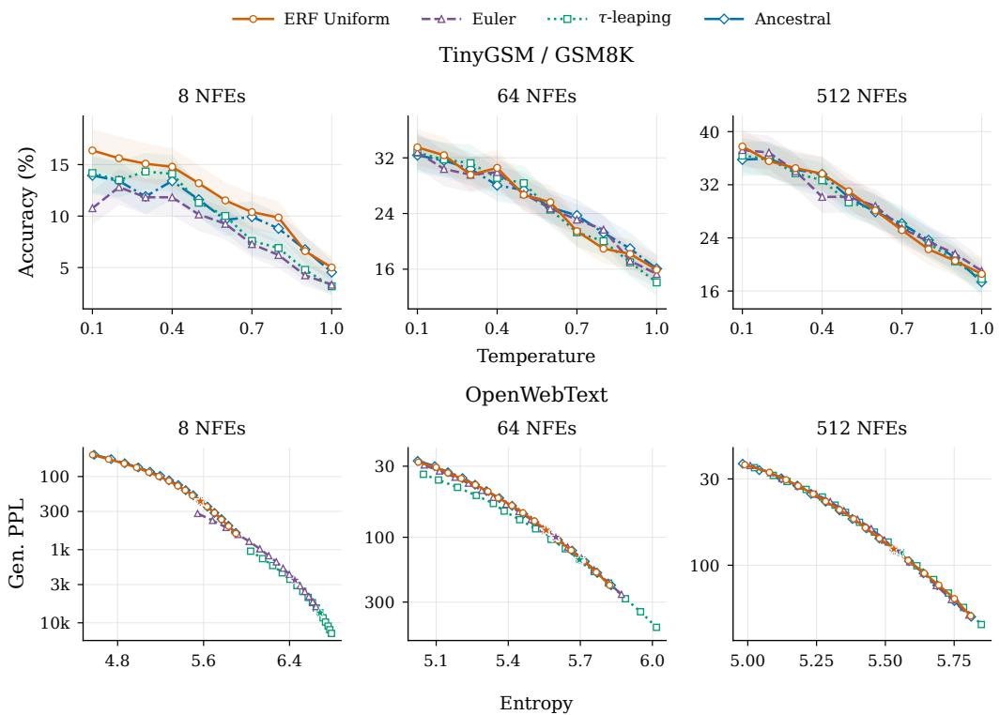  
Figure 8: ERF Uniform, ancestral UDM, Euler, and categorical τ-leaping for uniform diffusion, using the same plotting conventions as Figure 7. The ancestral reference uses temperature scaling before prediction conversion and 960 OpenWebText sequences per point; the other methods use scaling after conversion and 480 sequences. All four samplers share the same pretrained checkpoint.

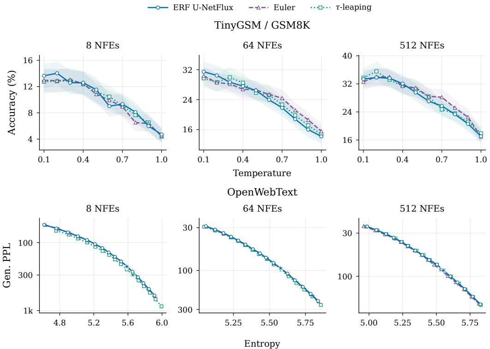  
Figure 9: ERF U-NetFlux, Euler, and categorical τ -leaping with U-NetFlux rates, using the same evaluation and plotting conventions as Figure 7. Each panel compares the three integration schemes with the same pretrained uniform-diffusion checkpoint.

## G.3 UNIFORM SUBSTEPS

The bounded variants divide each frozen-model interval into 1, 2, 4, 8, 16, or 32 substeps and permit at most one jump per position within a substep. The unbounded variant resolves every crossing. Substeps do not introduce additional model evaluations. Figures 10 and 11 display all completed settings across the eight NFE budgets. The TinyGSM grid uses temperatures 0.1, 0.5, and 1; the OpenWebText grid uses 0.80, 0.84, . . . , 1.08 .

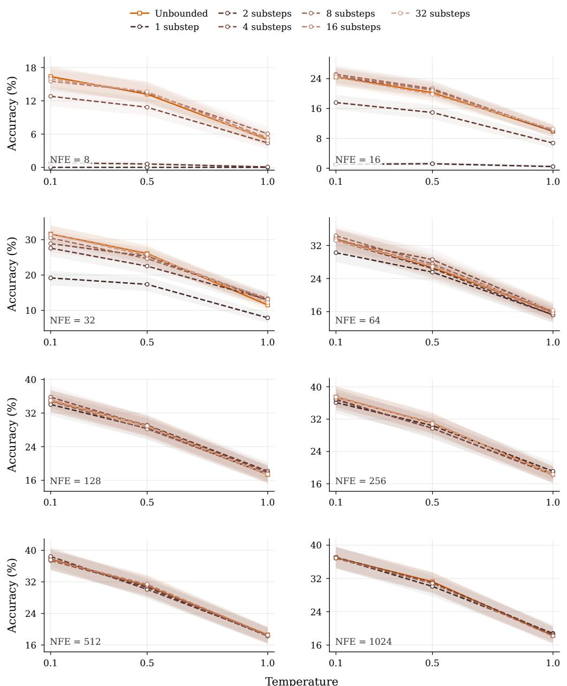  
Figure 10: The full TinyGSM substep comparison. Curves show GSM8K accuracy at fixed NFE as the sampling temperature varies; bands are pointwise 95% bootstrap intervals. Each legend entry specifies the number of substeps per frozen-model interval. Missing high-substep settings at larger NFE budgets are left absent.

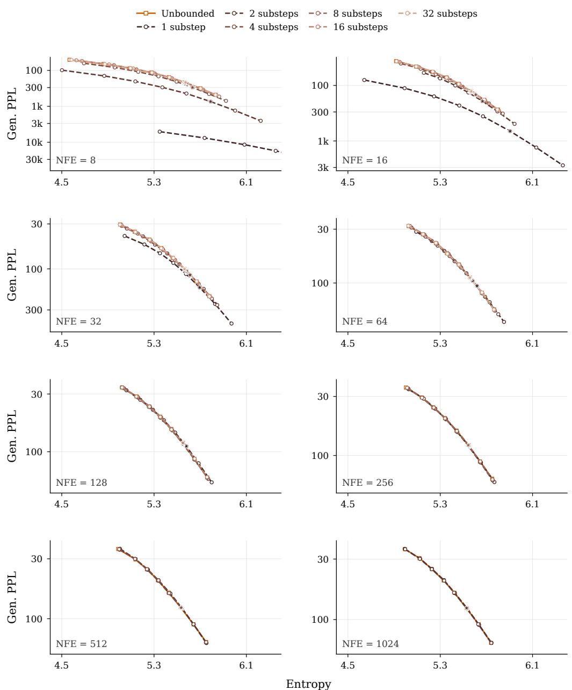  
Figure 11: The full OpenWebText substep comparison. Curves show the entropy–perplexity tradeoff over eight temperatures, with stars at 1. The inverted logarithmic perplexity axis retains the observed range in each panel. Only completed evaluations are drawn, with lines interrupted at missing temperatures.

## G.4 RUNTIME AND JUMP-COUNT PROTOCOL

The profiles use one AMD MI210, batches of four sequences, and generator seeds 1, 2, and 3. For TinyGSM, the three batches contain the first twelve GSM8K test prompts, four successive prompts per seed. Prompt positions remain fixed in a 512-token canvas. OpenWebText generation is unconditional with length 1,024. Sampling temperatures are 0.1 for TinyGSM and 1 for OpenWebText. Both methods use the same checkpoint, bfloat16 model autocast, and float64 residual clocks.

Uniform explicitly uses 40 bisection iterations per crossing-time solve. Its terminal time is 10−<sup>6</sup>, while U-NetFlux uses terminal time zero. Each method receives one warmup before measurement. Timings include sampling and exclude checkpoint loading and metric computation. Device syn chronization brackets each timing interval.

Jump counts come from a separate replay with the same generator seed and prompt batch. We check that its final tokens agree exactly with the uninstrumented run. Counts measure actual token changes and are divided by the number of generated positions, excluding fixed prompt positions. Figure 12 exposes the three individual measurements; Table 6 gives their means. These runs measure sampling cost on the stated batches.

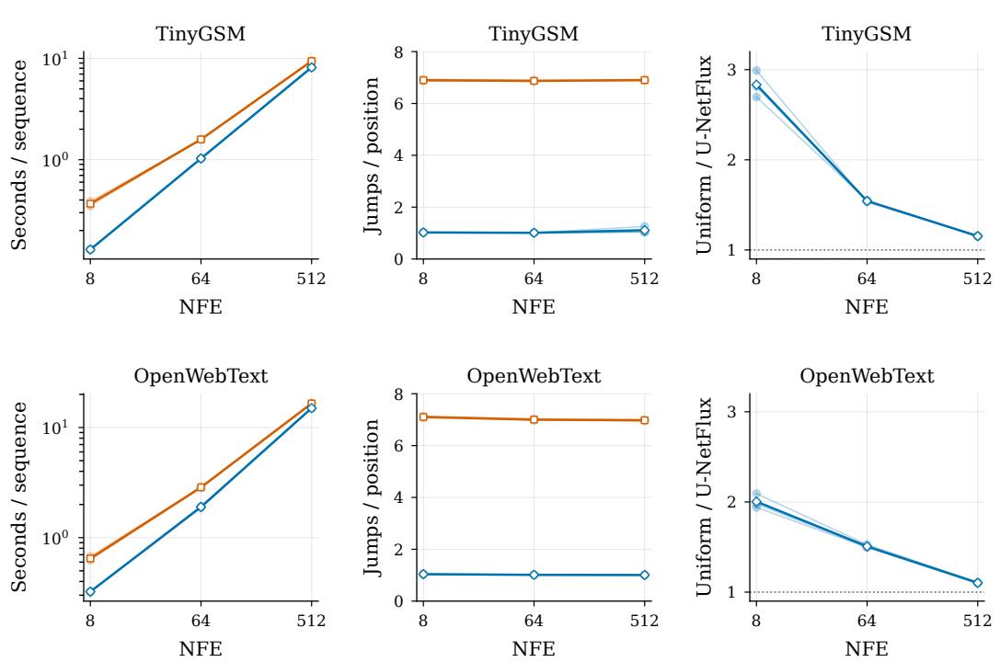  
Figure 12: Individual runtime and jump-count measurements. Faint curves and points show the three seeds; the main curves show their means. In the right column, the main curve is the ratio of mean Uniform and U-NetFlux runtimes, while faint curves give the three paired ratios. The dotted line marks equal runtime.

Table 6: Mean sampling time in seconds per sequence, speedup, and jumps per generated position across the three profile batches. Speedup is the ratio of mean Uniform and U-NetFlux runtimes.
<table><tr><td>Dataset</td><td>NFE</td><td>Uniform (s)</td><td>U-NetFlux (s)</td><td>Speedup</td><td>Uniform jumps</td><td>U-NetFlux jumps</td></tr><tr><td>TinyGSM</td><td>8</td><td>0.368</td><td>0.130</td><td>2.83</td><td>6.90</td><td>1.02</td></tr><tr><td>TinyGSM</td><td>64</td><td>1.586</td><td>1.028</td><td>1.54</td><td>6.87</td><td>1.01</td></tr><tr><td>TinyGSM</td><td>512</td><td>9.407</td><td>8.154</td><td>1.15</td><td>6.90</td><td>1.11</td></tr><tr><td>OWT</td><td>8</td><td>0.647</td><td>0.323</td><td>2.00</td><td>7.11</td><td>1.04</td></tr><tr><td>OWT</td><td>64</td><td>2.862</td><td>1.899</td><td>1.51</td><td>7.00</td><td>1.01</td></tr><tr><td>OWT</td><td>512</td><td>16.544</td><td>15.005</td><td>1.10</td><td>6.98</td><td>1.01</td></tr></table>

## G.5 DISTILLATION EVALUATION

The main distillation figures use the completed runs with budgets of 50 GPU-hours per student on TinyGSM and 100 GPU-hours on OpenWebText, all with global batch size 128. The budget is the number of allocated GPUs multiplied by elapsed training-job time, including initialization, checkpointing and training validation, but excluding queue time and independent evaluation jobs. The number of student updates therefore varies by method. All methods share the original temperature-1 teacher checkpoint within each dataset and diffusion family, with top-p truncation disabled. Uniform iDLM retains its Gaussian relaxation with the shared teacher, as detailed in Appendix E.6.

The main figures use the final student EMA checkpoints from training seed 1. All student and matching original-teacher evaluations use sampling seed 101, so no across-seed uncertainty band is shown. ERC refreshes its frozen EMA target and rollout teacher at 25%, 50% and 75% of the training budget. We evaluate gaps $\delta \in \{ 1 / \bar { 8 } , 1 / 1 6 , 1 / 3 2 , 1 / 6 4 \}$ and select one gap per dataset and diffusion family, held fixed across NFEs. The selected gaps are 1/64 for masked TinyGSM, 1/8 for uniform TinyGSM, 1/64 for masked OpenWebText and 1/16 for uniform OpenWebText. UDM predicts mean LOO probabilities and converts them to mean predictions for ERC. The ERC objective is reverse KL on TinyGSM and forward KL on OpenWebText.

The main DCD curves use the final native consistency-distillation runs. The completed evaluation grid contains both bridge and refresh sampling for every student and teacher, with denoiser temperature placement for MDM and both denoiser and LOO placement for UDM. At temperature 1, the two UDM temperature placements reuse the same evaluation within each sampler; these entries are aliases, not independent samples.

TinyGSM students and teachers in the main figure are evaluated on the same first 1,024 GSM8K test questions, with a 512-token canvas. The common sampling temperatures are 0.1, 0.23, 0.36, 0.49, 0.61, 0.74, 0.87 and 1, evaluated at 2, 4, 8, 16, 32, 64 NFEs. We maximize accuracy averaged with equal weight over these six NFE budgets to select one sampler, temperature placement and temperature per method; ERC additionally selects one gap. The selected configuration is fixed for the entire curve, and exact temperature ties favor the lower temperature. These are descriptive grid selections without a separate tuning set. The complete sampler-specific comparisons appear in Appendix G.9.

The main OpenWebText figure uses bridge sampling and denoiser temperature placement for every method and teacher, at temperatures 0.8, 0.85, 0.9, 0.95, 1, 1.05, 1.1 and 1.2. Every point uses 2,048 sequences of length 1,024. To select the ERC gap within each family, we restrict each NFE comparison to the entropy interval shared by all four gaps, linearly interpolate log-perplexity as a function of entropy, and integrate over that interval, dividing by its width. We choose the gap with the lowest average of these normalized integrals over 2, 4, 8, 16, 32, 64 NFEs. This compares perplexity at matched entropy without extrapolation and fixes the same gap throughout the figure. The displayed curves contain measured points only. Appendices G.8 and G.9 give the complete measured gap and sampler sweeps; their OpenWebText panels fit the visible points subject to entropy bounds 4–6 and a generative-perplexity ceiling of 1,000, clipping values outside these limits.

## G.6 SUDOKU DISTILLATION

Tables 7 and 8 report exact-grid accuracy on the 2,000 validation puzzles at each difficulty and NFE budget in 1, 2, 4, 8, 16, 32, 64 . We use EMA weights throughout and average sampling seeds 101 and 303 before selecting a configuration. For each method and NFE budget, the tables retain the highest two-seed mean over the ancestral bridge and categorical refresh samplers and over temperatures 0.1, 0.25, 0.5, 0.7, 0.8, 0.9, 1, 1.1 . The ERC checkpoint is selected at 8 NFEs with refresh sampling and then held fixed across NFE budgets. These selections are descriptive maxima over the evaluation grid rather than estimates from a separate validation sweep.

Table 7: Sudoku MDM exact-grid accuracy in percent. Subscripts report the selected sampler and temperature, with R denoting categorical refresh and B denoting the ancestral bridge. Bold denotes the highest accuracy within each difficulty and NFE budget.
<table><tr><td>Difficulty Method</td><td></td><td>1NFE</td><td>2NFE</td><td>4NFE</td><td>8NFE</td><td>16 NFE</td><td>32NFE</td><td>64NFE</td></tr><tr><td>Easy</td><td>Teacher</td><td>79.28R, .1</td><td>84.98R, .1</td><td>91.08R, .1</td><td>95.08R, .25</td><td>97.08R, .1</td><td>98.20R, .1</td><td>99.20R, .1</td></tr><tr><td></td><td>ERC (ours)</td><td>81.08B, .1</td><td>86.15R, .1</td><td>92.88R, .1</td><td>95.85R, .1</td><td>97.45R, .25</td><td>98.45R, .1</td><td>98.90R, .5</td></tr><tr><td></td><td>D-MMD</td><td>78.43B, .5</td><td>84.18R, .1</td><td>91.98R, .25</td><td>95.03R, .1</td><td>97.13R, 1</td><td>98.40R, .1</td><td>99.13R, .5</td></tr><tr><td></td><td>iDLM</td><td>79.70B, .1</td><td>85.03R, .1</td><td>91.25R, .1</td><td>95.08R, .7</td><td>97.10R, .25</td><td>98.23R, .1</td><td>99.10R, .9</td></tr><tr><td></td><td>SDTT</td><td>68.73R, .1</td><td>74.98R, .1</td><td>84.10R, .1</td><td>89.95R, .1</td><td>93.78R, .25</td><td>96.05R, .25</td><td>97.43R, .9</td></tr><tr><td>Medium</td><td>Teacher</td><td>39.40R, .1</td><td>50.18R, .1</td><td>66.53R, .25</td><td>76.88R, .1</td><td>84.33R, .1</td><td>89.93R, .1</td><td>92.65R, .1</td></tr><tr><td></td><td>ERC (ours)</td><td>41.43B, .1</td><td>51.85R, 25</td><td>68.28R, .25</td><td>78.60R, .7</td><td>84.88R, .1</td><td>88.98R, .5</td><td>92.53R, .25</td></tr><tr><td></td><td>D-MMD</td><td>39.05B, .1</td><td>49.48B, .7</td><td>66.20R, .25</td><td>77.33R, 1.1</td><td>83.58R, 1</td><td>89.05R, .5</td><td>92.43R, .1</td></tr><tr><td></td><td>iDLM</td><td>41.58B, .1</td><td> $5 1 . 3 5 _ { \mathrm { R } , . 1 }$ </td><td>66.50R, .7</td><td>76.65R, .25</td><td>83.75R, .25</td><td>90.40R, .1</td><td>93.05R, .1</td></tr><tr><td></td><td>SDTT</td><td>12.45B, .1</td><td>21.75R, .1</td><td>40.53R, .1</td><td>55.15R, .25</td><td>66.85R, .1</td><td>76.05R, .1</td><td>82.50R, 1</td></tr><tr><td>Hard</td><td>Teacher</td><td>2.68B, .1</td><td> $7 . 2 3 _ { \mathrm { B } , \ . 1 }$ </td><td>20.75R, .1</td><td>36.10R, .1</td><td>47.88R, .1</td><td>57.30R, .1</td><td>66.35R, .25</td></tr><tr><td></td><td>ERC (ours)</td><td>3.70B, .25</td><td>8.10R, .25</td><td>22.23R, .1</td><td>36.58R, .1</td><td>47.75R, .1</td><td>57.38R, .8</td><td>66.43R, .8</td></tr><tr><td></td><td>D-MMD</td><td>3.58B, .25</td><td> $8 . 0 5 _ { \mathrm { B } , \ . 2 5 }$ </td><td>20.95R, .25</td><td>34.70R, .25</td><td>46.48R, .25</td><td>56.38R, .8</td><td>65.05R, 1.1</td></tr><tr><td></td><td>iDLM</td><td> $\mathbf { 4 . 1 3 _ { B , \delta . 1 } }$ </td><td> $\mathbf { 8 . 8 3 } _ { \mathrm { B , ~ . 1 } }$ </td><td> $2 1 . 8 5 _ { \mathrm { R } , . 1 }$ </td><td>35.72R, .5</td><td>46.75R, .25</td><td>56.45R, .1</td><td>66.10R, .7</td></tr><tr><td></td><td>SDTT</td><td> $0 . 5 5 _ { \mathrm { B } , \ . 1 }$ </td><td> $2 . 6 5 _ { \mathrm { R } , \ . 1 }$ </td><td> $1 1 . 4 5 _ { \mathrm { R , ~ } . 2 5 }$ </td><td>22.60R, .1</td><td>31.78R, .1</td><td>41.25R, 1</td><td>51.43R, .1</td></tr></table>

Table 8: Sudoku UDM exact-grid accuracy in percent. Mean- and LOO-parameterized UDM use distinct teachers and method coverage. Selection, subscripts and boldface follow Table 7.
<table><tr><td>Difficulty Method</td><td></td><td>1NFE</td><td>2NFE</td><td>4NFE</td><td>8NFE</td><td>16 NFE</td><td>32NFE</td><td>64NFE</td></tr><tr><td>Easy</td><td>Teacher</td><td>74.50R, .1</td><td>92.85R, .1</td><td> $9 6 . 8 3 \mathrm { R } , . 8$ </td><td>98.05R, .8</td><td>98.70R, .8</td><td>99.35R, .1</td><td>99.63R, .5</td></tr><tr><td></td><td>ERC (ours)</td><td>74.65B, .1</td><td>93.28R, .1</td><td>96.95R, 1.1</td><td>98.25R, 1.1</td><td>98.93R, .1</td><td>99.55R, .1</td><td>99.58R, .7</td></tr><tr><td></td><td>D-MMD</td><td>73.13B, .1</td><td>92.58R, .25</td><td> $9 6 . 5 5 \mathrm { R } , . 1$ </td><td>98.18R, .8</td><td>98.73R, 1.1</td><td>99.30R, .9</td><td>99.48R, .1</td></tr><tr><td></td><td>DCD</td><td>74.50B, .1</td><td>92.30R, 5</td><td>96.55R, .1</td><td>97.80R, .8</td><td>98.50R, .5</td><td>99.13R, .25</td><td>99.28R, .25</td></tr><tr><td>Medium</td><td>Teacher</td><td>40.03R, .1</td><td>74.38R, .25</td><td>85.95R, .7</td><td>90.78R, 1.1</td><td>94.00R, 1</td><td>95.55R, .1</td><td>97.00R, .25</td></tr><tr><td></td><td>ERC (ours)</td><td>40.95B, .1</td><td>75.78R, 1</td><td>86.88R, .25</td><td>91.23R, 1</td><td>93.93R, .7</td><td>95.85R, 1</td><td>96.98R, 1.1</td></tr><tr><td></td><td>D-MMD</td><td>37.73B, .1</td><td>74.88R, .25</td><td>86.00R, 1.1</td><td>90.40R, .8</td><td>93.48R, .7</td><td>95.55R, .7</td><td>96.60R, .1</td></tr><tr><td></td><td>DCD</td><td>41.25B, .1</td><td>74.58R, .8</td><td>85.63R, .5</td><td>90.53R, 1.1</td><td>93.28R, .1</td><td>95.20R, .9</td><td>96.65R, .25</td></tr><tr><td>Hard</td><td>Teacher</td><td>7.80B, .1</td><td>39.78B, .1</td><td>57.55R, .25</td><td>68.35R, .8</td><td>74.78R, .7</td><td>80.25R, .9</td><td>85.73R, 1</td></tr><tr><td></td><td>ERC (ours)</td><td>7.50B, .1</td><td>40.80R, .1</td><td>58.88R, .1</td><td>67.38R, 1</td><td>74.63R, .8</td><td>80.40R, .8</td><td>86.20R, 1.1</td></tr><tr><td></td><td>D-MMD</td><td>6.95B, .1</td><td>39.08B, .25</td><td>57.58R, .9</td><td>66.80R, .5</td><td>74.05R, 1.1</td><td>79.55R, .1</td><td>85.00R, .8</td></tr><tr><td></td><td>DCD</td><td>7.93B, .25</td><td>39.25B, .25</td><td> $5 7 . 7 8 _ { \mathrm { R } , \ . 2 5 }$ </td><td> $6 7 . 9 8 _ { \mathrm { R } , \ . 5 }$ </td><td> $7 4 . 7 0 _ { \mathrm { R } , \mathrm { ~ 1 ~ } }$ </td><td>79.55R, .1</td><td>84.68R, 1.1</td></tr></table>

## G.7 TARGET AND TEACHER UPDATES

The target is the stopped-gradient student on the right of the consistency loss; the transport teacher is the denoiser used to generate the paired ERF states. At a refresh, the target is replaced by the student EMA; target-and-teacher refresh also uses that copy for transport. Over 10,000 updates, we compare a frozen target, per-step EMA, target refresh every 2,500 updates, and target-and-teacher refresh. Each uses either a fixed gap $\delta = \mathrm { { \bar { 1 } } / 6 4 }$ or a gap increasing over four rounds from 1/64 to 1/8. At fixed gap, we also test 5,000-update target refresh and EMA restricted to the target’s conditioning projection. TinyGSM uses reverse KL and both inference samplers; OWT uses forward KL and bridge sampling. The figures use sampling seed 101 and the measured temperature grid at 4–64 NFEs.

Per-step EMA Target refresh Projection EMA Frozen target Slow target refresh Target and teacher refresh

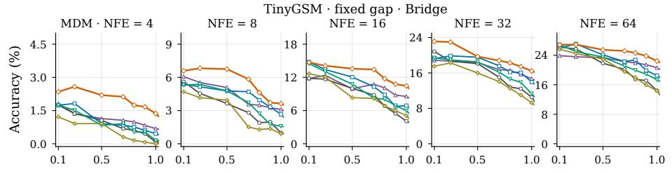

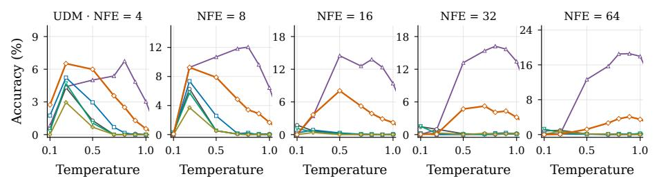  
Figure 13: TinyGSM target-update policies with a fixed training gap, under bridge sampling.  
Per-step EMA Target refresh Projection EMA Frozen target Slow target refresh Target and teacher refresh

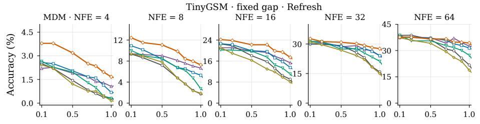

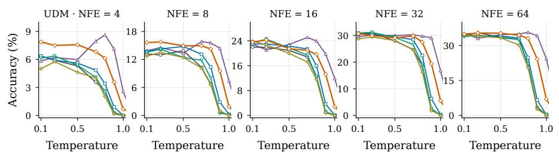  
Figure 14: The same fixed-gap policies under refresh sampling.

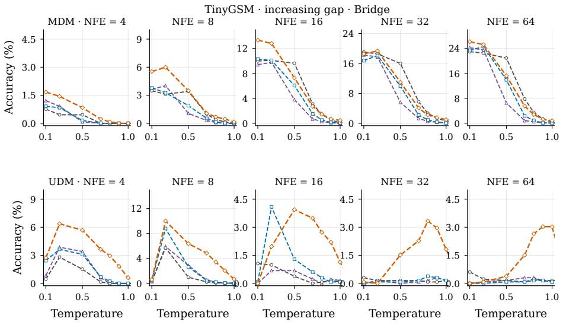  
Figure 15: TinyGSM target-update policies with an increasing training gap, under bridge sampling.  
Per-step EMA Target refresh Frozen target Target and teacher refresh

Per-step EMA Target refresh Frozen target Target and teacher refres

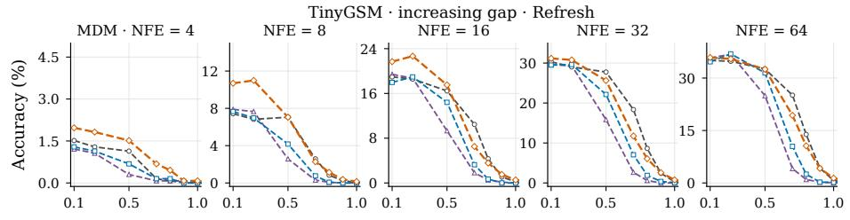

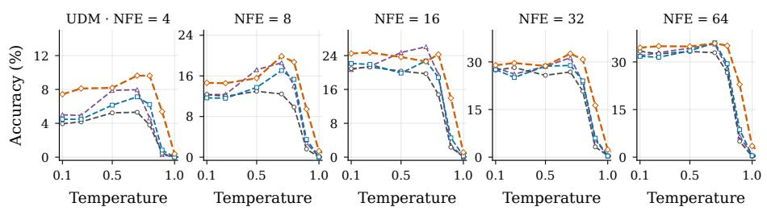  
Figure 16: The same increasing-gap policies under refresh sampling.

Per-step EMA Target refresh Projection EMA Frozen target Slow target refresh Target and teacher refresh

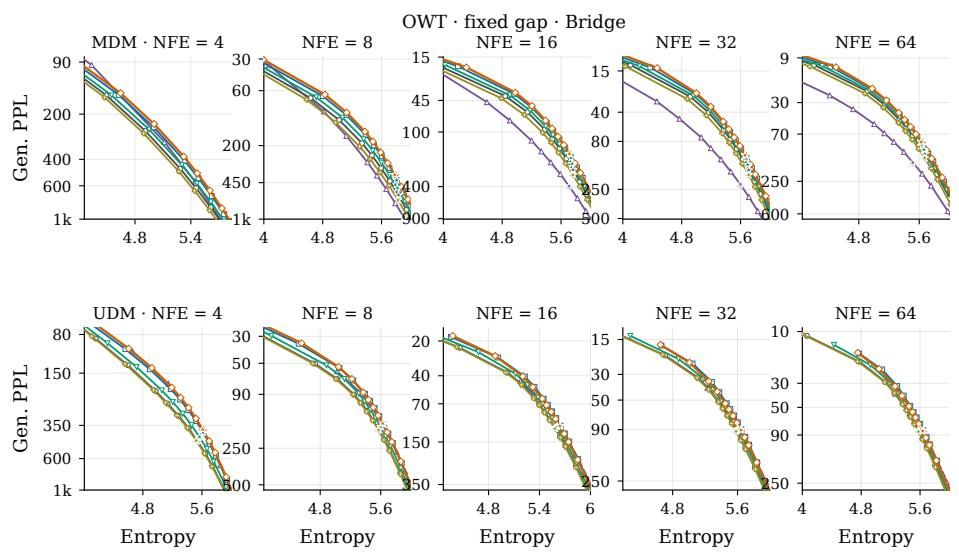  
Figure 17: OWT target-update policies with a fixed training gap, under bridge sampling. Stars mark temperature 1.

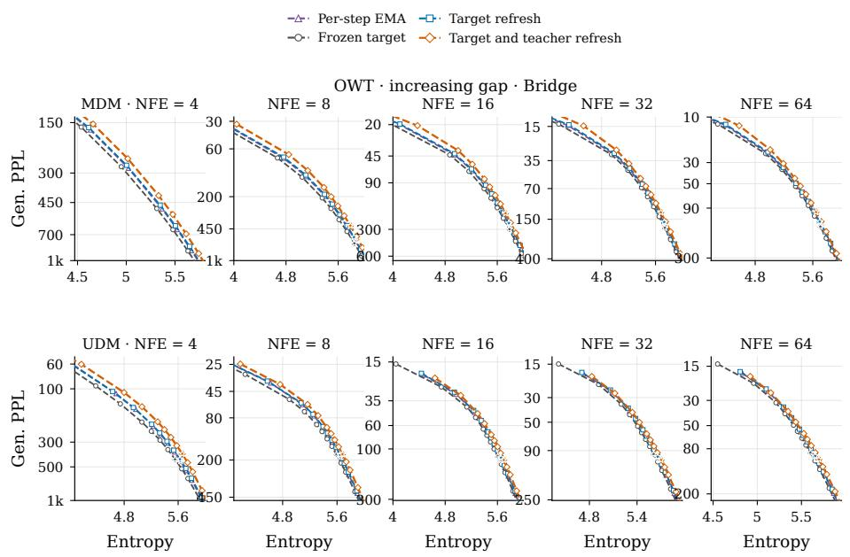  
Figure 18: The same OWT policies with an increasing gap. Axes fit visible points within entropy 4–6 and perplexity at most 1,000.

Target refresh Target and teacher refresh

## G.8 CONSISTENCY GAP

We compare $\delta \in \{ 1 / 8 , 1 / 1 6 , 1 / 3 2 , 1 / 6 4 \}$ with the target refreshed every round, either keeping the pretrained transport denoiser fixed or refreshing it from the same student EMA. For TinyGSM, each curve in Figure 19 uses one sampler and temperature selected by mean accuracy across the six NFEs. For OWT, Figure 20 averages log-perplexity over the entropy interval shared by all eight curves at each NFE, then across NFEs; lower scores correspond to lower matched-entropy perplexity. The measured OWT temperature curves appear in Figures 21 to 24.

$$
\begin{array} { l l l l } { { \mathrm { - } \mathrm { - } } } & { { \delta = 1 / 8 } } & { { \mathrm { ~ --- ~ } \delta = 1 / 3 2 } } & { { \mathrm { ~ --- ~ } \mathrm { ~ T a r g e t ~ a n d ~ t e a c h e r ~ r e f r e s h } } } \\ { { \mathrm { -- } \mathrm { ~ } } } & { { \delta = 1 / 1 6 } } & { { \mathrm { ~ --- ~ } \delta = 1 / 6 4 } } & { { \mathrm { ~ --- ~ } \mathrm { ~ T a r g e t ~ r e f r e s h } } } \end{array}
$$

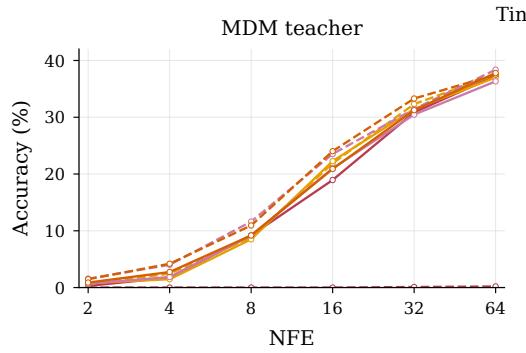

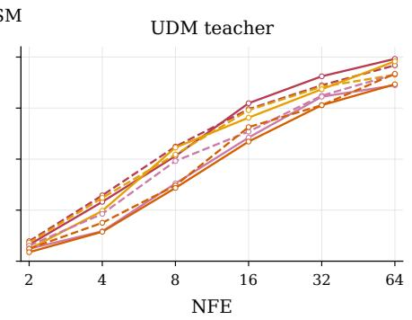  
Figure 19: TinyGSM accuracy across training gaps and refresh policies. Solid curves refresh only the target; dashed curves also refresh the rollout teacher.

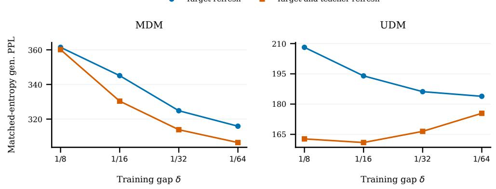  
Figure 20: OWT matched-entropy generative perplexity, averaged across six NFEs, for each training gap and refresh policy.

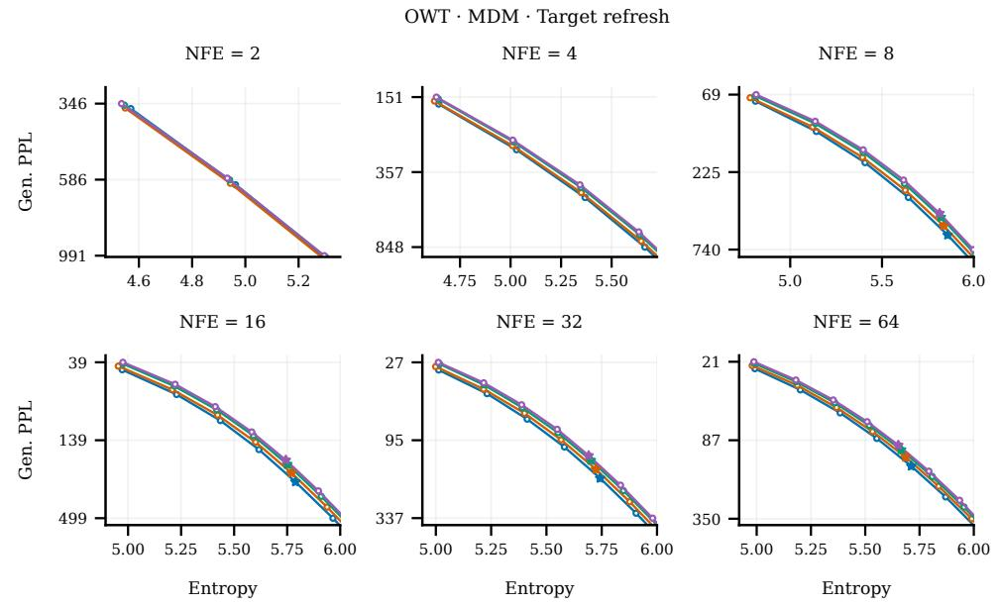  
Figure 21: OWT MDM with target refresh: measured bridge-sampling temperature curves at each NFE. Stars mark temperature 1.

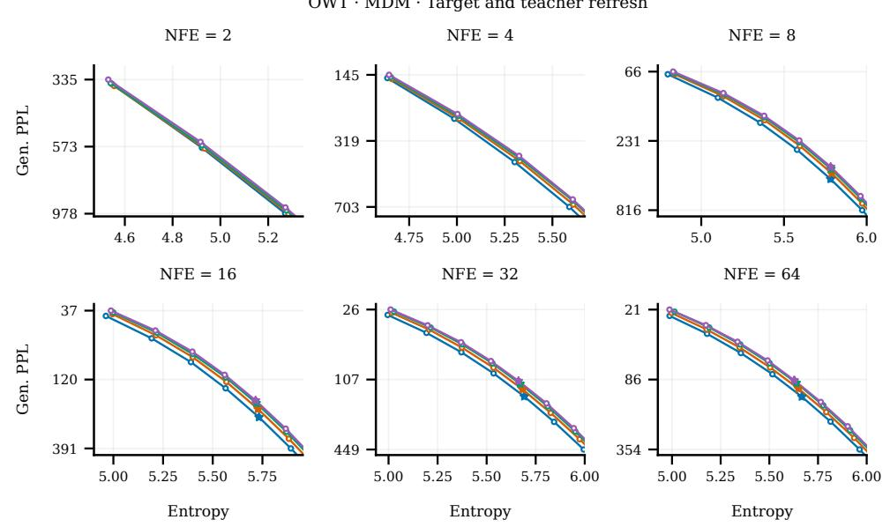  
Figure 22: OWT MDM with joint target-and-teacher refresh, under the same evaluation grid as Figure 21.

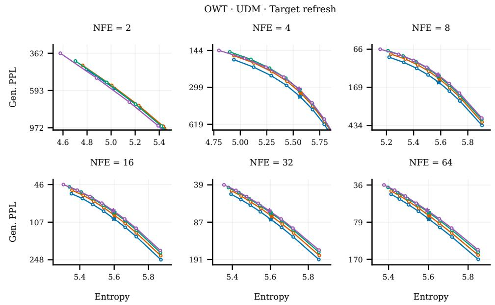  
Figure 23: OWT UDM with target refresh. Axes show visible points within entropy 4–6 and perplexity at most 1,000.

$$
\begin{array} { r } { - \bigcirc - \delta = 1 / 8 \quad \mathrm { ~ -- ~ } \bigcirc - \delta = 1 / 1 6 \quad \mathrm { ~ -- ~ } \bigcirc - \delta = 1 / 3 2 \quad \mathrm { ~ -- ~ } \bigcirc - \delta = 1 / 6 4 \quad \mathrm { ~ -- ~ } \bigcirc - \delta = 1 / 1 6 = 0 / 3 2 . } \end{array}
$$

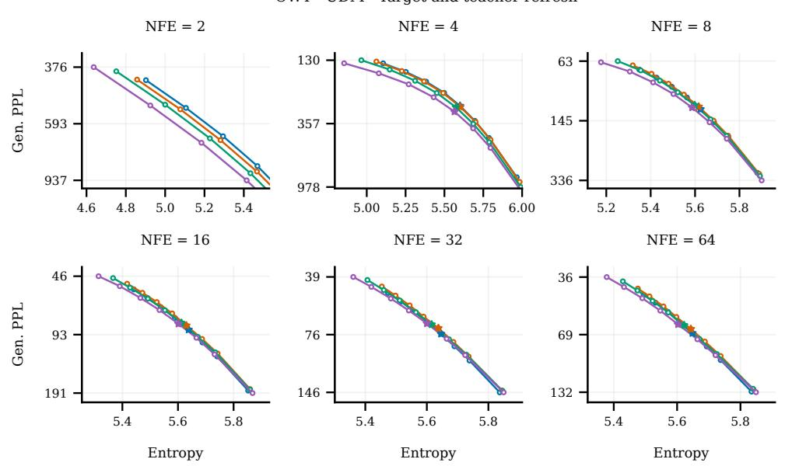  
Figure 24: OWT UDM with joint target-and-teacher refresh, under the same evaluation grid as Figure 23.

## G.9 BRIDGE AND REFRESH SAMPLING

We compare bridge sampling, which conditions the next state on the current state and the student’s clean prediction, with refresh sampling, which re-noises that prediction and draws new residuals. For UDM, temperature is applied either to LOO probabilities before conversion or to denoising probabilities after conversion; MDM uses denoiser temperature. Each comparison includes the shared teacher, iDLM, D-MMD, SDTT for MDM or DCD for UDM, and ERC. ERC uses the selected gap in Appendix G.5, fixed for each dataset and diffusion family.

For TinyGSM, Figures 25 to 27 show accuracy against NFE with bridge and refresh in adjacent panels. Within each panel, one of the eight measured temperatures is selected separately for each method by its mean accuracy over the six NFE budgets; that temperature is printed in the legend and held fixed across NFEs. Figures 28 to 30 instead show all measured temperatures at every NFE for both samplers, with pointwise 95% question-bootstrap bands. All points use the same 1,024 GSM8K questions.

For OpenWebText, each panel of Figures 31 to 36 fixes an NFE budget and sweeps the eight measured temperatures. Axes fit the visible points without extending below entropy 4, above entropy 6, or above generative perplexity 1,000; points outside these bounds are not shown, and a star identifies temperature 1 when visible. The perplexity axis is logarithmic and inverted. All points use 2,048 generated sequences. Denoiser and LOO placement at temperature 1 are aliases of one evaluation within each UDM sampler, not independent replicates.

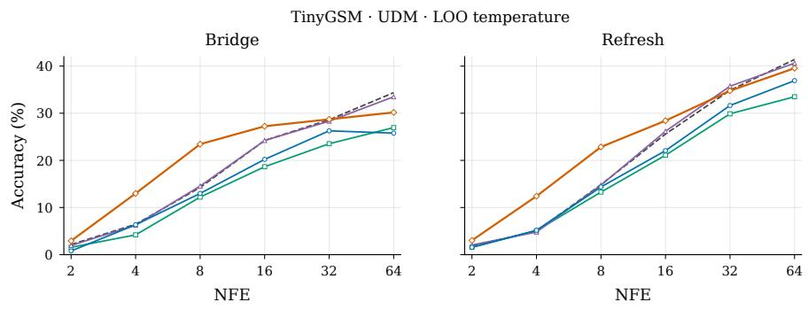

TinyGSM · MDM · denoiser temperature  
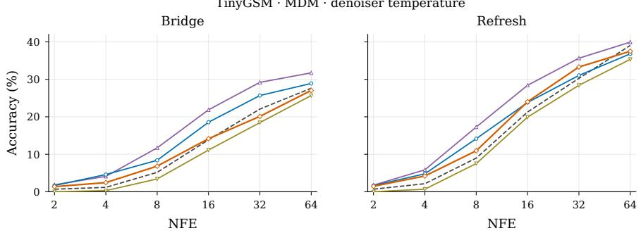  
Figure 25: TinyGSM MDM accuracy versus NFE under bridge and refresh sampling. Each method retains the temperature selected by mean accuracy across six NFE budgets; the teacher, SDTT, iDLM, D-MMD, and ERC are included.

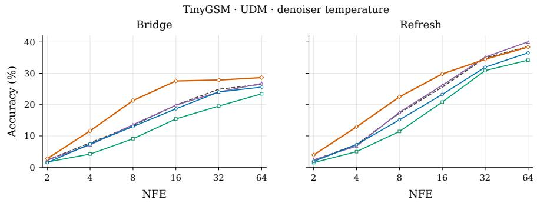  
Figure 26: TinyGSM UDM accuracy versus NFE with temperature applied to denoiser predictions, comparing bridge and refresh sampling and all five methods.  
Figure 27: TinyGSM UDM accuracy versus NFE with temperature applied to LOO predictions. Bridge and refresh panels contain the teacher, iDLM, D-MMD, DCD, and ERC.

$$
\begin{array} { l l l } { { \mathrm { --- } } } & { { \mathrm { T e a c h e r } } } & { { \mathrm { --- ~ i D L M } } } & { { \mathrm { \llangle \sim ~ E R C } } } \\ { { \mathrm { --- ~ S D T T } } } & { { \mathrm { - o - ~ D \cdot M M D } } } & { { } } \end{array}
$$

TinyGSM · MDM · denoiser temperature  
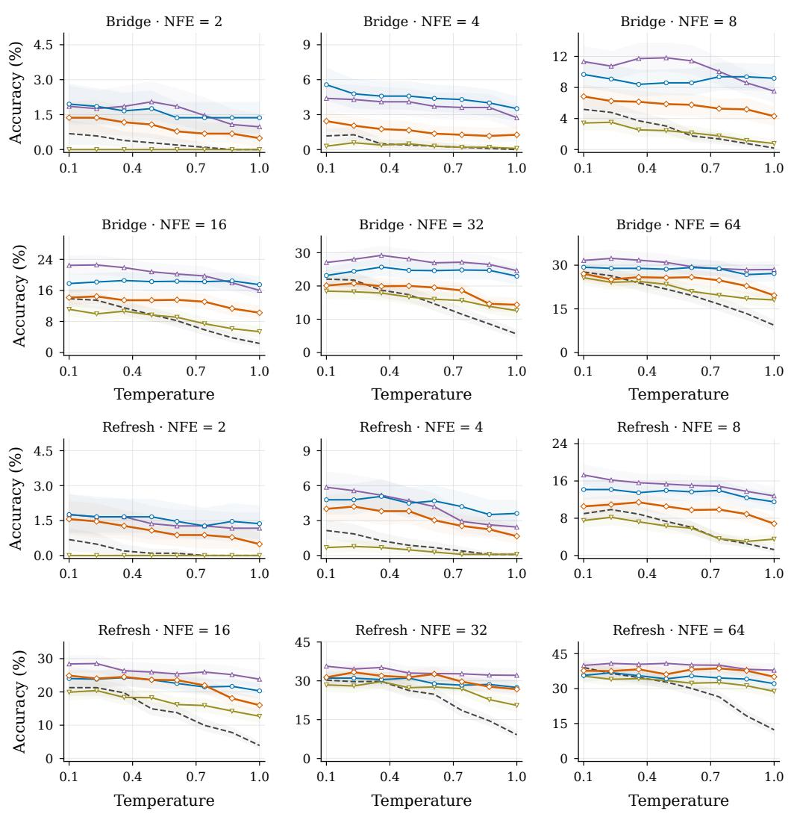  
Figure 28: TinyGSM MDM accuracy across eight denoiser temperatures and six NFE budgets for bridge and refresh sampling. Shaded bands are pointwise 95% bootstrap intervals over questions.

$$
\begin{array} { l l l } { { \mathrm { -- } \mathrm { ~ T e a c h e r ~ } } } & { { \mathrm { -- ~ i D L M ~ } } } & { { \mathrm { -  ~ E R C } } } \\ { { \mathrm { - U - ~ D C D ~ } } } & { { \mathrm { - O - ~ D { \cdot } M M D } } } & { { } } \end{array}
$$

TinyGSM · UDM · denoiser temperature  
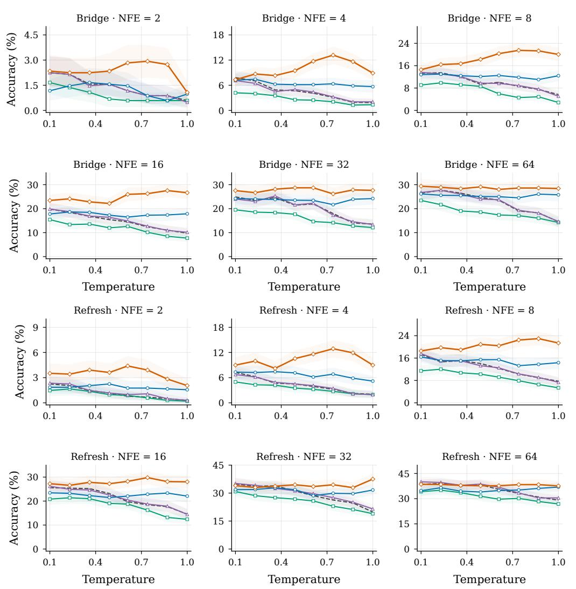  
Figure 29: TinyGSM UDM denoiser-temperature sweeps for both samplers at all six NFE budgets. Bands give pointwise 95% question-bootstrap intervals.

$$
\begin{array} { l l l } { { \mathrm { -- } \mathrm { ~ T e a c h e r ~ } } } & { { \mathrm { -- ~ i D L M ~ } } } & { { \mathrm { -  ~ E R C } } } \\ { { \mathrm { - U - ~ D C D ~ } } } & { { \mathrm { - O - ~ D { \cdot } M M D } } } & { { } } \end{array}
$$

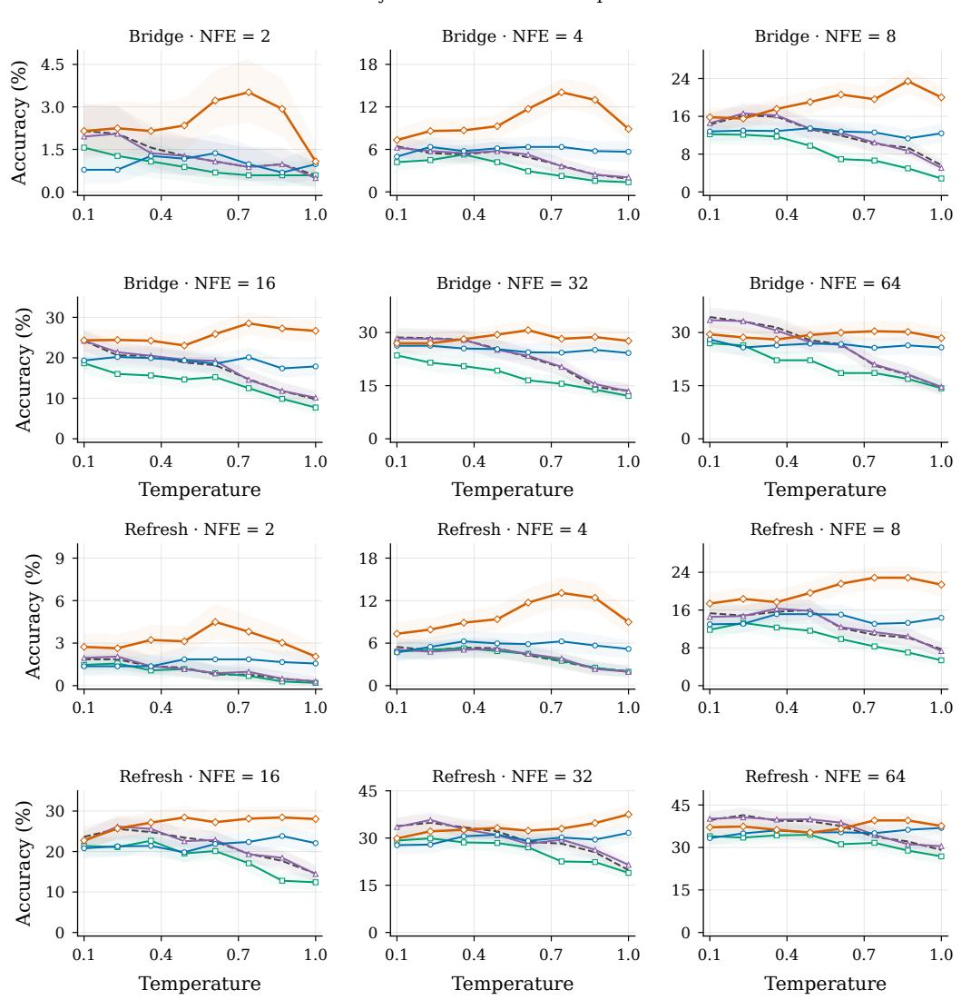  
Figure 30: TinyGSM UDM LOO-temperature sweeps for bridge and refresh sampling. All eight temperatures and six NFE budgets are retained, with pointwise 95% question-bootstrap intervals.

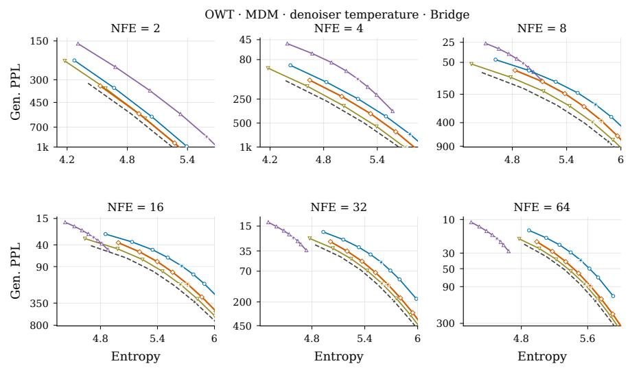  
Figure 31: OWT MDM entropy–perplexity curves under bridge sampling.

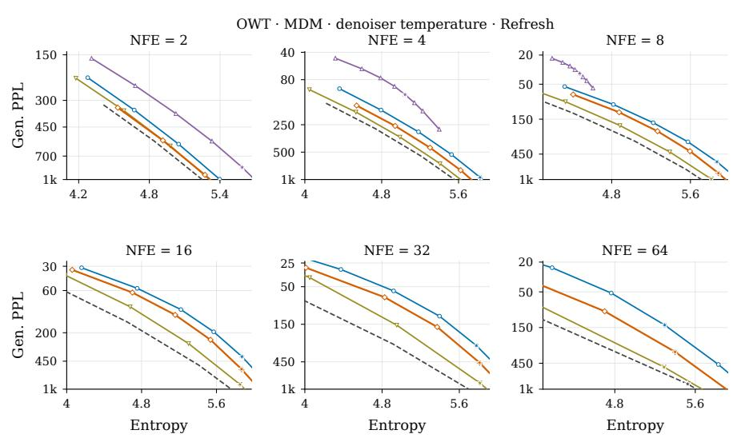  
Figure 32: The same OWT MDM comparison under refresh sampling.

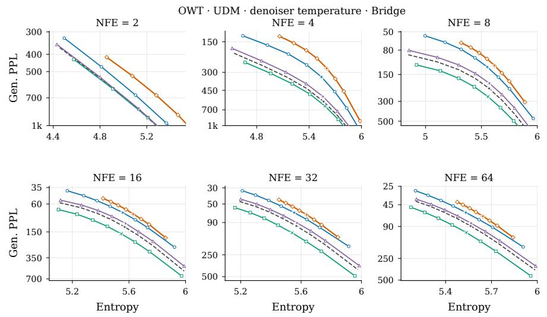  
Figure 33: OWT UDM entropy–perplexity curves with denoiser temperature under bridge sampling.

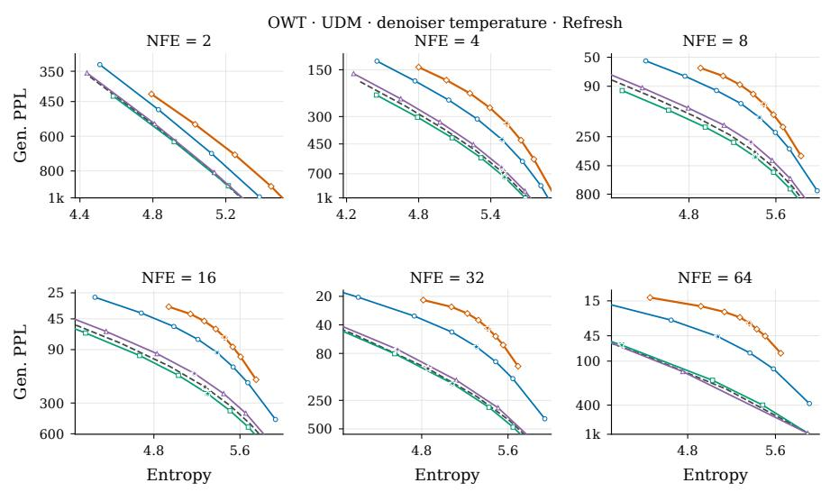  
Figure 34: The same OWT UDM denoiser-temperature comparison under refresh sampling.

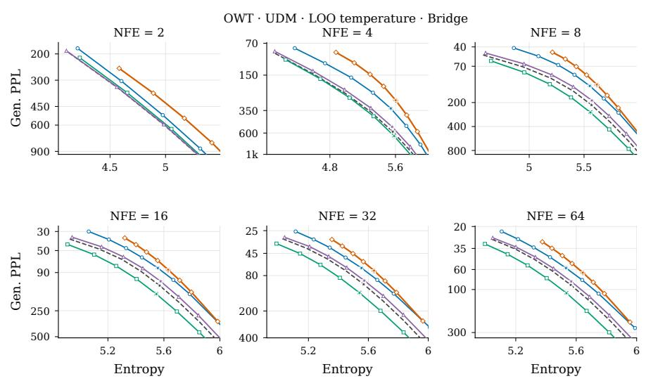  
Figure 35: OWT UDM entropy–perplexity curves with LOO temperature under bridge sampling.

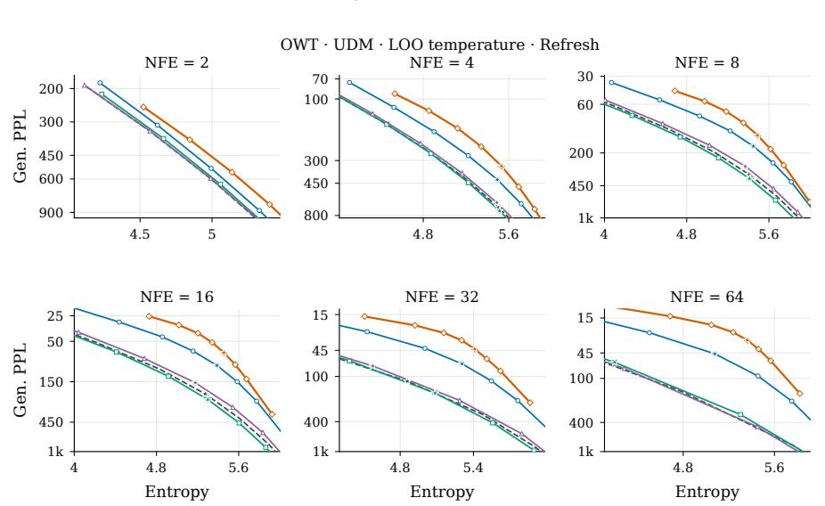  
Figure 36: The same OWT UDM LOO-temperature comparison under refresh sampling.

## G.10 GUMBEL CONDITIONING

We compare ERC with and without conditioning on the Gumbel variables log $E _ { t }$ after 10,000 student updates. The matched MDM runs use a fixed training gap; the UDM runs increase the gap over four rounds. In both, the target and ERF transport denoiser are refreshed together. Removing Gumbel inputs does not change the ERF transport, including its net-flux rates for UDM. TinyGSM uses both samplers and averages sampling seeds 101 and 303; OWT uses bridge sampling with seed 101. No matched OWT refresh comparison is available.

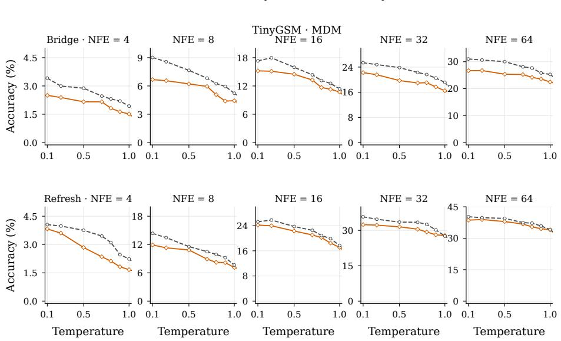  
Figure 37: TinyGSM MDM with and without Gumbel inputs under bridge and refresh sampling. Points average two sampling seeds.

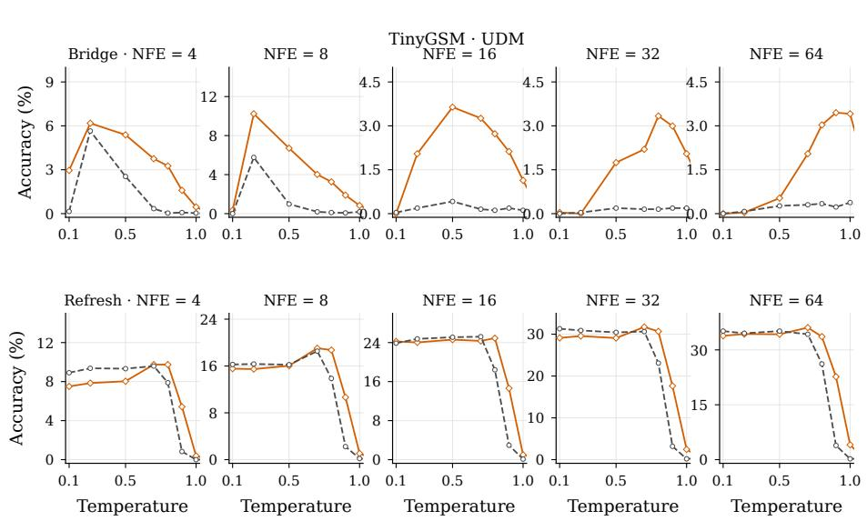  
Figure 38: TinyGSM UDM under the same Gumbel-input comparison, with an increasing training gap.

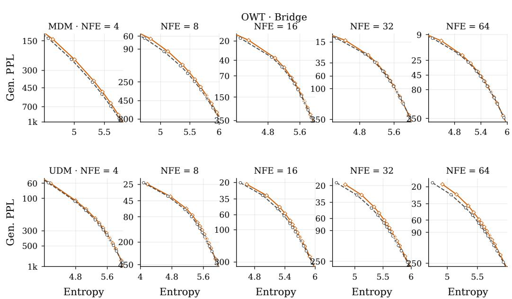  
Figure 39: OWT Gumbel-input comparison for MDM and UDM under bridge sampling at five NFEs and fourteen temperatures.

## H DIFFUSIONGEMMA EXPERIMENT

We evaluate the instruction-tuned 26B-parameter, 4B-active DiffusionGemma checkpoint (Google DeepMind, 2026) on the MMLU-Pro test split (Wang et al., 2024). We select ten questions from each of its fourteen categories by a stable hash with seed 20260820, yielding the same 140 questions for run seeds 1, 2, and 3. Each prompt requests a concise justification ending with The answer $\begin{array} { r l } { \mathrm { i } s } & { { } \left( \mathrm { X } \right) } \end{array}$ ., and generation uses one canvas block of at most 256 tokens. The strict evaluator accepts only this final-answer form and counts malformed or truncated completions as incorrect.

We compare the official native generation procedure with UDLM and the unbounded ERF Uniform and ERF U-NetFlux samplers. The custom samplers use 48 NFEs, temperature 1, and temperature scaling of the raw denoiser logits. The accuracy intervals in Table 1 use 50,000 category-stratified bootstrap replicates over question clusters while retaining all three paired seeds. The native proce dure terminates adaptively after 11.1 forward evaluations on average, whereas each custom sampler uses exactly 48; the reported timings therefore describe the runs but do not constitute a computematched comparison. This MMLU-Pro evaluation is not directly comparable to evaluations on other benchmarks reported with the model release.

## I PROOFS FOR THE ERF SAMPLER

## I.1 INTUITION ON THE ODES (9)

To motivate the form of this ODE, we derive a continuity equation on the extended state space $\mathsf { X } \times [ 0 , \infty ) ^ { L \times K }$ such that $X _ { t }$ follows the Kolmogorov equation with $( Q _ { t } ) _ { t \in [ 0 , 1 ] } .$ . This will impose a velocity on the exponential clocks. Rewriting the Kolmogorov equation (5) and using (6), we have for any x and t:

$$
\partial _ { t } p _ { t } ( x ) = p _ { t } ( x ) \sum _ { \ell = 1 } ^ { L } \bigl ( b _ { t } ^ { \ell } ( x ) - \lambda _ { t } ^ { \ell } ( x ^ { \ell } ) \bigr ) \ ,\tag{36}
$$

where $\begin{array} { r } { { b } _ { t } ^ { \ell } ( x ) : = \sum _ { j \in \mathsf { V } \backslash \{ x ^ { \ell } \} } \bar { Q } _ { t } ^ { \ell } ( j | x ) } \end{array}$ is the reverse exit rate at position ℓ, and $\begin{array} { r l } { \lambda _ { t } ^ { \ell } ( x ^ { \ell } ) } & { { } : = } \end{array}$ $\textstyle \sum _ { j \in \mathsf { V } \backslash \{ x ^ { \ell } \} } Q _ { t } ^ { \ell } ( j | x ^ { \ell } )$ is the forward exit rate. Therefore, introducing the vector field (depending on the discrete state): $v _ { t } ( x ) \in \mathbb { R } ^ { L \times K }$ with components

$$
v _ { t } ^ { \ell j } ( x ) = \left\{ { \begin{array} { l l } { \bar { Q } _ { t } ^ { \ell } ( j | x ) , } & { j \neq x ^ { \ell } , } \\ { - \lambda _ { t } ^ { \ell } ( x ^ { \ell } ) , } & { j = x ^ { \ell } , } \end{array} } \right.\tag{37}
$$

and the extended density $\begin{array} { r } { \mu _ { t } ( { \boldsymbol x } , { \boldsymbol e } ) = p _ { t } ( { \boldsymbol x } ) \exp ( - \sum _ { \ell = 1 } ^ { L } \sum _ { j = 1 } ^ { K } e ^ { \ell j } ) } \end{array}$ on $\mathsf { X } \times [ 0 , \infty ) ^ { L \times K }$ , we can rewrite the Kolmogorov equation (36) as

$$
\partial _ { t } \mu _ { t } ( x , e ) = - \nabla _ { e } \cdot ( v _ { t } ( x ) \mu _ { t } ( x , e ) ) ,\tag{38}
$$

where $\nabla _ { e }$ denotes the divergence operator with respect to e. This equation can be interpreted as a continuity equation on the extended state space, and suggests the dynamics we have imposed on $E _ { t } ,$ namely (9).

## I.2 SETTING

## I.2.1 NOTATION AND ASSUMPTIONS

Notation. By convention, we set $\prod _ { i } ^ { j } = 1 \operatorname { i f } i > j$ . In nonnegative integrands, $0 \cdot ( + \infty )$ is defined to be zero. Position indices are $\ell , h$ , token indices are $j , k ,$ and n, m count jumps or partial sums.

We recall that the we fix the state space $\mathsf { X } = \mathsf { V } ^ { L }$ for some $L \geq 1$ and set the set of tokens here as $\mathsf { V } = \{ 1 , \ldots , K \} , \mathsf { X } = \mathsf { V } ^ { L }$ . We denote for ease of notation $D = L K$ . Vectors in $\mathbb { R } ^ { D }$ are indexed by $[ 1 , L ] \times [ 1 , K ]$ with components at top in lexicographic order. For any $x \in { \mathsf { X } } , \ell \in \left\{ 1 , \ldots , L \right\}$ and $j \in \mathsf { V }$ , we denote by $x ^ { - \ell }$ the vector $( x ^ { \mathsf { ^ { 1 } } } , \ldots , x ^ { \ell - 1 } , x ^ { \ell + 1 } , \ldots , x ^ { L } )$ and write $x ^ { \ell \to j }$ as the element y such that $y ^ { - \ell } = x ^ { - \bar { \ell } }$ and $y ^ { \ell } = j$

Setting and assumptions. We consider now an inhomogeneous rate matrix denoted by $( Q _ { v } ) _ { v \in [ 0 , 1 ] } ,$ i.e., satisfying for any $v \in [ 0 , 1 ] , Q _ { v } ( y | x ) \geq 0$ for any x = y and

$$
Q _ { v } ( x | x ) = - \lambda _ { v } ( x ) = - \sum _ { y \neq x } Q _ { v } ( y | x ) .\tag{39}
$$

We denote by $p _ { v }$ the marginal distribution of the corresponding continuous-time Markov chain (CTMC) at time $v .$ In addition, we make the following assumption on the rates and the marginals of the corresponding CTMC.

Assumption 1. (i) There exist L time-inhomogeneous rate matrices on V, $\{ ( Q _ { v } ^ { \ell } ) _ { v \in [ 0 , 1 ] } \ : \ \ell \in$ $\{ 1 , \ldots , L \} ]$ such that for any $x , y \in \mathsf { X }$

$$
Q _ { v } ( y | x ) = \sum _ { \ell = 1 } ^ { L } Q _ { v } ^ { \ell } ( y ^ { \ell } | x ^ { \ell } ) \mathbb { 1 } _ { \{ x ^ { - \ell } = y ^ { - \ell } \} } \ .\tag{40}
$$

(ii) For every ℓ and distinct $x ^ { \ell } , \tilde { x } ^ { \ell } \in \mathsf { V }$ , the map $v \mapsto Q _ { v } ^ { \ell } ( x ^ { \ell } | \tilde { x } ^ { \ell } )$ is nonnegative and continuous on $[ 0 , 1 ]$

(iii) There is no explosion, $\begin{array} { r } { i . e . , \sum _ { x \in \mathsf { X } } p _ { v } ( x ) = 1 } \end{array}$ for any $v \in [ 0 , 1 ]$

(iv) For any $v \in [ 0 , 1 ]$ ] and $x \in { \mathsf { X } } ,$ , it holds $p _ { v } ( x ) > 0$

(v) For every $x \in { \mathsf { X } } ,$ the map $v \mapsto p _ { v } ( x )$ is continuously differentiable on [0, 1] and it holds for any $v \in ( 0 , 1 )$

$$
\partial _ { v } p _ { v } ( x ) = \sum _ { \ell = 1 } ^ { L } \sum _ { \stackrel { y ^ { - \ell } = x ^ { - \ell } } { y ^ { \ell } \neq x ^ { \ell } } } p _ { v } ( y ) Q _ { v } ^ { \ell } ( x ^ { \ell } | y ^ { \ell } ) - p _ { v } ( x ) \lambda _ { v } ( x ) .\tag{41}
$$

The derivatives at 0 and 1 are one-sided.

Under Assumption 1, denote for any $\ell \in \{ 1 , \ldots , L \}$ and $x ^ { \ell } \in \mathsf { V } ;$

$$
\lambda _ { v } ^ { \ell } ( x ^ { \ell } ) = \sum _ { j : j \neq x ^ { \ell } } Q _ { v } ^ { \ell } ( j | x ^ { \ell } ) ,\tag{42}
$$

and note that with this notation, $\begin{array} { r } { \lambda _ { v } ( x ) = \sum _ { \ell = 1 } ^ { L } \lambda _ { v } ^ { \ell } ( x ^ { \ell } ) \mathrm { a n d } Q _ { v } ( x | x ) = - \lambda _ { v } ( x ) } \end{array}$

For $v \in [ 0 , 1 ]$ and distinct x, $y \in { \mathsf { X } } ,$ , define the reverse rates by

$$
\bar { Q } _ { v } ( y | x ) = \frac { p _ { v } ( y ) } { p _ { v } ( x ) } Q _ { v } ( x | y ) .\tag{43}
$$

Under Assumption 1, the reverse rates are well-defined and satisfy, for distinct $x , y ,$

$$
\begin{array} { l } { { \bar { Q } _ { v } ( y | x ) = \displaystyle \sum _ { \ell \in \{ 1 , \dots , L \} } \bar { Q } _ { v } ^ { \ell } ( y ^ { \ell } | x ) \mathbb { 1 } _ { \{ x ^ { - \ell = y ^ { - \ell } } \} } ~ , } } \\ { { \bar { Q } _ { v } ^ { \ell } ( j | x ) = \displaystyle \frac { p _ { v } ( y ) } { p _ { v } ( x ) } Q _ { v } ^ { \ell } ( x ^ { \ell } | j ) ~ . } } \end{array}\tag{44}
$$

In the second line, $y ^ { - \ell } = x ^ { - \ell }$ and $y ^ { \ell } = j$ . Write $\begin{array} { r } { \bar { \lambda } _ { v } ( x ) = \sum _ { \ell = 1 } ^ { L } \sum _ { j : j \neq x ^ { \ell } } \bar { Q } _ { v } ^ { \ell } ( j | x ) } \end{array}$ and $\bar { Q } _ { v } ( x | x ) =$ $- \bar { \lambda } _ { v } ( x )$

## I.2.2 ERF SAMPLER REVISITED

We complete the description of the residual dynamics, described in Appendix C.1, mainly introducing new notations. For $x \in \mathsf { X }$ and $v \in [ 0 , 1 ]$ , define the vector field on $\mathsf { X } \to \mathbb { R } ^ { D }$ with components defined for any $x \in \mathsf { X } , \ell \in \{ 1 , \dots , L \}$ and $j \in \mathsf { V }$ as

$$
b _ { v } ^ { \ell j } ( x ) = - \bar { Q } _ { v } ^ { \ell } ( j | x ) \mathbb { 1 } _ { \{ j \neq x ^ { \ell } \} } + \lambda _ { v } ^ { \ell } ( x ^ { \ell } ) \mathbb { 1 } _ { \{ j = x ^ { \ell } \} } .\tag{45}
$$

In addition for $0 \leq u \leq v \leq 1$ , define

$$
\Delta _ { s | t } ( x ) = \int _ { s } ^ { t } b _ { u } ( x ) \mathrm { d } u .\tag{46}
$$

If the state remains x from v down to u, then

$$
E _ { u } = E _ { v } + \Delta _ { u \mid v } ( x ) .\tag{47}
$$

For $v > 0 , x \in \mathsf { X }$ , and $\eta \in [ 0 , \infty ) ^ { D }$ , define, when $j \neq x ^ { \ell }$

$$
\theta ^ { \ell j } ( v , x , \eta ) = \operatorname* { s u p } \left\{ u \in [ 0 , v ] : \int _ { u } ^ { v } \bar { Q } _ { \tau } ^ { \ell } ( j | x ) \mathrm { d } \tau \geq \eta ^ { \ell j } \right\} \ .\tag{48}
$$

Set $\operatorname* { s u p } \varnothing = - \infty$ and $\theta ^ { \ell j } ( v , x , \eta ) = - \infty$ when $j = x ^ { \ell }$

Set $T _ { 0 } ^ { \star } = 1$ , draw $X _ { 1 } \sim p _ { 1 }$ and $E _ { 1 } ^ { \ell j } \stackrel { \mathrm { i . i . d . } } { \sim }$ Exp(1) independently, and set $\left( X _ { T _ { 0 } ^ { \star } } , E _ { T _ { 0 } ^ { \star } } \right) = \left( X _ { 1 } , E _ { 1 } \right)$ Thus

$$
\operatorname { L a w } ( X _ { 1 } , E _ { 1 } ) = p _ { 1 } \otimes \operatorname { E x p } ( 1 ) ^ { \otimes D } .\tag{49}
$$

Suppose that the first n steps are defined and $( T _ { n } ^ { \star } , X _ { T _ { n } ^ { \star } } , E _ { T _ { n } ^ { \star } } ) = ( v , x , \eta )$ with $v > 0$ . Let $\Theta _ { n + 1 } =$ max $\begin{array} { r } { \mathfrak { c } _ { \ell , j } \theta ^ { \ell j } ( v , x , \eta ) . \mathrm { I f } \Theta _ { n + 1 } = - \infty } \end{array}$ , extend the path to 0 without another jump. If

$$
0 < \Theta _ { n + 1 } < v , \qquad \mathrm { a r g m a x } \theta ^ { \ell j } ( v , x , \eta ) = \{ ( h , k ) \} , \qquad \bar { Q } _ { \Theta _ { n + 1 } } ^ { h } ( k | x ) > 0 ,\tag{50}
$$

set

$$
\begin{array} { r l } & { T _ { n + 1 } ^ { \star } = \Theta _ { n + 1 } , \qquad C _ { n + 1 } = ( h , k ) , \qquad Y _ { n + 1 } = x , } \\ & { E _ { T _ { n + 1 } ^ { \star } } = \eta + \Delta _ { T _ { n + 1 } ^ { \star } | v } ( x ) , \qquad X _ { T _ { n + 1 } ^ { \star } } = y , \quad y ^ { h } = k , \quad y ^ { \ell } = x ^ { \ell } \mathrm { ~ f o r ~ } \ell \neq h . } \end{array}\tag{51}
$$

Here $Y _ { n + 1 }$ is the state before the jump and $C _ { n + 1 }$ is its residual index. At any other finite candidate time, stop and record a failure, including a hit at time 0. On the segment before the next candidate

time, set

$$
X _ { u } = X _ { T _ { n } ^ { \star } } , \qquad E _ { u } = E _ { T _ { n } ^ { \star } } + \Delta _ { u | T _ { n } ^ { \star } } \bigl ( X _ { T _ { n } ^ { \star } } \bigr ) , \qquad \Theta _ { n + 1 } < u \leq T _ { n } ^ { \star } .\tag{52}
$$

If a successful step does not exist, set its time and all subsequent step times $\mathrm { { t o } - \infty ; }$ assign fixed values to the other variables after stopping. The proof below shows that failures and infinite sequences of jumps have probability zero. Let $N _ { \infty } ^ { \mathbf { \bar { \alpha } } } = \operatorname* { s u p } \{ n \geq 0 : T _ { n } ^ { \star } \geq 0 \}$ denote the total number of jumps.

## I.3 MAIN RESULT

Let $\mathcal { O } = ( 0 , \infty ) ^ { D }$ . For $r \in [ 0 , \infty ) ^ { D }$ and $u \in [ 0 , 1 ]$ , put

AD: see if we will keep it...

$$
\gamma ( r ) = \exp \left( - \sum _ { \ell , j } r ^ { \ell j } \right) , \qquad F _ { u } ( x , r ) = p _ { u } ( x ) \gamma ( r ) .\tag{53}
$$

Lebesgue measure on  is denoted by dr.

Theorem I.1. Assume Assumption 1, define the reverse rates by (43)–(44), and consider the EFR sampler described in Appendix I.2.2. Then, almost surely, $N _ { \infty } < \infty$ and therefore the dynamics is well defined on [0, 1], withfinitely many jumps. For every deterministic $u \in [ 0 , 1 ]$

$$
L a w ( X _ { u } , E _ { u } ) = p _ { u } \otimes \mathrm { E x p } ( 1 ) ^ { \otimes D } .\tag{54}
$$

In addition, every $u \in [ 0 , 1 ] , \mathbb { P } ( T _ { n } ^ { \star } = u f o r s o m e n ) = 0 .$

For $n \geq 0$ and $u \in [ 0 , 1 )$ , define

$$
H _ { u } ^ { ( n ) } = \{ T _ { n } ^ { \star } > u , T _ { n + 1 } ^ { \star } < u \} .\tag{55}
$$

For each Borel set $B \subseteq [ 0 , \infty ) ^ { D }$ , set

$$
\mu _ { u } ^ { ( n ) } ( \{ x \} \times \mathcal { B } ) = \mathbb { E } \Big [ \mathbb { 1 } _ { H _ { u } ^ { ( n ) } } \mathbb { 1 } _ { \{ X _ { T _ { n } ^ { \star } } = x \} } \mathbb { 1 } _ { \{ E _ { T _ { n } ^ { \star } } + \Delta _ { u | T _ { n } ^ { \star } } ( X _ { T _ { n } ^ { \star } } ) \in \mathcal { B } \} } \Big ] \ .\tag{56}
$$

We prove the theorem by constructing densities $f _ { u } ^ { ( n ) }$ of these measures and summing them. Initialization (49) is not conditioning on a fixed state. The conclusion concerns deterministic times; it imposes no independence at jump times and does not assert that X is Markovian.

## I.4 PRELIMINARIES

For $x \in \mathsf { X } , \ell \in [ [ 1 , L ] ] , j \neq x ^ { \ell }$ , and $0 \leq u \leq v \leq 1$ , define

$$
A _ { u | v } ^ { \ell } ( x ) = \int _ { u } ^ { v } \lambda _ { \tau } ^ { \ell } ( x ^ { \ell } ) \mathrm { d } \tau , \qquad B _ { u | v } ^ { \ell j } ( x ) = \int _ { u } ^ { v } { \bar { Q } } _ { \tau } ^ { \ell } ( j | x ) \mathrm { d } \tau .\tag{57}
$$

Consequently,

$$
\Delta _ { u \vert v } ^ { \ell j } ( x ) = \left\{ \begin{array} { l l } { A _ { u \vert v } ^ { \ell } ( x ) , } & { j = x ^ { \ell } , } \\ { - B _ { u \vert v } ^ { \ell j } ( x ) , } & { j \neq x ^ { \ell } . } \end{array} \right.\tag{58}
$$

Lemma 1. Under Assumption 1, all forward and reverse off-diagonal rates and all exit rates are continuous and bounded on [0, 1]. For $v \in [ 0 , 1 ] , x \in \mathsf { X } ,$ , a position ℓ, and y with $y ^ { - \ell } = x ^ { - \ell }$ and $y ^ { \ell } \neq x ^ { \ell }$

$$
\partial _ { v } \log p _ { v } ( x ) = \bar { \lambda } _ { v } ( x ) - \lambda _ { v } ( x ) ,\tag{59}
$$

$$
p _ { v } ( y ) \bar { Q } _ { v } ^ { \ell } ( x ^ { \ell } | y ) = p _ { v } ( x ) Q _ { v } ^ { \ell } ( y ^ { \ell } | x ^ { \ell } ) ,\tag{60}
$$

$$
\sum { \begin{array} { r l } { p _ { v } ( y ) \bar { Q } _ { v } ^ { \ell } ( x ^ { \ell } | y ) = p _ { v } ( x ) \lambda _ { v } ^ { \ell } ( x ^ { \ell } ) . } \end{array} }\tag{61}
$$

$$
\begin{array} { c } { { y ^ { - \ell } { = } x ^ { - \ell } } } \\ { { y ^ { \ell } { \neq } x ^ { \ell } } } \end{array}
$$

In (59), endpoint derivatives are one-sided. In particular,

$$
\bar { Q } _ { v } ^ { \ell } ( x ^ { \ell } | y ) > 0 \implies \lambda _ { v } ^ { \ell } ( x ^ { \ell } ) > 0 .\tag{62}
$$

$$
\begin{array} { c } { F o r 0 \leq u \leq v \leq 1 , x \in \mathsf { X } , a n d r , w \in [ 0 , \infty ) ^ { D } ~ w i t h ~ r = w + \Delta _ { u \mid v } ( x ) , } \\ { p _ { v } ( x ) \gamma ( w ) = p _ { u } ( x ) \gamma ( r ) . ~ } \end{array}\tag{63}
$$

Proof. Since X is finite and $p _ { v } ( x )$ is continuous and positive on $[ 0 , 1 ]$ , the number $\begin{array} { r l } { p _ { * } } & { { } = } \end{array}$ $\begin{array} { r } { \operatorname* { m i n } _ { v \in [ 0 , 1 ] , x \in \mathsf { X } } p _ { v } ( x ) } \end{array}$ is positive. Boundedness and continuity of the forward rates, of (44), and of their finite sums follow. Applying (44) to the transition from y into x gives

$$
\bar { Q } _ { v } ^ { \ell } ( x ^ { \ell } | y ) = \frac { p _ { v } ( x ) } { p _ { v } ( y ) } Q _ { v } ^ { \ell } ( y ^ { \ell } | x ^ { \ell } ) .
$$

This proves (60); summing over the predecessor states gives (61). Nonnegativity of the summands and positivity of $p _ { v } ( x )$ imply (62). Dividing (41) by $p _ { v } ( x )$ and using (44) proves (59).

For $0 \leq u \leq v \leq 1$ , equations (45) and (59) give

$$
\begin{array} { r l r } {  { \sum _ { \ell , j } \Delta _ { u \mid v } ^ { \ell j } ( x ) = \int _ { u } ^ { v } ( \lambda _ { \tau } ( x ) - \bar { \lambda } _ { \tau } ( x ) ) \mathrm { d } \tau } } \\ & { } & \\ & { } & { = - \int _ { u } ^ { v } \partial _ { \tau } \log p _ { \tau } ( x ) \mathrm { d } \tau = \log \frac { p _ { u } ( x ) } { p _ { v } ( x ) } . } \end{array}\tag{64}
$$

Since $w = r - \Delta _ { u \mid v } ( x )$ , substitution in (53) yields

$$
p _ { v } ( x ) \gamma ( w ) = p _ { v } ( x ) \gamma ( r ) \exp \left( \sum _ { \ell , j } \Delta _ { u \mid v } ^ { \ell j } ( x ) \right) = p _ { u } ( x ) \gamma ( r ) .
$$

Lemma 2. Let $\alpha < \beta$ be finite, let $\omega : [ \alpha , \beta ] \to [ 0 , \infty )$ be continuous, and set $\begin{array} { r } { \Psi ( v ) = \int _ { \alpha } ^ { v } \omega ( \tau ) } \end{array}$ dτ and $\rho ( \zeta ) = \operatorname* { i n f } \left\{ v \in [ \alpha , \beta ] : \Psi ( v ) \geq \zeta \right\} f o r 0 < \zeta < \Psi ( \beta )$

(i) The set $\mathfrak { p } ( \{ v \in [ \alpha , \beta ] : \omega ( v ) = 0 \} )$ ) has one-dimensional Lebesgue measure zero. For almost every $\zeta \in ( 0 , \Psi ( \beta ) )$ , the equation $\Psi ( v ) = \zeta$ has exactly one solution; it lies in $( \alpha , \beta )$ and has $\omega ( v ) > 0 .$ . More generally, for every v<sub>0</sub> $\dot { \in } \left( \alpha , \beta \right)$ ) with $\omega ( v _ { 0 } ) > 0 ,$ , one has $\Psi ^ { - 1 } ( \{ \Psi ( \dot { v } _ { 0 } ) \} ) ^ { ' } ) = \{ v _ { 0 } \}$

(ii) For every nonnegative Borel $\chi o n \left[ 0 , \Psi ( \beta ) \right]$ ],

$$
\int _ { \alpha } ^ { \beta } \chi ( \Psi ( v ) ) \omega ( v ) \mathrm { d } v = \int _ { 0 } ^ { \Psi ( \beta ) } \chi ( \zeta ) \mathrm { d } \zeta .\tag{65}
$$

For every nonnegative Borel $\varphi$ on $[ \alpha , \beta ]$

$$
\int _ { \alpha } ^ { \beta } \varphi ( v ) \omega ( v ) \mathrm { d } v = \int _ { 0 } ^ { \Psi ( \beta ) } \varphi ( \rho ( \zeta ) ) \mathrm { d } \zeta .\tag{66}
$$

(iii) $f v _ { 1 } , v _ { 2 } : [ \alpha , \beta ] \to$ R are Lipschitz, then $\{ ( v _ { 1 } ( v ) , v _ { 2 } ( v ) ) : v \in [ \alpha , \beta ] \}$ has two-dimensional Lebesgue measure zero. An integral over $( 0 , \Psi ( \beta ) )$ is zero when $\Psi ( \beta ) = 0 $

Proof. Fix $\epsilon > 0$ . The relatively open set $O _ { \epsilon } = \{ v \in [ \alpha , \beta ] : \omega ( v ) < \epsilon \}$ is a countable disjoint union of intervals. On each component interval $J ,$ monotonicity and the integral expression for Ψ imply length $( \Psi ( J ) ) \leq \epsilon \mathrm { l e n g t h } ( J )$ Their images, together with at most their endpoint images, cover the image of the zero set of ω. Countable subadditivity bounds its outer measure by $\epsilon ( \beta - \alpha )$ Letting ϵ tend to zero proves nullity. Exclude these image values and $0 , \Psi ( \beta )$ . The intermediate value theorem gives a solution $v \in \operatorname { \dot { ( } } \alpha , \beta )$ of $\Psi ( v ) = \zeta$ , and this solution has $\omega ( v ) > 0$ . If $v _ { 1 } < v _ { 2 }$ had the same image, monotonicity would make Ψ constant on $[ v _ { 1 } , v _ { 2 } ] ;$ continuity and nonnegativity would give $\omega ( v _ { 1 } ) = \omega ( v _ { 2 } ) = 0$ , a contradiction. The same argument proves the last assertion whenever $\omega ( v _ { 0 } ) > 0$ , without an exceptional set. This proves (i).

For continuous χ, let $\begin{array} { r } { \Phi ( \zeta ) = \int _ { 0 } ^ { \zeta } \chi ( \zeta ^ { \prime } ) \mathrm { d } \zeta ^ { \prime } } \end{array}$ . The chain rule gives $( \Phi \circ \Psi ) ^ { \prime } ( v ) = \chi ( \Psi ( v ) ) \omega ( v )$ Integration proves (65). Equality against continuous functions identifies the two finite measures, so the identity extends to nonnegative Borel $\chi .$ . For $\alpha < v < \beta$ with $\omega ( v ) > 0$ , monotonicity gives $\rho ( \Psi ( v ) ) = v$ . Applying (65) to $\chi ( \zeta ) = \varphi ( \rho ( \zeta ) )$ , with arbitrary values at the endpoints and exceptional ζ, proves (66).

For (iii), let Λ bound both Lipschitz constants. Divide $[ \alpha , \beta ]$ into m intervals of length $( \beta - \alpha ) / m$ Each image lies in a square of side at most $2 \Lambda ( \beta - \alpha ) / m$ . The total area of these m squares is at most $4 \Lambda ^ { 2 } \overline { { ( } } \beta - \alpha ) ^ { 2 } / m$ . Letting $m  \infty$ proves the assertion. □

For a numerical pair $c \in [ [ 1 , L ] ] \times [ [ 1 , K ] ]$ , define

$$
\mathcal { B } _ { c } = \{ r \in [ 0 , \infty ) ^ { D } : r ^ { c } = 0 , r ^ { d } > 0 \mathrm { ~ f o r ~ e v e r y ~ } d \neq c \} .\tag{67}
$$

Let $\iota _ { c } : ( 0 , \infty ) ^ { D - 1 } \to B _ { c }$ insert zero in coordinate c, using lexicographic order for the others. The measure $\sigma _ { c }$ on $B _ { c }$ is defined by

$$
\int _ { \mathcal { B } _ { c } } \varphi ( w ) \sigma _ { c } ( \mathrm { d } w ) = \int _ { ( 0 , \infty ) ^ { D - 1 } } \varphi ( \iota _ { c } ( \zeta ) ) \mathrm { d } \zeta\tag{68}
$$

for nonnegative Borel $\varphi ;$ equivalently $\begin{array} { r } { \sigma _ { c } ( \mathrm { d } w ) = \delta _ { 0 } ( \mathrm { d } w ^ { c } ) \prod _ { d \neq c } \mathrm { d } w ^ { d } } \end{array}$ on $B _ { c }$ . For $x \in \mathsf X$ , let

$$
c _ { \ell } ( x ) = { \mathrm { t h e ~ u n i q u e ~ p a i r ~ } } ( \ell , j ) { \mathrm { ~ w i t h ~ } } j = x ^ { \ell } , \qquad O _ { x } = { \mathcal { O } } \cup \bigcup _ { \ell , j : j \neq x ^ { \ell } } \mathcal { B } _ { ( \ell , j ) } .\tag{69}
$$

Thus $r ^ { c _ { \ell } ( x ) } = \langle x ^ { \ell } , r ^ { \ell } \rangle$ . For $u \in [ 0 , 1 )$ 1), $x \in { \mathsf { X } } ,$ , and $r \in { \mathcal { O } } _ { x }$ , define

$$
\mathcal { N } _ { u } ( x ) = \{ r \in \mathcal { O } _ { x } : \langle x ^ { h } , r ^ { h } \rangle > A _ { u | 1 } ^ { h } ( x ) \mathrm { f o r e v e r y } h \} ,\tag{70}
$$

$$
\rho _ { \ell } ( u , x , r ) = \operatorname* { i n f } \{ v \in [ u , 1 ] : A _ { u | v } ^ { \ell } ( x ) \geq \langle x ^ { \ell } , r ^ { \ell } \rangle \} , \qquad \operatorname* { i n f } \varnothing = + \infty .\tag{71}
$$

Define also

$$
\begin{array} { r } { \mathcal { R } _ { u } ^ { \ell } ( x ) = \big \{ r \in \mathcal { O } _ { x } : \exists v \in ( u , 1 ) \mathrm { ~ s u c h ~ t h a t ~ } \quad \lambda _ { v } ^ { \ell } ( x ^ { \ell } ) > 0 , } \end{array}
$$

$$
\begin{array} { r l } & { \langle x ^ { \ell } , r ^ { \ell } \rangle = A _ { u | v } ^ { \ell } ( x ) , } \\ & { \langle x ^ { h } , r ^ { h } \rangle > A _ { u | v } ^ { h } ( x ) \quad ( h \neq \ell ) , } \\ & { r ^ { d } - \Delta _ { u | v } ^ { d } ( x ) > 0 \quad ( d \neq c _ { \ell } ( x ) ) \} , } \end{array}\tag{72}
$$

and

$$
\mathcal { R } _ { u } ( x ) = \bigcup _ { \ell = 1 } ^ { L } \mathcal { R } _ { u } ^ { \ell } ( x ) .\tag{73}
$$

For $r \in \mathcal { R } _ { u } ^ { \ell } ( x )$ , use the notation

$$
v = \rho _ { \ell } ( u , x , r ) , \qquad c = c _ { \ell } ( x ) , \qquad w = r - \Delta _ { u \mid v } ( x ) \in \mathcal { B } _ { c } .\tag{74}
$$

Lemma 3. Assume Assumption 1.

(i) The maps in (71) are Borel in $( u , r )$ for fixed x. The regions in (70) and (72), as sets $o f \left( u , r \right)$ are Borel. The sets $\mathcal { R } _ { u } ^ { \ell } ( x )$ are pairwise disjoint and disjointfrom $\mathcal { N } _ { u } ( x )$

(ii) For eachfixed $u \in [ 0 , 1 )$ and $x \in { \mathsf { X } } ,$

$$
\operatorname { L e b } _ { D } { \big ( } { \mathcal { O } } \setminus ( \mathcal { N } _ { u } ( x ) \cup \mathcal { R } _ { u } ( x ) ) { \big ) } = 0 .\tag{75}
$$

For each such u, x and $d = ( h , j )$ with $j \neq x ^ { h }$ and $\bar { Q } _ { u } ^ { h } ( j | x ) > 0 ;$

$$
\sigma _ { d } \big ( \mathcal { B } _ { d } \setminus ( \mathcal { N } _ { u } ( x ) \cup \mathcal { R } _ { u } ( x ) ) \big ) = 0 .\tag{76}
$$

Equivalently, the exceptional set is null for Lebesgue measure in the $D - 1$ coordinates other than d. In particular, for each fixed x and active $d = ( \bar { h } , \dot { \jmath } )$

$$
\int _ { 0 } ^ { 1 } \int _ { \mathcal { B } _ { d } } \mathbb { 1 } _ { \{ r \notin \mathcal { N } _ { u } ( x ) \cup \mathcal { R } _ { u } ( x ) \} } \bar { Q } _ { u } ^ { h } ( j | x ) \sigma _ { d } ( \mathrm { d } r ) \mathrm { d } u = 0 .\tag{77}
$$

(iii) $F i x \ 0 \ \leq \ u \ < \ v \ < \ 1 , \ x \ \in \ \mathsf { X } ,$ a position $\ell ,$ and w $\ r \in \ B _ { c _ { \ell } ( x ) }$ with $\lambda _ { v } ^ { \ell } ( x ^ { \ell } ) > 0$ . Set $r =$ $w + \Delta _ { u \mid v } ( x ) . \ I f r \in \mathcal { O } _ { \mathrm { : } }$ , there is no active hit on $[ u , v )$ , and $r \in \mathcal { R } _ { u } ^ { \ell } ( x )$ with $\rho _ { \ell } ( u , x , r ) = v$ . The

same reconstruction conclusion holds $i f r \in B _ { d }$ for an active $d = ( h , j )$ with $\bar { Q } _ { u } ^ { h } ( j | x ) > 0 ,$ ; in this case the first active hit after leaving v is at u through d.

(iv) Conversely, $i f r \in \mathcal { R } _ { u } ^ { \ell } ( x )$ , then (74) gives the only pair $( v , \ell )$ for which a segment in state $x ,$ starting with only residual $c _ { \ell } ( x )$ zero and positive initial passive speed, can end at $( u , x , r )$ without an intervening active hit. For $\boldsymbol { r } \in \boldsymbol { B } _ { d } ,$ , this assertion is restricted to $\bar { Q } _ { u } ^ { h } ( j | x ) > 0 ,$ , where $d = \left( h , j \right)$

Proof. For $\tau \in [ 0 , 1 ]$ , on the domain $r \in { \mathcal { O } } _ { x }$

$$
\{ ( u , r ) : \rho _ { \ell } ( u , x , r ) \leq \tau \} = \{ ( u , r ) : u \leq \tau , \langle x ^ { \ell } , r ^ { \ell } \rangle \leq A _ { u | \tau } ^ { \ell } ( x ) \} .
$$

The right-hand side is Borel because the integrated rate is continuous. If a witness v exists in (72), positivity of $\lambda _ { v } ^ { \ell } ( x ^ { \ell } )$ and Lemma 2(i) imply that it is unique and equals $\rho _ { \ell } ( u , x , r )$ . The other passive inequalities imply $\rho _ { h } ( u , x , r ) > v$ for $\bar { h } \neq \ell .$ . Membership in the region is therefore tested on the Borel set $\{ u < \rho _ { \ell } ( u , x , r ) < 1 \}$ by substituting this Borel function into the remaining equalities and inequalities. This proves the Borel assertions and disjointness across positions. A finite root is incompatible with all the inequalities defining $\mathcal { N } _ { u } ( x )$

Fix $u , x .$ For each ℓ, exclude the values

$$
\{ 0 , A _ { u | 1 } ^ { \ell } ( x ) \} \cup \{ A _ { u | v } ^ { \ell } ( x ) : v \in [ u , 1 ] , \lambda _ { v } ^ { \ell } ( x ^ { \ell } ) = 0 \}
$$

for the coordinate $\langle x ^ { \ell } , r ^ { \ell } \rangle$ . These sets have one-dimensional measure zero by Lemma 2. For $\ell \neq h .$ also exclude pairs

$$
\begin{array} { r } { \big ( \langle x ^ { \ell } , r ^ { \ell } \rangle , \langle x ^ { h } , r ^ { h } \rangle \big ) \in \{ \big ( A _ { u \vert v } ^ { \ell } ( x ) , A _ { u \vert v } ^ { h } ( x ) \big ) : v \in [ u , 1 ] \} . } \end{array}
$$

Their planar measure is zero by Lemma 2(iii). Fubini and the finite number of indices show that the excluded set is null in . If no root is finite, the point belongs to $\mathcal { N } _ { u } ( x )$ . Otherwise the least root v has a unique position ℓ, belongs to $( u , 1 )$ , and has $\lambda _ { v } ^ { \ell } ( x ^ { \ell } ) \stackrel { \smile } { > } 0$ . For $h \neq \ell ,$ strict minimality gives $\langle x ^ { h } , r ^ { h } \rangle \stackrel { \cdot } { - } A _ { u | v } ^ { \hat { h } } ( x ) > 0$ . For an active $\overset { \cdot } { d } = ( h , j )$

$$
r ^ { d } - \Delta _ { u \vert v } ^ { d } ( x ) = r ^ { d } + B _ { u \vert v } ^ { h j } ( x ) > 0 .
$$

The remaining equality at $c _ { \ell } ( x )$ follows from continuity at the first root. Thus the point belongs to $\mathcal { R } _ { u } ^ { \ell } ( x )$ , proving (75).

On $\textstyle B _ { d }$ , with d active at $x ,$ all L passive coordinates remain free under $\sigma _ { d } .$ . The excluded sets are still null by Fubini in these coordinates. The only additional zero coordinate is $r ^ { d } = 0 . \operatorname { I f } d = ( h , j )$ and $\bar { Q } _ { u } ^ { h } ( j | x ) > 0 .$ continuity yields $B _ { u \mid v } ^ { h j } ( x ) > 0$ for every $v > u$ . Consequently $w ^ { d } > 0$ , and the same argument proves (76). Joint Borel measurability and Tonelli, restricted first to bounded coordinate boxes if necessary, give (77).

For (iii), $\langle x ^ { \ell } , r ^ { \ell } \rangle = A _ { u | v } ^ { \ell } ( x )$ . Since $\lambda _ { v } ^ { \ell } ( x ^ { \ell } ) > 0$ , this integral is strictly smaller for any upper limit below $v ,$ so $\rho _ { \ell } ( u , x , r ) = v$ . For $h \neq \ell ,$ positivity of $\langle x ^ { h } , w ^ { h } \rangle$ gives $\langle x ^ { h } , r ^ { h } \rangle > A _ { u | v } ^ { h } ( x )$ and hence $\rho _ { h } ( u , x , r ) > v$ . If r is interior, every active residual on [u, v] is at least its positive final value. Residual $c _ { \ell } ( x )$ increases from zero and is positive at every time below $v ,$ since its speed is positive immediately below v. All other passive residuals increase from positive values. This proves absence of a hit. $\boldsymbol { \mathrm { I f } } \ r ^ { d } = 0$ and $\bar { Q } _ { u } ^ { h } ( j | x ) > 0$ , residual d has value $B _ { u \mid \tau } ^ { h j } ( x ) > 0$ at every $\tau \in ( u , v )$ , while the other active residuals have positive final values. Its first hit is therefore exactly at u.

For (iv), the definitions give the stated w, its positivity, and the specified speed. The preceding monotonicity arguments give the required segment. By (iii), another such segment would have to produce the same unique minimum among the $\rho _ { h }$ . Its time, position, and initial residual vector are therefore those in (74). □

Lemma 4. Under Assumption 1, every finite construction in (48)–(52), including its success and failure events, is Borel measurable in its initial condition. After a hit satisfying (50) at which only its triggering residual is zero, every residual is strictly positive for a sufficiently short interval in decreasing time after the update, and no immediate further hit occurs.

Proof. For fixed x, active $( \ell , j )$ , and $u \in [ 0 , 1 ]$

$$
\{ ( v , \eta ) : \theta ^ { \ell j } ( v , x , \eta ) \geq u \} = \left\{ ( v , \eta ) : v \geq u , \int _ { u } ^ { v } \bar { Q } _ { \tau } ^ { \ell } ( j | x ) \mathrm { d } \tau \geq \eta ^ { \ell j } \right\}
$$

on $\eta ^ { \ell j } > 0$ . The right-hand side is Borel. Finite maxima, tests of uniqueness and positivity, and integrations of continuous rates are Borel operations. Induction over these finitely many operations proves the first assertion, including measurability of (55)–(56).

Suppose the state changes from y to x at time v, with $y ^ { - \ell } = x ^ { - \ell } , y ^ { \ell } \neq x ^ { \ell } ,$ , and $\bar { Q } _ { v } ^ { \ell } ( x ^ { \ell } | y ) > 0$ Equation (62) gives $\lambda _ { v } ^ { \ell } ( x ^ { \ell } ) > 0$ . By continuity, $\lambda _ { \tau } ^ { \ell } ( x ^ { \ell } ) > 0$ throughout a sufficiently short interval immediately below $v ,$ so the new passive residual increases strictly from zero. Every other residual is positive at the hit and has bounded speed, so all remain positive on a sufficiently short common interval. This proves the second assertion. □

## I.5 CHANGE OF VARIABLES

Lemma 5. Assume Assumption 1 and (49). Define, for every $u \in [ 0 , 1 ) , x \in \mathsf { X } ,$ , and $r \in { \mathcal { O } } _ { x } ,$

$$
f _ { u } ^ { ( 0 ) } ( x , r ) : = F _ { u } ( x , r ) \mathbb { 1 } _ { \mathcal { N } _ { u } ( x ) } ( r ) .\tag{78}
$$

Then, for every $u \in [ 0 , 1 )$ , every $x \in { \mathsf { X } } ,$ and every Borel $B \subseteq { \mathcal { O } }$

$$
\mu _ { u } ^ { ( 0 ) } ( \{ x \} \times B ) = \int _ { B } f _ { u } ^ { ( 0 ) } ( x , r ) \mathrm { d } r .\tag{79}
$$

The measure $\mu _ { u } ^ { ( 0 ) }$ gives zero mass to $\mathsf { X } \times ( [ 0 , \infty ) ^ { D } \setminus \mathcal { O } )$

For every $x \in \mathsf { X } , d = ( h , j ) \in [ [ 1 , L ] ] \times [ [ 1 , K ] ]$ with $j \neq x ^ { h }$ , and nonnegative Borel $\psi : ( 0 , 1 ) \times B _ { d } \to$ $[ 0 , \infty ]$

$$
\begin{array} { r l r } {  { \mathbb { E } \big [ \mathbb { 1 } _ { \{ T _ { 1 } ^ { \star } \in ( 0 , 1 ) , Y _ { 1 } = x , C _ { 1 } = d \} } \psi ( T _ { 1 } ^ { \star } , E _ { T _ { 1 } ^ { \star } } ) \big ] } } \\ & { } & { = \displaystyle \int _ { 0 } ^ { 1 } \int _ { \mathcal { B } _ { d } } \psi ( v , w ) \bar { Q } _ { v } ^ { h } ( j | x ) f _ { v } ^ { ( 0 ) } ( x , w ) \sigma _ { d } ( \mathrm { d } w ) \mathrm { d } v . } \end{array}\tag{80}
$$

The first hit, when present on [0, 1], satisfies (50) almost surely and has only its firing residual equal to zero. For eachfixed $s \in [ 0 , \bar { 1 } ]$ , the probability of a first hit at s is zero.

Proof. Fix $u , x .$ On $H _ { u } ^ { ( 0 ) } \cap \{ X _ { u } = x \}$ , the initial residuals corresponding to the endpoint r are

$$
\eta = r - \Delta _ { u \mid 1 } ( x ) .
$$

For a passive index $c _ { \ell } ( x )$ , positivity of $\eta ^ { c _ { \ell } ( x ) }$ is equivalent to $\langle x ^ { \ell } , r ^ { \ell } \rangle > A _ { u | 1 } ^ { \ell } ( x )$ . For an active index $\bar { ( } \ell , j )$ ),

$$
\eta ^ { \ell j } = r ^ { \ell j } + B _ { u \vert 1 } ^ { \ell j } ( x ) .
$$

If r is interior, the active residual remains positive on the whole segment: at $\tau \in [ u , 1 ]$ it equals $r ^ { \ell j } + B _ { u \mid \tau } ^ { \ell j } ( x )$ . These conditions are also necessary. The endpoint map is a translation with derivative matrix $I _ { D }$ . Its density is therefore

$$
p _ { 1 } ( x ) \gamma ( r - \Delta _ { u \mid 1 } ( x ) ) \mathbb { 1 } _ { \mathcal { N } _ { u } ( x ) } ( r ) = F _ { u } ( x , r ) \mathbb { 1 } _ { \mathcal { N } _ { u } ( x ) } ( r ) ,
$$

by (63). Initial residuals are strictly positive, and no hit down to u implies positive final active residuals and positive passive residuals. This proves (79) and the assertion about boundary mass.

We first exclude the exceptional first hits. Condition on $X _ { 1 } = x$ . For an active $d = ( h , j )$ , a finite candidate hitting time v satisfies

$$
E _ { 1 } ^ { d } = B _ { v \mid 1 } ^ { h j } ( x ) .
$$

As a function of $v ,$ the right-hand side is $C ^ { 1 }$ , nonincreasing, and has derivative $- \bar { Q } _ { v } ^ { h } ( j | x )$ . Lemma $^ { 2 , }$ applied after reversing the time parameter, shows that the initial values yielding a zero-speed candidate form a one-dimensional null set. An exponential variable avoids that set almost surely. A

candidate at a prescribed $s \in [ 0 , 1 ]$ requires $E _ { 1 } ^ { d } = B _ { s \mid 1 } ^ { h j } ( x )$ , which is one fixed value and has probability zero. A tie for two distinct active indices $d = ( \boldsymbol { h } , \boldsymbol { j } )$ and $a = ( \ell , k )$ requires

$$
( E _ { 1 } ^ { d } , E _ { 1 } ^ { a } ) \in \{ ( B _ { v \mid 1 } ^ { h j } ( x ) , B _ { v \mid 1 } ^ { \ell k } ( x ) ) : v \in [ 0 , 1 ] \} .
$$

This set is planar-null by Lemma 2(iii), whereas the pair of independent exponentials has a Lebesgue density. A finite union over indices and states excludes all these cases. The passive residuals increase from positive values, so all residuals other than the unique firing residual are positive at this hit.

Now fix $x , d = ( h , j )$ and write $w = \iota _ { d } ( \zeta )$ . Consider the open set

$$
\begin{array} { r l } & { \mathcal { U } _ { x , d } : = \big \{ ( v , \zeta ) \in ( 0 , 1 ) \times ( 0 , \infty ) ^ { D - 1 } : \bar { Q } _ { v } ^ { h } ( j | x ) > 0 , } \\ & { \qquad \quad \langle x ^ { \ell } , w ^ { \ell } \rangle > A _ { v | 1 } ^ { \ell } ( x ) \mathrm { ~ f o r ~ e v e r y ~ } \ell \in [ 1 , L ] \big \} . } \end{array}\tag{81}
$$

Define $U : \mathcal { U } _ { x , d } \to ( 0 , \infty ) ^ { D }$ by

$$
\begin{array} { r } { U ( v , \zeta ) = w - \Delta _ { v | 1 } ( x ) . } \end{array}\tag{82}
$$

In particular, its d-th coordinate is $B _ { v \mid 1 } ^ { h j } ( x )$ . Its other active coordinates are $w ^ { a } + B _ { v \mid 1 } ^ { a } ( x )$ , where $B _ { v \mid 1 } ^ { a } = B _ { v \mid 1 } ^ { \ell k }$ for $a = \left( \ell , k \right)$ , and its passive coordinates are $\langle x ^ { \ell } , w ^ { \ell } \rangle - A _ { v | 1 } ^ { \ell } ( x )$ . All of them are positive on (81).

Order the target coordinates as $( d , - d )$ and the source coordinates as $( v , \zeta )$ . Since $\partial _ { v } \Delta _ { v \mid 1 } ( x ) =$ $- b _ { v } ( x )$

$$
\begin{array} { r } { D U ( v , \zeta ) = \left( \begin{array} { l l } { - \bar { Q } _ { v } ^ { h } ( j | x ) } & { 0 _ { 1 \times ( D - 1 ) } } \\ { b _ { v } ^ { - d } ( x ) } & { I _ { D - 1 } } \end{array} \right) , \qquad | \mathrm { d e t } D U ( v , \zeta ) | = \bar { Q } _ { v } ^ { h } ( j | x ) . } \end{array}\tag{83}
$$

Here $b _ { v } ^ { - d }$ is the vector with its d-th component removed. Thus every non-firing column is a column of the identity, and expansion of the determinant in the first row gives the displayed value.

The map U is injective. Indeed, its d-th coordinate determines v uniquely among points where $\bar { Q } _ { v } ^ { h } ( j | x ) > 0$ , by monotonicity and Lemma $2 ( \mathrm { i } )$ . Once v is known, $w = \eta + \Delta _ { v | 1 } ( x )$ determines $\zeta .$ For an input in its image, the firing residual first reaches zero at $v ;$ the other active residuals have positive value $w ^ { a }$ at v and did not reach zero earlier. Conversely, every first hit satisfying (50) yields one point of (81). Therefore the change-of-variables theorem applied to $U$ gives the left-hand side of (80) as

$$
\int _ { \mathcal { U } _ { x , d } } \psi ( v , \iota _ { d } \zeta ) p _ { 1 } ( x ) \gamma ( U ( v , \zeta ) ) \bar { Q } _ { v } ^ { h } ( j | x ) \mathrm { d } v \mathrm { d } \zeta .
$$

The map is $C ^ { 1 }$ and has nonzero determinant on its open domain, so this change of variables is applicable to all nonnegative Borel integrands. By (63),

$$
p _ { 1 } ( x ) \gamma ( w - \Delta _ { v \mid 1 } ( x ) ) \prod _ { \ell = 1 } ^ { L } \mathbb { 1 } _ { \{ \langle x ^ { \ell } , w ^ { \ell } \rangle > A _ { v \mid 1 } ^ { \ell } ( x ) \} } = f _ { v } ^ { ( 0 ) } ( x , w ) .
$$

Inserting this identity, using (68), and observing that the integrand is zero when $\bar { Q } _ { v } ^ { h } ( j | x ) = 0$ proves (80). The exceptional hits have already been excluded. □

Lemma 6. Assume Assumption 1 andfix $x \in \mathsf { X } .$ . For each $\ell \in [ [ 1 , L ] ]$ , let $( v , w ) \mapsto g _ { v } ^ { \ell } ( x , w )$ be a nonnegative,finite-valued Borelfunction on $( 0 , 1 ) \times B _ { c _ { \ell } ( x ) }$ . Suppose that

$$
\sum _ { \ell = 1 } ^ { L } \int _ { 0 } ^ { 1 } \int _ { \mathcal { B } _ { c _ { \ell } ( x ) } } g _ { v } ^ { \ell } ( x , w ) \sigma _ { c _ { \ell } ( x ) } ( \mathrm { d } w ) \mathrm { d } v < \infty , \qquad g _ { v } ^ { \ell } ( x , w ) = 0 \ i f \lambda _ { v } ^ { \ell } ( x ^ { \ell } ) = 0 .\tag{84}
$$

For data $( v , \ell , w )$ distributed according to these finite measures, start the constant-state segment at physical time v in state x, with residual vector w, and follow (47) toward 0 until its first active hit. Denote that hitting time by $\theta ( v , x , w )$ , its residual index by $C ( v , x , w )$ , and set $\theta = - \infty$ if there is no hit. Values ofC on exceptional hits may befixed arbitrarily.

For every $u \in [ 0 , 1 )$ and $r \in { \mathcal { O } } _ { x } ,$ , define

$$
h _ { u } ( x , r ) : = \left\{ \begin{array} { l l } { \displaystyle \frac { g _ { v } ^ { \ell } ( x , w ) } { \lambda _ { v } ^ { \ell } ( x ^ { \ell } ) } , } & { r \in { \mathcal R } _ { u } ^ { \ell } ( x ) , \quad v = \rho _ { \ell } ( u , x , r ) , \quad w = r - \Delta _ { u \mid v } ( x ) , } \\ { 0 , } & { r \not \in { \mathcal R } _ { u } ( x ) . } \end{array} \right.\tag{85}
$$

This defines its values on $\textstyle B _ { d }$ separately from its interpretation as an interior density. The following statements hold.

(i) For every deterministic $u \in [ 0 , 1 )$ and every Borel set $B \subseteq { \mathcal { O } }$

$$
\int _ { B } h _ { u } ( x , r ) \mathrm { d } r = \sum _ { \ell = 1 } ^ { L } \int _ { u } ^ { 1 } \int _ { B _ { c _ { \ell } ( x ) } } \mathbb { 1 } _ { \{ w + \Delta _ { u \mid v } ( x ) \in B \} } g _ { v } ^ { \ell } ( x , w ) \sigma _ { c _ { \ell } ( x ) } ( \mathrm { d } w ) \mathrm { d } v .\tag{86}
$$

Only source times v with $\iota < v < 1$ occur in thisformula. Its right-hand side is the measure of the data whose segment has no active hit down to u and ends in $B .$

(ii) For every active index $d = ( h , j )$ with $j \neq x ^ { h }$ and every nonnegative Borel $\psi : ( 0 , 1 ) \times B _ { d } \to$ $[ 0 , \infty ]$

$$
\begin{array} { l } { \displaystyle \sum _ { \ell = 1 } ^ { L } \int _ { 0 } ^ { 1 } \int _ { \mathcal { B } _ { c _ { \ell } ( x ) } } g _ { v } ^ { \ell } ( x , w ) \mathbb { 1 } _ { \{ 0 < \theta ( v , x , w ) < v , C ( v , x , w ) = d \} } } \\ { \displaystyle \qquad \times \psi \big ( \theta ( v , x , w ) , w + \Delta _ { \theta ( v , x , w ) \mid v } ( x ) \big ) \sigma _ { c _ { \ell } ( x ) } ( \mathrm { d } w ) \mathrm { d } v } \\ { \displaystyle \qquad = \int _ { 0 } ^ { 1 } \int _ { \mathcal { B } _ { d } } \psi ( u , r ) \bar { Q } _ { u } ^ { h } ( j | x ) h _ { u } ( x , r ) \sigma _ { d } ( \mathrm { d } r ) \mathrm { d } u . } \end{array}\tag{87}
$$

Thus u on the right is the hitting time, and its source time always satisfies $0 < u < v < 1$

(iii) With respect to the finite source measures in (84), a next hit, when present, is almost surely unique and has positive incoming speed. For every fixed $s \in [ 0 , 1 ]$ , the set of data whose next hit occurs at s has measure zero. At a hit, only the firing residual is zero. No singular part in the interior or in the hitting measure is omitted in $( 8 6 ) – ( 8 7 )$ .

Proof. Fix an index ℓ, let $c = c _ { \ell } ( x )$ , and consider its source measure. By (84), it is enough to use $v \in ( 0 , 1 )$ with $\lambda _ { v } ^ { \ell } ( x ^ { \ell } ) > 0$

For a fixed such $v ,$ all $D - 1$ coordinates $w ^ { - c }$ have a density with respect to Lebesgue measure; independence is not needed. Residual c is passive and increases from zero, with positive speed immediately below v. It is therefore positive at every later elapsed time before the next state change. Every other passive residual increases from a strictly positive value. Each active residual $d = ( h , j )$ starts from a positive free coordinate and has a finite candidate hitting time u only if

$$
w ^ { d } = B _ { u \mid v } ^ { h j } ( x ) , \qquad 0 \leq u < v .\tag{88}
$$

For fixed v, Lemma 2 shows that values of $w ^ { d }$ yielding $\bar { Q } _ { u } ^ { h } ( j | x ) = 0$ form a null set. Two candidate hitting times coincide only if their two free coordinates lie on the Lipschitz curve of their integrated rates. This is null by Lemma 2(iii). A hit at a fixed $s < v$ imposes the single equality $\boldsymbol { w ^ { d } } = B _ { s \mid v } ^ { h j } ( \boldsymbol { x } )$ and is null as well. $\mathbf { A } \mathbf { t } \ s = v $ , an active hit is impossible because all active coordinates are positive initially. These conclusions hold under any density in $w ^ { - c }$ by Fubini; integrating in v proves the assertions of (iii) about exceptional hits and prescribed times, including $s = 0$ . Positivity of every non-firing residual at a unique hit follows from the same monotonicity and positivity of the passive residuals.

We prove (i). Fix $u \in [ 0 , 1 )$ , and write $w = \iota _ { c } ( \zeta )$ with $\zeta \in ( 0 , \infty ) ^ { D - 1 }$ . On the open set

$$
\begin{array} { r } { \{ ( v , \zeta ) : u < v < 1 , \ : \lambda _ { v } ^ { \ell } ( x ^ { \ell } ) > 0 , \quad \zeta > 0 , \ : \iota _ { c } ( \zeta ) + \Delta _ { u \mid v } ( x ) \in \mathcal { O } \} , } \end{array}\tag{89}
$$

consider

$$
V _ { u } ( v , \zeta ) = \iota _ { c } ( \zeta ) + \Delta _ { u \mid v } ( x ) .
$$

Order the target coordinates as $( c , - c )$ . Its derivative matrix is

$$
D V _ { u } ( v , \zeta ) = \left( \begin{array} { c c } { \lambda _ { v } ^ { \ell } ( x ^ { \ell } ) } & { 0 _ { 1 \times ( D - 1 ) } } \\ { b _ { v } ^ { - c } ( x ) } & { I _ { D - 1 } } \end{array} \right) , \qquad | \mathrm { d e t } D V _ { u } | = \lambda _ { v } ^ { \ell } ( x ^ { \ell } ) .\tag{90}
$$

In particular, the component $r ^ { c } = A _ { u \mid v } ^ { \ell } ( x )$ has derivative $\lambda _ { v } ^ { \ell } ( x ^ { \ell } )$ in v and no derivative in the free coordinates. Each other component has derivative $b _ { v } ^ { a } ( x )$ in v and the identity derivatives in those free coordinates. This proves the determinant formula by expansion in the first row.

Lemma 3(iii)–(iv) shows that $V _ { u }$ is injective on (89), with image $\mathcal { R } _ { u } ^ { \ell } ( x ) \cap \mathcal { O }$ and inverse (74). Images for distinct ℓ are disjoint. Positivity of the final active coordinates is equivalent to absence of a hit down to u; all passive coordinates remain positive after leaving v. Applying the change-of-variables theorem, with determinant (90), and then summing over ℓ proves (86). The source measure is zero where $\lambda _ { v } ^ { \ell } ( x ^ { \ell } ) = 0 .$ , and the map has nonzero determinant everywhere else on its domain. Thus it interior pushforward has no omitted singular part.

We next prove (ii). Fix an active $d = ( h , j )$ , which is necessarily different from c. Use variables

$$
0 < u < v < 1 , \qquad \zeta \in ( 0 , \infty ) ^ { D - 2 } ,
$$

indexed in the last factor by $( [ 1 , L ] ] \times [ [ 1 , K ] ] ) \setminus \{ c , d \}$ . Define r and w by

$$
\begin{array} { r l } { r ^ { d } = 0 , \quad } & { r ^ { c } = A _ { u \mid v } ^ { \ell } ( x ) , \quad \quad r ^ { a } = \zeta ^ { a } \quad ( a \notin \{ c , d \} ) , } \\ { w ^ { c } = 0 , \quad } & { w ^ { d } = B _ { u \mid v } ^ { h j } ( x ) , \quad \quad w ^ { a } = \zeta ^ { a } - \Delta _ { u \mid v } ^ { a } ( x ) \quad ( a \notin \{ c , d \} ) . } \end{array}\tag{91}
$$

Restrict these variables to the open set on which

$$
\lambda _ { v } ^ { \ell } ( x ^ { \ell } ) > 0 , \qquad \bar { Q } _ { u } ^ { h } ( j | x ) > 0 , \qquad w ^ { a } > 0 \quad ( a \not = c ) .\tag{92}
$$

On this set, $\boldsymbol { r } \in B _ { d }$ . Conversely, every next hit of the type under consideration, outside the zeromeasure exceptions already excluded, determines exactly these variables. In fact, (88) determines u, and each competing active residual has the positive final value $r ^ { a }$ . The other passive residuals are positive at both ends of the segment.

There are two changes of variables on (92). First define

$$
U _ { 1 } ( v , u , \zeta ) = ( v , w ^ { - c } ) ,
$$

ordering the target as $( v , w ^ { d } , w ^ { - \{ c , d \} } )$ . Since

$$
\partial _ { v } B _ { u \vert v } ^ { h j } ( x ) = \bar { Q } _ { v } ^ { h } ( j \vert x ) , \qquad \partial _ { u } B _ { u \vert v } ^ { h j } ( x ) = - \bar { Q } _ { u } ^ { h } ( j \vert x ) ,
$$

and $\partial _ { v } \Delta _ { u \mid v } ^ { a } = b _ { v } ^ { a } , \partial _ { u } \Delta _ { u \mid v } ^ { a } = - b _ { u } ^ { a }$ , its matrix is

$$
D U _ { 1 } = \left( \begin{array} { c c c } { { 1 } } & { { 0 } } & { { 0 } } \\ { { \bar { Q } _ { v } ^ { h } ( j | x ) } } & { { - \bar { Q } _ { u } ^ { h } ( j | x ) } } & { { 0 } } \\ { { - b _ { v } ^ { - \{ c , d \} } ( x ) } } & { { b _ { u } ^ { - \{ c , d \} } ( x ) } } & { { I _ { D - 2 } } } \end{array} \right) .\tag{93}
$$

Expansion in the first row and then in the first row of the remaining minor gives

$$
| \mathrm { d e t } D U _ { 1 } | = \bar { Q } _ { u } ^ { h } ( j | x ) .\tag{94}
$$

For a fixed image $( v , w ^ { - c } )$ , the equation $w ^ { d } = B _ { u \mid v } ^ { h j } ( x )$ and the positive derivative magnitude at u give a unique u by Lemma 2. The other equations then determine ζ, so $U _ { 1 }$ is injective.

Second define

$$
U _ { 2 } ( v , u , \zeta ) = ( u , r ^ { - d } ) ,
$$

ordering the target as $( u , r ^ { c } , r ^ { - \{ c , d \} } )$ . Its matrix is

$$
D U _ { 2 } = \left( \lambda _ { v } ^ { \ell } ( x ^ { \ell } ) \begin{array} { c c c } { { 1 } } & { { 0 } } \\ { { \lambda _ { v } ^ { \ell } ( x ^ { \ell } ) } } & { { - \lambda _ { u } ^ { \ell } ( x ^ { \ell } ) \ } } & { { 0 } } \\ { { 0 } } & { { 0 } } & { { I _ { D - 2 } } } \end{array} \right) , \qquad | \mathrm { d e t } D U _ { 2 } | = \lambda _ { v } ^ { \ell } ( x ^ { \ell } ) .\tag{95}
$$

Indeed, the determinant of the upper-left $2 \times 2$ block is $- \lambda _ { v } ^ { \ell } ( x ^ { \ell } )$ . Lemma $^ 3$ gives the unique inverse of $U _ { 2 }$ on its image, by first determining v from $( u , x , r )$ and then $w .$ . These calculations also apply when $D = 2$ , with $I _ { 0 }$ and no $\zeta$ coordinates.

Applying these two substitutions in succession transforms

$$
g _ { v } ^ { \ell } ( x , w ) \mathrm { d } v \sigma _ { c } ( \mathrm { d } w ) \quad \mathrm { o n h i t s ~ t h r o u g h } d
$$

into

$$
\frac { \bar { Q } _ { u } ^ { h } ( j | x ) } { \lambda _ { v } ^ { \ell } ( x ^ { \ell } ) } g _ { v } ^ { \ell } ( x , w ) \mathrm { d } u \sigma _ { d } ( \mathrm { d } r ) , \qquad r \in \mathcal { R } _ { u } ^ { \ell } ( x ) \cap \mathcal { B } _ { d } , \quad \bar { Q } _ { u } ^ { h } ( j | x ) > 0 .\tag{96}
$$

Both maps are $C ^ { 1 }$ on the stated open set, injective, and have nonzero determinants there. The image of $U _ { 2 }$ is exactly the set in (96) with its time coordinate. Images for distinct ℓ are disjoint by Lemma $^ 3$ Summing (96) over ℓ gives (87) with the pointwise definition (85). Where $\bar { Q } _ { u } ^ { h } ( j | x ) = \mathbf { \bar { 0 } }$ , its righthand side is zero. The fixed-v argument at the start of the proof excludes any source mass of hits with this speed or with ties. Hence there is no additional singular hitting measure, which completes the proof of (ii)–(iii). □

## I.6 INDUCTION ON THE NUMBER OF JUMPS

Definition 1. Assume Assumption 1. Let $f _ { u } ( x , r )$ be a nonnegative Borel function on

$$
\{ ( u , x , r ) : 0 \leq u < 1 , \ x \in \mathsf { X } , \ r \in { \mathcal { O } } _ { x } \} .
$$

For each such $( u , x , r )$ , define

$$
( \mathcal { I } f ) _ { u } ( x , r ) : = \left\{ \begin{array} { l l } { \displaystyle \frac { 1 } { \lambda _ { v } ^ { \ell } ( x ^ { \ell } ) } \sum _ { y ^ { - \ell } = x ^ { - \ell } \atop { y ^ { \ell } \neq x ^ { \ell } } } \bar { Q } _ { v } ^ { \ell } ( x ^ { \ell } | y ) f _ { v } ( y , w ) , } & { r \in \mathcal { R } _ { u } ^ { \ell } ( x ) , } \\ { 0 , } & { r \not \in \mathcal { R } _ { u } ( x ) . } \end{array} \right.\tag{97}
$$

In the first line, ℓ is the unique index for which $r \in \mathcal { R } _ { u } ^ { \ell } ( x ) , v = \rho _ { \ell } ( u , x , r )$ , and $w = r - \Delta _ { u \mid v } ( x )$ If extended nonnegative functions are used, a summand with zero coefficient is defined to be zero. For each predecessor y in the sum, the index $c = c _ { \ell } ( x )$ is active at y and $w \in B _ { c } \subset \mathcal { O } _ { y } ;$ ; thus every evaluation in (97) is on the specified domain. All denominators in its first line are strictly positive by (72).

Proposition 1. Assume Assumption 1 and (49). Define $f ^ { ( 0 ) }$ by (78), with its values on all of ${ \mathcal { O } } _ { x } ,$ and recursively set

$$
f ^ { ( n + 1 ) } : = \mathcal { I } f ^ { ( n ) } , \qquad n \in \mathbb { N } \cup \{ 0 \} .\tag{98}
$$

Then every $f ^ { ( n ) }$ is a finite-valued nonnegative Borel function. For every $n \geq 0$ , every deterministic $u \in [ 0 , 1 )$ , every $x \in { \mathsf { X } } ,$ , and every Borel $B \subseteq { \mathcal { O } }$

$$
\mu _ { u } ^ { ( n ) } ( \{ x \} \times B ) = \int _ { B } f _ { u } ^ { ( n ) } ( x , r ) \mathrm { d } r , \qquad \ \mu _ { u } ^ { ( n ) } ( \mathsf { X } \times ( [ 0 , \infty ) ^ { D } \setminus \mathcal { O } ) ) = 0 .\tag{99}
$$

Moreover, for every active index $d = ( h , j )$ at x and every nonnegative Borel $\psi : ( 0 , 1 ) \times B _ { d } \to$ $[ 0 , \infty ]$

$$
\begin{array} { r l r } {  { \mathbb { E } \Big [ \mathbb { 1 } _ { \{ T _ { n + 1 } ^ { \star } \in ( 0 , 1 ) , Y _ { n + 1 } = x , C _ { n + 1 } = d \} } \psi ( T _ { n + 1 } ^ { \star } , E _ { T _ { n + 1 } ^ { \star } } ) \Big ] } } \\ & { } & { = \displaystyle \int _ { 0 } ^ { 1 } \int _ { B _ { d } } \psi ( v , w ) \bar { Q } _ { v } ^ { h } ( j | x ) f _ { v } ^ { ( n ) } ( x , w ) \sigma _ { d } ( \mathrm { d } w ) \mathrm { d } v . } \end{array}\tag{100}
$$

For each fixed finite index, a hit reached by the recursion is almost surely either absent or satisfies (50); only itsfiring residual is zero. For everyfixed $s \in [ 0 , 1 ]$ and $n \geq 1$ , the probability that the nth hit occurs at s is zero. None ofthese assertions assumes nonexplosion.

Proof. The function $f ^ { ( 0 ) }$ is finite-valued and Borel by its explicit definition. Lemma 3(i), the finite sums in $( 9 7 )$ , and positivity of the denominator on its domain show inductively that every $f ^ { ( n ) }$ is Borel and finite-valued. We prove the probabilistic assertions simultaneously by induction.

For $n = 0 ,$ all assertions are Lemma 5. Suppose that the assertion about $\mu ^ { ( n ) }$ , the event formula (100) at level $n ,$ and regularity of the first $n + 1$ hits have been proved. Fix a possible state x after the $( n + 1 ) \mathrm { s t }$ hit and a position ℓ. Write $c = c _ { \ell } ( x )$ . The disjoint ways of entering x through position ℓ have pre-jump states y with $y ^ { - \ell } = x ^ { - \ell }$ and ${ \mathrm {  ~ \dot { \boldsymbol { y } } ~ } } ^ { \ell ^ { \prime } } \neq { \boldsymbol { x } } ^ { \ell } .$ , and firing residual $c .$ The residual vector is unchanged by the jump. Applying (100) to each such pre-jump state gives their sum as the measure with density

$$
g _ { v } ^ { ( n + 1 ) , \ell } ( x , w ) : = \sum _ { y ^ { - \ell } = x ^ { - \ell } \atop y ^ { \ell } \neq x ^ { \ell } } \bar { Q } _ { v } ^ { \ell } ( x ^ { \ell } | y ) f _ { v } ^ { ( n ) } ( y , w ) , \qquad v \in ( 0 , 1 ) , \quad w \in \mathcal { B } _ { c } ,\tag{101}
$$

with respect to dv $\sigma _ { c } ( \mathrm { d } w )$ . More explicitly, for every nonnegative Borel $\varphi$ on $( 0 , 1 ) \times B _ { c }$

$$
\begin{array} { r } { \mathbb E \Big [ \mathbb { 1 } _ { \{ T _ { n + 1 } ^ { \star } \in ( 0 , 1 ) , X _ { T _ { n + 1 } ^ { \star } } = x , C _ { n + 1 } = c \} } \varphi ( T _ { n + 1 } ^ { \star } , E _ { T _ { n + 1 } ^ { \star } } ) \Big ] } \\ { = \displaystyle \int _ { 0 } ^ { 1 } \int _ { \mathcal B _ { c } } \varphi ( v , w ) g _ { v } ^ { ( n + 1 ) , \ell } ( x , w ) \sigma _ { c } ( \mathrm { d } w ) \mathrm { d } v . } \end{array}\tag{102}
$$

Summing (102) over ℓ with $\varphi = 1$ gives

$$
\sum _ { \ell = 1 } ^ { L } \int _ { 0 } ^ { 1 } \int _ { B _ { c _ { \ell } ( x ) } } g _ { v } ^ { ( n + 1 ) , \ell } ( x , w ) \sigma _ { c _ { \ell } ( x ) } ( \mathrm { d } w ) \mathrm { d } v = \mathbb { P } ( T _ { n + 1 } ^ { \star } \in ( 0 , 1 ) , X _ { T _ { n + 1 } ^ { \star } } = x ) \leq 1 .\tag{103}
$$

If $\lambda _ { v } ^ { \ell } ( x ^ { \ell } ) = 0$ , then $Q _ { v } ^ { \ell } ( y ^ { \ell } | x ^ { \ell } ) = 0$ for every predecessor $y$ in the sum. Equation (60) and strict positivity of $p _ { v } ( y )$ imply $\bar { Q } _ { v } ^ { \ell } ( \dot { x } ^ { \ell } | y ) = 0$ . Therefore (101) is zero at such a time. It satisfies all the hypotheses (84) of Lemma 6.

Given $( T _ { n + 1 } ^ { \star } , X _ { T _ { n + 1 } ^ { \star } } , E _ { T _ { n + 1 } ^ { \star } } ) = ( v , x , w )$ , the segment until the next hit is exactly $w + \Delta _ { \tau | v } ( x )$ in state $x ;$ it is a deterministic function of this triple. Consequently, after all preceding variables have been integrated out, its distribution is obtained by transporting the measures (102). Lemma 6(i) gives the density of its endpoint at any fixed $u <$ v without another hit as

$$
\frac { g _ { v } ^ { ( n + 1 ) , \ell } ( x , w ) } { \lambda _ { v } ^ { \ell } ( x ^ { \ell } ) } \quad \mathrm { w h e n } r \in \mathcal { R } _ { u } ^ { \ell } ( x ) , \quad v = \rho _ { \ell } ( u , x , r ) , \quad w = r - \Delta _ { u \mid v } ( x ) ,
$$

and zero off the union of these sets. By (101), this is exactly (97) applied to $f ^ { ( n ) }$ . Its event description is $H _ { u } ^ { ( n + 1 ) }$ , so (99) follows at level $n + 1$ , including zero boundary mass.

Lemma 6(ii) applied to the same entrance measures gives the next-hit formula

$$
\bar { Q } _ { v } ^ { h } ( j | x ) f _ { v } ^ { ( n + 1 ) } ( x , w ) \mathrm { d } v \sigma _ { d } ( \mathrm { d } w ) , \qquad d = ( h , j ) , \quad j \neq x ^ { h } .
$$

This is (100) for the $( n + 2 )$ nd hit. Part (iii) of that lemma proves its regularity, positivity of all other residuals, and absence of an atom at every prescribed time. Lemma 4 allows continuation after each successful hit. This completes the induction for every finite n. □

Corollary 1. Under the hypotheses of Proposition $I , f o r$ every $n \geq 0 , u \in [ 0 , 1 ) , x \in \mathsf { X } ,$ , and Borel $B \subseteq { \mathcal { O } }$

$$
\mu _ { u } ^ { ( n + 1 ) } ( \{ x \} \times B ) = \sum _ { \ell = 1 } ^ { L } \sum _ { \stackrel { y ^ { - } \ell = x ^ { - \ell } } { y ^ { \ell } \neq x ^ { \ell } } } \int _ { u } ^ { 1 } \int _ { \mathcal { B } _ { c _ { \ell } ( x ) } } \mathbb { 1 } _ { \{ w + \Delta _ { u | v } ( x ) \in B \} }\tag{104}
$$

In this integral $v = T _ { n + 1 } ^ { \star }$ and $u < v < 1$ . For every $r \in \mathcal { R } _ { u } ^ { \ell } ( x )$ , with $( v , w )$ given by (74),

$$
\frac { f _ { u } ^ { ( n + 1 ) } ( x , r ) } { F _ { u } ( x , r ) } = \sum _ { y ^ { - \ell } = x ^ { - \ell } \atop y ^ { \ell } \neq x ^ { \ell } } \frac { Q _ { v } ^ { \ell } ( y ^ { \ell } | x ^ { \ell } ) } { \lambda _ { v } ^ { \ell } ( x ^ { \ell } ) } \frac { f _ { v } ^ { ( n ) } ( y , w ) } { F _ { v } ( y , w ) } .\tag{105}
$$

In particular,

$$
f _ { u } ^ { ( 1 ) } ( x , r ) = F _ { u } ( x , r ) \sum _ { \stackrel { y ^ { - \ell } = x ^ { - \ell } } { y ^ { \ell } \neq x ^ { \ell } } } \frac { Q _ { v } ^ { \ell } ( y ^ { \ell } | x ^ { \ell } ) } { \lambda _ { v } ^ { \ell } ( x ^ { \ell } ) } \prod _ { h = 1 } ^ { L } \mathbb { 1 } _ { \{ \langle y ^ { h } , w ^ { h } \rangle > A _ { v | 1 } ^ { h } ( y ) \} } .\tag{106}
$$

Off $\mathcal { R } _ { u } ( x ) , f _ { u } ^ { ( 1 ) } ( x , r ) = 0$ by definition.

Proof. Substitute (101) into (86). Its indicator is equivalent to no further hit before u because $B \subseteq { \mathcal { O } }$ and the active residuals are decreasing along this segment. This gives (104). For (105), the two identities (60) and (63) give, pointwise at the specified $( u , v , x , y , r , w )$

$$
\begin{array} { c } { { \bar { Q } _ { v } ^ { \ell } ( x ^ { \ell } | y ) F _ { v } ( y , w ) = p _ { v } ( x ) Q _ { v } ^ { \ell } ( y ^ { \ell } | x ^ { \ell } ) \gamma ( w ) } } \\ { { = Q _ { v } ^ { \ell } ( y ^ { \ell } | x ^ { \ell } ) F _ { u } ( x , r ) . } } \end{array}\tag{107}
$$

All factors F are positive. Divide (97) by $F _ { u } ( x , r )$ and use (107) in each summand. Finally, substitute (78) at $( v , y , w )$ , where $w \in { \mathcal { O } } _ { y } ,$ to obtain (106). □

## I.7 BOUNDS ON THE PARTIAL SUMS AND NUMBER OF JUMPS

Lemma 7. Assume Assumption 1. Define F by (53) on each $\mathcal { O } _ { x } , f ^ { ( 0 ) }$ by (78), and $f ^ { ( n + 1 ) }$ by (98). For every $u \in [ 0 , 1 ) , x \in \bar { \mathsf { X } } ,$ and $r \in { \mathcal { O } } _ { x }$

$$
( \mathcal { I } F ) _ { u } ( x , r ) = F _ { u } ( x , r ) \mathbb { 1 } _ { \mathcal { R } _ { u } ( x ) } ( r ) ,\tag{108}
$$

$$
f _ { u } ^ { ( 0 ) } ( x , r ) + ( \mathcal { I } F ) _ { u } ( x , r ) = F _ { u } ( x , r ) \mathbb { 1 } _ { \mathcal { N } _ { u } ( x ) \cup \mathcal { R } _ { u } ( x ) } ( r ) \leq F _ { u } ( x , r ) .\tag{109}
$$

For every integer $m \geq 0 ,$ , at every such $( u , x , r )$

$$
0 \leq S _ { u } ^ { ( m ) } ( x , r ) : = \sum _ { n = 0 } ^ { m } f _ { u } ^ { ( n ) } ( x , r ) \leq F _ { u } ( x , r ) .\tag{110}
$$

These are pointwise statements about the specified functions, including their values at $r \in B _ { d } f o r$ every active index d at x.

Proof. $\operatorname { I f } r \notin \mathcal { R } _ { u } ( x )$ , the definition of  gives (108). If $r \in \mathcal { R } _ { u } ^ { \ell } ( x )$ , use (74) and (61) to calculate

$$
\begin{array} { c l c r } { { ( \mathcal { I } F ) _ { u } ( x , r ) = \displaystyle \frac { \gamma ( w ) } { \lambda _ { v } ^ { \ell } ( x ^ { \ell } ) } \sum _ { y ^ { - \ell } = x ^ { - \ell } \atop y ^ { \ell } \neq x ^ { \ell } } p _ { v } ( y ) \bar { Q } _ { v } ^ { \ell } ( x ^ { \ell } | y ) } } \\ { { = p _ { v } ( x ) \gamma ( w ) = F _ { u } ( x , r ) . } } \end{array}
$$

The last step is (63). Since $\mathcal { N } _ { u } ( x )$ and $\mathcal { R } _ { u } ( x )$ are disjoint, (78) yields (109) at every point of ${ \mathcal { O } } _ { x }$ For $m = 0 ,$ (110) follows from (78). Suppose it holds for an integer m at every time, state, and point of the specified domain. Linearity and positivity of the finite sums defining  imply

$$
S ^ { ( m + 1 ) } = f ^ { ( 0 ) } + \mathcal { I } S ^ { ( m ) } \leq f ^ { ( 0 ) } + \mathcal { I } F \leq F .
$$

Every evaluation of $S ^ { ( m ) }$ in this inequality is within its domain, as checked in Definition 1. The induction is therefore valid pointwise, including on the faces, and proves the result. □

Proposition 2. Assume Assumption 1 and (49). For $u \in [ 0 , 1 ]$ , set

$$
M _ { u } : = \int _ { u } ^ { 1 } \sum _ { x \in \mathsf { X } } p _ { v } ( x ) \bar { \lambda } _ { v } ( x ) \mathrm { d } v .\tag{111}
$$

Then $M _ { u } < \infty$ , and

$$
M _ { u } = \int _ { u } ^ { 1 } \sum _ { x \in \mathsf { X } } p _ { v } ( x ) \lambda _ { v } ( x ) \mathrm { d } v .\tag{112}
$$

For every $u \in [ 0 , 1 )$ and every integer m $\geq 1$

$$
\sum _ { q = 1 } ^ { m } \mathbb { P } ( T _ { q } ^ { \star } \in ( u , 1 ) ) \leq M _ { u } , \qquad \mathbb { P } ( T _ { m } ^ { \star } \in ( u , 1 ) ) \leq \frac { M _ { u } } { m } .\tag{113}
$$

Here $T _ { q } ^ { \star }$ is a successful finite step time from (51) and is set $t o \mathrm { ~ - } \infty \mathrm { ~ } i f$ that step does not exist. The construction almost surely has nofailure and onlyfinitely many hits on [0, 1]. For every deterministic $u \in [ 0 , 1 ]$ , its jump count

$$
N _ { u } : = \sum _ { q \geq 1 } \mathbb { 1 } _ { \{ T _ { q } ^ { \star } \in ( u , 1 ) \} }\tag{114}
$$

satisfies $\mathbb { E } N _ { u } \le M _ { u }$

Proof. For each $q \in \{ 1 , \ldots , m \}$ , take $\psi ( v , w ) = \mathbb { 1 } _ { \{ u < v < 1 \} }$ in (100) at level $q - 1$ and sum over the pre-jump state and active residual. Since these choices partition the possible qth jumps, Tonelli’s theorem gives

$$
\begin{array} { r l } { \displaystyle \sum _ { q = 1 } ^ { m } \mathbb { P } ( T _ { q } ^ { \star } \in ( u , 1 ) ) = \int _ { u } ^ { 1 } \displaystyle \sum _ { x \in \mathsf { X } } \displaystyle \sum _ { \ell = 1 } ^ { L } \displaystyle \sum _ { j : j \neq x ^ { \ell } } \bar { Q } _ { v } ^ { \ell } ( j | x ) } & { } \\ { \displaystyle \qquad \times \displaystyle \int _ { \mathcal { B } _ { ( \ell , j ) } } S _ { v } ^ { ( m - 1 ) } ( x , w ) \sigma _ { ( \ell , j ) } ( \mathrm { d } w ) \mathrm { d } v . } \end{array}\tag{115}
$$

Lemma 7 applies pointwise to the functions on these particular faces. For each active $d = ( \ell , j )$

$$
\begin{array} { r } { \displaystyle \int _ { \mathcal { B } _ { d } } F _ { v } ( x , w ) \sigma _ { d } ( \mathrm { d } w ) = p _ { v } ( x ) \int _ { ( 0 , \infty ) ^ { D - 1 } } \exp \left( - \sum _ { a \neq d } w ^ { a } \right) \mathrm { d } w ^ { - d } } \\ { = p _ { v } ( x ) \displaystyle \prod _ { a \neq d } \int _ { 0 } ^ { \infty } \exp ( - \zeta ) \mathrm { d } \zeta = p _ { v } ( x ) . } \end{array}\tag{116}
$$

Substitution in (115) proves the first inequality in (113). Lemma 1 gives a common finite bound on $\bar { \lambda } _ { v } ( x )$ , which proves $\bar { M } _ { u } < \infty$

For each fixed $v ,$ the full time-reversal formula (43) gives

$$
\begin{array} { l } { { \displaystyle \sum _ { x } p _ { v } ( x ) \bar { \lambda } _ { v } ( x ) = \sum _ { x } \displaystyle \sum _ { y \neq x } p _ { v } ( x ) \bar { Q } _ { v } ( y | x ) } } \\ { { \displaystyle \qquad = \sum _ { x } \displaystyle \sum _ { y \neq x } p _ { v } ( y ) Q _ { v } ( x | y ) = \sum _ { y } p _ { v } ( y ) \lambda _ { v } ( y ) . } } \end{array}
$$

Integration proves (112).

$\mathrm { I f } T _ { m } ^ { \star } \in ( u , 1 )$ , then $T _ { q } ^ { \star } \in ( u , 1 )$ for all $1 \leq q \leq m$ , by their strict ordering. Hence

$$
m \mathbb { P } ( T _ { m } ^ { \star } \in ( u , 1 ) ) \le \sum _ { q = 1 } ^ { m } \mathbb { P } ( T _ { q } ^ { \star } \in ( u , 1 ) ) \le M _ { u } ,
$$

which proves the second inequality.

For each finite index, Proposition 1 assigns probability zero to failure of the hitting conditions, including a hit at 0. The union of these failure events over the positive integers is null. On its complement, an infinite number of hits in [0, 1] would imply $T _ { n } ^ { \star } \in ( 0 , 1 )$ for every n. These events decrease with n, and (113) at $u = 0$ implies

$$
\mathbb { P } \big ( T _ { n } ^ { \star } \in ( 0 , 1 ) \mathrm { ~ f o r ~ a l l ~ } n \geq 1 \big ) = \operatorname* { l i m } _ { n \to \infty } \mathbb { P } ( T _ { n } ^ { \star } \in ( 0 , 1 ) ) = 0 .
$$

Thus a successful finite construction eventually reaches a segment having no further hit down to 0. This yields a path on all of [0, 1] with finitely many jumps. Every finite construction is measurable by Lemma $4 ;$ the full path at each fixed time is defined on the countable union of these successful finite constructions and is consequently measurable. The probability of a hit at any given deterministic time is zero by Proposition 1 and a countable union over the index.

Finally, monotone convergence applied to the first inequality in (113) gives

$$
\mathbb { E } N _ { u } = \sum _ { q \geq 1 } \mathbb { P } ( T _ { q } ^ { \star } \in ( u , 1 ) ) \leq M _ { u } .
$$

At $u = 1$ , both quantities are zero.

## I.8 PROOF OF THEOREM I.1

Proof of Theorem I.1. Proposition 2 gives the almost-sure construction, finiteness of the number of jumps, and absence of a hit at every prescribed deterministic time.

Fix $u \in [ 0 , 1 )$ . Except on the null set of failures, explosion, or a hit at $u ,$ the events $H _ { u } ^ { ( n ) } , n \geq 0 .$ , are disjoint and cover the sample space. On this set $H _ { u } ^ { ( n ) } = \{ N _ { u } = n \}$ . By (56) and Proposition 1, the law at time u is therefore supported on ${ \sf X } \times \emptyset$ and has density

$$
f _ { u } ( x , r ) : = \sum _ { n = 0 } ^ { \infty } f _ { u } ^ { ( n ) } ( x , r ) , \qquad x \in \mathsf { X } , \quad r \in \mathcal { O } .\tag{117}
$$

Lemma 7 and monotone convergence give $0 \leq f _ { u } ( x , r ) \leq F _ { u } ( x , r )$ pointwise. Tonelli’s theorem and the partition by $H _ { u } ^ { ( n ) }$ give

$$
\begin{array} { c } { { \displaystyle \sum _ { x } \int _ { \mathcal { O } } f _ { u } ( x , r ) \mathrm { d } r = \sum _ { n = 0 } ^ { \infty } \sum _ { x } \int _ { \mathcal { O } } f _ { u } ^ { ( n ) } ( x , r ) \mathrm { d } r } } \\ { { = \displaystyle \sum _ { n = 0 } ^ { \infty } \mathbb { P } ( H _ { u } ^ { ( n ) } ) = 1 . } } \end{array}
$$

By the definition of $F _ { u }$

$$
\sum _ { x } \int _ { \mathcal { O } } F _ { u } ( x , r ) \mathrm { d } r = \sum _ { x } p _ { u } ( x ) \prod _ { c \in [ 1 , L ] \times [ 1 , K ] } \int _ { 0 } ^ { \infty } \exp ( - \zeta ) \mathrm { d } \zeta = 1 .
$$

Consequently,

$$
\sum _ { x } \int _ { \mathcal { O } } \bigl ( F _ { u } ( x , r ) - f _ { u } ( x , r ) \bigr ) \mathrm { d } r = 0 .
$$

Its integrand is nonnegative, so $f _ { u } ( x , \cdot ) = F _ { u } ( x , \cdot )$ for Lebesgue-almost every $r ,$ for each $x .$ This proves (54) for every deterministic $u < 1 . { \mathrm { A t } } u = 1 $ it is (49). Integrating the product density over the coordinate box $\dot { 0 } < r ^ { \ell j } \le \nu ^ { \ell j }$ gives

$$
p _ { u } ( x ) \prod _ { \substack { ( \ell , j ) \in [ 1 , L ] \times [ 1 , K ] } } \int _ { 0 } ^ { \nu ^ { \ell j } } \exp ( - \zeta ) \mathrm { d } \zeta = p _ { u } ( x ) \prod _ { \substack { ( \ell , j ) \in [ 1 , L ] \times [ 1 , K ] } } \big ( 1 - \exp ( - \nu ^ { \ell j } ) \big ) ,
$$

which gives the corresponding distribution function.

Corollary 2. Under the hypotheses of Theorem I.1, for every deterministic $u \in [ 0 , 1 )$ and integer $m \geq 0$

$$
\sum _ { x } \int _ { \mathcal { O } } \left( F _ { u } ( x , r ) - \sum _ { n = 0 } ^ { m } f _ { u } ^ { ( n ) } ( x , r ) \right) \mathrm { d } r = \mathbb { P } ( N _ { u } \geq m + 1 ) \leq \frac { M _ { u } } { m + 1 } .\tag{118}
$$

Proof. The integrand is nonnegative by (110). Subtract the masses of the events $H _ { u } ^ { ( 0 ) } , \ldots , H _ { u } ^ { ( m ) }$ from the total mass one in $( 1 1 7 )$ . This gives the equality. Except on a null set, $\{ N _ { u } \ge m + 1 \} =$ $\{ T _ { m + 1 } ^ { \star } \in ( u , 1 ) \}$ ; apply (113). □

## I.9 LAST-JUMP DISTRIBUTION

Proposition 3. Assume the hypotheses of Theorem I.1. Fix $u \in [ 0 , 1 )$ . On $\{ N _ { u } \ge 1 \}$ define

$$
R _ { u } : = T _ { N _ { u } } ^ { \star } , \qquad I _ { u } : = t h e f i r s t c o o r d i n a t e o f C _ { N _ { u } } .
$$

For every $x \in \mathsf { X }$ and $\ell \in  { \left[ \left[ 1 , L \right] \right] }$ K<sup>,</sup> <sup>put</sup> $c = c _ { \ell } ( x )$ . The joint measure of $\left( R _ { u } , E _ { u } ^ { - c } \right)$ , restricted to $\{ N _ { u } \ge 1 , X _ { u } = x , I _ { u } = \ell \}$ J<sub>, is</sub>

$$
\begin{array} { r l r } {  { \mathbb { P } ( N _ { u } \geq 1 , X _ { u } = x , I _ { u } = \ell , R _ { u } \in \mathrm { d } v , E _ { u } ^ { - c } \in \mathrm { d } r ^ { - c } ) } } \\ & { } & { = p _ { u } ( x ) \lambda _ { v } ^ { \ell } ( x ^ { \ell } ) \exp [ - A _ { u \mid v } ^ { \ell } ( x ) - \sum _ { a \neq c } r ^ { a } ] \prod _ { h \neq \ell } \mathbb { 1 } _ { \{ ( x ^ { h } , r ^ { h } ) > A _ { u \mid v } ^ { h } ( x ) \} } \mathrm { d } v \mathrm { d } r ^ { - c } , } \end{array}\tag{119}
$$

on $( u , 1 ) \times ( 0 , \infty ) ^ { D - 1 }$ . On this event, the remaining component satisfies $E _ { u } ^ { c } = A _ { u \mid R _ { u } } ^ { \ell } ( x )$ . The no-jump subdensity is (78).

Proof. Almost surely there are finitely many successful jumps, no jump at u, and only the firing residual is zero at a jump. On $\{ N _ { u } \ge \dot { 1 } , X _ { u } \stackrel { \cdot } { = } x \}$ , apply Lemma $3 ( \mathrm { i i i } ) { - } ( \mathrm { i v } )$ to the segment from its last jump $v = R _ { u }$ to u. It shows that $E _ { u } \in \mathcal { R } _ { u } ^ { I _ { u } } ( x )$ , that $R _ { u } = \rho _ { I _ { u } } ( u , x , E _ { u } )$ , and that $E _ { u } ^ { c _ { I } } { } ^ { ( x ) } =$ $A _ { u \mid R _ { u } } ^ { I _ { u } } ( x )$ . If there is no jump, the endpoint instead belongs to $\mathcal { N } _ { u } ( x )$ by the proof of Lemma 5.

Theorem I.1 supplies the interior density $p _ { u } ( x ) \gamma ( r )$ . On $\mathcal { R } _ { u } ^ { \ell } ( x ) \cap \mathcal { O }$ , replace the coordinate $r ^ { c }$ by v through

$$
r ^ { c } = A _ { u \mid v } ^ { \ell } ( x ) , \qquad r ^ { a } = r ^ { a } \quad ( a \neq c ) .
$$

The determinant in these coordinates is $\lambda _ { v } ^ { \ell } ( x ^ { \ell } )$ . The conditions for ℓ to be the least reconstruction index are precisely

$$
\langle x ^ { h } , r ^ { h } \rangle > A _ { u \mid v } ^ { h } ( x ) \quad ( h \neq \ell ) .
$$

All active coordinates are already positive. On the set $\lambda _ { v } ^ { \ell } ( x ^ { \ell } ) > 0$ , the change is injective, as in Lemma 3. Lemma 2 shows that the remaining values of $r ^ { c }$ form a null set; the corresponding righthand side of (119) is zero where $\lambda _ { v } ^ { \ell } ( x ^ { \ell } ) = 0$ . Substituting $r ^ { c } = A _ { u \mid v } ^ { \ell } ( x )$ into the exponential density and multiplying by the determinant gives exactly (119). □

Corollary 3. Under the hypotheses of Theorem $I . I ,$ , suppose $L = 1$ and identify the state space with V. For every $u \in [ 0 , 1 ) , j \in [ [ 1 , K ] ]$ , and $r \in { \mathcal { O } } _ { j }$

$$
f _ { u } ^ { ( 0 ) } ( j , r ) = p _ { u } ( j ) \gamma ( r ) \mathbb { 1 } _ { \{ r ^ { 1 { j } } > \int _ { u } ^ { 1 } \lambda _ { \tau } ^ { 1 } ( j ) \mathrm { d } \tau \} } .
$$

$I f r \in \mathcal { R } _ { u } ( j )$ , let $v \in ( u , 1 )$ be the unique solution with $\lambda _ { v } ^ { 1 } ( j ) > 0$ of

$$
r ^ { 1 j } = \int _ { u } ^ { v } \lambda _ { \tau } ^ { 1 } ( j ) \mathrm { d } \tau ,
$$

and set $\begin{array} { r } { w ^ { 1 j } = 0 , w ^ { 1 k } = r ^ { 1 k } + \int _ { u } ^ { v } \bar { Q } _ { \tau } ^ { 1 } ( k | j ) } \end{array}$ dτ for $k \neq j$ . Then, for every integer n $\geq 0 ,$

$$
f _ { u } ^ { ( n + 1 ) } ( j , r ) = \frac { 1 } { \lambda _ { v } ^ { 1 } ( j ) } \sum _ { k \in [ 1 , K ] \setminus \{ j \} } \bar { Q } _ { v } ^ { 1 } ( j | k ) f _ { v } ^ { ( n ) } ( k , w ) .\tag{120}
$$

## It is zero when r $\cdot \notin \mathcal { R } _ { u } ( j )$

Proof. There is one passive residual, namely $c _ { 1 } ( j ) = ( 1 , j )$ . Formula (70) reduces to the single inequality in the no-jump formula. In (97), the only possible value of ℓ is 1, the predecessor state is $k ,$ and the reversed rate from this predecessor into j is $\bar { Q } _ { v } ^ { 1 } ( j | k )$ . Equations (58) and (74) give the stated values of w. This proves (120) and the zero convention directly from the general recursion. □