# Accuracy is not compatibility: two Evo 2 checkpoints hinge on one FP8 matrix multiplication

Xun Ding∗1 and Ziyuan Qin†2

1Independent researcher 2Emory University, United States of America

## Abstract

FP8 formats specify how values are stored, not how products are summed; this gap can break checkpoints. Evo 2, a DNA language model, documents a Hopper FP8 requirement for its 1B and 40B checkpoints. On two Blackwell (sm\_120) GPUs both fail the developers’ forward test (the 7B passes); on an RTX 5070 Ti the 40B’s next-base accuracy is 25.7%, near guessing. Greater accuracy breaks them, as BioNeMo saw for the 40B on Hopper: natively, 99.996% of one projection’s outputs are correctly rounded (H100: about 30%), and fp32 accumulation of the same operands fails. Our H100 FP8 GEMM emulator, mmaemu (bit-exact on captured 1B projections), localises the dependence to the 1B’s first projection (of 21), where exact sums fail but pass when shrunk by the H100’s 1.4% (measured in-sample), not 2.1%. The 40B fails with only its first projection native. Emulating only that projection, weights unchanged, raises 40B BRCA1 variant-classification AUROC from 0.434 to 0.869 (H100: 0.868) on the RTX 5070 Ti, despite a narrow forward-test miss, and 0.481 to 0.867 on an RTX PRO 6000. We tested one model family but not training origin; releases should specify reference arithmetic.

## 1 Introduction

When a released low-precision checkpoint runs on a new GPU or kernel, which arithmetic properties must the new implementation preserve? The number format does not say: the OCP FP8 specification defines how values are encoded and excludes arithmetic on them from its scope [1]. Tensor cores difer in how many bits they keep while accumulating FP8 products, 13 fraction bits on measured Hopper and Ada GPUs against 25 on the B200 and RTX PRO 6000 [2], and libraries choose how partial sums are split and combined [3]. That extra intermediate precision can change a program’s results is well known [4], and changing the GPU version can change the outputs of large language models [5]. More accurate FP8 accumulation is a sound choice in training [6]; we ask whether a checkpoint with fixed weights keeps its function when its accumulation changes, even towards greater accuracy.

Evo 2 is a substantial contribution to long-context genomic modelling [7]. The Arc Institute and its collaborators share weights, inference software, tests with explicit tolerances and evaluation notebooks [8], and variant efects can be scored zero-shot from changes in sequence likelihood [7, 9, 10]. The inference code uses FP8 input projections in the Hyena blocks of StripedHyena 2 [11–13]. The README lists FP8 on a Hopper GPU as a requirement for the 1B, 20B and 40B checkpoints and advises validating outputs after hardware changes [8]; our experiments explore portability beyond that documented requirement.

Public reports describe failures of these upstream tests on consumer Blackwell GPUs and B200s, alongside a passing 7B [14, 15]. NVIDIA’s BioNeMo documentation notes that enabling more accurate accumulation breaks the original 40B even on Hopper and reports the original 1B working on a B300 under its own stack and evaluation [16]. A fine-tuning project attributes 20B/40B failures to Hopper accumulation and localises a dependence to block 23 [17]. The phenomenon is therefore known; missing is a controlled path from an arithmetic change to a localised dependence and back to recovery with the weights fixed.

We call the upstream Transformer Engine (TE) FP8 path oficial, and the H100 PCIe and RTX 4060 running it our reference GPUs; on one measured projection their outputs lean towards zero, consistent with truncating accumulation. mmaemu [18], our emulator of their FP8 matrix multiplications (GEMMs), lets us change the arithmetic of chosen projections while the executing GPU, weights and FP8 operands stay fixed: in efect, bisecting a model by arithmetic. Unlike instruction-level models such as MMA-Sim [19], mmaemu emulates whole library GEMM calls. Five findings follow: the more accurate GEMM is the incompatible one; one early projection carries most of the dependence; in the 1B, that projection passes with a slight shrinkage like the reference’s, not with exact sums or more accumulator bits; downstream of it, the native diference collapsed the 1B but matched-size random perturbations did not; and restoring that projection alone recovers variant scoring on two GPUs. Beyond Evo 2, the case shows that operator agreement, mode function and application agreement can disagree, and suggests a cheap screen, untested elsewhere, for other FP8 checkpoints: rerun their tests accumulating the same operands in fp32 (a pass does not rule dependence out). The study concerns one model family, and whether training produced the dependence is not tested.

## 2 Results

## 2.1 A more accurate GEMM breaks two checkpoints

Two of the three tested checkpoints fail on both sm\_120 GPUs. We ran the published weights on the reference GPUs and on an RTX 5070 Ti (sm\_120), varying only the FP8 input projections (21 GEMMs in the 1B, 42 in the 40B) and leaving all other computation native (Methods). The upstream forward test passes if the mean next-base cross-entropy over four prompts lies within 0.001 of an expected value. With native FP8 (the GPU’s own kernels), the RTX 5070 Ti gave 1.2480 for the 1B and 1.4023 for the 40B, 2.5 and 6.5 times the expected 0.5020 and 0.2159; the H100 passed both. The 40B predicted the next base correctly 25.7% of the time, close to the 25% of guessing among four bases, against 91.6% on the same GPU with mmaemu’s emulation of the H100’s TE a A more accurate GEMM, a worse model (Evo 2 1B)

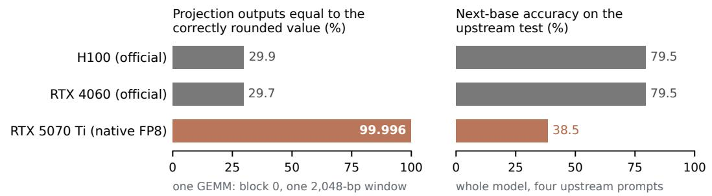

## b Swapping block 0's arithmetic against the rest

RTX 5070 Ti; four upstream prompts; expected loss 0.5020 (1B), 0.2159 (40B); tolerance 0.001

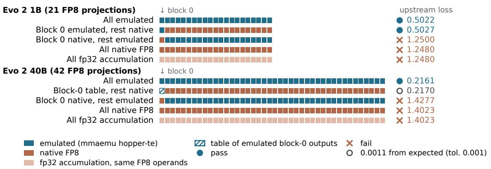

c One projection's emulated outputs restore 40B BRCA1 scoring (500 variants)  
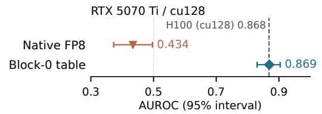

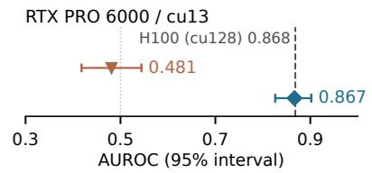  
The Evo 2 7B (not shown) passes natively on both sm\_120 GPUs.

Figure 1: Arithmetic accuracy and checkpoint compatibility are diferent targets. a, Evo 2 1B. Left: share of the 11,796,480 outputs of block 0’s FP8 projection on one 2,048-bp window that equal the correctly rounded bf16 value (one GEMM, whose rows embed only four distinct tokens: 23,040 distinct dot products; other projections and windows were not analysed). Right: next-base accuracy of the whole model over the four upstream test prompts (printed by the test; not its pass criterion). The comparison is across devices: the reference GPUs ran the oficial Transformer Engine path, whereas the RTX 5070 Ti’s native FP8 projections called torch.\_scaled\_mm; panel b’s fp32 rows are the within-device control. b, Each square is one FP8 input projection, in model order; the first is block 0’s. All runs used the RTX 5070 Ti, with every other operation native. Emulated squares are live mmaemu hopper-te; the hatched square is a lookup table of emulated hopper-te block-0 outputs; fp32 squares accumulate the same E4M3 operands in IEEE fp32. Filled circles pass the upstream forward test (within 0.001 of the expected loss), crosses fail, and the open circle lies 0.0011 from the expected value, just outside the tolerance; with the other 40B projections in bf16 the table gives 0.2168, within it (Table 1). Each loss is a mean of four bf16 per-prompt values, so distinct runs can print identical means (e.g. 1.2480). c, 40B AUROC on 500 BRCA1 variants (111 LoF), with conditional 95% variant-bootstrap intervals. Within each native/table pair the GPU, weights, software stack and cohort are fixed and only block 0’s FP8 projection changes; on the PRO 6000, native is the unmodified upstream path. The dashed line is the H100 reference (cu128), so comparing the PRO 6000 (cu13) column with it changes both device and stack; the dotted line marks 0.5. AUROCs are not ranked, and recovered variant scoring does not certify the forward or generation tests.

path (hopper-te) and 91.7% on the H100. The 1B’s accuracy roughly halved (Fig. 1a), and it failed the generation test (32.65% identity against 68.0 ± 3). Running bf16 GEMMs, which change operand quantisation as well as accumulation, failed (Table 1). The 7B, whose input projections also use FP8, passed natively (0.3477). An RTX PRO 6000 running the unmodified upstream path under a separate CUDA 13 (cu13) stack showed the same pattern (Table 1; the 7B passed both tests), as did a public 1B report from another RTX 5070 Ti [14].

At the measured projection, the native GEMM was the more accurate one (Fig. 1a). For the 1B’s first projection on one 2,048-bp window, the RTX 5070 Ti returned the correctly rounded bf16 value for 99.996% of outputs, against about 30% on either reference GPU, whose deviations lean towards zero. We then kept each projection’s E4M3 operands, scales and output epilogue fixed and accumulated the products in IEEE fp32 or, for the 1B, also in float64 rounded once to fp32. Both gave the native loss of 1.2480 in the 1B, and fp32 accumulation gave the native 1.4023 in the 40B: more accurate accumulation of the same operands, with no FP8 kernel involved, reproduces the failure (Fig. 1b). Emulating the H100’s more accurate slow-accumulation mode (Methods) at block 0 also failed (1.2275), consistent with BioNeMo’s note [16].

Exact agreement with one reference GPU was not needed either. The H100 and RTX 4060 difered on every one of the 21 captured projections of this window, yet both supported the expected model behaviour (the RTX 4060 by fp32 loss and AUROC); their tensor cores accumulate in blocks of diferent sizes [2]. For the tested first-projection calls, a truncating chain retaining 25 fraction bits matched the RTX 5070 Ti’s native outputs bit for bit; this is not a general model of sm\_120.

The failure reached a scientific application. Following the upstream notebook, we scored a seeded subset of 500 BRCA1 variants, classified by a genome-editing assay [20] (111 loss-of-function, LoF), by the change in mean sequence log-probability between variant and reference windows (Table 1). The 1B’s area under the receiver operating characteristic curve (AUROC) was 0.733 on the H100 and 0.738 on the RTX 4060, but 0.559 with native FP8. The 40B gave 0.868 on the H100 and 0.434 natively, below 0.5 (95% interval 0.373–0.497; we do not interpret the direction), with per-variant scores essentially uncorrelated with the H100’s (Pearson −0.032; 50.4% same sign).

## 2.2 Swapping one projection’s arithmetic localises the dependence

mmaemu computes the scaled FP8 GEMM of a named reference platform, a specific H100 PCIe or RTX 4060 configuration, on another CUDA GPU [18]. Its profiles model the tensor-core accumulation chain, the library’s split-K behaviour and the output epilogue. It reproduces bit for bit all 168 captured H100 outputs of the 1B’s 21 projections (two output types, two accumulation modes, two APIs; Methods), and a rule for combining split-K partial sums, fitted on an initial probe, matched all 2,416 split calls of a later sweep at the splits the H100 used. Longer windows and all 40B projections rely on the validated model rather than direct H100 captures. With either profile (hopper-te, or ada-te for the RTX 4060’s TE path), both checkpoints passed the upstream forward test on the RTX 5070 Ti (Table 1). Whole-model logits still difered from the reference GPUs’, because convolutions, attention, bf16 GEMMs and normalisation ran natively.

We then changed individual projections (Fig. 1b) under a locally hashed, self-attested analysis plan (PLAN\_C; Methods). With only block 0’s projection computed by hopper-te and the other

Table 1: Checkpoint behaviour under diferent FP8 projection implementations. The upper panel uses the reference GPUs and RTX 5070 Ti with the original cu128 (CUDA 12.8) stack; the lower panel uses the PRO 6000 with cu13 (CUDA 13). Interventions are confined to originally FP8 projections; bf16 GEMMs also change operand quantisation. Loss is the mean bf16 upstream-test loss; because each prompt’s loss is a bf16 value, distinct runs often print identical means. AUROC has a 95% variant-bootstrap interval. r and sign are Pearson correlation and same-sign percentage of per-variant ∆ against the H100. Both panels use the same 500 variants (111 LoF). PRO–H100 comparisons change both device and software stack. Reference-pair and emulated AUROC intervals overlap; no ranking is read.
<table><tr><td rowspan="2">Run</td><td colspan="4">Evo 2 1B (500 variants, 111 LoF)</td><td colspan="4">Evo 2 40B (500 variants, 111 LoF)g</td></tr><tr><td>Loss</td><td>AUROC (95% CI)</td><td colspan="2">r Sign (%)</td><td>Loss</td><td>AUROC (95% CI)</td><td></td><td>r Sign (%)</td></tr><tr><td>H100, official</td><td>0.5022</td><td>0.733 (0.673–0.792)</td><td colspan="2">ref.</td><td colspan="2">0.2159</td><td colspan="2">0.868 (0.829–0.904) ref.</td></tr><tr><td>RTX 4060, official</td><td>n.r.a</td><td>0.738 (0.680–0.797)</td><td>0.987</td><td>84.2</td><td></td><td>out of memory</td><td>(8 GB)</td><td></td></tr><tr><td>mmaemu hopper-te</td><td>0.5022b</td><td>0.735 (0.675–0.793)</td><td>0.988</td><td></td><td></td><td>86.0 0.2161 0.871 (0.833–0.905)</td><td>0.998</td><td>97.4</td></tr><tr><td>mmaemu ada-te</td><td>0.5027</td><td>0.732 (0.672–0.791)</td><td>0.986</td><td></td><td></td><td>84.2 0.2161 0.871 (0.833–0.905)</td><td>0.998</td><td>96.2</td></tr><tr><td>native FP8</td><td>1.2480</td><td>0.559 (0.501–0.615)</td><td>0.058°</td><td></td><td></td><td>58.8°1.40230.434 (0.373–0.497)</td><td>-0.032</td><td>50.4</td></tr><tr><td>bf16 GEMMs</td><td>1.3652</td><td>0.484 (0.419–0.545)c</td><td>0.065c</td><td></td><td></td><td>57.8°1.4043 0.429 (0.367–0.497)</td><td>-0.010</td><td>50.2</td></tr><tr><td>fp32 accumulationd</td><td>1.2480</td><td>0.556 (0.494–0.616)</td><td>0.096</td><td></td><td>59.2 1.4023</td><td colspan="2">not run</td><td></td></tr><tr><td>float64 accumulationd</td><td>1.2480</td><td>0.527 (0.467–0.588)</td><td>0.052</td><td>62.0</td><td></td><td>not run</td><td></td><td></td></tr><tr><td>block-0 table, rest native FP8e</td><td></td><td>0.5027 0.735 (0.676–0.794)c</td><td>0.986c</td><td>86.0c</td><td></td><td>0.21700.869 (0.830–0.904)</td><td>0.997</td><td>97.4</td></tr><tr><td>block 0 native, rest hopper-tee</td><td>1.2500</td><td>not run</td><td></td><td></td><td>1.4277</td><td></td><td>not run</td><td></td></tr><tr><td colspan="9">RTX PRO 6000 follow-up (cu13)</td></tr><tr><td></td><td></td><td>1B (500 variants, 111 LoF)</td><td></td><td></td><td></td><td>40B (500 variants, 111 LoF)</td><td></td><td></td></tr><tr><td>native FP8f</td><td>1.248</td><td>0.556 (0.494–0.618)</td><td>0.070</td><td>60.4</td><td>1.402</td><td>0.481 (0.418–0.544)</td><td>-0.082</td><td>53.2</td></tr><tr><td>block-0 table</td><td>n.r.f</td><td>0.721 (0.658–0.782)</td><td>0.987</td><td>85.0</td><td>n.r.f</td><td>0.867 (0.826–0.902)</td><td>0.997</td><td>95.2</td></tr></table>

aNot recorded; its fp32 loss is 0.5024. bEqual to the H100’s only through bf16 rounding of each prompt’s loss: fp32 losses 0.5024 (hopper-te) and 0.5026 (H100); no window’s logits are bit-identical. cComputed for this paper, after the runs, from their archived scores. dThe same E4M3 operands and scales, dequantised exactly and accumulated in IEEE fp32 (TF32 of) or in float64 rounded once to fp32, then mmaemu’s epilogue. eBlock-0 table: block 0’s FP8 projection reads a table of hopper-te outputs for all 512 token ids (plus zero pad rows), computed by mmaemu on the RTX 5070 Ti; all other FP8 projections run native FP8. The 40B’s 0.2170 lies 0.0011 from the expected value, outside the tolerance; with the other projections in bf16 it gave 0.2168, within it (two bf16 rounding steps apart, on one of the four prompts). Block 0 native: only block 0’s projection runs native FP8. fThe PRO table’s four-prompt forward loss was not included in the original run. Its AUROCs therefore do not certify a passing forward test. The PRO native losses are printed to three decimals in the upstream log. On the PRO 6000, native FP8 is the unmodified upstream Transformer Engine path; the patched path matched its logits bit for bit on the gate window. gThe 40B RTX 5070 Ti scores are from the later 500-variant follow-up; forward losses are from the earlier four-prompt tests.

20 native, the 1B passed its forward test (0.5027); with block 0 native and the other 20 emulated, it failed (1.2500). The 1B’s block 23, whose H100 outputs shrink more (least-squares gain against exact outputs 0.982, against 0.986 at block 0), stayed native in the passing configuration. Block 0’s projection sees the normalised embedding of a single token, so its outputs for all 512 token ids (plus zero pad rows) fit in a lookup table, which matched live emulation on every call. With this table and every other projection native, the 1B also passed the generation test (70.95% against $6 8 . 0 \pm 3 )$

The same projection mattered in the 40B. With block 0 native and the other 41 projections emulated, it failed (1.4277). With block 0’s table and every other projection native, it gave 0.2170, a deviation of 0.0011 from the expected value against a tolerance of 0.001; with the others in bf16 it gave 0.2168, within tolerance (Table 1). In both checkpoints, native arithmetic at this projection is enough to cause failure, and in the 40B restoring it alone comes close to restoring the forward test. The fine-tuning project’s block-23 localisation [17] uses other criteria and GPUs.

## 2.3 In the 1B, a slight shrinkage at the first projection passes and exactness fails

At the 1B’s block 0 we compared four accumulator treatments, all followed by the common epilogue (Fig. 2a). The H100-like 13-bit truncating chain (F13, equal to hopper-te bit for bit) passed at 0.5027, and exact accumulation failed at 1.2480. Multiplying the exact accumulator by the H100’s least-squares gain at this projection, $a = 0 . 9 8 5 8 6 9$ (a 1.4% shrinkage towards zero, close to F13’s own gain), passed at 0.5027, although its outputs difer from the reference chain’s; dividing the reference accumulator by $^ { a , }$ which keeps the truncation pattern but removes the shrinkage, failed at 1.3730. The gain was fitted to arithmetic outputs on known inputs, not to loss, and is in-sample: a diagnostic, not a correction. In the 40B, the analogous controls, with a gain fitted in-sample to emulated outputs on the test’s own tokens (0.938), gave 0.2173 for the scaled exact sum (0.0013 from expected, outside tolerance) and 1.4336 for the divided reference chain.

Only two of nine sampled gains on the exact accumulator passed, about 0.986 and 0.993; larger shrinkages of 2.1–4.2% (0.979, 0.972, 0.958), 1.000 and three enlargements failed (Fig. 2b). Gains 0.993 and 1.007 lie at the same distance from the exact output, yet the shrinkage passed (0.5020) and the enlargement failed (1.3730). Nor did GEMM-output distance from reference outputs decide. Random multiplicative noise on the H100-like accumulator, which kept its gain, passed for all three seeds at two such distances: native’s (0.016) and the failing 0.979 gain’s (0.010). Gains 1.000 and 0.972 at the first distance and 0.979 at the second failed. Downstream, this noise shrinks and native’s diference grows (post hoc). Raising the truncating chain’s precision gave losses of 0.5027, 0.5037 (narrowly outside tolerance), 0.7163 and 1.1406 at 13–16 fraction bits and 1.2480 at 25 bits (Fig. 2c), and 13 bits with round-to-nearest instead of truncation failed (1.1924). Less accuracy alone therefore does not restore the model, and shrinking and enlarging difer: in these sparse samples the outcome followed a small shrinkage near the H100’s rather than GEMM-output distance from the exact or reference outputs.

Evo 2 1B on RTX 5070 Ti (cu128), fixed weights

a Block 0: accumulator interventions  
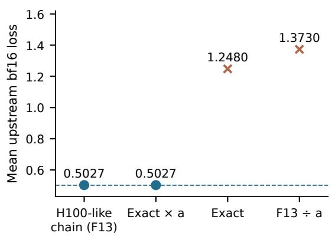

b Block 0: exact sum × sampled gain  
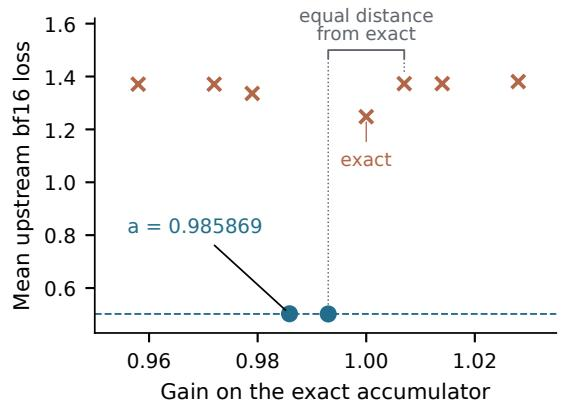

c Block 0: truncating-chain precision  
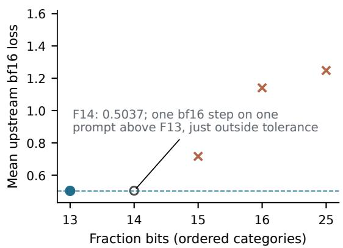

d After residual: matched perturbations  
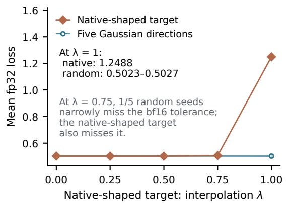

Figure 2: Local arithmetic and matched residual interventions in Evo 2 1B. All displayed losses use the RTX 5070 Ti and the four upstream forward-test prompts, in nats/base. $\mathbf { a - c , }$ Only block $0 \mathrm { { s } }$ FP8 accumulator changes; operands, scales and the epilogue are common. Loss is the upstream mean bf16 metric; the dashed line is the expected value, 0.501953125. Filled circles pass its tolerance, crosses fail and the open circle marks a narrow miss outside the tolerance (same marker as Fig. 1b). a, The H100-like truncating chain (F13, equal to hopper-te bit for bit) and the exact accumulator times the H100’s measured gain $( a = 0 . 9 8 5 8 6 9 )$ pass; exact accumulation and the F13 accumulator divided by a fail. The gain is fitted to known arithmetic outputs, not loss, and is in-sample. These treatments do not independently vary error pattern and scale; output rounding remains. b, Nine sampled gains on the exact accumulator; no passing interval or optimum is inferred between points. Gains 0.993 and 1.007 lie at equal distance from the exact output; the shrinkage passes and the enlargement fails. $\mathbf { c } ,$ Truncating-chain fraction bits are ordered categories with equal visual spacing. F14’s bf16 mean difers from F13’s passing mean only by one bf16 rounding step on one prompt, which takes it just outside the tolerance (its fp32 loss, 0.5027, is no higher than F13’s, 0.5028); from 15 bits the loss rises sharply. d, A separate intervention after block 0’s residual addition and before the MLP, using the block-0 F13 path with the other FP8 projections native. The native-shaped target is ${ \mathrm { b f 1 6 } } ( r _ { F } + \lambda ( r _ { N } - r _ { F } ) )$ , where $r _ { F }$ and $r _ { N }$ are the block-0 F13 and native residuals. At each amplitude, five Gaussian directions match the realised target perturbation’s per-token L2 norms within 1% after bf16 rounding. One zero-amplitude reference is shared. Each point is the mean fp32 loss across four prompts; thin lines join discrete evaluations. At amplitude 0.75 one random direction narrowly misses the $b f 1 6$ test tolerance and the native-shaped target also misses it; only the native-shaped target at full amplitude gives native-like loss (1.2488), while all five random directions retain low loss. These controls concern this node, checkpoint and prompt set.

## 2.4 Matched-size random changes after block 0 did not collapse the model

In captures from a separate 35-run study under a locally hashed plan, block 0’s residual addition largely cancels its branch output: across it, the native-minus-F13 discrepancy kept its absolute size but grew 12.5–13.4-fold in relative size, so the sum is about that much smaller in norm than the branch. The study asked whether size alone explains the collapse, perturbing the residual stream after this addition and before block 0’s MLP (Fig. 2d). Injecting the full native-minus-F13 residual diference gave a mean fp32 loss of 1.2488. Five Gaussian directions whose realised per-token L2 norms matched it within 1% gave 0.5023–0.5027 and passed the test’s bf16 criterion; at amplitude 0.75 (λ, the injected fraction), one random direction narrowly missed it and the native-shaped target also missed it. Splitting the observed branch diference into components parallel and orthogonal to the reference branch gave fp32 losses of 0.5094 and 0.5033 separately, both missing the bf16 criterion but far below their combination’s 1.2488. At this node and on these prompts, the structured native diference collapsed the model while matched-norm random changes did not; direction, channel structure and cross-token correlation were not separated.

## 2.5 One projection’s emulated outputs restore variant scoring on two GPUs

For the 1B’s 500 variants, full hopper-te emulation and the H100 had score-change Pearson correlation 0.988 and 86.0% sign agreement, compared with 0.987 and 84.2% between the two reference GPUs; paired bootstrap diferences included zero and AUROC intervals overlapped, which shows agreement, not equivalence or rank. The block-0 table with all other projections native gave AUROC 0.735, Pearson 0.986 and 86.0% sign agreement against the H100, not distinguishable from the reference pair at this sample size.

For the 40B on the RTX 5070 Ti, the table raised AUROC from 0.434 to 0.869 (paired diference 0.435, 95% interval 0.360–0.507), with Pearson correlation 0.997 and 97.4% sign agreement against the H100 (Figs. 1c and 3e,f); full hopper-te emulation gave 0.998 and 97.4% (no 40B reference-pair band exists: the RTX 4060 ran out of memory). The table’s forward loss of 0.2170 still misses tolerance (Section 2.2): application agreement is distinct from forward-test compatibility.

Within the PRO 6000 configuration (cu13), the same intervention raised AUROC from 0.556 to 0.721 for the 1B and from 0.481 to 0.867 for the 40B on the same 500 variants (Fig. 3a–d); the 40B’s paired improvement was 0.385 (0.306–0.463). The 40B’s per-variant correlation with the earlier H100 reference rose from −0.082 to 0.997 (Table 1), but that comparison changes both device and software stack, whereas the within-PRO intervention holds both fixed.

## 3 Discussion

For fixed weights, the more accurate GEMM was the incompatible one, as BioNeMo observed on Hopper [16]. These experiments trace this change to one projection, to a candidate property in the 1B, and back to recovery with the weights unchanged. The lesson is not that less accurate arithmetic is safer: a larger shrinkage and round-to-nearest at reference precision failed as surely as exact sums. Rather, a fixed checkpoint can depend on specific properties of its reference arithmetic.

BRCA1: 500 variants on each device and configuration

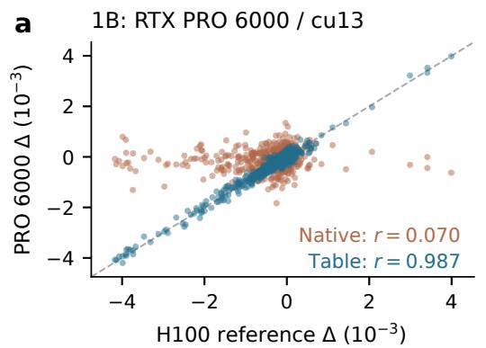

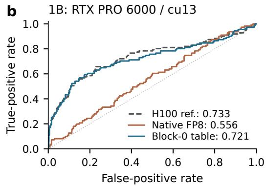

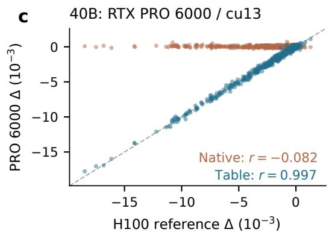

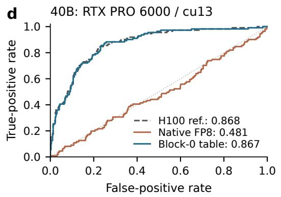

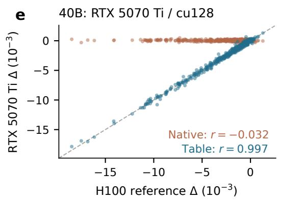

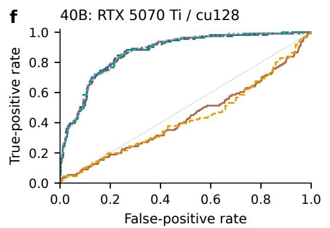

Figure 3: BRCA1 variant-efect scoring on two sm\_120 GPUs. All panels use the same 500 BRCA1 variants. a,b, 1B on the PRO 6000 (cu13). $\mathbf { c } , \mathbf { d } ,$ 40B on the PRO 6000 (cu13). $\mathbf { e , f , }$ 40B on the RTX 5070 Ti (cu128). Left panels compare native FP8 and the block-0 table of emulated hopper-te outputs with the archived H100 reference; each point is one variant, dashed lines mark equality and $r$ is Pearson correlation. Only block 0’s FP8 projection changes between native and table runs; the remaining model runs natively. Right panels show ROC curves; legend values are AUROCs. Panel $\mathrm { f , }$ whose legend sits below it, also includes full hopper-te and ada-te emulation and bf16 GEMMs. Table 1 gives 95% variant-bootstrap intervals; no ranking is inferred among the reference and emulated AUROCs, and AUROC agreement alone is not a model-level equivalence test. The H100 reference used cu128, as did the RTX 5070 Ti; PRO–H100 comparisons change both device and software. $\Delta$ is variant minus reference mean sequence log-probability; ROC curves use $- \Delta$ with LoF positive and functional/intermediate variants negative.

We do not estimate how common such dependence is among low-precision models; even within Evo 2, the 7B passes.

Validation should separate operator agreement, model function and application agreement, which disagreed here. The two reference GPUs difer in every projection’s bits yet both support the expected behaviour; full emulation passes the forward tests with logits that difer from the H100’s; the 40B table restores AUROC while missing the forward tolerance. Repeated runs of the tested calls were bit-identical on each platform, and on the tested fixed-operand calls the two sm\_120 GPUs matched bit for bit under the same cu13 stack, whereas the RTX 5070 Ti’s native outputs for the first projection difered from both reference GPUs’: determinism is not compatibility. The two reference GPUs also agreed on the sign of only 84.2% of 1B variant efects; all disagreements involved efects below four times the mean cross-GPU diference in $\Delta$ (computed for this paper). Scientific analyses should retain execution provenance and read small score changes against measured platform variation.

Evo 2’s upstream tests exposed this dependence. Releases could add application reference outputs and tolerances, together with the GPU configuration, software stack and efective accumulation mode. Libraries could expose the mode actually used: cuBLAS documents its fast-accumulation flag as taking efect only on Ada and Hopper [3], and on the RTX 5070 Ti the flag changed none of the tested outputs. Substituting emulated reference GEMMs one projection at a time could then localise such dependence; like the fp32 screen (Introduction), it is untested beyond Evo 2. Where a sensitive layer’s input depends only on the token id, its reference outputs can be tabulated: on the RTX 5070 Ti, an 8,192-bp 1B forward pass took 16% longer with the table than natively (medians; table construction excluded), whereas full emulation took 2.2 times as long; with native FP8 elsewhere, the 40B table missed the forward tolerance. Fine-tuning ofers another route, with native kernels and changed weights [16]; BioNeMo’s original 1B working on a B300, under another stack and evaluation, is an important boundary case that these experiments do not explain.

Training could compensate for an arithmetic efect whose later removal changes the model’s function: if $r = x + \alpha w x$ (input x, GEMM gain α, weight w) is fitted to a small target $\epsilon x ,$ replacing α by 1 changes r by $( 1 - \alpha ) ( \epsilon - 1 ) x / \alpha$ , amplifying the GEMM output’s relative change $( 1 - \epsilon ) / \epsilon { \mathrm { - } } \mathrm { f o l d } .$ Block 0’s cancelling residual addition (Section 2.4) is such a regime, but random changes of the same size, and either branch component alone, did not collapse the model; the construction, which models neither FP8 arithmetic nor Evo 2’s training, is a candidate explanation only. BioNeMo reports that compatibility can move with the weights: a further-trained 40B fine-tune degrades on ordinary Hopper FP8 but not with more accurate accumulation or on a B300 [16]. Establishing a training origin requires controlled training or fine-tuning with crossed evaluation under both arithmetic implementations.

Limitations. We tested one model family on two sm\_120 GPUs; the 20B, B200 and B300 were not run, and the 7B has no reference-GPU comparison. Reference evidence is one H100 PCIe and one RTX 4060 configuration. The PRO follow-up changes software as well as hardware relative to the original experiments. There are no direct H100 captures of 40B projections or tests above 8,192 projection rows. The 40B table misses the forward tolerance on the RTX 5070 Ti, the PRO table’s forward loss was not recorded, and 40B generation was not tested under emulation or with the table. Biology is one assay and one 500-variant cohort; bootstrap intervals are conditional on the recorded runs and model neither overlapping-window dependence nor run-to-run variation. The gain is in-sample, and no rescaling correction was tested. Mechanism controls use four previously studied prompts. mmaemu does not support bias, row-wise scales, autograd or CUDA graphs.

## 4 Methods

Models and software. We used the Evo 2 checkpoints evo2\_1b\_base and evo2\_40b [7], and evo2\_7b (PLAN\_C and PRO 6000, below). The 1B has 21 FP8 input projections with K = 1,920 and N = 5,760; the 40B has 42, with K = 8,192 and N = 24,576. Original reference runs used evo2 0.6.0, vtx 1.1.0 [11], torch 2.7.1+cu128 [21] and Transformer Engine 2.3.0; the RTX 5070 Ti ran the same stack without Transformer Engine, its native FP8 projections calling torch.\_scaled\_mm. The original Evo 2 runs with mmaemu [18] predate its 0.1.0 tag (ada-te: development build 0.1.0.dev0, 14–15 October; hopper-te: commit fa0fd90, 16 October); with the released code, the upstream tests (1B with both profiles; 40B with hopper-te) and 40 BRCA1 windows gave bit-identical outputs. Later runs used the release.

Platforms. The reference platforms are an NVIDIA H100 PCIe (sm\_90, 114 SMs, driver 570.148.08) and a GeForce RTX 4060 (sm\_89, 24 SMs, driver 572.16), both with cuBLASLt 12.8.3.14. The H100 was rented four times on 14–16 October 2026. The RTX 5070 Ti (sm\_120, 70 SMs, 16 GB, driver 610.88) runs mmaemu but is not a reference platform.

Execution modes. On the RTX 5070 Ti, bf16 mode runs the original weights in a bf16 GEMM, and mmaemu uses kernels h4 (hopper-te) and v4 (ada-te). The 40B, too large for the GPU, runs one block at a time from host memory (ofload). On the 1B, ofload gave the resident model’s logits exactly on every test window checked. The oficial 40B runs, and the H100’s 1B test losses, ran the upstream blocks one at a time with Transformer Engine; on the 1B this gave the upstream model’s logits bit for bit on both reference GPUs.

PRO 6000 follow-up. The follow-up used an RTX PRO 6000 Blackwell Server Edition (sm\_120, 188 SMs, 96 GB), driver 580.178.04, torch 2.14.1+cu130, cuBLASLt 13.1.1 and Transformer Engine 2.20.2, with the same Evo 2/vtx versions and released mmaemu tree. Its plan and package hashes preceded GPU measurements; the plan was informed by earlier results and was not externally preregistered. All three checkpoints passed full-file SHA-256 checks before loading. Models stayed resident. For operator comparisons, the RTX 5070 Ti ran the same torch and cuBLASLt.

The same exported cohort supplied 435 reference and 500 variant windows to the upstream scoring API, with batch size one and no BOS. The table substitution was gated by bit-identical patched-native and oficial logits on one prespecified reference window, then matched live emulation on every substituted block-0 call. New AUROC intervals and paired diferences use the existing variant-bootstrap procedure, computed post hoc.

The unmodified forward and generation tests ran in fresh processes. After the original resident 40B generation test exhausted memory during Hyena FFT cache prefill, a dated supplement reran it through the public API with force\_prompt\_threshold=128, keeping weights, prompts, seed and scoring but changing prefill scheduling; the native FP8 40B on the PRO 6000 reached 23.95% identity against $9 1 . 1 5 \pm 3$ expected. The supplement is reported separately from the original matrix, which completed 13 of 14 application cells.

Evaluation and statistics. The upstream test $\left( \mathtt { t e s t \_ e v o 2 . p y } \right)$ averages the bf16 next-base cross-entropies (natural logarithm) of four prompts and passes within $1 0 ^ { - 3 }$ of the expected loss (1B 0.501953125; 7B 0.3476563; 40B 0.2159424). It also prints next-base accuracy (argmax agreement), which is not part of its pass rule; guessing among four bases gives 25%. The generation test greedily continues the first half of each prompt for 500 bases and passes within 3 points of the expected identity with the true continuation (1B 68.0%, 7B 89.25%, 40B 91.15%). We followed the upstream notebook’s BRCA1 scoring procedure on a subset selected by sample(n=500, random\_state=0): 500 of 3,893 variants, including 111 LoF variants. These AUROCs are not comparable with full-set values. Windows of 8,192 bp are centred on the variant, and ∆ is the variant window’s mean nextbase log-probability minus the reference window’s. The AUROC of −∆ for LoF has a 95% percentile bootstrap interval (2,000 unstratified variant resamples; NumPy default\_rng(0)). Functional and intermediate variants form the negative class. Paired comparisons use resamples shared across runs. These intervals are conditional on the recorded inference runs and do not quantify uncertainty across genomic regions, assays or GPU runs.

A later cu128 follow-up extended five RTX 5070 Ti 40B configurations from 100 to 500 variants on 20–21 October 2026. The first-100 outcomes were known; inputs and scripts were locally hashed before measurement. Each configuration rescored 935 windows. All 198 first-100 window scores matched their historical files bit for bit in every configuration; all 935 table calls matched live hopper-te.

Arithmetic model. mmaemu models a tensor-core FP8 GEMM as chains of block fused multiplyadds, each adding a block of products to an incoming accumulator in one operation [2, 22–24], with blocks of 16 (ada) or 32 (hopper) products. Each block aligns its products and incoming accumulator to a common exponent, truncates the aligned terms towards zero to 13 fraction bits, sums them exactly, then truncates the result to 13 fraction bits relative to its own leading bit. Slow accumulation sums 128-element chains in round-to-nearest fp32. Split-K deals 64-wide k-tiles to the splits in turn on the RTX 4060. On the H100, each split takes contiguous 128-wide tiles and the partial sums are added serially. The epilogue computes $\mathrm { b f 1 6 ( R N _ { 3 2 } ( } a c c \cdot \mathrm { R N _ { 3 2 } } ( s _ { a } s _ { b } ) ) )$ . For the 168 H100 comparisons, full outputs were stored for three of the 21 projections and the first 256 rows for the other 18.

Additional runs for this paper. Runs A7, A9, A11 and A12 on the RTX 5070 Ti were specified, with their criteria and readings, in a plan hashed (self-attested) on 17 October 2026 before any of them started; all use tag v0.1.0. A7 recomputed the first 1B projection natively from the recorded operands; as a gate, it reproduced the recorded diference count. It then compared all outputs with the exact product, accumulated in float64 (exact at $K = 1 \small { , } 9 2 0 )$ , scaled and rounded once to bf16. A9 (accumulation control) dequantises the E4M3 operands exactly, accumulates them in IEEE fp32 (TensorFloat-32 of) or in float64 rounded once to fp32, and applies mmaemu’s epilogue. An amendment, hashed before the A9 runs, adds the 40B upstream test with fp32 accumulation; a smoke test of both modes on two 1B windows had finished about one minute earlier, and whether its output had been seen is not recorded. A second amendment dropped a planned 40B BRCA1 run before it started. A11 timed native torch.\_scaled\_mm and kernels h4 and v4 with CUDA events on synthetic operands of Evo 2 GEMM shapes; full emulated calls took 21.8–27.7 (h4) and 23.0–28.5 (v4) times as long as native. A12 rescored 40 windows of the hopper-te 1B BRCA1 pass, which had run through ofload, on the resident model.

Localisation runs (PLAN\_C). The single-projection runs of Sections 2.1–2.2, the runs of Section 2.3, the block-0 tables, the generation test and the 7B were specified, with classes, gates and readings, in an analysis plan (PLAN\_C) frozen by SHA-256 on 18 October 2026 at 16:20 PDT, before any of its GPU runs. The hash is self-attested, not deposited with a third party before the runs, and the plan text did not change. A ten-entry deviation log records re-hashed code fixes and run-setting changes, errata, an analysis note, amendments for another plan and run-order changes; the timing step, initially deferred, completed on 19 October with the frozen command. The analysis scripts were not frozen before the runs; the BRCA1 statistics script was written after the scores existed. Classes: strict, the upstream pass criterion; broken, above 1.0. The block-0 diagnostics, not fixes, were: the exact sum times g, or (Ea) times the H100’s least-squares gain against it, $a = 0 . 9 8 5 8 6 9$ , fitted on one of six evaluated windows (in-sample); hopper-te’s accumulator divided by a (Ha) or times $1 + \sigma z$ (z standard normal per output, fixed per distinct input row; $\sigma = 0 . 0 1 6$ or 0.0104; three seeds); and truncating Hopper-structured chains with 13–16 or 25 fraction bits (13 equals hopper-te, 25 native, bit for bit) or 13 bits rounded to nearest. The 40B analogues Ea40 and Ha40 use a gain fitted likewise to hoppe ${ \tt r } ^ { - } { \tt t e } ^ { \prime } \mathrm { s }$ block-0 outputs over the test’s own token rows. Distances are token-weighted relative L2 distances, normalised by the exact outputs; a post hoc CPU recomputation agreed. Cells were grouped after the runs by precedent recorded before them (the same or an analogous observation). Retests: for the 1B, the test losses of native, bf16 and full emulation, the block-0 localisation and tables, the exact sum $( g = 1$ , equal to float64 accumulation), the 13- and 25-bit chains (equal to hopper-te and native; that the 25-bit chain equals native bit for bit, gate G3, was new), native’s generation failure (issue #132), the fast-accumulation flag (another software environment), and block 23, slow accumulation and the table’s BRCA1 scores (exploratory runs below); for the 40B, native, full emulation and the table; for the 7B, native (issue #157; an exploratory bf16 run). All other cells had no recorded precedent, including the scaled and perturbed block-0 outputs $( g \neq 1$ , Ea, Ha, noise), the 14–16-bit and round-to-nearest chains, the fp32 residual additions, the generation tests of the table and of full emulation, and the other 40B and 7B cells. The 7B also passed with full emulation (0.3481) and the table (0.3477); the 1B’s fp32 residual additions changed no class.

Matched residual interventions. A subsequent locally hashed plan, informed by PLAN\_C and not externally preregistered, specified 35 fresh-process 1B cells using the same cu128 stack and four prompts. We captured the actual biased branch h and bf16 residual sum r on the local F13 and native paths, with the other 20 FP8 projections native. Residual replay and decomposition endpoints reproduced baseline logits bitwise. Five fixed Gaussian seeds were evaluated at amplitudes 0.25, 0.5, 0.75 and 1, with a shared zero-amplitude reference. Realised post-bf16 per-token perturbation norms matched the corresponding native-shaped injection within 1% for every token (maximum relative mismatch 0.166%). Neither labels nor losses entered matching. Branch decomposition used one inner product per complete prompt. The relative capture ratio of native-minus-F13 discrepancies is $( \| \delta r \| / \| r \| ) / ( \| \delta h \| / \| h \| )$

Exploratory runs. Runs on the RTX 4060 on 10–11 October 2026, before mmaemu’s first commit and without criteria fixed in advance, had shown most retested efects. A quantise–dequantise bf16 stand-in for block 0’s FP8 GEMM gave a high 1B test loss (1.081), whereas stand-ins for block 23 or the 19 others left it low. A table of block 0’s Transformer Engine outputs with bf16 elsewhere passed the 1B test, gave a 40B fp32 loss of 0.2165 and gave 1B BRCA1 ∆ correlating at 0.988 with the oficial RTX 4060 run. With all 21 projections accumulated in fp32, or in torch.\_scaled\_mm with fast accumulation of, the 1B gave high fp32 losses, but not with the table and fp32 accumulation elsewhere; fast accumulation on matched Transformer Engine in every recorded digit. The fp32 runs’ code is not preserved, and the torch.\_scaled\_mm runs’ script version is not established.

## Code and data availability

mmaemu 0.1.0 is free software under the Apache License 2.0, at https://github.com/astding/ mmaemu, on PyPI as mmaemu. The v0.1.0 release is archived at https://zenodo.org/records/ 23440103 (version DOI 10.5281/zenodo.23440103) [18]. Documentation: https://astding.github. io/mmaemu/. Repository paths refer to commit ab37ab1, which difers from the tag v0.1.0 only in documentation and citation metadata. The release’s validation logs under docs/validation\_logs/ contain the original hardware-validation and Evo 2 inference logs, result files and per-variant BRCA1 scores. docs/validation.md summarises them. The oficial RTX 4060 Evo 2 1B outputs are in examples/data/, and examples/evo2\_blackwell.ipynb and examples/evo2\_offload.py run Evo 2 with mmaemu. Continuous integration replays committed subsets of the RTX 4060 and H100 recordings. Larger hardware recordings and later datasets, including runs A7, A9, A11 and A12, PLAN\_C with its deviation log, the matched residual interventions, the RTX PRO 6000 and RTX 5070 Ti 40B 500-variant follow-ups, the exploratory RTX 4060 probes, a ledger tracing each reported number to its source file, post hoc analyses and figure scripts, are deposited with SHA-256 manifests at Zenodo (DOI 10.5281/zenodo.23740390). Evo 2 checkpoints are the Arc Institute’s releases on Hugging Face; the BRCA1 data are those of Findlay et al. [20], as read by the evo2 notebook.

## Competing interests

The authors declare no competing interests.

## Funding

This work received no funding. Both authors worked on personal time, with personal equipment and no institutional resources; GPU rental time was paid for personally by X.D.

## Author contributions

X.D. and Z.Q. conceived and designed the study, wrote the software, ran the experiments and analyses, and wrote the manuscript. Both authors reviewed and approved the final manuscript. AI assistance is described below.

## Acknowledgements

The authors thank Faizan A. Khattak and Mantas Mikaitis for the MATLAB Tensor Core toolbox [2, 23], from whose models mmaemu’s block model and presets are translated and whose validation vectors are part of mmaemu’s tests. The authors thank the Arc Institute and the Evo 2 collaborators for their substantial contribution to genomic modelling and for publicly sharing model weights, inference software, tests and evaluation notebooks. These resources made the present investigation possible. The authors also thank the community contributors who documented their observations in evo2 issue #157. This work and mmaemu are independent: they are not afiliated with, funded by or endorsed by NVIDIA Corporation, the Arc Institute, X.D.’s employer or Emory University. Z.Q. contributed independently, in a personal capacity. NVIDIA, GeForce, RTX, CUDA, cuBLAS, Hopper, Blackwell, H100 and Transformer Engine are trademarks of NVIDIA Corporation.

## Use of AI assistance

Claude (Anthropic) and Codex (OpenAI) assisted with developing and debugging computational code, planning and executing experiments, analysing recorded outputs, preparing figures, and drafting and editing the manuscript. Both authors take full responsibility for the manuscript’s accuracy, integrity and originality.

## References

[1] Paulius Micikevicius, Stuart Oberman, Pradeep Dubey, Marius Cornea, Andres Rodriguez, Ian Bratt, Richard Grisenthwaite, Norm Jouppi, Chiachen Chou, Amber Hufman, Michael Schulte, Ralph Wittig, Dharmesh Jani, and Summer Deng. OCP 8-bit floating point specification (OFP8), revision 1.0. Specification, Open Compute Project, 2023. URL https://www.opencompute.org/documents/ ocp-8-bit-floating-point-specification-ofp8-revision-1-0-2023-12-01-pdf-1. Approved 20 June 2023; document version of 1 December 2023.

[2] Faizan Khattak and Mantas Mikaitis. Accurate models of NVIDIA tensor cores. ACM Transactions on Architecture and Code Optimization, 23(3):1–25, 2026. doi: 10.1145/3830409.

[3] NVIDIA. cuBLAS library documentation (CUDA Toolkit 12.8), 2025. URL https://docs.nvidia. com/cuda/archive/12.8.0/cublas/index.html. Last updated 23 January 2025.

[4] David Monniaux. The pitfalls of verifying floating-point computations. ACM Transactions on Programming Languages and Systems, 30(3):1–41, 2008. doi: 10.1145/1353445.1353446.

[5] Jiayi Yuan, Hao Li, Xinheng Ding, Wenya Xie, Yu-Jhe Li, Wentian Zhao, Kun Wan, Jing Shi, Xia Hu, and Zirui Liu. Understanding and mitigating numerical sources of nondeterminism in LLM inference. In Advances in Neural Information Processing Systems, volume 38, pages 169819–169851, 2025. doi: 10.52202/085713-5653.

[6] DeepSeek-AI. DeepSeek-V3 technical report. arXiv:2412.19437, 2024. arXiv v2 (18 Feb 2025).

[7] Garyk Brixi, Matthew G. Durrant, Jerome Ku, Mohsen Naghipourfar, Michael Poli, Gwanggyu Sun, Greg Brockman, Daniel Chang, Alison Fanton, Gabriel A. Gonzalez, Samuel H. King, David B. Li, Aditi T. Merchant, Eric Nguyen, Chiara Ricci-Tam, David W. Romero, Jonathan C. Schmok, Ali Taghibakhshi, Anton Vorontsov, Brandon Yang, Myra Deng, Liv Gorton, Nam Nguyen, Nicholas K. Wang, Michael T. Pearce, Elana Simon, Etowah Adams, Zachary J. Amador, Euan A. Ashley, Stephen A. Baccus, Haoyu Dai, Steven Dillmann, Stefano Ermon, Daniel Guo, Michael H. Herschl, Rajesh Ilango, Ken Janik, Amy X. Lu, Reshma Mehta, Mohammad R. K. Mofrad, Madelena Y. Ng, Jaspreet Pannu, Christopher Ré, John St. John, Jeremy Sullivan, Joseph Tey, Ben Viggiano, Kevin Zhu, Greg Zynda, Daniel Balsam, Patrick Collison, Anthony B. Costa, Tina Hernandez-Boussard, Eric Ho, Ming-Yu Liu, Thomas McGrath, Kimberly Powell, Sudarshan Pinglay, Dave P. Burke, Hani Goodarzi, Patrick D. Hsu, and Brian L. Hie. Genome modelling and design across all domains of life with Evo 2. Nature, 652 (8112):1349–1361, 2026. doi: 10.1038/s41586-026-10176-5.

[8] Arc Institute. Evo 2 README: FP8 and Transformer Engine requirements, 2026. URL https://github. com/ArcInstitute/evo2/blob/53f195997257c56c00e5ef8d33a54f5baad143a6/README.md. Commit 53f1959, 19 June 2026.

[9] Gonzalo Benegas, Sanjit Singh Batra, and Yun S. Song. DNA language models are powerful predictors of genome-wide variant efects. Proceedings of the National Academy of Sciences, 120(44):e2311219120, 2023. doi: 10.1073/pnas.2311219120.

[10] Eric Nguyen, Michael Poli, Matthew G. Durrant, Brian Kang, Dhruva Katrekar, David B. Li, Liam J. Bartie, Armin W. Thomas, Samuel H. King, Garyk Brixi, Jeremy Sullivan, Madelena Y. Ng, Ashley Lewis, Aaron Lou, Stefano Ermon, Stephen A. Baccus, Tina Hernandez-Boussard, Christopher Ré, Patrick D. Hsu, and Brian L. Hie. Sequence modeling and design from molecular to genome scale with Evo. Science, 386(6723):eado9336, 2024. doi: 10.1126/science.ado9336.

[11] Zymrael. Vortex: inference and numerics for multi-hybrid AI model architectures, 2024. URL https: //github.com/Zymrael/vortex. Apache-2.0; accessed 17 October 2026.

[12] Jerome Ku, Eric Nguyen, David W. Romero, Garyk Brixi, Brandon Yang, Anton Vorontsov, Ali Taghibakhshi, Amy X. Lu, Dave P. Burke, Greg Brockman, Stefano Massaroli, Christopher Ré, Patrick D. Hsu, Brian L. Hie, Stefano Ermon, and Michael Poli. Systems and algorithms for convolutional multihybrid language models at scale. arXiv:2503.01868, 2025.

[13] NVIDIA. Transformer Engine, 2025. URL https://github.com/NVIDIA/TransformerEngine. Version 2.3, released 14 May 2025.

[14] ongiaf. Evo2\_1b\_base on 5070 get unexpected loss on Blackwell (GitHub issue #157, ArcInstitute/evo2), 2025. URL https://github.com/ArcInstitute/evo2/issues/157. Opened 23 July 2025; open as of 17 October 2026.

[15] dongwei2001. 7b model passed test while other models all failed (GitHub issue #132, ArcInstitute/evo2), 2025. URL https://github.com/ArcInstitute/evo2/issues/132. Opened 30 May 2025; closed 30 May 2025; last comment 27 August 2025.

[16] NVIDIA. BioNeMo framework: Evo2 overview (available models, loss and AUC evaluation), 2026. URL https://docs.nvidia.com/bionemo-framework/latest/main/developer-guide/ bionemo-evo2/bionemo-evo2-Overview/. Undated “latest” documentation page; accessed 17 October 2026.

[17] l1joseph. evo2\_ft: Evo2 (AMD ROCm port) — hardware-agnostic inference via FP8-recipe fine-tuning (GitHub repository), 2026. URL https://github.com/l1joseph/evo2\_ft/blob/ d026e838a63d1873f9170bc917cc912aed45c248/README.md. README at commit d026e83 (19 September 2026); no preprint; accessed 19 October 2026.

[18] Xun Ding and Ziyuan Qin. mmaemu: bit-accurate emulation of NVIDIA tensor-core FP8 GEMM numerics. Zenodo, 2026. URL https://zenodo.org/records/23440103. Version 0.1.0, doi:10.5281/zenodo.23440103. Concept DOI (all versions): 10.5281/zenodo.23440102.

[19] Peichen Xie, Shuotao Xu, Yang Wang, Fan Yang, and Mao Yang. Bit-accurate modeling of GPU matrix multiply-accumulate units: Demystifying numerical discrepancy and accuracy. arXiv:2511.10909, 2025. arXiv v3 (28 Sep 2026); v1 titled “MMA-Sim: Bit-Accurate Reference Model of Tensor Cores and Matrix Cores”. To appear in the 59th IEEE/ACM International Symposium on Microarchitecture (MICRO 2026).

[20] Gregory M. Findlay, Riza M. Daza, Beth Martin, Melissa D. Zhang, Anh P. Leith, Molly Gasperini, Joseph D. Janizek, Xingfan Huang, Lea M. Starita, and Jay Shendure. Accurate classification of BRCA1 variants with saturation genome editing. Nature, 562(7726):217–222, 2018. doi: 10.1038/ s41586-018-0461-z.

[21] Jason Ansel, Edward Yang, Horace He, Natalia Gimelshein, Animesh Jain, Michael Voznesensky, Bin Bao, Peter Bell, David Berard, Evgeni Burovski, Geeta Chauhan, Anjali Chourdia, Will Constable, Alban Desmaison, Zachary DeVito, Elias Ellison, Will Feng, Jiong Gong, Michael Gschwind, Brian Hirsh, Sherlock Huang, Kshiteej Kalambarkar, Laurent Kirsch, Michael Lazos, Mario Lezcano, Yanbo Liang, Jason Liang, Yinghai Lu, C. K. Luk, Bert Maher, Yunjie Pan, Christian Puhrsch, Matthias Reso, Mark Saroufim, Marcos Yukio Siraichi, Helen Suk, Shunting Zhang, Michael Suo, Phil Tillet, Xu Zhao, Eikan Wang, Keren Zhou, Richard Zou, Xiaodong Wang, Ajit Mathews, William Wen, Gregory Chanan, Peng Wu, and Soumith Chintala. PyTorch 2: Faster machine learning through dynamic Python bytecode transformation and graph compilation. In Proceedings of the 29th ACM International Conference on Architectural Support for Programming Languages and Operating Systems, Volume 2 (ASPLOS ’24), pages 929–947. ACM, 2024. doi: 10.1145/3620665.3640366.

[22] Pierre Blanchard, Nicholas J. Higham, Florent Lopez, Theo Mary, and Srikara Pranesh. Mixed precision block fused multiply-add: Error analysis and application to GPU tensor cores. SIAM Journal on Scientific Computing, 42(3):C124–C141, 2020. doi: 10.1137/19m1289546.

[23] Faizan A. Khattak and Mantas Mikaitis. The MATLAB Tensor Core: a set of models of tensor cores written in MATLAB, 2025. URL https://github.com/north-numerical-computing/ MATLAB-tensor-core. BSD-2-Clause; accessed 17 October 2026.

[24] Massimiliano Fasi, Nicholas J. Higham, Mantas Mikaitis, and Srikara Pranesh. Numerical behavior of NVIDIA tensor cores. PeerJ Computer Science, 7:e330, 2021. doi: 10.7717/peerj-cs.330.