# Adaptive Federated Optimization Across Smooth and Nonsmooth Regimes

Zimeng Wang1,∗, Ali Dadras2,∗, and Alp Yurtsever3

1,2,3Department of Mathematics and Mathematical Statistics, Ume˚a University, Sweden 1zimeng.wang@umu.se 2ali.dadras@umu.se 3alp.yurtsever@umu.se

## Abstract

AdaGrad-style methods can simultaneously adapt to both the order and constants of smoothness in centralized optimization. However, existing extensions to federated optimization with heterogeneous client objectives and multiple local steps require the smoothness order to be specified in advance. We address this limitation with AdaFed, a federated method that adapts across several regimes under a single choice of parameters. In the deterministic setting, AdaFed achieves an $O ( 1 / T )$ convergence rate for both smooth nonconvex and smooth convex objectives, and an $\widetilde { O } ( 1 / \sqrt { T } )$ rate for Lipschitz nonsmooth convex objectives. Under a light-tailed stochastic-gradient noise assumption, these guarantees extend to the stochastic setting with additional logarithmic factors and noise-dependent terms. Experiments across the three problem classes further support our theoretical findings.

## 1 Introduction

Federated learning (FL) aims to train a shared model from data distributed across many clients without requiring the clients to transmit their raw data. The resulting optimization problem is often formulated as

$$
\operatorname* { m i n } _ { x \in \mathbb { R } ^ { d } } F ( x ) : = \frac { 1 } { m } \sum _ { i = 1 } ^ { m } F _ { i } ( x ) .\tag{1}
$$

Here $F _ { i } : \mathbb { R } ^ { d } $ R is the local loss associated with the i-th client, which in stochastic settings can be expressed as:

$$
F _ { i } ( x ) = \mathbb { E } _ { \xi \sim \mathcal { D } _ { i } } [ \ell _ { i } ( x ; \xi ) ] ,
$$

and the data distributions $\mathcal { D } _ { i }$ can difer across clients. To reduce communication cost when m is large, classic algorithms such as FedAvg [McMahan et al., 2017, Li et al., 2020] allow each participating client to perform multiple local stochastic-gradient steps before its update is aggregated at the server. When the diference among the data distributions $\{ \mathcal { D } _ { i } \} _ { i = 1 } ^ { m }$ is significant, methods such as SCAFFOLD [Karimireddy et al., 2020] and FedVARP [Jhunjhunwala et al., 2022] address the local drift arising from multiple local steps through control variates or server-side variance reduction. However, both theoretical guarantees and practical behavior of these methods depend on step-size schedules whose efective choices vary with the problem class and its related parameters (e.g., smoothness, gradient noise, heterogeneity, etc.).

In the centralized setting, adaptive gradient methods ofer a natural way to overcome this reliance on prior problem knowledge. The pioneering method AdaGrad [Duchi et al., 2011] adjusts its step sizes adaptively using accumulated gradient information. Beyond empirical success, AdaGrad-type adaptive methods [Levy, 2017, Levy et al., 2018, Kavis et al., 2019, Ene et al., 2021] also exhibit an important theoretical advantage: a single update rule can achieve universal (in the sense of Nesterov [2015]) convergence by attaining the rates associated with smooth and nonsmooth objectives without knowing in advance the problem class or smoothness parameter.

However, transferring this universal convergence property to FL settings is highly nontrivial, where algorithms couple client-side local updates with server-side aggregation. Server-level adaptation alone is insuficient to guarantee universal convergence because the main optimization steps occur locally on clients, and their resulting updates directly shape server aggregation. Client-level adaptation can also fail because individual client gradients need not vanish even at a stationary point of F. Hence naively accumulating the client gradients during local updates may cause the step size to continuously decay. Several adaptive FL methods have been proposed in the literature. Specifically, server-level methods include FedOpt [Reddi et al., 2021] and FedAMS/FedCAMS [Wang et al., 2022], client-level methods include ∆-SGD [Kim et al., 2024] and FedSPS [Mukherjee et al., 2023], and methods operating at both levels include Mime [Karimireddy et al., 2021], FAFED [Wu et al., 2023], and FedAda2 [Lee et al., 2026]. Despite these eforts, the convergence results established in these works are tailored to specific problem classes, and some guarantees still require knowledge of smoothness parameters. Consequently, none of these works addresses the question central to this work:

Can a single adaptive FL method, without prior knowledge of the problem class or related parameters, automatically attain the convergence rates associated with smooth nonconvex, smooth convex, and Lipschitz convex objectives?

## 1.1 Our contributions

We answer this question afirmatively with a new AdaGrad-type FL method. Our contributions are summarized as follows.

• Algorithm. We develop a new adaptive FL method for solving (1) that accommodates heterogeneous client objectives, stochastic local gradients, and multiple local updates per communication round. Its key feature is a scaled AdaGrad-type step size that is shared across clients and fixed throughout each round, and is updated after server aggregation based on the server displacement.

• Universal convergence. The same algorithm automatically attains appropriate convergence rates for smooth nonconvex, smooth convex, and Lipschitz convex objectives, without prior knowledge of the problem class or associated parameters. These rates match those of classical AdaGrad in centralized settings up to logarithmic factors, and benefit jointly from the number of clients and multiple local updates (see Table 1 for a summary). To the best of our knowledge, this is the first universal convergence guarantee in FL that covers all three problem classes with a single algorithm and without problem-dependent tuning.

• Further extensions. We extend the algorithm to independent, nonuniform partial participation and establish universal convergence with exact local gradients across the same three problem classes; see Appendix E. We also prove that, with exact local gradients, the full-participation algorithm automatically adapts to H¨older smoothness of any order $\alpha \in [ 0 , 1 ]$ for convex objectives, attaining the corresponding $\tilde { O } ( \tilde { T ^ { - ( 1 + \alpha ) / 2 } } )$ rate; see Appendix F.

Compared to centralized analyses of AdaGrad [Duchi et al., 2011, Ward et al., 2020, Wang et al., 2023], FL creates two additional dificulties: local drift from multiple client updates and delayed accumulation due to unavailable aggregated gradient information. To handle these challenges, we link local drift to the server displacement, thereby reducing the analysis to server updates. We then bound this displacement almost surely by the maximal noise, whose moments admit logarithmic bounds, and use the result with a shifted summation lemma to control delayed accumulation. Notably, our analysis removes bounded-domain or bounded-iterate assumptions, which are commonly used in AdaGrad-type analyses [Levy, 2017, Levy et al., 2018, Kavis et al., 2019, Ene et al., 2021].

The remainder of the paper is organized as follows. Section 2 reviews related work. Section 3 presents the algorithm. Section 4 gives the main convergence results and a proof sketch. Section 5 reports the

Table 1: Summary of convergence results for Algorithm 1. ${ \widetilde { O } } ( \cdot )$ hides logarithmic factors.
<table><tr><td colspan="3">Problem class</td><td rowspan="2">Gradient type Assumptions</td><td rowspan="2"></td><td rowspan="2">Convergence</td></tr><tr><td>Smooth</td><td>1 Lipschitz</td><td>Convex</td></tr><tr><td>V</td><td>X</td><td>X</td><td>Exact</td><td>Assm. 4.1</td><td> $O \left( { \frac { 1 } { T } } \right)$ </td></tr><tr><td>√</td><td>X</td><td>X</td><td>Stochastic</td><td>Assms. 4.1, 4.2</td><td> $\begin{array} { r } { \widetilde { O } \big ( \frac { 1 } { T } + \frac { \sigma } { \sqrt { m K T } } \big ) } \end{array}$ </td></tr><tr><td>√</td><td>X</td><td>√</td><td>Exact</td><td>Assm. 4.1</td><td> $O \left( { \frac { 1 } { T } } \right)$ </td></tr><tr><td>√</td><td>X</td><td>√</td><td>Stochastic</td><td>Assms. 4.1, 4.2</td><td> $\begin{array} { r } { \widetilde { O } \big ( \frac { 1 } { T } + \frac { \sigma } { \sqrt { m K T } } \big ) } \end{array}$ </td></tr><tr><td>X</td><td>√</td><td>√</td><td>Exact</td><td>Assm. 4.1</td><td> $\scriptstyle { \widetilde { O } } \left( { \frac { 1 } { \sqrt { T } } } \right)$ </td></tr><tr><td>×</td><td>√</td><td>√</td><td>Stochastic</td><td>Assms. 4.1, 4.2</td><td> $\begin{array} { r } { \widetilde { O } \big ( \frac { \cdot \mathrm { ~ i ~ } ^ { - } } { \sqrt { T } } + \frac { \sigma } { \sqrt { m K T } } \big ) } \end{array}$ </td></tr></table>

numerical experiments and Section 6 concludes the paper. All technical proofs are deferred to Appendix A–D.   
Extensions to partial participation and H¨older smoothness are established in Appendix E and F, respectively.

## 2 Related Work

Universal adaptive optimization. AdaGrad [Duchi et al., 2011] introduced adaptive step sizes based on accumulated gradients, with popular variants including Adam [Kingma and Ba, 2015] and AMSGrad [Reddi et al., 2018]. Scalar AdaGrad steps have since been analyzed for stochastic and nonconvex optimization under progressively weaker assumptions. Kavis et al. [2022], Ward et al. [2020] provide high-probability guarantees under uniformly bounded gradients, which is later extended in Attia and Koren [2023], Faw et al. [2022], Wang et al. [2023] with relaxed assumptions. For convex optimization, AcceleGrad [Levy et al., 2018], universal accelerated methods [Ene et al., 2021, Kavis et al., 2019, Levy et al., 2018] improve over AdaGrad by achieving near-optimal rates simultaneously for convex smooth and nonsmooth objectives. Nesterov’s universal method [Nesterov, 2015] instead uses line search. Further extensions treat inexact stochastic oracles [Rodomanov et al., 2024] and H¨older smoothness [Orabona, 2023]. More closely related, Wang and Yurtsever [2026] replace gradient accumulation with gradient-mapping accumulation and obtain a method for smooth nonconvex, smooth convex, and nonsmooth convex composite problems.

Adaptive federated optimization. Existing adaptive FL methods difer mainly in where the adaptive step size is maintained. At the server, FedOpt [Reddi et al., 2021] applies AdaGrad, Adam, or Yogi to aggregated client displacements, while FedAMS/FedCAMS [Wang et al., 2022] add AMSGrad-style stabilization. Other server-side variants include FedUR [Zhang et al., 2023], FedDuA [Takakura et al., 2025], FedAgg Yuan and Wang [2025], and the asynchronous method FADAS [Wang et al., 2024]. At the client level, Local AdaAlter [Xie et al., 2020] synchronizes AdaGrad denominators, whereas ∆-SGD [Kim et al., 2024] follows a diferent type of adaptivity [Malitsky and Mishchenko, 2020] to adapt each client’s step size to its local smoothness. Other local adaptive methods include FedSPS [Mukherjee et al., 2023] and FedLADA [Sun et al., 2023]. Methods acting at both levels include FAFED [Wu et al., 2023] and $\mathrm { F e d } \mathrm { { \dot { A } d a } ^ { 2 } }$ [Lee et al., 2026], which coordinate server statistics, preconditioners, or global corrections with local adaptation. However, their analyses largely focus on one specific problem class (mostly smooth nonconvex or smooth convex), and some results require smoothness-dependent step-size conditions (e.g., FedOpt [Reddi et al., 2021] and FAFED [Wu et al., 2023]). In contrast, our method uses one unchanged rule to adapt across three problem classes, without knowledge of problem-related parameters. A more detailed summary of existing adaptive FL methods is provided in Appendix H.

Algorithm 1 Adaptive Federated Learning Method (AdaFed)   
Require: initial model $x _ { 1 } \in \mathbb { R } ^ { d } ;$ local-step count $K \geq 1 ;$ ; server iterations $T \geq 1 ;$ prescribed local scales   
$\tau _ { t } > 0 ;$ parameters $\gamma , \eta > 0$   
Initialize the step size $\eta _ { 1 } : = \eta / \gamma .$   
for $t = 1 , 2 , \dots , \bar { T }$ do   
Server broadcasts $( x _ { t } , \eta _ { t } , \tau _ { t } )$   
for each client $i \in [ m ]$ in parallel do   
Initialize $x _ { i , 0 } ^ { t } : = \dot { x _ { t } } .$   
for $k = 0 , \ldots , K - 1$ do   
Update $x _ { i , k + 1 } ^ { t } : = x _ { i , k } ^ { t } - \tau _ { t } \eta _ { t } g _ { i , k } ^ { t }$ with $g _ { i , k } ^ { t } \approx \nabla F _ { i } ( x _ { i , k } ^ { t } )$   
end for   
Set $\Delta _ { i } ^ { t } : = x _ { i , K } ^ { t } - x _ { t }$ and send $\Delta _ { i } ^ { t }$ to the server.   
end for   
Server updates the model and the step size:   
$x _ { t + 1 } : = x _ { t } + \frac { 1 } { m K \tau _ { t } } \sum _ { i = 1 } ^ { m } \Delta _ { i } ^ { t } , \qquad \frac { 1 } { \eta _ { t + 1 } ^ { 2 } } : = \frac { 1 } { \eta _ { t } ^ { 2 } } \left( 1 + \frac { \| x _ { t + 1 } - x _ { t } \| ^ { 2 } } { \eta ^ { 2 } } \right)$   
end for   
Output: $\hat { x } _ { T }$ chosen uniformly at random from $\{ x _ { t } \} _ { t = 1 } ^ { T }$

## 3 Algorithm Design

Notation. We use $\| \cdot \|$ for the Euclidean norm and denote $[ n ] : = \{ 1 , 2 , \dots , n \}$ . For a stochastic algorithm, we denote by $\mathbb { E } _ { t } [ \cdot ] : = \mathbb { E } \left[ \cdot \mid \mathcal { F } _ { t } \right]$ the expectation conditioned on $\mathcal { F } _ { t } .$ , which contains all the information available at step t. Depending on the diferentiability of $F ,$ , we use $\nabla F$ to denote the gradient or a subgradient of $F .$

Algorithm overview. We present the adaptive federated learning method in Algorithm 1. It initializes the server model at $x _ { 1 }$ and the shared step size at $\eta _ { 1 } = \eta / \gamma$ . At each round t, the server broadcasts $( x _ { t } , \eta _ { t } , \tau _ { t } )$ to all m clients. Each client i starts from $x _ { i , 0 } ^ { t } = x _ { t }$ , performs K local (stochastic) gradient /subgradient steps with step size $\tau _ { t } \eta _ { t }$ , and returns its local displacement $\Delta _ { i } ^ { t } = x _ { i , K } ^ { t } - { \dot { x } } _ { t }$ to server. The server then computes the new model and uses it to update the step size.

Note that the scales $\{ \tau _ { t } \}$ are introduced to mitigate local drift due to multiple local updates. At the server, the factor $1 / \tau _ { t }$ in the aggregation cancels this scaling, so that $\tau _ { t }$ does not directly afect the server-level update. Indeed, let $q _ { t } : = 1 / \eta _ { t }$ , and define

$$
\bar { g } _ { t } ^ { ( i ) } : = \frac { 1 } { K } \sum _ { k = 0 } ^ { K - 1 } g _ { i , k } ^ { t } , \qquad \bar { g } _ { t } : = \frac { 1 } { m } \sum _ { i = 1 } ^ { m } \bar { g } _ { t } ^ { ( i ) } .
$$

Then, since $\Delta _ { i } ^ { t } = - ( K \tau _ { t } / q _ { t } ) \bar { g } _ { t } ^ { ( i ) }$ , the server update in Algorithm 1 can be written as

$$
x _ { t + 1 } = x _ { t } - \frac { { \bar { g } } _ { t } } { q _ { t } } , \qquad q _ { t + 1 } ^ { 2 } = q _ { t } ^ { 2 } + \frac { | | { \bar { g } } _ { t } | | ^ { 2 } } { \eta ^ { 2 } } .\tag{Core-FP}
$$

Motivation for the adaptive step size. Individual client gradients generally do not vanish at a stationary point of the global objective. As a result, accumulating their squared norms can force the adaptive step size to keep decaying even as the global gradient vanishes, preventing the method from exploiting global smoothness. We therefore construct the adaptive accumulator from the aggregated server direction $\bar { g } _ { t }$ . In the special case $K = 1$ with exact local gradients, $\bar { g } _ { t } = \nabla F ( x _ { t } )$ , and the recursion in (Core-FP) reduces directly to a centralized AdaGrad-type update on the global objective. With multiple local updates, however, $\bar { g } _ { t }$ consists of gradients evaluated along diferent client trajectories and is no longer the global gradient at $x _ { t }$ Additionally, the adaptive accumulator is delayed since the server displacement $x _ { t + 1 } - x _ { t }$ is unavailable during clients’ local updates in round t. Establishing that this adaptive mechanism retains universal convergence despite these discrepancies is one of the main technical challenges of our analysis.

## 4 Convergence Analysis

In this section, we present the convergence results of Algorithm 1. We start by making the following standard assumption on problem (1).

Assumption 4.1. F is lower bounded, i.e, $F ^ { \star } : = \operatorname* { i n f } _ { x \in \mathbb { R } ^ { d } } F ( x ) > - \infty$ . For convex $F _ { \mathrm { { ; } } }$ we further assume that the minimum is attained at some point $x ^ { \star } \in \mathbb { R } ^ { d }$

Let $\mathcal { F } _ { t }$ contain the history before round t, including $( x _ { t } , q _ { t } )$ . For client $i ,$ let $\mathcal { F } _ { t , k } ^ { ( i ) }$ contain $\mathcal { F } _ { t }$ and its first k oracle calls in round $t ,$ so $\boldsymbol { x } _ { i , k } ^ { t }$ is $\mathcal { F } _ { t , k } ^ { ( i ) } .$ -measurable. Define the local stochastic noise

$$
\xi _ { i , k } ^ { t } : = g _ { i , k } ^ { t } - \nabla F _ { i } ( x _ { i , k } ^ { t } ) .
$$

For the stochastic setting, we make the following assumption.

Assumption 4.2. The noise variables $\{ \xi _ { i , k } ^ { t } \}$ are conditionally independent and satisfy

$$
\mathbb { E } [ \xi _ { i , k } ^ { t } \mid \mathcal { F } _ { t , k } ^ { ( i ) } ] = 0 , \qquad \mathbb { E } \left[ \exp \left( \frac { \| \xi _ { i , k } ^ { t } \| ^ { 2 } } { \sigma ^ { 2 } } \right) \Bigg | \mathcal { F } _ { t , k } ^ { ( i ) } \right] \leq \exp ( 1 )
$$

for all $t \geq 1 , i \in [ m ]$ , and $k \in \{ 0 , \ldots , K - 1 \}$

Assumption 4.2 is stated for $\sigma > 0$ . When $\sigma = 0 .$ it means $\xi _ { i , k } ^ { t } = 0$ almost surely. This assumption is also used in [Li and Orabona, 2019, Nemirovski et al., 2009]. It allows unbounded noise but is stronger than bounded conditional variance. Indeed, under Assumption 4.2, the convexity of $\exp ( \cdot )$ implies

$$
\mathbb { E } [ \| \xi _ { i , k } ^ { t } \| ^ { 2 } \mid \mathcal { F } _ { t , k } ^ { ( i ) } ] \le \sigma ^ { 2 } .\tag{2}
$$

However, the bounded variance assumption alone is insuficient to guarantee convergence of Algorithm 1, as indicated by the following proposition. The proof is deferred to Appendix A.2.

Proposition 4.3 (Bounded variance is insuficient). Fix any m, $K \geq 1$ . Let $\{ \tau _ { t } \}$ be chosen arbitrarily and set $\gamma = \eta = 1$ . Consider the following convex, 1-smooth, and 1-Lipschitz client objectives:

$$
F _ { i } ( x ) = F ( x ) : = { \sqrt { 1 + x ^ { 2 } } } - 1 , \quad i = 1 , \ldots , m .
$$

$I f x _ { 1 } = 0$ , then for any $T$ divisible by $^ { 4 , }$ there exist independent noises satisfying $\mathbb { E } [ \xi _ { i , k } ^ { t } \ | \ \mathcal { F } _ { t , k } ^ { ( i ) } ] = 0$ and $\mathbb { E } [ | \xi _ { i , k } ^ { t } | ^ { 2 } \mid \mathcal { F } _ { t , k } ^ { ( i ) } ] \leq 1$ such that

$$
\mathbb { E } [ | F ^ { \prime } ( \bar { x } _ { T } ) | ^ { 2 } ] \geq \frac { 1 } { 1 6 3 8 4 m K ^ { 2 } } , \qquad \mathbb { E } [ F ( \bar { x } _ { T } ) - F ^ { \star } ] \geq \frac { \sqrt { T } } { 2 0 4 8 m K ^ { 2 } } .
$$

The counterexample exploits rare but large noise realizations permitted under bounded variance. A single such realization can move the server iterate far from the minimizer, and also produce a large server displacement before it is incorporated into the adaptive accumulator. The resulting increase in the accumulator then makes subsequent steps too small for the iterates to recover within the remaining rounds.

## 4.1 Main results

We are now ready to state our main convergence results, which establish universal convergence for three distinct problem classes: smooth nonconvex, smooth convex, and Lipschitz convex. For ease of presentation, we define the following quantities:

$$
\mathcal { U } _ { T } : = 1 + \sigma \sqrt { \frac { T } { m K } } + \sigma ^ { 2 } \big ( 1 + \log ( m K T ) \big ) \log \big ( 1 + \sigma ^ { 2 } ( 1 + \log ( m K T ) ) \big ) ,
$$

$$
\mathcal { C } _ { T } : = \big ( 1 + \sigma ^ { 2 } ( 1 + \log ( m K T ) ) \big ) \big ( 1 + \log \mathcal { U } _ { T } \big ) ,\tag{3}
$$

$$
\mathcal { V } _ { T } : = \left( 1 + \sigma ^ { 2 } ( 1 + \log ( m K T ) ) \right) \left( 1 + \log \left( \sqrt { T } + \sigma \sqrt { T / ( m K ) } \right) \right) + ( 1 + \sigma ) \log T .\tag{4}
$$

We use $\lesssim$ to hide constants depending only on fixed quantities $( \mathrm { e . g . , } L , G , \gamma , \eta )$ hereafter, i.e., $A \lesssim B$ if there exists a constant $c > 0$ such that $A \leq c B$ . We also use ${ \widetilde { O } } ( \cdot )$ to hide polylogarithmic factors.

Theorem 4.4 (Universal convergence of Algorithm 1). Let Assumptions 4.1 and 4.2 hold. Let $\{ x _ { t } \} _ { t \ge 1 }$ be the iterates generated by Algorithm 1 with arbitrary $\gamma , \eta > 0$ and $\tau _ { t }$ chosen as

$$
\tau _ { t } = 1 \ i f K = 1 ; \qquad \tau _ { t } \leq \frac { 1 } { ( K - 1 ) t } \ i f K \geq 2 .\tag{5}
$$

Then, for any $T \geq 1$ , we have the following results:

(i) Smooth nonconvex. If each $F _ { i }$ is L-smooth, then

$$
\mathbb { E } [ \| \nabla F ( \bar { x } _ { T } ) \| ^ { 2 } ] \lesssim \frac { \mathcal { C } _ { T } ^ { 2 } } { T } + \frac { \sigma \mathcal { C } _ { T } } { \sqrt { m K T } } .
$$

(ii) Smooth convex. If each $F _ { i }$ is L-smooth and convex, then

$$
\mathbb { E } [ F ( \bar { x } _ { T } ) - F ^ { \star } ] \lesssim \frac { \mathcal { C } _ { T } ^ { 2 } } { T } + \frac { \sigma \mathcal { C } _ { T } } { \sqrt { m K T } } .
$$

(iii) Lipschitz convex. If each $F _ { i }$ is convex and G-Lipschitz, then

$$
\mathbb { E } [ F ( \bar { x } _ { T } ) - F ^ { \star } ] \lesssim \left( \frac { 1 } { \sqrt { T } } + \frac { \sigma } { \sqrt { m K T } } \right) \mathcal { V } _ { T } .
$$

Case (i) is proved as Theorem B.4 in Appendix B, case (ii) as Theorem C.3 in Appendix C, and case (iii) as Theorem D.4 in Appendix D. In fact, for the smooth convex case and $K \geq 2$ , we can use the more relaxed choice $\begin{array} { r } { \tau _ { t } \le \frac { \tau } { ( K - 1 ) t ^ { p } } } \end{array}$ for any $p > 1 / 2$ and $\tau > 0$ without degrading the convergence rate, see Theorem C.3 for details.

To provide more explicit convergence rates in the stochastic setting, note that $\mathcal { C } _ { T } \lesssim \log ^ { 2 } ( m K T )$ and $\mathcal { V } _ { T } \lesssim \log ^ { 2 } ( m K T )$ . Consequently, the three convergence rates in Theorem 4.4 can be simplified to

$$
\tilde { \cal O } \left( \frac { 1 } { T } + \frac { \sigma } { \sqrt { m K T } } \right) , \tilde { \cal O } \left( \frac { 1 } { T } + \frac { \sigma } { \sqrt { m K T } } \right) , \tilde { \cal O } \left( \frac { 1 } { \sqrt { T } } + \frac { \sigma } { \sqrt { m K T } } \right) ,\tag{6}
$$

respectively. In every setting, the rate matches that of classical AdaGrad in the non-federated case (up to logarithmic factors captured by $\mathcal { C } _ { T }$ and $\ v _ { T } )$ , while the $\sigma / \sqrt { m K T }$ term shows that the convergence benefits jointly from the number of clients m and local updates K.

## 4.2 Proof sketch

Here we provide a proof sketch for the smooth nonconvex case, which also serves as the basis of the analysis for convex cases. Besides stochasticity, the main challenges in the analysis arise from local drift and delayed accumulator, which are absent in the classical AdaGrad analysis.

Note that $\bar { g } _ { t }$ averages gradients along moving local paths, whereas stationarity is measured by $g _ { t } : = \nabla F ( x _ { t } )$ To estimate their diference, we decompose $\bar { g } _ { t } = g _ { t } + \hat { b } _ { t } + \bar { \xi } _ { t }$ , where $\bar { \xi } _ { t }$ denotes average of the stochastic errors and $\hat { b } _ { t }$ is the local gradient drift. Then it follows that

$$
\mathbb { E } _ { t } [ \| \bar { g } _ { t } \| ^ { 2 } ] \leq 2 \| g _ { t } \| ^ { 2 } + 2 \mathbb { E } _ { t } [ \| \hat { b } _ { t } \| ^ { 2 } ] + \frac { 2 \sigma ^ { 2 } } { m K } .\tag{7}
$$

To further bound $\mathbb { E } _ { t } [ \| \hat { b } _ { t } \| ^ { 2 } ]$ , we unroll the local updates and obtain the local distance $\mathbb { E } _ { t } [ \| x _ { i , k } ^ { t } - x _ { t } \| ^ { 2 } ] \lesssim$ $( k \tau _ { t } / q _ { t } ) ^ { 2 } ( \| \nabla F _ { i } ( x _ { t } ) \| + \sigma ) ^ { 2 }$ , which together with L-smoothness then implies

$$
\mathbb { E } _ { t } [ \| \hat { b } _ { t } \| ^ { 2 } ] \leq \frac { L ^ { 2 } } { m K } \sum _ { i = 1 } ^ { m } \sum _ { k = 0 } ^ { K - 1 } \mathbb { E } _ { t } [ \| x _ { i , k } ^ { t } - x _ { t } \| ^ { 2 } ] \lesssim \frac { \tau _ { t } ^ { 2 } } { m q _ { t } ^ { 2 } } \sum _ { i = 1 } ^ { m } \bigl ( \| \nabla F _ { i } ( x _ { t } ) \| + \sigma \bigr ) ^ { 2 } .
$$

To proceed, we use smoothness to write $\| \nabla F _ { i } ( x _ { t } ) \| \le \| \nabla F _ { i } ( x _ { 1 } ) \| + L \| x _ { t } - x _ { 1 } \|$ and then bound sum of $\tau _ { t } ^ { 2 } \| x _ { t } - x _ { 1 } \| ^ { 2 } / q _ { t }$ . Set $r _ { t } : = x _ { t + 1 } - x _ { t }$ and $\begin{array} { r } { \mathcal { R } _ { T } : = \sum _ { t = 1 } ^ { T } \| r _ { t } \| ^ { 2 } } \end{array}$ . Since $\begin{array} { r } { \boldsymbol { x } _ { t } - \boldsymbol { x } _ { 1 } = \sum _ { j < t } \boldsymbol { r } _ { j } } \end{array}$ , Hardy’s inequality gives $\begin{array} { r } { \sum _ { t = 1 } ^ { T } \tau _ { t } ^ { 2 } \| x _ { t } - x _ { 1 } \| ^ { 2 } / q _ { t } ^ { 2 } \lesssim \mathcal { R } _ { T } } \end{array}$ . Consequently, we obtain

$$
\sum _ { t = 1 } ^ { T } \mathbb { E } _ { t } [ \| \hat { b } _ { t } \| ^ { 2 } ] \lesssim 1 + \mathcal { R } _ { T } .\tag{8}
$$

Note that when $K = 1 , { \hat { b } } _ { t } = 0$ exactly.

Since (8) converts the local gradient drift into server displacement, we may now focus on the server-level analysis, where the natural next step is to analyze $\mathcal { R } _ { T }$ . However, delayed accumulator directly introduces a significant challenge: $q _ { t }$ does not contain $\bar { g } _ { t }$ , so $\| r _ { t } \| = \| \bar { g } _ { t } \| / q _ { t }$ is not automatically bounded, which prevents us to apply an AdaGrad-type summation property (cf. Lemma $\mathrm { A . 4 } )$ . To address this issue, we use the decomposition $\bar { g } _ { t } = \bar { g } _ { t - 1 } + ( g _ { t } - g _ { t - 1 } ) + ( b _ { t } - b _ { t - 1 } )$ to write

$$
\| r _ { t } \| = { \frac { \| { \bar { g } } _ { t } \| } { q _ { t } } } \leq { \frac { \| { \bar { g } } _ { t - 1 } \| } { q _ { t } } } + { \frac { \| g _ { t } - g _ { t - 1 } \| } { q _ { t } } } + { \frac { \| b _ { t } \| + \| b _ { t - 1 } \| } { q _ { t } } } ,
$$

where $b _ { t } = \hat { b } _ { t } + \bar { \xi } _ { t }$ . Then the first term is bounded trivially due to $q _ { t } \geq \| \bar { g } _ { t - 1 } \| / \eta$ . Moreover, smoothness and (Core-FP) also gives $\| g _ { t } - g _ { t - 1 } \| / q _ { t } \leq L \| x _ { t } - x _ { t - 1 } \| / q _ { t } = L \| \bar { g } _ { t - 1 } \| / ( q _ { t - 1 } q _ { t } ) \leq L \eta / q _ { 1 }$ . To bound the last term, let $M _ { T } : = \operatorname* { m a x } _ { t \leq T , i , k }$ $\| \xi _ { i , k } ^ { t } \|$ be the largest noise, then by bounding $\hat { b } _ { t }$ similarly as before and noting that $\bar { \xi } _ { t } \le M _ { T }$ , we can show $\lVert b _ { t } \rVert \lesssim 1 + M _ { T }$ . Combining these bounds together gives

$$
\| r _ { t } \| \lesssim 1 + M _ { T } .
$$

This means $\| r _ { t } \|$ is controlled almost surely for all $t \leq T$ , which allows us to apply the summation property in Lemma A.4 to obtain

$$
\mathcal { R } _ { T } \lesssim \left( 1 + M _ { T } ^ { 2 } \right) \log \frac { q _ { T + 1 } } { q _ { 1 } } .
$$

Assumption 4.2 implies $( { \mathbb E } [ M _ { T } ^ { 2 p } ] ) ^ { 1 / p } = \widetilde O ( \sigma ^ { 2 } )$ for $p \geq 1$ , which further gives $\mathbb { E } [ \mathcal { R } _ { T } ] = \widetilde { O } \left( \log \mathbb { E } [ q _ { T + 1 } ] \right) = \widetilde { O } ( 1 )$ This property matches the classic AdaGrad up to logarithmic factors and reveals the reason why Algorithm 1 preserves the rate of AdaGrad. In contrast, bounded variance assumption (2) may instead lead to a weaker linear reliance $\mathbb { E } [ M _ { T } ^ { 2 } ] \lesssim \sigma ^ { 2 } T$

Let $\begin{array} { r } { \mathcal G _ { T } : = \sum _ { t = 1 } ^ { T } \| g _ { t } \| ^ { 2 } / q _ { t } } \end{array}$ and $\zeta _ { t } : = \bar { g } _ { t } - \mathbb { E } _ { t } [ \bar { g } _ { t } ]$ . Smoothness and decomposition $\bar { g } _ { t } = g _ { t } + \mathbb { E } _ { t } [ \hat { b } _ { t } ] + \zeta _ { t }$ yield

$$
F ( x _ { t + 1 } ) \leq F ( x _ { t } ) - \frac { \| g _ { t } \| ^ { 2 } } { 2 q _ { t } } + \frac { \mathbb { E } _ { t } [ \| \hat { b } _ { t } \| ^ { 2 } ] } { 2 q _ { t } } - \frac { \langle g _ { t } , \zeta _ { t } \rangle } { q _ { t } } + \frac { L } { 2 } \| r _ { t } \| ^ { 2 } .
$$

Summing this inequality and plugging (8), we obtain $\mathbb { E } [ \mathcal { G } _ { T } ] \lesssim 1 + \mathbb { E } [ \mathcal { R } _ { T } ]$ since $\zeta _ { t }$ is unbiased. To bound $\mathbb { E } [ q _ { T + 1 } ]$ , we use $\begin{array} { r } { q _ { T + 1 } ^ { 2 } = q _ { 1 } ^ { 2 } + \sum _ { t = 1 } ^ { T } \| \bar { g } _ { t } \| ^ { 2 } / \eta ^ { 2 } } \end{array}$ and apply (7) and (8) to obtain

$$
\mathbb { E } [ q _ { T + 1 } ] \lesssim 1 + \sigma \sqrt { \frac { T } { m K } } + \mathbb { E } [ \mathcal { G } _ { T } ] + \mathbb { E } [ \mathcal { R } _ { T } ] ,
$$

where we also use $\begin{array} { r } { \mathbb { E } \left[ ( \sum _ { t = 1 } ^ { T } \| g _ { t } \| ^ { 2 } ) ^ { 1 / 2 } \right] \leq \mathbb { E } [ \sqrt { q _ { T + 1 } \mathcal { G } _ { T } } ] \leq \sqrt { \mathbb { E } [ q _ { T + 1 } ] } \sqrt { \mathbb { E } [ \mathcal { G } _ { T } ] } } \end{array}$ to solve a self-bounding inequality for $\mathbb { E } [ q _ { T + 1 } ]$ . Then substituting the established bounds on $\mathbb { E } [ \mathcal { G } _ { T } ]$ and $\mathbb { E } [ \mathcal { R } _ { T } ]$ , we derive $\mathbb { E } [ q _ { T + 1 } ] \lesssim \mathcal { U } _ { T }$ , which further gives $\mathbb { E } [ \mathcal { R } _ { T } ] \lesssim \mathcal { C } _ { T }$ and $\mathbb { E } [ \mathcal { G } _ { T } ] \lesssim \mathcal { C } _ { T }$

It remains to bound the second moments $\mathbb { E } [ \mathcal { G } _ { T } ^ { 2 } ]$ and $\mathbb { E } [ q _ { T + 1 } ^ { 2 } ]$ . Using the 4-th momentum $\mathbb { E } [ M _ { T } ^ { 4 } ]$ and similar arguments for estimating $\mathbb { E } [ \mathcal { R } _ { T } ] .$ , we can show $\sqrt { \mathbb { E } [ \mathcal { R } _ { T } ^ { 2 } ] } \lesssim \mathcal { C } _ { T }$ , which further implies $\sqrt { \mathbb { E } [ \mathcal { G } _ { T } ^ { 2 } ] } \lesssim \mathcal { C } _ { T }$ Then by similarly using $\begin{array} { r } { q _ { T + 1 } ^ { 2 } = q _ { 1 } ^ { 2 } + \sum _ { t = 1 } ^ { T } \| \bar { g } _ { t } \| ^ { 2 } / \eta ^ { 2 } } \end{array}$ and applying (7) and (8), we obtain

$$
\mathbb { E } [ q _ { T + 1 } ^ { 2 } ] \lesssim 1 + \frac { T \sigma ^ { 2 } } { m K } + \mathbb { E } [ \mathcal { G } _ { T } ^ { 2 } ] + \mathbb { E } [ \mathcal { R } _ { T } ] \lesssim \mathcal { C } _ { T } ^ { 2 } + \frac { T \sigma ^ { 2 } } { m K } .
$$

Finally, $q _ { t } \leq q _ { T + 1 }$ 1 and Cauchy–Schwarz imply

$$
\mathbb { E } [ \Vert \nabla F ( \bar { x } _ { T } ) \Vert ^ { 2 } ] = \frac { 1 } { T } \sum _ { t = 1 } ^ { T } \mathbb { E } [ \Vert g _ { t } \Vert ^ { 2 } ] \leq \frac { 1 } { T } \sqrt { \mathbb { E } [ q _ { T + 1 } ^ { 2 } ] } \sqrt { \mathbb { E } [ \mathcal { G } _ { T } ^ { 2 } ] } \lesssim \frac { \mathcal { C } _ { T } ^ { 2 } } { T } + \frac { \sigma \mathcal { C } _ { T } } { \sqrt { m K T } } .
$$

## 5 Numerical Experiments

In this section, we evaluate the empirical performance of Algorithm 1 with the primary goal of examining its adaptation to the underlying problem class. In particular, our experiments test whether a common parameterization adapts across the smooth nonconvex, smooth convex, and nonsmooth convex regimes, and whether increasing the number of local steps improves performance under stochastic gradients, as predicted by Theorem 4.4. The implementation of AdaFed is available at https://github.com/DadrasAli/AdaFed.

For all experiments, each local objective is a logistic loss with a regime-specific penalty. Specifically, if client i holds $n _ { i }$ samples $( a _ { i j } , y _ { i j } )$ with $y _ { i j } \in \{ - 1 , + 1 \}$ , we set

$$
F _ { i } ( x ) = \frac { 1 } { n _ { i } } \sum _ { j = 1 } ^ { n _ { i } } \log \bigl ( 1 + \exp ( - y _ { i j } a _ { i j } ^ { \top } x ) \bigr ) + \lambda r ( x ) .\tag{9}
$$

We set $\lambda { = } 0 . 0 1$ throughout, with $r ( x ) = \| x \| .$ 1 for the nonsmooth convex case, $\scriptstyle { \frac { 1 } { 2 } } \parallel x \parallel _ { 2 } ^ { 2 }$ for the smooth convex case, and $\textstyle \sum _ { i } x _ { j } ^ { 2 } / ( 1 + x _ { j } ^ { 2 } )$ in the smooth nonconvex case.

We use 32,000 examples from the LIBSVM [Chang and Lin, 2011] IJCNN1 binary-classification dataset $( d = 2 2 )$ , partitioned equally among $m = 3 2$ clients. To induce strong data heterogeneity, we group examples with similar per-example gradients at a centralized reference solution into the same client using balanced k-means clustering, so that each client holds 1,000 examples and the local objectives difer substantially across clients. Additional datasets and experimental details are provided in Appendix G.

For evaluation, we report $\| \nabla F ( x ) \| ^ { 2 }$ for the smooth nonconvex problem and the objective residual $F ( x ) - F ^ { \star }$ for the convex problems. The reference value $F ^ { \star }$ is computed to high accuracy using a centralized solver (damped Newton for the smooth convex problem and FISTA followed by active-set Newton for the nonsmooth convex problem). Following Theorem 4.4, the expected value for the uniform-random output metric is computed by averaging the corresponding metric along the trajectory. We additionally report the last-iterate metric for reference.

Adaptation across problem classes and local steps. We first examine whether Algorithm 1 adapts to the underlying problem class under a common parameterization and how its behavior changes with the number of local steps. Figure 1 shows the results for $K \in \{ 1 , 1 0 , 1 0 0 \}$ , with exact local gradients in the top row and single-sample stochastic gradients in the bottom row. Under exact gradients, the two smooth regimes exhibit the faster $1 / T$ behavior, whereas the nonsmooth convex regime exhibits the slower $1 / \sqrt { T }$ behavior, consistently across all three choices of $K$ . Under stochastic gradients, increasing K delays the transition from the faster $1 / T$ behavior to the noise-dominated $1 / \sqrt { K T }$ regime in the two smooth settings. In the nonsmooth convex setting, increasing K instead improves the constant while preserving the $1 / \sqrt { T }$ behavior. These observations are consistent with the dependence on the problem class, $T ,$ and $K$ predicted by Theorem 4.4.

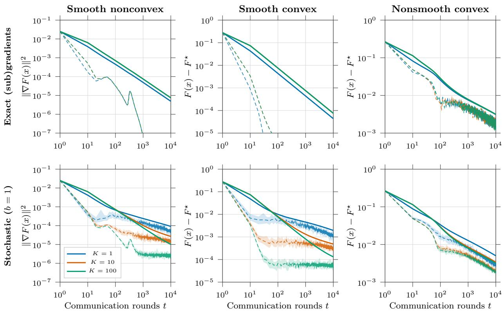  
Figure 1: Performance of AdaFed on IJCNN1 across the three problem classes. Solid and dashed curves show the uniform-random and last-iterate metrics, respectively. Stochastic results show the mean over twenty seeds, with shaded regions indicating the upward and downward RMS deviations.

Comparison with adaptive FL methods. Figure 2 compares Algorithm 1 with representative methods using server-side, client-side, and both server- and client-side adaptation: FedAdagrad [Reddi et al., 2021], FedLADA [Sun et al., 2023], and FAFED [Wu et al., 2023], respectively.

We use K = 10 local steps with full client participation and consider both exact local gradients and stochastic local gradients (minibatch size b = 32). Each method’s main parameters are selected from short tuning runs, then fixed for the 10,000-round comparison (see Appendix G.6 for the tuning details).

Across all three problem classes, Algorithm 1 is competitive with the baselines while consistently following the rate behavior associated with the corresponding regime. In contrast, the baselines stagnate in some settings. This distinction is particularly clear where the last-iterate metrics of all three baselines reach certain accuracy floors under both exact and stochastic gradients, while Algorithm 1 continues to decrease. These results further illustrate the cross-regime adaptation predicted by Theorem 4.4.

Additional experiments. Appendix G provides additional experiments on synthetic problems, larger minibatches, parameter sensitivity for η and γ, and partial participation. It also extends the comparison to FedAdam, FedUR, Local AdaAlter, FedSPS, and FedAda2, covering a broader range of adaptive FL methods.

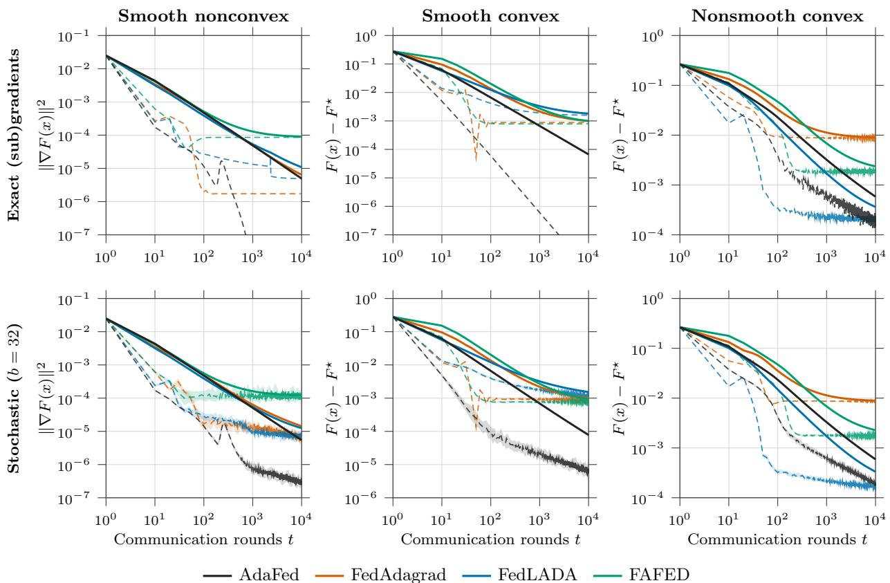  
Figure 2: Performance of AdaFed compared with representative adaptive FL methods on IJCNN1 with K = 10 local steps. FedAdagrad, FedLADA, and FAFED represent server-, client-, and both-level adaptation, respectively. Solid and dashed curves show the uniform-random and last-iterate metrics, respectively. Stochastic results show the mean over twenty seeds, with shaded regions indicating the upward and downward RMS deviations.

## 6 Conclusion

Our results show that universal convergence can be achieved in federated learning (FL) by using AdaGrad-type step sizes, despite heterogeneous client objectives and multiple local updates. The key is to accumulate the server displacements, which reflect global rather than client-level stationarity from a consensus viewpoint of the FL problem. Additionally, the scaled local step controls client drift without altering the aggregated server update. From the analytical perspective, relating the local drift to server displacements and controlling the delayed accumulator yields the essential argument without bounded-iterate assumptions, which results in convergence rates comparable to centralized AdaGrad across the three problem classes. Our experiments support these theoretical findings, showing the predicted cross-regime behavior under a common parameterization and competitive performance against existing adaptive FL methods. We further provide extensions to nonuniform partial participation and H¨older-smoothness in the exact local-gradient setting in the appendix.

Several directions remain open. A natural next step is to extend both the nonuniform partial-participation and H¨older-smooth analyses to stochastic local gradients. This may be possible using moment estimates similar to those in the full-participation analysis, but the details are nontrivial and require careful investigation. Another question is whether the logarithmic factors caused by delayed accumulation can be removed through a sharper analysis or a modified update rule. Finally, combining the proposed method with acceleration may lead to improved convergence rates while preserving universality for convex problems.

## Acknowledgments

This work was supported by the Swedish Research Council under registration number 2023-05476. This work was partially supported by the Wallenberg AI, Autonomous Systems and Software Program (WASP) funded by the Knut and Alice Wallenberg Foundation. Computational resources were provided on the Berzelius system funded by the Knut and Alice Wallenberg Foundation and operated by NAISS.

## References

A. Attia and T. Koren. SGD with AdaGrad stepsizes: Full adaptivity with high probability to unknown parameters, unbounded gradients and afine variance. In Proceedings of the 40th International Conference on Machine Learning, 2023.

C.-C. Chang and C.-J. Lin. Libsvm: A library for support vector machines. ACM transactions on intelligent systems and technology (TIST), 2(3):1–27, 2011.

E. Chen, S. Wang, J. Zhang, D.-J. Han, C. Liu, and C. Brinton. Gradient correction in federated learning with adaptive optimization. arXiv preprint arXiv:2502.02727, 2025.

S. Chezhegov, S. Skorik, N. Khachaturov, D. Shalagin, A. Avetisyan, M. Tak´aˇc, Y. Kholodov, and A. Beznosikov. Local methods with adaptivity via scaling. arXiv preprint arXiv:2406.00846, 2024.

J. Duchi, E. Hazan, and Y. Singer. Adaptive subgradient methods for online learning and stochastic optimization. Journal of Machine Learning Research, 12:2121–2159, 2011.

R. Durrett. Probability: Theory and Examples. Number 49 in Cambridge Series in Statistical and Probabilistic Mathematics. Cambridge University Press, Cambridge, 5 edition, 2019.

A. Ene, H. L. Nguyen, and A. Vladu. Adaptive gradient methods for constrained convex optimization and variational inequalities. In Proceedings of the AAAI Conference on Artificial Intelligence, 2021.

M. Faw, I. Tziotis, C. Caramanis, A. Mokhtari, S. Shakkottai, and R. Ward. The power of adaptivity in SGD: Self-tuning step sizes with unbounded gradients and afine variance. In Proceedings of the Thirty-Fifth Conference on Learning Theory, 2022.

D. Jhunjhunwala, P. Sharma, A. Nagarkatti, and G. Joshi. FedVARP: Tackling the variance due to partial client participation in federated learning. In Proceedings of the Thirty-Eighth Conference on Uncertainty in Artificial Intelligence, 2022.

S. P. Karimireddy, S. Kale, M. Mohri, S. Reddi, S. Stich, and A. T. Suresh. SCAFFOLD: Stochastic controlled averaging for federated learning. In Proceedings of the 37th International Conference on Machine Learning, 2020.

S. P. Karimireddy, M. Jaggi, S. Kale, M. Mohri, S. J. Reddi, S. U. Stich, and A. T. Suresh. Mime: Mimicking centralized stochastic algorithms in federated learning. In International Conference on Learning Representations, 2021.

A. Kavis, K. Y. Levy, F. Bach, and V. Cevher. UniXGrad: A universal, adaptive algorithm with optimal guarantees for constrained optimization. In Advances in Neural Information Processing Systems, 2019.

A. Kavis, K. Y. Levy, and V. Cevher. High probability bounds for a class of nonconvex algorithms with AdaGrad stepsize. In International Conference on Learning Representations, 2022.

J. L. Kim, M. T. Toghani, C. Uribe, and A. Kyrillidis. Adaptive federated learning with auto-tuned clients. In International Conference on Learning Representations, 2024.

D. P. Kingma and J. Ba. Adam: A method for stochastic optimization. In International Conference on Learning Representations, 2015.

S. H. Lee, S. Sharma, M. Zaheer, and T. Li. Eficient adaptive federated optimization. In Advances in Neural Information Processing Systems, 2026.

K. Levy. Online to ofline conversions, universality and adaptive minibatch sizes. In Advances in Neural Information Processing Systems, 2017.

K. Y. Levy, A. Yurtsever, and V. Cevher. Online adaptive methods, universality and acceleration. In Advances in Neural Information Processing Systems, 2018.

J. Li, F. Huang, and H. Huang. Fedda: Faster adaptive gradient methods for federated constrained optimization. In The Twelfth International Conference on Learning Representations, 2024.

X. Li and F. Orabona. On the convergence of stochastic gradient descent with adaptive stepsizes. In Proceedings of the Twenty-Second International Conference on Artificial Intelligence and Statistics, 2019.

X. Li, K. Huang, W. Yang, S. Wang, and Z. Zhang. On the convergence of FedAvg on non-IID data. In International Conference on Learning Representations, 2020.

W. Liu, A. Panda, U. Pandey, H. Cook, G. M. Slota, N. Wang, J. Chen, and Y. Xu. Lodadac: a unified local training-based decentralized framework with adaptive gradients and compressed communication. arXiv preprint arXiv:2604.09970, 2026.

Y. Malitsky and K. Mishchenko. Adaptive gradient descent without descent. In Proceedings of the 37th International Conference on Machine Learning, 2020.

H. B. McMahan, E. Moore, D. Ramage, S. Hampson, and B. Ag¨uera y Arcas. Communication-eficient learning of deep networks from decentralized data. In Proceedings of the 20th International Conference on Artificial Intelligence and Statistics, 2017.

S. Mukherjee, N. Loizou, and S. U. Stich. Locally adaptive federated learning. arXiv preprint arXiv:2307.06306, 2023.

A. Nemirovski, A. Juditsky, G. Lan, and A. Shapiro. Robust stochastic approximation approach to stochastic programming. SIAM Journal on optimization, 19(4):1574–1609, 2009.

Y. Nesterov. Universal gradient methods for convex optimization problems. Mathematical Programming, 152 (1–2):381–404, 2015. doi: 10.1007/s10107-014-0790-0.

F. Orabona. Normalized gradients for all. arXiv preprint arXiv:2308.05621, 2023.

S. Reddi, Z. Charles, M. Zaheer, Z. Garrett, K. Rush, J. Koneˇcn´y, S. Kumar, and H. B. McMahan. Adaptive federated optimization. In International Conference on Learning Representations, 2021.

S. J. Reddi, S. Kale, and S. Kumar. On the convergence of Adam and beyond. In International Conference on Learning Representations, 2018.

A. Rodomanov, X. Jiang, and S. Stich. Universality of AdaGrad stepsizes for stochastic optimization: Inexact oracle, acceleration and variance reduction. In Advances in Neural Information Processing Systems, 2024.

Y. Sun, L. Shen, H. Sun, L. Ding, and D. Tao. Eficient federated learning via local adaptive amended optimizer with linear speedup. IEEE Transactions on Pattern Analysis and Machine Intelligence, 45(12): 14453–14464, 2023.

S. Takakura, S. P. Liew, and S. Hasegawa. FedDuA: Doubly adaptive federated learning. arXiv preprint arXiv:2505.11126, 2025.

B. Wang, H. Zhang, Z. Ma, and W. Chen. Convergence of AdaGrad for non-convex objectives: Simple proofs and relaxed assumptions. In Proceedings of Thirty Sixth Conference on Learning Theory, 2023.

C. Wang, Z. Chen, N. Pappas, H. H. Yang, T. Q. Quek, and H. V. Poor. Adaptive federated learning over the air. IEEE Transactions on Signal Processing, 73:3187–3202, 2025.

J. Wang, Z. Xu, Z. Garrett, Z. Charles, L. Liu, and G. Joshi. Local adaptivity in federated learning: Convergence and consistency. arXiv preprint arXiv:2106.02305, 2021.

Y. Wang, L. Lin, and J. Chen. Communication-eficient adaptive federated learning. In Proceedings of the 39th International Conference on Machine Learning, 2022.

Y. Wang, S. Wang, S. Lu, and J. Chen. FADAS: Towards federated adaptive asynchronous optimization. In Proceedings of the 41st International Conference on Machine Learning, 2024.

Z. Wang and A. Yurtsever. Universal adaptive proximal gradient methods via gradient mapping accumulation. arXiv preprint arXiv:2605.05944, 2026.

R. Ward, X. Wu, and L. Bottou. AdaGrad stepsizes: Sharp convergence over nonconvex landscapes. Journal of Machine Learning Research, 21(219):1–30, 2020.

X. Wu, F. Huang, Z. Hu, and H. Huang. Faster adaptive federated learning. In Proceedings of the AAAI Conference on Artificial Intelligence, 2023.

C. Xie, O. Koyejo, I. Gupta, and H. Lin. Local AdaAlter: Communication-eficient stochastic gradient descent with adaptive learning rates. In OPT 2020: 12th Annual Workshop on Optimization for Machine Learning, 2020.

W. Yuan and X. Wang. Aggregated gradients-based adaptive learning rate design in federated learning. In Proceedings of the 34th ACM International Conference on Information and Knowledge Management, 2025.

H. Zhang, K. Zeng, and S. Lin. FedUR: Federated learning optimization through adaptive centralized learning optimizers. IEEE Transactions on Signal Processing, 71:2622–2637, 2023.

## A Preliminary

## A.1 Auxiliary Lemmas

Lemma A.1. Let $a , x > 0$ and $b \in \mathbb { R }$ . If $x \leq { c }$ a log $x + b ,$ then $x \leq$ 2a log $2 a - 2 a + 2 b$

Proof. Applying the basic inequality log $u \leq u - 1$ with $u = x / ( 2 a )$ gives

$$
\log x \leq { \frac { x } { 2 a } } + \log 2 a - 1 ,
$$

which together with $x \leq$ a log $x + b$ implies that

$$
x \leq { \frac { x } { 2 } } + a \log 2 a - a + b .
$$

We obtain the desired result after rearranging the terms.

Lemma A.2. Fix $\alpha \in ( 0 , 1 )$ and let $a , b , x \geq 0$ $I f x \leq a x ^ { \alpha } + b $ , then $x \le ( 2 a ) ^ { 1 / ( 1 - \alpha ) } + 2 b$

Proof. If $x \leq 2 b$ , the result is immediate. Otherwise if $x > 2 b$ , then the given inequality implies

$$
{ \frac { x } { 2 } } < x - b \leq a x ^ { \alpha } .
$$

Therefore, $x ^ { 1 - \alpha } \leq 2 a$ and hence $x \leq ( 2 a ) ^ { 1 / ( 1 - \alpha ) }$ , which completes the proof.

Lemma A.3. For any $c , \eta > 0 , 0 < a < b ,$ , and $x \geq 0$ , we have

$$
x ^ { a } - c x ^ { b } \leq \left( \eta ^ { a } + c ^ { - a / ( b - a ) } \right) \log \left( 1 + \frac { x ^ { a } } { \eta ^ { a } } \right) .
$$

Proof. If $x ^ { a } - c x ^ { b } \leq 0$ , then the result is immediate. Otherwise we have $1 - c x ^ { b - a } > 0$ , which implies $x < \dot { c } ^ { - 1 / ( b - a ) }$ and hence $x ^ { a } < c ^ { - a / ( b - a ) }$ . Using log $( 1 + z ) \geq z / ( 1 + z )$ for $z \geq 0$ , we obtain

$$
\log \left( 1 + { \frac { x ^ { a } } { \eta ^ { a } } } \right) \geq { \frac { x ^ { a } } { \eta ^ { a } + x ^ { a } } } \geq { \frac { x ^ { a } } { \eta ^ { a } + c ^ { - a / ( b - a ) } } } \geq { \frac { x ^ { a } - c x ^ { b } } { \eta ^ { a } + c ^ { - a / ( b - a ) } } } ,
$$

which completes the proof.

Lemma A.4 ([Wang and Yurtsever, 2026]). Let $\{ a _ { k } \} _ { k \geq 1 }$ be a nonnegative sequence and define $A _ { k + 1 } =$ $A _ { 1 } + \textstyle \sum _ { i = 1 } ^ { k } a _ { i }$ with $A _ { 1 } > 0$ . Then for all $t \geq 1$

$$
2 ( \sqrt { A _ { t + 1 } } - \sqrt { A _ { 1 } } ) \leq \sum _ { k = 1 } ^ { t } \frac { a _ { k } } { \sqrt { A _ { k } } } .
$$

Moreover, if there exists $c > 0$ such that $a _ { k } \le c A _ { k }$ for all $k \geq 1$ , then

$$
\sum _ { k = 1 } ^ { t } \frac { a _ { k } } { \sqrt { A _ { k } } } \leq ( 1 + \sqrt { 1 + c } ) ( \sqrt { A _ { t + 1 } } - \sqrt { A _ { 1 } } ) ,
$$

$$
\sum _ { k = 1 } ^ { t } \frac { a _ { k } } { A _ { k } } \leq ( 1 + c ) \log \frac { A _ { t + 1 } } { A _ { 1 } } .
$$

Lemma A.5. For every $a \in \mathbb { R }$ and $p \geq 1$ , the function $x \mapsto ( a + \log x ) ^ { p }$ is concave on $[ \exp ( p - 1 - a ) , \infty )$

Proof. $\mathrm { I f } \ p = 1$ , then $a + \log x$ is concave on $( 0 , \infty )$ . Next we assume $p > 1$ . For $x \geq \exp ( p - 1 - a )$ , we have $a + \log x \geq p - 1 > 0$ and

$$
{ \frac { d ^ { 2 } } { d x ^ { 2 } } } ( a + \log x ) ^ { p } = { \frac { p ( a + \log x ) ^ { p - 2 } ( p - 1 - a - \log x ) } { x ^ { 2 } } } \leq 0 ,
$$

which completes the proof.

Lemma A.6 (Conditional $L ^ { p }$ triangle inequality). Let $p \geq 1$ , let X and Y be random vectors such that $\mathbb { E } [ \| X \| ^ { p } ] < \infty$ and $\mathbb { E } [ \| Y \| ^ { p } ] < \infty$ , and let G be a sub-σ-algebra. Then, almost surely,

$$
( \mathbb { E } [ \| X + Y \| ^ { p } \mid { \mathcal G } ] ) ^ { 1 / p } \le ( \mathbb { E } [ \| X \| ^ { p } \mid { \mathcal G } ] ) ^ { 1 / p } + ( \mathbb { E } [ \| Y \| ^ { p } \mid { \mathcal G } ] ) ^ { 1 / p } .
$$

Proof. For $p = 1$ , the claim follows directly from $\| X + Y \| \leq \| X \| + \| Y \|$ . Suppose $p > 1$ and let $q = p / ( p - 1 )$ so that $1 / p + 1 / q = 1$ . The pointwise triangle inequality and conditional H¨older inequality give

$$
\begin{array} { r l } & { \mathbb { E } [ \| X + Y \| ^ { p } \mid \mathcal { G } ] \leq \mathbb { E } [ \| X \| \| X + Y \| ^ { p - 1 } \mid \mathcal { G } ] + \mathbb { E } [ \| Y \| \| X + Y \| ^ { p - 1 } \mid \mathcal { G } ] } \\ & { \leq \left( \mathbb { E } [ \| X \| ^ { p } \mid \mathcal { G } ] \right) ^ { 1 / p } \left( \mathbb { E } [ \| X + Y \| ^ { ( p - 1 ) q } \mid \mathcal { G } ] \right) ^ { 1 / q } + \left( \mathbb { E } [ \| Y \| ^ { p } \mid \mathcal { G } ] \right) ^ { 1 / p } \left( \mathbb { E } [ \| X + Y \| ^ { ( p - 1 ) q } \mid \mathcal { G } ] \right) ^ { 1 / q } } \\ & { = \Big ( \left( \mathbb { E } [ \| X \| ^ { p } \mid \mathcal { G } ] \right) ^ { 1 / p } + \left( \mathbb { E } [ \| Y \| ^ { p } \mid \mathcal { G } ] \right) ^ { 1 / p } \Big ) \left( \mathbb { E } [ \| X + Y \| ^ { p } \mid \mathcal { G } ] \right) ^ { ( p - 1 ) / p } , } \end{array}
$$

which proves the result after simplification.

Lemma A.7 (Doob’s $L ^ { 2 }$ maximal inequality [Durrett, 2019, Theorem 4.4.4]). Let $\{ \mathcal { M } _ { t } \} _ { t = 0 } ^ { T }$ be a sequence of square-integrable martingale. Then

$$
\mathbb { E } \left[ \operatorname* { m a x } _ { 0 \le t \le T } | \mathcal { M } _ { t } | ^ { 2 } \right] \le 4 \mathbb { E } [ | \mathcal { M } _ { T } | ^ { 2 } ] .
$$

Lemma A.8. Let $Z _ { t } \geq 0$ be integrable and $\mathcal { F } _ { t + 1 }$ -measurable for all $t \geq 1$ . For any constant $c > 0$ and $T \geq 1$ we have

$$
\mathbb { E } \left[ \sqrt { c + \sum _ { t = 1 } ^ { T } Z _ { t } } \right] \leq \sqrt { 2 } \mathbb { E } \left[ \sqrt { c + \sum _ { t = 1 } ^ { T } \mathbb { E } _ { t } [ Z _ { t } ] } \right] .
$$

Proof. Let $a _ { t } : = \mathbb { E } _ { t } [ Z _ { t } ] , X _ { T } : = c + \sum _ { t = 1 } ^ { T } Z _ { t }$ , and $\textstyle A _ { t } : = c + \sum _ { j = 1 } ^ { t } a _ { j }$ . Since $A _ { T } \geq A _ { t } \geq c ,$ we have

$$
\begin{array} { r l r } {  { \mathbb { E } [ \frac { X _ { T } } { \sqrt { A _ { T } } } ] \le \sqrt { c } + \sum _ { t = 1 } ^ { T } \mathbb { E } [ \frac { Z _ { t } } { \sqrt { A _ { t } } } ] = \sqrt { c } + \sum _ { t = 1 } ^ { T } \mathbb { E } [ \frac { a _ { t } } { \sqrt { A _ { t } } } ] } } \\ & { } & { \le \sqrt { c } + 2 \mathbb { E } [ \sum _ { t = 1 } ^ { T } ( \sqrt { A _ { t } } - \sqrt { A _ { t - 1 } } ) ] = \sqrt { c } + 2 \mathbb { E } [ \sqrt { A _ { T } } ] - 2 \sqrt { A _ { 0 } } \le 2 \mathbb { E } [ \sqrt { A _ { T } } ] , } \end{array}
$$

where the second inequality follows from

$$
\frac { a _ { t } } { \sqrt { A _ { t } } } = \frac { A _ { t } - A _ { t - 1 } } { \sqrt { A _ { t } } } \leq \frac { 2 ( A _ { t } - A _ { t - 1 } ) } { \sqrt { A _ { t } } + \sqrt { A _ { t - 1 } } } = 2 ( \sqrt { A _ { t } } - \sqrt { A _ { t - 1 } } ) .
$$

Therefore, Cauchy–Schwarz further yields

$$
\mathbb { E } [ \sqrt { X _ { T } } ] = \mathbb { E } \left[ \sqrt { \frac { X _ { T } } { \sqrt { A _ { T } } } } A _ { T } ^ { 1 / 4 } \right] \leq \sqrt { \mathbb { E } \left[ \frac { X _ { T } } { \sqrt { A _ { T } } } \right] } \sqrt { \mathbb { E } [ \sqrt { A _ { T } } ] } \leq \sqrt { 2 } \mathbb { E } [ \sqrt { A _ { T } } ] ,
$$

which completes the proof.

## A.2 Proof of Proposition 4.3

Proof. Note that $x ^ { \star } = 0$ and $F ^ { \star } = F ( 0 ) = 0$ . Moreover, direct calculation gives

$$
F ^ { \prime } ( x ) = \frac { x } { \sqrt { 1 + x ^ { 2 } } } , \qquad F ^ { \prime \prime } ( x ) = \frac { 1 } { ( 1 + x ^ { 2 } ) ^ { 3 / 2 } } , \qquad | F ^ { \prime } ( x ) | \leq 1 , \qquad 0 < F ^ { \prime \prime } ( x ) \leq 1 .
$$

Thus every $F _ { i } = F$ is convex, 1-smooth, and 1-Lipschitz. Since all client objectives are identical, their heterogeneity is zero.

Fix T divisible by 4, let $M : = 1 6 m K { \sqrt { T } }$ and all local noises $\{ \xi _ { i , k } ^ { t } \}$ be independent and have discrete distribution

$$
\mathbb { P } ( \xi = M ) = \mathbb { P } ( \xi = - M ) = \frac { 1 } { 2 M ^ { 2 } } , \qquad \mathbb { P } ( \xi = 0 ) = 1 - \frac { 1 } { M ^ { 2 } } ,
$$

which satisfies the unbiasedness and bounded variance conditions:

$$
\mathbb { E } [ \xi ] = M \frac { 1 } { 2 M ^ { 2 } } - M \frac { 1 } { 2 M ^ { 2 } } = 0 , \qquad \mathbb { E } [ \xi ^ { 2 } ] = M ^ { 2 } \left( \frac { 1 } { 2 M ^ { 2 } } + \frac { 1 } { 2 M ^ { 2 } } \right) = 1 .
$$

Let ${ \mathcal { E } } _ { T }$ be the event: exactly one of the $m K T$ noise realizations is nonzero and this realization occurs at the last local step of some client in a round $j \in \{ T / 2 + 1 , \ldots , 3 T / 4 \}$ . Then there are mT/4 possible locations for the unique nonzero noise, which implies

$$
\mathbb { P } ( \mathcal { E } _ { T } ) = \frac { m T } { 4 M ^ { 2 } } \left( 1 - \frac { 1 } { M ^ { 2 } } \right) ^ { m K T - 1 } \geq \frac { m T } { 4 M ^ { 2 } } \left( 1 - \frac { m K T - 1 } { M ^ { 2 } } \right) \geq \frac { m T } { 8 M ^ { 2 } } = \frac { 1 } { 2 0 4 8 m K ^ { 2 } } .\tag{10}
$$

Here we use $( 1 + x ) ^ { p } \geq 1 + p x$ for $x \geq - 1$ and $p \geq 1$ , and

$$
\frac { m K T - 1 } { M ^ { 2 } } \leq \frac { m K T } { 2 5 6 m ^ { 2 } K ^ { 2 } T } = \frac { 1 } { 2 5 6 m K } \leq \frac { 1 } { 2 } .
$$

Now let us consider the event ${ \mathcal { E } } _ { T }$ . Since $F ^ { \prime } ( x _ { 1 } ) = 0$ , all local gradients vanish except for the unique nonzero noise. Thus induction over the preceding local and server updates gives $x _ { t } = x _ { i , k } ^ { t } = 0$ and $q _ { t } = 1$ until the exceptional noise occurs. In particular, it follows that $x _ { j } = 0$ and $q _ { j } = 1$ . If the nonzero noise occurs at client i and has sign $s \in \{ - 1 , 1 \}$ , then its occurrence at local step $K - 1$ gives

$$
\bar { g } _ { j } ^ { ( i ) } = \frac { s M } { K } , \qquad \bar { g } _ { j } ^ { ( i ^ { \prime } ) } = 0 \quad \forall i ^ { \prime } \ne i .
$$

Consequently, the server update (Core-FP) yields

$$
{ \bar { g } } _ { j } = { \frac { s M } { m K } } = 1 6 s { \sqrt { T } } , \qquad x _ { j + 1 } = - 1 6 s { \sqrt { T } } , \qquad q _ { j + 1 } = { \sqrt { q _ { j } ^ { 2 } + | { \bar { g } } _ { j } | ^ { 2 } } } = { \sqrt { 1 + 2 5 6 T } } .
$$

All later noises also vanish on ${ \mathcal { E } } _ { T }$ . Hence, for every $t \geq j + 1$ ，

$$
| \bar { g } _ { t } | \leq \frac { 1 } { m K } \sum _ { i = 1 } ^ { m } \sum _ { k = 0 } ^ { K - 1 } | F ^ { \prime } ( x _ { i , k } ^ { t } ) | \leq 1 , \qquad q _ { t } \geq q _ { j + 1 } \geq 1 6 \sqrt { T } .
$$

Unrolling the server update now gives, for $j + 1 \le t \le T + 1$

$$
\left| x _ { t } - x _ { j + 1 } \right| \leq \sum _ { \ell = j + 1 } ^ { t - 1 } { \frac { | { \bar { g } } _ { \ell } | } { q _ { \ell } } } \leq { \frac { t - j - 1 } { 1 6 { \sqrt { T } } } } \leq { \frac { \sqrt { T } } { 1 6 } } .
$$

It follows that

$$
| x _ { t } | \geq | x _ { j + 1 } | - | x _ { t } - x _ { j + 1 } | \geq 1 6 \sqrt { T } - \frac { \sqrt { T } } { 1 6 } = \frac { 2 5 5 } { 1 6 } \sqrt { T } \geq 8 \sqrt { T } ,\tag{11}
$$

which also implies that $x _ { t }$ has the same sign as $x _ { j + 1 }$ . Since $j \le 3 T / 4$ and $| F ^ { \prime } ( x ) | ^ { 2 } = x ^ { 2 } / ( 1 + x ^ { 2 } ) \geq 1 / 2$ for $| x | \geq 1$ , we further have

$$
\frac { 1 } { T } \sum _ { t = 1 } ^ { T } | F ^ { \prime } ( x _ { t } ) | ^ { 2 } \geq \frac { 1 } { T } \sum _ { t = j + 1 } ^ { T } | F ^ { \prime } ( x _ { t } ) | ^ { 2 } \geq \frac { T - j } { T } \frac { 1 } { 2 } \geq \frac { 1 } { 8 } ,
$$

Moreover, since $x _ { t } = 0$ for $t \leq j$ and the remaining ones have the same sign, it follows from $j \le 3 T / 4$ $F ^ { \star } = F ( 0 ) = 0$ , and (11) that

$$
\begin{array} { r l } & { \displaystyle \sum _ { t = 1 } ^ { T } F ( x _ { t } ) - F ^ { \star } = \sum _ { t = j + 1 } ^ { T } F ( x _ { t } ) = \sum _ { t = j + 1 } ^ { T } ( \sqrt { 1 + x _ { t } ^ { 2 } } - 1 ) \geq \sum _ { t = j + 1 } ^ { T } ( | x _ { t } | - 1 ) } \\ & { \qquad \geq \displaystyle \sum _ { t = j + 1 } ^ { T } ( 8 \sqrt { T } - 1 ) \geq ( T - j ) 4 \sqrt { T } \geq T ^ { 3 / 2 } . } \end{array}
$$

Therefore, we conclude from (10) that

$$
\begin{array} { r l } & { \mathbb { E } [ | F ^ { \prime } ( \bar { x } _ { T } ) | ^ { 2 } ] = \displaystyle \frac { 1 } { T } \sum _ { t = 1 } ^ { T } \mathbb { E } [ | F ^ { \prime } ( x _ { t } ) | ^ { 2 } ] \geq \frac { 1 } { 8 } \mathbb { P } ( \mathcal { E } _ { T } ) \geq \frac { 1 } { 1 6 3 8 4 m K ^ { 2 } } , } \\ & { \mathbb { E } [ F ( \bar { x } _ { T } ) - F ^ { \star } ] = \displaystyle \frac { 1 } { T } \sum _ { t = 1 } ^ { T } \mathbb { E } [ F ( x _ { t } ) - F ^ { \star } ] \geq \sqrt { T } \mathbb { P } ( \mathcal { E } _ { T } ) \geq \frac { \sqrt { T } } { 2 0 4 8 m K ^ { 2 } } , } \end{array}
$$

which completes the proof.

□

## A.3 Additional notations for analysis

Write $g _ { t } : = \nabla F ( x _ { t } )$ and define

$$
\begin{array} { l } { \displaystyle \hat { b } _ { t } : = \frac { 1 } { m K } \sum _ { i = 1 } ^ { m } \sum _ { k = 0 } ^ { K - 1 } \big ( \nabla F _ { i } ( x _ { i , k } ^ { t } ) - \nabla F _ { i } ( x _ { t } ) \big ) , } \\ { \displaystyle \bar { \xi } _ { t } : = \frac { 1 } { m K } \sum _ { i = 1 } ^ { m } \sum _ { k = 0 } ^ { K - 1 } \xi _ { i , k } ^ { t } , \qquad b _ { t } : = \bar { g } _ { t } - g _ { t } = \hat { b } _ { t } + \bar { \xi } _ { t } . } \end{array}
$$

Fix any $\tau > 0$ , we choose the local-path scale according to

$$
\begin{array} { r l } & { K = 1 : \tau _ { t } = \tau , } \\ & { K \geq 2 : \tau _ { t } \leq \left\{ \begin{array} { l l } { \displaystyle \frac { \tau } { ( K - 1 ) t } , } & { \mathrm { s m o o t h ~ n o n c o n v e x ~ o r ~ L i p s c h i t z ~ c o n v e x } , } \\ { \displaystyle \frac { \tau } { ( K - 1 ) t P } , \ \forall p > \frac { 1 } { 2 } , } & { \mathrm { s m o o t h ~ c o n v e x } . } \end{array} \right. } \end{array}\tag{12}
$$

In particular, we can always choose $\begin{array} { r } { \tau _ { t } \le \frac { 1 } { ( K - 1 ) t } } \end{array}$ for $K \geq 2$ , which is exactly (5). Under (12), we have that $\{ \tau _ { t } \} _ { t \geq 1 }$ is upper bounded by τ. Let

$$
c _ { K } : = \frac { 1 } { K } \sum _ { k = 0 } ^ { K - 1 } k ^ { 2 } = \frac { ( K - 1 ) ( 2 K - 1 ) } { 6 } , \quad \Theta : = \left( 1 + \frac { L \tau } { q _ { 1 } } \right) ^ { K - 1 }
$$

and

$$
B ^ { 2 } : = \frac { c _ { K } \Theta ^ { 2 } L ^ { 2 } } { m } \sum _ { i = 1 } ^ { m } \| \nabla F _ { i } ( x _ { 1 } ) \| ^ { 2 } , \qquad \widetilde { B } ^ { 2 } : = \frac { c _ { K } \Theta ^ { 2 } L ^ { 2 } } { m } \sum _ { i = 1 } ^ { m } \bigl ( \| \nabla F _ { i } ( x _ { 1 } ) \| + \sigma \bigr ) ^ { 2 } .
$$

For $t \geq 1$ , denote the finite sums of $\tau _ { k }$ and $\tau _ { k } ^ { 2 }$ by

$$
\mathcal { T } _ { t } : = \sum _ { k = 1 } ^ { t } \tau _ { k } , \qquad \widetilde { \mathcal { T } } _ { t } : = \sum _ { k = 1 } ^ { t } \tau _ { k } ^ { 2 } .
$$

If $K \geq 2$ and $\tau _ { t }$ is chosen according to (12), then

$$
c _ { K } \lesssim ( K - 1 ) ^ { 2 } , \quad \Theta \lesssim 1 , \quad B \lesssim K - 1 , \quad \widetilde { B } \lesssim K - 1 , \quad \widetilde { \mathcal { T } } _ { t } \lesssim \frac { 1 } { ( K - 1 ) ^ { 2 } } ,\tag{13}
$$

where we use $( 1 + 1 / t ) ^ { t } \leq e$ to obtain $\Theta \lesssim 1$ . Moreover, for Lipschitz convex objectives, we have $\mathcal { T } _ { t } \lesssim$ log $t / ( K - 1 )$ .

Let $\zeta _ { t } : = \bar { g } _ { t } - \mathbb { E } _ { t } [ \bar { g } _ { t } ]$ . Set

$$
\begin{array} { r } { A _ { T } : = \eta ^ { 2 } + 2 R _ { 0 } ^ { 2 } + 2 R _ { 1 } ^ { 2 } \sigma ^ { 2 } ( \log ( m K T ) + 2 ) . } \end{array}
$$

Given $T \geq 1$ , let $M _ { T } \geq 0$ be the maximum noise norm over the first $T$ rounds:

$$
M _ { T } : = \operatorname* { m a x } _ { \substack { 1 \leq t \leq T , 1 \leq i \leq m , 0 \leq k < K } } \Vert \xi _ { i , k } ^ { t } \Vert .
$$

Let $r _ { t } : = x _ { t + 1 } - x _ { t }$ . Define the accumulated trajectory quantities:

$$
\mathcal { R } _ { T } : = \sum _ { t = 1 } ^ { T } \| r _ { t } \| ^ { 2 } , \qquad \mathcal { G } _ { T } : = \sum _ { t = 1 } ^ { T } \frac { \| g _ { t } \| ^ { 2 } } { q _ { t } } .
$$

We focus on the nontrivial case $K \geq 2$ in the proofs. The special case $K = 1$ can be easily proved by noting that the coeficient of $\tau _ { t }$ always involve $( K - 1 )$ (possibly through quantities $c _ { K } , B$ , and $\widetilde { B } )$ in the analysis, which means that $\tau _ { t }$ can be chosen arbitrarily for $K = 1$

## B Smooth nonconvex objectives

Assume throughout this section that every $F _ { i }$ is L-smooth. From unbiasedness of $\xi _ { i , k } ^ { t } ,$ , we have $\mathbb { E } _ { t } [ \bar { \xi } _ { t } ] = 0$ and hence

$$
\mathbb { E } _ { t } [ \bar { g } _ { t } ] = g _ { t } + \mathbb { E } _ { t } [ \hat { b } _ { t } ] .\tag{14}
$$

Additionally, the independence among the local noises $\{ \xi _ { i , k } ^ { t } \}$ gives

$$
\mathbb { E } _ { t } [ \Vert \bar { \xi } _ { t } \Vert ^ { 2 } ] = \frac { 1 } { m ^ { 2 } K ^ { 2 } } \sum _ { i = 1 } ^ { m } \sum _ { k = 0 } ^ { K - 1 } \mathbb { E } _ { t } [ \Vert \xi _ { i , k } ^ { t } \Vert ^ { 2 } ] \leq \frac { m K \sigma ^ { 2 } } { m ^ { 2 } K ^ { 2 } } = \frac { \sigma ^ { 2 } } { m K } .\tag{15}
$$

Finally, since $\bar { g } _ { t } = g _ { t } + \hat { b } _ { t } + \bar { \xi } _ { t }$ , we apply $\| a + b \| ^ { 2 } \leq 2 \| a \| ^ { 2 } + 2 \| b \| ^ { 2 }$ to get

$$
\begin{array} { r } { \mathbb { E } _ { t } [ \| \bar { g } _ { t } \| ^ { 2 } ] \le 2 \mathbb { E } _ { t } [ \| g _ { t } + \bar { \xi } _ { t } \| ^ { 2 } ] + 2 \mathbb { E } _ { t } [ \| \hat { b } _ { t } \| ^ { 2 } ] = 2 \| g _ { t } \| ^ { 2 } + 2 \mathbb { E } _ { t } [ \| \bar { \xi } _ { t } \| ^ { 2 } ] + 2 \mathbb { E } _ { t } [ \| \hat { b } _ { t } \| ^ { 2 } ] , } \end{array}
$$

where the equality follows from $\mathbb { E } _ { t } [ \langle g _ { t } , \bar { \xi } _ { t } \rangle ] = \langle g _ { t } , \mathbb { E } _ { t } [ \bar { \xi } _ { t } ] \rangle = 0$ . This together with (15) gives

$$
\mathbb { E } _ { t } [ \| \bar { g } _ { t } \| ^ { 2 } ] \leq 2 \| g _ { t } \| ^ { 2 } + 2 \mathbb { E } _ { t } [ \| \hat { b } _ { t } \| ^ { 2 } ] + \frac { 2 \sigma ^ { 2 } } { m K }\tag{16}
$$

Before presenting the main theorem and its proof, we first introduce some auxiliary lemmas that provide bounds for trajectory-related quantities.

Lemma B.1. Let Assumptions $\it 4 . 1$ and $4 . 2$ hold. Assume each $F _ { i }$ is L-smooth. Let $\kappa _ { T } : = \mathrm { m a x } _ { t \in [ T ] } ( t - 1 ) \tau _ { t }$ Then $f o r$ every $T \geq 1$

$$
\sum _ { t = 1 } ^ { T } \mathbb { E } _ { t } [ \| \hat { b } _ { t } \| ^ { 2 } ] \leq \frac { 2 \widetilde { B } ^ { 2 } \widetilde { \mathcal { T } } _ { T } } { q _ { 1 } ^ { 2 } } + \frac { 8 c _ { K } \Theta ^ { 2 } L ^ { 4 } \kappa _ { T } ^ { 2 } } { q _ { 1 } ^ { 2 } } \mathcal { R } _ { T } .
$$

Proof. We start by using Lemma A.6 with $\mathcal { G } = \mathcal { F } _ { t }$ and L-smoothness to obtain

$$
\begin{array} { r l } & { \sqrt { \mathbb { E } _ { t } [ \| \nabla F _ { i } ( x _ { i , k } ^ { t } ) \| ^ { 2 } ] } \leq \| \nabla F _ { i } ( x _ { t } ) \| + \sqrt { \mathbb { E } _ { t } [ \| \nabla F _ { i } ( x _ { i , k } ^ { t } ) - \nabla F _ { i } ( x _ { t } ) \| ^ { 2 } ] } } \\ & { \qquad \leq \| \nabla F _ { i } ( x _ { t } ) \| + L \sqrt { \mathbb { E } _ { t } [ \| x _ { i , k } ^ { t } - x _ { t } \| ^ { 2 } ] } . } \end{array}\tag{17}
$$

Applying Lemma A.6, (17), and (2) gives

$$
\begin{array} { r l } & { \sqrt { \mathbb { E } _ { t } [ \| x _ { i , k + 1 } ^ { t } - x _ { t } \| ^ { 2 } ] } = \sqrt { \mathbb { E } _ { t } \left[ \| x _ { i , k } ^ { t } - x _ { t } - \tau _ { t } ( \nabla F _ { i } ( x _ { i , k } ^ { t } ) + \xi _ { i , k } ^ { t } ) / q _ { t } \| ^ { 2 } \right] } } \\ & { \qquad \leq \sqrt { \mathbb { E } _ { t } [ \| x _ { i , k } ^ { t } - x _ { t } \| ^ { 2 } ] } + \frac { \tau _ { t } } { q _ { t } } \sqrt { \mathbb { E } _ { t } [ \| \nabla F _ { i } ( x _ { i , k } ^ { t } ) + \xi _ { i , k } ^ { t } \| ^ { 2 } ] } } \\ & { \qquad \leq \sqrt { \mathbb { E } _ { t } [ \| x _ { i , k } ^ { t } - x _ { t } \| ^ { 2 } ] } + \frac { \tau _ { t } } { q _ { t } } \left( \sqrt { \mathbb { E } _ { t } [ \| \nabla F _ { i } ( x _ { i , k } ^ { t } ) \| ^ { 2 } ] } + \sqrt { \mathbb { E } _ { t } [ \| \xi _ { i , k } ^ { t } \| ^ { 2 } ] } \right) } \\ & { \qquad \leq \left( 1 + \frac { L \tau _ { t } } { q _ { t } } \right) \sqrt { \mathbb { E } _ { t } [ \| x _ { i , k } ^ { t } - x _ { t } \| ^ { 2 } ] } + \frac { \tau _ { t } } { q _ { t } } ( \| \nabla F _ { i } ( x _ { t } ) \| + \sigma ) . } \end{array}
$$

Since $x _ { i , 0 } ^ { t } = x _ { t }$ , applying the above inequality recursively and then using $\tau _ { t } \leq \tau$ and $q _ { t } \geq q _ { 1 }$ yields

$$
\sqrt { \mathbb { E } _ { t } [ \| x _ { i , k } ^ { t } - x _ { t } \| ^ { 2 } ] } \leq \frac { \tau _ { t } } { q _ { t } } \big ( \| \nabla F _ { i } ( x _ { t } ) \| + \sigma \big ) \sum _ { s = 0 } ^ { k - 1 } \bigg ( 1 + \frac { L \tau _ { t } } { q _ { t } } \bigg ) ^ { s }
$$

$$
\leq \frac { \tau _ { t } } { q _ { t } } \big ( \| \nabla F _ { i } ( x _ { t } ) \| + \sigma \big ) k \left( 1 + \frac { L \tau } { q _ { 1 } } \right) ^ { k - 1 } \leq \frac { k \tau _ { t } \Theta } { q _ { t } } \big ( \| \nabla F _ { i } ( x _ { t } ) \| + \sigma \big ) .\tag{18}
$$

Then it follows from the convexity of $\| \cdot \| ^ { 2 }$ , the L-smoothness of $F _ { i }$ , and (18) that

$$
\begin{array} { r } { \mathbb { E } _ { t } [ \| \hat { b } _ { t } \| ^ { 2 } ] \leq \displaystyle \frac { 1 } { m K } \sum _ { i = 1 } ^ { m } \sum _ { k = 0 } ^ { K - 1 } \mathbb { E } _ { t } [ \| \nabla F _ { i } ( x _ { i , k } ^ { t } ) - \nabla F _ { i } ( x _ { t } ) \| ^ { 2 } ] \leq \displaystyle \frac { L ^ { 2 } } { m K } \sum _ { i = 1 } ^ { m } \sum _ { k = 0 } ^ { K - 1 } \mathbb { E } _ { t } [ \| x _ { i , k } ^ { t } - x _ { t } \| ^ { 2 } ] } \\ { \leq \displaystyle \frac { \Theta ^ { 2 } L ^ { 2 } \tau _ { t } ^ { 2 } } { m q _ { t } ^ { 2 } K } \sum _ { i = 1 } ^ { m } \sum _ { k = 0 } ^ { K - 1 } k ^ { 2 } \big ( \| \nabla F _ { i } ( x _ { t } ) \| + \sigma \big ) ^ { 2 } = \frac { c _ { K } \Theta ^ { 2 } L ^ { 2 } \tau _ { t } ^ { 2 } } { m q _ { t } ^ { 2 } } \sum _ { i = 1 } ^ { m } \big ( \| \nabla F _ { i } ( x _ { t } ) \| + \sigma \big ) ^ { 2 } . } \end{array}
$$

To proceed, applying $\| \nabla F _ { i } ( x _ { t } ) \| \le \| \nabla F _ { i } ( x _ { 1 } ) \| + L \| x _ { t } - x _ { 1 } \|$ into the above inequality and using $( a + b ) ^ { 2 } \leq$ $2 a ^ { 2 } + 2 b ^ { 2 }$ yield

$$
\begin{array} { r l r } {  { \mathbb { E } _ { t } [ \| \hat { b } _ { t } \| ^ { 2 } ] \leq \frac { c _ { K } \Theta ^ { 2 } L ^ { 2 } \tau _ { t } ^ { 2 } } { m q _ { t } ^ { 2 } } \sum _ { i = 1 } ^ { m } ( \| \nabla F _ { i } ( x _ { 1 } ) \| + \sigma + L \| x _ { t } - x _ { 1 } \| ) ^ { 2 } } } \\ & { } & { \leq \frac { 2 \tau _ { t } ^ { 2 } } { q _ { t } ^ { 2 } } ( \widetilde { B } ^ { 2 } + c _ { K } \Theta ^ { 2 } L ^ { 4 } \| x _ { t } - x _ { 1 } \| ^ { 2 } ) . } \end{array}\tag{19}
$$

For $2 \leq t \leq T$ , note that $\begin{array} { r } { \boldsymbol { x } _ { t } - \boldsymbol { x } _ { 1 } = \sum _ { j = 1 } ^ { t - 1 } \boldsymbol { r } _ { j } } \end{array}$ , hence we have from $\tau _ { t } \leq \kappa _ { T } / ( t - 1 )$ and $q _ { t } \geq q _ { j }$ for $j \le t$ that

$$
\begin{array} { r l r } {  { \sum _ { t = 1 } ^ { T } \frac { \tau _ { t } ^ { 2 } } { q _ { t } ^ { 2 } } \| x _ { t } - x _ { 1 } \| ^ { 2 } = \sum _ { t = 2 } ^ { T } \frac { \tau _ { t } ^ { 2 } } { q _ { t } ^ { 2 } } \| \sum _ { j = 1 } ^ { t - 1 } r _ { j } \| ^ { 2 } \leq \kappa _ { T } ^ { 2 } \sum _ { t = 2 } ^ { T } ( \frac { 1 } { t - 1 } \sum _ { j = 1 } ^ { t - 1 } \frac { \| r _ { j } \| } { q _ { j } } ) ^ { 2 } } } \\ & { } & { \leq 4 \kappa _ { T } ^ { 2 } \sum _ { j = 1 } ^ { T - 1 } \frac { \| r _ { j } \| ^ { 2 } } { q _ { j } ^ { 2 } } \leq \frac { 4 \kappa _ { T } ^ { 2 } } { q _ { 1 } ^ { 2 } } \sum _ { t = 1 } ^ { T } \| r _ { t } \| ^ { 2 } , } \end{array}\tag{20}
$$

where the second inequality holds from Hardy’s inequality $\begin{array} { r } { \sum _ { t = 1 } ^ { T } \bar { a } _ { t } ^ { 2 } \le { 4 } \sum _ { t = 1 } ^ { T } a _ { t } ^ { 2 } } \end{array}$ with ${ { \bar { a } } _ { t } }$ being the average of nonnegative $a _ { 1 } , a _ { 2 } , \ldots , a _ { t }$ . Summing (19) over $t = 1 , 2 , \dots , T$ and applying (20) then gives

$$
\sum _ { t = 1 } ^ { T } \mathbb { E } _ { t } [ \| \hat { b } _ { t } \| ^ { 2 } ] \leq \frac { 2 \widetilde { B } ^ { 2 } } { q _ { 1 } ^ { 2 } } \sum _ { t = 1 } ^ { T } \tau _ { t } ^ { 2 } + 2 c _ { K } \Theta ^ { 2 } L ^ { 4 } \sum _ { t = 1 } ^ { T } \frac { \tau _ { t } ^ { 2 } } { q _ { t } ^ { 2 } } \| x _ { t } - x _ { 1 } \| ^ { 2 } \leq \frac { 2 \widetilde { B } ^ { 2 } \widetilde { \mathcal { T } } _ { T } } { q _ { 1 } ^ { 2 } } + \frac { 8 c _ { K } \Theta ^ { 2 } L ^ { 4 } \kappa _ { T } ^ { 2 } } { q _ { 1 } ^ { 2 } } \sum _ { t = 1 } ^ { T } \| r _ { t } \| ^ { 2 } ,
$$

which completes the proof.

□

Before introducing the next lemma, we first bound moments $\mathbb { E } [ M _ { T } ^ { 2 p } ]$ for any $p \geq 1$ . Suppose $\sigma > 0$ , let $N : = m K T$ . Reindex the noises $\{ \xi _ { i , k } ^ { t } \}$ as $\xi _ { 1 } , \dots , \xi _ { N }$ , and denote

$$
Z _ { j } : = \frac { \| \xi _ { j } \| ^ { 2 } } { \sigma ^ { 2 } } \geq 0 , \qquad A _ { N } : = \frac 1 N \sum _ { j = 1 } ^ { N } \exp ( Z _ { j } ) \geq 1 .
$$

Then it follows from Assumption 4.2 that $\mathbb { E } [ \exp ( Z _ { j } ) ] \ \leq \ \exp ( 1 )$ for every $j ,$ and hence $\mathbb { E } [ A _ { N } ] \le \exp ( 1 )$ Moreover,

$$
{ \frac { M _ { T } ^ { 2 } } { \sigma ^ { 2 } } } = \operatorname* { m a x } _ { 1 \leq j \leq N } Z _ { j } \leq \log \left( \sum _ { j = 1 } ^ { N } \exp ( Z _ { j } ) \right) = \log N + \log A _ { N } .\tag{21}
$$

For $p \geq 1$ , Lemma $\mathrm { A . 5 }$ with $a = p - 1 + \log N$ shows that the function $x \mapsto ( p - 1 + \log N + \log x ) ^ { p }$ is concave on $[ 1 / N , \infty )$ , hence on $\lbrack 1 , \infty )$ . Applying Jensen’s inequality on (21) therefore yields

$$
\frac { \mathbb { E } [ M _ { T } ^ { 2 p } ] } { \sigma ^ { 2 p } } \leq \mathbb { E } \left[ ( p - 1 + \log N + \log A _ { N } ) ^ { p } \right] \leq ( p - 1 + \log N + \log \mathbb { E } [ A _ { N } ] ) ^ { p } \leq ( \log ( m K T ) + p ) ^ { p } ,
$$

which is equivalent to

$$
\Bigl ( \mathbb { E } [ M _ { T } ^ { 2 p } ] \Bigr ) ^ { 1 / p } \le \sigma ^ { 2 } \bigl ( \log ( m K T ) + p \bigr ) , \quad \forall p \ge 1 .\tag{22}
$$

Note that (22) is a consequence of Assumption 4.2, which holds regardless of the problem settings.

Lemma B.2. Let Assumption $4 . 2$ hold. Assume each $F _ { i }$ is L-smooth. If $\begin{array} { r } { \dot { \mathbf { \rho } } \rho _ { \tau } : = \operatorname* { s u p } _ { t \geq 1 } \sqrt { t - 1 } \tau _ { t } < \infty } \end{array}$ , define deterministic constants

$$
\begin{array} { r l } & { R _ { 0 } : = \operatorname* { m a x } \left\{ \frac { \left\| g _ { 1 } \right\| } { q _ { 1 } } , \eta \left( 1 + \frac { L } { q _ { 1 } } \right) \right\} + \frac { 2 B \tau + 2 \eta \sqrt { c _ { K } } \Theta L ^ { 2 } \rho _ { \tau } } { q _ { 1 } ^ { 2 } } , } \\ & { R _ { 1 } : = \frac { 2 } { q _ { 1 } } \left( 1 + \frac { \sqrt { c _ { K } } \Theta L \tau } { q _ { 1 } } \right) . } \end{array}
$$

Then $f o r$ every $T \geq 1$ , we have max $\lvert \leq t \leq T \ \rvert \lVert r _ { t } \rVert \leq R _ { 0 } + R _ { 1 } M _ { T }$ almost surely and

$$
\mathbb { E } [ \mathcal { R } _ { T } ] \leq 2 \mathcal { A } _ { T } \left( 1 + \log \frac { \mathbb { E } \left[ q _ { T + 1 } \right] } { q _ { 1 } } \right) ,\tag{23}
$$

$$
\sqrt { \mathbb { E } [ \mathcal { R } _ { T } ^ { 2 } ] } \le 2 \big ( A _ { T } + 4 R _ { 1 } ^ { 2 } \sigma ^ { 2 } \big ) \left( 4 + \log \frac { \mathbb { E } \big [ q _ { T + 1 } \big ] } { q _ { 1 } } \right) .\tag{24}
$$

Proof. We first establish a deterministic bound on $\| b _ { t } \|$ . Using smoothness and definition of $M _ { T }$ , we obtain

$$
\begin{array} { r l } { \| x _ { i , k + 1 } ^ { t } - x _ { t } \| \leq \| x _ { i , k } ^ { t } - x _ { t } \| + \frac { \tau _ { t } } { q _ { t } } \big ( \| \nabla F _ { i } ( x _ { i , k } ^ { t } ) \| + M _ { T } \big ) } & { } \\ { \leq \| x _ { i , k } ^ { t } - x _ { t } \| + \frac { \tau _ { t } } { q _ { t } } \big ( \| \nabla F _ { i } ( x _ { t } ) \| + L \| x _ { i , k } ^ { t } - x _ { t } \| + M _ { T } \big ) } & { } \\ { = \bigg ( 1 + \frac { L \tau _ { t } } { q _ { t } } \bigg ) \| x _ { i , k } ^ { t } - x _ { t } \| + \frac { \tau _ { t } } { q _ { t } } \big ( \| \nabla F _ { i } ( x _ { t } ) \| + M _ { T } \big ) . } & { } \end{array}
$$

Unrolling this recursion similarly as in the proof of Lemma B.1 gives (with σ replaced by $M _ { T } )$ , for $t \leq T$

$$
\| x _ { i , k } ^ { t } - x _ { t } \| \leq \frac { \tau _ { t } } { q _ { t } } \big ( \| \nabla F _ { i } ( x _ { t } ) \| + M _ { T } \big ) \sum _ { s = 0 } ^ { k - 1 } \bigg ( 1 + \frac { L \tau _ { t } } { q _ { t } } \bigg ) ^ { s } \leq \frac { k \tau _ { t } \Theta } { q _ { t } } \big ( \| \nabla F _ { i } ( x _ { t } ) \| + M _ { T } \big ) ,
$$

$$
\| \hat { b } _ { t } \| ^ { 2 } \leq \frac { c _ { K } \Theta ^ { 2 } L ^ { 2 } \tau _ { t } ^ { 2 } } { m q _ { t } ^ { 2 } } \sum _ { i = 1 } ^ { m } \bigl ( \| \nabla F _ { i } ( x _ { t } ) \| + M _ { T } \bigr ) ^ { 2 } .
$$

Then by applying Lemma A.6 and the smoothness of $F _ { i }$ , we further have

$$
\begin{array} { l } { \displaystyle | \hat { b } _ { t } | | \leq \frac { \tau _ { t } L \Theta \sqrt { c _ { K } } } { q _ { t } } \Big [ \frac { 1 } { m } \sum _ { i = 1 } ^ { m } \big ( \| \nabla F _ { i } ( x _ { t } ) \| + M _ { T } \big ) ^ { 2 } \Big ] ^ { 1 / 2 } } \\ { \displaystyle \quad \leq \frac { \tau _ { t } L \Theta \sqrt { c _ { K } } } { q _ { t } } \Big [ \frac { 1 } { m } \sum _ { i = 1 } ^ { m } \big ( \| \nabla F _ { i } ( x _ { 1 } ) \| + L \| x _ { t } - x _ { 1 } \| + M _ { T } \big ) ^ { 2 } \Big ] ^ { 1 / 2 } } \\ { \displaystyle \leq \frac { \tau _ { t } L \Theta \sqrt { c _ { K } } } { q _ { t } } \Big [ \Big ( \frac { 1 } { m } \sum _ { i = 1 } ^ { m } \| \nabla F _ { i } ( x _ { 1 } ) \| ^ { 2 } \Big ) ^ { 1 / 2 } + L \| x _ { t } - x _ { 1 } \| + M _ { T } \Big ] } \\ { \displaystyle = \frac { \tau _ { t } } { q _ { t } } \big ( B + \sqrt { c _ { K } } \Theta L M _ { T } + \sqrt { c _ { K } } \Theta L ^ { 2 } \| x _ { t } - x _ { 1 } \| \big ) . } \end{array}\tag{25}
$$

To bound $\| x _ { t } - x _ { 1 } \|$ , we use the update rule (Core-FP) and $q _ { t } \geq q _ { 1 }$ to write

$$
\| x _ { t } - x _ { 1 } \| ^ { 2 } = \Big \| \sum _ { j = 1 } ^ { t - 1 } r _ { j } \Big \| ^ { 2 } \leq ( t - 1 ) \sum _ { j = 1 } ^ { t - 1 } \| r _ { j } \| ^ { 2 } \leq \frac { t - 1 } { q _ { 1 } ^ { 2 } } \sum _ { j = 1 } ^ { t - 1 } \| \bar { g } _ { j } \| ^ { 2 } = \frac { ( t - 1 ) \eta ^ { 2 } } { q _ { 1 } ^ { 2 } } ( q _ { t } ^ { 2 } - q _ { 1 } ^ { 2 } ) ,
$$

which further implies

$$
\| x _ { t } - x _ { 1 } \| \leq \frac { \eta \sqrt { t - 1 } } { q _ { 1 } } \sqrt { q _ { t } ^ { 2 } - q _ { 1 } ^ { 2 } } \leq \frac { \eta \sqrt { t - 1 } } { q _ { 1 } } q _ { t } .
$$

Substituting the above inequality into (25) and noting that $b _ { t } = \hat { b } _ { t } + \bar { \xi } _ { t }$ and $\lVert \bar { \xi } _ { t } \rVert \leq M _ { T }$ gives

$$
\left\| b _ { t } \right\| \leq \left\| \hat { b } _ { t } \right\| + \left\| \bar { \xi } _ { t } \right\| \leq \frac { B \tau _ { t } + \eta \sqrt { c _ { K } } \Theta L ^ { 2 } \sqrt { t - 1 } \tau _ { t } } { q _ { 1 } } + \left( 1 + \frac { \sqrt { c _ { K } } \Theta L \tau _ { t } } { q _ { 1 } } \right) M _ { T } .\tag{26}
$$

Next, we show that $\| r _ { t } \| \le R _ { 0 } + R _ { 1 } M _ { T }$ for all $1 \leq t \leq T$ . For $t = 1$ , using $\bar { g } _ { 1 } = g _ { 1 } + b _ { 1 }$ , (26), and $\tau _ { t } \leq \tau$ gives

$$
\| r _ { 1 } \| \le \frac { \| g _ { 1 } \| + \| b _ { 1 } \| } { q _ { 1 } } \le \frac { \| g _ { 1 } \| } { q _ { 1 } } + \frac { B \tau } { q _ { 1 } ^ { 2 } } + \frac { 1 } { q _ { 1 } } \left( 1 + \frac { \sqrt { c _ { K } } \ominus L \tau } { q _ { 1 } } \right) M _ { T } \le R _ { 0 } + R _ { 1 } M _ { T } .
$$

For $t \geq 2$ , note that $q _ { t } ^ { 2 } \geq \| \bar { g } _ { t - 1 } \| ^ { 2 } / \eta ^ { 2 }$ and the smoothness of F implies:

$$
\frac { \lVert g _ { t } - g _ { t - 1 } \rVert } { q _ { t } } \leq \frac { L \lVert x _ { t } - x _ { t - 1 } \rVert } { q _ { t } } = \frac { L \lVert \bar { g } _ { t - 1 } \rVert } { q _ { t - 1 } q _ { t } } \leq \frac { L \eta } { q _ { 1 } } .
$$

Consequently, we have from the decomposition $\bar { g } _ { t } = \bar { g } _ { t - 1 } + ( g _ { t } - g _ { t - 1 } ) + ( b _ { t } - b _ { t - 1 } )$ and (26) that

$$
\begin{array} { r l } & { \left\| r _ { t } \right\| = \frac { \left\| \bar { g } _ { t } \right\| } { q _ { t } } \leq \frac { \left\| \bar { g } _ { t - 1 } \right\| + \left\| g _ { t } - g _ { t - 1 } \right\| + \left\| b _ { t } \right\| + \left\| b _ { t - 1 } \right\| } { q _ { t } } } \\ & { \qquad \leq \eta \left( 1 + \frac { L } { q _ { 1 } } \right) + \frac { \left\| b _ { t } \right\| + \left\| b _ { t - 1 } \right\| } { q _ { 1 } } } \\ & { \qquad \leq \eta \left( 1 + \frac { L } { q _ { 1 } } \right) + \frac { 2 B \tau + 2 \eta \sqrt { c _ { K } } \Theta L ^ { 2 } \rho _ { \tau } } { q _ { 1 } ^ { 2 } } + \frac { 2 } { q _ { 1 } } \left( 1 + \frac { \sqrt { c _ { K } } \Theta L \tau } { q _ { 1 } } \right) M _ { T } } \\ & { \qquad \leq R _ { 0 } + R _ { 1 } M _ { T } . } \end{array}
$$

We next bound the moments of $\mathcal { R } _ { T }$ . Since $\| r _ { t } \| \le R _ { 0 } + R _ { 1 } M _ { T }$ for $t \leq T$ almost surely, we have

$$
\frac { \| \bar { g } _ { t } \| ^ { 2 } / \eta ^ { 2 } } { q _ { t } ^ { 2 } } = \frac { \| r _ { t } \| ^ { 2 } } { \eta ^ { 2 } } \leq \frac { ( R _ { 0 } + R _ { 1 } M _ { T } ) ^ { 2 } } { \eta ^ { 2 } } .
$$

Therefore, we apply the log-sum in Lemma A.4 with $a _ { t } = \| r _ { t } \| ^ { 2 } / \eta ^ { 2 } , A _ { t } = q _ { t } ^ { 2 }$ , and $c = ( R _ { 0 } + R _ { 1 } M _ { T } ) ^ { 2 } / \eta ^ { 2 }$ to obtain

$$
\mathcal { R } _ { T } = \eta ^ { 2 } \sum _ { t = 1 } ^ { T } \frac { \Vert \bar { g } _ { t } \Vert ^ { 2 } / \eta ^ { 2 } } { q _ { t } ^ { 2 } } \leq \left( \eta ^ { 2 } + ( R _ { 0 } + R _ { 1 } M _ { T } ) ^ { 2 } \right) \log \frac { q _ { T + 1 } ^ { 2 } } { q _ { 1 } ^ { 2 } } .\tag{27}
$$

Taking expectations and applying Cauchy–Schwarz inequality further gives

$$
\begin{array} { r l } & { \mathbb { E } \big [ \mathcal { R } _ { T } \big ] \leq 2 \sqrt { \mathbb { E } \left[ \big ( \eta ^ { 2 } + 2 R _ { 0 } ^ { 2 } + 2 R _ { 1 } ^ { 2 } M _ { T } ^ { 2 } \big ) ^ { 2 } \right] } \sqrt { \mathbb { E } \left[ \left( \log \frac { q _ { T + 1 } } { q _ { 1 } } \right) ^ { 2 } \right] } } \\ & { \qquad \leq 2 \Big ( \eta ^ { 2 } + 2 R _ { 0 } ^ { 2 } + 2 R _ { 1 } ^ { 2 } \sqrt { \mathbb { E } \big [ M _ { T } ^ { 4 } \big ] } \Big ) \sqrt { \mathbb { E } \left[ \left( 1 + \log \frac { q _ { T + 1 } } { q _ { 1 } } \right) ^ { 2 } \right] } } \\ & { \qquad \leq 2 \Big [ \eta ^ { 2 } + 2 R _ { 0 } ^ { 2 } + 2 R _ { 1 } ^ { 2 } \sigma ^ { 2 } \big ( \log ( m K T ) + 2 \big ) \Big ] \left( 1 + \log \frac { \mathbb { E } \big [ q _ { T + 1 } \big ] } { q _ { 1 } } \right) , } \end{array}
$$

where the second inequality uses Lemma $\mathrm { A . 6 }$ and $q _ { T + 1 } \geq q _ { 1 }$ , and the last inequality follows from Lemma A.5 with $a = 1$ and $p = 2 ,$ , as well as (22) with $p = 2$ . Squaring both sides of (27) gives

$$
\mathcal { R } _ { T } ^ { 2 } \leq 4 \left( \eta ^ { 2 } + ( R _ { 0 } + R _ { 1 } M _ { T } ) ^ { 2 } \right) ^ { 2 } \left( \log \frac { q _ { T + 1 } } { q _ { 1 } } \right) ^ { 2 } .
$$

Taking expectations and applying Cauchy–Schwarz inequality $\mathbb { E } [ X Y ] \le ( \mathbb { E } [ X ^ { 2 } ] ) ^ { 1 / 2 } ( \mathbb { E } [ Y ^ { 2 } ] ) ^ { 1 / 2 }$ further gives

$$
\begin{array} { r l } & { \sqrt { \mathbb { E } [ \mathcal { R } _ { T } ^ { 2 } ] } \leq 2 \left( \mathbb { E } \left[ \left( \eta ^ { 2 } + \left( R _ { 0 } + R _ { 1 } M _ { T } \right) ^ { 2 } \right) ^ { 2 } \left( \log \frac { q _ { T + 1 } } { q _ { 1 } } \right) ^ { 2 } \right] \right) ^ { 1 / 2 } } \\ & { \qquad \leq 2 \left( \mathbb { E } \left[ \left( \eta ^ { 2 } + \left( R _ { 0 } + R _ { 1 } M _ { T } \right) ^ { 2 } \right) ^ { 4 } \right] \right) ^ { 1 / 4 } \left( \mathbb { E } \left[ \left( \log \frac { q _ { T + 1 } } { q _ { 1 } } \right) ^ { 4 } \right] \right) ^ { 1 / 4 } . } \end{array}\tag{28}
$$

For the first term on the RHS of (28), we have from $( a + b ) ^ { 2 } \leq 2 a ^ { 2 } + 2 b ^ { 2 }$ and Lemma A.6 with $p = 4$ that

$$
\begin{array} { r l } & { \left( \mathbb { E } \left[ \left( \eta ^ { 2 } + ( R _ { 0 } + R _ { 1 } M _ { T } ) ^ { 2 } \right) ^ { 4 } \right] \right) ^ { 1 / 4 } \leq \eta ^ { 2 } + 2 R _ { 0 } ^ { 2 } + 2 R _ { 1 } ^ { 2 } \left( \mathbb { E } [ M _ { T } ^ { 8 } ] \right) ^ { 1 / 4 } } \\ & { \qquad \leq A _ { T } + 4 R _ { 1 } ^ { 2 } \sigma ^ { 2 } , } \end{array}\tag{29}
$$

where the last inequality follows from (22) with $p = 4$ . To bound the other term in (28), we apply Lemma A.5 with $a = 4$ and $p = 4$ to derive

$$
\begin{array} { r } { \mathbb { E } \left[ \left( \log \frac { q _ { T + 1 } } { q _ { 1 } } \right) ^ { 4 } \right] \leq \mathbb { E } \left[ \left( 4 + \log \frac { q _ { T + 1 } } { q _ { 1 } } \right) ^ { 4 } \right] \leq \left( 4 + \log \frac { \mathbb { E } \left[ q _ { T + 1 } \right] } { q _ { 1 } } \right) ^ { 4 } . } \end{array}\tag{30}
$$

Substituting (29) and (30) into (28) yields (24). The proof is complete.

Lemma B.3. Let Assumptions 4.1 and $4 . 2$ hold. Assume each $F _ { i }$ is L-smooth. Let $\kappa _ { T } : = \mathrm { m a x } _ { t \in [ T ] } ( t - 1 ) \tau _ { t }$ Then for every $T \geq 1$

$$
\mathbb { E } [ \mathcal { G } _ { T } ] \le 2 ( F ( x _ { 1 } ) - F ^ { \star } ) + \frac { 2 \widetilde { B } ^ { 2 } \widetilde { \mathcal { T } } _ { T } } { q _ { 1 } ^ { 3 } } + \left( L + \frac { 8 c _ { K } \Theta ^ { 2 } L ^ { 4 } \kappa _ { T } ^ { 2 } } { q _ { 1 } ^ { 3 } } \right) \mathbb { E } [ \mathcal { R } _ { T } ] ,\tag{31}
$$

$$
\begin{array} { r l r } & { \sqrt { \mathbb { E } [ \mathcal { G } _ { T } ^ { 2 } ] } \le 2 ( F ( x _ { 1 } ) - F ^ { \star } ) + \frac { 2 \widetilde { B } ^ { 2 } \widetilde { \mathcal { T } } _ { T } } { q _ { 1 } ^ { 3 } } + \left( L + \frac { 8 c _ { K } \Theta ^ { 2 } L ^ { 4 } \kappa _ { T } ^ { 2 } } { q _ { 1 } ^ { 3 } } \right) \sqrt { \mathbb { E } [ \mathcal { R } _ { T } ^ { 2 } ] } } & \\ & { } & { \quad \quad \quad \quad \quad + \frac { 2 \sigma } { \sqrt { m q _ { 1 } } } \left( 1 + \frac { ( K - 1 ) L \tau \Theta } { 2 q _ { 1 } } \right) \sqrt { \mathbb { E } [ \mathcal { G } _ { T } ] } . } & \end{array}\tag{32}
$$

Proof. Define the noiseless local quantities at round t by

$$
\widetilde { \boldsymbol { x } } _ { i , 0 } ^ { t } : = \boldsymbol { x } _ { t } , \qquad \widetilde { \boldsymbol { x } } _ { i , k + 1 } ^ { t } : = \widetilde { \boldsymbol { x } } _ { i , k } ^ { t } - \frac { \tau _ { t } } { q _ { t } } \nabla F _ { i } ( \widetilde { \boldsymbol { x } } _ { i , k } ^ { t } ) , \qquad \widetilde { \boldsymbol { g } } _ { t } ^ { ( i ) } : = \frac { 1 } { K } \sum _ { k = 0 } ^ { K - 1 } \nabla F _ { i } ( \widetilde { \boldsymbol { x } } _ { i , k } ^ { t } ) .
$$

Then it follows that

$$
x _ { i , k + 1 } ^ { t } - \widetilde { x } _ { i , k + 1 } ^ { t } = x _ { i , k } ^ { t } - \widetilde { x } _ { i , k } ^ { t } - \frac { \tau _ { t } } { q _ { t } } \big ( \nabla F _ { i } ( x _ { i , k } ^ { t } ) - \nabla F _ { i } ( \widetilde { x } _ { i , k } ^ { t } ) \big ) - \frac { \tau _ { t } } { q _ { t } } \xi _ { i , k } ^ { t } .
$$

Lemma A.6 with $\mathcal { G } = \mathcal { F } _ { t }$ , L-smoothness, and (2) therefore give

$$
\begin{array} { r l } & { \sqrt { \mathbb { E } _ { t } [ \| x _ { i , k + 1 } ^ { t } - \widetilde { x } _ { i , k + 1 } ^ { t } \| ^ { 2 } ] } \leq \sqrt { \mathbb { E } _ { t } [ \| x _ { i , k } ^ { t } - \widetilde { x } _ { i , k } ^ { t } \| ^ { 2 } ] } + \frac { \tau _ { t } } { q _ { t } } \sqrt { \mathbb { E } _ { t } [ \| \nabla F _ { i } ( x _ { i , k } ^ { t } ) - \nabla F _ { i } ( \widetilde { x } _ { i , k } ^ { t } ) \| ^ { 2 } ] } + \frac { \tau _ { t } } { q _ { t } } \sqrt { \mathbb { E } _ { t } [ \| \xi _ { i , k } ^ { t } \| ^ { 2 } ] } } \\ & { \qquad \leq \left( 1 + \frac { L \tau _ { t } } { q _ { t } } \right) \sqrt { \mathbb { E } _ { t } [ \| x _ { i , k } ^ { t } - \widetilde { x } _ { i , k } ^ { t } \| ^ { 2 } ] } + \frac { \tau _ { t } \sigma } { q _ { t } } . } \end{array}
$$

Since $x _ { i , 0 } ^ { t } = \widetilde { x } _ { i , 0 } ^ { t } = x _ { t }$ , applying the above inequality recursively gives

$$
\sqrt { \mathbb { E } _ { t } [ \| x _ { i , k } ^ { t } - \widetilde { x } _ { i , k } ^ { t } \| ^ { 2 } ] } \le \frac { \tau _ { t } \sigma } { q _ { t } } \sum _ { s = 0 } ^ { k - 1 } \left( 1 + \frac { L \tau _ { t } } { q _ { t } } \right) ^ { s } \le \frac { k \tau _ { t } \Theta \sigma } { q _ { t } } \le \frac { k \tau \Theta \sigma } { q _ { 1 } } .\tag{33}
$$

Note that $\begin{array} { r } { \bar { g } _ { t } ^ { ( i ) } - \widetilde { g } _ { t } ^ { ( i ) } = \frac { 1 } { K } \sum _ { k = 0 } ^ { K - 1 } \bigl ( \nabla F _ { i } ( x _ { i , k } ^ { t } ) - \nabla F _ { i } ( \widetilde { x } _ { i , k } ^ { t } ) + \xi _ { i , k } ^ { t } \bigr ) } \end{array}$ , we obtain by applying Lemma ${ \mathrm { A . 6 } } ,$ smoothness, and (33) that

$$
\begin{array} { r } { \sqrt { \mathbb { E } _ { t } [ \| \bar { g } _ { t } ^ { ( i ) } - \widetilde { g } _ { t } ^ { ( i ) } \| ^ { 2 } ] } \le \displaystyle \frac { 1 } { K } \sum _ { k = 0 } ^ { K - 1 } \left( L \sqrt { \mathbb { E } _ { t } [ \| x _ { i , k } ^ { t } - \widetilde { x } _ { i , k } ^ { t } \| ^ { 2 } ] } + \sqrt { \mathbb { E } _ { t } [ \| \xi _ { i , k } ^ { t } \| ^ { 2 } ] } \right) } \\ { \le \displaystyle \frac { \sigma } { K } \sum _ { k = 0 } ^ { K - 1 } \left( 1 + \frac { k L \tau \Theta } { q _ { 1 } } \right) = \sigma \left( 1 + \frac { ( K - 1 ) L \tau \Theta } { 2 q _ { 1 } } \right) . } \end{array}
$$

For diferent clients $i \neq j$ , conditional independence gives

$$
\mathbb { E } _ { t } \left[ \left. \bar { g } _ { t } ^ { ( i ) } - \mathbb { E } _ { t } [ \bar { g } _ { t } ^ { ( i ) } ] , \bar { g } _ { t } ^ { ( j ) } - \mathbb { E } _ { t } [ \bar { g } _ { t } ^ { ( j ) } ] \right. \right] = 0 .
$$

Since $\widetilde { g } _ { t } ^ { ( i ) }$ is $\mathcal { F } _ { t }$ -measurable, we therefore have

$$
\begin{array} { r l } & { \mathbb { E } _ { t } [ \| \zeta _ { t } \| ^ { 2 } ] = \displaystyle \frac { 1 } { m ^ { 2 } } \sum _ { i = 1 } ^ { m } \mathbb { E } _ { t } \left[ \| \bar { g } _ { t } ^ { ( i ) } - \mathbb { E } _ { t } [ \bar { g } _ { t } ^ { ( i ) } ] \| ^ { 2 } \right] } \\ & { \quad \quad \quad = \displaystyle \frac { 1 } { m ^ { 2 } } \sum _ { i = 1 } ^ { m } \left( \mathbb { E } _ { t } \left[ \| \bar { g } _ { t } ^ { ( i ) } - \widetilde { g } _ { t } ^ { ( i ) } \| ^ { 2 } \right] - \left\| \mathbb { E } _ { t } [ \bar { g } _ { t } ^ { ( i ) } ] - \widetilde { g } _ { t } ^ { ( i ) } \right\| ^ { 2 } \right) } \\ & { \quad \quad \quad \le \displaystyle \frac { 1 } { m ^ { 2 } } \sum _ { i = 1 } ^ { m } \mathbb { E } _ { t } \left[ \| \bar { g } _ { t } ^ { ( i ) } - \widetilde { g } _ { t } ^ { ( i ) } \| ^ { 2 } \right] \le \displaystyle \frac { \sigma ^ { 2 } } { m } \left( 1 + \frac { ( K - 1 ) L \tau \Theta } { 2 q _ { 1 } } \right) ^ { 2 } . } \end{array}\tag{34}
$$

Note $\bar { g } _ { t } = g _ { t } + \mathbb { E } _ { t } [ \hat { b } _ { t } ] + \zeta _ { t }$ from (14), we have from L-smoothness of F and $r _ { t } = - \bar { g } _ { t } / q _ { t }$ that

$$
\begin{array} { r l r } {  { F ( x _ { t + 1 } ) \leq F ( x _ { t } ) + \langle g _ { t } , r _ { t } \rangle + \frac { L } { 2 } \| r _ { t } \| ^ { 2 } } } \\ & { } & { = F ( x _ { t } ) - \frac { \| g _ { t } \| ^ { 2 } } { q _ { t } } - \frac { \langle g _ { t } , \mathbb { E } _ { t } [ \hat { b } _ { t } ] \rangle } { q _ { t } } - \frac { \langle g _ { t } , \zeta _ { t } \rangle } { q _ { t } } + \frac { L } { 2 } \| r _ { t } \| ^ { 2 } } \\ & { } & { \leq F ( x _ { t } ) - \frac { \| g _ { t } \| ^ { 2 } } { 2 q _ { t } } + \frac { \mathbb { E } _ { t } [ \| \hat { b } _ { t } \| ^ { 2 } ] } { 2 q _ { t } } - \frac { \langle g _ { t } , \zeta _ { t } \rangle } { q _ { t } } + \frac { L } { 2 } \| r _ { t } \| ^ { 2 } , } \end{array}
$$

where the last inequality uses Young’s inequality and $\lVert \mathbb { E } _ { t } [ \hat { b } _ { t } ] \rVert ^ { 2 } \leq \mathbb { E } _ { t } [ \lVert \hat { b } _ { t } \rVert ^ { 2 } ]$ . Summing the above inequality from $t = 1$ to $T$ and rearranging, we get

$$
\mathcal { G } _ { T } \leq 2 \bigl ( F ( x _ { 1 } ) - F ^ { \star } \bigr ) + \sum _ { t = 1 } ^ { T } \frac { \mathbb { E } _ { t } [ \| \hat { b } _ { t } \| ^ { 2 } ] } { q _ { t } } + L \mathcal { R } _ { T } - 2 \sum _ { t = 1 } ^ { T } \frac { \langle g _ { t } , \zeta _ { t } \rangle } { q _ { t } } .\tag{35}
$$

Applying Lemma B.1 into (35) and using $q _ { t } \geq q _ { 1 }$ then implies

$$
\mathcal { G } _ { T } \leq 2 \big ( F ( x _ { 1 } ) - F ^ { \star } \big ) + \frac { 2 \widetilde { B } ^ { 2 } \widetilde { T } _ { T } } { q _ { 1 } ^ { 3 } } + \left( L + \frac { 8 c _ { K } \Theta ^ { 2 } L ^ { 4 } \kappa _ { T } ^ { 2 } } { q _ { 1 } ^ { 3 } } \right) \mathcal { R } _ { T } - 2 \sum _ { t = 1 } ^ { T } \frac { \langle g _ { t } , \zeta _ { t } \rangle } { q _ { t } } .\tag{36}
$$

Taking expectations and using $\mathbb { E } [ \langle g _ { t } , \zeta _ { t } \rangle ] = \mathbb { E } [ \langle g _ { t } , \mathbb { E } _ { t } [ \zeta _ { t } ] \rangle ] = 0$ for all t proves (31). Additionally, for any two rounds $s < t ,$ we have

$$
\begin{array} { r } { \mathbb { E } [ \langle g _ { s } , \zeta _ { s } \rangle \langle g _ { t } , \zeta _ { t } \rangle ] = \mathbb { E } [ \langle g _ { s } , \zeta _ { s } \rangle \langle g _ { t } , \mathbb { E } _ { t } [ \zeta _ { t } ] \rangle ] = 0 . } \end{array}
$$

Therefore, we obtain from (34) that

$$
\begin{array} { r l } & { \mathbb { E } \left[ \left| 2 \displaystyle \sum _ { t = 1 } ^ { T } \frac { \langle g _ { t } , \zeta _ { t } \rangle } { q _ { t } } \right| ^ { 2 } \right] = 4 \displaystyle \sum _ { t = 1 } ^ { T } \mathbb { E } \left[ \frac { \langle g _ { t } , \zeta _ { t } \rangle ^ { 2 } } { q _ { t } ^ { 2 } } \right] \leq \frac { 4 } { q _ { 1 } } \displaystyle \sum _ { t = 1 } ^ { T } \mathbb { E } \left[ \frac { \| g _ { t } \| ^ { 2 } \| \zeta _ { t } \| ^ { 2 } } { q _ { t } } \right] } \\ & { = \frac { 4 } { q _ { 1 } } \displaystyle \sum _ { t = 1 } ^ { T } \mathbb { E } \left[ \frac { \| g _ { t } \| ^ { 2 } } { q _ { t } } \mathbb { E } _ { t } [ \| \zeta _ { t } \| ^ { 2 } ] \right] \leq \frac { 4 \sigma ^ { 2 } } { m q _ { 1 } } \left( 1 + \frac { ( K - 1 ) L \tau \Theta } { 2 q _ { 1 } } \right) ^ { 2 } \mathbb { E } [ \mathcal { G } _ { T } ] . } \end{array}\tag{37}
$$

Finally, taking squares, expectations, and square roots on both sides of (36), then applying Lemma $\mathrm { A . 6 }$ with $p = 2$ and (37) yields

$$
\begin{array} { r l } & { \sqrt { \mathbb { E } [ \mathcal { G } _ { T } ^ { 2 } ] } \leq 2 ( F ( x _ { 1 } ) - F ^ { \star } ) + \frac { 2 \widetilde B ^ { 2 } \widetilde { \mathcal { T } } _ { T } } { q _ { 1 } ^ { 3 } } + \left( L + \frac { 8 c _ { K } \Theta ^ { 2 } L ^ { 4 } \kappa _ { T } ^ { 2 } } { q _ { 1 } ^ { 3 } } \right) \sqrt { \mathbb { R } [ \mathcal { R } _ { T } ^ { 2 } ] } + \sqrt { \mathbb { E } \left[ \left. 2 \sum _ { t = 1 } ^ { T } \frac { \langle g _ { t } , \zeta _ { t } \rangle } { q _ { t } } \right. ^ { 2 } \right] } } \\ & { \qquad \leq 2 ( F ( x _ { 1 } ) - F ^ { \star } ) + \frac { 2 \widetilde B ^ { 2 } \widetilde { \mathcal { T } } _ { T } } { q _ { 1 } ^ { 3 } } + \left( L + \frac { 8 c _ { K } \Theta ^ { 2 } L ^ { 4 } \kappa _ { T } ^ { 2 } } { q _ { 1 } ^ { 3 } } \right) \sqrt { \mathbb { R } [ \mathcal { R } _ { T } ^ { 2 } ] } + \frac { 2 \sigma } { \sqrt { m q _ { 1 } } } \left( 1 + \frac { ( K - 1 ) L \tau \Theta } { 2 q _ { 1 } } \right) \sqrt { \mathbb { E } [ \mathcal { G } _ { T } ] } , } \end{array}
$$

which proves (32).

## B.1 Main Result and Proof

Theorem B.4 (Smooth nonconvex convergence). Let Assumptions $\ 4 . 1$ and $4 . 2$ hold. Assume each $F _ { i }$ is L-smooth. Let $\{ x _ { t } \} _ { t \ge 1 }$ be the iterates generated by Algorithm 1 with $\tau _ { t }$ chosen as in (12) and arbitrary $\gamma , \eta > 0$ . Then for any $T \geq 1$ , we have

$$
\mathbb { E } [ \| \nabla F ( \bar { x } _ { T } ) \| ^ { 2 } ] \lesssim \frac { \mathcal { C } _ { T } ^ { 2 } } { T } + \frac { \sigma \mathcal { C } _ { T } } { \sqrt { m K T } } ,
$$

where $\mathcal { C } _ { T } > 0$ is defined in (3).

Proof of Theorem $B . 4 .$ . With $K \geq 2 .$ , it follows from scheme (12) that

$$
\kappa _ { T } \lesssim \frac { 1 } { K - 1 } , \qquad \widetilde { \mathcal { T } } _ { T } \lesssim \frac { 1 } { ( K - 1 ) ^ { 2 } } , \quad \forall T \geq 1 .
$$

We first bound $\mathbb { E } [ q _ { T + 1 } ]$ . To this end, we apply Lemma A.8 with $c = q _ { 1 } ^ { 2 }$ and $Z _ { t } = \| \bar { g } _ { t } \| ^ { 2 } / \eta ^ { 2 }$ to obtain

$$
\begin{array} { r l } & { \mathbb { E } [ q _ { T + 1 } ] \le \sqrt { 2 } \mathbb { E } \left[ \sqrt { q _ { 1 } ^ { 2 } + \frac { 1 } { \eta ^ { 2 } } \displaystyle \sum _ { t = 1 } ^ { T } \mathbb { E } _ { t } [ \| \bar { g } _ { t } \| ^ { 2 } ] } \right] } \\ & { \qquad \le \sqrt { 2 } \mathbb { E } \left[ \sqrt { q _ { 1 } ^ { 2 } + \frac { 2 } { \eta ^ { 2 } } \displaystyle \sum _ { t = 1 } ^ { T } \| g _ { t } \| ^ { 2 } + \frac { 2 } { \eta ^ { 2 } } \displaystyle \sum _ { t = 1 } ^ { T } \mathbb { E } _ { t } [ \| \hat { b } _ { t } \| ^ { 2 } ] + \frac { 2 T \sigma ^ { 2 } } { \eta ^ { 2 } m K } } \right] } \\ & { \qquad \le \sqrt { 2 } q _ { 1 } + \frac { 2 } { \eta } \mathbb { E } \left[ \sqrt { \displaystyle \sum _ { t = 1 } ^ { T } \| g _ { t } \| ^ { 2 } } \right] + \frac { 2 } { \eta } \mathbb { E } \left[ \sqrt { \displaystyle \sum _ { t = 1 } ^ { T } \mathbb { E } _ { t } [ \| \hat { b } _ { t } \| ^ { 2 } ] } \right] + \frac { 2 \sigma } { \eta } \sqrt { \displaystyle \frac { T } { m K } } , } \end{array}\tag{38}
$$

where the second inequality uses (16), and the last follows from the basic inequality ${ \sqrt { a + b } } \leq { \sqrt { a } } + { \sqrt { b } }$

Next, we bound the two expectation terms in (38). Since $q _ { t } ~ \leq ~ q _ { T + 1 }$ for all $t \leq T + 1$ , we apply Cauchy–Schwarz inequality to obtain

$$
\mathbb { E } \left[ \sqrt { \sum _ { t = 1 } ^ { T } \lVert g _ { t } \rVert ^ { 2 } } \right] \leq \mathbb { E } \left[ \sqrt { q _ { T + 1 } \sum _ { t = 1 } ^ { T } \frac { \lVert g _ { t } \rVert ^ { 2 } } { q _ { t } } } \right] = \mathbb { E } \left[ \sqrt { q _ { T + 1 } \mathcal { G } _ { T } } \right] \leq \sqrt { \mathbb { E } [ q _ { T + 1 } ] } \sqrt { \mathbb { E } [ \mathcal { G } _ { T } ] } .\tag{39}
$$

For the other term, applying Lemma B.1 and concavity of $\sqrt { \cdot }$ gives

$$
\mathbb { E } \left[ \sqrt { \sum _ { t = 1 } ^ { T } \mathbb { E } _ { t } [ \| \hat { b } _ { t } \| ^ { 2 } ] } \right] \leq \sqrt { \frac { 2 \widetilde { B } ^ { 2 } \widetilde { \mathcal { T } } _ { T } } { q _ { 1 } ^ { 2 } } + \frac { 8 c _ { K } \Theta ^ { 2 } L ^ { 4 } \kappa _ { T } ^ { 2 } } { q _ { 1 } ^ { 2 } } \mathbb { E } [ \mathcal { R } _ { T } ] } .
$$

Substituting the above two bounds into (38), and applying $2 { \sqrt { a b } } \leq a + b$ and ${ \sqrt { a + b } } \leq { \sqrt { a } } + { \sqrt { b } }$ yields

$$
\begin{array} { r l } & { \mathbb { E } [ q _ { T + 1 } ] \leq \sqrt { 2 } { q _ { 1 } } + \frac { 2 } { \eta } \sqrt { \mathbb { E } [ q _ { T + 1 } ] \mathbb { E } [ { \mathcal { G } } _ { T } ] } + \frac { 2 } { \eta } \sqrt { \frac { 2 \widetilde { B } ^ { 2 } \widetilde { T } _ { T } } { q _ { 1 } ^ { 2 } } + \frac { 8 c _ { K } \Theta ^ { 2 } L ^ { 4 } \kappa _ { T } ^ { 2 } } { q _ { 1 } ^ { 2 } } \mathbb { E } [ \mathcal { R } _ { T } ] } + \frac { 2 \sigma } { \eta } \sqrt { \frac { T } { m K } } } \\ & { \qquad \leq \sqrt { 2 } { q _ { 1 } } + \frac { \mathbb { E } [ q _ { T + 1 } ] } { 2 } + \frac { 2 } { \eta ^ { 2 } } \mathbb { E } [ \mathcal { G } _ { T } ] + \frac { 2 \sqrt { 2 } \widetilde { B } \sqrt { \widetilde { T } _ { T } } } { \eta { q _ { 1 } } } + \frac { 4 \sqrt { 2 c _ { K } } \Theta L ^ { 2 } \kappa _ { T } } { \eta { q _ { 1 } } } \sqrt { \mathbb { E } [ \mathcal { R } _ { T } ] } + \frac { 2 \sigma } { \eta } \sqrt { \frac { T } { m K } } , } \end{array}
$$

which together with $2 \sqrt { \mathbb { E } [ \mathcal { R } _ { T } ] } \leq 1 + \mathbb { E } [ \mathcal { R } _ { T } ]$ further simplifies to

$$
\mathbb { E } [ q _ { T + 1 } ] \leq 2 \sqrt { 2 } q _ { 1 } + \frac { 4 } { \eta ^ { 2 } } \mathbb { E } [ \mathcal { G } _ { T } ] + \frac { 4 \sqrt { 2 } \widetilde { B } \sqrt { \widetilde { T } _ { T } } } { \eta q _ { 1 } } + \frac { 4 \sqrt { 2 c _ { K } } \Theta L ^ { 2 } \kappa _ { T } } { \eta q _ { 1 } } \left( 1 + \mathbb { E } [ \mathcal { R } _ { T } ] \right) + \frac { 4 \sigma } { \eta } \sqrt { \frac { T } { m K } } ,\tag{40}
$$

Plugging (31) and (23) into (40) and rearranging the terms gives

$$
\mathbb { E } \big [ q _ { T + 1 } \big ] \leq c _ { 1 } + \frac { 4 \sigma } { \eta } \sqrt { \frac { T } { m K } } + 2 c _ { 2 } \mathcal { A } _ { T } \left( 1 + \log \frac { \mathbb { E } \big [ q _ { T + 1 } \big ] } { q _ { 1 } } \right) ,\tag{41}
$$

where the positive constants $c _ { 1 }$ and $c _ { 2 }$ are defined as (we use (13))

$$
\begin{array} { r l } & { c _ { 1 } : = 2 \sqrt { 2 } q _ { 1 } + \frac { 8 \left( F ( x _ { 1 } ) - F ^ { \star } \right) } { \eta ^ { 2 } } + \frac { 8 \widetilde { B } ^ { 2 } \widetilde { \mathcal { T } } _ { T } } { \eta ^ { 2 } q _ { 1 } ^ { 3 } } + \frac { 4 \sqrt { 2 } \widetilde { B } \sqrt { \widetilde { \mathcal { T } } _ { T } } } { \eta q _ { 1 } } + \frac { 4 \sqrt { 2 c _ { K } } \Theta L ^ { 2 } \kappa _ { T } } { \eta q _ { 1 } } \lesssim 1 , } \\ & { c _ { 2 } : = \frac { 4 } { \eta ^ { 2 } } \left( L + \frac { 8 c _ { K } \Theta ^ { 2 } L ^ { 4 } \kappa _ { T } ^ { 2 } } { q _ { 1 } ^ { 3 } } \right) + \frac { 4 \sqrt { 2 c _ { K } } \Theta L ^ { 2 } \kappa _ { T } } { \eta q _ { 1 } } \lesssim 1 . } \end{array}
$$

Solving the inequality (41) for $\mathbb { E } [ q _ { T + 1 } ]$ using Lemma A.1 gives

$$
\mathbb { E } [ q _ { T + 1 } ] \le 2 c _ { 1 } + \frac { 8 \sigma } { \eta } \sqrt { \frac { T } { m K } } + 4 c _ { 2 } A _ { T } \log \frac { 4 c _ { 2 } A _ { T } } { q _ { 1 } } .\tag{42}
$$

Since $R _ { 0 } \lesssim 1$ and $R _ { 1 } \lesssim 1$ from (13), we have $\begin{array} { r } { A _ { T } \lesssim 1 + \sigma ^ { 2 } \big ( 1 + \log ( m K T ) \big ) } \end{array}$ and hence it follows from (42) that

$$
\begin{array} { r l r } {  { \mathbb { E } [ q _ { T + 1 } ] \lesssim 1 + \sigma \sqrt { \frac { T } { m K } } + \big ( 1 + \sigma ^ { 2 } ( 1 + \log ( m K T ) ) \big ) \log \big ( \exp ( 1 ) + \sigma ^ { 2 } ( 1 + \log ( m K T ) ) \big ) } } \\ & { } & { \lesssim 1 + \sigma \sqrt { \frac { T } { m K } } + \sigma ^ { 2 } ( 1 + \log ( m K T ) ) \log \big ( 1 + \sigma ^ { 2 } ( 1 + \log ( m K T ) ) \big ) = \mathcal { U } _ { T } . } \end{array}\tag{43}
$$

Applying the bound (43) in (23) then gives

$$
\begin{array} { r } { \mathbb { E } [ \mathcal { R } _ { T } ] \leq 2 { \mathcal A } _ { T } \left( 1 + \log \frac { \mathbb { E } \left[ q _ { T + 1 } \right] } { q _ { 1 } } \right) \lesssim \big ( 1 + \sigma ^ { 2 } ( 1 + \log ( m K T ) ) \big ) ( 1 + \log \mathcal { U } _ { T } ) = \mathcal { C } _ { T } , } \end{array}
$$

applying which into (24) and (31) respectively yields

$$
\begin{array} { r l } & { \sqrt { \mathbb { E } [ \mathcal { R } _ { T } ^ { 2 } ] } \leq \left( \mathcal { A } _ { T } + 4 R _ { 1 } ^ { 2 } \sigma ^ { 2 } \right) \left( 4 + \log \frac { \mathbb { E } \left[ q _ { T + 1 } \right] } { q _ { 1 } } \right) \lesssim \mathcal { A } _ { T } \left( 1 + \log \frac { \mathbb { E } \left[ q _ { T + 1 } \right] } { q _ { 1 } } \right) \lesssim \mathcal { C } _ { T } , } \\ & { \quad \mathbb { E } [ \mathcal { G } _ { T } ] \lesssim 1 + \mathbb { E } [ \mathcal { R } _ { T } ] \lesssim 1 + \mathcal { C } _ { T } \lesssim \mathcal { C } _ { T } . } \end{array}\tag{44}
$$

Applying the above two bounds into (32) gives

$$
\sqrt { \mathbb { E } [ \mathcal { G } _ { T } ^ { 2 } ] } \lesssim 1 + \sqrt { \mathbb { E } [ \mathcal { R } _ { T } ^ { 2 } ] } + \frac { \sigma } { \sqrt { m } } \sqrt { \mathbb { E } [ \mathcal { G } _ { T } ] } \lesssim 1 + \mathcal { C } _ { T } + \frac { \sigma } { \sqrt { m } } \sqrt { \mathcal { C } _ { T } } \lesssim \mathcal { C } _ { T } + \sigma \sqrt { \frac { \mathcal { C } _ { T } } { m } } \lesssim \mathcal { C } _ { T } ,
$$

where the last inequality uses $\sigma ^ { 2 } \lesssim \mathcal { C } _ { T }$ and $m > 1$

To proceed, we obtain from the monotonicity of $q _ { t }$ and Cauchy–Schwarz inequality that

$$
\sum _ { t = 1 } ^ { T } \mathbb { E } [ \| g _ { t } \| ^ { 2 } ] \leq \mathbb { E } [ q _ { T + 1 } \mathcal { G } _ { T } ] \leq \sqrt { \mathbb { E } [ q _ { T + 1 } ^ { 2 } ] } \sqrt { \mathbb { E } [ \mathcal { G } _ { T } ^ { 2 } ] } \lesssim \mathcal { C } _ { T } \sqrt { \mathbb { E } [ q _ { T + 1 } ^ { 2 } ] } .\tag{45}
$$

It remains to control $\mathbb { E } [ q _ { T + 1 } ^ { 2 } ]$ . Combining (Core-FP) and (16) gives

$$
\mathbb { E } [ q _ { T + 1 } ^ { 2 } ] = q _ { 1 } ^ { 2 } + \frac { 1 } { \eta ^ { 2 } } \sum _ { t = 1 } ^ { T } \mathbb { E } [ \Vert \bar { g } _ { t } \Vert ^ { 2 } ] \leq q _ { 1 } ^ { 2 } + \frac { 2 } { \eta ^ { 2 } } \sum _ { t = 1 } ^ { T } \mathbb { E } [ \Vert g _ { t } \Vert ^ { 2 } ] + \frac { 2 } { \eta ^ { 2 } } \sum _ { t = 1 } ^ { T } \mathbb { E } [ \Vert \hat { b } _ { t } \Vert ^ { 2 } ] + \frac { 2 T \sigma ^ { 2 } } { \eta ^ { 2 } m K } .\tag{46}
$$

Applying Lemma B.1 and using $\mathbb { E } [ \mathcal { R } _ { T } ] \lesssim \mathcal { C } _ { T }$ leads to

$$
\sum _ { t = 1 } ^ { T } \mathbb { E } [ \| \hat { b } _ { t } \| ^ { 2 } ] \lesssim 1 + \mathbb { E } [ \mathcal { R } _ { T } ] \lesssim \mathcal { C } _ { T } .
$$

Substituting the above inequality and (45) into (46) and noting that $1 \lesssim \sqrt { \mathbb { E } [ q _ { T + 1 } ^ { 2 } ] }$ gives

$$
\mathbb { E } [ q _ { T + 1 } ^ { 2 } ] \lesssim 1 + \mathcal { C } _ { T } \sqrt { \mathbb { E } [ q _ { T + 1 } ^ { 2 } ] } + \mathcal { C } _ { T } + \frac { 2 T \sigma ^ { 2 } } { \eta ^ { 2 } m K } \lesssim \mathcal { C } _ { T } \sqrt { \mathbb { E } [ q _ { T + 1 } ^ { 2 } ] } + \frac { 2 T \sigma ^ { 2 } } { \eta ^ { 2 } m K } .
$$

Consequently, there exist constants $C > 0$ such that

$$
\mathbb { E } [ q _ { T + 1 } ^ { 2 } ] \leq C \mathcal { C } _ { T } \sqrt { \mathbb { E } [ q _ { T + 1 } ^ { 2 } ] } + \frac { 2 T \sigma ^ { 2 } } { \eta ^ { 2 } m K } \leq \frac { \mathbb { E } [ q _ { T + 1 } ^ { 2 } ] } { 2 } + \frac { C ^ { 2 } } { 2 } \mathcal { C } _ { T } ^ { 2 } + \frac { 2 T \sigma ^ { 2 } } { \eta ^ { 2 } m K } ,
$$

which simplifies to

$$
\mathbb { E } [ q _ { T + 1 } ^ { 2 } ] \lesssim \mathcal { C } _ { T } ^ { 2 } + \frac { T \sigma ^ { 2 } } { m K } .\tag{47}
$$

Finally, substituting (47) into (45) and dividing by $T$ gives

$$
\mathbb { E } [ \Vert \nabla F ( \bar { x } _ { T } ) \Vert ^ { 2 } ] = \frac { 1 } { T } \sum _ { t = 1 } ^ { T } \mathbb { E } [ \Vert g _ { t } \Vert ^ { 2 } ] \lesssim \frac { \mathcal { C } _ { T } } { T } \sqrt { \mathbb { E } [ q _ { T + 1 } ^ { 2 } ] } \le \frac { \mathcal { C } _ { T } } { T } \Big ( \mathcal { C } _ { T } + \sigma \sqrt { \frac { T } { m K } } \Big ) = \frac { \mathcal { C } _ { T } ^ { 2 } } { T } + \frac { \sigma \mathcal { C } _ { T } } { \sqrt { m K T } } ,
$$

which completes the proof.

Corollary B.5 (Deterministic smooth nonconvex convergence). Consider the same setting as in Theorem $B . 4 ,$ except that the local oracle is exact, $i . e . , \sigma = 0$ . Then for any $T \geq 1$ , we have

$$
\mathbb { E } [ \| \nabla F ( \bar { x } _ { T } ) \| ^ { 2 } ] = \frac { 1 } { T } \sum _ { t = 1 } ^ { T } \| \nabla F ( x _ { t } ) \| ^ { 2 } \lesssim \frac { 1 } { T } .
$$

Proof. When $\sigma = 0$ , we have from the definition (3) that

$$
\begin{array} { r } { \mathcal { C } _ { T } = 1 + \log \mathcal { U } _ { T } = 1 . } \end{array}
$$

Then the result follows immediately from Theorem B.4 by plugging in $\mathcal { C } _ { T } = 1$ and $\sigma = 0$

## C Smooth convex objectives

Assume in this subsection that every $F _ { i }$ is convex and smooth, and let $x ^ { \star }$ minimize F. Thus all results from the smooth nonconvex analysis remain valid.

For convex objectives, define

$$
\epsilon _ { t } : = \frac { 1 } { m K } \sum _ { i = 1 } ^ { m } \sum _ { k = 0 } ^ { K - 1 } \mathbb { E } _ { t } \left[ F _ { i } ( \boldsymbol { x } _ { t } ) - F _ { i } ( x _ { i , k } ^ { t } ) - \langle \nabla F _ { i } ( x _ { i , k } ^ { t } ) , x _ { t } - x _ { i , k } ^ { t } \rangle \right] \geq 0 ,\tag{48}
$$

where $\nabla F _ { i } ( x _ { i , k } ^ { t } ) \in \partial F _ { i } ( x _ { i , k } ^ { t } )$ denotes a subgradient if $F _ { i }$ is nonsmooth. We also denote

$$
d _ { t } : = x _ { t } - x ^ { \star } , \qquad D _ { T } : = \operatorname* { m a x } _ { 1 \leq t \leq T + 1 } \| d _ { t } \| ^ { 2 } .
$$

Lemma C.1. Let Assumptions 4.1 and $4 . 2$ hold. Assume each $F _ { i }$ is convex. Then, for every $t \geq 1$

$$
F ( y ) \geq F ( x _ { t } ) + \langle \mathbb { E } _ { t } [ \bar { g } _ { t } ] , y - x _ { t } \rangle - \epsilon _ { t } , \quad \forall y \in \mathbb { R } ^ { d } .\tag{49}
$$

If additionally each $F _ { i }$ is L-smooth, then

$$
\epsilon _ { t } \leq \frac { c _ { K } \Theta ^ { 2 } L \tau _ { t } ^ { 2 } } { q _ { t } ^ { 2 } } \left[ \frac { 1 } { m } \sum _ { i = 1 } ^ { m } \bigl ( \| \nabla F _ { i } ( \boldsymbol { x } ^ { \star } ) \| + \sigma \bigr ) ^ { 2 } + L ^ { 2 } \| d _ { t } \| ^ { 2 } \right] .\tag{50}
$$

Proof. For each client, convexity of $F _ { i }$ at $\boldsymbol { x } _ { i , k } ^ { t }$ implies

$$
\begin{array} { r l } & { F _ { i } ( \boldsymbol { y } ) \geq F _ { i } ( x _ { i , k } ^ { t } ) + \langle \nabla F _ { i } ( x _ { i , k } ^ { t } ) , { y } - x _ { i , k } ^ { t } \rangle } \\ & { \qquad = F _ { i } ( x _ { t } ) + \langle \nabla F _ { i } ( x _ { i , k } ^ { t } ) , { y } - x _ { t } \rangle - \left[ F _ { i } ( x _ { t } ) - F _ { i } ( x _ { i , k } ^ { t } ) - \langle \nabla F _ { i } ( x _ { i , k } ^ { t } ) , x _ { t } - x _ { i , k } ^ { t } \rangle \right] . } \end{array}
$$

Then (49) follows by averaging this inequality over $i , k$ and taking $\mathbb { E } _ { t } .$ , and noting that

$$
\frac { 1 } { m K } \sum _ { i = 1 } ^ { m } \sum _ { k = 0 } ^ { K - 1 } \mathbb { E } _ { t } [ \nabla F _ { i } ( x _ { i , k } ^ { t } ) ] = \frac { 1 } { m K } \sum _ { i = 1 } ^ { m } \sum _ { k = 0 } ^ { K - 1 } \mathbb { E } _ { t } [ g _ { i , k } ^ { t } - \xi _ { i , k } ^ { t } ] = \mathbb { E } _ { t } [ \bar { g } _ { t } ] .
$$

To prove (50), we use convexity and smoothness to obtain

$$
0 \leq F _ { i } ( x _ { t } ) - F _ { i } ( x _ { i , k } ^ { t } ) - \langle \nabla F _ { i } ( x _ { i , k } ^ { t } ) , x _ { t } - x _ { i , k } ^ { t } \rangle \leq \frac { L } { 2 } \| x _ { t } - x _ { i , k } ^ { t } \| ^ { 2 } ,
$$

which together with (18) and $\textstyle K ^ { - 1 } \sum _ { k = 0 } ^ { K - 1 } k ^ { 2 } = c _ { K }$ yields

$$
0 \leq \epsilon _ { t } \leq \frac { L } { 2 m K } \sum _ { i = 1 } ^ { m } \sum _ { k = 0 } ^ { K - 1 } \mathbb { E } _ { t } [ \| x _ { t } - x _ { i , k } ^ { t } \| ^ { 2 } ] \leq \frac { c _ { K } \Theta ^ { 2 } L \tau _ { t } ^ { 2 } } { 2 m q _ { t } ^ { 2 } } \sum _ { i = 1 } ^ { m } \bigl ( \| \nabla F _ { i } ( x _ { t } ) \| + \sigma \bigr ) ^ { 2 } .
$$

Then (50) follows by plugging in the following inequality due to smoothness of $F _ { i }$ around $x ^ { \star }$ and $( a + b ) ^ { 2 } \leq$ $2 a ^ { 2 } + 2 b ^ { 2 }$

$$
\begin{array} { r } { \big ( \| \nabla F _ { i } ( x _ { t } ) \| + \sigma \big ) ^ { 2 } \leq 2 \big ( \| \nabla F _ { i } ( x ^ { \star } ) \| + \sigma \big ) ^ { 2 } + 2 L ^ { 2 } \| x _ { t } - x ^ { \star } \| ^ { 2 } . } \end{array}
$$

The proof is complete.

Lemma C.2. Let Assumptions $\it 4 . 1$ and $4 . 2$ hold. Assume each $F _ { i }$ is convex and L-smooth. $I f \tau _ { t }$ is chosen as in (12), then for any $T \geq 1$ , we have

$$
\sqrt { \mathbb { E } [ D _ { T } ^ { 2 } ] } \lesssim \mathcal { C } _ { T } ,
$$

where $\mathcal { C } _ { T } > 0$ is defined in (3).

Proof. Note that $d _ { t + 1 } = d _ { t } - \bar { g } _ { t } / q _ { t }$ from the update rules (Core-FP) and also $\bar { g } _ { t } = \mathbb { E } _ { t } [ \bar { g } _ { t } ] + \zeta _ { t }$ , hence we have

$$
\| d _ { t + 1 } \| ^ { 2 } = \left\| d _ { t } - { \frac { { \bar { g } } _ { t } } { q _ { t } } } \right\| ^ { 2 } = \| d _ { t } \| ^ { 2 } - { \frac { 2 } { q _ { t } } } \langle \mathbb { E } _ { t } [ { \bar { g } } _ { t } ] , d _ { t } \rangle - { \frac { 2 } { q _ { t } } } \langle \zeta _ { t } , d _ { t } \rangle + \| r _ { t } \| ^ { 2 } .
$$

Adding $2 ( F ( x _ { t } ) - F ^ { \star } ) / q _ { t }$ to both sides of the above equality and applying $F ( x _ { t } ) - F ^ { \star } \leq \langle \mathbb { E } _ { t } [ \bar { g } _ { t } ] , d _ { t } \rangle + \epsilon _ { t }$ (which is (49) with $y = x ^ { \star } )$ yields

$$
\| d _ { t + 1 } \| ^ { 2 } + \frac { 2 ( F ( x _ { t } ) - F ^ { \star } ) } { q _ { t } } \leq \| d _ { t } \| ^ { 2 } + \| r _ { t } \| ^ { 2 } - \frac { 2 } { q _ { t } } \langle \zeta _ { t } , d _ { t } \rangle + \frac { 2 \epsilon _ { t } } { q _ { t } } .\tag{51}
$$

To bound the term $2 \epsilon _ { t } / q _ { t }$ , we apply (50) from Lemma C.1 and note $q _ { t } \geq q _ { 1 }$ to obtain

$$
\begin{array} { r l r } {  { \frac { 2 \epsilon _ { t } } { q _ { t } } \leq \frac { 2 c _ { K } \Theta ^ { 2 } L \tau _ { t } ^ { 2 } } { q _ { t } ^ { 3 } } [ \frac { 1 } { m } \sum _ { i = 1 } ^ { m } \bigl ( \| \nabla F _ { i } ( x ^ { \star } ) \| + \sigma \bigr ) ^ { 2 } + L ^ { 2 } \| d _ { t } \| ^ { 2 } ] } } \\ & { } & { \leq \frac { 2 c _ { K } \Theta ^ { 2 } L ^ { 3 } \tau _ { t } ^ { 2 } } { q _ { 1 } ^ { 3 } } \| d _ { t } \| ^ { 2 } + \frac { 2 c _ { K } \Theta ^ { 2 } L \tau _ { t } ^ { 2 } } { m q _ { 1 } ^ { 3 } } \sum _ { i = 1 } ^ { m } \bigl ( \| \nabla F _ { i } ( x ^ { \star } ) \| + \sigma \bigr ) ^ { 2 } . } \end{array}\tag{52}
$$

For ease of notation, denote the coeficients as

$$
\alpha _ { t } : = \frac { 2 c _ { K } \Theta ^ { 2 } L ^ { 3 } \tau _ { t } ^ { 2 } } { q _ { 1 } ^ { 3 } } , \qquad \beta _ { t } : = \frac { 2 c _ { K } \Theta ^ { 2 } L \tau _ { t } ^ { 2 } } { m q _ { 1 } ^ { 3 } } \sum _ { i = 1 } ^ { m } \bigl ( \| \nabla F _ { i } ( x ^ { \star } ) \| + \sigma \bigr ) ^ { 2 } .
$$

Then substituting (52) into (51) yields

$$
\| d _ { t + 1 } \| ^ { 2 } + \frac { 2 ( F ( x _ { t } ) - F ^ { \star } ) } { q _ { t } } \leq ( 1 + \alpha _ { t } ) \| d _ { t } \| ^ { 2 } + \| r _ { t } \| ^ { 2 } + \beta _ { t } - \frac { 2 } { q _ { t } } \langle \zeta _ { t } , d _ { t } \rangle .\tag{53}
$$

To proceed, let $\begin{array} { r } { P _ { t } : = \prod _ { j = 1 } ^ { t } ( 1 + \alpha _ { j } ) } \end{array}$ with $P _ { 0 } : = 1$ , and

$$
\mathcal { M } _ { t } : = - 2 \sum _ { s = 1 } ^ { t } \frac { \langle \zeta _ { s } , d _ { s } \rangle } { P _ { s } q _ { s } } , \qquad 1 \leq t \leq T .
$$

Since $\mathbb { E } _ { t } [ \zeta _ { t } ] = 0$ , we have

$$
\mathbb { E } _ { t } [ \mathcal { M } _ { t } ] = \mathcal { M } _ { t - 1 } - \frac { 2 } { P _ { t } q _ { t } } \big \langle \mathbb { E } _ { t } [ \zeta _ { t } ] , d _ { t } \big \rangle = \mathcal { M } _ { t - 1 } ,
$$

which implies that $\{ \mathcal { M } _ { t } \} _ { t = 1 } ^ { T }$ is a martingale. Since $( 1 + \alpha _ { t } ) / P _ { t } = 1 / P _ { t - 1 }$ , dividing both sides of (53) by $P _ { t }$ and unrolling gives

$$
\frac { \| d _ { t + 1 } \| ^ { 2 } } { P _ { t } } \leq \frac { \| d _ { t } \| ^ { 2 } } { P _ { t - 1 } } + \frac { \| r _ { t } \| ^ { 2 } + \beta _ { t } } { P _ { t } } - \frac { 2 \langle \zeta _ { t } , d _ { t } \rangle } { P _ { t } q _ { t } } \leq \| d _ { 1 } \| ^ { 2 } + \sum _ { s = 1 } ^ { t } \frac { \| r _ { s } \| ^ { 2 } + \beta _ { s } } { P _ { s } } + \mathcal { M } _ { t } .
$$

Then it follows from $1 \leq P _ { t } \leq P _ { T }$ that

$$
D _ { T } = \operatorname* { m a x } _ { 1 \leq t \leq T + 1 } \| d _ { t } \| ^ { 2 } \leq P _ { T } \left( \| d _ { 1 } \| ^ { 2 } + \sum _ { t = 1 } ^ { T } \beta _ { t } + \mathcal { R } _ { T } + \operatorname* { m a x } _ { 1 \leq t \leq T } | \mathcal { M } _ { t } | \right) ,
$$

which together with Lemma A.6 yields

$$
\sqrt { \mathbb { E } [ D _ { T } ^ { 2 } ] } \leq P _ { T } \left( \| d _ { 1 } \| ^ { 2 } + \sum _ { t = 1 } ^ { T } \beta _ { t } + \sqrt { \mathbb { E } [ \mathcal { R } _ { T } ^ { 2 } ] } + \sqrt { \mathbb { E } \left[ \operatorname* { m a x } _ { 1 \leq t \leq T } | \mathcal { M } _ { t } | ^ { 2 } \right] } \right) .\tag{54}
$$

Next, we bound the last term in (54). Since $\zeta _ { t } / q _ { t } = - ( r _ { t } - \mathbb { E } _ { t } [ r _ { t } ] )$ , we have

$$
\frac { \mathbb { E } _ { t } [ \| \zeta _ { t } \| ^ { 2 } ] } { q _ { t } ^ { 2 } } = \mathbb { E } _ { t } [ \| r _ { t } - \mathbb { E } _ { t } [ r _ { t } ] \| ^ { 2 } ] = \mathbb { E } _ { t } [ \| r _ { t } \| ^ { 2 } ] - \| \mathbb { E } _ { t } [ r _ { t } ] \| ^ { 2 } \leq \mathbb { E } _ { t } [ \| r _ { t } \| ^ { 2 } ] ,
$$

which together with Lemma A.7 and $\mathbb { E } [ \langle g _ { s } , \zeta _ { s } \rangle \langle g _ { t } , \zeta _ { t } \rangle ] = \mathbb { E } [ \langle g _ { s } , \zeta _ { s } \rangle \langle g _ { t } , \mathbb { E } _ { t } [ \zeta _ { t } ] \rangle ] = 0$ , ∀s < t yield

$$
\begin{array} { r l } {  { \mathbb { E } [ \operatorname* { m a x } _ { 1 \leq t \leq T } | \mathcal { M } _ { t } | ^ { 2 } ] \leq 4 \mathbb { E } [ | \mathcal { M } _ { T } | ^ { 2 } ] = 1 6 \sum _ { t = 1 } ^ { T } \mathbb { E } [ \frac { \langle \zeta _ { t } , d _ { t } \rangle ^ { 2 } } { P _ { t } ^ { 2 } q _ { t } ^ { 2 } } ] \leq 1 6 \sum _ { t = 1 } ^ { T } \mathbb { E } [ \frac { \| \zeta _ { t } \| ^ { 2 } \| d _ { t } \| ^ { 2 } } { q _ { t } ^ { 2 } } ] } } \\ & { \leq 1 6 \sum _ { t = 1 } ^ { T } \mathbb { E } [ \| d _ { t } \| ^ { 2 } \mathbb { E } _ { t } [ \| r _ { t } \| ^ { 2 } ] ] = 1 6 \sum _ { t = 1 } ^ { T } \mathbb { E } [ \| d _ { t } \| ^ { 2 } \| r _ { t } \| ^ { 2 } ] } \\ & { \leq 1 6 \mathbb { E } [ D _ { T } \mathcal { R } _ { T } ] \leq 1 6 \sqrt { \mathbb { E } [ D _ { T } ^ { 2 } ] } \sqrt { \mathbb { E } [ \mathcal { R } _ { T } ^ { 2 } ] } . } \end{array}\tag{55}
$$

Applying (55) into (54) and using Young’s inequality gives

$$
\begin{array} { r l r } {  { \sqrt { \mathbb { E } [ D _ { T } ^ { 2 } ] } \le P _ { T } ( \| d _ { 1 } \| ^ { 2 } + \sum _ { t = 1 } ^ { T } \beta _ { t } + \sqrt { \mathbb { E } [ \mathcal { R } _ { T } ^ { 2 } ] } + 4 \sqrt { \sqrt { \mathbb { E } [ D _ { T } ^ { 2 } ] } \sqrt { \mathbb { E } [ \mathcal { R } _ { T } ^ { 2 } ] } } ) } } \\ & { } & { \le P _ { T } ( \| d _ { 1 } \| ^ { 2 } + \sum _ { t = 1 } ^ { T } \beta _ { t } ) + P _ { T } \sqrt { \mathbb { E } [ \mathcal { R } _ { T } ^ { 2 } ] } + \frac { 1 } { 2 } \sqrt { \mathbb { E } [ D _ { T } ^ { 2 } ] } + 8 P _ { T } ^ { 2 } \sqrt { \mathbb { E } [ \mathcal { R } _ { T } ^ { 2 } ] } . } \end{array}
$$

Additionally, we have from $1 + x \leq e ^ { x }$ , and $\begin{array} { r } { \sum _ { t = 1 } ^ { T } \tau _ { t } ^ { 2 } = \widetilde { \mathcal { T } } _ { T } } \end{array}$ , and (13) that

$$
P _ { T } \leq \exp \Big ( \sum _ { t = 1 } ^ { T } \alpha _ { t } \Big ) = \exp \bigg ( \frac { 2 c _ { K } \Theta ^ { 2 } L ^ { 3 } } { q _ { 1 } ^ { 3 } } \widetilde { \mathcal { T } } _ { T } \bigg ) \lesssim 1 ,
$$

$$
\sum _ { t = 1 } ^ { T } \beta _ { t } = \frac { 2 c _ { K } \Theta ^ { 2 } L \widetilde { T } _ { T } } { m q _ { 1 } ^ { 3 } } \sum _ { i = 1 } ^ { m } \bigl ( \| \nabla F _ { i } ( \boldsymbol { x } ^ { \star } ) \| + \sigma \bigr ) ^ { 2 } \lesssim 1 .
$$

Therefore, we conclude that

$$
\sqrt { \mathbb { E } [ D _ { T } ^ { 2 } ] } \leq 2 P _ { T } \left( \| d _ { 1 } \| ^ { 2 } + \sum _ { t = 1 } ^ { T } \beta _ { t } \right) + ( 2 P _ { T } + 1 6 P _ { T } ^ { 2 } ) \sqrt { \mathbb { E } [ \mathcal { R } _ { T } ^ { 2 } ] } \lesssim 1 + \sqrt { \mathbb { E } [ \mathcal { R } _ { T } ^ { 2 } ] } \lesssim \sqrt { \mathbb { E } [ \mathcal { R } _ { T } ^ { 2 } ] } .\tag{56}
$$

It remains to establish a refined bound on $\mathbb { E } [ \mathcal { R } _ { T } ^ { 2 } ]$ . Note that we may not directly apply the result (44) from the proof of Theorem B.4, since it relies on the stronger scheme $\begin{array} { r } { \tau _ { t } \lesssim \frac { 1 } { ( K - 1 ) t } } \end{array}$ . Instead, we start by plugging (39) into (38) and applying Young’s inequality to obtain

$$
\begin{array} { r l r } & { } & { \mathbb { E } [ q _ { T + 1 } ] \le \sqrt { 2 } q _ { 1 } + \frac { 2 } { \eta } \sqrt { \mathbb { E } [ q _ { T + 1 } ] \mathbb { E } [ \mathcal { G } _ { T } ] } + \frac { 2 } { \eta } \mathbb { E } \left[ \sqrt { \displaystyle \sum _ { t = 1 } ^ { T } \mathbb { E } _ { t } [ \| \hat { b } _ { t } \| ^ { 2 } ] } \right] + \frac { 2 \sigma } { \eta } \sqrt { \frac { T } { m K } } } \\ & { } & { \le \sqrt { 2 } q _ { 1 } + \frac { \mathbb { E } [ q _ { T + 1 } ] } { 2 } + \frac { 2 } { \eta ^ { 2 } } \mathbb { E } [ \mathcal { G } _ { T } ] + 1 + \frac { 1 } { \eta ^ { 2 } } \displaystyle \sum _ { t = 1 } ^ { T } \mathbb { E } [ \| \hat { b } _ { t } \| ^ { 2 } ] + \frac { 2 \sigma } { \eta } \sqrt { \frac { T } { m K } } , } \end{array}
$$

which simplifies to

$$
\mathbb { E } [ q _ { T + 1 } ] \le 2 + 2 \sqrt { 2 } q _ { 1 } + \frac { 4 } { \eta ^ { 2 } } \mathbb { E } [ \mathcal { G } _ { T } ] + \frac { 2 } { \eta ^ { 2 } } \sum _ { t = 1 } ^ { T } \mathbb { E } [ \| \hat { b } _ { t } \| ^ { 2 } ] + \frac { 4 \sigma } { \eta } \sqrt { \frac { T } { m K } } .\tag{57}
$$

We next bound the two expectation terms on the RHS of (57). To bound $\begin{array} { r } { \sum _ { t = 1 } ^ { T } \mathbb { E } [ \| \hat { b } _ { t } \| ^ { 2 } ] } \end{array}$ , we replace $x _ { 1 }$ with $x ^ { \star }$ in (19) to obtain

$$
\begin{array} { r l r } {  { \sum _ { t = 1 } ^ { T } \mathbb { E } [ \| \hat { b } _ { t } \| ^ { 2 } ] \leq \sum _ { t = 1 } ^ { T } \frac { c _ { K } \Theta ^ { 2 } L ^ { 2 } \tau _ { t } ^ { 2 } } { m q _ { t } ^ { 2 } } \sum _ { i = 1 } ^ { m } \mathbb { E } [ ( \| \nabla F _ { i } ( x _ { 1 } ) \| + \sigma + L \| x _ { t } - x ^ { \star } \| ) ^ { 2 } ] } } \\ & { } & { \leq \frac { 2 c _ { K } \Theta ^ { 2 } L ^ { 2 } \widetilde { \mathcal { T } } _ { T } } { q _ { 1 } ^ { 2 } } [ \frac { 1 } { m } \displaystyle \sum _ { i = 1 } ^ { m } ( \| \nabla F _ { i } ( x ^ { \star } ) \| + \sigma ) ^ { 2 } + L ^ { 2 } \sqrt { \mathbb { E } [ D _ { T } ^ { 2 } ] } ] } \\ & { } & { \lesssim 1 + \sqrt { \mathbb { E } [ D _ { T } ^ { 2 } ] } \lesssim \sqrt { \mathbb { E } [ \mathcal { R } _ { T } ^ { 2 } ] } , } \end{array}\tag{58}
$$

where the second inequality holds from $( a + b ) ^ { 2 } \leq 2 a ^ { 2 } + 2 b ^ { 2 }$ and $q _ { t } \geq q _ { 1 }$ . Moreover, taking expectations on both sides of (35), then using (58) and $\mathbb { E } [ \mathcal { R } _ { T } ] \leq \sqrt { \mathbb { E } [ \mathcal { R } _ { T } ^ { 2 } ] }$ gives

$$
\mathbb { E } [ \mathcal { G } _ { T } ] \le 2 ( F ( x _ { 1 } ) - F ^ { \star } ) + \frac { 1 } { q _ { 1 } } \sum _ { t = 1 } ^ { T } \mathbb { E } [ \| \hat { b } _ { t } \| ^ { 2 } ] + L \mathbb { E } [ \mathcal { R } _ { T } ] \lesssim 1 + \sqrt { \mathbb { E } [ \mathcal { R } _ { T } ^ { 2 } ] } + \mathbb { E } [ \mathcal { R } _ { T } ] \lesssim \sqrt { \mathbb { E } [ \mathcal { R } _ { T } ^ { 2 } ] } .\tag{59}
$$

Now substituting (58) and (59) into (57) gives

$$
\mathbb { E } [ q _ { T + 1 } ] \lesssim 1 + \sqrt { \mathbb { E } [ \mathcal { R } _ { T } ^ { 2 } ] } + \sigma \sqrt { \frac { T } { m K } } .\tag{60}
$$

Plugging (60) into (24) and noting $\begin{array} { r } { A _ { T } = \eta ^ { 2 } + 2 R _ { 0 } ^ { 2 } + 2 R _ { 1 } ^ { 2 } \sigma ^ { 2 } ( \log ( m K T ) + 2 ) \lesssim 1 + \sigma ^ { 2 } ( \log ( m K T ) + 1 ) } \end{array}$ implies

$$
\begin{array} { r l } & { \sqrt { \mathbb { E } [ \mathcal { R } _ { T } ^ { 2 } ] } \leq 2 \big ( \mathcal { A } _ { T } + 4 R _ { 1 } ^ { 2 } \sigma ^ { 2 } \big ) \left( 4 + \log \frac { \mathbb { E } [ q _ { T + 1 } ] } { q _ { 1 } } \right) } \\ & { \lesssim \big ( 1 + \sigma ^ { 2 } ( \log ( m K T ) + 1 ) \big ) \left( 1 + \log \big ( 1 + \sqrt { \mathbb { E } [ \mathcal { R } _ { T } ^ { 2 } ] } + \sigma \sqrt { T / ( m K ) } \big ) \right) . } \end{array}
$$

Let $y : = \sqrt { \mathbb { E } [ \mathcal { R } _ { T } ^ { 2 } ] } , s _ { T } : = \sigma \sqrt { T / ( m K ) }$ , and $Q _ { T } : = 1 + \sigma ^ { 2 } ( \log ( m K T ) + 1 )$ . Then there exists a constant $C > 0$ such that

$$
y \leq C Q _ { T } \big ( 1 + \log ( 1 + y + s _ { T } ) \big ) .
$$

Since $1 + y + s _ { T } \le ( 1 + y ) ( 1 + s _ { T } )$ , we have

$$
1 + y \leq C Q _ { T } \log ( 1 + y ) + 1 + C Q _ { T } \bigl ( 1 + \log ( 1 + s _ { T } ) \bigr ) .
$$

Applying Lemma A.1 with $x = 1 + y , a = C Q _ { T }$ , and $b = 1 + C Q _ { T } ( 1 + \log ( 1 + s _ { T } ) )$ gives

$$
\begin{array} { r l } & { 1 + y \leq 2 C Q _ { T } \log ( 2 C Q _ { T } ) - 2 C Q _ { T } + 2 + 2 C Q _ { T } \big ( 1 + \log ( 1 + s _ { T } ) \big ) } \\ & { \qquad = 2 + 2 C Q _ { T } \big ( \log ( 2 C Q _ { T } ) + \log ( 1 + s _ { T } ) \big ) , } \end{array}
$$

and hence

$$
\sqrt { \mathbb { E } [ \mathcal { R } _ { T } ^ { 2 } ] } = y \lesssim Q _ { T } \big ( 1 + \log Q _ { T } + \log ( 1 + s _ { T } ) \big ) \lesssim Q _ { T } \big ( 1 + \log \mathcal { U } _ { T } \big ) = \mathcal { C } _ { T } .
$$

Finally, substituting this bound into (56) yields the desired result.

## C.1 Main Result and Proof

Theorem C.3 (Smooth convex convergence). Let Assumptions 4.1 and $4 . 2$ hold. Assume each $F _ { i }$ is L-smooth and convex. Let $\{ x _ { t } \} _ { t \ge 1 }$ be the iterates generated by Algorithm 1 with $\tau _ { t }$ chosen as in (12) and arbitrary $\gamma , \eta > 0$ . Then for any $T \geq 1$ , we have

$$
\mathbb { E } [ F ( \bar { x } _ { T } ) - F ^ { \star } ] \lesssim \frac { \mathcal { C } _ { T } ^ { 2 } } { T } + \frac { \sigma \mathcal { C } _ { T } } { \sqrt { m K T } } ,
$$

where $\mathcal { C } _ { T } > 0$ is defined in (3).

Proof of Theorem C.3. Let $\Delta _ { t } : = F ( x _ { t } ) - F ^ { \star }$ . Rearranging (51) gives

$$
\Delta _ { t } \leq \frac { q _ { t } } { 2 } \big ( \| d _ { t } \| ^ { 2 } - \| d _ { t + 1 } \| ^ { 2 } \big ) + \frac { q _ { t } } { 2 } \| r _ { t } \| ^ { 2 } + \epsilon _ { t } - \langle \zeta _ { t } , d _ { t } \rangle .\tag{61}
$$

We proceed by bounding the summation of each term on the RHS of (61) in expectation. Moreover, we have from the monotonicity of $q _ { t }$ that

$$
\sum _ { t = 1 } ^ { T } q _ { t } \big ( \| d _ { t } \| ^ { 2 } - \| d _ { t + 1 } \| ^ { 2 } \big ) = q _ { 1 } \| d _ { 1 } \| ^ { 2 } + \sum _ { t = 2 } ^ { T } ( q _ { t } - q _ { t - 1 } ) \| d _ { t } \| ^ { 2 } - q _ { T } \| d _ { T + 1 } \| ^ { 2 } \leq q _ { T } D _ { T } ,
$$

which together with Cauchy–Schwarz inequality and Lemma C.2 implies

$$
\mathbb { E } \Big [ \sum _ { t = 1 } ^ { T } q _ { t } \big ( \| d _ { t } \| ^ { 2 } - \| d _ { t + 1 } \| ^ { 2 } \big ) \Big ] \leq \sqrt { \mathbb { E } [ q _ { T + 1 } ^ { 2 } ] } \sqrt { \mathbb { E } [ D _ { T } ^ { 2 } ] } \lesssim \mathcal { C } _ { T } \sqrt { \mathbb { E } [ q _ { T + 1 } ^ { 2 } ] } .\tag{62}
$$

Since $( \| \bar { g } _ { t } \| ^ { 2 } / \eta ^ { 2 } ) / q _ { t } ^ { 2 } = \| r _ { t } \| ^ { 2 } / \eta ^ { 2 } \leq ( R _ { 0 } + R _ { 1 } M _ { T } ) ^ { 2 } / \eta ^ { 2 }$ from Lemma B.2, we obtain from Lemma A.4 that

$$
\sum _ { t = 1 } ^ { T } q _ { t } \| r _ { t } \| ^ { 2 } = \eta ^ { 2 } \sum _ { t = 1 } ^ { T } \frac { \| \bar { g } _ { t } \| ^ { 2 } / \eta ^ { 2 } } { q _ { t } } \leq \eta ^ { 2 } \left( 1 + \sqrt { 1 + ( R _ { 0 } + R _ { 1 } M _ { T } ) ^ { 2 } / \eta ^ { 2 } } \right) ( q _ { T + 1 } - q _ { 1 } ) .\tag{63}
$$

Let $B _ { T } : = 1 + \sqrt { 1 + ( R _ { 0 } + R _ { 1 } M _ { T } ) ^ { 2 } / \eta ^ { 2 } }$ , then applying $( a + b ) ^ { 2 } \leq 2 ( a ^ { 2 } + b ^ { 2 } )$ twice implies

$$
B _ { T } ^ { 2 } \leq 4 + 2 ( R _ { 0 } + R _ { 1 } M _ { T } ) ^ { 2 } / \eta ^ { 2 } \leq 4 + \frac { 4 R _ { 0 } ^ { 2 } } { \eta ^ { 2 } } + \frac { 4 R _ { 1 } ^ { 2 } M _ { T } ^ { 2 } } { \eta ^ { 2 } } .
$$

Note that ${ \mathbb E } [ M _ { T } ^ { 2 } ] \le \sigma ^ { 2 } ( \log ( m K T ) + 1 )$ from (22). Therefore, it follows from $R _ { 0 } \lesssim 1$ and $R _ { 1 } \lesssim 1$ that

$$
\sqrt { \mathbb { E } [ B _ { T } ^ { 2 } ] } \le \left( 4 + \frac { 4 R _ { 0 } ^ { 2 } } { \eta ^ { 2 } } + \frac { 4 R _ { 1 } ^ { 2 } \sigma ^ { 2 } ( \log ( m K T ) + 1 ) } { \eta ^ { 2 } } \right) ^ { 1 / 2 } \lesssim 1 + \sigma \sqrt { \log ( m K T ) + 1 } \lesssim \mathcal { C } _ { T } .
$$

Taking expectations on both sides of (63) and plugging in the above bound gives

$$
\mathbb { E } \left[ \sum _ { t = 1 } ^ { T } q _ { t } \| r _ { t } \| ^ { 2 } \right] \leq \eta ^ { 2 } \sqrt { \mathbb { E } [ B _ { T } ^ { 2 } ] } \sqrt { \mathbb { E } [ ( q _ { T + 1 } - q _ { 1 } ) ^ { 2 } ] } \lesssim \mathcal { C } _ { T } \sqrt { \mathbb { E } [ q _ { T + 1 } ^ { 2 } ] } .\tag{64}
$$

Moreover, we have from (50), $q _ { t } \geq q _ { 1 } , \mathbb { E } [ \| d _ { t } \| ^ { 2 } ] \leq \mathbb { E } [ D _ { T } ] \leq \sqrt { \mathbb { E } [ D _ { T } ^ { 2 } ] }$ , and (13) that

$$
\sum _ { t = 1 } ^ { T } \mathbb { E } [ \epsilon _ { t } ] \leq \frac { c _ { K } \Theta ^ { 2 } L \widetilde { \mathcal { T } } _ { T } } { q _ { 1 } ^ { 2 } } \left[ \frac { 1 } { m } \sum _ { i = 1 } ^ { m } \bigl ( \| \nabla F _ { i } ( x ^ { \star } ) \| + \sigma \bigr ) ^ { 2 } + L ^ { 2 } \sqrt { \mathbb { E } [ D _ { T } ^ { 2 } ] } \right] \lesssim \mathcal { C } _ { T } ,\tag{65}
$$

where the last inequality uses Lemma C.2. Note that the last term in (61) has zero expectation since $\mathbb { E } [ \langle \zeta _ { t } , d _ { t } \rangle ] = \mathbb { E } [ \langle \mathbb { E } _ { t } [ \zeta _ { t } ] , d _ { t } \rangle ] = 0$ . Taking expectations on both sides of (61) and plugging in (62), (64), and (65) gives

$$
\begin{array} { l } { \displaystyle \sum _ { t = 1 } ^ { T } \mathbb E [ \Delta _ { t } ] \leq \frac 1 2 \mathbb E \left[ \displaystyle \sum _ { t = 1 } ^ { T } q _ { t } ( \| d _ { t } \| ^ { 2 } - \| d _ { t + 1 } \| ^ { 2 } ) \right] + \frac 1 2 \mathbb E \left[ \displaystyle \sum _ { t = 1 } ^ { T } q _ { t } \| r _ { t } \| ^ { 2 } \right] + \displaystyle \sum _ { t = 1 } ^ { T } \mathbb E [ \epsilon _ { t } ] } \\ { \displaystyle \qquad \lesssim \mathcal C _ { T } \sqrt { \mathbb E [ q _ { T + 1 } ^ { 2 } ] } + \mathcal C _ { T } \lesssim \mathcal C _ { T } \sqrt { \mathbb E [ q _ { T + 1 } ^ { 2 } ] } . } \end{array}\tag{66}
$$

It remains to control $\mathbb { E } [ q _ { T + 1 } ^ { 2 } ]$ . To this end, we obtain from the update rule for $q _ { t + 1 }$ and (16) that

$$
\begin{array} { r l r } {  { \mathbb { E } [ q _ { T + 1 } ^ { 2 } ] = q _ { 1 } ^ { 2 } + \frac { 1 } { \eta ^ { 2 } } \sum _ { t = 1 } ^ { T } \mathbb { E } [ \| \bar { g } _ { t } \| ^ { 2 } ] } } \\ & { } & { \leq q _ { 1 } ^ { 2 } + \frac { 2 } { \eta ^ { 2 } } \sum _ { t = 1 } ^ { T } \mathbb { E } [ \| \nabla F ( x _ { t } ) \| ^ { 2 } ] + \frac { 2 } { \eta ^ { 2 } } \sum _ { t = 1 } ^ { T } \mathbb { E } [ \| \hat { b } _ { t } \| ^ { 2 } ] + \frac { 2 T \sigma ^ { 2 } } { \eta ^ { 2 } m K } } \\ & { } & { \leq q _ { 1 } ^ { 2 } + \frac { 4 L } { \eta ^ { 2 } } \sum _ { t = 1 } ^ { T } \mathbb { E } [ \Delta _ { t } ] + \frac { 2 } { \eta ^ { 2 } } \sum _ { t = 1 } ^ { T } \mathbb { E } [ \| \hat { b } _ { t } \| ^ { 2 } ] + \frac { 2 T \sigma ^ { 2 } } { \eta ^ { 2 } m K } , } \end{array}\tag{67}
$$

where the last inequality uses the fact that $\| \nabla F ( x _ { t } ) \| ^ { 2 } \leq 2 L \Delta _ { t }$ for smooth convex functions. To bound $\begin{array} { r } { \sum _ { t = 1 } ^ { T } \mathbb { E } [ \| \hat { b } _ { t } \| ^ { 2 } ] } \end{array}$ , we replace $x _ { 1 }$ with $x ^ { \star }$ in (19) to obtain

$$
\begin{array} { r l } & { \displaystyle \sum _ { t = 1 } ^ { T } \mathbb { E } [ \| \hat { b } _ { t } \| ^ { 2 } ] \leq \sum _ { t = 1 } ^ { T } \frac { c _ { K } \Theta ^ { 2 } L ^ { 2 } \tau _ { t } ^ { 2 } } { m q _ { t } ^ { 2 } } \displaystyle \sum _ { i = 1 } ^ { m } \left( \| \nabla F _ { i } ( x _ { 1 } ) \| + \sigma + L \| x _ { t } - x ^ { \star } \| \right) ^ { 2 } } \\ & { \quad \quad \quad \leq \frac { 2 c _ { K } \Theta ^ { 2 } L ^ { 2 } \widetilde { \mathcal { T } } _ { T } } { q _ { 1 } ^ { 2 } } \left[ \frac { 1 } { m } \displaystyle \sum _ { i = 1 } ^ { m } \left( \| \nabla F _ { i } ( x ^ { \star } ) \| + \sigma \right) ^ { 2 } + L ^ { 2 } \sqrt { \mathbb { E } [ D _ { T } ^ { 2 } ] } \right] \lesssim \mathcal { C } _ { T } , } \end{array}
$$

where the second inequality holds from $( a + b ) ^ { 2 } \leq 2 a ^ { 2 } + 2 b ^ { 2 } , q _ { t } \geq q _ { 1 }$ and the last inequality uses Lemma C.2. Substituting the above bound and (66) into (67) leads to

$$
\mathbb { E } [ q _ { T + 1 } ^ { 2 } ] \lesssim 1 + \mathcal { C } _ { T } \sqrt { \mathbb { E } [ q _ { T + 1 } ^ { 2 } ] } + \mathcal { C } _ { T } + \frac { 2 T \sigma ^ { 2 } } { \eta ^ { 2 } m K } \lesssim \mathcal { C } _ { T } \sqrt { \mathbb { E } [ q _ { T + 1 } ^ { 2 } ] } + \frac { 2 T \sigma ^ { 2 } } { \eta ^ { 2 } m K } .
$$

Therefore, there exists a constant $C > 0$ such that

$$
\mathbb { E } [ q _ { T + 1 } ^ { 2 } ] \leq C \mathcal { C } _ { T } \sqrt { \mathbb { E } [ q _ { T + 1 } ^ { 2 } ] } + \frac { 2 T \sigma ^ { 2 } } { \eta ^ { 2 } m K } \leq \frac { \mathbb { E } [ q _ { T + 1 } ^ { 2 } ] } { 2 } + \frac { C ^ { 2 } \mathcal { C } _ { T } ^ { 2 } } { 2 } + \frac { 2 T \sigma ^ { 2 } } { \eta ^ { 2 } m K } ,
$$

which further implies

$$
\sqrt { \mathbb { E } [ q _ { T + 1 } ^ { 2 } ] } \leq \sqrt { C ^ { 2 } \mathcal { C } _ { T } ^ { 2 } + \frac { 4 T \sigma ^ { 2 } } { \eta ^ { 2 } m K } } \lesssim \mathcal { C } _ { T } + \sigma \sqrt { \frac { T } { m K } } .
$$

Plugging the above inequality into (66) gives

$$
\sum _ { t = 1 } ^ { T } \mathbb { E } [ \Delta _ { t } ] \lesssim \mathcal { C } _ { T } ^ { 2 } + \sigma \mathcal { C } _ { T } \sqrt { \frac { T } { m K } } .
$$

Then the proof is complete after dividing both sides of the above inequality by T.

Corollary C.4 (Deterministic smooth convex convergence). Consider the same setting as in Theorem C.3, except that the local oracle is exact, $i . e . , \sigma = 0$ . Then for any $T \geq 1$ , we have

$$
\mathbb { E } [ F ( \bar { x } _ { T } ) - F ^ { \star } ] = \frac { 1 } { T } \sum _ { t = 1 } ^ { T } F ( x _ { t } ) - F ^ { \star } \lesssim \frac { 1 } { T } .
$$

Proof. The result follows immediately from Theorem C.3 by plugging in $\mathcal { C } _ { T } = 1$ and $\sigma = 0$

## D Lipschitz convex objectives

Assume throughout this subsection that every $F _ { i }$ is convex and G-Lipschitz, and write $\nabla F _ { i } ( x ) \in \partial F _ { i } ( x )$ for a measurable subgradient selection satisfying $\| \nabla F _ { i } ( x ) \| \leq G$

Note that

$$
\Big \| \frac { 1 } { m K } \sum _ { i = 1 } ^ { m } \sum _ { k = 0 } ^ { K - 1 } \nabla F _ { i } ( x _ { i , k } ^ { t } ) \Big \| \leq \frac { 1 } { m K } \sum _ { i = 1 } ^ { m } \sum _ { k = 0 } ^ { K - 1 } \| \nabla F _ { i } ( x _ { i , k } ^ { t } ) \| \leq G .\tag{68}
$$

Lemma A.6 and (15) therefore yields

$$
\sqrt { \mathbb { E } _ { t } [ \| \bar { g } _ { t } \| ^ { 2 } ] } \le \sqrt { \mathbb { E } _ { t } \left[ \left\| \frac { 1 } { m K } \sum _ { i = 1 } ^ { m } \sum _ { k = 0 } ^ { K - 1 } \nabla F _ { i } ( x _ { i , k } ^ { t } ) \right\| ^ { 2 } \right] } + \sqrt { \mathbb { E } _ { t } [ \| \bar { \xi } _ { t } \| ^ { 2 } ] } \le G + \frac { \sigma } { \sqrt { m K } } ,
$$

and equivalently,

$$
\mathbb { E } _ { t } [ \| \bar { g } _ { t } \| ^ { 2 } ] \le \left( G + \frac { \sigma } { \sqrt { m K } } \right) ^ { 2 } .\tag{69}
$$

Lemma D.1. Let Assumption 4.2 hold. Assume each $F _ { i }$ is convex and G-Lipschitz. Let $\epsilon _ { t }$ be defined in (48) with $\nabla F _ { i } ( x _ { i , k } ^ { t } ) \in \partial F _ { i } ( x _ { i , k } ^ { t } )$ . Then, for every $t \geq 1$ 2

$$
\epsilon _ { t } \leq \frac { ( K - 1 ) G \sqrt { G ^ { 2 } + \sigma ^ { 2 } } } { q _ { t } } \tau _ { t } .
$$

Proof. We first use G-Lipschitz continuity and $\| \nabla F _ { i } ( x _ { i , k } ^ { t } ) \| \leq G$ to get

$$
\begin{array} { r } { F _ { i } ( { \boldsymbol x } _ { t } ) - F _ { i } ( { \boldsymbol x } _ { i , k } ^ { t } ) - \langle \nabla F _ { i } ( { \boldsymbol x } _ { i , k } ^ { t } ) , { \boldsymbol x } _ { t } - { \boldsymbol x } _ { i , k } ^ { t } \rangle \leq G \| { \boldsymbol x } _ { t } - { \boldsymbol x } _ { i , k } ^ { t } \| + \| \nabla F _ { i } ( { \boldsymbol x } _ { i , k } ^ { t } ) \| \| { \boldsymbol x } _ { t } - { \boldsymbol x } _ { i , k } ^ { t } \| \leq 2 G \| { \boldsymbol x } _ { t } - { \boldsymbol x } _ { i , k } ^ { t } \| . } \end{array}\tag{70}
$$

On the other hand, we have from (2) and unbiasedness of $\xi _ { i , k } ^ { t }$ that

$$
\begin{array} { r } { \mathbb { E } [ \| g _ { i , k } ^ { t } \| ^ { 2 } ] = \mathbb { E } [ \| \nabla F _ { i } ( x _ { i , k } ^ { t } ) \| ^ { 2 } ] + 2 \mathbb { E } [ \langle \nabla F _ { i } ( x _ { i , k } ^ { t } ) , \mathbb { E } [ \xi _ { i , k } ^ { t } \mid \mathcal { F } _ { t , k } ^ { ( i ) } ] \rangle ] + \mathbb { E } [ \| \xi _ { i , k } ^ { t } \| ^ { 2 } ] \leq G ^ { 2 } + \sigma ^ { 2 } . } \end{array}
$$

Recall that $\begin{array} { r } { \boldsymbol { x } _ { i , k } ^ { t } - \boldsymbol { x } _ { t } = - ( \boldsymbol { \tau _ { t } } / q _ { t } ) \sum _ { s = 0 } ^ { k - 1 } \boldsymbol { g } _ { i , s } ^ { t } } \end{array}$ , we thus obtain

$$
\mathbb { E } _ { t } [ \| x _ { i , k } ^ { t } - x _ { t } \| ] \le \frac { \tau _ { t } } { q _ { t } } \sum _ { s = 0 } ^ { k - 1 } \mathbb { E } _ { t } [ \| g _ { i , s } ^ { t } \| ] \le \frac { \tau _ { t } } { q _ { t } } \sum _ { s = 0 } ^ { k - 1 } \sqrt { \mathbb { E } _ { t } [ \| g _ { i , s } ^ { t } \| ^ { 2 } ] } \le \frac { k \tau _ { t } } { q _ { t } } \sqrt { G ^ { 2 } + \sigma ^ { 2 } } ,
$$

which together with (70) gives

$$
\epsilon _ { t } \leq \frac { 2 G } { m K } \sum _ { i = 1 } ^ { m } \sum _ { k = 0 } ^ { K - 1 } \mathbb { E } _ { t } [ \| x _ { i , k } ^ { t } - x _ { t } \| ] \leq \frac { 2 G \tau _ { t } \sqrt { G ^ { 2 } + \sigma ^ { 2 } } } { q _ { t } K } \sum _ { k = 0 } ^ { K - 1 } k = \frac { ( K - 1 ) G \sqrt { G ^ { 2 } + \sigma ^ { 2 } } } { q _ { t } } \tau _ { t } .
$$

The proof is complete.

Lemma D.2. Let Assumption 4.2 hold. Assume each $F _ { i }$ is convex and G-Lipschitz. Then for every $T \geq 1$ 2 we have max1≤t≤T $\| r _ { t } \| \leq ( G + M _ { T } ) / q _ { 1 }$ almost surely, and

$$
\mathbb { E } [ \mathcal { R } _ { T } ] \le 2 \left( \eta ^ { 2 } + \frac { 2 G ^ { 2 } } { q _ { 1 } ^ { 2 } } + \frac { 2 \sigma ^ { 2 } ( \log ( m K T ) + 2 ) } { q _ { 1 } ^ { 2 } } \right) \left( 1 + \log \frac { \mathbb { E } [ q _ { T + 1 } ] } { q _ { 1 } } \right) ,\tag{71}
$$

$$
\sqrt { \mathbb { E } [ \mathcal { R } _ { T } ^ { 2 } ] } \le 2 \left( \eta ^ { 2 } + \frac { 2 G ^ { 2 } } { q _ { 1 } ^ { 2 } } + \frac { 2 \sigma ^ { 2 } ( \log ( m K T ) + 4 ) } { q _ { 1 } ^ { 2 } } \right) \left( 4 + \log \frac { \mathbb { E } [ q _ { T + 1 } ] } { q _ { 1 } } \right) .\tag{72}
$$

Proof. Firstly, it follows from (68) and $\lVert \bar { \xi } _ { t } \rVert \leq M _ { T }$ that

$$
\left\| r _ { t } \right\| = \frac { \left\| \bar { g } _ { t } \right\| } { q _ { t } } \leq \frac { G + M _ { T } } { q _ { t } } \leq \frac { G + M _ { T } } { q _ { 1 } } , \forall 1 \leq t \leq T ,
$$

which proves max $\lvert \neg t \leq T \rvert \lvert r _ { t } \rvert \rvert \leq ( G + M _ { T } ) / q _ { 1 }$ almost surely.

We proceed to bound $\mathbb { E } [ \mathcal { R } _ { T } ]$ . Since $( \lVert \bar { g } _ { t } \rVert ^ { 2 } / \eta ^ { 2 } ) / q _ { t } ^ { 2 } = \lVert \dot { r } _ { t } \rVert ^ { 2 } / \eta ^ { 2 } \leq ( G + M _ { T } ) ^ { 2 } / ( \eta ^ { 2 } q _ { 1 } ^ { 2 } )$ , we apply Lemma A.4 with $A _ { t } = q _ { t } ^ { 2 } , a _ { t } = \| \bar { g } _ { t } \| ^ { 2 } / \eta ^ { 2 }$ , and $c = ( G + M _ { T } ) ^ { 2 } / ( \eta ^ { 2 } q _ { 1 } ^ { 2 } )$ to get

$$
\mathcal { R } _ { T } = \sum _ { t = 1 } ^ { T } \Vert r _ { t } \Vert ^ { 2 } = \eta ^ { 2 } \sum _ { t = 1 } ^ { T } \frac { \Vert \bar { g } _ { t } \Vert ^ { 2 } / \eta ^ { 2 } } { q _ { t } ^ { 2 } } \leq 2 \left( \eta ^ { 2 } + \frac { ( G + M _ { T } ) ^ { 2 } } { q _ { 1 } ^ { 2 } } \right) \log \frac { q _ { T + 1 } } { q _ { 1 } } .\tag{73}
$$

Taking expectations on both sides of (73) and applying Cauchy–Schwarz inequality further gives

$$
\begin{array} { r l } & { \mathbb { E } [ \mathcal { R } _ { T } ] \leq 2 \sqrt { \mathbb { E } \left[ \left( \eta ^ { 2 } + \frac { 2 G ^ { 2 } } { q _ { 1 } ^ { 2 } } + \frac { 2 M _ { T } ^ { 2 } } { q _ { 1 } ^ { 2 } } \right) ^ { 2 } \right] } \sqrt { \mathbb { E } \left[ \log ^ { 2 } \frac { q _ { T + 1 } } { q _ { 1 } } \right] } } \\ & { \qquad \leq 2 \left( \eta ^ { 2 } + \frac { 2 G ^ { 2 } } { q _ { 1 } ^ { 2 } } + \frac { 2 \sqrt { \mathbb { E } [ M _ { T } ^ { 4 } ] } } { q _ { 1 } ^ { 2 } } \right) \sqrt { \mathbb { E } \left[ \left( 1 + \log \frac { q _ { T + 1 } } { q _ { 1 } } \right) ^ { 2 } \right] } } \\ & { \qquad \leq 2 \left( \eta ^ { 2 } + \frac { 2 G ^ { 2 } } { q _ { 1 } ^ { 2 } } + \frac { 2 \sigma ^ { 2 } \left( \log ( m K T ) + 2 \right) } { q _ { 1 } ^ { 2 } } \right) \left( 1 + \log \frac { \mathbb { E } [ q _ { T + 1 } ] } { q _ { 1 } } \right) , } \end{array}
$$

where the second inequality uses Lemma A.6 and $q _ { T + 1 } \geq q _ { 1 }$ , and the last one uses Lemma A.5 with $a = 1$ and $p = 2$ and $\sqrt { \mathbb { E } [ M _ { T } ^ { 4 } ] } \leq \sigma ^ { 2 } ( \log ( m K T ) + 2 )$ from (22). This proves (71).

Using similar techniques, we square both sides of (73) and take expectations to get

$$
\begin{array} { r l } & { \sqrt { \mathbb { E } [ \mathcal { R } _ { T } ^ { 2 } ] } \leq 2 \left( \mathbb { E } \Big [ \Big ( \eta ^ { 2 } + \frac { \big ( G + M _ { T } \big ) ^ { 2 } } { q _ { 1 } ^ { 2 } } \Big ) ^ { 2 } \log ^ { 2 } \frac { q _ { T + 1 } } { q _ { 1 } } \Big ] \right) ^ { 1 / 2 } } \\ & { \qquad \leq 2 \left( \mathbb { E } \Big [ \Big ( \eta ^ { 2 } + \frac { 2 G ^ { 2 } } { q _ { 1 } ^ { 2 } } + \frac { 2 M _ { T } ^ { 2 } } { q _ { 1 } ^ { 2 } } \Big ) ^ { 4 } \Big ] \right) ^ { 1 / 4 } \left( \mathbb { E } \Big [ \log ^ { 4 } \frac { q _ { T + 1 } } { q _ { 1 } } \Big ] \right) ^ { 1 / 4 } } \\ & { \qquad \leq 2 \left( \eta ^ { 2 } + \frac { 2 G ^ { 2 } } { q _ { 1 } ^ { 2 } } + \frac { 2 \left( \mathbb { E } [ M _ { T } ^ { 8 } ] \right) ^ { 1 / 4 } } { q _ { 1 } ^ { 2 } } \right) \left( \mathbb { E } \Big [ \Big ( 4 + \log \frac { q _ { T + 1 } } { q _ { 1 } } \Big ) ^ { 4 } \Big ] \right) ^ { 1 / 4 } } \\ & { \qquad \leq 2 \left( \eta ^ { 2 } + \frac { 2 G ^ { 2 } } { q _ { 1 } ^ { 2 } } + \frac { 2 \sigma ^ { 2 } \left( \log ( m K T ) + 4 \right) } { q _ { 1 } ^ { 2 } } \right) \left( 4 + \log \frac { \mathbb { E } [ q _ { T + 1 } ] } { q _ { 1 } } \right) , } \end{array}
$$

where the last inequality uses Lemma A.5 with $a = 4$ and $p = 4$ and $( { \mathbb E } [ M _ { T } ^ { 8 } ] ) ^ { 1 / 4 } \le \sigma ^ { 2 } ( \log ( m K T ) + 4 )$ from (22). The proof is complete. □

$$
\mathcal { V } _ { T } : = \left( 1 + \sigma ^ { 2 } ( \log ( m K T ) + 1 ) \right) \left( 1 + \log \left( \sqrt { T } + \sigma \sqrt { T / ( m K ) } \right) \right) + ( 1 + \sigma ) \log T .
$$

Lemma D.3. Let Assumptions 4.1 and $4 . 2$ hold. Assume each $F _ { i }$ is convex and G-Lipschitz. $I f ~ { \mathcal { T } } _ { T } ~ \lesssim$ log ${ \bf \nabla } ( T ) / ( K - 1 )$ , then for every $T \geq 1$

$$
\sqrt { \mathbb { E } [ \mathcal { R } _ { T } ^ { 2 } ] } \lesssim \mathcal { V } _ { T } , \qquad \sqrt { \mathbb { E } [ D _ { T } ^ { 2 } ] } \lesssim \mathcal { V } _ { T } ,
$$

where $\nu _ { T } > 0$ is defined in (4).

Proof. We first bound $\mathbb { E } [ q _ { T + 1 } ]$ . Note from the update rule and (69) that

$$
\mathbb { E } [ q _ { T + 1 } ^ { 2 } ] = q _ { 1 } ^ { 2 } + \frac { 1 } { \eta ^ { 2 } } \sum _ { t = 1 } ^ { T } \mathbb { E } [ \Vert \bar { g } _ { t } \Vert ^ { 2 } ] \leq q _ { 1 } ^ { 2 } + \frac { T } { \eta ^ { 2 } } \left( G + \frac { \sigma } { \sqrt { m K } } \right) ^ { 2 } \lesssim T \left( 1 + \frac { \sigma } { \sqrt { m K } } \right) ^ { 2 } ,\tag{74}
$$

which implies

$$
\mathbb { E } [ q _ { T + 1 } ] \leq \sqrt { \mathbb { E } [ q _ { T + 1 } ^ { 2 } ] } \lesssim \sqrt { T } \left( 1 + \frac { \sigma } { \sqrt { m K } } \right) = \sqrt { T } + \sigma \sqrt { \frac { T } { m K } } .
$$

Plugging the above inequality into (72) gives

$$
\sqrt { \mathbb { E } [ \mathcal { R } _ { T } ^ { 2 } ] } \lesssim \left( 1 + \sigma ^ { 2 } ( \log ( m K T ) + 1 ) \right) \left( 1 + \log \left( \sqrt { T } + \sigma \sqrt { T / ( m K ) } \right) \right) \lesssim \mathcal { V } _ { T } .
$$

To bound $\mathbb { E } [ D _ { T } ^ { 2 } ]$ , we start from (51) to get

$$
\| d _ { t + 1 } \| ^ { 2 } + \frac { 2 ( F ( x _ { t } ) - F ^ { \star } ) } { q _ { t } } \leq \| d _ { t } \| ^ { 2 } + \| r _ { t } \| ^ { 2 } - \frac { 2 } { q _ { t } } \langle \zeta _ { t } , d _ { t } \rangle + \frac { 2 \epsilon _ { t } } { q _ { t } } .\tag{75}
$$

From Lemma D.1 and $q _ { t } \geq q _ { 1 }$ , we obtain

$$
\frac { 2 \epsilon _ { t } } { q _ { t } } \leq \frac { 2 ( K - 1 ) G \sqrt { G ^ { 2 } + \sigma ^ { 2 } } } { q _ { t } ^ { 2 } } \tau _ { t } \leq \frac { 2 ( K - 1 ) G \sqrt { G ^ { 2 } + \sigma ^ { 2 } } } { q _ { 1 } ^ { 2 } } \tau _ { t } = : \tilde { \beta } _ { t } .\tag{76}
$$

For $1 \leq t \leq T$ , let $\textstyle \widetilde { \mathcal { M } } _ { t } : = - 2 \sum _ { s = 1 } ^ { t } \langle \zeta _ { s } , d _ { s } \rangle / q _ { s }$ . Since $\mathbb { E } _ { t } [ \zeta _ { t } ] = 0$ , we have

$$
\mathbb { E } _ { t } [ \widetilde { \mathcal { M } } _ { t } ] = \widetilde { \mathcal { M } } _ { t - 1 } - \frac { 2 } { q _ { t } } \langle \mathbb { E } _ { t } [ \zeta _ { t } ] , d _ { t } \rangle = \widetilde { \mathcal { M } } _ { t - 1 } ,
$$

which shows that $\{ \widetilde { \mathcal { M } } _ { t } \} _ { t = 1 } ^ { T }$ is a martingale.

Applying(76) on (75) and unrolling yields

$$
\| d _ { t + 1 } \| ^ { 2 } \leq \| d _ { 1 } \| ^ { 2 } + \sum _ { s = 1 } ^ { t } ( \| r _ { s } \| ^ { 2 } + \widetilde { \beta } _ { s } ) + \widetilde { \mathcal { M } } _ { t } ,
$$

and hence

$$
D _ { T } \leq \| d _ { 1 } \| ^ { 2 } + \mathcal { R } _ { T } + \sum _ { t = 1 } ^ { T } \widetilde { \beta } _ { t } + \operatorname* { m a x } _ { 1 \leq s \leq T } | \widetilde { \mathcal { M } } _ { s } | .\tag{77}
$$

Using similar arguments as (55) in the proof of Lemma C.2, we have

$$
\mathbb { E } \left[ \operatorname* { m a x } _ { 1 \leq s \leq T } | \widetilde { \mathcal { M } } _ { s } | ^ { 2 } \right] \leq 1 6 \sqrt { \mathbb { E } [ D _ { T } ^ { 2 } ] } \sqrt { \mathbb { E } [ \mathcal { R } _ { T } ^ { 2 } ] } .
$$

Using Lemma A.6 and the above inequality, then it follows from (77) that

$$
\begin{array} { r l r } {  { \sqrt { \mathbb { E } [ D _ { T } ^ { 2 } ] } \le \| d _ { 1 } \| ^ { 2 } + \sum _ { t = 1 } ^ { T } \widetilde { \beta } _ { t } + \sqrt { \mathbb { E } [ \mathcal { R } _ { T } ^ { 2 } ] } + \sqrt { \mathbb { E } [ \operatorname* { m a x } _ { 1 \le s \le T } | \widetilde { \mathcal { M } } _ { s } | ^ { 2 } ] } } } \\ & { } & { \le \| d _ { 1 } \| ^ { 2 } + \sum _ { t = 1 } ^ { T } \widetilde { \beta } _ { t } + \sqrt { \mathbb { E } [ \mathcal { R } _ { T } ^ { 2 } ] } + 4 \sqrt { \sqrt { \mathbb { E } [ D _ { T } ^ { 2 } ] } \sqrt { \mathbb { E } [ \mathcal { R } _ { T } ^ { 2 } ] } } } \\ & { } & { \le \| d _ { 1 } \| ^ { 2 } + \sum _ { t = 1 } ^ { T } \widetilde { \beta } _ { t } + \frac { 1 } { 2 } \sqrt { \mathbb { E } [ D _ { T } ^ { 2 } ] } + 9 \sqrt { \mathbb { E } [ \mathcal { R } _ { T } ^ { 2 } ] } , } \end{array}
$$

where the last inequality uses Young’s inequality. Simplifying the above inequality and noting (76) gives

$$
\begin{array} { r l r } & { \sqrt { \mathbb { E } [ D _ { T } ^ { 2 } ] } \le 2 \left( \| d _ { 1 } \| ^ { 2 } + \frac { 2 ( K - 1 ) G ( G + \sigma ) } { q _ { 1 } ^ { 2 } } \mathcal { T } _ { T } \right) + 1 8 \sqrt { \mathbb { E } [ \mathcal { R } _ { T } ^ { 2 } ] } } & \\ & { \qquad \lesssim 1 + ( 1 + \sigma ) \log T + \mathcal { V } _ { T } \lesssim \mathcal { V } _ { T } , } & \end{array}
$$

where the second inequality uses $\mathcal { T } _ { T } \lesssim \log ( T ) / ( K - 1 )$ . The proof is complete.

## D.1 Main Result and Proof

Theorem D.4 (Convex Lipschitz convergence). Let Assumptions $\it 4 . 1$ and 4.2 hold. Assume each $F _ { i }$ is convex and G-Lipschitz. Let $\{ x _ { t } \} _ { t \ge 1 }$ be the iterates generated by Algorithm 1 with $\tau _ { t }$ chosen as in (12) and arbitrary $\gamma , \eta > 0$ . Then for any $T \geq 1$ , we have

$$
\mathbb { E } [ F ( \bar { x } _ { T } ) - F ^ { \star } ] \lesssim \Big ( \frac { 1 } { \sqrt { T } } + \frac { \sigma } { \sqrt { m K T } } \Big ) \mathcal { V } _ { T } ,
$$

where $\nu _ { T } > 0$ is defined in (4).

Proof of Theorem $D . 4 .$ Let $\Delta _ { t } : = F ( x _ { t } ) - F ^ { \star }$ . Rearranging (75) gives

$$
\Delta _ { t } \leq \frac { q _ { t } } { 2 } \big ( \| d _ { t } \| ^ { 2 } - \| d _ { t + 1 } \| ^ { 2 } \big ) + \frac { q _ { t } } { 2 } \| r _ { t } \| ^ { 2 } + \epsilon _ { t } - \langle \zeta _ { t } , d _ { t } \rangle .\tag{78}
$$

We bound the sum of each term on the RHS of (78) in expectation. First, monotonicity of $q _ { t }$ gives

$$
\sum _ { t = 1 } ^ { T } q _ { t } \big ( \| d _ { t } \| ^ { 2 } - \| d _ { t + 1 } \| ^ { 2 } \big ) = q _ { 1 } \| d _ { 1 } \| ^ { 2 } + \sum _ { t = 2 } ^ { T } ( q _ { t } - q _ { t - 1 } ) \| d _ { t } \| ^ { 2 } - q _ { T } \| d _ { T + 1 } \| ^ { 2 } \leq q _ { T } D _ { T } .\tag{79}
$$

Therefore, Cauchy–Schwarz and Lemma D.3 yield

$$
\mathbb E \left[ \sum _ { t = 1 } ^ { T } q _ { t } \big ( \| d _ { t } \| ^ { 2 } - \| d _ { t + 1 } \| ^ { 2 } \big ) \right] \leq \mathbb E [ q _ { T + 1 } D _ { T } ] \leq \sqrt { \mathbb E [ q _ { T + 1 } ^ { 2 } ] } \sqrt { \mathbb E [ D _ { T } ^ { 2 } ] } \lesssim \mathcal V _ { T } \sqrt { \mathbb E [ q _ { T + 1 } ^ { 2 } ] } .\tag{80}
$$

On the other hand, since $( \lVert \bar { g } _ { t } \rVert ^ { 2 } / \eta ^ { 2 } ) / q _ { t } ^ { 2 } = \lVert r _ { t } \rVert ^ { 2 } / \eta ^ { 2 } \le ( G + M _ { T } ) ^ { 2 } / ( \eta ^ { 2 } q _ { 1 } ^ { 2 } )$ from Lemma D.2, we apply Lemma A.4 with $A _ { t } = q _ { t } ^ { 2 } , a _ { t } = \lVert \bar { g } _ { t } \rVert ^ { 2 } / \eta ^ { 2 }$ , and $c = ( G + M _ { T } ) ^ { 2 } / ( \eta ^ { 2 } q _ { 1 } ^ { 2 } )$ to get

$$
\sum _ { t = 1 } ^ { T } q _ { t } \| r _ { t } \| ^ { 2 } \leq \eta ^ { 2 } \left( 1 + \sqrt { 1 + \frac { \left( G + M _ { T } \right) ^ { 2 } } { \eta ^ { 2 } q _ { 1 } ^ { 2 } } } \right) ( q _ { T + 1 } - q _ { 1 } ) .\tag{81}
$$

Denote $B _ { T } : = \left( 1 + \sqrt { 1 + ( G + M _ { T } ) ^ { 2 } / ( \eta ^ { 2 } q _ { 1 } ^ { 2 } ) } \right)$ . Then it follows from $( a + b ) ^ { 2 } \leq 2 a ^ { 2 } + 2 b ^ { 2 }$ and (22) with $p = 1$ that

$$
\begin{array} { r l r } {  { \sqrt { \mathbb { E } [ B _ { T } ^ { 2 } ] } \le \sqrt { 4 + \frac { 4 G ^ { 2 } } { \eta ^ { 2 } q _ { 1 } ^ { 2 } } + \frac { 4 \mathbb { E } [ M _ { T } ^ { 2 } ] } { \eta ^ { 2 } q _ { 1 } ^ { 2 } } } \le ( 4 + \frac { 4 G ^ { 2 } } { \eta ^ { 2 } q _ { 1 } ^ { 2 } } + \frac { 4 \sigma ^ { 2 } ( \log ( m K T ) + 1 ) } { \eta ^ { 2 } q _ { 1 } ^ { 2 } } ) ^ { 1 / 2 } } } \\ & { } & { \lesssim \sqrt { 1 + \sigma ^ { 2 } ( \log ( m K T ) + 1 ) } \le 1 + \sigma \sqrt { \log ( m K T ) + 1 } \lesssim \mathcal { V } _ { T } . } \end{array}
$$

Taking expectations on (81), we obtain from the above inequality and applying Cauchy–Schwarz inequality that

$$
\mathbb { E } \left[ \sum _ { t = 1 } ^ { T } q _ { t } \| r _ { t } \| ^ { 2 } \right] \leq \eta ^ { 2 } \sqrt { \mathbb { E } [ B _ { T } ^ { 2 } ] } \sqrt { \mathbb { E } [ ( q _ { T + 1 } - q _ { 1 } ) ^ { 2 } ] } \lesssim \mathcal { V } _ { T } \sqrt { \mathbb { E } [ q _ { T + 1 } ^ { 2 } ] } .\tag{82}
$$

Additionally, Lemma D.1 and $\tau _ { t } \lesssim$ log $t / ( K - 1 )$ gives

$$
\sum _ { t = 1 } ^ { T } \mathbb { E } [ \epsilon _ { t } ] \leq \frac { ( K - 1 ) G \sqrt { G ^ { 2 } + \sigma ^ { 2 } } } { q _ { 1 } } \mathcal { T } _ { T } \lesssim ( 1 + \sigma ) \log T \lesssim \mathcal { V } _ { T } .\tag{83}
$$

Note that the last term in (78) has zero expectation since $\mathbb { E } [ \langle \zeta _ { t } , d _ { t } \rangle ] = \mathbb { E } [ \langle \mathbb { E } _ { t } [ \zeta _ { t } ] , d _ { t } \rangle ] = 0$ . Now summing (78) over $t = 1 , 2 , \dots , T$ , taking expectations, and applying (80), (82), (83) yield

$$
\begin{array} { l } { \displaystyle \sum _ { t = 1 } ^ { T } \mathbb { E } [ \Delta _ { t } ] \leq \frac { 1 } { 2 } \mathbb { E } \left[ \sum _ { t = 1 } ^ { T } q _ { t } ( \| d _ { t } \| ^ { 2 } - \| d _ { t + 1 } \| ^ { 2 } ) \right] + \frac { 1 } { 2 } \mathbb { E } \left[ \sum _ { t = 1 } ^ { T } q _ { t } \| r _ { t } \| ^ { 2 } \right] + \sum _ { t = 1 } ^ { T } \mathbb { E } [ \epsilon _ { t } ] } \\ { \lesssim \mathcal { V } _ { T } \left( 1 + \sqrt { \mathbb { E } [ q _ { T + 1 } ^ { 2 } ] } \right) \lesssim \mathcal { V } _ { T } \sqrt { \mathbb { E } [ q _ { T + 1 } ^ { 2 } ] } . } \end{array}\tag{84}
$$

Finally, plugging the bound on $\sqrt { \mathbb { E } [ q _ { T + 1 } ^ { 2 } ] }$ (74) into (84) leads to

$$
\sum _ { t = 1 } ^ { T } \mathbb { E } [ \Delta _ { t } ] \lesssim \sqrt { T } \left( 1 + \frac { \sigma } { \sqrt { m K } } \right) \mathcal { V } _ { T } .
$$

Then the proof is complete after dividing both sides of the above inequality by T.

Corollary D.5 (Deterministic Lipschitz convex convergence). Consider the same setting as in Theorem $D . 4 ,$ except that the local oracle is exact, $i . e . , \sigma = 0$ . Then, for every $T \geq 1$ ，

$$
\mathbb { E } [ F ( \bar { x } _ { T } ) - F ^ { \star } ] = \frac { 1 } { T } \sum _ { t = 1 } ^ { T } F ( x _ { t } ) - F ^ { \star } \lesssim \frac { \log ( 1 + T ) } { \sqrt { T } } .
$$

Proof. When $\sigma = 0$ , we obtain from the definition of $\nu _ { T } ~ ( 4 )$ that

$$
\mathcal { V } _ { T } = 1 + \log \sqrt { T } + \log T \lesssim \log ( 1 + T ) .
$$

Then the result follows immediately from Theorem D.4 by plugging in $\sigma = 0$

## E Extension I: Partial Participation

Conditionally on $\mathcal { F } _ { t }$ , the inclusion indicators $\chi _ { t } ^ { ( i ) } : = \mathbf { 1 } \{ i \in S _ { t } \}$ are independent with $\mathbb { E } _ { t } [ \chi _ { t } ^ { ( i ) } ] = p _ { i } \in ( 0 , 1 ]$ Since $\Delta _ { i } ^ { t } = - K \tau _ { t } \bar { g } _ { t } ^ { ( i ) } / q _ { t }$ , the server update in Algorithm 2 can be rewritten as

$$
\widehat { g } _ { t } : = \frac { 1 } { m } \sum _ { i = 1 } ^ { m } \frac { \chi _ { t } ^ { ( i ) } } { p _ { i } } \bar { g } _ { t } ^ { ( i ) } , \qquad x _ { t + 1 } = x _ { t } - \frac { \widehat { g } _ { t } } { q _ { t } } , \qquad q _ { t + 1 } ^ { 2 } = q _ { t } ^ { 2 } + \frac { \| \widehat { g } _ { t } \| ^ { 2 } } { \eta ^ { 2 } } .\tag{Core-PP}
$$

Note that scaling $\bar { g } _ { t } ^ { ( i ) }$ by $1 / p _ { i }$ for each active client removes the bias arising from unequal participation probabilities. Indeed, due to the independence of the inclusion indicators conditionally on $\mathcal { F } _ { t } .$ , we have

$$
\mathbb { E } _ { t } [ \widehat { g } _ { t } ] = \frac { 1 } { m } \sum _ { i = 1 } ^ { m } \mathbb { E } _ { t } \left[ \frac { \chi _ { t } ^ { ( i ) } } { p _ { i } } \right] \mathbb { E } _ { t } [ \bar { g } _ { t } ^ { ( i ) } ] = \frac { 1 } { m } \sum _ { i = 1 } ^ { m } \mathbb { E } _ { t } [ \bar { g } _ { t } ^ { ( i ) } ] = \mathbb { E } _ { t } [ \bar { g } _ { t } ] .
$$

Algorithm 2 Adaptive Federated Learning Method (AdaFed) with Partial Participation   
Require: initial model $x _ { 1 } \in \mathbb { R } ^ { d } ;$ local-step count $K \geq 1 ;$ server iterations $T \geq 1$ ; inclusion probabilities   
$0 < p _ { i } \le 1 ;$ prescribed local scales $\tau _ { t } > 0 ;$ parameters $\gamma , \eta > 0 .$   
Initialize the step size $\eta _ { 1 } : = \eta / \gamma .$   
for $t = 1 , 2 , \dots , T$ do   
Sample active clients $S _ { t } \subset \{ 1 , \ldots , m \}$ independently with probabilities $p _ { 1 } , \ldots , p _ { m } .$   
Server sends $( x _ { t } , \eta _ { t } , \tau _ { t } )$ to every client $i \in S _ { t }$   
for each client $i \in S _ { t }$ in parallel do   
Initialize $x _ { i , 0 } ^ { t } : = x _ { t } .$   
for $k = 0 , \ldots , K - 1$ do   
Update $x _ { i , k + 1 } ^ { t } : = x _ { i , k } ^ { t } - \tau _ { t } \eta _ { t } g _ { i , k } ^ { t }$ with $g _ { i , k } ^ { t } \approx \nabla F _ { i } ( x _ { i , k } ^ { t } )$   
end for   
Set $\Delta _ { i } ^ { t } : = x _ { i , K } ^ { t } - x _ { t }$ and send $\Delta _ { i } ^ { t }$ to the server.   
end for   
Server updates the model and the step size:   
$x _ { t + 1 } : = x _ { t } + \frac { 1 } { m K \tau _ { t } } \sum _ { i \in \cal { S } _ { t } } \frac { \Delta _ { i } ^ { t } } { p _ { i } } , \qquad \frac { 1 } { \eta _ { t + 1 } ^ { 2 } } : = \frac { 1 } { \eta _ { t } ^ { 2 } } \left( 1 + \frac { \| x _ { t + 1 } - x _ { t } \| ^ { 2 } } { \eta ^ { 2 } } \right)$   
end for   
Output: x¯T chosen uniformly at random from $\{ x _ { t } \} _ { t = 1 } ^ { T }$

## E.1 Analysis Setup

For simplicity, we analyze Algorithm 2 with exact local gradients $g _ { i , k } ^ { t } = \nabla F _ { i } ( x _ { i , k } ^ { t } )$ and $\tau _ { t }$ chosen as in (5). Thus $\kappa _ { \tau } : = \operatorname* { s u p } _ { t > 2 } ( t - 1 ) \tau _ { t } < \infty$ and $\tilde { \tau } _ { T } < \infty$ . For analysis, define the counterfactual local path for every client (including inactive ones) by

$$
x _ { i , 0 } ^ { t } = x _ { t } , \qquad x _ { i , k + 1 } ^ { t } = x _ { i , k } ^ { t } - \frac { \tau _ { t } } { q _ { t } } g _ { i , k } ^ { t } , \qquad \bar { g } _ { t } ^ { ( i ) } : = \frac { 1 } { K } \sum _ { k = 0 } ^ { K - 1 } g _ { i , k } ^ { t } .\tag{86}
$$

Recall $g _ { t } = \nabla F ( x _ { t } ) , b _ { t } ^ { ( i ) } = \bar { g } _ { t } ^ { ( i ) } - \nabla F _ { i } ( x _ { t } )$ , and $\begin{array} { r } { b _ { t } : = \frac { 1 } { m } \sum _ { i = 1 } ^ { m } b _ { t } ^ { ( i ) } = \bar { g } _ { t } - g _ { t } } \end{array}$ from full-participation analysis. We also define the participation noise via

$$
\nu _ { t } : = \widehat g _ { t } - \bar { g } _ { t } = \frac { 1 } { m } \sum _ { i = 1 } ^ { m } \left( \frac { \chi _ { t } ^ { ( i ) } } { p _ { i } } - 1 \right) \bar { g } _ { t } ^ { ( i ) } .
$$

We first bound the conditional variance of $\widehat { g } _ { t }$ in the following lemma.

Lemma E.1. For all $t \geq 1$ , we have $\mathbb { E } _ { t } [ \nu _ { t } ] = 0$ and

$$
\mathbb { E } _ { t } [ \Vert \nu _ { t } \Vert ^ { 2 } ] = \frac { 1 } { m ^ { 2 } } \sum _ { i = 1 } ^ { m } \frac { 1 - p _ { i } } { p _ { i } } \Vert \bar { g } _ { t } ^ { ( i ) } \Vert ^ { 2 } .
$$

Proof. Conditionally on $\mathcal { F } _ { t } ,$ every $\bar { g } _ { t } ^ { ( i ) }$ is fixed. Since $\mathbb { E } _ { t } [ \chi _ { t } ^ { ( i ) } ] = p _ { i }$ , we have

$$
\mathbb { E } _ { t } [ \nu _ { t } ] = \mathbb { E } _ { t } \left[ \frac { 1 } { m } \sum _ { i = 1 } ^ { m } \left( \frac { \chi _ { t } ^ { ( i ) } } { p _ { i } } - 1 \right) \bar { g } _ { t } ^ { ( i ) } \right] = \frac { 1 } { m } \sum _ { i = 1 } ^ { m } \left( \frac { \mathbb { E } _ { t } [ \chi _ { t } ^ { ( i ) } ] } { p _ { i } } - 1 \right) \bar { g } _ { t } ^ { ( i ) } = 0 .
$$

Moreover, note that for any $i \in [ m ]$

$$
\mathbb { E } _ { t } \left[ \left( \frac { \chi _ { t } ^ { ( i ) } } { p _ { i } } - 1 \right) ^ { 2 } \right] = p _ { i } \left( \frac { 1 } { p _ { i } } - 1 \right) ^ { 2 } + ( 1 - p _ { i } ) = \frac { 1 - p _ { i } } { p _ { i } } .
$$

For $i \neq j ,$ , conditional independence gives

$$
\mathbb { E } _ { t } \left[ \left( \frac { \chi _ { t } ^ { ( i ) } } { p _ { i } } - 1 \right) \left( \frac { \chi _ { t } ^ { ( j ) } } { p _ { j } } - 1 \right) \right] = 0 .
$$

Expanding the squared norm therefore yields

$$
\mathbb { E } _ { t } [ \Vert \nu _ { t } \Vert ^ { 2 } ] = \frac { 1 } { m ^ { 2 } } \sum _ { i = 1 } ^ { m } \sum _ { j = 1 } ^ { m } \mathbb { E } _ { t } \left[ \left( \frac { \chi _ { t } ^ { ( i ) } } { p _ { i } } - 1 \right) \left( \frac { \chi _ { t } ^ { ( j ) } } { p _ { j } } - 1 \right) \right] \left. \bar { g } _ { t } ^ { ( i ) } , \bar { g } _ { t } ^ { ( j ) } \right. = \frac { 1 } { m ^ { 2 } } \sum _ { i = 1 } ^ { m } \frac { 1 - p _ { i } } { p _ { i } } \Vert \bar { g } _ { t } ^ { ( i ) } \Vert ^ { 2 } ,
$$

which completes the proof.

□

Using Lemma E.1, we have from $\| \widehat { g } _ { t } \| ^ { 2 } = \| \bar { g } _ { t } + \nu _ { t } \| ^ { 2 }$ and $\mathbb { E } _ { t } [ \nu _ { t } ] = 0$ that

$$
\mathbb { E } _ { t } [ \lVert \widehat { g } _ { t } \rVert ^ { 2 } ] = \lVert \bar { g } _ { t } \rVert ^ { 2 } + \frac { 1 } { m ^ { 2 } } \sum _ { i = 1 } ^ { m } \frac { 1 - p _ { i } } { p _ { i } } \lVert \bar { g } _ { t } ^ { ( i ) } \rVert ^ { 2 } .\tag{87}
$$

As indicated in Lemma E.1, partial participation creates conditional sampling noise even though every active client uses exact gradients. In particular, the sampling variance can remain positive at a stationary point of F when the individual client gradients do not vanish there. The accumulator $q _ { t }$ can therefore grow continuously with t, unlike in the full-participation case. To control the magnitude of the participation variance, we introduce the following bounded-heterogeneity condition.

Assumption E.2 (Bounded heterogeneity). There exists a constant $\delta \geq 0$ such that

$$
\frac { 1 } { m } \sum _ { i = 1 } ^ { m } \| \nabla F _ { i } ( x ) - \nabla F ( x ) \| ^ { 2 } \leq \delta ^ { 2 } , \qquad x \in  { \mathbb { R } } ^ { d } .
$$

Note that Assumption E.2 is only required for the analysis of smooth objectives. It is not needed for the Lipschitz convex result. For ease of notation, we define

$$
A _ { p } : = 2 + \frac { 2 } { m } \operatorname* { m a x } _ { i \in [ m ] } \frac { 1 - p _ { i } } { p _ { i } } , \qquad \sigma _ { p } ^ { 2 } : = \frac { 2 \delta ^ { 2 } } { m } \operatorname* { m a x } _ { i \in [ m ] } \frac { 1 - p _ { i } } { p _ { i } } .
$$

Note that $\sigma _ { p } = 0$ under full participation or zero heterogeneity.

Lemma E.3. Let Assumption $E . 2$ hold and assume each $F _ { i }$ is L-smooth. Then there exist nonnegative constants $M _ { p } , R _ { p }$ , and $B _ { p }$ indenpendent of t, such that for all $t \geq 1$

$$
\frac { \| g _ { t } \| } { q _ { t } } \leq M _ { p } , \qquad \| r _ { t } \| \leq R _ { p } , \qquad \frac { 1 } { m } \sum _ { i = 1 } ^ { m } \| b _ { t } ^ { ( i ) } \| ^ { 2 } \leq B _ { p } ^ { 2 } \tau _ { t } ^ { 2 } , \qquad \| b _ { t } \| \leq B _ { p } \tau _ { t } .
$$

Proof. Note that the counterfactual path (86) overlaps with the full-participation local path with exact local gradients. Hence (18) holds clientwise with $\sigma = 0$ . Averaging the distance over k and using smoothness gives

$$
\| x _ { i , k } ^ { t } - x _ { t } \| \leq \frac { k \tau _ { t } \Theta } { q _ { t } } \| \nabla F _ { i } ( x _ { t } ) \| , \qquad \| \bar { g } _ { t } ^ { ( i ) } \| \leq \Theta \| \nabla F _ { i } ( x _ { t } ) \| , \qquad \| b _ { t } ^ { ( i ) } \| \leq \frac { ( K - 1 ) L \Theta \tau _ { t } } { 2 q _ { t } } \| \nabla F _ { i } ( x _ { t } ) \| .\tag{88}
$$

On the other hand, Assumption E.2 implies

$$
\| \nabla F _ { i } ( x _ { t } ) - g _ { t } \| \leq \sqrt { m } \delta , \qquad \frac { 1 } { m } \sum _ { i = 1 } ^ { m } \| \nabla F _ { i } ( x _ { t } ) \| ^ { 2 } \leq \| g _ { t } \| ^ { 2 } + \delta ^ { 2 } .\tag{89}
$$

Consequently, (88) and (89) yield

$$
\lVert \widehat { g } _ { t } \rVert \leq \frac { 1 } { m } \sum _ { i = 1 } ^ { m } \frac { 1 } { p _ { i } } \Vert \bar { g } _ { t } ^ { ( i ) } \Vert \leq \frac { \Theta } { m } \sum _ { i = 1 } ^ { m } \frac { 1 } { p _ { i } } ( \Vert g _ { t } \Vert + \sqrt { m } \delta ) .\tag{90}
$$

We first show that $\| g _ { t } \| / q _ { t }$ is bounded. Set $n _ { 0 } : = \operatorname* { m a x } \{ 2 , 1 + \lceil ( K - 1 ) L \Theta \kappa _ { \tau } / q _ { 1 } \rceil \}$ and $\beta _ { t } : = ( K -$ $1 ) L \Theta \tau _ { t } / ( 2 q _ { t } )$ . Since $q _ { t } \geq q _ { 1 }$ and $\tau _ { t } \leq \kappa _ { \tau } / ( t - 1 )$ for $t \geq 2 .$ , we have for any $t \geq n _ { 0 }$ that

$$
\beta _ { t } \le \frac { ( K - 1 ) L \Theta } { 2 q _ { t } } \frac { \kappa _ { \tau } } { \lceil ( K - 1 ) L \Theta \kappa _ { \tau } / q _ { 1 } \rceil } \le 1 / 2 .
$$

We focus on nonempty rounds, since otherwise $x _ { t + 1 } = x _ { t }$ and hence $g _ { t + 1 } = g _ { t }$ and $q _ { t + 1 } = q _ { t }$ . For a nonempty round, we obtain from (88) and (89) that

$$
\begin{array} { r } { \| \bar { g } _ { t } ^ { ( i ) } - g _ { t } \| = \| b _ { t } ^ { ( i ) } + \nabla F _ { i } ( x _ { t } ) - g _ { t } \| \leq \beta _ { t } \| g _ { t } \| + ( 1 + \beta _ { t } ) \sqrt { m } \delta . } \end{array}
$$

Let $\begin{array} { r } { \omega _ { t } : = m ^ { - 1 } \sum _ { i \in \mathcal { S } _ { t } } p _ { i } ^ { - 1 } \ge 1 / m } \end{array}$ . Then it follows from the above inequality that

$$
\begin{array} { r l } & { \| \widehat { g } _ { t } \| = \left\| \omega _ { t } g _ { t } + \displaystyle \frac { 1 } { m } \sum _ { i \in { \mathcal { S } _ { t } } } \frac { \overline { { g } } _ { t } ^ { ( i ) } - g _ { t } } { p _ { i } } \right\| } \\ & { \quad \quad \geq \omega _ { t } \| g _ { t } \| - \displaystyle \frac { 1 } { m } \sum _ { i \in { \mathcal { S } _ { t } } } \frac { \| \bar { g } _ { t } ^ { ( i ) } - g _ { t } \| } { p _ { i } } } \\ & { \quad \quad \geq \omega _ { t } \big ( ( 1 - \beta _ { t } ) \| g _ { t } \| - ( 1 + \beta _ { t } ) \sqrt { m } \delta \big ) . } \end{array}
$$

For $t \geq n _ { 0 }$ , using $\beta _ { t } \leq 1 / 2$ and $\omega _ { t } ^ { - 1 } \leq m$ then gives

$$
\| g _ { t } \| \leq \frac { 2 } { \omega _ { t } } \| \widehat { g } _ { t } \| + 3 \sqrt { m } \delta \leq 2 m \| \widehat { g } _ { t } \| + 3 \sqrt { m } \delta .\tag{91}
$$

To bound $\| g _ { t + 1 } \|$ , we use smoothness, (Core-PP), and plugging in (91) to get

$$
\| g _ { t + 1 } \| \leq \| g _ { t } \| + L \| x _ { t + 1 } - x _ { t } \| = \| g _ { t } \| + { \frac { L } { q _ { t } } } \| { \widehat { g } } _ { t } \| \leq \left( 2 m + { \frac { L } { q _ { t } } } \right) \| { \widehat { g } } _ { t } \| + 3 { \sqrt { m } } \delta .
$$

Note that $q _ { t + 1 } \geq q _ { 1 }$ and $q _ { t + 1 } \geq \| \widehat { g } _ { t } \| / \eta .$ dividing both sides of the above inequality by $q _ { t + 1 }$ yields

$$
\frac { \lVert g _ { t + 1 } \rVert } { q _ { t + 1 } } \leq \frac { ( 2 m + L / q _ { t } ) \lVert \widehat g _ { t } \rVert + 3 \sqrt m \delta } { q _ { t + 1 } } \leq \eta ( 2 m + L / q _ { 1 } ) + 3 \sqrt m \delta / q _ { 1 } .
$$

For $t < n _ { 0 }$ , combining (90) and $\| g _ { t + 1 } \| \leq \| g _ { t } \| + L \| \widehat g _ { t } \| / q _ { t }$ implies

$$
\left\| g _ { t + 1 } \right\| + \sqrt { m } \delta \leq \left( 1 + \frac { L \Theta } { m q _ { 1 } } \sum _ { i = 1 } ^ { m } \frac { 1 } { p _ { i } } \right) ( \left\| g _ { t } \right\| + \sqrt { m } \delta ) .\tag{92}
$$

Iterating (92) for at most $n _ { 0 } - 1$ rounds and using $q _ { t } \geq q _ { 1 }$ then bounds $\| g _ { t + 1 } \| / q _ { t + 1 }$ for $t < n _ { 0 }$ . Now define the nonnegative constants $M _ { p } , R _ { p }$ , and $B _ { p }$ via:

$$
M _ { p } : = \operatorname* { m a x } \left\{ \left( 1 + \frac { L \Theta } { m q _ { 1 } } \sum _ { i = 1 } ^ { m } \frac { 1 } { p _ { i } } \right) ^ { n _ { 0 } - 1 } \frac { \| g _ { 1 } \| + \sqrt { m } \delta } { q _ { 1 } } , \eta ( 2 m + L / q _ { 1 } ) + \frac { 3 \sqrt { m } \delta } { q _ { 1 } } \right\} ,
$$

$$
R _ { p } : = \frac { \Theta } { m } \sum _ { i = 1 } ^ { m } \frac { 1 } { p _ { i } } \left( M _ { p } + \frac { \sqrt { m } \delta } { q _ { 1 } } \right) , \qquad B _ { p } : = \frac { ( K - 1 ) L \Theta } { 2 } \sqrt { M _ { p } ^ { 2 } + \delta ^ { 2 } / q _ { 1 } ^ { 2 } } .
$$

It then follows that $\| g _ { t } \| / q _ { t } \le M _ { p }$ for all $t \geq 1$

To verify the remaining bounds, divide (90) by $q _ { t }$ and use $q _ { t } \geq q _ { 1 }$ to obtain

$$
\Vert r _ { t } \Vert = \frac { \Vert \widehat { g } _ { t } \Vert } { q _ { t } } \leq \frac { \Theta } { m } \sum _ { i = 1 } ^ { m } \frac { 1 } { p _ { i } } \left( \frac { \Vert g _ { t } \Vert } { q _ { t } } + \frac { \sqrt { m } \delta } { q _ { t } } \right) \leq R _ { p } .
$$

Moreover, squaring and averaging the last inequality in (88), then using (89), yields

$$
\begin{array} { r l r } {  { \frac { 1 } { m } \sum _ { i = 1 } ^ { m } \| b _ { t } ^ { ( i ) } \| ^ { 2 } \leq \frac { ( K - 1 ) ^ { 2 } L ^ { 2 } \Theta ^ { 2 } \tau _ { t } ^ { 2 } } { 4 q _ { t } ^ { 2 } } \frac { 1 } { m } \sum _ { i = 1 } ^ { m } \| \nabla F _ { i } ( x _ { t } ) \| ^ { 2 } } } \\ & { } & { \leq \frac { ( K - 1 ) ^ { 2 } L ^ { 2 } \Theta ^ { 2 } \tau _ { t } ^ { 2 } } { 4 } ( \frac { \| g _ { t } \| ^ { 2 } } { q _ { t } ^ { 2 } } + \frac { \delta ^ { 2 } } { q _ { t } ^ { 2 } } ) \leq B _ { p } ^ { 2 } \tau _ { t } ^ { 2 } . } \end{array}
$$

Convexity of $\| \cdot \| ^ { 2 }$ then gives $\begin{array} { r } { \| b _ { t } \| ^ { 2 } \leq m ^ { - 1 } \sum _ { i = 1 } ^ { m } \| b _ { t } ^ { ( i ) } \| ^ { 2 } \leq B _ { p } ^ { 2 } \tau _ { t } ^ { 2 } } \end{array}$ , which completes the proof.

Using $\| \bar { g } _ { t } ^ { ( i ) } \| ^ { 2 } \leq 2 \| \nabla F _ { i } ( x _ { t } ) \| ^ { 2 } + 2 \| b _ { t } ^ { ( i ) } \| ^ { 2 }$ , then it follows from Lemma E.1 and Lemma E.3 that

$$
\mathbb { E } _ { t } [ \| \nu _ { t } \| ^ { 2 } ] \le \frac { 2 } { m } \operatorname* { m a x } _ { i \in [ m ] } \frac { 1 - p _ { i } } { p _ { i } } ( \| g _ { t } \| ^ { 2 } + \delta ^ { 2 } + B _ { p } ^ { 2 } \tau _ { t } ^ { 2 } ) ,
$$

which together with $\widehat { g } _ { t } = g _ { t } + b _ { t } + \nu _ { t }$ implies

$$
\begin{array} { l } { \displaystyle \mathbb { E } _ { t } [ \| \widehat { g } _ { t } \| ^ { 2 } ] = \| g _ { t } + b _ { t } \| ^ { 2 } + \mathbb { E } _ { t } [ \| \nu _ { t } \| ^ { 2 } ] } \\ { \displaystyle \leq 2 \| g _ { t } \| ^ { 2 } + 2 B _ { p } ^ { 2 } \tau _ { t } ^ { 2 } + \frac { 2 } { m } \operatorname* { m a x } _ { i \in [ m ] } \frac { 1 - p _ { i } } { p _ { i } } ( \| g _ { t } \| ^ { 2 } + \delta ^ { 2 } + B _ { p } ^ { 2 } \tau _ { t } ^ { 2 } ) = A _ { p } \| g _ { t } \| ^ { 2 } + \sigma _ { p } ^ { 2 } + A _ { p } B _ { p } ^ { 2 } \tau _ { t } ^ { 2 } . } \end{array}\tag{93}
$$

In the analysis, we will use the following bounds on trajectory quantities:

$$
\sum _ { t = 1 } ^ { T } \| \widehat { g } _ { t } \| ^ { 2 } = \eta ^ { 2 } ( q _ { T + 1 } ^ { 2 } - q _ { 1 } ^ { 2 } ) ,\tag{94}
$$

$$
\sum _ { t = 1 } ^ { T } \| r _ { t } \| ^ { 2 } \leq ( \eta ^ { 2 } + R _ { p } ^ { 2 } ) \log \frac { q _ { T + 1 } ^ { 2 } } { q _ { 1 } ^ { 2 } } ,\tag{95}
$$

$$
\sum _ { t = 1 } ^ { T } \frac { \lVert \widehat { g } _ { t } \rVert ^ { 2 } } { q _ { t } } \leq \eta ^ { 2 } \left( 1 + \sqrt { 1 + R _ { p } ^ { 2 } / \eta ^ { 2 } } \right) ( q _ { T + 1 } - q _ { 1 } ) .\tag{96}
$$

The first identity follows directly from (Core-PP). The remaining two bounds are obtained by applying Lemma A.4 with $A _ { t } = q _ { t } ^ { 2 } , a _ { t } = \lVert \widehat { g } _ { t } \rVert ^ { 2 } / \eta ^ { 2 }$ , and $c =  { R _ { p } } ^ { 2 } / \eta ^ { 2 }$ due to $a _ { t } / A _ { t } = \| r _ { t } \| ^ { 2 } / \eta ^ { 2 } \leq R _ { p } ^ { 2 } / \eta ^ { 2 }$

## E.2 Smooth nonconvex convergence

For ease of presentation, we define

$$
\mathcal { P } _ { T } : = 1 + \log ( 1 + \sigma _ { p } \sqrt { T } ) .
$$

Thus $\mathcal { P } _ { T } = 1$ when $\sigma _ { p } = 0$ , while $\mathcal { P } _ { T } \lesssim \log ( 1 + T )$ for $\sigma _ { p } > 0$

Theorem E.4 (Smooth nonconvex convergence). Let Assumptions $\it 4 .$ 1and E.2 hold and assume each $F _ { i }$ is L-smooth. Let $\{ x _ { t } \} _ { t \ge 1 }$ be the iterates generated by Algorithm $\mathcal { Q }$ with $\tau _ { t }$ chosen as in (5) and arbitrary $\gamma , \eta > 0$ . Then for any $T \geq 1$ , we have

$$
\mathbb { E } [ \| \nabla F ( \bar { x } _ { T } ) \| ^ { 2 } ] = \frac { 1 } { T } \sum _ { t = 1 } ^ { T } \mathbb { E } [ \| \nabla F ( x _ { t } ) \| ^ { 2 } ] \lesssim \frac { \mathcal { P } _ { T } ^ { 2 } } { T } + \frac { \sigma _ { p } \mathcal { P } _ { T } } { \sqrt { T } } .
$$

Proof of Theorem $E . 4$ . We first estimate $\mathbb { E } [ q _ { T + 1 } ]$ and $\mathbb { E } [ \mathcal { G } _ { T } ]$ . Since $q _ { t }$ is $\mathcal { F } _ { t }$ -measurable, smoothness of $F$ gives

$$
\begin{array} { r l r } {  { F ( x _ { t + 1 } ) \le F ( x _ { t } ) - \frac { \langle g _ { t } , \widehat g _ { t } \rangle } { q _ { t } } + \frac { L } { 2 } \| r _ { t } \| ^ { 2 } } }  \\ & { } & { = F ( x _ { t } ) - \frac { \langle g _ { t } , b _ { t } \rangle } { q _ { t } } - \frac { \langle g _ { t } , \nu _ { t } \rangle } { q _ { t } } - \frac { \| g _ { t } \| ^ { 2 } } { q _ { t } } + \frac { L } { 2 } \| r _ { t } \| ^ { 2 } } \\ & { } & { \le F ( x _ { t } ) - \frac { \| g _ { t } \| ^ { 2 } } { 2 q _ { t } } + \frac { \| b _ { t } \| ^ { 2 } } { 2 q _ { t } } - \frac { \langle g _ { t } , \nu _ { t } \rangle } { q _ { t } } + \frac { L } { 2 } \| r _ { t } \| ^ { 2 } . } \end{array}\tag{97}
$$

Taking conditional expectations on both sides of (97) and using $\mathbb { E } _ { t } [ \nu _ { t } ] = 0$ gives

$$
\mathbb { E } _ { t } [ F ( x _ { t + 1 } ) ] \leq F ( x _ { t } ) - \frac { \| g _ { t } \| ^ { 2 } } { 2 q _ { t } } + \frac { \| b _ { t } \| ^ { 2 } } { 2 q _ { t } } + \frac { L } { 2 } \mathbb { E } _ { t } [ \| r _ { t } \| ^ { 2 } ] .
$$

Summing the above inequality, we obtain from $q _ { t } \geq q _ { 1 } , \| b _ { t } \| \leq B _ { p } \tau _ { t } , \widetilde { \mathcal { T } } \lesssim 1$ under (12), and (95) that

$$
\mathbb { E } [ \mathcal { G } _ { T } ] \le 2 \big ( F ( x _ { 1 } ) - F ^ { \star } \big ) + \frac { B _ { p } ^ { 2 } } { q _ { 1 } } \widetilde { \mathcal { T } } _ { T } + L ( \eta ^ { 2 } + R _ { p } ^ { 2 } ) \mathbb { E } \left[ \log \frac { q _ { T + 1 } ^ { 2 } } { q _ { 1 } ^ { 2 } } \right] \lesssim 1 + \log \mathbb { E } [ q _ { T + 1 } ] .\tag{98}
$$

Applying Lemma A.8 with $c = q _ { 1 } ^ { 2 }$ and $Z _ { t } = \| \widehat { g } _ { t } \| ^ { 2 } / \eta ^ { 2 }$ , together with (94), (93), and ${ \sqrt { a + b } } \leq { \sqrt { a } } + { \sqrt { b } } .$ we get

$$
\begin{array} { r l } & { \mathbb { E } [ q _ { T + 1 } ] = \mathbb { E } \left[ \sqrt { q _ { 1 } ^ { 2 } + \frac { 1 } { \eta ^ { 2 } } \displaystyle \sum _ { t = 1 } ^ { T } \| \hat { g } _ { t } \| ^ { 2 } } \right] \leq \sqrt { 2 } \mathbb { E } \left[ \sqrt { q _ { 1 } ^ { 2 } + \frac { 1 } { \eta ^ { 2 } } \displaystyle \sum _ { t = 1 } ^ { T } \mathbb { E } _ { t } [ \| \hat { g } _ { t } \| ^ { 2 } ] } \right] } \\ & { \qquad \leq \sqrt { 2 } \mathbb { E } \left[ \sqrt { q _ { 1 } ^ { 2 } + \frac { A _ { p } } { \eta ^ { 2 } } \displaystyle \sum _ { t = 1 } ^ { T } \| g _ { t } \| ^ { 2 } + \frac { \sigma _ { p } ^ { 2 } T } { \eta ^ { 2 } } + \frac { A _ { p } B _ { p } ^ { 2 } } { \eta ^ { 2 } } \widetilde { T } _ { T } } \right] } \\ & { \qquad \lesssim 1 + \mathbb { E } \left[ \sqrt { \displaystyle \sum _ { t = 1 } ^ { T } \| g _ { t } \| ^ { 2 } } \right] + \sigma _ { p } \sqrt { T } . } \end{array}\tag{99}
$$

On the other hand, monotonicity of $q _ { t }$ and then Cauchy–Schwarz yield

$$
\mathbb { E } \left[ \sqrt { \sum _ { t = 1 } ^ { T } \| g _ { t } \| ^ { 2 } } \right] \leq \mathbb { E } \left[ \sqrt { q _ { T + 1 } \sum _ { t = 1 } ^ { T } \frac { \| g _ { t } \| ^ { 2 } } { q _ { t } } } \right] \leq \sqrt { \mathbb { E } [ q _ { T + 1 } ] \mathbb { E } [ \mathcal { G } _ { T } ] } .
$$

Substituting the above bound into (99) therefore gives

$$
\begin{array} { r } { \mathbb { E } [ q _ { T + 1 } ] \lesssim 1 + \sqrt { \mathbb { E } [ q _ { T + 1 } ] \mathbb { E } [ \mathcal { G } _ { T } ] } + \sigma _ { p } \sqrt { T } , } \end{array}
$$

which further imply that for a constant $C$

$$
\mathbb { E } [ q _ { T + 1 } ] \leq \frac { \mathbb { E } [ q _ { T + 1 } ] } { 2 } + C ( 1 + \sigma _ { p } \sqrt { T } ) + \frac { C ^ { 2 } } { 2 } \mathbb { E } [ \mathcal { G } _ { T } ] .
$$

Simplifying the above and applying (98) then gives

$$
\mathbb { E } [ q _ { T + 1 } ] \lesssim 1 + \sigma _ { p } \sqrt { T } + \log \mathbb { E } [ q _ { T + 1 } ] ,
$$

solving which with Lemma A.1 implies

$$
\mathbb { E } \big [ q _ { T + 1 } \big ] \lesssim 1 + \sigma _ { p } \sqrt { T } , \qquad \mathbb { E } [ \mathcal { G } _ { T } ] \lesssim 1 + \log ( 1 + \sigma _ { p } \sqrt { T } ) = \mathcal { P } _ { T } .\tag{100}
$$

We next obtain the second moment $\mathbb { E } [ q _ { T + 1 } ^ { 2 } ]$ and $\mathbb { E } [ \mathcal { G } _ { T } ^ { 2 } ]$ . For $0 \leq t \leq T$ , define

$$
\mathcal { Z } _ { t } : = 2 \big ( F ( x _ { t + 1 } ) - F ^ { \star } \big ) + \sum _ { s = 1 } ^ { t } \frac { \| g _ { s } \| ^ { 2 } } { q _ { s } } , \quad \mathcal { Z } _ { T } ^ { * } : = \operatorname* { m a x } _ { 0 \leq t \leq T } \mathcal { Z } _ { t } , \quad \mathcal { N } _ { t } : = - 2 \sum _ { s = 1 } ^ { t } \frac { \langle g _ { s } , \nu _ { s } \rangle } { q _ { s } } ,
$$

The process $\{ \mathcal { N } _ { t } \}$ is a martingale since $\mathbb { E } _ { t } [ \nu _ { t } ] = 0$ . Summing (97) over $s = 1$ to $t ,$ then maximizing over t and using $\begin{array} { r } { \sum _ { t = 1 } ^ { T } \| \dot { b } _ { t } \| ^ { 2 } \lesssim \widetilde { T } _ { T } \lesssim 1 } \end{array}$ yields

$$
\mathcal { Z } _ { T } ^ { * } \lesssim 1 + \mathcal { R } _ { T } + \operatorname* { m a x } _ { 0 \leq t \leq T } | \mathcal { N } _ { t } | .\tag{101}
$$

Squaring (95) and then plugging (100) imply

$$
\begin{array} { r l r } {  { \sqrt { \mathbb { E } [ \mathcal { R } _ { T } ^ { 2 } ] } \le 2 ( \eta ^ { 2 } + R _ { p } ^ { 2 } ) \sqrt { \mathbb { E } [ \log ^ { 2 } \frac { q _ { T + 1 } } { q _ { 1 } } ] } } } \\ & { } & { \le 2 ( \eta ^ { 2 } + R _ { p } ^ { 2 } ) ( 1 + \log \frac { \mathbb { E } [ q _ { T + 1 } ] } { q _ { 1 } } ) \lesssim \mathcal { P } _ { T } , } \end{array}\tag{102}
$$

where the second inequality follows from concavity of the function $u \mapsto ( 1 + \log u ) ^ { 2 }$ on $[ 1 , \infty )$ . Additionally, by smoothness, $\| g _ { t } \| ^ { 2 } \leq 2 L \big ( F ( x _ { t } ) - F ^ { \star } \big ) \leq L \mathcal { Z } _ { T } ^ { * }$

$$
\begin{array} { r } { \mathbb { E } \left[ \displaystyle \operatorname* { m a x } _ { 0 \leq t \leq T } | \mathcal { N } _ { t } | ^ { 2 } \right] \leq 4 \mathbb { E } [ | \mathcal { N } _ { T } | ^ { 2 } ] \leq 1 6 \sum _ { t = 1 } ^ { T } \mathbb { E } \left[ \frac { \langle g _ { t } , \nu _ { t } \rangle ^ { 2 } } { q _ { t } ^ { 2 } } \right] \leq 1 6 \sum _ { t = 1 } ^ { T } \mathbb { E } \left[ \frac { \| g _ { t } \| ^ { 2 } \| \nu _ { t } \| ^ { 2 } } { q _ { t } ^ { 2 } } \right] } \\ { \leq 1 6 L \mathbb { E } [ \mathcal { Z } _ { T } ^ { * } \mathcal { R } _ { T } ] \leq 1 6 L \sqrt { \mathbb { E } [ ( \mathcal { Z } _ { T } ^ { * } ) ^ { 2 } ] } \sqrt { \mathbb { E } [ \mathcal { R } _ { T } ^ { 2 } ] } \lesssim \sqrt { \mathbb { E } [ ( \mathcal { Z } _ { T } ^ { * } ) ^ { 2 } ] } \mathcal { P } _ { T } , } \end{array}\tag{103}
$$

where the fourth inequality follows from $\mathbb { E } _ { t } [ \| \nu _ { t } / q _ { t } \| ^ { 2 } ] \le \mathbb { E } _ { t } [ \| r _ { t } \| ^ { 2 } ]$ due to $\nu _ { t } / q _ { t } = - ( r _ { t } - \mathbb { E } _ { t } [ r _ { t } ] )$ . Taking $L ^ { 2 }$ norms in (101) and using (103) then gives

$$
\sqrt { \mathbb { E } [ ( \mathcal { Z } _ { T } ^ { * } ) ^ { 2 } ] } \lesssim 1 + \mathcal { P } _ { T } + \sqrt { \mathcal { P } _ { T } \sqrt { \mathbb { E } [ ( \mathcal { Z } _ { T } ^ { * } ) ^ { 2 } ] } } \leq \frac { 1 } { 2 } \sqrt { \mathbb { E } [ ( \mathcal { Z } _ { T } ^ { * } ) ^ { 2 } ] } + C \mathcal { P } _ { T }
$$

for some constant $C > 0$ . Rearranging the above yields $\sqrt { \mathbb { E } [ ( \mathcal { Z } _ { T } ^ { * } ) ^ { 2 } ] } \lesssim \mathcal { P } _ { T }$ , which together with $\mathcal { G } _ { T } \leq \mathcal { Z } _ { T } \leq \mathcal { Z } _ { T } ^ { * }$ implies that

$$
\sqrt { \mathbb { E } [ \mathcal G _ { T } ^ { 2 } ] } \lesssim \mathcal { P } _ { T } .\tag{104}
$$

It remains to bound $\mathbb { E } [ q _ { T + 1 } ^ { 2 } ]$ . By monotonicity of $q _ { t }$ and (104), we have

$$
\sum _ { t = 1 } ^ { T } \mathbb { E } [ \| g _ { t } \| ^ { 2 } ] \leq \mathbb { E } [ q _ { T + 1 } \mathcal { G } _ { T } ] \leq \sqrt { \mathbb { E } [ q _ { T + 1 } ^ { 2 } ] } \sqrt { \mathbb { E } [ \mathcal { G } _ { T } ^ { 2 } ] } \lesssim \mathcal { P } _ { T } \sqrt { \mathbb { E } [ q _ { T + 1 } ^ { 2 } ] } .\tag{105}
$$

Therefore, it follows from (94), (93), and $\approx$ that

$$
\begin{array} { r l r } {  { \mathbb { E } [ q _ { T + 1 } ^ { 2 } ] \le q _ { 1 } ^ { 2 } + \frac { A _ { p } } { \eta ^ { 2 } } \sum _ { t = 1 } ^ { T } \mathbb { E } [ \| g _ { t } \| ^ { 2 } ] + \frac { \sigma _ { p } ^ { 2 } T } { \eta ^ { 2 } } + \frac { A _ { p } B _ { p } ^ { 2 } } { \eta ^ { 2 } } \widetilde { T } _ { T } } } \\ & { } & { \lesssim 1 + \mathcal { P } _ { T } \sqrt { \mathbb { E } [ q _ { T + 1 } ^ { 2 } ] } + \sigma _ { p } ^ { 2 } T , \quad \quad } \end{array}
$$

which yields

$$
\sqrt { \mathbb { E } [ q _ { T + 1 } ^ { 2 } ] } \lesssim \mathcal { P } _ { T } + \sigma _ { p } \sqrt { T } .\tag{106}
$$

Therefore, we obtain from (105) that

$$
\sum _ { t = 1 } ^ { T } \mathbb { E } [ \| g _ { t } \| ^ { 2 } ] \lesssim \mathcal { P } _ { T } ^ { 2 } + \sigma _ { p } \mathcal { P } _ { T } \sqrt { T } .
$$

Finally, since $\hat { x } _ { T }$ is chosen uniformly from $\{ x _ { t } \} _ { t = 1 } ^ { T }$ , it follows that

$$
\mathbb { E } [ \| \nabla F ( \bar { x } _ { T } ) \| ^ { 2 } ] = \frac { 1 } { T } \sum _ { t = 1 } ^ { T } \mathbb { E } [ \| g _ { t } \| ^ { 2 } ] \lesssim \frac { \mathcal { P } _ { T } ^ { 2 } } { T } + \frac { \sigma _ { p } \mathcal { P } _ { T } } { \sqrt { T } } ,
$$

which completes the proof.

## E.3 Smooth convex convergence

For convex problems, we similarly define the counterfactual local error

$$
\epsilon _ { t } : = \frac { 1 } { m K } \sum _ { i = 1 } ^ { m } \sum _ { k = 0 } ^ { K - 1 } \left[ F _ { i } ( x _ { t } ) - F _ { i } ( x _ { i , k } ^ { t } ) - \langle \nabla F _ { i } ( x _ { i , k } ^ { t } ) , x _ { t } - x _ { i , k } ^ { t } \rangle \right] \geq 0 .
$$

Then the same convexity calculation as in (49) gives

$$
F ( y ) \geq F ( x _ { t } ) + \left. \bar { g } _ { t } , y - x _ { t } \right. - \epsilon _ { t } , \qquad y \in \mathbb { R } ^ { d } .\tag{107}
$$

Theorem E.5 (Smooth convex convergence). Let Assumptions 4.1 and E.2 hold and assume each $F _ { i }$ is L-smooth and convex. Let $\{ x _ { t } \} _ { t \ge 1 }$ be the iterates generated by Algorithm $\mathcal { Q }$ with $\tau _ { t }$ chosen as in (5) and arbitrary $\gamma , \eta > 0$ . Then for any $T \geq 1$ , we have

$$
\mathbb { E } [ F ( \bar { x } _ { T } ) - F ( x ^ { \star } ) ] \lesssim \frac { \mathcal { P } _ { T } ^ { 2 } } { T } + \frac { \sigma _ { p } \mathcal { P } _ { T } } { \sqrt { T } } .
$$

Proof of Theorem E.5. Let $\begin{array} { r } { d _ { t } = x _ { t } - x ^ { \star } , D _ { T } : = \operatorname* { m a x } _ { 1 \leq t \leq T + 1 } \| d _ { t } \| ^ { 2 } } \end{array}$ , and $\Delta _ { t } : = F ( x _ { t } ) - F ( x ^ { \star } )$ . Since Lemma C.1 applies to the exact counterfactual paths, we apply it and then use (89) and Lemma E.3 to obtain

$$
\epsilon _ { t } \leq \frac { c _ { K } L \Theta ^ { 2 } \tau _ { t } ^ { 2 } } { 2 m q _ { t } ^ { 2 } } \sum _ { i = 1 } ^ { m } \| \nabla F _ { i } ( x _ { t } ) \| ^ { 2 } \leq \frac { c _ { K } L \Theta ^ { 2 } \tau _ { t } ^ { 2 } } { 2 } \left( \frac { \| g _ { t } \| ^ { 2 } } { q _ { t } ^ { 2 } } + \frac { \delta ^ { 2 } } { q _ { t } ^ { 2 } } \right) \lesssim \tau _ { t } ^ { 2 } .\tag{108}
$$

Expand $\mathbb { E } _ { t } [ \left. d _ { t + 1 } \right. ^ { 2 } ]$ , then it follows from $\mathbb { E } _ { t } [ \widehat { \boldsymbol { g } } _ { t } ] = \bar { \boldsymbol { g } } _ { t }$ , (107) with $y = x ^ { \star }$ that

$$
\begin{array} { r l r } {  { \mathbb { E } _ { t } [ \| d _ { t + 1 } \| ^ { 2 } ] = \| d _ { t } \| ^ { 2 } - \frac { 2 } { q _ { t } } \langle \bar { g } _ { t } , d _ { t } \rangle + \mathbb { E } _ { t } [ \| r _ { t } \| ^ { 2 } ] } } \\ & { } & { \leq \| d _ { t } \| ^ { 2 } - \frac { 2 } { q _ { t } } \Delta _ { t } + \mathbb { E } _ { t } [ \| r _ { t } \| ^ { 2 } ] + \frac { 2 \epsilon _ { t } } { q _ { t } } . } \end{array}\tag{109}
$$

Summing (109) over $t = 1$ to $T .$ , and applying (108), (100), (95), and $\approx$ give

$$
\mathbb { E } [ \| d _ { T + 1 } \| ^ { 2 } ] + 2 \sum _ { t = 1 } ^ { T } \mathbb { E } \left[ \Delta _ { t } / q _ { t } \right] \lesssim \mathcal { P } _ { T } .
$$

To proceed, consider the martingale

$$
\mathcal { M } _ { s } : = - 2 \sum _ { t = 1 } ^ { s } \frac { \langle \nu _ { t } , d _ { t } \rangle } { q _ { t } } , \qquad 0 \leq s \leq T .
$$

Expanding $\| d _ { t + 1 } \| ^ { 2 }$ and using (107) leads to

$$
\| d _ { t + 1 } \| ^ { 2 } + \frac { 2 \Delta _ { t } } { q _ { t } } \leq \| d _ { t } \| ^ { 2 } + \| r _ { t } \| ^ { 2 } + \frac { 2 \epsilon _ { t } } { q _ { t } } - \frac { 2 \langle \nu _ { t } , d _ { t } \rangle } { q _ { t } } .\tag{110}
$$

Sum this inequality to any $s \leq T$ and maximize over $s ,$ then it follows from (108), $\Delta _ { t } \geq 0$ , and $\approx$ that

$$
D _ { T } \lesssim 1 + \mathcal { R } _ { T } + \operatorname* { m a x } _ { 0 \leq s \leq T } | \mathcal { M } _ { s } | .\tag{111}
$$

On the other hand, using similar arguments as in (103), we have

$$
\mathbb { E } \left[ \operatorname* { m a x } _ { 0 \leq s \leq T } | \mathcal { M } _ { s } | ^ { 2 } \right] \leq 1 6 \sum _ { t = 1 } ^ { T } \mathbb { E } \left[ \| d _ { t } \| ^ { 2 } \mathbb { E } _ { t } [ \| r _ { t } \| ^ { 2 } ] \right] \leq 1 6 \mathbb { E } [ D _ { T } \mathcal { R } _ { T } ] \lesssim \mathcal { P } _ { T } \sqrt { \mathbb { E } [ D _ { T } ^ { 2 } ] } .\tag{112}
$$

Therefore, squaring (111) and using (112) and (102) give

$$
\sqrt { \mathbb { E } [ D _ { T } ^ { 2 } ] } \lesssim 1 + \mathcal { P } _ { T } + \sqrt { \mathcal { P } _ { T } \sqrt { \mathbb { E } [ D _ { T } ^ { 2 } ] } } \leq \frac { 1 } { 2 } \sqrt { \mathbb { E } [ D _ { T } ^ { 2 } ] } + C \mathcal { P } _ { T } , \qquad \sqrt { \mathbb { E } [ D _ { T } ^ { 2 } ] } \lesssim \mathcal { P } _ { T } .
$$

It remains to bound $\textstyle \sum _ { t = 1 } ^ { T } \mathbb { E } [ \Delta _ { t } ]$ . Rearranging (110) and plugging in $\| r _ { t } \| = \| \widehat { g } _ { t } / q _ { t } \| s$ gives

$$
\Delta _ { t } \leq \frac { q _ { t } } { 2 } \left( \| d _ { t } \| ^ { 2 } - \| d _ { t + 1 } \| ^ { 2 } \right) + \frac { \| \widehat { g } _ { t } \| ^ { 2 } } { 2 q _ { t } } + \epsilon _ { t } - \langle \nu _ { t } , d _ { t } \rangle .\tag{113}
$$

Note that the last term in (113) has zero expectation. For the sum of the first term, we have

$$
\sum _ { t = 1 } ^ { T } q _ { t } \left( \| d _ { t } \| ^ { 2 } - \| d _ { t + 1 } \| ^ { 2 } \right) = q _ { 1 } \| d _ { 1 } \| ^ { 2 } + \sum _ { t = 2 } ^ { T } ( q _ { t } - q _ { t - 1 } ) \| d _ { t } \| ^ { 2 } - q _ { T } \| d _ { T + 1 } \| ^ { 2 } \leq q _ { T } D _ { T } .
$$

Consequently, sum (113) over $t ,$ then use the above inequality, (96), and (106) from the proof of Theorem E.4, we derive

$$
\begin{array} { r l r } {  { \sum _ { t = 1 } ^ { T } \mathbb { E } [ \Delta _ { t } ] \lesssim \mathbb { E } [ q _ { T } D _ { T } ] + \mathbb { E } [ q _ { T + 1 } ] + 1 \lesssim \sqrt { \mathbb { E } [ D _ { T } ^ { 2 } ] } \sqrt { \mathbb { E } [ q _ { T + 1 } ^ { 2 } ] } + \sqrt { \mathbb { E } [ q _ { T + 1 } ^ { 2 } ] } } } \\ & { } & { \lesssim \mathcal { P } _ { T } \sqrt { \mathbb { E } [ q _ { T + 1 } ^ { 2 } ] } \lesssim \mathcal { P } _ { T } ^ { 2 } + \sigma _ { p } \mathcal { P } _ { T } \sqrt { T } , } \end{array}
$$

which completes the proof after dividing both sides by $T .$

## E.4 Convex Lipschitz convergence

Note that in this subsection, we do not require the bounded heterogeneity assumption in Assumption E.2.

Theorem E.6 (Lipschitz convex convergence). Let Assumption 4.1 hold. Assume each $F _ { i }$ is G-Lipschitz and convex. Let $\{ x _ { t } \} _ { t \ge 1 }$ be the iterates generated $b y$ Algorithm $\mathcal { Q }$ with $\tau _ { t }$ chosen as in (5) and arbitrary $\gamma , \eta > 0$ Then for any $T \geq 1$ , we have

$$
\mathbb { E } [ F ( \bar { x } _ { T } ) - F ( x ^ { \star } ) ] \lesssim \frac { \log ( 1 + T ) } { \sqrt { T } } .
$$

Proof of Theorem E.6. Let $d _ { t } = x _ { t } - x ^ { \star }$ and $\Delta _ { t } : = F ( x _ { t } ) - F ( x ^ { \star } )$ . For this proof only, set

$$
\widetilde { G } : = \frac { G } { m } \sum _ { i = 1 } ^ { m } \frac { 1 } { p _ { i } } , \qquad M _ { G } : = G ^ { 2 } \left( 1 + \frac { 1 } { m ^ { 2 } } \sum _ { i = 1 } ^ { m } \frac { 1 - p _ { i } } { p _ { i } } \right) .
$$

Then it follows from the definition of $\widehat { g } _ { t }$ and (87) that

$$
\| \widehat { g } _ { t } \| \leq \frac { G } { m } \sum _ { i \in S _ { t } } p _ { i } ^ { - 1 } \leq \widetilde { G } , \qquad \mathbb { E } _ { t } [ \| \widehat { g } _ { t } \| ^ { 2 } ] = \| \bar { g } _ { t } \| ^ { 2 } + \frac { 1 } { m ^ { 2 } } \sum _ { i = 1 } ^ { m } \frac { 1 - p _ { i } } { p _ { i } } \| \bar { g } _ { t } ^ { ( i ) } \| ^ { 2 } \leq M _ { G } .\tag{114}
$$

Consequently, (94) and (114) give

$$
q _ { T + 1 } \leq \sqrt { q _ { 1 } ^ { 2 } + \frac { T \widetilde { G } ^ { 2 } } { \eta ^ { 2 } } } \lesssim \sqrt { T } , \qquad \mathbb { E } [ q _ { T + 1 } ^ { 2 } ] \leq q _ { 1 } ^ { 2 } + \frac { T M _ { G } } { \eta ^ { 2 } } .
$$

Since $\| r _ { t } \| = \| \widehat { g } _ { t } \| / q _ { t } \leq \widetilde { G } / q _ { 1 }$ , we further obtain from (95) with $R _ { p } = \widetilde { G } / q _ { 1 }$ that

$$
\sum _ { t = 1 } ^ { T } \mathbb { E } [ \| r _ { t } \| ^ { 2 } ] \leq \left( \eta ^ { 2 } + \frac { \widetilde { G } ^ { 2 } } { q _ { 1 } ^ { 2 } } \right) \mathbb { E } \left[ \log \frac { q _ { T + 1 } ^ { 2 } } { q _ { 1 } ^ { 2 } } \right] \lesssim \log \left( 1 + T \right) ,\tag{115}
$$

On the other hand, rearranging (109) and noting that $\epsilon _ { t } \leq ( K - 1 ) G ^ { 2 } \tau _ { t } / q _ { t }$ from Lemma D.1 with $\sigma = 0$ yields

$$
\mathbb { E } _ { t } [ \| d _ { t + 1 } \| ^ { 2 } ] + \frac { 2 \Delta _ { t } } { q _ { t } } \le \| d _ { t } \| ^ { 2 } + \mathbb { E } _ { t } [ \| r _ { t } \| ^ { 2 } ] + \frac { 2 \epsilon _ { t } } { q _ { t } } \le \| d _ { t } \| ^ { 2 } + \mathbb { E } _ { t } [ \| r _ { t } \| ^ { 2 } ] + \frac { 2 ( K - 1 ) G ^ { 2 } \tau _ { t } } { q _ { 1 } ^ { 2 } } .
$$

Summing the above inequality from $t = 1$ to T, applying (115), and using $\mathcal { T } _ { T } \lesssim \log ( 1 + T )$ give

$$
\mathbb { E } [ \| d _ { T + 1 } \| ^ { 2 } ] + 2 \sum _ { t = 1 } ^ { T } \mathbb { E } \left[ \frac { \Delta _ { t } } { q _ { t } } \right] \lesssim \log ( 1 + T ) .
$$

Finally, it follows from $q _ { t } \lesssim \sqrt { T }$ that

$$
\mathbb { E } [ F ( \bar { x } _ { T } ) - F ( x ^ { \star } ) ] = \frac { 1 } { T } \sum _ { t = 1 } ^ { T } \mathbb { E } [ \Delta _ { t } ] \lesssim \frac { 1 } { \sqrt { T } } \sum _ { t = 1 } ^ { T } \mathbb { E } \left[ \frac { \Delta _ { t } } { q _ { t } } \right] \lesssim \frac { \log ( 1 + T ) } { \sqrt { T } } ,
$$

which completes the proof.

## F Extension II: Adaptation to H¨older smoothness

For convex objectives, Orabona [2023] showed that the standard AdaGrad with exact gradients can adapt to H¨older smoothness, which interpolates between smoothness and Lipschitzness. Inspired by their work, we extend the convex analysis for Algorithm 1 under the H¨older-smooth condition. Similar to [Orabona, 2023] and for simplicity, we focus on Algorithm 1 with exact local gradients, i.e., $g _ { i , k } ^ { t } = \nabla F _ { i } ( x _ { i , k } ^ { t } )$

## F.1 Auxiliary Results

Recall that a function $F : \mathbb { R } ^ { d }  \mathbb { R }$ is $( L _ { \alpha } , \alpha )$ -H¨older smooth with $L _ { \alpha } > 0$ and $\alpha \in ( 0 , 1 ]$ if

$$
\| \nabla F ( x ) - \nabla F ( y ) \| \leq L _ { \alpha } \| x - y \| ^ { \alpha } , \qquad x , y \in \mathbb { R } ^ { d } .
$$

Note that the H¨older smoothness condition also implies [Orabona, 2023, Theorem 1]:

$$
F ( y ) \leq F ( x ) + \langle \nabla F ( x ) , y - x \rangle + \frac { L _ { \alpha } } { 1 + \alpha } \| y - x \| ^ { 1 + \alpha } , \qquad x , y \in \mathbb { R } ^ { d } .\tag{116}
$$

Then $\alpha = 1$ corresponds to the standard L-smoothness, while $\alpha = 0$ corresponds to Lipschitzness. Since we have already established analysis for these two cases separately, in the remainder of this subsection, we mainly focus on $\alpha \in ( 0 , 1 )$ .

We first invoke the following lemma that converts gradient norms to function values.

Lemma F.1 (H¨older self-bounding property [Orabona, 2023]). Suppose $F$ is convex and $( L _ { \alpha } , \alpha ) \ – H \ddot { o } l d e r$ smooth with $\alpha \in ( 0 , 1 ]$ ]. Then for any $\boldsymbol { x } \in \mathbb { R } ^ { d }$ , we have

$$
\| \nabla F ( x ) \| ^ { ( 1 + \alpha ) / \alpha } \leq \left( 1 + \frac { 1 } { \alpha } \right) L _ { \alpha } ^ { 1 / \alpha } \big ( F ( x ) - F ^ { \star } \big ) .
$$

Recall $b _ { t } : = { \bar { g } } _ { t } - g _ { t } , d _ { t } : = x _ { t } - x ^ { \star }$ , and $\epsilon _ { t }$ defined in (48). We next bound the local errors $\| b _ { t } \|$ and $\epsilon _ { t }$ in the following lemma.

Lemma F.2. Let Assumption $\ 4 . 1$ hold. Assume each $F _ { i }$ is convex and $( L _ { \alpha } , \alpha ) \ – H \ddot { o } l d e r$ smooth for some $\alpha \in ( 0 , 1 )$ . Consider Algorithm 1 with exact local gradients $g _ { i , k } ^ { t } = \nabla F _ { i } ( x _ { i , k } ^ { t } )$ and $\tau _ { t }$ chosen as (5). Then

$$
\sum _ { t = 1 } ^ { T } \left( \lVert b _ { t } \rVert ^ { ( 1 + \alpha ) / \alpha } + \epsilon _ { t } \right) \lesssim 1 + D _ { T } ^ { \alpha ( 1 + \alpha ) / 2 } .
$$

Proof. We focus on $K \geq 2$ since the claims for $K = 1$ are immediate due to $b _ { t } = \epsilon _ { t } = 0$ . For any $k < K$ , the local updates and $( L _ { \alpha } , \alpha ) { \mathrm { - H } } \ddot { \mathrm { o l d e } } 1$ smoothness of $F _ { i }$ give

$$
\| x _ { i , k } ^ { t } - x _ { t } \| \leq \frac { \tau _ { t } } { q _ { t } } \sum _ { s = 0 } ^ { k - 1 } \| \nabla F _ { i } ( x _ { i , s } ^ { t } ) \| \leq \frac { K \tau _ { t } } { q _ { t } } \left( \| \nabla F _ { i } ( x _ { t } ) \| + L _ { \alpha } { \Big ( } \operatorname* { m a x } _ { 0 \leq s < K } \| x _ { i , s } ^ { t } - x _ { t } \| \Big ) ^ { \alpha } \right) ,
$$

which further implies

$$
\operatorname* { m a x } _ { 0 \leq k < K } \| x _ { i , k } ^ { t } - x _ { t } \| \leq \frac { K \tau _ { t } } { q _ { t } } \| \nabla F _ { i } ( x _ { t } ) \| + \frac { K L _ { \alpha } \tau _ { t } } { q _ { t } } \Big ( \operatorname* { m a x } _ { 0 \leq k < K } \| x _ { i , k } ^ { t } - x _ { t } \| \Big ) ^ { \alpha } .
$$

Solving the above inequality using Lemma A.2 gives

$$
\operatorname* { m a x } _ { 0 \leq k < K } \| x _ { i , k } ^ { t } - x _ { t } \| \leq \frac { 2 K \tau _ { t } } { q _ { t } } \| \nabla F _ { i } ( x _ { t } ) \| + \Big ( \frac { 2 K L _ { \alpha } \tau _ { t } } { q _ { t } } \Big ) ^ { \frac { 1 } { 1 - \alpha } } .\tag{117}
$$

Moreover, using H¨older smoothness, (117), and $( a + b ) ^ { \alpha } \leq a ^ { \alpha } + b ^ { \alpha }$ for $\alpha \in ( 0 , 1 )$ , we obtain

$$
\left\| \boldsymbol b _ { t } \right\| \leq \frac { L _ { \alpha } } { m K } \sum _ { i = 1 } ^ { m } \sum _ { k = 0 } ^ { K - 1 } \left\| x _ { i , k } ^ { t } - x _ { t } \right\| ^ { \alpha } \lesssim \left( \frac { K \tau _ { t } } { q _ { t } } \right) ^ { \alpha } \left( 1 + \left\| d _ { t } \right\| ^ { \alpha ^ { 2 } } \right) + \left( \frac { K \tau _ { t } } { q _ { t } } \right) ^ { \frac { \alpha } { 1 - \alpha } } .\tag{118}
$$

where we used $\| \nabla F _ { i } ( x _ { t } ) \| \le \| \nabla F _ { i } ( x ^ { \star } ) \| + L _ { \alpha } \| d _ { t } \| ^ { \alpha }$ in the last inequality. Similarly, we have from (116), (117), and $( a + b ) ^ { c } \leq 2 ^ { c - 1 } ( a ^ { c } + b ^ { c } )$ for $c \geq 1$ that

$$
\epsilon _ { t } \leq \frac { L _ { \alpha } } { ( 1 + \alpha ) m K } \sum _ { i = 1 } ^ { m } \sum _ { k = 0 } ^ { K - 1 } \| x _ { i , k } ^ { t } - x _ { t } \| ^ { 1 + \alpha } \lesssim \left( \frac { K \tau _ { t } } { q _ { t } } \right) ^ { 1 + \alpha } \left( 1 + \| d _ { t } \| ^ { \alpha ( 1 + \alpha ) } \right) + \left( \frac { K \tau _ { t } } { q _ { t } } \right) ^ { \frac { 1 + \alpha } { 1 - \alpha } } .\tag{119}
$$

Then raising (118) to power $( 1 + \alpha ) / \alpha$ and adding (119) leads to

$$
\| b _ { t } \| ^ { ( 1 + \alpha ) / \alpha } + \epsilon _ { t } \lesssim \left( \frac { K \tau _ { t } } { q _ { t } } \right) ^ { 1 + \alpha } \left( 1 + \| d _ { t } \| ^ { \alpha ( 1 + \alpha ) } \right) + \left( \frac { K \tau _ { t } } { q _ { t } } \right) ^ { \frac { 1 + \alpha } { 1 - \alpha } } .\tag{120}
$$

Finally, note that $q _ { t } \geq q _ { 1 }$ , and $\tau _ { t } \lesssim 1 / ( ( K - 1 ) t )$ satisfies

$$
\sum _ { t = 1 } ^ { T } ( K \tau _ { t } ) ^ { 1 + \alpha } \lesssim 1 , \qquad \sum _ { t = 1 } ^ { T } ( K \tau _ { t } ) ^ { ( 1 + \alpha ) / ( 1 - \alpha ) } \lesssim 1 , \quad \forall \alpha \in ( 0 , 1 ) .
$$

Summing (120) and using $\| d _ { t } \| ^ { \alpha ( 1 + \alpha ) } \leq D _ { T } ^ { \alpha ( 1 + \alpha ) / 2 }$ thus completes the proof.

Lemma F.3. Consider the same setting as in Lemma F.2.and recall $D _ { T } : = \operatorname* { m a x } _ { 1 \leq t \leq T + 1 } \| d _ { t } \| ^ { 2 }$ . Then, for every $T \geq 1$ , we have

$$
D _ { T } \lesssim 1 + \log ( q _ { T + 1 } / q _ { 1 } ) ,\tag{121}
$$

$$
\sum _ { t = 1 } ^ { T } q _ { t } \| r _ { t } \| ^ { 2 } \lesssim q _ { T + 1 } \left( 1 + \log ( q _ { T + 1 } / q _ { 1 } ) \right) .\tag{122}
$$

Proof. Let $\Delta _ { t } : = F ( x _ { t } ) - F ^ { \star }$ and $p : = ( 1 + \alpha ) / \alpha > 2$ . Since $\bar { g } _ { t } = g _ { t } + b _ { t }$ and $\| \bar { \boldsymbol { g } } _ { t } \| = q _ { t } \| \boldsymbol { r } _ { t } \|$ , we have from $( a + b ) ^ { c } \leq 2 ^ { c - 1 } ( a ^ { c } + b ^ { c } )$ for $c \geq 1$ that

$$
\| g _ { t } \| ^ { p } \geq 2 ^ { 1 - p } \| \bar { g } _ { t } \| ^ { p } - \| b _ { t } \| ^ { p } = 2 ^ { 1 - p } q _ { t } ^ { p } \| r _ { t } \| ^ { p } - \| b _ { t } \| ^ { p } ,
$$

which together with Lemma F.1 gives

$$
- \frac { 2 \Delta _ { t } } { q _ { t } } \leq - \frac { 2 \alpha L _ { \alpha } ^ { - 1 / \alpha } } { 1 + \alpha } \frac { \| g _ { t } \| ^ { p } } { q _ { t } } \leq - \frac { 2 ^ { 2 - p } \alpha L _ { \alpha } ^ { - 1 / \alpha } } { 1 + \alpha } q _ { t } ^ { p - 1 } \| r _ { t } \| ^ { p } + \frac { 2 \alpha L _ { \alpha } ^ { - 1 / \alpha } } { 1 + \alpha } \frac { \| b _ { t } \| ^ { p } } { q _ { t } } .
$$

Therefore, setting

$$
c _ { \alpha } : = \frac { 2 ^ { 2 - p } \alpha L _ { \alpha } ^ { - 1 / \alpha } } { 1 + \alpha } , \qquad C _ { \alpha } : = \frac { 2 \alpha L _ { \alpha } ^ { - 1 / \alpha } } { 1 + \alpha } ,
$$

we obtain from (61) with $\zeta = 0$ and $q _ { t } \geq q _ { 1 }$ that

$$
\| d _ { t + 1 } \| ^ { 2 } - \| d _ { t } \| ^ { 2 } \leq \| r _ { t } \| ^ { 2 } - \frac { 2 \Delta _ { t } } { q _ { t } } + \frac { 2 \epsilon _ { t } } { q _ { t } } \leq \| r _ { t } \| ^ { 2 } - c _ { \alpha } q _ { 1 } ^ { p - 1 } \| r _ { t } \| ^ { p } + \frac { C _ { \alpha } \| b _ { t } \| ^ { p } + 2 \epsilon _ { t } } { q _ { t } } .
$$

Applying Lemma A.3 to bound $\| r _ { t } \| ^ { 2 } - c _ { \alpha } q _ { 1 } ^ { p - 1 } \| r _ { t } \| ^ { p }$ , we obtain

$$
\begin{array} { r l } & { \| d _ { t + 1 } \| ^ { 2 } - \| d _ { t } \| ^ { 2 } \leq \left( \eta ^ { 2 } + \left( c _ { \alpha } q _ { 1 } ^ { p - 1 } \right) ^ { - 2 / ( p - 2 ) } \right) \log \left( 1 + \frac { \| r _ { t } \| ^ { 2 } } { \eta ^ { 2 } } \right) + \frac { C _ { \alpha } \| b _ { t } \| ^ { p } + 2 \epsilon _ { t } } { q _ { t } } } \\ & { \qquad \lesssim \log \left( 1 + \frac { \| r _ { t } \| ^ { 2 } } { \eta ^ { 2 } } \right) + \frac { \| b _ { t } \| ^ { p } + \epsilon _ { t } } { q _ { t } } . } \end{array}\tag{123}
$$

The definitions of $r _ { t }$ and $q _ { t + 1 }$ give

$$
\frac { \| r _ { t } \| ^ { 2 } } { \eta ^ { 2 } } = \frac { \| \bar { g } _ { t } \| ^ { 2 } } { \eta ^ { 2 } q _ { t } ^ { 2 } } = \frac { q _ { t + 1 } ^ { 2 } - q _ { t } ^ { 2 } } { q _ { t } ^ { 2 } } .
$$

Consequently, for every $1 \leq s \leq T$

$$
\sum _ { t = 1 } ^ { s } \log \left( 1 + \frac { \Vert r _ { t } \Vert ^ { 2 } } { \eta ^ { 2 } } \right) = \sum _ { t = 1 } ^ { s } \log \frac { q _ { t + 1 } ^ { 2 } } { q _ { t } ^ { 2 } } = 2 \log \frac { q _ { s + 1 } } { q _ { 1 } } \leq 2 \log \frac { q _ { T + 1 } } { q _ { 1 } } .
$$

Moreover, $q _ { t } \geq q _ { 1 }$ and Lemma F.2 imply

$$
\sum _ { t = 1 } ^ { s } \frac { \| b _ { t } \| ^ { p } + \epsilon _ { t } } { q _ { t } } \leq \frac { 1 } { q _ { 1 } } \sum _ { t = 1 } ^ { T } \bigl ( \| b _ { t } \| ^ { p } + \epsilon _ { t } \bigr ) \lesssim 1 + D _ { T } ^ { \alpha ( 1 + \alpha ) / 2 } .
$$

Therefore, summing (123) from $t = 1$ to s and maximizing over $s \in \{ 1 , \ldots , T \}$ give

$$
D _ { T } \lesssim 1 + \log ( q _ { T + 1 } / q _ { 1 } ) + D _ { T } ^ { \alpha ( 1 + \alpha ) / 2 } .
$$

Since $\alpha ( 1 + \alpha ) / 2 < 1$ , solving the above inequality yields (121).

We proceed to prove (122). Since $\nabla F ( x ^ { \star } ) = 0$ , the global H¨older condition gives

$$
\| g _ { t } \| ^ { 2 } = \| \nabla F ( x _ { t } ) - \nabla F ( x ^ { \star } ) \| ^ { 2 } \leq L _ { \alpha } ^ { 2 } \| d _ { t } \| ^ { 2 \alpha } \leq L _ { \alpha } ^ { 2 } D _ { T } ^ { \alpha } .
$$

Moreover, since $K \tau _ { t } / q _ { t } \lesssim 1$ , (118) therefore yields

$$
\| b _ { t } \| ^ { 2 } \lesssim 1 + \| d _ { t } \| ^ { 2 \alpha ^ { 2 } } \lesssim 1 + D _ { T } ^ { \alpha } .
$$

Thus, using $\bar { g } _ { t } = g _ { t } + b _ { t }$ and (121), we further obtain

$$
\frac { \| \bar { g } _ { t } \| ^ { 2 } / \eta ^ { 2 } } { q _ { t } ^ { 2 } } \le \frac { 2 } { \eta ^ { 2 } q _ { 1 } ^ { 2 } } \bigl ( \| g _ { t } \| ^ { 2 } + \| b _ { t } \| ^ { 2 } \bigr ) \lesssim 1 + D _ { T } ^ { \alpha } \lesssim \bigl ( 1 + \log \bigl ( q _ { T + 1 } / q _ { 1 } \bigr ) \bigr ) ^ { \alpha } .
$$

Applying Lemma A.4 to $A _ { t } = q _ { t } ^ { 2 } , a _ { t } = \| \bar { g } _ { t } \| ^ { 2 } / \eta ^ { 2 }$ , and $c = \left( 1 + \log ( q _ { T + 1 } / q _ { 1 } ) \right) ^ { \alpha }$ yields

$$
\begin{array} { r l r } {  { \sum _ { t = 1 } ^ { T } q _ { t } \| r _ { t } \| ^ { 2 } = \eta ^ { 2 } \sum _ { t = 1 } ^ { T } \frac { \| \bar { g } _ { t } \| ^ { 2 } / \eta ^ { 2 } } { q _ { t } } \le \eta ^ { 2 } ( 1 + \sqrt { 1 + c } ) ( q _ { T + 1 } - q _ { 1 } ) } } \\ & { } & { \lesssim q _ { T + 1 } ( 1 + ( 1 + \log \frac { q _ { T + 1 } } { q _ { 1 } } ) ^ { \alpha / 2 } ) \lesssim q _ { T + 1 } ( 1 + \log \frac { q _ { T + 1 } } { q _ { 1 } } ) , } \end{array}
$$

which is (122), hence completing the proof.

## F.2 Main Theorem

Theorem F.4 (H¨older-smooth convex convergence). Let Assumption 4.1 hold. Assume each $F _ { i }$ is convex and $( L _ { \alpha } , \alpha ) \ – H \ddot { o } l d e r$ smooth for some $\alpha \in [ 0 , 1 ]$ . Let $\{ x _ { t } \} _ { t \ge 1 }$ be generated by Algorithm 1 with exact local gradients $g _ { i , k } ^ { t } = \nabla F _ { i } ( x _ { i , k } ^ { t } )$ , τt chosen as (5), and arbitrary γ $\prime , \eta > 0$ . Then, for every $T \geq 1$ ,

$$
\mathbb { E } [ F ( \bar { x } _ { T } ) - F ^ { \star } ] \lesssim \left\{ \begin{array} { l l } { \displaystyle \frac { ( \log ( 1 + T ) ) ^ { 1 + \alpha } } { T ^ { ( 1 + \alpha ) / 2 } } , } & { 0 \leq \alpha < 1 , } \\ { \displaystyle \frac { 1 } { T } , } & { \alpha = 1 . } \end{array} \right.
$$

Proof of Theorem $F . 4 .$ The special cases $\alpha = 1$ and $\alpha = 0$ are covered by Corollaries C.4 and D.5, respectively. It remains to consider $\alpha \in ( 0 , 1 )$ . Let $\Delta _ { t } : = F ( x _ { t } ) - F ^ { \star }$ . We start from (61) with $\zeta = 0$ to obtain

$$
\Delta _ { t } \leq \frac { q _ { t } } { 2 } \big ( \| d _ { t } \| ^ { 2 } - \| d _ { t + 1 } \| ^ { 2 } \big ) + \frac { q _ { t } } { 2 } \| r _ { t } \| ^ { 2 } + \epsilon _ { t } .
$$

Summing this inequality over $t = 1 , \dots , T$ , plugging in (79), and applying Lemmas F.2 and F.3 then yield

$$
\sum _ { t = 1 } ^ { T } \Delta _ { t } \leq q _ { T } D _ { T } + \frac { 1 } { 2 } \sum _ { t = 1 } ^ { T } q _ { t } \Vert r _ { t } \Vert ^ { 2 } + \sum _ { t = 1 } ^ { T } \epsilon _ { t } \lesssim q _ { T + 1 } \left( 1 + \log \frac { q _ { T + 1 } } { q _ { 1 } } \right) .\tag{124}
$$

It remains to bound $q _ { T + 1 }$ . Applying H¨older’s inequality to $\{ 1 \} _ { t = 1 } ^ { T }$ and $\{ \| g _ { t } \| ^ { 2 } \} _ { t = 1 } ^ { T }$ with conjugate exponents $\textstyle p : = { \frac { 1 + \alpha } { 1 - \alpha } } $ and $\textstyle q : = { \frac { 1 + \alpha } { 2 \alpha } } $ and then using Lemma F.1, we obtain

$$
\sum _ { t = 1 } ^ { T } \| g _ { t } \| ^ { 2 } \leq T ^ { \frac { 1 - \alpha } { 1 + \alpha } } \left( \sum _ { t = 1 } ^ { T } \| g _ { t } \| ^ { \frac { 1 + \alpha } { \alpha } } \right) ^ { \frac { 2 \alpha } { 1 + \alpha } } \lesssim T ^ { \frac { 1 - \alpha } { 1 + \alpha } } \left( \sum _ { t = 1 } ^ { T } \Delta _ { t } \right) ^ { \frac { 2 \alpha } { 1 + \alpha } } .
$$

Moreover, applying H¨older’s inequality with the same exponents to $\{ 1 \} _ { t = 1 } ^ { T }$ and $\{ \| b _ { t } \| ^ { 2 } \} _ { t = 1 } ^ { T }$ , and then using Lemma F.2 and (121), gives

$$
\sum _ { t = 1 } ^ { T } \| b _ { t } \| ^ { 2 } \leq T ^ { \frac { 1 - \alpha } { 1 + \alpha } } \left( \sum _ { t = 1 } ^ { T } \| b _ { t } \| ^ { \frac { 1 + \alpha } { \alpha } } \right) ^ { \frac { 2 \alpha } { 1 + \alpha } } \lesssim T ^ { \frac { 1 - \alpha } { 1 + \alpha } } \left( 1 + D _ { T } ^ { \frac { \alpha ( 1 + \alpha ) } { 2 } } \right) ^ { \frac { 2 \alpha } { 1 + \alpha } } \lesssim T ^ { \frac { 1 - \alpha } { 1 + \alpha } } \left( 1 + \log \frac { q _ { T + 1 } } { q _ { 1 } } \right) ^ { \alpha ^ { 2 } } .
$$

Using $\| \bar { g } _ { t } \| ^ { 2 } \leq 2 \| g _ { t } \| ^ { 2 } + 2 \| b _ { t } \| ^ { 2 }$ , the above two estimates, and (124), we obtain

$$
\begin{array} { r l r } {  { q _ { T + 1 } ^ { 2 } = q _ { 1 } ^ { 2 } + \frac { 1 } { \eta ^ { 2 } } \sum _ { t = 1 } ^ { T } \| \bar { g } _ { t } \| ^ { 2 } \lesssim \sum _ { t = 1 } ^ { T } \| g _ { t } \| ^ { 2 } + \sum _ { t = 1 } ^ { T } \| b _ { t } \| ^ { 2 } } } \\ & { } & { \lesssim T ^ { \frac { 1 - \alpha } { 1 + \alpha } } q _ { T + 1 } ^ { \frac { 2 \alpha } { 1 + \alpha } } ( 1 + \log \frac { q _ { T + 1 } } { q _ { 1 } } ) ^ { \frac { 2 \alpha } { 1 + \alpha } } + T ^ { \frac { 1 - \alpha } { 1 + \alpha } } ( 1 + \log \frac { q _ { T + 1 } } { q _ { 1 } } ) ^ { \alpha ^ { 2 } } . } \end{array}
$$

Taking square roots and using ${ \sqrt { a + b } } \leq { \sqrt { a } } + { \sqrt { b } }$ , then applying to the first term the Young’s inequality

$$
a b \leq { \frac { \lambda ^ { p } } { p } } a ^ { p } + { \frac { \lambda ^ { - q } } { q } } b ^ { q } , \qquad { \frac { 1 } { p } } + { \frac { 1 } { q } } = 1
$$

with $p : = ( 1 + \alpha ) / \alpha , q : = 1 + \alpha , \lambda : = ( p / 2 ) ^ { 1 / p }$ to isolate $q _ { T + 1 } / 2$ , we derive for some constant $C > 0$ that

$$
\begin{array} { r l } & { q _ { T + 1 } \leq C q _ { T + 1 } ^ { \frac { \alpha } { 1 + \alpha } } T ^ { \frac { 1 - \alpha } { 2 ( 1 + \alpha ) } } \left( 1 + \log \frac { q _ { T + 1 } } { q _ { 1 } } \right) ^ { \frac { \alpha } { 1 + \alpha } } + C T ^ { \frac { 1 - \alpha } { 2 ( 1 + \alpha ) } } \left( 1 + \log \frac { q _ { T + 1 } } { q _ { 1 } } \right) ^ { \alpha ^ { 2 } / 2 } } \\ & { \qquad \leq \frac { q _ { T + 1 } } { 2 } + \frac { \lambda ^ { - q } } { q } C ^ { 1 + \alpha } T ^ { \frac { 1 - \alpha } { 2 } } \left( 1 + \log \frac { q _ { T + 1 } } { q _ { 1 } } \right) ^ { \alpha } + C T ^ { \frac { 1 - \alpha } { 2 ( 1 + \alpha ) } } \left( 1 + \log \frac { q _ { T + 1 } } { q _ { 1 } } \right) ^ { \alpha ^ { 2 } / 2 } . } \end{array}\tag{125}
$$

Note that the last term in (125) is bounded by the second term up to a constant since $\alpha \ge \alpha ^ { 2 } / 2$ and $1 + \alpha \geq 1$ Therefore, simplifying (125) gives

$$
\frac { q _ { T + 1 } } { q _ { 1 } } \lesssim T ^ { \frac { 1 - \alpha } 2 } \left( 1 + \log \frac { q _ { T + 1 } } { q _ { 1 } } \right) ^ { \alpha } .
$$

Let $x : = ( q _ { T + 1 } / q _ { 1 } ) ^ { 1 / \alpha }$ , then it follows from $1 + \log ( q _ { T + 1 } / q _ { 1 } ) \geq 0$ that

$$
x \lesssim T ^ { \frac { 1 - \alpha } { 2 \alpha } } ( 1 + \alpha \log x ) ,
$$

solving which using Lemma A.1 and recovering to $q _ { T + 1 }$ gives

$$
q _ { T + 1 } \lesssim T ^ { \frac { 1 - \alpha } { 2 } } ( 1 + \log T ) ^ { \alpha } .
$$

Substituting it into (124) yields

$$
\sum _ { t = 1 } ^ { T } \Delta _ { t } \lesssim T ^ { \frac { 1 - \alpha } { 2 } } ( 1 + \log T ) ^ { 1 + \alpha } ,
$$

which completes the proof by noting that $\begin{array} { r } { \mathbb { E } [ F ( \bar { x } _ { T } ) - F ^ { \star } ] = T ^ { - 1 } \sum _ { t = 1 } ^ { T } \Delta _ { t } } \end{array}$

## G Additional Experiments

## G.1 Data construction and reference metrics

The synthetic logistic problem has $m = 3 2$ clients, $n _ { i } =$ 64 examples per client $( n = 2 0 4 8 )$ , and dimension $d = 3 2$ . A deterministic Halton design is mapped through the standard-normal quantile, centered, and orthogonalized. Its singular values make the eigenvalues of $A ^ { \top } A / n$ a geometric sequence from 1 to $1 / \kappa .$ where $\kappa \in \{ 1 , 1 0 , 1 0 0 \}$ . Labels are deterministic Bernoulli-logistic realizations from $x _ { \mathrm { { t r u e } } } = 2 e _ { 1 } - e _ { 1 1 } + 0 . 5 e _ { 2 2 }$ Examples are sorted by planted margin, divided into blocks of 32, and dealt round-robin to clients to create fixed heterogeneity.

For IJCNN1, we take the first 32,000 rows of the LIBSVM binary-classification dataset, with $d = 2 2$ features and $n _ { i } = 1 0 0 0$ examples on each of 32 clients. We do not append an intercept or rescale rows or columns. Examples are sorted by margin under a high-accuracy centralized $\ell _ { 1 }$ -logistic reference solution, divided into blocks of 50, and dealt round-robin to clients. The three penalties and metrics are defined in Section 5. We compute $F ^ { \star }$ to high precision using damped Newton for the squared- $\boldsymbol { \cdot } \boldsymbol { \ell } _ { 2 }$ problem and FISTA followed by active-set Newton polishing for the $\ell _ { 1 }$ problem.

## G.2 Experimental setup and tuning

Run protocol. Exact local gradients use all $n _ { i }$ examples. Stochastic gradients sample independently with replacement for every (round, client, local-step) tuple. The primary experiment uses minibatch size $b = 1 ;$ the additional panels use $b = 8$ for synthetic clients and $b = 3 2$ for IJCNN1 clients. Stochastic curves are means over seeds 2027–2036. Exact-gradient trajectories are deterministic and shared by the figure sets. The solid curve averages metric values along the trajectory, which represents expected value for a uniformly random iterate chosen from up to that iteration. The dashed last-iterate curves.

Step-size selection. We fix $\gamma = 1$ in all experiments unless specified otherwise. For each dataset family, regime, oracle type, and stochastic batch size, we tune η at $K = 1 0$ and then hold it fixed across K. The grid consists of integer powers of ten. If the best value is on the boundary, we extend the grid until the selected point is interior. Synthetic tuning is performed only at $\kappa = 1 0$ and reused at $\kappa \in \{ 1 , 1 0 0 \}$ . The selected values are:
<table><tr><td>Data</td><td>Regime</td><td>Exact</td><td>Stochastic b = 1</td><td>Additional stochastic</td></tr><tr><td>Synthetic</td><td>Smooth nonconvex</td><td>10</td><td>1</td><td> $1 0 \ ( b = 8 )$ </td></tr><tr><td>Synthetic</td><td>Smooth convex</td><td>10</td><td>1</td><td> $1 \ ( b = 8 )$ </td></tr><tr><td>Synthetic</td><td>Nonsmooth convex</td><td>1</td><td>1</td><td> $1 \ ( b = 8 )$ </td></tr><tr><td>IJCNN1</td><td>Smooth nonconvex</td><td>10</td><td>10</td><td>10 (b = 32)</td></tr><tr><td>IJCNN1</td><td>Smooth convex</td><td>10</td><td>10</td><td>10 (b = 32)</td></tr><tr><td>IJCNN1</td><td>Nonsmooth convex</td><td>10</td><td>10</td><td>10 (b = 32)</td></tr></table>

All selections are interior grid points. Because η is retuned for each batch size, the primary and additional panels are separately tuned demonstrations rather than a causal batch-size ablation.

## G.3 AdaFed rate study on synthetic data

The synthetic rate study uses T = 2000 reported rounds, full participation, $\gamma = 1$ , and $K \in \{ 1 , 1 0 , 1 0 0 \}$ The local schedule is $\tau _ { t } = 1$ for $K = 1$ and $\tau _ { t } = 1 / ( ( K - 1 ) t )$ otherwise. Exact gradients use all local examples; stochastic gradients use minibatches of size $b = 1$ and pointwise means over seeds 2027–2036. The corresponding IJCNN1 study in Figure 1 uses $T = 1 0 ^ { 4 }$ rounds.

With exact gradients, the two smooth metrics decay approximately as $1 / T$ , while the nonsmooth convex gap exhibits a slower trend consistent with $1 / \sqrt { T }$ . The exact-gradient curves nearly coincide across K. With $b = 1$ , increasing K from 1 to 100 improves the final synthetic $\kappa = 1 0$ uniform-random metric by factors 3.63, 4.76, and 3.57 for smooth nonconvex, smooth convex, and nonsmooth convex objectives.

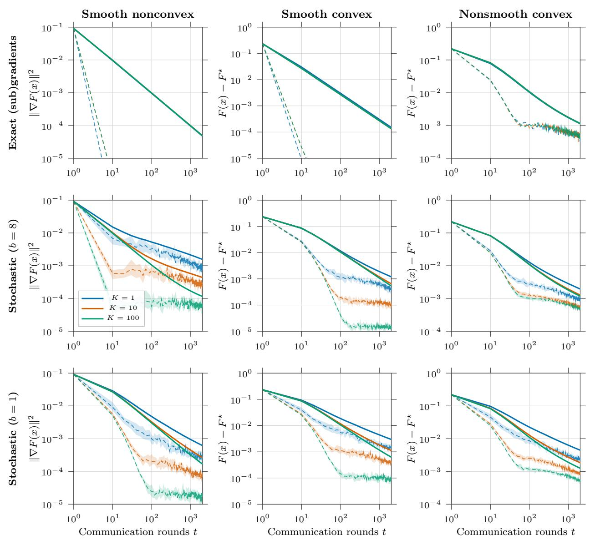  
Figure 3: Performance of AdaFed on synthetic logistic problems with Gram condition number $\kappa = 1 0$ across the three problem classes and diferent numbers of local steps K. Rows show exact gradients and stochastic gradients with minibatch sizes b = 1 and $b = 8 .$ , respectively. Solid and dashed curves show the uniform-random and last-iterate metrics, respectively. Stochastic results show the mean over ten seeds, with shaded regions indicating the upward and downward RMS deviations.

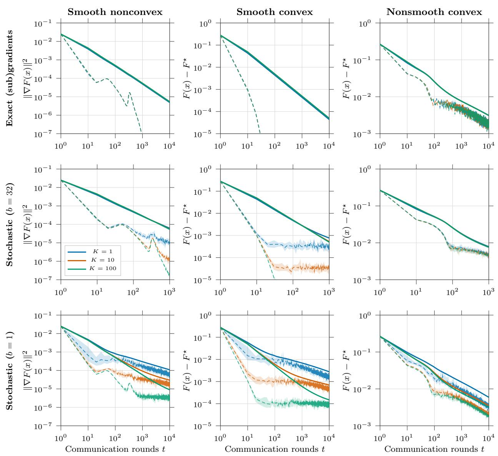  
Figure 4: Performance of AdaFed on IJCNN1 across the three problem classes and diferent numbers of local steps K. Rows show exact gradients and stochastic gradients with minibatch sizes b = 1 and $b = 3 2$ , respectively. Solid and dashed curves show the uniform-random and last-iterate metrics, respectively. Stochastic results show the mean over ten seeds, with shaded regions indicating the upward and downward RMS deviations.

## G.4 Sensitivity to η and $\gamma$

The two scalar parameters play diferent roles. The parameter η sets the numerator of the adaptive shared step, while $\gamma$ initializes its accumulator; in particular, $\eta _ { 1 } = \eta / \gamma$ . We vary one parameter on an absolute power-of-ten grid while fixing the other, with $K = 1 0$ and full participation. Exact-gradient curves are deterministic. Stochastic curves use $b = 1$ and are pointwise means over seeds 2027–2036.

The η panels verify that the selected values are interior to the tested grids rather than artifacts of a truncated search. The response to $\gamma$ is nonmonotone because changing $\gamma$ also changes the initial step $\eta / \gamma$ . On IJCNN1, $\gamma = 1$ gives the smallest final random-output metric in five of the six row–regime combinations; the exact nonconvex row favors 0.1. On the synthetic stochastic rows, 0.1 has the smallest final random-output metric, although $\gamma = 1$ remains close and is used throughout the controlled rate study. Large $\gamma$ consistently slows the initial transient.

## G.5 Partial participation

For an empirical experiment, each client participates independently with probability $p \in \{ 0 . 2 5 , 0 . 5 , 1 \}$ . The server uses the same Horvitz–Thompson-scaled update as the implementation, so its conditional mean matches the full-participation update. We fix $K = 1 0 , \gamma = 1$ , and the corresponding tuned $\eta .$ Whenever participation is random, curves are pointwise means over seeds $2 0 2 7 - 2 0 3 6 ;$ the full-participation exact curve is deterministic.

Reducing participation increases the stochastic error level in every regime. At the final checkpoint, $p = 0 . 2 5$ raises the stochastic random-output metric relative to $p = 1$ by factors between 1.66 and 1.79 on synthetic data and between 1.35 and 2.54 on IJCNN1. The efect is much larger for the exact-gradient smooth synthetic problems because client subsampling becomes their only source of randomness.

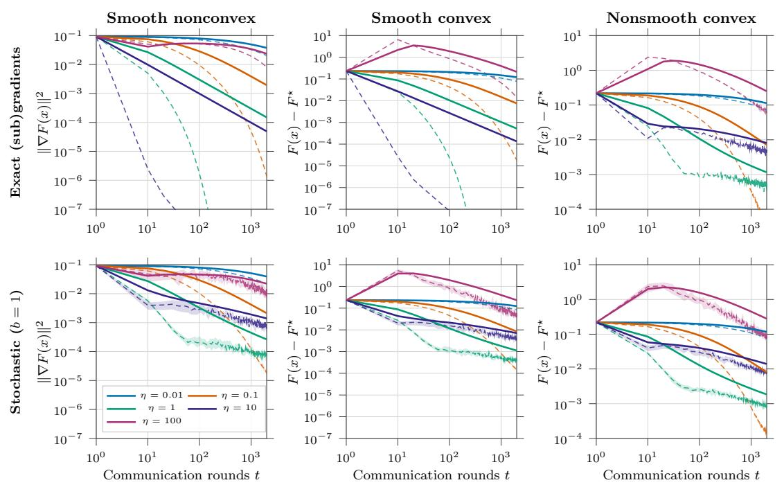

Figure 5: Sensitivity of AdaFed to η on synthetic logistic problems with Gram condition number $\kappa = 1 0 ,$ , with $\gamma = 1$ and $K = 1 0$ . Solid and dashed curves show the uniform-random and last-iterate metrics, respectively. Stochastic results show the mean over ten seeds, with shaded regions indicating the upward and downward RMS deviations.  
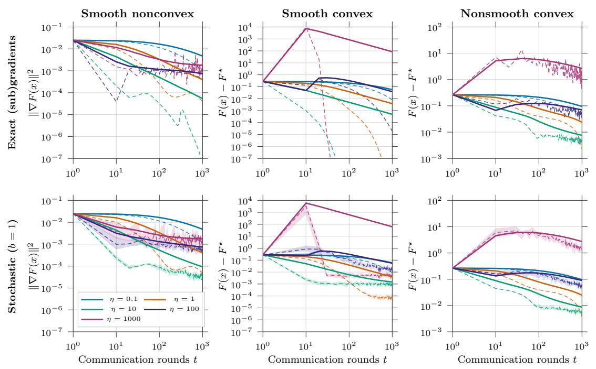  
Figure 6: Sensitivity of AdaFed to η on IJCNN1, with $\gamma = 1$ and $K = 1 0 .$ Solid and dashed curves show the uniform-random and last-iterate metrics, respectively. Stochastic results show the mean over ten seeds, with shaded regions indicating the upward and downward RMS deviations

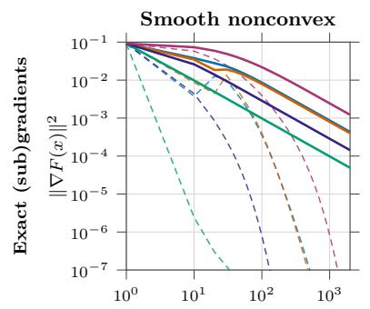

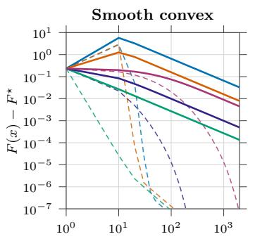

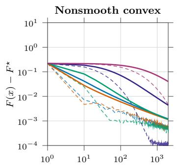

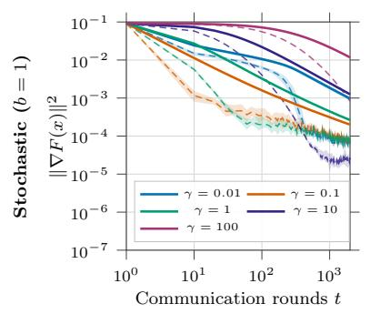

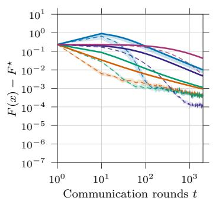

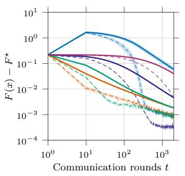

Figure 7: Sensitivity of AdaFed to γ on synthetic logistic problems with Gram condition number $\kappa = 1 0 .$ , with $\eta = 1$ and $K = 1 0$ . Solid and dashed curves show the uniform-random and last-iterate metrics, respectively. Stochastic results show the mean over ten seeds, with shaded regions indicating the upward and downward RMS deviations.  
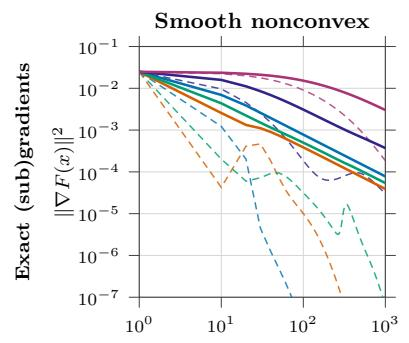

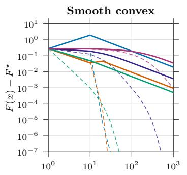

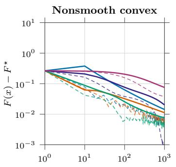

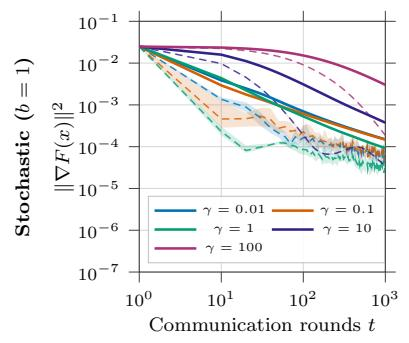

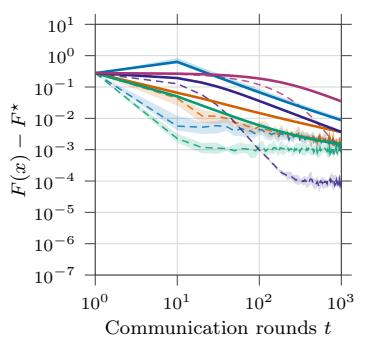

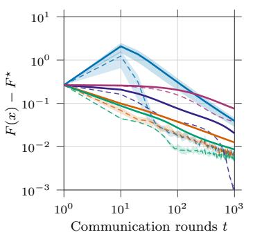  
Figure 8: Sensitivity of AdaFed to $\gamma$ on IJCNN1, with $\eta = 1$ and $K = 1 0 .$ Solid and dashed curves show the uniform-random and last-iterate metrics, respectively. Stochastic results show the mean over ten seeds, with shaded regions indicating the upward and downward RMS deviations.

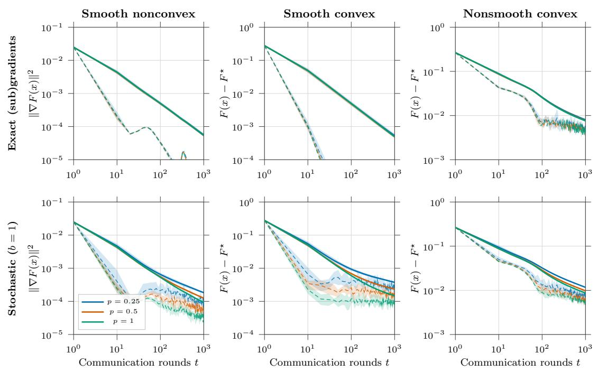

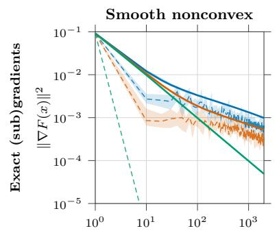

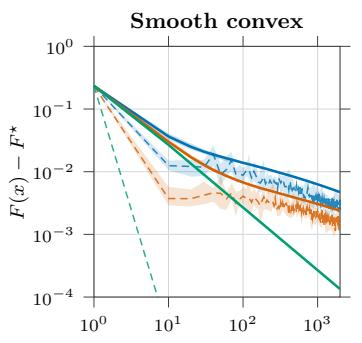

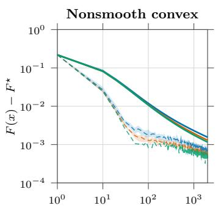

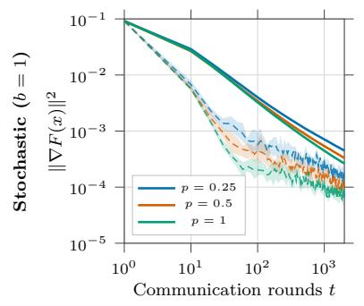

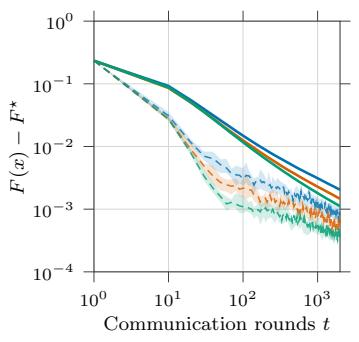

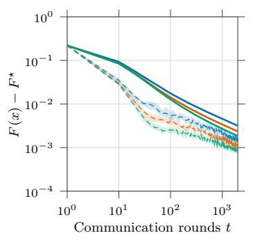  
Figure 9: Performance of AdaFed under partial participation on synthetic logistic problems with Gram condition number $\kappa = 1 0$ and diferent participation rates p. Solid and dashed curves show the uniform-random and last-iterate metrics, respectively. Stochastic results show the mean over ten seeds, with shaded regions indicating the upward and downward RMS deviations.  
Figure 10: Performance of AdaFed under partial participation on IJCNN1 with diferent participation rates p. Solid and dashed curves show the uniform-random and last-iterate metrics, respectively. Stochastic results show the mean over ten seeds, with shaded regions indicating the upward and downward RMS deviations.

## G.6 Adaptive-method comparisons

These experiments use full participation of all 32 clients, K = 10 local steps, and $T = 1 0 ^ { 4 }$ rounds on synthetic data with $\kappa = 1$ and on IJCNN1. Exact local gradients use each client’s entire sample. Stochastic gradients use minibatches sampled independently with replacement, of size $b = 1 6$ for synthetic data and $b = 3 2$ for IJCNN1. The exact trajectories use seed 2027; stochastic curves are pointwise means of seeds 2027–2029. All methods start from the zero vector and are evaluated using the same full-objective metrics as in Section 5. The solid and dashed line meanings match Figure 2.

Each method is tuned separately in each dataset–objective–oracle cell. Candidate runs use seed 1901 and 300 reported rounds on synthetic data or 150 on IJCNN1. The tuning criterion is the final cumulative-mean metric, namely the objective gap for convex problems and squared full pooled gradient norm for the smooth nonconvex problem. Initial Cartesian grids are extended by a factor of ten along an axis when the selected value lies at its edge, subject to the finite bounds in Table 2. The resulting settings are held fixed throughout the 10,000-round runs; they are short-horizon selections rather than parameters optimized for the full horizon. The selected four-method comparison and the wider adaptation-level comparisons reuse the same AdaFed, FedAdagrad, FedLADA, and FAFED runs. AdaFed jointly tunes its η and accumulator initialization $\gamma ;$ its local schedule remains $\tau _ { t } = 1 / ( ( K - 1 ) t )$ . For baselines, $c / L$ denotes a local learning rate using the pooled logistic smoothness constant L.

Table 2: Tuned quantities and finite search bounds for the adaptive-method comparisons. $\eta _ { g }$ is a server rate, c or $c _ { 0 }$ is a local scale, g is a FedSPS cap scale, and ϵ is Local AdaAlter’s placeholder.
<table><tr><td>Method</td><td>Tuned quantities</td><td>Finite search bounds</td></tr><tr><td>AdaFed</td><td> $\eta , \gamma$ </td><td> $\eta \in [ 1 0 ^ { - 3 } , 1 0 ^ { 3 } ] ; \gamma \in [ 1 0 ^ { - 3 } , 1 0 ^ { 3 } ]$ </td></tr><tr><td>FedAdagrad</td><td> $c , \eta _ { g }$ </td><td> $c \in [ 1 / 1 2 8 0 0 0 , 2 0 ] , \eta _ { g } \in [ 1 0 ^ { - 3 } ,$  100]</td></tr><tr><td>FedAdam</td><td> $c , \eta _ { g }$ </td><td> $c \in [ 1 / 1 2 8 0 0 0 , 2 0 ] , \eta _ { g } \in [ 1 0 ^ { - 3 }$  100]</td></tr><tr><td>FedUR</td><td> $c _ { 0 } , \alpha$ </td><td> $c _ { 0 } \in [ 1 0 ^ { - 4 } , 1 0 ] , \alpha \in [ 0 . 1 , 1 ]$ </td></tr><tr><td>Local AdaAlter</td><td> $c , \epsilon$ </td><td> $c \in [ \dot { 1 } 0 ^ { - 5 } , 1 0 0 \dot { ] } , \epsilon \in [ \dot { 1 } 0 ^ { - 4 } , \dot { 1 } 0 ]$ </td></tr><tr><td>FedSPS</td><td> $c , g$ </td><td> $c \in [ 1 0 ^ { - 3 } , 1 0 0 0 ] , g \in [ 1 0 ^ { - 4 } , 1 0 0 ]$ </td></tr><tr><td>FedLADA</td><td> $c , \eta _ { g }$ </td><td> $c \in [ 1 0 ^ { - 5 } , 1 0 ] , \eta _ { g } \in [ 1 0 ^ { - 2 } , 1 0 ]$ </td></tr><tr><td> $\mathrm { F A F E D }$ </td><td>C</td><td> $c \in [ 1 0 ^ { - 5 } , 0 . 1 ] ; \eta _ { g } = 1 \mathrm { f i x e d }$ </td></tr><tr><td> $\mathrm { F e d A d a } ^ { 2 }$ </td><td> $c , \eta _ { g }$ </td><td> $c \in \mathring { [ 1 0 ^ { - 6 } , 1 0 ] } , \eta _ { g } \in [ 1 0 ^ { - 3 } , 1 0 0 ]$ </td></tr></table>

Initial discrete grids. The tested starting grids, in the order of the tuned quantities in Table 2, are as follows:

• AdaFed: $\eta \in \{ 0 . 0 1 , 0 . 1 , 1 , 1 0 , 1 0 0 \} \ \mathrm { a n d } \ \gamma \in \{ 0 . 0 1 , 0 . 1 , 1 , 1 0 , 1 0 0 \} .$

• FedAdagrad: $c \in \{ 1 / 1 2 8 , 1 / 3 2 , 1 / 8 , 1 / 2 , 2 \}$ and $\eta _ { g } \in \{ 0 . 0 0 1 , 0 . 0 1 , 0 . 1 , 1 , 1 0 \}$

• FedAdam: $c \in \{ 1 / 1 2 8 , 1 / 8 , 2 \}$ and $\eta _ { g } \in \{ 0 . 0 1 , 0 . 1 , 1 , 1 0 \}$

• FedUR: $c _ { 0 } \in \{ 0 . 0 0 1 , 0 . 0 1 , 0 . 1 , 1 \}$ and $\alpha \in \{ 0 . 1 , 0 . 5 , 0 . 9 , 1 \}$

• Local AdaAlter: $c \in \{ 0 . 0 0 1 , 0 . 0 1 , 0 . 1 , 1 , 1 0 \} \mathrm { ~ a n d ~ } \epsilon \in \{ 0 . 0 1 , 0 . 1 , 1 \}$

• FedSPS: $c \in \{ 0 . 1 , 1 , 1 0 , 1 0 0 \} { \mathrm { ~ a n d ~ } } g \in \{ 0 . 0 1 , 0 . 1 , 1 , 1 0 \}$

• FedL $\mathrm { A D A } \colon c \in \{ 1 0 ^ { - 5 } , 1 0 ^ { - 4 } , 1 0 ^ { - 3 } , 1 0 ^ { - 2 } , 1 0 ^ { - 1 } \}$ and $\eta _ { g } \in \{ 0 . 1 , 1 , 1 0 \}$

• FAFED: $c \in \{ 1 0 ^ { - 5 } , 1 0 ^ { - 4 } , 1 0 ^ { - 3 } , 1 0 ^ { - 2 } , 1 0 ^ { - 1 } \}$

$\mathrm { F e d A d a ^ { 2 } } \colon c \in \{ 1 0 ^ { - 4 } , 1 0 ^ { - 3 } , 1 0 ^ { - 2 } , 1 0 ^ { - 1 } , 1 \}$ and $\eta _ { g } \in \{ 0 . 0 1 , 0 . 1 , 1 , 1 0 \}$

Selected methods on synthetic data. Figure 11 is the synthetic counterpart of the main-text IJCNN1 comparison. AdaFed has the smallest final cumulative-mean metric in all six synthetic settings among this four-method set. The nonsmooth runs of FedLADA and FAFED use the selected $\mathrm { s i g n } ( 0 ) = 0$ subgradient and are empirical extensions beyond the smooth-objective assumptions in their cited analyses.

Server adaptation. Figures 12 and 13 add FedAdam and FedUR to FedAdagrad as server-side comparators. AdaFed has the lowest final cumulative-mean metric in all 12 dataset–objective–oracle cells of this group. This is an empirical comparison at equal communication rounds; diferent methods may incur diferent local computational costs.

Client adaptation. Figures 14 and 15 compare AdaFed with Local AdaAlter, FedSPS, and FedLADA. AdaFed has the smallest final cumulative-mean metric in 10 of the 12 cells. Local AdaAlter is lower in the synthetic stochastic smooth nonconvex and smooth convex cells, with values $3 . 0 0 9 \times 1 0 ^ { - 5 }$ versus $5 . 4 0 1 \times 1 0 ^ { - 5 }$ and $9 . 0 2 5 \times 1 0 ^ { - 5 }$ versus $1 . 6 4 7 \times 1 0 ^ { - 4 }$ , respectively.

Adaptation at both levels. Figures 16 and 17 compare AdaFed with FAFED and $\mathrm { F e d A d a ^ { 2 } }$ . AdaFed has the smallest final cumulative-mean metric in all 12 cells. FAFED uses about two local gradient evaluations per tracker step; $\mathrm { F e d A d a ^ { 2 } }$ uses coordinatewise AdaGrad at both levels with client accumulators restarted each round. Their nonsmooth results, like those of the other baselines, should be read as empirical tests of the implemented subgradient extensions.

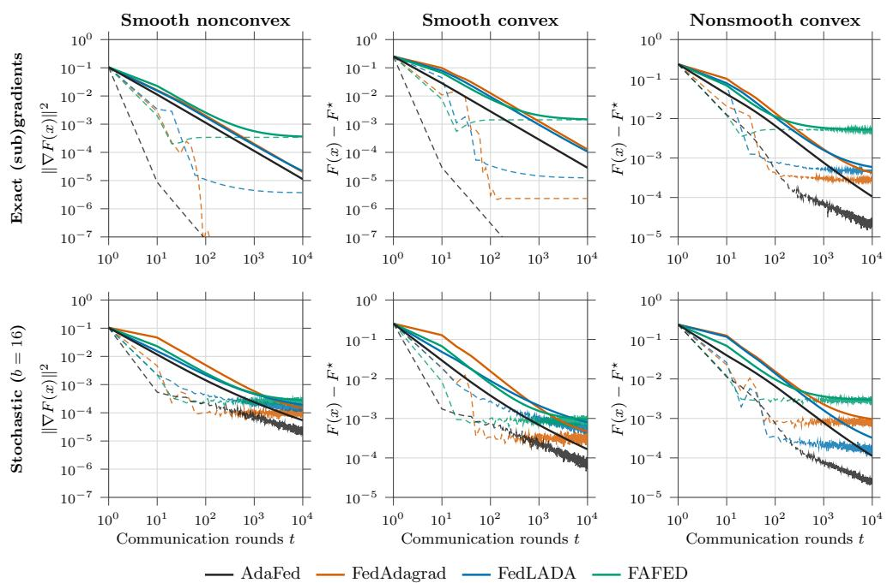  
Figure 11: Performance of AdaFed compared with representative adaptive FL methods on synthetic data with $\kappa = 1$ and $K = 1 0$ local steps. FedAdagrad, FedLADA, and FAFED represent server-, client-, and both-level adaptation, respectively. Solid and dashed curves show the uniform-random and last-iterate metrics, respectively. Stochastic results are shown as the mean over three seeds.

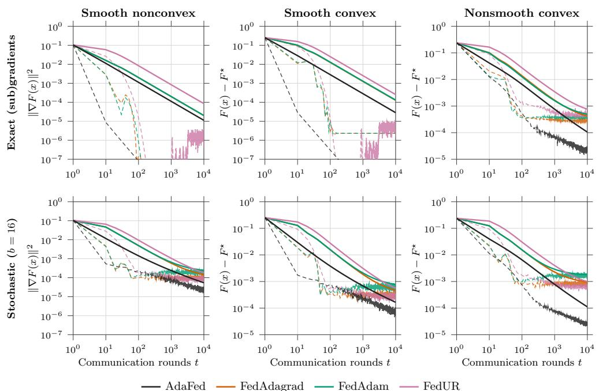

Figure 12: Performance of AdaFed compared with server-adaptive FL methods on synthetic data with $\kappa = 1$ and $K = 1 0$ local steps. FedAdagrad, FedAdam, and FedUR are server-level adaptive methods. Solid and dashed curves show the uniform-random and last-iterate metrics, respectively. Stochastic results are shown as the mean over three seeds.  
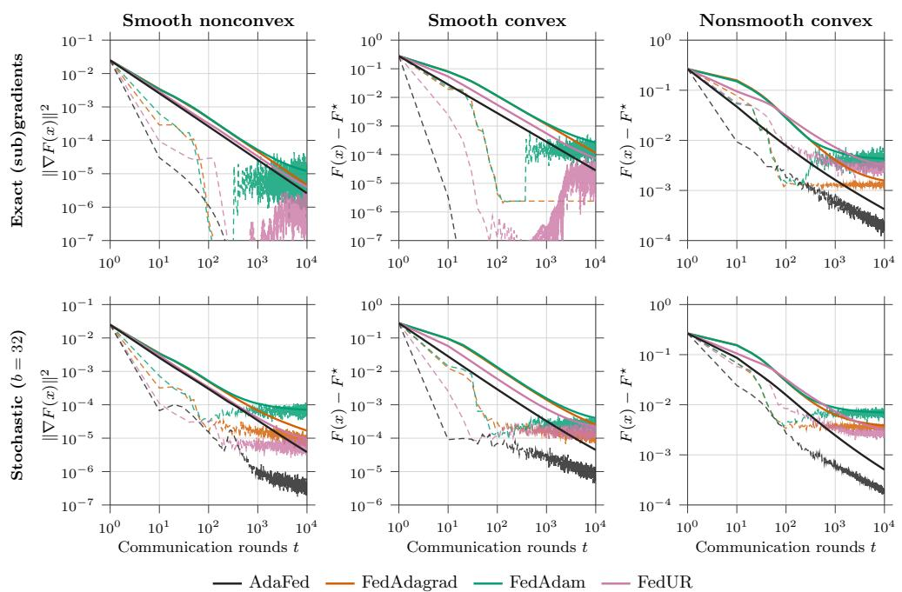  
Figure 13: Performance of AdaFed compared with server-adaptive FL methods on IJCNN1 with $K = 1 0$ local steps. FedAdagrad, FedAdam, and FedUR represent server-level adaptation. Solid and dashed curves show the uniform-random and last-iterate metrics, respectively. Stochastic results are shown as the mean over three seeds.

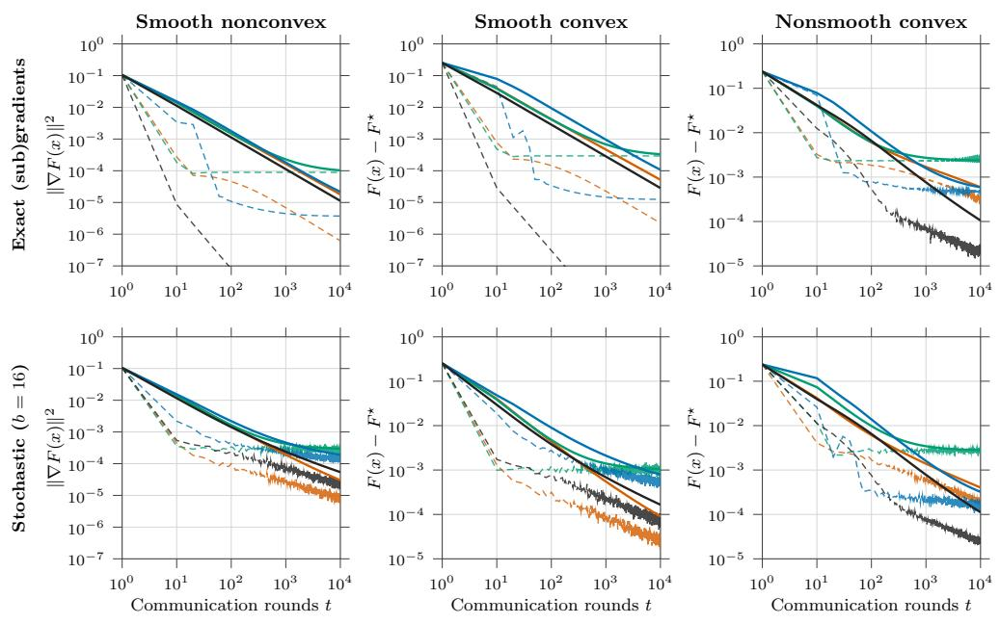  
AdaFed Local AdaAlter FedSPS FedLADA

Figure 14: Performance of AdaFed compared with client-adaptive FL methods on synthetic data with $\kappa = 1$ and $K = 1 0$ local steps. Local AdaAlter, FedSPS, and FedLADA represent client-level adaptation. Solid and dashed curves show the uniform-random and last-iterate metrics, respectively. Stochastic results are shown as the mean over three seeds.  
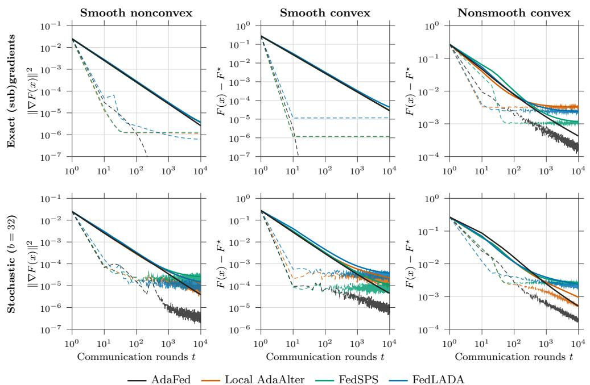  
Figure 15: Performance of AdaFed compared with client-adaptive FL methods on IJCNN1 with K = 10 local steps. Local AdaAlter, FedSPS, and FedLADA represent client-level adaptation. Solid and dashed curves show the uniform-random and last-iterate metrics, respectively. Stochastic results are shown as the mean over three seeds.

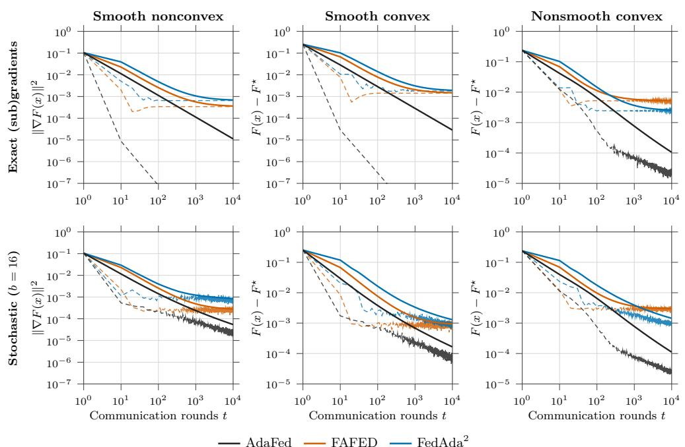  
Figure 16: Performance of AdaFed compared with FL methods using both server- and client-level adaptation on synthetic data with $\kappa = 1$ and $K = 1 0$ local steps. FAFED and Fed $\mathrm { { A d a } ^ { 2 } }$ represent both-level adaptation. Solid and dashed curves show the uniform-random and last-iterate metrics, respectively. Stochastic results are shown as the mean over three seeds.

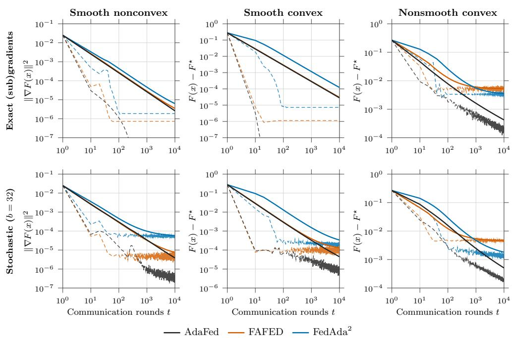  
Figure 17: Performance of AdaFed compared with FL methods using both server- and client-level adaptation on IJCNN1 with $K = 1 0$ local steps. FAFED and $\mathrm { F e d A d a ^ { 2 } }$ represent both-level adaptation. Solid and dashed curves show the uniform-random and last-iterate metrics, respectively. Stochastic results are shown as the mean over three seeds.

## H Comparison of Adaptive FL Assumptions and Guarantees

Table 3 complements the related-work discussion with a detailed comparison of adaptive federated optimization methods. For each result, we summarize the objective and stochastic assumptions, the participation and local-update settings, where step-size adaptation is performed, and the main theoretical guarantees.

Table 3: Detailed comparison of assumptions, adaptive mechanisms, and theoretical guarantees in related federated optimization methods.
<table><tr><td></td><td>Paper / result Objective assumptions</td><td>Stochastic / hetero- geneity</td><td>Method setting</td><td>Main result / notes</td></tr><tr><td>[Wang et al., 2025] Thm. 1</td><td>Class: nonconvex Smoothness: L-smooth in  $\| \cdot \| _ { \alpha }$  Strong conv.: x Grad. bound:  $\| \nabla f _ { n } ( w ) \| _ { \infty } \leq C$ </td><td>Variance/noise:  $\mathbb { E } \| \xi _ { t } \| _ { \alpha } ^ { \alpha } \leq \dot { G }$  Heterogeneity: X</td><td>Participation: full participation Adaptation: In server Local updates: one local step</td><td>Thm. 1: AdaGrad-OTA; rate  $O ( \log ( T ) / { T ^ { 1 - 1 / \alpha } } )$ </td></tr><tr><td>[Wang et al.. 2025] Thm. 2</td><td>Class: nonconvex Smoothness: L-smooth in  $\| \cdot \| _ { \alpha }$  Strong conv.: x Grad. bound:  $\| \nabla f _ { n } ( w ) \| _ { \infty } \leq C$ </td><td>Variance/noise: E∥|ξt∥α ≤′G Heterogeneity: X</td><td>Participation: full participation Adaptation: In server Local updates: one local step</td><td>Thm. 2: Adam-OTA; rate O(1/T)</td></tr><tr><td>[Chen et al., 2025] Thm. 5.2</td><td>Class: nonconvex Smoothness: each  $f _ { i }$  is L- smooth Strong conv.: x Grad. bound: X</td><td>Variance/noise:  $\mathbb { E } \Vert n _ { i } ^ { ( t , k ) } \Vert ^ { 2 } \leq \sigma ^ { 2 }$  Heterogeneity: X</td><td>Participation: client sampling St; minibatch Adaptation: In client Local updates: K local steps</td><td>Thm. 5.2: FAdamGC,  $\beta _ { 2 } = \epsilon = 0 ;$  rate  $\begin{array} { r } { O \left( \sqrt { \frac { L F \sigma ^ { 2 } } { n K T } } + \frac { L F } { T } + \frac { L K } { T } + \frac { K \sigma } { T } \right) } \end{array}$ </td></tr><tr><td>[Chen et al., 2025] Thm. 5.4</td><td>Class: nonconvex Smoothness: each  $f _ { i }$  is L- smooth Strong conv.: x Grad. bound:  $\| g _ { i } ^ { ( t ) } \| \leq G$ </td><td>Variance/noise:  $\mathbb { E } \Vert n _ { i } ^ { ( t , k ) } \Vert ^ { 2 } \leq \sigma ^ { 2 }$  Heterogeneity: X</td><td>Participation: client sampling St; minibatch Adaptation: In client Local updates: K local steps</td><td>Thm. 5.4: FAdamGC, general Adam case; rate  $\begin{array} { r } { O \big ( \sqrt { \frac { L F \sigma ^ { 2 } } { n K T } } + } \end{array}$   $\begin{array} { r } { \frac { L F } { T } + \frac { K G ^ { 6 } } { \epsilon ^ { 2 } T } + \frac { K ( \sigma ^ { 2 } + \dot { ( 1 + \epsilon ^ { 2 } ) } G ^ { 2 } ) } { \epsilon ^ { 2 } T } ) } \end{array}$ </td></tr><tr><td>[Chen et al., 2025] Thm. C.2</td><td>Class: nonconvex Smoothness: each  $f _ { i }$  is L- smooth Strong conv.: x Grad. bound:  $\| g _ { i } ^ { ( t ) } \| \leq G$ </td><td>Variance/noise:  $\mathbb { E } \Vert n _ { i } ^ { ( t , k ) } \Vert ^ { 2 } \leq \sigma ^ { 2 }$  Heterogeneity: X</td><td>Participation: client sampling St; minibatch Adaptation: In client Local updates: K local steps</td><td>Thm. C.2: FA-NT, general Adam case; rate has worse  $K ^ { 2 }$  final term</td></tr><tr><td>[Chen et al., 2025] Thm. C.3</td><td>Class: nonconvex Smoothness: each  $f _ { i }$  is L- smooth Strong conv.: x Grad. bound: x</td><td>Variance/noise:  $\mathbb { E } \Vert n _ { i } ^ { ( t , k ) } \Vert ^ { 2 } \leq \sigma ^ { 2 }$  Heterogeneity:∥∇fi(x)—  $\nabla f ( x ) \| \leq B$ </td><td>Participation: client sampling St; minibatch Adaptation: In client Local updates: K local steps</td><td>Thm. C.3: FA-NT, β2 = € = 0; requires bounded data heterogeneity</td></tr><tr><td>[Chezhegov et al., 2024] Thm. 1 / Cor. 2</td><td>Class: strongly convex Smoothness: each  $f _ { m }$  is L-smooth Strong conv.: µ-strongly convex, µ &gt; 0 Grad. bound: x</td><td>Variance/noise: unbi- ased stochastic gradients; variance  $\leq \sigma ^ { 2 }$  Heterogeneity: X</td><td>Participation: full participation Adaptation: Server- like All clients use the same Dtp . Local updates: local steps; max gap H</td><td>Thm. 1 / Cor. 2: SAVIC for identical data; Local SGD with adaptive scal- ing/preconditioning</td></tr><tr><td>[Chezhegov et al., 2024] Thm. 2 / Cor. 3</td><td>Class: strongly convex Smoothness: each  $f _ { m } ( \cdot , z )$  L-smooth Strong conv.: µ-strongly convex Grad. bound: X</td><td>Variance/noise: is via σdif 二  $\begin{array} { r l } {  { \frac { 1 } { M } \sum _ { m } \mathbb { E } \| \nabla f _ { m } ( x ^ { \star } , z _ { m } ) \| ^ { 2 } } } \end{array}$  Heterogeneity: hetero- geneity measured at  $x ^ { \star }$ </td><td>Participation: full participation Adaptation: Server- like All clients use the same Dtp . Local updates: local</td><td>Thm. 2 / Cor. 3: SAVIC for heterogeneous data; Lo- cal SGD with adaptive scal- ing/preconditioning</td></tr></table>

Continued on next page

Table 3 – continued from previous page
<table><tr><td colspan="4">– continued from previous page Paper / result Objective assumptions</td><td>Method setting Main result / notes</td></tr><tr><td>[Wang et al., 2021]</td><td>Class: strongly convex Smoothness: each Fi is  $L _ { i ^ { - } }$ </td><td>geneity Variance/noise: bounded Participation: full cumulative variance</td><td>participation</td><td>Thm. 1: FEDOPT with local adaptive CLIENTOPT; con-</td></tr><tr><td>[Wang et al.,</td><td>Strong conv.: each  $F _ { i }$  is µi-strongly convex Grad. bound: x Class: quadratic convex Smoothness: quadratic</td><td>Heterogeneity: X</td><td>Local updates: τi local necessarily global minimizer. steps Variance/noise: × deter- Participation: full</td><td>Thm. 2: preconditioned local GD; non-vanishing bias if</td></tr><tr><td>[Wang et al.,</td><td>Strong conv.:  $H _ { i } \succ 0$  Grad. bound: x Class: nonconvex Smoothness: each  $F _ { i }$  is L-</td><td></td><td>steps Variance/noise: × deter- Participation: full</td><td>Local updates: τi local The fixed point x of the algo is not necessarily the global minimizer. Thm. 3: local correction;</td></tr><tr><td></td><td>Strong conv.: x Grad. bound: precondi- tioned gradients bounded:  $\| B _ { i } ^ { ( t , k ) } \overset { - } { \nabla } F _ { i } ( x _ { i } ^ { ( t , k ) } ) \| \leq G$  Class: nonconvex Smoothness: local smooth-</td><td></td><td>local steps Participation: partial</td><td></td></tr><tr><td>Thm. 1</td><td>ness L Strong conv.: X Grad. bound:  $\lVert \nabla f _ { i } ( x ) \rVert \leq$  G Class: convex</td><td> $\begin{array} { r l } & { \underset { \sigma ^ { 2 } } { \mathbb { E } } \| \nabla F _ { i } ( x , z ) - \nabla f _ { i } ( x ) \| ^ { 2 } \leq } \end{array}$  Heterogeneity: strong- growth dissimilarity</td><td>Adaptation: In client Local updates: K local steps</td><td>step sizes; rate  ${ \cal O } ( T ^ { - 1 / 2 } )$ </td></tr><tr><td>Thm. 5</td><td>chitz gradients Strong conv.: x Grad. bound: X Class: nonconvex</td><td>Heterogeneity: common minimizer</td><td>Adaptation: In client Local updates:  $K = 1$  Variance/noise: × deter- Participation: partial</td><td>Thm. 4.1 / Cor. 4.3:</td></tr><tr><td>4.3</td><td>objectives Strong conv.: x Grad. bound:  $| [ \nabla F _ { i } ( x ) ] _ { j } | \le$  G</td><td>Heterogeneity: X</td><td>Adaptation: In server and client Local updates: K local FedAda2++ uses memory- steps</td><td>cient joint adaptivity without transmitting preconditioners; efficient client optimizer; rate  ${ \cal O } ( T ^ { - 1 / 2 } )$  Thm. E.1: federated blended</td></tr><tr><td>Thm. E.1</td><td>Smoothness: L-smooth local ministic objectives Strong conv.: x Grad. bound:  $| [ \nabla F _ { i } ( x ) ] _ { j } | \leq$  G</td><td>Heterogeneity: X</td><td>participation Adaptation: In server and client Local updates: variable Adam, and SM3 variants,  $K ( O _ { i } ^ { \ell } )$  local steps</td><td>optimization; allows heteroge- neous client optimizer strate- gies such as SGD, AdaGrad, with bounded optimizer up- dates.</td></tr><tr><td>Thm. 5.6 / Cor. 5.7</td><td>Smoothness: sample mean- squared L-smoothness Strong conv.: x Grad. bound: x</td><td>ased stochastic gradients; variance  $\leq \sigma ^ { 2 }$  Heterogeneity:  $\underset { \zeta ^ { 2 } } { \| \nabla f ^ { ( k ) } ( x ) - \nabla \bar { f } ^ { ( \ell ) } ( x ) \| ^ { 2 } } \leq$ </td><td>participation Adaptation: In server/client Local updates: I local dual-averaging steps</td><td>Thm. 5.6 / Cor. 5.7: FedDA- MVR for federated con- strained optimization; adaptive matrix fixed during local steps and updated at server; sample complexity  $\widetilde { \cal O } ( K ^ { - 1 } \epsilon ^ { - 1 . 5 } )$  , communication complexity  $\stackrel {  } { O } ( K ^ { - 0 . 2 5 } \epsilon ^ { - 1 . 2 5 } )$ </td></tr></table>

Continued on next page

Table 3 – continued from previous page
<table><tr><td colspan="4">Table 3 – continued from previous page Paper / result Objective assumptions</td><td>Method setting</td><td>Main result / notes</td></tr><tr><td>[Liu et al., 2026]</td><td>Class: nonconvex Smoothness: L-smooth local ased stochastic gradients;</td><td>geneity Variance/noise: unbi-</td><td>Participation: all agents; decentralized</td><td>Thm. 3.2: LoDAdaC; de- centralized adaptive local training with compressed</td></tr><tr><td></td><td>Grad. bound:  $\begin{array} { r } { \| g _ { i } ^ { t } \| \leq B , } \end{array}$   $\| g _ { i } ^ { t } \| _ { \infty } \leq B _ { \infty }$ </td><td></td><td>Local updates: K local AMSGrad, AdaGrad, and steps per communication Adam-Mini; rate O(1/√nTK)</td><td>under suitable conditions, with communication cost  $O ( ( 1 - \eta ) / ( n K \epsilon ^ { 4 } ) )$  for an €-stationary point.</td></tr><tr><td>Thm. 3(a)</td><td> $F _ { i } ( \cdot , \xi ) \ \mathrm { i s } L \cdot$  smooth Strong conv.: x Grad. bound: x Class: strongly convex Smoothness:  $F _ { i } ( \cdot , \xi ) \ \mathrm { i s } L \cdot$ </td><td>Heterogeneity: finite  $\begin{array} { r } { \sigma _ { f } ^ { 2 } = f ^ { \star } - \frac { 1 } { n } \sum _ { i } \ell _ { i } ^ { \star } } \end{array}$ </td><td>Adaptation: In client Local updates: τ local steps Variance/noise: stochas- Participation: full</td><td>local stochastic Polyak step- sizes; sublinear convergence to a neighborhood for convex objectives. Thm. 3(b) / Cor. 5: FedSPS;</td></tr><tr><td>Thm. 3(b) / Cor. 5</td><td>smooth Strong conv.: µ-strongly convex Grad. bound: X Class: × nonconvex</td><td>Heterogeneity:  $\sigma _ { f } ^ { 2 } ~ =$   $\begin{array} { r } { f ^ { \star } - { \frac { 1 } { n } } \sum _ { i } \ell _ { i } ^ { \star } } \end{array}$  Variance/noise:</td><td>Adaptation: In client Local updates: τ local steps</td><td>interpolation, i.e.,  $\sigma _ { f } ^ { 2 } = 0 .$ </td></tr><tr><td>Thm. 18</td><td>smooth Strong conv.: x Grad. bound: x</td><td> $\mathbb { E } { \lVert \nabla F _ { i } ( x , \overset { \prime } { \xi } ) - \nabla f _ { i } ( x ) \rVert ^ { 2 } } \le$  σ Heterogeneity:  $\begin{array} { r } { \frac { 1 } { n } \sum _ { i } \| \nabla f _ { i } ( x ) - \nabla f ( x ) \| ^ { 2 } \leq } \end{array}$  ζ²</td><td>Adaptation: In client Local updates: τ local steps</td><td>convex objectives; rate for mint  $\mathbb { E } \Vert \nabla f ( \bar { x } _ { t } ) \Vert ^ { 2 }$ </td></tr><tr><td>2021] Thm. 1 / Cor. 1</td><td>Smoothness: each Fi is L- smooth Strong conv.: × Grad. bound:  $| [ \nabla f _ { i } ( x , z ) ] _ { j } | \leq G$  Class: nonconvex</td><td> $\sigma _ { l , j } ^ { 2 }$  Heterogeneity:  $\begin{array} { r } { \frac { 1 } { m } \sum _ { i } | [ \widecheck { \nabla } F _ { i } ( x ) ] _ { j } } \end{array}$   $[ \nabla f ( x ) ] _ { j } | ^ { 2 } \leq \sigma _ { g , j } ^ { 2 }$ </td><td>Adaptation: In server Local updates: K local rate essentially SGD steps</td><td>and adaptive server optimizer;  $O ( 1 / \sqrt { m K T } )$  for suitable ηl, η, τ. Thm. 2 / Cor. 2: FedAdam;</td></tr><tr><td>2021]  $_ { 2 } ^ { \mathrm { T h m . ~ 2 ~ / ~ C o r . } }$ </td><td>Smoothness: each Fi is L- smooth Strong conv.: x Grad. bound:  $| [ \nabla f _ { i } ( x , z ) ] _ { j } | \leq G$ </td><td>variance σ2, j Heterogeneity:  $\begin{array} { r } { \frac { 1 } { m } \sum _ { i } | [ \breve { \nabla } F _ { i } ( x ) ] _ { j } } & { { } - } \end{array}$   $[ \nabla f ( x ) ] _ { j } | ^ { 2 } \leq \sigma _ { g , j } ^ { 2 }$ </td><td>participation Adaptation: In server Local updates: K local adaptive preconditioning on SGD steps</td><td>FedYogi follows similarly. Server uses Adam/Yogi-style the pseudo-gradient from client model differences. Thm. 3.5 / Cor. 3.6:</td></tr><tr><td>[Sun et al., 2023] Thm. 3.5 / Cor. 3.6</td><td>Smoothness: Fi is L-smooth Strong conv.: x Grad. bound:  $\| g _ { i } ^ { t } \| _ { \infty } \leq G _ { g }$ </td><td>ased stochastic gradients; variance ≤ σ2 Heterogeneity:  $\| \nabla F _ { i } ( x ) - \nabla F ( x ) \| ^ { 2 } \leq \sigma _ { g } ^ { 2 }$ </td><td>participation; S clients Adaptation: In client Local updates: K local timizer with global adaptive steps</td><td>FedLADA; local adaptive amended op- offset correction gt; rate  $\begin{array} { r } { O \left( \frac { 1 } { \sqrt { S K T } } + \frac { 1 } { K T } + \frac { 1 } { T } + \frac { 1 } { T ^ { 3 / 2 } } \right) } \end{array}$ </td></tr><tr><td>[Takakura et al., Class: convex 2025] Thm. 4.3 / Cor. 4.4</td><td>Smoothness: Fi is L-smooth Strong conv.: x Grad. bound: x</td><td>ministic Heterogeneity:  $\begin{array} { r } { \frac { 1 } { M } \sum _ { i } \| \stackrel { \mathbf { O } } { \nabla } F _ { i } ( w ^ { \star } ) \| ^ { 2 } \leq \sigma _ { \star } ^ { 2 } } \end{array}$ </td><td>Variance/noise:  deter- Participation: full participation Adaptation: In server Local updates: τ local SGD steps</td><td>Thm. 4.3 / Cor. 4.4: FedDuA / FedDuAdagrad; server- side doubly adaptive global step-size based on both inter- client and coordinate-wise</td></tr></table>

Continued on next page

Table 3 – continued from previous page
<table><tr><td></td><td>Paper / result Objective assumptions</td><td>Stochastic / hetero- geneity</td><td>Method setting</td><td>Main result / notes</td></tr><tr><td>[Wu et al., 2023] Thm. 2 / Rem. 1</td><td>Class: nonconvex Smoothness:  $f _ { i } \left( \cdot ; \xi \right)$  is L- smooth Strong conv.: Grad. bound: G</td><td>Variance/noise: unbi- ased stochastic gradients; variance  $\leq \sigma ^ { 2 }$   $\begin{array} { r l } { \mathbf { \mathsf { X } } } & { { } \mathbf { H e t e r o g e n e i t y : \parallel \nabla } f _ { i } ( x ) - } \\ { \parallel \nabla f _ { i } ( x ) \parallel \le } & { { } \nabla f _ { j } ( x ) \parallel ^ { 2 } \le \zeta ^ { 2 } } \end{array}$ </td><td>Participation: full participation; cross-silo Adaptation: In client/server Local updates: peri-</td><td>Thm. 2 / Rem. 1: FAFED with shared adaptive learning rates and momentum-based variance reduction; adaptive matrix  $A _ { t } = \mathrm { d i a g } ( \sqrt { \bar { v } _ { t } } \bar { + } \rho ) ;$  odic local adaptive steps; sample complexity  $\widetilde { O } ( \epsilon ^ { - 3 } )$  and communication complex-</td></tr><tr><td>[Xie et al., 2020] Thm. 1</td><td>Class: nonconvex Smoothness: F and  $F _ { i }$  are L-smooth Strong conv.: x Grad. bound:  $\| G _ { i , t } \| _ { \infty } \leq \rho$ </td><td>Variance/noise: × no explicit variance bound Heterogeneity: X</td><td>Participation: full participation Adaptation: In client Local updates: H local dates and synchronization adaptive steps</td><td>Thm. 1: Local AdaAlter; AdaGrad-style local SGD with lazy denominator up- every H iterations; conver- gence rate  ${ \cal O } ( 1 / ( \eta \sqrt { T } ) ) +$   ${ \cal O } ( \eta ^ { 2 } H ^ { 2 } \log ( T ) / \sqrt { T } ) \ +$ </td></tr><tr><td>[Wang et al., 2022] Thm. 4.4 / 4.9</td><td>Class: nonconvex Smoothness: Fi is L-smooth variance Strong conv.: x Grad. bound:  $\lVert \nabla f _ { i } ( x , \xi ) \rVert \leq$  G</td><td>Variance/noise: local  $\le \sigma _ { l } ^ { 2 }$  Heterogeneity:  $\begin{array} { r } { \frac { 1 } { m } \sum _ { i = 1 } ^ { m } \| \nabla F _ { i } ( { \boldsymbol { x } } ) } \end{array}$   $\nabla f ( x ) \| ^ { 2 } \leq \sigma _ { g } ^ { 2 }$ </td><td>Participation: full/partial participa- tion Adaptation: In server Local updates: K local under full participation and SGD steps</td><td>Thm. 4.4 / 4.9: FedAMS; AMSGrad-type server adap- tive optimizer with max sta- bilization; rate O(1/√TKm) partial-participation exten-</td></tr><tr><td>[Wang et al., 2022] Thm. 4.17 / Thm. B.1</td><td>Class: nonconvex Smoothness: Fi is L-smooth Strong conv.: x Grad. bound: ∥∇fi(x, ξ)∥ ≤ G</td><td>Variance/noise: local variance ≤ σ2 Heterogeneity:  $\begin{array} { r } { \frac { 1 } { m } \sum _ { i = 1 } ^ { m } \| \nabla F _ { i } ( { \boldsymbol { x } } ) ~ - ~ } \end{array}$   $\nabla f ( x ) \| ^ { 2 } \leq \sigma _ { g } ^ { 2 }$ </td><td>Participation: full/partial participa- tion Adaptation: In server Local updates: K local SGD steps</td><td>Thm. 4.17 / Thm. B.1: FedCAMS; communication- compressed FedAMS with er- ror feedback and biased com- pressor  $\begin{array} { r } { \mathbb { E } \| \mathcal { C } ( { \boldsymbol x } ) - { \boldsymbol x } \| \leq q \| { \boldsymbol x } \| ; } \end{array}$  same full-participation rate  $O ( 1 / \sqrt { T K m } )$  as FedAMS.</td></tr><tr><td>[Wang et al., 2024] Thm. 5.6 / Cor. 5.7</td><td>Class: nonconvex Smoothness: Fi is L-smooth ased stochastic gradients; Strong conv.: x Grad. bound:  $\| \nabla F _ { i } ( x ; \xi ) \| \le G$ </td><td>Variance/noise: unbi- variance  $\leq \sigma ^ { 2 }$  Heterogeneity:  $\begin{array} { r l } {  { \frac { 1 } { N } \sum _ { i = 1 } ^ { N } \bigl \| \nabla F _ { i } ( x ) } } & { { } } \end{array}$   $\nabla f ( x ) \| ^ { 2 } \leq \sigma _ { g } ^ { 2 }$ </td><td>Participation: asyn- chronous; buffer size M; uniform arrivals Adaptation: In server Local updates: K local SGD steps</td><td>Thm. 5.6 / Cor. 5.7: FADAS; asynchronous adap- tive FL with AMSGrad- type server update; rate  $\begin{array} { r } { O \left( \frac { 1 } { \sqrt { T M } } + \frac { \tau _ { \mathrm { m a x } } \tau _ { \mathrm { a v g } } } { T } \right) } \end{array}$ </td></tr><tr><td>[Wang et al., 2024] Thm. 5.9 / Cor. 5.10</td><td>Class: nonconvex Smoothness: Fi is L-smooth ased stochastic gradients; Strong conv.: × Grad. bound:  $\| \nabla F _ { i } ( x ; \xi ) \| \le G$ </td><td>Variance/noise: unbi- variance  $\leq \sigma ^ { 2 }$  Heterogeneity:  $\begin{array} { r } { \frac { 1 } { N } \sum _ { i = 1 } ^ { N } \| \nabla F _ { i } ( { \boldsymbol { x } } ) - } \end{array}$   $\nabla f ( x ) \| ^ { 2 } \leq \sigma _ { g } ^ { 2 }$ </td><td>Participation: asyn- uniform arrivals Adaptation: In server; imum delay delay-adaptive Local updates: K local delay τmax. SGD steps</td><td>Thm. 5.9 / Cor. 5.10: delay- chronous; buffer size M; adaptive FADAS; server learn- ing rate adjusted by max-  $\tau _ { t } ^ { \operatorname* { m a x } } ;$  reduces dependence on worst-case</td></tr><tr><td>[Yuan and Wang, 2025] Thm. 1-3</td><td>Class: nonconvex Smoothness: β-Lipschitz smooth Strong conv.: x Grad. bound:  $\| \nabla F _ { i } \| _ { 2 } \leq P$ </td><td>Variance/noise: × deter- Participation: full ministic Heterogeneity: X</td><td>participation Adaptation: In client Local updates: X one local update in theory</td><td>Thm. 1–3: FedAgile; aggregated-gradient adap- tive learning rate with mean- field terms and JS-distance refinement; convergence rate  $\widetilde { O } ( T ^ { - 1 } )$ </td></tr><tr><td>[Zhang et al., 2023] Thm. IV.1–IV.3</td><td>Class: convex Smoothness: β-smooth Strong conv.: x Grad. bound: F is ρ- Lipschitz</td><td>Variance/noise: X no explicit variance bound Heterogeneity:∥Gk(w) − G(w)∥ ≤ δk</td><td>Participation: partial participation; K selected adaptive centralized-learning devices Adaptation: In server Local updates: τ local adaptive learning rate in iterations</td><td>Thm. IV.1–IV.3: FedUR; optimizer for FL with client- side momentum and piecewise global aggregation; analyzes communication-frequency and</td></tr></table>