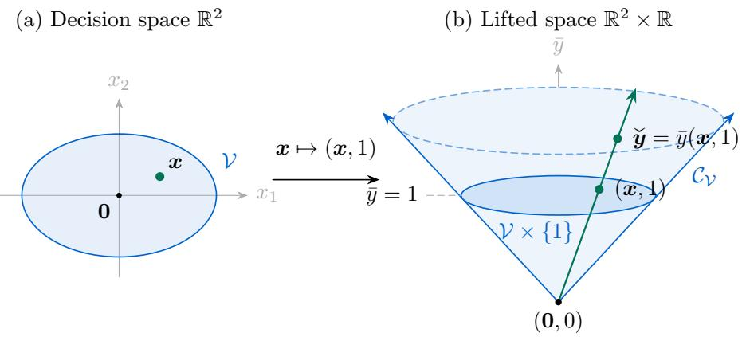

# CONIC-LIFTING FOR LEARNING-RATE-FREE CONVEX OPTIMIZATION

JULIEN GRAND-CLEMENT´

ISOM Department, HEC Paris 78350, Jouy-en-Josas, France

JOON KWON

INRAE & Universit´e Paris–Saclay 91120, Palaiseau, France

FRANCESCO ORABONA

King Abdullah University of Science and Technology (KAUST) 23955–6900, Thuwal, Kingdom of Saudi Arabia

Abstract. A central topic in online and stochastic optimization is to design algorithms that do not require tuning of hyperparameters. Successful strategies in online learning include AdaGradstyle learning rates, Conic Blackwell algorithms, and parameter-free algorithms. However, these classes require diferent, often dificult, analyses. We develop a unifying family of Online Convex Optimization (OCO) algorithms that require no user-tuned learning rate on convex domains tha may be unbounded. The construction lifts the domain to a cone by adding one scalar coordinate, an idea going back to Blackwell (1954). The lifted subgradients are orthogonal to the correspond ing lifted decisions, leaving the comparator scale free to optimize in the regret analysis. Applying Follow-the-Regularized-Leader (FTRL) and Online Mirror Descent (OMD) on the cone recovers Conic Blackwell Algorithm (CBA) and Conic Blackwell Algorithm Plus (CBA+) on bounded domains in Hilbert spaces and extends them to finite-dimensional normed spaces with a strongly convex squared norm. For arbitrary nonempty closed convex domains in these spaces, a known gradient bound yields parameter-free regret guarantees. Surprisingly, on an unconstrained Hilbert space, the construction recovers the Krichevsky–Trofimov (KT) coin-betting algorithm exactly. We also give a parameter-free algorithm for unconstrained domains that requires no gradient bound.

## 1. Introduction

First-order Online Convex Optimization (OCO) (Gordon, 1999a,b; Zinkevich, 2003; Cesa-Bianchi and Lugosi, 2006; Shalev-Shwartz, 2012; Hazan, 2016; Orabona, 2026) and stochastic optimization algorithms often sufer from suboptimal empirical and theoretical performance when used with untuned step sizes. To remedy this situation, several strategies have been proposed: self-confident algorithms (Auer et al., 2002), Regret Matching (RM) and Regret Matching+ (RM+) on the simplex (Hart and Mas-Colell, 2000; Tammelin et al., 2015), AdaGrad step sizes (Duchi et al., 2010;

McMahan and Streeter, 2010; Streeter and McMahan, 2010), parameter-free1 online algorithms, including coin-betting algorithms for unbounded domains (e.g., Chaudhuri et al., 2009; Chernov and Vovk, 2010; Streeter and McMahan, 2012; Orabona, 2014; Luo and Schapire, 2015; Koolen and van Erven, 2015; van Erven and Koolen, 2016; Orabona and P´al, 2016; Orabona and Tommasi, 2017; Kempka et al., 2019; Orabona and P´al, 2021; Chen et al., 2022; Zhang et al., 2022; Cutkosky et al., 2023; Cutkosky and Mhammedi, 2024), parameter-free Stochastic Gradient Descent (SGD) (Carmon and Hinder, 2022; Ivgi et al., 2023; Chzhen et al., 2023), and Conic Blackwell Algorithm (CBA) and Conic Blackwell Algorithm Plus (CBA+) on compact convex sets (Grand-Cl´ement and Kroer, 2021; Grand-Cl´ement and Kroer, 2024). Notably, very few of these approaches share a common design strategy, with specialized assumptions and analyses being the norm.

The objective of this note is to introduce a unifying framework for learning-rate-free algorithms for OCO. The companion paper by Kwon (2026) proposes a general family of parameter-free algorithms for Blackwell’s approachability and applies them to unconstrained regret minimization using two key ingredients:

• Conic lifting: add a scalar coordinate to the original (possibly unbounded) domain and take the conic hull of the lifted domain.

• Regret minimization over cones: apply suitably chosen regret minimizers, such as Followthe-Regularized-Leader (FTRL) or Online Mirror Descent (OMD), to this conic hull.

Kwon (2026) focuses on unconstrained regret minimization and Euclidean geometries. We extend this approach to general (possibly unbounded) closed convex domains, non-Euclidean geometries, and algorithms related to coin-betting. The resulting learning-rate-free no-regret algorithms recover and extend CBA, CBA+, and Krichevsky–Trofimov (KT) coin-betting (Orabona and P´al, 2016). Moreover, the construction directly incorporates non-Euclidean norms without black-box reductions (Cutkosky and Orabona, 2018). Our contributions cover three settings.

(1) Bounded domains. We recover CBA and CBA+ and extend them to non-Euclidean norms. The domain can be any nonempty closed bounded convex set in a real Hilbert space, or in a finite-dimensional normed space whose squared norm is strongly convex. The algorithms require a bound on the domain radius, but no horizon or gradient bound. Theorem 5.1 gives the Hilbert-space guarantee, and Theorem 5.3 states the sharpness of its leading constant, which improves on the corresponding AdaGrad constant.

(2) Known gradient bound and closed convex domains. We develop FTRL-based algorithms for any nonempty closed convex domain, including unbounded ones. In Hilbert spaces, each update reduces to projections onto scaled copies of the translated feasible set and a scalar equation. On an unconstrained domain, the algorithm coincides with KT coin-betting.

(3) Unknown gradient bound on the whole space. We give an adaptive FTRL-based construction on the whole space under the same assumptions on the norm. Its regret guarantee includes a correction for increases in the largest observed gradient norm. The algorithm requires neither a gradient bound nor a horizon.

We remark that all our regret upper bounds immediately yield guarantees for ofline and stochastic optimization through the well-known online-to-batch conversion (Cesa-Bianchi et al., 2004; Orabona, 2026).

Outline. The rest of this paper is organized as follows. Section 2 introduces the notation and preliminary definitions. Section 3 presents the conic lifting, and Section 4 reviews the literature on conic lifting. Section 5 treats bounded domains in real Hilbert spaces. Section 6 extends the analysis to strongly convex squared norms on bounded domains, including the $\mathrm { C B A ^ { + } }$ construction.

Section 7 treats possibly unbounded closed convex domains with a known gradient bound, and Section 8 treats the unconstrained case without a supplied gradient bound.

## 2. Notation and preliminaries

We write vectors in bold lowercase, matrices in bold uppercase, and named sets in calligraphic letters. In finite dimensions, 1 is the all-ones vector. We identify a real Hilbert space $\mathcal { H }$ with its continuous dual and write $\| \cdot \| _ { 2 }$ for its Hilbert norm, which is Euclidean when $\mathcal { H } = \mathbb { R } ^ { d }$

Dual pairing and norms. For a real normed space $\mathcal { X }$ , its continuous dual $\mathcal { X } ^ { \star }$ consists of bounded linear functionals. We write $\langle \pmb { g } , \pmb { x } \rangle : = \pmb { g } ( \pmb { x } )$ for $\mathbf { \Phi } _ { g } \in \mathcal { X } ^ { \star }$ and $x \in { \mathcal { X } } ;$ under the Hilbert-space identification, this is the inner product. The dual norm is

$$
\| \pmb { g } \| _ { \star } : = \operatorname* { s u p } _ { \| \pmb { x } \| \leqslant 1 } \langle \pmb { g } , \pmb { x } \rangle .
$$

A seminorm satisfies the norm axioms but may vanish on nonzero vectors.

Convex functions. For a convex function $f$ on a real normed space $\mathcal { X }$ and ${ \textbf { \textit { y } } } \in$ dom $f ,$ its subdiferential $\partial f ( \pmb { y } )$ consists of the $\xi \in \mathcal { X } ^ { \star }$ such that, for every $\pmb { x } \in$ dom $f ,$

$$
f ( { \pmb x } ) \geqslant f ( { \pmb y } ) + \langle { \pmb \xi } , { \pmb x } - { \pmb y } \rangle .
$$

For $\pmb { \xi } \in \partial f ( \pmb { y } )$ , the generalized Bregman divergence is

$$
B _ { f } ^ { \pm } ( { \pmb x } ; { \pmb y } ) : = f ( { \pmb x } ) - f ( { \pmb y } ) - \langle { \pmb \xi } , { \pmb x } - { \pmb y } \rangle .
$$

We call $f$ the distance-generating function and write $B _ { f }$ when ${ \pmb \xi } = \nabla f ( { \pmb y } )$ . For $\mu > 0$ , the function $f$ is µ-strongly convex with respect to a seminorm $| \cdot | { \mathrm { i f } } ,$ , for all $\mathbf { \nabla } _ { \mathbf { x } , \mathbf { y } }$ in its convex domain and $\lambda \in [ 0 , 1 ]$

$$
f \left( \left( 1 - \lambda \right) \pmb { x } + \lambda \pmb { y } \right) \leqslant \left( 1 - \lambda \right) f ( \pmb { x } ) + \lambda f ( \pmb { y } ) - \frac { \mu } { 2 } \lambda ( 1 - \lambda ) | \pmb { x } - \pmb { y } | ^ { 2 } .
$$

In this case, $B _ { f } ^ { \xi } ( { \pmb x } ; { \pmb y } ) \geqslant \mu | { \pmb x } - { \pmb y } | ^ { 2 } / 2$ for every $\pmb { \xi } \in \partial f ( \pmb { y } )$

For a convex set $\nu \subseteq \mathcal { X }$ and $\pmb { x } \in \nu$ , its outward normal cone $\mathcal { N } _ { \mathcal { V } } ( \pmb { x } )$ consists of the $\nu \in \mathcal { X } ^ { \star }$ such that, for every $\pmb { y } \in \mathcal { V }$

$$
\langle \pmb { \nu } , \pmb { y } - \pmb { x } \rangle \leqslant 0 .
$$

Regret. In the OCO setting with a nonempty convex feasible set $\nu \subseteq { \mathcal { X } }$ , on round t the learner chooses $\mathbf { \boldsymbol { x } } _ { t } ~ \in ~ \ v { V }$ before observing a subgradient ${ \pmb g } _ { t } \in \partial \ell _ { t } ( { \pmb x } _ { t } )$ of the convex loss $\ell _ { t }$ . For a fixed comparator $\mathbf { \boldsymbol { u } } \in \mathcal { V }$ and horizon $T _ { i }$ , linearized regret is

$$
\mathrm { R e g r e t } _ { T } ( \boldsymbol { u } ) : = \sum _ { t = 1 } ^ { T } \langle g _ { t } , x _ { t } - \boldsymbol { u } \rangle , \qquad \sum _ { t = 1 } ^ { T } \left( \ell _ { t } ( \boldsymbol { x } _ { t } ) - \ell _ { t } ( \boldsymbol { u } ) \right) \leqslant \mathrm { R e g r e t } _ { T } ( \boldsymbol { u } ) .
$$

We use gradient as shorthand for the observed subgradient $\mathbf { \pmb { g } } _ { t }$ . Throughout the paper, regret means linearized regret; its bounds also apply to convex loss regret.

We use the following elementary results; proofs are recalled in Appendix A.

Lemma 2.1 (Subgradients of a squared norm). Let $\phi ( \pmb { y } ) : = \| \pmb { y } \| ^ { 2 } / 2$ on a real normed space. Every $\pmb { \mathscr { g } } \in \partial \phi ( \pmb { \mathscr { y } } )$ satisfies $\langle \pmb { g } , \pmb { y } \rangle = \| \pmb { y } \| ^ { 2 }$ and $\| \pmb { g } \| _ { \star } = \| \pmb { y } \|$

Lemma 2.2 (Strong convexity and dual norm on a product space). Let X and Y be real normed spaces and let $\mu , \nu > 0$ . Assume that $f _ { \mathcal { X } } \colon \mathcal { X } \to \mathbb { R }$ is µ-strongly convex with respect to $\| \cdot \| _ { \mathcal { X } }$ and

$f _ { \mathcal { V } } : \mathcal { V } \to \mathbb { R }$ is ν-strongly convex with respect to $\lVert \cdot \rVert _ { \mathcal { V } }$ . Then, $f ( ( \pmb { x } , \pmb { y } ) ) : = f _ { \mathcal { X } } ( \pmb { x } ) + f _ { \mathcal { Y } } ( \pmb { y } )$ is 1-strongly convex with respect to the product norm below, with the indicated dual norm:

$$
\| ( \pmb { x } , \pmb { y } ) \| : = \sqrt { \mu \| \pmb { x } \| _ { \mathcal { X } } ^ { 2 } + \nu \| \pmb { y } \| _ { \mathcal { Y } } ^ { 2 } } \quad a n d \quad \| ( \pmb { g } , \pmb { z } ) \| _ { \star } = \sqrt { \frac { \| \pmb { g } \| _ { \mathcal { X } , \star } ^ { 2 } } { \mu } + \frac { \| \pmb { z } \| _ { \mathcal { Y } , \star } ^ { 2 } } { \nu } } ,
$$

where $( { \pmb x } , { \pmb y } ) \in \mathcal { X } \times \mathcal { Y }$ and $( g , z ) \in \mathcal { X } ^ { \star } \times \mathcal { Y } ^ { \star }$ , and $\| \cdot \| _ { \mathcal { X } , \star }$ and $\| \cdot \| _ { \mathcal { V } , \star }$ are the respective dual norms.

Lemma 2.3 (Growth at a constrained minimum). Let D be a convex subset of a real normed space and let $f : = p + r$ be finite on ${ \mathcal { D } } ,$ where p is µ-strongly convex with respect to a seminorm $| \cdot | .$ , with $\mu > 0$ , and r is convex and continuous on an open convex set containing D. Let $\iota _ { \mathcal { D } }$ be zero on D and +∞ outside it. $I f \ { \pmb x } ^ { \star } \in \mathrm { a r g m i n } _ { { \pmb x } \in \mathcal { D } } \ f ( { \pmb x } )$ , then there exists $\pmb { \xi } \in \partial r ( \pmb { x } ^ { \star } )$ such that $\mathbf { \nabla } \cdot \pmb { \xi } \in \partial ( p + \iota _ { \mathcal { D } } ) ( \mathbf { x } ^ { \star } )$ . Every such $\boldsymbol { \xi }$ and every $\pmb { y } \in \mathcal { D }$ satisfy

$$
f ( { \pmb y } ) - f ( { \pmb x } ^ { \star } ) \geqslant \frac { \mu } { 2 } | { \pmb y } - { \pmb x } ^ { \star } | ^ { 2 } + r ( { \pmb y } ) - r ( { \pmb x } ^ { \star } ) - \langle { \pmb \xi } , { \pmb y } - { \pmb x } ^ { \star } \rangle .\tag{1}
$$

Lemma 2.4 (Logarithm bounds). For every real $x < 1$

$$
\cdot \ln ( 1 - x ) \leqslant x + { \frac { x ^ { 2 } } { 2 ( 1 - \operatorname* { m a x } \{ x , 0 \} ) } } .\tag{2}
$$

In particular, $\begin{array} { r } { f o r \left| x \right| \leqslant \frac { 1 } { 2 } } \end{array}$ ，

$$
- \ln ( 1 - x ) \leqslant x + x ^ { 2 } .\tag{3}
$$

Also, for $x > 0$

$$
\ln x \geqslant 1 - { \frac { 1 } { x } } .\tag{4}
$$

## 3. Conic lifting

Conic lifting reduces regret minimization over a nonempty closed bounded convex set to regret minimization over a cone. We first give the reduction, then discuss its relation to earlier constructions.

3.1. Lifted cone and regret reduction. Let $\nu \subseteq \varkappa$ be nonempty, closed, bounded, and convex, where H is a real Hilbert space. Fix $R > 0$ such that $\| { \pmb x } \| _ { 2 } \leqslant R$ for every $\pmb { x } \in \nu$ , and choose $\pmb { x } _ { 0 } \in \mathcal { V }$ We define the cone

$$
\mathcal { C } _ { \mathcal { V } } : = \left\{ \lambda ( \mathbf { x } , 1 ) : \mathbf { x } \in \mathcal { V } , ~ \lambda \geqslant 0 \right\} .
$$

A check mark denotes a lifted vector: $\pmb { \check { y } } = ( \pmb { y } , \bar { y } ) \in \mathcal { H } \times \mathbb { R }$ . Lifted losses and subgradients belong to the product dual $\mathcal { H } ^ { \star } \times \mathbb { R }$ . Since V is closed and bounded, $\mathcal { C } _ { \mathcal { V } }$ is a nonempty closed convex cone, so orthogonal projection onto $\mathcal { C } _ { \mathcal { V } }$ is well defined in $\mathcal { H } \times \mathbb { R }$ . The cone $\mathcal { C } _ { \mathcal { V } }$ is sometimes called the homogenization cone of V (see, e.g., Section 1.5 in Brinkhuis, 2020), in part because its orthogonal projection is homogeneous of degree 1: $\Pi _ { { \mathcal { C } } _ { \mathcal { V } } } ( \eta \check { \pmb { y } } ) = \eta \Pi _ { { \mathcal { C } } _ { \mathcal { V } } } ( \check { \pmb { y } } )$ for every $\check { y } \in \mathcal { H } \times \mathbb { R }$ and $\eta > 0$ Figure 1 illustrates the construction for a two-dimensional set.

For $\pmb { \check { y } } = ( \pmb { y } , \bar { y } ) \in \mathcal { C } _ { \mathcal { V } }$ , define its decoded decision by

$$
\mathsf { d e c o d e } ( \breve { \pmb y } ) : = \left\{ \pmb y / \bar { y } , \quad \mathrm { i f ~ } \bar { y } > 0 , \right.
$$

where $\pmb { x } _ { 0 } \in \mathcal { V }$ is the fixed decision chosen above. Given a decision $\pmb { x } \in \nu$ and a loss vector $\pmb { g } \in \mathcal { H } ^ { \star }$ ， define the lifted loss vector in the product dual $\mathcal { H } ^ { \star } \times \mathbb { R }$ by

$$
\begin{array} { r } { \check { \pmb { g } } : = ( \pmb { g } , - \langle \pmb { g } , \pmb { x } \rangle ) . } \end{array}\tag{5}
$$

  
Figure 1. Conic lifting of a bounded closed convex set $\nu \subseteq \mathbb { R } ^ { 2 }$ . The slice at $\bar { y } = 1$ is $\mathcal { V } \times \{ 1 \}$ . Every positive multiple $\check { \pmb { y } } = \bar { \pmb { y } } ( \pmb { x } , 1 )$ on the highlighted ray decodes to the same decision $\pmb { x } = \pmb { y } / \bar { y }$ . The cone continues along the indicated rays beyond the displayed portion.

A crucial property is that, for every $\check { \pmb { y } } \in \mathcal { C } _ { \mathcal { V } }$ and $\pmb { g } \in \mathcal { H } ^ { \star }$ , the lifted loss associated with x = decode(yq) satisfies the orthogonality identity

$$
\langle \check { \pmb { g } } , \check { \pmb { y } } \rangle = 0 .\tag{6}
$$

Indeed, if $\bar { y } > 0$ , then

$$
\langle \check { \pmb { g } } , \check { \pmb { y } } \rangle = \langle \pmb { g } , \pmb { y } \rangle - \bar { y } \langle \pmb { g } , \pmb { y } / \bar { y } \rangle = 0 .
$$

If $\bar { y } = 0$ , then $\check { \pmb { y } } = ( \mathbf { 0 } , 0 )$ , so the same identity holds.

The following simple lemma illustrates the key idea behind conic lifting: a reduction from regret minimization over V to regret minimization over the lifted cone $\mathcal { C } _ { \mathcal { V } }$

Lemma 3.1. Let $\check { \pmb { y } } _ { 1 } , \dotsc , \check { \pmb { y } } _ { T } \in \mathcal { C } _ { \mathcal { V } }$ and ${ \pmb g } _ { 1 } , \dotsc , { \pmb g } _ { T } \in { \mathcal { H } } ^ { \star }$ . For each t, set $\pmb { x } _ { t } : = \mathsf { d e c o d e } ( \mathsf { \check { y } } _ { t } )$ and $\forall _ { t } : = ( \pmb { g } _ { t } , - \langle \pmb { g } _ { t } , \pmb { x } _ { t } \rangle )$ . Then, for every $\pmb { u } \in \mathcal { V }$ , with $\check { \pmb { u } } : = ( { \pmb { u } } , 1 )$

$$
\sum _ { t = 1 } ^ { T } \langle { \bf g } _ { t } , { \bf x } _ { t } - { \bf u } \rangle = \sum _ { t = 1 } ^ { T } \langle \check { \bf g } _ { t } , \check { \bf y } _ { t } - \check { \bf u } \rangle .
$$

The same reduction appears in Section 3 of Gordon (2006), between equations (2) and (3), Lemma 2.1 of Farina et al. (2023), and Proposition 3.1 of Chakrabarti et al. (2024).

Proof of Lemma 3.1. By the definition of $\check { \pmb { g } } _ { t }$ and the orthogonality identity (6), respectively,

$$
\sum _ { t = 1 } ^ { T } \langle g _ { t } , x _ { t } - u \rangle = \sum _ { t = 1 } ^ { T } \langle - \check { g } _ { t } , \check { u } \rangle = \sum _ { t = 1 } ^ { T } \langle \check { \pmb { g } } _ { t } , \check { \pmb { y } } _ { t } - \check { \pmb { u } } \rangle .
$$

## 4. Related work

Regret via approachability. Lemma 3.1 follows from the definition of the lifted loss in (5) and the orthogonality property (6). This orthogonality can be interpreted as a hyperplane forcing property in Blackwell approachability (Blackwell, 1956). With uniformly bounded gradients, the bounded-domain regret minimizers below ensure that the average negative lifted loss vector $- { \frac { 1 } { T } } \sum _ { t = 1 } ^ { T } { \check { g } } _ { t }$ approaches the polar cone of $\mathcal { C } _ { \mathcal { V } }$ as $T \to + \infty$ . The use of Blackwell’s approachability to minimize regret over the simplex by adding a dimension was noted very early in Blackwel (1954); see Perchet (2014) for the extension to a convex compact domain. Kwon (2026) applies conic lifting to unconstrained regret minimization by constructing regularizers whose convex conjugates have gradients that avoid the zero-height boundary of the closure of the lifted cone, except at the origin. The present paper extends this approach to general unbounded closed convex domains and non-Euclidean squared norms in Sections 7 and 8.

Approachability via regret minimization on cones. The present work relies on regret minimizers on the lifted cone, and the lineage of this idea will be discussed in paragraphs below. But given the above approachability interpretation, this approach is a special case of converting regret minimizers into approachability algorithms for conic targets. This general approach first appeared in Abernethy et al. (2011) which focuses on minimizing the Euclidean distance to the target by defining the regret minimizers on the intersection of the relevant closed convex cone with the unit Euclidean ball. This conversion scheme was refined in Kwon (2016, 2021) which allowed for bounds on more general non-Euclidean distance-like quantities by defining regret minimizers on any convex compact subset that contains all directions of the cone. In the approach presented by Kwon (2026) regret minimizers are instead defined on the whole cone (which, interestingly, is no longer required to be closed) with the help of near-2-positively-homogeneous regularizers which yield parameter-free guarantees.

Simplex domains. The original regret minimizer of Blackwell (1954) uses approachability for a lifted set slightly diferent from $\mathcal { C } _ { \mathcal { V } }$ (see Blackwell (1954, p. 337)). For the simplex, however, approachability can be applied without lifting: one can use the auxiliary loss vectors ${ \pmb g } _ { t } - \langle { \pmb g } _ { t } , { \pmb x } _ { t } \rangle { \pmb 1 }$ instead of $\check { \pmb { g } } _ { t }$ , together with $\mathbb { R } _ { + } ^ { d }$ , the conic hull of the simplex $\Delta ^ { d }$ , without introducing an additiona coordinate (Hart and Mas-Colell, 2000). Running FTRL with a Euclidean regularizer on $\mathbb { R } _ { + } ^ { d }$ to minimize regret over the simplex in $\mathbb { R } ^ { d }$ yields RM (Hart and Mas-Colell, 2000), as noted by Nicol\`o Cesa-Bianchi in an unpublished manuscript titled “The Joys of Regret Matching”, dated October 14, 2015. More generally, the equivalence between Euclidean FTRL for conic targets and Blackwell’s algorithm was independently established in Kwon (2016, 2021). To improve practical performance in learning in games, Tammelin (2014); Tammelin et al. (2015) proposed $\mathrm { R M ^ { + } }$ , a variant using thresholding. Farina et al. (2021) and, independently, Flaspohler et al. (2021) identified it as OMD with a Euclidean regularizer on $\mathbb { R } _ { + } ^ { d }$ . In particular, the inverse $\ell _ { 1 } { \mathrm { - n o r m } }$ of the nonnegative regret vector maintained by $\mathrm { R M ^ { + } }$ can be interpreted as an efective step size (Zhang et al., 2025, Section 4.1).

Lifting general bounded convex domains. For a compact convex set $\nu ,$ the same conic techniques can be applied directly in the ambient space H, without adding a dimension, whenever there exists $e \in \mathcal { H } ^ { \star }$ such that $\langle e , \pmb { x } \rangle = 1$ for every $\boldsymbol { x } \in \boldsymbol { \nu }$ . One then uses the conic hull of V instead of $\mathcal { C } _ { \mathcal { V } }$ , with loss vectors ${ \pmb g } - \langle { \pmb g } , { \pmb x } \rangle e \in \mathcal { H } ^ { \star }$ . The simplex is the special case ${ \bf { \Lambda } } e = { \bf { 1 } }$ . Chakrabarti et al. (2024) use this construction for a sequence-form polytope V in learning in extensive-form games.

However, when no such normalizing vector is available, lifting ${ \pmb x } \mapsto ( { \pmb x } , 1 )$ from H to ${ \mathcal { H } } \times \mathbb { R }$ provides the lifted copy $\{ ( { \pmb x } , 1 ) \ | \ { \pmb x } \in { \mathscr V } \}$ to which the same techniques apply. The normalizing vector is then $( \mathbf { 0 } , 1 ) \in \mathcal { H } ^ { \star } \times \mathbb { R }$ , since $\{ ( { \pmb x } , 1 ) \mid { \pmb x } \in \mathcal { V } \} \subset \{ { \pmb z } \in \mathcal { H } \times \mathbb { R } \mid \langle { \pmb z } , ( { \bf 0 } , 1 ) \rangle = 1 \}$ . This is the main point of using the additional coordinate and the lifted cone $\mathcal { C } _ { \nu }$

The reduction from regret minimization over V to regret minimization over $\mathcal { C } _ { \nu }$ has been rediscovered several times. Gordon (2005, 2006) proposed Lagrangian Hedging for a compact convex decision set V. This framework can be interpreted as running FTRL on $\mathcal { C } _ { \mathcal { V } }$ , with particular attention to Euclidean and entropic regularizers. Note, however, that the lifting is implicit in Gordon (2006, Section 3), which works in a finite-dimensional space and assumes the existence of a vector e such that $\langle \pmb { x } , \pmb { e } \rangle = 1$ for all $\pmb { x } \in \nu$ . Gordon briefly explains that $\mathcal { C } _ { \mathcal { V } }$ can be used instead when no such vector exists. The same conic lifting and regret reduction appear in Abernethy et al. (2011,

Theorem 16), who reduce regret minimization to approachability. Works that depart from FTRL include Grand-Cl´ement and Kroer (2021) (see also the journal version by Grand-Cl´ement and Kroer (2024)) and D’Orazio and Huang (2021). Grand-Cl´ement and Kroer (2021) introduce the CBA, which runs FTRL with a Euclidean regularizer on the cone $\mathcal { C } _ { \mathcal { V } }$ to minimize regret on a convex compact set V, and the $\mathrm { C B A ^ { + } }$ , which runs OMD with a Euclidean regularizer on $\mathcal { C } _ { \mathcal { V } }$ to minimize regret on V. Their analysis focuses on Blackwell approachability; Appendix A of Grand-Cl´ement and Kroer (2021) discusses the connection to regret minimization on the cone. For the whole-cone FTRL/OMD viewpoint, see also Farina et al. (2021, Sections 4–5). $\mathrm { { D } ^ { \prime } { O r a z i o } }$ and Huang (2021) generalize Lagrangian Hedging to adaptive step sizes, optimistic updates, and internal/Φ-regret. For the simplex, they introduce Lagrangian ${ \mathrm { H e d g i n g } } ^ { + }$ (see their page 6), a version of $\mathrm { R M ^ { + } }$ for Φ-regret: OMD with a Euclidean regularizer on $\mathbb { R } _ { + } ^ { d }$ . As noted above, no additional coordinate is needed before taking the conic hull.

Truncated lifts and learning in games. Conic constructions also yield uncoupled algorithms with near-constant (O(ln T)) per-player external regret in multiplayer games with finite action sets (see Section 4 of Soleymani et al. (2025)), and with constant per-player external regret (see Section 3.1 of Abbadi et al. (2026) and Section 3.1 of Liu et al. (2026)). Interestingly, on the simplex, COFTRL (Soleymani et al., 2025) and HOOD (Abbadi et al., 2026) use truncated conic hulls without adding a coordinate. ECHO-OFTRL (Liu et al., 2026) instead uses the added-coordinate lift $\{ \lambda ( \pmb { x } , 1 ) \ | \ \pmb { x } \in \Delta ^ { d } , \lambda \in [ 0 , 1 ] \}$ ; COFTRL also uses an added coordinate in its extension to general compact convex domains. The closed comparator sets for these truncated constructions include zero, whereas $\mathcal { C } _ { \mathcal { V } }$ allows every $\lambda \geqslant 0$ . Section 8 uses a diferent truncated cone.

Truncated conic lifting for games originates in Farina et al. (2022), who obtain near-constant regrets for general convex games using optimistic FTRL with a logarithmic regularizer on the truncated lifted cone. Here, the lifting is useful because the lifted regrets are nonnegative, whereas large negative original regrets for some players can counterbalance large positive regrets for others, complicating the analysis. Farina et al. (2022) trace truncated conic lifting to Lee et al. (2020); Luo et al. (2022) for online learning with bandit feedback. In turn, Lee et al. (2020) traces lifting to Nesterov and Nemirovskii (1994), whose Proposition 5.1.4 constructs normal barriers for the lifted cone from a self-concordant barrier for the domain.

Interestingly, a third recent algorithm with constant per-player regret in finite multiplayer games uses Blackwell approachability through RM-style regret minimizers on simplexes (Soleymani and Piliouras, 2026).

## 5. Warm-up: the Conic Blackwell Algorithm

We begin with the CBA of Grand-Cl´ement and Kroer (2021), originally formulated over compact convex sets in Euclidean space. Lemma 3.1 reduces the construction to regret minimization over $\mathcal { C } _ { \mathcal { V } }$ where CBA uses $\mathrm { F T R L }$ . We give the bounded Hilbert-space guarantee; Section 6 treats strongly convex squared norms and the OMD formulation of $\mathrm { C B A ^ { + } }$ . To account for the radius $R ,$ we equip the lifted Hilbert space with the norm and dual norm

$$
\| \breve { y } \| _ { R } ^ { 2 } = \| ( y , \bar { y } ) \| _ { R } ^ { 2 } : = \| y \| _ { 2 } ^ { 2 } + R ^ { 2 } \bar { y } ^ { 2 } \quad \mathrm { a n d } \quad \| \breve { g } \| _ { R , \star } ^ { 2 } = \| ( g , \bar { g } ) \| _ { R , \star } ^ { 2 } : = \| g \| _ { 2 } ^ { 2 } + \frac { \bar { g } ^ { 2 } } { R ^ { 2 } } .
$$

We use FTRL with a fixed quadratic regularizer on this cone.

For Algorithms 1 and 2, let X be a finite-dimensional real normed space, or a real Hilbert space with its Hilbert norm, such that $\| \cdot \| _ { \mathcal { X } } ^ { 2 } / 2$ is µ-strongly convex with respect to $\| \cdot \| _ { \mathcal { X } }$ for some $\mu > 0$ Let $\nu \subseteq \mathcal { X }$ be nonempty, closed, bounded, and convex, with $\| { \pmb x } \| _ { \mathcal { X } } \leqslant R$ for every $\textbf { \em x } \in ~ \nu$ . In Algorithm 1, take $\mathcal { X } = \mathcal { H }$ with its Hilbert norm. With the fixed lifted regularizer $\psi _ { t } ( \check { \pmb y } ) = \lVert \check { \pmb y } \rVert _ { R } ^ { 2 } / 2$

Table 1. Uses of conic reformulations in online learning. Lifting means appending a coordinate, $x \mapsto ( x , 1 )$ . RM and $\mathrm { R M ^ { + } }$ are from Hart and Mas-Colell (2000); Tammelin et al. (2015). HOOD is from Abbadi et al. (2026). ECHO-OFTRL is from Liu et al. (2026). Lagrangian Hedging is from Gordon (2005, 2006), and $\mathrm { C B A } / \mathrm { C B A ^ { + } }$ are from Grand-Cl´ement and Kroer (2021); Grand-Cl´ement and Kroer (2024). LRL-OFTRL is from Farina et al. (2022), and COFTRL is from Soleymani et al. (2025), who also treat compact convex domains using the lifted cone $\mathcal { C } _ { \mathcal { V } }$ . For truncated domains, the regret identities use the closed comparator set, including zero.
<table><tr><td>Papers / algorithms</td><td></td><td></td><td>Decision set V Lifting Cone (possibly truncated)</td><td>Role of the conic construction</td></tr><tr><td>RM  $/ \mathbf { \Lambda } \mathbf { R } \mathbf { M } ^ { + }$ </td><td>Simplex</td><td>×</td><td> $\{ \lambda x : x \in \Delta ^ { d } , \ \lambda \geqslant 0 \} = \mathbb { R } _ { + } ^ { d }$ </td><td>Homogeneity and normalization yield learning-rate-free regret bounds.</td></tr><tr><td>COFTRL</td><td>Simplex</td><td>×</td><td> $\{ \lambda x : x \in \Delta ^ { d } , 0 < \lambda \leqslant 1 \}$ </td><td>Lifted regret = positive part of maximum linearized regret.</td></tr><tr><td>HOOD</td><td>Simplex</td><td>X</td><td> $\{ \lambda x : x \in \Delta ^ { d } , 0 \leqslant \lambda \leqslant 1 \}$ </td><td>Lifted regret = positive part of maximum linearized regret.</td></tr><tr><td>ECHO- OFTRL</td><td>Simplex</td><td></td><td> $\{ \lambda ( x , 1 ) : x \in \Delta ^ { d } , 0 \leqslant \lambda \leqslant 1 \}$ </td><td>Lifted regret = positive part of maximum linearized regret.</td></tr><tr><td>LRL-OFTRL</td><td>Compact convex</td><td>√</td><td> $\{ \lambda ( x , 1 ) : x \in \mathcal { V } , 0 \leqslant \lambda \leqslant 1 \}$ </td><td>Lifted regret = positive part of maximum linearized regret.</td></tr><tr><td>Lee et al. (2020); Luo et al. (2022)</td><td>Compact convex</td><td></td><td> $\{ \lambda ( x , 1 ) : x \in \mathcal { V } , \ \lambda \geqslant 0 \}$ </td><td>A logarithmically homogeneous barrier controls stability as</td></tr><tr><td>Lagrangian Hedging, CBA / CBA+</td><td>Compact convex</td><td>√</td><td> $\{ \lambda ( x , 1 ) : x \in \mathcal { V } , \ \lambda \geqslant 0 \}$ </td><td>learning rates change. Orthogonality and rescaling lifted comparators yield learning-rate-free regret</td></tr><tr><td>Kwon (2026) and this paper</td><td>Closed convex</td><td>√</td><td> $\{ \lambda ( x , 1 ) : x \in \mathcal { V } , \ \lambda \geqslant 0 \}$ </td><td>bounds. Orthogonality and rescaling lifted comparators yield learning-rate-free regret</td></tr></table>

define

$$
F _ { t } ( \check { \pmb { y } } ) : = \psi _ { t } ( \check { \pmb { y } } ) + \sum _ { i = 1 } ^ { t - 1 } \langle \check { \pmb { g } } _ { i } , \check { \pmb { y } } \rangle .
$$

The update minimizes $F _ { t }$ over ${ \mathcal { C } } _ { \mathcal { V } } ;$ its feedback satisfies (6).

Algorithm 1 Conic Blackwell Algorithm   
Input: A feasible set V ⊆ X, a radius $R > 0 _ { : }$ , and $\pmb { x } _ { 0 } \in \mathcal { V }$   
1: $\mathcal { C } _ { \mathcal { V } } : = \{ \lambda ( \pmb { x } , 1 ) : \pmb { x } \in \mathcal { V } , ~ \lambda \geqslant 0 \}$   
2: $\forall \boldsymbol { \mathsf { 1 } } = ( \pmb { \mathsf { y } } _ { 1 } , \bar { y } _ { 1 } ) : = ( \mathbf { 0 } , 0 )$   
3: for $t = 1 , 2 , \dots$ do   
4: xt = decode(yq )   
5: Play x and observe $\pmb { g } _ { t } \in \partial \ell _ { t } ( \pmb { x } _ { t } )$   
6: $\forall _ { t } : = ( \pmb { g } _ { t } , - \langle \pmb { g } _ { t } , \pmb { x } _ { t } \rangle )$   
7: $\check { \pmb { y } } _ { t + 1 } = ( \pmb { y } _ { t + 1 } , \bar { y } _ { t + 1 } ) : = \operatorname * { a r g m i n } _ { \check { \pmb { y } } = ( \pmb { y } , \bar { \pmb { y } } ) \in \mathcal { C } _ { \mathcal { V } } } \left\{ \frac { 1 } { 2 } \left( \lVert \pmb { y } \rVert _ { \mathcal { X } } ^ { 2 } + R ^ { 2 } \bar { \pmb { y } } ^ { 2 } \right) + \sum _ { i = 1 } ^ { t } \langle \check { \pmb { g } } _ { i } , \check { \pmb { y } } \rangle \right\}$   
8: end for

To bound regret on the cone, we use the classic FTRL regret equality in Theorem B.1. The initial condition is ${ \psi } _ { T + 1 } ( \check { \pmb u } )$ , since $\psi _ { 1 } ( \pmb { \check { y } } _ { 1 } ) = 0$ . Since $F _ { t }$ is 1-strongly convex and minimized at $\check { \pmb { y } } _ { t }$ Lemma 2.3 with $p = F _ { t } , r = 0$ , and the norm $\| \cdot \| _ { R }$ gives

$$
F _ { t } \left( \check { \pmb { y } } _ { t } \right) - F _ { t + 1 } \left( \check { \pmb { y } } _ { t + 1 } \right) + \langle \check { \pmb { g } } _ { t } , \check { \pmb { y } } _ { t } \rangle \leqslant \frac { 1 } { 2 } \| \check { \pmb { g } } _ { t } \| _ { R , \star } ^ { 2 } .
$$

The final condition $F _ { T + 1 } \left( \check { \pmb { y } } _ { T + 1 } \right) - F _ { T + 1 } \left( \check { \pmb { u } } \right)$ is nonpositive for every feasible $\check { \pmb { u } } .$ . Substitution into the equality gives, for every $\check { \pmb { u } } \in \mathcal { C } _ { \mathcal { V } }$

$$
\sum _ { t = 1 } ^ { T } \langle \check { \pmb { g } } _ { t } , \check { \pmb { y } } _ { t } - \check { \pmb { u } } \rangle \leqslant \frac { 1 } { 2 } \| \check { \pmb { u } } \| _ { R } ^ { 2 } + \frac { 1 } { 2 } \sum _ { t = 1 } ^ { T } \| \check { \pmb { g } } _ { t } \| _ { R , \star } ^ { 2 } .
$$

To recover a regret bound on the original linear losses, for $\mathbf { \pmb { u } } \in \mathcal { V } ,$ define $\begin{array} { r } { \check { \pmb { u } } : = ( { \pmb { u } } , 1 ) } \end{array}$ and compare with λuq for $\lambda > 0$ . From $\langle \widecheck { \pmb { g } } _ { t } , \widecheck { \pmb { y } } _ { t } \rangle = 0$ , the left-hand side becomes $\lambda \mathrm { R e g r e t } _ { T } \left( \pmb { u } \right)$ . Following the comparator-rescaling argument of Kwon (2026), we divide by λ and optimize to obtain

$$
\mathrm { R e g r e t } _ { T } \left( \pmb { u } \right) \leqslant \operatorname* { i n f } _ { \lambda > 0 } \left\{ \frac { \lambda } { 2 } \| \pmb { \check { u } } \| _ { R } ^ { 2 } + \frac { 1 } { 2 \lambda } \sum _ { t = 1 } ^ { T } \| \check { \pmb { g } } _ { t } \| _ { R , \star } ^ { 2 } \right\} = \| \check { \pmb { u } } \| _ { R } \sqrt { \sum _ { t = 1 } ^ { T } \| \check { \pmb { g } } _ { t } \| _ { R , \star } ^ { 2 } } .
$$

Since

$$
\| \ b { \check { u } } \| _ { R } ^ { 2 } = \| \ b { u } \| _ { 2 } ^ { 2 } + R ^ { 2 } \leqslant 2 R ^ { 2 } \quad \mathrm { a n d } \quad \| \ b { \check { g } } _ { t } \| _ { R , \star } ^ { 2 } = \| \ b { g } _ { t } \| _ { 2 } ^ { 2 } + \frac { \langle \ b { g } _ { t } , \ b { x } _ { t } \rangle ^ { 2 } } { R ^ { 2 } } \leqslant 2 \| \ b { g } _ { t } \| _ { 2 } ^ { 2 } ,
$$

we obtain the following guarantee.

Theorem 5.1 (Bounded-domain regret in a Hilbert space). Run Algorithm 1 in a real Hilbert space $\mathcal { X } : = \mathcal { H }$ with its Hilbert norm. Then, for every $T \geqslant 1$ and every $\mathbf { \boldsymbol { u } } \in \mathcal { V }$

$$
\mathrm { R e g r e t } _ { T } ( \boldsymbol { u } ) \leqslant 2 R \sqrt { \sum _ { t = 1 } ^ { T } \| \pmb { g } _ { t } \| _ { 2 } ^ { 2 } } .
$$

Remark 5.2. Notice that initially, $\bar { y } _ { 1 } = 0$ , and the condition $\bar { y } _ { t } = 0$ can persist for many rounds. However, once the iterate leaves the origin, it cannot return. Since $F _ { t } ( \mathbf { 0 } ) = 0$ and the minimizer is unique, $F _ { t } ( \check { \pmb { y } } _ { t } ) < 0$ if and only if $\check { \pmb { y } } _ { t } \neq \mathbf { 0 }$ . Moreover,

$$
F _ { t + 1 } ( \check { \pmb { y } } _ { t + 1 } ) = \underset { \check { \pmb { y } } \in \mathcal { C } _ { \mathscr { V } } } { \operatorname* { m i n } } F _ { t + 1 } ( \check { \pmb { y } } ) \leqslant F _ { t + 1 } ( \check { \pmb { y } } _ { t } ) = F _ { t } ( \check { \pmb { y } } _ { t } ) + \langle \check { \pmb { g } } _ { t } , \check { \pmb { y } } _ { t } \rangle = F _ { t } ( \check { \pmb { y } } _ { t } ) .
$$

Hence, once $\bar { y } _ { t } \neq 0$ , the next iterates $\bar { y } _ { t ^ { \prime } }$ for $t ^ { \prime } > t$ cannot be zero.

5.1. Comparison with AdaGrad-Norm. AdaGrad-Norm (Streeter and McMahan, 2010) instead gives, for every $\mathbf { \boldsymbol { u } } \in \mathcal { V }$ 2

$$
\mathrm { R e g r e t } _ { T } ( \boldsymbol { u } ) \leqslant 2 R \sqrt { 2 \sum _ { t = 1 } ^ { T } \| \pmb { g } _ { t } \| _ { 2 } ^ { 2 } } .
$$

Hence, Theorem 5.1 improves this leading constant to $2 .$ The following theorem shows that this constant is optimal for a bound of this form.

Theorem 5.3. Let $x _ { t } , \ g _ { t }$ , and u denote scalar predictions, gradients, and comparators. Fix $R > 0$ and $0 \leqslant c < 2$ . On $\displaystyle \mathcal { V } = [ - R , R ]$ , no online algorithm, given neither a gradient bound nor a horizon, can guarantee, for every $T \geqslant 1 , u \in \mathcal { V }$ , and gradient sequence,

$$
\mathbb { E } \left[ \mathrm { R e g r e t } _ { T } ( u ) \right] \leqslant c R \sqrt { \sum _ { t = 1 } ^ { T } g _ { t } ^ { 2 } } .
$$

The expectation is over any internal randomization of the algorithm. The impossibility holds even when every gradient sequence is bounded by some finite, unknown constant.

Proof. Suppose such a guarantee holds. Fix any deterministic gradient history through round $t - 1$ For any $M > 0$ , extend it by $g _ { t } = - M$ and then zero gradients. The decision $x _ { t }$ is chosen before observing $g _ { t }$ , so its distribution is independent of M. Against $u = R ,$ , the assumed bound gives

$$
\sum _ { i = 1 } ^ { t - 1 } g _ { i } \left( \mathbb { E } [ x _ { i } ] - R \right) + M \left( R - \mathbb { E } [ x _ { t } ] \right) \leqslant c R \sqrt { \sum _ { i = 1 } ^ { t - 1 } g _ { i } ^ { 2 } + M ^ { 2 } } .
$$

We divide by M and take the limit as $M \to \infty$ . The terms from the fixed history tend to zero, yielding $\mathbb { E } [ x _ { t } ] \geqslant ( 1 - c ) R$ after every history. Each extension used here has a finite-gradient bound; no single unbounded sequence is needed.

Now take $g _ { t } = 1$ on every round and compare with $u = - R$ . The necessary restriction on every prediction implies

$$
\mathbb { E } \left[ \mathrm { R e g r e t } _ { T } ( - R ) \right] = \sum _ { t = 1 } ^ { T } ( \mathbb { E } [ x _ { t } ] + R ) \geqslant ( 2 - c ) R T .
$$

For $T > ( c / ( 2 - c ) ) ^ { 2 }$ , this exceeds the claimed bound $c R \sqrt { T }$ , a contradiction.

5.2. Computing the update. We explain how to compute the update in Step $7$ of Algorithm 1. Let $\Pi _ { { \mathcal { C } } _ { \mathcal { V } } } ^ { R }$ denote projection in the norm $\| \cdot \| _ { R }$ . Completing the square in the update gives

$$
\check { \pmb { y } } _ { t } = \Pi _ { \mathcal { C } \nu } ^ { R } \left( \left( - \sum _ { i = 1 } ^ { t - 1 } \pmb { g } _ { i } , \frac { \sum _ { i = 1 } ^ { t - 1 } \langle \pmb { g } _ { i } , \pmb { x } _ { i } \rangle } { R ^ { 2 } } \right) \right) \mathrm { ~ . ~ }
$$

Multiplying $\bar { y }$ by R turns this into an ordinary Hilbert-space projection onto the cone

$$
\{ \lambda ( { \pmb x } , R ) : \lambda \geqslant 0 , { \pmb x } \in \mathcal { V } \} \ .
$$

Divide the last coordinate of the projection by R afterward. The map $( { \pmb y } , { \bar { y } } ) \mapsto ( { \pmb y } , - { \bar { y } } )$ is an isometry, so the projection bounds cited below also apply to our convention $\bar { y } \geqslant 0$

In finite-dimensional Euclidean spaces, Moreau’s decomposition reduces these weighted projections to projections onto the polar cone. For any closed convex cone ${ \mathcal { C } } ,$ let $\Pi _ { \mathcal { C } }$ denote the Euclidean projection. Moreau’s decomposition theorem gives $\Pi _ { \mathcal { C } } \left( \pmb { \check { v } } \right) + \Pi _ { \mathcal { C } ^ { \circ } } \left( \pmb { \check { v } } \right) = \pmb { \check { v } } ,$ , where $\mathcal { C } ^ { \circ } : =$ $\{ { \check { z } } : \langle { \check { z } } , { \check { x } } \rangle \leqslant 0 , \forall { \check { x } } \in { \mathcal { C } } \}$ is the polar cone. Hence, $\Pi _ { \mathcal { C } } \left( \check { \pmb v } \right)$ can be recovered from $\Pi _ { C ^ { \circ } } \left( \check { \pmb { v } } \right)$ . See Grand-Cl´ement and Kroer (2021) for projection examples (the simplex, an $\ell _ { p } { \mathrm { - b a l l } }$ with $p \in \{ 1 , 2 , + \infty \}$ , and the intersection of an $\ell _ { 2 } .$ -ball with the simplex).

## 6. Bounded domains with strongly convex squared norms

We now run the bounded-domain construction in a finite-dimensional normed space whose squared norm is strongly convex.

Let X be a finite-dimensional real normed space, and let $\nu \subseteq \mathcal { X }$ be nonempty, convex, and compact. The lifting takes place in the product space $\mathcal { X } \times \mathbb { R }$ . Let $R > 0$ satisfy $R \geqslant \| \pmb { x } \| _ { \mathcal { X } }$ for all $\mathbf x \in \mathcal V$ . Assume $\psi _ { \mathcal { X } } \colon \mathcal { X } \to \mathbb { R }$ defined by $\begin{array} { r } { \psi _ { \mathcal { X } } ( \pmb { x } ) : = \frac { 1 } { 2 } \| \pmb { x } \| _ { \mathcal { X } } ^ { 2 } } \end{array}$ is µ-strongly convex with respect to $\| \cdot \| _ { \mathcal { X } }$ , with $\mu > 0$ . Define the lifted space norm and its dual by

$$
\| \tilde { y } \| ^ { 2 } = \| ( { \pmb y } , \bar { y } ) \| ^ { 2 } : = \mu \| { \pmb y } \| _ { \mathcal { X } } ^ { 2 } + R ^ { 2 } \bar { y } ^ { 2 } \quad \mathrm { a n d } \quad \| { \check { \pmb g } } \| _ { \star } ^ { 2 } = \| ( { \pmb g } , \bar { y } ) \| _ { \star } ^ { 2 } : = \frac { 1 } { \mu } \| { \pmb g } \| _ { \mathcal { X } , \star } ^ { 2 } + \frac { \bar { g } ^ { 2 } } { R ^ { 2 } } .\tag{7}
$$

Define the regularizer $\psi : \mathcal { X } \times \mathbb { R } \to \mathbb { R }$ as

$$
\psi ( \pmb { \breve { y } } ) = \psi ( ( \pmb { y } , \bar { y } ) ) : = \frac { 1 } { 2 } \left( \| \pmb { y } \| _ { \mathcal { X } } ^ { 2 } + R ^ { 2 } \bar { y } ^ { 2 } \right) .\tag{8}
$$

For example, on $\mathbb { R } ^ { d }$ with $d \geqslant 2$ and $1 < p < 2$ , the function $\| \cdot \| _ { p } ^ { 2 } / 2 \mathrm { ~ i s ~ } ( p - 1 )$ -strongly convex with respect to $\| \cdot \| _ { p }$ (Orabona, 2026, Lemma 6.35). This gives a non-Hilbert norm satisfying the assumption.

The two terms have strong-convexity constants $\mu$ and $R ^ { 2 }$ in their respective coordinates. Thus, Lemma 2.2 gives the dual norm in (7) and makes ψ 1-strongly convex with respect to the product norm.

Run Algorithm 1 with the norm (7) and regularizer (8). The cone is closed, and the regularized objective is coercive and strictly convex, so each minimizer exists and is unique.

To bound regret, use Theorem B.1 with $\psi _ { t } : = \psi$ . Apply Lemma 2.3 with $p = F _ { t }$ and $r = 0$ in the product norm (7); the dual-norm calculation from Section 5 bounds each per-round cost. Consequently, for every $\check { \pmb { u } } \in \mathcal { C } _ { \mathcal { V } }$

$$
\sum _ { t = 1 } ^ { T } \langle \check { \pmb { g } } _ { t } , \check { \pmb { y } } _ { t } - \check { \pmb { u } } \rangle \leqslant \psi ( \check { \pmb { u } } ) + \frac { 1 } { 2 } \sum _ { t = 1 } ^ { T } \| \check { \pmb { g } } _ { t } \| _ { \star } ^ { 2 } .
$$

As in Section 5, for $\mathbf { \boldsymbol { u } } \in \mathcal { V }$ , define $\check { \pmb { u } } : = ( { \pmb { u } } , 1 )$ and compare with λuq for $\lambda > 0$ , which gives

$$
\mathrm { R e g r e t } _ { T } ( \boldsymbol { u } ) \leqslant \operatorname* { i n f } _ { \lambda > 0 } \left\{ \lambda \psi ( \boldsymbol { \breve { u } } ) + \frac { 1 } { 2 \lambda } \sum _ { t = 1 } ^ { T } \lVert \check { \boldsymbol { g } } _ { t } \rVert _ { \star } ^ { 2 } \right\} = \sqrt { 2 \psi ( \boldsymbol { \breve { u } } ) \sum _ { t = 1 } ^ { T } \lVert \check { \boldsymbol { g } } _ { t } \rVert _ { \star } ^ { 2 } } .\tag{9}
$$

The comparator term satisfies

$$
2 \psi ( \check { \pmb u } ) = 2 \psi ( ( { \pmb u } , 1 ) ) = \| { \pmb u } \| _ { \mathcal { X } } ^ { 2 } + R ^ { 2 } \leqslant 2 R ^ { 2 } .
$$

Also, by the dual norm definition,

$$
\| \widecheck { \mathbf { g } } _ { t } \| _ { \star } ^ { 2 } = \| ( \mathbf { g } _ { t } , - \langle \mathbf { g } _ { t } , \mathbf { x } _ { t } \rangle ) \| _ { \star } ^ { 2 } = \frac { 1 } { \mu } \| \mathbf { \mathfrak { g } } _ { t } \| _ { \mathcal { X } , \star } ^ { 2 } + \frac { \langle \mathbf { g } _ { t } , \mathbf { x } _ { t } \rangle ^ { 2 } } { R ^ { 2 } } \leqslant \left( 1 + \frac { 1 } { \mu } \right) \| \mathbf { \mathfrak { g } } _ { t } \| _ { \mathcal { X } , \star } ^ { 2 } .
$$

Combining these bounds, we obtain the following theorem.

Theorem 6.1. Let X be a finite-dimensional real normed space such that $\| \cdot \| _ { \mathcal { X } } ^ { 2 } / 2$ is µ-strongly convex with respect to $\| \cdot \| _ { \mathcal { X } }$ , where $\mu > 0$ . Let $\nu \subseteq \mathcal { X }$ be nonempty, closed, bounded, and convex, and let $R > 0 \ s a t i s f y \ \| \pmb { x } \| _ { \mathcal { X } } \leqslant R$ for every $\pmb { x } \in \nu$ . Then Algorithm 1 satisfies, for every $T \geqslant 1$ and $\mathbf { \boldsymbol { u } } \in \mathcal { V }$ ，

$$
\mathrm { R e g r e t } _ { T } \left( \boldsymbol { \mathsf { u } } \right) \leqslant R \sqrt { 2 \left( 1 + \frac { 1 } { \mu } \right) } \sqrt { \sum _ { t = 1 } ^ { T } \| \pmb { g } _ { t } \| _ { \mathcal { X } , \star } ^ { 2 } } .\tag{10}
$$

Algorithm 2 Non-Euclidean Conic Blackwell Algorithm Plus   
Input: A feasible set $\mathcal { V } \subseteq \mathcal { X } , \mathrm { ~ a ~ }$ radius $R > 0 _ { : }$ , and $\pmb { x } _ { 0 } \in \mathcal { V }$   
1: $\mathcal { C } _ { \mathcal { V } } : = \{ \lambda ( \pmb { x } , 1 ) : \pmb { x } \in \mathcal { V } , ~ \lambda \geqslant 0 \}$   
2: $\psi ( ( \pmb { y } , \bar { y } ) ) : = \frac { 1 } { 2 } \left( \| \pmb { y } \| _ { \mathcal { X } } ^ { 2 } + R ^ { 2 } \bar { y } ^ { 2 } \right)$   
3: $\forall \boldsymbol { \mathsf { 1 } } = ( \pmb { \mathsf { y } } _ { 1 } , \bar { y } _ { 1 } ) : = ( \mathbf { 0 } , 0 )$ and $\check { \pmb { \xi } } _ { 1 } : = { \bf 0 }$   
4: for $t = 1 , 2 , \dots \mathrm { ~ d o ~ }$   
5: ${ \bf { \mathscr { x } } } _ { t } =$ decode $( \check { y } _ { t } )$   
6: Play $\mathbf { \mathcal { x } } _ { t }$ and observe $\pmb { g } _ { t } \in \partial \ell _ { t } ( \pmb { x } _ { t } )$   
7: $\forall _ { t } : = ( \pmb { g } _ { t } , - \langle \pmb { g } _ { t } , \pmb { x } _ { t } \rangle )$   
8: $\check { \pmb { y } } _ { t + 1 } = \left( \pmb { y } _ { t + 1 } , \bar { y } _ { t + 1 } \right) : = \underset { \ b { x } \in \mathcal { C } _ { \mathcal { V } } } { \arg \operatorname* { m i n } } \left. \langle \check { \pmb { g } } _ { t } , \check { \pmb { x } } \rangle + B _ { \psi } ^ { \check { \pmb { \xi } } _ { t } } ( \pmb { x } ; \check { \pmb { y } } _ { t } ) \right.$   
9: Choose $\check { \pmb { \xi } } _ { t + 1 } \in \partial \psi ( \check { \pmb { y } } _ { t + 1 } )$ with $\check { \pmb { \xi } } _ { t } - \check { \pmb { g } } _ { t } - \check { \pmb { \xi } } _ { t + 1 } \in \mathcal { N } _ { \mathcal { C } _ { \mathcal { V } } } ( \check { \pmb { y } } _ { t + 1 } )$   
10: end for

This bound recovers the Euclidean bound when $\mu = 1$

For comparison, FTRL directly on V with regularizer $\psi _ { X } / \eta$ gives the bound $\begin{array} { r } { \frac { R ^ { 2 } } { 2 \eta } + \frac { \eta } { 2 \mu } \sum _ { t = 1 } ^ { T } \| { \pmb g } _ { t } \| _ { { \mathcal X } , \star } ^ { 2 } } \end{array}$ Its infimum over $\eta > 0$ is $\begin{array} { r } { \frac { R } { \sqrt { \mu } } \sqrt { \sum _ { t = 1 } ^ { T } \| { \pmb g } _ { t } \| _ { { \mathcal X } , \star } ^ { 2 } } } \end{array}$ , so our bound is a factor $\sqrt { 2 \left( 1 + \mu \right) }$ larger than this hindsight-optimized expression. However, the conic algorithm uses a fixed regularizer and requires no knowledge of the future subgradients.

6.1. CBA+ with a strongly convex squared norm. To recover the $\mathrm { C B A ^ { + } }$ of Grand-Cl´ement and Kroer (2021) and extend it to the non-Euclidean case, we use the same conic lifting with OMD as the regret minimizer.

Proposition 6.2. Run Algorithm 2 in a finite-dimensional real normed space or a real Hilbert space with its Hilbert norm. Assume $\frac { 1 } { 2 } \| \cdot \| _ { \mathcal { X } } ^ { 2 }$ is µ-strongly convex with respect to $\| \cdot \| _ { \mathcal { X } }$ for $\mu > 0$ For every $T \geqslant 1$ and every $\pmb { u } \in \mathcal V$ , this algorithm satisfies

$$
\mathrm { R e g r e t } _ { T } \left( \boldsymbol { u } \right) \leqslant R \sqrt { 2 \left( 1 + \frac { 1 } { \mu } \right) } \sqrt { \sum _ { t = 1 } ^ { T } \| \pmb { g } _ { t } \| _ { \mathcal { X } , \star } ^ { 2 } } .
$$

Proof. In the Hilbert case, the update is a projection onto a closed convex cone; in the finitedimensional case, coercivity gives attainment. Strong convexity ensures uniqueness, and continuity of ψ ensures the optimality condition provides the required subgradient. We first bound regret on the cone using the one-step argument of Orabona (2026, Lemma 6.10). For every $\check { u } \in \mathcal { C } _ { \nu }$ constrained optimality with the subgradients specified in Algorithm 2 and the three-point Bregman identity give

$$
\langle \check { \pmb { g } } _ { t } , \check { \pmb { y } } _ { t } - \check { \pmb { u } } \rangle \leqslant B _ { \psi } ^ { \check { \xi } _ { t } } ( \check { \pmb { u } } ; \check { \pmb { y } } _ { t } ) - B _ { \psi } ^ { \check { \xi } _ { t + 1 } } ( \check { \pmb { u } } ; \check { \pmb { y } } _ { t + 1 } ) + \frac { 1 } { 2 } \| \check { \pmb { g } } _ { t } \| _ { \star } ^ { 2 } .
$$

This calculation also covers nonsmooth ψ and Hilbert spaces. Summing yields

$$
\sum _ { t = 1 } ^ { T } \langle \check { \pmb { g } } _ { t } , \check { \pmb { y } } _ { t } - \check { \pmb { u } } \rangle \leqslant B _ { \psi } ^ { \check { \xi } _ { 1 } } ( \check { \pmb { u } } ; \mathbf { 0 } ) + \frac { 1 } { 2 } \sum _ { t = 1 } ^ { T } \lVert \check { \pmb { g } } _ { t } \rVert _ { \star } ^ { 2 } = \psi ( \check { \pmb { u } } ) + \frac { 1 } { 2 } \sum _ { t = 1 } ^ { T } \lVert \check { \pmb { g } } _ { t } \rVert _ { \star } ^ { 2 } .
$$

For $\check { \pmb { u } } : = ( { \pmb { u } } , 1 )$ , compare with λuq for $\lambda > 0$ . Since $\langle \check { \pmb { g } } _ { t } , \check { \pmb { y } } _ { t } \rangle = 0$ and $\psi ( \lambda \check { \pmb u } ) = \lambda ^ { 2 } \psi ( \check { \pmb u } )$ , dividing by λ and taking the infimum over $\lambda > 0 \ \mathrm { g i v e s \ ( 9 ) }$ . The comparator and lifted-gradient bounds used in (10) then give the stated guarantee. □

6.2. Computing the update. In Hilbert geometry, the update is projected gradient descent in the weighted norm $\| \cdot \| _ { R } \colon$

$$
\check { \pmb { y } } _ { t + 1 } = \Pi _ { \mathcal { C } _ { \mathcal { V } } } ^ { R } \bigg ( \check { \pmb { y } } _ { t } - \bigg ( \pmb { g } _ { t } , - \frac { \langle \pmb { g } _ { t } , \pmb { x } _ { t } \rangle } { R ^ { 2 } } \bigg ) \bigg ) \ .
$$

## 7. Closed convex constraints with a known gradient bound

We now allow unbounded closed convex feasible sets, for which no finite radius R is available. Their lifted cones need not be closed; Appendix C gives an example. We translate the domain by an anchor and replace the quadratic lifted regularizer by one with a logarithmic barrier. The barrier restricts its domain to positive height, where the lifted cone is relatively closed.

Kwon (2026) shows how to use conic lifting for unconstrained regret minimization: the closure of the lifted cone $\mathcal { C } _ { \mathbb { R } ^ { d } } = \left( \mathbb { R } ^ { d } \times \mathbb { R } _ { + } ^ { * } \right) \cup \{ ( \mathbf { 0 } , 0 ) \}$ is $\mathbb { R } ^ { d } \times \mathbb { R } _ { + }$ , whose nonzero boundary points have zero scalar coordinate and cannot be decoded. To avoid these points, regularizers $\psi$ whose convex conjugates $\psi ^ { \star }$ satisfy

$$
\nabla \psi ^ { \star } \left( \mathbb { R } ^ { d } \times \mathbb { R } \right) \subseteq \mathcal { C } _ { \mathbb { R } ^ { d } }
$$

are proposed. Since the FTRL iterate is $\nabla \psi ^ { \star }$ evaluated at the negative cumulative lifted loss, zero height can occur only at the origin. We extend this approach to general closed convex domains, including unbounded ones; our logarithmic barrier ensures positive height on every round.

Let X be a finite-dimensional real normed space or a real Hilbert space with its Hilbert norm. Let $\nu \subseteq \mathcal { X }$ be any nonempty closed convex set, possibly unbounded (for instance $\gamma = \mathbb { R } _ { + } ^ { d } )$ . Assume a known bound $\| \pmb { g } _ { t } \| _ { \mathcal { X } , \star } \leqslant G$ , where $G > 0 , \mathrm { ~ A ~ }$ ssume that $\| \cdot \| _ { \mathcal { X } } ^ { 2 } / 2$ is µ-strongly convex with respect to $\| \cdot \| _ { \mathcal { X } }$ for some $\mu > 0 .$ . Fix an anchor $\mathbf { \boldsymbol { a } } \in \mathcal { V }$ and set $\boldsymbol { { \cal K } } : = \mathcal { V } - { \pmb a }$ , so $\mathbf { 0 } \in \mathcal { K }$ . Fix an anchor-regret budget $\epsilon > 0$ , measured in loss units: the guarantee below keeps regret at a below ϵ. Note that a zero budget would force a deterministic learner on R to remain at its anchor, as the following lemma shows.

Lemma 7.1. Fix $a \in \mathbb { R }$ and use scalar predictions $x _ { t }$ and gradients $g _ { t }$ . A deterministic online algorithm on R that satisfies $\mathrm { R e g r e t } _ { T } ( a ) \leqslant 0$ for every gradient sequence with $| g _ { t } | \leqslant 1$ and every $T$ must play $x _ { t } = a$ on every such sequence.

Proof. Suppose some admissible gradient history first makes the algorithm choose $x _ { t } \neq a$ at round t. Keep the preceding gradients unchanged and choose $g _ { t } : = \mathrm { s i g n } ( x _ { t } - a )$ . This leaves $x _ { t }$ unchanged because it is chosen before observing $g _ { t }$ . All earlier predictions equal $^ { a , }$ so

$$
{ \mathrm { R e g r e t } } _ { t } ( a ) = \sum _ { i = 1 } ^ { t } g _ { i } ( x _ { i } - a ) = | x _ { t } - a | > 0 .
$$

This contradicts the assumed guarantee. Thus, no admissible history can cause a first departure from the anchor. □

We now run FTRL in the cone $\mathcal { C } _ { K } : = \{ \lambda ( z , 1 ) : \lambda \geqslant 0 , \ z \in K \}$ . For $a _ { t } > 0$ and $\overset { \vartriangle } { \boldsymbol { y } } = ( \boldsymbol { y } , \bar { \boldsymbol { y } } )$ with $\bar { y } > 0$ , define

$$
\psi _ { t } ( \pmb { \check { y } } ) = \psi _ { t } ( ( \pmb { y } , \bar { y } ) ) : = \frac { a _ { t } } { 2 \epsilon } \| \pmb { y } \| _ { \mathcal { X } } ^ { 2 } + \epsilon \left( \bar { y } - \ln \bar { y } \right) .\tag{11}
$$

Set $\psi _ { t } : = + \infty$ when $\bar { y } \leqslant 0$ . For each played decision $\mathbf { \boldsymbol { x } } _ { t } \in \mathcal { V } .$ , set $\pmb { x } _ { t } ^ { \circ } : = \pmb { x } _ { t } - \pmb { a } \in \mathcal { K }$ . Define $\forall _ { t } : = ( \pmb { g } _ { t } , - \langle \pmb { g } _ { t } , \pmb { x } _ { t } ^ { \circ } \rangle )$ . Since $\pmb { x } _ { t } ^ { \circ } = \mathsf { d e c o d e } ( \breve { \pmb { y } } _ { t } )$ , we again have $\langle \widecheck { \pmb { g } } _ { t } , \widecheck { \pmb { y } } _ { t } \rangle = 0$ . The resulting algorithm is Algorithm 3. Theorem 7.2 establishes the existence of the updates and positive height in every round.

For this schedule, $\beta \geqslant 1$ ensures feasibility by Lemma 7.4; the general regret guarantee in Theorem 7.2 requires $\beta \geqslant 2$ . In the unconstrained Hilbert case, $\beta = 1$ recovers KT coin-betting with its separate guarantee; see (24) and Remark 7.8.

Algorithm 3 Conic FTRL on an unbounded closed convex set and known gradient bound   
Input: A feasible set $\nu \subseteq { \mathcal { X } } ,$ an anchor $\pmb { a } \in \mathcal { V } , G , \epsilon > 0 .$ , and $\beta \geqslant 1$   
1: $\boldsymbol { { \cal K } } : = \mathcal { V } - { \pmb a }$ and $\mathcal { C } _ { K } : = \{ \lambda ( z , 1 ) : \lambda \geqslant 0 , \ z \in K \}$   
2: $\mathcal { D } : = \mathcal { C } _ { \boldsymbol { \kappa } } \cap ( \mathcal { X } \times \mathbb { R } _ { + } ^ { * } )$ and $a _ { t } : = \beta G ^ { 2 } t$ for every t ⩾ 1   
3: $\check { \pmb { y } } _ { 1 } = ( \pmb { y } _ { 1 } , \bar { y } _ { 1 } ) : = ( \mathbf { 0 } , 1 )$   
4: for $t = 1 , 2 , \dots$ do   
5: $\pmb { x } _ { t } ^ { \circ } : = \mathsf { d e c o d e } ( \breve { \pmb { y } } _ { t } )$ and play $\pmb { x } _ { t } : = \pmb { a } + \pmb { x } _ { t } ^ { \circ }$   
6: Observe $\pmb { g } _ { t } \in \partial \ell _ { t } ( \pmb { x } _ { t } )$ with $\| \pmb { g } _ { t } \| _ { \mathcal { X } , \star } \leqslant G$   
7: $\forall _ { t } : = ( \pmb { g } _ { t } , - \langle \pmb { g } _ { t } , \pmb { x } _ { t } ^ { \circ } \rangle )$   
8: $\check { \pmb { y } } _ { t + 1 } = \left( \pmb { y } _ { t + 1 } , \bar { y } _ { t + 1 } \right) : = \operatorname * { a r g m i n } _ { \check { \pmb { y } } = \left( \pmb { y } , \bar { y } \right) \in \mathcal { D } } \left\{ \frac { \boldsymbol { a } _ { t + 1 } } { 2 \epsilon } \| \pmb { y } \| _ { \mathcal { X } } ^ { 2 } + \epsilon \left( \bar { y } - \ln \bar { y } \right) + \sum _ { i = 1 } ^ { t } \langle \check { \pmb { g } } _ { i } , \check { \pmb { y } } \rangle \right\}$   
9: end for

7.1. Regret guarantee. We now prove a regret guarantee for Algorithm 3 in real Hilbert spaces and in finite-dimensional real normed spaces with strongly convex squared norms.

Theorem 7.2 (Conic FTRL on closed convex sets). Run Algorithm 3 with $\beta \geqslant 2$ and $a _ { t } : = \beta G ^ { 2 } t$ in a finite-dimensional real normed space or a real Hilbert space with its Hilbert norm. Suppose $\psi ( \pmb { y } ) : = \| \pmb { y } \| _ { \mathcal { X } } ^ { 2 } / 2$ is µ-strongly convex with respect to $\| \cdot \| _ { \mathcal { X } }$ for $\mu > 0$ . All updates are well defined, all decisions are feasible, and $\bar { y } _ { t } > 0$ on every round. For every $T \geqslant 1$ and $\pmb { u } \in \mathcal V _ { : }$ , simultaneously,

$$
\mathrm { R e g r e t } _ { T } \left( u \right) \leqslant \epsilon + G \| u - a \| _ { \mathcal { X } } \sqrt { \beta \left( T + 1 \right) \ln \left( 1 + \frac { \beta G ^ { 2 } \left( T + 1 \right) ^ { 1 + \left( 2 + 1 / \mu \right) / \beta } } { \epsilon ^ { 2 } } \| u - a \| _ { \mathcal { X } } ^ { 2 } \right)}\tag{12}
$$

In particular, $\mathrm { R e g r e t } _ { T } ( { \pmb a } ) < \epsilon .$

The analysis proceeds through existence and positive height (Lemmas 7.3 and 7.4), per-round control (Lemmas 7.5 and 7.6), and comparator-scale optimization (Lemma 7.7). The Hilbert implementation follows in the next computational subsection; the unconstrained specialization is KT, as shown in (24).

## 7.2. Existence and per-round control. Define

$$
{ \check { \pmb \theta } } _ { t } = ( { \pmb \theta } _ { t } , { \bar { \boldsymbol \theta } } _ { t } ) : = \sum _ { i = 1 } ^ { t } { \check { \pmb g } } _ { i } = \left( \sum _ { i = 1 } ^ { t } { \pmb g } _ { i } , - \sum _ { i = 1 } ^ { t } \langle { \pmb g } _ { i } , { \pmb x } _ { i } ^ { \circ } \rangle \right) ,
$$

and

$$
F _ { t } ( \check { \pmb { y } } ) = F _ { t } ( ( \pmb { y } , \bar { y } ) ) : = \frac { a _ { t } } { 2 \epsilon } \| \pmb { y } \| _ { \mathcal { X } } ^ { 2 } + \epsilon \left( \bar { y } - \ln \bar { y } \right) + \sum _ { i = 1 } ^ { t - 1 } \langle \check { \pmb { g } } _ { i } , \check { \pmb { y } } \rangle \ .
$$

We first give an existence lemma that applies to both unbounded-domain constructions.

Lemma 7.3 (Existence and uniqueness of the lifted minimum). Let X be a finite-dimensional real normed space whose squared norm is strongly convex, or a real Hilbert space with its Hilbert norm. Let ${ \mathcal { D } } _ { t } \subseteq { \mathcal { X } } \times \mathbb { R } _ { + } ^ { * }$ be nonempty, convex, and closed relative to this space. For $\epsilon , a _ { t } > 0 , \gamma \geqslant 0$ $c _ { t - 1 } , \bar { \theta } _ { t - 1 } \in \mathbb { R }$ , and $\pmb \theta _ { t - 1 } \in \mathcal X ^ { \star }$ , assume

$$
\epsilon + c _ { t - 1 } + \bar { \theta } _ { t - 1 } > 0 .
$$

Then, the objective on $\mathcal { D } _ { t }$ , with $\overset { \vartriangle } { \boldsymbol { y } } = ( \boldsymbol { y } , \bar { \boldsymbol { y } } )$

$$
F _ { t } ( \check { y } ) : = \frac { a _ { t } } { 2 \epsilon } \| y \| _ { \mathcal { X } } ^ { 2 } + \frac { \gamma } { 2 \bar { y } } \| y \| _ { \mathcal { X } } ^ { 2 } + \left( \epsilon + c _ { t - 1 } + \bar { \theta } _ { t - 1 } \right) \bar { y } - \epsilon \ln \bar { y } + \big < \theta _ { t - 1 } , y \big > ,
$$

has a unique minimizer $\pmb { \check { y } } _ { t } = ( \pmb { y } _ { t } , \bar { y } _ { t } ) \in \mathcal { D } _ { t }$ , with $\bar { y } _ { t } > 0$

Proof. The perspective term is nonnegative, and the dual norm inequality gives

$$
F _ { t } ( \check { y } ) \geqslant \frac { a _ { t } } { 4 \epsilon } \| y \| _ { \mathcal { X } } ^ { 2 } + \left( \epsilon + c _ { t - 1 } + \bar { \theta } _ { t - 1 } \right) \bar { y } - \epsilon \ln \bar { y } - \frac { \epsilon \| \theta _ { t - 1 } \| _ { \mathcal { X } , \star } ^ { 2 } } { a _ { t } } .
$$

Since $\epsilon + c _ { t - 1 } + \bar { \theta } _ { t - 1 } > 0$ , the scalar term on the right tends to +∞ as $\bar { y } \to 0 ^ { + }$ or $\bar { y }  + \infty$ Thus, every sublevel set is bounded and stays away from $\bar { y } = 0$ . Relative closedness of $\mathcal { D } _ { t }$ and the logarithmic barrier make the extension of $F _ { t }$ by +∞ outside $\mathcal { D } _ { t }$ proper, convex, and lower semicontinuous. Its sublevel sets are compact in finite dimensions; in a Hilbert space, convexity and lower semicontinuity give weak lower semicontinuity, so these bounded sublevel sets are weakly compact. Consequently, the minimum is attained. Strong convexity of the squared norm and strict convexity of − ln ¯y give uniqueness. □

7.3. Proof of the regret bound. We start our proof with a preliminary lemma on coordinate bounds and a positivity induction.

Lemma 7.4 (Coordinate bounds and positivity). Let X be a finite-dimensional real normed space whose squared norm is strongly convex, or a real Hilbert space with its Hilbert norm. Let $\kappa \subseteq \mathcal { X }$ be closed and convex with $\mathbf { 0 } \in \mathcal { K }$ . For $\epsilon , a _ { t } > 0 , \bar { \theta } _ { t - 1 } > - \epsilon _ { \scriptscriptstyle }$ , and $\pmb \theta _ { t - 1 } \in \mathcal X ^ { \star }$ , the minimization step of Algorithm 3 has a unique minimizer $\vec { \pmb { y } } _ { t } = ( \pmb { y } _ { t } , \bar { \ b { y } } _ { t } )$ , satisfying

$$
\begin{array} { r l r } {  { \frac { \epsilon } { \epsilon + \bar { \theta } _ { t - 1 } } \leqslant \bar { y } _ { t } \leqslant \frac { \epsilon } { \epsilon + \bar { \theta } _ { t - 1 } } ( 1 + \frac { \| \pmb { \theta } _ { t - 1 } \| _ { \mathcal { X } , \star } ^ { 2 } } { 4 a _ { t } } ) , } } \\ & { } & { \| \pmb { y } _ { t } \| _ { \mathcal { X } } \leqslant \frac { \epsilon \| \pmb { \theta } _ { t - 1 } \| _ { \mathcal { X } , \star } } { a _ { t } } , \ a n d \\ \| \pmb { y } _ { t } / \bar { y } _ { t } \| _ { \mathcal { X } } \leqslant \frac { ( \epsilon + \bar { \theta } _ { t - 1 } ) \| \pmb { \theta } _ { t - 1 } \| _ { \mathcal { X } , \star } } { a _ { t } } . } \end{array}\tag{13}
$$

Suppose $G > 0 , \ \beta \geqslant 1 , \ a _ { t } \geqslant \beta G ^ { 2 } t$ , and $\| \pmb { g } _ { t } \| _ { \mathcal { X } , \star } \leqslant G$ on every round. Then, in Algorithm 3 all iterates are well defined and

$$
\begin{array} { c } { \displaystyle { \| x _ { t } ^ { \circ } \| _ { \mathcal { X } } \leqslant \frac { G ( t - 1 ) } { a _ { t } } ( \epsilon + \bar { \theta } _ { t - 1 } ) \leqslant \frac { t - 1 } { \beta G t } ( \epsilon + \bar { \theta } _ { t - 1 } ) , \quad a n d } } \\ { \displaystyle { \epsilon + \bar { \theta } _ { t } \geqslant \left( 1 - \frac { G ^ { 2 } ( t - 1 ) } { a _ { t } } \right) ( \epsilon + \bar { \theta } _ { t - 1 } ) \geqslant \left( 1 - \frac { t - 1 } { \beta t } \right) ( \epsilon + \bar { \theta } _ { t - 1 } ) > 0 . } } \end{array}\tag{14}
$$

Proof. Since K is closed and the map $( { \pmb y } , \bar { \pmb y } ) \mapsto { \pmb y } / \bar { \pmb y }$ is continuous on $\mathcal { X } \times \mathbb { R } _ { + } ^ { * }$ , the feasible set D is closed relative to this space. Apply Lemma 7.3 with $\mathcal { D } _ { t } = \mathcal { D } , \gamma = 0$ , and $c _ { t - 1 } = 0$ to obtain the unique minimizer.

To bound $\| \boldsymbol { y } _ { t } \| _ { \mathcal { X } }$ , note that $\mathbf { 0 } \in \mathcal { K }$ makes $( \lambda \pmb { y } _ { t } , \bar { y } _ { t } )$ feasible for $0 \leqslant \lambda \leqslant 1$ . The objective along this segment is minimized at $\lambda = 1$ , so its left derivative there is nonpositive. The definition of dual norm also gives a lower bound for this derivative:

$$
\begin{array} { r l r } {  { \frac { a _ { t } } { \epsilon } \| { \pmb y } _ { t } \| _ { \mathcal { X } } ^ { 2 } + \langle { \pmb \theta } _ { t - 1 } , { \pmb y } _ { t } \rangle \geqslant \frac { a _ { t } } { \epsilon } \| { \pmb y } _ { t } \| _ { \mathcal { X } } ^ { 2 } - \| { \pmb \theta } _ { t - 1 } \| _ { \mathcal { X } , \star } \| { \pmb y } _ { t } \| _ { \mathcal { X } } } } \\ & { } & { = \frac { a _ { t } } { \epsilon } ( \| { \pmb y } _ { t } \| _ { \mathcal { X } } - \frac { \epsilon \| { \pmb \theta } _ { t - 1 } \| _ { \mathcal { X } , \star } } { 2 a _ { t } } ) ^ { 2 } - \frac { \epsilon \| { \pmb \theta } _ { t - 1 } \| _ { \mathcal { X } , \star } ^ { 2 } } { 4 a _ { t } } \geqslant - \frac { \epsilon \| { \pmb \theta } _ { t - 1 } \| _ { \mathcal { X } , \star } ^ { 2 } } { 4 a _ { t } } . } \end{array}
$$

Combining the nonpositive derivative with the definition of dual norm gives

$$
a _ { t } \| \pmb { y } _ { t } \| _ { \mathcal { X } } ^ { 2 } / \epsilon \leqslant \| \pmb { \theta } _ { t - 1 } \| _ { \mathcal { X } , \star } \| \pmb { y } _ { t } \| _ { \mathcal { X } } .
$$

This proves the bound on $\| \boldsymbol { y } _ { t } \| _ { \mathcal { X } }$ . Also, $\lambda \widecheck { { y } } _ { t }$ is feasible for every $\lambda > 0$ . Along this curve the derivative at $\lambda = 1$ is zero, giving

$$
\frac { a _ { t } } { \epsilon } \| { \pmb y } _ { t } \| _ { \mathcal { X } } ^ { 2 } + \langle { \pmb \theta } _ { t - 1 } , { \pmb y } _ { t } \rangle + ( \epsilon + \bar { \theta } _ { t - 1 } ) { \bar { \boldsymbol y } _ { t } } = \epsilon .
$$

The bounds on the first two terms give both bounds on $\bar { y } _ { t }$ . Dividing the bound on $\| \boldsymbol { y } _ { t } \| _ { \mathcal { X } }$ by $\bar { y } _ { t } \geqslant \epsilon / ( \epsilon + \bar { \theta } _ { t - 1 } )$ gives the bound on $\| \pmb { y } _ { t } / \bar { y } _ { t } \| _ { \mathcal { X } }$

For the sequential claim, initially $\theta _ { 0 } = 0$ and $\check { \pmb { y } } _ { 1 } = ( \mathbf { 0 } , 1 )$ . Suppose $\epsilon + \bar { \theta } _ { t - 1 } > 0$ . Lemma 7.3 gives the minimizer. The coordinate estimate above, together with $\| \pmb \theta _ { t - 1 } \| _ { \mathcal { X } , \star } \leqslant G ( t - 1 )$ and $a _ { t } \geqslant \beta G ^ { 2 } t$ gives the bound on $\| \pmb { x } _ { t } ^ { \circ } \| \alpha$ in (14). Using $\| \pmb { g } _ { t } \| _ { \mathcal { X } , \star } \leqslant G$ in $\bar { \theta } _ { t } = \bar { \theta } _ { t - 1 } - \langle \pmb { g } _ { t } , \pmb { x } _ { t } ^ { \circ } \rangle$ then gives the lower bound on $\epsilon + \bar { \theta } _ { t }$ in the same display. Finally, $G ^ { 2 } ( t - 1 ) / a _ { t } \leqslant ( t - 1 ) / ( \beta t ) < 1 , \mathrm { { s o } } \ \epsilon + \bar { \theta } _ { t } > 0$ and the induction continues. □

The next lemma gives the key per-round and comparator bounds for the proof, covering both the known-gradient-bound construction and the adaptive construction of the next section.

Lemma 7.5. Let X be a real normed space such that $\phi ( \pmb { y } ) : = \| \pmb { y } \| _ { \mathcal { X } } ^ { 2 } / 2$ is µ-strongly convex with respect to $\| \cdot \| _ { \mathcal { X } }$ , where $\mu > 0$ . Fix $T \geqslant 1 , \epsilon > 0$ , and $\gamma \geqslant 0$ . Let $( a _ { t } ) _ { t = 1 } ^ { T + 1 }$ be positive and nondecreasing, let $( c _ { t } ) _ { t = 0 } ^ { T }$ be nondecreasing with $c _ { 0 } = 0$ , and let $\mathcal { D } _ { t + 1 } \subseteq \mathcal { D } _ { t } \subseteq \mathcal { X } \times \mathbb { R } _ { + } ^ { * }$ be nonempty convex sets with $( \mathbf { 0 } , 1 ) \in \mathcal { D } _ { 1 }$ . For $\pmb { \check { y } } = ( \pmb { y } , \bar { y } ) \in \mathcal { D } _ { t }$ , define

$$
\psi _ { t } ( \pmb { \check { y } } ) : = \frac { a _ { t } } { 2 \epsilon } \| \pmb { y } \| _ { \mathcal { X } } ^ { 2 } + \frac { \gamma } { 2 \bar { y } } \| \pmb { y } \| _ { \mathcal { X } } ^ { 2 } + \epsilon ( \bar { y } - \ln \bar { y } ) + c _ { t - 1 } \bar { y } ,
$$

$$
F _ { t } ( \check { \pmb { y } } ) : = \psi _ { t } ( \check { \pmb { y } } ) + \langle \check { \pmb { \theta } } _ { t - 1 } , \check { \pmb { y } } \rangle .
$$

Assume that $\begin{array} { r } { \pmb { \check { y } } _ { t } \in \mathrm { a r g m i n } _ { \pmb { \check { y } } \in \mathcal { D } _ { t } } F _ { t } ( \pmb { \check { y } } ) } \end{array}$ exists for each t. For gradients $\mathbf { \mathbf { \mathbf { \mathbf { g } } } } _ { t } \in \mathcal { X } ^ { \star }$ , set $\pmb { x } _ { t } : = \pmb { y } _ { t } / \bar { \boldsymbol { y } } _ { t }$ $\check { \pmb \theta } _ { 0 } : = ( { \mathbf 0 } , 0 )$ , and $\check { \pmb \theta } _ { t } : = \check { \pmb \theta } _ { t - 1 } + \check { \pmb g } _ { t }$ , where $\forall _ { t } : = ( \pmb { g } _ { t } , - \langle \pmb { g } _ { t } , \pmb { x } _ { t } \rangle )$ . Suppose the decomposition $\pmb { g } _ { t } = \pmb { g } _ { t } ^ { \mathrm { c } } + \pmb { g } _ { t } ^ { \mathrm { r } }$ satisfies

$$
\begin{array} { r } { \langle \pmb { g } _ { t } ^ { \mathrm { c } } , \pmb { y } _ { t } \rangle < \epsilon \mathrm { ~  ~ \ a n d ~ } \| \pmb { g } _ { t } ^ { \mathrm { r } } \| _ { \mathcal { X } , \star } ^ { 2 } \leqslant 2 \mu \gamma \big ( \boldsymbol { c } _ { t } - \boldsymbol { c } _ { t - 1 } \big ) . } \end{array}\tag{15}
$$

Then, for all t we have

$$
F _ { t } ( \check { y } _ { t } ) - F _ { t + 1 } ( \check { y } _ { t + 1 } ) \leqslant - \frac { a _ { t } \left( a _ { t + 1 } - a _ { t } \right) } { 2 \epsilon a _ { t + 1 } } \| y _ { t } \| _ { \mathcal { X } } ^ { 2 } + \frac { \epsilon \| g _ { t } ^ { c } \| _ { \mathcal { X } , \star } ^ { 2 } } { 2 \mu a _ { t + 1 } } - \frac { a _ { t } } { a _ { t + 1 } } \langle g _ { t } ^ { c } , y _ { t } \rangle - \epsilon \ln \left( 1 - \frac { \langle g _ { t } ^ { c } , y _ { t } \rangle } { \epsilon } \right)\tag{16}
$$

Moreover, $i f \kappa \geqslant 0$ satisfies

$$
\sum _ { t = 1 } ^ { T } \left( F _ { t } ( \check { \pmb { y } } _ { t } ) - F _ { t + 1 } ( \check { \pmb { y } } _ { t + 1 } ) \right) \leqslant \epsilon \kappa ,\tag{17}
$$

then every $\mathbf { \boldsymbol { u } } \in \mathcal { X }$ and $\lambda > 0$ with $\lambda \check { u } \in \mathcal { D } _ { T + 1 }$ , where $\check { \pmb { u } } : = ( { \pmb { u } } , 1 )$ , satisfy

$$
\mathrm { R e g r e t } _ { T } ( { \pmb u } ) \leqslant \epsilon + c _ { T } + \frac { \gamma } { 2 } \| { \pmb u } \| _ { \mathcal { X } } ^ { 2 } + \frac { a _ { T + 1 } \lambda \| { \pmb u } \| _ { \mathcal { X } } ^ { 2 } } { 2 \epsilon } + \frac { \epsilon } { \lambda } ( \kappa - 1 - \ln \lambda ) .\tag{18}
$$

Proof. We first prove (16) by combining a lower bound on $F _ { t } ( \check { \pmb { y } } _ { t + 1 } ) - F _ { t } ( \check { \pmb { y } } _ { t } )$ with the exact increment $F _ { t + 1 } ( \check { \pmb { y } } _ { t + 1 } ) - F _ { t } ( \check { \pmb { y } } _ { t + 1 } )$ . The term $\gamma \Vert \pmb { y } \Vert _ { \mathcal { X } } ^ { 2 } / ( 2 \bar { y } )$ will absorb $\pmb { g } _ { t } ^ { \mathrm { r } } ,$ and the logarithmic term will control the height ratio $\bar { y } _ { t + 1 } / \bar { y } _ { t }$ . We then use the assumed sum bound (17) to obtain the comparator inequality.

The nested domains give $\forall t + 1 \in \mathcal { D } _ { t + 1 } \ \subseteq \mathcal { D } _ { t }$ . For $\pmb { \mathscr { y } } = ( \pmb { \mathscr { y } } , \bar { \mathscr { y } } ) \in \mathcal { X } \times \mathbb { R } _ { + } ^ { * }$ , define the convex continuous function

$$
r _ { t } ( \check { \pmb { y } } ) : = \frac { a _ { t } } { 2 \epsilon } \| \pmb { y } \| _ { \mathcal { X } } ^ { 2 } + \frac { \gamma } { 2 \bar { y } } \| \pmb { y } \| _ { \mathcal { X } } ^ { 2 } - \epsilon \ln \bar { y } .
$$

On $\mathcal { D } _ { t }$ , the function $p : = F _ { t } - r _ { t }$ is afine. Apply Lemma 2.3 with $f : = F _ { t } , r : = r _ { t } .$ , and the zero seminorm $| \check { y } | : = 0$ . The lemma supplies a subgradient $\check { \pmb { \xi } } _ { t } \in \partial r _ { t } ( \check { \pmb { y } } _ { t } )$ for which (1) holds. Holding ¯y fixed shows that its first coordinate is $( a _ { t } / \epsilon + \gamma / \bar { y } _ { t } ) d _ { t }$ for some $\pmb { d } _ { t } \in \partial ( \| \cdot \| _ { \mathcal { X } } ^ { 2 } / 2 ) ( \pmb { y } _ { t } )$ ; diferentiating with respect to $\bar { y }$ gives its scalar coordinate. Thus,

$$
\check { \pmb { \xi } } _ { t } = ( \pmb { \xi } _ { t } , \bar { \xi } _ { t } ) = \left( \left( \frac { a _ { t } } { \epsilon } + \frac { \gamma } { \bar { y } _ { t } } \right) \pmb { d } _ { t } , - \frac { \gamma \| \pmb { y } _ { t } \| _ { \mathcal { X } } ^ { 2 } } { 2 \bar { y } _ { t } ^ { 2 } } - \frac { \epsilon } { \bar { y } _ { t } } \right) .
$$

Thus, (1) applied directly at $\check { \pmb { y } } _ { t + 1 }$ gives

$$
\begin{array} { r l } & { F _ { t } ( \check { y } _ { t + 1 } ) - F _ { t } ( \check { y } _ { t } ) \geqslant r _ { t } ( \check { y } _ { t + 1 } ) - r _ { t } ( \check { y } _ { t } ) - \langle \check { \xi } _ { t } , \check { y } _ { t + 1 } - \check { y } _ { t } \rangle } \\ & { \qquad = \frac { a _ { t } } { \epsilon } \left( \frac { \| y _ { t + 1 } \| _ { \mathcal { X } } ^ { 2 } } { 2 } - \frac { \| y _ { t } \| _ { \mathcal { X } } ^ { 2 } } { 2 } - \langle d _ { t } , y _ { t + 1 } - y _ { t } \rangle \right) } \\ & { \qquad + \frac { \gamma } { 2 \bar { y } _ { t + 1 } } \| y _ { t + 1 } \| _ { \mathcal { X } } ^ { 2 } - \frac { \gamma } { 2 \bar { y } _ { t } } \| y _ { t } \| _ { \mathcal { X } } ^ { 2 } - \frac { \gamma } { \bar { y } _ { t } } \langle d _ { t } , y _ { t + 1 } - y _ { t } \rangle + \frac { \gamma \| y _ { t } \| _ { \mathcal { X } } ^ { 2 } } { 2 \bar { y } _ { t } ^ { 2 } } ( \bar { y } _ { t + 1 } - \bar { y } _ { t } ) } \\ & { \qquad + \epsilon \left( \frac { \bar { y } _ { t + 1 } } { \bar { y } _ { t } } - 1 - \ln \frac { \bar { y } _ { t + 1 } } { \bar { y } _ { t } } \right) . } \end{array}
$$

Homogeneity gives $( \bar { y } _ { t + 1 } / \bar { y } _ { t } ) \pmb { d } _ { t } \in \partial ( \| \cdot \| _ { \mathcal { X } } ^ { 2 } / 2 ) ( ( \bar { y } _ { t + 1 } / \bar { y } _ { t } ) \pmb { y } _ { t } )$ , and Lemma 2.1 gives $\langle \pmb { d } _ { t } , \pmb { y } _ { t } \rangle = \| \pmb { y } _ { t } \| _ { \mathcal { X } } ^ { 2 }$ Consequently, strong convexity at $( \bar { y } _ { t + 1 } / \bar { y } _ { t } ) y _ { t }$ gives the following lower bound for the four terms proportional to γ:

$$
\begin{array} { r l } & { \frac { \gamma } { 2 \tilde { y } _ { t + 1 } } \| y _ { t + 1 } \| _ { \mathcal { X } } ^ { 2 } - \frac { \gamma } { 2 \tilde { y } _ { t } } \| y _ { t } \| _ { \mathcal { X } } ^ { 2 } - \frac { \gamma } { \tilde { y } _ { t } } \langle d _ { t } , y _ { t + 1 } - y _ { t } \rangle + \frac { \gamma \| y _ { t } \| _ { \mathcal { X } } ^ { 2 } } { 2 \tilde { y } _ { t } ^ { 2 } } ( \tilde { y } _ { t + 1 } - \tilde { y } _ { t } ) } \\ & { \qquad = \frac { \gamma } { 2 y _ { t + 1 } } \| y _ { t + 1 } \| _ { \mathcal { X } } ^ { 2 } - \frac { \gamma } { y _ { t } } \langle d _ { t } , y _ { t + 1 } \rangle + \frac { \gamma \tilde { y } _ { t + 1 } } { 2 \tilde { y } _ { t } ^ { 2 } } \| y _ { t } \| _ { \mathcal { X } } ^ { 2 } } \\ & { \qquad = \frac { \gamma } { \tilde { y } _ { t + 1 } } \bigg ( \frac { \| y _ { t + 1 } \| _ { \mathcal { X } } ^ { 2 } } { 2 } + \frac { ( \tilde { y } _ { t + 1 } ) ^ { 2 } } { \tilde { y } _ { t } ^ { 2 } } \frac { \| y _ { t } \| _ { \mathcal { X } } ^ { 2 } } { 2 } - \frac { \tilde { y } _ { t + 1 } } { \tilde { y } _ { t } } \langle d _ { t } , y _ { t + 1 } \rangle \bigg ) } \\ &  \qquad = \frac { \gamma } { \tilde { y } _ { t + 1 } } ( \frac { \| y _ { t + 1 } \| _ { \mathcal { X } } ^ { 2 } } { 2 } - \frac { 1 } { 2 } \bigg \| \frac { \tilde { y } _ { t + 1 } } { \tilde { y } _ { t } } y _ { t } \bigg \| _ { \mathcal { X } } ^ { 2 } - \frac { \tilde { y } _ { t + 1 } } { \tilde { y } _ { t } }  d _ { t } , y _ \end{array}
$$

Substituting this bound and using again $\langle \pmb { d } _ { t } , \pmb { y } _ { t } \rangle = \| \pmb { y } _ { t } \| _ { \mathcal { X } } ^ { 2 }$ from Lemma 2.1 gives

$$
\begin{array} { r l } & { F _ { t } ( \check { y } _ { t + 1 } ) - F _ { t } ( \check { y } _ { t } ) \geqslant \frac { a _ { t } } { \epsilon } \left( \frac { \| y _ { t + 1 } \| _ { \mathcal { X } } ^ { 2 } } { 2 } + \frac { \| y _ { t } \| _ { \mathcal { X } } ^ { 2 } } { 2 } - \langle d _ { t } , y _ { t + 1 } \rangle \right) } \\ & { \quad \quad \quad \quad \quad \quad + \frac { \mu \gamma } { 2 \bar { y } _ { t + 1 } } \| y _ { t + 1 } - \bar { y } _ { t + 1 } x _ { t } \| _ { \mathcal { X } } ^ { 2 } } \\ & { \quad \quad \quad \quad \quad \quad + \epsilon \left( \frac { \bar { y } _ { t + 1 } } { \bar { y } _ { t } } - 1 - \ln \frac { \bar { y } _ { t + 1 } } { \bar { y } _ { t } } \right) . } \end{array}\tag{19}
$$

The cumulative feedback and the coeficients give the exact objective increment

$$
F _ { t + 1 } ( \check { y } _ { t + 1 } ) - F _ { t } ( \check { y } _ { t + 1 } ) = \frac { a _ { t + 1 } - a _ { t } } { 2 \epsilon } \| y _ { t + 1 } \| _ { \mathcal { X } } ^ { 2 } + \langle g _ { t } , y _ { t + 1 } - \bar { y } _ { t + 1 } x _ { t } \rangle + ( c _ { t } - c _ { t - 1 } ) \bar { y } _ { t + 1 } .
$$

To absorb the contribution of $\pmb { g } _ { t } ^ { \mathrm { r } }$ with the perspective term and $( c _ { t } - c _ { t - 1 } ) \bar { y } _ { t + 1 }$ , use Fenchel–Young and (15). For $\gamma > 0$ , they give

$$
- \langle g _ { t } ^ { \mathrm { r } } , y _ { t + 1 } - { \bar { y } } _ { t + 1 } x _ { t } \rangle - \frac { \mu \gamma } { 2 { \bar { y } } _ { t + 1 } } \| y _ { t + 1 } - { \bar { y } } _ { t + 1 } x _ { t } \| _ { \mathcal { X } } ^ { 2 } \leqslant \frac { { \bar { y } } _ { t + 1 } \| g _ { t } ^ { \mathrm { r } } \| _ { \mathcal { X } , \star } ^ { 2 } } { 2 \mu \gamma } \leqslant { \big ( c _ { t } - c _ { t - 1 } \big ) } { \bar { y } } _ { t + 1 } .
$$

For $\gamma = 0$ , condition (15) forces $\mathbf { \mathbf { \mathbf { \mathit { g } } } } _ { t } ^ { \mathrm { r } } = \mathbf { \mathbf { \mathbf { 0 } } }$ , and $c _ { t } - c _ { t - 1 } \geqslant 0$ gives the same cancellation. Combining this bound with (19) and the objective increment leaves

$$
\begin{array} { r l r } {  { F _ { t } ( \check { y } _ { t } ) - F _ { t + 1 } ( \check { y } _ { t + 1 } ) \leqslant \frac { a _ { t } \langle d _ { t } , y _ { t + 1 } \rangle } { \epsilon } - \frac { a _ { t + 1 } \| y _ { t + 1 } \| _ { \mathcal { X } } ^ { 2 } + a _ { t } \| y _ { t } \| _ { \mathcal { X } } ^ { 2 } } { 2 \epsilon } } } \\ & { } & { \qquad - \langle g _ { t } ^ { \mathrm { c } } , y _ { t + 1 } - \bar { y } _ { t + 1 } { \pmb x } _ { t } \rangle - \epsilon ( \frac { \bar { y } _ { t + 1 } } { \bar { y } _ { t } } - 1 - \ln \frac { \bar { y } _ { t + 1 } } { \bar { y } _ { t } } ) . } \end{array}
$$

Split the remaining linear term as

$$
- \langle g _ { t } ^ { \mathrm { c } } , y _ { t + 1 } - { \bar { y } } _ { t + 1 } x _ { t } \rangle = \langle g _ { t } ^ { \mathrm { c } } , y _ { t } - y _ { t + 1 } \rangle + \left( { \frac { { \bar { y } } _ { t + 1 } } { { \bar { y } } _ { t } } } - 1 \right) \langle g _ { t } ^ { \mathrm { c } } , y _ { t } \rangle .
$$

For every $x < 1$ , the maximum below is attained at $\alpha = 1 / ( 1 - x )$

$$
\operatorname* { m a x } _ { \alpha > 0 } \left\{ ( \alpha - 1 ) x - \alpha + 1 + \ln \alpha \right\} = - x - \ln ( 1 - x ) .
$$

By (15), $x = \langle \pmb { g } _ { t } ^ { \mathrm { c } } , \pmb { y } _ { t } \rangle / \epsilon < 1$ . Applying the identity with this value of x bounds the terms involving $\bar { y } _ { t + 1 } / \bar { y } _ { t }$ and gives

$$
\begin{array} { r l r } {  { F _ { t } ( \check { y } _ { t } ) - F _ { t + 1 } ( \check { y } _ { t + 1 } ) \leqslant \frac { a _ { t } \langle d _ { t } , y _ { t + 1 } \rangle } { \epsilon } - \frac { a _ { t + 1 } \| y _ { t + 1 } \| _ { \mathcal { X } } ^ { 2 } + a _ { t } \| y _ { t } \| _ { \mathcal { X } } ^ { 2 } } { 2 \epsilon } } } \\ & { } & { + \langle { g _ { t } ^ { \mathrm { c } } , y _ { t } - y _ { t + 1 } } \rangle - \langle { g _ { t } ^ { \mathrm { c } } , y _ { t } } \rangle } \\ & { } & { - \epsilon \ln ( 1 - \frac { \langle { g _ { t } ^ { \mathrm { c } } , y _ { t } } \rangle } { \epsilon } ) . } \end{array}\tag{20}
$$

To obtain the term involving $a _ { t + 1 } - a _ { t }$ in (16), apply strong convexity at $( a _ { t } / a _ { t + 1 } ) { \boldsymbol { y } } _ { t }$ , with subgradient $( a _ { t } / a _ { t + 1 } ) d _ { t }$ . Using $\langle \pmb { d } _ { t } , \pmb { y } _ { t } \rangle = \| \pmb { y } _ { t } \| _ { \mathcal { X } } ^ { 2 }$ gives the expansion

$$
\begin{array} { r l } & { \frac { a _ { t + 1 } } { 2 } \| y _ { t + 1 } \| _ { \mathcal { X } } ^ { 2 } - a _ { t } \langle d _ { t } , y _ { t + 1 } \rangle + \frac { a _ { t } } { 2 } \| y _ { t } \| _ { \mathcal { X } } ^ { 2 } } \\ & { \quad \quad = a _ { t + 1 } \left( \frac { \| y _ { t + 1 } \| _ { \mathcal { X } } ^ { 2 } } { 2 } - \frac { 1 } { 2 } \left\| \frac { a _ { t } } { a _ { t + 1 } } y _ { t } \right\| _ { \mathcal { X } } ^ { 2 } - \left. \frac { a _ { t } } { a _ { t + 1 } } d _ { t } , y _ { t + 1 } - \frac { a _ { t } } { a _ { t + 1 } } y _ { t } \right. \right) + \frac { a _ { t } \left( a _ { t + 1 } - a _ { t } \right) } { 2 a _ { t + 1 } } \| y _ { t } \| _ { \mathcal { X } } ^ { 2 } } \\ & { \quad \quad \geqslant \frac { a _ { t } \left( a _ { t + 1 } - a _ { t } \right) } { 2 a _ { t + 1 } } \| y _ { t } \| _ { \mathcal { X } } ^ { 2 } + \frac { \mu a _ { t + 1 } } { 2 } \left\| y _ { t + 1 } - \frac { a _ { t } y _ { t } } { a _ { t + 1 } } \right\| _ { \mathcal { X } } ^ { 2 } . } \end{array}\tag{21}
$$

The remaining linear term decomposes as

$$
\langle { \bf g } _ { t } ^ { \mathrm { c } } , { \bf y } _ { t } - { \bf y } _ { t + 1 } \rangle = \frac { a _ { t + 1 } - a _ { t } } { a _ { t + 1 } } \langle { \bf g } _ { t } ^ { \mathrm { c } } , { \bf y } _ { t } \rangle - \left. { \bf g } _ { t } ^ { \mathrm { c } } , { \bf y } _ { t + 1 } - \frac { a _ { t } } { a _ { t + 1 } } { \bf y } _ { t } \right. .
$$

Combine this decomposition with (21) divided by ϵ. Fenchel–Young then gives

$$
- \left. g _ { t } ^ { \mathrm { c } } , y _ { t + 1 } - \frac { a _ { t } } { a _ { t + 1 } } y _ { t } \right. - \frac { \mu a _ { t + 1 } } { 2 \epsilon } \left\| y _ { t + 1 } - \frac { a _ { t } } { a _ { t + 1 } } y _ { t } \right\| _ { \chi } ^ { 2 } \leqslant \frac { \epsilon \| g _ { t } ^ { \mathrm { c } } \| _ { \mathcal { X } , \star } ^ { 2 } } { 2 \mu a _ { t + 1 } } .
$$

Substitution into (20), followed by combining the two coeficients of $\langle \pmb { g } _ { t } ^ { \mathrm { c } } , \pmb { y } _ { t } \rangle$ , proves (16).

For the regret bound, extend $\psi _ { t }$ by +∞ outside $\mathcal { D } _ { t }$ and apply the FTRL regret equality, Theorem B.1, on $\mathcal { X } \times \mathbb { R }$ with comparator λuq. Since $c _ { 0 } = 0 , \ \breve { \pmb { \theta } } _ { 0 } = ( \mathbf { 0 } , 0 )$ , and $( \mathbf { 0 } , 1 ) \in \mathcal { D } _ { 1 }$ , the initial minimizer is $\check { \pmb { y } } _ { 1 } = ( \mathbf { 0 } , 1 )$ and $\psi _ { 1 } ( \pmb { \check { y } } _ { 1 } ) = \epsilon .$ . The initial condition is $\psi _ { T + 1 } ( \lambda \check { \pmb u } ) - \epsilon .$ . Since $\langle \check { \pmb { g } } _ { t } , \check { \pmb { y } } _ { t } \rangle = 0$ the per-round terms in that equality are $F _ { t } ( \check { \pmb { y } } _ { t } ) - F _ { t + 1 } ( \check { \pmb { y } } _ { t + 1 } )$ ; their sum is at most ϵκ by (17). The final condition is nonpositive because $\lambda \check { u } \in \mathcal { D } _ { T + 1 }$ . The lifted regret equals $\lambda \mathrm { R e g r e t } _ { T } ( { \bf u } )$ ; expanding the terminal regularizer and dividing by λ proves (18). □

The following lemma gives a suficient condition for (17).

Lemma 7.6. Let X be a finite-dimensional real normed space or a real Hilbert space with its Hilbert norm, and suppose $\psi ( \pmb { y } ) : = \| \pmb { y } \| _ { \mathcal { X } } ^ { 2 } / 2$ is µ-strongly convex with respect to $\| \cdot \| _ { \mathcal { X } } f o r { \mu _ { \sf } } > 0$ . Let $\kappa \subseteq { \mathcal { X } }$ be closed and convex with $\mathbf { 0 } \in \mathcal { K }$ , and let $G , \epsilon > 0$ and $\beta \geqslant 2$ . Run Algorithm 3 on $\mathscr { V } : = \pmb { a } + \mathscr { K }$ with anchor a and gradients satisfying $\| \pmb { g } _ { t } \| _ { \mathcal { X } , \star } \leqslant G$ . Then, its FTRL objective satisfies

$$
F _ { t } ( \check { \pmb { y } } _ { t } ) - F _ { t + 1 } ( \check { \pmb { y } } _ { t + 1 } ) \leqslant \frac { \epsilon } { \beta ( t + 1 ) } \left( 1 + \frac { 1 } { 2 \mu } \right) .
$$

Proof. Apply Lemma 7.5 with ${ \mathcal { D } } _ { t } = { \mathcal { D } } , \gamma = 0 , c _ { t } = 0 , g _ { t } ^ { \mathrm { c } } = g _ { t } , g _ { t } ^ { \mathrm { r } } = { \bf 0 }$ , and $a _ { t } = \beta G ^ { 2 } t ,$ using the decoded decision $\mathbf { \boldsymbol { x } } _ { t } ^ { \circ }$ . Lemma 7.4 supplies the minimizers and gives $\| \pmb { y } _ { t } \| _ { \mathcal { X } } \leqslant \epsilon ( t - 1 ) / ( \beta G t )$ Consequently,

$$
1 - \operatorname* { m a x } \left\{ \frac { \langle g _ { t } , y _ { t } \rangle } { \epsilon } , 0 \right\} \geqslant 1 - \frac { G \| y _ { t } \| _ { \mathcal { X } } } { \epsilon } \geqslant \frac { ( \beta - 1 ) t + 1 } { \beta t } \geqslant \frac { t + 1 } { \beta t } ,
$$

where the last inequality uses $\beta \geqslant 2$ . Applying (2) with $x = \langle \pmb { g } _ { t } , \pmb { y } _ { t } \rangle / \epsilon$ therefore gives

$$
- \epsilon \ln \left( 1 - \frac { \langle g _ { t } , y _ { t } \rangle } { \epsilon } \right) \leqslant \langle g _ { t } , y _ { t } \rangle + \frac { \langle g _ { t } , y _ { t } \rangle ^ { 2 } } { 2 \epsilon \left( 1 - \operatorname* { m a x } \left\{ \langle g _ { t } , y _ { t } \rangle / \epsilon , 0 \right\} \right) } \leqslant \langle g _ { t } , y _ { t } \rangle + \frac { \beta G ^ { 2 } t } { 2 \epsilon ( t + 1 ) } \| y _ { t } \| _ { \mathcal { X } } ^ { 2 } .
$$

In (16), this cancels the negative squared-norm term, since $a _ { t } ( a _ { t + 1 } - a _ { t } ) / a _ { t + 1 } = \beta G ^ { 2 } t / ( t + 1 )$ . Thus,

$$
F _ { t } ( \check { y } _ { t } ) - F _ { t + 1 } ( \check { y } _ { t + 1 } ) \leqslant \frac { \langle g _ { t } , y _ { t } \rangle } { t + 1 } + \frac { \epsilon \| g _ { t } \| _ { \mathcal { X } , \star } ^ { 2 } } { 2 \mu \beta G ^ { 2 } ( t + 1 ) } \leqslant \frac { \epsilon } { \beta ( t + 1 ) } \left( 1 + \frac { 1 } { 2 \mu } \right) .
$$

The last inequality uses $\| \pmb { g } _ { t } \| _ { \mathcal { X } , \star } \leqslant G$ and $\| \pmb { y } _ { t } \| _ { \mathcal { X } } \leqslant \epsilon / ( \beta G )$

We now complete the proof by optimizing the comparator scale to obtain a parameter-free regret guarantee.

Lemma 7.7. Let $a , \epsilon > 0 , m , U , \kappa \geqslant 0$ , and $a \geqslant 4 m ^ { 2 } .$ , and define $\begin{array} { r } { \omega : = \ln ( 1 + \frac { a e ^ { 2 \kappa } U ^ { 2 } } { \epsilon ^ { 2 } } ) } \end{array}$ . Then,

$$
\operatorname* { i n f } _ { 2 m U \lambda \leqslant \epsilon } \left\{ \frac { a \lambda U ^ { 2 } } { 2 \epsilon } + \frac { \epsilon } { \lambda } ( \kappa - 1 - \ln \lambda ) \right\} \leqslant U \operatorname* { m a x } \left\{ \sqrt { a \omega } , 2 m \omega \right\} .
$$

Proof. If $U = 0 ,$ , let $\lambda  \infty$ . Otherwise, $\omega > 0$ . We bound the infimum by evaluating at an explicit feasible scale. If $4 m ^ { 2 } \omega \leqslant a .$ , take $\lambda : = \epsilon \sqrt { \omega } / ( U \sqrt { a } )$ , which satisfies $2 m U \lambda \leqslant \epsilon .$ . Since $e ^ { \omega } - 1 = a e ^ { 2 \kappa } U ^ { 2 } / \epsilon ^ { 2 }$ and $1 - e ^ { - \omega } \leqslant \omega$ , the objective at this scale satisfies

$$
\frac { a \lambda U ^ { 2 } } { 2 \epsilon } + \frac { \epsilon } { \lambda } \left( \kappa - 1 - \ln \lambda \right) = \frac { U \sqrt { a } } { 2 \sqrt { \omega } } \left( \omega + \ln \frac { e ^ { \omega } - 1 } { \omega } - 2 \right) \leqslant U \sqrt { a \omega } .
$$

Otherwise, $m > 0$ and $a < 4 m ^ { 2 } \omega$ . Take $\lambda : = \epsilon / ( 2 m U )$ . Using $a \geqslant 4 m ^ { 2 }$ and ${ \ln ( a e ^ { 2 \kappa } U ^ { 2 } / \epsilon ^ { 2 } ) } \leqslant \omega$ , the value is at most

$$
\frac { a U } { 4 m } + m U \left( 2 \kappa - 2 + \ln \frac { 4 m ^ { 2 } U ^ { 2 } } { \epsilon ^ { 2 } } \right) \leqslant m U \omega + m U ( \omega - 2 ) \leqslant 2 m U \omega .
$$

We are now ready to prove the regret guarantee.

Proof of Theorem 7.2. Lemma 7.4 gives existence, uniqueness, $\bar { y } _ { t } > 0$ , and $\epsilon + \bar { \theta } _ { t } > 0$ . Lemma 7.6 and $\textstyle \sum _ { t = 1 } ^ { \bar { T } } 1 / ( t + 1 ) \leqslant \ln ( T + 1 )$ give

$$
\sum _ { t = 1 } ^ { T } \left( F _ { t } ( \check { y } _ { t } ) - F _ { t + 1 } ( \check { y } _ { t + 1 } ) \right) \leqslant \frac { \epsilon } { \beta } \left( 1 + \frac { 1 } { 2 \mu } \right) \ln ( T + 1 ) .
$$

Apply (18) with $\gamma = 0 , ~ c _ { t } = 0 , ~ \mathcal { D } _ { t } = \mathcal { D } , ~ a _ { t } = \beta G ^ { 2 } t , ~ \kappa = ( 1 + 1 / ( 2 \mu ) ) \ln ( T + 1 ) / \beta$ , and centered comparator ${ \mathbf { } } \mathbf { \mathbf { } } u - a$ . Set $\check { \pmb { u } } ^ { \circ } : = ( \pmb { u } - \pmb { a } , 1 )$ . Every $\lambda > 0$ is feasible because $\lambda \mathbf { \check { u } } ^ { \circ } \in \mathcal { D }$ . Hence,

$$
\mathrm { R e g r e t } _ { T } ( u ) \leqslant \epsilon + \operatorname* { i n f } _ { \lambda > 0 } \left\{ \frac { \beta G ^ { 2 } ( T + 1 ) \lambda \| u - a \| _ { \mathcal { X } } ^ { 2 } } { 2 \epsilon } + \frac { \epsilon } { \lambda } \left( \frac { 1 + 1 / ( 2 \mu ) } { \beta } \ln ( T + 1 ) - 1 - \ln \lambda \right) \right\} .
$$

Apply Lemma 7.7 with $a = \beta G ^ { 2 } ( T + 1 ) , m = 0 , U = \| \pmb { u } - \pmb { a } \| _ { \mathcal { X } }$ , and $\kappa = ( 1 + 1 / ( 2 \mu ) ) \ln ( T + 1 ) / \beta$ to obtain (12). Finally, $\epsilon + \bar { \theta } _ { T } > 0$ gives $\mathrm { R e g r e t } _ { T } ( \pmb { a } ) = - \theta _ { T } < \epsilon$ □

7.4. Computing the update in the Hilbert case. In a Hilbert space, the update reduces to scalar bisection, with one projection onto $\kappa$ per step and an explicit search interval. For the minimization step of Algorithm $^ { 3 , }$ define

$$
\begin{array} { l } { { \displaystyle F _ { t } ( \check { \pmb y } ) = F _ { t } ( ( \pmb y , \bar { \pmb y } ) ) : = \frac { a _ { t } } { 2 \epsilon } \| \pmb y \| _ { 2 } ^ { 2 } + \epsilon \left( \bar { y } - \ln \bar { y } \right) + \langle \check { \pmb \theta } _ { t - 1 } , \check { \pmb y } \rangle } } \\ { { \displaystyle ~ = \frac { a _ { t } } { 2 \epsilon } \left\| \pmb y + \frac { \epsilon \pmb \theta _ { t - 1 } } { a _ { t } } \right\| _ { 2 } ^ { 2 } - \frac { \epsilon \| \pmb \theta _ { t - 1 } \| _ { 2 } ^ { 2 } } { 2 a _ { t } } + ( \epsilon + \bar { \theta } _ { t - 1 } ) \bar { y } - \epsilon \ln \bar { y } , } } \end{array}
$$

where the last equality is by completing the square. The minimizer can be computed by minimizing over $\textbf {  { y } }$ for each fixed ${ \bar { y } } ,$ then minimizing over ${ \bar { y } } .$ . Write $\Pi _ { \mathcal { K } }$ for the Hilbert-space projection onto $\kappa ,$ which returns the nearest point in $\kappa .$ . Only the squared-distance term depends on $^ { y , }$ , and the feasible values of $\textbf {  { y } }$ form $\bar { y } \mathcal { K }$ . Writing $\begin{array} { r } { \mathbfit { \mathbf { y } } = \bar { y } \mathbfit { z } } \end{array}$ with $z \in \kappa$ therefore gives

$$
{ y } _ { t } ( \bar { y } ) : = \mathop { \mathrm { a r g m i n } } _ { y \in \bar { y } \mathcal { K } } \bigg \| y + \frac { \epsilon \pmb { \theta } _ { t - 1 } } { a _ { t } } \bigg \| _ { 2 } ^ { 2 } = \bar { y } \Pi _ { \mathcal { K } } \bigg ( - \frac { \epsilon \pmb { \theta } _ { t - 1 } } { a _ { t } \bar { y } } \bigg ) ~ .\tag{22}
$$

The remaining problem is one-dimensional:

$$
\bar { y } _ { t } = \operatorname * { a r g m i n } _ { \bar { y } > 0 } F _ { t } ( ( { \bf { y } } _ { t } ( \bar { y } ) , \bar { y } ) ) \quad \mathrm { a n d } \quad y _ { t } = y _ { t } ( \bar { y } _ { t } ) .
$$

This objective is strictly convex: convex combinations of feasible minimizing pairs remain feasible, and −ϵ ln $\bar { y }$ makes the convexity inequality strict whenever the values of $\bar { y }$ difer.

To compute its derivative, use the fixed feasible set $\kappa { : }$

$$
F _ { t } ( ( { \pmb y } _ { t } ( \bar { y } ) , \bar { y } ) ) = \operatorname* { m i n } _ { z \in \mathcal { K } } \left\{ \frac { a _ { t } \bar { y } ^ { 2 } } { 2 \epsilon } \| z \| _ { 2 } ^ { 2 } + \bar { y } \langle { \pmb \theta } _ { t - 1 } , { \pmb z } \rangle + ( \epsilon + \bar { \theta } _ { t - 1 } ) \bar { y } - \epsilon \ln \bar { y } \right\} .
$$

The unique minimizer is ${ \bf { \it y } } _ { t } ( \bar { y } ) / \bar { y }$ , which depends continuously on $\bar { y } > 0$ because projection does not increase distances. For two nearby values of ${ \bar { y } } .$ , use the minimizer at each value as a trial point at the other to bound the change in the minimum from above and below. After division by the diference, continuity makes both bounds converge to the derivative with z fixed at ${ \pmb y } _ { t } ( \bar { y } ) / \bar { y }$ . Thus, no derivative of the projection is needed, and

$$
\frac { d } { d \bar { y } } F _ { t } ( ( y _ { t } ( \bar { y } ) , \bar { y } ) ) = \epsilon + \bar { \theta } _ { t - 1 } - \frac { \epsilon } { \bar { y } } + \frac { 1 } { \bar { y } } \left( \frac { a _ { t } } { \epsilon } \| y _ { t } ( \bar { y } ) \| _ { 2 } ^ { 2 } + \langle \theta _ { t - 1 } , y _ { t } ( \bar { y } ) \rangle \right) .\tag{23}
$$

The derivative is increasing and has a unique zero at $\bar { y } _ { t }$ . By (13), this zero lies in the explicit interval

$$
\frac { \epsilon } { \epsilon + \bar { \theta } _ { t - 1 } } \leqslant \bar { y } _ { t } \leqslant \frac { \epsilon } { \epsilon + \bar { \theta } _ { t - 1 } } \left( 1 + \frac { \| \theta _ { t - 1 } \| _ { 2 } ^ { 2 } } { 4 a _ { t } } \right) .
$$

Hence, bisection computes ¯yt: let $\bar { y }$ be the arithmetic mean of the interval endpoints, then evaluate the projection in (22) and the derivative in (23). If the derivative is negative, replace the lower endpoint by $\bar { y } ;$ if it is positive, replace the upper endpoint; if it is zero, the minimizer has been found. When $\pmb \theta _ { t - 1 } = \mathbf 0$ , the interval collapses to $\bar { y } _ { t } = \epsilon / ( \epsilon + \bar { \theta } _ { t - 1 } )$ and $\mathbf { \nabla } _ { \mathbf { } ^ { y } t } = \mathbf { 0 }$ . Finally, play ${ \pmb x } _ { t } = { \pmb a } + { \pmb y } _ { t } ( \bar { y } _ { t } ) / \bar { y } _ { t }$ . In finite dimensions, all other operations are vector arithmetic and inner products, so computing the projection onto $\kappa$ sufices to compute the update.

7.5. The unconstrained update is KT coin-betting. When $\nu = \mathcal { H }$ is a real Hilbert space, one can take $\beta = 1$ . The minimizations over $\textbf {  { y } }$ and $\bar { y }$ in Algorithm 3 then separate, giving

$$
{ \bf { \bar { y } } } _ { t } = - \frac { \epsilon \theta _ { t - 1 } } { G ^ { 2 } t } , \qquad \bar { y } _ { t } = \frac { \epsilon } { \epsilon + \bar { \theta } _ { t - 1 } } , \quad \mathrm { a n d } \quad x _ { t } ^ { \circ } = - \frac { { \left( \epsilon + \bar { \theta } _ { t - 1 } \right) } \theta _ { t - 1 } } { G ^ { 2 } t } .\tag{24}
$$

For comparison with KT, define $\pmb { g } _ { t } ^ { \mathrm { n } } : = \pmb { g } _ { t } / G$ . Then, $( \epsilon + \bar { \theta } _ { t - 1 } ) / G = \epsilon / G - \sum _ { i = 1 } ^ { t - 1 } \langle { \bf { g } } _ { i } ^ { \mathrm { n } } , { \pmb x } _ { i } ^ { \circ } \rangle$ and $\begin{array} { r } { \pmb { \theta } _ { t - 1 } / G = \sum _ { i = 1 } ^ { t - 1 } \pmb { g } _ { i } ^ { \mathrm { n } } } \end{array}$ . Thus, (24) is exactly Algorithm 13.2 of Orabona (2026) in one dimension and

Algorithm 1 of Orabona and P´al (2016) in a Hilbert space with reward vectors $- \pmb { g } _ { t } ^ { \mathrm { n } }$ and initial wealth $\epsilon / G$

Remark 7.8 (A sharper known regret bound for KT). In the unconstrained Hilbert case, we can use $\beta = 1$ , and a diferent proof using the KT potential gives the sharper bound

$$
\mathrm { R e g r e t } _ { T } \left( u \right) \leqslant \epsilon \left( 1 - \frac { 1 } { e \sqrt { T } } \right) + G \| u - a \| _ { 2 } \sqrt { T \ln \left( 1 + \frac { e ^ { 2 } G ^ { 2 } T ^ { 2 } \| u - a \| _ { 2 } ^ { 2 } } { \epsilon ^ { 2 } } \right) } .
$$

See Orabona (2026, Theorem 13.4 and Lemma 13.6) and the Hilbert-space reduction of Orabona and P´al (2016, Theorem 3).

7.6. Related algorithms. Cutkosky and Orabona (2018) give two black-box reductions for non-Euclidean norms and constrained sets. Their Algorithm 2 and Theorem 2 separate magnitude and direction: a scalar learner predicts $z _ { t } ,$ a unit-ball learner predicts $\mathbf { \nabla } _ { \mathbf { \boldsymbol { y } } _ { t } } ,$ and the played decision is $z _ { t } { y } _ { t }$ . The scalar feedback is $\left. \pmb { g } _ { t } , \pmb { y } _ { t } \right.$ , while the direction learner receives $\mathbf { \pmb { g } } _ { t }$ . Their regret bound is

$$
\mathrm { R e g r e t } _ { T } ( \pmb { u } ) \leqslant { R _ { T } ^ { \mathrm { s c a l a r } } ( \lVert \pmb { u } \rVert ) } + \lVert \pmb { u } \rVert { R _ { T } ^ { \mathrm { b a l l } } ( \pmb { u } / \lVert \pmb { u } \rVert ) } ,
$$

with $\mathbf { \pmb { u } } / \lVert \mathbf { \pmb { u } } \rVert : = \mathbf { 0 }$ when ${ \pmb u } = { \bf 0 }$ . They then use a one-dimensional, parameter-free algorithm for the magnitude and a standard OCO algorithm over balls for the direction. Note that the scalar magnitude in their direction–magnitude reduction difers from our positive homogenizing coordinate.

Then, their Algorithm 3 and Theorem 3 transfer a learner A on a convex domain containing a nonempty closed convex set W in a reflexive Banach space to $\mathcal { W } .$ . Given its prediction $z _ { t } ,$ play a metric projection onto W and return a subgradient at $z _ { t }$ of

$$
\widetilde { \ell } _ { t } ( \pmb { x } ) : = \frac { \langle \pmb { g } _ { t } , \pmb { x } \rangle + \| \pmb { g } _ { t } \| _ { \star } \operatorname { d i s t } ( \pmb { x } , \mathcal { W } ) } { 2 } .
$$

This gives $\mathrm { R e g r e t } _ { T } ( \pmb { u } ) \leqslant 2 R _ { T } ^ { \pmb { \mathcal { A } } } ( \pmb { u } )$ for every $\mathbf { \pmb { u } } \in \mathcal { W } .$ , while preserving the gradient-norm bound. On the other hand, our approach directly constructs parameter-free algorithms for constrained sets with non-Euclidean norms.

Kwon (2026) applies FTRL to the lifted loss vectors $\check { \pmb { g } } _ { t }$ over $\mathcal { C } _ { \mathbb { R } ^ { d } }$ , with a fixed regularizer that, after normalizing the known gradient bound to one, takes the form

$$
\psi ( ( \pmb { y } , \bar { y } ) ) : = \frac { 3 } { 2 } \left( \bar { y } ^ { 2 } \varphi \left( \| \pmb { y } / \bar { y } \| _ { 2 } ^ { 2 } \right) + \bar { y } \chi \left( \| \pmb { y } / \bar { y } \| _ { 2 } \right) \right) ,
$$

for $\bar { y } > 0$ , where $\varphi ( s ) : = 1 + s ( 1 + \ln ( 1 + s ) )$ and $\chi ( s ) : = ( 1 + s ) \ln ( 1 + s ) - s$ for $s \geqslant 0 .$ . The regularizer is zero at the origin and +∞ elsewhere. Each prediction is a nonnegative multiple of the negative cumulative gradient, with its norm obtained by solving a scalar equation.

Let $\psi ^ { \star }$ denote the convex conjugate of $\psi$ and $\widecheck { \theta } _ { T }$ denote this algorithm’s cumulative lifted losses, formed from its own predictions. The regret bound retains $\psi ^ { \star } ( - { \bf \check { \theta } } _ { T } )$ , which is at most $\textstyle { \frac { 1 } { 5 } } \sum _ { t = 1 } ^ { T } \| { \pmb { g } } _ { t } \| _ { 2 } ^ { 2 }$ and can in some situations be much smaller. Optimizing the comparator scale gives a square-root dependence on this value and the additive comparator penalty $3 \chi ( \| \mathbf { u } \| _ { 2 } ) / 2$ . In particular, the stated regret bound at the origin is $\textstyle { \sqrt { \frac { 6 } { 5 } \sum _ { t = 1 } ^ { T } \| g _ { t } \| _ { 2 } ^ { 2 } } }$

Our regularizer (11) instead separates the vector and scalar coordinates, increases its quadratic coeficient with $t ,$ and enforces positive height through a logarithmic barrier. It prescribes the anchor-regret budget ϵ and directly handles closed convex constraints in Hilbert spaces and finitedimensional spaces with strongly convex squared norms. The guarantee in Theorem 7.2 uses $G ^ { 2 } ( T +$ 1) rather than the sum of observed squared gradient norms. In the unconstrained Hilbert case with $\beta = 1$ , our update is explicitly KT coin-betting, whereas the fixed regularizer from Kwon (2026) requires solving a scalar equation to determine $\| \pmb { x } _ { t } \| _ { 2 }$

## 8. Unconstrained online optimization with an unknown gradient bound

We now set $\nu = \mathcal { X }$ and, for simplicity, the anchor to $\mathbf { 0 } ,$ and remove the requirement that the algorithm receive a gradient bound.

Let $\mathcal { X }$ be a finite-dimensional real normed space, or a real Hilbert space with its Hilbert norm. Assume that $\phi ( \pmb { y } ) : = \| \pmb { y } \| _ { \mathcal { X } } ^ { 2 } / 2$ is µ-strongly convex with respect to $\| \cdot \| _ { \mathcal { X } }$ , where $0 < \mu \leqslant 1$ . For the Hilbert norm, take $\mu = 1$ . The lifting itself is unchanged.

Fix $\epsilon , \gamma > 0$ to specify an initial loss budget and a regularization tradeof, without requiring a gradient bound, a comparator, or a horizon.

After observing $\pmb { g } _ { t } \in \mathcal { X } ^ { \star }$ , maintain

$$
m _ { t } : = \operatorname* { m a x } \left\{ m _ { t - 1 } , \| g _ { t } \| _ { \mathcal { X } , \star } \right\} , \qquad v _ { t } : = \sum _ { i = 1 } ^ { t } \| g _ { i } \| _ { \mathcal { X } , \star } ^ { 2 } , \quad \mathrm { a n d } \quad \delta _ { t } : = \sum _ { i = 1 } ^ { t } ( m _ { i } - m _ { i - 1 } ) ^ { 2 } .
$$

Initialize $m _ { 0 } : = 0 , v _ { 0 } : = 0$ , and $\delta _ { 0 } : = 0$ . Thus, $\delta _ { t }$ sums the squared increases in the largest dual gradient norm observed so far. The lifted cone is $\mathcal { C } _ { \mathcal { X } } : = \left( \mathcal { X } \times \mathbb { R } _ { + } ^ { * } \right) \cup \{ ( \mathbf { 0 } , 0 ) \}$ . Before round $t ,$ set

$$
a _ { t } : = \gamma \epsilon + 4 ( v _ { t - 1 } + m _ { t - 1 } ^ { 2 } ) , \qquad \rho _ { t } : = \left\{ \begin{array} { l l } { \epsilon / ( 2 m _ { t - 1 } ) , } & { \mathrm { i f ~ } m _ { t - 1 } > 0 , } \\ { + \infty , } & { \mathrm { o t h e r w i s e } , } \end{array} \right.
$$

$$
\mathrm { a n d } \quad { \mathcal { D } } _ { t } : = \left\{ { \check { y } } = ( y , { \bar { y } } ) \in { \mathcal { C } } _ { { \mathcal { X } } } : { \bar { y } } > 0 , \ \| y \| _ { { \mathcal { X } } } \leqslant \rho _ { t } \right\} .
$$

The sets $\mathcal { D } _ { t }$ are nested subsets of the homogenized cone. Once $\rho _ { t }$ is finite, they are not cones: upward scaling can violate $\| \pmb { y } \| _ { \mathcal { X } } \leqslant \rho _ { t }$ . Nevertheless, every $\mathbf { \boldsymbol { x } } \in \mathcal { X }$ has a feasible representation $\bar { y } ( { \pmb x } , 1 )$ for suficiently small $\bar { y } > 0$ . For $\check { \pmb { y } } \in \mathcal { D } _ { t }$ , define the regularizer

$$
\psi _ { t } ( \pmb { \check { y } } ) : = \frac { a _ { t } } { 2 \epsilon } \| \pmb { y } \| _ { \mathcal { X } } ^ { 2 } + \frac { \gamma } { 2 \bar { y } } \| \pmb { y } \| _ { \mathcal { X } } ^ { 2 } + \epsilon ( \bar { y } - \ln \bar { y } ) + \frac { \delta _ { t - 1 } } { 2 \mu \gamma } \bar { y } .\tag{25}
$$

The update at the end of round t computes $\check { \pmb { y } } _ { t + 1 }$ from $\widecheck { \pmb { \theta } } _ { t }$ and the statistics $m _ { t } , v _ { t } , \delta _ { t }$

Note that the four terms in (25) have the following roles. The quadratic coeficient $a _ { t }$ makes the per-round costs depend on the sum of squared dual gradient norms. The logarithmic barrier enforces positive height. The quadratic perspective controls feedback beyond the previous gradient scale, while the linear term involving $\delta _ { t - 1 }$ compensates for increases in that scale. The constraint on $\| \pmb { y } \| _ { \mathcal { X } }$ bounds the inner products in the per-round estimates.

## 8.1. Regret guarantee.

Theorem 8.1. Run Algorithm $\it 4 .$ For every sequence of gradients, the FTRL minimizer is unique and satisfies $\bar { y } _ { t } > 0$ on every round; initially, $\check { \pmb { y } } _ { 1 } = ( \mathbf { 0 } , 1 )$ . For every $T \geqslant 1$ and $\pmb { u } \in \mathcal { X } .$ , define

$$
L _ { T } ( \mathbf { \boldsymbol { u } } ) : = \ln \left( 1 + \frac { a _ { T + 1 } \| \boldsymbol { u } \| _ { \mathcal { X } } ^ { 2 } } { \epsilon ^ { 2 } } \left( \frac { a _ { T + 1 } } { \gamma \epsilon } \right) ^ { 1 + 1 / ( 4 \mu ) } \right) .
$$

Then, simultaneously for all such $T , \pmb { u }$

$$
\mathrm { R e g r e t } _ { T } ( u ) \leqslant \epsilon + \frac { \delta _ { T } } { 2 \mu \gamma } + \frac { \gamma } { 2 } \| u \| _ { \mathcal { X } } ^ { 2 } + \| u \| _ { \mathcal { X } } \operatorname* { m a x } \left\{ \sqrt { a _ { T + 1 } L _ { T } ( u ) } , 2 m _ { T } L _ { T } ( u ) \right\} .\tag{26}
$$

In particular,

$$
\mathrm { R e g r e t } _ { T } ( \mathbf { 0 } ) \leqslant \epsilon + \frac { \delta _ { T } } { 2 \mu \gamma } - \frac { \epsilon } { 2 \bar { y } _ { T } } - \frac { ( 1 - \mu ) \gamma } { 2 } \| \mathbf { \boldsymbol { x } } _ { T } \| _ { \mathcal { X } } ^ { 2 } < \epsilon + \frac { \delta _ { T } } { 2 \mu \gamma } .
$$

Remark 8.2. If $m _ { t }$ increases from zero to $G$ in k equal increments, with no further increases through round $T ,$ then $\delta _ { T } = G ^ { 2 } / k ;$ a single jump gives $\delta _ { T } = G ^ { 2 }$ . Thus, the bound distinguishes gradual increases in gradient scale from a single jump.

Algorithm 4 Conic FTRL with unknown gradient bound   
Input: A real normed space X, finite-dimensional or Hilbert; $0 < \mu \leqslant 1$ such that $\| \cdot \| _ { \mathcal { X } } ^ { 2 } / 2$ is   
µ-strongly convex in its norm; $\epsilon , \gamma > 0$   
1: $\mathcal { C } _ { \mathcal { X } } : = \left( \mathcal { X } \times \mathbb { R } _ { + } ^ { * } \right) \cup \left\{ \left( \mathbf { 0 } , 0 \right) \right\}$   
2: $\check { \pmb { y } } _ { 1 } = ( \pmb { y } _ { 1 } , \bar { y } _ { 1 } ) : = ( \mathbf { 0 } , 1 )$ and $\check { \pmb \theta } _ { 0 } : = ( { \mathbf 0 } , 0 )$   
3: $m _ { 0 } : = 0 , v _ { 0 } : = 0 ,$ and $\delta _ { 0 } : = 0$   
4: for $t = 1 , 2 , \dots$ do   
5: Play $\pmb { x } _ { t } : = \pmb { y } _ { t } / \bar { \boldsymbol y } _ { t }$ and observe $\pmb { g } _ { t } \in \partial \ell _ { t } ( \pmb { x } _ { t } )$   
6: $\forall _ { t } : = ( \pmb { g } _ { t } , - \langle \pmb { g } _ { t } , \pmb { x } _ { t } \rangle )$ and $\check { \pmb \theta } _ { t } : = \check { \pmb \theta } _ { t - 1 } + \check { \pmb g } _ { t }$   
7: mt := max $\{ m _ { t - 1 } , \lVert \mathbf { \ b { g } } _ { t } \rVert _ { \mathcal { X } , \star } \} , v _ { t } : = v _ { t - 1 } + \lVert \mathbf { \ b { g } } _ { t } \rVert _ { \mathcal { X } , \star } ^ { 2 } ,$ and $\delta _ { t } : = \delta _ { t - 1 } + ( m _ { t } - m _ { t - 1 } ) ^ { 2 }$   
8: $a _ { t + 1 } : = \gamma \epsilon + 4 ( v _ { t } + m _ { t } ^ { 2 } )$   
9: if $m _ { t } > 0$ then   
10: $\rho _ { t + 1 } : = \epsilon / ( 2 m _ { t } )$   
11: else   
12: $\rho _ { t + 1 } : = + \infty$   
13: end if   
14: $\mathcal { D } _ { t + 1 } : = \left\{ \check { \pmb y } = ( \pmb y , \bar { y } ) \in \mathcal { C } _ { \mathcal { X } } : \bar { y } > 0 , \ \| \pmb y \| _ { \mathcal { X } } \leqslant \rho _ { t + 1 } \right\}$   
15: $\psi _ { t + 1 } ( \breve { \pmb { y } } ) : = \frac { a _ { t + 1 } } { 2 \epsilon } \| \pmb { y } \| _ { \mathcal { X } } ^ { 2 } + \frac { \gamma } { 2 \bar { y } } \| \pmb { y } \| _ { \mathcal { X } } ^ { 2 } + \epsilon ( \bar { y } - \ln \bar { y } ) + \frac { \delta _ { t } } { 2 \mu \gamma } \bar { y } \mathrm { o n } \mathcal { D } _ { t + 1 }$   
16: $\check { \pmb { y } } _ { t + 1 } = ( \pmb { y } _ { t + 1 } , \bar { y } _ { t + 1 } ) : = \underset { \check { \pmb { u } } \in \mathcal { D } _ { t + 1 } } { \operatorname { a r g m i n } } \left. \psi _ { t + 1 } ( \check { \pmb { y } } ) + \langle \check { \pmb { \theta } } _ { t } , \check { \pmb { y } } \rangle \right.$   
17: end for

8.2. Proof of the regret bound. For $\mathbf { \boldsymbol { u } } \in \mathcal { X }$ , define $\check { \pmb { u } } : = ( { \pmb { u } } , 1 )$ . As before, the conic lifting gives

$$
\langle \check { \pmb { g } } _ { t } , \check { \pmb { y } } _ { t } \rangle = 0 \quad \mathrm { a n d } \quad \sum _ { t = 1 } ^ { T } \langle \check { \pmb { g } } _ { t } , \check { \pmb { y } } _ { t } - \lambda \check { \pmb { u } } \rangle = \lambda \mathrm { R e g r e t } _ { T } ( \pmb { u } ) .
$$

The constraint now restricts the comparator scale to $\lambda \| u \| _ { \mathcal { X } } \leqslant \rho _ { T + 1 }$ . By Lemma 7.7, this restriction gives the term 2mT $L _ { T } ( u )$ in the maximum in (26).

For the analysis, decompose the gradient as

$$
\begin{array} { r l } & { \boldsymbol { g } _ { t } ^ { \mathrm { c } } : = \{ \pmb { g } _ { t } \operatorname* { m i n } \{ 1 , m _ { t - 1 } / \lVert \pmb { g } _ { t } \rVert _ { \mathcal { X } , \star } \} , \ \mathrm { i f } \ \pmb { g } _ { t } \neq \mathbf { 0 } , } \\ & { \mathrm { o t h e r w i s e } , } \\ & { \boldsymbol { g } _ { t } ^ { \mathrm { r } } : = \pmb { g } _ { t } - \pmb { g } _ { t } ^ { \mathrm { c } } . } \end{array}\tag{27}
$$

Then, $\| \pmb { g } _ { t } ^ { \mathrm { c } } \| _ { \mathcal { X } , \star } \leqslant m _ { t - 1 }$ and $\lVert g _ { t } ^ { \mathrm { r } } \rVert _ { \mathcal { X } , \star } ^ { 2 } = ( m _ { t } - m _ { t - 1 } ) ^ { 2 } = \delta _ { t } - \delta _ { t - 1 }$ This clipping is used only in the analysis; the algorithm uses the full lifted feedback. Clipping by running gradient norms and artificial expanding constraints already appear in Cutkosky (2019). Mhammedi and Koolen (2020) develop hinted scale-free algorithms and reductions that remove hints at an additional cost. Their lower bounds concern specified scale-homogeneous regret families and do not rule out the quadratic-in-gradient-scale tradeof in (26). Write the cumulative state and objective as

$$
{ \check { \pmb { \theta } } } _ { t } = ( { \pmb { \theta } } _ { t } , { \bar { \theta } } _ { t } ) : = \left( \sum _ { i = 1 } ^ { t } { \pmb { g } } _ { i } , - \sum _ { i = 1 } ^ { t } \langle { \pmb { g } } _ { i } , { \pmb { x } } _ { i } \rangle \right)\tag{28}
$$

and

$$
\begin{array} { r } { F _ { t } ( \check { \pmb { y } } ) : = \psi _ { t } ( \check { \pmb { y } } ) + \langle \check { \pmb { \theta } } _ { t - 1 } , \check { \pmb { y } } \rangle \mathrm { . } } \end{array}\tag{29}
$$

Lemma 8.3. For every sequence of gradients, all minimizers in Algorithm $\it 4$ exist uniquely and satisfy $\bar { y } _ { t } > 0$ . With the state (28) and objective (29), we also have

$$
( 3 0 ) ~ \epsilon + \frac { \delta _ { t } } { 2 \mu \gamma } + \bar { \theta } _ { t } \geqslant \frac { \epsilon } { 2 \bar { y } _ { t } } + \frac { ( 1 - \mu ) \gamma } { 2 } \| x _ { t } \| _ { \mathcal { X } } ^ { 2 } > 0 ~ a n d ~ F _ { t } ( \check { y } _ { t } ) - F _ { t + 1 } ( \check { y } _ { t + 1 } ) \leqslant \frac { ( 4 \mu + 1 ) \epsilon } { 8 \mu } \frac { a _ { t + 1 } - a _ { t } } { a _ { t + 1 } } .
$$

Proof. We first prove existence, uniqueness, and the first inequality in (30) by induction. Initially, $\epsilon + \delta _ { 0 } / ( 2 \mu \gamma ) + \bar { \theta } _ { 0 } = \epsilon > 0$ and $\check { \pmb { y } } _ { 1 } = ( \mathbf { 0 } , 1 )$ . Suppose $\epsilon + \delta _ { t - 1 } / ( 2 \mu \gamma ) + \bar { \theta } _ { t - 1 } > 0$ . The domain $\mathcal { D } _ { t }$ is nonempty, convex, and closed relative to $\mathcal { X } \times \mathbb { R } _ { + } ^ { * }$ , including when $\rho _ { t } = + \infty$ . Apply Lemma $7 . 3$ with $c _ { t - 1 } = \delta _ { t - 1 } / ( 2 \mu \gamma )$ to obtain the unique minimizer. Since the constraint on $\textbf {  { y } }$ is independent of ${ \bar { y } } .$ the optimality condition for the scalar component gives

$$
\epsilon + \frac { \delta _ { t - 1 } } { 2 \mu \gamma } + \bar { \theta } _ { t - 1 } = \frac { \epsilon } { \bar { y } _ { t } } + \frac { \gamma } { 2 } \| \pmb { x } _ { t } \| _ { \mathcal { X } } ^ { 2 } .\tag{31}
$$

The constraint and clipping give $| \langle \pmb { g } _ { t } ^ { \mathrm { c } } , \pmb { y } _ { t } \rangle | \leqslant \epsilon / 2$ , including $m _ { t - 1 } = 0$ . Fenchel–Young’s inequality with coeficient $\mu \gamma$ gives

$$
\langle { \pmb g } _ { t } ^ { \mathrm { r } } , { \pmb x } _ { t } \rangle \leqslant \frac { \mu \gamma } { 2 } \| { \pmb x } _ { t } \| _ { \mathcal { X } } ^ { 2 } + \frac { \| { \pmb g } _ { t } ^ { \mathrm { r } } \| _ { \mathcal { X } , \star } ^ { 2 } } { 2 \mu \gamma } .
$$

Combining this bound on the residual-gradient terms with the state updates, (31), and the clipped inner-product bound yields

$$
\epsilon + \frac { \delta _ { t } } { 2 \mu \gamma } + \bar { \theta } _ { t } = \frac { \epsilon } { \bar { y } _ { t } } \left( 1 - \frac { \langle g _ { t } ^ { \mathrm { c } } , y _ { t } \rangle } { \epsilon } \right) + \frac { \gamma } { 2 } \| x _ { t } \| _ { \mathcal { X } } ^ { 2 } - \langle g _ { t } ^ { \mathrm { r } } , x _ { t } \rangle + \frac { \| g _ { t } ^ { \mathrm { r } } \| _ { \mathcal { X } , \kappa } ^ { 2 } } { 2 \mu \gamma } \geqslant \frac { \epsilon } { 2 \bar { y } _ { t } } + \frac { ( 1 - \mu ) \gamma } { 2 } \| x _ { t } \| _ { \mathcal { X } } ^ { 2 } > 0 .
$$

This closes the induction, proving positivity and the first inequality in (30), together with existence and uniqueness of all iterates.

For the per-round cost, apply Lemma 7.5 with the domains of Algorithm 4, $c _ { t } = \delta _ { t } / ( 2 \mu \gamma )$ , and the decomposition (27). The correction condition (15) holds with equality in its second inequality. Since $| \langle \pmb { g } _ { t } ^ { \mathrm { c } } , \pmb { y } _ { t } \rangle | \leqslant \epsilon / 2$ , the logarithmic bound (3) turns (16) into

$$
F _ { t } ( \check { y } _ { t } ) - F _ { t + 1 } ( \check { y } _ { t + 1 } ) \leqslant - \frac { a _ { t } ( a _ { t + 1 } - a _ { t } ) } { 2 \epsilon a _ { t + 1 } } \| y _ { t } \| _ { \mathcal { X } } ^ { 2 } + \frac { \epsilon \| g _ { t } ^ { c } \| _ { \mathcal { X } , \star } ^ { 2 } } { 2 \mu a _ { t + 1 } } + \frac { a _ { t + 1 } - a _ { t } } { a _ { t + 1 } } \langle g _ { t } ^ { c } , y _ { t } \rangle + \frac { \langle g _ { t } ^ { c } , y _ { t } \rangle ^ { 2 } } { \epsilon } .\tag{32}
$$

The coeficient schedule and $\| \pmb { g } _ { t } ^ { \mathrm { c } } \| _ { \mathcal { X } , \star } \leqslant m _ { t - 1 }$ give

$$
\begin{array} { r } { \begin{array} { c } { a _ { t } \geqslant 4 m _ { t - 1 } ^ { 2 } \geqslant 4 \| { \pmb { g } } _ { t } ^ { \mathrm { c } } \| _ { { \pmb { \mathscr { X } } } , \star } ^ { 2 } \quad \mathrm { a n d } } \\ { a _ { t + 1 } - a _ { t } = 4 \left( \| { \pmb { g } } _ { t } \| _ { { \pmb { \mathscr { X } } } , \star } ^ { 2 } + m _ { t } ^ { 2 } - m _ { t - 1 } ^ { 2 } \right) \geqslant 4 \| { \pmb { g } } _ { t } ^ { \mathrm { c } } \| _ { { \pmb { \mathscr { X } } } , \star } ^ { 2 } . } \end{array} } \end{array}
$$

Consequently,

$$
\frac { a _ { t } ( a _ { t + 1 } - a _ { t } ) } { 2 a _ { t + 1 } } \geqslant \frac { 1 } { 4 } \operatorname* { m i n } \{ a _ { t } , a _ { t + 1 } - a _ { t } \} \geqslant \| { \pmb g } _ { t } ^ { \mathrm { c } } \| _ { \mathcal { X } , \star } ^ { 2 } .
$$

Thus, the dual norm inequality gives

$$
\frac { \langle g _ { t } ^ { \mathrm { c } } , y _ { t } \rangle ^ { 2 } } { \epsilon } \leqslant \frac { \| g _ { t } ^ { \mathrm { c } } \| _ { \mathcal { X } , \star } ^ { 2 } \| y _ { t } \| _ { \mathcal { X } } ^ { 2 } } { \epsilon } \leqslant \frac { a _ { t } ( a _ { t + 1 } - a _ { t } ) } { 2 \epsilon a _ { t + 1 } } \| y _ { t } \| _ { \mathcal { X } } ^ { 2 } ,
$$

which cancels the negative squared-norm term in (32). For the two remaining terms, the coeficient increment and the clipping bound give

$$
\frac { \epsilon \| g _ { t } ^ { \mathrm { c } } \| _ { \mathcal { X } , \star } ^ { 2 } } { 2 \mu a _ { t + 1 } } \leqslant \frac { \epsilon } { 8 \mu } \frac { a _ { t + 1 } - a _ { t } } { a _ { t + 1 } } \quad \mathrm { a n d } \quad \frac { a _ { t + 1 } - a _ { t } } { a _ { t + 1 } } \langle g _ { t } ^ { \mathrm { c } } , y _ { t } \rangle \leqslant \frac { \epsilon } { 2 } \frac { a _ { t + 1 } - a _ { t } } { a _ { t + 1 } } .
$$

Their sum is the claimed $( 4 \mu + 1 ) \epsilon ( a _ { t + 1 } - a _ { t } ) / ( 8 \mu a _ { t + 1 } )$ bound.

Proof of Theorem 8.1. Lemma 8.3 gives well-definedness and, since $\mathrm { R e g r e t } _ { T } ( \mathbf { 0 } ) = - \bar { \theta } _ { T }$ , the strict anchor bound. To prove (26), we bound the sum of per-round costs and then optimize over the feasible comparator scales. Summing the per-round estimate in Lemma 8.3 and applying (4) with $x = a _ { t + 1 } / a _ { t }$ gives

$$
\sum _ { t = 1 } ^ { T } \left( F _ { t } ( \check { y } _ { t } ) - F _ { t + 1 } ( \check { y } _ { t + 1 } ) \right) \leqslant \frac { ( 4 \mu + 1 ) \epsilon } { 8 \mu } \sum _ { t = 1 } ^ { T } \frac { a _ { t + 1 } - a _ { t } } { a _ { t + 1 } } \leqslant \frac { ( 4 \mu + 1 ) \epsilon } { 8 \mu } \ln \frac { a _ { T + 1 } } { \gamma \epsilon } .
$$

Apply (18) with $c _ { t } = \delta _ { t } / ( 2 \mu \gamma ) , \kappa = ( 4 \mu + 1 ) \ln ( a _ { T + 1 } / ( \gamma \epsilon ) ) / ( 8 \mu )$ , and comparator u. The feasible scales satisfy $\lambda > 0$ and $2 m _ { T } \lambda \| \pmb { u } \| _ { \mathcal { X } } \leqslant \epsilon .$ . This gives

$$
\mathrm { R e g r e t } _ { T } ( \boldsymbol { u } ) \leqslant \epsilon + \frac { \delta _ { T } } { 2 \mu \gamma } + \frac { \gamma } { 2 } \| \boldsymbol { u } \| _ { \mathcal { X } } ^ { 2 } + \frac { a _ { T + 1 } \lambda \| \boldsymbol { u } \| _ { \mathcal { X } } ^ { 2 } } { 2 \epsilon } + \frac { \epsilon } { \lambda } \left( \frac { 4 \mu + 1 } { 8 \mu } \ln \frac { a _ { T + 1 } } { \gamma \epsilon } - 1 - \ln \lambda \right) .
$$

Lemma 7.7, with $a = a _ { T + 1 } , m = m _ { T } , U = \left. \mathbf { u } \right. _ { \mathcal { X } }$ , and $\kappa = ( 4 \mu + 1 ) \ln ( a _ { T + 1 } / ( \gamma \epsilon ) ) / ( 8 \mu )$ , gives (26), including ${ \pmb u } = { \bf 0 }$ and $m _ { T } = 0$ . Its assumption $a \geqslant 4 m ^ { 2 }$ follows from $a _ { T + 1 } = \gamma \epsilon + 4 ( v _ { T } + m _ { T } ^ { 2 } )$ □

8.3. Computing the update. In finite dimensions, the update reduces to maximization over the norm ball and a scalar root search. If $\pmb \theta _ { t - 1 } \neq \mathbf 0$ , define $z _ { t }$ and, for $p > 0 , { \boldsymbol { y } } _ { t } ( p )$ by

$$
z _ { t } : = \underbrace { \mathrm { a r g m a x } } _ { z \in \mathcal { X } : \| z \| _ { \mathcal { X } } \leqslant 1 } \left. - \theta _ { t - 1 } , z \right. \quad \mathrm { a n d } \quad y _ { t } ( p ) : = \operatorname* { m i n } \left\{ \rho _ { t } , \frac { \epsilon \| \theta _ { t - 1 } \| _ { \mathcal { X } , \star } } { a _ { t } + \gamma p } \right\} z _ { t } .
$$

Strict convexity of the norm ball makes $z _ { t }$ unique, with $\| z _ { t } \| _ { \mathcal { X } } = 1$ . By the dual norm inequal ity, $\mathbf { \boldsymbol { y } } _ { t } ( \boldsymbol { p } )$ minimizes the objective over y when $\bar { y } = \epsilon / p$ . The scalar stationarity condition (31) determines p from

$$
\epsilon + \frac { \delta _ { t - 1 } } { 2 \mu \gamma } + \bar { \theta } _ { t - 1 } = p + \frac { \gamma p ^ { 2 } } { 2 \epsilon ^ { 2 } } \| { \pmb y } _ { t } ( p ) \| _ { \mathcal { X } } ^ { 2 } \quad \mathrm { a n d } \quad \breve { \pmb y } _ { t } = \left( { \pmb y } _ { t } ( p ) , \epsilon / p \right) .\tag{33}
$$

The right-hand side of the scalar equation in (33) is continuous and strictly increasing from zero to infinity: $p \| \boldsymbol { y } _ { t } ( p ) \| _ { \mathcal { X } }$ is nondecreasing, and the first term is $p .$ Hence, the root is unique and satisfies $0 < p \leqslant \epsilon + \delta _ { t - 1 } / ( 2 \mu \gamma ) + \bar { \theta } _ { t - 1 } . \mathrm { ~ I f ~ } \pmb \theta _ { t - 1 } = \mathbf 0$ , take $\mathbf { \nabla } \mathbf { } y _ { t } : = \mathbf { 0 }$ and $\bar { y } _ { t } : = \epsilon / ( \epsilon + \delta _ { t - 1 } / ( 2 \mu \gamma ) + \bar { \theta } _ { t - 1 } )$ . In a Hilbert space, $z _ { t } = - \pmb { \theta } _ { t - 1 } / \lVert \pmb { \theta } _ { t - 1 } \rVert _ { 2 } , \mathrm { s o } ~ \pmb { y } _ { t } ( p )$ is the projection of $- \epsilon \pmb { \theta } _ { t - 1 } / ( a _ { t } + \gamma p )$ onto the ball of radius $\rho _ { t }$

A zero gradient leaves the entire state unchanged, so inserting zero-gradient rounds preserves subsequent predictions. With the state before round t fixed, the next prediction ${ \pmb x } _ { t + 1 }$ varies continuously with $\mathbf { \pmb { g } } _ { t }$ . For $\pmb \theta _ { t - 1 } \neq \mathbf 0$ , the unique maximizing direction is continuous by compactness in finite dimensions and by the explicit formula in a Hilbert space. At $\pmb \theta _ { t - 1 } = \mathbf 0$ , the bound $\| \pmb { y } _ { t } ( p ) \| _ { \mathcal { X } } \leqslant \epsilon \| \pmb { \theta } _ { t - 1 } \| _ { \mathcal { X } , \star } / a _ { t }$ gives continuity of the vector component. The positive scalar coeficient and the strictly increasing equation (33) give continuity of its root. Together with the continuous state updates and the fact that a zero gradient leaves the state unchanged, these observations imply $\pmb { x } _ { t + 1 }  \pmb { x } _ { t } \mathrm { a s } \pmb { g } _ { t }  \pmb { 0 }$ , with the state before round t fixed.

8.4. Related algorithms. Cutkosky and Mhammedi (2024, Theorem 1) also obtain a regret bound without a supplied bound on future gradients, with a quadratic tradeof between gradient scale and comparator norm. In (26), the corresponding terms are $\delta _ { T } / ( 2 \mu \gamma )$ and $\gamma \Vert \pmb { u } \Vert _ { \mathcal { X } } ^ { 2 } / 2$ . Since $\delta _ { T } \leqslant m _ { T } ^ { 2 }$ , gradual increases in record gradient norms can reduce the former. Our construction requires no initial gradient-scale estimate; theirs uses an initial estimate that need not bound future gradients. Our construction also applies to any norm whose square is strongly convex, whereas theirs uses the Euclidean norm.

For unconstrained Euclidean regret minimization without a supplied gradient bound, Kwon (2026) applies $\mathrm { F T R I }$ to the lifted loss vectors $\check { \pmb { g } } _ { t }$ over $\mathcal { C } _ { \mathcal { X } }$ , with $\chi = \mathbb { R } ^ { d }$ . With $\gamma > 0$ , the regularizer

can be written as

$$
\psi _ { t } ( ( { \pmb y } , \bar { \pmb y } ) ) : = \frac { 4 m _ { t - 1 } ^ { 2 } } { \gamma } ( 1 + \bar { y } \ln \bar { y } ) + \frac { \gamma } { 2 \bar { y } } \| { \pmb y } \| _ { 2 } ^ { 2 } + \bar { y } ^ { 2 } \varphi \left( \| { \pmb y } / \bar { y } \| _ { 2 } ^ { 2 } \right) ,
$$

for $\bar { y } > 0$ , where $\varphi ( s ) : = 1 + s ( 1 + \ln ( 1 + s ) )$ for $s \geqslant 0$ . Set $\psi _ { t } ( ( \mathbf { 0 } , 0 ) ) : = 4 m _ { t - 1 } ^ { 2 } / \gamma$ and extend it by +∞ outside $\mathcal { C } _ { \mathcal { X } }$ . Only the coeficient $4 m _ { t - 1 } ^ { 2 } / \gamma$ of $1 + { \bar { y } }$ ln ¯y changes over time. Let $\psi _ { t } ^ { \star }$ denote the convex conjugate of $\psi _ { t }$ , and let $\widecheck { \theta } _ { T }$ denote this algorithm’s cumulative lifted losses, formed from its own predictions. The regret bound retains the conjugate value $\psi _ { T + 1 } ^ { \star } ( - \check { \pmb { \theta } } _ { T } )$ , which is at most $v _ { T } / 2$ and in some situations is much smaller than $v _ { T }$ . It also includes the quadratic comparator penalty $\gamma \Vert u \Vert _ { 2 } ^ { 2 } / 2$ and terms depending on $m _ { T } ^ { 2 } / \gamma$

In Euclidean geometry, this regularizer and (25) share the quadratic perspective $\gamma \Vert \pmb { y } \Vert _ { 2 } ^ { 2 } / ( 2 \bar { y } )$ Algorithm 4 instead puts the cumulative squared gradient norms into $a _ { t }$ and uses a logarithmic barrier to keep the scalar coordinate positive. The term $\delta _ { T } / ( 2 \mu \gamma )$ in (26) compensates for record increases, distinguishing gradual increases from a single jump. The constraint $\| \pmb { y } \| _ { \mathcal { X } } \leqslant \rho _ { t }$ restricts comparator scales and gives the term $2 m _ { T } L _ { T } ( { \bf u } )$ . The maximum norm still enters $a _ { T + 1 }$ and $L _ { T } ( { \pmb u } )$ The construction also applies beyond Euclidean spaces under the strong convexity assumption on the squared norm stated at the start of this section.

## 9. Conclusion

We have presented a unifying framework to design learning-rate-free online convex optimization algorithms. The core idea is to use conic lifting and augmented subgradients to rescale the comparator norm for free in the regret analysis, obtaining the same efect as oracle tuning of the learning rate. Extending the approach of Kwon (2026) to general closed convex domains and non-Euclidean geometries allows us to generalize and recover both Conic Blackwell algorithms and parameter-free ones.

This note has only scratched the surface of what conic lifting can ofer to the optimization world. We believe that many other applications of this framework are possible. For example, a natural direction is to derive an OMD version of Algorithm 3 and establish comparable parameter-free regret guarantees.

## Acknowledgments

The authors acknowledge the use of GPT-6-Astra and GPT-6.1-Sol for assistance with the proof of Section 8 and for help in writing. The authors have checked all details for correctness and take full responsibility for the content of this paper. This work benefited from insightful discussions with Vianney Perchet and Sylvain Sorin. JGC was supported by Hi! Paris and a French Agence Nationale de la Recherche (ANR) grant, reference 11-LABX-0047. JK was supported by a French Agence Nationale de la Recherche (ANR) grant, reference ANR-21-CE40-0020 (CONVER-GENCE project), and by a public grant as part of the Investissement d’avenir project, reference ANR-11-LABX-0056-LMH, LabEx LMH.

## References

O. Abbadi, R. Laraki, and P. Mertikopoulos. Constant regret in general games via higher-order optimism. arXiv preprint arXiv:2609.04113, 2026.

J. Abernethy, P. L. Bartlett, and E. Hazan. Blackwell approachability and no-regret learning are equivalent. In Proceedings of the 24th Annual Conference on Learning Theory, pages 27–46. JMLR Workshop and Conference Proceedings, 2011.

P. Auer, N. Cesa-Bianchi, and C. Gentile. Adaptive and self-confident on-line learning algorithms. J. Comput. Syst. Sci., 64(1):48–75, 2002.

D. Blackwell. Controlled random walks. In Proceedings of the international congress of mathematicians, volume 3, pages 336–338, 1954.

D. Blackwell. An analog of the minimax theorem for vector payofs. Pacific Journal of Mathematics, 6(1):1–8, 1956.

J. Brinkhuis. Convex analysis for optimization. Springer, 2020.

Y. Carmon and O. Hinder. Making SGD parameter-free. In Conference on Learning Theory, pages 2360–2389. PMLR, 2022.

N. Cesa-Bianchi and G. Lugosi. Prediction, learning, and games. Cambridge University Press, 2006.

N. Cesa-Bianchi, A. Conconi, and C. Gentile. On the generalization ability of on-line learning algorithms. IEEE Trans. Inf. Theory, 50(9):2050–2057, 2004.

D. Chakrabarti, J. Grand-Cl´ement, and C. Kroer. Extensive-form game solving via Blackwell approachability on treeplexes. In Advances in Neural Information Processing Systems, volume 37, pages 35257–35287. Curran Associates, Inc., 2024.

K. Chaudhuri, Y. Freund, and D. J. Hsu. A parameter-free hedging algorithm. In Advances in neural information processing systems, pages 297–305, 2009.

K. Chen, J. Langford, and F. Orabona. Better parameter-free stochastic optimization with ODE updates for coin-betting. In Proceedings of the AAAI Conference on Artificial Intelligence, volume 36, pages 6239–6247, 2022.

A. Chernov and V. Vovk. Prediction with advice of unknown number of experts. In Proc. of the Conference on Uncertainty in Artificial Intelligence (UAI), 2010.

E. Chzhen, C. Giraud, and G. Stoltz. Parameter-free projected gradient descent. In International Conference on Machine Learning, 2023.

A. Cutkosky. Artificial constraints and hints for unbounded online learning. In A. Beygelzimer and D. Hsu, editors, Conference on Learning Theory, COLT 2019, 25-28 June 2019, Phoenix, AZ, USA, volume 99 of Proceedings of Machine Learning Research, pages 874–894. PMLR, 2019.

A. Cutkosky and Z. Mhammedi. Fully unconstrained online learning. In Advances in Neural Information Processing Systems, volume 37, pages 10148–10201. Curran Associates, Inc., 2024.

A. Cutkosky and F. Orabona. Black-box reductions for parameter-free online learning in Banach spaces. In Proc. of the Conference on Learning Theory (COLT), 2018.

A. Cutkosky, A. Defazio, and H. Mehta. Mechanic: A learning rate tuner. In Advances in neural information processing systems, volume 36, pages 47828–47848, 2023.

R. D’Orazio and R. Huang. Optimistic and adaptive lagrangian hedging. arXiv preprint arXiv:2101.09603, 2021.

J. Duchi, E. Hazan, and Y. Singer. Adaptive subgradient methods for online learning and stochastic optimization. In COLT, 2010.

G. Farina, C. Kroer, and T. Sandholm. Faster game solving via predictive Blackwell approachability: Connecting regret matching and mirror descent. In Proceedings of the AAAI Conference on Artificial Intelligence, volume 35, pages 5363–5371, 2021.

G. Farina, I. Anagnostides, H. Luo, C.-W. Lee, C. Kroer, and T. Sandholm. Near-optimal noregret learning dynamics for general convex games. Advances in Neural Information Processing Systems, 35:39076–39089, 2022.

G. Farina, J. Grand-Cl´ement, C. Kroer, C.-W. Lee, and H. Luo. Regret Matching+:(In)Stability and fast convergence in games. Advances in Neural Information Processing Systems, 36:61546– 61572, 2023.

G. E. Flaspohler, F. Orabona, J. Cohen, S. Mouatadid, M. Oprescu, P. Orenstein, and L. Mackey. Online learning with optimism and delay. In M. Meila and T. Zhang, editors, Proc. of the 38th International Conference on Machine Learning, volume 139 of Proceedings of Machine Learning Research, pages 3363–3373. PMLR, 18–24 Jul 2021.

G. J. Gordon. Approximate solutions to Markov decision processes. PhD thesis, Carnegie Mellon University, 1999a.

G. J. Gordon. Regret bounds for prediction problems. In Proc. of the twelfth annual conference on Computational learning theory (COLT), pages 29–40, 1999b.

G. J. Gordon. No-regret algorithms for structured prediction problems. Technical report, Carnegie Mellon University. Center for Automated Learning and Discovery, 2005.

G. J. Gordon. No-regret algorithms for online convex programs. Advances in Neural Information Processing Systems, 19, 2006.

J. Grand-Cl´ement and C. Kroer. Conic Blackwell Algorithm: Parameter-free convex-concave saddle-point solving. In Advances in Neural Information Processing Systems, volume 34, pages 9587–9599. Curran Associates, Inc., 2021.

J. Grand-Cl´ement and C. Kroer. Solving optimization problems with Blackwell approachability. Mathematics of Operations Research, 49(2):697–728, 2024.

S. Hart and A. Mas-Colell. A simple adaptive procedure leading to correlated equilibrium. Econometrica, 68(5):1127–1150, 2000.

E. Hazan. Introduction to online convex optimization. Foundations and Trends in Optimization, 2 (3–4):157–325, 2016.

M. Ivgi, O. Hinder, and Y. Carmon. DoG is SGD’s best friend: A parameter-free dynamic step size schedule. In International Conference on Machine Learning, 2023.

M. Kempka, W. Kot lowski, and M. K. Warmuth. Adaptive scale-invariant online algorithms for learning linear models. In K. Chaudhuri and R. Salakhutdinov, editors, Proc. of the 36th International Conference on Machine Learning, volume 97 of Proc. of Machine Learning Research, pages 3321–3330, Long Beach, California, USA, 09–15 Jun 2019. PMLR.

W. M. Koolen and T. van Erven. Second-order quantile methods for experts and combinatorial games. In Proc. of the Conference On Learning Theory, pages 1155–1175, 2015.

J. Kwon. Mirror descent strategies for regret minimization and approachability. PhD thesis, Universit´e Pierre-et-Marie-Curie, 2016.

J. Kwon. Refined approachability algorithms and application to regret minimization with global costs. Journal of Machine Learning Research, 22:200–1, 2021.

J. Kwon. A general class of adaptive algorithms for approachability, regret and optimization. In preparation, 2026.

C.-W. Lee, H. Luo, C.-Y. Wei, and M. Zhang. Bias no more: high-probability data-dependent regret bounds for adversarial bandits and MDPs. Advances in neural information processing systems, 33:15522–15533, 2020.

M. Liu, G. Farina, and A. Ozdaglar. Constant individual regret in general games. arXiv preprint arXiv:2608.31166, 2026.

H. Luo and R. E. Schapire. Achieving all with no parameters: AdaNormalHedge. In Proc. of the Conference on Learning Theory (COLT), pages 1286–1304, 2015.

H. Luo, M. Zhang, and P. Zhao. Adaptive bandit convex optimization with heterogeneous curvature. In Conference on Learning Theory, pages 1576–1612. PMLR, 2022.

H. B. McMahan and M. J. Streeter. Adaptive bound optimization for online convex optimization. In COLT, 2010.

Z. Mhammedi and W. M. Koolen. Lipschitz and comparator-norm adaptivity in online learning. In Conference on Learning Theory, pages 2858–2887. PMLR, 2020.

Y. Nesterov and A. Nemirovskii. Interior-point polynomial algorithms in convex programming. SIAM, 1994.

F. Orabona. Simultaneous model selection and optimization through parameter-free stochastic learning. In Advances in Neural Information Processing Systems 27, 2014.

F. Orabona. Online learning: A modern introduction using convex optimization. arXiv preprint arXiv:1912.13213, 2026. Version 10.

F. Orabona and D. P´al. Coin betting and parameter-free online learning. In D. D. Lee, M. Sugiyama, U. V. Luxburg, I. Guyon, and R. Garnett, editors, Advances in Neural Information Processing Systems 29, pages 577–585. Curran Associates, Inc., 2016.

F. Orabona and D. P´al. Parameter-free stochastic optimization of variationally coherent functions. arXiv preprint arXiv:2102.00236, 2021.

F. Orabona and T. Tommasi. Training deep networks without learning rates through coin betting. In Advances in Neural Information Processing Systems, pages 2160–2170, 2017.

V. Perchet. Approachability, regret and calibration: Implications and equivalences. Journal of Dynamics and Games, 1(2):181–254, 2014.

S. Shalev-Shwartz. Online learning and online convex optimization. Foundations and Trends in Machine Learning, 4(2), 2012.

A. Soleymani and G. Piliouras. Multiplicative optimism for constant regret in games. arXiv preprint arXiv:2609.21976, 2026.

A. Soleymani, G. Piliouras, and G. Farina. Cautious optimism: A meta-algorithm for near-constant regret in general games. arXiv preprint arXiv:2506.05005, 2025.

M. Streeter and B. McMahan. No-regret algorithms for unconstrained online convex optimization. In Advances in Neural Information Processing Systems 25, pages 2402–2410. Curran Associates, Inc., 2012.

M. Streeter and H. B. McMahan. Less regret via online conditioning. arXiv preprint arXiv:1002.4862, 2010.

O. Tammelin. Solving large imperfect information games using CFR+. arXiv preprint arXiv:1407.5042, 2014.

O. Tammelin, N. Burch, M. Johanson, and M. Bowling. Solving heads-up limit Texas hold’em. In Twenty-fourth international joint conference on artificial intelligence, 2015.

T. van Erven and W. M. Koolen. MetaGrad: Multiple learning rates in online learning. In D. D. Lee, M. Sugiyama, U. V. Luxburg, I. Guyon, and R. Garnett, editors, Advances in Neural Information Processing Systems 29, pages 3666–3674. Curran Associates, Inc., 2016.

B. H. Zhang, I. Anagnostides, and T. Sandholm. Scale-invariant Regret Matching and online learning with optimal convergence: Bridging theory and practice in zero-sum games. arXiv preprint arXiv:2510.04407, 2025.

Z. Zhang, A. Cutkosky, and I. Paschalidis. PDE-based optimal strategy for unconstrained online learning. In International Conference on Machine Learning, pages 26085–26115. PMLR, 2022.

M. Zinkevich. Online convex programming and generalized infinitesimal gradient ascent. In Proc. of the International Conference on Machine Learning, pages 928–936, 2003.

## Appendix A. Proofs of the elementary results in Section 2

Proof of Lemma 2.1. Fix $\pmb { d } \in \partial \phi ( \pmb { y } )$ . Apply the subgradient inequality to $( 1 + t ) { \boldsymbol { y } }$ and let $t  0$ from both sides to obtain $\langle \pmb { d } , \pmb { y } \rangle = \| \pmb { y } \| ^ { 2 }$ . For every v and $t > 0$ , the subgradient and triangle inequalities give

$$
\langle d , v \rangle \leqslant \frac { \phi ( y + t v ) - \phi ( y ) } { t } \leqslant \| y \| \| v \| + \frac { t } { 2 } \| v \| ^ { 2 } .
$$

Taking the limit as $t \to 0 ^ { + }$ proves $\lVert d \rVert _ { \star } \leqslant \lVert \pmb { y } \rVert$ , including at $\mathbf { \nabla } _ { \boldsymbol { y } } = \mathbf { 0 }$ . The inner-product identity gives the reverse inequality when $\mathbf { \nabla } _ { \mathbf { \boldsymbol { y } } } \neq \mathbf { 0 }$ □

Proof of Lemma 2.2. Adding the two strong-convexity inequalities proves strong convexity with respect to the product norm, since the weighted squared distances sum to its square. By definition

of the dual norms,

$$
\operatorname* { s u p } _ { \| ( \alpha , y ) \| \leqslant 1 } \{ \langle g , x \rangle + \langle z , y \rangle \} = \operatorname* { s u p } _ { r ^ { 2 } + s ^ { 2 } \leqslant 1 } \left\{ \frac { r \| g \| _ { \mathcal { X } , \star } } { \sqrt { \mu } } + \frac { s \| z \| _ { \mathcal { Y } , \star } } { \sqrt { \nu } } \right\} = \sqrt { \frac { \| g \| _ { \mathcal { X } , \star } ^ { 2 } } { \mu } + \frac { \| z \| _ { \mathcal { Y } , \star } ^ { 2 } } { \nu } } .
$$

The second equality follows from Cauchy–Schwarz, with equality when $( r , s )$ is the unit vector proportional to $( \| \pmb { g } \| _ { \mathcal { X } , \star } / \sqrt { \mu } , \| \pmb { z } \| _ { \mathcal { Y } , \star } / \sqrt { \nu } )$ . If both dual vectors are zero, both sides are zero. □

Proof of Lemma 2.3. Optimality gives $\mathbf { 0 } \in \partial ( f + \iota _ { \mathcal { D } } ) ( x ^ { \star } )$ . Continuity of r allows the subdiferential sum rule, which supplies $\pmb { \xi } \in \partial r ( \pmb { x } ^ { \star } )$ with $- \pmb { \xi } \in \partial ( p + \iota _ { \mathcal { D } } ) ( \pmb { x } ^ { \star } )$ . For every $\mathbf { \pmb { y } } \in \mathcal { D }$ , the strong-convexity inequality gives

$$
p ( \pmb { y } ) - p ( \pmb { x } ^ { \star } ) \geqslant - \langle \pmb { \xi } , \pmb { y } - \pmb { x } ^ { \star } \rangle + \frac \mu 2 | \pmb { y } - \pmb { x } ^ { \star } | ^ { 2 } .
$$

Adding $r ( { \pmb y } ) - r ( { \pmb x } ^ { \star } )$ proves (1). The subgradient characterization of strong convexity in Orabona (2026, Lemma 4.2) follows by taking a directional limit along the segment from ${ \pmb x } ^ { \star }$ to ${ \mathbf { } } ^ { \mathbf { \beta } } { \mathbf { } } ^ { \mathbf { \beta } }$ the same proof applies to a seminorm in a real normed space. □

Proof of Lemma $\it 2 . 4 .$ For $x < 1$ , the identity and bound

$$
- \ln ( 1 - x ) - x = x ^ { 2 } \int _ { 0 } ^ { 1 } { \frac { r } { 1 - r x } } \mathrm { d } r \leqslant { \frac { x ^ { 2 } } { 2 ( 1 - \operatorname* { m a x } \{ x , 0 \} ) } }
$$

prove the first two inequalities. For $x > 0$ , the function ln $x - 1 + 1 / x$ is minimized at $x = 1$ ， proving (4). □

## Appendix B. The FTRL regret equality

The following decomposition is due to Orabona (2026, Lemma 7.1). The algebraic proof below applies to arbitrary real vector spaces, including Hilbert spaces.

Theorem B.1 (FTRL regret equality). Let X be a real vector space, let ${ \mathcal { X } } ^ { \star }$ denote its algebraic dual, and let $\nu \subseteq \mathcal { X }$ be nonempty. For $t = 1 , \dots , T + 1$ , let $\psi _ { t } \colon \mathcal { X } \to \mathbb { R } \cup \{ + \infty \}$ be regularizers, and for $t = 1 , \dots , T$ , let $\pmb { g } _ { t } \in \mathcal { X } ^ { \star }$ . Define

$$
F _ { t } ( \pmb { x } ) : = \psi _ { t } ( \pmb { x } ) + \sum _ { i = 1 } ^ { t - 1 } \langle \pmb { g } _ { i } , \pmb { x } \rangle \quad a n d \quad \pmb { x } _ { t } \in \underset { \pmb { x } \in \mathcal { V } } { \mathrm { a r g m i n } } F _ { t } ( \pmb { x } ) .
$$

Assume these minima are attained, and all terms below are finite. Then, for every comparator $\mathbf { \boldsymbol { u } } \in \mathcal { X }$ for which these terms are defined,

$$
\begin{array} { l } { \displaystyle \sum _ { t = 1 } ^ { T } \langle g _ { t } , x _ { t } - u \rangle = \psi _ { T + 1 } ( u ) - \psi _ { 1 } ( x _ { 1 } ) + \displaystyle \sum _ { t = 1 } ^ { T } \left( F _ { t } ( x _ { t } ) - F _ { t + 1 } ( x _ { t + 1 } ) + \langle g _ { t } , x _ { t } \rangle \right) } \\ { + F _ { T + 1 } ( x _ { T + 1 } ) - F _ { T + 1 } ( u ) . } \end{array}\tag{34}
$$

$H \mathbf { \boldsymbol { u } } \in \mathcal { V } ,$ the last diference is nonpositive.

Proof. The sum of consecutive objective values telescopes to $F _ { 1 } \left( \pmb { x } _ { 1 } \right) - F _ { T + 1 } \left( \pmb { x } _ { T + 1 } \right)$ . Use $F _ { 1 } = \psi _ { 1 }$ and $\begin{array} { r } { F _ { T + 1 } \left( \pmb { u } \right) = \psi _ { T + 1 } \left( \pmb { u } \right) + \sum _ { t = 1 } ^ { T } \langle \pmb { g } _ { t } , \pmb { u } \rangle } \end{array}$ in the right-hand side of (34). Optimality of $\pmb { x } _ { T + 1 } \mathrm { \ g i v e s }$ the final assertion. □

We call the three contributions the initial condition, the cost of unknown losses, and the final condition. The initial condition compares the comparator’s terminal regularizer with the minimum initial regularizer. Each summand in the cost of unknown losses is a per-round cost: it measures the price of choosing $\mathbf { \mathcal { x } } _ { t }$ before observing $\mathbf { \nabla } _ { \mathbf { \boldsymbol { g } } _ { t } }$ , including the change in regularization. The final condition

compares the terminal minimizer with the comparator and is nonpositive for a feasible comparator.   
The identity needs neither convexity nor diferentiability.

The identity extends to time-dependent constraints by adding $\iota _ { \mathcal { D } _ { t } }$ to the regularizer. In our application, $\mathcal { D } _ { t + 1 } \subseteq \mathcal { D } _ { t }$ , so the next iterate is feasible for the current objective, as required by the local stability proof. A comparator in $\mathcal { D } _ { T + 1 }$ has a nonpositive final condition. The terminal regularizer serves only to analyze rounds $1 , \ldots , T$ and does not afect their predictions.

## Appendix C. The cone $\mathcal { C } _ { \mathcal { V } }$ need not be closed

For $\nu = \mathbb { R } _ { + }$ , the lifted cone is $\mathcal { C } _ { \mathcal { V } } = \{ ( y , s ) : y \geqslant 0 , \ s > 0 \} \cup \{ ( 0 , 0 ) \}$ . It is not closed: for every integer $n \geqslant 1 , ( 1 , 1 / n ) = ( 1 / n ) ( n , 1 )$ belongs to $\mathcal { C } _ { \mathcal { V } }$ , whereas its limit (1, 0) does not.

This example shows that Lemma 12(1) of Abernethy et al. (2011) needs the additional assumption that the convex cone is closed: in general, the bipolar of a convex cone is its closure. Their subsequent lifted construction assumes a compact convex decision set.