# Causal-prior-constrained deep learning for rapid-intensification warning of western North Pacific tropical cyclones

Xinrui Lia, Yijun Jina, Yifan Dongb, and Shoujuan Shu ∗a

aDepartment of Atmospheric Sciences, School of Earth Sciences, Zhejiang University, Hangzhou, 310058, China

bSchool of Mathematical Sciences, Zhejiang University, Hangzhou, 310058, China

October 28, 2026

## Abstract

Rapid intensification (RI) is one of the most dangerous and unpredictable phases of tropical cyclones, and its environmental and structural drivers are dificult to identify and separate in observations. Here we introduce CausalVisionRI, a causal-prior-constrained deep-learning system for 24-h RI warning in the western North Pacific. It integrates infrared remote sensing imagery, atmospheric and oceanic fields, and an observationally discovered causal graph into a unified model. The graph and eight sign-verified efects on 24-h intensity change provide an auditable causal prior for training. Discovered from 522 cyclones in 2000–2017, it identifies causal pathways linking atmospheric and oceanic conditions, the cyclone’s dynamical and structural state, and its 24-h intensity change. On a forward holdout covering 2020–2024 and 3,004 records, the five-member ensemble achieves a Brier skill score (BSS) of 0.259 relative to a fixed development climatology, significantly exceeding four reference systems; the three LDA baselines reach at most 0.105. It also attains higher detection rates than a published knowledge-block scheme and a reconstructed contrastive-learning scheme at matched false-detection rates under our USA 30-kt standard and the published RITCF standard. Ablations show that the graph pathway adds 0.032 BSS across the holdout and 0.063 over 2020–2021, with a significant contribution in one ensemble member. A deep-learning model constrained by observationally discovered causal structure thus ofers a new route to physically informed RI warning.

## 1 Introduction

Rapid intensification (RI) of tropical cyclones (TCs), defined by an increase of at least 30 kt in maximum sustained wind within 24 h, is one of the most hazardous stages of TC development and can cause severe disasters and socio-economic impacts when TCs make landfall. Its predictability is low because it is triggered by complex interacting oceanic and atmospheric processes that are dificult to identify and separate in observational data. Numerical experiments reveal these processes only at considerable computational cost and with few samples of rare events. As a result, it frequently leads to large errors in operational intensity forecasts and therefore reduces the lead time available for emergency response [10]. Two approaches to RI prediction therefore coexist in practice: statistical– dynamical schemes built on hand-selected predictors [2, 9, 10], and deep-learning systems that learn from satellite imagery and environmental fields directly [18].

Three challenges motivate this work. Deep-learning RI evaluation has relied mainly on detection metrics such as probability of detection and false-alarm ratio. Proper scoring rules and statistical– dynamical baselines are seldom reported together, limiting comparisons of forecast-probability quality across studies. Deep-learning RI prediction also needs explicit, checkable accounts of the environmental couplings behind its predictions. Causal inference on Earth-system time series provides a practical toolbox for this purpose [14, 15], and causal discovery has been used to select predictors for statistical TC intensity models [6]. Here the complete discovered graph and its signed efects form a deep-learning prior for RI. Finally, published systems are verified against diferent label sources, in diferent basins and over diferent time windows, which leaves the reported numbers incomparable as they stand.

In this paper we identify causal pathways of 24-h intensity change underlying RI, and combine a causal prior with infrared remote sensing imagery and atmospheric and oceanic fields in a unified deep-learning model for 24-h RI warning in the western North Pacific (WNP). The model, CausalVisionRI, blends these three sources and constrains training with the causal graph and eight sign-verified efects on 24-h intensity change as an auditable prior. The graph, discovered from 522 cyclones over 2000–2017, links atmospheric and oceanic conditions to the cyclone’s dynamical and structural state, and through that state to 24-h intensity change. On a forward holdout of 3,004 rows from 2020–2024, evaluated once after the protocol lock, the equal-weight five-member ensemble (CausalVisionRI-Ensemble, CVRI-Ens) reaches a Brier skill score (BSS) of 0.259 relative to a fixed development climatology. It significantly exceeds four reference systems under the identical protocol, and at matched false-detection rates it outperforms both published schemes as reconstructed here under our USA 30-kt standard and the published RITCF CMA 25.27-kt standard. The protocol-locked ablation shows that the causal prior improves overall model performance primarily through the graph pathway, with the largest ensemble gains in the two test years nearest the estimation window. To our knowledge, CausalVisionRI is the first RI warning system to encode an observationally discovered causal graph and its sign-verified efects as a unified training prior. The accompanying evaluation is also the first in the WNP to report proper skill scores alongside statistical–dynamical baselines under a common, strictly forward holdout protocol.

## 2 Results

## 2.1 Causal discovery on 522 observed cyclones identifies the causal chain of 24-h intensity change

We use masked, prior-constrained PCMCI+ [14] to discover causal links from 12,647 six-hourly observations of 522 cyclones in 2000–2017. The process generates a graph with 87 directed links at a significance level of 0.05, consisting of 81 lagged links at Benjamini–Hochberg false discovery rate (FDR) $q \leq 0 . 0 5$ and six contemporaneous links at unadjusted $p \leq 0 . 0 5 \ \mathrm { ( F i g . \ 1 a , b ) }$ . In the discovered graph, current intensity (VMAX; lag-1 partial correlation +0.150, plus direct links at lag 0 and lag 3) and outer-area ocean heat content (OHC\_OA; lag-1 +0.062, $q = 1 . 8 \times 1 0 ^ { - 7 } \mathopen { } \mathclose \bgroup   $ ; variable definitions in Table 2) are the only two incoming neighbors of the 24-h intensity-change target. The lag-0 VMAX link is definitional, because $\Delta V _ { 2 4 }$ contains −VMAX(t) by construction; only the lagged links carry predictive information. Every other environmental variable with a directed path to the target reaches it indirectly, through storm-state and ocean nodes. Graph-adjusted efect estimates (Fig. ${ 1 \mathrm { c } } ;$ full set in Supplementary Table S1) rank both OHC terms highest among the positive efects. OHC\_OA has the largest identified efect on $\Delta V _ { 2 4 } \colon + 6 . 9 8$ kt per 24 h per standard deviation (SD). Its bootstrap 95% confidence interval (CI) is [6.06, 7.82], conditional on the locked identification DAG. Potential vorticity (PV; −5.06), deep-layer shear (SHRD; −4.79), warmcore anomaly (WARM\_CORE; −4.76), low-level vorticity (VORT; −3.83) and mid-level pressure velocity (W500; −3.64; negative W500 values denote ascent) have negative estimated efects on $\Delta V _ { 2 4 }$ . These efects describe the defined $\Delta V _ { 2 4 }$ outcome, including its negative current-intensity term. On the RI outcome (conditional log-odds scale), six of the eight treatments that pass the checks below keep their $\Delta V _ { 2 4 }$ sign; the warm-core anomaly is positive and significant for RI (+0.13), and PV is positive but not significant (Fig. 1d).

We use identification and refutation checks to select the efect signs that enter the model as constraints (discovery assumptions and their consequences are summarized in Supplementary Table S10). Moisture flux convergence (MFC) has no detectable efect (bootstrap $p = 0 . 3 1 )$ . Upper-level divergence (D200) shows a significant $\Delta V _ { \mathrm { 2 4 ^ { - S C a l e } } }$ association (+4.94), has no directed path to $\Delta V _ { 2 4 }$ in the identification DAG, and reaches RI only through an inserted structural edge. Both estimates are therefore reported as associations, and D200 is excluded from the causal ranking. Eight treatments pass the bootstrap, refutation and directed-path checks and provide the trusted $\Delta V _ { 2 4 }$ signs used in training: SHRD−, RHLO+, VORT−, PV−, WARM\_CORE−, W500−, OHC\_IC+, $\mathrm { O H C \_ O A + ( F i g }$ . 1c,d, black squares). The trusted signs remain stable across admissible constructions of the identification directed acyclic graph (DAG). For OHC\_OA, the estimated efect ranges from +3.39 to +8.92 across these constructions (Supplementary Note S1). The trusted efects are essentially unchanged under the strict $\mathrm { l a g \mathrm { - } } 2 1$ configuration: OHC\_OA is +7.07, versus +6.98 at baseline. Its lag-1 link into the target persists; PER enters at lag 1, and VMAX and D200 enter at lag 2. Adding the Madden–Julian oscillation [20] and Niño-3.4 indices to the adjustment sets leaves every sign unchanged $( \mathrm { O H C \_ O A } + 6 . 9 8 \to + 7 . 0 3 ;$ all other $\Delta V _ { \mathrm { 2 4 ^ { - S C a l e } } }$ shifts within 4.4%). Adding latitude to the $\mathrm { O H C \_ O A }$ adjustment set leaves the efect large (+6.48). Full sensitivity results are reported in Supplementary Note S2.

## 2.2 CausalVisionRI embeds the discovered causal graph into multi-source RI prediction

CausalVisionRI (Fig. 2) is a causal-informed multimodal model that blends a causal prior, infrared remote sensing imagery, and atmospheric and oceanic fields at each synoptic time. The satellite branch reads the convective structure from black-body brightness temperature (TBB) sequences, with a ViT-B/16 vision transformer initialised from the LingBot-Vision base student [4]. The environmental branch condenses 21 variables over five 6-h steps with a multilayer perceptron (MLP). The same per-record histories supply node features to the graph neural network (GNN), while the discovered graph supplies its fixed topology and edge attributes (87 edges carrying lag, sign and coeficient magnitude). A gated cross-attention block fuses the three streams: the pooled visual token queries the environmental and causal tokens, and a per-record sigmoid gate scales the attention output. Three loss terms link the training objective to the prior: an adjacency term that matches incoming-edge attention to the prior coeficient weights, a sign term that penalizes violations of the eight trusted $\Delta V _ { 2 4 }$ signs, and a counterfactual term that penalizes intensity predictions that increase when trusted environmental inputs are shifted against their efect signs.

We trained 22 development arms on fit-period data and used only inner-period data for model selection. The locked rule prioritizes the worst-year inner BSS and fills the ensemble by overall rank after the family gate. Both MAE champions fall outside that gate, leaving five LingBot members. Their equal-weight ensemble raises pooled inner BSS from the highest single-arm pooled inner BSS of 0.316 to 0.332 (all 22 arms in Supplementary Table S2 and Supplementary Fig. S1). All test-period results were computed once from frozen predictions after the final protocol lock.

Lagged links (lag 1–4, 6 h per lag)  
a  
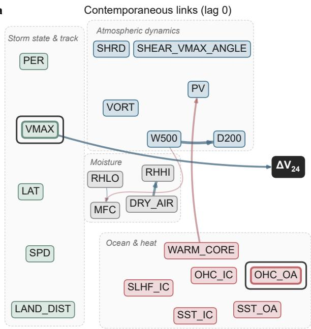

b  
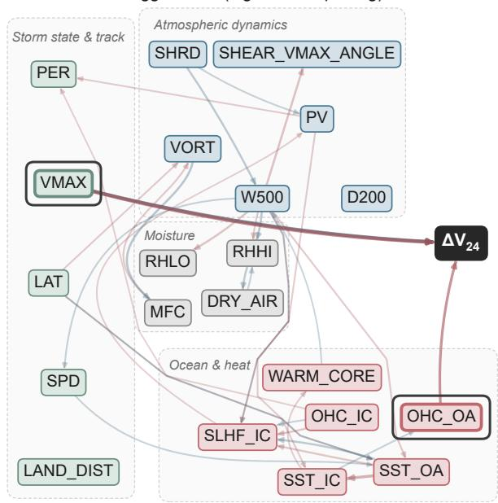

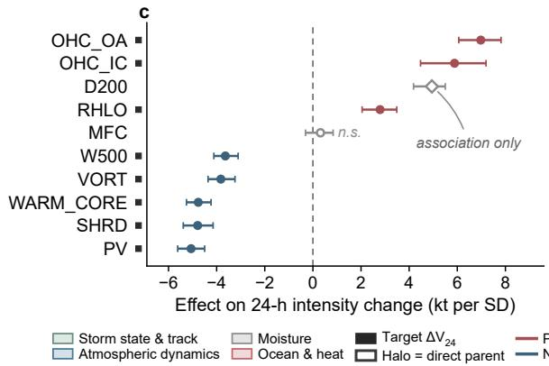

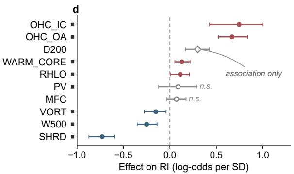  
a, lag-0 links at unadjusted p ≤ 0.05; b, 81 lagged links at BH q ≤ 0.05 (33 shown); c, d, graph-adjusted effects with bootstrap 95% CIs.

Figure 1: The causal graph is discovered from 522 observed cyclones in 2000–2017. $\mathbf { a } , \mathbf { b } ,$ Prior-constrained PCMCI+ [14] graph (fit 2000–2017, $n = 1 2 , 6 4 7 )$ : a, six contemporaneous (lag 0) links at unadjusted $p \ \leq \ 0 . 0 5 ;$ b, 81 lagged links at Benjamini–Hochberg false discovery rate (FDR) $q \leq 0 . 0 5$ (6 h per lag). For legibility panel b retains the 32 strongest lagged partial correlations together with every direct parent of the 24-h intensity change $\Delta V _ { 2 4 }$ (33 of 81 significant lagged links shown); node fill denotes the variable family, edge colour the sign of the partial correlation and edge width/opacity its magnitude. Node outlines are doubled (halo) for the two direct parents of $\Delta V _ { 2 4 } \mathrm { : }$ current intensity (VMAX) and outerarea ocean heat content (OHC\_OA). c,d, Graph-adjusted efect estimates with bootstrap 95% confidence intervals (CIs; $B = 2 0 0 )$ on 24-h intensity change (c) and on rapid intensification (RI) as conditional log-odds per SD (d), ordered by point estimate; solid black squares mark the eight treatments whose bootstrap-stable $\Delta V _ { 2 4 }$ signs enter the causal training loss, the open diamond marks upper-level divergence D200 (association only on both scales; no directed path to $\Delta V _ { 2 4 }$ in the identification DAG, with an inserted edge for its RI estimate) and open grey circles are not significant (bootstrap $p \geq 0 . 0 5 )$

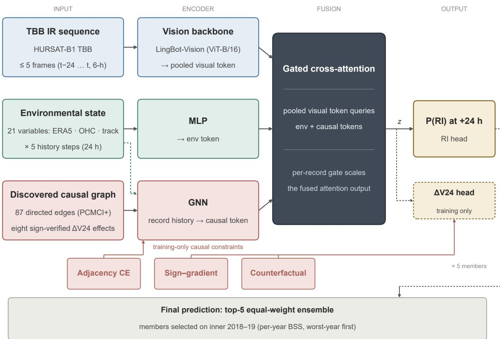  
Figure 2: CausalVisionRI fuses satellite, environmental and causal-graph streams under signverified constraints. One branch reads storm-centred infrared imagery (TBB, black-body brightness temperature) with a ViT-B/16 vision-transformer backbone initialised from the LingBot-Vision base student [4]. A second condenses the 21-variable environmental state over five history steps through a multilayerperceptron (MLP) encoder. These per-record histories also supply the GNN node features, while the discovered graph supplies its fixed topology and edge attributes. The pooled visual token attends to the environmental and causal tokens, with a per-record sigmoid gate g scaling the attention output. Adjacency cross-entropy matches incoming-edge attention to the coeficient-normalized prior weights. Sign–gradient and counterfactual losses use the eight estimated efect signs to constrain the $\Delta V _ { 2 4 }$ environmental response. The selected system is the equal-weight ensemble of five members selected on inner-period (2018–2019) skill; configuration details are given in the Methods.

## 2.3 CVRI-Ens improves probabilistic RI prediction in the 2020–2024 holdout

We evaluate CVRI-Ens on 3,004 records from 131 cyclones in the 2020–2024 holdout, with an RI base rate of 7.39%. CVRI-Ens attains a Brier skill score against the fixed 2000–2019 development climatology $\left( \mathrm { B S S _ { d e v } } \right)$ of 0.259 (Table 1, Fig. 3), with an area under the receiver-operating-characteristic curve (ROC-AUC) of 0.900 and an area under the precision–recall curve (PR-AUC) of 0.518 at the same base rate. At the inner-derived threshold (0.225), the ensemble has a probability of detection (POD) of 0.680 at a probability of false detection (POFD) of 0.095 (false-alarm ratio, FARatio, 0.635; critical success index, CSI, 0.311). Skill is positive in every test year (per-year metrics in Supplementary Table S3), from 0.159 in 2022 to 0.298 in 2021. The five members individually reach 0.151–0.214, so the equal-weight ensemble exceeds every member (Supplementary Fig. S2). Sensitivity ensembles score 0.259 for K4 and Top-5, 0.279 for K6 and 0.244 for all-22 (Supplementary Table S4); Top-5 remains the protocol-locked primary ensemble.

The three LDA references reach BSS values of 0.095–0.105 under the identical protocol (Table 1): the 12-predictor Statistical Hurricane Intensity Prediction Scheme (SHIPS-12) linear discriminant analysis (LDA) reaches 0.105 with climatological OHC (COHC) and 0.095 with time-dependent daily OHC (OHCD), and the 21-predictor panel LDA reaches 0.098. Class-balanced logistic regression (LR) provides an uncalibrated reference. Storm-cluster paired bootstrap diferences relative to CVRI-Ens are positive and Holm-significant for every reference (∆BSS +0.154 to +2.333, $p \leq 0 . 0 0 3 ;$ 90% CIs in Table 1). The ensemble’s threshold-free discrimination (ROC-AUC 0.900) exceeds the best reference (0.826). The ensemble’s precision–recall curve lies at or above the reference curves for recall $> 0 . 1$ in the full holdout (Fig. 3a) and for recall > 0.14 in the shared comparison sample (Supplementary Fig. S3). Its receiver-operating-characteristic curve lies at or above the reference curves throughout in both comparisons (Fig. 3b and Supplementary Fig. S3). The lowest probability bin [0, 0.1) contains 2,019 of the 3,004 records (67.2%; reliability data in main\_2024.json), with mean prediction 0.049 against an observed frequency of 0.011 (Fig. 3d). The threshold (0.225) lies above this bin (Fig. 3e), so the thresholded metrics are unafected.

Table 1: CVRI-Ens attains the highest BSS, ROC-AUC, PR-AUC and CSI, and the lowest FARatio, in the 2020–2024 holdout (n = 3,004 rows, 131 systems; RI base rate 7.39%). All models share the same rows and metrics; operating metrics use each model’s own inner-period F1 threshold (F1, harmonic mean of precision and recall). ${ \mathrm { B S S } } _ { \mathrm { d e v } }$ , Brier skill score against the fixed 2000–2019 development climatology (0.0791). ∆BSS is the storm-cluster paired bootstrap diference relative to CVRI-Ens, Holm adjusted; 90% confidence intervals (CIs) in brackets. POD, probability of detection; POFD, probability of false detection; FARatio, false-alarm ratio (1−precision); CSI, critical success index; ROC-AUC and PR-AUC, areas under the receiver-operating-characteristic and precision–recall curves; LR, logistic regression; LDA, linear discriminant analysis; SHIPS-12, 12-predictor Statistical Hurricane Intensity Prediction Scheme; COHC/OHCD, climatological ocean heat content / time-dependent daily OHC. Best value in each metric column in bold.
<table><tr><td>Model</td><td> ${ \mathrm { B S S } } _ { \mathrm { d e v } }$ </td><td>ROC-AUC</td><td>PR-AUC</td><td>POD</td><td>POFD</td><td>FARatio</td><td>CSI</td><td>∆BSS [90% CI]</td></tr><tr><td>CVRI-Ens</td><td>0.259</td><td>0.900</td><td>0.518</td><td>0.680</td><td>0.095</td><td>0.635</td><td>0.311</td><td></td></tr><tr><td>SHIPS-12 LDA (COHC)</td><td>0.105</td><td>0.820</td><td>0.276</td><td>0.347</td><td>0.060</td><td>0.686</td><td>0.197</td><td>+0.154 [+0.079, +0.214]</td></tr><tr><td>SHIPS-12 LDA (OHCD)</td><td>0.095</td><td>0.813</td><td>0.266</td><td>0.473</td><td>0.095</td><td>0.715</td><td>0.216</td><td>+0.164 [+0.095, +0.222]</td></tr><tr><td>LDA (21 panel predictors)</td><td>0.098</td><td>0.813</td><td>0.278</td><td>0.730</td><td>0.250</td><td>0.811</td><td>0.176 +0.161</td><td>[+0.097, +0.215]</td></tr><tr><td>LR (uncalibrated)</td><td>-2.074</td><td>0.826</td><td>0.298</td><td>0.649</td><td>0.173</td><td>0.769</td><td>0.205 +2.333</td><td>[+1.935, +2.866]</td></tr></table>

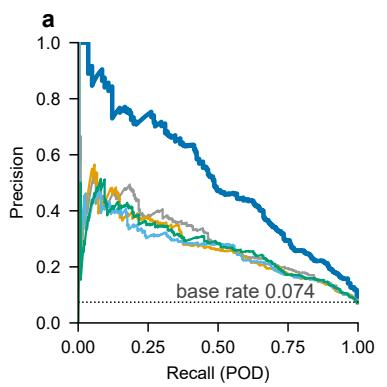

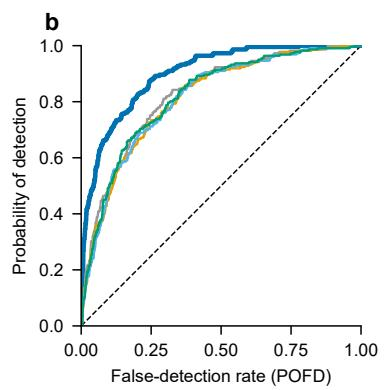

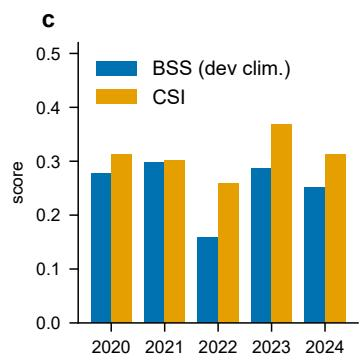

d  
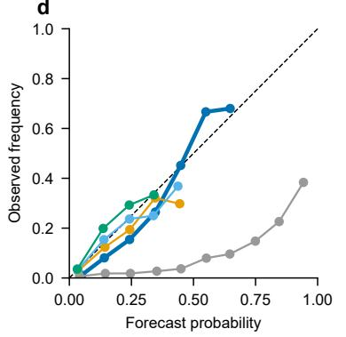

e  
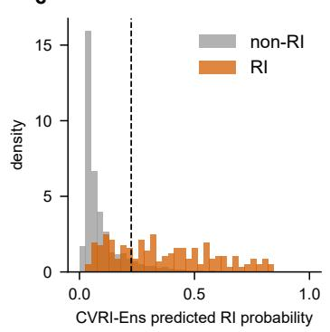

f  
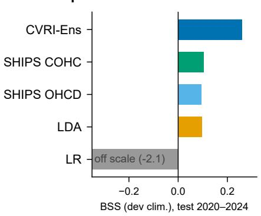  
Figure 3: CVRI-Ens attains a Brier skill score (BSS) of 0.259 in the 2020–2024 holdout, exceeding all four reference systems. a, precision–recall curves (dashed line: rapid intensification (RI) base rate 7.39%); b, receiver-operating-characteristic curves; c, per-year BSS (development climatology) and critical success index (CSI); d, reliability diagram; e, predicted-probability distributions for RI and non-RI records (dashed line: inner-derived threshold 0.225); f, BSS of CVRI-Ens (CausalVisionRI-Ensemble) against the four reference systems (logistic regression, LR, is of scale). References share the same rows and threshold rule throughout.

## 2.4 The graph pathway adds holdout skill, concentrated near its estimation window

The protocol-locked member-level C2 comparison is positive in three of five members and Holmsignificant in LoRA-sf (∆BSS +0.080, $p _ { \mathrm { H o l m } } = 0 . 0 0 4 )$ ; the other four have intervals that include zero (∆BSS −0.026 to +0.032, $p _ { \mathrm { H o l m } } \geq 0 . 4 3 ;$ Supplementary Table S5). Over the full test period, all eight LoRA-sf ablation contrasts are positive, six of them significant.

Removing the graph pathway lowers the ensemble’s pooled BSS by 0.032 across all 3,004 holdout rows in 2020–2024. The year-by-year changes show that both years nearest the estimation window show significant gains: +0.080 in 2020 (90% CI [+0.043, +0.140], $p < 0 . 0 0 1 )$ and +0.047 in 2021 $\left( [ + 0 . 0 2 3 , + 0 . 0 7 6 ] \right.$ $p = 0 . 0 0 3 )$ , with +0.063 ([+0.042, +0.090], $p < 0 . 0 0 1 )$ for the pooled two-year period (Fig. 4a for the annual contrasts; year\_gradient\_ablation.json for the pooled values). All five members improve in 2020 and four of five improve in 2021 (Fig. 4b). From 2022 onward the ensemble contrast is smaller and its interval includes zero.

Two control families separate the graph pathway from the auxiliary losses and from generic capacity. Removing all three causal losses while retaining the branch (C1) leaves the ensemble’s 2020–2021 skill statistically unchanged $( \Delta \mathrm { B S S } + 0 . 0 0 7 , 9 0 \% \mathrm { C I } [ - 0 . 0 1 3 , + 0 . 0 2 6 ] )$ . Over the full test period, replacing the prior graph with shufles that preserve each node’s degree in the environmental subgraph (C3), with input dimensionality and loss weights unchanged, lowers LoRA-sf skill under al three seeds (by up to 0.062, two significantly). For LoRA-sf, this gain is sensitive to the discovered topology. Across the full 40-contrast panel (Supplementary Table S5), ten contrasts survive Holm correction and seven favour the prior. The three significant negative contrasts occur in Part4 (C1 and C4sign) and T2 (C4sign), showing that the full constraint set has member-specific efects.

The members also use the prior diferently. Part4 routes 69% of its context attention to the causal token, whereas LoRA-sf routes 23% yet shows the largest graph-removal efect (Supplementary Table S5). Attention share and ablation benefit capture diferent aspects of how the members use the prior (Supplementary Fig. S6 and Table S6). The 2020–2021 member panel is shown in Supplementary Fig. S5; per-contrast and per-year ablation values are given in the released analysis files.

## 2.5 CVRI-Ens improves detection at matched false-detection rates under common evaluation standards

CVRI-Ens attains the highest detection rate at matched false-detection rates under our USA 30-kt standard and the published RITCF CMA 25.27-kt standard. Every model within a panel shares the same sample, evaluation label source, time window and metric definition; the training label sources and reconstruction choices are described in Methods. WRPS1 [9], scored from its 73 published blocks on our feature table, reaches $\mathrm { B S S } _ { \mathrm { d e v } } = 0 . 1 4 3$ on the shared test sample $( n = 2 , 8 9 2 )$ against 0.260 for CVRI-Ens (storm-cluster bootstrap $\Delta \mathrm { B S S } = + 0 . 1 1 7$ , 90% CI $\left[ + 0 . 0 4 5 , \ + 0 . 1 7 4 \right]$ $p = \left. 0 . 0 1 0 \right)$ The rapid-intensification TC forecasting (RITCF) contrastive-learning scheme [18] was re-implemented on an independent pipeline using the published description and released code, with the description taking precedence where they conflict. The released implementation difers from the described model and omits the data pipeline (Supplementary Note S4). In this reconstruction (test 2020–2021, $n = 1 , 0 5 7 )$ , the rolling-pool variant admits test-year RI labels, whereas the capped-pool variant excludes them. The reconstruction nearly reproduces the reported POD (0.879–0.924 versus 0.910), but at much higher false-detection rates (46.5–54.9% versus 9.4%). No vote-threshold setting reproduces both reported values, and a direct classifier on identical inputs attains higher ROC-AUC (0.854 versus 0.71–0.75). The published operating point would require an AUC of about 0.97 under an equal-variance binormal model (Supplementary Note S4). The CMA-30 wind-source control re-scores the same frozen predictions on the best-AUC curves (Supplementary Fig. S4). CVRI-Ens retains the highest CSI and the highest interpolated POD at 9.4% FARate (from table\_figA\_best\_auc.csv; 0.675 versus 0.567 for the next-best entry). Its unrecalibrated probabilities have lower BSS than WRPS1 under these labels (0.092 versus 0.134, from the same table).

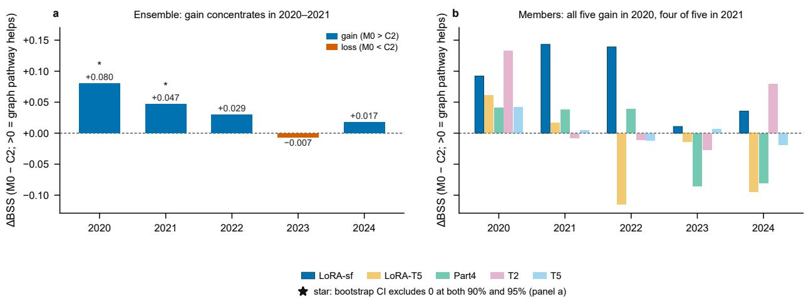  
Figure 4: Disabling the graph pathway costs significant holdout skill in 2020 and 2021. a, Per-year change in Brier skill score of the ensemble when the graph pathway is disabled (C2); positive values favour the graph pathway, and stars mark years where the gain is significant under the locked bootstrap rule. b, The same contrast for the five members individually; all five members gain in 2020 and four of five in 2021. In panel a, blue and orange distinguish positive and negative changes; member colours in panel b identify the ensemble members.

For comparison under our USA-agency 30-kt standard (2020–2024), we intersect the 3,004 frozen holdout records with RITCF’s CMA-wind/frame/storm eligibility records and retain rows with all 12 SHIPS predictors finite. This yields 2,178 records with 209 RI events (base rate 9.60%, compared with 7.39% for the full holdout; Supplementary Table S8 and Fig. 5a). CVRI-Ens attains POD 0.699 at an 11.7% false-detection rate (FARate, equal to POFD). At the 9.4% false-detection rate reported for RITCF, it retains POD 0.670 against 0.517 for the next-best entry, interpolated from the primary score-sweep curves (iso\_pofd.csv). On RITCF’s own standard, using CMA 25.27- kt labels for 2020–2021 (n = 949; Fig. 5b), CVRI-Ens ranks first in both ROC-AUC (0.896) and PR-AUC (0.562; table\_figB\_best\_loss.csv) and retains POD 0.727 at that false-detection point (interpolated from the corresponding score-sweep curves; next best 0.636). The published operating point is shown for reference (POD 0.910, FARate 9.4%, FARatio 58.7%, n = 1,149). WRPS1’s development window extends through 2021, so its scores include in-sample years in both panels and in the 2,892-row comparison above.

## 3 Discussion

This work couples observational causal discovery to deep prediction for 24-h RI warning. The discovered graph constrains training as an auditable prior, and the system is evaluated under a common-standard protocol built on proper scores. The graph links atmospheric and oceanic conditions to the cyclone’s dynamical and structural state, and through that state to 24-h intensity change. Its eight sign-verified efects on $\Delta V _ { 2 4 }$ provide a compact, physically interpretable prior.

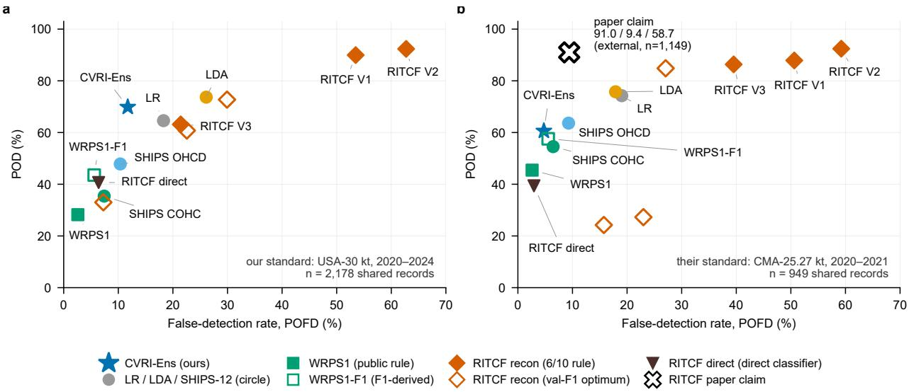  
Figure 5: CVRI-Ens attains the highest detection rate at matched false-detection rates under both label standards. a, our standard: USA-agency 30-kt rapid intensification (RI) labels, test 2020–2024, n = 2,178 shared rows; b, the published standard of Wang et al. [18]: China Meteorological Administration (CMA) 25.27-kt labels, 2020–2021, n = 949. Each point is one model at its stated or inner-derived operating rule. The 9.4% FARate values quoted in the text are interpolated from the corresponding score-sweep curves; the open marker in b shows the operating point reported by Wang et al. [18] on its own sample frame $( n = 1 , 1 4 9 )$ , which is external to the shared sample. POD = probability of detection; FARate = probability of false detection (POFD); FARatio = 1−precision. Panel-specific sample frames are listed in Supplementary Table S7.

Embedded in the model, the graph pathway yields a skill gain concentrated near the estimation window, with the largest graph-removal efect in LoRA-sf; control ablations link that gain to the discovered structure. Under common evaluation standards, the ensemble outperforms statistical– dynamical guidance and the reconstructed AI scheme in detection at matched false-detection rates on both our label standard and the published RITCF standard. To our knowledge, the protocollocked Top-5 ensemble’s BSS of 0.259 is the highest reported for probabilistic 24-h RI forecasts in the western North Pacific verified on a strictly forward multi-year holdout against a fixed climatological baseline. The closest prior values [3, 9] come from cross-validated protocols in which later years inform predictions of earlier ones, whereas our evaluation preserves a strictly forward multi-year holdout.

Our causal estimates assume no unobserved confounding. The synthetic-confounder refutation shifts every estimate with a non-empty backdoor set, and the E-value analysis quantifies the confounding strength needed to explain each efect away. The sensitivity configurations probe lag selection, climate indices, latitude and OHC dependence, while the DAG audit probes graph construction (Supplementary Table S1 and Supplementary Notes S1–S2). The two wind sources assign the same RI label to 95.4% of the 2,178 panel-A records (Supplementary Table S8). The CMA-30 control preserves the matched-FARate detection advantage and the highest CSI, while the unrecalibrated probabilities yield lower BSS than WRPS1.

The framework is designed to be transferable: the prior can be rediscovered for other basins or lead times and injected into larger backbones, and the common-standard evaluation applies to any published scheme with a stated operating rule. The discovery panel, frozen test predictions and evaluation code are released with this paper, so that every reported evaluation number can be reproduced.

## 4 Methods

## 4.1 Study population and data sources

The study population comprises all western North Pacific (WNP) tropical cyclones (TCs) in the International Best Track Archive for Climate Stewardship (IBTrACS, v04r01) [5, 12] from 2000 to 2024, with intensity, position and pressure taken from the USA-agency columns (USA\_WIND, USA\_LAT, USA\_LON, USA\_PRES). The archive contains 725 WNP systems in this period, of which 720 are label-eligible. The 17,643 label-eligible synoptic-time rows enter the population audit. A frame-availability rule (frame\_availability\_v1) excludes 202 rows whose satellite imagery is missing at the synoptic time (157 before the first available frame of the storm, 30 after the last, 15 across an internal frame gap), with the reason recorded per row; 17,441 rows remain. Rows are split by storm year into a fit period (2000–2017; 12,619 rows, 522 systems), an inner period (2018–2019; 1,818 rows, 66 systems) used for threshold selection, early stopping and ensemble selection, and a test period (2020–2024; 3,004 rows, 131 systems) evaluated exactly once after the final protocol lock. One 2017 storm in the system-level eligibility census is absent from the three analysis periods because its 12 rows have 24-h target times in 2018, giving 719 systems overall.

Atmospheric predictors come from the ERA5 reanalysis [8] on pressure levels 1000–200 hPa and single-level fields, sampled on storm-centred inner-core (0–2◦) and outer-area (2–8◦) annuli. Ocean heat content (OHC) above the $2 6 ^ { \circ } \mathrm { C }$ isotherm comes from the GLORYS12V1 ocean reanalysis [13], taken from completed daily windows (backward selection to the six-hourly grid). Maximum potential intensity is computed with tcpyPI [7] and enters the baseline predictor table (Supplementary Table S9). Satellite infrared imagery comes from the HURSAT-B1 v07b archive [11]: storm-centred blackbody brightness temperature (TBB) frames at 224×224 px, up to five frames per record (t − 24 h to t at 6-h steps). Distance to land is computed from the Global Self-consistent, Hierarchical, Highresolution Geography (GSHHG) coastline [19]. Table 2 lists the environmental variables and their physical definitions.

Table 2: Environmental variables and physical definitions. Inner core means 0–2◦ and outer area means 2–8◦ around the storm centre.
<table><tr><td>Variable</td><td>Meaning</td><td>Construction</td><td>Source</td></tr><tr><td colspan="4">Best-track state</td></tr><tr><td>VMAX</td><td>Current intensity</td><td>USA 1-min sustained wind (kt)</td><td>IBTrACS</td></tr><tr><td>PER</td><td>Recent intensification</td><td>VMAX(t)−VMAX(t − 6h)</td><td>IBTrACS</td></tr><tr><td>SPD</td><td>Translation speed</td><td>Great-circle displacement rate between best-track positions (kt; nmi h−1)</td><td>IBTrACS</td></tr><tr><td>LAT</td><td>Latitude</td><td>Storm-centre latitude</td><td>IBTrACS</td></tr><tr><td>LAND DIST</td><td>Distance to land</td><td>Great-circle distance (km)</td><td>GSHHG coastline</td></tr><tr><td colspan="4">ERA5 atmospheric fields</td></tr><tr><td>SHRD</td><td>Deep-layer shear</td><td>850–200-hPa wind difference, outer area</td><td>ERA5</td></tr><tr><td>SHEAR VMAX ANGLE</td><td>Shear-motion angle</td><td>Shear direction relative to TC motion, 0–180°</td><td>ERA5 + best track</td></tr><tr><td>D200</td><td>Upper-level divergence</td><td>200-hPa divergence, outer area</td><td>ERA5</td></tr><tr><td>RHLO</td><td>Low-level humidity</td><td>850–700-hPa mean relative humidity, outer area</td><td>ERA5</td></tr><tr><td>RHHI</td><td>Mid/upper-level humidity</td><td>500–300-hPa mean relative humidity, outer area</td><td>ERA5</td></tr><tr><td>VORT</td><td>Low-level vorticity</td><td>850-hPa relative vorticity, inner core</td><td>ERA5</td></tr><tr><td>PV</td><td>Potential vorticity</td><td>500-hPa potential vorticity, inner core</td><td>ERA5</td></tr><tr><td>SST_OA</td><td>Outer-area SST</td><td>Sea-surface temperature, outer area</td><td>ERA5</td></tr><tr><td>SST_IC</td><td>Inner-core SST</td><td>Sea-surface temperature, inner core</td><td>ERA5</td></tr><tr><td>WARM CORE</td><td>Warm-core anomaly</td><td>200-hPa temperature anomaly, inner minus outer</td><td>ERA5</td></tr><tr><td>MFC</td><td>Moisture flux convergence</td><td>850-hPa moisture flux convergence, outer area</td><td>ERA5</td></tr><tr><td>SLHF IC</td><td>Inner-core latent heat flux</td><td>Surface latent heat flux, ocean to atmosphere</td><td>ERA5</td></tr><tr><td>DRY AIR W500</td><td>Dry-air intrusion</td><td>Outer-area fraction with 700–500-hPa relative humidity &lt; 40%</td><td>ERA5</td></tr><tr><td></td><td>Mid-level pressure velocity</td><td>500-hPa pressure velocity, outer area; negative is ascent</td><td>ERA5</td></tr><tr><td colspan="4">GLORYS12V1 ocean fields</td></tr><tr><td>OHC IC</td><td>Inner-core OHC</td><td>OHC above 26°C isotherm, inner core</td><td>GLORYS12V1</td></tr><tr><td>OHC_OA</td><td>Outer-area OHC</td><td>OHC above 26°C isotherm, outer area</td><td>GLORYS12V1</td></tr></table>

## 4.2 Outcomes and labels

The continuous outcome is the 24-h intensity change

$$
\Delta V _ { 2 4 } = \mathrm { c l i p } \left[ \mathrm { V M A X } ( t + 2 4 \mathrm { h } ) - \mathrm { V M A X } ( t ) , - 5 5 , 5 5 \right] \ \mathrm { k t } ,\tag{1}
$$

where the limits are the 1st and 99th percentiles fitted on fit-period data. Rapid intensification (RI) is computed from the unmodified diference, $\mathrm { R I } = \mathbf { 1 } \{ \mathrm { V M A X } ( t + 2 4 \mathrm { h } ) - \mathrm { V M A X } ( t ) \geq 3 0 \mathrm { ~ k t } \}$ following the standard 30-kt-per-24-h definition [10]. The label time is the nearest best-track entry within ±6 h of t+24 h (130 test rows therefore deviate from the exact 24-h horizon: 127 at 18 h and 3 at 21 h). The RI base rate is 7.39% in the test period and 7.91% over the 2000–2019 development period; the latter is fixed as the climatological reference for all skill scores below. Environmental variables are z-scored with scalers fitted on the fit period only. The Yeo–Johnson transform of $\Delta V _ { 2 4 }$ is also fitted on the fit period only, and is used in discovery and as the auxiliary regression target.

## 4.3 Masked causal discovery

Causal discovery uses PCMCI+ [14] with partial-correlation (ParCorr) conditional-independence tests, maximum lag $\tau _ { \operatorname* { m a x } } = 4$ (24 h at 6-h resolution) and pc\_alpha = 0.01, run on all labeleligible fit-period rows (12,647 rows from 522 systems, feature times up to 25 December 2017 18:00 UTC). Discovery does not require satellite frames and therefore retains the 28 fit-period rows later excluded by the frame-availability rule; 12,619 of these rows enter the modelling panel. Storms are independent realizations, so no lagged link crosses storm boundaries. The panel is aligned on a complete six-hourly grid; padding and long-gap-filled cells are masked, and samples masked in the treatment, outcome, or any conditioning variable are excluded from each test (mask\_type=xyz). Short gaps of at most three steps are filled by linear interpolation so that lagged indices stay aligned within a storm, but every filled cell remains masked and is excluded from the afected tests; the target is never interpolated.

Skeleton selection uses unadjusted test p-values. Benjamini–Hochberg (BH) correction is applied to lagged links, while contemporaneous links retain unadjusted p-values [1]. Meteorological priors prohibit the target from causing any predictor, constrain derived-variable directions and lags, and allow a limited set of contemporaneous links with fixed orientation into the target. The resulting graph contains 81 lagged links at $q \leq 0 . 0 5$ and six contemporaneous links at unadjusted $p \leq 0 . 0 5$ The ten further links above these thresholds are excluded from the model’s graph branch, while the identification DAG below is built from the full discovery output so that adjustment sets account for them. Conditional-independence-based discovery identifies graphs up to their Markov equivalence class [15]; we therefore treat the graph as a set of candidate links and subject efect signs to the identification and refutation pipeline below before any use in training.

## 4.4 Identification and efect estimation

For efect estimation, directed links are collapsed across lags by retaining the largest absolute coeficient for each ordered variable pair, and an identification directed acyclic graph (DAG) is built from the collapsed graph with greedy weakest-edge cycle breaking and a small set of structural edges inserted as modelling choices (recorded in the DAG audit, Supplementary Note S1). DoWhy [16] returns backdoor adjustment sets from this DAG. Efect estimates are computed per one-standarddeviation increase of each treatment: by ordinary least squares for $\Delta V _ { 2 4 }$ (reported in kt per 24 h per SD) and by a binomial generalized linear model for RI (reported as a conditional log-odds coeficient per SD). A treatment with no directed path to the outcome has no identified total efect, and its regression output is reported as an association. D200 has no directed path to $\Delta V _ { 2 4 }$ in the identification DAG, and its RI estimate rests solely on the inserted treatment→RI edge, so both values are reported as associations. The protocol-locked rule therefore excludes D200 from the trusted set. The strict-lag and no-OHC configurations find directed paths for D200 and are reported as sensitivity analyses (Supplementary Note S2).

Uncertainty uses 200 block-bootstrap resamples of whole storms (seed 42), with BH q-values computed separately for the $\Delta V _ { 2 4 }$ and RI families. We report 95% intervals for these efect estimates, conditional on the locked identification $\operatorname { D A G } ;$ skill contrasts on the much smaller holdout are instead tested at the locked significance level $\alpha = 0 . 1 0$ with 90% intervals (see below). Robustness is probed with four refuters (placebo treatment, 90% subset, synthetic unobserved confounder, ofshore subset) and approximate E-values at the estimate and at the nearer-to-null confidence limit [17]. A treatment sign enters the model’s constraint set (the trusted signs, defined on the $\Delta V _ { 2 4 }$ scale) only if the bootstrap $p < 0 . 0 5$ , at least two refuters pass, and a directed identification path to $\Delta V _ { 2 4 }$ exists. Eight treatments qualify: SHRD−, RHLO+, VORT−, PV−, WARM\_CORE−, W500−, OHC\_IC+, OHC\_OA+. Sensitivity configurations (strict lag-≥1 discovery, Madden–Julian oscillation and Niño-3.4 indices added to adjustment sets, latitude added to the OHC\_OA adjustment set, and a no-OHC graph) are reported in Supplementary Note S2.

## 4.5 The causal prior as model inputs

The outputs of the discovery pipeline enter the model through three channels. The 87 retained graph edges are passed to a graph neural network (GNN) with edge attributes $( \log / \tau _ { \operatorname* { m a x } }$ , sign of the coeficient, absolute coeficient). The eight trusted signs anchor a sign–gradient loss and a counterfactual term over the same treatments. The normalized absolute edge coeficients anchor the adjacency loss (below). Every training run logs cryptographic SHA-256 checksums of the graph and ATE files, so the prior version is auditable per checkpoint.

## 4.6 Model architecture

CausalVisionRI fuses three input sources (Fig. 2). Satellite TBB sequences are encoded by a vision transformer, with two initialization routes across the arm pool: the LingBot-Vision base student (ViT-B/16) [4] as an external initialization, and a from-scratch ViT-S/16 pre-trained in-domain as a masked autoencoder (MAE; below). Fine-tuning modes span frozen, low-rank adaptation (LoRA, rank 16), partial-block and full fine-tuning, combined with temporal-window variants (single-frame, two-frame, three-frame and five-frame inputs); all five ensemble members use the LingBot route. The 21 environmental variables over five history steps are encoded by a multilayer perceptron (hidden width 256). Their per-record histories also supply node features to a two-layer GNN (hidden width 128, four attention heads, edge dimension 3). The GNN has 21 environmental nodes and one learnable $\Delta V _ { 2 4 }$ readout node with no input features. Message passing is restricted to the 87 prior edges, and the causal token concatenates the readout-node state with the mean environmental node state. Fusion is a gated cross-attention block $( d _ { \mathrm { m o d e l } } = 2 5 6$ , four heads): the pooled visual token queries the environmental and causal tokens, and a per-row sigmoid gate g scales the attention output before the residual connection, so the fused attention output can be down-weighted row by row. A linear head outputs the 24-h RI probability, trained with a focal loss $( \gamma = 2 , \alpha = 0 . 2 5 )$ , and an auxiliary linear head predicts Yeo–Johnson-transformed $\Delta V _ { 2 4 }$

Three causal losses link the prior to training: an adjacency cross-entropy matching each target node’s incoming-edge attention to its coeficient-normalized prior weights (weight 1.0), a sign– gradient term penalizing the batch- and history-mean input gradients whose signs oppose the trusted efects (weight 2.0), and a counterfactual term penalizing $\Delta V _ { 2 4 }$ predictions that increase when each trusted treatment is shifted by one standard deviation against its efect sign at all five history steps (weight 0.02). The input gradient is a local surrogate for the sign of the estimated average treatment efect. Both response terms act on the fused model’s transformed $\Delta V _ { 2 4 }$ output. Causal losses are scaled by 0.01 during fine-tuning.

## 4.7 Satellite pre-training

For the from-scratch route, a ViT-S/16 backbone is pre-trained as an MAE on storm-centred frames drawn from a multi-satellite raw corpus of 304,518 frames spanning all basins, via two routes: a WNP route restricted to the study population’s systems and a global all-basin route. The MAE settings are a mask ratio of 0.75, normalised-pixel loss, at most 400 epochs with early-stopping patience 20, batch size 256, base learning rate $1 . 5 \times 1 0 ^ { - 4 }$ , weight decay 0.05 and a 40-epoch warmup. On each route, fit-period frames are used for training and inner-period frames for validation; test years are excluded. Same-time frames from diferent satellites are retained as sensor augmentation; only non-physical fill pixels are masked. The WNP route reached its best validation loss at epoch 96 and the global route at epoch 75. Downstream, frames are restricted to the quality-controlled set of 153,295 unique (storm, time) frames so that every panel row aligns with exactly one image sequence.

## 4.8 Training, selection and ablation protocol

Downstream models are trained in two stages: full-network $\Delta V _ { 2 4 }$ -regression pre-training (30 epochs, learning rate $1 0 ^ { - 3 } )$ followed by RI fine-tuning (40 epochs, learning rate $3 \times 1 0 ^ { - 4 } )$ . The backbone learning rate is scaled by 0.1 and weight decay is 0.01. Both stages use early stopping with patience 10, on inner-period $\Delta V _ { 2 4 }$ mean squared error in the first stage and inner-period RI skill in the second. All 22 development arms were trained on fit-period data and selected on inner-period data only: arms are ranked by per-year inner Brier skill score (BSS), evaluated against each year’s own climatology, with worst-year-first ordering. Family champions receive a protected slot only when they rank within the overall top eight, and remaining slots are filled by overall rank. The top five members are averaged with equal weights to form CausalVisionRI-Ensemble (CVRI-Ens): lora16\_sf, lora16\_temp5, temp2, partial4\_sf, temp5\_slim, referred to below by the short names LoRA-sf, LoRA-T5, T2, Part4 and T5 respectively (full run ids in Supplementary Table S2). The evaluation threshold (0.225 for CVRI-Ens) maximizes the inner-period F1 score (harmonic mean of precision and recall) and is fixed before any test evaluation. After the final protocol lock (entity list, thresholds, comparison families and the protocol-locked primary contrast C2\_vs\_M0\_BSS\_dev), test-period predictions were computed once and frozen; a signed receipt records completion (lock files and audit trail in Supplementary Note S5).

The ablation panel comprises 40 entities (five members × eight conditions) trained under the same protocol with shared member initializations and fixed shufle generators, each condition evaluated against its member’s full causal configuration (M0). The conditions are: C1 removes all causal losses (GNN retained); C2 removes the GNN branch (causal losses inactive); C3s1–3 replace the prior graph with shufles that preserve each node’s degree in the environmental subgraph, under three seeds (same GNN capacity, same losses); C4adj, C4cf and C4sign retain only the adjacency, counterfactual, or sign–gradient loss. Because C3 keeps the input dimensionality and loss weights unchanged, it probes the contribution of this specific graph.

## 4.9 Statistical–dynamical and AI baselines

Four reference systems are evaluated under the identical protocol (same rows, same threshold rule, same metrics): a 12-predictor SHIPS-style linear discriminant analysis (LDA) reconstruction in two oceanic variants (climatological OHC, COHC; time-dependent daily OHC (OHCD)) [2, 10] (the twelve predictors, including the tcpyPI-based potential-intensity term, are listed in Supplementary Table S9), a 21-predictor panel LDA, and class-balanced logistic regression (LR), all fitted on fit-period rows with fit-median imputation of missing predictors. LR is retained as an uncalibrated reference. Two published schemes are additionally evaluated under common standards (Section 4.10): the WRPS1 knowledge-block scheme, reconstructed from the 73 published blocks (18 positive, 55 negative) with the published ofset and probability mapping and scored directly on our SHIPS-12 feature table with the stated unit conventions; and the RITCF contrastive scheme [18], re-implemented on an independent data pipeline using the published description and released code, with the description taking precedence where they conflict. All undocumented design choices are recorded as deviations in Supplementary Notes S3 and S4.

## 4.10 Evaluation and statistics

The primary metric is the Brier skill score against the fixed development climatology, ${ \mathrm { B S S } } _ { \mathrm { d e v } } =$ $1 - \mathrm { B S } / \mathrm { B S } _ { \mathrm { c l i m } }$ , with $\mathrm { B S } _ { \mathrm { c l i m } } = \pi ^ { 2 } + ( 1 - 2 \pi ) { \bar { y } } { \mathrm { : ~ } } \pi$ is the 2000–2019 RI rate of 0.0791 held fixed for every model, and y¯ is the observed frequency of the evaluated sample. Discrimination is summarized by the area under the receiver-operating-characteristic curve (ROC-AUC) and the precision–recall curve (PR-AUC); thresholded performance uses the probability of detection (POD), probability of false detection (POFD), false-alarm ratio (FARatio = 1−precision) and critical success index (CSI) at the inner-derived threshold. Uncertainty uses storm-cluster paired bootstrap resampling (2,000 resamples of whole storms, seed 42) of score diferences, with Holm adjustment inside locked comparison families; significance is reported at $\alpha = 0 . 1 0$ with 90% confidence intervals (CIs), and every contrast reported as significant on the full test period also passes at $\alpha = 0 . 0 5$ . Commonstandard comparisons evaluate every model on the intersection of eligible rows under a single evaluation label source, time window and metric definition, with published operating rules executed as stated (WRPS1 $p _ { u } ~ = ~ 0 . 5$ mapping; RITCF 6-of-10 vote). CVRI-Ens, SHIPS-12, LDA, LR and WRPS1 use USA-side training or development labels, whereas RITCF uses CMA labels. The USA-30 panel therefore places RITCF in a cross-label evaluation, and the CMA-25.27 panel places the USA-developed models in a cross-label evaluation. Two fusion diagnostics are reported: the mean activation of the gate that scales the joint environmental and causal attention output (gate mean), and the head-averaged share of cross-attention assigned to causal tokens (causal share; the no-preference reference is 0.5 for two context tokens). Earlier pilot work and the phase-1 causal analysis used the full 2000–2024 period; the protocol lock and once-only test inference apply to this final configuration, not to the entire research history.

## 5 Data availability

The processed panel with the fit/inner/test split markers and row-level keys, the discovered causal graph, efect-estimate tables and trusted-sign file (with cryptographic SHA-256 manifests), the frozen test-period predictions of all evaluated entities, and the satellite-frame index are released with this paper in the project data repository; ERA5, GLORYS12V1 and HURSAT-B1 are available from their respective providers (European Centre for Medium-Range Weather Forecasts (ECMWF) Climate Data Store (CDS), Copernicus Marine, National Centers for Environmental Information

(NCEI)), and IBTrACS from the National Oceanic and Atmospheric Administration (NOAA) NCEI.   
The project data record is available at https://doi.org/10.5281/zenodo.23768442.

## 6 Code availability

All pipeline code, including causal discovery, prior packaging, pre-training, training, ablation, evaluation and figure generation, is released with this paper under an open licence (MIT License), including the protocol-lock files that fix the evaluation protocol. The code is available at https://github.com/Clrs17/CausalVisionRI.

## References

[1] Yoav Benjamini and Yosef Hochberg. Controlling the false discovery rate: A practical and powerful approach to multiple testing. Journal of the Royal Statistical Society: Series B (Methodological), 57(1):289–300, 1995. doi: 10.1111/j.2517-6161.1995.tb02031.x.

[2] Mark DeMaria, Michelle Mainelli, Lynn K. Shay, John A. Knaf, and John Kaplan. Further improvements to the statistical hurricane intensity prediction scheme (SHIPS). Weather and Forecasting, 20(4):531–543, 2005. doi: 10.1175/WAF862.1.

[3] Ryan Eusebi, Hui Su, Longtao Wu, Pingping Rong, Karthik Balaguru, Ruby Leung, Yong-Sang Choi, Pak Wai Chan, Jianping Gan, Mark DeMaria, and Galina Chirokova. Improving tropical cyclone rapid intensification forecasts with satellite measurements of sea surface salinity and calibrated machine learning. Environmental Research Letters, 20(3):034010, 2025. doi: 10.1088/1748-9326/adac7f.

[4] Zelin Fu, Bin Tan, Changjiang Sun, Shaohui Liu, Kecheng Zheng, Yinghao Xu, Xing Zhu, Yujun Shen, and Nan Xue. Vision pretraining for dense spatial perception, 2026. arXiv:2607.05247.

[5] J. Gahtan, K. R. Knapp, C. J. Schreck, H. J. Diamond, J. P. Kossin, and M. C. Kruk. International Best Track Archive for Climate Stewardship (IBTrACS) Project, Version 4r01, 2024. NOAA National Centers for Environmental Information, https://doi.org/10.25921/ 82ty-9e16.

[6] Saranya Ganesh S., Frederick Iat-Hin Tam, Milton S. Gomez, Marie McGraw, Mark DeMaria, Kate Musgrave, Jakob Runge, and Tom Beucler. Multidata causal discovery for statistical hurricane intensity forecasting. Weather and Forecasting, 41(7):1359–1375, 2026. doi: 10.1175/ WAF-D-25-0208.1.

[7] Daniel M. Gilford. pyPI (v1.3): Tropical Cyclone Potential Intensity Calculations in Python. Geoscientific Model Development, 14(5):2351–2369, 2021. doi: 10.5194/gmd-14-2351-2021.

[8] Hans Hersbach, Bill Bell, Paul Berrisford, Shoji Hirahara, András Horányi, Joaquín Muñoz-Sabater, Julien Nicolas, Carole Peubey, et al. The ERA5 global reanalysis. Quarterly Journal of the Royal Meteorological Society, 146(730):1999–2049, 2020. doi: 10.1002/qj.3803.

[9] Takeshi Horinouchi, Takashi Yanase, Yuiko Ohta, Daisuke Matsuoka, Asanobu Kitamoto, Udai Shimada, Ryuji Yoshida, and Hironori Fudeyasu. Statistical prediction of tropical cyclone rapid intensification with explainable AI. Weather and Forecasting, 40(10):1859–1875, 2025. doi: 10.1175/WAF-D-24-0228.1.

[10] John Kaplan, Mark DeMaria, and John A. Knaf. A revised tropical cyclone rapid intensification index for the Atlantic and eastern North Pacific basins. Weather and Forecasting, 25(1):220– 241, 2010. doi: 10.1175/2009WAF2222280.1.

[11] Kenneth R. Knapp and James P. Kossin. New global tropical cyclone data set from ISCCP B1 geostationary satellite observations. Journal of Applied Remote Sensing, 1(1):013505, 2007. doi: 10.1117/1.2712816.

[12] Kenneth R. Knapp, Michael C. Kruk, David H. Levinson, Howard J. Diamond, and Charles J. Neumann. The International Best Track Archive for Climate Stewardship (IBTrACS): Unifying tropical cyclone data. Bulletin of the American Meteorological Society, 91(3):363–376, 2010. doi: 10.1175/2009BAMS2755.1.

[13] Jean-Michel Lellouche, Eric Greiner, Romain Bourdallé-Badie, Gilles Garric, Angélique Melet, Marie Drévillon, Clément Bricaud, Mathieu Hamon, Olivier Le Galloudec, Charly Regnier, Tony Candela, Charles-Emmanuel Testut, Florent Gasparin, Giovanni Ruggiero, Mounir Benkiran, Yann Drillet, and Pierre-Yves Le Traon. The Copernicus global 1/12◦ oceanic and sea ice GLORYS12 reanalysis. Frontiers in Earth Science, 9:698876, 2021. doi: 10.3389/feart.2021. 698876.

[14] Jakob Runge. Discovering contemporaneous and lagged causal relations in autocorrelated nonlinear time series datasets. In Jonas Peters and David Sontag, editors, Proceedings of the 36th Conference on Uncertainty in Artificial Intelligence (UAI), volume 124 of Proceedings of Machine Learning Research, pages 1388–1397. PMLR, 2020. URL https://proceedings.mlr. press/v124/runge20a.html.

[15] Jakob Runge, Peer Nowack, Marlene Kretschmer, Seth Flaxman, and Dino Sejdinovic. Detecting and quantifying causal associations in large nonlinear time series datasets. Science Advances, 5(11):eaau4996, 2019. doi: 10.1126/sciadv.aau4996.

[16] Amit Sharma and Emre Kiciman. DoWhy: An end-to-end library for causal inference, 2020. arXiv preprint arXiv:2011.04216.

[17] Tyler J. VanderWeele and Peng Ding. Sensitivity analysis in observational research: Introducing the E-value. Annals of Internal Medicine, 167(4):268–274, 2017. doi: 10.7326/M16-2607.

[18] Chong Wang, Nan Yang, and Xiaofeng Li. Advancing forecasting capabilities: a contrastive learning model for forecasting tropical cyclone rapid intensification. Proceedings of the National Academy of Sciences, 122(4):e2415501122, 2025. doi: 10.1073/pnas.2415501122.

[19] Paul Wessel and Walter H. F. Smith. A global, self-consistent, hierarchical, high-resolution shoreline database. Journal of Geophysical Research: Solid Earth, 101(B4):8741–8743, 1996. doi: 10.1029/96JB00104.

[20] Matthew C. Wheeler and Harry H. Hendon. An all-season real-time multivariate MJO index: Development of an index for monitoring and prediction. Monthly Weather Review, 132(8): 1917–1932, 2004. doi: 10.1175/1520-0493(2004)132<1917:AARMMI>2.0.CO;2.

## Author contributions

X.L. and Y.J. designed the study, built the pipeline and ran the experiments. Y.J. built the dataset. X.L. and Y.D. analysed the results. X.L. and Y.D. drafted the manuscript. S.S. supervised the work and revised the manuscript.

## Competing interests

The authors declare no competing interests.

## Acknowledgements

Supported by Project 202610335008 of the National Training Program of Innovation and Entrepreneurship for Undergraduates, and the National Natural Science Foundation of China (Grant No. U2442203). The authors acknowledge the Copernicus Climate Change Service (C3S) for providing the ERA5 reanalysis, and the Copernicus Marine Environment Monitoring Service (CMEMS) for providing the GLORYS12V1 ocean reanalysis. The authors are grateful to Zhiyang Ye (School of Remote Sensing and Information Engineering, Wuhan University) for helpful discussions on remote sensing imagery processing.

# Supplementary Information for: Causal-prior-constrained deep learning for rapid-intensification warning of western North Pacific tropical cyclones

Abbreviations used in this supplement. ATE, average treatment efect; AUC, area under the receiveroperating-characteristic curve; BSS, Brier skill score; CI, confidence interval; CMA, China Meteorological Administration; CVRI-Ens, CausalVisionRI-Ensemble; DAG, directed acyclic graph; FDR, false discovery rate; GNN, graph neural network; OHC, ocean heat content; PCMCI+, a conditionalindependence causal-discovery algorithm [4]; RI, rapid intensification; SD, standard deviation.

## Supplementary Notes

## Supplementary Note S1: Causal-discovery details

The identification DAG is built from the full discovery output (97 directed links, including the ten with $q > 0 . 0 5$ , so that adjustment sets account for them), collapsed to 77 directed variable pairs by retaining the largest absolute coeficient across lags per ordered pair. The DAG inserts 12 structural edges (the target→RI edge defining the binary estimand, ten treatment→RI edges, and W500→target) and removes 26 edges by greedy weakest-edge cycle breaking; one further candidate (SST\_OA→W500) was skipped because it would recreate a cycle, and seven contemporaneous adjacencies remain unorientable and are excluded from the DAG. Deleting the inserted W500→target edge leaves W500’s identified efect unchanged. Across the admissible identification DAG constructions in the released audit, the OHC\_OA efect ranges from +3.39 to +8.92, and every trusted sign remains stable. All construction choices are enumerated in the released DAG-audit files (dag\_audit\_all/), and the per-treatment identification status is given in identification\_status.csv. Efect signs are used in training only for treatments passing 200 storm block bootstraps $\left( p < 0 . 0 5 \right)$ , at least two of four refuters, and the directed-path check.

On the $\Delta V _ { 2 4 }$ outcome, all ten treatments pass the placebo and 90%-subset refutations. The ofshore-subset refuter fails for RHLO, OHC\_IC and OHC\_OA, and the synthetic unobservedconfounder refutation shifts estimates for all treatments with a non-empty backdoor set; Supplementary Table S1 therefore reports E-values (1.13–2.08 on the $\Delta V _ { 2 4 }$ scale), i.e. the minimum confounding strength needed to explain away each estimate. For $\Delta V _ { 2 4 } , ~ d = | \mathrm { e f f e c t } | / 2 0 . 1 3 2 1$ and $R R \approx \exp ( 0 . 9 1 d )$ , where 20.1321 kt is the SD of $\Delta V _ { 2 4 }$ and 0.91 is the log-odds conversion factor. For RI, $O R = \exp ( \beta )$ is converted using $R R = O R / ( 1 - p _ { 0 } + p _ { 0 } O R )$ with $p _ { 0 } = 1 0 1 4 / 1 2 6 4 7$ , inverting RR for protective efects. The assumptions behind the discovery, how each is handled here and what follows if one of them is violated are collected in Supplementary Table S10.

## Supplementary Note S2: Sensitivity configurations

The four sensitivity configurations use the same fit-period panel (2000–2017; 12,647 rows), estimator, lag limit and lagged-link FDR. The link, variable and adjustment-set changes are specified below.

Strict lag-≥1 discovery (no non-self contemporaneous target links) yields 91 significant links and the same qualitative target structure: the direct lag-1 OHC\_OA link into $\Delta V _ { 2 4 }$ persists, joined by PER (lag 1), VMAX (lag 2) and D200 (lag 2). The strict DAG also changes the backdoor adjustment sets, so efects are re-estimated. The trusted $\Delta V _ { 2 4 }$ efects are essentially unchanged $( \mathrm { O H C \_ O A } + 7 . 0 7$ versus +6.98 at baseline; every other trusted-sign estimate retains its sign and remains within a few percent of its baseline value).

Climate-index adjustment appends the Madden–Julian oscillation (OMI1/OMI2) [6] and Niño-3.4 indices to every baseline adjustment set. No estimate changes sign; ∆V24-scale magnitudes shift by at most 4.4% $( \mathrm { O H C \_ O A } + 6 . 9 8 \to + 7 . 0 3 )$ . These indices vary mostly between storms, so this configuration probes season-scale confounding instead of within-storm pathways.

Latitude adjustment adds LAT to the OHC\_OA adjustment set (correlation between LAT and OHC\_OA = −0.63): the efect remains large and significant $\left( + 6 . 4 8 \ \left[ + 5 . 5 2 , \ + 7 . 3 1 \right] \right.$ versus $+ 6 . 9 8 \ [ + 6 . 0 6 , + 7 . 8 2 ]$ at baseline; RI outcome $+ 0 . 6 7  + 0 . 7 6 )$ ), so the large outer-area OHC efect is not explained by latitude.

No-OHC configuration removes both OHC variables from graph variables, treatments and efect analyses (75 significant links; target parents reduce to VMAX links). On the $\Delta V _ { 2 4 }$ scale, the non-OHC estimates retain their signs (PV −4.54, WARM\_CORE −5.59, W500 −3.95, SHRD −4.79 unchanged), and D200 acquires a directed path with an adjusted estimate of +4.99.

All variant outputs (graphs, efect tables, manifests with input hashes) are released with the code package.

## Supplementary Note S3: WRPS1 reconstruction

WRPS1 [3] was evaluated by scoring its 73 published knowledge blocks (18 positive, 55 negative) directly on our SHIPS-12 feature table, using the published ofset $c = - 0 . 3 5 3 6$ , coeficient $\alpha = 0 . 2 7 5$ and probability mapping $P ( p _ { l } ) = 1 . 1 3 4 p _ { l } - 0 . 2 9 6 p _ { l } ^ { 2 }$ , with the published unit conventions (shear in 0.1 kt, temperatures in 0.1◦C). Two typographical irregularities in the published supplement were handled as recorded: printed block row 55 duplicates row 1 exactly and was counted once, and block number 36 appears twice with two distinct conditions, both kept. All 73 block conditions and weights were checked line by line against the published supplement images. The evaluation subset here spans all periods and comprises the 16,718 rows with all twelve factors finite (the test subset used in the main text is the 2,892-row intersection); the per-factor distributional alignment statistics (factor means and RI minus non-RI directions, all consistent with the block logic) are released with the comparison artifacts.

## Supplementary Note S4: RITCF reconstruction

We re-implemented the RITCF contrastive scheme [5] on an independent data pipeline (HURSAT-B1 frames, ERA5 fields, CMA best-track labels), following the published description and the authors’ released code. Two points in the released code contradict the published description (the 32-dimensional embedding and the normalization ranges of its Eq. 1), and there we follow the paper. For branch weight sharing and the pair-level threshold, which are unspecified in the paper, we use shared weights and the inner-period F1 optimum. Every such choice is recorded in the released deviation log. Variants: V1 (faithful, with a rolling reference pool that admits within-test-year RI labels, following the authors’ protocol), V2 (pool capped at 2019), V3 (the released repository skeleton: unshared weights, scalar distance), V4 (no voting) and V4direct (a direct classifier on identical inputs).

Training behaviour. Under a fixed 60-epoch budget, every siamese variant peaks at validation

AUC within the first one to two epochs and declines overall afterwards, while the training pair loss approaches zero; pair distances of positive and negative pairs overlap almost completely. The direct classifier on identical inputs follows the same early-peak, late-decline pattern, so the early peak is not specific to the contrastive objective. Checkpoint selection is reported under three criteria (best validation loss, best validation AUC, last epoch) in full; for most variants the loss- and AUC-selected checkpoints coincide, and the last-epoch criterion is reported alongside. The primary cross-mode comparison (main-text Fig. 5) uses legacy best-loss checkpoints; Supplementary Figs. S3 and S4 use best-AUC score sweeps for comparability. On the 25.27-kt protocol, the val-F1 operating points for V1–V4 are taken from the legacy operating table because the best-AUC table lacks these variants; V4direct uses its best-AUC score sweep and operating table.

Operating points (best-AUC criterion). On the published protocol (CMA 25.27-kt labels, test 2020–2021, n = 1,057): V1 87.9% POD at 46.5% FARate; V2 92.4%/54.9%; V3 90.9%/51.8%; V4direct AUC 0.854. On the CMA 30-kt protocol (test 2020–2024, n = 2,385): V1 92.5%/51.7%; V2 95.8%/60.8%; V3 70.8%/20.9%. Across the full vote-threshold sweep (1/10 to 10/10) no operating point approaches the reported combination (91.0% POD at 9.4% FARate); attaining POD 0.91 at FARate 0.094 would require a sample-level AUC of about 0.97 under an equal-variance binormal model, against 0.71–0.75 measured for the reconstructed siamese family and 0.854 for the direct classifier on that sample. The rolling reference pool in V1 lowers POD by 4.5 pp and FARate by 8.4 pp relative to V2 (V1 POD 0.879, FARate 0.465; V2 0.924, 0.549), but does not by itself account for the discrepancy.

## Supplementary Note S5: Evaluation protocol and audit trail

The protocol is fixed by selection.json, which records the 22 arms and the selection rule, and final.json, which records the 49 evaluated entities and four reference systems.

The primary comparison definition is in comparison\_secondary.json; the best-AUC definition is in comparison\_secondary\_best\_auc.json. Both carry row-key hashes, thresholds and metric sets. test\_receipt.json records the completed once-only test evaluation. The frame-availability rule excluded 202 rows (157 before a storm’s first available satellite frame, 30 after the last, 15 across an internal gap), each with a recorded reason. All 22 arms and 40 ablation entities carry completion markers with artifact hashes; ten ablation runs that exhausted GPU memory were requeued and completed successfully (rerun log released). Pre-training endpoints: WNP route best at epoch 96, global route at epoch 75 (validation losses 0.7777 and 0.7629).

## Supplementary Tables

Table S1: Ocean heat content provides the largest positive graph-adjusted efects on 24-h intensity change, and only three of the twenty contrasts have a bootstrap confidence interval that crosses zero. Graphadjusted efect estimates for the ten environmental treatments on 24-h intensity change (DV24, kt) and rapid intensification (RI, conditional log-odds) in the fit-period (2000–2017) panel (n = 12,647), with a 95% percentile bootstrap interval (200 storm-level resamples), the E-value at the estimate and at the confidence limit nearest the null, the bootstrap p-value, the number of the four refutation tests passed, and the backdoor adjustment set implied by the locked DAG (“none” = empty set).
<table><tr><td>Treatment</td><td>Outcome</td><td>Effect</td><td>CI low</td><td></td><td></td><td>CI high E-value E-value CI limit</td><td> $\scriptstyle { p _ { \mathrm { b o o t } } }$ </td><td></td><td>Refut. Adjustment set</td></tr><tr><td>SHRD</td><td>DV24</td><td>-4.788</td><td>-5.387</td><td>-4.147</td><td>1.789</td><td>1.705</td><td>0.005</td><td></td><td>3/4 VORT</td></tr><tr><td>SHRD</td><td>RI</td><td>-0.729</td><td>-0.872</td><td>-0.595</td><td>3.386</td><td>2.891</td><td>0.005</td><td></td><td>2/4 VORT</td></tr><tr><td>RHLO</td><td>DV24</td><td>2.791</td><td>2.045</td><td>3.485</td><td>1.525</td><td>1.423</td><td>0.005</td><td></td><td>2/4 W500</td></tr><tr><td>RHLO</td><td>RI</td><td>0.112</td><td>0.003</td><td>0.211</td><td>1.453</td><td>1.059</td><td>0.040</td><td></td><td>1/4 W500</td></tr><tr><td>Treatment</td><td>Outcome</td><td>Effect</td><td>CI low</td><td>CI high</td><td>E-value</td><td>E-value CI limit</td><td>Pboot</td><td></td><td>Refut. Adjustment set</td></tr><tr><td>VORT</td><td>DV24</td><td>-3.825</td><td>-4.356</td><td>-3.237</td><td>1.662</td><td>1.585</td><td>0.005</td><td></td><td>3/4 LAT</td></tr><tr><td>VORT</td><td>RI</td><td>-0.152</td><td>-0.277</td><td>-0.041</td><td>1.567</td><td>1.240</td><td>0.010</td><td></td><td>2/4 LAT</td></tr><tr><td>PV</td><td>DV24</td><td>-5.062</td><td>-5.619</td><td>-4.499</td><td>1.826</td><td>1.751</td><td>0.005</td><td></td><td>3/4 SHRD, W500, SST_IC</td></tr><tr><td>PV</td><td>RI</td><td>0.089</td><td>-0.121</td><td>0.292</td><td>1.389</td><td>1.000</td><td>0.430</td><td>2/4 SHRD,</td><td>W500,</td></tr><tr><td>D200</td><td>DV24</td><td>4.945</td><td>4.182</td><td>5.502</td><td>1.810</td><td>1.709</td><td>0.005</td><td>3/3 none</td><td>WARM_CORE</td></tr><tr><td>D200</td><td>RI</td><td>0.300</td><td>0.166</td><td>0.424</td><td>1.953</td><td>1.601</td><td>0.005</td><td>2/4</td><td>W500, RHLO</td></tr><tr><td>WARM CORE</td><td>DV24</td><td>-4.763</td><td>-5.254</td><td>-4.233</td><td>1.786</td><td>1.716</td><td>0.005</td><td>3/4</td><td>W500, SST_IC</td></tr><tr><td>WARM CORE</td><td>RI</td><td>0.129</td><td>0.053</td><td>0.217</td><td>1.500</td><td>1.279</td><td>0.005</td><td>2/4</td><td>W500, SST IC</td></tr><tr><td>MFC</td><td>DV24</td><td>0.314</td><td>-0.306</td><td>0.841</td><td>1.135</td><td>1.000</td><td>0.310</td><td>3/4</td><td>W500, VORT</td></tr><tr><td>MFC</td><td>RI</td><td>0.070</td><td>-0.038</td><td>0.174</td><td>1.332</td><td>1.000</td><td>0.210</td><td>2/4</td><td>W500, VORT, RHLO</td></tr><tr><td>W500</td><td>DV24</td><td>-3.638</td><td>-4.116</td><td>-3.108</td><td>1.638</td><td>1.567</td><td>0.005</td><td>3/4 SHRD</td><td></td></tr><tr><td>W500</td><td>RI</td><td>-0.251</td><td>-0.352</td><td>-0.138</td><td>1.837</td><td>1.530</td><td>0.005</td><td>2/4 SHRD</td><td></td></tr><tr><td>OHC IC</td><td>DV24</td><td>5.886</td><td>4.473</td><td>7.194</td><td>1.935</td><td>1.748</td><td>0.005</td><td>2/4</td><td>OHC OA</td></tr><tr><td>OHC_IC</td><td>RI</td><td>0.745</td><td>0.427</td><td>1.003</td><td>3.279</td><td>2.301</td><td>0.005</td><td>2/4</td><td>OHC OA</td></tr><tr><td>OHC_OA</td><td>DV24</td><td>6.977</td><td>6.061</td><td>7.819</td><td>2.084</td><td>1.959</td><td>0.005</td><td>2/4</td><td>SHRD, W500, SST_IC,</td></tr><tr><td>OHC_OA</td><td>RI</td><td>0.668</td><td>0.525</td><td>0.836</td><td>3.026</td><td></td><td>2.585 0.005</td><td></td><td>SST OA 2/4 W500, WARM_CORE,</td></tr></table>

DV24 (∆V24), 24-h intensity change; RI, rapid intensification; ATE, average treatment efect. Efects are estimated on the fit period (2000–2017) only; bootstrap intervals are conditional on the locked identification DAG. E-value is the minimum strength of association that an unmeasured confounder would need to have with both treatment and outcome to explain the efect away; the E-value CI limit is the same quantity evaluated at the confidence limit closest to zero, and equals 1.000 when that limit already reaches the null. Refut., number of refutation tests passed (four, or three where the adjustment set is empty); these tests use LPM-scale reference efects for both outcomes. Treatments: SHRD, 850–200 hPa vertical wind shear; RHLO, low-level relative humidity; VORT, 850 hPa relative vorticity; PV, potential vorticity; D200, 200 hPa divergence; WARM\_CORE, warm-core 200-hPa temperature anomaly (inner minus outer); MFC, moisture flux convergence; W500, 500 hPa pressure velocity (negative values denote ascent); OHC\_IC, inner-core ocean heat content; OHC\_OA, outer-area ocean heat content. D200 is the only treatment without a directed path to DV24 in the identification DAG, and its RI row relies on an inserted structura edge; both values are reported as associations rather than identified ATEs. D200 is excluded from the trusted signs by a protocol-locked rule. RI estimates are conditional log-odds per SD (binomial GLM), not a marginal ATE.

Table S2: Ranking the 22 arms by their worse inner year selects five arms from two of the four families, and the resulting uniform-weight ensemble scores a pooled inner BSS of 0.332, above the highest single-arm pooled inner BSS (0.316). Inner-year selection table: per-year inner BSS for 2018 and 2019, the worst of the two years used as the ranking key, the inner-year F1 threshold of each selected member and whether the arm entered the production ensemble.
<table><tr><td>Rank</td><td>Arm</td><td>Family</td><td>Threshold</td><td>BSS 2018</td><td>BSS 2019</td><td>Worst year</td><td>Selected</td></tr><tr><td>1</td><td>ens_lbB_partial4_sf</td><td>lingbot_sf</td><td>0.150</td><td>0.260</td><td>0.314</td><td>0.2604</td><td>yes</td></tr><tr><td>2</td><td>ens_1bB_lora16_temp5</td><td>lingbot_mf</td><td>0.250</td><td>0.383</td><td>0.247</td><td>0.2466</td><td>yes</td></tr><tr><td>3</td><td>ens_1bB_temp2</td><td>lingbot_mf</td><td>0.225</td><td>0.322</td><td>0.231</td><td>0.2306</td><td>yes</td></tr><tr><td>4</td><td>ens_lbB_lora16_sf</td><td>lingbot_sf</td><td>0.200</td><td>0.268</td><td>0.227</td><td>0.2275</td><td>yes</td></tr><tr><td>5</td><td>ens_lbB_temp5_slim</td><td>lingbot_mf</td><td>0.250</td><td>0.299</td><td>0.227</td><td>0.2266</td><td>yes</td></tr><tr><td>6</td><td>ens_1bB_lpft4_sf</td><td>lingbot_sf</td><td></td><td>0.256</td><td>0.219</td><td>0.2195</td><td>no</td></tr><tr><td>7</td><td>ens_lingbotB</td><td>lingbot_sf</td><td></td><td>0.301</td><td>0.212</td><td>0.2123</td><td>no</td></tr><tr><td>8</td><td>ens_1bL_1pft4_sf</td><td>lingbot_sf</td><td></td><td>0.338</td><td>0.209</td><td>0.2086</td><td>no</td></tr><tr><td>9</td><td>ens_1bB_temp5_attnpool</td><td>lingbot_mf</td><td></td><td>0.319</td><td>0.208</td><td>0.2082</td><td>no</td></tr><tr><td>10</td><td>ens_1bB_temp3</td><td>lingbot_mf</td><td></td><td>0.320</td><td>0.207</td><td>0.2073</td><td>no</td></tr><tr><td>11</td><td>ens_lbB_temp5_diff</td><td>lingbot_mf</td><td></td><td>0.321</td><td>0.207</td><td>0.2070</td><td>no</td></tr><tr><td>12</td><td>ens_ep40ft</td><td>mae_sf</td><td></td><td>0.264</td><td>0.206</td><td>0.2064</td><td>no</td></tr><tr><td>13</td><td>ens_1b_temp5</td><td>lingbot_mf</td><td></td><td>0.291</td><td>0.202</td><td>0.2023</td><td>no</td></tr><tr><td>14</td><td>ens_1bL_lora16_sf</td><td>lingbot_sf</td><td></td><td>0.322</td><td>0.201</td><td>0.2014</td><td>no</td></tr><tr><td>15</td><td>ens_ep40_srv</td><td>mae_sf</td><td></td><td>0.300</td><td>0.199</td><td>0.1992</td><td>no</td></tr><tr><td>16</td><td>ens_ep40</td><td>mae_sf</td><td></td><td>0.298</td><td>0.198</td><td>0.1976</td><td>no</td></tr><tr><td>17</td><td>ens_lingbotL_temp5</td><td>lingbot_mf</td><td></td><td>0.366</td><td>0.193</td><td>0.1932</td><td>no</td></tr><tr><td>18</td><td>ens_v1</td><td>mae_sf</td><td></td><td>0.283</td><td>0.180</td><td>0.1799</td><td>no</td></tr><tr><td>19</td><td>ens_lbB_temp5_diffslim</td><td>lingbot_mf</td><td></td><td>0.285</td><td>0.176</td><td>0.1763</td><td>no</td></tr><tr><td>20</td><td>ens_lingbot</td><td>lingbot_sf</td><td></td><td>0.335</td><td>0.174</td><td>0.1744</td><td>no</td></tr><tr><td>21</td><td>ens_lingbotL</td><td>lingbot_sf</td><td></td><td>0.287</td><td>0.171</td><td>0.1709</td><td>no</td></tr><tr><td>22</td><td>ens_ep40_temp5</td><td>mae_mf</td><td></td><td>0.250</td><td>0.154</td><td>0.1540</td><td>no</td></tr></table>

Selection rule (protocol\_locks/selection.json): per-year inner BSS for 2018 and 2019, ranked by the worse year, tie-broken by inner mean, then family order and arm name. Family gate (8): a gated-family champion receives a protected slot only if it ranks within the overall top 8 by two-year-worst inner BSS; otherwise the family is not admitted, and remaining slots are filled by overall rank. Both MAE champions fell outside the gate (ranks 12 and 22), so the five highest-ranked arms form the ensemble. K = 5, uniform weights, ensemble threshold from the inner F1 optimum. Thresholds are shown only for the five selected members. Arms are LingBot/MAE checkpoints difering in fine-tuning mode, LoRA rank, temporal pooling and input channels. For the historical run IDs ens\_ep40ft and ens\_ep40\_temp5, ep40 is a run label, not an epoch-40 checkpoint identifier; the visual branch loads mae\_vit\_s16\_best.pt. Short names used in the main text, figures and Tables S5–S6: LoRA-sf = ens\_lbB\_lora16\_sf, LoRA-T5 = ens\_lbB\_lora16\_temp5, Part4 = ens\_lbB\_partial4\_sf, T2 = ens\_lbB\_temp2, T5 = ens\_lbB\_temp5\_slim.

Table S3: CVRI-Ens has the highest ${ \mathrm { B S S } } _ { \mathrm { d e v } }$ in every one of the five test years and the highest CSI in four of them (SHIPS-12 OHCD leads on CSI in 2020 alone), and both SHIPS-12 variants stay positively skilled throughout while the uncalibrated LR baseline does not. Verification metrics per test year $( \mathrm { n } = \mathrm { 3 } , 0 0 4$ rows in total; pooled row at the foot of each block) under the shared evaluation protocol: identical rows, identica RI label, fixed development climatology (2000–2019 RI rate 0.0791), and the operational threshold taken as the inner-year F1 optimum for each model.
<table><tr><td>Year</td><td>n</td><td> $\mathbf { B S S _ { d e v } }$ </td><td>POD</td><td>POFD</td><td>FARatio</td><td>CSI</td></tr><tr><td> $C V R I  – E n s \ ( T o p \ – 5 )$ </td><td></td><td></td><td></td><td></td><td></td><td></td></tr><tr><td>2020</td><td>559</td><td>0.276</td><td>0.674</td><td>0.097</td><td>0.633</td><td>0.312</td></tr><tr><td>2021</td><td>757</td><td>0.298</td><td>0.659</td><td>0.073</td><td>0.642</td><td>0.302</td></tr><tr><td>2022</td><td>571</td><td>0.159</td><td>0.639</td><td>0.099</td><td>0.697</td><td>0.258</td></tr><tr><td>2023</td><td>606</td><td>0.287</td><td>0.660</td><td>0.076</td><td>0.545</td><td>0.368</td></tr><tr><td>2024</td><td>511</td><td>0.252</td><td>0.761</td><td>0.142</td><td>0.653</td><td>0.312</td></tr><tr><td>2020-24</td><td>3,004</td><td>0.259</td><td>0.680</td><td>0.095</td><td>0.635</td><td>0.311</td></tr><tr><td>SHIPS-12 LDA (COHC)</td><td></td><td></td><td></td><td></td><td></td><td></td></tr><tr><td>2020</td><td>559</td><td>0.200</td><td>0.419</td><td>0.041</td><td>0.538</td><td>0.281</td></tr><tr><td>2021</td><td>757</td><td>0.134</td><td>0.477</td><td>0.063</td><td>0.682</td><td>0.236</td></tr><tr><td>2022</td><td>571</td><td>0.036</td><td>0.167</td><td>0.039</td><td>0.778</td><td>0.105</td></tr><tr><td>2023</td><td>606</td><td>0.076</td><td>0.396</td><td>0.103</td><td>0.731</td><td>0.191</td></tr><tr><td>2024</td><td>511</td><td>0.074</td><td>0.239</td><td>0.052</td><td>0.686</td><td>0.157</td></tr><tr><td>2020-24</td><td>3,004</td><td>0.105</td><td>0.347</td><td>0.060</td><td>0.686</td><td>0.197</td></tr><tr><td>SHIPS-12 LDA (OHCD)</td><td></td><td></td><td></td><td></td><td></td><td></td></tr><tr><td>2020</td><td>559</td><td>0.201</td><td>0.581</td><td>0.064</td><td>0.569</td><td>0.329</td></tr><tr><td>2021</td><td>757</td><td>0.112</td><td>0.659</td><td>0.115</td><td>0.739</td><td>0.230</td></tr><tr><td>2022</td><td>571</td><td>0.006</td><td>0.250</td><td>0.084</td><td>0.833</td><td>0.111</td></tr><tr><td>2023</td><td>606</td><td>0.063</td><td>0.453</td><td>0.125</td><td>0.742</td><td>0.197</td></tr><tr><td>2024</td><td>511</td><td>0.086</td><td>0.391</td><td>0.073</td><td>0.654</td><td>0.225</td></tr><tr><td>2020-24</td><td>3,004</td><td>0.095</td><td>0.473</td><td>0.095</td><td>0.715</td><td>0.216</td></tr><tr><td>LDA (21 panel predictors)</td><td></td><td></td><td></td><td></td><td></td><td></td></tr><tr><td>2020</td><td>559</td><td>0.220</td><td>0.744</td><td>0.238</td><td>0.794</td><td>0.193</td></tr><tr><td>2021</td><td>757</td><td>0.096</td><td>0.818</td><td>0.251</td><td>0.833</td><td>0.161</td></tr><tr><td>2022</td><td>571</td><td>-0.014</td><td>0.528</td><td>0.280</td><td>0.888</td><td>0.102</td></tr><tr><td>2023</td><td>606</td><td>0.075</td><td>0.755</td><td>0.246</td><td>0.773</td><td>0.212</td></tr><tr><td>2024</td><td>511</td><td>0.099</td><td>0.761</td><td>0.232</td><td>0.755</td><td>0.227</td></tr><tr><td>2020-24</td><td>3,004</td><td>0.098</td><td>0.730</td><td>0.250</td><td>0.811</td><td>0.176</td></tr><tr><td>LR (uncalibrated)</td><td></td><td></td><td></td><td></td><td></td><td></td></tr><tr><td>2020</td><td>559</td><td>-2.028</td><td>0.721</td><td>0.167</td><td>0.735</td><td>0.240</td></tr><tr><td>2021</td><td>757</td><td>-2.708</td><td>0.682</td><td>0.175</td><td>0.806</td><td>0.178</td></tr><tr><td>2022</td><td>571</td><td>-2.576</td><td>0.389</td><td>0.166</td><td>0.864</td><td>0.112</td></tr><tr><td>2023</td><td>606</td><td>-1.694</td><td>0.660</td><td>0.177</td><td>0.737</td><td>0.232</td></tr><tr><td>2024</td><td>511</td><td>-1.519</td><td>0.739</td><td>0.176</td><td>0.707</td><td>0.266</td></tr><tr><td>2020-24</td><td>3,004</td><td>-2.074</td><td>0.649</td><td>0.173</td><td>0.769</td><td>0.205</td></tr></table>

${ \mathrm { B S S _ { d e v } } }$ , Brier skill score against the fixed development climatology (2000–2019 RI rate 0.0791), identical for every model and year; POD, probability of detection; POFD, probability of false detection (equals FARate); FARatio, false-alarm ratio; CSI, critical success index. Individual-year counts (511–757 rows) limit the precision of year-to-year contrasts; the pooled row is the primary basis for comparison. Outside the uncalibrated LR baseline, whose $\mathrm { B S S _ { d e v } }$ is negative in all five years, the only negative year-cell is the 21-predictor panel LDA in 2022 (−0.014)

Table S4: K6 attains $\mathrm { B S S _ { d e v } \ 0 . 2 7 9 , }$ compared with 0.259 for K4 and Top-5, while all-22 attains 0.244. Full metric panel for the four ensemble sizes evaluated on the same 3,004 test rows under the locked protocol; members enter with uniform weights and each ensemble carries its own inner-year F1 threshold.
<table><tr><td>Ensemble</td><td>K</td><td>n</td><td> $\mathbf { B S S _ { d e v } }$ </td><td>ROC AUC</td><td>PR AUC</td><td>POD</td><td>POFD</td><td>FARatio</td><td>CSI</td></tr><tr><td>K4 (Top-4)</td><td>4</td><td>3,004</td><td>0.259</td><td>0.898</td><td>0.513</td><td>0.667</td><td>0.087</td><td>0.621</td><td>0.319</td></tr><tr><td> $\mathrm { T o p { - } 5 \ ( m a i n ) }$ </td><td>5</td><td>3,004</td><td>0.259</td><td>0.900</td><td>0.518</td><td>0.680</td><td>0.095</td><td>0.635</td><td>0.311</td></tr><tr><td>K6  $\left( \mathrm { T o p } { - } 6 \right)$ </td><td>6</td><td>3,004</td><td>0.279</td><td>0.902</td><td>0.527</td><td>0.662</td><td>0.076</td><td>0.589</td><td>0.339</td></tr><tr><td>all-22</td><td>22</td><td>3,004</td><td>0.244</td><td>0.905</td><td>0.509</td><td>0.743</td><td>0.128</td><td>0.684</td><td>0.285</td></tr></table>

K, number of members; the K6 arm adds the sixth-ranked inner arm (ens\_lbB\_lpft4\_sf) to the protocol-locked Top-5, and all-22 pools every trained arm. K4/K6 and all-22 are sensitivity analyses: the protocol-locked Top-5 remains the primary ensemble even where K6 scores higher.

Table S5: Ten of the 40 member-by-condition contrasts survive Holm correction and all ten fall in three of the five members, while the protocol-locked C2 contrast (graph branch removed) reaches Holm significance in LoRA-sf. Full ablation panel: delta BSS (M0 minus ablation, positive = the causal prior helps) with 90% storm-cluster bootstrap intervals and Holm-adjusted p-values, for five ensemble members each ablated in eight conditions on the 3,004 test rows.
<table><tr><td>Member</td><td>Condition</td><td>∆BSS</td><td>90% CI</td><td> $\scriptstyle { p _ { \mathrm { H o l m } } }$ </td><td>Significant</td></tr><tr><td>Part4</td><td>C1</td><td>-0.093</td><td>[−0.160, -0.038]</td><td>0.024</td><td>yes</td></tr><tr><td>Part4</td><td>C2</td><td>-0.014</td><td>[-0.079, 0.053]</td><td>0.681</td><td>no</td></tr><tr><td>Part4</td><td>C3s1</td><td>-0.076</td><td>[-0.148, -0.017]</td><td>0.174</td><td>no</td></tr><tr><td>Part4</td><td>C3s2</td><td>-0.071</td><td>[−0.142, −0.014]</td><td>0.174</td><td>no</td></tr><tr><td>Part4</td><td>C3s3</td><td>-0.059</td><td>[−0.142, 0.007]</td><td>0.292</td><td>no</td></tr><tr><td>Part4</td><td>C4adj</td><td>-0.072</td><td>[−0.135, -0.018]</td><td>0.174</td><td>no</td></tr><tr><td>Part4</td><td>C4sign</td><td>-0.089</td><td>[−0.155, -0.036]</td><td>0.035</td><td>yes</td></tr><tr><td>Part4</td><td>C4cf</td><td>-0.062</td><td>[-0.128, -0.007]</td><td>0.186</td><td>no</td></tr><tr><td>LoRA-T5</td><td>C1</td><td>0.028</td><td>[−0.012, 0.073]</td><td>1.000</td><td>no</td></tr><tr><td>LoRA-T5</td><td>C2</td><td>-0.026</td><td>[−0.082, 0.024]</td><td>1.000</td><td>no</td></tr><tr><td>LoRA-T5</td><td>C3s1</td><td>0.015</td><td>[−0.033, 0.066]</td><td>1.000</td><td>no</td></tr><tr><td>LoRA-T5</td><td>C3s2</td><td>0.038</td><td>[0.000, 0.075]</td><td>0.700</td><td>no</td></tr><tr><td>LoRA-T5</td><td>C3s3</td><td>0.010</td><td>[-0.039, 0.055]</td><td>1.000</td><td>no</td></tr><tr><td>LoRA-T5</td><td>C4adj</td><td>0.035</td><td>[−0.015, 0.084]</td><td>1.000</td><td>no</td></tr><tr><td>LoRA-T5</td><td>C4sign</td><td>0.051</td><td>[0.004, 0.099]</td><td>0.632</td><td>no</td></tr><tr><td>LoRA-T5</td><td>C4cf</td><td>-0.008</td><td>[−0.064, 0.040]</td><td>1.000</td><td>no</td></tr><tr><td>T2</td><td>C1</td><td>-0.026</td><td>[−0.051, −0.004]</td><td>0.225</td><td>no</td></tr><tr><td>T2</td><td>C2</td><td>0.032</td><td>[−0.002, 0.067]</td><td>0.436</td><td>no</td></tr><tr><td>T2</td><td>C3s1</td><td>0.001</td><td>[−0.021, 0.027]</td><td>1.000</td><td>no</td></tr><tr><td>T2</td><td>C3s2</td><td>-0.004</td><td>[−0.036, 0.025]</td><td>1.000</td><td>no</td></tr><tr><td>T2</td><td>C3s3</td><td>0.068</td><td>[0.031, 0.114]</td><td>0.014</td><td>yes</td></tr><tr><td>T2</td><td>C4adj</td><td>-0.024</td><td>[−0.045, -0.007]</td><td>0.138</td><td>no</td></tr><tr><td>T2</td><td>C4sign</td><td>-0.039</td><td>[−0.057, -0.023]</td><td>0.004</td><td>yes</td></tr><tr><td>T2</td><td>C4cf</td><td>0.018</td><td>[−0.017, 0.062]</td><td>1.000</td><td>no</td></tr><tr><td>LoRA-sf</td><td>C1</td><td>0.007</td><td>[−0.003, 0.018]</td><td>0.518</td><td>no</td></tr><tr><td>LoRA-sf</td><td>C2</td><td>0.080</td><td>[0.049, 0.119]</td><td>0.004</td><td>yes</td></tr><tr><td>LoRA-sf</td><td>C3s1</td><td>0.010</td><td>[−0.004, 0.024]</td><td>0.518</td><td>no</td></tr><tr><td>LoRA-sf</td><td>C3s2</td><td>0.062</td><td>[0.030, 0.101]</td><td>0.004</td><td>yes</td></tr><tr><td>LoRA-sf</td><td>C3s3</td><td>0.055</td><td>[0.028, 0.088]</td><td>0.010</td><td>yes</td></tr><tr><td>LoRA-sf</td><td>C4adj</td><td>0.054</td><td>[0.024, 0.091]</td><td>0.012</td><td>yes</td></tr><tr><td>LoRA-sf</td><td>C4sign</td><td>0.066</td><td>[0.035, 0.103]</td><td>0.004</td><td>yes</td></tr><tr><td>LoRA-sf</td><td>C4cf</td><td>0.050</td><td>[0.017, 0.093]</td><td>0.030</td><td>yes</td></tr><tr><td>T5</td><td>C1</td><td>-0.001</td><td>[−0.020, 0.018]</td><td>1.000</td><td>no</td></tr><tr><td>T5</td><td>C2</td><td>0.005</td><td>[−0.018, 0.024]</td><td>1.000</td><td>no</td></tr><tr><td>T5</td><td>C3s1</td><td>-0.022</td><td>[−0.048, 0.002]</td><td>1.000</td><td>no</td></tr><tr><td>T5</td><td>C3s2</td><td>-0.020</td><td>[−0.052, 0.005]</td><td>1.000</td><td>no</td></tr><tr><td>T5</td><td>C3s3</td><td>0.002</td><td>[−0.033, 0.036]</td><td>1.000</td><td>no</td></tr><tr><td>T5</td><td>C4adj</td><td>-0.016</td><td>[−0.040, 0.005]</td><td>1.000</td><td>no</td></tr><tr><td>T5</td><td>C4sign</td><td>0.019</td><td>[−0.002, 0.042]</td><td>1.000</td><td>no</td></tr><tr><td>T5</td><td>C4cf</td><td>0.008</td><td>[−0.010, 0.029]</td><td>1.000</td><td>no</td></tr></table>

Cluster bootstrap over 131 storms, 2,000 resamples, 90% CI; Holm correction within each member’s eight-condition family at α = 0.10, with adjustment confined to each member’s block. Conditions: C1, all causal losses removed; C2, causal losses and the graph branch removed; C3s1–C3s3, prior shufled with each node’s degree preserved in the environmental subgraph and loss weights unchanged, with three fixed seeds; C4adj, adjacency term only; C4sign, sign term only; C4cf, counterfactual term only. “yes” marks Holm rejection; direction of the estimate is given by the sign of delta BSS.

Table S6: Members route diferent shares of their cross-attention to the causal graph token (causal share 0.230 to 0.689; gate mean 0.438 to 0.698); only one member’s causal share sits above the 0.5 no-preference line. Gate decomposition of the five ensemble members over the 3,004 test rows: mean fusion gate, headaveraged causal-token attention share, its deviation from the two-token no-preference line, the resulting causal influence weight, and the RI-minus-non-RI gate contrast.
<table><tr><td>Member</td><td>gate mean</td><td>causal share</td><td>share-0.5</td><td>gate×share</td><td>gate RI</td><td>gate non-RI</td><td>∆gate</td></tr><tr><td>Part4</td><td>0.629</td><td>0.689</td><td>0.189</td><td>0.426</td><td>0.665</td><td>0.626</td><td>0.039</td></tr><tr><td>T2</td><td>0.620</td><td>0.299</td><td>-0.201</td><td>0.188</td><td>0.677</td><td>0.615</td><td>0.062</td></tr><tr><td>T5</td><td>0.488</td><td>0.260</td><td>-0.240</td><td>0.141</td><td>0.506</td><td>0.487</td><td>0.020</td></tr><tr><td>LoRA-T5</td><td>0.698</td><td>0.251</td><td>-0.249</td><td>0.175</td><td>0.666</td><td>0.701</td><td>-0.035</td></tr><tr><td>LoRA-sf</td><td>0.438</td><td>0.230</td><td>-0.270</td><td>0.091</td><td>0.414</td><td>0.440</td><td>-0.026</td></tr></table>

Per-row means over the 3,004 test rows. gate\_mean is averaged over the 256 dimensions of the sigmoid gate on the fused environmental and causal attention output and over the test rows; causal\_share is the head-averaged cross-attention share of the causal GNN token, where 0.5 is the no-preference line with two tokens; gate×share is the mean of the per-row product, used as a descriptive causal influence weight. All columns are descriptive mechanism summaries and carry no test of a mediation claim.

Table S7: Eight sample frames are used in this study and are not interchangeable. The five in-house frames (3,004, 2,892, 2,178, 1,316 and 949 rows) are subsets of the oficial test table; 2,178 and 1,316 overlap, and 949 is their common subset. The two reconstructed RITCF frames (2,385 and 1,057 rows) are used for the protocol reconstructions, and the consistent-comparison panels (2,178 and 949 rows) are their intersections with our frozen rows. The 1,149-row frame is the external anchor reported by Wang et al. [5]. Sample-size census, with the use to which each row count belongs.
<table><tr><td>Sample definition</td><td>n</td><td>Use</td></tr><tr><td>Official test set (main table)</td><td>3,004</td><td>All headline numbers</td></tr><tr><td>WRPS1 same-sample subset</td><td>2,892</td><td>WRPS1 delta-BSS bootstrap</td></tr><tr><td>RITCF reconstruction, CMA 30-kt frame</td><td>2,385</td><td>RITCF CMA 30-kt protocol</td></tr><tr><td>Panel A intersection</td><td>2,178</td><td>Consistent-comparison panel, our label standard</td></tr><tr><td>2020–2021 subset</td><td>1,316</td><td>Two-year supplementary contrast</td></tr><tr><td>RITCF as published</td><td>1,149</td><td>Their reported operating point (external anchor)</td></tr><tr><td>RITCF reconstruction, CMA 25.27-kt frame</td><td>1,057</td><td>Independent reconstruction frame</td></tr><tr><td>Panel B intersection</td><td>949</td><td>Consistent-comparison panel, their label standard</td></tr></table>

Counts are rows surviving frame availability and the all-finite SHIPS-12 filter, where that filter applies; the two reconstructed RITCF frames (2,385 and 1,057 rows) are intersected with our frozen test rows before any comparison (Supplementary Table S8), and 1,149 is the row count of the published operating point, which is used as an external anchor only.

Table S8: The two wind sources assign the same RI label to 95.4% of the 2,178 panel-A rows; 114 of the 215 rows positive under either source coincide (Jaccard 0.530). Panel A compares USA-30 with CMA-30 (209 and 120 RI rows; base rates 0.096 and 0.055), and panel B compares USA-30 with CMA-25.27 (83 and 66; 0.087 and 0.070). RI counts and base rates are shown for both panels; RI-set Jaccard and row-level label agreement are shown for panel A only.
<table><tr><td>Panel</td><td>n</td><td>RI USA</td><td>RI CMA</td><td>Rate USA</td><td>Rate CMA</td><td>Jaccard</td><td>Agreement</td></tr><tr><td>A (our standard)</td><td>2,178</td><td>209</td><td>120</td><td>0.096</td><td>0.055</td><td>0.530</td><td>0.954</td></tr><tr><td>B (their standard)</td><td>949</td><td>83</td><td>66</td><td>0.087</td><td>0.070</td><td>1</td><td></td></tr></table>

Panel A, rows of our frozen test set intersecting the RITCF CMA 30-kt reconstruction and all-finite SHIPS-12 rows (2020–2024); panel B, the CMA 25.27-kt reconstruction frame intersected with our frozen predictions and all-finite SHIPS-12 rows (2020–2021). Base rates, Jaccard and agreement are fractions of the panel rows; Jaccard is computed on the RI-positive rows of panel A and agreement is the fraction of its rows whose binary RI label is identical under the two wind sources. For panel B only the per-source RI counts are reported because the two label sets are not both locked on that frame. The lower CMA base rate is part of the label shift in the cross-label controls.

Table S9: Six of the twelve SHIPS predictors are reproduced exactly, one near-exactly and one by interpolation; the remaining substitutions are recorded below. The twelve predictors of Horinouchi et al. (2025) as re-derived on our own panel, with the radius of the area average, the source used here and the fidelity label recorded in the baseline documentation.
<table><tr><td>#</td><td>Predictor</td><td>Definition (radius)</td><td>Source in this study</td><td>Fidelity</td></tr><tr><td>1</td><td>VMAX</td><td>Maximum sustained wind (kt)</td><td>Panel VMAX (IBTrACS USA WIND, 1-min)</td><td>EXACT</td></tr><tr><td>2</td><td>INCV</td><td>6-h intensity change, t-6 h to t0 (kt)</td><td>Panel PER (6-h IBTrACS track differ- EXACT ence)</td><td></td></tr><tr><td>3</td><td>POT</td><td>Potential intensity minus VMAX (kt), 0−200 km</td><td>tcpyPI 1.4.1 [2] on ERA5 soundings, 0– 200 km; Bister-Emanuel algorithm [1]</td><td>APPROX</td></tr><tr><td>4</td><td>OHCD</td><td>Ocean heat content  $( \mathrm { k J ~ c m ^ { - 2 } } ) , 0 ^ { - }$  100 km</td><td>GLORYS12V1 daily field, closed win- dow (source time + 24 h ≤ t0)</td><td>BETTER</td></tr><tr><td>5</td><td>SHRD</td><td>850–200 hPa shear magnitude (kt), ERA5 u/v annular mean difference 200-800 km</td><td></td><td>EXACT</td></tr><tr><td>6</td><td>T150</td><td>800 km</td><td>150 hPa temperature (°C), 200– Log-p extrapolation from 200/300 hPa SUBSTITUTED (no local 150 hPa level)</td><td></td></tr><tr><td>7</td><td>T200</td><td>200 hPa temperature (°C), 200− 800 km</td><td>ERA5 t at 200 hPa</td><td>EXACT</td></tr><tr><td>8</td><td>T250</td><td></td><td>250 hPa temperature (°C), 200– Log-p interpolation of 200/300 hPa</td><td>INTERP</td></tr><tr><td>9</td><td>R000</td><td>800 km 1000 hPa relative humidity (%), ERA5 r at 1000 hPa</td><td>(244.9 hPa)</td><td>EXACT</td></tr><tr><td>10</td><td>SDIR</td><td>200–800 km</td><td>Standard deviation of IR bright- Paired HURSAT-B1 TBB frame (QC NEAR-EXACT</td><td></td></tr><tr><td>11</td><td>Z850</td><td>ness temperature (°C), 0–200 km v1 corpus) 850  $\mathrm { { h P a } }$  relative</td><td>vorticity ERA5 u/v central difference, signed EXACT</td><td></td></tr><tr><td>12</td><td>DTL</td><td> $( 1 0 ^ { - 7 } ~ \mathrm { { s ^ { - 1 } } ) }$  , 0–1000 km Great-circle distance to nearest</td><td>dlat Panel LAND DIST (GSHHG coast- APPROX line)</td><td></td></tr></table>

Radii, units and the area-average operator follow WRPS1 Table 1; all fields are taken at the t0 synoptic time (0-h match within a 3-h tolerance). Fidelity labels: EXACT, direct ERA5/HURSAT/panel equivalent; NEAR-EXACT, close correspondence with a documented source diference; INTERP, log-p interpolation; APPROX, local approximation; SUBSTITUTED, layer unavailable locally and replaced; BETTER, time-varying where WRPS1 uses a climatology. The protocol-locked COHC sensitivity replaces OHCD by a fit-only (2000–2017) month-by-0.5◦ GLORYS climatology; the two ocean variants are reported side by side and never enter the same model.

Table S10: Discovery assumptions, their handling, and the consequences if violated.
<table><tr><td>Assumption</td><td>Handling here</td><td>If violated</td></tr><tr><td>Causal sufficiency (no unobserved confounder)</td><td>All candidate drivers drawn from reanaly- sis and best-track fields; E-values quantify the confounding strength needed to explain each effect away (Table S1)</td><td>Estimates may be biased in either direc- tion; E-values give the minimum confound- ing strength required to explain an effect away (DV24: 1.13–2.08; RI: 1.33–3.39)</td></tr><tr><td>Stationarity of links</td><td>Discovery on the 2000-2017 fit window only; four sensitivity configurations re- estimated (Note S2)</td><td>Within-window sensitivity does not test stationarity; the configurations probe lag selection, climate indices, latitude and OHC dependence (Note S2), and alterna- tive DAG constructions are audited sepa-</td></tr><tr><td>Faithfulness(observed independencies reflect the graph) Temporal ordering</td><td>Masked tests with mask_type=xyz; BH con- trol at  $q \leq 0 . 0 5$  for lagged links and unad- justed  $p \leq 0 . 0 5$  for contemporaneous links Six-hourly storm-aligned grid; target never interpolated</td><td>rately (Note S1) Weak-signal links may be missed (e.g., MFC), limiting detection power rather than demonstrating unfaithfulness Lagged-link orientations rely on the six- hourly ordering; lag-0 links are handled sep- arately (flagged or removed in the strict configuration)</td></tr></table>

## Supplementary Figures

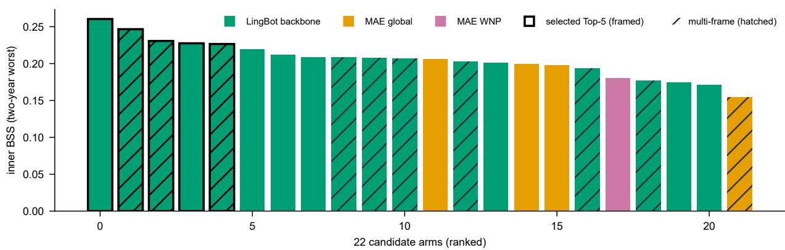  
Figure S1: All 22 development arms, ranked by two-year-worst inner-period (2018–2019) Brier skill score (BSS); the framed bars form the selected Top-5 equal-weight ensemble. Colour denotes the backbone origin (LingBot-Vision initialised, or masked-autoencoder routes on the global or western North Pacific corpora); hatching denotes multi-frame temporal variants.

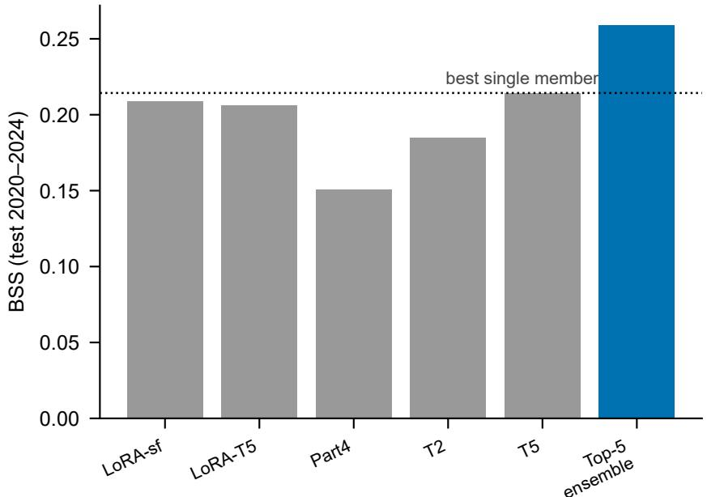  
Figure S2: The equal-weight Top-5 ensemble exceeds every member on the test period (2020– 2024). Bars: test BSS of the five members and of the ensemble (dotted line: best single member).

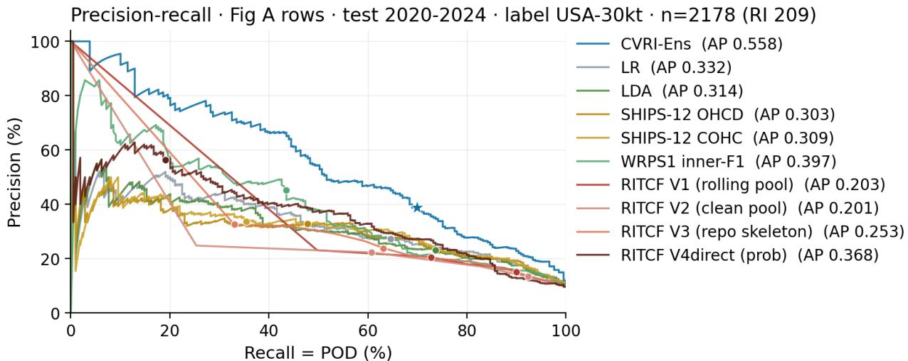  
Fig A rows (n=2178, USA-30kt); every model with a continuous score. Markers = operating points (RITCF: 6/10 and val-F1; WRPS1: inner-F1 on P). The WRPS1 pu>=0.5 rule lives on the pl scale and is drawn in the operating panels only. RITCF variants are their kt30 recon sweeps re-scored on these rows; WRPS1 uses its published formula on SHIPS-12.

ROC·Fig A rows · test 2020-2024·label USA-30kt ·n=2178 (RI 209)  
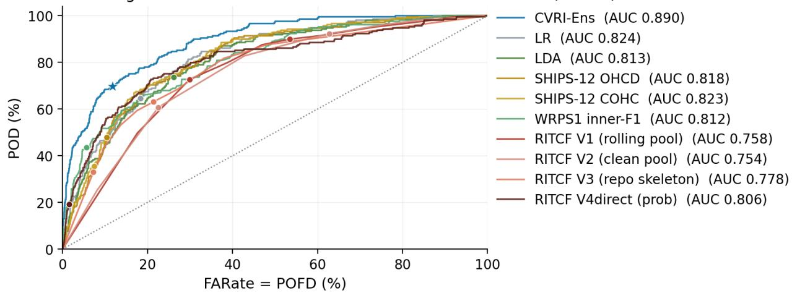  
Fig A rows (n=2178, USA-30kt); every model with a continuous score. Markers = operating points (RITCF: 6/10 and val-F1; WRPS1: inner-F1 on P). The WRPS1 pu>=0.5 rule lives on the pl scale and is drawn in the operating panels only. RITCF variants are their kt30 recon sweeps re-scored on these rows; WRPS1 uses its published formula on SHIPS-12.

Figure S3: CVRI-Ens lies at or above the reference precision–recall curves for recall > 0.14 and at or above the reference ROC curves throughout on the shared 2,178-row sample (USAagency 30-kt labels, 2020–2024). The shared sample intersects the 3,004 frozen holdout records with the RITCF CMA-wind/frame/storm eligibility records, then retains rows with all 12 SHIPS predictors finite. It contains 209 RI events (base rate 9.60%), whereas the full holdout has a base rate of 7.39%. All models are evaluated on the same rows under the same USA-agency 30-kt labels. RITCF curves and public 6/10 points use best-AUC checkpoints; inner-F1 operating markers use the stated validation sweep.

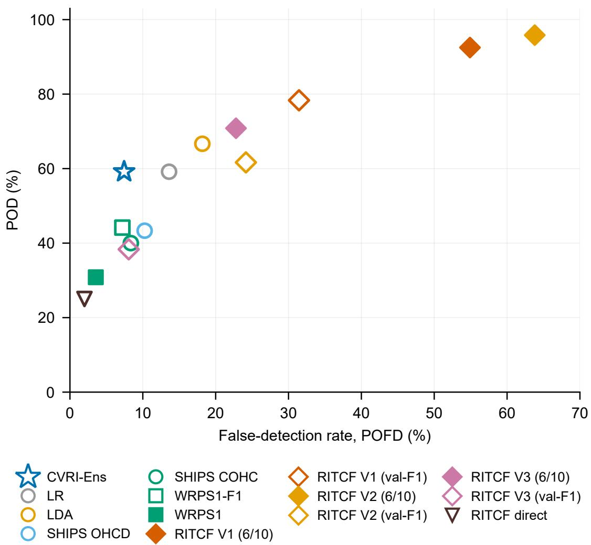  
Figure S4: Under CMA 30-kt labels on the same 2,178 rows, CVRI-Ens retains the highest CSI and the highest POD at 9.4% FARate. All models are re-scored from frozen predictions under the CMA labels. Open markers use thresholds re-derived on inner-period data under those labels; filled markers use public or locked rules. The 9.4% FARate POD values are interpolated from the empirical POD–FARate curves; RITCF markers use best-AUC checkpoints.

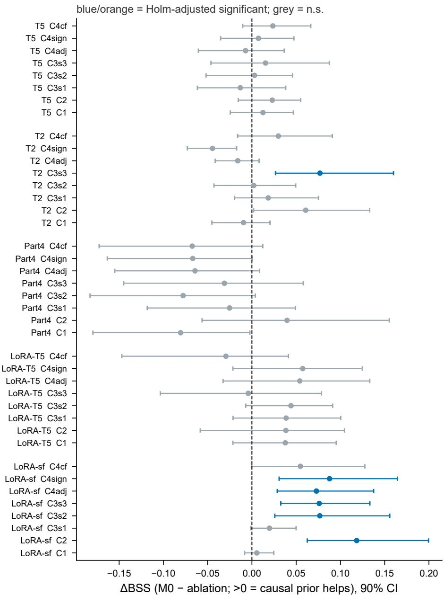  
2020–2021 (years nearest the estimation window) · n = 1,316 rows / 55 storms · Holm α = 0.10

Figure S5: On the test years nearest the estimation window (2020–2021), all five members benefit from the graph pathway and six of the 40 contrasts are Holm-significant, all favouring the prior. Ablation deltas (∆BSS = full member (M0) − ablated member; positive values favour the prior) on the 1,316-row 2020–2021 subset (55 storms), with storm-cluster bootstrap 90% confidence intervals and Holm adjustment within each member’s eight-condition family $( \alpha = 0 . 1 0 )$ ; blue and orange mark contrasts that survive Holm adjustment, grey do not. C1 removes all causal losses, C2 disables the graph neural network (GNN) branch, C3s1–3 replace the prior graph with shufles that preserve each node’s degree in the environmental subgraph while holding loss weights fixed, and C4 retains a single loss term. The full-period contrasts are listed in Supplementary Table S5.

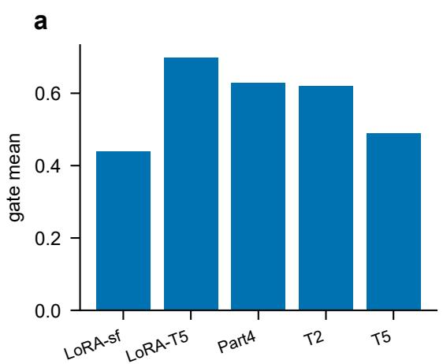

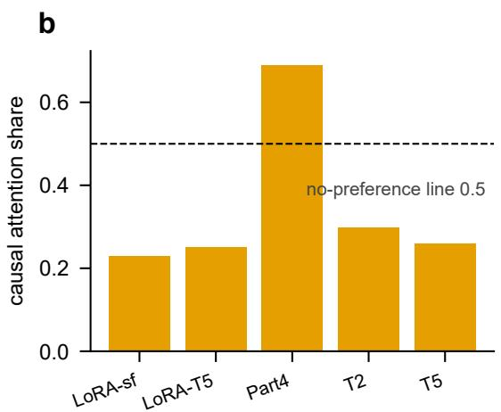  
Figure S6: Members difer in fusion-gate activation and in the share of cross-attention assigned to the prior. a, Mean fusion-gate activation per member on the 3,004 test rows. b, Head-averaged share of cross-attention assigned to the causal token (reference 0.5 for two context tokens).

## References

[1] Marja Bister and Kerry A. Emanuel. Low frequency variability of tropical cyclone potential intensity. 1. interannual to interdecadal variability. Journal of Geophysical Research, 107(D24): 4801, 2002. doi: 10.1029/2001JD000776.

[2] Daniel M. Gilford. pyPI (v1.3): Tropical Cyclone Potential Intensity Calculations in Python. Geoscientific Model Development, 14(5):2351–2369, 2021. doi: 10.5194/gmd-14-2351-2021.

[3] Takeshi Horinouchi, Takashi Yanase, Yuiko Ohta, Daisuke Matsuoka, Asanobu Kitamoto, Udai Shimada, Ryuji Yoshida, and Hironori Fudeyasu. Statistical prediction of tropical cyclone rapid intensification with explainable AI. Weather and Forecasting, 40(10):1859–1875, 2025. doi: 10.1175/WAF-D-24-0228.1.

[4] Jakob Runge. Discovering contemporaneous and lagged causal relations in autocorrelated nonlinear time series datasets. In Jonas Peters and David Sontag, editors, Proceedings of the 36th Conference on Uncertainty in Artificial Intelligence (UAI), volume 124 of Proceedings of Machine Learning Research, pages 1388–1397. PMLR, 2020. URL https://proceedings.mlr.press/v124/runge20a.html.

[5] Chong Wang, Nan Yang, and Xiaofeng Li. Advancing forecasting capabilities: a contrastive learning model for forecasting tropical cyclone rapid intensification. Proceedings of the National Academy of Sciences, 122(4):e2415501122, 2025. doi: 10.1073/pnas.2415501122.

[6] Matthew C. Wheeler and Harry H. Hendon. An all-season real-time multivariate MJO index: Development of an index for monitoring and prediction. Monthly Weather Review, 132(8):1917– 1932, 2004. doi: 10.1175/1520-0493(2004)132<1917:AARMMI>2.0.CO;2.