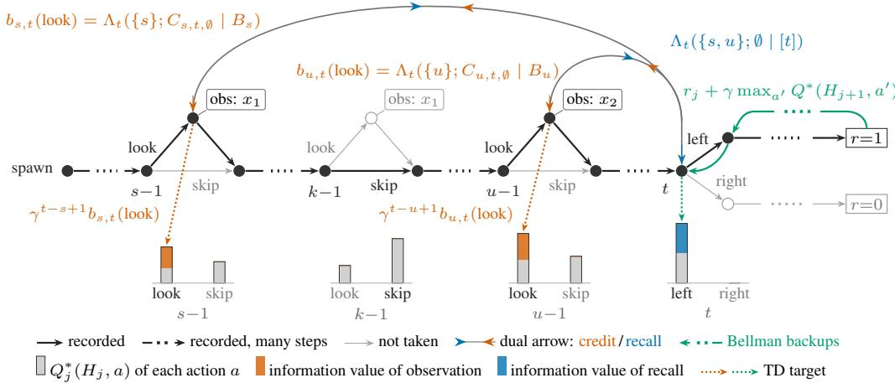

# Cheap Retrieval and Observation Credit Assignment from One Quantity: The Value of Information

Daniel Strauss1 Nikolaos Sotirakis1 Zhenshan Bing2,1,3 Alois Knoll1 1Technical University of Munich 2Nanjing University 3Harbin Institute of Technology daniel.strauss@tum.de

Abstract: Memory in reinforcement learning raises two problems. Attention finds the relevant item by scoring the whole store, which is costly for robots under latency and energy limits. When a retrieved memory pays off, credit for acquiring it must cross the whole sequence. We argue that both are governed by one quantity, the value of information, and propose to estimate it from archived rollouts with a learned world model. We obtain that, when read at the observation, it yields a provable lower bound on the optimal value of the acquiring action, which floors its TD target and attributes this floor to the observation that earned it. Read at the decision, it defines the optimal retrieval set. A pilot retrieval system, to be trained and improved with this signal, solves a memory task with reduced context.

Keywords: reinforcement learning, memory retrieval, POMDP, temporal credit assignment, value of information, world models

## 1 Introduction

Consider a robot replacing a control board inside an unfamiliar appliance. Mechanically identical connectors attach behind the service panel frame, so before unplugging them the robot has to move its camera to look, and once the board is out that arrangement cannot be observed again. Hundreds of steps later each cable has to go back to the right socket, and each decision rests on one frame among thousands. Attending over all stored frames at every step to find it is what makes memory expensive on a robot. Harder still is learning which observations to make in the first place: Transformer agents fail on long-horizon tasks when they must first act to observe a cue [1]; we call this the observation credit assignment problem (O-CAP). Both problems require knowing which information matters at which decision before retrieving it: its information value, following Howard [2].

Mechanisms that avoid this search compress instead and so commit to what is kept before knowing which decision it serves: recurrent states [3, 4, 5], still strong POMDP baselines [6], recurrent world models [7], recurrent-transformer hybrids [8, 9]. Another way is through hierarchical or chunked attention [10, 11]. External memory models decouple storage capacity from the size of the policy’s active representation, so that the history is kept with limited compression [12, 13, 14, 15], including recent policies that retrieve VLA-generated tokens [16]. This moves the problem to retrieval: sparse retrieval gives unselected items no gradient, dense attention’s cost grows with the store, and consolidation [16] may discard what matters later.

General credit assignment methods redistribute delayed reward towards contributing events [17] or estimate the influence of earlier actions from later trajectory information [18, 19, 20]. Temporal Value Transport (TVT), closest to our setting, does so via a later memory retrieval [21]. We instead define credit as the information value of an observation and obtain a provable floor on the TD target. TVT may implicitly learn the form of the information value derived here.

We propose to learn information value from archived rollouts as the change in achievable return when a decision gains access to a subset of the recorded history, which also selects what to retrieve.

  
Figure 1: Information value on a recorded POMDP trajectory. Decision t needs $x _ { 1 }$ (at s) and $x _ { 2 }$ (at u) jointly; the look at $k { - } 1$ would repeat $x _ { 1 }$ but is not taken, so $R = \emptyset$ attains the sup in Eq. (7). Bellman backups carry the reward back step by step; from t, where the information changes the action, the dual arrow jumps back. Along orange it credits the acquiring actions, flooring their TD targets; $x _ { 1 }$ is credited since $x _ { 2 }$ is in its base set. Along blue it values recalling s and u jointly.

## 2 Consuming the Value of Information

Consider a POMDP in which x is relevant information for a decision at t. It is possible that the exploring agent will encounter both x and the decision in very few episodes. This is especially the case if x can only be gathered by accumulating observations from time steps that are distal to one another and to t. To estimate the contribution of x to predicting the value of a state at t, we need to compare predictions made with and without x. We do not need to collect separate trajectories in which x was not acquired. Instead, trajectories in which x was observed can be reused under different knowledge states by deliberately masking x from the recorded history. To address sparse x encounters we propose to learn a world model. From the few encounters in which x was perceived, it can identify how outcomes depend on x, because it learns this dependency as a supervised prediction of the outcome at the decision on the full archive. We subsequently estimate information value by optimizing expected return within the learned model under respective knowledge states.

Estimating information value Let $\mu$ be the policy of the exploring agent during learning, which gives every action a positive probability. Let $H _ { t } ~ = ~ ( h _ { 0 } , h _ { 1 } , \ldots , h _ { t } )$ denote the recorded history, where $\displaystyle h _ { s } ~ = ~ ( a _ { s - 1 } , r _ { s - 1 } , o _ { s } )$ contains the information acquired at timestep s. Write $[ t ] : = \{ 0 , \ldots , t \}$ . For index set A let $H _ { A }$ denote the set of history items, that occur at a timestep in A and $A \subseteq B$ means $H _ { A } \subseteq H _ { B }$ . Index sets may also contain $\alpha _ { s }$ , referring to the action part $a _ { s }$ of $h _ { s + 1 }$ . Following Howard [2], we define the value with information $H _ { A }$ at decision t:

$$
\begin{array} { r l r } & { } & { U _ { t } ( A \mid B ) : = \mathbb { E } _ { \pi _ { A } } [ G _ { t } \mid H _ { B } ] , \quad \pi _ { A } \in \arg \underset { \pi \in \Pi _ { A , t } } { \overset { \prec } { \operatorname* { m a x } } } \mathbb { E } _ { \pi } [ G _ { t } \mid H _ { A } ] , } \\ & { } & { \Pi _ { A , t } : = \big \{ \pi : \pi _ { k } = \mu _ { k } \mathrm { f o r } k < t , \pi _ { t } ( \cdot \mid H _ { t } ) = \pi _ { t } ( \cdot \mid H _ { A } ) \big \} . } \end{array}\tag{1}
$$

where $\begin{array} { r } { G _ { t } : = \sum _ { k > t } \gamma ^ { k - t } r _ { k } } \end{array}$ is the discounted future return with discount $\gamma \in ( 0 , 1 )$ . ≺ fixes an order on the action space, and the maximisers deterministically play the ≺-first maximising action at t. $U _ { t } ( A \mid B )$ is a function of $H _ { B } { \mathrm { : } }$ the value of choosing the action at t from $H _ { A }$ , evaluated with the information $H _ { B }$ . This term is easier to interpret when $B \subseteq A$ : We already know $H _ { B } \ ( \mathrm { e . g } $ . whether water can be used to extinguish fire), what can we obtain for decision t (e.g. a 100\$ bill catches fire) if we extend our knowledge to $H _ { A } \left( \mathbf { e . g . } \ H _ { B } \cup \right.$ {where to find water}).

Given $A \subseteq [ t ]$ , we write:

$$
\begin{array} { r l } & { \quad Q _ { t } ^ { * } ( H _ { A } , a ) : = \operatorname { \mathbb { E } } _ { \mu , a _ { t }  a } \bigl [ r _ { t } + \gamma U _ { t + 1 } ( [ t + 1 ] \mid [ t + 1 ] ) \mid H _ { A } \bigr ] , } \\ & { ( T Q ) _ { t } ( H _ { t } , a ) : = \operatorname { \mathbb { E } } _ { \mu , a _ { t }  a } \Bigl [ r _ { t } + \gamma \displaystyle \operatorname* { m a x } _ { a ^ { \prime } } Q ( H _ { t + 1 } , a ^ { \prime } ) \Big | H _ { t } \Bigr ] } \end{array}\tag{2}
$$

for the optimal action value and the Bellman optimality operator with fixed point $Q ^ { * } [ 2 2 ] . \mu , a _ { t }  a$ denotes that until $t - 1$ actions were sampled from $\mu$ and at t action a was chosen.

The marginal value of information $H _ { T }$ at decision t is then

$$
\Lambda _ { t } ( T ; A \mid B ) : = U _ { t } ( A \cup T \mid B ) - U _ { t } ( A \mid B ) .\tag{3}
$$

Thus, information value is determined by the change in achievable return when $H _ { T }$ is made available, rather than by the return of the current policy.

To estimate $U _ { t }$ , we fit a world model $\hat { m } _ { \psi } ( H _ { t } , a )$ on the full recorded history with a likelihood loss ℓ over trajectories τ of the archive $\mathcal { D } _ { \mathrm { : } }$

$$
\mathcal { L } ( \psi ) = \mathbb { E } _ { ( \tau , t ) \sim \mathcal { D } } \left[ \ell \big ( \hat { m } _ { \psi } ( H _ { t } , a _ { t } ) , ( r _ { t } , o _ { t + 1 } ) \big ) \right] ,\tag{4}
$$

with randomly sampled $A \subseteq [ t ]$ , and every action $a , \hat { Q } _ { t } ( H _ { A } , a )$ is regressed onto the Bellman target

$$
\hat { r } + \gamma \operatorname* { m a x } _ { a ^ { \prime } } \hat { Q } _ { t + 1 } ( ( H _ { t } , a , \hat { r } , \hat { o } ^ { \prime } ) , a ^ { \prime } ) , \qquad ( \hat { r } , \hat { o } ^ { \prime } ) \sim \hat { m } _ { \psi } ( H _ { t } , a ) ,\tag{5}
$$

To estimate ${ \hat { U } } ( A \mid B ) : = u _ { \theta _ { r r } ^ { * } } ( H _ { B } , A ) , \rho _ { t }$ mixes credit pairs $B = [ s - 1 ] \cup \{ \alpha _ { s - 1 } \} \subseteq A$ and retrieval pairs $B = [ t ]$ and we regress using a loss $\ell ^ { \prime }$

$$
\theta _ { U } ^ { * } = \arg \operatorname* { m i n } _ { \theta _ { U } } \mathbb { E } _ { ( \tau , t ) \sim \mathcal { D } , \ ( A , B ) \sim \rho _ { t } } \left[ \ell ^ { \prime } \Big ( u _ { \theta _ { U } } ( H _ { B } , A ) , \hat { Q } _ { t } \big ( H _ { t } , \arg \operatorname* { m a x } _ { a } ^ { \prec } \hat { Q } _ { t } ( H _ { A } , a ) \big ) \Big ) \right] .\tag{6}
$$

Using the estimates and training For a given trajectory τ for decision at time t we will assign this information credit b to action a, which gathered the information from time s. Let $B _ { s } ( a ) : =$ $[ s - 1 ] \cup \{ \alpha _ { s - 1 } = a \} { \mathrm { ~ a n d ~ } } C _ { s , t , R } ( a ) : = ( [ t ] \setminus ( R \cup \{ s \} ) ) \cup \{ \alpha _ { s - 1 } = a \}$

$$
b _ { s , t } ( a ) : = \operatorname* { s u p } _ { R \subseteq \{ s + 1 , \ldots , t \} } \Lambda _ { t } \Bigl ( \{ s \} ; \qquad \underbrace { C _ { s , t , R } ( a ) } _ { \mathrm { a v a l i a b l e ~ a t ~ t w i t h o u t ~ } h _ { s } \mathrm { ~ a n d ~ } H _ { R } , \mathrm { ~ b u t ~ w i t h ~ } a _ { s - 1 } } \Bigr | \underbrace { B _ { s } ( a ) } _ { \mathrm { a v a l i a b l e ~ a t s - 1 , w i t h ~ } a _ { s - 1 } } \Bigr ) .\tag{7}
$$

This term finds the set of observations R that come after s and before t, such that the win of observing s is maximal. The idea is that R should catch all observations that are mostly redundant given s and appear only after s, but at the same time let s be combined with synergistic information. Thereby, if for a decision at t, there are many redundant trajectory items $s ^ { ( 1 \bar { ) } } < \bar { s } ^ { ( 2 ) } < \cdot \cdot \cdot < s ^ { ( m ) }$ the earliest receives the credit for the information they share. Additionally, if $\Lambda _ { t } ( \{ s \} ; [ s - 1 ] \mid [ s - 1 ] ) \approx 0$ , but there is $s < u < t$ such, that $\Lambda _ { t } \big ( \{ s \} ; [ s - 1 ] \cup \{ u \} \mid [ s - 1 ] \big ) \gg 0$ , the synergistic contribution for s and u should be credited for both (Fig. 1). There may be many ways to approximate b with a lower bound for faster computation, e.g. by restricting R to steps spatially close to s.

$$
L _ { s , t } ( a ) : = \mathbb { E } _ { \mu } { \Big [ } \sum _ { k = s - 1 } ^ { t - 1 } \gamma ^ { k - s + 1 } r _ { k } { \Big | } H _ { s - 1 } , a _ { s - 1 } = a { \Big ] } + \gamma ^ { t - s + 1 } U _ { t } { \Big ( } [ s - 1 ] \cup \{ \alpha _ { s - 1 } \} { \Big | } [ s - 1 ] \cup \{ \alpha _ { s - 1 } \} { \Big ) } .\tag{8}
$$

$L _ { s , t } ( a )$ is a lower bound for the attainable return, if at t the policy must ignore the information collected by action $a _ { s - 1 }$ . By Corollary $1 \ ( \mathrm { A p p . ~ C } ) \gamma ^ { t - s + 1 } b _ { s , t } ( a _ { s - 1 } ) + L _ { s , t } ( a _ { s - 1 } )$ is a lower bound of the optimal TD value at $H _ { s - 1 } , a _ { s - 1 }$

$$
( T _ { b } Q ) _ { s - 1 } ( H _ { s - 1 } , a _ { s - 1 } ) = \operatorname* { m a x } \left\{ ( \mathscr { T } Q ) _ { s - 1 } ( H _ { s - 1 } , a _ { s - 1 } ) , \operatorname* { m a x } _ { t } \gamma ^ { t - s + 1 } b _ { s , t } ( a _ { s - 1 } ) + L _ { s , t } ( a _ { s - 1 } ) \right\}\tag{9}
$$

This is similar in spirit to the lower-bound targets of He et al. [23] and Abraham et al. [24]. A plain floor without the credit term would be at least as tight (App. C, Remark 1). Since both terms of $b _ { s , t }$ are estimated at the decision, close to the reward, we expect its estimate to converge faster than that of the plain floor. For retrieval, let each recalled memory cost C. The optimal retrieval set is

$$
M _ { t } ^ { * } = \arg \operatorname* { m a x } _ { M \subseteq [ t ] } \Lambda _ { t } ( M ; \vartheta \mid [ t ] ) - C | M | \overset { \mathrm { ( a ) } } { \approx } \arg \operatorname* { m a x } _ { M \subseteq [ t ] } \Lambda _ { t } ( M ; \vartheta \mid M _ { t - 1 } ^ { * } ) - C | M | .\tag{10}
$$

Approximation (a) updates the retrieved set once per environment step, conditioning on the previously held set. Alternatively, the update can run asynchronously from the policy. This approximation has yet to be empirically validated. During inference, it is important to compute $\hat { M } _ { t } ^ { * }$ cheaply. In the next paragraph, we propose one possible method to do this while exploiting temporal dependencies between neighboring time steps.

Memory Navigation Orthogonal to approximation (a), we expect $M _ { t } ^ { * }$ to be mostly a small, local edit of $M _ { t - 1 } ^ { * }$ in many robotic environments. Memory Navigation exploits this with a persistent pointer, the Memory Ghost, that moves by relative steps through an external memory indexed by where and when each memory was recorded. Recalling thereby resembles observing: a second, internal action head moves the Ghost through memory as the ordinary head moves the agent through the environment, and the memories it reaches enter the Transformer-XL context like observations; retrieval costs one layer regardless of store size. In this pilot, physical space stands in for a learned memory space, and the internal head is trained by PPO on task reward. $\hat { \Lambda } _ { t } ( \hat { M } _ { t } ; \emptyset \mid \left[ t \right] ) - C | \hat { M } _ { t } |$ would be its reward, but neither it nor the floor is used yet. After pretraining on MiniGrid-Memory-S9 with a 64-token context and fine-tuning on S17Random with 5 tokens, Memory Navigation reached a mean return of 0.95 after 0.59M steps, versus 0.94M for Gaussian absolute-position retrieval (6 seeds each) and 1.38M without a retrieval head (3 seeds); only the full-context pretrained model was faster. The baseline without a retrieval head still solved the task despite its insufficien context, by waiting a cue-dependent number of steps and thereby storing the cue in its tempora embedding. Code and rollout videos are provided in App. D.

## 3 Limitations

Validation. Neither the information-value estimator nor the floored target is implemented yet, so the expected faster convergence from the update in Eq. (9) remains a hypothesis (Remark 1). We prove a floor on the TD target but do not relate information value to causal notions of contribution, such as whether an observation is necessary for the chosen action.

Estimation. The bounds hold for exact quantities. A learned world model and regressed estimators carry errors, maximizing over actions within the model can exploit them, and the supremum over R in Eq. (7) is biased upward when taken over noisy estimates; each can push the estimated floor above $Q ^ { * }$ . Restricting R to steps near s, e.g. in space, reduces both cost and bias. Information value is defined under the exploration policy $\mu .$ Thus, actions taken after s may reveal the masked $h _ { s }$ and lower its credit, and an archive collected by a changing policy requires the policy version to be recorded in the history. Training still needs full histories; the savings arise only at inference.

Modeling choices. Indexing information by timestep is partly arbitrary. Neighbouring observations may share redundant, synergistic and unique information. Since the supremum in Eq. (7) selects a single $R , b _ { s , t }$ credits the larger of these components rather than their sum; if $h _ { s }$ and a later $h _ { u }$ are both redundant and synergistic and the synergy dominates, the redundant part is credited to neither. $\Lambda _ { t }$ could be used to separate these components. Open questions remain: retrieval chains in which one memory is needed to locate another; and whether $M _ { t } ^ { * }$ and $b _ { s , t }$ arise from one common object. In future work, the world model could also assess whether a collected trajectory adds useful training data, yielding an exploration information value to train a dedicated exploration policy.

## References

[1] T. Ni, M. Ma, B. Eysenbach, and P.-L. Bacon. When do transformers shine in rl? decoupling memory from credit assignment. Advances in Neural Information Processing Systems, 36: 50429–50452, 2023.

[2] R. A. Howard. Information value theory. IEEE Transactions on systems science and cybernetics, 2(1):22–26, 1966.

[3] J. L. Elman. Finding structure in time. Cognitive science, 14(2):179–211, 1990.

[4] S. Hochreiter and J. Schmidhuber. Long short-term memory. Neural computation, 9(8):1735– 1780, 1997.

[5] J. Chung, C. Gulcehre, K. Cho, and Y. Bengio. Empirical evaluation of gated recurrent neural networks on sequence modeling. arXiv preprint arXiv:1412.3555, 2014.

[6] T. Ni, B. Eysenbach, and R. Salakhutdinov. Recurrent model-free rl can be a strong baseline for many pomdps. arXiv preprint arXiv:2110.05038, 2021.

[7] D. Hafner, J. Pasukonis, J. Ba, and T. Lillicrap. Mastering diverse domains through world models. arXiv preprint arXiv:2301.04104, 2023.

[8] E. Cherepanov, A. Staroverov, A. Kovalev, and A. Panov. Recurrent action transformer with memory. In International Conference on Learning Representations, volume 2026, pages 129379–129407, 2026.

[9] G. Gupta, K. Yadav, Z. Kira, Y. Gal, and R. Aljundi. Memo: Training memory-efficient embodied agents with reinforcement learning. Advances in Neural Information Processing Systems, 38:104392–104414, 2026.

[10] A. Lampinen, S. Chan, A. Banino, and F. Hill. Towards mental time travel: a hierarchical memory for reinforcement learning agents. Advances in Neural Information Processing Systems, 34:28182–28195, 2021.

[11] J. Cho, J. Yoon, and S. Ahn. Spatially-aware transformers for embodied agents. In International Conference on Learning Representations, volume 2024, pages 35501–35527, 2024.

[12] A. Graves, G. Wayne, and I. Danihelka. Neural turing machines. arXiv preprint arXiv:1410.5401, 2014.

[13] A. Graves, G. Wayne, M. Reynolds, T. Harley, I. Danihelka, A. Grabska-Barwinska, S. G.´ Colmenarejo, E. Grefenstette, T. Ramalho, J. Agapiou, et al. Hybrid computing using a neural network with dynamic external memory. Nature, 538(7626):471–476, 2016.

[14] G. Yang. Lie access neural turing machine. arXiv preprint arXiv:1602.08671, 2016.

[15] E. Parisotto and R. Salakhutdinov. Neural map: Structured memory for deep reinforcement learning. arXiv preprint arXiv:1702.08360, 2017.

[16] H. Shi, B. Xie, Y. Liu, L. Sun, F. Liu, T. Wang, E. Zhou, H. Fan, X. Zhang, and G. Huang. Memoryvla: Perceptual-cognitive memory in vision-language-action models for robotic manipulation. In International Conference on Learning Representations, volume 2026, pages 18567–18602, 2026.

[17] J. A. Arjona-Medina, M. Gillhofer, M. Widrich, T. Unterthiner, J. Brandstetter, and S. Hochreiter. Rudder: Return decomposition for delayed rewards. Advances in Neural Information Processing Systems, 32, 2019.

[18] A. Harutyunyan, W. Dabney, T. Mesnard, M. Gheshlaghi Azar, B. Piot, N. Heess, H. P. van Hasselt, G. Wayne, S. Singh, D. Precup, et al. Hindsight credit assignment. Advances in neural information processing systems, 32, 2019.

[19] T. Mesnard, T. Weber, F. Viola, S. Thakoor, A. Saade, A. Harutyunyan, W. Dabney, T. Stepleton, N. Heess, A. Guez, et al. Counterfactual credit assignment in model-free reinforcement learning. arXiv preprint arXiv:2011.09464, 2020.

[20] M. Li, K.-Z. Lee, and E. Bareinboim. Counterfactual shapley credit assignment. arXiv preprint arXiv:2607.16999, 2026.

[21] C.-C. Hung, T. Lillicrap, J. Abramson, Y. Wu, M. Mirza, F. Carnevale, A. Ahuja, and G. Wayne. Optimizing agent behavior over long time scales by transporting value. Nature communications, 10(1):5223, 2019.

[22] R. Bellman. A markovian decision process. Journal of mathematics and mechanics, 6(5): 679–684, 1957.

[23] F. S. He, Y. Liu, A. G. Schwing, and J. Peng. Learning to play in a day: Faster deep reinforcement learning by optimality tightening. arXiv preprint arXiv:1611.01606, 2016.

[24] A. A. Abraham, L. X. Shi, and C. Finn. Long-horizon q-learning: Accurate value learning via n-step inequalities. arXiv preprint arXiv:2605.05812, 2026.

[25] A. Shapiro. Interchangeability principle and dynamic equations in risk averse stochastic programming. Operations Research Letters, 45(4):377–381, 2017.

[26] D. Blackwell. Equivalent comparisons of experiments. The annals of mathematical statistics, pages 265–272, 1953.

## Acknowledgments

We used Claude and ChatGPT to check and help formalize the proofs in the appendix, to assist with locating related literature, and to edit the text. All results were verified by the authors, who take full responsibility for the content.

## A Expressions of U

As in the main text, see Eq. (1), the definition of $U _ { t }$ is

$$
\begin{array} { r l r } & { } & { U _ { t } ( A \mid B ) : = \mathbb { E } _ { \pi _ { A } } [ G _ { t } \mid H _ { B } ] , \quad \pi _ { A } \in \arg \underset { \pi \in \Pi _ { A , t } } { \overset {  } { \operatorname* { m a x } } } \mathbb { E } _ { \pi } [ G _ { t } \mid H _ { A } ] , } \\ & { } & { \Pi _ { A , t } : = \big \{ \pi : \pi _ { k } = \mu _ { k } \mathrm { f o r } k < t , \pi _ { t } ( \cdot \mid H _ { t } ) = \pi _ { t } ( \cdot \mid H _ { A } ) \big \} . } \end{array}\tag{11}
$$

Let us first consider the inner term.

Proposition 1. Given $A \subseteq [ t ]$

$$
\begin{array} { r l } { \underset { \pi \in \Pi _ { A , t } } { \operatorname* { s u p } } \mathbb { E } _ { \pi } [ G _ { t } \mid H _ { A } ] \overset { ( a ) } { = } \underset { a } { \operatorname* { m a x } } \mathbb { E } _ { \mu , a _ { t }  a } [ r _ { t } + \gamma \underset { \pi } { \operatorname* { s u p } } \mathbb { E } _ { \pi } [ G _ { t + 1 } \mid H _ { t + 1 } ] \Big | H _ { A } ] } & { } \\ & { \overset { ( b ) } { = } \underset { a } { \operatorname* { m a x } } \mathbb { E } _ { \mu , a _ { t }  a } [ r _ { t } + \gamma U _ { t + 1 } ( [ t + 1 ] \mid [ t + 1 ] ) \middle | H _ { A } ] } \\ & { \overset { ( c ) } { = } \underset { a } { \operatorname* { m a x } } Q _ { t } ^ { * } ( H _ { A } , a ) . } \end{array}\tag{12}
$$

Proof. (a)

Write $G _ { t } = r _ { t } + \gamma G _ { t + 1 }$ . For any $\pi \in \Pi _ { A , t }$ , the history up to t follows $\mu$ and $a _ { t }$ is drawn from $\pi _ { t } ( \cdot \mid H _ { A } )$ alone. The tower property (using $H _ { A } \subseteq H _ { t + 1 } )$ therefore gives

$$
\operatorname { \mathbb { E } } _ { \pi } [ G _ { t } \mid H _ { A } ] = \sum _ { a } \pi _ { t } ( a \mid H _ { A } ) \operatorname { \mathbb { E } } _ { \mu , a _ { t }  a } [ r _ { t } + \gamma \operatorname { \mathbb { E } } _ { \pi } [ G _ { t + 1 } \mid H _ { t + 1 } ] \Big | H _ { A } ] .
$$

The constraint in $\Pi _ { A , t }$ fixes π before t to $\mu$ and restricts $\pi _ { t }$ . The later rules $\pi _ { t + 1 } , \pi _ { t + 2 } , . . .$ . are free and may depend on the full $H _ { t + 1 }$ . So the supremum splits into a choice of $\pi _ { t }$ and a choice of the continuation:

$$
\begin{array} { r l } { \displaystyle \operatorname* { s u p } _ { \pi \in \Pi _ { A , t } } \mathbb { E } _ { \pi } [ G _ { t } \mid H _ { A } ] = \operatorname* { s u p } _ { \pi _ { t } , \pi } \sum _ { a } \pi _ { t } ( a \mid H _ { A } ) \mathbb { E } _ { \mu , a _ { t }  a } \Big [ r _ { t } + \gamma \mathbb { E } _ { \pi } \big [ G _ { t + 1 } \mid H _ { t + 1 } \big ] \Big | H _ { A } \Big ] } & { } \\ { \displaystyle \quad } & { \triangleq \operatorname* { s u p } _ { \pi _ { t } } \sum _ { a } \pi _ { t } ( a \mid H _ { A } ) \mathbb { E } _ { \mu , a _ { t }  a } \Big [ r _ { t } + \gamma \operatorname* { s u p } _ { \pi } \mathbb { E } _ { \pi } \big [ G _ { t + 1 } \mid H _ { t + 1 } \big ] \Big | H _ { A } \Big ] } \\ & { = \operatorname* { m a x } _ { a } \mathbb { E } _ { \mu , a _ { t }  a } \Big [ r _ { t } + \gamma \operatorname* { s u p } _ { \pi } \mathbb { E } _ { \pi } \big [ G _ { t + 1 } \mid H _ { t + 1 } \big ] \Big | H _ { A } \Big ] . } \end{array}
$$

π may depend on $H _ { t + 1 }$ , which contains $H _ { A }$ and $a _ { t }$ , and $\mathbb { E } _ { \pi } [ G _ { t + 1 } \ | \ H _ { t + 1 } ]$ depends only on $H _ { t + 1 }$ and on π after $H _ { t + 1 }$ . Thus, ∗ follows from the interchangeability principle [25].

(b)

$$
\begin{array} { r l } & { U _ { t + 1 } ( [ t + 1 ] \mid [ t + 1 ] ) = \mathbb { E } _ { \pi _ { [ t + 1 ] } } [ G _ { t + 1 } \mid H _ { t + 1 } ] \qquad ( \mathrm { E q . ~ ( 1 ) } ) } \\ & { \qquad = \underset { \pi \in \Pi _ { [ t + 1 ] , t + 1 } } { \operatorname* { s u p } } \mathbb { E } _ { \pi } [ G _ { t + 1 } \mid H _ { t + 1 } ] \quad ( \pi _ { [ t + 1 ] } \mathrm { ~ i s ~ a ~ m a x i m i s e r } ) } \\ & { \qquad = \underset { \pi } { \operatorname* { s u p } } \mathbb { E } _ { \pi } [ G _ { t + 1 } \mid H _ { t + 1 } ] . } \end{array}\tag{13}
$$

The last equality holds because, for $A = [ t + 1 ]$ , the constraint on $\pi _ { t + 1 }$ in $\Pi _ { [ t + 1 ] , t + 1 }$ is vacuous, and the constraint $\pi _ { k } = \mu _ { k }$ for $k \leq t$ does not affect the conditional expectation given $H _ { t + 1 }$

(c) The last equality follows directly from the definition of $Q _ { t } ^ { * }$ in Eq. (2).

Proposition 2. Let $A , B \subseteq [ t ]$ and $a _ { t } ^ { * } ( H _ { A } ) = \arg \operatorname* { m a x } _ { a } ^ { * } Q _ { t } ^ { * } ( H _ { A } , a )$ . Then

$$
U _ { t } ( A \mid B ) \overset { ( a ) } { = } \mathbb { E } _ { \mu } \big [ Q _ { t } ^ { \ast } \big ( H _ { A \cup B } , a _ { t } ^ { \ast } ( H _ { A } ) \big ) \big | H _ { B } \big ] .\tag{14}
$$

In particular,

$$
\begin{array} { r l r } & { B \subseteq A : } & { U _ { t } ( A \mid B ) \overset { ( b ) } { = } \mathbb { E } _ { \mu } \big [ \operatorname* { m a x } _ { a } Q _ { t } ^ { * } ( H _ { A } , a ) \big | H _ { B } \big ] , } & { { \mathrm { } ^ { \prime } L e a r n i n g } ^ { \prime } , } \\ & { } & { } \\ & { A \subseteq B : } & { U _ { t } ( A \mid B ) \overset { ( c ) } { = } Q _ { t } ^ { * } \big ( H _ { B } , a _ { t } ^ { * } ( H _ { A } ) \big ) . } & { { \mathrm { } ^ { \prime } F o r g e t t i n g } ^ { \prime } , } \end{array}\tag{15}
$$

Proof. (a)

Consider $\pi _ { A } = \arg \operatorname* { m a x } _ { \pi \in \Pi _ { A , t } } ^ { \prec } \mathbb { E } _ { \pi } \left[ G _ { t } \mid H _ { A } \right]$ . After $t , \pi _ { A }$ rules free and optimal, this gives

$$
\mathbb { E } _ { \pi _ { A } } [ G _ { t + 1 } \ | \ H _ { t + 1 } ] = U _ { t + 1 } ( [ t + 1 ] \ | \ [ t + 1 ] ) .
$$

Write $G _ { t } = r _ { t } + \gamma G _ { t + 1 }$ . Since $a _ { t } ^ { * } ( H _ { A } )$ is a function of $H _ { t } , { \mathrm { E q . ~ } } ( 2 )$ with $A = \left\lceil t \right\rceil$ gives

$$
\begin{array} { r } { \mathbb { E } _ { \pi _ { A } } [ G _ { t } \mid H _ { t } ] = \mathbb { E } _ { \mu , a _ { t }  a _ { t } ^ { * } ( H _ { A } ) } [ r _ { t } + \gamma U _ { t + 1 } ( [ t + 1 ] \mid [ t + 1 ] ) \middle \vert H _ { t } ] = Q _ { t } ^ { * } \big ( H _ { t } , a _ { t } ^ { * } ( H _ { A } ) \big ) . } \end{array}
$$

Up to $t , \pi _ { A }$ follows µ. Since $B \subseteq [ t ]$ , the tower property gives

$$
U _ { t } ( A \mid B ) = \mathbb { E } _ { \pi _ { A } } [ G _ { t } \mid H _ { B } ] = \mathbb { E } _ { \mu } \left[ \mathbb { E } _ { \pi _ { A } } [ G _ { t } \mid H _ { t } ] \mid H _ { B } \right] = \mathbb { E } _ { \mu } \left[ Q _ { t } ^ { * } \big ( H _ { t } , a _ { t } ^ { * } ( H _ { A } ) \big ) \mid H _ { B } \right] .
$$

Fix an action a. Since $H _ { A \cup B } \subseteq H _ { t } , { \mathrm { E q . ~ } } ( 2 )$ and the tower property give

$$
\begin{array} { r l } & { \mathbb { E } _ { \mu } \big [ Q _ { t } ^ { * } ( H _ { t } , a ) \big | H _ { A \cup B } \big ] = \mathbb { E } _ { \mu , a _ { t }  a } \big [ Q _ { t } ^ { * } ( H _ { t } , a ) \big | H _ { A \cup B } \big ] } \\ & { \qquad = \mathbb { E } _ { \mu , a _ { t }  a } \Big [ \mathbb { E } _ { \mu , a _ { t }  a } \big [ r _ { t } + \gamma U _ { t + 1 } ( [ t + 1 ] \mid [ t + 1 ] ) \big | H _ { t } \big ] \Big | H _ { A \cup B } \Big ] } \\ & { \qquad = \mathbb { E } _ { \mu , a _ { t }  a } \Big [ r _ { t } + \gamma U _ { t + 1 } ( [ t + 1 ] \mid [ t + 1 ] ) \Big | H _ { A \cup B } \Big ] } \\ & { \qquad = Q _ { t } ^ { * } ( H _ { A \cup B } , a ) . } \end{array}\tag{16}
$$

Now use $B \subseteq A \cup B$

$$
\begin{array} { r l r } & { \mathbb { E } _ { \mu } [ Q _ { t } ^ { * } ( H _ { t } , a _ { t } ^ { * } ( H _ { A } ) ) \middle | H _ { B } ] } \\ & { = \mathbb { E } _ { \mu } [ \mathbb { E } _ { \mu } [ Q _ { t } ^ { * } ( H _ { t } , a _ { t } ^ { * } ( H _ { A } ) ) \middle | H _ { A \cup B } ] | H _ { B } ] } & { \mathrm { ( b y ~ l a w ~ o f ~ t o t a l ~ E , \beta \subseteq A \cup B ) } } \\ & { = \mathbb { E } _ { \mu } [ \displaystyle \sum _ { a } \mathbf { 1 } \{ a _ { t } ^ { * } ( H _ { A } ) = a \} \mathbb { E } _ { \mu } [ Q _ { t } ^ { * } ( H _ { t } , a ) \middle | H _ { A \cup B } ] \bigg | H _ { B } ] } & { \mathrm { ( } a _ { t } ^ { * } ( H _ { A } ) \mathrm { i s ~ a ~ f u n c t i o n ~ o f ~ } H _ { A \cup B } \mathrm { ) } } \\ & { = \mathbb { E } _ { \mu } [ Q _ { t } ^ { * } ( H _ { A \cup B } , a _ { t } ^ { * } ( H _ { A } ) ) \middle | H _ { B } ] . } & { \mathrm { ( ( 1 6 ) , e x a c t l y ~ o n e ~ i n d i c a t o r ~ i s ~ l ) } } \end{array}
$$

(b)

Given $B \subseteq A , A \cup B = A$ . It follows

$$
\mathbb { E } _ { \mu } \left[ Q _ { t } ^ { * } \big ( H _ { A \cup B } , a _ { t } ^ { * } ( H _ { A } ) \big ) \big | H _ { B } \right] = \mathbb { E } _ { \mu } \big [ \operatorname* { m a x } _ { a } Q _ { t } ^ { * } \big ( H _ { A } , a \big ) \big | H _ { B } \big ]\tag{17}
$$

(c) Given $A \subseteq B , A \cup B = B$ . It follows

$$
\begin{array} { r l r } & { \mathbb { E } _ { \mu } \left[ Q _ { t } ^ { * } \left( H _ { A \cup B } , a _ { t } ^ { * } ( H _ { A } ) \right) \middle | H _ { B } \right] = \mathbb { E } _ { \mu } \left[ Q _ { t } ^ { * } \left( H _ { B } , a _ { t } ^ { * } ( H _ { A } ) \right) \middle | H _ { B } \right] } & \\ & { = Q _ { t } ^ { * } \left( H _ { B } , a _ { t } ^ { * } ( H _ { A } ) \right) } & { ( Q _ { t } ^ { * } \left( \dots \right) \mathrm { ~ i s ~ a ~ f u n c t i o n ~ o f ~ } H _ { B } ) } \end{array}\tag{18}
$$

## B New Information Carries non-negative value

This proposition is a simple case of the Blackwell theorem [26].

Proposition 3. Let $S , A , B \subseteq [ t ]$ with $B \subseteq A .$ . Then

$$
U _ { t } ( S \cup A | B ) \geq U _ { t } ( A | B )\tag{19}
$$

Proof. Since $B \subseteq A \subseteq S \cup A$ , Proposition 2(b) and the tower property give

$$
U _ { t } ( S \cup A \mid B ) = \mathbb { E } _ { \mu } \big [ \operatorname* { m a x } _ { a } Q _ { t } ^ { * } ( H _ { S \cup A } , a ) \big | H _ { B } \big ] = \mathbb { E } _ { \mu } \Big [ \mathbb { E } _ { \mu } \big [ \operatorname* { m a x } _ { a } Q _ { t } ^ { * } ( H _ { S \cup A } , a ) \big | H _ { A } \big ] \Big | H _ { B } \Big ] .
$$

For the inner term, fix any action $a ^ { ( 0 ) }$ . Then

$$
\begin{array} { r l r } { \mathbb { E } _ { \mu } \left[ \operatorname* { m a x } Q _ { t } ^ { * } ( H _ { S \cup A } , a ) \bigm | H _ { A } \right] \geq \mathbb { E } _ { \mu } \left[ Q _ { t } ^ { * } ( H _ { S \cup A } , a ^ { ( 0 ) } ) \bigm | H _ { A } \right] } & \\ & { = \mathbb { E } _ { \mu } \left[ \mathbb { E } _ { \mu } \left[ Q _ { t } ^ { * } ( H _ { t } , a ^ { ( 0 ) } ) \bigm | H _ { S \cup A } \right] \biggm | H _ { A } \right] } & { ( \mathrm { E q . ~ } ( 1 6 ) \mathrm { w i t h ~ } S \cup A ) } \\ & { = \mathbb { E } _ { \mu } \left[ Q _ { t } ^ { * } ( H _ { t } , a ^ { ( 0 ) } ) \bigm | H _ { A } \right] } & { ( \mathrm { t o w e r . ~ } A \subseteq S \cup A ) } \\ & { = Q _ { t } ^ { * } ( H _ { A } , a ^ { ( 0 ) } ) } & { ( \mathrm { E q . ~ } ( 1 6 ) \mathrm { w i t h ~ } A ) . } \end{array}
$$

Since $a ^ { ( 0 ) }$ is arbitrary, the inner term is at least maxa $Q _ { t } ^ { * } ( H _ { A } , a )$ . Proposition 2(b) applies because $B \subseteq A$ . Together this gives

$$
U _ { t } ( S \cup A \mid B ) \geq \mathbb { E } _ { \mu } \big [ \operatorname* { m a x } _ { a } Q _ { t } ^ { * } ( H _ { A } , a ) \big | H _ { B } \big ] = U _ { t } ( A \mid B ) . \qquad \big \sqcup
$$

## C Acquisition bound

Proposition 4 (Acquisition bound). Fix $t \geq s ,$ an action a and $R \subseteq \{ s + 1 , \ldots , t \}$ , let

$$
\begin{array} { r l } & { B _ { s } : = B _ { s } ( a ) , \qquad \quad C _ { R } : = C _ { s , t , R } ( a ) , } \\ & { L _ { s , t , R } ( a ) : = \mathbb { E } _ { \mu } \Big [ \displaystyle \sum _ { k = s - 1 } ^ { t - 1 } \gamma ^ { k - s + 1 } r _ { k } \Big | H _ { s - 1 } , \ a _ { s - 1 } = a \Big ] + \gamma ^ { t - s + 1 } U _ { t } ( C _ { R } \mid B _ { s } ) . } \end{array}
$$

Then

$$
Q _ { s - 1 } ^ { \ast } ( H _ { s - 1 } , a ) \ \geq \ L _ { s , t , R } ( a ) + \gamma ^ { t - s + 1 } \Lambda _ { t } \big ( \{ s \} ; C _ { R } | B _ { s } \big ) .\tag{20}
$$

Proof.

$$
\begin{array} { r l r l } & { Q _ { \varepsilon - 1 } ^ { \varepsilon } ( H _ { \varepsilon - 1 } , \mathfrak { a } ) } \\ & { \leq \mathbb { E } _ { \delta _ { \varepsilon } , 0 \leq t - \varepsilon } ( \underbrace { - 1 } _ { K = s - 1 } \gamma _ { \varepsilon } ^ { k - \varepsilon + 1 } \mathcal { I } _ { \varepsilon } + \gamma ^ { t - s - 1 } \mathcal { \bar { E } } _ { \varepsilon } ( | t | | , | t ) | \mathcal { H } _ { s } ) \Big | \mathcal { H } _ { s - \varepsilon } \Big ] } & & { \mathrm { ( f o l l l u s ~ \mu _ \varepsilon \mathrm { ~ m u n i t i } : ~ - 1 , ~ t h e n ~ a c t ~ o p i t i m a l i t y ) } } \\ & { = \mathbb { E } _ { \delta _ { \varepsilon } , 0 , \leq t - \varepsilon } ( \underbrace { - 1 } _ { K = s - 1 } \gamma _ { \varepsilon } ^ { k - \varepsilon + 1 } \mathcal { I } _ { \varepsilon } \Big | H _ { \varepsilon - 1 } ) } \\ & { \qquad + \mathbb { E } _ { \delta _ { \varepsilon } , \varepsilon + \varepsilon } ( \frac { - 1 } { K = s - 1 } \gamma _ { \varepsilon } ^ { \varepsilon } \mathcal { I } _ { \varepsilon } ( | t | ) | \mathcal { H } _ { \varepsilon } ) \Big | \mathcal { H } _ { \varepsilon - 1 } \Big ] } \\ & { = \mathbb { E } _ { \delta _ { \varepsilon } } [ \underbrace { \frac { 1 } { K - 1 } } _ { \delta = - 1 } \gamma _ { \varepsilon } ^ { k - \varepsilon + 1 } \mathcal { I } _ { \varepsilon } \Big | H _ { \varepsilon - 1 }  , a _ { \varepsilon - 1 } = \alpha ] } \\ & { \qquad + \mathbb { E } _ { \varepsilon } [  \frac { \varepsilon ^ { - \varepsilon } } { K - 1 } \gamma _ { \varepsilon } ^ { k - \varepsilon + 1 } \mathcal { I } _ { \varepsilon } ( | t | ) | \mathcal { H } _ { \varepsilon - 1 }  , a _ { \varepsilon - 1 } = 0 ] } \\ &  \qquad + \mathbb { E } _ { \varepsilon } [  \frac { \varepsilon ^ { - \varepsilon } } { K - 1 } \gamma _ { \varepsilon } ^ { k - \varepsilon + 1 } \end{array}\tag{21}
$$

The last line followed from Eq. (1) and the tower property, with $B _ { s } \subseteq [ t ]$

Now we find lower bound of $U _ { t } ( [ t ] \mid B _ { s } )$

$$
{ \begin{array} { r l r } { U _ { t } ( [ t ] \mid B _ { s } ) \ { \overset { ( a ) } { \geq } } \ U _ { t } ( [ t ] \setminus R \mid B _ { s } ) } & { { \mathrm { ( P r o p . ~ 3 , ~ } B _ { s } \subseteq [ t ] \setminus R \mathrm { ) } } } \\ & { } & { = U _ { t } ( [ t ] \mid R \mid B _ { s } ) - U _ { t } ( C _ { R } \mid B _ { s } ) + U _ { t } ( C _ { R } \mid B _ { s } ) } & { { \mathrm { ( a d d ~ a n d ~ s u b t r a c t ) } } } \\ & { } & { = \Lambda _ { t } ( \{ s \} ; C _ { R } \mid B _ { s } ) + U _ { t } ( C _ { R } \mid B _ { s } ) } & { { \mathrm { ( E q . ~ ( 3 ) } } , C _ { R } \cup \{ s \} = \left[ t \right] \setminus R \} } \end{array} }\tag{22}
$$

By plugging Eq. (22) into Eq. (21), we obtain:

$$
\begin{array} { r l } {  { Q _ { s - 1 } ^ { * } ( H _ { s - 1 } , a ) } \quad } & { } \\ & { \geq \mathbb { E } _ { \mu } \big [ \sum _ { k = s - 1 } ^ { t - 1 } \gamma ^ { k - s + 1 } r _ { k } \mid H _ { s - 1 } , a _ { s - 1 } = a \big ] + \gamma ^ { t - s + 1 } \big [ \Lambda _ { t } ( \{ s \} ; C _ { R } \mid B _ { s } ) + U _ { t } ( C _ { R } \mid B _ { s } ) \big ] } \\ & { = L _ { s , t , R } ( a ) + \gamma ^ { t - s + 1 } \Lambda _ { t } ( \{ s \} ; C _ { R } \mid B _ { s } ) } \end{array}
$$

Corollary 1. Fix $t \geq s$ and an action a,

$$
Q _ { s - 1 } ^ { * } ( H _ { s - 1 } , a ) \geq L _ { s , t } ( a ) + \gamma ^ { t - s + 1 } b _ { s , t } ( a )\tag{23}
$$

Proof. Recall the definition of $L _ { s , t }$ in Eq. (8):

$$
\begin{array} { r l } & { L _ { s , t } ( a ) : = { \mathbb E } _ { \mu } \Big [ \displaystyle \sum _ { k = s - 1 } ^ { t - 1 } \gamma ^ { k - s + 1 } r _ { k } \Big | H _ { s - 1 } , a _ { s - 1 } = a \Big ] + \gamma ^ { t - s + 1 } U _ { t } \Big ( [ s - 1 ] \cup \{ \alpha _ { s - 1 } \} \Big | [ s - 1 ] \cup \{ \alpha _ { s - 1 } \} \Big ) } \\ & { \quad = { \mathbb E } _ { \mu } \Big [ \displaystyle \sum _ { k = s - 1 } ^ { t - 1 } \gamma ^ { k - s + 1 } r _ { k } \Big | H _ { s - 1 } , a _ { s - 1 } = a \Big ] + \gamma ^ { t - s + 1 } U _ { t } \Big ( B _ { s } \Big | B _ { s } \Big ) } \\ & { \qquad ( \mathrm { w i t h ~ } B _ { s } , C _ { R } \mathrm { ~ a s ~ i n ~ } \mathrm { P r o p . ~ } 4 ) . } \end{array}\tag{24}
$$

Note that for all $R \subseteq \{ s + 1 , \ldots , t \}$

$$
C _ { R } \supseteq C _ { \{ s + 1 , . . . , t \} } = B _ { s }\tag{25}
$$

Proposition 3 with $A = B _ { s } , S = C _ { R }$ and $B = B _ { s }$ gives $U _ { t } ( C _ { R } \mid B _ { s } ) \geq U _ { t } ( B _ { s } \mid B _ { s } )$ . The reward terms of $L _ { s , t , R } ( a )$ and $L _ { s , t } ( a )$ are identical, so

$$
L _ { s , t , R } ( a ) \geq L _ { s , t } ( a )\tag{26}
$$

therefore,

$$
\begin{array} { r l } { Q _ { s - 1 } ^ { * } ( H _ { s - 1 } , a ) \ \geq \ } & { \underset { R \subseteq \{ s + 1 , \ldots , t \} } { \operatorname* { s u p } } L _ { s , t , R } ( a ) + \gamma ^ { t - s + 1 } \Lambda _ { t } \big ( \{ s \} ; C _ { R } | B _ { s } \big ) } \\ & { \geq \ \underset { R \subseteq \{ s + 1 , \ldots , t \} } { \operatorname* { s u p } } L _ { s , t } ( a ) + \gamma ^ { t - s + 1 } \Lambda _ { t } \big ( \{ s \} ; C _ { R } | B _ { s } \big ) } \\ & { \geq L _ { s , t } ( a ) + \gamma ^ { t - s + 1 } b _ { s , t } ( a ) } \end{array}\tag{Prop. 4}
$$

(27)

(Eq. (7))

Remark 1 (Why split the floor). The last line of Eq. (21) is itself a valid floor,

$$
\begin{array} { r } { P _ { s , t } ( a ) : = \mathbb { E } _ { \mu } \Big [ \sum _ { k = s - 1 } ^ { t - 1 } \gamma ^ { k - s + 1 } r _ { k } \Big | H _ { s - 1 } , a _ { s - 1 } = a \Big ] + \gamma ^ { t - s + 1 } U _ { t } \big ( [ t ] \big | B _ { s } \big ) , } \end{array}
$$

but it is hard to estimate when $h _ { s }$ is rarely observed. Because $U _ { t } ( [ t ] \mid B _ { s } )$ depends on $h _ { s } .$ , only the episodes that acquired $h _ { s }$ inform it, and a bootstrapped estimate must carry this dependence back from t over $t - s + 1$ steps.

Corollary 1 splits the floor so that this dependence is isolated. The baseline $L _ { s , t } ( a )$ contains $U _ { t } ( B _ { s } \mid$ $B _ { s } )$ , which masks everything acquired from s onward and can therefore be fitted from every episode that reaches t. The part that depends on $h _ { s }$ is confined to $b _ { s , t } ( a )$ , a difference of values at the decision t, where $h _ { s }$ changes the action 1. We therefore expect $L _ { s , t } ( a ) + \gamma ^ { t - s + 1 } b _ { s , t } ( a )$ to become informative earlier in training than an estimate of $P _ { s , t } ( a )$ when $\Lambda _ { t } \gg 0$

The split is a reorganization, not a tightening. For exact quantities, Eq. (22)(a) gives $L _ { s , t , R } ( a ) +$ $\gamma ^ { t - s + 1 } \Lambda _ { t } ( \{ s \} ; C _ { R } \ | \ B _ { s } ) \ \leq \ P _ { s , t } ( a )$ , with equality at $R = \emptyset$ , so the floor of Corollary 1 never exceeds $P _ { s , t } ( a )$ . The choice of R only determines how much of the floor is credited to $h _ { s }$ , which handles redundancy and synergy. The benefit of the split is therefore in estimation, and it remains to be tested.

## D Supplementary Material

Code. The implementation of Memory Navigation and of all experiments is available at https: //anonymous.4open.science/r/memory\_navigation-728E/README.md.

Rollout videos. Table 1 links rollout videos of the agents compared in the Memory Navigation paragraph. The last two groups show how the agent without a retrieval head circumvents its short context: by waiting a cue-dependent number of steps, it stores the cue in its temporal embedding; with all positional embeddings removed and a context of 3 tokens, it instead follows a cue-dependent path and so stores the cue in its recent observations.

Table 1: Rollout videos on MiniGrid-Memory-S17Random. Purple denotes attention (scaled in the first panel), the red triangle the agent, and the orange rectangle the Memory Ghost. Panels from left to right: environment state with the agent’s $3 \times \bar { 3 }$ observation grid; Transformer activations with temporal and spatial positional encodings; memory states (single: observed, double: visited); token consumption timeline.
<table><tr><td>Baseline</td></tr><tr><td>Transformer-XL without retrieval head</td></tr><tr><td>Retrieval heads</td></tr><tr><td>Memory Navigation Absolute position, categorical head</td></tr><tr><td>Absolute position, Gaussian head</td></tr><tr><td></td></tr><tr><td>Cue stored in the temporal embedding (no retrieval head, context 5)</td></tr><tr><td>Cue: circle Cue: key</td></tr><tr><td>Cue stored in recent observations (no positional embeddings, context 3)</td></tr><tr><td>Cue: circle Cue: key</td></tr></table>