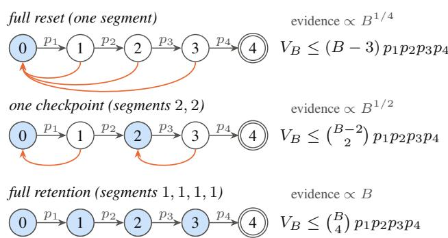
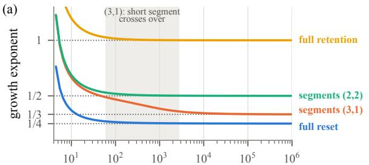
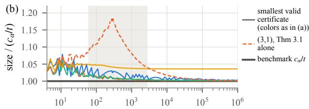
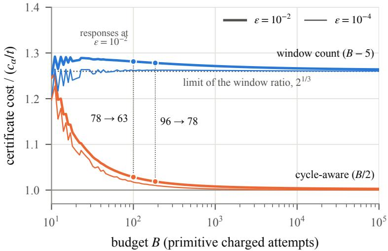

# Clean Sheets and Checkpoints: Evidence Complexity for Certifying Sequential Agent Risk

Rohith Yanambaka Venkata 1 † Don McBride 1 † Tiago Sequeira 2 Md. Al Amin 1 †

## Abstract

Dangerous-capability evaluations often test an AI agent from prepared states at ordered milestones. A clean sheet records no successes. What it certifies about a campaign of B attempts depends on what a failed attempt erases. We model the task as a chain of k milestones divided into checkpoint segments and ask how many zero audit responses certify, at level α, a completion probability of at most ϵ. For segments chosen before the audit, counting possible completion windows gives a certificate for any specified budget. The bound also covers adaptive deployment processes that follow the chain’s transitions, provided their success probabilities after every complete history are capped by the corresponding audit success probabilities. The audit does not test this transport assumption. In rare-risk phase interiors, each segment is either rarely completed within the budget (active) or nearly always completed (free). The minimum expected number of zero responses is asymptotic to log $( 1 / \alpha ) ( B ^ { a } / ( a ! \epsilon ) ) ^ { 1 / \hat { K _ { A } } }$ , where the a active segments contain $K _ { A }$ milestones and are those at least as long as a budget-dependent threshold. The certificate attains this constant. Every asymptotically optimal evaluator must divide its expected response count equally among active milestones in the limit, with a vanishing share elsewhere. Where a single segment passes from active to free, each of its milestones receives a smaller limiting share than an active milestone; a crossover-aware certificate attains the optimal constant. For selected segments with known or unqueried prefix steps, counting failed cycles can sharpen the certificate.

## 1. Introduction

Before an AI agent is deployed, its developer may estimate the probability that it could complete a dangerous multi-step task, such as setting up its own infrastructure or acquiring resources (Shevlane et al., 2023; Phuong et al., 2024). Complete successes are rare, so the milestone method of Phuong et al. (2024) divides the task into ordered milestones, starts the agent from a prepared state at the beginning of each, and runs it a few times there. If every one of these runs fails, the evaluation produces a clean sheet: an all-zero record.

A clean sheet is evidence about single attempts from prepared states, whereas a deployment risk statement concerns a campaign of many attempts. What a failed attempt erases decides which stretches of the task must be passed without a failure, and therefore how quickly the risk grows with the number of attempts and which milestones the audit must test. If every failure returns the agent to the beginning (full reset), completion needs an uninterrupted run through all k milestones. If the agent keeps every milestone it has passed (full progress retention), a failure costs only the attempt. With common milestone probability $p ,$ the completion probability within B attempts is approximately $B \bar { p } ^ { k }$ and $( B p ) ^ { k } / k !$ respectively. These hold as $B  \infty$ and $p  0 .$ , with $B p ^ { k }  0$ under full reset and $B p \to 0$ under full retention. Checkpoints that save progress at some milestones lie in between (Figure 1).

The same record therefore supports different deployment statements. Take four milestones with ten zero responses each, and a target completion probability of at most 1/100 at confidence 97.5%. Under the assumptions of Section 2, this record meets the target for budgets up to 169 primitive attempts under full reset by an analytic bound, and up to 185 by a computer-assisted one, but only up to 10 under full retention (Section 6.3).

Suppose each failure erases the progress made in the current checkpoint segment. We ask how many zero audit responses are needed to certify, with error probability at most α, that the agent completes the chain within B charged attempts with probability at most ϵ. We also ask how those responses should be divided among milestones. We measure cost by the expected number of responses in the zero world, where every milestone success probability is zero. This is the expected size of the clean sheet collected before certification.

  
Figure 1. Reset semantics for $k = 4$ milestones. A state counts the milestones passed; shaded states start a segment, so progress up to them is retained. An attempt from state i succeeds with probability $p _ { i + 1 } ;$ a failure returns the agent to the start of its current segment (arrows; a failure at a segment start leaves the state unchanged). Right: the completion-window bound of Theorem 3.1 with every segment selected; above it, the budget factor in the rare-risk asymptotic cost (Theorem 4.6).

Under the model of Section 2 the answer has three parts. First, counting completion windows gives a certificate for any specified budget, including for adaptive deployment processes whose milestone success probabilities conditional on every complete history are capped by the corresponding audit probabilities (Section 3). Second, call a segment active if its completion within the budget remains rare andfree if completion is nearly certain. In a rare-risk phase interior, every segment is one or the other. The minimum evidence is asymptotic to $\log ( 1 / \alpha ) ( B ^ { a } / ( a ! \epsilon ) ) ^ { 1 / K _ { A } }$ , where $K _ { A } / a$ is the mean length of the a active segments, so the budget enters with exponent $a / K _ { A }$ . The certificate attains this cost (Section 4). For the rules of Figure 1, these exponents are $1 / 4 , 1 / 2$ and 1. Third, every asymptotically optimal evaluator must divide its expected response count equally among active milestones in the limit, with a vanishing share on free ones. A single segment passing from active to free instead needs a reduced limiting share per milestone (Section 4.4). Sections 5–6 add a refinement for known or unqueried steps, numerical illustrations and a conditional reanalysis of a published clean sheet; proofs are in the appendix.

The ingredients are classical: upper confidence limits for products of binomial parameters from failure-free tests, Wald’s identity and the exponential limit of geometric sums, a log-concavity theorem, and a change-of-measure lower bound. The contribution is the characterization that connects reset geometry, finite certification of campaign risk, phase-dependent evidence complexity and the necessary allocation of tests (Section 7).

## 2. Model

## 2.1. Campaigns, milestones and reset semantics

A task consists of $k \geq 1$ mandatory milestones that must be passed in order. A reset rule partitions them into consecutive segments of lengths $\ell _ { 1 } , \ldots , \ell _ { s } \geq 1$ with $\begin{array} { r } { \sum _ { i } \ell _ { j } = k ; E _ { j } } \end{array}$ denotes the milestones of segment $j ,$ and $\check { L } = \operatorname* { m a x } _ { j } \ell _ { j }$ The state $i \in \{ 0 , \ldots , k \}$ is the number of milestones passed, and state k is absorbing. From a state $i < k$ one charged attempt is made at milestone i+1. A success moves the state to $i + 1$ . A failure moves it to $r ( i )$ , the start of the segment containing milestone $i + 1 ; r ( i )$ counts the milestones in all preceding segments. Thus a failure erases progress within the current segment and preserves completed segments. One segment $( s = 1 )$ is full reset, and segments of length one arefull progress retention. For $p \in [ 0 , 1 ] ^ { k }$ , the independent chain succeeds at milestone i with probability $p _ { i }$ on every attempt, independently of the past; $V _ { B } ( p )$ is its probability of reaching state k from state 0 within B attempts, and $\begin{array} { r } { \beta _ { j } \ = \ \prod _ { i \in E _ { i } } p _ { i } } \end{array}$ is the probability that one uninterrupted pass through segment j succeeds.

The budget B counts primitive charged attempts, one per milestone attempted, not complete trials. Under full reset, a complete trial runs from the start until its first failure or until completion. A trial that fails at milestone i therefore consumes i attempts. Statements about trials use a different unit: n independent complete trials succeed with probability $\begin{array} { r } { 1 - ( 1 - \prod _ { i } p _ { i } ) ^ { n } } \end{array}$ (Section 6.3).

## 2.2. Deployment processes

We allow adaptation, randomization, memory and user guidance subject to the three conditions below. In particular, the success caps must hold after every complete history (D3).

Assumption 2.1 (Domination conditions). A deployment process belongs to ${ \mathcal { D } } ( { \boldsymbol { p } } )$ if (D1) its only state changes are those of the chain, so that from $i ~ < ~ k$ an attempt either succeeds to $i + 1$ or fails to $r ( i )$ , no milestone is skipped, no alternative route exists and no progress within a segment survives a failure; (D2) every attempt consumes one unit of the budget, and the process may stop at any time; and (D3) for every full history h ending in a state $i < k$ , including any memory, randomization, scaffold state or policy information, P(next attempt succeeds $\mid h ) \leq p _ { i + 1 }$

Lemma 2.2 (Domination). $V _ { B } ( \boldsymbol { p } )$ is nondecreasing in B and in each coordinate ofp. Every process in ${ \mathcal { D } } ( { \boldsymbol { p } } )$ completes within B attempts with probability at most $V _ { B } ( p )$ and the independent chain belongs to ${ \mathcal { D } } ( { \boldsymbol { p } } )$

The proof (Appendix B) is a backward induction on the remaining budget, uniform over histories; it specializes robust dynamic programming (Iyengar, 2005; Nilim & El Ghaoui, 2005) to the chain (compare Proposition 2.1 of Liu et al. (2026), using a lower bound on per-turn safety that holds in every safe dialogue state). Condition (D3) cannot be weakened to a cap on averages: if every attempt succeeds exactly when a campaign-level latent variable $Z \sim \mathrm { B e r n o u l l i } ( r )$ equals one, an attempt at either milestone from a fresh campaign succeeds with probability $^ { r , }$ yet a two-milestone campaign with full retention completes within two attempts with probability $r > V _ { 2 } ( r , r ) = r ^ { 2 }$ (Example B.2).

## 2.3. Audit observations and validity

Assumption 2.3 (Audit oracle). An evaluator may repeatedly choose a milestone i and receive a response that, conditionally on everything observed so far and on the evaluator’s private randomization, is $\mathrm { B e r n o u l l i } ( p _ { i } )$ . Choices and stopping may be adaptive. The cost of constructing or reaching milestone states is not counted.

Let $N _ { i }$ count the responses at milestone i, $N = \textstyle \sum _ { i } N _ { i }$ , and $c _ { \alpha } = \log ( 1 / \alpha )$ for $\epsilon , \alpha \in ( 0 , 1 )$ . An evaluator is valid at $( B , \epsilon , \alpha )$ if

$$
\operatorname* { s u p } _ { p : V _ { B } ( p ) > \epsilon } \mathbb { P } _ { p } \mathrm { ( i t ~ e v e r ~ c e r t i f i e s ~ } V _ { B } ( p ) \leq \epsilon \mathrm { ) } \leq \alpha
$$

and, when $p = 0 .$ , it certifies after finitely many responses almost surely. Nothing is required at other safe parameters, where an evaluator may return “unresolved”. Its zero-world cost is $\mathbb { E } _ { 0 } N _ { : }$ , the expected number of responses when every $p _ { i } = 0 .$

The zero-world restriction applies to evidence-complexity optimality, not to the campaign-risk bounds: Theorem 3.1(i) holds for every $p \in [ 0 , 1 ] ^ { k }$ and every process in ${ \mathcal { D } } ( { \boldsymbol { p } } )$ . At $p = 0$ , every audit response is zero, so $\mathbb { E } _ { 0 } N$ measures the expected size of the clean sheet collected before certification. Minimizing this cost asks how large a clean sheet must be.

Validity concerns the audit parameter p. A statement about deployment needs, in addition, that the deployment process lies in ${ \mathcal { D } } ( { \boldsymbol { p } } )$ for the same $p ,$ that is, that success probabilities measured from prepared milestone states cap those of the states reached in deployment at every history. We call this the transport assumption. The audit does not test it; it links the results about ${ \mathcal { D } } ( { \boldsymbol { p } } )$ to a deployment.

## 2.4. The certification geometry

For a fixed-count design that certifies on an all-zero record, validity requires that this record have probability at most α under every unsafe parameter. The hardest unsafe parameter is therefore the one under which that record is most likely.

An all-zero record with $n _ { i }$ responses at milestone i has probability $\textstyle \exp ( - \sum _ { i } n _ { i } u _ { i } )$ under $p ,$ where $u _ { i } = - \log ( 1 -$ $p _ { i } )$ , so in these coordinates the log-likelihood of a clean sheet is linear. For $u \in [ 0 , \infty ) ^ { k }$ let $F _ { B } ( u ) = V _ { B } ( { \bf 1 } - e ^ { - u } )$

and

$$
\begin{array} { r } { U = \{ u : F _ { B } ( u ) > \epsilon \} , \qquad S = \{ u : F _ { B } ( u ) \geq \epsilon \} , } \\ { I _ { w } = \displaystyle \operatorname* { i n f } _ { u \in S } w ^ { \top } u \quad ( w \in \Delta _ { k } ) , \qquad { \mathscr { T } } ^ { * } = \displaystyle \operatorname* { m a x } _ { w \in \Delta _ { k } } I _ { w } , } \end{array}
$$

with $\Delta _ { k }$ the probability simplex.

Each $u _ { i } = \mathrm { K L } ( \mathrm { B e r } ( 0 ) \parallel \mathrm { B e r } ( p _ { i } ) )$ is the log-likelihood ratio that one zero response at milestone i contributes against $p ,$ so a design that places a fraction $w _ { i }$ of N responses at milestone i and certifies when all are zero errs at u $\in \boldsymbol { U }$ with probability $\mathrm { e x p } ( - N w ^ { \top } u )$ . Thus $I _ { w }$ is the information per response against the hardest unsafe parameter, and the design needs $c _ { \alpha } / I _ { w }$ responses (with real counts). By Lemma 4.1 and Proposition $4 . 2 , c _ { \alpha } / \mathcal { T } ^ { * }$ is the minimum zero-world cost of any valid evaluator, adaptive or not, up to an additive k, and the maximizing allocation says how to spread a clean sheet over the milestones.

Lemma 2.4 (Closure and diagonal). Let $B \geq k .$ . Then S is the closure of U, there is a unique $t > 0$ with $F _ { B } ( t { \bf 1 } ) = \epsilon ,$ $\mathcal { T } ^ { * }$ is attained, and ${ \mathcal { T } } ^ { * } \leq t .$

We call t the diagonal threshold; $p _ { * } ~ = ~ 1 - e ^ { - t }$ is the common milestone probability at which the campaign risk equals ϵ.

Neither $S$ nor its image in logit coordinates need be convex: Proposition B.3 gives interior counterexamples under full reset with five milestones, several of them nearly certain, at $\epsilon = 1 / 1 0 0$ in logit and $\epsilon \approx 0 . 0 2$ in u coordinates. Our prospective certificates bound $V _ { B }$ by functions that are logconcave in u, and no result here assumes that S is convex.

## 3. Finite certification under different reset rules

Completing the chain requires one uninterrupted run of successes through every segment, and counting the possible end positions of these runs bounds the completion probability. For a nonempty set A of segments let $a = | A |$ $\begin{array} { r } { E _ { A } = \bigcup _ { j \in A } E _ { j } , K _ { A } = | E _ { A } | } \end{array}$ , and for $B \geq k$

$$
\begin{array} { c } { { C _ { A } ( B ) = \binom { B - k + a } { a } , } } \\ { { r _ { A } = \left( \epsilon / C _ { A } ( B ) \right) ^ { 1 / K _ { A } } , \qquad \tau _ { A } = - \log ( 1 - r _ { A } ) . } } \end{array}
$$

Theorem 3.1 (Finite selected-segment certificate). Let $B \geq$ k and let A be a nonempty set of segments.

(i) For every $p \in [ 0 , 1 ] ^ { k }$ and every process in ${ \mathcal { D } } ( { \boldsymbol { p } } )$

$$
\mathbb { P } ( c o m p l e t i o n w i t h i n B ) \le V _ { B } ( p ) \le C _ { A } ( B ) \prod _ { i \in E _ { A } } p _ { i } .
$$

(ii) $\tau _ { A } \leq I _ { w _ { A } } \leq I ^ { * } \leq t ,$ where $w _ { A }$ is uniform on $E _ { A }$ (iii) Suppose that A isfixed before any response is observed; it may depend on k, the segment lengths, $B , \epsilon , \alpha$ and randomization independent of the responses. Query each milestone of $E _ { A }$ exactly $n _ { A } = \lceil c _ { \alpha } / ( K _ { A } \tau _ { A } ) \rceil$ times and certify $V _ { B } ( p ) \le \epsilon i j$ fand only ifall responses are zero. This rule is valid, certifies with probability one at $p = 0 ,$ , and uses $N = K _ { A } n _ { A } < c _ { \alpha } / \tau _ { A } + K _ { A }$ responses. Milestones outside $E _ { A }$ are never queried, and their parameters are unrestricted.

For (i), let $b _ { m }$ be the attempt at which the m-th selected segment is completed and $\bar { k } _ { m }$ the number of milestones up to its end. Then $x _ { m } = b _ { m } - \bar { k } _ { m }$ counts the attempts spent beyond the minimum. Mandatory progress gives $0 \leq$ $x _ { 1 } \leq \cdot \cdot \cdot \leq x _ { a } \leq B - k$ , and there are $\overset { \smile } { \left( \begin{array} { l } { B - k + a } \\ { a } \end{array} \right) }$ such sequences. Each sequence fixes disjoint windows for the final uninterrupted runs through the selected segments. By (D3), all these runs succeed with probability at most $\prod _ { E _ { A } } p _ { i }$ A union bound over sequences gives (i). The count uses (D1)–(D3) but not independence. Parts (ii) and (iii) follow from the concavity of u 7→ log $( 1 - e ^ { - u } )$ (Appendix C).

The certificate holds at every $( B , \epsilon , \alpha )$ , for adaptive deployment processes and arbitrary unqueried milestones. Under full reset it gives $\begin{array} { r } { V _ { B } ( p ) \le ( B - k + 1 ) \prod _ { i } p _ { i } } \end{array}$ and about $c _ { \alpha } ( ( B - k + 1 ) / \epsilon ) ^ { 1 / k }$ zero responses; under full retention, $\begin{array} { r } { V _ { B } ( p ) \le \binom { B } { k } \prod _ { i } p _ { i } } \end{array}$ and a cost of order $c _ { \alpha } B ( k ! \epsilon ) ^ { - 1 / k }$ Choosing the A that minimizes $K _ { A } n _ { A }$ uses only the model and $( B , \epsilon , \alpha )$ , so the choice is prospective and the rule remains valid.

Given (i), part (iii) is an upper confidence limit for $\prod _ { E _ { A } } p _ { i }$ from an all-zero outcome with equal counts. One-sided confidence limits for a product of two binomial parameters were studied by Buehler (1957); failure-free component tests propagated to system bounds, with unequal, zero or equal allocation, are developed by Bishop & Povyakalo (2020; 2022). What is specific to the chain is the completionwindow coefficient $C _ { A } ( B )$ , its domination of every process in ${ \mathcal { D } } ( { \boldsymbol { p } } )$ , and the prospective choice of segments.

Remark 3.2 (Conditions). (a) If A, the counts or the acceptance rule are chosen after responses are seen, or if the rule may also certify after nonzero responses, the combined rule needs its own calibration. (b) The window count is exact, but the union bound can be loose when the selected parameters or the products $B \beta _ { j }$ are not small (Section 6).

For counts fixed in advance but not designed for a particular $( B , \epsilon )$ , the following rule, used in Section 6.3, certifies all pairs at once (Appendix C).

Proposition 3.3 (Fixed-count plausibility rule). Fix counts $n \in \{ 0 , 1 , \ldots \} ^ { k }$ before observing data and query milestone i exactly $n _ { i }$ times. On an all-zero record let $\Pi =$ $\begin{array} { r } { \{ u \in [ 0 , \infty ] ^ { k } : \sum _ { i } n _ { i } u _ { i } \le c _ { \alpha } \} } \end{array}$ , with $0 \cdot \infty = 0$ and $p _ { i } = 1$ when $u _ { i } = \infty ,$ , and certify every pair $( B , \epsilon )$ with $\begin{array} { r } { \operatorname* { s u p } _ { u \in \Pi } F _ { B } ( u ) \le \epsilon ; } \end{array}$ after any nonzero response certify nothing. Thenfor every p, $\mathbb { P } _ { p }$ (some certified pair has $V _ { B } ( p ) >$ $\epsilon ) \leq \alpha$

## 4. Sharp zero-world evidence complexity and phase-dependent allocation

## 4.1. Finite information bounds

Lemma 4.1 (Zero-path lower bound). Every valid evaluator satisfies $\mathbb { E } _ { 0 } N \geq c _ { \alpha } / \mathbb { Z } ^ { * }$ $I f T = \mathbb { E } _ { 0 } N < \infty$ and $w _ { i } =$ $\mathbb { E } _ { 0 } N _ { i } / T _ { * }$ , then $T I _ { w } \ge c _ { \alpha }$

Lemma 4.1 is the zero-null form of the change-of-measure lower bound of Kaufmann et al. (2016, Lemma 1); see also Garivier & Kaufmann (2016). That lemma assumes mutually absolutely continuous arm distributions, which fails here because Ber(0) gives no mass to a success, so we prove the bound directly (Appendix D): conditionally on the evaluator’s randomization, an unsafe parameter reproduces the all-zero path with probability $\textstyle \exp ( - \sum _ { i } u _ { i } N _ { i } )$ and Jensen’s inequality gives the claim.

Proposition 4.2 (Finite sandwich). Let $B \ \geq \ k$ and let $w ^ { * }$ attain $\mathcal { T } ^ { * }$ . The fixed-count all-zero design with $n _ { i } =$ $\lceil w _ { i } ^ { * } c _ { \alpha } / \tau ^ { * } \rceil$ is valid, so that $c _ { \alpha } / \mathcal { T } ^ { * } \le \operatorname* { i n f } \mathbb { E } _ { 0 } N < c _ { \alpha } / \mathcal { T } ^ { * } +$ $k ,$ the infimum being over valid evaluators. The information also satisfies $t / k \leq I _ { 1 / k } \leq I ^ { * } \leq t .$

The information optimum $\mathcal { T } ^ { * }$ determines the minimum zeroworld cost to within fewer than k responses. The diagonal threshold t gives simpler bounds that differ by a factor of at most k, apart from rounding. Neither gives an explicit leading constant or allocation.

## 4.2. Cycle lengths

A cycle starts at the beginning of a segment and ends at the first failure or at segment completion. For segment j let $\pi _ { j , h }$ be the product of its first h milestone probabilities $( \pi _ { j , 0 } = 1 )$ and $\begin{array} { r } { \kappa _ { j } = \sum _ { h = 0 } ^ { \ell _ { j } - 1 } \pi _ { j , h } \in [ 1 , \ell _ { j } ] } \end{array}$ . A cycle has mean length $\kappa _ { j }$ and completes the segment with probability $\beta _ { j }$ , so by Wald’s identity the number $T _ { j }$ of attempts spent in segment $j$ has $\mathbb { E } T _ { j } \ = \ \kappa _ { j } / \beta _ { j }$ when $\beta _ { j } ~ > ~ 0$ . In the independent chain, different segments use disjoint sets of independent attempts. Their attempt counts $T _ { j }$ are therefore independent, and $V _ { B } ( p ) = \mathbb { P } ( \sum _ { i } T _ { j } \leq B )$

Lemma 4.3 (Cycle-length renewal bounds). Let A be a nonempty set of segments. (a) For every $p \in [ 0 , 1 ] ^ { k }$ and $\begin{array} { r } { B \geq k , V _ { B } ( p ) \leq \frac { ( B - k + K _ { A } ) ^ { a } } { a ! } \prod _ { j \in A } \frac { \beta _ { j } } { \kappa _ { i } } , } \end{array}$ ; a matching lower bound is in Lemma D.1. (b) Along any sequence withfixed segment lengths andfixed A such that $B  \infty , \beta _ { j } > 0 f o r$ $\begin{array} { r } { j \in A , B \operatorname* { m a x } _ { j \in A } \beta _ { j } \to 0 a n d \sum _ { j \not \in A } \kappa _ { j } / ( B \beta _ { j } ) \overset { \cdot } { \to } 0 , } \end{array}$

$$
V _ { B } ( p ) \sim \frac { B ^ { a } } { a ! } \prod _ { j \in A } \frac { \beta _ { j } } { \kappa _ { j } } .
$$

No condition is placed on individual milestone probabilities, any ofwhich may stayfixed, including at one.

The identity $\mathbb { E } T _ { j } = \kappa _ { j } / \beta _ { j }$ and the rate $\beta _ { j } / \kappa _ { j }$ are classical (Wald, 1944), (Feller, 1968, Ch. XIII); the exponential limit of $\beta _ { j } T _ { j } / \kappa _ { j }$ is Renyi’s theorem on geometric sums (´ Renyi´ , 1956), with rarity and exponentiality treated by Keilson (1979) and error bounds by Brown (1990) and Kalashnikov (1997). Lemma 4.3 uses only first moments, via Wald’s identity with bounded overshoot (cf. Lorden, 1970).

## 4.3. Phase interiors

At a finite budget the unsafe set has no simple shape, and Proposition 4.2 identifies $\mathcal { T } ^ { * }$ only up to a factor k. The shape simplifies when the budget separates the segments into two kinds: active segments, whose completion within the budget is still rare, andfree ones, whose completion is nearly certain. Then Lemma 4.3(b) gives $\begin{array} { r } { V _ { B } \sim ( B ^ { a } / a ! ) \prod _ { j \in A } \beta _ { j } / \kappa _ { j } } \end{array}$ over the active set A, the boundary of the unsafe set is asymptotically a level set of $\Pi _ { i \in E _ { A } } p _ { i }$ , and the max–min problem defining $\mathcal { T } ^ { * }$ has an explicit asymptotic solution. A segment that is neither (a crossover) contributes a nondegenerate factor (Section 4.4). On the diagonal, where every milestone probability equals $p ,$ segment j is active when $B p ^ { \ell _ { j } }$ is small and free when it is large.

Definition 4.4 (Diagonal phase-interior sequence). Fix the segment lengths and a nonempty set A of segments. A sequence $( B _ { n } , p _ { n } )$ with integers $B _ { n } \geq k , B _ { n } \to \infty$ , and $p _ { n } \in ( 0 , 1 ) , p _ { n } \to 0$ , is a diagonal phase-interior sequence for A if max $_ { j \in A } B _ { n } p _ { n } ^ { \ell _ { j } } \to 0$ and $\begin{array} { r } { \sum _ { j \notin { \cal A } } ( B _ { n } p _ { n } ^ { \ell _ { j } } ) ^ { - 1 } \to 0 } \end{array}$ Put $\epsilon _ { n } = V _ { B _ { n } } ( p _ { n } { \bf 1 } )$ and $t _ { n } = - \log ( \bar { 1 } ^ { ' } - p _ { n } )$ , and index t, $\tau _ { A } , I _ { w }$ and $\mathcal { T } ^ { * }$ by $( B _ { n } , \epsilon _ { n } )$ ; by Lemma $2 . 4 , p _ { n }$ is then the diagonal threshold and $t = t _ { n }$

Lemma 4.5 (Active sets are length thresholds). If a diagonal phase-interior sequence for A exists, then $A = \{ j :$ $\ell _ { j } \ \geq \ \ell ^ { \ast } \}$ with $\ell ^ { * } = \operatorname* { m i n } _ { j \in A } \ell _ { j }$ . Conversely, let $\ell ^ { * }$ be a segment length and ℓ the largest smaller length $( \ell _ { - } = 0 \ : i f$ there is none); for every $\gamma \in ( \ell _ { - } , \ell ^ { * } )$ and every $p _ { n } \downarrow 0 ,$ , the budgets $B _ { n } = \lceil p _ { n } ^ { - \gamma } \rceil$ give, for large $n ,$ , a diagonal phaseinterior sequencefor $\{ j : \ell _ { j } \geq \ell ^ { * } \}$

A segment of length ℓ needs about $p ^ { - \ell }$ attempts: it is free once $B \gg p ^ { - \ell }$ and active while $B \ll p ^ { - \ell } ,$ , so longer segments stay active longest and there is one phase interior per distinct length.

Theorem 4.6 (Sharp zero-world evidence complexity). Let $( B _ { n } , p _ { n } )$ be a diagonal phase-interior sequence for A. Then $\epsilon _ { n }  0 ,$

$$
\epsilon _ { n } \sim \frac { B _ { n } ^ { a } p _ { n } ^ { K _ { A } } } { a ! } , \qquad \tau _ { A , n } \sim \mathcal { T } _ { n } ^ { * } \sim t _ { n } \sim \Big ( \frac { a ! \epsilon _ { n } } { B _ { n } ^ { a } } \Big ) ^ { 1 / K _ { A } } .
$$

$H \alpha _ { n } \in ( 0 , 1 )$ satisfies $c _ { \alpha _ { n } } / t _ { n } \to \infty$ (in particular if α is

fixed), then

$$
\operatorname* { i n f } _ { \substack { \nu a l i d a t ( B _ { n } , \epsilon _ { n } , \alpha _ { n } ) } } \mathbb { E } _ { 0 } N \sim c _ { \alpha _ { n } } \Big ( \frac { B _ { n } ^ { a } } { a ! \epsilon _ { n } } \Big ) ^ { 1 / K _ { A } } ,
$$

and the certificate of Theorem 3.1 with the same A attains this leading constant.

The theorem identifies the constant, not only the rate; the exponent $a / K _ { A }$ falls from $s / k .$ , when every segment is active, to $1 / L ,$ , when only the longest remain. The condition $c _ { \alpha _ { n } } / t _ { n } \to \infty$ makes the rounding term $K _ { A }$ negligible; otherwise no constant is claimed.

Theorem 4.7 (Necessary limiting allocation). Under the hypotheses ofTheorem 4.6:

(a) every sequence $w _ { n } \in \Delta _ { k }$ with $I _ { w _ { n } , n } / t _ { n } \to 1$ satisfies $w _ { n , i }  1 / K _ { A } f o r i \in E _ { A }$ and $w _ { n , i } \to 0 f o r i \notin E _ { A } ;$

(b) for every sequence of valid evaluators with $\mathbb { E } _ { 0 } N$ ∼ $c _ { \alpha _ { n } } / t _ { n }$ , the allocation weights $w _ { n , i } = \mathbb { E } _ { 0 } N _ { i } / \mathbb { E } _ { 0 } N$ satisfy the conclusion of(a).

Each weight is the expected count at a milestone divided by the expected total count, both in the zero world. These weights tend to zero on free milestones and to $1 / K _ { A }$ on active ones. Valid evaluators with any other limiting weights are not asymptotically optimal. The statement does not concern realized fractions or finite n; at a finite budget the optimal weights need not be uniform (Example D.2). Equal and zero allocations already arise in optimal componenttest plans (Bishop & Povyakalo, 2022); the theorem shows that in the chain they are necessary in the limit, with the reset rule and the budget deciding which milestones receive weight.

Under full reset with $B _ { n } p _ { n } ^ { k } \to 0$ the constant is $c _ { \alpha } ( B _ { n } / \epsilon _ { n } ) ^ { 1 / k }$ , and under full retention with $B _ { n } p _ { n }  0$ it is $c _ { \alpha } B _ { n } ( k ! \epsilon _ { n } ) ^ { - 1 / k }$ , with uniform limiting allocations in both cases (Corollary D.6). Under full retention a finite statement also holds: $F _ { B }$ is Schur-concave in $u ,$ so $I _ { \mathbf { 1 } / k } = { \mathcal { T } } ^ { * } = t$ at every budget (Proposition D.3). Majorization properties of convolutions of geometric random variables are studied by Boland et al. (1994) and Mao et al. (2010); we give a self-contained proof and claim no novelty for this statement.

## 4.4. A single crossover

When exactly one segment crosses from active to free, the optimal evidence allocation differs from that in either neighboring phase interior. Completing this segment takes a number of attempts comparable to the budget. Its milestones need fewer responses than active ones but not none, and no certificate of Theorem 3.1 is sharp.

When a segment of length m crosses over, it consumes a random fraction of the budget. Its attempt count divided by $B _ { n }$ tends in law to $E / \lambda .$ , with $E \sim \mathrm { E x p } ( 1 )$ and $\lambda =$ lim $B _ { n } p _ { n } ^ { m }$ . The active segments must fit in the remaining budget, so the risk acquires the factor $h _ { a } ( \lambda ) \ = \ \mathbb { E } ( 1 \textrm { -- }$ $E / \lambda ) _ { + } ^ { a }$ . This factor increases from 0 to 1; for example, $h _ { 1 } ( \lambda ) \dot { = } 1 - ( 1 - e ^ { - \lambda } ) / \lambda$

The elasticity of $h _ { a } , e _ { a } ( \lambda ) = \lambda h _ { a } ^ { \prime } ( \lambda ) / h _ { a } ( \lambda )$ , determines the allocation ratio. In the limiting risk expression, each active milestone has elasticity 1 and each crossover milestone has elasticity $e _ { a } ( \lambda )$ . By Prekopa’s theorem, ´ $e _ { a }$ is nonincreasing, from 1 to 0 (Lemma D.9).

Theorem 4.8 (Single crossover). Let M be the only segment of length m, with milestones $E _ { M }$ , let $A \ = \ \{ j \ : \ \ell _ { j } \ >$ $m \} \neq \emptyset ,$ , and let $( B _ { n } , p _ { n } )$ be as in Definition 4.4 but with $B _ { n } p _ { n } ^ { m } \to \lambda \in ( 0 , \infty )$ in place ofits two conditions.

(i) The risk and information satisfy

$$
\epsilon _ { n } \sim \frac { B _ { n } ^ { a } p _ { n } ^ { K _ { A } } } { a ! } h _ { a } ( \lambda ) , \qquad \mathcal { T } _ { n } ^ { * } \sim t _ { n } .
$$

(ii) $I f c _ { \alpha _ { n } } / t _ { n } \to \infty$ , the minimum zero-world cost is asymptotic to

$$
c _ { \alpha _ { n } } \Big ( \frac { B _ { n } ^ { a } h _ { a } ( \lambda ) } { a ! \epsilon _ { n } } \Big ) ^ { 1 / K _ { A } } ,
$$

attained by the certificate ofProposition 4.9.

(iii) Under the condition in $( i i ) ,$ every sequence of valid evaluators with $\mathbb { E } _ { 0 } N \sim c _ { \alpha _ { n } } / t _ { n }$ has allocation weights $\mathbb { E } _ { 0 } N _ { i } / \mathbb { E } _ { 0 } N$ tending to ω(λ). These weights are proportional to 1 on each milestone of $E _ { A }$ and to $e _ { a } ( \lambda )$ on each milestone of $E _ { M }$ , and are 0 elsewhere.

Proposition 4.9 (Crossover-aware certificate). Let $B \geq k _ { : }$ fix A and a segment M /∈ A of length m before any response, and put $B _ { \times } = B - k + a + 1$

(i) For every p and every process in $\mathcal { D } ( \boldsymbol { p } )$ , the completion probability is at most

$$
V _ { B } ( p ) \leq \frac { B _ { \times } ^ { a } } { a ! } h _ { a } \Big ( B _ { \times } \prod _ { E _ { M } } u _ { i } \Big ) \prod _ { E _ { A } } p _ { i } .
$$

(ii) Let $\tau _ { \times }$ solve

$$
( 1 - e ^ { - \tau } ) ^ { K _ { A } } \frac { B _ { \times } ^ { a } } { a ! } h _ { a } ( B _ { \times } \tau ^ { m } ) = \epsilon .
$$

Let w be proportional to $1 / ( e ^ { \tau _ { \times } } - 1 )$ on $E _ { A }$ and to $e _ { a } ( B _ { \times } \tau _ { \times } ^ { m } ) / \tau _ { \times }$ on $E _ { M }$ , with zero weights elsewhere. Query each $i \in E _ { A } \cup E _ { M }$ exactly $\lceil c _ { \alpha } w _ { i } / \tau _ { \times } \rceil$ times and certify if and only if all responses are zero. This rule is valid, certifies with probability one at $p = 0 ,$ , and uses fewer than $c _ { \alpha } / \tau _ { \times } + K _ { A } + m$ responses. Moreover, $\tau _ { \times } \leq I _ { w } \leq T ^ { * } \leq t .$

The bound (i) is log-concave in u, and w is the normalized gradient of its logarithm at the diagonal point. As λ grows, $\omega ( \lambda )$ moves from the uniform allocation on $E _ { A } \cup E _ { M }$ to that on $E _ { A } ;$ for segments (3, 1) at $\lambda = 2 , e _ { 1 } ( 2 ) \approx 0 . 5 2$ , so the length-one segment’s milestone receives about half the limiting expected share of each active milestone. Even the best certificate of Theorem 3.1 costs more at a crossover; for (3, 1), its largest limiting cost ratio to the optimum is about 1.18 (Corollary D.11). The crossover-aware certificate is not uniformly better at finite budgets, so one uses the smallest prospective certificate (Figure 2). The diagonal risk limit is not new (Appendix D.4).

Remark 4.10 (Scope). Theorems 4.6–4.8 are asymptotic. They do not identify the optimum at finite $( B , \epsilon )$ or cover crossovers of several equal-length segments, crossovers without a positive finite limit of $B _ { n } p _ { n } ^ { m }$ , fixed ϵ (Example D.5), nonzero safe parameters, or realized adaptive allocations. These limitations do not affect the validity of the finite certificates. Cycle lengths do not affect the stated constants: the proofs use only points where every $\kappa _ { j }  1$

## 5. Cycle-aware certification

Evaluation tasks often contain steps whose success probability is known, such as scripted setup actions that always succeed; under full reset, a later failure also wastes the attempts spent on them. For a segment of length two with probabilities $( 1 , q )$ , every cycle has length two and $V _ { B } = 1 - ( 1 - q ) ^ { [ B / 2 ] }$ , so $V _ { B } \sim B q / 2$ as $B  \infty$ with $B q \to 0 ;$ : half the window coefficient $B - 1$ (Example D.4). Counting cycles instead of windows recovers this factor.

Suppose that some milestones are not queried, so that their success probabilities are bounded only by one. Before any response, choose a nonempty set A of segments and, in each selected segment, a nonempty set of milestones to query. Let $Q _ { A }$ be the queried milestones, $K ^ { \prime } = | Q _ { A } |$ , and $h _ { j }$ the number of unqueried milestones of segment $j \in A$ that precede its first queried one.

Theorem 5.1 (Cycle-aware certificate for unqueried prefixes). Let $B \geq k$ and

$$
D _ { B } = \operatorname* { m i n } \Bigl \{ C _ { A } ( B ) , \ : \frac { ( B - k + K _ { A } ) ^ { a } } { a ! } \prod _ { j \in A } \frac { 1 } { h _ { j } + 1 } \Bigr \} .
$$

(i) For every $p \in \ [ 0 , 1 ] ^ { k }$ and every process in ${ \mathcal { D } } ( { \boldsymbol { p } } )$ P(completion within $\begin{array} { r } { B ) \le V _ { B } ( p ) \le D _ { B } \prod _ { i \in Q _ { A } } p _ { i } } \end{array}$

(ii) With $\tau ^ { \prime } = - \log \bigl ( 1 - ( \epsilon / D _ { B } ) ^ { 1 / K ^ { \prime } } \bigr )$ , querying each $i \in Q _ { A }$ exactly $\lceil \dot { c } _ { \alpha } / ( K ^ { \prime } \tau ^ { \prime } ) \rceil$ times and certifying if and only ifall responses are zero is valid, certifies with probability one when the queried probabilities are zero, and usesfewer than $c _ { \alpha } / \tau ^ { \prime } + K ^ { \prime }$ responses.

(iii) As $B  \infty ,$ the second term of $D _ { B }$ divided by the first tends to $\begin{array} { r } { \prod _ { j \in A } ( h _ { j } + 1 ) ^ { - 1 } . \ I f h _ { j } = 0 f o r } \end{array}$ every $j \in A ,$ the second term is never the smaller one, and if moreover every selected milestone is queried, the rule is that ofTheorem 3.1.

The gain arises only from unqueried prefixes of selected segments: with sure prefix steps every cycle of segment j spends $h _ { j }$ attempts before its first queried one, so $\kappa _ { j } \geq$ $h _ { j } + 1$ in Lemma 4.3, and the same bound follows by monotonicity otherwise. Theorem E.3 allows known or capped success probabilities below one.

The cycle-aware certificate is also asymptotically optimal when only a specified set Q of milestones is queryable and every other milestone has a known or capped success probability. Validity is required only over this restricted class. The result assumes fixed positive declared constants and the phase-interior and rounding conditions of Theorem E.4. A segment’s number of queryable milestones replaces its total length in the active/free classification.

The leading constant involves the declared constants and a factor $1 / \sigma _ { j }$ for each active segment. Here $\sigma _ { j }$ is the expected number of attempts in one cycle of segment j up to either a failure in the unqueried prefix or the first attempt at a queryable milestone, including that terminating attempt, at the declared constants. Optimal limiting allocation weights are uniform on the queryable milestones of active segments and zero elsewhere. For $Q \ = \ \{ 1 , \ldots , k \}$ this recovers Theorems 4.6–4.7; otherwise the class and oracle differ, so the result does not improve the constant of Theorem 4.6 (Example E.5).

Corollary 5.2 (A six-transition family). Consider onefullreset segment of six charged transitions with parameters $( 1 , q _ { 1 } , q _ { 2 } , q _ { 3 } , 1 , 1 )$ , where the first, fifth and sixth transitions are known to succeed and $q \in [ 0 , 1 ] ^ { 3 }$ is queried. For $B \ \geq \ 6 ,$ $V _ { B } ~ \le ~ D _ { B } q _ { 1 } q _ { 2 } q _ { 3 }$ with $D _ { B } \ = \ \operatorname* { m i n } \{ B \ - \ $ $5 , B / 2 \}$ , which is $B / 2$ for $B \ \geq \ 1 0$ . Along sequences with $B _ { n } \to \infty , B _ { n } p _ { n } ^ { 3 } \to 0$ and $c _ { \alpha _ { n } } / t _ { n } \to \infty$ , and with $\epsilon _ { n } = V _ { B _ { n } } ( 1 , p _ { n } , p _ { n } , p _ { n } , 1 , 1 )$ , the cycle-aware certificate attains inf ${ \mathbb E } _ { 0 } N \sim c _ { \alpha _ { n } } ( B _ { n } / ( 2 \epsilon _ { n } ) ) ^ { 1 / 3 }$ in the class with these sure transitions, whereas the window certificate has $\tau / t \to 2 ^ { - 1 / 3 }$ and costs asymptotically $2 ^ { 1 / 3 } \approx \mathrm { i } . 2 6$ times the optimum.

## 6. Numerical examples and a conditional historical reanalysis

The numbers below evaluate exact chain recursions in binary64 or in exact rationals, or come from an integerarithmetic branch and bound, as indicated. They illustrate the theorems and are not used in their proofs (Appendix F).

  
budget B (primitive charged attempts)  
Figure 2. Zero-world evidence to certify $V _ { B } \le 1 0 ^ { - 4 } \mathrm { a t } \alpha = 1 / 4 0$ with $k \ = \ 4$ milestones; its minimum lies between the lower benchmark $c _ { \alpha } / t$ and the smallest valid prospective certificate. (a) Growth exponent $\Delta \log ( c _ { \alpha } / t ) / \Delta$ log B, cut off near $B \ = \ k ;$ dotted: rare-risk phase-interior exponents $a / K _ { A }$ as ϵ → 0 (Theorem 4.6), for reference alongside the fixed-ϵ curves. (b) Smallest valid certificate (Theorem 3.1 or Proposition 4.9) over $c _ { \alpha } / t ;$ dashed: Theorem 3.1 alone for (3, 1); the dot $( B = 2 8 5 )$ marks where the smaller unrounded cost switches from both segments to the long one. Shaded: $1 \leq B p _ { * } \leq 1 0 \mathrm { f o r } ( 3 , 1 )$ , where the short segment crosses over and the lower benchmark’s growth exponent falls from $1 / 2$ to $1 / 3$

## 6.1. Evidence across budget regimes

All reset rules need the same evidence at $B = k$ , where no failure can be absorbed; beyond it the growth exponents of the lower benchmark, valid since ${ \mathcal { T } } ^ { * } \leq t .$ , approach $a / K _ { A }$ (Figure 2(a)). At $B = 1 0 ^ { 6 }$ , the smallest displayed certificate uses about $1 . 2 \times 1 0 ^ { 3 }$ responses under full reset and $1 . 6 \times 1 0 ^ { 7 }$ under full retention. Under full retention, the lower benchmark is within k responses of the minimum (Proposition D.3). The smallest certificate’s excess of about 4% over that benchmark therefore reflects its own cost, with negligible uncertainty about the optimum. On the plotted budget grid, with Theorem 3.1 alone the bracket is widest where the short segment of (3, 1) crosses over, 18% at $B =$ 279 (Figure 2(b)), close to the limiting factor 1.18; the smaller of the two certificates keeps it below 3% for $B \geq 3 0$ At the smallest budgets the window certificate is smaller.

## 6.2. Cycle-aware accounting

For the six-transition family at $\epsilon = 1 / 1 0 0$ (Table 1), the cycle-aware certificate uses 63 zero responses instead of 78 at $B = 1 0 0$ and 78 instead of 96 at $B = 1 8 5 .$ , about 19% fewer. Its counts are 5.8% and 5.1% above the lower benchmark $c _ { \alpha } / t ,$ and the window counts are 31% and 29% above it. These operating points are not on phase-interior sequences $( B p _ { \star } ^ { 3 } \approx 0 . 0 2 2$ and 0.021), and the ratios compare cost benchmarks rather than gaps to a finite-budget minimax value. Figure 3 (Appendix F) extends this comparison to other budgets.

Table 1. Six-transition family of Corollary 5.2, $\epsilon = 1 / 1 0 0 .$ $\alpha = 1 / 4 0$ . B counts primitive charged attempts, including the three sure transitions; responses are those at the queried milestones, $3 \lceil c _ { \alpha } / ( 3 \tau ) \rceil$ (window) and $3 \lceil c _ { \alpha } / ( 3 \tau ^ { \prime } ) \rceil$ (cycle-aware). The restricted diagonal threshold $p _ { \star }$ lies in exact rational root brackets; other entries are binary64.
<table><tr><td colspan="6"></td><td colspan="2">responses</td></tr><tr><td>B</td><td> $p _ { \star }$ </td><td> $\tau / t$ </td><td> $\tau ^ { \prime } / t$ </td><td> $c _ { \alpha } / t$ </td><td>window cycle</td><td></td></tr><tr><td>100</td><td>0.0600927</td><td>0.78045</td><td>0.97234</td><td> $5 9 . 5 2$ </td><td>78</td><td>63</td></tr><tr><td>185</td><td>0.0485094</td><td>0.78238</td><td>0.98159</td><td>74.18</td><td>96</td><td>78</td></tr></table>

Table 2. Conditional reanalysis of a four-milestone record with ten zero responses per milestone $( \alpha = 1 / 4 0 , \epsilon = 1 / 1 0 0 )$ under the model of Section 2; $B _ { \mathrm { m a x } }$ counts primitive charged attempts, or complete trials where stated.
<table><tr><td>Reset rule (unit)</td><td> $B _ { \mathrm { m a x } }$ </td><td>Statement</td></tr><tr><td>Full reset</td><td></td><td>169 Analytic upper-bound certificate</td></tr><tr><td>Full reset</td><td></td><td>185 Computer-assisted exact-risk certificate</td></tr><tr><td>Full retention</td><td></td><td>10 Exact full-retention result</td></tr><tr><td>Full reset (trials)</td><td></td><td>166 Exact complete-trial result</td></tr></table>

## 6.3. A conditional reanalysis of a published clean sheet

Phuong et al. (2024) applied the milestone method to selfproliferation tasks: they ran the agent ten times from a prepared state at the start of each milestone and reported the upper end of a one-sided 97.5% Bayesian credible interval for the probability that one complete trial succeeds, with independent uniform priors (their Appendix E.4). For the four-milestone task “Implement paper”, both models in their Table 11 (Gemini 1.0 Pro and Ultra) failed all ten unguided runs at every milestone, and the reported bound is below one in 2,700. A credible bound is a posterior quantile; unlike a confidence statement, and unlike our certificates, it does not bound the error probability of a procedure at each fixed parameter. Phuong et al. state no guarantee for a campaign of attempts, and we do not compare their bound with ours.

We use the record only as input to a conditional, frequentist calculation: suppose that the forty unguided responses of either model satisfy Assumption 2.3 with counts $n = ( 1 0 , 1 0 , 1 0 , 1 0 )$ fixed in advance, and that the deployment process lies in ${ \mathcal { D } } ( { \boldsymbol { p } } )$ for the same $p .$ Proposition 3.3 with $\alpha = 1 / 4 0$ and $\epsilon = 1 / 1 0 0$ then certifies the attempt budgets of Table 2; the complete-trial row follows from the same plausibility argument applied to the risk of independent complete trials. On $\Pi = \{ u : \textstyle \sum _ { i } u _ { i } \le \log ( 4 0 ) / 1 0 \}$ the product $\prod _ { i } p _ { i }$ is maximal at the symmetric point $p _ { i } =$ $\bar { p } = 1 - 4 0 ^ { - 1 / 4 0 } \approx 0 . 0 8 8 1$ , by concavity of $\log ( 1 - e ^ { - u } )$

Under full reset, Theorem 3.1 gives $\operatorname { s u p } _ { u \in \Pi } F _ { B } ( u ) \ \leq$ $( B - 3 ) \bar { p } ^ { 4 }$ , and exact rational arithmetic gives 166 $\bar { p } ^ { 4 } \ <$ $1 / 1 0 0 < 1 6 7 \bar { p } ^ { 4 }$ , so this analytic certificate covers $B \leq 1 6 9$ A computer-assisted proof, an integer-arithmetic branch and bound over Π, shows $F _ { 1 8 5 } ( u ) ~ < ~ 1 / 1 0 0$ throughout Π. At $B \ = \ 1 8 6$ , the symmetric point already has $V _ { 1 8 6 } \approx 0 . 0 1 0 0 0 9 3$ , so 185 is the largest budget the plausibility rule can certify. The computation bounds the worst-case risk at $B = 1 8 5 ;$ ; it does not locate the maximizing parameter or the exact margin below 1/100 (Appendix F).

A rational probability vector q with $- \log ( \mathbf { 1 } - q ) \in \Pi$ and a smaller first coordinate has $V _ { 1 8 5 } ( q ) \approx 0 . 0 0 9 9 7 9 1$ , above the symmetric value $V _ { 1 8 5 } ( \bar { p } { \bf 1 } ) \approx 0 . 0 0 9 9 5 4 9$ , so the maximizer is asymmetric. The step from 169 to 185 is consistent with the cost of failed cycles, since a completion window can start only where a cycle starts; at the symmetric point cycles have mean length $1 + \bar { p } + \bar { p } ^ { 2 } + \bar { p } ^ { 3 }$ ≈ 1.097 (Lemma 4.3), close to $1 8 5 / 1 6 9 \approx 1 . 0 9 5$ . This is a heuristic, not a proof.

Under full retention, Proposition D.3 places $\operatorname* { s u p } _ { u \in \Pi } F _ { B } ( u )$ at the symmetric point, where exact arithmetic gives $V _ { 1 0 } <$ $1 / 1 0 0 < V _ { 1 1 }$ . In complete trials the risk $\begin{array} { r } { 1 - ( 1 - \prod _ { i } p _ { i } ) ^ { n } } \end{array}$ is maximal at the symmetric point, and exact arithmetic gives 166 trials safe and 167 unsafe.

Table 3 varies $k , n ,$ ϵ and α: full reset certifies more attempts in every case, by factors from 2 to about 7,200.

The calculation inherits every assumption of the model. Responses from prepared milestone states need not represent the states an agent reaches by itself, and Højmark et al. (2024) report that milestone-based estimates can understate end-to-end success rates; both bear on the transport assumption. The four milestones need not be the only route to the goal, and attempts may share a latent cause.

## 7. Related work, limitations and conclusion

Milestone evaluations and rare events. Phuong et al. (2024) introduced Bayesian milestone bounds on end-to-end success and expert-help scores in bits. Højmark et al. (2024) analyze these methods as probability estimators, including their bias and variance. Estimating a rare probability as a product of conditional probabilities from intermediate states is the idea of multilevel splitting (Kahn & Harris, 1951; Glasserman et al., 1999; Au & Beck, 2001; Cerou &´ Guyader, 2007); our oracle is of this kind, but we certify a campaign-level probability.

Zero-failure and component testing. One-sided bounds from zero failures are classical (Clopper & Pearson, 1934; Hanley & Lippman-Hand, 1983), and demonstrating very small failure probabilities by testing needs very many trials (Littlewood & Strigini, 1993). Buehler (1957) bounds the product of two binomial parameters. Bishop & Povyakalo (2020) bound a system’s probability of failure on demand from failure-free component tests without assuming independent failures. For positive $N _ { \mathrm { m i n } } .$ their conservative upper bound is min $\lbrace 1 , \log ( 1 / \alpha ) / N _ { \mathrm { m i n } } \rbrace$ , where $N _ { \mathrm { m i n } }$ is the smallest total number of component tests over a minimal cut set. A system that fails only when every component fails gains nothing over black-box testing when failures may have arbitrary dependence. Passing all milestones in one traversal has this logical structure, with component failure corresponding to milestone success. Our multiplicative gain requires (D3), which rules out this dependence (Example B.2). Bishop & Povyakalo (2022) optimize the allocation by linear programming.

Certifying risk of language models. Wang et al. (2026) bound the probability that an n-turn conversation drawn from a specified Markov distribution over a query graph yields a catastrophic response, with binomial confidence intervals on sampled conversations. Davidov et al. (2026) give conformal lower predictive bounds on the number of generations until the first unsafe one, from censored generation streams, and optimize the allocation of an expected calibration budget across prompts; with one milestone our campaign risk is the distribution function of such a time. Cheng et al. (2026) derive matching bounds, up to constants, on expected interval width for benchmark scores under a hard budget of repeated runs. There each observation is a complete trajectory or generation, and the budget is the evaluator’s; here observations are single attempts from prepared states, and budget, resets and adaptivity belong to the certified agent.

Sample complexity and verification. Lower bounds based on a change of measure and the allocations that attain them go back to Chernoff (1959) and are developed for bestarm identification by Kaufmann et al. (2016) and Garivier & Kaufmann (2016); here the chain enters through the geometry of the unsafe set. Statistical model checking tests bounded-horizon reachability from sampled complete runs (Younes & Simmons, 2002; Legay et al., 2010), and Ashok et al. (2019) propagate per-transition confidence bounds. Liu et al. (2026) compose lower bounds on per-turn safety that hold in every safe dialogue state over a fixed conversation horizon, without our milestone reset semantics.

Renewal theory and restarts. Waiting times for success runs (Feller, 1968; Philippou & Muwafi, 1982; Dilworth & Mane, 2015; 2016) and completion times of jobs that restart or resume after failures (Kulkarni et al., 1987; Asmussen et al., 2008) are classical. Emadi (2026) relates the samples needed to attribute outcomes to the longest uninspected stretch of a multi-stage process, where inspections do not change the dynamics; attack-graph models with adaptive attackers (Ling et al., 2026; Tan et al., 2026) optimize against

known success probabilities.

Limitations. The transport assumption is not tested; it can fail when prepared milestone states differ from those reached in deployment, when attempts share a latent cause, or when the agent improves across attempts. Condition (D1) excludes alternative routes and skipped milestones, and reaching milestone states is not costed. The complexity results concern the zero world only; leading constants hold in phase interiors and at single crossovers with fixed λ, allocation results concern ratios of expected counts in the limit, and the restricted results assume fixed declared constants. The certificate at B = 185 is computer-assisted and not formally verified.

Conclusion. A clean sheet bounds campaign risk only through a model of what failures cost. Under the resetsegment model and domination conditions, counting completion windows gives a certificate for any specified budget. In rare-risk phase interiors, it attains the optimal leading zero-world cost, and every asymptotically optimal audit must divide its expected response count equally among active milestones in the limit, with a vanishing share on free ones. A crossover-aware certificate attains the optimal leading constant at a single crossover. Crossovers of several segments, fixed risk, finite-budget designs and nonzero safe parameters remain open.

## Impact Statement

This paper studies statistical certificates that bound the probability that an AI agent completes a multi-step task within a budget of attempts. Such bounds may inform deployment decisions about agents with dangerous capabilities. Their main risk is misuse as unconditional safety claims: the certificates hold only under stated modeling and transport assumptions that audits do not test, and a certified budget can change substantially when those assumptions change. We state these assumptions next to the results and report the reanalysis of a published evaluation as a conditional calculation, not as a statement about the evaluated systems.

## References

Ashok, P., Kˇret´ınsky, J., and Weininger, M. PAC statisti-´ cal model checking for Markov decision processes and stochastic games. In Computer Aided Verification (CAV), volume 11561 of Lecture Notes in Computer Science, pp. 497–519. Springer, 2019.

Asmussen, S., Fiorini, P., Lipsky, L., Rolski, T., and Sheahan, R. Asymptotic behavior of total times for jobs that must start over if a failure occurs. Mathematics of Operations Research, 33(4):932–944, 2008.

Au, S.-K. and Beck, J. L. Estimation of small failure probabilities in high dimensions by subset simulation. Probabilistic Engineering Mechanics, 16(4):263–277, 2001.

Bishop, P. and Povyakalo, A. A conservative confidence bound for the probability of failure on demand of a software-based system based on failure-free tests of its components. Reliability Engineering & System Safety, 203:107060, 2020.

Bishop, P. and Povyakalo, A. Optimising the reliability that can be claimed for a software-based system based on failure-free tests of its components. In Computer Safety, Reliability, and Security (SAFECOMP 2022), volume 13414 of Lecture Notes in Computer Science, pp. 365– 378. Springer, 2022.

Boland, P. J., El-Neweihi, E., and Proschan, F. Schur properties of convolutions of exponential and geometric random variables. Journal ofMultivariate Analysis, 48(1):157– 167, 1994.

Brown, M. Error bounds for exponential approximations of geometric convolutions. Annals of Probability, 18(3): 1388–1402, 1990.

Buehler, R. J. Confidence intervals for the product of two binomial parameters. Journal ofthe American Statistical Association, 52(280):482–493, 1957.

Cerou, F. and Guyader, A. Adaptive multilevel splitting for´ rare event analysis. Stochastic Analysis and Applications, 25(2):417–443, 2007.

Cheng, Y., Du, R., Liu, Z., Chen, Q., Lyu, H., Wei, Y., Zeng, Y., and Lin, B. Sharp limits for honest uncertainty in hard-budget repeated evaluation. arXiv preprint arXiv:2609.29140, 2026.

Chernoff, H. Sequential design of experiments. Annals of Mathematical Statistics, 30(3):755–770, 1959.

Clopper, C. J. and Pearson, E. S. The use of confidence or fiducial limits illustrated in the case of the binomial. Biometrika, 26(4):404–413, 1934.

Davidov, H., Feldman, S., Freidkin, G., and Romano, Y. Calibrated predictive lower bounds on time-to-unsafesampling in LLMs. In Proceedings of the 29th International Conference on Artificial Intelligence and Statistics, volume 300 of Proceedings of Machine Learning Research, pp. 5032–5040, 2026.

Dilworth, S. J. and Mane, S. R. Success run waiting times and Fuss–Catalan numbers. Journal ofProbability and Statistics, 2015:482462, 2015.

Dilworth, S. J. and Mane, S. R. Applications of Fuss– Catalan numbers to success runs of Bernoulli trials. Journal ofProbability and Statistics, 2016:2071582, 2016.

Emadi, S. M. The critical horizon: Inspection design principles for multi-stage operations and deep reasoning. arXiv preprint arXiv:2602.09394, 2026.

Feller, W. An Introduction to Probability Theory and Its Applications, volume I. Wiley, third edition, 1968.

Garivier, A. and Kaufmann, E. Optimal best arm identification with fixed confidence. In Proceedings of the 29th Annual Conference on Learning Theory (COLT), volume 49 of Proceedings ofMachine Learning Research, pp. 998–1027, 2016.

Glasserman, P., Heidelberger, P., Shahabuddin, P., and Zajic, T. Multilevel splitting for estimating rare event probabilities. Operations Research, 47(4):585–600, 1999.

Hanley, J. A. and Lippman-Hand, A. If nothing goes wrong, is everything all right? Interpreting zero numerators. Journal ofthe American Medical Association, 249(13):1743– 1745, 1983.

Højmark, A., Pimpale, G., Panickssery, A., Hobbhahn, M., and Scheurer, J. Analyzing probabilistic methods for evaluating agent capabilities. In Socially Responsible Language Modelling Research (SoLaR) Workshop at NeurIPS, 2024. arXiv:2409.16125.

Iyengar, G. N. Robust dynamic programming. Mathematics ofOperations Research, 30(2):257–280, 2005.

Kahn, H. and Harris, T. E. Estimation of particle transmission by random sampling. In Monte Carlo Method, volume 12 of National Bureau of Standards Applied Mathematics Series, pp. 27–30. United States Government Printing Office, 1951.

Kalashnikov, V. Geometric Sums: Boundsfor Rare Events with Applications. Risk Analysis, Reliability, Queueing. Kluwer, 1997.

Kaufmann, E., Cappe, O., and Garivier, A. On the com-´ plexity of best-arm identification in multi-armed bandit models. Journal ofMachine Learning Research, 17(1): 1–42, 2016.

Keilson, J. Markov Chain Models – Rarity and Exponentiality. Springer, 1979.

Kulkarni, V. G., Nicola, V. F., and Trivedi, K. S. The completion time of a job on multimode systems. Advances in Applied Probability, 19(4):932–954, 1987.

Legay, A., Delahaye, B., and Bensalem, S. Statistical model checking: An overview. In Runtime Verification (RV), volume 6418 of Lecture Notes in Computer Science, pp. 122–135. Springer, 2010.

Ling, C. K., Cernˇ y, J., Chin, H. H., Iyengar, G., and Kroer,´ C. Security games with layered defenses: Adaptive adversaries and Gittins indices. In Proceedings of the AAAI Conference on Artificial Intelligence, volume 40, pp. 17120–17128, 2026. doi: 10.1609/aaai.v40i20.38761.

Littlewood, B. and Strigini, L. Validation of ultrahigh dependability for software-based systems. Communications ofthe ACM, 36(11):69–80, 1993.

Liu, Y., Chong, B., Yang, W., Zhang, S., Chen, Y., et al. Certified multi-turn robustness for LLM safety via compositional bounds and safety persistence. arXiv preprint arXiv:2608.20820, 2026.

Lorden, G. On excess over the boundary. Annals ofMathematical Statistics, 41(2):520–527, 1970.

Mao, T., Hu, T., and Zhao, P. Ordering convolutions of heterogeneous exponential and geometric distributions revisited. Probability in the Engineering and Informational Sciences, 24(3):329–348, 2010.

Nilim, A. and El Ghaoui, L. Robust control of Markov decision processes with uncertain transition matrices. Operations Research, 53(5):780–798, 2005.

Philippou, A. N. and Muwafi, A. A. Waiting for the k-th consecutive success and the Fibonacci sequence of order k. Fibonacci Quarterly, 20(1):28–32, 1982.

Phuong, M., Aitchison, M., Catt, E., Cogan, S., Kaskasoli, A., et al. Evaluating frontier models for dangerous capabilities. arXiv preprint arXiv:2403.13793, 2024.

Prekopa, A. On logarithmic concave measures and functions.´ Acta Scientiarum Mathematicarum (Szeged), 34:335–343, 1973.

Renyi, A. A characterization of Poisson processes.´ A Magyar Tudomanyos Akad´ emia Matematikai Kutat´ o´ Intezet´ enek K´ ozlem¨ enyei´ , 1(4):519–527, 1956. In Hungarian, with English and Russian summaries. Volume dated 1956; published 1957.

Shevlane, T., Farquhar, S., Garfinkel, B., Phuong, M., Whittlestone, J., et al. Model evaluation for extreme risks. arXiv preprint arXiv:2305.15324, 2023.

Tan, R. K. M., Chin, H. H., and Ling, C. K. Security games on series–parallel attack graphs with adaptive attackers. arXiv preprint arXiv:2608.21259, 2026.

Wald, A. On cumulative sums of random variables. Annals ofMathematical Statistics, 15(3):283–296, 1944.

Wang, C., Chaudhary, I., Hu, Q., Ruan, W., Gupta, R., and Singh, G. How catastrophic is your LLM? Certifying risks in conversation. In International Conference on Learning Representations (ICLR), 2026. arXiv:2510.03969.

Younes, H. L. S. and Simmons, R. G. Probabilistic verification of discrete event systems using acceptance sampling. In Computer Aided Verification (CAV), volume 2404 of Lecture Notes in Computer Science, pp. 223–235. Springer, 2002.

## A. Notation

<table><tr><td>Symbol</td><td>Meaning</td></tr><tr><td> $k , s , \ell _ { j } , L , E _ { j }$ </td><td>milestones, segments, segment lengths,  $L = { \mathrm { m a x } } _ { j } \ell _ { j } ,$  milestones of segment j</td></tr><tr><td> $r ( i )$ </td><td>state after a failed attempt from state i (start of the segment of milestone  $i + 1 )$ </td></tr><tr><td> $p , \beta _ { j } , \pi _ { j , h } , \kappa _ { j }$ </td><td>milestone probabilities, segment success probability  $\textstyle \prod _ { E _ { j } } p _ { i } ,$  product of the first h probabili-</td></tr><tr><td> $B , V _ { B } ( p ) , W _ { R } ^ { p } ( i )$ </td><td>ties of segment  $j ,$  mean cycle length  $\textstyle \sum _ { h < \ell _ { i } } \pi _ { j , h }$  budget in charged attempts; completion probability within B from state  $0 ;$  the same from state</td></tr><tr><td> $\mathcal { D } ( \boldsymbol { p } )$ </td><td>i with R attempts left  $( \mathrm { D } 1 ) { - } ( \mathrm { D } 3 )$ </td></tr><tr><td> $N _ { i } , N , \mathbb { E } _ { 0 }$ </td><td>deployment processes satisfying responses at milestone i, total responses, expectation in the zero world</td></tr><tr><td> $c _ { \alpha } , u , F _ { B }$ </td><td> $p = 0$   $\begin{array} { r } { \mathrm { l o g } ( 1 / \alpha ) ; u _ { i } = - \mathrm { l o g } ( 1 - p _ { i } ) ; \bar { F } _ { B } ( u ) = \bar { V } _ { B } ( 1 - e ^ { - u } ) } \end{array}$ </td></tr><tr><td> $U , S , I _ { w } , \mathcal { T } ^ { * } , t , p _ { * }$ </td><td>strictly unsafe set, its closure, information of allocation w, its maximum, diagonal threshold,</td></tr><tr><td> $A , a , E _ { A } , K _ { A }$ </td><td> $p _ { * } = \dot { 1 } - e ^ { - t }$ </td></tr><tr><td> $C _ { A } ( B ) , r _ { A } , \tau _ { A } , w _ { A }$ </td><td>selected segments, their number, their milestones,  $K _ { A } = | E _ { A } |$   $\binom { B - k + a } { a } , \bar { ( } \epsilon / C _ { A } ( B ) ) ^ { 1 / K _ { A } } , - \log ( 1 - r _ { A } )$  , uniform weights on  $E _ { A }$ </td></tr><tr><td> $( B _ { n } , p _ { n } ) , \epsilon _ { n } , t _ { n }$ </td><td>phase-interior sequence, its risk level  ${ \cal V } _ { B _ { n } } ( p _ { n } { \bf 1 } ) , - \log ( 1 - p _ { n } )$ </td></tr><tr><td> $Q , c _ { i } , \tilde { c } _ { i } , \nu _ { j }$ </td><td>queryable milestones, declared constants,  $\tilde { c } _ { i } = c _ { i }$  off Q and 1 on  $Q , \nu _ { j } = | Q \cap E _ { j } |$ </td></tr><tr><td> $Q _ { A } , K ^ { \prime } , \mathcal { H } _ { j } , h _ { j }$ </td><td>queried milestones of a cycle-aware design, their number, unqueried prefix of segment j and</td></tr><tr><td> $\sigma _ { j } , \rho _ { j } , { \bar { c } } _ { j }$ </td><td>its length mean truncated cycle length,  $\prod _ { \mathcal { H } _ { i } } \tilde { c } _ { i } / \sigma _ { j }$  , product of či after the first queried milestone</td></tr><tr><td> $D _ { A , Q _ { A } } ( B ) , r ^ { \prime } , \tau ^ { \prime }$ </td><td>cycle-aware coefficient,  $( \epsilon / D _ { A , \tilde { Q _ { A } } } ( B ) ) ^ { 1 / K ^ { \prime } } , - \log ( 1 - r ^ { \prime } )$ </td></tr><tr><td> $F _ { B } ^ { Q } , \bar { \epsilon } _ { Q } , t _ { Q } , I _ { w } ^ { Q } , \mathcal { T } _ { * } ^ { Q }$ </td><td>restricted objects of Appendix E.1</td></tr><tr><td> $\Gamma _ { A } ^ { - } , K _ { A } ^ { \prime }$ </td><td> $\prod _ { j \in A } \rho _ { j } \bar { c } _ { j }$  with  $Q _ { A } = Q \cap E _ { A }$  and  $| Q \cap E _ { A } |$ </td></tr><tr><td> $M , m , E _ { M } , \lambda$ </td><td>crossover segment, its length and milestones;  $\lambda = \operatorname* { l i m } B _ { n } p _ { n } ^ { m }$ </td></tr><tr><td> $h _ { a } , e _ { a } , \omega ( \lambda )$ </td><td>crossover profile  $\check { \mathbb { E } } ( 1 - \check { E } / \lambda ) _ { + } ^ { a }$  , its elasticity, limiting allocation of Theorem 4.8</td></tr><tr><td> $B _ { \times } , \tau _ { \times }$ </td><td> $B - k + a + 1 ;$  root of  $( \stackrel { . } { 1 } - \stackrel { . } { e ^ { - \tau } } ) ^ { K _ { A } } ( B _ { \times } ^ { a } / a ! ) h _ { a } ( B _ { \times } \tau ^ { m } ) = \epsilon$  (Proposition 4.9)</td></tr></table>

## B. Proofs for Section 2

Let $W _ { R } ^ { p } ( i )$ be the probability that the independent chain reaches state k within R attempts from state i, so that $V _ { B } ( p ) =$ $W _ { B } ^ { p } ( 0 )$

Lemma B.1 (Monotone envelope). (a) $W _ { R } ^ { p } ( i )$ is nondecreasing in $R ,$ in the state i, and coordinatewise in $p \in [ 0 , 1 ] ^ { k }$

(b) $I f B \geq k$ and $V _ { B } ( p ) < 1$ , then $\lambda \mapsto V _ { B } ( p + \lambda ( { \bf 1 } - p ) )$ is strictly increasing on [0, 1]. $H B < k ,$ , then $V _ { B } \equiv 0 .$

(c) Every process in ${ \mathcal { D } } ( { \boldsymbol { p } } )$ completes within B attempts with probability at most $V _ { B } ( p )$ . The independent chain belongs to ${ \mathcal { D } } ( { \boldsymbol { p } } )$ and attains the bound.

Lemma 2.2 consists of parts (a) and (c).

Proof. Monotonicity in the horizon follows from the inclusion of completion events. For $i < j .$ , every successful path from i first hits $j ,$ , because successes advance one state and failures never move forward; with first-passage time $\theta _ { j } ,$ the Markov property and horizon monotonicity give $W _ { R } ^ { p } ( i ) = \mathbb { E } _ { i } ^ { p } [ \mathbf { 1 } \{ \theta _ { j } \leq R \} W _ { R - \theta _ { i } } ^ { p } ( j ) ] \leq W _ { R } ^ { p } ( j )$ . For $p ^ { \prime } \geq p$ we induct on R. At $R = 0$ both sides equal ${ \bf 1 } \{ i = k \}$ , and for $i < k$

$$
\begin{array} { r l } & { W _ { R } ^ { p ^ { \prime } } ( i ) = p _ { i + 1 } ^ { \prime } W _ { R - 1 } ^ { p ^ { \prime } } ( i + 1 ) + ( 1 - p _ { i + 1 } ^ { \prime } ) W _ { R - 1 } ^ { p ^ { \prime } } ( r ( i ) ) } \\ & { \qquad \geq p _ { i + 1 } ^ { \prime } W _ { R - 1 } ^ { p } ( i + 1 ) + ( 1 - p _ { i + 1 } ^ { \prime } ) W _ { R - 1 } ^ { p } ( r ( i ) ) \geq W _ { R } ^ { p } ( i ) , } \end{array}
$$

the last step because $W _ { R - 1 } ^ { p } ( i + 1 ) \geq W _ { R - 1 } ^ { p } ( r ( i ) )$ by the monotonicity in the state. For (b), the value along the ray is a polynomial in λ (a finite sum over paths), nondecreasing by (a), equal to one at $\lambda = 1$ because $B \geq k ,$ and smaller at $\lambda = 0$ by hypothesis. If it took equal values at two points it would be constant on an interval, hence everywhere, a contradiction. For (c), induct on the remaining budget uniformly over histories. At a history h in state $i < k$ with next success probability $a ( h ) \leq p _ { i + 1 }$ , the induction hypothesis bounds the conditional completion probability by $a ( h ) W _ { R - 1 } ^ { p } ( i +$ $1 ) + ( 1 - a ( h ) ) W _ { R - 1 } ^ { p } ( r ( i ) ) \leq W _ { R } ^ { p } ( i )$ , using the monotonicity in the state again; stopping gives zero. The base cases are immediate. □

Example B.2 (Average caps do not suffice). Take $k = 2$ in two segments of length one, budget $B = 2$ , and a campaign-level latent variable $Z \sim \mathrm { B e r n o u l l i } ( r ) , 0 < r < 1$ , such that every attempt succeeds if and only if $Z = 1$ . An attempt at either milestone from a fresh campaign, for instance from a scripted state, succeeds with probability r, so the average success rate at each milestone is $r .$ The completion probability is $r ,$ whereas $V _ { 2 } ( r , r ) = r ^ { 2 }$ . Condition (D3) fails: given any history in state 1, the next attempt succeeds with probability one.

ProofofLemma 2.4. For finite u, the point $u + \delta \mathbf { 1 }$ corresponds to $p + \lambda ( \mathbf { 1 } - p )$ with $\lambda = 1 - e ^ { - \delta }$ . At a point with $F _ { B } ( u ) = \epsilon < 1$ , Lemma B.1(b) makes every such point with $\delta > 0$ strictly unsafe, so $S \subseteq { \overline { { U } } } ;$ continuity gives the reverse inclusion. Applied at $p = 0$ , the same lemma makes $x \mapsto F _ { B } ( x { \bf 1 } )$ continuous and strictly increasing from 0 to 1, so t exists and is unique. Each $I _ { w }$ is an infimum of linear functions of $w ,$ , hence upper semicontinuous on the compact simplex, so the maximum is attained; and $t \mathbf { 1 } \in S$ gives $I _ { w } \leq t$ for every w. □

Strict unsafety (U) is used for validity and the closure (S) only for information infima. If $B < k$ then $V _ { B } \equiv 0$ and every parameter is safe; this trivial case is excluded throughout.

Proposition B.3 (Nonconvex unsafe sets). Take full reset with $k = 5$ and $B \ = \ 9$ . In the logit coordinates $\xi _ { i } \ =$ $\log \left( { p _ { i } / ( 1 - p _ { i } ) } \right)$ write $\tilde { F } _ { 9 } ( \xi ) = V _ { 9 } ( p )$ ; then $u _ { i } = \log ( 1 + e ^ { \xi _ { i } } )$ and $\tilde { F } _ { 9 } ( \xi ) = F _ { 9 } ( u )$

(a) Let $p _ { 1 } = 1 9 9 / 2 0 0 , p _ { 2 } = p _ { 3 } = 1 - 1 0 ^ { - 8 } a n d p _ { 4 } = 1 - 1 0 ^ { - 5 }$ , and let $p _ { 5 }$ be the number with $V _ { 9 } ( p ) = 1 / 1 0 0 ; i t$ is rational, and $p _ { 5 } \approx 0 .$ 0100000010. Then log ${ \tilde { F } } _ { 9 }$ is not concave on any neighborhood ofthe corresponding point $\xi ,$ and neither $\{ \tilde { F } _ { 9 } \geq 1 / 1 0 0 \}$ nor $\{ \tilde { F } _ { 9 } > 1 / 1 0 0 \}$ is convex.

(b) Let $p ^ { \circ } = ( 1 - 1 0 ^ { - 3 } , 1 - 1 0 ^ { - 1 2 } , 1 - 1 0 ^ { - 1 2 } , 1 - 1 0 ^ { - 7 } , 1 / 5 0 )$ and $\epsilon ^ { \circ } = V _ { 9 } ( p ^ { \circ } ) \approx 0 . 0 1 9 9 9 9 9 9 9 9 9 6 0$ . Then log $F _ { 9 }$ is not concave on any neighborhood ofthe corresponding point $u ^ { \circ } .$ , and $f o r \epsilon = \epsilon ^ { \circ }$ neither S nor $U$ is convex.

Proof. We first obtain an exact expression for the risk. We then show how positive curvature along a tangent to a risk leve set gives a nonconvex unsafe set. Finally, we verify that curvature at the two stated points in their respective coordinates.

A failure at milestone 5 occurs at attempt 5 or later and returns the chain to state 0, after which five more attempts are needed. Within nine attempts milestone 5 is therefore attempted at most once, and $V _ { 9 } ( p ) = p _ { 5 } C$ , where C is the probability of reaching state 4 within eight attempts. Before its final run of four successes a path makes failed cycles; a cycle that fails at milestone $h \leq 4$ has length h and probability $f _ { h } = p _ { 1 } \cdot \cdot \cdot p _ { h - 1 } ( 1 - p _ { h } )$ , and the failed cycles have total length at most 4. Hence

$$
C = p _ { 1 } p _ { 2 } p _ { 3 } p _ { 4 } \sum _ { j = 0 } ^ { 4 } W _ { j } , \qquad W _ { 0 } = 1 , \quad W _ { j } = \sum _ { h = 1 } ^ { j } f _ { h } W _ { j - h } .
$$

In $( \mathrm { a } ) , p _ { 5 } = 1 / ( 1 0 0 C )$ with C evaluated at $( p _ { 1 } , \ldots , p _ { 4 } )$ ; this is rational and lies in (0, 1) because $1 / 1 0 0 < C < 1$

Now let G be twice continuously differentiable near an interior point x of its domain, with $G ( x ) = \epsilon \mathrm { a n d } \partial _ { 5 } G ( x ) > 0$ , and let v satisfy $\nabla G ( x ) ^ { \top } v = 0$ and $c = v ^ { \top } \nabla ^ { 2 } G ( x ) v > 0 .$ . Fix $0 < \delta < c / ( 2 \partial _ { 5 } G ( x ) )$ . As $s \downarrow 0$ , Taylor’s theorem gives

$$
G ( x \pm s v - \delta s ^ { 2 } e _ { 5 } ) = \epsilon + s ^ { 2 } \big ( c / 2 - \delta \partial _ { 5 } G ( x ) \big ) + o ( s ^ { 2 } ) , \qquad G ( x - \delta s ^ { 2 } e _ { 5 } ) = \epsilon - \delta s ^ { 2 } \partial _ { 5 } G ( x ) + o ( s ^ { 2 } ) .
$$

For small $s > 0$ the two points $x \pm s v - \delta s ^ { 2 } e _ { 5 }$ therefore lie in $\{ G > \epsilon \}$ , while their midpoint $x - \delta s ^ { 2 } e _ { 5 }$ lies outside $\{ G \geq \epsilon \}$ , so neither set is convex. Because $\nabla G ( x ) ^ { \top } v = 0$ , also $v ^ { \top } \nabla ^ { 2 } ( \log G ) ( x ) v = c / \epsilon > 0$ , so log G is not concave on any neighborhood of x.

Apply this with $G = \tilde { F } _ { 9 }$ in (a) and $G = F _ { 9 }$ in (b), and with $v = e _ { 1 } - ( \partial _ { 1 } G / \partial _ { 4 } G ) ( x ) e _ { 4 }$ , so that $\nabla G ( x ) ^ { \top } v = 0$ . Since $V _ { 9 } = p _ { 5 } C$ with $C > 0 , \partial _ { 5 } G ( x )$ equals $p _ { 5 } ( 1 - p _ { 5 } ) C > 0$ in (a) and $( 1 - p _ { 5 } ) C > 0$ in (b). The derivatives of G follow from those of the polynomial V by the chain rule, with $d p _ { i } / d \xi _ { i } = p _ { i } ( 1 - p _ { i } ) , d ^ { 2 } p _ { i } / d \xi _ { i } ^ { 2 } = p _ { i } ( 1 - p _ { i } ) ( 1 - 2 p _ { i } ) , d p _ { i } / d u _ { i } = 1 - p _ { i }$ and ${ d ^ { 2 } p _ { i } } / { d u _ { i } ^ { 2 } } = - ( 1 - p _ { i } )$ , so at a rational point they are rational numbers. Exact evaluation gives $\partial _ { 1 } G / \partial _ { 4 } G \approx 0 . 9 9 0 7 1$ and $c / \epsilon \approx 2 . 7 1 5 \times 1 0 ^ { - 1 0 }$ in (a), and $\partial _ { 1 } G / \partial _ { 4 } G \approx 0 . 9 9 9 4 3$ and $c / \epsilon ^ { \circ } \approx 3 . 5 1 0 \times 1 0 ^ { - 1 4 }$ in (b). Only the signs of $\partial _ { 5 } G ( x )$ and c are used, and both are exact. The supplement’s nonconvexity check.py computes $V _ { 9 }$ by the recursion, by enumerating all $2 ^ { 9 }$ outcome sequences and by the formula for $C ,$ , and checks each sign above in exact rational arithmetic; it is an exact computation, not a proof-assistant verification. □

The two parts concern different points and thresholds. With $D _ { p } = \mathrm { d i a g } ( p )$ , the chain rule gives

$$
\nabla _ { \xi } ^ { 2 } \log \tilde { F } _ { B } = D _ { p } \big ( \nabla _ { u } ^ { 2 } \log F _ { B } \big ) D _ { p } + \operatorname { d i a g } \big ( p _ { i } ( 1 - p _ { i } ) \partial \log F _ { B } / \partial u _ { i } \big ) ,
$$

and $v \mapsto D _ { p } v$ maps tangent vectors of $\{ \tilde { F } _ { B } = \epsilon \}$ to tangent vectors of $\{ F _ { B } = \epsilon \}$ . The diagonal term is nonnegative by Lemma 2.2, so positive tangent curvature in u gives positive tangent curvature in ξ at the same point, and part (b) also holds in logit coordinates. The converse fails: at the point of (a), the Hessian of $F _ { 9 }$ in u, restricted to the tangent space of $\{ F _ { 9 } = 1 / 1 0 0 \}$ , is negative definite.

Both points have several nearly certain milestones, and the positive curvatures are of order $1 0 ^ { - 1 0 }$ and $1 0 ^ { - 1 4 }$ . The threshold 1/100 in (a) results from the choice of $p _ { 5 } ;$ it does not make the point a typical operating point.

The certificates of Theorems 3.1, 5.1 and E.3 and of Proposition 4.9 bound $V _ { B }$ by functions whose logarithms are concave in u, so the superlevel sets on which these bounds are at least ϵ are convex. Lemma 4.1, Proposition 4.2 and the asymptotic results of Section 4 do not use convexity of S, and Proposition B.3 does not affect them. It does not decide whether ${ \boldsymbol { \mathcal { T } } } ^ { * } = t$ in general (Example D.2 and Proposition D.3 give cases where equality holds). It also concerns only the sets and coordinates named in it, and says nothing about other formulations of the problem or about computing $\operatorname* { s u p } _ { u \in \Pi } F _ { B } ( u )$ in Section 6.3.

## C. Proofs for Section 3

ProofofTheorem 3.1. (i) The first inequality is Lemma B.1(c). For the second, list the selected segments in chain order $j _ { 1 } < \cdots < j _ { a } ,$ let $\bar { k } _ { m }$ be the number of milestones up to and including segment $j _ { m } ,$ and on a successful campaign let $b _ { m }$ be the attempt at which segment $j _ { m }$ is completed. Segment $j _ { m }$ is completed by an uninterrupted run of successes at its own milestones, occupying attempts $b _ { m } - \ell _ { j _ { m } } + 1 , \ldots , b _ { m }$ . Mandatory progress gives $b _ { 1 } \geq \bar { k } _ { 1 } , b _ { m + 1 } - b _ { m } \geq \bar { k } _ { m + 1 } - \bar { k } _ { m }$ and $b _ { a } \ \leq \ B - ( k - { \bar { k } } _ { a } )$ . Hence $x _ { m } = b _ { m } - \bar { k } _ { m }$ is a weakly increasing integer sequence in $[ 0 , B - k ]$ , and there are exactly $\binom { B - k + a } { a }$ such sequences (stars and bars). For a fixed sequence the success windows are disjoint, because $\bar { k } _ { m + 1 } - \bar { k } _ { m } \overset { \cdot } { \geq } \bar { \ell } _ { j m + 1 }$ . Expose the history in time order: each prescribed success has conditional probability at most the parameter of its milestone under (D3), or is impossible if the process is at another state. Iterated conditioning bounds the probability of the pattern by $\prod _ { E _ { A } } p _ { i }$ , and a union bound over sequences proves (i).

(ii) The function $g ( u ) \ = \ \log ( 1 - e ^ { - u } )$ satisfies $g ^ { \prime \prime } ( u ) ~ = ~ - e ^ { u } / ( e ^ { u } - 1 ) ^ { 2 } ~ < ~ 0$ for $u > 0$ . For $u \in S , \mathsf { \Gamma } ( \mathrm { i } )$ gives $\begin{array} { r } { \epsilon / C _ { A } ( B ) \le \prod _ { E _ { A } } ( 1 - e ^ { - u _ { i } } ) } \end{array}$ , so every selected $u _ { i }$ is positive and, by Jensen’s inequality, $\begin{array} { r } { \prod _ { E _ { A } } ( 1 - e ^ { - u _ { i } } ) \le ( 1 - e ^ { - \bar { u } } ) ^ { K _ { A } } } \end{array}$ with $\begin{array} { r } { \bar { u } = K _ { A } ^ { - 1 } \sum _ { E _ { A } } { u _ { i } } } \end{array}$ . Hence ${ \bar { u } } \geq \tau _ { A }$ , that is, $w _ { A } ^ { \top } u \geq \tau _ { A }$ . The other inequalities are Lemma 2.4.

(iii) Under any $p$ with $V _ { B } ( p ) > \epsilon , \mathrm { ( i ) }$ and (ii) give $\begin{array} { r } { \sum _ { E _ { A } } u _ { i } \ge K _ { A } \tau _ { A } } \end{array}$ (if some selected $p _ { i } = 1$ , the likelihood below is zero), so $\mathbb { P } _ { p } ( \mathrm { a l l ~ z e r o } ) = e ^ { - n _ { A } \sum _ { E _ { A } } u _ { i } } \le e ^ { - n _ { A } K _ { A } \tau _ { A } } \le \alpha$ . Because A is fixed before the data, this bound is the probability of certification. $\mathbf { A } \mathbf { t } p = 0$ all responses are zero, and the cost bound is $\lceil x \rceil < x + 1$ □

ProofofProposition 3.3. If a certified pair has $V _ { B } ( p ) > \epsilon ,$ , then $u ( p ) \notin \Pi$ , that is, $\textstyle \sum _ { i } n _ { i } u _ { i } ( p ) > c _ { \alpha }$ , and certification requires all responses to be zero, which has probability $e ^ { - \sum _ { i } n _ { i } u _ { i } ( p ) } < \alpha$ . The event does not depend on the pair, so the bound holds simultaneously for all pairs. □

## D. Proofs and examples for Section 4

ProofofLemma 4.1. Condition on the private randomization. Along the all-zero path the sequence of queried milestones and the almost surely finite certification time are then fixed. Under a strictly unsafe finite u the probability of following that path is $e ^ { - \sum _ { i } { u _ { i } N _ { i } } }$ ; certification may also occur on other paths, so validity gives $\mathbb { E } _ { 0 } e ^ { - \sum _ { i } u _ { i } N _ { i } } \le \mathbb { P } _ { u } ( \mathrm { c e r t i f y } ) \le \alpha$ . Jensen’s inequality gives $\begin{array} { r } { \sum _ { i } u _ { i } \mathbb { E } _ { 0 } N _ { i } \geq c _ { \alpha } } \end{array}$ . Extend to $S$ by continuity when the expected counts are finite, and take the infimum over $u \in S .$ . Since $I _ { w } \leq \mathcal { T } ^ { * }$ the first claim follows; infinite expected cost is trivial. □

Proof of Proposition 4.2. For $u \in U , \sum _ { i } n _ { i } u _ { i } \geq \left( c _ { \alpha } / \mathbb { Z } ^ { * } \right) w ^ { * \top } u \geq c _ { \alpha } .$ , so the all-zero probability is at most α, and summing k ceilings costs less than $k ;$ the lower bound is Lemma 4.1. For the second statement, if $u \in S$ then $( \operatorname* { m a x } _ { i } u _ { i } ) \mathbf { 1 } \geq u$ lies in S by Lemma B.1(a), so max $u _ { i } \geq t$ and $\textstyle k ^ { - 1 } \sum _ { i } u _ { i } \geq t / k$ □

## D.1. The cycle-length renewal lemma

Fix a segment j with probabilities $p _ { j , 1 } , \ldots , p _ { j , \ell _ { j } }$ in chain order, at positions $0 , \ldots , \ell _ { j } - 1$ , where a failure returns to position 0. A cycle starts at position 0 and ends at the first failure or at completion. Its length C satisfies $\mathbb { P } ( C > h ) = \pi _ { j , h }$ for $0 \leq h < \ell _ { j }$ and $C \leq \ell _ { j }$ , so $\mathbb { E } C = \kappa _ { j }$ , and it completes the segment with probability $\beta _ { j }$ . Let $T _ { j }$ be the number of attempts the chain spends in segment $j \ ( T _ { j } = \infty \ \mathrm { i f } \ \beta _ { j } = 0 )$ . In the independent chain, each segment uses its own independent attempts, so $T _ { 1 } , \dots , T _ { s }$ are independent and $\begin{array} { r } { \dot { V } _ { B } ( p ) = \mathbb { P } ( \sum _ { i } T _ { j } \leq B ) } \end{array}$

For counting purposes, define a hypothetical continued process for segment $j \colon$ a new cycle starts after every cycle, including a completing one. The actual chain leaves the segment after completion. Write $U _ { j } ( m )$ for the probability that a cycle starts at time m in the continued process.

If $0 < \beta _ { j } < 1$ , define a second renewal process using independent failed-cycle lengths. Their distribution is that of C conditional on failure, with mean $\kappa _ { j } ^ { F } = ( \kappa _ { j } - \ell _ { j } \beta _ { j } ) / ( 1 - \beta _ { j } )$ . Write $U _ { j } ^ { F } ( m )$ for its probability of a cycle start at time m. We use the conventions $0 \cdot \infty = 0$ and $\kappa _ { j } / \beta _ { j } = \infty$ when $\beta _ { j } = 0$

Lemma D.1 (Cycle lengths and the renewal sandwich). (a) $I f \beta _ { j } > 0$ then $\mathbb { E } T _ { j } = \kappa _ { j } / \beta _ { j }$ . For every integer $x \geq 0$

$$
\frac { x + 1 } { \kappa _ { j } } \leq \sum _ { m < x } U _ { j } ( m ) \leq \frac { x + \ell _ { j } } { \kappa _ { j } } , \qquad a n d , i f 0 < \beta _ { j } < 1 , \quad \sum _ { m < x } U _ { j } ^ { F } ( m ) \geq \frac { x + 1 } { \kappa _ { j } ^ { F } } \geq \frac { x + 1 } { \kappa _ { j } } .
$$

(b) Let $B \geq k ,$ let A be a nonempty set ofsegments with $a = | A |$ and $\textstyle K _ { A } = \sum _ { j \in A } \ell _ { j }$ , and let $\begin{array} { r } { Y = \sum _ { j \notin A } T _ { j } } \end{array}$ . For every $p \in [ 0 , 1 ] ^ { k }$

$$
\prod _ { j \in A } \frac { \beta _ { j } ( 1 - \beta _ { j } ) ^ { B } } { \kappa _ { j } } \mathbb { E } \Big [ \binom { B - Y - K _ { A } + a } { a } ; Y \leq B - K _ { A } \Big ] \ \leq \ V _ { B } ( p ) \ \leq \ \frac { ( B - k + K _ { A } ) ^ { a } } { a ! } \prod _ { j \in A } \frac { \beta _ { j } } { \kappa _ { j } } \ \leq \ \frac { B ^ { a } } { a ! } \prod _ { j \in A } \frac { \beta _ { j } } { \kappa _ { j } } .
$$

(c) $I f \beta _ { j } > 0$ for every $j \in A ,$ then

$$
\Big ( 1 - B \sum _ { j \in A } \beta _ { j } \Big ) _ { + } \Big ( 1 - \frac { a } { B } \Big ( K _ { A } + \sum _ { j \notin A } \frac { \kappa _ { j } } { \beta _ { j } } \Big ) \Big ) _ { + } \leq \frac { V _ { B } ( p ) } { ( B ^ { a } / a ! ) \prod _ { j \in A } \beta _ { j } / \kappa _ { j } } \leq 1 .
$$

(d) Along any sequence withfixed segment lengths andfixed A such that $\begin{array} { r } { B  \infty , \beta _ { j } > 0 f o r j \in A , B \operatorname* { m a x } _ { j \in A } \beta _ { j }  0 } \end{array}$ and $\begin{array} { r } { \sum _ { j \notin { A } } \kappa _ { j } / ( B \beta _ { j } ) \to \mathrm { 0 } , V _ { B } ( \boldsymbol { p } ) \sim ( B ^ { a } / a ! ) \prod _ { j \in A } \beta _ { j } / \kappa _ { j } } \end{array}$ . No condition is placed on individual coordinates. Ifevery coordinate tends to zero, every $\kappa _ { j }  1$ and $\begin{array} { r } { V _ { B } ( \stackrel { \sim } { p } ) ^ { - } \sim ( B ^ { a } / a ! ) \prod _ { j \in A } \beta _ { j } } \end{array}$

Lemma 4.3(a) is the upper bound in (b), and Lemma $4 . 3 ( b ) \ i s \ ( d )$

Proof. (a) Cycles are independent and identically distributed, and the number of cycles up to and including the completing one is geometric with mean $1 / \beta _ { j }$ ; Wald’s identity gives $\mathbb { E } T _ { j } = \kappa _ { j } / \beta _ { j }$ . In the continued process let $S _ { n }$ be the end of the n-th cycle $( S _ { 0 } = 0 )$ and $N ( x ) = \dot { \# } \{ n \geq 0 : S _ { n } \leq x \}$ the number of cycle starts in $\{ 0 , \ldots , x \}$ , so that $\begin{array} { r } { \mathbb { E } N ( x ) = \sum _ { m < x } U _ { j } ( m ) } \end{array}$ $N ( x )$ is a stopping time for the cycle lengths, and $x + 1 \le S _ { N ( x ) } \le x + \ell _ { j }$ because every cycle has length between 1 and $\ell _ { j } ;$ ; Wald’s identity $\mathbb { E } S _ { N ( x ) } = \kappa _ { j } \mathbb { E } N ( x )$ gives the two-sided bound. Failed cycles also have length at least one, which gives the bound for $U _ { j } ^ { \dot { F } }$ , and $\dot { \kappa } _ { j } ^ { F } \leq \kappa _ { j }$ because $\kappa _ { j } = \beta _ { j } \ell _ { j } + ( 1 - \beta _ { j } ) \kappa _ { j } ^ { F }$ and $\kappa _ { j } \leq \ell _ { j }$

(b) Upper bound. Segment j completes at time n only if a cycle of the continued process starts at $n - \ell _ { j }$ and completes; the completion of that cycle depends only on later attempts, so $\mathbb { P } ( T _ { j } = n ) \le \beta _ { j } U _ { j } ( n - \ell _ { j } )$ . Since $T _ { j } \geq \ell _ { j }$ for $j \not \in A$

$$
V _ { B } ( p ) \leq \mathbb { P } \Big ( \sum _ { j \in A } T _ { j } \leq B - k + K _ { A } \Big ) \leq \prod _ { j \in A } \beta _ { j } G _ { A } ( B - k ) , \qquad G _ { A } ( x ) = \sum _ { m \in \mathbb { N } ^ { A } : \sum _ { j } m _ { j } \leq x } \prod _ { j \in A } U _ { j } ( m _ { j } ) .
$$

We show $\begin{array} { r } { G _ { A } ( x ) \leq ( x + K _ { A } ) ^ { a } / ( a ! \prod _ { A } \kappa _ { j } ) } \end{array}$ by induction on a; the case $a = 1$ is (a). For $a \geq 2 \operatorname { l e t } j ^ { * }$ be the last segment of $\begin{array} { r } { A , A ^ { \prime } = A \setminus \{ j ^ { * } \} , f ( y ) = ( y + \overbrace { K _ { A ^ { \prime } } } ) ^ { a - 1 } / ( ( a - 1 ) ! \prod _ { A ^ { \prime } } \kappa _ { j } ) } \end{array}$ the bound for $A ^ { \prime }$ (nondecreasing, with $f ( - 1 ) : = 0 )$ , and $\begin{array} { r } { R ( y ) = \sum _ { m < y } U _ { j ^ { * } } ( m ) \leq ( y + \ell _ { j ^ { * } } ) / \kappa _ { j ^ { * } } } \end{array}$ . Summation by parts and the nonnegative increments of f give

$$
G _ { A } ( x ) \leq \sum _ { y = 0 } ^ { x } U _ { j ^ { * } } ( y ) f ( x - y ) = \sum _ { y = 0 } ^ { x } R ( y ) { \big [ } f ( x - y ) - f ( x - y - 1 ) { \big ] } \leq { \frac { 1 } { \kappa _ { j ^ { * } } } } { \Big [ } \ell _ { j ^ { * } } f ( x ) + \sum _ { y = 0 } ^ { x - 1 } f ( y ) { \Big ] } .
$$

Bounding the sum by $\textstyle \int _ { 0 } ^ { x } f$ and using $X ^ { a } + a \ell X ^ { a - 1 } \leq ( X + \ell ) ^ { a } \ \mathrm { w i t h } \ X = x + K _ { A } \prime$ ′ gives the claim, since $K _ { A ^ { \prime } } + \ell _ { j ^ { * } } = K _ { A }$ Lower bound. $\mathrm { I f } \ \beta _ { j } \in \{ 0 , 1 \}$ for some $j \in A$ , the left side is zero. Otherwise, completion at time n is a run of i failed cycles of total length $n - \ell _ { j }$ followed by a completing cycle, and $i \leq n$ , so $\mathbb { P } ( T _ { j } = n ) \ge \beta _ { j } ( 1 - \beta _ { j } ) ^ { n } U _ { j } ^ { F } ( n - \ell _ { j } )$ . We again induct on a. The one-segment case follows from (a). For $a \geq 2 .$ , keep $j ^ { * }$ and $A ^ { \prime }$ as above but use

$$
R ^ { F } ( y ) = \sum _ { m \leq y } U _ { j ^ { * } } ^ { F } ( m ) \geq { \frac { y + 1 } { \kappa _ { j ^ { * } } } } , \qquad f ( y ) = { \frac { { \binom { y + a - 1 } { a - 1 } } } { \prod _ { j \in A ^ { \prime } } \kappa _ { j } } } \quad ( y \geq 0 ) , \qquad f ( - 1 ) = 0 .
$$

The induction hypothesis and summation by parts give

$$
\begin{array} { r l } { \displaystyle \sum _ { \sum _ { j } m _ { j } \le x } \prod _ { j \in A } U _ { j } ^ { F } ( m _ { j } ) \ge \displaystyle \sum _ { y = 0 } ^ { x } R ^ { F } ( y ) \big [ f ( x - y ) - f ( x - y - 1 ) \big ] } & { } \\ { \displaystyle \ge \frac { 1 } { \kappa _ { j ^ { * } } } \displaystyle \sum _ { y = 0 } ^ { x } f ( y ) = \frac { \binom { x + a } { a } } { \displaystyle \prod _ { j \in A } \kappa _ { j } } . } \end{array}
$$

Here the hockey-stick identity replaces the integral used for the upper bound. Hence $\begin{array} { r } { \mathbb { P } ( \sum _ { A } T _ { j } \le M ) \ge \prod _ { A } \beta _ { j } ( 1 - } \end{array}$ $\beta _ { j } ) ^ { M } \kappa _ { j } ^ { - 1 } \big ( { \overset { M - \bar { K _ { A } } + a } { a } } \big )$ for $M \geq K _ { A }$ , and conditioning on the independent Y with $M = B - Y$ proves the lower bound. (c) Use $\begin{array} { r } { ( 1 - \beta ) ^ { B } \ge 1 - B \beta , \prod _ { j } ( 1 - x _ { j } ) \ge 1 - \sum _ { j } x _ { j } \mathrm { o n } \left[ 0 , 1 \right] , \binom { M + a } { a } \ge M ^ { a } / } \end{array}$ a! for $M \geq 0 , ( 1 - x ) _ { + } ^ { a } \geq 1 - a x$ for $x \geq 0$ , and $\mathbb { E } Y = \textstyle \sum _ { j \not \in A } \kappa _ { j } / \beta _ { j }$ from (a).

(d) Both factors in (c) tend to one, since $\begin{array} { r } { B \sum _ { j \in A } \beta _ { j } \le a B \operatorname* { m a x } _ { j \in A } \beta _ { j } \to 0 , K _ { A } / B \to 0 \mathrm { ~ a n d ~ } \sum _ { j \notin A } \kappa _ { j } / ( B \beta _ { j } ) \to 0 . } \end{array}$ If every coordinate tends to zero, then $\begin{array} { r } { \kappa _ { j } = 1 + \breve { \sum } _ { h \geq 1 } \pi _ { j , h } \to 1 } \end{array}$ □

## D.2. Phase interiors

ProofofLemma 4.5. If $j \in A$ and $\ell _ { j ^ { \prime } } \geq \ell _ { j }$ , then $B _ { n } p _ { n } ^ { \ell _ { j ^ { \prime } } } \leq B _ { n } p _ { n } ^ { \ell _ { j } } \to 0 .$ , whereas each $j ^ { \prime } \not \in A$ needs $B _ { n } p _ { n } ^ { \ell _ { j ^ { \prime } } } \to \infty ;$ so $j ^ { \prime } \in A .$ . For the converse, $B _ { n } p _ { n } ^ { \ell } \sim \bar { p } _ { n } ^ { \ell - \gamma }$ , which tends to zero for $\ell \geq \ell ^ { * } > \gamma$ and to infinity for $\ell \leq \ell _ { - } < \gamma ;$ ; there are finitely many free segments, and $B _ { n } \to \infty$ since $\gamma > 0$ . If all segments have the same length, the only active set is the whole chain; in the last phase the segments of maximal length L are active together. □

ProofofTheorem 4.6. On the diagonal, $\begin{array} { r l r } { \beta _ { j } } & { { } = } & { p _ { n } ^ { \ell _ { j } } } \end{array}$ and $\begin{array} { r } { \begin{array} { l c r } { \kappa _ { j } } & { = } & { \sum _ { h < \ell _ { i } } p _ { n } ^ { h } \quad \to \quad 1 } \end{array} } \end{array}$ , so $\begin{array} { r l } { \sum _ { j \notin { \cal A } } \kappa _ { j } / ( B _ { n } \beta _ { j } ) } & { { } \le } \end{array}$ $\begin{array} { r } { L \sum _ { i \notin { \cal A } } ( B _ { n } p _ { n } ^ { \ell _ { j } } ) ^ { - 1 } \ :  \ : 0 , } \end{array}$ and Lemma D.1(d) gives $\epsilon _ { n } \sim B _ { n } ^ { a } p _ { n } ^ { K _ { A } } / a !$ , which tends to zero because each active $B _ { n } p _ { n } ^ { \ell _ { j } }$ does. $\mathrm { \hat { A } s } { \cal C } _ { A } ( B _ { n } ) \sim B _ { n } ^ { a } / a !$ , we get $r _ { A , n } / p _ { n } \to 1$ and $\tau _ { A , n } / t _ { n } \to 1$ , and Theorem 3.1(ii) squeezes $\boldsymbol { \mathcal { T } _ { n } ^ { * } }$ . By Lemma 4.1 and Theorem $3 . 1 ( \mathrm { i i i } )$

$$
\frac { c _ { \alpha _ { n } } } { \mathcal { T } _ { n } ^ { * } } \leq \operatorname* { i n f } \mathbb { E } _ { 0 } N < \frac { c _ { \alpha _ { n } } } { \tau _ { A , n } } + K _ { A } ,
$$

and the additive $K _ { A }$ is negligible because $c _ { \alpha _ { n } } / t _ { n } \to \infty . \mathrm { I f } c _ { \alpha _ { n } } / t _ { n }$ stays bounded, integrality can dominate and no constant is claimed. □

ProofofTheorem 4.7. Fix $z \in ( 0 , \infty ) ^ { k }$ . The probabilities $1 - e ^ { - t _ { n } z _ { i } } \sim p _ { n } z _ { i }$ all tend to zero, so every $\kappa _ { j }  1$ , and they satisfy the hypotheses of Lemma D.1(d) with the same A; hence $\begin{array} { r } { F _ { B _ { n } } ( t _ { n } z ) / \epsilon _ { n }  \prod _ { i \in E _ { A } } z _ { i } } \end{array}$ . If this product exceeds one, $t _ { n } z$ is eventually strictly unsafe and $I _ { w _ { n } , n } \leq t _ { n } w _ { n } ^ { \top } z$ . Along a subsequence with $w _ { n }  w$ , the hypothesis gives $w ^ { \top } z \geq 1$ for every positive z whose active product exceeds one. First take $n \to \infty$ with z fixed, as above. Then let the active product decrease to one and the free coordinates decrease to zero. This order avoids requiring uniform convergence in z and gives

$$
\begin{array} { r } { 1 \leq \underset { z _ { i } > 0 ( i \in E _ { A } ) } { \operatorname* { i n f } } \ \sum _ { i \in E _ { A } } w _ { i } z _ { i } . } \end{array}
$$

If some active weight is zero, this infimum is zero (send that coordinate to infinity and the others to zero; if $K _ { A } = 1$ the sum is zero outright), a contradiction. Otherwise the infimum equals $\begin{array} { r } { K _ { A } ( \prod _ { E _ { A } } \dot { w } _ { i } ) ^ { 1 / K _ { A } } } \end{array}$ by the weighted inequality of arithmetic and geometric means, and the same inequality gives $\begin{array} { r } { K _ { A } ( \prod _ { E _ { A } } w _ { i } ) ^ { 1 / \bar { K } _ { A } } \leq \sum _ { E _ { A } } w _ { i } \leq 1 } \end{array}$ . Equality throughout forces $w _ { i } = 1 / K _ { A }$ on $E _ { A }$ and $w _ { i } = 0$ elsewhere; all subsequential limits coincide, which proves (a). For (b), Lemma 4.1 gives $I _ { w _ { n } , n } \geq c _ { \alpha _ { n } } / \mathbb { E } _ { 0 } N \sim t _ { n }$ , while ${ \cal I } _ { w _ { n } , n } \leq { \cal T } _ { n } ^ { * } \leq t _ { n }$ □

## D.3. Finite budgets, full retention and boundary cases

Example D.2 (Finite optimal allocation need not be uniform). Take one segment of length two and $B = 3$ . Completion within three attempts requires either no failure or one failure at the first milestone, so $F _ { 3 } ( u ) = ( 1 - e ^ { - 2 u _ { 1 } } ) ( 1 - e ^ { - u _ { 2 } } )$ . log $F _ { 3 }$ is a sum of strictly concave functions of $u _ { 1 }$ and $u _ { 2 }$ , so S is convex. At t1, concavity gives ∇ log $F _ { 3 } ( t \mathbf { 1 } ) ^ { \top } ( u - t \mathbf { 1 } ) \geq 0$ for all $u \in S .$ , so the normalized gradient $w ^ { * }$ satisfies $I _ { w ^ { * } } \geq t$ , hence ${ \boldsymbol { \mathcal { T } } } ^ { * } = t$ by Lemma 2.4, with $w _ { 1 } ^ { * } / w _ { 2 } ^ { * } = 2 q / ( 1 + q ) < 1$ for $q = e ^ { - t }$ . The normal of the boundary at t1 is not parallel to 1, so a tangent direction decreases $\mathsf { \Omega } ^ { \mathsf { T } } u .$ . Since $\partial _ { u _ { 2 } } F _ { 3 } > 0$ , the implicit function theorem gives a $C ^ { 1 }$ boundary curve in that direction. A nearby boundary point therefore has $\mathbf { 1 } ^ { \top } u / 2 < t ,$ making uniform weights strictly suboptimal at this budget. Numerically, at $p _ { * } = 0 . 1$ the optimal weight is $w _ { 1 } ^ { * } = 0$ .4865 and $I _ { 1 / 2 } = 0 . 1 0 5 3 2 5 < \mathscr { T } ^ { * } = 0 . 1 0 5 3 6 1$ . Theorem 4.7 says only that the optimal proportions tend to $( 1 / 2 , 1 / 2 )$ along phase-interior sequences; the numerical optimum is $w _ { 1 } ^ { * } = 0 . 4 9 2 9$ at $\left( B , p _ { * } \right) = \left( 3 0 , 0 . 0 3 \right)$ and 0.4993 at (300, 0.003).

Proposition D.3 (Full progress retention: uniform allocation is exact at every budget). $H \ell _ { j } = 1$ for every j, then for every $B \geq k$ and $0 < \epsilon < 1$ , F is Schur-concave in u, $I _ { 1 / k } = \tau ^ { * } = t ,$ and $c _ { \alpha } / t \leq \operatorname* { i n f } \mathbb { E } _ { 0 } N < c _ { \alpha } / t + k .$

Proof. Here $\begin{array} { r } { V _ { B } ( p ) = \mathbb { P } ( \sum _ { i } G _ { i } \le B ) } \end{array}$ for independent geometric variables $G _ { i }$ on $\{ 1 , 2 , \dots \}$ with $\mathbb { P } ( G _ { i } > n ) = q _ { i } ^ { n }$ $q _ { i } = e ^ { - u _ { i } }$ . For two variables with $q _ { 1 } = a e ^ { \delta }$ and $q _ { 2 } = a e ^ { - \delta }$ (so that $u _ { 1 } + u _ { 2 }$ is fixed),

$$
\mathbb { P } ( G _ { 1 } + G _ { 2 } > n ) = \frac { ( 1 - q _ { 2 } ) q _ { 1 } ^ { n } - ( 1 - q _ { 1 } ) q _ { 2 } ^ { n } } { q _ { 1 } - q _ { 2 } } = a ^ { n - 1 } \big [ H _ { n } ( \delta ) - a H _ { n - 1 } ( \delta ) \big ] , \qquad H _ { n } ( \delta ) = \frac { \sinh n \delta } { \sinh \delta } .
$$

Writing $\begin{array} { r } { H _ { n } = \sum _ { i = 0 } ^ { n - 1 } e ^ { ( n - 1 - 2 j ) \delta } } \end{array}$ , we have $H _ { n } ^ { \prime } = 2 \sum$ m sinh(mδ) over $0 < m \leq n - 1$ with $m \equiv n - 1$ (mod 2). Matching each term m of $H _ { n - 1 } ^ { \prime }$ with the term m + 1 of $H _ { n } ^ { \prime }$ (the extra term $m = 1$ when n is even is positive) and using that m sinh(mδ) increases in m gives $H _ { n } ^ { \prime } > H _ { n - 1 } ^ { \prime } \geq 0$ for $n \geq 2$ and $\delta > 0 ;$ ; since $a < 1$ , the survival function increases with δ. Thus spreading $( u _ { 1 } , u _ { 2 } )$ at a fixed sum lowers the two-variable distribution function. For k variables, condition on $\textstyle R = \sum _ { i > 3 } G _ { i } $ : the distribution function is a mixture, with weights free of $( u _ { 1 } , u _ { 2 } )$ , of two-variable distribution functions, so every pairwise equalization raises it; with symmetry, this is Schur-concavity. For $u \in S , F _ { B } ( \bar { u } { \bf 1 } ) \ge F _ { B } ( u ) \ge \epsilon , \mathrm { s o } ~ \bar { u } \ge t$ and $I _ { 1 / k } \ge t ;$ Lemma 2.4 and Proposition 4.2 finish the proof. □

Example D.4 (Cycle costs without vanishing rates). (a) Take one segment of length two with $p _ { 1 } = 1 / 4$ fixed and $p _ { 2 } = B ^ { - 2 }$ Then $B \beta  0$ , but $V _ { B } / ( B p _ { 1 } p _ { 2 } )  4 / 5$ . This is Lemma D.1(d) with $\kappa = 1 + p _ { 1 } = 5 / 4$ : the cycle-free expression $( B ^ { a } / a ! ) \prod _ { A } \beta _ { j }$ is correct only when $\kappa _ { j }  1$ on the active segments, for instance when all rates tend to zero, whereas with the cycle means no condition on individual rates is needed. (b) With $p _ { 1 } = 1$ (a sure first step), every cycle has length exactly two, so $T = 2 G$ with G geometric with parameter $q = p _ { 2 }$ , and $V _ { B } = 1 - ( 1 - q ) ^ { \left\lfloor B / 2 \right\rfloor }$ exactly. As $B  \infty$ with $B q \to 0 .$ $V _ { B } \sim B q / 2$ , half the window coefficient $B - 1$ of Theorem 3.1. In the unrestricted class such points do not determine the zero-world constant (Remark 4.10). They do in classes in which $p _ { 1 }$ is fixed or capped: with $Q = \{ 2 \}$ the problem is one-dimensional, the restricted diagonal threshold is $t = - \log ( 1 - \epsilon ) / \lfloor B / 2 \rfloor$ , and the window certificate costs about twice the optimum.

Example D.5 (Fixed risk, one milestone). For $k = 1 , V _ { B } ( p ) = 1 - ( 1 - p ) ^ { B } , \mathbf { s o } t = - \log ( 1 - \epsilon ) / B$ , and Proposition 4.2 gives inf $\mathbb { E } _ { 0 } N \in [ c _ { \alpha } B / ( - \log ( 1 - \epsilon ) ) , c _ { \alpha } B / ( - \log ( 1 - \epsilon ) ) + 1 )$ , not $c _ { \alpha } B / \epsilon$ . The ϵ of Theorem 4.6 is a rare-risk asymptotic quantity.

Corollary D.6 (Full reset and full retention). Fix α, let $B _ { n } \to \infty$ and $p _ { n } \to 0 ,$ , and put $\epsilon _ { n } = V _ { B _ { n } } ( p _ { n } { \bf 1 } )$ . Underfull reset with $B _ { n } p _ { n } ^ { k } \to 0$ , inf $\mathbb { E } _ { 0 } N \sim c _ { \alpha } ( B _ { n } / \epsilon _ { n } ) ^ { 1 / k }$ ; underfull progress retention with $B _ { n } p _ { n }  0 ,$ , inf $\mathbb { E } _ { 0 } N \sim c _ { \alpha } B _ { n } ( k ! \epsilon _ { n } ) ^ { - 1 / k }$ In both cases the limiting allocation is uniform.

ProofofCorollary D.6. Under full reset the only set of segments is the whole chain, with $a = 1$ and $K _ { A } \ = \ k$ , and $B _ { n } p _ { n } ^ { k } \to 0$ makes $( B _ { n } , p _ { n } )$ a diagonal phase-interior sequence for it. Under full retention every segment has length one, so by Lemma 4.5 the only active set is the set of all segments, with $a = K _ { A } = k$ , and the condition is $B _ { n } p _ { n }  0$ . Theorems 4.6 and 4.7 give the constants and the uniform limiting allocation. □

## D.4. A single crossover

Throughout this subsection M is one segment, of length m and with milestones $E _ { M } , A$ is a nonempty set of segments not containing $M , a = | A |$ , and the remaining segments are free in the asymptotic statements. For $\lambda \in ( 0 , \infty ]$ let

$$
h _ { a } ( \lambda ) = \mathbb { E } \bigl ( 1 - E / \lambda \bigr ) _ { + } ^ { a } = \mathbb { E } \bigl [ 1 - e ^ { - \lambda V } \bigr ] , \qquad e _ { a } ( \lambda ) = \frac { \lambda h _ { a } ^ { \prime } ( \lambda ) } { h _ { a } ( \lambda ) } ,
$$

where $E \sim \mathrm { E x p } ( 1 )$ and $V \sim \operatorname { B e t a } ( 1 , a )$ is independent of E, so that $\mathbb { P } ( V > x ) = ( 1 - x ) _ { + } ^ { a } ; \mathfrak { p u t } h _ { a } ( \infty ) = 1$ and $h _ { a } ( 0 ) = 0$ For $a = 1 , h _ { 1 } ( \lambda ) = 1 - ( 1 - e ^ { - \lambda } ) / \lambda \operatorname { a n d } e _ { 1 } ( \lambda ) = ( 1 - ( 1 + \lambda ) e ^ { - \lambda } ) / ( \lambda - 1 + e ^ { - \lambda } ) . \operatorname { A s } \lambda \overset { \cdot } { \lambda } \operatorname { a } , h _ { a } ( \lambda ) \sim \lambda \mathbb { E } V = \lambda / ( a + 1 )$

On the diagonal, part (a) of Theorem D.10 below describes the risk function only. It follows from the exponential limit of geometric sums (Renyi´ , 1956), and we do not claim it as new; the proof below is included for completeness. The evidence-complexity results need, in addition, the finite bound of Lemma D.8, the log-concavity of Lemma D.9, and the limit at the off-diagonal points $t _ { n } z$ .

Lemma D.7 (An exponential inequality). For $x , y \in [ 0 , \infty ]$ , with $0 \cdot \infty = 0 , ( 1 - e ^ { - x } ) ( 1 - e ^ { - y } ) \leq 1 - e ^ { - x y } ,$ . Consequently $- \textstyle \log ( 1 - \beta _ { j } ) \leq \prod _ { i \in E _ { j } } u _ { i }$ for every segment j.

Proof. If x or y is $0 \mathrm { o r } \infty$ the claim is immediate. Let $0 < x , y < \infty . { \mathrm { ~ I f ~ } } x \geq 1$ , then $1 - e ^ { - x y } \geq 1 - e ^ { - y } \geq ( 1 - e ^ { - x } ) ( 1 -$ $e ^ { - y } ) . \operatorname { I f } x < 1$ , the function $s \mapsto 1 - e ^ { - s }$ is concave and vanishes at 0, so $1 - e ^ { - x y } \geq x ( 1 - e ^ { - y } ) \geq ( 1 - e ^ { - x } ) ( 1 - e ^ { - y } )$ Induction on the length of the segment gives $\begin{array} { r } { \beta _ { j } = \prod _ { E _ { j } } ( 1 - e ^ { - u _ { i } } ) \leq 1 - e ^ { - \prod _ { E _ { j } } u _ { i } } } \end{array}$ □

Lemma D.8 (Finite crossover bound). Let $B \geq k$ and $B _ { \times } = B - k + a + 1$ . For every $p \in [ 0 , 1 ] ^ { k }$ and every process in ${ \mathcal { D } } ( { \boldsymbol { p } } )$

$$
\mathbb { P } ( c o m p l e t i o n \ w i t h i n B ) \le V _ { B } ( p ) \le \prod _ { i \in E _ { A } } p _ { i } \cdot \frac { B _ { \times } ^ { a } } { a ! } h _ { a } \Big ( B _ { \times } \prod _ { i \in E _ { M } } u _ { i } \Big ) .
$$

Proof. The first inequality is Lemma B.1(c). Let J be the segments outside $A \cup \{ M \}$ and $K _ { J }$ their number of milestones. Since $\begin{array} { r } { T _ { j } \ge \ell _ { j } , V _ { B } ( p ) \le \mathbb { P } ( \sum _ { A } T _ { j } \le B - K _ { J } - T _ { M } ) } \end{array}$ . Theorem 3.1(i), applied to the chain formed by the segments of A alone with all of them selected, gives $\begin{array} { r } { \mathbb { P } ( \sum _ { A } T _ { j } \leq y ) \leq c ( y - K _ { A } + a ) \prod _ { E _ { A } } p _ { i } } \end{array}$ for every integer y, where $\textstyle c ( n ) = { \binom { n } { a } }$ for integers $n \geq a$ and $c ( n ) = 0$ for $n < a ;$ c is nondecreasing. By independence, $\begin{array} { r } { \hat { \boldsymbol { V } } _ { B } ( \boldsymbol { p } ) \leq \prod _ { E _ { A } } \boldsymbol { p } _ { i } \operatorname { \mathbb { E } } c ( \boldsymbol { B } - \boldsymbol { K } _ { J } - T _ { M } - \dot { K _ { A } ^ { \omega } } + a ) } \end{array}$ If $\beta _ { M } = 0$ then $T _ { M } = \infty$ and both sides vanish. The case $\beta _ { M } = 1$ follows by continuity, so assume $0 < \beta _ { M } < 1$ . Then $T _ { M }$ is m plus the lengths of the $G - 1$ failed cycles, where $G \sim \mathrm { G e o m } ( \beta _ { M } )$ on $\{ 1 , 2 , \dots \}$ , and each failed cycle has length at least one, so $T _ { M } \ge G - 1 + m$ and the argument of c is at most $B _ { \times } - G$ . Couple $G = \lceil E / \eta \rceil \geq E / \eta$ with $\eta = - \log ( 1 - \beta _ { M } )$ . For integers $n \leq x , c ( n ) \leq x _ { + } ^ { a } / a !$ because ${ \binom { n } { a } } \leq n ^ { a } / a ! .$ , so

$$
\mathbb { E } c ( B _ { \times } - G ) \leq \frac { 1 } { a ! } \mathbb { E } \Big ( B _ { \times } - \frac { E } { \eta } \Big ) _ { + } ^ { a } = \frac { B _ { \times } ^ { a } } { a ! } h _ { a } ( B _ { \times } \eta ) .
$$

Since $h _ { a }$ is nondecreasing, Lemma D.7 finishes the proof.

Lemma D.9 (The crossover profile). The function $s \mapsto$ log $h _ { a } ( e ^ { s } )$ is concave and nondecreasing on $\mathbb { R } .$ Consequently $e _ { a }$ is nonincreasing on $( 0 , \infty )$ , takes values in $( 0 , 1 ) ,$ , and satisfies $e _ { a } ( 0 + ) = 1 a n d e _ { a } ( \infty ) = 0 ;$ and for every $\begin{array} { r } { B _ { \times } > 0 , } \end{array}$ $\boldsymbol { u } \mapsto \log h _ { a } ( \boldsymbol { B } _ { \times } \prod _ { i \in E _ { M } } u _ { i } )$ is concave on $( 0 , \infty ) ^ { E _ { M } }$

Proof. Let $\lambda = e ^ { s }$ and $W = \log E - s ,$ which has density $g ( w + s )$ with $g ( x ) = \exp ( x - e ^ { x } )$ ; then $E / \lambda = e ^ { W }$ and

$$
h _ { a } ( e ^ { s } ) = \mathbb { P } ( e ^ { W } < V ) = \int \mathbf { 1 } \{ e ^ { w } < v < 1 \} g ( w + s ) a ( 1 - v ) ^ { a - 1 } d w d v .
$$

The integrand is log-concave in $( s , w , v ) ;$ : the set $\{ e ^ { w } < v < 1 \}$ is convex, log $g ( w + s ) = w + s - e ^ { w + s }$ is concave, and $( 1 - v ) ^ { a - 1 }$ is log-concave on $( 0 , 1 )$ for $a \geq 1 . \mathrm { B y }$ Prekopa’s theorem (´ Prekopa´ , 1973), the marginal in s is log-concave; it is nondecreasing because $E / \lambda$ decreases in λ. Hence $\begin{array} { r } { e _ { a } ( \lambda ) = \frac { d } { d s } \log h _ { a } ( e ^ { s } ) } \end{array}$ is nonincreasing. Since $0 < x e ^ { - x } < 1 - e ^ { - x }$ for $x > 0 , e _ { a } ( \lambda ) = \mathbb { E } [ \lambda V e ^ { - \lambda V } ] / \mathbb { E } [ 1 - e ^ { - \lambda V } ] \in ( 0 , 1 ) ;$ ; as $\lambda \downarrow 0$ numerator and denominator are both $\sim \lambda \mathbb { E } V$ , and as $\lambda \to \infty$ the numerator tends to 0 by dominated convergence while the denominator tends to 1. Finally, log $\begin{array} { r } { h _ { a } ( B _ { \times } \prod _ { E _ { M } } u _ { i } ) = } \end{array}$ $\begin{array} { r } { H ( \log B _ { \times } + \sum _ { E _ { M } } \log u _ { i } ) } \end{array}$ with $H ( s ) = \log h _ { a } ( e ^ { s } )$ concave and nondecreasing and $\sum _ { E _ { M } } \log u _ { i }$ concave. □

ProofofProposition 4.9. (i) is Lemma D.8. For (ii), $D ( \tau ) = ( 1 - e ^ { - \tau } ) ^ { K _ { A } } ( B _ { \times } ^ { a } / a ! ) h _ { a } ( B _ { \times } \tau ^ { m } )$ is continuous and strictly increasing from 0 to $B _ { \times } ^ { a } / a ! \ \geq \ 1 \ > \ \epsilon$ (note $B _ { \times } ~ \geq ~ a + 1 )$ , so $\tau _ { \times }$ exists and is unique. Let $F _ { B } ( u ) \ \ge \ \epsilon$ . By (i), $\begin{array} { r } { \epsilon \leq \Phi ( u ) : = \prod _ { E _ { A } } ( 1 - e ^ { - u _ { i } } ) \left( B _ { \times } ^ { a } / a ! \right) h _ { a } ( B _ { \times } \prod _ { E _ { M } } u _ { i } ) } \end{array}$ . If some $u _ { i } = 0$ with $i \in E _ { A } \cup E _ { M }$ , then $\Phi ( u ) = 0$ , which is impossible; if some such $u _ { i } = \infty$ , then $w ^ { \top } u = \infty$ . Otherwise $f = \log \Phi$ is concave and differentiable on $( 0 , \infty ) ^ { E _ { A } \cup E _ { M } }$ by the concavity of $\log ( 1 - e ^ { - u } )$ and Lemma D.9. At $u = \tau _ { \times } 1 , f = \log { }$ ϵ and $\nabla f$ equals $1 / ( e ^ { \tau _ { \times } } - 1 )$ on $E _ { A }$ and $e _ { a } ( B _ { \times } \tau _ { \times } ^ { m } ) / \tau _ { \times }$ on $E _ { M }$ , which is proportional to w. Concavity gives log $\epsilon \leq f ( u ) \leq \log \epsilon + \nabla f ^ { \top } ( u - \tau _ { \times } { \bf 1 } )$ , hence $w ^ { \top } u \geq \tau _ { \times }$ , strictly when $F _ { B } ( u ) > \epsilon$ . Thus $\tau _ { \times } \leq I _ { w }$ , and $I _ { w } \leq \tau ^ { * } \leq t$ by Lemma 2.4. For validity, let $V _ { B } ( p ) > \epsilon$ . If some queried $p _ { i } = 1$ the all-zero probability is zero; otherwise it is $e ^ { - \sum n _ { i } u _ { i } } \leq e ^ { - ( c _ { \alpha } / \tau _ { \times } ) w ^ { \top } u } < \alpha$ . The design is fixed before any response, so this is the certification probability. $\mathbf { A } \mathbf { t } p = 0$ every response is zero, and $\lceil x \rceil < x + 1$ gives the cost bound. □

In the asymptotic statements M is the only segment of its length m, $A = \{ j : \ell _ { j } > m \} \neq \emptyset$ , and $( B _ { n } , p _ { n } )$ is a singlecrossover sequence: integers $B _ { n } \geq k$ with $B _ { n } \to \infty , p _ { n } \in ( 0 , 1 )$ with $p _ { n } \to 0$ , and $B _ { n } p _ { n } ^ { m } \to \lambda \in ( 0 , \infty )$ . Then $B _ { n } p _ { n } ^ { \ell } \to 0$ for $\ell > m$ and $B _ { n } p _ { n } ^ { \ell } \to \infty$ for $\ell < m$ . Put $\epsilon _ { n } = V _ { B _ { n } } ( p _ { n } { \bf 1 } )$ and $t _ { n } = - \log ( 1 - p _ { n } )$ , index $I _ { w } , \mathcal { T } ^ { * }$ and $\tau _ { \times }$ (with $( A , M ) )$ by $( B _ { n } , \epsilon _ { n } )$ , and let $\omega ( \lambda ) \in \Delta _ { k }$ be the limit allocation of Theorem 4.8.

Theorem D.10 (Single crossover, full statement). Let $( B _ { n } , p _ { n } )$ be a single-crossover sequence.

(a) For every $\begin{array} { r } { z \in ( 0 , \infty ) ^ { k } , F _ { B _ { n } } ( t _ { n } z ) \sim ( B _ { n } ^ { a } p _ { n } ^ { K _ { A } } / a ! ) \prod _ { E _ { A } } z _ { i } h _ { a } ( \lambda \prod _ { E _ { M } } z _ { i } ) } \end{array}$ . In particular $\epsilon _ { n } \sim ( B _ { n } ^ { a } p _ { n } ^ { K _ { A } } / a ! ) h _ { a } ( \lambda ) $ 0 and $\begin{array} { r } { F _ { B _ { n } } ( t _ { n } z ) / \epsilon _ { n } \to G _ { \lambda } ( z ) : = \prod _ { E _ { A } } z _ { i } h _ { a } ( \lambda \prod _ { E _ { M } } \ddot { z } _ { i } ) / h _ { a } ( \lambda ) . } \end{array}$

$$
( b ) \tau _ { \times , n } \sim \bar { \cal Z } _ { n } ^ { \ast } \sim t _ { n } \sim \left( a ! \epsilon _ { n } / ( B _ { n } ^ { a } h _ { a } ( \lambda ) ) \right) ^ { 1 / K _ { A } } \sim ( \lambda / B _ { n } ) ^ { 1 / m } .
$$

(c) $I f c _ { \alpha _ { n } } / t _ { n } \to \infty ;$ , then $\begin{array} { r } { \operatorname* { i n f } _ { \nu a l i d a t ( B _ { n } , \epsilon _ { n } , \alpha _ { n } ) } \mathbb { E } _ { 0 } N \sim c _ { \alpha _ { n } } \big ( B _ { n } ^ { a } h _ { a } ( \lambda ) / ( a ! \epsilon _ { n } ) \big ) ^ { 1 / K _ { A } } } \end{array}$ , and the certificate of Proposition 4.9 with $( A , M )$ attains this leading constant.

(d) Every sequence $w _ { n } \in \Delta _ { k }$ with $I _ { w _ { n } , n } / t _ { n } \to 1$ satisfies $w _ { n } \to \omega ( \lambda )$ . Hence the allocation weights $\mathbb { E } _ { 0 } N _ { i } / \mathbb { E } _ { 0 } N$ of every sequence ofvalid evaluators with $\mathbb { E } _ { 0 } N \sim c _ { \alpha _ { n } } / t _ { n }$ tend $t o \omega ( \lambda )$ , and so do the weights ofProposition 4.9.

Theorem 4.8 consists of (a) at $z = \mathbf { 1 } , T _ { n } ^ { * } \sim t _ { n } , ( c )$ , and the evaluator part of (d).

Proof. (a) Fix z and let $q _ { i } = 1 - e ^ { - t _ { n } z _ { i } } \sim p _ { n } z _ { i }$ . Every coordinate tends to zero, so every $\kappa _ { j }  1$ . For $j \in A , B _ { n } \beta _ { j } \to 0 ;$ for $\begin{array} { r } { M , B _ { n } \beta _ { M } \to \gamma : = \lambda \prod _ { E \times \textit { u } } z _ { i } \in ( 0 , \infty ) ; } \end{array}$ ; for every other segment $j , B _ { n } \beta _ { j } \to \infty$ . Upper half. Lemma D.8 gives $\begin{array} { r } { F _ { B _ { n } } ( t _ { n } z ) \leq \prod _ { E _ { A } } q _ { i } \left( B _ { \times , n } ^ { a } / \hat { a ! } \right) h _ { a } ( B _ { \times , n } t _ { n } ^ { m } \prod _ { E _ { M } } z _ { i } ) } \end{array}$ with $B _ { \times , n } \sim B _ { n }$ and $\begin{array} { r } { B _ { \times , n } t _ { n } ^ { m } \prod _ { E _ { M } } z _ { i } \to \gamma } \end{array}$ , and $h _ { a }$ is continuous. Lower half. Lemma D.1(b) with selected set A and $\begin{array} { r } { Y = T _ { M } + \sum _ { j \notin A \cup \{ M \} } T _ { j } } \end{array}$ gives

$$
F _ { B _ { n } } ( t _ { n } z ) \geq \prod _ { j \in A } \frac { \beta _ { j } ( 1 - \beta _ { j } ) ^ { B _ { n } } } { \kappa _ { j } } \mathbb { E } \Bigl [ \bigl ( \frac { B _ { n } - Y - K _ { A } + a } { a } \bigr ) ; Y \leq B _ { n } - K _ { A } \Bigr ] ,
$$

where $( 1 - \beta _ { j } ) ^ { B _ { n } } \geq 1 - B _ { n } \beta _ { j } \to 1$ and $\kappa _ { j }  1$ . For integers $y \ge 0 , \binom { B - y - K _ { A } + a } { a } { \bf 1 } \{ y \le B - K _ { A } \} / ( B ^ { a } / a ! ) - ( 1 -$ $y / B ) _ { + } ^ { a }  0$ uniformly in y: for $y \le B - K _ { A }$ each of the a factors $( B - y - K _ { A } + i ) / B$ differs from $1 - y / B \mathfrak { b } \mathfrak { y } O ( 1 / B )$ and all are at most 2; for $y > B - K _ { A } , ( 1 - y / B ) _ { + } ^ { a } \leq ( K _ { A } / B ) ^ { a }$ . It therefore suffices that $Y / B _ { n } \Rightarrow E / \gamma$ , since then $\mathbb { E } ( 1 - Y / B _ { n } ) _ { + } ^ { a } \to \mathbb { E } ( 1 - E / \gamma ) _ { + } ^ { a } = h _ { a } ( \gamma )$ , the function $x \mapsto ( 1 - x ) _ { + } ^ { a }$ being bounded and continuous. Let G be the number of cycles of M, geometric with parameter $\beta _ { M } .$ , so that $T _ { M } \geq G$ and, by Lemma $\mathrm { D } . 1 ( { \mathrm { a } } ) , \mathbb { E } ( T _ { M } - G ) / B _ { n } = ( \kappa _ { M } -$ $1 ) / ( B _ { n } \beta _ { M } ) \to 0$ . Since $\mathbb { P } ( \beta _ { M } G > x ) = ( 1 - \beta _ { M } ) ^ { \lfloor x / \beta _ { M } \rfloor } \to e ^ { - x } , G / B _ { n } = \beta _ { M } G / ( B _ { n } \beta _ { M } ) \Rightarrow E / \gamma ;$ and $\mathbb { E } T _ { j } / B _ { n } =$ $\kappa _ { j } / ( B _ { n } \beta _ { j } )  0$ for the free segments. Hence $Y / B _ { n } \Rightarrow E / \gamma$ . Finally $\epsilon _ { n }  0$ because $\begin{array} { r } { B _ { n } ^ { a } p _ { n } ^ { K _ { A } } = \prod _ { A } B _ { n } p _ { n } ^ { \ell _ { j } } \to 0 } \end{array}$

(b) Write $D _ { n }$ for the function D of Proposition 4.9 at $B _ { n }$ . For fixed $\rho > 0 , ( \mathrm { a } )$ gives $D _ { n } ( \rho p _ { n } ) / \epsilon _ { n } \to \rho ^ { K _ { A } } h _ { a } ( \lambda \rho ^ { m } ) / h _ { a } ( \lambda )$ which is strictly increasing in ρ and equals 1 at $\rho = 1$ . Since $D _ { n }$ is increasing and $D _ { n } ( \tau _ { \times , n } ) = \epsilon _ { n } ,$ eventually $\tau _ { \times , n } > \rho p _ { n }$ for each $\rho < 1$ and $\tau _ { \times , n } < \rho p _ { n }$ for each $\rho > 1$ , so $\tau _ { \times , n } \sim p _ { n } \sim t _ { n }$ . Proposition 4.9(ii) gives $\tau _ { \times } \leq \tau ^ { * } \leq t .$ . The other forms follow from (a) and $B _ { n } p _ { n } ^ { m }  \lambda$

(c) Lemma 4.1 and Proposition 4.9(ii) give $c _ { \alpha _ { n } } / \mathcal { T } _ { n } ^ { * } \leq \operatorname* { i n f } \mathbb { E } _ { 0 } N < c _ { \alpha _ { n } } / \tau _ { \times , n } + K _ { A } + m ;$ apply (b), and note that $K _ { A } + m$ is negligible because $c _ { \alpha _ { n } } / t _ { n } \to \infty$

(d) We first show that all limiting weight lies on $E _ { A } \cup E _ { M }$ , then identify its proportions from the gradient. Let w be a subsequential limit of $w _ { n } . \operatorname { I f } G _ { \lambda } ( z ) > 1$ , then by $\left( \mathrm { a } \right) t _ { n } z$ is eventually strictly unsafe, so $I _ { w _ { n } , n } \leq t _ { n } w _ { n } ^ { \top } z$ and, in the limit, $w ^ { \top } z \geq 1 . \ G _ { \lambda }$ does not depend on the coordinates outside $E _ { A } \cup E _ { M } ;$ letting them decrease to zero after $n  \infty$ gives $\sum _ { E _ { A } \cup E _ { M } } w _ { i } z _ { i } \ge 1$ whenever $G _ { \lambda } ( z ) > 1$ . Let $g = \nabla \log G _ { \lambda } ( { \bf 1 } )$ on $E _ { A } \cup E _ { M }$ , so $g _ { i } = 1$ on $E _ { A }$ and $g _ { i } = e _ { a } ( \lambda )$ on $E _ { M }$ If $g ^ { \top } v > 0$ , then $G _ { \lambda } ( \mathbf { 1 } + s v ) > 1$ for small $s > 0 ,$ , so $W + s w ^ { \top } v \geq 1$ with $\begin{array} { r } { W = \sum _ { E _ { A } \cup E _ { M } } w _ { i } \leq 1 } \end{array}$ . Letting $s \downarrow 0$ gives $W = 1$ , so w vanishes off $E _ { A } \cup E _ { M }$ , and then $w ^ { \top } v \geq 0$ whenever $g ^ { \top } v > 0$

We next show proportionality to the gradient. The last inequality forces $w = \mu g$ with $\mu \geq 0 3$ : otherwise write $w = \mu g + w _ { \perp }$ with $w _ { \perp } \perp g , w _ { \perp } \ne 0$ , and take $v = - w _ { \perp } + \delta g$ with $\delta > 0$ small.

Finally, the normalization $W = 1$ gives $w = \omega ( \lambda )$ , and all subsequential limits coincide. For valid evaluators, Lemma 4.1 gives $I _ { w _ { n } , n } \geq c _ { \alpha _ { n } } / \mathbb { E } _ { 0 } N \sim t _ { n }$ , while $I _ { w _ { n } , n } \leq t _ { n }$ . For the certificate’s weights, $\tau _ { \times } / ( e ^ { \tau _ { \times } } - 1 ) \to 1$ and $e _ { a } ( B _ { \times , n } \tau _ { \times } ^ { m } ) \to$ $e _ { a } ( \lambda )$ . □

Corollary D.11 (The window certificate at a crossover). Along a single-crossover sequence, let $A ^ { \prime }$ be any set of segments chosen as afunction of $( B _ { n } , \epsilon _ { n } )$ . Then

$$
\operatorname* { l i m } _ { n } \operatorname* { s u p } _ { t _ { n } } \frac { \tau _ { A ^ { \prime } , n } } { t _ { n } } \leq \operatorname* { m a x } \Bigl \{ h _ { a } ( \lambda ) ^ { 1 / K _ { A } } , \Bigl ( \frac { \left( a + 1 \right) h _ { a } ( \lambda ) } { \lambda } \Bigr ) ^ { 1 / ( K _ { A } + m ) } \Bigr \} < 1 ,
$$

so every certificate ofTheorem 3.1 costs at least a constantfactor more than the optimum. The two terms are the limitsfor $A ^ { \prime } = A$ and $A ^ { \prime } = A \cup \{ M \}$ , and every other choice gives $\tau _ { A ^ { \prime } } / t _ { n } \to 0$ . Everyfixed allocation w other than $\omega ( \lambda )$ , including the uniform allocations on $E _ { A }$ and on $E _ { A } \cup E _ { M }$ , has lim $\operatorname* { s u p } _ { n } I _ { w , n } / t _ { n } < 1$

Proof. By Theorem D.10(a), $C _ { A ^ { \prime } } ( B _ { n } ) \sim B _ { n } ^ { a ^ { \prime } } / a ^ { \prime } !$ , and

$$
\left( \frac { r _ { A ^ { \prime } , n } } { p _ { n } } \right) ^ { K _ { A ^ { \prime } } } \sim \frac { a ^ { \prime } ! } { a ! } h _ { a } ( \lambda ) \prod _ { j \in A \backslash A ^ { \prime } } B _ { n } p _ { n } ^ { \ell _ { j } } \Big / \prod _ { j \in A ^ { \prime } \backslash A } B _ { n } p _ { n } ^ { \ell _ { j } } ,
$$

which tends to zero unless $A \subseteq A ^ { \prime } \subseteq A \cup \{ M \}$ ; the two remaining choices give the displayed limits, and $\tau _ { A ^ { \prime } } \sim r _ { A ^ { \prime } }$ . Both are below one, because $h _ { a } < 1$ and $h _ { a } ( \lambda ) = \mathbb { E } [ 1 - e ^ { - \lambda V } ] < \lambda \mathbb { E } V = \lambda / ( a + 1 )$ . If a subsequence had $I _ { w , n } / t _ { n } \to 1$ ， Theorem D.10(d) would force $w = \omega ( \lambda )$ □

For segments (3, 1) the bound of Corollary D.11 is smallest, 0.851, at $\lambda \approx 2 . 3 5$ , where its two terms are equal, so the best window certificate then needs about 1.18 times the optimal number of responses; over the geometries (2, 1), (3, 1), (3, 2), (5, 1) and (2, 2, 1) this worst-case factor ranges from 1.11 to 1.26.

Remark D.12 (Finite budgets and scope). (a) The certificate of Proposition 4.9 is not uniformly better than those of Theorem 3.1. Near $B = k$ its coefficient exceeds the window counts: for segments (3, 1) at $\epsilon = 1 0 ^ { - 4 }$ and $\alpha = 1 / 4 0$ it needs 44 responses at $B = 4$ , against 36 for the best window certificate. All these certificates are computed from $( B , \epsilon , \alpha )$ before any response, so using the smallest of them is a prospective choice and remains valid; Figure 2 displays this minimum. (b) Theorem 4.8 is asymptotic. It identifies the leading constant and the limit of the optimal allocation weights along single-crossover sequences, not the optimal design or its cost at a finite budget; Proposition 4.9 is a valid certificate at every budget, not a finite-budget optimum. (c) The asymptotic optimality result does not cover two or more segments of the crossover length, which cross over together on the diagonal; sequences along which $B _ { n } p _ { n } ^ { m }$ does not converge to a positive finite limit; heterogeneous milestone probabilities; restricted classes; or fixed ϵ. These exclusions do not restrict the validity of the finite certificate.

## E. Cycle-aware certification and restricted classes: general statements and proofs

## E.1. Parameter classes

A restricted class is specified by a nonempty set $Q \subseteq \{ 1 , \ldots , k \}$ of queryable milestones, at which Assumption 2.3 holds, and a declared constant $c _ { i } \in ( 0 , 1 ]$ for each $i \not \in Q$ . Such a coordinate is eitherfixed $( p _ { i } = c _ { i }$ is known) or capped $( p _ { i } \in [ 0 , c _ { i } ]$ is unknown, and unrestricted if $c _ { i } = 1 )$ . Queryable coordinates range over [0, 1]. Validity over a class takes the supremum of Section 2 over the unsafe parameters of the class only, and the zero world is $p _ { Q } = 0$ . Put $\tilde { c } _ { i } = c _ { i }$ for $i \not \in Q$ and $\tilde { c } _ { i } = 1$ for $i \in Q$

A class $\mathcal { P } _ { Q , c }$ consists of the parameters $p \in [ 0 , 1 ] ^ { k }$ with $p _ { Q }$ arbitrary and, for each $i \notin Q , p _ { i } = c _ { i }$ if coordinate i is fixed and $p _ { i } \in [ 0 , c _ { i } ]$ if it is capped. Write $\mathcal { P } _ { Q , c } ^ { \mathrm { F } }$ when every unqueryable coordinate is fixed and $\mathcal { P } _ { Q , c } ^ { \mathrm { C } }$ when every one is capped, so that $\mathcal { P } _ { Q , c } ^ { \mathrm { F } } \subseteq \mathcal { P } _ { Q , c } \subseteq \mathcal { P } _ { Q , c } ^ { \mathrm { C } } ;$ the unrestricted class is $Q = \{ 1 , \ldots , k \}$ . Every $p \in { \mathcal { P } } _ { Q , c }$ satisfies $p \leq \tilde { c }$ coordinatewise. A zero declared constant would make $V _ { B } \equiv 0$ on the class and is excluded. A design may leave a queryable milestone unqueried; in a bound, such a milestone is treated as capped at one.

At fixed queryable probabilities, setting all unqueryable coordinates to their declared caps maximizes risk by monotonicity, without changing the audit observations. This is why the fixed, capped and mixed classes below yield the same certification problem.

For $u \in [ 0 , \infty ) ^ { Q }$ let $( p ( u ) , c )$ be the parameter with $p _ { i } ~ = ~ 1 - e ^ { - u _ { i } }$ for $i \in Q$ and $p _ { i } ~ = ~ c _ { i }$ for $i \not \in { \textit { Q } }$ , and put $F _ { B } ^ { Q } ( u ) = V _ { B } ( p ( u ) , c )$ and $\bar { \epsilon } _ { Q } = V _ { B } ( \mathbf { 1 } _ { Q } , c )$ . By Lemma B.1(a), $F _ { B } ^ { Q } ( u ) = \operatorname* { s u p } \{ V _ { B } ( p ) : p \in \mathcal { P } _ { Q , c } , \ : p _ { Q } = p ( u ) \}$ , the supremum being attained at the declared constants. Because the responses depend on $p _ { Q }$ alone, an evaluator is valid over $\mathcal { P } _ { Q , c }$ if and only if it certifies with probability at most α under every $p _ { Q } \in [ 0 , 1 ] ^ { Q }$ with $V _ { B } ( p _ { Q } , c ) > \epsilon$ . Validity, the zero world and $\mathbb { E } _ { 0 } N$ therefore depend on the class only through $( Q , c )$ , and they are the same for $\dot { \mathcal { P } } _ { Q , c } ^ { \mathrm { F } } , \mathcal { P } _ { Q , c } ^ { \mathrm { C } }$ and every class between them. Define

$$
U ^ { Q } = \{ u : F _ { B } ^ { Q } ( u ) > \epsilon \} , \quad S ^ { Q } = \{ u : F _ { B } ^ { Q } ( u ) \geq \epsilon \} , \quad I _ { w } ^ { Q } = \operatorname* { i n f } _ { u \in S ^ { Q } } w ^ { \top } u \left( w \in \Delta _ { Q } \right) , \quad T _ { * } ^ { Q } = \operatorname* { m a x } _ { w \in \Delta _ { Q } } I _ { w } ^ { Q } .
$$

For $Q = \{ 1 , \ldots , k \}$ these are the objects of Section $\begin{array} { r } { 2 . \mathrm { I f } \epsilon \ge \operatorname* { s u p } _ { p \in \mathcal { P } } V _ { B } ( p ) } \end{array}$ , the class contains no unsafe parameter and the rule that certifies before any response is valid; information quantities are then not used.

Lemma E.1 (Restricted closure and diagonal). Let $B \geq k .$

(a) $\lambda \mapsto V _ { B } ( \lambda \mathbf { 1 } _ { Q } , c )$ is strictly increasing on $[ 0 , 1 ] ,$ from 0 to $\bar { \epsilon } _ { Q } > 0 ,$ , and $\bar { \epsilon } _ { Q } = \operatorname* { s u p } _ { p \in \mathcal { P } _ { Q , c } } V _ { B } ( p )$

(b) $H \epsilon \geq \bar { \epsilon } _ { Q } ,$ , the class contains no unsafe parameter, and certifying before any response is valid.

(c) $H 0 < \epsilon < \bar { \epsilon } _ { Q } ,$ , then $S ^ { Q } = \overline { { U ^ { Q } } } ,$ ; there is a unique $t _ { Q } > 0$ with $F _ { B } ^ { Q } ( t _ { Q } 1 _ { Q } ) = \epsilon ; \mathcal { T } _ { * } ^ { Q }$ is attained; and $ { \mathcal { T } ^ { Q } } _ { * } ^ { Q } \le t _ { Q }$

Proof. (a) $V _ { B } ( \lambda \mathbf { 1 } _ { Q } , c )$ is a polynomial in λ, nondecreasing by Lemma B.1(a). It vanishes at $\lambda = 0$ because $Q \neq \emptyset$ and a milestone with success probability zero cannot be passed. $\mathbf { A } \mathbf { t } \lambda = 1$ the path of k consecutive successes, possible since $B \geq k$ , has probability $\textstyle \prod _ { i \not \in Q } c _ { i } > 0 .$ A nondecreasing polynomial that takes two different values is strictly increasing, since equal values at two points would make it constant on an interval, hence everywhere. Every $p \in \mathcal { P } _ { Q , c }$ satisfies $p \le ( \mathbf { 1 } _ { Q } , c ) \in \mathcal { P } _ { Q , c } ,$ which gives the supremum. (b) follows from (a). (c) At a finite u with $F _ { B } ^ { Q } ( u ) = \epsilon < \bar { \epsilon } _ { Q }$ , the polynomial $\lambda \mapsto V _ { B } ( p ( u ) + \lambda ( \mathbf { 1 } _ { Q } - p ( u ) ) , c )$ , which moves the queried coordinates only, is nondecreasing, equals ϵ at 0 and $\bar { \epsilon } _ { Q }$ at 1, and is therefore strictly increasing. Since $u + \delta \mathbf { 1 } _ { Q }$ corresponds to $\lambda = 1 - e ^ { - \delta }$ , every $\delta > 0$ gives a point of $U ^ { Q }$ , so $S ^ { Q } \subseteq { \overline { { U ^ { Q } } } } ;$ ; continuity gives the reverse inclusion. By $( \mathbf { a } ) , x \mapsto F _ { B } ^ { Q } ( x \mathbf { 1 } _ { Q } )$ is continuous and strictly increasing from 0 to ϵ¯ , so t exists and is unique. Attainment and $ { \mathcal { T } _ { * } } ^ { Q } \le t _ { Q }$ follow as in Lemma 2.4. □

Lemma E.2 (Restricted information bounds). Let $B \geq$ k and $0 < \epsilon < \bar { \epsilon } _ { Q } .$ . Every evaluator valid over $\mathcal { P } _ { Q , c }$ satisfies $\mathbb { E } _ { 0 } N \ge c _ { \alpha } / \mathbb { Z } _ { * } ^ { Q } ; i f T = \mathbb { E } _ { 0 } N < \infty$ and $w _ { i } = \mathbb { E } _ { 0 } N _ { i } / T$ for $i \in Q ,$ , then $T I _ { w } ^ { Q } \ge c _ { \alpha }$ . If w∗ attains $\mathcal { T } _ { * } ^ { Q } ,$ , the fixedcount all-zero design $n _ { i } ~ = ~ \lceil w _ { i } ^ { * } c _ { \alpha } / \mathscr { T } _ { * } ^ { Q } \rceil ~ ( i ~ \in ~ Q )$ is valid over ${ \mathcal { P } } _ { Q , c } ,$ so $c _ { \alpha } / T _ { * } ^ { Q } \ \leq$ inf $\mathbb { E } _ { 0 } N <  { c _ { \alpha } } /  { \mathbb { Z } _ { * } } ^ { Q } + | Q |$ , and $t _ { Q } / | Q | \leq I _ { 1 / | Q | } ^ { Q } \leq \mathcal { T } _ { * } ^ { Q } \leq t _ { Q }$

Proof. The proofs of Lemma 4.1 and Proposition 4.2 use only that every finite $u \in U ^ { Q }$ is the queried part of an unsafe parameter of the class, that the responses depend on the queried coordinates alone, and coordinatewise monotonicity (Lemma B.1(a)). All three hold here, with Lemma E.1 in place of Lemma 2.4. An unsafe parameter with some queried $p _ { i } = 1$ either has a positive count at i, so that the all-zero probability is zero, or can be replaced by a large finite value of $u _ { i }$ without leaving $U ^ { \bar { Q } }$ , by continuity. □

## E.2. The general cycle-aware certificate

Before any response, choose a nonempty set A of segments and a set $Q _ { A } \subseteq Q \cap E _ { A }$ of milestones to query that meets every segment of $A ;$ put $K ^ { \prime } = | Q _ { A } |$ , and bound milestones outside $Q _ { A }$ by $\tilde { c } _ { i } ,$ with $\tilde { c } _ { i } = c _ { i }$ for $i \not \in Q$ and $\tilde { c } _ { i } = 1 \mathrm { f o r } i \in Q$ . For $j \in A$ , let $\mathcal { H } _ { j }$ consist of the $h _ { j }$ milestones of segment $j$ before its first milestone in $Q _ { A }$ . Define the mean truncated cycle length

$$
\sigma _ { j } = \sum _ { h = 0 } ^ { h _ { j } } \prod _ { i \in \mathcal { H } _ { j } } \tilde { c } _ { i } .
$$

This is the expected number of attempts in one cycle of segment $j$ up to either a prefix failure or the first attempt at a queried milestone, including the terminating attempt, at the declared constants. Thus $\sigma _ { j } \in [ 1 , h _ { j } + 1 ]$ , and $\sigma _ { j } = 1$ when the segment begins with a queried milestone. Next put

$$
\rho _ { j } = \frac { \prod _ { i \in \mathcal { H } _ { j } } \tilde { c } _ { i } } { \sigma _ { j } } .
$$

The numerator is the probability of reaching the first queried milestone; $\rho _ { j }$ is its ratio to the mean truncated cycle length. Finally, let $\bar { c } _ { j } = \prod \tilde { c } _ { i }$ , with the product over milestones of segment j outside $Q _ { A }$ that follow its first milestone in $Q _ { A }$ . This accounts for the unqueried steps after that milestone. Define $D _ { A , Q _ { A } } ( B )$ as the smaller of

$$
C _ { A } ( B ) \prod _ { i \in E _ { A } \setminus Q _ { A } } \tilde { c } _ { i } \quad \mathrm { a n d } \quad \frac { ( B - k + K _ { A } ) ^ { a } } { a ! } \prod _ { j \in A } \rho _ { j } \bar { c } _ { j } .
$$

Theorem E.3 (Cycle-aware selected-segment certificate). Let $B \geq k .$

(i) For every $p \in [ 0 , 1 ] ^ { k }$ with $p \leq \tilde { c }$ coordinatewise, in particular every parameter of the class, and every process in ${ \mathcal { D } } ( { \boldsymbol { p } } )$ P(completion within $\begin{array} { r } { B ) \leq V _ { B } ( p ) \leq D _ { A , Q _ { A } } ( B ) \prod _ { i \in Q _ { A } } p _ { i } . } \end{array}$

(ii) $H f \in \ge D _ { A , Q _ { A } } ( B )$ , certifying before any response is valid. Otherwise let $r ^ { \prime } = ( \epsilon / D _ { A , Q _ { A } } ( B ) ) ^ { 1 / K ^ { \prime } }$ and $\tau ^ { \prime } =$ $- \log ( 1 - r ^ { \prime } )$ . Querying each $i \in Q _ { A }$ exactly $n ^ { \prime } = \lceil c _ { \alpha } / ( K ^ { \prime } \tau ^ { \prime } ) \rceil$ times and certifying ifand only ifall responses are zero is valid over every class with these $( Q , c )$ , certifies with probability one at $p _ { Q } = 0 ,$ , and uses $N = K ^ { \prime } n ^ { \prime } < c _ { \alpha } / \tau ^ { \prime } + K ^ { \prime }$ responses. Ifin addition $\epsilon < V _ { B } ( \mathbf { 1 } _ { Q } , c )$ , then $\tau ^ { \prime } \leq \tau _ { * } ^ { Q } \leq t _ { Q }$

(iii) $I f Q _ { A } = E _ { A }$ , the rule is that of Theorem 3.1. In general, the second term of $D _ { A , Q _ { A } } ( B )$ divided by the first equals $\begin{array} { r } { \left[ ( \dot { B } - k + K _ { A } ) ^ { a } / ( a ! C _ { A } ( B ) ) \right] \prod _ { j \in A } \sigma _ { j } ^ { - 1 } } \end{array}$ , which tends to $\textstyle \prod _ { j \in A } \sigma _ { j } ^ { - 1 } a s B { \stackrel { . } { \to } } \infty$

Part (iii) locates the gain: as $B  \infty$ the ratio of the cycle-aware coefficient to the window coefficient tends to $\begin{array} { r } { \prod _ { j \in A } \sigma _ { j } ^ { - 1 } \le } \end{array}$ 1, and $\sigma _ { j } > 1$ only when segment j has an unqueried prefix before its first queried milestone. Declared constants after that milestone enter both terms in the same way, and when every selected segment begins with a queried milestone the cycle term is never the smaller one. The proof bounds $\beta _ { j } / \kappa _ { j }$ through Lemma $4 . 3 ( \mathrm { a } )$ and uses that $x _ { 1 } \cdot \cdot \cdot x _ { h } / ( 1 + x _ { 1 } + x _ { 1 } x _ { 2 } + \cdot \cdot \cdot + x _ { 1 } \cdot \cdot \cdot x _ { h } )$ is nondecreasing in each coordinate (proof below).

ProofofTheorem E.3. (i) The first inequality is Lemma B.1(c). The window term is Theorem 3.1(i) with $p _ { i } \ \leq \ \tilde { c } _ { i }$ on $E _ { A } \backslash Q _ { A }$ . For the cycle term, Lemma D.1(b) gives $\begin{array} { r } { V _ { B } ( p ) \le ( ( B - k + K _ { A } ) ^ { a } / a ! ) \prod _ { A } \beta _ { j } / \kappa _ { j } } \end{array}$ . Fix $j \in A$ and let $x _ { 1 } , \ldots , x _ { h }$ $( h = h _ { j } )$ be the probabilities of $\mathcal { H } _ { j }$ in order. Since the first queried milestone is at position $\begin{array} { r } { h < \ell _ { j } , \kappa _ { j } \geq \sum _ { h ^ { \prime } \leq h } \pi _ { j , h ^ { \prime } } . } \end{array}$ , so $\begin{array} { r } { \beta _ { j } / \kappa _ { j } \stackrel {  } { \le } g ( x ) \prod _ { i \in E _ { j } \backslash \mathcal { H } _ { j } } p _ { i } } \end{array}$ with

$$
g ( x ) = { \frac { x _ { 1 } \cdots x _ { h } } { 1 + x _ { 1 } + x _ { 1 } x _ { 2 } + \cdots + x _ { 1 } \cdots x _ { h } } } .
$$

The function $g$ is nondecreasing in each coordinate on $[ 0 , 1 ] ^ { h }$ : it vanishes when some $x _ { i } = 0$ , and otherwise $1 / g ( x ) =$ $\scriptstyle \sum _ { m = 0 } ^ { h } \prod _ { i = m + 1 } ^ { h } x _ { i } ^ { - 1 }$ is a sum of terms that are nonincreasing in each $x _ { i }$ . Hence $g ( x ) \leq g ( \tilde { c } _ { \mathcal { H } _ { j } } ) = \rho _ { j }$ , and $\begin{array} { r } { \prod _ { E _ { j } \backslash \mathcal { H } _ { j } } p _ { i } \leq } \end{array}$ $\bar { c } _ { j } \prod _ { Q _ { A } \cap E _ { j } } p _ { i }$

(ii) Since $( \mathbf { 1 } _ { Q } , c ) \in \mathcal { P } _ { Q , c } ^ { \mathrm { C } } , ( \mathrm { i } )$ gives $\bar { \epsilon } _ { Q } \leq D _ { A , Q _ { A } } ( B )$ , so if $\epsilon \geq D _ { A , Q _ { A } } ( B )$ the class contains no unsafe parameter and certifying immediately is valid. Otherwise, let $\boldsymbol { p } \le \tilde { \boldsymbol { c } }$ with $V _ { B } ( p ) > \epsilon .$ By (i), $\Pi _ { Q _ { A } } p _ { i } > r ^ { \prime K ^ { \prime } }$ , so, as in the proof of Theorem 3.1(iii), $\begin{array} { r } { \sum _ { Q _ { A } } u _ { i } > K ^ { \prime } \tau ^ { \prime } } \end{array}$ (the all-zero probability is zero if some queried $p _ { i } = 1 )$ and $\mathbb { P } _ { p } ( \mathrm { a l l } \mathrm { z e r o } ) \le e ^ { - n ^ { \prime } K ^ { \prime } \tau ^ { \prime } } \le \alpha$ Because $( A , Q _ { A } )$ is fixed before the data, this is the certification probability; at $p _ { Q } = 0 \mathrm { e v e r y }$ response is zero, and $\lceil x \rceil < x + 1 . \mathrm { ~ I f ~ } \epsilon < \bar { \epsilon } _ { Q }$ , then for $u \in S ^ { Q } , ( \mathrm { i } )$ at $( p ( u ) , c )$ gives $\begin{array} { r } { \epsilon \le D _ { A , Q _ { A } } ( B ) \dot { \prod } _ { Q _ { A } } ( 1 - e ^ { - u _ { i } } ) } \end{array}$ , and the concavity of $u \mapsto \log ( 1 - e ^ { - u } )$ gives $\begin{array} { r } { K ^ { \prime - 1 } \sum _ { Q _ { A } } u _ { i } \ge \tau ^ { \prime } , } \end{array}$ , so $\tau ^ { \prime } \leq I _ { w ^ { \prime } } ^ { Q }$ for $w ^ { \prime }$ uniform on $Q _ { A } ;$ the remaining inequalities are Lemma E.1(c).

(iii) Direct substitution; for the ratio, $\begin{array} { r } { \prod _ { E _ { A } \backslash Q _ { A } } \tilde { c } _ { i } = \prod _ { A } \rho _ { j } \sigma _ { j } \bar { c } _ { j } } \end{array}$

When every selected segment begins with a queried milestone $( h _ { j } = 0$ for $j \in A )$ , the cycle term is at least the window term at every $B ,$ because a! $C _ { A } ( B ) = ( B - k + a ) \cdot \cdot \cdot ( B - k + 1 ) \stackrel { } { \leq } ( B - k + K _ { A } ) ^ { a }$

ProofofTheorem 5.1. Apply Theorem E.3 with $Q = \{ 1 , \ldots , k \}$ , so that every unqueried milestone is queryable but unqueried and $\tilde { c } \equiv 1$ . Then $\sigma _ { j } = h _ { j } + 1 , \rho _ { j } = ( h _ { j } + 1 ) ^ { - 1 } , { \bar { c } } _ { j } = 1$ and $\Pi _ { i \in E _ { A } \backslash Q _ { A } } \widetilde { c } _ { i } = 1 , \operatorname { s o } D _ { A , Q _ { A } } ( B ) = D _ { B }$ . Part (i) is Theorem E.3(i) for every $p \in [ 0 , 1 ] ^ { k }$ . Part (ii) is Theorem E.3(ii): validity over the unrestricted class implies validity over every subclass, for instance one in which the unqueried steps are known to succeed; the rule certifies surely whenever the queried probabilities are zero, because then every response is zero; and the immediate-certification case does not arise, because $\epsilon < 1 = V _ { B } ( \mathbf { 1 } ) \leq D _ { B }$ by (i). Part (iii) is Theorem E.3(iii) together with the inequality just stated. □

## E.3. Restricted sharp complexity

Section 5 summarizes the following theorem, with $\Gamma _ { A }$ written as the product of the declared constants of the active segments times $\Pi _ { j \in A } \sigma _ { j } ^ { - 1 }$ , which equals $\prod _ { j \in A } \rho _ { j } { \bar { c } } _ { j }$ when $Q _ { A } = Q \cap E _ { A }$

Theorem E.4 (Restricted sharp complexity and limiting allocation). Fix the segment lengths, Q, c and a nonempty set A of segments, and let $\nu _ { j } = | Q \cap E _ { j } |$ . Let integers $B _ { n } \geq k$ tend to infinity, $p _ { n } \in ( 0 , 1 )$ tend to zero, $\alpha _ { n } \in ( 0 , 1 )$ , and $t _ { n } = - \log ( 1 - p _ { n } )$ , and assume

(R1) $\nu _ { j } \geq 1$ and $B _ { n } p _ { n } ^ { \nu _ { j } } \to 0 .$ for every $j \in A ,$

(R2) for every j /∈ A, either $\nu _ { j } = 0 o r B _ { n } p _ { n } ^ { \nu _ { j } } \to \infty ;$

(R3) $c _ { \alpha _ { n } } / t _ { n } \to \infty .$

Let $\begin{array} { r } { \epsilon _ { n } = V _ { B _ { n } } ( p _ { n } \mathbf { 1 } _ { Q } , c ) , K _ { A } ^ { \prime } = \sum _ { j \in A } \nu _ { j } } \end{array}$ , and $\begin{array} { r } { \Gamma _ { A } = \prod _ { j \in A } \rho _ { j } \bar { c } _ { j } } \end{array}$ with $Q _ { A } = Q \cap E _ { A }$ . Then $\epsilon _ { n }  0 , t _ { n }$ is the restricted diagonal threshold at $( B _ { n } , \epsilon _ { n } ) , \epsilon _ { n } \sim ( B _ { n } ^ { a } / a ! ) \Gamma _ { A } p _ { n } ^ { K _ { A } ^ { \prime } }$ , and for every class with these $( Q , c )$ , whether fixed, capped or mixed,

$$
\operatorname* { i n f } _ { \nu a l i d o v e r t h e c l a s s } \mathbb { E } _ { 0 } N \sim c _ { \alpha _ { n } } \Big ( \frac { B _ { n } ^ { a } \Gamma _ { A } } { a ! \epsilon _ { n } } \Big ) ^ { 1 / K _ { A } ^ { \prime } } ,
$$

attained by the certificate of Theorem E.3 with $( A , Q \cap E _ { A } )$ . For every sequence ofevaluators valid over the class with $\mathbb { E } _ { 0 } N \sim c _ { \alpha _ { n } } / t _ { n }$ , the allocation weights $\mathbb { E } _ { 0 } N _ { i } / \mathbb { E } _ { 0 } N$ tend to $1 / K _ { A } ^ { \prime }$ on $Q \cap E _ { A }$ and to 0 on $Q \setminus E _ { A }$

ProofofTheorem E.4. Risk asymptotics and threshold. On the restricted diagonal, for $\begin{array} { r } { j \in A , \beta _ { j } = p _ { n } ^ { \nu _ { j } } \prod _ { E _ { i } \setminus Q } c _ { i } , } \end{array}$ so $B _ { n } \beta _ { j } \to 0$ by (R1), and $\kappa _ { j }  \sigma _ { j }$ because $\pi _ { j , h }$ contains a factor $p _ { n }$ exactly when $h > h _ { j }$ . Hence $\beta _ { j } / \kappa _ { j } \sim \rho _ { j } \bar { c } _ { j } p _ { n } ^ { \nu _ { j } }$ . For $j \notin A , \kappa _ { j } \leq \ell _ { j }$ , and $\beta _ { j }$ is a positive constant if $\nu _ { j } = 0$ and of exact order $\overset { \mathcal { - } } { p _ { n } ^ { \nu _ { j } } }$ otherwise, so (R2) gives $\kappa _ { j } / ( B _ { n } \beta _ { j } )  0$ Lemma D.1(d) gives the asymptotics of $\epsilon _ { n } .$ which tends to zero because $\begin{array} { r } { B _ { n } ^ { a } p _ { n } ^ { K _ { A } ^ { \prime } } = \prod _ { j \in A } B _ { n } p _ { n } ^ { \nu _ { j } } } \end{array}$ . By Lemma E.1(a), $\epsilon _ { n } = F _ { B _ { n } } ^ { Q } ( t _ { n } { \bf 1 } _ { Q } ) < \bar { \epsilon } _ { Q }$ , and by uniqueness $t _ { Q } = t _ { n }$

Information. Write $D _ { n } = D _ { A , Q \cap E _ { A } } ( B _ { n } )$ . Its cycle term is $\sim ( B _ { n } ^ { a } / a ! ) \Gamma _ { A }$ , and its window term i $\begin{array} { r } { C _ { A } ( B _ { n } ) \prod _ { A } \rho _ { j } \sigma _ { j } \bar { c } _ { j } \ge } \end{array}$ $( 1 + o ( 1 ) ) ( B _ { n } ^ { a } / a ! ) \Gamma _ { A }$ since $\sigma _ { j } \geq 1$ ; hence $D _ { n } \sim ( B _ { n } ^ { a } / a ! ) \Gamma _ { A }$ . Theorem E.3(i) gives $\epsilon _ { n } \leq D _ { n } p _ { n } ^ { K _ { A } ^ { \prime } } < D _ { n }$ , and by the risk asymptotics $r _ { n } ^ { \prime } = ( { \epsilon _ { n } } / { D _ { n } } ) ^ { 1 / K _ { A } ^ { \prime } } \sim p _ { n } , \mathrm { s o } \tau _ { n } ^ { \prime } \sim t _ { n }$ , while Theorem E.3(ii) gives $\tau _ { n } ^ { \prime } \leq \tau _ { * , n } ^ { Q } \leq t _ { n }$ . Thus $\tau _ { n } ^ { \prime } \sim \mathcal { T } _ { * , n } ^ { Q } \sim t _ { n } \sim ( a ! \epsilon _ { n } / ( B _ { n } ^ { a } \Gamma _ { A } ) ) ^ { 1 / K _ { A } ^ { \prime } }$

Complexity. By Lemma E.2 and Theorem E.3(ii), $c _ { \alpha _ { n } } / \mathcal { T } _ { * , n } ^ { Q } \leq \operatorname* { i n f } \mathbb { E } _ { 0 } N < c _ { \alpha _ { n } } / \tau _ { n } ^ { \prime } + K _ { A } ^ { \prime }$ , and the additive $K _ { A } ^ { \prime }$ is negligible by (R3). The validity constraint, hence the infimum, is the same for every class with these $( Q , c )$

Allocation. Fix $z \in ( 0 , \infty ) ^ { Q }$ . The parameters with $1 - e ^ { - t _ { n } z _ { i } } \sim p _ { n } z _ { i }$ on Q and c off Q satisfy the hypotheses of Lemma D.1(d) with the same A (the products $B _ { n } \beta _ { j }$ change by bounded factors), and their active means $\kappa _ { j }$ have the same limits $\sigma _ { j }$ , because prefixes contain no queried coordinate. Hence $\begin{array} { r } { F _ { B _ { n } } ^ { Q } ( t _ { n } z ) / \epsilon _ { n }  \prod _ { i \in Q \cap E _ { A } } z _ { i } } \end{array}$ . The proof of Theorem 4.7 then applies verbatim with $E _ { A } , K _ { A } , \Delta _ { k } , F _ { B _ { 1 } }$ and Lemma 4.1 replaced by $Q \cap E _ { A } , K _ { A } ^ { \prime } , \Delta _ { Q } , F _ { B _ { n } } ^ { Q }$ and Lemma E.2; the coordinates in $Q \setminus E _ { A }$ play the role of the free coordinates. □

Example E.5 (A queried milestone in a free segment). Take segments of lengths (2, 3) with $\boldsymbol { p } = ( 1 , q \mid 1 , q , q ) , Q = \{ 2 , 4 , 5 \}$ and $p _ { 1 } = p _ { 3 } = 1$ fixed, along $q = p _ { n } = B _ { n } ^ { - 3 / 4 }$ . Segment 1 has $\nu _ { 1 } = 1$ and $B _ { n } q \to \infty ,$ so it is free although it contains a queried milestone. Segment 2 has $\nu _ { 2 } ~ = ~ 2$ and $B _ { n } q ^ { 2 } \  \ 0 .$ , so $A = \{ 2 \}$ with $h = 1 , \sigma = 2 , \rho = 1 / 2 , \bar { c } = 1$ $\Gamma _ { A } = 1 / 2$ and $K _ { A } ^ { \prime } = | Q \cap E _ { A } | = 2$ , not $| Q | = 3$ . Theorem E.4 gives $\epsilon _ { n } \sim B _ { n } q ^ { 2 } / 2$ and inf $\mathbb { E } _ { 0 } N \sim c _ { \alpha } ( B _ { n } / ( 2 \epsilon _ { n } ) ) ^ { 1 / 2 }$ attained by querying milestones 4 and 5 only, with limiting allocation $( 0 , 1 / 2 , 1 / 2 )$ on Q. Convergence is slow because the free segment enters through $\kappa _ { 1 } / ( B _ { n } \beta _ { 1 } ) = 2 B _ { n } ^ { - 1 / 4 }$ : numerically, $\epsilon _ { n } / ( B _ { n } q ^ { 2 } / 2 ) = 0 . 6 5 8 , 0 . 7 9 9 , 0 . 8 8 7 , 0 . 9 3 7$ and $\tau _ { n } ^ { \prime } / t _ { n } = 0 . 8 1 2 , 0 . 8 9 4 , 0 . 9 4 2 , 0 . 9 6 8 \mathrm { a t } B _ { n } = 1 0 ^ { 3 } , 1 0 ^ { 4 } , 1 0 ^ { 5 } , 1 0 ^ { 6 }$

ProofofCorollary 5.2. The window coefficient $B - 5$ is Theorem $3 . 1 ( \mathrm { i } )$ with the single segment and the sure transitions capped at one. The cycle coefficient is Theorem 5.1(i) with $h = 1 , K _ { A } = 6$ and $a = 1$ (equivalently, Theorem E.3 with $Q _ { A } = \{ 2 , 3 , 4 \} , \sigma = 2 , \rho = 1 / 2$ and $\bar { c } = 1 )$ , so the cycle term is $B / 2$ , which is at most $B - 5$ exactly when $B \geq 1 0$ . The fixed and capped versions of the class pose the same problem (Appendix E.1). The asymptotics are Theorem E.4 with A the single segment, $\nu _ { 1 } = 3 , \Gamma _ { A } = 1 / 2$ and $K _ { A } ^ { \prime } = 3 ;$ for the window certificate, $r / t _ { n } \sim ( \stackrel { \cdot } { \epsilon _ { n } } / B _ { n } ) ^ { 1 / 3 } / p _ { n }  2 ^ { - 1 / 3 }$ □

Remark E.6 (Scope of the restricted results). (a) Cycle lengths change the restricted constant only through the factors $\sigma _ { j } ^ { - 1 }$ , that is, only when an active segment has fixed, capped or unqueried milestones before its first queried one; declared constants after the first queried milestone enter through $\bar { c } _ { j } ,$ exactly as in the window bound. (b) A segment without queryable milestones is always free. (c) At a finite budget the optimal weights need not be uniform (compare Example D.2); only limiting ratios of expected counts are characterized. The asymptotic optimality result does not cover crossovers $( B _ { n } p _ { n } ^ { \nu _ { j } } \to \gamma \in ( 0 , \infty )$ for some $j ) .$ , fixed $\epsilon ,$ declared constants that vary with $n ,$ efficiency at nonzero safe parameters, or realized adaptive allocations. These exclusions do not affect the validity of the finite certificates.

## F. Numerical methods and reproduction

Exact recursion. $V _ { B } ( p )$ is computed by the forward recursion over the states $0 , \ldots , k$ for B steps, in exact rational arithmetic or in binary64. For large budgets the same quantity is computed as the $( 0 , k )$ entry of the one-step transition matrix raised to the power B by repeated squaring in binary64; all entries are nonnegative, so no cancellation occurs. The two agree to a relative difference of $1 . 3 \times 1 0 ^ { - 1 5 }$ against exact rationals on four test cases and of $5 \times 1 0 ^ { - 1 4 }$ against the binary64 recursion on four cases with $B \leq 2 0 0 0$

Thresholds. Diagonal and restricted diagonal thresholds are found by bisection on $x \ \mapsto \ V _ { B } ( x { \bf 1 } )$ , or on $x \mapsto$ $V _ { B } ( 1 , x , x , x , 1 , 1 )$ for the six-transition family, with 64 halvings. The thresholds in Table 1 lie inside exact rational root brackets of width $1 0 ^ { - 1 2 }$ in which the sign change of $V _ { B } - \epsilon$ was verified in rational arithmetic.

  
Figure 3. Unrounded certificate cost relative to the lower benchmark, $t / \tau$ (window coefficient $B - 5 )$ and $t / \tau ^ { \prime }$ (cycle-aware coefficient $B / 2 ) .$ , for the six-transition family at $\alpha = 1 / 4 0$ and $\epsilon = 1 0 ^ { - 2 }$ (thick) or $1 0 ^ { - 4 }$ (thin); dots mark the budgets of Table 1. The limits $2 ^ { 1 / 3 }$ and 1 hold along phase-interior sequences; at fixed ϵ the curves approach values near them. The oscillation at small B is a parity effect: most failed cycles have length two.

Figures. Figure 2 uses 118 distinct integer budgets, log-spaced from 4 to $1 0 ^ { 6 } .$ , together with $B = 2 8 5 ,$ at $\epsilon = 1 0 ^ { - 4 }$ and $\alpha = 1 / 4 0$ . At each budget the displayed certificate is the smallest of the certificates of Theorem 3.1 for all nonempty sets of segments and of Proposition 4.9 for all pairs $( A , M )$ ; all are computed from $( B , \epsilon , \alpha )$ before any response, so the minimum is a valid prospective design. Panel (a) plots, at the geometric mean of consecutive budgets $B _ { i } < B _ { i + 1 }$ , the exponent log $\rangle ( t _ { i } / t _ { i + 1 } ) / \log ( B _ { i + 1 } / B _ { i } )$ of the lower benchmark; on the final interval ending at $B = 1 0 ^ { 6 }$ it is 0.2506, 0.3340, 0.5001 and 1.0000 for full reset, segments (3, 1), segments (2, 2) and full retention.

The profile $h _ { a }$ and its elasticity are evaluated by their power series for $\lambda \leq 2$ and by the finite expression $h _ { a } ( \lambda ) =$ $\begin{array} { r } { \sum _ { i = 0 } ^ { a } \binom { a } { i } ( - 1 ) ^ { i } i ! \lambda ^ { - i } \mathbb { P } ( \Gamma _ { i + 1 } \leq \lambda ) } \end{array}$ otherwise, with $\Gamma _ { n }$ a standard gamma variable; the two agree on [1, 3] to $5 \times 1 0 ^ { - 1 5 }$ for $h _ { a }$ and $4 \times 1 0 ^ { - 1 4 }$ for $\lambda h _ { a } ^ { \prime }$ , and $\tau _ { \times }$ is found by bisection.

On the plotted budget grid, for segments $( 3 , 1 )$ , Theorem 3.1 alone is up to 18.1% above $c _ { \alpha } / t$ (at $B = 2 7 9 )$ , and the minimum with Proposition 4.9 is at most 2.8% above it for $B \geq 3 0$ and 6.9% at smaller budgets, where rounding dominates. Proposition 4.9 also lowers the full-retention certificate by up to 1.1% and that of segments (2, 2) by up to $0 . 3 \% ;$ it does not apply to full reset, which has one segment. Among the certificates of Theorem 3.1 for segments (3, 1), querying only the length-three segment has the smaller unrounded cost $c _ { \alpha } / \tau _ { A }$ from $B = 2 8 5$ on (the dot in Figure 2(b)); with rounded counts the minimizing set alternates between $B = 2 7 7$ and $B = 2 8 5$ and is the length-three segment alone from $B = 2 8 6$ on.

Figure 3 uses 121 log-spaced integer budgets from 10 to $1 0 ^ { 5 }$ , which include $B = 1 0 0$ and $B = 1 8 5$ , at $\epsilon \in \{ 1 0 ^ { - 2 } , 1 0 ^ { - 4 } \}$ ;   
its rounded counts at $B = 1 0 0$ and 185 are those of Table 1.

Table 2. The bracket [0.0880973028788023, 0.0880973028788024] contains $1 - 4 0 ^ { - 1 / 4 0 }$ , which is verified by comparing $( 1 - x ) ^ { 4 0 }$ with $1 / 4 0$ in exact rationals at both endpoints. At these endpoints exact rational evaluation gives, under full retention, $V _ { 1 0 } < 1 /$ 100 at the upper endpoint and $V _ { 1 1 } > 1 / 1 0 0$ at the lower one; under full reset, $V _ { 1 8 6 } > 1 / 1 0 0$ at the lower endpoint x, where $- \log ( 1 - x ) \mathbf { 1 } \in \Pi ;$ and in whole-trial units, $\begin{array} { r } { 1 - ( 1 - \prod _ { i } p _ { i } ) ^ { 1 6 6 } < 1 / 1 0 0 } \end{array}$ at the upper endpoint and $\begin{array} { r } { 1 - ( 1 - \prod _ { i } p _ { i } ) ^ { 1 6 7 } > 1 / 1 0 0 } \end{array}$ at the lower one. The window bounds quoted in Section 6.3 are also exact: under full reset 166 $x ^ { 4 } < 1 / 1 0 0$ at the upper endpoint and $1 6 7 x ^ { 4 } > 1 / 1 0 0$ at the lower one, which gives the analytic budget $B = 1 6 9$ under full retention $\ l _ { 4 } ^ { 9 } ) x ^ { \bar { 4 } } < 1 / 1 0 0 < ( \ l _ { 4 } ^ { 1 0 } ) x ^ { 4 }$ at the appropriate endpoints, which gives 9.

The maximizer of $F _ { 1 8 5 }$ over Π is not the symmetric point. Consider the rational point

$$
q = \Big ( \frac { 8 3 1 1 1 5 2 1 7 } { 1 0 ^ { 1 0 } } , \ \frac { 2 2 3 4 2 6 7 6 1 } { 2 5 0 0 0 0 0 0 0 0 } , \ \frac { 4 4 9 5 8 4 5 7 3 } { 5 0 0 0 0 0 0 0 0 0 } , \ \frac { 3 5 9 8 8 6 0 7 } { 4 0 0 0 0 0 0 0 0 } \Big ) .
$$

It satisfies $\textstyle \prod _ { i } ( 1 - q _ { i } ) ^ { 1 0 } \geq 1 / 4 0 , \operatorname { s o } - \log ( { \mathbf { 1 } } - q ) \in \Pi$ . Exact evaluation gives $V _ { 1 8 5 } ( q ) > V _ { 1 8 5 } ( x { \bf 1 } )$ at the upper endpoint $x \ ( 0 . 0 0 9 9 7 9 1$ against 0.0099549), hence $V _ { 1 8 5 } ( q )$ exceeds the value at the symmetric point. The point was located by a binary64 search; only the exact comparison is used.

The upper bound on full-reset risk at $B = 1 8 5$ is established by a branch and bound over the region $\begin{array} { r } { \{ u \geq 0 : \sum _ { i } u _ { i } \leq } \end{array}$ $\log ( 4 0 ) / 1 0 \}$ in integer arithmetic at scale $2 ^ { 3 1 }$ : a rational upper bound on the domain cap $\log ( 4 0 ) / 1 0$ is certified by an exact series comparison, $e ^ { - x }$ is enclosed by alternating partial sums with directed integer rounding, every product in the recursion is rounded up, coordinatewise monotonicity bounds a box by its upper corner, and a box is accepted when its bound is at most $\lfloor 2 ^ { 3 1 } / \bar { 1 0 0 } \rfloor - \lceil 2 ^ { 3 1 } / 1 0 ^ { 9 } \rceil = 2 1 4 7 4 8 3 3$ . The run evaluates the recursion 2,568,639 times, accepts 1,284,320 boxes at depth at most 38, and gives s $\begin{array} { r } { \operatorname* { s u p } _ { u \in \Pi } F _ { 1 8 5 } ( u ) \le 2 1 4 7 4 8 3 3 / 2 ^ { 3 1 } < 1 / 1 0 0 - 1 0 ^ { - 9 } } \end{array}$ . The cutoff was fixed before the search: its gap of about $1 . 6 \times 1 0 ^ { - 9 }$ below $1 / 1 0 0$ is not the unknown distance between the worst-case risk and 1/100.

A separate implementation at scale $2 ^ { 6 0 }$ , in C++, gives the same conclusion with 2,557,015 evaluations and writes its 1,278,508 accepted boxes as a list of dyadic paths with their bounds

The supplement contains an independent checker in standard-library Python, written from the format and the bound’s specification, which treats that list as untrusted. It proves the domain cap in exact rationals, checks that the paths tile the root box, rebuilds every box, and recomputes the bound of every leaf at its upper corner; all 1,278,508 recomputed bounds are at most the acceptance cutoff and equal the recorded ones, the largest being 1152921386509255 $\mathrm { \dot { ) } } / 2 ^ { 6 0 }$ . A successful check certifies sup $\nu _ { u \in \Pi } F _ { 1 8 5 } ( u ) < 1 / 1 0 0 - 1 0 ^ { - 9 }$ whichever program produced the list, so the trusted computational base of this certificate is the checker, the integer arithmetic and decompression of the Python interpreter, and the monotonicity and rounding arguments stated in the checker (Lemma 2.2, alternating Taylor enclosures of $e ^ { - x }$ with outward rounding, and products rounded up in a recursion with nonnegative coefficients); neither the C++ compiler nor a numerical library is needed. No floating-point number influences an acceptance decision, and the certificate is not verified in a proof assistant.

Sensitivity of the reset-versus-retention comparison. Table 3 changes one parameter at a time from the setting of Section 6.3: k milestones, n zero responses at each, risk level ϵ and confidence level $1 - \alpha$ . The plausibility region of Proposition 3.3 has symmetric point $\bar { p } = 1 - \alpha ^ { 1 / ( n k ) }$ . The three budgets in each row are of different kinds. The full-reset certificate is analytic: the largest B with $( B - k + 1 ) \bar { p } ^ { k } \leq \epsilon$ (Theorem 3.1), checked in exact rationals at the end points of a rational bracket of p¯. The full-reset limit is an exact risk calculation, not a certificate: at the next budget $V _ { B } ( \bar { p } { \bf 1 } ) > \epsilon _ { \mathrm { : } }$ and $- \log ( 1 - \bar { p } ) { \bf 1 } \in \Pi$ , so the plausibility rule cannot certify that budget. The largest budget certified by this rule lies between the analytic certificate and this limit (185 in the first row). The full-retention budget is an exact certificate: by Proposition D.3 the supremum over Π is attained $\mathrm { a t } - \log ( 1 - \bar { p } ) \mathbf { 1 }$ , where the risk is enclosed by the recursion in integer fixed point (scale 2256) with every product rounded outward. No branch and bound was run for this table.

Full reset certifies more attempts than full retention in every row, by a factor between $2 . 0 \ ( k \ : = \ : 3 )$ and about 7,200 $( k = 6 )$ . The factor grows with k, n and ϵ: the full-reset certificate is about $\epsilon / \bar { p } ^ { k }$ , whereas the full-retention budget is of order $( k ! \epsilon ) ^ { 1 / k } / \bar { p } .$ In the displayed cases with fewer milestones, fewer responses or a stricter risk level, the factors are approximately 2–3.2.

Table 3. Largest certified budget B (primitive charged attempts) from n zero responses at each of k milestones, one parameter changed at a time; Proposition 3.3 at level α, risk level ϵ. Full reset: analytic window certificate, and the limit set by the exact risk at the symmetric point (no budget certified by this rule can exceed it). Full retention: exact certificate. Ratio: full-reset certificate over full-retention certificate. Reproduced by sensitivity.py.
<table><tr><td></td><td></td><td></td><td></td><td></td><td></td><td></td><td colspan="2">full reset</td><td>full retention</td><td></td></tr><tr><td>setting</td><td>k</td><td>n</td><td></td><td>€</td><td>α</td><td>p</td><td>certificate</td><td>limit</td><td>certificate</td><td>ratio</td></tr><tr><td>baseline</td><td>4</td><td>10</td><td>1/100</td><td>1/40</td><td>0.0881</td><td>169</td><td>185</td><td>10</td><td>16.9</td></tr><tr><td>n = 5</td><td>4</td><td>5</td><td>1/100</td><td>1/40</td><td>0.1684</td><td>15</td><td>17</td><td>6</td><td>2.5</td></tr><tr><td>n = 20</td><td>4</td><td>20</td><td>1/100</td><td>1/40</td><td>0.0451</td><td>2,427</td><td>2,554</td><td>19</td><td>127.7</td></tr><tr><td>n = 40</td><td>4</td><td>40</td><td>1/100</td><td>1/40</td><td>0.0228</td><td>37,061</td><td>38,116</td><td>37</td><td>1,001.6</td></tr><tr><td>k = 3</td><td>3</td><td>10</td><td>1/100</td><td>1/40</td><td>0.1157</td><td>8</td><td>9</td><td>4</td><td>2.0</td></tr><tr><td>k = 6</td><td>6</td><td>10</td><td>1/100</td><td>1/40</td><td>0.0596</td><td>222,455</td><td>237,751</td><td>31</td><td>7,176.0</td></tr><tr><td>€ = 1/1000</td><td>4</td><td>10</td><td>1/1000</td><td>1/40</td><td>0.0881</td><td>19</td><td>21</td><td>6</td><td>3.2</td></tr><tr><td> $\epsilon = 1 / 1 0$ </td><td>4</td><td>10</td><td>1/10</td><td>1/40</td><td>0.0881</td><td>1,663</td><td>1,920</td><td>20</td><td>83.2</td></tr><tr><td> $\alpha = 1 / 2 0$ </td><td>4</td><td>10</td><td>1/100</td><td>1/20</td><td>0.0722</td><td>371</td><td>402</td><td>12</td><td>30.9</td></tr></table>

Diagnostics. The numbers in Examples D.2 and E.5 are binary64 evaluations (golden-section search over weights with bisection for the boundary, and the exact recursion along the stated sequences); they illustrate the statements and prove nothing. For the six-transition family at B = 100 and $\epsilon = 1 / 1 0 0$ , the restricted information at the normalized-gradient weights (0.327, 0.336, 0.337), computed by a Nelder–Mead search with bisection, equals t to six digits, which suggests $\smash { \mathcal { T } _ { * } ^ { Q } \approx t }$ there; the fixed-count design of Lemma E.2 with these weights would use 62 responses. This is a numerical observation and not a certificate.

Supplement. The self-contained supplement, available from the authors on request, reproduces the numerical results, figure data and exact-arithmetic checks described above. Its full checker independently recomputes all 1,278,508 leaf bounds of the B = 185 certificate; commands, dependencies and runtime guidance are in its README.