# Conformal Annotation with Randomized Expert Review: Application to Online Cell-Type Labeling

Xuhe Zhang<sup>1</sup>, Zhi Huang<sup>2</sup>, and Ying Jin<sup>∗1,3</sup>

<sup>1</sup>Applied Mathematics and Computational Science, University of Pennsylvania <sup>2</sup>Department of Pathology and Laboratory Medicine, University of Pennsylvania <sup>3</sup>Department of Statistics and Data Science, University of Pennsylvania

## Abstract

Artificial intelligence (AI) models can accelerate cell-type annotation in digital pathology, but safely scaling their use requires determining—with error control—which model-generated labels can be accepted without expert review. This is challenging in evolving workflows because cell morphology and type composition may change across tissue regions and slides, making one-time calibration unreliable. We propose Conformal Annotation with Randomized Expert review under Distribution shift (CARED), a distribution-free framework that leverages randomized expert audit to achieve long-run error control for AI-assisted annotation under distribution shift. For each incoming batch, CARED uniformly selects a subset of cases for expert review and uses the acquired labels to calibrate later decisions. Among unreviewed cases, CARED determines a subset of them to safely skip expert labeling, while suggesting candidate labels for the others for downstream resolution. We prove that this workflow provides long-run control of cumulative error over both the full stream and the cells outside of the audit sample, without stationarity or exchangeability assumptions. We further enhance the framework by introducing class-conditional guarantees to ensure error control within important but rare cell types, together with a utility module to target more automatic resolutions, smaller candidate sets, and greater biological coherence, without compromising validity. Experiments on pancreas, lung, and ovary annotation streams, together with a stream constructed from real expert annotations, show that CARED controls the cumulative errors while a substantial fraction of cells (up to 70%) bypass expert review.

Keywords: Conformal inference; Trustworthy medical AI; Distribution shift; AI annotation

## 1 Introduction

Expert labeling underlies a broad range of scientific, engineering, and medical tasks. Experts examine and assign labels that guide downstream analyses or decisions on individual cases; the resulting labeled cases also form the datasets used to train and evaluate predictive models (Deng et al., 2009; Gulshan et al., 2016). Artificial intelligence (AI) models can accelerate this process by producing predictions at scale which, when suficiently accurate, can serve as labels (Goel et al., 2023; Gilardi et al., 2023), thereby reducing or even bypassing expert review. However, accepting those “labels” without expert review leaves the prediction errors fundamentally unobserved (Northcutt et al., 2021; Bernhardt et al., 2022). This creates a tension between reducing expert efort and maintaining label quality (Cand\`es et al., 2025; Huang et al., 2025).

We study this problem in image-based cell-type annotation, an important task in biomedical research and digital pathology (Ergen et al., 2024; Hou and Ji, 2024). In this task, a digitalized pathology slide contains many cells, each of which must be assigned a cell type to support downstream analysis (Angus et al., 2025;

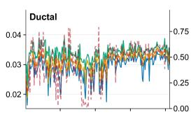

Kim et al., 2026; Gafney, 2025). Emerging AI systems now enable collaboration between pathologists and cell-level AI models: as pathologists proceed across a slide image, the model proposes labels for the cells, which can be reviewed by the pathologists to assign the labels. For example, the TissueLab platform (Li et al., 2025a) developed by the author(s) allows pathologists to navigate the slides and annotate cells with the support of an in-house AI model (Xu et al., 2025). Such collaborative systems streamline expert annotation, but every model proposal must still be inspected and finalized by a pathologist. Here, our goal is to identify cells whose AI predictions can be accepted without expert review while still ensuring long-run error control.

Recent work has begun to provide statistical guarantees for deciding which model-generated labels can be accepted without expert review. Assuming access to i.i.d. (or a uniform random subset of) labeled data, PAC Labels (Cand\`es et al., 2025) calibrates a criterion for accepting AI labels in the unlabeled data while controlling the overall error rate, whereas Conformal Labeling (Huang et al., 2025) uses selective inference (Jin and Cand\`es, 2023) to select AI labels for unlabeled data while controlling the false discovery rate among the selected labels. Their success relies on the data generating process ensuring the AI labeling errors in the labeled data are representative of the unknown errors in the new samples.

However, as a pathologist moves across regions of a whole-slide image (WSI) and then across slides, the cells may difer in both morphology and cell-type composition. Additional variation can arise from changes in specimen preparation, imaging devices, and data processing (Tellez et al., 2019; Stacke et al., 2020; Howard et al., 2021; Aubreville et al., 2023). Therefore, a rule calibrated on earlier data may fail to provide valid error control as annotation proceeds. Figure 1 visualizes such workflow shift using the NuClass model of Xu et al. (2025). We partition a pancreas WSI containing more than $1 0 ^ { 5 }$ cells into 206 approximately equal-sized spatial regions. We then order the regions to mimic a pathologist’s traversal across neighboring fields, with adaptive changes in viewing resolution; panel (a) shows this annotation order. For this diagnostic, we use the held-out label of each cell to compute the NuClass score assigned to its true class. Panel (b) reports the within-fraction empirical α-quantiles of these scores, separately for each cell type. The dashed rose curve in each panel, read against the right vertical axis, gives the cell-type proportion within each fraction. The composition of cell types varies substantially, irregularly, and at times abruptly across batches. Moreover, the in-class distributions also vary substantially: if the cells within the same type are identically distributed across batches, the quantile curves would remain approximately constant (up to sampling variation). Instead, the curves fluctuate markedly over the annotation order. These within-cell-type distributional changes, together with the composition shifts, make one-time calibration unreliable.

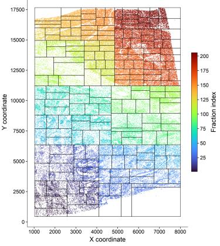  
(a)

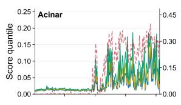

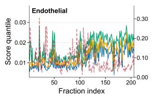

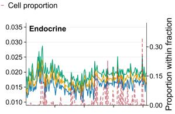

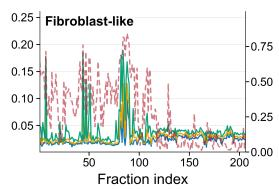  
(b)

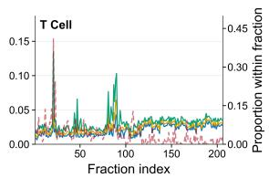  
Figure 1: Evidence of workflow shift in image-based cell-type annotation. A pancreas whole-slide image containing more than $1 0 ^ { 5 }$ cells is partitioned into 206 approximately equal-sized spatial fractions. (a) Spatial locations of cells, with color indicating the order in which the fractions enter the annotation workflow. (b) Empirical α-quantiles of the NuClass score assigned to the true class, shown separately by cell type for $\alpha \in \{ 0 . 0 5 , 0 . 1 0 , 0 . 2 0 \}$ . The dashed rose curve in each panel (right vertical axis) shows the corresponding cell-type proportion. Its irregular and, at times, abrupt changes reveal shifts in cell-type composition, while the variation in the solid quantile curves reveals within-cell-type score-distribution changes over the workflow.

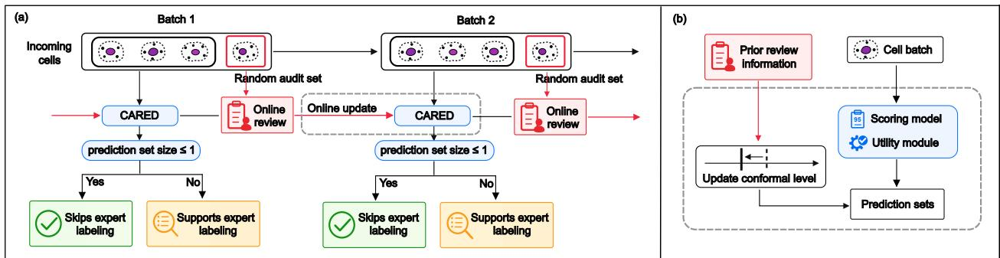  
Figure 2: Schematic of the CARED workflow. (a) Incoming cell batches are processed sequentially: CARED forms prediction sets, cells with set size at most one skip expert labeling, and a random audit set is reviewed to update the conformal level for subsequent batches. (b) Zoom-in of the prediction set generation process highlighted by the gray dashed box in panel (a), where prior review information updates the conformal level and the scoring model with the utility module produces prediction sets for the incoming batch.

## 1.1 Overview and contributions

We introduce Conformal Annotation with Randomized Expert review under Distribution shift (CARED), an online framework that uses conformal prediction sets and randomized expert audits to automate a subset of annotations in an evolving data stream. CARED is designed for cell-type annotation, but its core construction applies to other multiclass labeling workflows in which limited expert feedback is available.

The first ingredient of CARED is to derive long-run control of cumulative annotation error from coverage of prediction sets (Vovk et al., 2005). At round t, let $D _ { t }$ denote the incoming unlabeled batch. For each cell $x \in D _ { t }$ , the model scores are converted to a prediction set $\hat { C } _ { t } ( x ) \subseteq \mathcal { y }$ of plausible cell types, where Y denotes the label space. CARED selects cells with $| \hat { C } _ { t } ( x ) | \leq 1$ for automatic annotation; otherwise, the set is returned to the pathologist as a candidate list for later resolution. We refer to the fraction of cells that bypass expert review as the skipped ratio. Let $I _ { t } ( x )$ denote whether an automated annotation is produced, let y(x) denote the true cell type, and let ${ \hat { y } } _ { t } ( x )$ denote the automated annotation when it exists. Then

$$
\mathbb { 1 } \left\{ { \hat { y } } _ { t } ( x ) \neq y ( x ) \right\} \leq \mathbb { 1 } \left\{ y ( x ) \notin { \hat { C } } _ { t } ( x ) \right\} \qquad { \mathrm { w h e n e v e r ~ } } I _ { t } ( x ) = 1 .
$$

Thus, the fraction of prediction sets failing to cover the true labels (miscoverage) over the unreviewed stream upper bounds the long-run fraction of unreviewed cells that receive erroneous automatic annotations.

A natural approach to maintain this guarantee as the annotation workflow changes is to recalibrate the prediction sets in an online fashion. Adaptive conformal inference (ACI) (Gibbs and Candes, 2021; Gibbs and Cand\`es, 2024) provides a starting point: it updates prediction sets using newly observed labels and provides long-run control of cumulative miscoverage regardless of the distributional changes. The standard ACI, however, requires observing the true label after every prediction. Applied directly to annotation, it would request expert feedback for every incoming cell, leaving the burden of pathologist review unchanged.

CARED resolves this tension by proposing a novel random review mechanism. After prediction sets $\hat { C } _ { t } ( x )$ are constructed for $x \in D _ { t }$ , a subset $A _ { t } \subseteq D _ { t }$ with fraction $p \in ( 0 , 1 )$ is sampled uniformly for expert review (audit). The reviewed cells provide unbiased feedback for the whole batch. We prove that updating with the audited labels is suficient to provide long-run control of cumulative prediction-set miscoverage over both the full stream and the cells not selected for audit. Such a guarantee is ensured by the random review mechanism only, requiring no exchangeability or stationarity of the data stream, and allows the batches and prediction models to evolve arbitrarily over time. An overview of CARED is in Figure 2.

For cell-type annotation, we further enhance the core framework in two ways. First, we use classconditional calibration (Vovk et al., 2003) to achieve the same long-run guarantee within each true cell type, ensuring accuracy in clinically important but rare and challenging cell types. Second, we develop a utilityaware module that updates the AI scores to favor more accepted annotations, smaller candidate sets, and biologically coherent outputs.

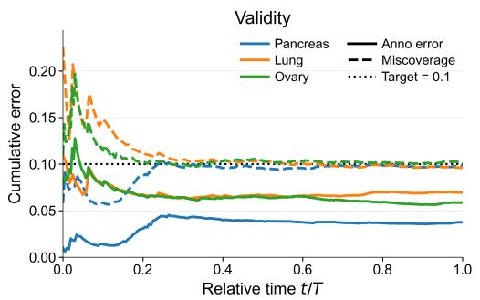

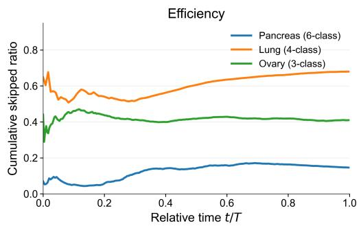  
Figure 3: Validity and eficiency of CARED across three tissue-specific tasks using the global NuClass score source (Section 4). The x-axis indicates the fraction of processed batches in the stream. (a) Cumulative annotation error (solid lines) and miscoverage (dashed lines) for the three tasks; the dotted horizontal line denotes the target error level $\alpha = 0 . 1$ . (b) Fraction of cases bypassing expert review among all incoming ones for the three tasks at $\alpha = 0 . 1$

We instantiate CARED with NuClass (Xu et al., 2025) in image-based cell-type annotation and evaluate it on streams constructed from spatially partitioned WSIs across multiple tissue types, together with a stream based on real expert annotations from TissueLab (Li et al., 2025a). Our experiments emulate various workflow shifts in real annotation processes to examine the long-run error control, reduction in expert review, prediction-set utility, and sensitivity to the audit budget and target error level. Figure 3 previews the main validity and eficiency results for CARED. Although only a fraction $( p = 0 . 1 )$ of each incoming batch is selected for expert audit, the cumulative annotation error (solid lines) remains below the target level, whereas the cumulative miscoverage (dashed lines) moves toward and remains near the target level $( \alpha = 0 . 1 )$ as the annotation streams progress. At the same time, panel (b) shows that the fraction of cells skipping expert review reaches as high as 70%, with its value varying across tissues and label spaces. Together, the two panels illustrate how randomized partial review can support online error control while allowing model-generated labels to replace expert annotation for part of the data stream.

## 1.2 Related work

Statistical guarantees for AI annotation. Our work adds to the recent literature on how model predictions can replace a portion of expert annotations while retaining explicit guarantees on label quality. PAC Labels combines AI predictions with selectively acquired expert labels within a fixed target collection and controls the overall labeling error of the completed dataset with high probability (Cand\`es et al., 2025). Conformal Labeling instead uses a labeled calibration sample to select AI-labeled cases from an i.i.d. test sample, controlling the false discovery rate among the selected labels (Huang et al., 2025). These methods address settings where the labeled data for calibrating the annotation rule are representative of the unlabeled cases. CARED considers a diferent regime with potentially arbitrary workflow shift where expert labels are obtained through randomized audits. Its target is long-run error control over the full and non-audited streams, which in turn bounds the fraction of non-audited cases receiving erroneous automatic annotations.

Human-in-the-loop annotation and partial-review workflows. Our workflow is closely related to human-in-the-loop annotation and partial-review diagnostic pipelines, where model outputs reduce expert efort. In computational pathology, prior work has studied semi-automated annotation interfaces and practical protocols for reducing expert-labeling time and labor (Cazzaniga et al., 2025; Montezuma et al., 2023, 2025) especially pathologist-supervised workflows (Bod´en et al., 2021; Rau et al., 2024; Gafney, 2025). These works motivate the partial-review setting but focus mainly on workflow design and implementation, whereas our objective is to provide statistical guarantees through partial review. A complementary literature on learning to defer jointly learns when a model should predict and when a case should be deferred to an expert (Mozannar and Sontag, 2020; Charusaie et al., 2022). These methods optimize the prediction and deferral loss, whereas CARED aims for distribution-free long-run validity for the non-deferred cases. As CARED constructs prediction sets for deferred cases, the philosophy is close to Jin et al. (2026).

Conformal methods for cell-type annotation. Cell-type annotation is an important task in multiple areas. In single-cell genomics, representative procedures include reference mapping, consensus label transfer, atlas alignment, transfer learning, and, more recently, LLM-assisted annotation (Lotfollahi et al., 2024; Ergen et al., 2024; Korsunsky et al., 2019; Lotfollahi et al., 2022; Hou and Ji, 2024). In parallel, imagebased pathology has begun moving from generic tissue-level modeling toward direct cell-level annotation and classification from histopathology or multiplex tissue images (Li et al., 2025b; Xu et al., 2025). More recently, conformal methods have also been developed for cell-type annotation (L´opez-De-Castro et al., 2025). In particular, Corbetta et al. (2026) highlighted the distribution shift issue and modeled distribution shift as label shift (assuming the distribution of data within each cell type is invariant) or covariate shift (assuming the label distribution given features is invariant). However, these models do not resolve the adaptive, unpredictable changes prevalent in cell-type annotation settings (Figure 1). In addition, we focus on annotation settings whereas these methods focus on the construction of prediction sets.

Adaptive conformal inference. Our random review mechanism extends the adaptive conformal inference (ACI) framework (Gibbs and Candes, 2021) whose representative extensions concern general update rules (Angelopoulos et al., 2024; Gibbs and Cand\`es, 2024) and time-series settings (Zafran et al., 2022; Xu and Xie, 2023). Recent work starts to relax the full-feedback requirement, such as intermittently observed labels in imitation learning (Zhao et al., 2025) and semi-bandit feedback in retrieval (Ge et al., 2024). In contrast, we present a random review mechanism to overcome the expert review bottleneck and yield error control guarantees on the entire stream and the unreviewed cases.

Label-conditional and utility-aware prediction sets. Apart from validity, a growing literature studies the utility of prediction sets. This includes studies of training or optimization schemes that seek smaller or better-shaped conformal outputs (Stutz et al., 2021; Kiyani et al., 2024). A related direction incorporates structure in the label space so that the candidate labels remain coherent with domain knowledge (Goren et al., 2024; Mortier et al., 2025; Jin et al., 2026). Our utility-aware module is in spirit close to this literature: it incorporates an optimization module to improve the skipped ratio, reduce prediction set size, and encourage outputs that respect specified relations among cell types.

## 2 Background and setup

## 2.1 Formal setup

We now describe the formal setup of the AI annotation problem. For generality, we describe the setup for a generic annotation task, while referring to cell-type annotation at times as examples. We consider a streaming workflow where the cases arrive sequentially in batches. At time step $t ,$ the AI model receives an unlabeled batch $D _ { t } = \{ x _ { t , 1 } , \ldots , x _ { t , B _ { t } } \}$ with batch size $B _ { t } : = | D _ { t } | \geq 1$

The true labels $\{ y _ { t , i } \} _ { i = 1 } ^ { B _ { t } }$ belong to a finite label space $\mathcal { Y } = [ K ] = \{ 1 , \dots , K \}$ , where K is the total number of labels (cell types). The classification model used at time t produces for each case $x \in D _ { t }$ a score vector $s _ { t } ( x ) = \left( s _ { 1 , t } ( x ) , \ldots , s _ { K , t } ( x ) \right) \in [ 0 , 1 ] ^ { K }$ , where $s _ { k , t } ( \boldsymbol { x } )$ is a model-produced score for class $k ,$ with larger values indicating stronger support for assigning x to that class. For each case $\boldsymbol { x } _ { t , i }$ , based on the score $s _ { t } ( x _ { t , i } )$ and the information available at each time t, the task is to decide whether it can bypass the expert review that provides $y _ { t , i }$ and, if so, to provide an automated annotation $\hat { y } _ { t , i }$ . This decision is denoted as $I _ { t , i } \in \{ 0 , 1 \}$ , so $I _ { t , i } = 1$ means committing to the AI annotation.

We define the cumulative annotation error up to time t as

$$
\mathrm { A n n o E r r } _ { t } : = \frac { \sum _ { s = 1 } ^ { t } \sum _ { i \in [ B _ { s } ] : I _ { s , i } = 1 } \mathbb { 1 } \left\{ \hat { y } _ { s , i } \neq y _ { s , i } \right\} } { \sum _ { s = 1 } ^ { t } B _ { s } } .
$$

Note that this quantity is fundamentally unobserved, since $y _ { t , i }$ is not observed for the cases with $I _ { t , i } = 1$ Such an error rate is analogous to the notion considered in Cand\`es et al. (2025).

In addition, we assume that expert feedback is available throughout the process, so the procedure can actively request expert feedback, denoted by an indicator $E _ { t , i } \in \{ 0 , 1 \}$ where $E _ { t , i } = 1$ means the label $y _ { t , i }$ is collected and observed before the next batch $D _ { t + 1 }$ . Together, cases in $D _ { t }$ fall into three categories:

$E _ { t , i } = 1$ , whose true label $y _ { t , i }$ is solicited from the expert and observed.

$E _ { t , i } = 0$ and $I _ { t , i } = 1$ , whose automated annotation $\hat { y } _ { t , i }$ is considered as trustworthy so $y _ { t , i }$ is never collected from the expert.

$E _ { t , i } = I _ { t , i } = 0$ , whose annotation cannot be automatically resolved by CARED but whose true label $y _ { t , i }$ need not be observed before time $t + 1 ;$ ; instead, it can be obtained later on using $\hat { C } _ { t } ( x _ { t , i } )$ as a candidate list, without interrupting our procedure.

We denote the audited set by $A _ { t } : = \{ x _ { t , i } \colon E _ { t , i } = 1 \}$ . At each time point t, given the data stream $\{ D _ { s } \} _ { s \leq t }$ and previously solicited feedback $\{ y _ { s , i } \colon E _ { t , i } = 1 \} _ { s \leq t - 1 }$ , we aim to produce the decisions $I _ { t , i }$ and $\hat { y } _ { t , i }$ <sub>i</sub> while controlling the unobserved error rate AnnoErr below a user-specified level $\alpha \in ( 0 , 1 )$ in the long run.

As previewed, we accompany each case with a prediction set $\hat { C } _ { t } ( x ) \subseteq [ K ]$ . This set is said to cover the label if $y _ { t , i } \in \hat { C } _ { t } ( x _ { t , i } )$ . Following the literature, we define the cumulative coverage error up to time t as

$$
\mathrm { C o v E r r } _ { t } : = \frac { \sum _ { s = 1 } ^ { t } \sum _ { i = 1 } ^ { B _ { s } } \mathbb { 1 } \left\{ y _ { s , i } \notin \hat { C } _ { s } ( x _ { s , i } ) \right\} } { \sum _ { s = 1 } ^ { t } B _ { s } } .
$$

As not all the $y _ { t , i } ^ { \phantom { } } \mathrm { { ^ { s } } }$ are observed, this coverage error is also unobserved for each time point t. Because every erroneous automated annotation necessarily corresponds to a prediction set that fails to contain the true label—either an empty set or a singleton set with the wrong label, the events counted by the numerator of AnnoErr form a subset of those for CovErr , and therefore we have AnnoEr $\mathbf { \tilde { \rho } } _ { t } \leq \operatorname { C o v E r r } _ { t }$

Additional notations for class-conditional errors. In cell-type annotation, it is important to maintain error rates within each true label class, because some classes can be rare but clinically important. We now introduce analogous notation for class-conditional errors. For each class $k \in [ K ]$ , let $D _ { k , t } \subseteq D _ { t }$ denote the subset of batch-t cells whose ground-truth class is k. Then $\{ D _ { k , t } \} _ { k = 1 } ^ { K }$ forms a partition of $D _ { t }$

Correspondingly, let $A _ { k , t } : = A _ { t } \cap D _ { k , t }$ be the reviewed cells from class $k ,$ and define the unreviewed subsets by $U _ { t } : = D _ { t } \setminus A _ { t } .$ , and $U _ { k , t } : = D _ { k , t } \setminus A _ { k , t }$ . For a class-k cell $\boldsymbol { x } \in D _ { k , t }$ and a corresponding prediction set $\widehat { C } _ { t } ( x )$ , define the coverage error er $\cdot _ { k , t } ( x ) : = 1 \{ k \notin \hat { C } _ { t } ( x ) \}$ }, which records whether the prediction set fails to cover the true label. For any horizon $T _ { \cdot }$ , we write the group-wise annotation (within unreviewed cases) and coverage error as

$$
\mathrm { A n n o E r r } _ { k , T } ^ { U } = \frac { \sum _ { t = 1 } ^ { T } \sum _ { x _ { t , i } \in U _ { k , t } : I _ { t , i } = 1 } \mathbf { 1 } \{ \hat { y } _ { t , i } \ne k \} } { \sum _ { t = 1 } ^ { T } | U _ { k , t } | } , \quad \mathrm { C o v E r r } _ { k , T } ^ { D } = \frac { \sum _ { t = 1 } ^ { T } \sum _ { x \in D _ { k , t } \ \mathrm { e r r } _ { k , t } ( x ) } } { \sum _ { t = 1 } ^ { T } | D _ { k , t } | } .
$$

In addition, we define the cumulative coverage error rates over reviewed and unreviewed cells as

$$
\mathrm { C o v E r r } _ { k , T } ^ { A } = \frac { \sum _ { t = 1 } ^ { T } \sum _ { \boldsymbol { x } \in A _ { k , t } } \mathrm { e r r } _ { k , t } ( \boldsymbol { x } ) } { \sum _ { t = 1 } ^ { T } \left| A _ { k , t } \right| } , \quad \mathrm { C o v E r r } _ { k , T } ^ { U } = \frac { \sum _ { t = 1 } ^ { T } \sum _ { \boldsymbol { x } \in U _ { k , t } } \mathrm { e r r } _ { k , t } ( \boldsymbol { x } ) } { \sum _ { t = 1 } ^ { T } \left| U _ { k , t } \right| } .
$$

## 2.2 Preliminaries on conformal prediction

We next briefly review conformal prediction algorithms which will be useful in motivating our procedure.   
These algorithms may operate in diferent settings than ours, and we introduce them in their original setup.

Split conformal prediction (SCP) is a canonical variant of conformal prediction (Vovk et al., 2005; Lei et al., 2018). Assuming access to labeled data $\{ ( X _ { i } , Y _ { i } ) \} _ { i = 1 } ^ { n }$ , the goal is to construct a prediction set ${ \hat { C } } ( X _ { n + 1 } ) \subseteq { \mathcal { Y } }$ for the unknown label $Y _ { n + 1 }$ of a newly observed test point $X _ { n + 1 } \in { \mathcal { X } }$ . The SCP method leverages any conformity score $s : \mathcal { X } \times \mathcal { Y }  \mathbb { R }$ , which is a function whose training process is independent of $\{ ( X _ { i } , Y _ { i } ) \} _ { i = 1 } ^ { n } \cup \{ X _ { n + 1 } \}$ . Oftentimes the score s builds upon a pre-trained prediction model, and intuitively, the score $s ( x , y )$ measures how well the value y “conforms” to the predicted value based on x. The SCP prediction set takes the form

$$
\widehat C _ { \alpha } ^ { \mathrm { S C P } } ( X _ { n + 1 } ) = \{ y \in \mathcal { Y } : s ( X _ { n + 1 } , y ) \geq \widehat { q } _ { \alpha } \} ,
$$

where $\widehat { q } _ { \alpha }$ is the empirical α-quantile of $\{ S _ { i } \} _ { i = 1 } ^ { n } \cup \{ - \infty \}$ , and $S _ { i } = s ( X _ { i } , Y _ { i } )$ for $i = 1 , \ldots , n$ . Under the condition that $\{ ( X _ { i } , Y _ { i } ) \} _ { i = 1 } ^ { n + 1 }$ are exchangeable, without any other assumptions on the data distribution or the score $s ,$ the coverage guarantee of SCP holds in finite sample: $\mathbb { P } \big ( Y _ { n + 1 } \in \widehat { C } _ { \alpha } ^ { \mathrm { S C P } } ( X _ { n + 1 } ) \big ) \geq 1 - \alpha$

The Mondrian conformal prediction (MCP) method extends SCP to achieve class-conditional coverage (Vovk et al., 2003), and we state this method here in accordance with SCP (assuming a pre-trained score function). Assuming access to the same data as above, and writing $\mathcal { Y } = \{ 1 , \ldots , K \}$ , we denote ${ \mathcal { T } } _ { k } = \{ i \leq n : Y _ { i } = k \}$ as the calibration indices of class k. Then, let $\widehat { q } _ { k , \alpha }$ denote the empirical α-quantile of $\{ s ( X _ { i } , k ) \} _ { i \in { \mathcal { T } } _ { k } } \cup \{ - \infty \}$ . The MCP set for the new test point $X _ { n + 1 }$ is given by

$$
\widehat { C } _ { \alpha } ^ { \mathrm { M C P } } ( X _ { n + 1 } ) = \big \{ k \in \mathcal { V } : s ( X _ { n + 1 } , k ) \geq \widehat { q } _ { k , \alpha } \big \} .
$$

Assuming the within-class exchangeability of $\{ ( X _ { i } , Y _ { i } ) \colon Y _ { i } = k \} _ { i = 1 } ^ { n + 1 }$ , these prediction sets satisfy

$$
\begin{array} { r } { \mathbb { P } \big ( Y _ { n + 1 } \in \widehat { C } _ { \alpha } ^ { \mathrm { M C P } } ( X _ { n + 1 } ) \ \big | \ Y _ { n + 1 } = k \big ) \geq 1 - \alpha , \qquad \forall k \in [ K ] . } \end{array}
$$

The essential advantage is that exchangeability is no longer imposed on the full distribution of $( X , Y )$ In an online process, the label proportion $\mathbb { P } ( Y _ { t } ~ = ~ k )$ may drift arbitrarily, and MCP maintains in-class coverage as long as the within-class distributions remain exchangeable. Moreover, the class-conditional coverage guarantee it delivers is stronger than the marginal coverage guarantee and is particularly suitable for cell-type annotation in which certain classes can be consequential.

While SCP and MCP still rely on exchangeability structures within data, adaptive conformal inference (ACI) is an online procedure that maintains coverage even when the data distribution drifts arbitrarily (Gibbs and Candes, 2021). The key strategy is to adjust the sets adaptively based on newly observed labels. Consider an online setting where data points $( X _ { t } ) _ { t \geq 1 }$ arrive one at a time, and the true label $Y _ { t }$ is revealed before time t + 1. The algorithm maintains a running level $\alpha _ { t } ,$ , and at step t issues the prediction set $\widehat { C } _ { \alpha _ { t } } ( X _ { t } )$ as in the SCP construction above. Once the true label $Y _ { t }$ is revealed, it updates the level by

$$
\alpha _ { t + 1 } = \alpha _ { t } + \gamma \big ( \alpha - \mathrm { e r r } _ { t } \big ) , \qquad \mathrm { e r r } _ { t } : = \mathbb { 1 } \{ Y _ { t } \notin \widehat { C } _ { \alpha _ { t } } ( X _ { t } ) \} ,
$$

with a fixed step size $\gamma > 0$ and any initialization $\alpha _ { 1 } \in \mathbb { R }$ . For any sequence $( X _ { t } , Y _ { t } ) _ { t \geq 1 }$ , whether stationary, drifting, or adversarially generated, this procedure delivers the long-run guarantee ${ \begin{array} { r } { { \frac { 1 } { T } } \sum _ { t = 1 } ^ { T } \operatorname { e r r } _ { t } \ \to \ \alpha } \end{array} }$ as $T \to \infty$ . However, the true label $Y _ { t }$ must be revealed before the next prediction can be issued.

## 3 Method and theoretical guarantees

In the following, we introduce the CARED framework in Section 3.1, the optional enhancement in Section 3.2, and the error control guarantees in Section 3.3.

## 3.1 Conformal annotation with randomized expert review

At the beginning, we assume access to an initial labeled block $A _ { 0 }$ , among which the cells belonging to class $k \in [ K ]$ are denoted as $A _ { k , 0 }$ . This block provides the initial labeled pool used to construct class-wise prediction sets. Moreover, we initialize the class-wise levels by $\alpha _ { k , 1 } = \alpha$ for every $k \in [ K ]$ . We shall maintain the labeled sets $\{ A _ { k , t } \} _ { k \in [ K ] , t \geq 1 }$ and the levels $\{ \alpha _ { k , t } \} _ { k \in [ K ] , t \geq 1 }$ over time.

The procedure proceeds over time $t = 1 , 2 , \dots , T$ . At each time point t, for each class $k ,$ a calibration set $D _ { k , \mathrm { c a l } } ( t )$ is constructed to be the class-k cells in the most recently reviewed min $\{ t , T _ { w } \}$ batches, where $T _ { w } \ge 1$ is a pre-specified parameter. That is, we define $\begin{array} { r } { D _ { k , \mathrm { c a l } } ( t ) = \prod _ { \tau = t - T _ { w } } ^ { t - 1 } A _ { k , \tau } } \end{array}$ . This choice is computationally convenient and allows the calibration set to track local distributional changes. However, for theoretical validity, any subset of all already-reviewed class-k cells, i.e., any subset of $\textstyle \bigcup _ { \tau = 0 } ^ { t - 1 } A _ { k , \tau }$ , are allowed. Also, a score $\tilde { s } _ { k , t } ( x ) \in [ 0 , 1 ]$ is computed based on a prediction model (in this paper, the NuClass (Xu et al., 2025) model), which might be updated over time, $\mathrm { e . g . }$ , using the utility module described in Section 3.2. For any $u \in [ 0 , 1 ]$ , we denote the u-th empirical quantile of the calibration set as

$$
\begin{array} { r } { \widehat { q } _ { k , t } ( u ) : = \operatorname* { i n f } \Big \{ q \in [ 0 , 1 ] : \frac { 1 } { | D _ { k , \mathrm { c a l } } ( t ) | } \sum _ { x \in D _ { k , \mathrm { c a l } } ( t ) } \mathbb { 1 } \big \{ \widetilde { s } _ { k , t } ( x ) \leq q \big \} \geq u \Big \} . } \end{array}\tag{1}
$$

For completeness, we define $\hat { q } _ { k , t } ( u ) = - \infty$ for $u < 0$ and $\hat { q } _ { k , t } ( u ) = + \infty$ for $u > 1$ . When $| D _ { k , \mathrm { c a l } } ( t ) | = 0$ , we set $\hat { q } _ { k , t } ( u ) = - \infty$ for $u \leq 1$ and $\hat { q } _ { k , t } ( u ) = + \infty$ for $u > 1$ . Given the levels $\{ \alpha _ { k , t } \} _ { k = 1 } ^ { K }$ , we construct

$$
\widehat { C } _ { t } ( x ) = \left\{ k \in [ K ] : \tilde { s } _ { k , t } ( x ) \geq \widehat { q } _ { k , t } ( \alpha _ { k , t } ) \right\} , \quad x \in D _ { t } .\tag{2}
$$

Our updating rule below following ACI may lead to $\alpha _ { k , t } \notin [ 0 , 1 ]$ , yet the empirical quantiles are well-defined. To accommodate cases where $\widehat { C } _ { t } ( x ) = \varnothing$ , we define the enlarged set

$$
\widehat C _ { t } ^ { + } ( x ) = \left\{ \begin{array} { l l } { \widehat C _ { t } ( x ) , } & { \widehat C _ { t } ( x ) \neq \emptyset , } \\ { \{ \arg \operatorname* { m a x } _ { k \in [ K ] } \tilde { s } _ { k , t } ( x ) \} , } & { \widehat C _ { t } ( x ) = \emptyset , } \end{array} \right.\tag{3}
$$

where ties in the second case are broken randomly. Thus, $\widehat { C } _ { t } ^ { + } ( x )$ is a singleton whenever $| \widehat { C } _ { t } ( x ) | \leq 1$ . Since $\widehat { C } _ { t } ( x ) \subseteq \widehat { C } _ { t } ^ { + } ( x )$ , we know $\mathbb { 1 } \{ k \notin \widehat { C } _ { t } ^ { + } ( x ) \} \subseteq \mathbb { 1 } \{ k \notin \widehat { C } _ { t } ( x ) \}$ . Our theory in Section 3.3 establishes the long-run coverage of $\widehat { C } _ { t } ( x )$ , which translates to the long-run coverage of $\widehat { C } _ { t } ^ { + } ( x )$ and the annotation error bound.

The levels $\{ \alpha _ { k , t } \}$ are updated through an unbiased randomized rounding scheme. Fix a target reviewed fraction $p \in ( 0 , 1 )$ . At time t, CARED chooses a realizable fraction $p _ { t }$ so that ${ { p } _ { t } } { { B } _ { t } }$ is an integer and the cumulative reviewed fraction $( \sum _ { t = 1 } ^ { T } p _ { t } B _ { t } ) / ( \sum _ { t = 1 } ^ { T } B _ { t } ) \to p$ as $T \to \infty ;$ see Appendix B.1 for details. Then we sample uniformly without replacement from $D _ { t }$ the audit set of size $| A _ { t } | = p _ { t } B _ { t }$ . The annotation decision is

$$
I _ { t , i } : = ( 1 - E _ { t , i } ) \mathbb { 1 } \big \{ | \widehat { C } _ { t } ( x _ { t , i } ) | \leq 1 \big \} .
$$

Whenever $I _ { t , i } = 1$ , we define the automated annotation $\hat { y } _ { t , i }$ as the unique element of the prediction set, $\widehat { C } _ { t } ^ { + } ( x _ { t , i } ) = \{ \widehat { y } _ { t , i } \}$ . No automated annotation $\hat { y } _ { t , i }$ is produced when $I _ { t , i } = 0$ . The audited labels are then used to update the online levels for subsequent steps similar to ACI:

$$
\alpha _ { k , t + 1 } = \alpha _ { k , t } + \gamma _ { k } \sum _ { x \in A _ { k , t } } \bigl ( \alpha - \mathrm { e r r } _ { k , t } ( x ) \bigr ) , \qquad k \in [ K ] ,\tag{4}
$$

where $\gamma _ { k }$ is a pre-specified step size for class $k ,$ and $\mathrm { e r r } _ { k , t } ( x ) = \mathbb { 1 } \{ k \not \in \widehat { C } _ { t } ( x ) \}$ is the miscoverage indicator. In our experiments, we fix the class-wise step sizes according to cohort-specific class frequencies; the specific choices are given in Appendix C.1. Appendix D further discusses the performance of fixed step sizes compared with time-varying ones. The updated online levels are then used to compute the next batch’s class-wise quantile cutofs through (2). We summarize the procedure of CARED in Algorithm 1.

## 3.2 Optional model training with utility improvement in cell-type annotation

The procedure introduced in Section 3.1 works for any score functions $\tilde { s } _ { k , t } ( \cdot )$ , but the choice of the score function determines the form of the prediction sets. In this part, we introduce an optional module that adapts the score functions over time. Specifically, we parameterize the transformed score as $\boldsymbol { \tilde { s } } _ { t } ( \boldsymbol { x } ) = f _ { \boldsymbol { \Theta } _ { t } } \big ( \boldsymbol { s } _ { t } ( \boldsymbol { x } ) \big )$ , where $\Theta _ { t }$ is updated over time and $s _ { t } ( \cdot )$ is the original score given by the NuClass model. The construction of the score transformation $f _ { \Theta _ { t } }$ is provided in Algorithm A.2 in Appendix A.3.

Utility metrics and training objective. Recall that the t-th batch is $D _ { t } = \{ x _ { t , 1 } , \ldots , x _ { t , B _ { t } } \}$ , where $B _ { t } = | D _ { t } |$ . For any parameter $\Theta ,$ let $\widehat { C } _ { t , i } ( \Theta )$ denote the prediction set $\widehat { C } _ { t } ( \boldsymbol { x } _ { t , i } )$ obtained using the transformed scores $f _ { \Theta } \{ s _ { t } ( x _ { t , i } ) \}$ . The construction follows (1)–(2). Before updating $\Theta _ { t }$ and deciding $\tilde { s } _ { t } ( \cdot )$ , we first define what properties are good for prediction sets. Below we quantify the utility of prediction sets for a batch $D _ { t }$ based on three criteria: (1) skipped ratio surrogate, (2) set size, and (3) structural coherence.

Algorithm 1 CARED   
Input: Initial labeled block $A _ { 0 }$ with labels in $[ K ] ;$ incoming batches $\{ D _ { t } \} _ { t = 1 } ^ { T } ;$ target error level $\alpha \in ( 0 , 1 )$   
target reviewed fraction $p \in ( 0 , 1 )$ ; calibration window $T _ { w } \ge 1 ;$ fixed step sizes $\gamma _ { k } > 0 , k \in [ K ]$   
1: Set $A _ { k , 0 }  \{ x \in A _ { 0 } : y ( x ) = k \}$ and $\alpha _ { k , 1 }  \alpha$ for every $k \in [ K ]$   
2: for $t = 1 , \dots , T$ do   
3: Receive $D _ { t } = \{ x _ { t , i } \} _ { i = 1 } ^ { B _ { t } }$ and score functions $\{ \tilde { s } _ { k , t } : \mathcal { X } \to [ 0 , 1 ] \} _ { k = 1 } ^ { K } .$   
4: for $k = 1 , \ldots , K$ do   
5: Set $\begin{array} { r } { D _ { k , \mathrm { c a l } } ( t ) \gets \bigcup _ { \tau = \operatorname* { m a x } \{ 0 , t - T _ { w } \} } ^ { t - 1 } A _ { k , \tau } . } \end{array}$   
6: Compute $\hat { q } _ { k , t } ( \alpha _ { k , t } )$ according to (1).   
7: end for   
8: Compute $\widehat { C } _ { t } ( \boldsymbol { x } _ { t , i } )$ and $\widehat { C } _ { t } ^ { + } ( x _ { t , i } )$ according to (2) and (3) for every $i \in [ B _ { t } ]$   
9: Draw $\xi _ { t } \sim$ Bernoull $\mathrm { i } ( p B _ { t } - \lfloor p B _ { t } \rfloor )$ and set $p _ { t } \gets ( \lfloor p B _ { t } \rfloor + \xi _ { t } ) / B _ { t } .$ ▶ See Appendix B.1   
10: Sample $A _ { t } \subseteq D _ { t }$ uniformly without replacement with $| A _ { t } | = p _ { t } B _ { t }$   
11: For every $i \in [ B _ { t } ]$ , set $E _ { t , i }  \mathbb { 1 } \{ x _ { t , i } \in A _ { t } \}$ and $I _ { t , i } \gets ( 1 - E _ { t , i } ) \mathbb { 1 } \{ | \widehat { C } _ { t } ( x _ { t , i } ) | \leq 1 \}$   
12: Compute the unique $\widehat { y } _ { t , i } \in \widehat { C } _ { t } ^ { + } ( x _ { t , i } )$ for each $i \in [ B _ { t } ]$ with $I _ { t , i } = 1 .$   
13: Obtain expert labels $y _ { t , i }$ for all $E _ { t , i } = 1$ , and set $A _ { k , t } \gets \{ x _ { t , i } \in A _ { t } : y _ { t , i } = k \}$ for every $k \in [ K ]$   
14: For every $k \in [ K ]$ , update $\begin{array} { r } { \alpha _ { k , t + 1 }  \alpha _ { k , t } + \gamma _ { k } \sum _ { x \in A _ { k , t } } ( \alpha - \mathbb { 1 } \{ k \notin \widehat { C } _ { t } ( x ) \} ) } \end{array}$   
15: end for   
Output: Prediction sets $\widehat { C } _ { t } ( x _ { t , i } )$ , annotation decisions $I _ { t , i }$ and annotation labels $\hat { y } _ { t , i }$ for $I _ { t , i } = 1$

First, we encourage the score function to lead to a large fraction of automated annotations. This fraction (among cases not selected for expert audit) can be estimated using the entire batch: $\mathcal { I } _ { \mathrm { s k i p } } ( \Theta ) =$ $\begin{array} { r } { \frac { 1 } { B _ { t } } \sum _ { i = 1 } ^ { B _ { t } } \mathbb { 1 } \{ | \widehat { C } _ { t , i } ( \Theta ) | \leq 1 \} } \end{array}$ In addition, since non-singleton sets will be used as references for experts to resolve the ambiguity, it is sensible to encourage small set sizes. Smaller sets leave fewer candidate labels for the subsequent narrowing-down step and are therefore more useful in human-in-the-loop decision making (Zhang et al., 2024; Dhillon et al., 2024). We thus consider the second metric $\begin{array} { r } { \mathcal { T } _ { \mathrm { s i z e } } ( \Theta ) = \frac { 1 } { B _ { t } } \sum _ { i = 1 } ^ { B _ { t } } | \widehat { C } _ { t , i } ( \Theta ) | } \end{array}$ Finally, a non-singleton prediction set is more useful when the candidate labels respect the biological structures among the cell types (Kaymaz et al., 2021; Theunissen et al., 2024; Corbetta et al., 2026). We design a metric $\mathcal { I } _ { \mathrm { s t r u c t } } ( \Theta )$ to reward structurally coherent prediction sets based on the subtype tree-structures in cell types; the detailed construction is given in Appendix A.1. The three components are combined into

$$
\mathcal { I } ( \Theta ) = \lambda _ { \mathrm { s i z e } } \mathcal { I } _ { \mathrm { s i z e } } ( \Theta ) - \lambda _ { \mathrm { s t r u c t } } \mathcal { I } _ { \mathrm { s t r u c t } } ( \Theta ) - \lambda _ { \mathrm { s k i p } } \mathcal { I } _ { \mathrm { s k i p } } ( \Theta ) ,\tag{5}
$$

where the weights are nonnegative; see Appendix C.1 for the choice in our applications. Thus, minimizing (5) penalizes large sets while rewarding structural coherence and a larger skipped-ratio.

Online score training. To train the score function, we first build a smooth surrogate for the objective $\mathcal { I } ( \Theta )$ . Specifically, since several terms involve indicators that are dificult for gradient descent updates, we replace these quantities via standard diferentiable approximations. At each time t, we initialize $\Theta = 0$ and perform N gradient steps on the surrogate objective evaluated on the current unlabeled batch $D _ { t }$ . Before each update, we compute the class-wise conformal thresholds from the labeled calibration sets $\{ D _ { k , \mathrm { c a l } } ( t ) \} _ { k = 1 } ^ { K }$ using the current transformation $f _ { \Theta }$ . After each update, we recompute these thresholds and evaluate the original empirical objective $\mathcal { I } ( \Theta )$ on $D _ { t }$ . Among the initialization and all gradient iterates, we select the parameter value with the lowest objective value as $\Theta _ { t } .$ . Notably, CARED allows $\Theta _ { t }$ to depend on the current batch $D _ { t } .$ , provided that $\Theta _ { t }$ is constructed before the audit set $A _ { t }$ is sampled. The online training procedure is summarized in Algorithm A.1 and detailed in Appendix A.2.

## 3.3 Theoretical guarantees

In this part, we present the main theoretical guarantee, which establishes long-run class-wise validity in CARED based on the random audit alone, regardless of the distribution drift and the score models. At a high level, the batch-wise ACI-style recursion controls the error within the reviewed cells, and the uniform random audit transfers this control to the full stream, including the cells that are not reviewed. These theoretical results help contextualize the quality guarantee for the automated annotations from CARED.

Recall the notations from Section 2.1: $\mathrm { C o v E r r } _ { k , T } ^ { A } , \mathrm { C o v E r r } _ { k , T } ^ { D } ,$ and $\mathrm { C o v E r r } _ { k , T } ^ { U }$ denote the cumulative conformal errors over the audited cells, all cells, and unaudited cells that belong to class $k ,$ respectively, up to time T. The true class membership is unknown unless the case is reviewed by experts $( { \mathrm { i . e . , ~ } } E _ { t , i } \in \{ 0 , 1 \} )$ and is used only for stating the guarantees. Let $\{ \mathcal { G } _ { t } \} _ { t \ge 0 }$ be the pre-review filtration, where $\mathcal { G } _ { t }$ is the sigmafield generated by the information after the prediction sets for $D _ { t }$ are formed but before the audit set $A _ { t }$ is sampled. In particular, the class counts $| D _ { k , t } |$ and the coverage indicators $\mathrm { e r r } _ { k , t } ( \boldsymbol { x } )$ for any $\boldsymbol { x } \in D _ { k , t }$ are G -measurable. Recall that $\{ p _ { t } \} _ { t = 1 } ^ { T }$ are the fraction of cases sent for expert review in the batches.

We impose mild conditions on the data and the random audit, without imposing exchangeability or stationarity of the incoming batches or any parametric model on the data distribution.

Assumption 3.1. Fixing a target reviewed fraction $p \in ( 0 , 1 )$ , we assume that:

(i) The batch size $B _ { t } = | D _ { t } |$ is uniformly controlled, obeying $B ^ { - } \leq B _ { t } \leq B ^ { + }$ for some finite, positive integers $0 < B ^ { - } \le B ^ { + } < \infty$

(ii) For every $k \in [ K ]$ , the cumulative number of class-k cells diverges, i.e., $\scriptstyle \sum _ { t = 1 } ^ { \infty } | D _ { k , t } | = \infty$ as $T \to \infty$

(iii) Conditional on $\mathcal { G } _ { t }$ , the audit set $A _ { t } \subseteq D _ { t }$ is drawn uniformly without replacement with $| A _ { t } | = p _ { t } B _ { t }$

(iv) The score function $\tilde { s } _ { t } ( \cdot )$ is adapted to $\mathcal { G } _ { t }$

Assumption 3.1(i) and (iii) can be ensured through appropriate batch construction and audit sampling. Moreover, (ii) is a mild condition that every cell type continues to occur and can be updated throughout the workflow so the within-class asymptotics apply. Finally, (iv) requires the score function to be determined before drawing the random audit, but can depend on the batch $D _ { t }$

We begin with the guarantee on the expert-reviewed cells. The proof of Proposition 3.2 is in Appendix E.1.

Proposition 3.2 (Long-run coverage error control for reviewed cells). Fix any class $k \in [ K ]$ , suppose the accumulated class-k frequency is bounded away from zero, i.e., lim in $\begin{array} { r } { \mathrm { f } _ { T  \infty } \frac { \sum _ { t = 1 } ^ { T } | D _ { k , t } | } { \sum _ { t = 1 } ^ { T } B _ { t } } \geq q _ { k } } \end{array}$ for some constant $q _ { k } > 0$ . Under assumption 3.1, almost surely there exists some $T _ { 0 } < \infty$ such that for all $T \geq T _ { 0 }$ 2

$$
{ \big | } \mathrm { C o v E r r } _ { k , T } ^ { A } - \alpha { \big | } \leq { \frac { \operatorname* { m a x } \{ \alpha , 1 - \alpha \} } { \gamma _ { k } \sum _ { t = 1 } ^ { T } \left| A _ { k , t } \right| } } + { \frac { C } { T } } ,
$$

where $\begin{array} { r } { C = \frac { 2 B ^ { + } } { B ^ { - } q _ { k } } ( 1 + \frac { 1 } { p B ^ { - } } ) } \end{array}$ . Consequently, $\mathrm { C o v E r r } _ { k , T } ^ { A } \to \alpha$ almost surely as $T \to \infty$

Intuitively, the coverage guarantee on the reviewed cases inherit the guarantees from ACI. Our main result is that such guarantee translates to that on the entire stream, due to the unbiased random design. The proof of Theorem 3.3 is in Appendix E.2.

Theorem 3.3 (Long-run coverage error control for all cells). Under Assumption 3.1, for every class $k ,$ as $T \to \infty$ , the cumulative miscoverage over all cells and the cells not reviewed by the experts satisfies

$$
\left| \operatorname { C o v E r r } _ { k , T } ^ { D } - \alpha \right| \to 0 , \quad \left| \operatorname { C o v E r r } _ { k , T } ^ { U } - \alpha \right| \to 0 \quad \mathrm { a . s . }
$$

These within-class coverage guarantees, together with the growing conditions on the group sizes, imply the overall coverage guarantee, i.e., CovErr → α almost surely, and the coverage guarantee for all cases not reviewed by the experts by the lower-bounded audit probability, whose proofs are omitted for brevity. In a nutshell, it means that even though CARED only requests expert labels for a fraction of $p \in ( 0 , 1 )$ of cases (in our experiments, the fraction can be as low as 10% or even lower), the prediction sets for all the incoming cases are still asymptotically well-calibrated and adapted to the arbitrarily drifting workflow.

More importantly for deployment, because $\widehat { C } _ { t } ( x _ { t , i } ) \subseteq \widehat { C } _ { t } ^ { + } ( x _ { t , i } )$ , the annotation error is upper bounded by miscoverage. We present this result in Corollary 3.4.

Corollary 3.4 (Long-run automated-annotation error control). Recall the overall cumulative annotation error AnnoErr<sub>T</sub> and class-wise annotation error AnnoErr<sub>k,T</sub> defined in Section 2.1. Under Assumption 3.1,

$$
\operatorname* { l i m } _ { T \to \infty } \operatorname { A n n o E r r } _ { k , T } ^ { U } \leq \alpha \quad { \mathrm { a . s . , } } \quad k \in [ K ] .
$$

Like Theorem 3.3, these guarantees are distribution-free, requiring no exchangeability or stationarity conditions on the data stream. They also allow the AI models and scores to evolve arbitrarily over time. In addition, the per-class calibration ensures that the annotation error is rigorously controlled within every class, even though the true class memberships are unknown. This avoids neglecting clinically consequentia but dificult-to-classify cell types. In practice, if the AI prediction quality is poor for one particular class, then CARED will accept fewer cases for automated annotation to maintain the error control.

For completeness, we establish an explicit convergence rate for the cumulative miscoverage error. Additional theory characterizing cumulative batch-wise deviations from the target level is in Appendix B.2.

Proposition 3.5 (Long-run error convergence rate). Under the CARED procedure, suppose that the classfrequency condition in Proposition 3.2 holds for every class. Then, for every class $k ,$

$$
\left| \operatorname { C o v E r r } _ { k , T } ^ { D } - \alpha \right| \vee \left| \operatorname { C o v E r r } _ { k , T } ^ { U } - \alpha \right| = \mathcal { O } _ { p } \Big ( \big ( \sum _ { t = 1 } ^ { T } \vert D _ { k , t } \vert \big ) ^ { - 1 / 2 } \Big ) = \mathcal { O } _ { p } ( T ^ { - 1 / 2 } ) .
$$

## 4 Case study in cell-type annotation workflows

## 4.1 Data and annotation workflow

This case study evaluates CARED in the motivating cell-type annotation task where pathologists annotate cell types on whole-slide images (WSIs) in TissueLab (Li et al., 2025a). We describe the AI model, the tissue cohorts and their labels, and the construction of annotation streams.

We use the NuClass (Xu et al., 2025) model as the AI scores; it is a multi-scale histopathology model that detects nuclei and outputs a class-wise score vector for each detected cell. It provides three score sources, each used as the raw score $s _ { t } ( x )$ : the global path, which incorporates the surrounding tissue context; the local path, which relies on nucleus-centered morphology; and the gated output, which adaptively fuses the two at the cell level. We use the three sources to show how CARED behaves under scores of diferent quality and sensitivity to tissue context. All cohorts below are fully held out from NuClass training and tuning.

The main experiments use three held-out cohorts from pancreas, lung, and ovary tissue, with label spaces of six, four, and three cell types, respectively (Table 1). The cohorts consist of one H&E-stained WSI per tissue, taken from three publicly available 10x Genomics Xenium datasets: FFPE pancreatic adenocarcinoma, non-small cell lung cancer, and ovarian serous carcinoma (10x Genomics, $^ { 2 0 2 4 \mathrm { c } , \mathrm { a } , \mathrm { b } ) }$ ; see Appendix C for details on the H&E processing of the slide. We exclude cells on background or too close to the slide edge. Each cell was assigned a reference label from its spatial gene-expression profile: the 10x Genomics cell type with the highest normalized marker-gene score, which is viewed as the ground-truth cell type. Because these labels come from molecular measurements, they provide a reference independent of the H&E morphology. For audited cells, these reference labels are revealed to CARED to emulate expert review. For unaudited ones, they are used to compute the error rates only, and are never available to the procedure.

The label spaces reflect the cell populations. These cell types are critical because pathologists routinely distinguish these tissues based on cell’s spatial arrangements. Furthermore, they define tissue function and the tumor microenvironment: endocrine cells form the islets of Langerhans in the pancreas, while T cells, macrophages, and tumor-associated fibroblasts shape tumor progression and response to immunotherapy in lung and ovarian cancer. In this dataset, several clinically relevant cell types are especially rare: in the pancreas cohort, endocrine cells and T cells account for only 1.95% and 3.77% of all cells. Due to the class imbalance, a marginal error guarantee could be met while misannotating most of these rare cells, so we primarily target the class-conditional error control throughout.

Table 1: Data used in the case study. Class proportions are computed over all cells in each cohort.
<table><tr><td>Tissue cohort</td><td># Cells</td><td># Batches</td><td>Cell type (fractions %)</td></tr><tr><td>Pancreas</td><td>103,166</td><td>206</td><td>Acinar (12.8), Ductal (45.2), Endocrine (2.0), Endothelial (8.6), Fibroblast-like (27.6), T cell (3.8)</td></tr><tr><td>Lung</td><td>61,490</td><td>123</td><td>Endothelial (27.6), Epithelial malignant (61.8), T cell (5.9), Tumor-associated fibroblast (4.7)</td></tr><tr><td>Ovary</td><td>150,748</td><td>301</td><td>Endothelial (5.0), Epithelial malignant (85.3), Macrophage (9.7)</td></tr></table>

Annotation data streams. To emulate how cells reach an annotator, we partition each cohort into spatially contiguous regions containing between $B ^ { - } = 4 9 0$ and $B ^ { + } = 5 1 0$ cells. Each region plays the role of a field of view and forms one batch. One region, chosen at random, serves as the initial labeled block $A _ { 0 } .$ The order in which the remaining regions are released is determined by annotation practice rather than by the tissue, so we consider three release schemes, each corresponding to a diferent practice:

• Adjacent: the next region is chosen among the unreleased neighbors of the current one, mimicking a pathologist panning across neighboring fields (Figure 1(a)).

• Random: regions are released in random order, mimicking the sampling of tiles or regions of interest when building annotated datasets (Qiu et al., 2023; H¨agele et al., 2020).

• Error-guided: the next region is selected by identifying the class whose cumulative error on audited cells deviates most from α and releasing the region with the most cells predicted as that class. This mimics tools that steer annotators toward regions where the model currently struggles. Because each release depends on past audit outcomes, this scheme serves as an adversarial test with strong dependence; our guarantees still hold as long as the audit set is uniformly sampled given the past (Assumption 3.1(iii)).

The three schemes use the same cohorts, scoring model, and procedure, and difer only in the release order which determines the distribution drifts. Under the adjacent scheme, spatial autocorrelation yields gradual drift with abrupt changes at tissue-compartment boundaries (Figure 1); under the error-guided scheme, the drift is driven by the procedure’s past outcomes. Both of them lead to strong non-exchangeability. In the random scheme, due to random ordering, the batches are exchangeable. This exchangeability, however, holds at the level of regions only, since cells within a region share morphology and composition. With a limited number of regions (Table 1), such exchangeability does not sufice to justify error control on the cell level in each realized stream as the guarantees in Section 3.3.

Expert review protocol and interface. Figure 4 presents a demo interface for the annotation protocol. When a subsequent batch is processed, the interface displays all cells in the batch to preserve the spatial and morphological context needed for expert judgment, but only the uniformly sampled audit set $A _ { t }$ is flagged for review. Each flagged cell is outlined in the color of its highest-scoring class. The annotator inspects the flagged cells and corrects the displayed label whenever it is wrong. The resulting labels are then used in CARED to update the class-wise levels $\{ \alpha _ { k , t } \}$ before the next batch is released. For unreviewed cells, CARED determines which of them to annotate automatically; otherwise, the cell is deferred, and its prediction set is shown as a candidate list. In the three held-out cohorts, the annotator’s response is emulated by revealing the reference label of each flagged cell. Additional implementation details are reported in Appendix C.

Real expert annotation stream. To evaluate CARED on an annotation order produced by actual practice rather than by a release scheme, we also use expert annotations collected in TissueLab on a colon

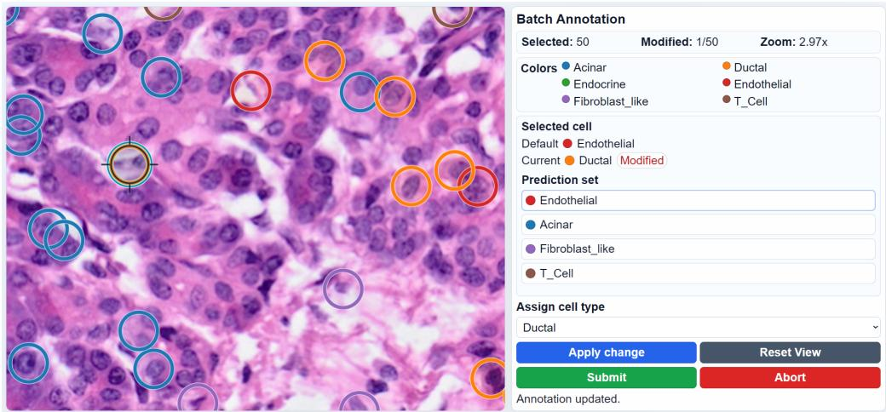  
Figure 4: Interface for one pancreas batch in the partial-review workflow. The left panel shows a local histology field with reviewed cells highlighted by class-specific colored outlines. After clicking on a reviewed cell, the right panel displays its annotation information, including the default label, current label, and conformal prediction set. This example illustrates a reviewed cell whose label has been modified.

WSI containing 220,501 cells. One annotator (a research scientist trained in histopathology annotation under pathologist supervision) annotated 1,374 cells over 37 rounds, in the order they chose while navigating the slide. The annotated cells are grouped into three classes: tumor (20.5%), muscle (45.0%), and others (34.5%).<sup>1</sup> Both the stream order and the labels are determined by the expert behavior; results are reported in Section 4.4.

## 4.2 CARED controls cumulative annotation error

We present the cumulative coverage results using the global NuClass score; additional results for other score sources are reported in Appendix C. Unless otherwise stated, the experiments below use target error level $\alpha = 0 . 1$ , target reviewed fraction $p = 0 . 1$ , and a fixed random seed 0.

Figure 5 reports the whole-stream cumulative coverage error trajectories (which upper bounds the annotation error) under the three batch-release schemes. Within each true cell type, miscoverage over the entire stream approaches α = 0.1 in most settings, even though true types are observed only for the 10% audited cells. The largest remaining gaps occur for rare types, such as tumor-associated fibroblasts in the adjacent lung stream, consistent with slower convergence for rare classes (Proposition 3.5). We also summarize the marginal errors per tissue, which also approaches the target level in each batch-release scheme.

Comparison with static calibration. A common alternative is to calibrate once on a few labeled regions, as when annotating selected ROIs or tiles (Qiu et al., 2023; H¨agele et al., 2020). In this case, both covariate shift and label shift can be amplified as we show in the introduction. We emulate this setting on the pancreas cohort: in each of 200 repetitions, we randomly choose 10 batches as the calibration data in standard split conformal prediction and class-conditional conformal prediction in Section 2.2, which are then applied to all remaining cells. CARED starts from the same batches and runs under the error-guided scheme with p = 0.1, without the utility module. All of them target the error control of $\alpha = 0 . 1$ . Across repetitions, the baselines’ final marginal errors spread widely around α, whereas CARED’s concentrate at α (Figure 6(a)). The gap widens within cell types (Figure 6(b)): class-wise calibration adjusts for class composition but not for morphological diferences across regions, so its errors vary most for the rare endocrine cells. Because exchangeability holds only at the region level, such one-time calibration is valid on average over randomly sampled regions but not in a given run.

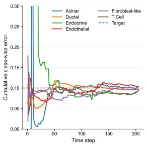  
(a) Error-guided, pancreas

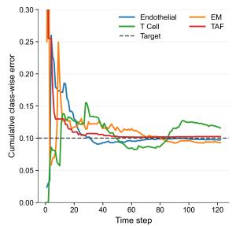  
(b) Error-guided, lung

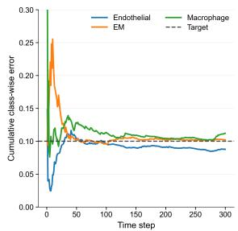  
(c) Error-guided, ovary

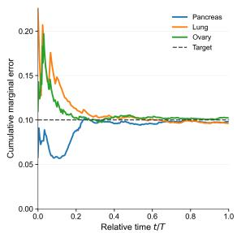  
(d) Error-guided, marginal

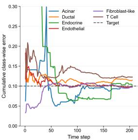  
(e) Adjacent, pancreas

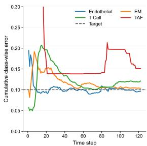  
(f) Adjacent, lung

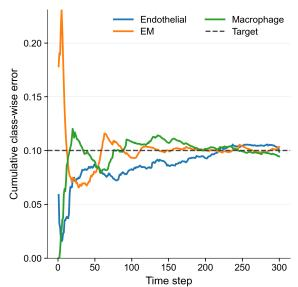  
(g) Adjacent, ovary

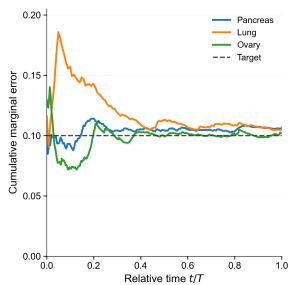  
(h) Adjacent, marginal

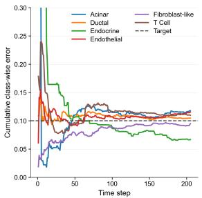  
(i) Random, pancreas

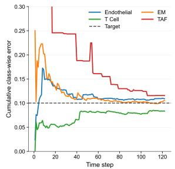  
(j) Random, lung

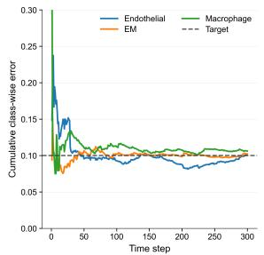  
(k) Random, ovary

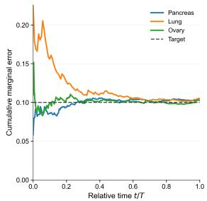  
(l) Random, marginal  
Figure 5: Cumulative error trajectories under the global NuClass score for three batch-release schemes. Rows correspond to the error-guided, adjacent, and random schemes, while columns correspond to pancreas, lung, ovary, and marginal results. The tissue-specific panels report class-wise cumulative error over time; the marginal panels report cumulative error by tissue against the relative time $t / T$ . All experiments use target error level $\alpha = 0 . 1$ and reviewed fraction $p = 0 . 1$ . Dashed horizontal lines mark the target error level.

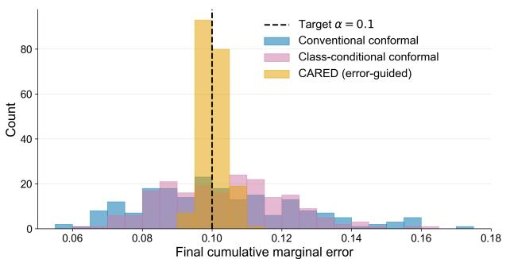  
(a)

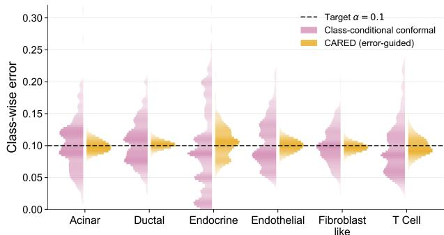  
(b)  
Figure 6: Comparison of final cumulative error on pancreas tissue using the global score source. Each experiment randomly selects 10 batches as calibration data for the baselines and as the initial batches for CARED. (a) Distribution of final cumulative marginal error over 200 repeated random experiments, where the dashed vertical line marks the target error level $\alpha = 0 . 1$ . (b) Empirical distributions of final classwise error over the same 200 experiments for class-conditional conformal prediction and our method, shown separately by cell type. The dashed horizontal line is the target level $\alpha = 0 . 1$

## 4.3 Skipped ratio and prediction set utility

We measure the expert efort saved by the skipped ratio, the fraction of all cells that are not audited and receive an automated annotation, i.e., whose (restored) prediction set is a singleton (3). Figure 7 reports the skipped ratio at the final time T across three schemes and three tissue cohorts, both over all cells and stratified by the true cell types. The ratio computes the number of automatically annotated cells among all, including reviewed, cells. CARED allows a substantial fraction of cells to bypass expert labeling across the evaluated settings. In the four-class lung annotation task at $p = 0 . 1$ and $\alpha = 0 . 1$ , CARED allows skipping as much as 70% of cells on average and over 80% of epithelial malignant cells. The skipped ratio also varies across cell types within a tissue: for instance, almost no endocrine cells in pancreas are annotated automatically; this is because the AI predictions are less reliable for this class so CARED defers more cells of this class.

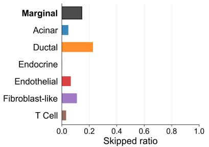  
(a) Error-guided, pancreas

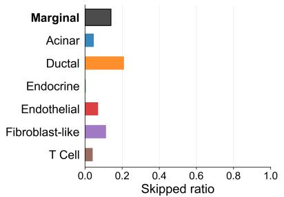  
(b) Adjacent, pancreas

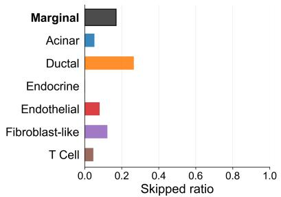  
(c) Random, pancreas

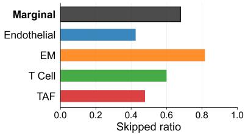  
(d) Error-guided, lung

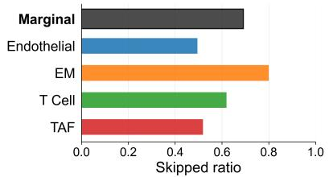  
(e) Adjacent, lung

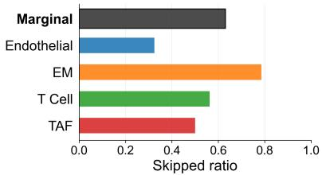  
(f) Random, lung

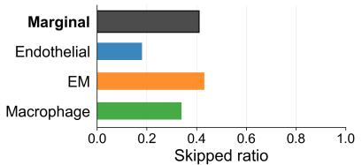  
(g) Error-guided, ovary

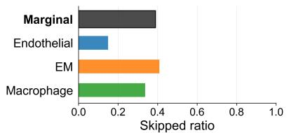  
(h) Adjacent, ovary

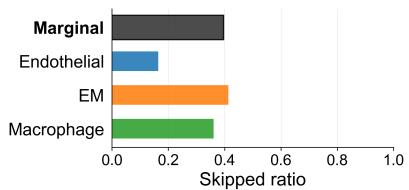  
(i) Random, ovary  
Figure 7: Final skipped ratios using the global NuClass score. Rows correspond to tissues, while columns correspond to batch-release schemes. Each panel reports the marginal skipped ratio (bold) together with ratios stratified by true label. Here, EM denotes Epithelial Malignant and TAF denotes Tumor Associated Fibroblast. All experiments use target level $\alpha = 0 . 1$ and reviewed fraction $p = 0 . 1$

Cells that are not skipped receive a prediction set of candidate labels, whose value depends on how easily it can be resolved later. We evaluate the utility-aware score transformation introduced in Section 3.2 on the pancreas cohort where non-singleton candidate lists are common. Figure 8 compares the raw and CAREDtransformed scores in terms of skipped ratio, average prediction set size, and structural coherence. Across all three release schemes, the utility-aware transformation consistently yields smaller candidate lists and improves structural coherence. It also increases the skipped ratio under error-guided release while yielding comparable skipped ratios under adjacent and random release. These results show that the utility module reduces human efort while producing more coherent candidate sets across diferent batch-release orders. Results for lung and ovary are reported in Figure 13 in Appendix C.2: the utility-aware transformation yields pronounced improvements for ovary, while its benefits are limited in lung, where the skipped ratio is already high and most candidate lists are already coherent. Sensitivity of the utility metrics to the utility learning rate, random seed, and target error level is further discussed in Figure 15 in Appendix C.3.2.

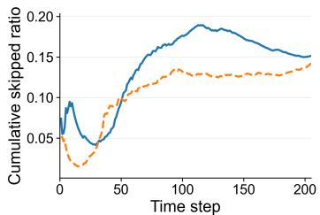  
(a) Error-guided, skipped ratio (↑)

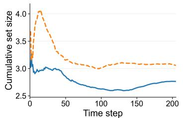  
(b) Error-guided, set size (↓)

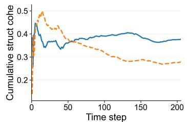  
(c) Error-guided, structural coherence (↑)

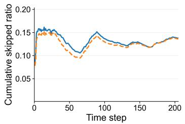  
(d) Adjacent, skipped ratio (↑)

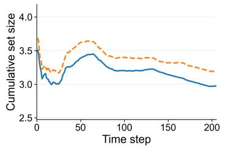  
(e) Adjacent, set size (↓)

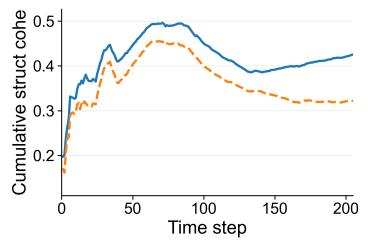  
(f) Adjacent, structural coherence (↑)

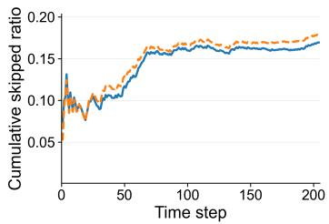  
(g) Random, skipped ratio (↑)

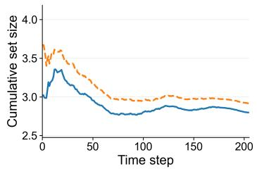  
(h) Random, set size (↓)

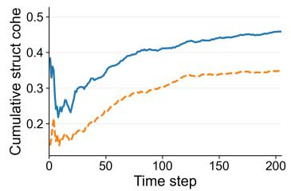  
(i) Random, structural coherence (↑)  
Figure 8: Utility of the raw and transformed scores over time on pancreas tissue. Rows correspond to the batch-release schemes, while columns correspond to the metrics. Higher skipped ratio and structural coherence and smaller prediction sets indicate better utility (indicated by the arrows in panel captions).

## 4.4 Results with real expert annotations

We examine CARED on the colon data described in Section 4.1, where both the order of the 37 annotation rounds and the 1,374 labels come from an expert navigating the slide. The distribution drift is generated by real practice but the dataset is also small: with $p = 0 . 1$ , CARED observes about 137 audited labels in total, about 4 per round. To avoid extremely scarce cell types which make error evaluation challenging, we group the cells are grouped into three classes: tumor, muscle, and others, with others combining several rare cell types. We run CARED with target error level $\alpha = 0 . 1$ using the global, local, and gated NuClass scores.

Figure 9(a) shows the cumulative annotation-error (solid) and miscoverage (dashed) trajectories compared with the expert annotations used in evaluation. Across the three NuClass scores, the cumulative annotation error and miscoverage remain close to the target level, showing the robust performance of CARED in real data drifts. Figure 9(b) reports the cumulative saved annotation cost, indicating that the proposed framework remains efective under distribution drifts created by real expert annotations.

## 4.5 Sensitivity analysis on cumulative error

We next assess the sensitivity of CARED to the choice of reviewed fraction p, random seed, and target error level α, using the pancreas cohort with the global NuClass score under the three batch-release schemes described in Section 4.1. Figure 10 summarizes the cumulative coverage error (which upper bounds the annotation error) trajectories as we vary the review fraction $p \in \{ 0 . 0 1 , 0 . 0 2 , 0 . 0 5 , 0 . 1 , 0 . 2 \}$ , random seeds, and the target level $\alpha \in \{ 0 . 0 1 , 0 . 0 2 5 , 0 . 0 5 , 0 . 1 , 0 . 2 \}$

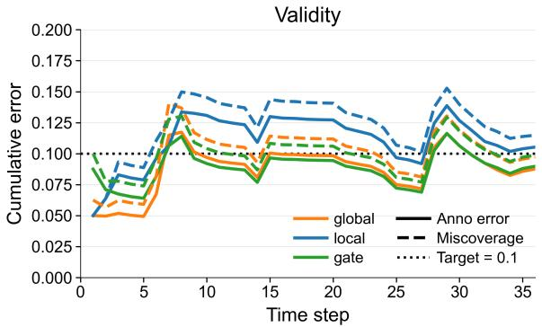  
(a) Cumulative annotation error and miscoverage

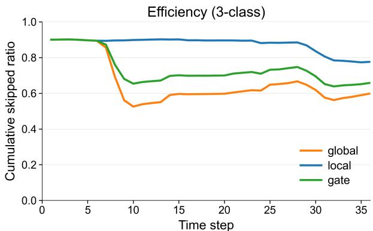  
(b) Cumulative saved annotation cost  
Figure 9: Results with real expert annotations on the colon dataset. (a) Cumulative annotation error (solid curves) and cumulative miscoverage (dashed curves) under the global, local, and gated NuClass score sources, with reviewed fraction $p = 0 . 1$ and target error level $\alpha = 0 . 1 ;$ the black dotted horizontal line marks this target. (b) Cumulative skipped ratio under the same setting.

Across all settings, the marginal coverage error moves towards the target level. Even with as few as a fraction of $p = 0 . 0 1$ of reviewed cases, the trajectories can still stabilize and approach the target level. Reducing the review rate does slow the convergence: the audit-sampling term in the proof of Proposition 3.5 scales a $\{ ( 1 - p ) / { ( p N ) } \} ^ { 1 / 2 }$ , where N is the total number of cells. The online-update term in Proposition 3.5 scales as $1 / ( \gamma _ { k } p N _ { k } )$ , so a smaller p shrinks the efective step size and the levels adapt more slowly. The corresponding class-wise results are reported in Appendix C.3 (Figure 14). They show the same overal pattern, with larger finite-sample fluctuations only for rare cell types such as endocrine cells, consistent with the class-frequency dependence in Proposition 3.5; the marginal trajectories remain stable.

CARED converges as expected under multiple seeds, which determine the initial region and the audit samples. Across seeds (middle column in Figure 10), trajectories difer in the early stage and approach the target level from below or above depending on the starting region, but end close to α under every scheme.

Appendix D (Figure 17) further examines sensitivity to the scale of the fixed class-wise step sizes. On the pancreas task with the global NuClass score, scaling the default step sizes by factors from 0.1 to 10 consistently pulls the cumulative class-wise errors toward the target level $\alpha = 0 . 1$ , demonstrating stable calibration over a broad range of step-size scales.

## Discussion

We proposed CARED, which decides which AI-generated cell-type labels can be accepted without expert review while the annotation workflow drifts. Its validity is guaranteed by the random audit design alone, which yields long-run class-conditional control of miscoverage, and hence of annotation error, over both the full stream and the unreviewed cells, without exchangeability or stationarity conditions. On whole-slide images from pancreas, lung, and ovary tissues and on a real expert annotation stream, it tightly controls the error within cell types while allowing up to 70% of cells to bypass expert review. It builds prediction sets for dificult cases whose AI annotations are not accurate enough for later resolution. Its performance is robust to the choice of the review fraction and random seeds. Overall, CARED ofers a perspective on how a small amount of human feedback can calibrate uncertainty quantification and yield efective and safe decisions.

Several directions remain open. First, our guarantee is asymptotic, and finite-sample confidence bounds for the realized error rate will be useful. Second, our error control is over the entire stream instead of the cases selected for automated annotation; the random audit design may be extended to calibrate the selective errors. Finally, we focus primarily on retrospective evaluation, and a prospective deployment in real-time annotation tasks could further quantify the saved benefits and impact on downstream analysis and decisions.

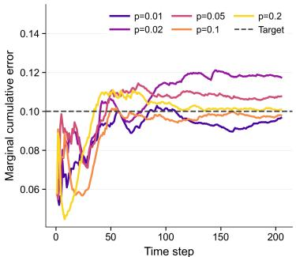  
(a) Error-guided, across reviewed fractions

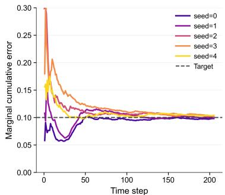  
(b) Error-guided, across seeds

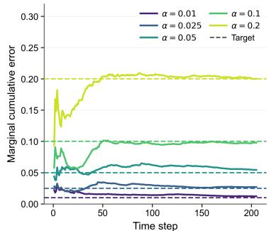  
(c) Error-guided, across target levels

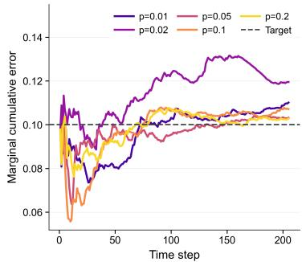  
(d) Adjacent, across reviewed fractions

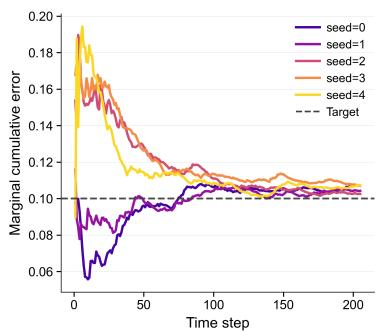  
(e) Adjacent, across seeds

  
(f) Adjacent, across target levels

  
(g) Random, across reviewed fractions

  
(h) Random, across seeds

  
(i) Random, across target levels  
Figure 10: Sensitivity analysis of marginal cumulative error on pancreas tissue with the global NuClass score source. Rows correspond to the error-guided, adjacent, and random batch release schemes, while columns vary the reviewed fraction p, the random seed, and the target error level α. Dashed horizontal lines indicate the target error level used in each setting. In each column, only the parameter named in the column heading is varied; the other two retain their default values, $p = 0 . 1$ , seed 0, and $\alpha = 0 . 1$ , used in Sections 4.2 and 4.3.

## References

10x Genomics (2024a). FFPE Human Lung Cancer Data with Human Immuno-Oncology Profiling Panel and Custom Add-on. Xenium In Situ Gene Expression Dataset by Xenium Onboard Analysis v2.0.0. May 14.

10x Genomics (2024b). FFPE Human Ovarian Cancer Data with Human Immuno-Oncology Profiling Panel and Custom Add-on. Xenium In Situ Gene Expression Dataset by Xenium Onboard Analysis v2.0.0. May 14.

10x Genomics (2024c). FFPE Human Pancreatic Ductal Adenocarcinoma Data with Human Immuno Oncology Profiling Panel. Xenium In Situ Gene Expression Dataset by Xenium Onboard Analysis v2.0.0. May 14.

Angelopoulos, A. N., Barber, R. F., and Bates, S. (2024). Online conformal prediction with decaying step sizes. arXiv preprint arXiv:2402.01139.

Angus, D. C., Khera, R., Lieu, T., Liu, V., Ahmad, F. S., Anderson, B., Bhavani, S. V., Bindman, A., Brennan, T., Celi, L. A., et al. (2025). Ai, health, and health care today and tomorrow: the JAMA summit report on artificial intelligence. Jama, 334(18):1650–1664.

Aubreville, M., Stathonikos, N., Bertram, C. A., Klopfleisch, R., Ter Hoeve, N., Ciompi, F., Wilm, F., Marzahl, C., Donovan, T. A., Maier, A., et al. (2023). Mitosis domain generalization in histopathology images—the MIDOG challenge. Medical Image Analysis, 84:102699.

Bernhardt, M., Castro, D. C., Tanno, R., Schwaighofer, A., Tezcan, K. C., Monteiro, M., Bannur, S., Lungren, M. P., Nori, A., Glocker, B., et al. (2022). Active label cleaning for improved dataset quality under resource constraints. Nature communications, 13(1):1161.

Bod´en, A. C., Molin, J., Garvin, S., West, R. A., Lundstr¨om, C., and Treanor, D. (2021). The human-in-theloop: an evaluation of pathologists’ interaction with artificial intelligence in clinical practice. Histopathology, 79(2):210–218.

Cand\`es, E. J., Ilyas, A., and Zrnic, T. (2025). Probably approximately correct labels. arXiv preprint arXiv:2506.10908.

Cazzaniga, G., Del Carro, F., Eccher, A., Becker, J. U., Gambaro, G., Rossi, M., Pieruzzi, F., Fraggetta, F., Pagni, F., and L’Imperio, V. (2025). Improving the annotation process in computational pathology: A pilot study with manual and semi-automated approaches on consumer and medical grade devices. Journal of Imaging Informatics in Medicine, 38(2):1112–1119.

Charusaie, M.-A., Mozannar, H., Sontag, D., and Samadi, S. (2022). Sample eficient learning of predictors that complement humans. In International Conference on Machine Learning, pages 2972–3005. PMLR.

Corbetta, D., Finos, L., Geistlinger, L., and Risso, D. (2026). Conformal inference for cell-type annotation with graph-structured constraints. Journal of the Royal Statistical Society Series C: Applied Statistics, page qlag037.

Deng, J., Dong, W., Socher, R., Li, L.-J., Li, K., and Fei-Fei, L. (2009). ImageNet: A large-scale hierarchical image database. In 2009 IEEE conference on computer vision and pattern recognition, pages 248–255. IEEE.

Dhillon, G. S., Deligiannidis, G., and Rainforth, T. (2024). On the expected size of conformal prediction sets. In International Conference on Artificial Intelligence and Statistics, pages 1549–1557. PMLR.

Ergen, C., Xing, G., Xu, C., Kim, M., Jayasuriya, M., McGeever, E., Oliveira Pisco, A., Streets, A., and Yosef, N. (2024). Consensus prediction of cell type labels in single-cell data with popV. Nature Genetics, 56(12):2731–2738.

Freedman, D. A. (1975). On tail probabilities for martingales. the Annals of Probability, pages 100–118.

Gafney, M. H. (2025). Pathology in the artificial intelligence era: Guiding innovation and implementation to preserve human insight. Academic Pathology, 12(1):100166.

Ge, H., Bastani, H., and Bastani, O. (2024). Stochastic online conformal prediction with semi-bandit feedback. arXiv preprint arXiv:2405.13268.

Gibbs, I. and Candes, E. (2021). Adaptive conformal inference under distribution shift. Advances in Neural Information Processing Systems, 34:1660–1672.

Gibbs, I. and Cand\`es, E. J. (2024). Conformal inference for online prediction with arbitrary distribution shifts. Journal of Machine Learning Research, 25(162):1–36.

Gilardi, F., Alizadeh, M., and Kubli, M. (2023). ChatGPT outperforms crowd workers for text-annotation tasks. Proceedings of the National Academy of Sciences, 120(30):e2305016120.

Goel, A., Gueta, A., Gilon, O., Liu, C., Erell, S., Nguyen, L. H., Hao, X., Jaber, B., Reddy, S., Kartha, R., et al. (2023). LLMs accelerate annotation for medical information extraction. In machine learning for health (ML4H), pages 82–100. PMLR.

Goren, S., Galil, I., and El-Yaniv, R. (2024). Hierarchical selective classification. Advances in Neural Information Processing Systems, 37:111047–111073.

Gulshan, V., Peng, L., Coram, M., Stumpe, M. C., Wu, D., Narayanaswamy, A., Venugopalan, S., Widner, K., Madams, T., Cuadros, J., et al. (2016). Development and validation of a deep learning algorithm for detection of diabetic retinopathy in retinal fundus photographs. JAMA, 316(22):2402–2410.

H¨agele, M., Seegerer, P., Lapuschkin, S., Bockmayr, M., Samek, W., Klauschen, F., M¨uller, K.-R., and Binder, A. (2020). Resolving challenges in deep learning-based analyses of histopathological images using explanation methods. Scientific reports, 10(1):6423.

Hall, P., Heyde, C. C., Birnbaum, Z., and Lukacs, E. (1980). Martingale limit theory and its application, volume 12. Elsevier.

Hou, W. and Ji, Z. (2024). Assessing GPT-4 for cell type annotation in single-cell RNA-seq analysis. Nature methods, 21(8):1462–1465.

Howard, F. M., Dolezal, J., Kochanny, S., Schulte, J., Chen, H., Heij, L., Huo, D., Nanda, R., Olopade, O. I., Kather, J. N., et al. (2021). The impact of site-specific digital histology signatures on deep learning model accuracy and bias. Nature communications, 12(1):4423.

Huang, H., Liao, W., Xi, H., Zeng, H., Zhao, M., and Wei, H. (2025). Model-agnostic selective labeling with provable statistical guarantees. arXiv preprint arXiv:2510.14581.

Jin, Y. and Cand\`es, E. J. (2023). Selection by prediction with conformal p-values. Journal of Machine Learning Research, 24(244):1–41.

Jin, Y., Moon, I., and Zitnik, M. (2026). Act or defer: Error-controlled decision policies for medical foundation models. medRxiv, pages 2026–02.

Kaymaz, Y., Ganglberger, F., Tang, M., Haslinger, C., Fernandez-Albert, F., Lawless, N., and Sackton, T. B. (2021). HieRFIT: a hierarchical cell type classification tool for projections from complex single-cell atlas datasets. Bioinformatics, 37(23):4431–4436.

Kim, C., Gadgil, S. U., and Lee, S.-I. (2026). Transparency of medical artificial intelligence systems. Nature reviews bioengineering, 4(1):11–29.

Kiyani, S., Pappas, G., and Hassani, H. (2024). Length optimization in conformal prediction. Advances in Neural Information Processing Systems, 37:99519–99563.

Korsunsky, I., Millard, N., Fan, J., Slowikowski, K., Zhang, F., Wei, K., Baglaenko, Y., Brenner, M., Loh, P.- r., and Raychaudhuri, S. (2019). Fast, sensitive and accurate integration of single-cell data with Harmony. Nature methods, 16(12):1289–1296.

Lei, J., G’Sell, M., Rinaldo, A., Tibshirani, R. J., and Wasserman, L. (2018). Distribution-free predictive inference for regression. Journal of the American Statistical Association, 113(523):1094–1111.

Li, S., Xu, J., Bao, T., Liu, Y., Liu, Y., Liu, Y., Wang, L., Lei, W., Wang, S., Xu, Y., et al. (2025a). A co-evolving agentic AI system for medical imaging analysis. arXiv preprint arXiv:2509.20279.

Li, Z., Mirjahanmardi, S. H., Sali, R., Eweje, F., Gopaulchan, M., Kloker, L., Zhang, X., Li, G., Jiang, Y., and Li, R. (2025b). Automated cell annotation and classification on histopathology for spatial biomarker discovery. Nature Communications, 16(1):6240.

Liang, J., Ren, Z., and Chen, Y. (2026). Optimal training-conditional regret for online conformal prediction. arXiv preprint arXiv:2602.16537.

L´opez-De-Castro, M., Garc´ıa-Galindo, A., Gonz´alez-Gomariz, J., and Arma˜nanzas, R. (2025). Conformal inference for reliable single cell RNA-seq annotation. Bioinformatics, 41(10):btaf521.

Lotfollahi, M., Hao, Y., Theis, F. J., and Satija, R. (2024). The future of rapid and automated single-cell data analysis using reference mapping. Cell, 187(10):2343–2358.

Lotfollahi, M., Naghipourfar, M., Luecken, M. D., Khajavi, M., B¨uttner, M., Wagenstetter, M., Avsec, Z.,<sup>ˇ</sup> Gayoso, A., Yosef, N., Interlandi, M., et al. (2022). Mapping single-cell data to reference atlases by transfer learning. Nature biotechnology, 40(1):121–130.

Montezuma, D., Oliveira, S. P., Neto, P. C., Oliveira, D., Monteiro, A., Cardoso, J. S., and Macedo-Pinto, I. (2023). Annotating for artificial intelligence applications in digital pathology: a practical guide for pathologists and researchers. Modern Pathology, 36(4):100086.

Montezuma, D., Oliveira, S. P., Tolkach, Y., Boor, P., Haragan, A., Carvalho, R., Della Mea, V., Kiehl, T.- R., Leh, S., Yousif, M., et al. (2025). Annotation practices in computational pathology: a european society of digital and integrative pathology (ESDIP) survey study. Laboratory Investigation, 105(3):102203.

Mortier, T., Javanmardi, A., Sale, Y., H¨ullermeier, E., and Waegeman, W. (2025). Conformal prediction in hierarchical classification. arXiv preprint arXiv:2501.19038.

Mozannar, H. and Sontag, D. (2020). Consistent estimators for learning to defer to an expert. In International conference on machine learning, pages 7076–7087. PMLR.

Northcutt, C. G., Athalye, A., and Mueller, J. (2021). Pervasive label errors in test sets destabilize machine learning benchmarks. arXiv preprint arXiv:2103.14749.

Qiu, J., Wilm, F., Ottl, M., Schlereth, M., Liu, C., Heimann, T., Aubreville, M., and Breininger, K. (2023).<sup>¨</sup> Adaptive region selection for active learning in whole slide image semantic segmentation. In International Conference on Medical Image Computing and Computer-Assisted Intervention, pages 90–100. Springer.

Rau, T. T., Cross, W., Lastra, R. R., Lo, R. C.-L., Matoso, A., and Herrington, C. S. (2024). Closing the loop–the role of pathologists in digital and computational pathology research.

Stacke, K., Eilertsen, G., Unger, J., and Lundstr¨om, C. (2020). Measuring domain shift for deep learning in histopathology. IEEE journal of biomedical and health informatics, 25(2):325–336.

Stutz, D., Cemgil, A. T., Doucet, A., et al. (2021). Learning optimal conformal classifiers. arXiv preprint arXiv:2110.09192.

Tellez, D., Litjens, G., B´andi, P., Bulten, W., Bokhorst, J.-M., Ciompi, F., and Van Der Laak, J. (2019). Quantifying the efects of data augmentation and stain color normalization in convolutional neural networks for computational pathology. Medical image analysis, 58:101544.

Theunissen, L., Mortier, T., Saeys, Y., and Waegeman, W. (2024). Uncertainty-aware single-cell annotation with a hierarchical reject option. Bioinformatics, 40(3):btae128.

Vovk, V., Gammerman, A., and Shafer, G. (2005). Algorithmic learning in a random world. Springer.

Vovk, V., Lindsay, D., Nouretdinov, I., Gammerman, A., et al. (2003). Mondrian confidence machine. Technical Report.

Xu, C. and Xie, Y. (2023). Sequential predictive conformal inference for time series. In International Conference on Machine Learning, pages 38707–38727. PMLR.

Xu, Y., Cui, Y., Li, M., and Huang, Z. (2025). Adaptive multi-scale integration unlocks robust cell annotation in histopathology images. arXiv preprint arXiv:2511.13586.

Zafran, M., F´eron, O., Goude, Y., Josse, J., and Dieuleveut, A. (2022). Adaptive conformal predictions for time series. In International conference on machine learning, pages 25834–25866. PMLR.

Zhang, D., Chatzimparmpas, A., Kamali, N., and Hullman, J. (2024). Evaluating the utility of conformal prediction sets for ai-advised image labeling. In Proceedings of the 2024 CHI Conference on Human Factors in Computing Systems, pages 1–19.

Zhao, M., Admoni, H., Simmons, R., Ramdas, A., and Bajcsy, A. (2025). Conformalized interactive imitation learning: Handling expert shift and intermittent feedback. In International Conference on Learning Representations, volume 2025, pages 9238–9251.

## A Details on utility module

This appendix gives further details on the optional utility module introduced in Section 3.2: the online selection algorithm, the structural-coherence metric, and the construction of the score transformation $f _ { \Theta }$

## A.1 Structural coherence and surrogate loss

Structural coherence. The structural-coherence metric captures coarse organization in the label space. Let $\{ S _ { 1 } , \ldots , S _ { M } \}$ be a partition of $[ K ]$ into M subtrees, where labels in the same subtree are structurally close (for example, by lineage, function, or morphology). Consider a map $g : [ K ] \to [ M ]$ that assigns each class to its subtree. For case i and subtree $m _ { ; }$ , define

$$
\mathrm { O c c } _ { i , m } = \operatorname* { m a x } _ { k : g ( k ) = m } \mathbb { 1 } \{ k \in \widehat { C } _ { t , i } ( \Theta ) \} , \qquad \mathrm { F u l l } _ { i , m } = \operatorname* { m i n } _ { k : g ( k ) = m } \mathbb { 1 } \{ k \in \widehat { C } _ { t , i } ( \Theta ) \} ,
$$

and

$$
\mathrm { O u t } _ { i , m } = \operatorname* { m a x } _ { m ^ { \prime } \ne m } \mathrm { O c c } _ { i , m ^ { \prime } } .
$$

Here $\operatorname { O c c } _ { i , m }$ indicates whether subtree m occurs in the prediction set, $\mathrm { F u l l } _ { i , m }$ indicates whether the entire subtree is included, and $\mathrm { O u t } _ { i , m }$ indicates whether the set also contains a label outside subtree m. We call a prediction set structurally coherent if

$$
V _ { i } ( \Theta ) : = \sum _ { m = 1 } ^ { M } \mathrm { O c c } _ { i , m } ( 1 - \mathrm { F u l l } _ { i , m } ) \mathrm { O u t } _ { i , m } = 0 .\tag{A.1}
$$

This criterion penalizes a set that crosses subtree boundaries while including only a partial fragment of at least one touched subtree. It permits a small set contained in one subtree and a set formed by several complete subtrees, both of which represent uncertainty coherently. The batch-level score in (5) is

$$
\mathcal { T } _ { \mathrm { s t r u c t } } ( \Theta ) = \frac { 1 } { B _ { t } } \sum _ { i = 1 } ^ { B _ { t } } \mathbb { 1 } \{ V _ { i } ( \Theta ) = 0 \} .
$$

The rule in (A.1) is one admissible structural preference, not a required component of the conformal framework. Other domain-specific preferences, such as homogeneity, diversity, or a deeper hierarchy, can replace the structural component in the hard utility objeAsctive and its corresponding soft relaxation, while leaving the adaptive conformal framework in Section 3.1 unchanged.

Surrogate loss. The hard utility objective in (5) contains three operations that are not directly amenable to gradient-based updates: the membership indicators $\mathbb { 1 } \{ k \in \widehat { C } _ { t , i } ( \Theta ) \}$ , the set-size indicator $\mathbb { I } \{ | \widehat { C } _ { t , i } ( \Theta ) | \le 1 \}$ in $J _ { \mathrm { s k i p } } ( \Theta )$ , and the structural-coherence indicator $\mathbb { 1 } \{ V _ { i } ( \boldsymbol { \Theta } ) = 0 \}$ in $J _ { \mathrm { s t r u c t } } ( \Theta )$ . We construct the surrogate loss $L _ { \mathrm { s o f t } } ( \Theta )$ by replacing the operations above in (5) as follows.

• Membership indicators. Given the class-wise conformal thresholds $\{ q _ { k , t } \} _ { k = 1 } ^ { K }$ computed under parameter Θ, $\mathbb { 1 } \{ k \in { \widehat { C } } _ { t , i } ( \Theta ) \} = \mathbb { 1 } \{ f _ { \Theta } ( s _ { t } ( x _ { t , i } ) ) _ { k } \geq q _ { k , t } \}$ is replaced by

$$
z _ { i , k } ( \Theta ) = \sigma \bigg ( \frac { f _ { \Theta } ( s _ { t } ( x _ { t , i } ) ) _ { k } - q _ { k , t } } { T _ { \mathrm { t e m p } } } \bigg ) ,
$$

where $T _ { \mathrm { t e m p } }$ controls the smoothness of the approximation.

• Set-size indicator. We interpret $z _ { i , k } ( \Theta )$ as the soft inclusion probability of class k. Then $\scriptstyle \prod _ { k = 1 } ^ { K } ( 1 -$ $z _ { i , k } ( \Theta ) )$ corresponds to including no class, while $\begin{array} { r } { z _ { i , k } ( \Theta ) \prod _ { \ell \neq k } \bigl ( 1 - z _ { i , \ell } ( \Theta ) \bigr ) } \end{array}$ corresponds to including class k and no other class. Summing the latter over k therefore corresponds to including exactly one class. Therefore, the indicator $\mathbb { 1 } \{ | \widehat { C } _ { t , i } ( \Theta ) | \le 1 \}$ is replaced by

$$
\prod _ { k = 1 } ^ { K } \bigl ( 1 - z _ { i , k } ( \Theta ) \bigr ) + \sum _ { k = 1 } ^ { K } z _ { i , k } ( \Theta ) \prod _ { \ell \neq k } \bigl ( 1 - z _ { i , \ell } ( \Theta ) \bigr ) .
$$

• Structural-coherence indicator. In (A.1), we replace the membership indicators in $\mathrm { O c c } _ { i , m } , \mathrm { F u l l } _ { i , m } .$ and $\mathrm { O u t } _ { i , m } \ \mathrm { b y } \ z _ { i , k } ( \Theta )$ , while retaining the max and min operations. Suppose this yields a surrogate $\widehat { V } _ { i } ( \Theta )$ , which reflects the extent of structural violation. We therefore replace $\mathbb { 1 } \{ V _ { i } ( \boldsymbol { \Theta } ) = 0 \}$ by one minus this expression, so that larger values continue to represent greater structural coherence. The retained max and min operations are diferentiable almost everywhere and admit subgradients at ties, so they can be handled directly in the gradient updates.

## A.2 Online selection algorithm

Algorithm A.1 gives the online selection procedure sketched in Section 3.2. It selects the score-transformation parameter $\Theta _ { t }$ before the audit set is sampled.

```latex
Algorithm A.1 Online training of $\Theta _ { t }$ at time step t
Input: Batch $D _ { t }$ with raw score vectors $\{ s _ { t } ( x ) : x \in D _ { t } \} ;$ ; calibration sets $\{ D _ { k , \mathrm { c a l } } ( t ) \} _ { k = 1 } ^ { K }$ (denoted by
$D _ { \mathrm { c a l } } ( t ) ) ;$ current online levels $\{ \alpha _ { k , t } \} _ { k = 1 } ^ { K } ;$ candidate number $N ;$ learning rate $\eta .$
Output: Selected parameter $\Theta _ { t }$ and score transformation $f _ { \Theta _ { t } }$
1: $\mathcal { T } ^ { * }  \mathcal { I } ( 0 ) ; \Theta  0 ; \Theta ^ { * }  0 .$
2: for $n = 1 , \ldots , N$ do
3: Compute class-wise conformal quantiles $\{ q _ { k , t } \} _ { k = 1 } ^ { K }$ on $D _ { \mathrm { c a l } } ( t )$ using $\Theta$
4: Θ $ \Theta - \eta \nabla _ { \Theta } \mathcal { L } _ { \mathrm { s o f t } } ( D _ { t } ; \Theta , \{ q _ { k , t } \} _ { k = 1 } ^ { K } )$ ▶ gradient step
5: Using the updated $\Theta ,$ recompute $\{ q _ { k , t } \} _ { k = 1 } ^ { K }$ according to Equation (1), construct prediction sets on $D _ { t }$
according to Equation (2), and evaluate the utility objective $\mathcal { I } ( \Theta )$
6: if $\mathcal { I } ( \Theta ) < \mathcal { I } ^ { * }$ then
7: $\mathcal { T } ^ { * }  \mathcal { I } ( \Theta ) ; \quad \Theta ^ { * }  \Theta$
8: end if
9: end for
10: Set $\Theta _ { t } \gets \Theta ^ { * }$
```

## A.3 Score transformation construction

```latex
Algorithm A.2 Score transformation $f _ { \Theta }$
Input: Score vector $s \in [ 0 , 1 ] ^ { K }$ ; subtree partition $\{ S _ { 1 } , \ldots , S _ { M } \}$ of $[ K ] ;$ parameter matrices $\Theta ^ { \mathrm { i n } } , \Theta ^ { \mathrm { o u t } } \ \in $
$\mathbb { R } ^ { K \times M }$
Output: Transformed score vector $\tilde { s } = f _ { \Theta } ( s ) \in \mathbb { R } ^ { K }$
1: $s _ { \operatorname* { m a x } } \gets \operatorname* { m a x } _ { k } s _ { k }$
2: $u _ { k } \gets \mathrm { l o g i t } ( s _ { k } / s _ { \mathrm { m a x } } )$ for all k
3: $\boldsymbol { \mathcal { U } } \gets [ K ]$ ▶ unprocessed classes
4: for $r = 1 , \ldots , M$ do
5: ℓ<sub>r</sub> ← arg max<sub>k∈U</sub> u<sub>k</sub> ▶ leader class
6: m ← subtree index such that $\ell _ { r } \in S _ { m }$
7: for $k \in ( S _ { m } \cap \mathcal { U } ) \setminus \{ \ell _ { r } \}$ do
8: $u _ { k } \gets u _ { k } + \Theta _ { k , r } ^ { \mathrm { i n } }$ ▶ updates scores associated to the leader subtree
9: end for
10: for $j \in \mathcal { U } \setminus \mathcal { S } _ { m }$ do
11: $u _ { j }  u _ { j } - \Theta _ { j , r } ^ { \mathrm { o u t } }$ ▶ updates scores associated to other subtrees
12: end for
13: $\mathcal { U }  \mathcal { U } \backslash \mathcal { S } _ { m }$
14: end for
15: $\tilde { s } _ { k } \gets s _ { \mathrm { m a x } } \cdot \sigma ( u _ { k } )$ for all k $\pmb { \tilde { s } } _ { k } \in ( 0 , s _ { \operatorname* { m a x } } )$
16: return $\tilde { s } = f _ { \Theta } ( s ) \in \mathbb { R } ^ { K }$
```

Algorithm A.2 gives the construction of the score transformation $f _ { \Theta }$ used in Section 3.2. Given a score vector s and a parameter $\Theta ,$ it returns the transformed score $\tilde { s } = f _ { \Theta } ( s )$ . The construction of $f _ { \Theta }$ is guided by three principles. First, initializing $\Theta ^ { \mathrm { i n } }$ and $\Theta ^ { \mathrm { o u t } }$ at zero should yield the identity map $f _ { 0 } ( s ) = s ,$ so the unmodified score vector is always available as a baseline candidate. Second, every transformed entry should lie in $( 0 , s _ { \mathrm { m a x } } ) \subset ( 0 , 1 )$ , preserving the score range required by the conformal construction. Finally, the transformation should respect the prescribed subtree structure, coordinating score changes within each subtree while allowing diferent subtrees to change diferently. For numerical stability, in implementation we lower-bound $s _ { \mathrm { m a x } }$ by $1 0 ^ { - 1 2 }$ and clip each normalized score $s _ { k } / s _ { \mathrm { m a x } } ~ \mathrm { t o } ~ [ 1 0 ^ { - 4 } , 1 - 1 0 ^ { - 4 } ]$ before applying the logit transformation. These numerical safeguards avoid undefined values at the endpoints and are omitted from Algorithm $\mathrm { A . 2 }$ for notational simplicity.

## B Additional theoretical results

## B.1 Unbiased randomized rounding

When the target reviewed fraction is fixed at $p ,$ the desired audit budget $p B _ { t }$ may not be an integer. The following randomized rounding scheme implements this budget while preventing the resulting rounding error from accumulating systematically over time, and yields the class-wise asymptotic relations required in the proofs of Lemma F.2 and Theorem $3 . 3 ;$ its proof is deferred to Appendix E.5.

Proposition B.1 (Unbiased randomized rounding). Fix $p \in ( 0 , 1 )$ . Let $\mathcal { G } _ { t } ^ { \prime }$ be the time-t sigma-field generated by all random quantities determined after $D _ { t }$ is realized but before choosing $p _ { t }$ . At time t, before $A _ { t }$ is sampled, set

$$
q _ { t } : = p B _ { t } - \lfloor p B _ { t } \rfloor
$$

and draw $\xi _ { t } \mid \mathcal { G } _ { t } ^ { \prime }$ ∼ Bernoulli(q<sub>t</sub>). Now sample the audit set with size

$$
\left| A _ { t } \right| : = \left\lfloor p B _ { t } \right\rfloor + \xi _ { t } ,
$$

Under Assumption $\boldsymbol { \mathscr { B } } . \boldsymbol { \mathrm { 1 } } ( i ) - ( i i i )$ , the realized reviewed fractions $p _ { t } = | A _ { t } | / B _ { t }$ under this rule satisfy, for every class $k \in [ K ]$ 7

$$
\frac { \sum _ { t = 1 } ^ { T } ( p _ { t } - p ) | D _ { k , t } | } { \sum _ { t = 1 } ^ { T } | D _ { k , t } | } \to 0 \quad a . s . , \qquad \frac { \sum _ { t = 1 } ^ { T } ( p _ { t } - p ) \sum _ { x \in D _ { k , t } } \mathrm { e r r } _ { k , t } ( x ) } { \sum _ { t = 1 } ^ { T } | A _ { k , t } | } \to 0 \quad a . s .
$$

## B.2 A cumulative batch-wise deviation guarantee

The guarantees in Section 3.3 control cumulative class-wise errors, the relevant notion for long-run validity. In practice, one also wants to understand how the procedure behaves locally across individual batches (Gibbs and Cand\`es, 2024). A natural way to quantify such local behavior is to aggregate the absolute per-batch deviations from the target error level. The result below gives an upper bound for this cumulative localdeviation measure, and discusses its asymptotic properties as the time index $T$ and batch size $| D _ { k , t } |$ get large. Note that in this subsection, the incoming batch $D _ { t }$ may be selected using review feedback observed before time t (as in the error-guided scheme).

We first set up the problem. Fix a class k. Here we consider only nonempty class-k batches because we stipulate that there is no deviation on empty sets. As a simplification, we assume that $| D _ { k , t } | > 0$ for all t.

More notation. Write the batch-wise class-k error rates as

$$
\mathrm { B a t E r r } _ { k , t } ^ { D } : = \frac { \sum _ { \boldsymbol { x } \in D _ { k , t } } \mathrm { e r r } _ { k , t } ( \boldsymbol { x } ) } { | D _ { k , t } | } , \qquad \mathrm { B a t E r r } _ { k , t } ^ { A } : = \frac { \sum _ { \boldsymbol { x } \in A _ { k , t } } \mathrm { e r r } _ { k , t } ( \boldsymbol { x } ) } { | A _ { k , t } | } ,
$$

whenever $\left| A _ { k , t } \right| > 0 . \mathrm { ~ I f ~ } \left| A _ { k , t } \right| = 0$ , we define BatEr $\mathbf { \Sigma } _ { : k , t } ^ { A } : = \operatorname { B a t E r r } _ { k , t } ^ { D }$ . The quantity of interest is the cumulative batch-wise deviation of the all-cell error rate from the target level:

$$
\sum _ { t = 1 } ^ { T } | \mathrm { B a t E r r } _ { k , t } ^ { D } - \alpha | .
$$

Define the efective batch step size and the clipped online level by

$$
\eta _ { k , t } : = \gamma _ { k } | A _ { k , t } | , \qquad \bar { \alpha } _ { k , t } : = \mathrm { c l i p } _ { [ 0 , 1 ] } ( \alpha _ { k , t } ) .
$$

Assumption B.2. Throughout this subsection, assume the following:

(i) The lower bound of the batch size $B ^ { - }$ satisfies that

$$
B ^ { - } > \operatorname* { m a x } \left\{ \frac { 1 } { p } , \frac { 1 } { 1 - p } \right\} .
$$

(ii) For every class $k \in [ K ]$ , the efective batch step size satisfies

$$
\eta _ { k , t } \leq 1 f o r a l l t .
$$

(iii) For every class $k \in [ K ]$ and time t, the scores

$$
\{ \tilde { s } _ { k , t } ( x ) : x \in D _ { k , \mathrm { c a l } } ( t ) \cup D _ { k , t } \}
$$

are distinct.

The discussion on batch-wise deviation is suficiently informative only when the batch sizes are not excessively small. Assumption B.2(i) can be interpreted as ”at least one cell per batch is chosen for online review on average”, which is a plausible condition for large-scale settings. This condition leads to intermediate consequences

$$
B ^ { - } > 2 \qquad \mathrm { a n d } \qquad 0 < p ^ { - } \leq p _ { t } \leq p ^ { + } < 1 \quad \mathrm { f o r ~ a l l ~ } t ,
$$

for some deterministic constants $p ^ { - } , p ^ { + }$ . Specifically, the second consequence holds with $\begin{array} { r } { p ^ { - } = p - \frac { 1 } { B ^ { - } } > 0 } \end{array}$ and $\begin{array} { r } { p ^ { + } = p + \frac { 1 } { B ^ { - } } < 1 } \end{array}$ . Assumption B.2(ii) can be satisfied when the step size $\gamma _ { k }$ is chosen reasonably small; a suficient condition is $\begin{array} { r } { \gamma _ { k } < \frac { 1 } { B ^ { + } } } \end{array}$ for every class k.

Definition B.3 (Calibration discrepancy). For each time t with $| D _ { k , t } | > 0$ , define the calibration discrepancy as

$$
\Delta _ { k , t } : = \operatorname* { s u p } _ { u \in [ 0 , 1 ] } \left| \frac { \sum _ { \boldsymbol { x } \in D _ { k , t } } \mathbb { 1 } \{ \tilde { s } _ { k , t } ( \boldsymbol { x } ) \leq \hat { q } _ { k , t } ( u ) \} } { | D _ { k , t } | } - \frac { \sum _ { \boldsymbol { x } \in D _ { k , \mathrm { e a l } } ( t ) } \mathbb { 1 } \{ \tilde { s } _ { k , t } ( \boldsymbol { x } ) \leq \hat { q } _ { k , t } ( u ) \} } { | D _ { k , \mathrm { e a l } } ( t ) | } \right| + \frac { 1 } { | D _ { k , \mathrm { e a l } } ( t ) | } .
$$

For $\alpha _ { k , t } \ \in \ [ 0 , 1 ]$ , the clipped $\bar { \alpha } _ { k , t } = \alpha _ { k , t }$ . By the class-wise conformal construction in Section 3.1, a class-k error occurs when $\widetilde { s } _ { k , t } ( \boldsymbol { x } ) < \widehat { q } _ { k , t } ( \bar { \alpha } _ { k , t } ) ;$ Assumption B.2(iii) ensures that no score in $D _ { k , t }$ equals this threshold, so

$$
\mathrm { B a t E r r } _ { k , t } ^ { D } = \frac { \sum _ { \substack { x \in D _ { k , t } } } \mathbf { 1 } \{ \widetilde { s } _ { k , t } ( x ) \leq \widehat { q } _ { k , t } ( \bar { \alpha } _ { k , t } ) \} } { | D _ { k , t } | } .
$$

Here, $\widehat { q } _ { k , t } ( \bar { \alpha } _ { k , t } )$ is the smallest threshold for which at least a $\bar { \alpha } _ { k , t }$ fraction of the calibration scores lie below the threshold. Assumption B.2(iii) makes the calibration scores distinct, so this empirical fraction can exceed $\bar { \alpha } _ { k , t }$ by at most one calibration observation, or $1 / | D _ { k , \mathrm { c a l } } ( t ) |$ . Therefore,

$$
\left| \bar { \alpha } _ { k , t } - \mathrm { B a t E r r } _ { k , t } ^ { D } \right| \leq \Delta _ { k , t } .\tag{B.2}
$$

When $\alpha _ { k , t } \notin [ 0 , 1 ]$ , the same inequality follows directly from the quantile conventions in Section 3.1. The first term in $\Delta _ { k , t }$ captures the calibration mismatch caused by distribution shift between the current class-k batch and the corresponding calibration set; whereas the second term in $\Delta _ { k , t }$ accounts for the finite-sample correction, which is negligible since $| D _ { k , \mathrm { c a l } } ( t ) |$ | is large.

Before establishing an informative upper bound on the cumulative absolute errors, we impose additional assumptions that may not hold in every practical setting. Nevertheless, they facilitate an interpretable characterization of the batchwise fluctuations of the errors produced by CARED. We consider two distinct sets of assumptions, each leading to a diferent guarantee: one constrains the range of the class-k batch sizes $| D _ { k , t } |$ , whereas the other assumes a nondecreasing sequence formed by the efective step sizes $\eta _ { k , t }$ Subsections B.2.1 and B.2.2 present the corresponding results, respectively.

## B.2.1 Cumulative deviation under constrained batch size

Assumption B.4 (Bounded batch size range). For any class k, there exist deterministic constants $d _ { k } > 0$ and $M _ { k } \ge 1$ such that

$$
d _ { k } \leq | D _ { k , t } | \leq M _ { k } d _ { k } \qquad f o r \ e v e r y \ t .
$$

That is, the number of class-k cells remains controlled across batches.

Proposition B.5 (Cumulative batch-wise deviation guarantee). Consider any class $k \in [ K ]$ , suppose that Assumptions 3.1, B.2, and $B . 4$ hold. Then, for any $\epsilon \in ( 0 , 1 )$ , define

$$
\mathcal { R } _ { k , T } ( \epsilon ) : = \frac { 1 } { p ^ { - } } \left[ \frac { T } { 2 } \sqrt { \frac { B ^ { - } } { B ^ { - } - 1 } p ^ { + } ( 1 - p ^ { - } ) \frac { M _ { k } } { d _ { k } } } + \frac { 5 } { 2 } \sqrt { T p ^ { + } ( 1 - p ^ { - } ) \frac { M _ { k } } { d _ { k } } \log \frac { 2 } { \epsilon } } + \frac { 5 M _ { k } } { 1 2 } \log \frac { 2 } { \epsilon } \right] .
$$

With probability at least $1 - \epsilon ,$ it holds that

$$
\sum _ { t = 1 } ^ { T } | \mathrm { B a t E r r } _ { k , t } ^ { D } - \alpha | \leq \left( 1 + \frac { p ^ { + } } { p ^ { - } } M _ { k } \right) \sum _ { t = 1 } ^ { T } \Delta _ { k , t } + \mathcal { R } _ { k , T } ( \epsilon ) .
$$

Corollary B.6 (Asymptotic cumulative batch-wise deviation guarantee). Under the setting of Proposition $B . 5 ,$ we consider a sequence of instances for which $T \to \infty$ and the batch size becomes as large as possible, as in $d _ { k } \to \infty$ . Then, for any $\epsilon \in ( 0 , 1 )$ , with probability at least $1 - \epsilon$

$$
\sum _ { t = 1 } ^ { T } | \mathrm { B a t E r r } _ { k , t } ^ { D } - \alpha | \leq ( 1 + M _ { k } ) \sum _ { t = 1 } ^ { T } \Delta _ { k , t } + \mathcal { O } \Big ( \frac { T } { \sqrt { d _ { k } } } \Big ) + o _ { T } ( T ) .
$$

Thus, in the combined regime where $T \to \infty$ and $d _ { k } \to \infty$ , all terms other than the calibration mismatch are asymptotically negligible relative to T. Therefore, the calibration mismatch is the only asymptotically non-negligible contribution that can accumulate linearly with the horizon, with coeficient $1 + M _ { k }$ , which approaches 2 as $M _ { k } \to 1$

## B.2.2 Cumulative deviation under nondecreasing efective step size

Assumption B.7 (Nondecreasing efective step size). Consider any class $k \in [ K ]$ and any horizon $T ,$ assume that almost surely

$$
0 < \eta _ { k , 1 } \leq \eta _ { k , 2 } \leq \cdot \cdot \cdot \leq \eta _ { k , T } < 1 .
$$

That is, the efective step sizes across batches form a nondecreasing sequence.

Proposition B.8 (Cumulative batch-wise deviation guarantee). Fix a class $k \in [ K ]$ . Suppose that Assumptions 3.1, B.2, and B.7 hold. Define

$$
\mu _ { k , t } : = \frac { 1 } { \sqrt { 2 p ^ { - } | D _ { k , t } | } } + \exp \left( - \frac { p ^ { - } | D _ { k , t } | } { 1 2 } \right) ,\tag{B.3}
$$

and

$$
S _ { k , T } ( \epsilon ) : = \sum _ { t = 1 } ^ { T } \mu _ { k , t } + \sqrt { 2 T \log \frac { 1 } { \epsilon } } + \frac { 1 } { 3 } \log \frac { 1 } { \epsilon } .\tag{B.4}
$$

Then, for every $\epsilon \in ( 0 , 1 )$ , with probability at least $1 - \epsilon ,$

$$
\sum _ { t = 1 } ^ { T } | \mathrm { B a t E r r } _ { k , t } ^ { D } - \alpha | \leq 2 \sum _ { t = 1 } ^ { T } \Delta _ { k , t } + S _ { k , T } ( \epsilon ) .
$$

Equations (B.3) and $\left( \mathrm { B . 4 } \right)$ are constructed in this way because $S _ { k , T } ( \epsilon )$ forms an upper bound for cumulative sampling fluctuations $\begin{array} { r } { \sum _ { t = 1 } ^ { T } | \mathrm { B a t E r r } _ { k , t } ^ { D } - \mathrm { B a t E r r } _ { k , t } ^ { A } | ; } \end{array}$ this is justified in Lemma F.3.

Corollary B.9 (Asymptotic cumulative batch-wise deviation guarantee). Under the setting of Proposition B.8, we consider a sequence of instances for which $T \to \infty$ and the batch size becomes asymptotically large, that is, there exists $d _ { k }$ such that $d _ { k } \leq | D _ { k , t } |$ for any $1 \leq t \leq T$ and $d _ { k } \to \infty$ . Then, for every $\epsilon \in ( 0 , 1 )$ with probability at least $1 - \epsilon ,$

$$
\sum _ { t = 1 } ^ { T } | \mathrm { B a t E r r } _ { k , t } ^ { D } - \alpha | \leq 2 \sum _ { t = 1 } ^ { T } \Delta _ { k , t } + \mathcal { O } \biggl ( \frac { T } { \sqrt { d _ { k } } } \biggr ) + o _ { T } ( T ) .
$$

Thus, as the horizon T and the class-k batch size grow asymptotically large, the calibration mismatch is the only nonnegligible term that accumulates linearly with time, with coeficient 2. Unlike the coeficient in Corollary B.6, this value does not depend on the class-size range.

## C Additional details and results of experiments

## C.1 Experimental details

This subsection collects implementation details and auxiliary experimental settings omitted from Section 4. The details include the data processing, the selection rule for the class-wise step sizes $\gamma _ { k }$ , the structural subtree partition used by the utility-aware module, and the settings for the experiments in Section 4.

Dataset processing. In each dataset (cohort), the H&E stain was applied to the same tissue section after the Xenium run and imaged at $4 0 \times ~ ( 0 . 2 7 4 ~ \mu \mathrm { { m } / \mathrm { { p i x e l } ) } }$ . For all experiments, the images are downsampled to approximately 0.415 $\mu \mathrm { m } / \mathrm { p i x e l } .$ Cell locations were registered to the H&E image using 10x Genomics Xenium Ranger, a post-processing pipeline for Xenium data, then filtered by 1,000 cells.

Selection rule for $\gamma _ { k }$ . In the experiments, the step sizes are selected before the online stream is run and then kept fixed over time. To satisfy the assumptions in Appendix B.2, we choose $\gamma _ { k }$ based on the class frequency in the test cohort, so that the efective batch step size $\gamma _ { k } | A _ { k , t } |$ remains below one with margin throughout the stream. Although this simulation uses oracle class-frequency information, in practice, the frequency can be roughly specified from domain knowledge. The assignment rule for $\gamma _ { k }$ is reported in Table 2.

Structural subtree. In our experiments, the structural subtree partition is specified by grouping cell types with closely related cellular characteristics into the same subtree. Specifically, the pancreas labels are grouped into three subtrees according to cellular function, while the ovary and lung labels are organized into two subtrees according to the benign–malignant distinction. The concrete subtree assignments are reported in Table 2.

Parameters used in experiments. Table 2 lists the experimental details and parameter values used in the main experiments.

Table 2: Details and parameters in the main experiments.
<table><tr><td>Name and notation</td><td>Choice used in the experiments</td></tr><tr><td>Held-out tissues</td><td>Pancreas, ovary, and lung</td></tr><tr><td>Label space for pancreas</td><td>Acinar, Ductal, Endocrine, Endothelial, Fibroblast-like, T Cell</td></tr><tr><td>Subtree partition for pancreas</td><td> $S _ { 1 } = \{ { \mathrm { A c i n a r } } , { \mathrm { D u c t a l } } , { \mathrm { E n d o c r i n e } } \} ;$   $S _ { 2 } = \{ \mathrm { E n d o t h e l i a l , ~ F i b r o b l a s t \mathrm { - } l i k e } \} ; S _ { 3 } = \{ \mathrm { T ~ C e l l } \}$ </td></tr><tr><td>Label space for ovary</td><td>Endothelial, Epithelial Malignant, Macrophage</td></tr><tr><td>Subtree partition for ovary</td><td> $S _ { 1 } = \{ \mathrm { E n d o t h e l i a l } ,$  Macrophage};  $S _ { 2 } = \mathrm { \{ E p i t h e l i a l { \Omega } } $  Malignant}</td></tr><tr><td>Label space for lung</td><td>Endothelial, Epithelial Malignant, T Cell, Tumor Associated Fibroblast</td></tr><tr><td>Subtree partition for lung</td><td> $S _ { 1 } = \{ { \mathrm { E n d o t h e l i a l } } , { \mathrm { ~ T ~ } }$  Cell, Tumor Associated Fibroblast};  $S _ { 2 } = \{ \mathrm { E p i t h e l i a l ~ M a l i g n a n t } \}$ </td></tr><tr><td>Target error level α</td><td>0.1</td></tr><tr><td>Target reviewed fraction p</td><td>0.1</td></tr><tr><td>Step size of frequent classes (&gt; 25%)</td><td> $\gamma _ { k } = 1 0 ^ { - 3 }$ </td></tr><tr><td>Step size of moderate classes (5%–25%)</td><td> $\gamma _ { k } = 2 \times 1 0 ^ { - 3 }$ </td></tr><tr><td>Step size of scarce classes  $( < 5 \% )$ </td><td> $\gamma _ { k } = 1 0 ^ { - 2 }$ </td></tr><tr><td>Initial labeled block  $A _ { 0 }$ </td><td>The first randomly selected batch</td></tr><tr><td>Batch-size bounds  $B ^ { - } , B ^ { + }$ </td><td> $B ^ { - } = 4 9 0 , B ^ { + } = 5 1 0$ </td></tr><tr><td>Calibration window  $T _ { w }$ </td><td>30 batches</td></tr><tr><td>Utility candidate number N</td><td>100</td></tr><tr><td>Utility learning rate η</td><td>0.1</td></tr><tr><td>Utility weights  $( \lambda _ { \mathrm { s k i p } } , \lambda _ { \mathrm { s i z e } } , \lambda _ { \mathrm { s t r u c t } } )$ </td><td>(20.0, 1.0, 5.0)</td></tr><tr><td>Soft-membership temperature  $T _ { \mathrm { t e m p } }$ </td><td>0.1</td></tr><tr><td>Random seed</td><td>0</td></tr></table>

## C.2 More experimental results

For reference, we report the online level trajectories $\alpha _ { k , t }$ under the error-guided batch-release scheme in the experiments reported in Section 4. These trajectories are shown in Figure 11. We then provide two additional sets of experimental results to show CARED’s stability. First, we report the cumulative conformal error trajectories on the three tissues for the remaining local and gated NuClass score sources, under the error-guided batch-release scheme. Second, we compare the utility metrics obtained from the utility-aware transformed scores and raw scores on the lung and ovary cohorts using the global NuClass score.

  
(a) Global, pancreas

  
(b) Global, lung

  
(c) Global, ovary  
Figure 11: Online level trajectories $\alpha _ { k , \ast }$ under the error-guided batch-release scheme using the global NuClass score. Panels $\mathrm { ( a ) - ( c ) }$ correspond to pancreas, lung, and ovary, respectively; each curve represents a cell type. The curves are smoothed with a window size of 7.

Together with the results under the global score source in Section 4, Figure 12 extends the same empirical validity check to the remaining local and gated NuClass score sources, showing that the method continues to control class-wise errors across the considered tissues and score sources. We next examine the utility results on the lung and ovary tasks in Figure 13. For the lung results, the utility-aware score transformation shows a minor disadvantage relative to the raw-score baseline in the cumulative utility metrics. This does not contradict the intended scope of our framework, since the utility module is guaranteed to deliver prediction sets with no lower utility for a fixed batch of cells, while the resulting score transformation may still induce a less favorable trajectory of selected batches and the online levels $\alpha _ { k , t }$ when cumulative utility is evaluated over the full stream. Moreover, the lung annotation task is not the primary target setting for the utility module: the skipped ratio is already high in this task, and the subtree structure has already been satisfied well. The more important evidence is the six-class pancreas annotation task, where the utility module shows clearer gains, as shown in Figure 8.

  
(a) Local, pancreas

  
(b) Local, lung

  
(c) Local, ovary

  
(d) Local, marginal

  
(e) Gated, pancreas

  
(f) Gated, lung

  
(g) Gated, ovary

  
(h) Gated, marginal  
Figure 12: Additional cumulative conformal error trajectories under the error-guided batch-release scheme. Rows correspond to the local and gated NuClass scores, while columns show pancreas, lung, ovary, and marginal results. The first three columns report class-wise errors within each tissue; the marginal panels compare the marginal errors of the three tissues against the fraction of processed batches. Dashed horizontal lines mark the target error level $\alpha = 0 . 1$

## C.3 Additional sensitivity analyses

## C.3.1 Class-wise cumulative error

Section 4.5 reports sensitivity analyses for the marginal cumulative error under variations of the reviewed fraction $p ,$ random seed, target error level $\alpha ,$ and batch release scheme. Here, for each sensitivity setting, we report the final cumulative empirical error for each cell type after processing the full annotation stream, and compare these class-wise errors across the three batch release schemes.

Figure 14 can be further interpreted through Proposition 3.5, which implies that the deviation of the class-wise cumulative empirical error from the target level decreases at the inverse-square-root rate in the total number of cells from that class. Therefore, for a fixed finite stream, rarer cell types are expected to show greater sensitivity. This accounts for the relatively large fluctuations for endocrine cells, which constitute only 1.95% of the stream, and also for the milder instability of T cells and endothelial cells, which are two relatively scarce classes in this experiment. Note that the marginal cumulative-error trajectories in Section 4.5 remain stable, and the remaining class-wise curves in Figure 14 do not show comparable fluctuations. Thus, the class-wise fluctuations reflect finite-sample variability rather than a failure of the empirical error-control pattern.

  
(a) Lung, skipped ratio

  
(b) Ovary, skipped ratio

  
(c) Lung, set size

  
(d) Ovary, set size

  
(e) Lung, structural coherence

  
(f) Ovary, structural coherence  
Figure 13: Additional cumulative utility comparison under the error-guided batch-release scheme using the global NuClass score. Rows correspond to the skipped ratio, average prediction set size, and structural coherence, while columns report lung and ovary. Solid blue curves use the utility-aware transformed score, while dashed orange curves use the raw score without the utility module. Higher skipped ratio and structural coherence and smaller prediction sets indicate better utility.

  
(a) Error-guided, reviewed fraction

  
(b) Error-guided, seed

  
(c) Error-guided, target error

  
(d) Adjacent, reviewed fraction

  
(e) Adjacent, seed

  
(f) Adjacent, target error

  
(g) Random, reviewed fraction

  
(h) Random, seed

  
(i) Random, target error  
Figure 14: Class-wise sensitivity analysis of final cumulative empirical error on pancreas tissue with the global score source. Rows correspond to the error-guided, adjacent, and random batch release schemes, while columns vary the reviewed fraction p, the random seed, and the target error level α. Dashed horizontal lines indicate the target error level used in each setting, and percentages in the shared legend denote the empirical fraction of each cell type in the stream.

  
(a) Error-guided, utility lr

  
(b) Error-guided, seed

  
(c) Error-guided, target error

  
(d) Adjacent, utility lr


  
(e) Adjacent, seed  
(f) Adjacent, target error

  
(g) Random, utility lr

  
(h) Random, seed

  
(i) Random, target error

Figure 15: Sensitivity analysis of utility metrics on the six-class pancreas annotation task with the global score source. Rows correspond to the error-guided, adjacent, and random batch release schemes, while columns vary the utility learning rate $\eta ,$ the random seed, and the target error level $\alpha .$ Each panel compares the utility metrics obtained from the utility-aware transformed score and the raw score. The shared legend identifies the four utility metrics.

## C.3.2 Utility metrics

We further examine the stability of the utility improvements on the six-class pancreas annotation task, as summarized in Figure 15.

For each batch release scheme and parameter setting, we compare the prediction sets produced by the utility-aware transformed score with those obtained from the raw scores. The three columns vary the utility learning rate $\eta ,$ the random seed, and the target error level $\alpha ,$ and the three rows correspond to the errorguided, adjacent, and random batch release schemes. The plotted value is the percentage improvement over the raw-score baseline, computed from the cumulative stream-level utility metrics after processing the full annotation stream. Overall utility is the weighted aggregate of skipped ratio, set size, and structural coherence, using $( \lambda _ { \mathrm { s k i p } } , \lambda _ { \mathrm { s i z e } } , \lambda _ { \mathrm { s t r u c t } } ) = ( 2 0 , 1 , 5 )$ as in Appendix C.1; its percentage improvement is normalized by the coordinate-wise worst-case six-class reference (0, 6, 0), corresponding to zero skipped ratio, full set size, and zero structural coherence.

Figure 15 shows that the utility module consistently improves overall utility over the raw-score baseline in almost every considered case. The component-wise gains are more uneven: structural coherence improves substantially in most settings, whereas skipped ratio and set size can change more modestly or vary with the sensitivity parameter. This is expected because the aggregate utility balances three competing criteria, and the relative emphasis can be adjusted through the utility weights.

## D Discussions on stepsize selection

The main experiments use a constant class-wise step size $\gamma _ { k }$ in the online update (4). This choice is aligned with the distribution-free guarantee established in Section 3.3: for each class $k ,$ the online level is updated as

$$
\alpha _ { k , t + 1 } = \alpha _ { k , t } + \gamma _ { k } \sum _ { x \in A _ { k , t } } \big ( \alpha - \mathrm { e r r } _ { k , t } ( x ) \big ) ,
$$

where $\gamma _ { k }$ is fixed over time and selected according to the class frequency rule reported in Appendix C.1.

Decaying stepsize schedules provide a natural alternative. For the standard adaptive conformal prediction setting, Angelopoulos et al. (2024) show that step sizes of order $\gamma _ { t } \propto t ^ { - 1 / 2 - \varepsilon }$ , with $0 < \varepsilon < 1 / 2$ , can retain long-run convergence of cumulative error while improving the stability of local error fluctuations. However, their local convergence theory is developed for the i.i.d. setting, and therefore should not be read as a general local-error guarantee under distribution shift. A complementary analysis of adaptive conformal prediction under distribution drift highlights the same trade-of from the non-i.i.d. perspective: smaller or decaying step sizes can stabilize the calibration-quantile trajectory within relatively stationary segments, but may adapt more slowly after distributional changes (Liang et al., 2026). Thus, decaying step sizes are a reasonable stability-oriented variant, but not a uniformly preferable replacement for the constant step sizes used in our main experiments.

To examine this issue, we rerun the pancreas experiment with the global NuClass score using the same initial class-wise scales $\gamma _ { k }$ as in the main experiment, but replace the constant update by

$$
\gamma _ { k , t } = \gamma _ { k } t ^ { - 2 / 3 } .
$$

Figure 16 compares the resulting per-batch all-cell deviations $| \mathrm { B a t E r r } _ { k , t } ^ { D } - \alpha |$ with those obtained from the constant stepsize update. The comparison shows a mixed pattern: the decaying schedule is closer to the target in some intervals and classes, while the constant schedule is closer in others. This is consistent with the stability–adaptation trade-of above, and explains why we keep the constant schedule as the default while reporting the decaying schedule as an empirical variant.

In practice, the numerical choice of $\gamma _ { k }$ is usually guided by empirical considerations rather than by an exact calculation. Although Theorem 3.3 shows that the cumulative class-wise error converges asymptotically for any fixed positive step size, the finite-stream behavior still depends on the scale of $\gamma _ { k }$ . To illustrate this sensitivity, Figure 17 compares the constant stepsize update after multiplying the default class-wise step sizes by factors ranging from 0.1 to 10. Across this range, class-wise errors are generally pulled toward the target level $\alpha = 0 . 1$ , although the finite-sample trajectories difer by class. The main exception is the endocrine class under large stepsize multipliers, where the finite-stream trajectory remains visibly above the target for longer. This behavior is consistent with the scarce-class instability discussed in Appendix C.3.1: endocrine cells account for only a small fraction of the stream, so their class-wise cumulative error is more sensitive in finite samples. This supports using the reported $\gamma _ { k }$ values as a pragmatic default rather than a deliberately optimal tuning.

  
Figure 16: Comparison between constant and decaying class-wise step sizes on the pancreas experiment with the global NuClass score. The curves report per-batch all-cell deviations $\lvert \mathrm { B a t E r r } _ { k , t } ^ { \bar { D } } - \alpha \rvert$ for each class under the constant schedule used in the main experiments and the decaying schedule $\gamma _ { k , t } = \gamma _ { k } t ^ { - 2 / 3 }$ . Shaded intervals indicate which schedule is closer to the target error level $\alpha = 0 . 1$ at each time.

  
Figure 17: Sensitivity of cumulative class-wise error trajectories to the scale of the constant step sizes on the pancreas experiment with the global NuClass score. Each curve uses the same class-wise stepsize rule as in the main experiments, multiplied by the factor shown in the legend. The dashed line marks the target error level $\alpha = 0 . 1$

## E Technical proofs

## E.1 Proof of Proposition 3.2

Telescoping the update rule (4) from the initial value $\alpha _ { k , 1 } = \alpha$

$$
\alpha _ { k , T + 1 } = \alpha + \gamma _ { k } \sum _ { t = 1 } ^ { T } \sum _ { x \in A _ { k , t } } \bigl ( \alpha - \mathrm { e r r } _ { k , t } ( x ) \bigr ) .
$$

Rearranging, $\begin{array} { r } { \sum _ { t = 1 } ^ { T } \sum _ { x \in A _ { k , t } } \mathrm { e r r } _ { k , t } ( x ) - \alpha \sum _ { t = 1 } ^ { T } | A _ { k , t } | = ( \alpha - \alpha _ { k , T + 1 } ) / \gamma _ { k } } \end{array}$ . Dividing both sides by $\scriptstyle \sum _ { t = 1 } ^ { T } | A _ { k , t } |$ and taking absolute values yields the exact identity

$$
\left| \mathrm { C o v E r r } _ { k , T } ^ { A } - \alpha \right| = \frac { \left| \alpha _ { k , T + 1 } - \alpha \right| } { \gamma _ { k } \sum _ { t = 1 } ^ { T } \left| A _ { k , t } \right| } .\tag{E.1}
$$

It remains to bound $| \alpha _ { k , T + 1 } - \alpha |$ . Set $\begin{array} { r } { \bar { M } _ { k } : = \operatorname* { s u p } _ { t \geq 1 } | A _ { k , t } | } \end{array}$ . Since $\mathrm { e r r } _ { k , t } ( x ) \in \{ 0 , 1 \}$ , the maximum single-step change satisfies

$$
| \alpha _ { k , t + 1 } - \alpha _ { k , t } | = \gamma _ { k } { \Big | } \sum _ { x \in A _ { k , t } } { \big ( } \alpha - \mathrm { e r r } _ { k , t } ( x ) { \big ) } { \Big | } \leq \gamma _ { k } | A _ { k , t } | \operatorname* { m a x } \{ \alpha , 1 - \alpha \} \leq \gamma _ { k } { \bar { M } } _ { k } \operatorname* { m a x } \{ \alpha , 1 - \alpha \} .\tag{E.2}
$$

We claim that for all $t \geq 1$ ，

$$
\alpha _ { k , t } \in \left[ - \gamma _ { k } \bar { M } _ { k } ( 1 - \alpha ) , 1 + \gamma _ { k } \bar { M } _ { k } \alpha \right] .\tag{E.3}
$$

We establish the lower bound; the upper bound is symmetric. Fix $t \geq 1$ . If $\alpha _ { k , t } \geq 0$ , the lower bound is immediate. Otherwise, let $t ^ { \prime } < t$ be the last time with $\alpha _ { k , t ^ { \prime } } \geq 0$ , which exists since $\alpha _ { k , 1 } = \alpha \ge 0$ . By (E.2),

$$
\alpha _ { k , t ^ { \prime } + 1 } \geq \alpha _ { k , t ^ { \prime } } - \gamma _ { k } \bar { M } _ { k } ( 1 - \alpha ) \geq - \gamma _ { k } \bar { M } _ { k } ( 1 - \alpha ) .
$$

If $\alpha _ { k , s } < 0$ for some s with $t ^ { \prime } < s \leq t .$ , the quantile convention (1) sets $\hat { q } _ { k , s } ( \alpha _ { k , s } ) = - \infty$ , so class k belongs to every prediction set and $\mathrm { e r r } _ { k , s } ( \boldsymbol { x } ) = 0$ for all $x \in A _ { k , s }$ . The update then gives

$$
\alpha _ { k , s + 1 } - \alpha _ { k , s } = \gamma _ { k } | A _ { k , s } | \alpha \geq 0 ,
$$

so $\alpha _ { k , s + 1 } \geq \alpha _ { k , s } ;$ this holds regardless of whether $\left| A _ { k , s } \right| = 0 .$ . By the choice of $t ^ { \prime } , \alpha _ { k , s } < 0$ for every s with $t ^ { \prime } < s \leq t ,$ so applying this monotonicity for $s = t ^ { \prime } + 1 , \dots , t - 1$ yields

$$
\alpha _ { k , t } \geq \alpha _ { k , t ^ { \prime } + 1 } \geq - \gamma _ { k } \bar { M } _ { k } ( 1 - \alpha ) .
$$

Hence (E.3) holds, and consequently

$$
\begin{array} { r } { | \alpha _ { k , T + 1 } - \alpha | \leq \operatorname* { m a x } \{ \alpha , 1 - \alpha \} + \gamma _ { k } \bar { M } _ { k } \operatorname* { m a x } \{ \alpha , 1 - \alpha \} . } \end{array}\tag{E.4}
$$

Substituting (E.4) into (E.1):

$$
| \mathrm { C o v E r r } _ { k , T } ^ { A } - \alpha | \leq \frac { \operatorname* { m a x } \{ \alpha , 1 - \alpha \} } { \gamma _ { k } \sum _ { t = 1 } ^ { T } \left| A _ { k , t } \right| } + \frac { \bar { M } _ { k } \operatorname* { m a x } \{ \alpha , 1 - \alpha \} } { \sum _ { t = 1 } ^ { T } \left| A _ { k , t } \right| } .
$$

The first term matches the stated bound. For the second term, Lemma F.2 gives $\begin{array} { r } { \sum _ { t = 1 } ^ { T } | A _ { k , t } | / { \sum _ { t = 1 } ^ { T } | D _ { k , t } | } \to p } \end{array}$ a.s. By the assumed frequency lower bound and $B _ { t } \geq B ^ { - }$ , almost surely there exists some $T _ { 0 } < \infty$ such that for all $T \geq T _ { 0 }$

$$
\sum _ { t = 1 } ^ { T } \left| A _ { k , t } \right| \geq { \frac { p q _ { k } T B ^ { - } } { 2 } } .
$$

Since $| A _ { k , t } | \leq | A _ { t } | \leq p _ { t } B ^ { + }$ , we have $\bar { M } _ { k } \leq ( \operatorname* { s u p } _ { t } p _ { t } ) B ^ { + }$ . Using unbiased randomized rounding, it follows

$$
\operatorname* { s u p } _ { t } p _ { t } \leq \operatorname* { s u p } _ { t } { \frac { \left[ p B _ { t } \right] } { B _ { t } } } \leq p + { \frac { 1 } { B ^ { - } } } , \qquad { \frac { \operatorname* { s u p } _ { t } p _ { t } } { p } } \leq 1 + { \frac { 1 } { p B ^ { - } } } .
$$

Therefore, on the same probability-one event, for all $T \geq T _ { 0 }$

$$
\frac { \bar { M } _ { k } \operatorname* { m a x } \{ \alpha , 1 - \alpha \} } { \sum _ { t = 1 } ^ { T } | A _ { k , t } | } \leq \frac { 2 ( \operatorname* { s u p } _ { t } p _ { t } ) B ^ { + } } { p q _ { k } T B ^ { - } } \leq \frac { 1 } { T } \cdot \frac { 2 B ^ { + } } { B ^ { - } q _ { k } } \big ( 1 + \frac { 1 } { p B ^ { - } } \big ) \quad \mathrm { a . s . } ,
$$

Since both terms vanish as $T \to \infty$ , we further have

$$
| \mathrm { C o v E r r } _ { k , T } ^ { A } - \alpha |  0 \quad \mathrm { a . s . }
$$

This proves the proposition.

## E.2 Proof of Theorem 3.3

Fix a class $k \in [ K ]$ . We first prove the convergence of accumulated error on all cells. Combining (E.1) and (E.4), and noting that $\bar { M } _ { k } \leq B ^ { + }$ , gives

$$
\big | \mathrm { C o v E r r } _ { k , T } ^ { A } - \alpha \big | \leq \frac { \operatorname* { m a x } \{ \alpha , 1 - \alpha \} ( 1 + \gamma _ { k } B ^ { + } ) } { \gamma _ { k } \sum _ { t = 1 } ^ { T } \left| A _ { k , t } \right| } \longrightarrow 0 \quad \mathrm { a . s . }
$$

By Assumption 3.1(ii) and Lemma F.2,

$$
\sum _ { t = 1 } ^ { T } | D _ { k , t } | \to \infty , \quad \quad \frac { \sum _ { t = 1 } ^ { T } | A _ { k , t } | } { \sum _ { t = 1 } ^ { T } | D _ { k , t } | } \to p > 0 \quad \mathrm { a . s . } ,
$$

and hence $\textstyle \sum _ { t = 1 } ^ { T } | A _ { k , t } | \to \infty { \mathrm { ~ a . s . } }$ ., which justifies the above convergence. Thus, by the triangle inequality, it sufices to show

$$
\left| \mathrm { C o v E r r } _ { k , T } ^ { D } - \mathrm { C o v E r r } _ { k , T } ^ { A } \right| \to 0 \quad \mathrm { a . s . }\tag{E.5}
$$

For convenience, write

$$
Z _ { k , t } : = \sum _ { x \in A _ { k , t } } \mathrm { e r r } _ { k , t } ( x ) ,
$$

and the centered sampling residual as

$$
W _ { k , t } : = Z _ { k , t } - p _ { t } \sum _ { x \in D _ { k , t } } \mathrm { e r r } _ { k , t } ( x ) .
$$

By the definitions above,

$$
\mathrm { C o v E r r } _ { k , T } ^ { A } - \mathrm { C o v E r r } _ { k , T } ^ { D } = \frac { \sum _ { t = 1 } ^ { T } W _ { k , t } + \sum _ { t = 1 } ^ { T } p _ { t } \sum _ { x \in D _ { k , t } } \mathrm { e r r } _ { k , t } ( x ) } { \sum _ { t = 1 } ^ { T } \left| A _ { k , t } \right| } - \frac { \sum _ { t = 1 } ^ { T } \sum _ { x \in D _ { k , t } } \mathrm { e r r } _ { k , t } ( x ) } { \sum _ { t = 1 } ^ { T } \left| D _ { k , t } \right| } .
$$

We then use $\begin{array} { r } { \sum _ { t = 1 } ^ { T } p _ { t } { \sum _ { x \in D _ { k , t } } } \operatorname { e r r } _ { k , t } ( x ) = p \sum _ { t = 1 } ^ { T } \sum _ { x \in D _ { k , t } } \operatorname { e r r } _ { k , t } ( x ) + \sum _ { t = 1 } ^ { T } ( p _ { t } - p ) { \sum _ { x \in D _ { k , t } } } \operatorname { e r r } _ { k , t } ( x ) } \end{array}$ . Factoring the full-batch average from the resulting middle two terms gives

$$
\mathrm { C o v E r r } _ { k , T } ^ { A } - \mathrm { C o v E r r } _ { k , T } ^ { D } = \underbrace { \sum _ { t = 1 } ^ { T } W _ { k , t } } _ { \mathrm { I } } + \underbrace { \mathrm { C o v E r r } _ { k , T } ^ { D } \left( \frac { p \sum _ { t = 1 } ^ { T } | D _ { k , t } | } { \sum _ { t = 1 } ^ { T } | A _ { k , t } | } - 1 \right) } _ { \mathrm { I I } } + \underbrace { \sum _ { t = 1 } ^ { T } ( p _ { t } - p ) \sum _ { x \in D _ { k , t } } \mathrm { e r r } _ { k , t } ( x ) } _ { \mathrm { I I I } } .\tag{E.6}
$$

We now treat the three terms in (E.6) separately.

Term I. We first verify the martingale conditions for $W _ { k , t }$ . Using the audit indicators $E _ { t , i } = \mathbf { 1 } \{ x _ { t , i } \in A _ { t } \}$ ， we can write

$$
W _ { k , t } = \sum _ { i : y _ { t , i } = k } \mathrm { e r r } _ { k , t } ( x _ { t , i } ) ( E _ { t , i } - p _ { t } ) .
$$

Conditional on $\mathcal { G } _ { t } .$ , the error indicators and $p _ { t }$ are fixed. Uniform sampling without replacement gives

$$
\mathbb { E } \big [ E _ { t , i } \mid \mathcal { G } _ { t } \big ] = p _ { t } , \qquad \mathrm { V a r } ( E _ { t , i } \mid \mathcal { G } _ { t } ) = p _ { t } ( 1 - p _ { t } ) .
$$

Consequently,

$$
\mathbb { E } [ W _ { k , t } \mid \mathcal { G } _ { t } ] = 0 .\tag{E.7}
$$

Moreover, when $B _ { t } \geq 2$ , for distinct $i , j ,$

$$
\operatorname { C o v } ( E _ { t , i } , E _ { t , j } \mid \mathcal { G } _ { t } ) = - \frac { p _ { t } ( 1 - p _ { t } ) } { B _ { t } - 1 } \leq 0 .
$$

Since the error indicators are nonnegative and binary, for $B _ { t } \geq 2$ the nonpositive covariance terms yield

$$
\begin{array} { r l r } {  { \mathbb E [ W _ { k , t } ^ { 2 } \ | \ \mathcal { G } _ { t } ] = \mathrm { V a r } ( W _ { k , t } \ | \ \mathcal { G } _ { t } ) } } \\ & { } & { \leq p _ { t } ( 1 - p _ { t } ) \sum _ { x \in D _ { k , t } } \mathrm { e r r } _ { k , t } ( x ) ^ { 2 } } \\ & { } & { = p _ { t } ( 1 - p _ { t } ) \displaystyle \sum _ { x \in D _ { k , t } } \mathrm { e r r } _ { k , t } ( x ) } \\ & { } & { \leq p _ { t } ( 1 - p _ { t } ) | D _ { k , t } | \leq \frac { 1 } { 4 } | D _ { k , t } | . } \end{array}\tag{E.8}
$$

When $B _ { t } = 1$ , the audit set is deterministic conditional on $\mathcal { G } _ { t } ,$ so $W _ { k , t } = 0$ and (E.8) holds as well. It also holds when $| D _ { k , t } | = 0$ , since the defining sum is empty. Thus, (E.7) and (E.8) hold for all t. Equations (E.7) and (E.8) verify the hypotheses of Lemma F.1 with $b _ { t } = | D _ { k , t } |$ and $C = 1 / 4$ . This sequence is nonnegative, G -measurable, and satisfies $\textstyle \sum _ { t = 1 } ^ { T } b _ { t } \to \infty$ a.s. by Assumption 3.1(ii). Therefore, $\begin{array} { r } { \sum _ { t = 1 } ^ { T } W _ { k , t } / { \sum _ { t = 1 } ^ { T } | D _ { k , t } | } \to 0 } \end{array}$ a.s. Lemma F.2 gives $\begin{array} { r } { \sum _ { t = 1 } ^ { T } | D _ { k , t } | / { \sum _ { t = 1 } ^ { T } | A _ { k , t } | } \to 1 / p } \end{array}$ a.s., so

$$
\mathrm { T e r m ~ I } = \frac { \sum _ { t = 1 } ^ { T } W _ { k , t } } { \sum _ { t = 1 } ^ { T } | D _ { k , t } | } \cdot \frac { \sum _ { t = 1 } ^ { T } | D _ { k , t } | } { \sum _ { t = 1 } ^ { T } | A _ { k , t } | }  0 \cdot \frac { 1 } { p } = 0 \quad \mathrm { a . s . }
$$

Term II. By Lemma F.2, $\begin{array} { r } { \sum _ { t = 1 } ^ { T } | A _ { k , t } | / \sum _ { t = 1 } ^ { T } | D _ { k , t } | \to p \mathrm { ~ a . s . } } \end{array}$ , so

$$
p \sum _ { t = 1 } ^ { T } | D _ { k , t } | / \sum _ { t = 1 } ^ { T } | A _ { k , t } | - 1 \to 0 \quad \mathrm { a . s . }
$$

Since $0 \leq \mathrm { C o v E r r } _ { k , T } ^ { D } \leq 1$ , Term II converges to zero almost surely.

Term III. By Proposition B.1,

$$
{ \frac { \sum _ { t = 1 } ^ { T } ( p _ { t } - p ) \sum _ { x \in D _ { k , t } } \mathrm { e r r } _ { k , t } ( x ) } { \sum _ { t = 1 } ^ { T } | A _ { k , t } | } } \to 0 \quad { \mathrm { a . s . } } ,
$$

which is precisely this term.

Hence all three terms in (E.6) vanish a.s., proving (E.5) and therefore

$$
| \mathrm { C o v E r r } _ { k , T } ^ { D } - \alpha |  0 \mathrm { \ a . s . }
$$

For the unreviewed cells, since $U _ { k , t } = D _ { k , t } \setminus A _ { k , t }$ , writing the total error on $D _ { k , }$ <sub>t</sub> as the sum of those on $A _ { k , t }$ and $U _ { k , t }$ and rearranging:

$$
\mathrm { C o v E r r } _ { k , T } ^ { U } - \mathrm { C o v E r r } _ { k , T } ^ { D } = \frac { \sum _ { t = 1 } ^ { T } \left| A _ { k , t } \right| } { \sum _ { t = 1 } ^ { T } \left| U _ { k , t } \right| } \big ( \mathrm { C o v E r r } _ { k , T } ^ { D } - \mathrm { C o v E r r } _ { k , T } ^ { A } \big ) .\tag{E.9}
$$

By Lemma F.2, $\begin{array} { r } { \sum _ { t = 1 } ^ { T } | A _ { k , t } | / \sum _ { t = 1 } ^ { T } | U _ { k , t } | \to p / ( 1 - p ) } \end{array}$ , which is finite. Since (E.5) holds, identity (E.9) yields

$$
| \mathrm { C o v E r r } _ { k , T } ^ { U } - \mathrm { C o v E r r } _ { k , T } ^ { D } | \to 0 \quad \mathrm { a . s . } ,
$$

and the triangle inequality completes the proof.

## E.3 Proof of Corollary 3.4

Proof of Corollary 3.4. Fix a class $k \in [ K ]$ . For any $x _ { t , i } \in D _ { k , i }$ <sub>t</sub> with $I _ { t , i } = 1$ , Section 3.1 gives $\widehat { C } _ { t } ^ { + } ( x _ { t , i } ) =$ $\{ \hat { y } _ { t , i } \}$ . Since $\widehat { C } _ { t } ( x _ { t , i } ) \subseteq \widehat { C } _ { t } ^ { + } ( x _ { t , i } )$ , an incorrect automated annotation implies that the original prediction set does not contain the true class:

$$
\mathbb { 1 } \{ \widehat { y } _ { t , i } \neq k \} \leq \mathbb { 1 } \{ k \notin \widehat { C } _ { t } ( x _ { t , i } ) \} .
$$

Summing this inequality over the automatically annotated class-k cells and then over all batches gives

$$
\mathrm { A n n o E r r } _ { k , T } ^ { D } \leq \mathrm { C o v E r r } _ { k , T } ^ { D } , \qquad \mathrm { A n n o E r r } _ { k , T } ^ { U } \leq \mathrm { C o v E r r } _ { k , T } ^ { U } .
$$

Theorem 3.3 shows that both quantities on the right-hand side converge almost surely to α. Therefore,

$$
\operatorname* { l i m } _ { T \to \infty } \operatorname { A n n o E r r } _ { k , T } ^ { D } \leq \alpha , \qquad \operatorname* { l i m } _ { T \to \infty } \operatorname { A n n o E r r } _ { k , T } ^ { U } \leq \alpha \quad \mathrm { a . s . }
$$

## E.4 Proof of Proposition 3.5

Fix a class $k \in [ K ]$ . We retain the notation from the proof of Theorem 3.3. In particular, (E.6) decomposes CovErr $\mathbf { \Sigma } _ { k , T } ^ { A } - \operatorname { C o v E r r } _ { k , T } ^ { D }$ into the three underbraced terms denoted there by I, II, and III. The proof below gives rate bounds for these three terms. By the triangle inequality,

$$
\left. \mathrm { C o v E r r } _ { k , T } ^ { D } - \alpha \right. \leq \left. \mathrm { C o v E r r } _ { k , T } ^ { D } - \mathrm { C o v E r r } _ { k , T } ^ { A } \right. + \left. \mathrm { C o v E r r } _ { k , T } ^ { A } - \alpha \right. .
$$

Proposition 3.2 gives

$$
\left| \operatorname { C o v E r r } _ { k , T } ^ { A } - \alpha \right| = \mathcal { O } \left( \left( \sum _ { t = 1 } ^ { T } \left| A _ { k , t } \right| \right) ^ { - 1 } \right) = \mathcal { O } ( T ^ { - 1 } ) \quad \mathrm { a . s . }
$$

Moreover, the class-frequency condition in Proposition 3.2 together with Assumption 3.1(i) implies

$$
\sum _ { t = 1 } ^ { T } | D _ { k , t } | \asymp T \qquad \mathrm { a . s . } ,
$$

while Lemma F.2 gives

$$
\sum _ { t = 1 } ^ { T } \left| A _ { k , t } \right| \sim p \sum _ { t = 1 } ^ { T } \left| D _ { k , t } \right| \quad { \mathrm { a . s . } }
$$

It is therefore enough to prove that each of I, II, and III in (E.6) is $\mathcal { O } _ { p } ( T ^ { - 1 / 2 } )$ .

Term I in (E.6). By (E.7), $( W _ { k , t } )$ is a martingale diference sequence, and (E.8) gives $\mathbb { E } [ W _ { k , t } ^ { 2 } \mid \mathcal { G } _ { t } ] \le$ $\scriptstyle { \frac { 1 } { 4 } } \left| D _ { k , t } \right|$ |. Hence, by the orthogonality of martingale diferences and $| D _ { k , t } | \leq B ^ { + }$ ，

$$
\mathbb { E } \left[ \left( \sum _ { t = 1 } ^ { T } W _ { k , t } \right) ^ { 2 } \right] = \mathbb { E } \left[ \sum _ { t = 1 } ^ { T } \mathbb { E } [ W _ { k , t } ^ { 2 } \mid \mathcal { G } _ { t } ] \right] \leq \frac { 1 } { 4 } B ^ { + } T .
$$

Chebyshev’s inequality therefore gives $\begin{array} { r } { \sum _ { t = 1 } ^ { T } W _ { k , t } = \mathcal { O } _ { p } ( \sqrt { T } ) } \end{array}$ . Using $\textstyle \sum _ { t = 1 } ^ { T } | A _ { k , t } | \asymp T$ a.s.,

$$
\mathrm { T e r m ~ I } = \frac { \sum _ { t = 1 } ^ { T } W _ { k , t } } { \sum _ { t = 1 } ^ { T } | A _ { k , t } | } = \mathcal { O } _ { p } ( T ^ { - 1 / 2 } ) .
$$

For the two rounding terms in the remaining parts of the decomposition, let $\mathcal { G } _ { t } ^ { \prime }$ denote the time-t sigmafield generated by all random quantities determined after $D _ { t }$ is realized but before the randomized rounding variable that determines $p _ { t }$ is drawn. Thus $\mathcal { G } _ { t } ^ { \prime }$ precedes the pre-review sigma-field $\mathcal { G } _ { t }$ , in which $p _ { t }$ is already realized and the annotation subset $A _ { t }$ has not yet been sampled. Under the unbiased randomized rounding rule,

$$
p _ { t } - p = \frac { \xi _ { t } - q _ { t } } { B _ { t } } , \qquad q _ { t } = p B _ { t } - \lfloor p B _ { t } \rfloor , \qquad \xi _ { t } \mid \mathcal { G } _ { t } ^ { \prime } \sim \mathrm { B e r n o u l l i } ( q _ { t } ) ,
$$

and therefore

$$
\mathbb { E } [ p _ { t } - p \ | \ \mathcal { G } _ { t } ^ { \prime } ] = 0 , \qquad \mathbb { E } [ ( p _ { t } - p ) ^ { 2 } \ | \ \mathcal { G } _ { t } ^ { \prime } ] = \frac { q _ { t } ( 1 - q _ { t } ) } { B _ { t } ^ { 2 } } \le \frac { 1 } { 4 B _ { t } ^ { 2 } } .\tag{E.11}
$$

Since $| D _ { k , t } |$ and $\scriptstyle \sum _ { x \in D _ { k , t } } \operatorname { e r r } _ { k , t } ( x )$ are $\mathcal { G } _ { t } ^ { \prime } .$ -measurable and $\begin{array} { r } { 0 \le \sum _ { x \in D _ { k , t } } \mathrm { e r r } _ { k , t } ( x ) \le \vert D _ { k , t } \vert \le B _ { t } } \end{array}$ , (E.11) implies

$$
\begin{array} { c l r } { \mathbb { E } [ ( p _ { t } - p ) | D _ { k , t } | \mid \mathcal { G } _ { t } ^ { \prime } ] = 0 , } \\ { \mathbb { E } \left[ ( ( p _ { t } - p ) | D _ { k , t } | ) ^ { 2 } \mid \mathcal { G } _ { t } ^ { \prime } \right] \leq \displaystyle \frac { 1 } { 4 } \Im \{ | D _ { k , t } | > 0 \} , } \end{array}\tag{E.12}
$$

and

$$
\begin{array} { r l r } {  { \mathbb { E } [ ( p _ { t } - p ) \sum _ { x \in D _ { k , t } } \operatorname { e r r } _ { k , t } ( x ) \bigg | \mathcal { G } _ { t } ^ { \prime } ] = 0 , } } \\ & { } & { \mathbb { E } [ ( ( p _ { t } - p ) \sum _ { x \in D _ { k , t } } \operatorname { e r r } _ { k , t } ( x ) ) ^ { 2 } \bigg | \mathcal { G } _ { t } ^ { \prime } ] \leq \frac { 1 } { 4 } \mathbb { 1 } \{ | D _ { k , t } | > 0 \} . } \end{array}\tag{E.13}
$$

Term II in (E.6). Write the numerator of the bracketed factor as

$$
p \sum _ { t = 1 } ^ { T } | D _ { k , t } | - \sum _ { t = 1 } ^ { T } | A _ { k , t } | = - \sum _ { t = 1 } ^ { T } Y _ { k , t } - \sum _ { t = 1 } ^ { T } ( p _ { t } - p ) | D _ { k , t } | ,
$$

where $Y _ { k , t } : = | A _ { k , t } | - p _ { t } | D _ { k , t } |$ . The proof of Lemma F.2 establishes (F.1) and (F.2); hence $( Y _ { k , t } )$ is a martingale diference sequence and $\mathbb { E } [ Y _ { k , t } ^ { 2 } \mid \mathcal { G } _ { t } ] \le C \lvert D _ { k , t } \rvert$ . The same second-moment calculation as in Term I gives $\textstyle \sum _ { t = 1 } ^ { T } Y _ { k , t } = \mathcal { O } _ { p } ( { \sqrt { T } } )$ . By (E.12), $( ( p _ { t } - p ) | D _ { k , t } | )$ is also a martingale diference sequence with respect to the rounding filtration, and

$$
\mathbb { E } \left[ \left( \sum _ { t = 1 } ^ { T } ( p _ { t } - p ) | D _ { k , t } | \right) ^ { 2 } \right] \leq \frac { T } { 4 } ,
$$

so $\begin{array} { r } { \sum _ { t = 1 } ^ { T } ( p _ { t } - p ) | D _ { k , t } | = \mathcal { O } _ { p } ( \sqrt { T } ) } \end{array}$ . Therefore, the bracketed factor in Term II is $\mathcal { O } _ { p } ( T ^ { - 1 / 2 } )$ after dividing by $\textstyle \sum _ { t = 1 } ^ { T } | A _ { k , t } | \asymp T$ , and since $0 \leq \mathrm { C o v E r r } _ { k , T } ^ { D } \leq 1$ , we conclude

$$
\mathrm { T e r m \ I I } = { \mathcal O } _ { p } ( T ^ { - 1 / 2 } ) .
$$

Term III in (E.6). By (E.13), $\begin{array} { r } { \big ( ( p _ { t } - p ) \sum _ { x \in D _ { k . t } } \mathrm { e r r } _ { k , t } ( x ) \big ) } \end{array}$ is also a martingale diference sequence with respect to the rounding filtration. Its conditional second moments are bounded by $1 / 4 .$ , so the same fixed-T second-moment argument gives

$$
\sum _ { t = 1 } ^ { T } ( p _ { t } - p ) \sum _ { x \in D _ { k , t } } \operatorname { e r r } _ { k , t } ( x ) = \mathcal { O } _ { p } ( { \sqrt { T } } ) .
$$

Dividing by $\textstyle \sum _ { t = 1 } ^ { T } | A _ { k , t } | \asymp T$ therefore yields Term $\mathrm { I I I } = \mathcal { O } _ { p } ( T ^ { - 1 / 2 } )$ . Combining the three terms via (E.6),

$$
\begin{array} { r } { \big | \mathrm { C o v E r r } _ { k , T } ^ { D } - \mathrm { C o v E r r } _ { k , T } ^ { A } \big | = \mathcal { O } _ { p } ( T ^ { - 1 / 2 } ) . } \end{array}
$$

Adding the $\mathcal { O } ( T ^ { - 1 } )$ contribution from Proposition 3.2 and using $\begin{array} { r } { \sum _ { t = 1 } ^ { T } | D _ { k , t } | \asymp T } \end{array}$ , the triangle inequality gives

$$
\left| \mathrm { C o v E r r } _ { k , T } ^ { D } - \alpha \right| = \mathcal { O } _ { p } \left( \left( \sum _ { t = 1 } ^ { T } | D _ { k , t } | \right) ^ { - 1 / 2 } \right) = \mathcal { O } _ { p } ( T ^ { - 1 / 2 } ) .
$$

For the unreviewed rate, identity (E.9) and Lemma F.2 give

$$
| \mathrm { C o v E r r } _ { k , T } ^ { U } - \mathrm { C o v E r r } _ { k , T } ^ { D } | = \frac { \sum _ { t = 1 } ^ { T } \left| A _ { k , t } \right| } { \sum _ { t = 1 } ^ { T } \left| U _ { k , t } \right| } \left| \mathrm { C o v E r r } _ { k , T } ^ { D } - \mathrm { C o v E r r } _ { k , T } ^ { A } \right| = \mathcal { O } _ { p } ( 1 ) \cdot \mathcal { O } _ { p } ( T ^ { - 1 / 2 } ) ,
$$

and the triangle inequality gives

$$
\left| \mathrm { C o v E r r } _ { k , T } ^ { U } - \alpha \right| = \mathcal { O } _ { p } \left( \left( \sum _ { t = 1 } ^ { T } | D _ { k , t } | \right) ^ { - 1 / 2 } \right) = \mathcal { O } _ { p } ( T ^ { - 1 / 2 } ) .
$$

## E.5 Proof of Proposition B.1

Fix a class $k \in [ K ]$ . The rounding moment bounds in (E.12) and (E.13) show that $( ( p _ { t } - p ) | D _ { k , t } | )$ and $\begin{array} { r } { \big ( ( p _ { t } - p ) \sum _ { x \in D _ { k . t } } \mathrm { e r r } _ { k , t } ( x ) \big ) } \end{array}$ are martingale diference sequences with conditional second moments bounded by a constant multiple of $| D _ { k , t } |$ . Applying Lemma F.1 to these two sequences gives

$$
\frac { \sum _ { t = 1 } ^ { T } ( p _ { t } - p ) | D _ { k , t } | } { \sum _ { t = 1 } ^ { T } | D _ { k , t } | } \to 0 , \qquad \frac { \sum _ { t = 1 } ^ { T } ( p _ { t } - p ) \sum _ { x \in D _ { k , t } } \mathrm { e r r } _ { k , t } ( x ) } { \sum _ { t = 1 } ^ { T } | D _ { k , t } | } \to 0 \quad \mathrm { a . s . }
$$

It remains only to replace the denominator in the second convergence by $\textstyle \sum _ { t = 1 } ^ { T } | A _ { k , t } |$ . Conditional on $\mathcal { G } _ { t } .$ where $p _ { t }$ has already been realized and the audit set $A _ { t }$ has not yet been sampled, $\begin{array} { r } { | A _ { k , t } | = \sum _ { i : y _ { t , i } = k } E _ { t , i } } \end{array}$ is

hypergeometric with mean $p _ { t } | D _ { k , t } |$ and variance bounded by $C | D _ { k , t } |$ for a deterministic constant $C < \infty$ Therefore Lemma F.1, together with the first convergence above, gives

$$
\frac { \sum _ { t = 1 } ^ { T } | A _ { k , t } | } { \sum _ { t = 1 } ^ { T } | D _ { k , t } | } = \frac { \sum _ { t = 1 } ^ { T } \{ | A _ { k , t } | - p _ { t } | D _ { k , t } | \} } { \sum _ { t = 1 } ^ { T } | D _ { k , t } | } + \frac { \sum _ { t = 1 } ^ { T } ( p _ { t } - p ) | D _ { k , t } | } { \sum _ { t = 1 } ^ { T } | D _ { k , t } | } + p \to p \quad \mathrm { a . s . }
$$

Since $p > 0$ , it follows that

$$
\frac { \sum _ { t = 1 } ^ { T } ( p _ { t } - p ) \sum _ { x \in D _ { k , t } } \mathrm { e r r } _ { k , t } ( x ) } { \sum _ { t = 1 } ^ { T } | A _ { k , t } | } = \frac { \sum _ { t = 1 } ^ { T } ( p _ { t } - p ) \sum _ { x \in D _ { k , t } } \mathrm { e r r } _ { k , t } ( x ) / \sum _ { t = 1 } ^ { T } | D _ { k , t } | } { \sum _ { t = 1 } ^ { T } | A _ { k , t } | / \sum _ { t = 1 } ^ { T } | D _ { k , t } | } \to 0 \quad \mathrm { a . s . }
$$

Together with the first convergence, this establishes the two asymptotic relations claimed in the proposition. Since K is finite, the conclusions hold simultaneously for all classes after intersecting the corresponding probability-one events. □

## E.6 Proofs for Proposition B.5 and Corollary B.6

Proof of Proposition B.5. Fix a class $k \in [ K ]$ and write

$$
x _ { k , t } : = \alpha _ { k , t } - \alpha .
$$

Recall that $\bar { \alpha } _ { k , t }$ denotes $\alpha _ { k , t }$ clipped to the interval $[ 0 , 1 ]$ . Hence, ${ \boldsymbol { x } } _ { k , t }$ and $\bar { \alpha } _ { k , t } - \alpha$ have the same sign and $| \bar { \alpha } _ { k , t } - \alpha | \leq | x _ { k , t } |$ . Since $0 \leq \eta _ { k , t } \leq 1$ , we have

$$
| x _ { k , t } - \eta _ { k , t } ( \bar { \alpha } _ { k , t } - \alpha ) | = | x _ { k , t } | - \eta _ { k , t } | \bar { \alpha } _ { k , t } - \alpha | .
$$

The update rule and the triangle inequality therefore give

$$
\eta _ { k , t } | \bar { \alpha } _ { k , t } - \alpha | \leq | x _ { k , t } | - | x _ { k , t + 1 } | + \eta _ { k , t } \left( | \bar { \alpha } _ { k , t } - \mathrm { B a t E r r } _ { k , t } ^ { D } | + | \mathrm { B a t E r r } _ { k , t } ^ { A } - \mathrm { B a t E r r } _ { k , t } ^ { D } | \right) .\tag{E.14}
$$

Define

$$
\begin{array} { r } { Z _ { k , t } : = | A _ { k , t } | \left| \mathrm { B a t E r r } _ { k , t } ^ { A } - \mathrm { B a t E r r } _ { k , t } ^ { D } \right| , \qquad Y _ { k , t } : = \left( | A _ { k , t } | - p _ { t } | D _ { k , t } | \right) \left( | \bar { \alpha } _ { k , t } - \mathrm { B a t E r r } _ { k , t } ^ { D } | - | \bar { \alpha } _ { k , t } - \alpha | \right) . } \end{array}
$$

Summing (E.14), using $\eta _ { k , t } = \gamma _ { k } | A _ { k , t } |$ , and dividing by $\gamma _ { k } > 0$ gives

$$
\sum _ { t = 1 } ^ { T } \left| A _ { k , t } \right| \left| \bar { \alpha } _ { k , t } - \alpha \right| \leq \frac { \left| x _ { k , 1 } \right| - \left| x _ { k , T + 1 } \right| } { \gamma _ { k } } + \sum _ { t = 1 } ^ { T } \left| A _ { k , t } \right| \left| \bar { \alpha } _ { k , t } - \mathrm { B a t E r r } _ { k , t } ^ { D } \right| + \sum _ { t = 1 } ^ { T } Z _ { k , t } .
$$

The initialization $\alpha _ { k , 1 } = \alpha$ implies $x _ { k , 1 } = 0$ , so the telescoping term is nonpositive and can be discarded. Moreover,

$$
\left| A _ { k , t } \right| \left( \left| \bar { \alpha } _ { k , t } - \alpha \right| - \left| \bar { \alpha } _ { k , t } - \mathrm { B a t E r r } _ { k , t } ^ { D } \right| \right) = p _ { t } \left| D _ { k , t } \right| \left( \left| \bar { \alpha } _ { k , t } - \alpha \right| - \left| \bar { \alpha } _ { k , t } - \mathrm { B a t E r r } _ { k , t } ^ { D } \right| \right) - Y _ { k , t } .
$$

Thus, adding and subtracting p<sub>t</sub> $| D _ { k , t } |$ in the preceding sum gives

$$
\sum _ { t = 1 } ^ { T } p _ { t } \lvert D _ { k , t } \rvert \lvert \bar { \alpha } _ { k , t } - \alpha \rvert \leq \sum _ { t = 1 } ^ { T } p _ { t } \lvert D _ { k , t } \rvert \lvert \bar { \alpha } _ { k , t } - \mathrm { B a t E r r } _ { k , t } ^ { D } \rvert + \sum _ { t = 1 } ^ { T } Z _ { k , t } + \sum _ { t = 1 } ^ { T } Y _ { k , t } .
$$

Using $p _ { t } | D _ { k , t } | \geq p ^ { - } d _ { k }$ then yields

$$
{ { p } ^ { - } } d _ { k } \sum _ { t = 1 } ^ { T } { \left| { { { \bar { \alpha } } } _ { k , t } } - \alpha \right| } \leq \sum _ { t = 1 } ^ { T } { p _ { t } { \left| { { D } _ { k , t } } \right| } \left| { { { \bar { \alpha } } } _ { k , t } } - \mathrm { B a t E r r } _ { k , t } ^ { D } \right| } + \sum _ { t = 1 } ^ { T } { Z _ { k , t } } + \sum _ { t = 1 } ^ { T } { Y _ { k , t } } .\tag{E.15}
$$

Indeed, by (B.2), $\lvert \bar { \alpha } _ { k , t } - \mathrm { B a t E r r } _ { k , t } ^ { D } \rvert \leq \Delta _ { k , t }$ , while $p _ { t } | D _ { k , t } | \leq p ^ { + } M _ { k } d _ { k }$ . Hence,

$$
\sum _ { t = 1 } ^ { T } p _ { t } | D _ { k , t } | | \bar { \alpha } _ { k , t } - \mathrm { B a t E r r } _ { k , t } ^ { D } | \leq p ^ { + } M _ { k } d _ { k } \sum _ { t = 1 } ^ { T } \Delta _ { k , t } .
$$

We next control the remaining two sums. Conditional on $\mathcal { G } _ { t }$ , the reviewed cells are sampled uniformly without replacement from $D _ { t }$ . The term $Z _ { k , t }$ is the absolute centered sample sum of the class-k errors, and its conditional second moment is

$$
\begin{array} { r l } & { \mathbb { E } \big [ Z _ { k , t } ^ { 2 } \big | \mathcal { G } _ { t } \big ] = p _ { t } ( 1 - p _ { t } ) \frac { B _ { t } } { B _ { t } - 1 } | D _ { k , t } | \mathrm { B a t E r r } _ { k , t } ^ { D } ( 1 - \mathrm { B a t E r r } _ { k , t } ^ { D } ) } \\ & { \qquad \leq \frac { 1 } { 4 } \frac { B ^ { - } } { B ^ { - } - 1 } p ^ { + } ( 1 - p ^ { - } ) M _ { k } d _ { k } . } \end{array}
$$

Consequently, the conditional Cauchy–Schwarz inequality gives

$$
\mathbb { E } [ Z _ { k , t } \mid { \mathcal { G } } _ { t } ] \leq { \frac { 1 } { 2 } } { \sqrt { { \frac { B ^ { - } } { B ^ { - } - 1 } } p ^ { + } ( 1 - p ^ { - } ) M _ { k } d _ { k } } } .
$$

Moreover, $0 \leq Z _ { k , t } \leq | D _ { k , t } | / 4 \leq M _ { k } d _ { k } / 4$ . Since $B ^ { - } \geq 2$ , the conditional variance of $Z _ { k , t } - \mathbb { E } [ Z _ { k , t } \mid { \mathcal { G } } _ { t } ]$ is at most $p ^ { + } ( 1 - p ^ { - } ) M _ { k } d _ { k } / 2$

For $Y _ { k , t }$ , uniform sampling gives $\mathbb { E } [ | A _ { k , t } | \ | \ \mathcal { G } _ { t } ] = p _ { t } | D _ { k , t } |$ . Since the second factor in the definition of $Y _ { k , t }$ is determined before review, $( Y _ { k , t } ) _ { t = 1 } ^ { T }$ is a martingale diference sequence. This factor has absolute value at most one, so $| Y _ { k , t } | \leq M _ { k } d _ { k }$ , and its conditional variance is bounded by

$$
\mathrm { V a r } ( | A _ { k , t } | \ | \ \mathcal G _ { t } ) = p _ { t } ( 1 - p _ { t } ) \frac { B _ { t } - | D _ { k , t } | } { B _ { t } - 1 } | D _ { k , t } | \leq p ^ { + } ( 1 - p ^ { - } ) M _ { k } d _ { k } .
$$

Applying the rescaled form of Lemma F.4 to $( Z _ { k , t } - \mathbb { E } [ Z _ { k , t } \mid \mathcal { G } _ { t } ] ) _ { t = 1 } ^ { T }$ and $( Y _ { k , t } ) _ { t = 1 } ^ { T }$ , and taking a union bound, shows that with probability at least $1 - \epsilon .$

$$
\sum _ { t = 1 } ^ { T } Z _ { k , t } \leq \frac { T } { 2 } \sqrt { \frac { B ^ { - } } { B ^ { - } - 1 } p ^ { + } ( 1 - p ^ { - } ) M _ { k } d _ { k } } + \sqrt { p ^ { + } ( 1 - p ^ { - } ) M _ { k } d _ { k } T \log \frac { 2 } { \epsilon } } + \frac { M _ { k } d _ { k } } { 1 2 } \log \frac { 2 } { \epsilon } ,\tag{E.17}
$$

$$
\sum _ { t = 1 } ^ { T } Y _ { k , t } \leq \sqrt { 2 p ^ { + } ( 1 - p ^ { - } ) M _ { k } d _ { k } T \log \frac { 2 } { \epsilon } } + \frac { M _ { k } d _ { k } } { 3 } \log \frac { 2 } { \epsilon } .
$$

The two square-root deviation terms in (E.17) have total coeficient $1 + { \sqrt { 2 } } < 5 / 2$ , and the two logarithmic terms sum to $( 5 M _ { k } d _ { k } / 1 2 ) \log ( 2 / \epsilon )$ . Substituting (E.17) and the calibration bound into (E.15), and then dividing by $p ^ { - } d _ { k }$ , gives

$$
\sum _ { t = 1 } ^ { T } | \bar { \alpha } _ { k , t } - \alpha | \leq \frac { p ^ { + } } { p ^ { - } } M _ { k } \sum _ { t = 1 } ^ { T } \Delta _ { k , t } + \mathcal { R } _ { k , T } ( \epsilon ) .
$$

Finally, the triangle inequality and (B.2) imply

$$
\begin{array} { r } { | \mathrm { B a t E r r } _ { k , t } ^ { D } - \alpha | \leq | \mathrm { B a t E r r } _ { k , t } ^ { D } - \bar { \alpha } _ { k , t } | + | \bar { \alpha } _ { k , t } - \alpha | \leq \Delta _ { k , t } + | \bar { \alpha } _ { k , t } - \alpha | . } \end{array}
$$

Summing this inequality and applying the preceding bound yields

$$
\sum _ { t = 1 } ^ { T } | \mathrm { B a t E r r } _ { k , t } ^ { D } - \alpha | \leq \left( 1 + \frac { p ^ { + } } { p ^ { - } } M _ { k } \right) \sum _ { t = 1 } ^ { T } \Delta _ { k , t } + \mathcal { R } _ { k , T } ( \epsilon ) ,
$$

which proves the proposition.

Proof of Corollary B.6. Under randomized rounding, take $\begin{array} { r } { B ^ { - } : = \operatorname* { m i n } _ { 1 \leq t \leq T } B _ { t } } \end{array}$ . The bounded class-size condition implies $B ^ { - } \geq d _ { k }$ , so $B ^ { - } \to \infty { \mathrm { ~ a s ~ } } d _ { k } \to \infty$ . Hence $p ^ { - } = p - 1 / B ^ { - }$ and $p ^ { + } = p + 1 / B ^ { - }$ satisfy

$$
\frac { p ^ { + } } { p ^ { - } } = 1 + \mathcal { O } \left( \frac { 1 } { d _ { k } } \right) , \qquad \frac { 1 } { p ^ { - } } = \mathcal { O } ( 1 ) .
$$

Also, $\Delta _ { k , t } \leq 2$ , and therefore

$$
\left( \frac { p ^ { + } } { p ^ { - } } - 1 \right) M _ { k } \sum _ { t = 1 } ^ { T } \Delta _ { k , t } = \mathcal { O } \left( \frac { T } { d _ { k } } \right) .
$$

For fixed ϵ, the explicit expression for $\mathcal { R } _ { k , T } ( \epsilon )$ gives

$$
\mathcal { R } _ { k , T } ( \epsilon ) = \mathcal { O } \bigg ( \frac { T } { \sqrt { d _ { k } } } \bigg ) + o _ { T } ( T ) .
$$

Substituting these two bounds into Proposition B.5, and absorbing $\mathcal { O } ( T / d _ { k } )$ into $\mathcal { O } ( T / \sqrt { d _ { k } } )$ , proves the corollary. □

## E.7 Proofs for Proposition B.8 and Corollary B.9

Proof of Proposition B.8. Write $x _ { k , t } : = \alpha _ { k , t } - \alpha$ . Dividing (E.14) by $\eta _ { k , t } > 0$ , and then using (B.2) and the triangle inequality, gives

$$
\left| \mathrm { B a t E r r } _ { k , t } ^ { D } - \alpha \right| \leq 2 \Delta _ { k , t } + \left| \mathrm { B a t E r r } _ { k , t } ^ { A } - \mathrm { B a t E r r } _ { k , t } ^ { D } \right| + \frac { \left| x _ { k , t } \right| - \left| x _ { k , t + 1 } \right| } { \eta _ { k , t } } .\tag{E.18}
$$

By summation by parts, $x _ { k , 1 } = 0$ , and the nondecreasing efective step sizes,

$$
\sum _ { t = 1 } ^ { T } \frac { | x _ { k , t } | - | x _ { k , t + 1 } | } { \eta _ { k , t } } \leq 0 .\tag{E.19}
$$

Summing (E.18) and applying (E.19) yields

$$
\sum _ { t = 1 } ^ { T } | \mathrm { B a t E r r } _ { k , t } ^ { D } - \alpha | \leq 2 \sum _ { t = 1 } ^ { T } \Delta _ { k , t } + \sum _ { t = 1 } ^ { T } | \mathrm { B a t E r r } _ { k , t } ^ { A } - \mathrm { B a t E r r } _ { k , t } ^ { D } | .
$$

By Lemma F.3, the second term on the right-hand side is at most $S _ { k , T } ( \epsilon )$ with probability at least $1 - \epsilon$ which proves the proposition. □

Proof of Corollary B.9. By assumption, $| D _ { k , t } | \geq d _ { k }$ for every $t \leq T$ . For fixed $\epsilon \in ( 0 , 1 )$ , the definition of $S _ { k , T } ( \epsilon )$ therefore gives

$$
\begin{array} { l } { S _ { k , T } ( \epsilon ) \le T \left\{ \displaystyle \frac { 1 } { \sqrt { 2 p ^ { - } d _ { k } } } + \exp \left( - \frac { p ^ { - } d _ { k } } { 1 2 } \right) \right\} + \sqrt { 2 T \log \frac { 1 } { \epsilon } } + \frac { 1 } { 3 } \log \frac { 1 } { \epsilon } } \\ { = \mathcal { O } \left( \frac { T } { \sqrt { d _ { k } } } \right) + o _ { T } ( T ) , } \end{array}
$$

where $p ^ { - }$ is fixed and positive. Combining this bound with Proposition B.8 proves the corollary. □

## F Auxiliary lemmas

Lemma F.1 (Weighted strong law for martingale diferences). Let $( \mathcal { G } _ { t } ) _ { t \geq 1 }$ be a filtration, and let $Y _ { t }$ be $\mathcal { G } _ { t + 1 } { - } m e a s u r a b l e$ with

$$
\mathbb { E } [ Y _ { t } \mid { \mathcal { G } } _ { t } ] = 0 .
$$

Suppose there exists a nonnegative $\mathcal { G } _ { t }$ -measurable sequence $( b _ { t } ) _ { t \geq 1 }$ and a constant $C < \infty$ such that

$$
\mathbb { E } [ Y _ { t } ^ { 2 } \mid { \mathcal { G } } _ { t } ] \leq C b _ { t } \quad a . s .
$$

$\begin{array} { r } { I f \sum _ { t = 1 } ^ { T } b _ { t } \to \infty } \end{array}$ almost surely, then

$$
\frac { \sum _ { t = 1 } ^ { T } Y _ { t } } { \sum _ { t = 1 } ^ { T } b _ { t } }  0 \quad a . s .
$$

Proof. Set $S _ { 0 } = 1$ and $\textstyle S _ { t } = 1 + \sum _ { i = 1 } ^ { t } b _ { i }$ . Then $S _ { t }$ is positive, nondecreasing, and $\mathcal { G } _ { t }$ -measurable. For every $t \geq 1$

$$
\frac { b _ { t } } { S _ { t } ^ { 2 } } \leq \frac { b _ { t } } { S _ { t - 1 } S _ { t } } = \frac { 1 } { S _ { t - 1 } } - \frac { 1 } { S _ { t } } ,
$$

and consequently,

$$
\sum _ { t = 1 } ^ { \infty } \frac { b _ { t } } { S _ { t } ^ { 2 } } \leq 1 .
$$

Hence,

$$
\sum _ { t = 1 } ^ { \infty } \frac { \mathbb { E } [ Y _ { t } ^ { 2 } \mid \mathcal { G } _ { t } ] } { S _ { t } ^ { 2 } } \leq C \sum _ { t = 1 } ^ { \infty } \frac { b _ { t } } { S _ { t } ^ { 2 } } \leq C < \infty \quad \mathrm { a . s . }
$$

Since $S _ { T }  \infty$ almost surely, the case $p = 2$ of Theorem 2.18 in Hall et al. (1980) yields

$$
\frac { \sum _ { t = 1 } ^ { T } Y _ { t } } { S _ { T } }  0 \mathrm { a . s . , }
$$

Finally, $\textstyle S _ { T } / \sum _ { t = 1 } ^ { T } b _ { t } \to 1$ almost surely, which gives the stated conclusion.

Lemma F.2 (Class-wise reviewed fraction). Under Assumption 3.1, for every class $k \in [ K ]$ , the fraction of reviewed cells converges to the target fraction p with probability 1, i.e.,

$$
\frac { \sum _ { t = 1 } ^ { T } | A _ { k , t } | } { \sum _ { t = 1 } ^ { T } | D _ { k , t } | }  p \quad a . s .
$$

Proof. Fix a class $k \in [ K ]$ and define

$$
Y _ { k , t } : = | A _ { k , t } | - p _ { t } | D _ { k , t } | .
$$

It sufices to show that

$$
\frac { \sum _ { t = 1 } ^ { T } Y _ { k , t } } { \sum _ { t = 1 } ^ { T } | D _ { k , t } | }  0 \mathrm { a . s . }
$$

Indeed, by Proposition B.1,

$$
\frac { \sum _ { t = 1 } ^ { T } ( p _ { t } - p ) | D _ { k , t } | } { \sum _ { t = 1 } ^ { T } | D _ { k , t } | } \to 0 \mathrm { a . s . } ,
$$

and

$$
\frac { \sum _ { t = 1 } ^ { T } \left| A _ { k , t } \right| } { \sum _ { t = 1 } ^ { T } \left| D _ { k , t } \right| } = \frac { \sum _ { t = 1 } ^ { T } Y _ { k , t } } { \sum _ { t = 1 } ^ { T } \left| D _ { k , t } \right| } + \frac { \sum _ { t = 1 } ^ { T } ( p _ { t } - p ) | D _ { k , t } | } { \sum _ { t = 1 } ^ { T } | D _ { k , t } | } + p .
$$

Now we verify the conditions of Lemma F.1. Recall that $\mathcal { G } _ { t }$ denotes the pre-review sigma-field after the prediction sets for $D _ { t }$ have been formed and before the audit set $A _ { t }$ is sampled. Conditional on $\mathcal { G } _ { t } ^ { }$ , the incoming batch $D _ { t } ,$ , the class count $| D _ { k , t } | ,$ , and the reviewed fraction $p _ { t }$ are fixed. By Assumption 3.1(iii), $\lvert A _ { k , t } \rvert$ follows a hypergeometric distribution with population size $B _ { t }$ , number of class-k cells $| D _ { k , t } |$ , and draw size ${ { p } _ { t } } { { B } _ { t } }$ . Therefore

$$
\mathbb { E } ( | A _ { k , t } | \mid \mathcal { G } _ { t } ) = \frac { | A _ { t } | } { B _ { t } } | D _ { k , t } | = p _ { t } | D _ { k , t } | ,
$$

and consequently

$$
\mathbb { E } ( Y _ { k , t } \mid \mathcal { G } _ { t } ) = 0 .\tag{F.1}
$$

If $B _ { t } ~ = ~ 1$ , the conditional distribution of $\lvert A _ { k , t } \rvert$ is degenerate and its variance is zero. If $B _ { t } ~ \geq ~ 2$ , the hypergeometric variance formula gives

$$
\mathrm { V a r } ( | A _ { k , t } | \mid { \mathcal G } _ { t } ) = | A _ { t } | \frac { | D _ { k , t } | } { B _ { t } } \left( 1 - \frac { | D _ { k , t } | } { B _ { t } } \right) \frac { B _ { t } - | A _ { t } | } { B _ { t } - 1 } .
$$

For $B _ { t } \geq 2 .$ , the factors after $| A _ { t } |$ are bounded by one and $| A _ { t } | \le B _ { t }$ , whereas for $B _ { t } = 1$ the variance is zero. Thus there exists a constant $C < \infty$ such that

$$
\mathbb { E } ( Y _ { k , t } ^ { 2 } \mid \mathcal { G } _ { t } ) = \operatorname { V a r } ( | A _ { k , t } | \mid \mathcal { G } _ { t } ) \leq C | D _ { k , t } | .\tag{F.2}
$$

By (F.1) and (F.2), taking $b _ { t } = | D _ { k , t } |$ , which is nonnegative and $\mathcal { G } _ { t } .$ -measurable, in Lemma F.1 yields

$$
\frac { \sum _ { t = 1 } ^ { T } Y _ { k , t } } { \sum _ { t = 1 } ^ { T } | D _ { k , t } | }  0 \mathrm { a . s . , }
$$

where $\textstyle \sum _ { t = 1 } ^ { T } | D _ { k , t } | \to \infty$ follows directly from Assumption 3.1(ii). Combining this with the preceding decomposition proves the result. □

Lemma F.3 (Cumulative sampling fluctuation). Fix a class $k \in [ K ]$ . Suppose that Assumptions 3.1 and B.2 hold. Then, for any horizon $T \geq 1$ and any $\zeta \in ( 0 , 1 )$ , with probability at least $1 - \zeta _ { \cdot }$

$$
\sum _ { t = 1 } ^ { T } | \mathrm { B a t E r r } _ { k , t } ^ { A } - \mathrm { B a t E r r } _ { k , t } ^ { D } | \leq \sum _ { t = 1 } ^ { T } \mu _ { k , t } + \sqrt { 2 T \log \frac { 1 } { \zeta } } + \frac { 1 } { 3 } \log \frac { 1 } { \zeta } = S _ { k , T } ( \zeta ) ,
$$

where $\mu _ { k , t }$ is defined in (B.3).

Proof. Fix t and define

$$
\mathcal { H } _ { t } : = \mathcal { G } _ { t } \vee \sigma ( | A _ { k , t } | ) ,
$$

where $\mathcal { G } _ { t }$ is the previously defined pre-review sigma-field and $\lvert A _ { k , t } \rvert$ denotes the number of reviewed classk cells. Conditional on $\mathcal { H } _ { t }$ and on the event $\left| A _ { k , t } \right| = m > 0$ , the number of erroneous reviewed class-k cells $\scriptstyle \sum _ { x \in A _ { k . t } } \exp x _ { k , t } ( x )$ has a hypergeometric distribution. The population size is $| D _ { k , t } |$ , the success count is $\scriptstyle \sum _ { x \in D _ { k , t } } \operatorname { e r r } _ { k , t } ( x )$ , and the draw size is m. Since

$$
\operatorname { B a t E r r } _ { k , t } ^ { A } = { \frac { 1 } { m } } \sum _ { x \in A _ { k , t } } \operatorname { e r r } _ { k , t } ( x ) ,
$$

the conditional mean is BatEr $\mathbf { \widetilde { \Phi } } _ { k , t } ^ { D } . \mathrm { ~ I f ~ } \left| D _ { k , t } \right| = 1$ , then the conditional distribution is degenerate and the variance is zero. $\mathrm { I f } \ | D _ { k , t } | \geq 2$ , the hypergeometric variance formula gives

$$
\begin{array} { r l } & { \mathrm { V a r } \big ( \mathrm { B a t E r r } _ { k , t } ^ { A } \big | \mathcal { H } _ { t } , \mathrm { ~ } | A _ { k , t } | = m \big ) = \displaystyle \frac { 1 } { m ^ { 2 } } m \mathrm { B a t E r r } _ { k , t } ^ { D } ( 1 - \mathrm { B a t E r r } _ { k , t } ^ { D } ) \frac { | D _ { k , t } | - m } { | D _ { k , t } | - 1 } } \\ & { \quad \quad \quad \quad \leq \frac { \mathrm { B a t E r r } _ { k , t } ^ { D } ( 1 - \mathrm { B a t E r r } _ { k , t } ^ { D } ) } { m } \leq \frac { 1 } { 4 m } , } \end{array}
$$

where the last inequality uses $0 \leq \mathrm { B a t E r r } _ { k , t } ^ { D } \leq 1$ . Thus the same upper bound holds for all $| D _ { k , t } | \geq 1$ Together with the convention BatErr $\mathbf { \chi } _ { k , t } ^ { A } = \operatorname { B a t E r r } _ { k , t } ^ { D }$ when $\lvert A _ { k , t } \rvert = 0$ , this gives

$$
\mathbb { E } \big [ ( \mathrm { B a t E r r } _ { k , t } ^ { A } - \mathrm { B a t E r r } _ { k , t } ^ { D } ) ^ { 2 } \big | \mathcal { H } _ { t } \big ] \leq \frac { \mathbb { 1 } \{ | A _ { k , t } | > 0 \} } { 4 | A _ { k , t } | } .\tag{F.3}
$$

Since $\mathcal { G } _ { t } \subseteq \mathcal { H } _ { t }$ , by the tower property and conditional Jensen’s inequality, (F.3) gives

$$
\begin{array} { r l } & { \mathbb { E } \big [ | \mathrm { B a t E r r } _ { k , t } ^ { A } - \mathrm { B a t E r r } _ { k , t } ^ { D } | \big | \mathcal { G } _ { t } \big ] = \mathbb { E } \big [ \mathbb { E } \big [ | \mathrm { B a t E r r } _ { k , t } ^ { A } - \mathrm { B a t E r r } _ { k , t } ^ { D } | \big | \mathcal { H } _ { t } \big ] \big | \mathcal { G } _ { t } \big ] } \\ & { \qquad \leq \mathbb { E } \Big [ \big \{ \mathbb { E } \big [ ( \mathrm { B a t E r r } _ { k , t } ^ { A } - \mathrm { B a t E r r } _ { k , t } ^ { D } ) ^ { 2 } \big | \mathcal { H } _ { t } \big ] \big \} ^ { 1 / 2 } \Big | \mathcal { G } _ { t } \Big ] } \\ & { \qquad \leq \mathbb { E } \Bigg [ \frac { \mathbb { 1 } \{ | A _ { k , t } | > 0 \} } { 2 \sqrt { | A _ { k , t } | } } \Bigg | \mathcal { G } _ { t } \Bigg ] . } \end{array}\tag{F.4}
$$

Define the high-count event

$$
\mathcal { E } _ { k , t } ^ { \mathrm { h i g h } } = \{ | A _ { k , t } | \geq p ^ { - } | D _ { k , t } | / 2 \} .
$$

Conditional on $\mathcal { G } _ { t } .$ , the count $\lvert A _ { k , t } \rvert$ follows a hypergeometric distribution with mean $p _ { t } | D _ { k , t } |$ . Since $p _ { t } \geq p ^ { - }$ ， the multiplicative Chernof bound for sampling without replacement yields

$$
\begin{array} { r l } & { \mathbb { P } ( ( \mathcal { E } _ { k , t } ^ { \mathrm { h i g h } } ) ^ { c } \mid \mathcal { G } _ { t } ) = \mathbb { P } \bigg ( | A _ { k , t } | < \frac { 1 } { 2 } p ^ { - } | D _ { k , t } | \bigg | \mathcal { G } _ { t } \bigg ) } \\ & { \qquad \leq \mathbb { P } \bigg ( | A _ { k , t } | < \frac { 1 } { 2 } p _ { t } | D _ { k , t } | \bigg | \mathcal { G } _ { t } \bigg ) } \\ & { \qquad \leq 2 \exp \bigg ( { - \frac { p _ { t } | D _ { k , t } | } { 1 2 } } \bigg ) \leq 2 \exp \bigg ( { - \frac { p ^ { - } | D _ { k , t } | } { 1 2 } } \bigg ) . } \end{array}\tag{F.5}
$$

Now define the centered fluctuation

$$
V _ { k , t } : = | \mathrm { B a t E r r } _ { k , t } ^ { A } - \mathrm { B a t E r r } _ { k , t } ^ { D } | - \mathbb { E } [ | \mathrm { B a t E r r } _ { k , t } ^ { A } - \mathrm { B a t E r r } _ { k , t } ^ { D } | \ | \ \mathcal { G } _ { t } ] .
$$

Then $V _ { k , t } \in \mathcal { G } _ { t + 1 } , \mathbb { E } ( V _ { k , t } \mid \mathcal { G } _ { t } ) = 0 ,$ , and $| V _ { k , t } | \leq 1$ . It remains to bound the predictable part of $\lvert \mathrm { B a t E r r } _ { k , t } ^ { A } -$ $\mathrm { B a t E r r } _ { k , t } ^ { D } |$ and the conditional second moment of $V _ { k , t }$ . On the high-count event $\mathcal { E } _ { k , t } ^ { \mathrm { h i g h } }$ , the two factors $\mathbb { 1 } \{ | A _ { k , t } | > 0 \} / ( 2 \sqrt { | A _ { k , t } | } )$ and $1 \{ | A _ { k , t } | > 0 \} / ( 4 | A _ { k , t } | )$ are bounded by $( 2 p ^ { - } | D _ { k , t } | ) ^ { - 1 / 2 }$ and $( 2 p ^ { - } | D _ { k , t } | ) ^ { - 1 }$ respectively. On $( \mathcal { E } _ { k , t } ^ { \mathrm { h i g h } } ) ^ { c }$ , they are bounded by $1 / 2$ and $1 / 4 .$ . Combining these bounds with (F.4) and (F.5) gives

$$
\mathbb { E } \big [ | \mathrm { B a t E r r } _ { k , t } ^ { A } - \mathrm { B a t E r r } _ { k , t } ^ { D } | \big | \mathcal { G } _ { t } \big ] \leq \frac { 1 } { \sqrt { 2 p ^ { - } | D _ { k , t } | } } + \frac { 1 } { 2 } \mathbb { P } ( ( \mathcal { E } _ { k , t } ^ { \mathrm { h i g h } } ) ^ { c } \mid \mathcal { G } _ { t } )  \\  \leq \frac { 1 } { \sqrt { 2 p ^ { - } | D _ { k , t } | } } + \exp \biggl ( - \frac { p ^ { - } | D _ { k , t } | } { 1 2 } \biggr ) = \mu _ { k , t }\tag{F.6}
$$

For the centered fluctuation, since $| V _ { k , t } | \leq 1$ , the predictable quadratic variation satisfies

$$
\sum _ { t = 1 } ^ { T } \mathbb { E } [ V _ { k , t } ^ { 2 } \mid \mathcal { G } _ { t } ] \leq T \quad \mathrm { a . s . }
$$

Applying Lemma F.4 to the martingale diference sequence $( V _ { k , t } ) _ { t = 1 } ^ { T }$ therefore gives, with probability at least $1 - \zeta .$

$$
\sum _ { t = 1 } ^ { T } V _ { k , t } \leq \sqrt { 2 T \log \frac { 1 } { \zeta } } + \frac { 1 } { 3 } \log \frac { 1 } { \zeta } .
$$

By the definition of $V _ { k , t }$ and (F.6),

$$
\begin{array} { r } { \sum _ { t = 1 } ^ { T } \vert \mathrm { B a t E r r } _ { k , t } ^ { A } - \mathrm { B a t E r r } _ { k , t } ^ { D } \vert = \displaystyle \sum _ { t = 1 } ^ { T } \mathbb { E } [ \vert \mathrm { B a t E r r } _ { k , t } ^ { A } - \mathrm { B a t E r r } _ { k , t } ^ { D } \vert \vert \mathcal { G } _ { t } ] + \displaystyle \sum _ { t = 1 } ^ { T } V _ { k , t } } \\ { \leq \displaystyle \sum _ { t = 1 } ^ { T } \mu _ { k , t } + \sqrt { 2 T \log \frac { 1 } { \zeta } } + \frac { 1 } { 3 } \log \frac { 1 } { \zeta } = S _ { k , T } ( \zeta ) , } \end{array}
$$

which proves the lemma.

Lemma F.4 (Corollary of Freedman’s inequality). Let $( \mathcal { G } _ { t } ) _ { t \geq 0 }$ be a filtration. Suppose $V _ { t }$ is $\mathcal { G } _ { t + 1 }$ -measurable with E $\left[ V _ { t } \mid \mathcal { G } _ { t } \right] = 0$ and $| V _ { t } | \le 1$ a.s. Assume further that

$$
\sum _ { t = 1 } ^ { T } \mathbb { E } ( V _ { t } ^ { 2 } \mid \mathcal { G } _ { t } ) \leq B \quad a . s .
$$

for some constant $B > 0$ . Then for any $\zeta \in ( 0 , 1 )$ , with probability at least $1 - \zeta _ { i }$

$$
\sum _ { t = 1 } ^ { T } V _ { t } \leq \sqrt { 2 B \log \frac { 1 } { \zeta } } + \frac { 1 } { 3 } \log \frac { 1 } { \zeta } .
$$

Proof. Theorem 4.1 of Freedman (1975) states: for a martingale diference sequence with increments bounded above by one, if $\textstyle S _ { n } = \sum _ { t = 1 } ^ { n } V _ { t }$ denotes its partial sum and $\begin{array} { r } { W _ { n } = \sum _ { t = 1 } ^ { n } \mathbb { E } ( V _ { t } ^ { 2 } \mid \mathcal { G } _ { t } ) } \end{array}$ its predictable quadratic variation, then for all $a , b > 0$

$$
\mathbb { P } ( \exists n : \ S _ { n } \geq a \ \mathrm { a n d } \ W _ { n } \leq b ) \leq \left( { \frac { b } { a + b } } \right) ^ { a + b } e ^ { a } .
$$

Since $W _ { T } \leq B$ a.s. by assumption, the event $\{ S _ { T } \ \geq \ a \}$ implies the event in the display $( \mathrm { a t } \ n = T )$ . We therefore apply the theorem with $b = B$ and

$$
a = \sqrt { 2 B \log \frac { 1 } { \zeta } } + \frac { 1 } { 3 } \log \frac { 1 } { \zeta } .
$$

Set $L = \log ( 1 / \zeta )$ . Since $b = B$ , the choice of a gives $a = \sqrt { 2 b L } + L / 3$ . We compute

$$
\begin{array} { c } { { \displaystyle \left( \frac { b } { a + b } \right) ^ { a + b } e ^ { a } = \exp \Bigl \{ - ( a + b ) \log \Bigl ( 1 + \frac { a } { b } \Bigr ) + a \Bigr \} } } \\ { { = \exp \Bigl \{ - b \Bigl [ \left( 1 + \frac { a } { b } \right) \log \Bigl ( 1 + \frac { a } { b } \Bigr ) - \frac { a } { b } \Bigr ] \Bigr \} . } } \end{array}
$$

Setting $r = L / b$ , we have $a / b = \sqrt { 2 r } + r / 3$ . We first establish

$$
\bigg ( 1 + \sqrt { 2 r } + \frac { r } { 3 } \bigg ) \log \bigg ( 1 + \sqrt { 2 r } + \frac { r } { 3 } \bigg ) - \sqrt { 2 r } - \frac { r } { 3 } \geq r , \qquad r \geq 0 ,\tag{F.7}
$$

To prove (F.7), define

$$
F ( x ) = \left( 1 + x + { \frac { x ^ { 2 } } { 6 } } \right) \log \left( 1 + x + { \frac { x ^ { 2 } } { 6 } } \right) - x - { \frac { 2 x ^ { 2 } } { 3 } } , \qquad x \geq 0 .
$$

Direct diferentiation gives $F ( 0 ) = F ^ { \prime } ( 0 ) = 0$ and

$$
F ^ { \prime \prime } ( x ) = \frac { 1 } { 3 } \left[ \log \left( 1 + x + \frac { x ^ { 2 } } { 6 } \right) - 1 + \frac { 1 } { 1 + x + x ^ { 2 } / 6 } \right] \geq 0 ,
$$

where the inequality follows from log $z \geq 1 - z ^ { - 1 }$ for $z \geq 1$ . Thus $F ( x ) \geq 0$ for all $x \geq 0$ . Taking $x = \sqrt { 2 r }$ proves (F.7). Applying (F.7) with $r = L / b$ yields

$$
b \left[ \left( 1 + { \frac { a } { b } } \right) \log \left( 1 + { \frac { a } { b } } \right) - { \frac { a } { b } } \right] \geq b r = L .
$$

Consequently,

$$
\left( { \frac { b } { a + b } } \right) ^ { a + b } e ^ { a } \leq e ^ { - L } = \zeta .
$$

Therefore $\mathbb { P } ( S _ { T } \geq a ) \leq \zeta$ , which proves the stated bound.