# Coupled Guidance for Flow Matching

Mateo Clémente Huawei mateo.clem@gmail.com

Léo Maxime Brunswic Huawei leo@brunswic.fr

Rui Heng Yang Huawei rui.heng.yang@huawei.com

Amir Rasouli Huawei amir.rasouli@huawei.com

## Abstract

Guidance methods are essential tools for steering the generation process in diffusion models, improving the generalizability of stochastic robotic controllers and enabling high-quality controlled image synthesis. Despite strong parallels between flow-matching and diffusion, integrating guidance into flow-matching models remains quite challenging. Recent work has proposed general guidance frameworks for flow-matching, however, they are direct adaptations of diffusion guidance methods and can prove unstable. In this work, we conduct a theoretical analysis of guidance in flow-matching and show that a naive translation of diffusion-based guidance to flow-matching breaks the coupling distribution used during training, resulting in weaker control over sampling accuracy. Building on this insight, we propose Coupled Guidance, a flow-matching-specific guidance mechanism derived from a geometric perspective that leverages the coupling structure inherent to flow-matching training. To validate the effectiveness of our approach, we conduct extensive experimentation on a custom robotic collision avoidance task using MANISKILL3, four robotic dexterous manipulation tasks from the ADROIT benchmark, and three image generation tasks, namely inpainting, super-resolution, and deblurring, using the ImageNet-128 and CelebA-HQ-256 datasets. Our findings show that our framework improves sample quality and guidance stability across all tasks, without imposing any additional overhead.

## 1 Introduction

Flow-matching [35, 37] has recently emerged as a powerful class of generative models, unifying advantages from both normalizing flows [43, 23] and diffusion models [26, 29]. The diffusioninspired MSE loss in flow-matching removes the need for backpropagation through an ODE solver, improves numerical stability, and introduces a beneficial geometric bias [61]. Meanwhile, Neural ODE parameterizations [8] offer highly expressive continuous-time dynamics and efficient sampling. Owing to this combination of features, flow-matching achieves strong results across various domains of generative AI, including robotic control [62, 4, 66], image generation [56, 52], audio synthesis [63, 31], and forecasting [22, 49].

As flow-matching continues to scale to more complex domains, mechanisms for controlling its sampling process become increasingly important. Guidance has played this role with great success in diffusion models [25, 1, 30], enabling interactive editing [15], improved action consistency [5], and improved robustness in downstream tasks. In robotics, for example, diffusion-based controllers are often trained offline, hence may never encounter obstacles during training. Guidance allows the injection of collision-avoidance heuristics at inference time [68, 67], adapting to previously unseen environments. In general, guidance methods steer the generation by perturbing model parameters [47], reweighting distributions via task objectives [41], or conditioning on auxiliary cues, such as class labels [14]. Despite their success in diffusion models [33, 69, 68, 53, 67], analogous techniques for flow-matching remain underdeveloped. Recently, a flow-matching guidance framework, obtained by adapting diffusion-based guidance mechanisms to flow-matching, demonstrated promising results in locomotion and image synthesis. However, these adaptations are direct translations of their diffusion counterparts and do not explicitly account for the training coupling that is intrinsic to flow-matching but absent in diffusion models.

Original

In this work, we revisit training-free guidance for flow-matching from the perspective of the latent-data coupling on which flow-matching is built. This coupling, fixed during training, ensures that the model learns a consistent joint evolution of latent variables and data. We show that naive guidance violates this coupling, producing mismatched trajectories that hinder controllability and sampling accuracy. Leveraging this insight, we propose Coupled Guidance, an efficient correction to the guided sampling process that preserves the training coupling. Our method employs a coordinated pair of guidance terms: a dataguidance component acting in data space and a corresponding latent-guidance component acting in latent space. Together, these terms

Target  
IIGDM  
IGDM+  
Ours  
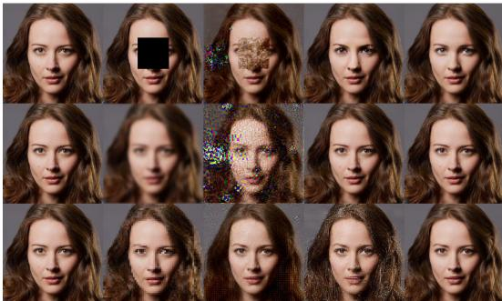  
Figure 1: Qualitative examples of image reconstructions for noiseless inpainting, deblurring, and superresolution, comparing naive ΠGDM , ΠGDM+, and our coupled guidance method.

maintain the structure of the flow-matching coupling, resulting in robust and controllable guided sampling with negligible additional overhead and minimal hyperparameter tuning. We evaluate the proposed Coupled Guidance method on robotic motion control with obstacle avoidance, four dexterous-hand manipulation tasks, and three image generation problems, namely inpainting, deblurring, and super-resolution (see Figure 1).

In sum, the main contributions of our work are as follows: i) A correction of guidance for flowmatching that jointly controls guidance in data space and in latent space; ii) A theoretical bound demonstrating the necessity of synchronizing guided latent and data distributions; iii) Extensive empirical evaluations on robotics and image generation tasks to validate the proposed guidance mechanism.

## 2 Related Works

Diffusion Models and Flow-Matching Diffusion models [14, 55] are a class of generative frameworks that operate by adding random noise to data samples to learn a reverse denoising process in order to generate new samples. Although diffusion models have been very effective in various generative tasks [68, 10, 15, 27], they suffer from multiple shortcomings, such as noise distribution assumptions and computationally expensive denoising processes. These have led to a number of recent works on solving these issues [51, 29, 72, 11].

Flow-matching [35] remedies these shortcomings by directly learning a continuous transport vector field, mapping the latent distribution to the data distribution. Unlike diffusion models, flow-matching enables the choice of any latent distributions (not necessarily Gaussian) and coupling, enhancing the fidelity of generative modeling and simplifying the transport plans [37]. As a result, high-quality samples can be achieved with very few sampling steps, as low as a single function evaluation [20]. Due to such characteristics, flow-matching has been adopted widely in various domains of AI, ranging from audio [63, 31] and image generation [56, 52] to forecasting [22, 49], and robotic control and planning [62, 4, 66].

Guidance Methods In many generative tasks, it is essential to control the sampling process to meet certain criteria, such as generating new images given specific text prompts [32]. Guidance methods are effective mechanisms for controlling the sampling process and can be applied in different ways. One way is to apply guidance using a pretrained classifier to condition the sampling process [12, 55, 73, 34]. This approach, however, limits the diversity of samples as the conditioning is based on a limited set of classes. In addition, such a method requires large-scale retraining if the criteria are changed. For instance, in the context of obstacle avoidance, over 500K training samples are required to capture various goal configurations and obstacle layouts to cover a simple workspace [12].

Training-free guidance methods [53] lower the computational burden by applying and optimizing a cost function directly at inference time, hence eliminating the need to retrain the generative model. These approaches have been widely applied to diffusion policies for robotic control applications in which responding to novel or unexpected situations is paramount [6, 68, 18, 46, 67]. Despite the great success of training-free guidance methods, their direct application to flow-matching is not trivial. Feng et al. [19] propose a comprehensive framework for the translation of diffusion guidance to flow-matching. This approach enables the adaptation of several guidance methods from diffusion to flow-matching and provides a strong baseline for our work. Nevertheless, these adaptations do not account for the training coupling. As we show in the following section, this omission can result in the velocity field being evaluated at points that lie far outside the coupling region, where the model has not been trained.

Base Methods Unlike in diffusion, the literature in pixel-space training-free guidance is still scarce for flow matching, making the number of relevant baselines limited. We chose to study two paradigms, namely Jacobian-based and Jacobian-free guidance by testing our method on ΠGDM and $g ^ { \mathrm { s i m - i n v - A } }$ [19], we refer to the latter as $\Pi { \bf G D M _ { + } }$

ΠGDM is a direct adaptation of the pseudoinverse-based guidance [54] to the flow-matching setting. In noiseless inverse problems, the guidance takes the form,

$$
\Pi \mathbf { G D M } ( x , y , H ) = - \lambda _ { t } ( ( H ^ { \dagger } y - H ^ { \dagger } H \hat { x } _ { 1 } ) ^ { T } \frac { \partial \hat { x } _ { 1 } } { \partial x _ { t } } ) ^ { T }
$$

where $\lambda _ { t }$ denotes the guidance schedule, H is the degradation operator $( \mathrm { e . g . }$ , masking for inpainting, blurring for deblurring, or downsampling for super-resolution), and $y = H x ^ { * }$ is the degraded observation of the target image $x ^ { * }$ . The operator $H ^ { \dagger } = H ^ { \top } ( H H ^ { \top } ) ^ { - 1 }$ corresponds to the Moore–Penrose pseudoinverse of H. ΠGDM+follows that exact formulation but approximates $\frac { \partial \hat { x } _ { 1 } } { \partial x _ { t } }$ as the identity.

Finally, since no trivial adjoint operator $H ^ { T }$ is available for collision avoidance, we instead apply guidance by directly using $y ^ { c o v - \hat { \boldsymbol { A } } }$ which minimizes an energy function,

$$
g _ { \mathrm { c o l l i s i o n } } = - \lambda _ { t } \nabla _ { \widehat { x } _ { 1 } } | | \widehat { x } _ { 1 } - y | |
$$

with $y$ the target generated by our collision avoidance pipeline. We provide a discussion about our choice of baseline in Appendix B.1.

## 3 A Short Theory of Coupled Guidance

## 3.1 Notations

We consider a data space $\mathcal { X } : = \mathbb { R } ^ { d }$ , viewed as an affine space with underlying vector space $\vec { x }$ . It is equipped with its Borel σ-algebra and the Lebesgue measure λ. We denote measures by Greek letters $\mu , \nu , \pi . \mathbf { A }$ distribution is a probability measure on $x ,$ , and a coupling of two distributions $\mu$ and ν is a distribution π on $\mathcal { X } \times \mathcal { X }$ such that its marginals are $\mu$ and ν respectively.

## 3.2 Flow-Matching Training and Inference

A flow-matching model consists of a tuple $( \mu _ { 1 } , \mu _ { 0 } , \pi , v ^ { \theta } )$ where $\mu _ { 1 }$ is the data or target distribution, $\mu _ { 0 }$ is a latent distribution (typically Gaussian), π is a coupling between them, and $v ^ { \theta } : \mathcal { X } \times [ 0 , 1 ] \to \overrightarrow { \mathcal { X } }$ is a learnable vector field.

The model is trained using a linear flow-matching objective,

$$
\mathcal { L } ( \theta ) = \mathbb { E } _ { ( x _ { 0 } , x _ { 1 } ) \sim \pi } \int _ { 0 } ^ { 1 } \| v _ { t } ^ { \theta } ( x _ { t } ) - v _ { t } ( x _ { t } ) \| ^ { 2 } d t = \mathbb { E } \int _ { 0 } ^ { 1 } \| v _ { t } ^ { \theta } ( x _ { t } ) - ( x _ { 1 } - x _ { 0 } ) \| ^ { 2 } d t + \mathrm { C t e } ,
$$

where $x _ { t } = ( 1 - t ) x _ { 0 } + t x _ { 1 }$ and $v _ { t } ( x _ { t } ) = \mathbb { E } [ x _ { 1 } - x _ { 0 } \mid x _ { t } ]$

At inference time, one solves the ODE $\dot { x } _ { t } = v ^ { \theta } ( x _ { t } , t )$ , typically via a first-order Euler scheme:

$$
x _ { t + \delta t } = x _ { t } + v _ { t } ^ { \theta } ( x _ { t } ) \delta t ,\tag{1}
$$

We can extend this Euler step for a one step prediction:

$$
\widehat { x } _ { 1 } = x _ { t } + ( 1 - t ) v ^ { \theta } ( x _ { t } , t )\tag{2}
$$

## 3.3 From Guided Flow to Coupled Guidance

In practice, guidance takes the form of a task-specific function $\mathcal { G } : \mathcal { X }  \overrightarrow { \mathcal { X } }$ , which acts as a correction to the predicted clean sample. For clarity, we omit conditioning variables (e.g., observation o).

By analogy with universal diffusion guidance [1], each inference step may be interpreted as (i) predicting a denoised endpoint $\widehat { x } _ { 1 }$ , followed by (ii) interpolating toward it,

$$
x _ { t + \delta t } = \frac { 1 - t - \delta t } { 1 - t } x _ { t } + \frac { \delta t } { 1 - t } \widehat { x } _ { 1 } .\tag{3}
$$

Naive guidance first modifies the predicted endpoint,

$$
\begin{array} { r } { \widehat { x } _ { 1 } ^ { g } = \widehat { x } _ { 1 } + \alpha _ { t } \mathcal { G } ( \widehat { x } _ { 1 } ) , } \end{array}\tag{4}
$$

$$
\boldsymbol { x } _ { t + \delta t } ^ { g , \mathrm { n a i v e } } = \frac { 1 - t - \delta t } { 1 - t } \boldsymbol { x } _ { t } + \frac { \delta t } { 1 - t } \boldsymbol { \widehat { x } } _ { 1 } ^ { g } ,\tag{5}
$$

but this formulation obscures the underlying coupling structure on which flow-matching is trained. We rewrite inference as a coupling update by defining the reconstructed endpoints as

$$
{ \widehat { x } } _ { 0 } = x _ { t } - t v ^ { \theta } ( x _ { t } , t ) \quad { \mathrm { a n d } } \quad { \widehat { x } } _ { 1 } = x _ { t } + ( 1 - t ) v ^ { \theta } ( x _ { t } , t )\tag{6}
$$

Then the Euler update (1) is equivalent to

$$
\begin{array} { r } { x _ { t + \delta t } = ( 1 - t - \delta t ) \widehat { x } _ { 0 } + ( t + \delta t ) \widehat { x } _ { 1 } , } \end{array}\tag{7}
$$

a linear interpolation between the latent and target endpoints. When applying naive guidance, the target endpoint becomes $\widehat { x } _ { 1 } ^ { g }$ , and the latent endpoint must be modified to

$$
{ \widehat { x } } _ { 0 } ^ { g , { \mathrm { n a i v e } } } : = x _ { t } - t { \frac { { \widehat { x } } _ { 1 } ^ { g } - x _ { t } } { 1 - t } } .
$$

Thus naive guidance implicitly induces a latent guidance

$$
\widehat { x } _ { 0 } ^ { g , \mathrm { n a i v e } } - \widehat { x } _ { 0 } = - \frac { \alpha _ { t } t } { 1 - t } \mathcal { G } ( \widehat { x } _ { 1 } ) .
$$

General coupled guidance. Motivated by this observation, we introduce Coupled Guidance, the pair $( \mathcal { G } ^ { 0 } , \mathcal { G } ^ { 1 } )$ and the following update rules in the general form:

$$
\widehat { x } _ { 0 } ^ { g } = \widehat { x } _ { 0 } + \mathcal { G } ^ { 0 } ( \widehat { x } _ { 0 } , \widehat { x } _ { 1 } , t ) ,\tag{8}
$$

$$
\widehat { x } _ { 1 } ^ { g } = \widehat { x } _ { 1 } + \mathcal { G } ^ { 1 } ( \widehat { x } _ { 0 } , \widehat { x } _ { 1 } , t ) ,\tag{9}
$$

$$
x _ { t + \delta t } ^ { g } = ( 1 - t - \delta t ) \widehat { x } _ { 0 } ^ { g } + ( t + \delta t ) \widehat { x } _ { 1 } ^ { g } .\tag{10}
$$

For naive guidance, we have

$$
\mathcal { G } ^ { 1 , \mathrm { n a i v e } } = \alpha _ { t } \mathcal { G } ( \widehat { x } _ { 1 } ) \quad \mathrm { a n d } \quad \mathcal { G } ^ { 0 , \mathrm { n a i v e } } = - \frac { \alpha _ { t } t } { 1 - t } \mathcal { G } ( \widehat { x } _ { 1 } ) .\tag{11}
$$

## 3.4 Training Coupling versus Guided Coupling

A coupled guidance induces a guided interpolant distribution $( \widehat { x } _ { 0 } ^ { g } , \widehat { x } _ { 1 } ^ { g } ) \sim ( \pi ^ { g } \mid o , t )$ , which depends on the observation o and timestep t. We continue by characterizing how deviations between $\pi ^ { g }$ and the training coupling π affect flow-matching accuracy, and clarify why naive guidance degrades performance even if ΠGDM mitigates some—but not all—failures.

Assumptions. Following Benton et al. [3], we assume:

• the flows induced by $v _ { t }$ and $v _ { t } ^ { \theta }$ exist, and are unique and smooth;

$v ^ { \theta }$ is differentiable in $( t , x )$ and Lipschitz in x;

• the guided update admits a continuous-time limit $x _ { t + \delta t } ^ { g } = x _ { t } ^ { g } + \delta t v _ { t } ^ { g } + o ( \delta t )$

$v _ { t } \mapsto v _ { t } ^ { g }$ is Lipschitz with constant $L _ { g }$

These hold, in particular, for naive guidance provided $\alpha _ { t } \| \mathcal { G } \| = O ( 1 - t )$ as $t \to 1$ . We denote by $\mu _ { 1 } ^ { g ( o ) }$ and $\mu _ { 1 } ^ { \theta , g ( o ) }$ the final guided distribution for the theoretical minimizer $v _ { t }$ of the loss and the trained vector field $v _ { t } ^ { \theta } .$ , respectively.

Theorem 1. Let $( \mu _ { 1 } , \mu _ { 0 } , \pi , v ^ { \theta } )$ be a flow-matching model and let g be any coupled guidance. Under the above assumptions,

$$
\mathbb { E } _ { o } \mathcal { W } \Big ( \mu _ { 1 } ^ { g ( o ) } , \mu _ { 1 } ^ { \theta , g ( o ) } \Big ) \leq L _ { g } L _ { \theta } \mathscr { L } ^ { 1 / 2 } ( \theta ) \left\| \frac { d \pi ^ { g } } { d \pi } \right\| _ { L ^ { \infty } ( \pi ) } ,\tag{12}
$$

where $\pi ^ { g }$ is the guided coupling distribution, $\begin{array} { r } { L _ { \theta } = \exp \Bigl ( \int _ { 0 } ^ { 1 } L _ { \theta , t } d t \Bigr ) } \end{array}$ , and $\boldsymbol { L } _ { \boldsymbol { \theta } , t }$ is the Lipschitz constant of $\cdot v _ { t } ^ { \theta } ;$ See Appendix Afor the proof.

Interpretation. The bound highlights the central difficulty of naive guidance: the factor $\frac { d \pi ^ { g } } { d \pi }$ measures how far the guided coupling deviates from the training coupling. Under the simplifying assumptions that the couplings are independent, $\pi = \mu _ { 0 } \otimes \mu _ { 1 }$ and $\pi ^ { g } = \overline { { { \pi } } } _ { 0 } ^ { g } \otimes \pi _ { 1 } ^ { g }$ , the density ratio decomposes into

$$
\frac { d \pi ^ { g } } { d \pi } = \frac { d \pi _ { 1 } ^ { g } } { d \mu _ { 1 } } \cdot \frac { d \pi _ { 0 } ^ { g } } { d \mu _ { 0 } } .
$$

The target marginal $\pi _ { 1 } ^ { g }$ depends on how well the target guidance $\mathcal { G } ^ { 1 }$ preserves the data manifold. Under the manifold hypothesis [17], $\mu _ { 1 }$ is highly anisotropic; ΠGDM improves stability by projecting the guidance direction onto dominant tangent directions of $\mu _ { 1 }$ , thus controlling the data-side marginal density $\frac { d \pi _ { 1 } ^ { g } } { d \mu _ { 1 } }$ . However, computing this projection requires $\textstyle { \frac { d { \hat { x } } _ { 1 } } { d x _ { t } } }$ , which can become ill-behaved when guided trajectories deviate from the training coupling. Using coupled guidance controls the latent-side density, keeping the inference stable.

The latent marginal $\pi _ { 0 } ^ { g }$ depends on the latent guidance $\mathcal { G } ^ { 0 }$ . For a Gaussian prior, naive guidance yields

$$
\frac { d \pi _ { 0 } ^ { g } } { d \mu _ { 0 } } \approx \mathbb { E } _ { x _ { 1 } \sim \mu _ { 1 } } \int _ { 0 } ^ { 1 } \exp \Bigl ( \bigl \| \frac { \alpha _ { t } } { 1 - t } \mathcal { G } ( x _ { 1 } ) \bigr \| ^ { 2 } \Bigr ) d t ,
$$

which can explode for moderate guidance strength, causing severe out-of-distribution drift of intermediate $\boldsymbol { x } _ { t } ^ { g }$

Conclusion. Naive guidance evaluates the learned vector field $v ^ { \theta }$ at intermediate points $\boldsymbol { x } _ { t } ^ { g }$ that may lie far outside the coupling used during training, leading to large density ratios and degraded inference. This motivates designing guidance rules that preserve the latent–data coupling—precisely the principle behind our Coupled Guidance framework.

## 4 Method

## 4.1 Coupled Guidance Algorithm

Our method directly instantiates the coupled guidance update rules (8), (9), (10). We use the same target-guidance as standard guided flow, but modify the latent-guidance term to better preserve the training coupling. Concretely, we define,

$$
\mathcal { G } ^ { 1 , \alpha } ( \widehat { x } _ { 0 } , \widehat { x } _ { 1 } , t ) = \alpha \mathcal { G } ( \widehat { x } _ { 1 } ) ,\tag{13}
$$

$$
\mathcal { G } ^ { 0 , \beta } ( \widehat { x } _ { 0 } , \widehat { x } _ { 1 } , t ) = - \frac { \beta t } { 1 - t } \mathcal { G } ( \widehat { x } _ { 1 } ) ,\tag{14}
$$

Table 1: Comparison of naive vs. coupled guidance across methods and tasks on ImageNet-128 (minibatch OT).  
Algorithm 1 Coupled Guidance Sampling   
Require: Number of steps $T ,$ velocity field $v _ { t } ^ { \theta } ( x )$ , guidance   
function ${ \mathcal { G } } ,$ coefficients $( \alpha , \beta ) ,$ , step size δt.   
1: Sample initial latent $x _ { 0 } ^ { g } \sim \mu _ { 0 }$ and set $t \gets 0$   
2: for $\overset { \cdot } { i } = 0 . . T$ do   
3: $v _ { t }  v ^ { \theta } ( x _ { t } ^ { g } , t )$   
4: $\widehat { x } _ { 1 } \gets x _ { t } ^ { g } + ( 1 - t ) v _ { t }$   
5: $\widehat { x } _ { 0 } \gets x _ { t } ^ { \check { g } } - { \dot { t } } v _ { t }$   
6: $g  { \mathcal { G } } ( { \dot { \widehat { x } } } _ { 1 } )$   
7: ${ \widehat { x } } _ { 1 } ^ { g } \gets { \widehat { x } } _ { 1 } + \alpha g$   
8: $\begin{array} { r } { \widehat { x } _ { 0 } ^ { g } \gets \widehat { x } _ { 0 } - \frac { \beta t } { 1 - t } g } \end{array}$   
9: $t \gets t + \delta t$   
10: $x _ { t } ^ { g }  \overset { \cdot } { ( } 1 - t ) \widehat { x } _ { 0 } ^ { g } + t \widehat { x } _ { 1 } ^ { g }$   
11: end for   
12: return $x _ { t } ^ { g }$

<table><tr><td rowspan="2">Task</td><td rowspan="2">Metric</td><td colspan="2">Naive</td><td colspan="2">Coupled</td></tr><tr><td>IIGDM</td><td>ⅡIGDM+</td><td>IIGDM</td><td>IIGDM+</td></tr><tr><td rowspan="4">Inpainting</td><td>FID↓</td><td>18.3</td><td>10.3</td><td>8.5</td><td>11.4</td></tr><tr><td>LPIPS↓</td><td>0.112</td><td>0.086</td><td>0.088</td><td>0.089</td></tr><tr><td>PSNR↑</td><td>18.3</td><td>20.6</td><td>23.5</td><td>20.3</td></tr><tr><td>SSIM↑</td><td>0.903</td><td>0.911</td><td>0.916</td><td>0.908</td></tr><tr><td rowspan="4">Deblurring</td><td>FID↓</td><td>70.5</td><td>14.3</td><td>22.2</td><td>13.2</td></tr><tr><td>LPIPS↓</td><td>0.471</td><td>0.197</td><td>0.264</td><td>0.184</td></tr><tr><td>PSNR↑</td><td>19.0</td><td>23.8</td><td>23.5</td><td>24.3</td></tr><tr><td>SSIM↑</td><td>0.449</td><td>0.753</td><td>0.711</td><td>0.769</td></tr><tr><td rowspan="4">Super-res.</td><td>FID↓</td><td>49.7</td><td>46.0</td><td>8.5</td><td>50.4</td></tr><tr><td>LPIPS↓</td><td>0.335</td><td>0.396</td><td>0.142</td><td>0.413</td></tr><tr><td>PSNR↑</td><td>19.0</td><td>17.5</td><td>24.0</td><td>17.3</td></tr><tr><td>SSIM↑</td><td>0.645</td><td>0.477</td><td>0.816</td><td>0.452</td></tr></table>

where $( \alpha , \beta )$ are hyperparameters controlling data-side and latent-side guidance. Algorithm 1 summarizes the full sampling procedure.

This procedure introduces only two hyperparameters and retains the same computational complexity as naively guided flow-matching. Note that $\alpha = 1$ will almost always be the sensible choice, as scaling of data-guidance is in practice already included in the guidance operator itself. Only β needs to be chosen between naive $( \bar { \beta } = 1 )$ and coupled guidance $( \beta \in [ - 1 , 0 ] )$ . We see very little empirical benefit to tuning $\beta$ carefully, and would recommend simply setting $\beta \in \{ 0 , - 1 \}$ as a starting point.

Intuitively, $\beta$ controls both the magnitude and sign of the latent correction relative to the data-side guidance ${ \mathcal { G } } .$ , acting as an affine parameter along $( \bar { \hat { x } } _ { 0 } , \hat { x } _ { 0 } ^ { g } )$ ), with a clear geometric interpretation:

$\beta = 1 \mathrm { : }$ : the latent interpolant is $\hat { x } _ { 0 } ^ { g } .$ , the correction is reversed relative to the data guidance, actively opposing it.

$\beta = 0$ : the latent interpolant remains $\scriptstyle { \hat { x } } _ { 0 }$ (no latent correction).

$\beta = - 1 \colon$ : the latent interpolant is set to the symmetric of $\hat { x } _ { 0 } ^ { g }$ with respect to $\scriptstyle { \hat { x } } _ { 0 }$ , i.e. it is pushed in the same direction as the data guidance (since $\begin{array} { r } { - \frac { - \top } { 1 - t } \mathcal { G } = + \frac { 1 } { 1 - t } \mathcal { G } ) } \end{array}$

As established in Liu et al. [37, Theorem 3.5], flow-matching training minimizes transport cost, which causes the learned vector field to progressively align latent and data interpolants along trajectories. This means the learned data-latent coupling tends to co-orient ${ \hat { x } } _ { 0 }$ and ${ \hat { x } } _ { 1 }$ along the flow. Applying $\beta = 1$ pushes the latent interpolant against the data guidance direction, producing a data-latent coupling that diverges from the learned one. By contrast, $\beta \leq 0$ aligns the latent correction with the data guidance, keeping the guided coupling closer to the learned coupling.

## 5 Experiments

## 5.1 Collision Avoidance

Following Chi et al. [9], Clemente et al. [11], we use a 65M-parameter U-Net [50] to parameterize our flow-matching policy, trained on the ManiSkill3 [59] Pick Cube environment and its associated dataset. The action space is 9-dimensional, corresponding to the robot joint positions.

Table 2: Collision avoidance success rates (%) for all $( \alpha , \beta )$ couples, over 256 environment seeds.

<table><tr><td> $\alpha \backslash \beta$ </td><td>-1</td><td>0</td><td>1</td></tr><tr><td>0</td><td>73</td><td>21</td><td>17</td></tr><tr><td>1</td><td>81</td><td>77</td><td>36</td></tr></table>

The model is trained to predict an action horizon of length $h _ { \mathbf {  } } =$ 24—resulting in an output dimension of $2 4 \times 9 = 2 1 6 - \mathrm { c }$ onditioned on an observation horizon of $h _ { \mathcal { O } } = 2$ past environment states. On the base environment, the learned policy solves the task almost perfectly, achieving a success rate of 99.8% (see Appendix B.2 for more details). We then evaluate the same policy in a modified environment where an obstacle is introduced between the initial cube position and the target, and apply guidance to enable collision avoidance. The guidance function is defined using a Euclidean signed distance field (ESDF), computed with cuRobo [57], and acts directly on the predicted joint trajectories to penalize collisions. This form of guidance is inherently noisy, as it perturbs each joint state independently across the prediction horizon, resulting in a large deviation between the guided and training couplings, reflected by a high density ratio $d \bar { \pi _ { 1 } ^ { g } } / d \mu _ { 1 }$

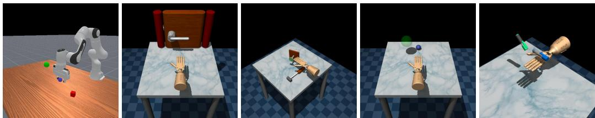  
Figure 2: Experimental setups for robotics tasks. From left to right: Maniskill PickCube, Adroit Door, Hammer, Relocate, and Pen.

Without guidance $( \alpha = 0 , \beta = 0 )$ , the policy’s performance drops to approximately 21%, as trajectories frequently collide with the obstacle. In this setting, ΠGDM is not directly applicable, as it requires access to an adjoint or degradation operator, which is unavailable for this task. We therefore apply guidance by directly minimizing the ESDF-based energy. Under naive guidance $( \alpha = 1$ $\beta = 1 )$ , performance only improves up to 36%. In contrast, coupled guidance consistently yields strong performance despite the noisy nature of the guidance signal, achieving up to 81% success rate with $\alpha = 1$ and $\beta = - \bar { 1 }$ . Results for different tested $( \alpha , \beta )$ configurations are reported in Table 2.

## 5.2 Robotic Control as an Inpainting Task

We emulate a two-level hierarchical motion controller in which a high-level planner provides partial information about future trajectories to a low-level controller, thereby turning control into an inpainting problem. To this end, we train two flow-matching models per task. The high-level planner is a conditioned model that, given an observation history, predicts a horizon of $h = 2 4$ future state–action pairs $( o _ { t } , a _ { t } ) _ { t = 1 } ^ { h }$ . The low-level controller is trained on the same dataset but remains unconditioned.

At test time, the controller receives sparse supervision from the planner and its task is to infer a complete action sequence consistent with this partial trajectory information. Intuitively, the planner acts as a world-aware module that provides intermittent waypoints in the trajectory space, while the controller acts as an action expert that fills in the missing degrees of freedom.

We evaluate robustness to guidance sparsity under both naive and coupled guidance on the four Adroit dexterous manipulation tasks [48, 21]: Door (latch opening), Pen (reorientation to a target angle), Hammer (nail hammering), and Relocate (object relocation) (Figure 2). Different seeds correspond to variations in task configuration (e.g., door pose, target angle, nail position, and object/goal locations). As ΠGDM and ΠGDM behave similarly, we present results for ΠGDM in Figure 3 and include additional results in Appendix C.1. For all runs we used 300 seeds.

As shown in Figure 3, coupled guidance is substantially more robust to sparse guidance than naive guidance, without requiring task-specific tuning. Even when sweeping a wide range of guidance scales, naive guidance degrades sharply once 20% or fewer dimensions are guided, whereas coupled guidance maintains near-fully-guided performance down to approximately 5% guided dimensions. Naive guidance can perform well with careful tuning, but requires different guidance scales across sparsity regions, whereas coupled guidance remains stable across all sparsity levels without tuning. Additional results are provided in Appendix C.1.

Since inpainting-based guidance has recently been adopted to improve trajectory consistency in generalist robotic policies [5], methods such as ΠGDM have clear relevance to real-world robotic control. The increased stability provided by coupled guidance directly benefits these

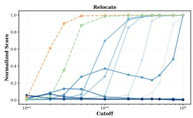

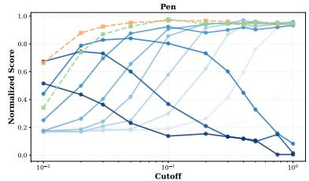  
Figure 3: Performance of ΠGDM on Adroit tasks given different sparsity cutoffs. Runs using coupled guidance are used directly without a unit guidance scale $s = 1$ . The blue lines each represent the performance of naive guidance for different guidance scalings s.7

applications by reducing   
sensitivity to sparse   
or imperfect guidance,   
enabling more reliable deployment without overhead.

## 5.3 Image Generation

For the image generation tasks, we study the behavior of ΠGDM and ΠGDM+under naive and coupled guidance on box inpainting, deblurring and factor 4 super-resolution. We train a U-Net model from scratch on the CelebA-HQ-256 and ImageNet-128 datasets [38] (see Appendix B.3 for more details). All runs use the same base flow-matching model and are compared via 4 image quality metrics: FID [24], LPIPS [71], PSNR and SSIM [64]. To cover usual settings, we also train a minibatch OT model with a similar backbone for ImageNet-128. Given that the results are consistent for both datasets and coupling choices, we make general comments in the following section for conciseness. The full tables and plots of the results are provided in Table 1 and Appendix C.2.

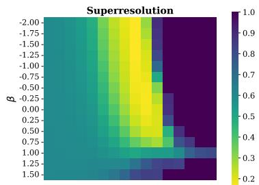

We evaluate our method on noiseless linear inverse problems:

$$
y = H x + \sigma _ { y } , \quad { \mathrm { w i t h } } \quad \sigma _ { y } = 0 .
$$

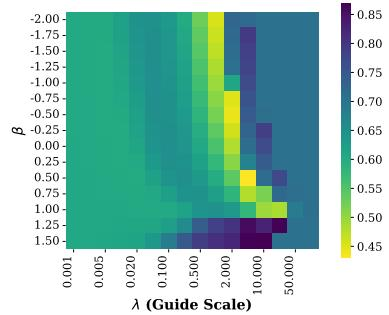

Although adding noise may make an accurate reconstruction more difficult, in practice it helps stabilize the guidance process, and $\sigma _ { y } = 0$ is actually the regime in which training-free guidance is most prone to instability. It has been shown in the previous studies [65, 2, 60] that nonzero measurement noise $\sigma _ { y }$ acts as an implicit regularizer, i.e.

Figure 4: LPIPS scores for ΠGDM , (first row) and ΠGDM (second row) on super-resolution

it smooths the posterior score so that the linear guidance term dominates for most of the trajectory [2], reduces the effective curvature of the likelihood gradient [60], and in ΠGDM directly Tikhonovregularizes the covariance inversion via the $\sigma _ { y } ^ { 2 }$ I term. When $\sigma _ { y }$ approaches 0, these stabilizing effects vanish: the guidance sharpens, instability increases, and approximation errors in the score are no longer masked by a forgiving posterior geometry. This makes the noiseless setting pertinent for our study as it highlights a failure mode where the stabilizing effects of coupled guidance are necessary.

Inpainting In this setting, naive ΠGDM+exhibits stable and reliable performance across all metrics, whereas ΠGDM shows worse performance, producing visible artifacts. This behavior, illustrated in Figure 4 is consistent with the analysis in Section 3, as ΠGDM relies on the Jacobian $\partial \widehat { x } _ { 1 } / \partial x _ { t }$ , which becomes poorly conditioned when guided trajectories deviate from the training coupling. Coupled guidance has little effect on ΠGDM , whose stability primarily stems from the identity Jacobian approximation. However, it significantly stabilizes ΠGDM by preserving the training coupling. As a result, coupled ΠGDM consistently outperforms naive ΠGDM and ΠGDM+across all image quality metrics.

Super-resolution In this sparse guidance setting, both ΠGDM and ΠGDM fail to produce mean ingful reconstructions, yielding poor image quality across all evaluation metrics, as shown in Figure 4. Like in the inpainting case, introducing coupled guidance has negligible impact on $\Pi \mathbf { G D M _ { + } }$ whose performance is fundamentally constrained by the identity Jacobian approximation and thus poorly suited to this task. In contrast, coupled guidance substantially stabilizes ΠGDM by mitigating excessive latent-side drift, enabling reliable sampling throughout the trajectory. This stabilization translates into a clear improvement in sample quality, with the coupled ΠGDM variant consistently outperforming all other methods.

Deblurring In this task, both $\Pi { \bf G D M _ { + } }$ and ΠGDM benefit from coupled guidance. ΠGDM+by default produces high-quality samples under naive guidance, indicating that the identity Jacobian approximation is well suited to this type of degradation. Still, coupled guidance further improves the reconstruction quality across all metrics in this setting. Coupled guidance likewise stabilizes ΠGDM and enables reliable inference; however, even with this stabilization, its performance remains below that of $\Pi { \bf G D M _ { + } }$ . Overall, both methods benefit from coupled guidance in this setting even if this time $\Pi \mathbf { G D M _ { + } }$ emerges as the strongest method. Additional illustrations for image quality metrics are provided in Appendix C.2.

Jacobian Influence Figure 5 illustrates how coupled guidance affects the contribution of the Jacobiandependent term throughout the inference process. Note that to remain fair to the naive setting, we plot the best run for each $\beta$ after tuning. The term is initially large during the early steps, reflecting the expected role of the Jacobian in aligning the prediction with the inverse constraint. Crucially, when $\beta = 1$ (naive guidance), the Jacobian contribution remains substantially larger in the stable zone, and the

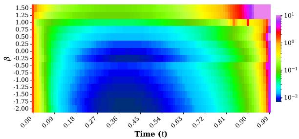  
Figure 5: Evolution of $\partial \widehat { x } _ { 1 } / \partial { x } _ { t } \mathrm { ' s }$ contribution to the guidance norm for the CelebA-HQ-256 superresolution task through the ΠGDM inference process.

final destabilization occurs earlier, making the final divergence more pronounced. Decreasing β effectively dampens this amplification, extending the stable regime and delaying the time at which the term starts being ill-behaved. This observation provides direct empirical evidence that coupled guidance helps control the magnitude and timing of the Jacobian-induced corrections by preserving the training coupling, thereby preventing instability without degrading the guidance signal.

## 6 Limitations

Simplified theoretical setting. Our analysis is conducted under a simplified formulation using the unweighted quadratic flow-matching loss. A more general treatment would require extending the theory to weighted Bregman divergences, which cover the diversity of flow-matching objectives in the literature [36]. In addition, our theoretical study currently applies only to linear couplings; extending the analysis to more sophisticated geometries [7] remains out of scope. Finally, Theorem 1 relies on the existence of a continuous limit, whereas practical schedules we consider do not have such a limit.

Noiseless image inverse problems. Our work primarily targets noiseless inverse problems, where guidance-induced coupling mismatch is most pronounced and cannot be mitigated by observation noise. In noisy inverse problems, noise implicitly regularizes the posterior and stabilizes Jacobianbased guidance, partially alleviating the issues we address. Moreover, in such settings the effect of coupled guidance interacts with the residual scaling schedule and the noise variance term, making it less straightforward to differentiate improvements due to coupling preservation from those induced by schedule design. As a result, the relative gains of coupled guidance may be less pronounced in noisy inverse tasks, although the proposed framework remains applicable. Still, since many applications require noiseless inverse guidance (photo editing, content super-resolution, general deblurring), we deem this restriction reasonable.

## 7 Conclusion

We proposed coupled guidance, a training-free mechanism that exploits the geometric structure of flow-matching couplings to stabilize guided generation. By jointly leveraging information from both latent and data spaces, our approach achieves competitive or superior performance across robotics and image inverse problems while requiring minimal hyperparameter tuning and negligible computational overhead. Extensive experiments show that coupled guidance improves robustness to strongly out-of-distribution guidance signals and guidance sparsity, while improving the quality of generated samples across the board, over all tested dimensionalities and application domains. The observed behaviors validate our theoretical insights and demonstrate that coupled guidance offers a simple, scalable improvement to existing methods. We believe that this approach will extend naturally to more complex coupling structures and that it opens the door for more fine-grained latent control.

## References

[1] Arpit Bansal, Hong-Min Chu, Avi Schwarzschild, Soumyadip Sengupta, Micah Goldblum, Jonas Geiping, and Tom Goldstein. Universal guidance for diffusion models. In CVPR, 2023.

[2] Gregory Bellchambers. Exploiting the exact denoising posterior score in training-free guidance of diffusion models, 2025.

[3] Joe Benton, George Deligiannidis, and Arnaud Doucet. Error bounds for flow matching methods. TMLR, 2024.

[4] Kevin Black, Noah Brown, James Darpinian, Karan Dhabalia, Danny Driess, Adnan Esmail, et al. \$\pi\_{0.5}\$: a vision-language-action model with open-world generalization. In CoRL, 2025.

[5] Kevin Black, Manuel Y Galliker, and Sergey Levine. Real-time execution of action chunking flow policies. In NeurIPS, 2025.

[6] João Carvalho, An T. Le, Piotr Kicki, Dorothea Koert, and Jan Peters. Motion planning diffusion: Learning and adapting robot motion planning with diffusion models. IEEE Transactions on Robotics, pages 1–20, 2025.

[7] Ricky T. Q. Chen and Yaron Lipman. Flow matching on general geometries. In ICLR, 2024.

[8] Ricky TQ Chen, Yulia Rubanova, Jesse Bettencourt, and David K Duvenaud. Neural ordinary differential equations. In NeurIPS, 2018.

[9] Cheng Chi, Zhenjia Xu, Siyuan Feng, Eric Cousineau, Yilun Du, Benjamin Burchfiel, Russ Tedrake, and Shuran Song. Diffusion policy: Visuomotor policy learning via action diffusion. The International Journal ofRobotics Research, 44(10-11):1684–1704, 2025.

[10] Younwoo Choi, Ray Coden Mercurius, Soheil Mohamad Alizadeh Shabestary, and Amir Rasouli. Dice: Diverse diffusion model with scoring for trajectory prediction. In IV, 2024.

[11] Mateo Clemente, Leo Brunswic, Rui Heng Yang, Xuan Zhao, Yasser Khalil, Haoyu Lei, Amir Rasouli, and Yinchuan Li. Two-steps diffusion policy for robotic manipulation via genetic denoising. In NeurIPS, 2025.

[12] Apan Dastider, Hao Fang, and Mingjie Lin. Apex: Ambidextrous dual-arm robotic manipulation using collision-free generative diffusion models. In IROS, 2024.

[13] Nicki Skafte Detlefsen, Jiri Borovec, Justus Schock, A. Jha, Teddy Koker, Luca Di Liello, Daniel Stancl, Changsheng Quan, Maxim Grechkin, and William Falcon. Torchmetrics - measuring reproducibility in pytorch. J. Open Source Softw., 7:4101, 2022.

[14] Prafulla Dhariwal and Alexander Nichol. Diffusion models beat gans on image synthesis. In NeurIPS, 2021.

[15] Dave Epstein, Allan Jabri, Ben Poole, Alexei Efros, and Aleksander Holynski. Diffusion self-guidance for controllable image generation. In NeurIPS, 2023.

[16] Julius Erbach, Dominik Narnhofer, Andreas Dombos, Bernt Schiele, Jan Eric Lenssen, and Konrad Schindler. Solving inverse problems with FLAIR. 2025.

[17] Charles Fefferman, Sanjoy Mitter, and Hariharan Narayanan. Testing the manifold hypothesis. Journal ofthe American Mathematical Society, 29(4):983–1049, 2016.

[18] Qian Feng, Hang Li, Zhi Zheng, Jianxiang Feng, and Alois Knoll. Language-guided objectcentric diffusion policy for collision-aware robotic manipulation. In ICRA, 2025.

[19] Ruiqi Feng, Chenglei Yu, Wenhao Deng, Peiyan Hu, and Tailin Wu. On the guidance of flow matching. In ICML, 2025.

[20] Kevin Frans, Danijar Hafner, Sergey Levine, and Pieter Abbeel. One step diffusion via shortcut models. In ICLR, 2025.

[21] Justin Fu, Aviral Kumar, Ofir Nachum, George Tucker, and Sergey Levine. D4rl: Datasets for deep data-driven reinforcement learning. arXiv preprint arXiv:2004.07219, 2020.

[22] Yuxiang Fu, Qi Yan, Lele Wang, Ke Li, and Renjie Liao. Moflow: One-step flow matching for human trajectory forecasting via implicit maximum likelihood estimation based distillation. In CVPR, 2025.

[23] Will Grathwohl, Ricky TQ Chen, Jesse Bettencourt, Ilya Sutskever, and David Duvenaud. Ffjord: Free-form continuous dynamics for scalable reversible generative models. arXiv preprint arXiv:1810.01367, 2018.

[24] Martin Heusel, Hubert Ramsauer, Thomas Unterthiner, Bernhard Nessler, and Sepp Hochreiter. Gans trained by a two time-scale update rule converge to a local nash equilibrium. In NeurIPS, 2017.

[25] Jonathan Ho and Tim Salimans. Classifier-free diffusion guidance. In NeurIPSW, 2021.

[26] Jonathan Ho, Ajay Jain, and Pieter Abbeel. Denoising diffusion probabilistic models. In NeurIPS, 2020.

[27] Rongjie Huang, Jiawei Huang, Dongchao Yang, Yi Ren, Luping Liu, Mingze Li, Zhenhui Ye, Jinglin Liu, Xiang Yin, and Zhou Zhao. Make-an-audio: Text-to-audio generation with prompt-enhanced diffusion models. In ICML, 2023.

[28] Adhithyan Kalaivanan, Zheng Zhao, Jens Sjölund, and Fredrik Lindsten. Ess-flow: Training-free guidance of flow-based models as inference in source space. arXiv preprint arXiv:2510.05849, 2025.

[29] Tero Karras, Miika Aittala, Timo Aila, and Samuli Laine. Elucidating the design space of diffusion-based generative models. In NeurIPS, 2022.

[30] Tero Karras, Miika Aittala, Tuomas Kynkäänniemi, Jaakko Lehtinen, Timo Aila, and Samuli Laine. Guiding a diffusion model with a bad version of itself. In NeurIPS, 2024.

[31] Taekyung Ki, Dongchan Min, and Gyeongsu Chae. Float: Generative motion latent flow matching for audio-driven talking portrait. In ICCV, 2025.

[32] Pengzhi Li, Qiang Nie, Ying Chen, Xi Jiang, Kai Wu, Yuhuan Lin, Yong Liu, Jinlong Peng, Chengjie Wang, and Feng Zheng. Tuning-free image customization with image and text guidance. In ECCV, 2024.

[33] Xingyuan Li, Zirui Wang, Yang Zou, Zhixin Chen, Jun Ma, Zhiying Jiang, Long Ma, and Jinyuan Liu. Difiisr: A diffusion model with gradient guidance for infrared image super-resolution. In CVPR, 2025.

[34] Haohong Lin, Xin Huang, Tung Phan, David Hayden, Huan Zhang, Ding Zhao, Siddhartha Srinivasa, Eric Wolff, and Hongge Chen. Causal composition diffusion model for closed-loop traffic generation. In CVPR, 2025.

[35] Yaron Lipman, Ricky T. Q. Chen, Heli Ben-Hamu, Maximilian Nickel, and Matthew Le. Flow matching for generative modeling. In ICLR, 2023.

[36] Yaron Lipman, Marton Havasi, Peter Holderrieth, Neta Shaul, Matt Le, Brian Karrer, Ricky TQ Chen, David Lopez-Paz, Heli Ben-Hamu, and Itai Gat. Flow matching guide and code. arXiv preprint arXiv:2412.06264, 2024.

[37] Xingchao Liu, Chengyue Gong, and qiang liu. Flow straight and fast: Learning to generate and transfer data with rectified flow. In ICLR, 2023.

[38] Ziwei Liu, Ping Luo, Xiaogang Wang, and Xiaoou Tang. Deep learning face attributes in the wild. In ICCV, 2015.

[39] Ilya Loshchilov and Frank Hutter. SGDR: Stochastic gradient descent with warm restarts. In ICLR, 2017.

[40] Ilya Loshchilov and Frank Hutter. Decoupled weight decay regularization. In ICLR, 2019.

[41] Cheng Lu, Huayu Chen, Jianfei Chen, Hang Su, Chongxuan Li, and Jun Zhu. Contrastive energy prediction for exact energy-guided diffusion sampling in offline reinforcement learning. In ICML, 2023.

[42] Ségolène Tiffany Martin, Anne Gagneux, Paul Hagemann, and Gabriele Steidl. Pnp-flow: Plug-and-play image restoration with flow matching. In ICLR, 2025.

[43] George Papamakarios, Eric Nalisnick, Danilo Jimenez Rezende, Shakir Mohamed, and Balaji Lakshminarayanan. Normalizing flows for probabilistic modeling and inference. Journal of Machine Learning Research, 22(57):1–64, 2021.

[44] Jonghyun Park and Jong Chul Ye. Flowlps: Langevin-proximal sampling for flow-based inverse problem solvers. arXiv preprint arXiv:2512.07150, 2025.

[45] Maitreya Patel, Song Wen, Dimitris N. Metaxas, and Yezhou Yang. Steering rectified flow models in the vector field for controlled image generation. In ICLRW, 2025.

[46] Tim Pearce, Tabish Rashid, Anssi Kanervisto, Dave Bignell, Mingfei Sun, Raluca Georgescu, Sergio Valcarcel Macua, Shan Zheng Tan, Ida Momennejad, Katja Hofmann, and Sam Devlin. Imitating human behaviour with diffusion models. In ICLR, 2023.

[47] Javad Rajabi, Soroush Mehraban, Seyedmorteza Sadat, and Babak Taati. Token perturbation guidance for diffusion models. In NeurIPS, 2025.

[48] Aravind Rajeswaran, Vikash Kumar, Abhishek Gupta, Giulia Vezzani, John Schulman, Emanuel Todorov, and Sergey Levine. Learning complex dexterous manipulation with deep reinforcement learning and demonstrations. In RSS, 2018.

[49] Martin Rohbeck, Charlotte Bunne, Edward De Brouwer, Jan-Christian Huetter, Anne Biton, Kelvin Y. Chen, Aviv Regev, and Romain Lopez. Modeling complex system dynamics with flow matching across time and conditions. In ICLR, 2025.

[50] Olaf Ronneberger, Philipp Fischer, and Thomas Brox. U-net: Convolutional networks for biomedical image segmentation. In International Conference on Medical Image Computing and Computer-assisted Intervention, 2015.

[51] Tim Salimans and Jonathan Ho. Progressive distillation for fast sampling of diffusion models. In ICLR, 2022.

[52] Johannes Schusterbauer, Ming Gui, Frank Fundel, and Björn Ommer. Diff2flow: Training flow matching models via diffusion model alignment. In CVPR, 2025.

[53] Yifei Shen, Xinyang Jiang, Yifan Yang, Yezhen Wang, Dongqi Han, and Dongsheng Li. Understanding and improving training-free loss-based diffusion guidance. In NeurIPS, 2024.

[54] Jiaming Song, Arash Vahdat, Morteza Mardani, and Jan Kautz. Pseudoinverse-guided diffusion models for inverse problems. In ICLR, 2023.

[55] Yang Song, Jascha Sohl-Dickstein, Diederik P Kingma, Abhishek Kumar, Stefano Ermon, and Ben Poole. Score-based generative modeling through stochastic differential equations. In ICLR, 2021.

[56] George Stoica, Vivek Ramanujan, Xiang Fan, Ali Farhadi, Ranjay Krishna, and Judy Hoffman. Contrastive flow matching. In ICCV, 2025.

[57] Balakumar Sundaralingam, Siva Kumar Sastry Hari, Adam Fishman, Caelan Garrett, Karl Van Wyk, Valts Blukis, Alexander Millane, Helen Oleynikova, Ankur Handa, Fabio Ramos, et al. curobo: Parallelized collision-free minimum-jerk robot motion generation. arXiv preprint arXiv:2310.17274, 2023.

[58] Giuseppe Tagliavini, Stefan Mach, Davide Rossi, Andrea Marongiu, and Luca Benini. A transprecision floating-point platform for ultra-low power computing. In Design, Automation & Test in Europe Conference & Exhibition (DATE), 2018.

[59] Stone Tao, Fanbo Xiang, Arth Shukla, Yuzhe Qin, Xander Hinrichsen, Xiaodi Yuan, Chen Bao, Xinsong Lin, Yulin Liu, Tse-kai Chan, et al. Maniskill3: Gpu parallelized robotics simulation and rendering for generalizable embodied ai. arXiv preprint arXiv:2410.00425, 2024.

[60] Feng Tian, Yixuan Li, Weili Zeng, Weitian Zhang, Yichao Yan, and Xiaokang Yang. Stabilizing diffusion posterior sampling by noise–frequency continuation, 2026.

[61] Zhengchao Wan, Qingsong Wang, Gal Mishne, and Yusu Wang. Elucidating flow matching ODE dynamics via data geometry and denoisers. In Forty-second International Conference on Machine Learning, 2025. URL https://openreview.net/forum?id=f5czhqYK3H.

[62] Sen Wang, Le Wang, Sanping Zhou, Jingyi Tian, Jiayi Li, Haowen Sun, and Wei Tang. Flowram: Grounding flow matching policy with region-aware mamba framework for robotic manipulation. In CVPR, 2025.

[63] Xihua Wang, Xin Cheng, Yuyue Wang, Ruihua Song, and Yunfeng Wang. Vaflow: Video-toaudio generation with cross-modality flow matching. In ICCV, 2025.

[64] Zhou Wang, Alan C Bovik, Hamid R Sheikh, and Eero P Simoncelli. Image quality assessment: from error visibility to structural similarity. IEEE Transactions on Image Processing, 13(4): 600–612, 2004.

[65] Yingzhi Xia, Setthakorn Tanomkiattikun, Liangli Zhen, and Zaiwang Gu. Noise-adaptive diffusion sampling for inverse problems without task-specific tuning, 2026.

[66] Zebin Xing, Xingyu Zhang, Yang Hu, Bo Jiang, Tong He, Qian Zhang, Xiaoxiao Long, and Wei Yin. Goalflow: Goal-driven flow matching for multimodal trajectories generation in end-to-end autonomous driving. In CVPR, 2025.

[67] Rui Heng Yang, Xuan Zhao, Leo Maxime Brunswic, Montgomery Alban, Mateo Clemente, Tongtong Cao, Jun Jin, and Amir Rasouli. Cape: Context-aware diffusion policy via proximal mode expansion for collision avoidance. arXiv preprint arXiv:2511.22773, 2025.

[68] Xi Ye, Rui Heng Yang, Jun Jin, Yinchuan Li, and Amir Rasouli. Ra-dp: Rapid adaptive diffusion policy for training-free high-frequency robotics replanning. In IROS, 2025.

[69] Xin Ye, Burhaneddin Yaman, Sheng Cheng, Feng Tao, Abhirup Mallik, and Liu Ren. Bevdiffuser: Plug-and-play diffusion model for bev denoising with ground-truth guidance. In CVPR, 2025.

[70] Omar G. Younis, Rodrigo Perez-Vicente, John U. Balis, Will Dudley, Alex Davey, and Jordan K Terry. Minari, September 2024. URL https://doi.org/10.5281/zenodo.13767625.

[71] Richard Zhang, Phillip Isola, Alexei A Efros, Eli Shechtman, and Oliver Wang. The unreasonable effectiveness of deep features as a perceptual metric. In CVPR, 2018.

[72] Hongkai Zheng, Weili Nie, Arash Vahdat, Kamyar Azizzadenesheli, and Anima Anandkumar. Fast sampling of diffusion models via operator learning. In ICML, 2023.

[73] Yinan Zheng, Ruiming Liang, Kexin ZHENG, Jinliang Zheng, Liyuan Mao, Jianxiong Li, Weihao Gu, Rui Ai, Shengbo Eben Li, Xianyuan Zhan, and Jingjing Liu. Diffusion-based planning for autonomous driving with flexible guidance. In ICLR, 2025.

## A Proof of the OOD bound

Theorem 2. Let $( \mu _ { 1 } , \mu _ { 0 } , \pi , v ^ { \theta } )$ be aflow-matching model and let g be a guidance. Under assumptions above, with A the Lipschitz constant ofv $\mapsto v ^ { g }$

$$
\mathbb { E } _ { o } { \mathcal { W } } ( \mu _ { 1 } ^ { g ( o ) } , \mu _ { 1 } ^ { \theta , g ( o ) } ) \leq A \exp \left( \int _ { 0 } ^ { 1 } L _ { t } d t \right) { \mathcal { L } } ^ { 1 / 2 } ( \theta ) \left\| { \frac { d \pi ^ { g } } { d \pi } } \right\| _ { L ^ { \infty } }\tag{15}
$$

where $\pi ^ { g }$ is the distribution of coupling $( x _ { 0 } ^ { g } , x _ { 1 } ^ { g } )$ during inference.

Proof. We follow the lines of the proof of Theorem 1 of Benton et al. [3]. Define $X _ { s , t } ^ { x } , Y _ { s , t } ^ { x }$ be the respective flows of v and $v ^ { \theta }$ respectively: forall $\boldsymbol { x } \in \mathbb { R } ^ { d }$ and all $0 \leq s \leq t \leq 1$

$$
X _ { s , t } ^ { x } = x + \int _ { s } ^ { t } v ^ { g } ( X _ { s , r } ^ { x } , r ) d r ;\tag{16}
$$

$$
\begin{array} { r c l } { Y _ { s , t } ^ { x } } & { = } & { \displaystyle { x + \int _ { s } ^ { t } v ^ { g , \theta } ( Y _ { s , r } ^ { x } , r ) d r . } } \end{array}\tag{17}
$$

(18)

By the Alekseev–Gröbner Theorem we have

$$
X _ { s , t } ^ { x } - Y _ { s , t } ^ { x } = \int _ { s } ^ { t } \left( \nabla _ { x } Y _ { r , t } ^ { X _ { s , t } ^ { x } } \right) ( v ^ { g } ( X _ { s , t } ^ { x } , r ) - v ^ { g , \theta } ( X _ { s , t } ^ { x } , r ) ) d r .\tag{19}
$$

Furthermore,

$$
\nabla _ { x } Y _ { s , t } ^ { x } = I + \int _ { s } ^ { t } \left( \nabla _ { x } v ^ { g , \theta } ( Y _ { r , t } ^ { x } , r ) \right) \nabla _ { x } Y _ { r , t } ^ { x } d r .\tag{20}
$$

It follows that by the Gronwall Lemma,

$$
\| \nabla _ { x } Y _ { s , t } ^ { x } \| _ { \mathrm { o p } } \leq \exp \left( \int _ { 0 } ^ { 1 } L _ { r } d r \right) : = C .\tag{21}
$$

Hence, we get:

$$
\begin{array} { r c l } { \| X _ { s , t } ^ { x } - Y _ { s , t } ^ { x } \| } & { \leq } & { \displaystyle \int _ { s } ^ { t } \Big \| \nabla _ { x } Y _ { r , t } ^ { X _ { s , t } ^ { x } } \Big \| _ { \mathrm { o p } } } \\ & & { \quad \times \| v ^ { g } ( X _ { s , t } ^ { x } , r ) - v ^ { g , \theta } ( X _ { s , t } ^ { x } , r ) \| d r . } \\ & { \leq } & { C \displaystyle \int _ { s } ^ { t } \| v ^ { g } ( X _ { s , t } ^ { x } , r ) - v ^ { g , \theta } ( X _ { s , t } ^ { x } , r ) \| d r . } \end{array}\tag{22}
$$

Taking the expectancy for $x \sim \mu _ { 0 }$ x ∼ µ and observation o we have

$$
\begin{array} { r l } { \mathbb { E } _ { \lambda } \mathbb { E } _ { \lambda } \| X _ { \lambda _ { \tau } ^ { \lambda } } ^ { \lambda } - Y _ { 0 , \tau } ^ { \lambda } \| \leq } & { C \mathbb { E } _ { \lambda } \mathbb { E } _ { \lambda } \int _ { 0 } ^ { \lambda } \Big \| w ^ { 0 } ( X _ { \lambda _ { \tau } ^ { \lambda } , \tau } ^ { \lambda } ) - w ^ { 0 } ( X _ { \lambda _ { \tau } ^ { \lambda } , \tau } ^ { \lambda } , t ) \Big \| d t } \\ { \geq } & { W _ { \lambda } ( \mu _ { \lambda } ^ { ( \lambda _ { \tau } ^ { \lambda _ { \tau } ^ { \lambda _ { \tau } ^ { \lambda _ { \tau } ^ { \lambda _ { \tau } ^ { \lambda _ { \tau } ^ { \lambda _ { \tau } ^ { \lambda _ { \tau } ^ { \lambda } } } } } } } } ) } + \frac { \lambda } { \lambda } ) } \\ { \leq } &  C \mathbb { E } _ { \lambda } \mathbb { E } _ { \lambda } \mathbb { E } _ { \lambda } \langle \xi _ { \lambda _ { \tau } ^ { \lambda _ { \tau } ^ { \tau } } } ( \omega _ { \lambda _ { \tau } ^ { \lambda _ { \tau } ^ { \lambda _ { \tau } ^ { \tau } } } } ) \cdot ( w ) \cdot ( w ) \cdot ( \lambda ) ^ { ( \lambda _ { \tau } ) } ( X _ { \lambda _ { \tau } ^ { \lambda _ { \tau } ^ { \tau } } } ) \cdot \xi _ { \lambda } \cdot \xi _ { \lambda } \cdot \xi _ { \lambda } \cdot \xi _ { \lambda } \cdot \xi _ { \lambda } \cdot \xi _ { \lambda } \cdot \xi _ { \lambda } \cdot \xi _ { \lambda } \cdot \xi _ { \lambda } \cdot \xi _ { \lambda } \cdot \xi _ { \lambda } \cdot \xi _ { \lambda } \cdot \xi _ { \lambda } \cdot \xi _ { \lambda } \cdot \xi _ { \lambda } \cdot \xi _ { \lambda } \cdot \xi _ { \lambda } \cdot \xi _ { \lambda } \cdot \xi _ { \lambda } \cdot \xi _ { \lambda } \cdot \xi _ { \lambda } \cdot \xi _ { \lambda } \cdot \xi _  \end{array}
$$

## B Experimental details

## B.1 Baseline selection

As stated in the main text, the baselines for training-free guidance are scarce. We took Feng et al.   
[19]’s five variants as our starting point and considered each carefully.

First $g ^ { M C }$ requires a large number of parallel samples per step, making it computationally intractable at our experiment’s dimensionalities, an issue which the original paper also faces. For most of our experiments (super-resolution and inpainting and our guidance sparsity experiments), $g ^ { c o v - A }$ and $g ^ { c o v - G }$ reduce analytically to ΠGDM and $g ^ { \mathrm { s i \overline { { m } } - i n v - A } }$ (which we refer to as ΠGDM+) respectively. We hence choose to benchmark our method on these two baselines as they cover all 4 tractable methods from Feng et al. [19].

This setup also covers FlowChef [45], which gives proportional guidance to $g ^ { c o v - A }$ , and in turn ΠGDM, with a factor that is absorbed during our tuning. We choose not to include PnP-Flow [42], which is broadly outperformed by FlowChef, and in turn by Feng et al. [19]. The remaining training-free guidance works [16, 44, 28] operate exclusively in latent space, rely on noise-level terms incompatible with noiseless tasks, or do not scale to high dimension tasks; none of them are directly applicable here.

For the baseline choice of collision avoidance, we cannot directly use ΠGDM , as it would require finding an adjoint operator. Concretely, this means that we would need to find a function h such that, with p the collision avoidance pipeline, $p \circ h \circ p ( x ) = p ( x )$ . This means that given the environment and the value of the Euclidean Signed Distance Function, we need to be able to find a set of joint positions that solves to the same ESDF. This is highly non trivial, and if implemented would have a prohibitive cost to use in a robotics setting. Since basic energy minimization does not have such a constraint on the guidance operator, we use it in its simplest form :

$$
g _ { \mathrm { c o l l i s i o n } } = - \lambda _ { t } \nabla _ { \widehat { x } _ { 1 } } | | \widehat { x } _ { 1 } - y | |
$$

## B.2 Robotics

For the robotics tasks we use the same UNet architecture as in Chi et al. [9], with 3 levels of depth respectively 256, 512 and 1024. They are trained with a time resolution of 1/128 for 1000 epochs on the "expert- $\mathbf { \nabla \cdot v } 2 \ "$ datasets available in the Minari python library [70]. The reported scores use 300 environment seeds.

## B.3 Image Generation

For the image generation tasks, a 2 billion parameter UNet is used as defined in the code provided by Feng et al. [19], with minor fixes to the training code to make it more stable. They are trained using a batch of size 128, base learning rate $1 0 ^ { - 4 }$ with AdamW [40], warm-up then cosine annealing [39]. For both training and inference we tested and found negligible performance impacts for running the model in mixed precision: the training is done using torch automatic mixed precision, and all methods use BF16 [58] for the reported scores. We noticed an improvement in base model performance when normalizing data which was not done in Feng et al. [19]’s code. The models are hence trained with normalized data, but we noticed that both ΠGDM and $g ^ { \mathrm { s i m - i n v - A } }$ suffered from doing guidance in normalized space with guidance scale varying across two orders of magnitude from task to task. To fairly evaluate the baselines, the model is called in normalized space but the velocity field is then unnormalized before applying guidance:

$$
v _ { t } = \sigma v _ { \theta } \left( \frac { x _ { r a w } - \mu } { \sigma } , t \right)\tag{23}
$$

where $\mu$ and $\sigma$ are the dataset’s mean and standard deviation. Finally, all image metrics are calculated using torchmetrics [13].

## C Additional results

## C.1 Robotics

In the robotics setting, our method improves robustness to sparsity for ΠGDM and ΠGDM+in a similar way, for all 4 tasks.

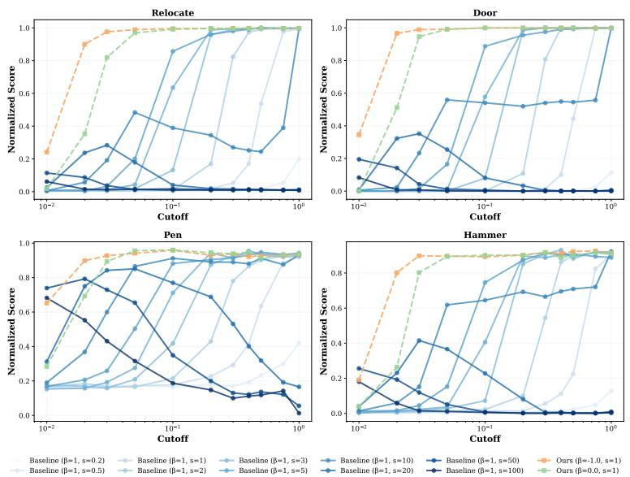  
Figure 6: Sparsity tests for all Adroit tasks using ΠGDM+: the cutoff represents the proportion of guided coordinates. Different shades of blue represent different tunings of the guidance scale for the naive guidance runs (β = 1)

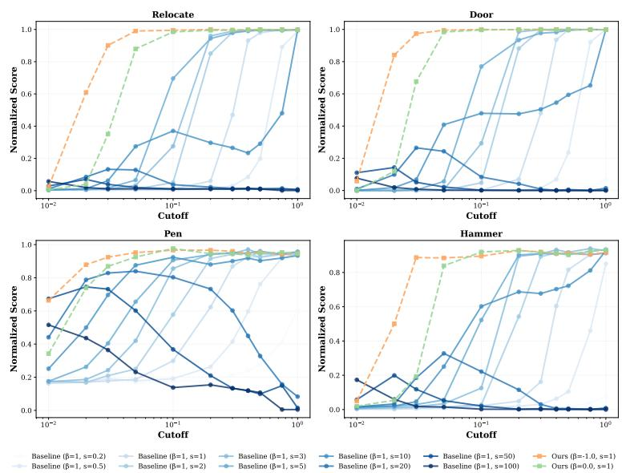  
Figure 7: Sparsity tests for all Adroit tasks using ΠGDM : the cutoffs represent the proportion of guided coordinates. Different shades of blue represent different tunings of the guidance scale for the naive guidance runs (β = 1)

## C.2 Images

All image to image scores (LPIPS, PSNR, SSIM) behave in similar ways for different tunings and β values. The plots look slightly different for the FID scores which can be expected: very strong guidances lead to divergence and artifacts, so the strong guidance cliff is the same. However in the low guidance regions, the model is basically not guided, leading to high quality samples, hence giving a decent FID score.

Table 3: Comparison of naive vs. coupled guidance across methods and tasks on CelebA-HQ-256.
<table><tr><td colspan="2"></td><td colspan="2">Naive</td><td colspan="2">Coupled</td></tr><tr><td>Task</td><td>Metric</td><td>PiGDM</td><td>PiGDM+</td><td>PiGDM</td><td>PiGDM+</td></tr><tr><td rowspan="4">Inpainting</td><td>FID↓</td><td>54.3</td><td>7.5</td><td>20.7</td><td>7.5</td></tr><tr><td>LPIPS↓</td><td>0.184</td><td>0.041</td><td>0.100</td><td>0.041</td></tr><tr><td>PSNR↑</td><td>20.5</td><td>29.3</td><td>30.1</td><td>29.1</td></tr><tr><td>SSIM↑</td><td>0.873</td><td>0.953</td><td>0.927</td><td>0.953</td></tr><tr><td rowspan="4">Deblurring</td><td>FID↓</td><td>54.0</td><td>22.7</td><td>33.0</td><td>22.7</td></tr><tr><td>LPIPS↓</td><td>0.462</td><td>0.153</td><td>0.209</td><td>0.148</td></tr><tr><td>PSNR↑</td><td>20.1</td><td>30.0</td><td>28.6</td><td>30.6</td></tr><tr><td>SSIM↑</td><td>0.472</td><td>0.830</td><td>0.784</td><td>0.840</td></tr><tr><td rowspan="4">Super-res.</td><td>FID↓</td><td>55.9</td><td>76.9</td><td>25.6</td><td>77.0</td></tr><tr><td>LPIPS↓</td><td>0.502</td><td>0.486</td><td>0.166</td><td>0.431</td></tr><tr><td>PSNR↑</td><td>18.1</td><td>19.6</td><td>28.8</td><td>19.3</td></tr><tr><td>SSIM↑</td><td>0.449</td><td>0.443</td><td>0.833</td><td>0.459</td></tr></table>

Table 4: Comparison of naive vs. coupled guidance across methods and tasks on ImageNet (CFM).
<table><tr><td colspan="2"></td><td colspan="2">Naive</td><td colspan="2">Coupled</td></tr><tr><td>Task</td><td>Metric</td><td>IIGDM</td><td>IIGDM+</td><td>IIGDM</td><td>IIGDM+</td></tr><tr><td rowspan="4">Inpainting</td><td>FID↓</td><td>13.0</td><td>10.5</td><td>8.8</td><td>11.3</td></tr><tr><td>LPIPS↓</td><td>0.106</td><td>0.086</td><td>0.092</td><td>0.088</td></tr><tr><td>PSNR↑</td><td>20.4</td><td>20.5</td><td>23.4</td><td>20.6</td></tr><tr><td>SSIM↑</td><td>0.907</td><td>0.911</td><td>0.908</td><td>0.909</td></tr><tr><td rowspan="4">Deblurring</td><td>FID↓</td><td>58.6</td><td>1.6</td><td>16.6</td><td>1.2</td></tr><tr><td>LPIPS↓</td><td>0.452</td><td>0.029</td><td>0.232</td><td>0.021</td></tr><tr><td>PSNR↑</td><td>19.4</td><td>32.9</td><td>22.9</td><td>34.0</td></tr><tr><td>SSIM↑</td><td>0.474</td><td>0.969</td><td>0.749</td><td>0.976</td></tr><tr><td rowspan="4">Super-res.</td><td>FID↓</td><td>20.7</td><td>49.3</td><td>8.9</td><td>50.6</td></tr><tr><td>LPIPS↓</td><td>0.230</td><td>0.411</td><td>0.150</td><td>0.418</td></tr><tr><td>PSNR↑</td><td>21.8</td><td>17.2</td><td>23.9</td><td>17.2</td></tr><tr><td>SSIM↑</td><td>0.741</td><td>0.458</td><td>0.811</td><td>0.445</td></tr></table>

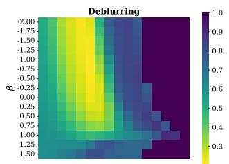

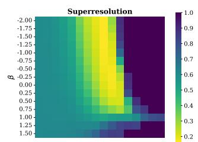

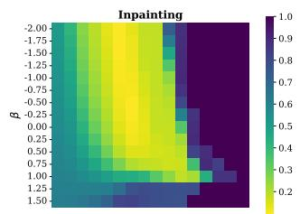

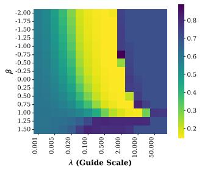

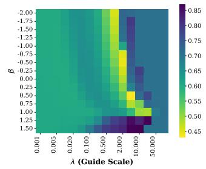

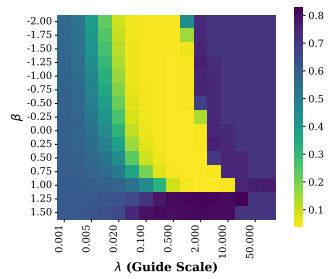  
Figure 8: Sample fidelity using different tuning scales and β values for deblurring, superresolution and inpainting (left to right). First row shows the LPIPS scores for ΠGDM , second row shows the performance of ΠGDM+

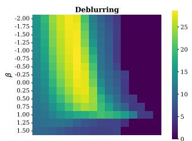

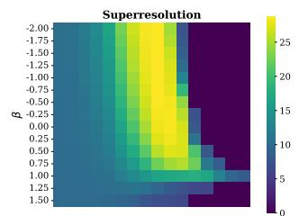

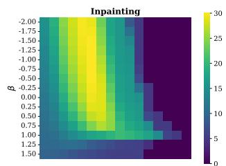

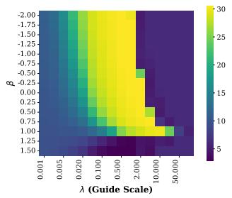

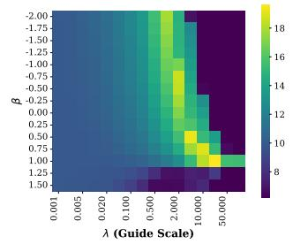

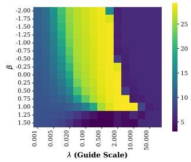  
Figure 9: Sample fidelity using different tuning scales and β values for deblurring, superresolution and inpainting (left to right). First row shows the PSNR scores for ΠGDM , second row shows the performance of ΠGDM+

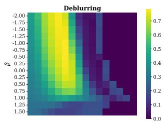

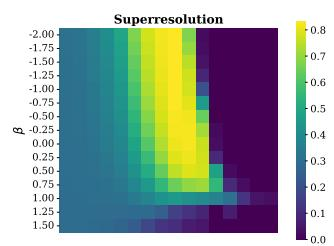

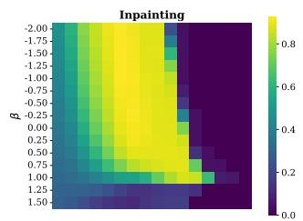

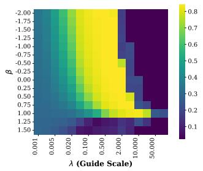

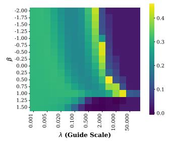

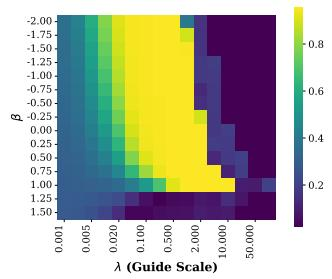  
Figure 10: Sample fidelity using different tuning scales and $\beta$ values for deblurring, superresolution and inpainting (left to right). First row shows the SSIM scores for ΠGDM , second row shows the performance of ΠGDM+

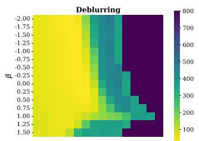

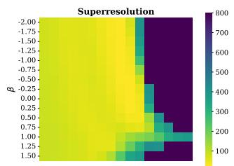

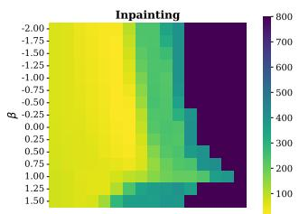

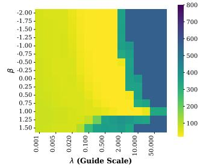

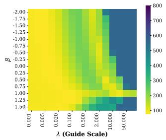

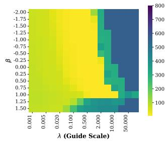  
Figure 11: Sample fidelity using different tuning scales and $\beta$ values for deblurring, superresolution and inpainting (left to right). First row shows the FID scores for ΠGDM , second row shows the performance of ΠGDM+

We also provide visualizations for both xb through inference and final samples for all tasks and a range of beta values. These samples show the difference in convergence between naive and coupled guidance and help understand where the artifacts created by naive guidance come from.

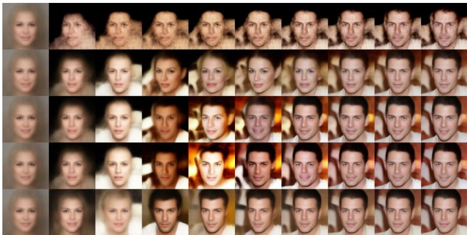  
Figure 12: xb1 predictions using ΠGDM for the first 10 steps of deblurring showing the convergence of the guided process for β ∈ [1, 0.75, 0.5, 0.25, 0] (from top to bottom)

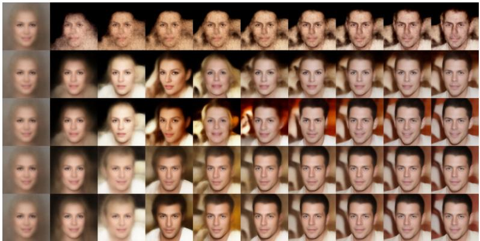  
Figure 13: $\widehat { x } _ { 1 }$ predictions using ΠGDM for the first 10 steps of inpainting showing the convergence of the guided process for $\beta \in \left[ 1 , 0 . 7 5 , 0 . 5 , 0 . 2 5 , 0 \right]$ (from top to bottom)

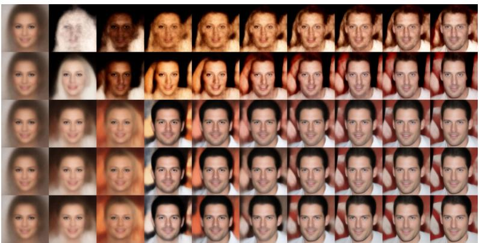  
Figure 14: $\widehat { x } _ { 1 }$ predictions using ΠGDM for the first 10 steps of superresolution showing the convergence of the guided process for $\beta \in$ [1, 0.75, 0.5, 0.25, 0] (from top to bottom)

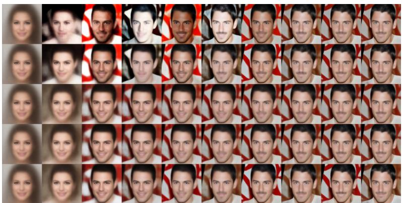  
Figure $1 5 \colon { \widehat { x } } _ { 1 }$ predictions using ΠGDM+for the first 10 steps of deblurring showing the convergence of the guided process for $\beta \in \left[ 1 , 0 . 7 5 , 0 . 5 , 0 . 2 5 , 0 \right]$ (from top to bottom)

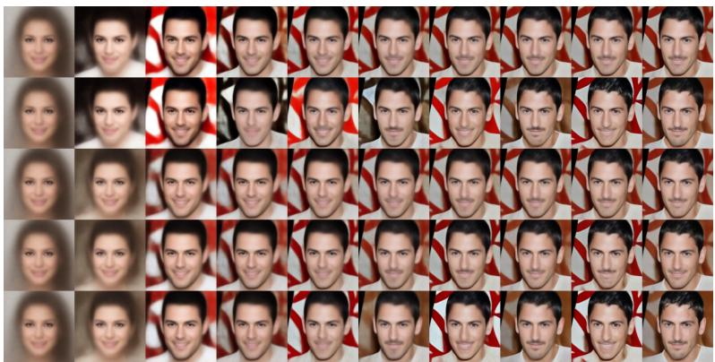  
Figure 16: xb1 predictions using ΠGDM+for the first 10 steps of inpainting showing the convergence of the guided process for $\beta \in \left[ 1 , 0 . 7 5 , 0 . 5 , 0 . 2 5 , 0 \right]$ (from top to bottom)

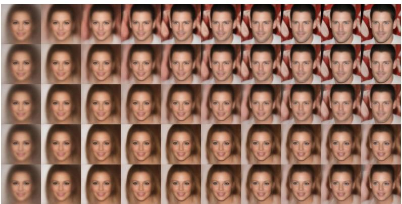  
Figure 17: xb1 predictions using ΠGDM+for the first 10 steps of superresolution showing the convergence of the guided process for β ∈ [1, 0.75, 0.5, 0.25, 0] (from top to bottom)

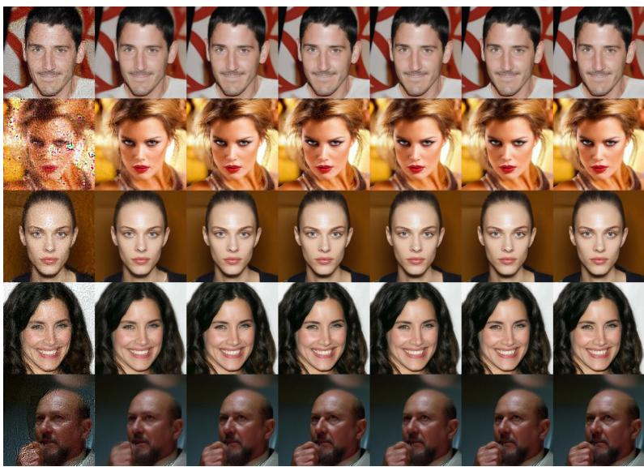  
Figure 18: Final samples for deblurring using ΠGDM with β ∈ [1, 0.75, 0.5, 0.25, 0] (from left to right)

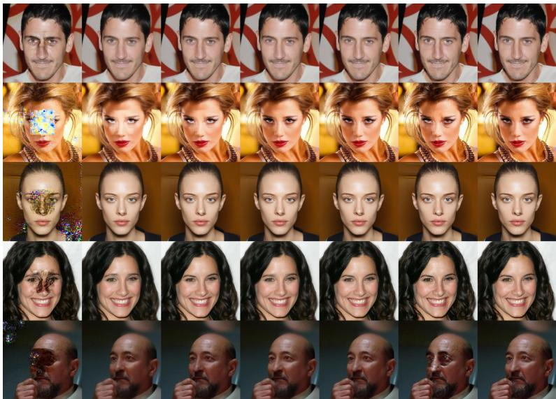  
Figure 19: Final samples for inpainting using ΠGDM with β ∈ [1, 0.75, 0.5, 0.25, 0] (from left to right)

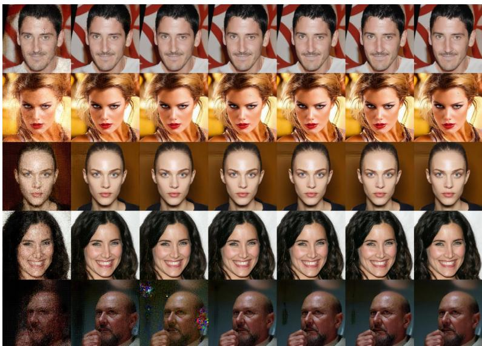  
Figure 20: Final samples for superresolution using ΠGDM with β ∈ [1, 0.75, 0.5, 0.25, 0] (from left to right)

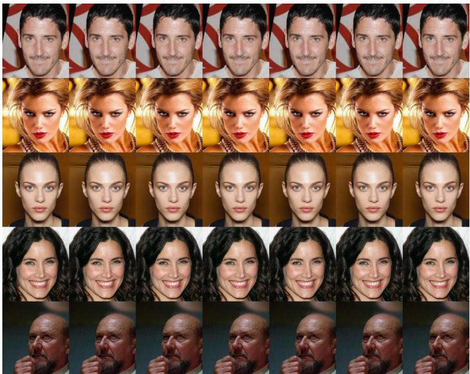  
Figure 21: Final samples for deblurring using ΠGDM+with β ∈ [1, 0.75, 0.5, 0.25, 0] (from left to right)

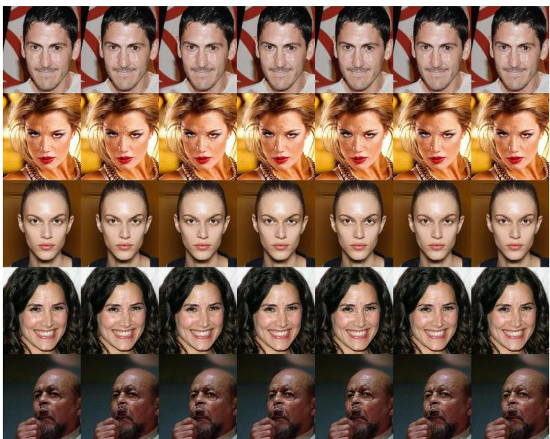  
Figure 22: Final samples for inpainting using ΠGDM+with β ∈ [1, 0.75, 0.5, 0.25, 0] (from left to right)

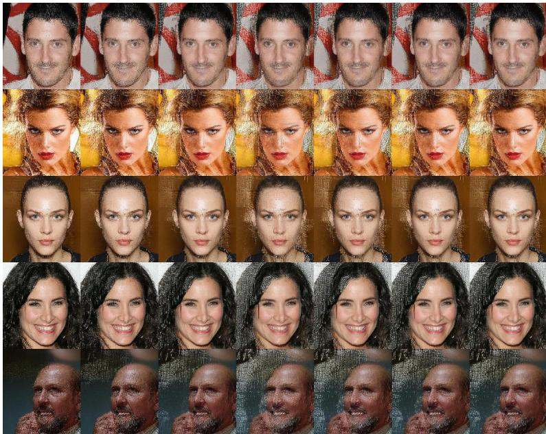  
Figure 23: Final samples for superresolution using $\Pi \mathrm { G D M _ { + } }$ with $\beta \in \left[ 1 , 0 . 7 5 , 0 . 5 , 0 . 2 5 , 0 \right]$ (from left to right)