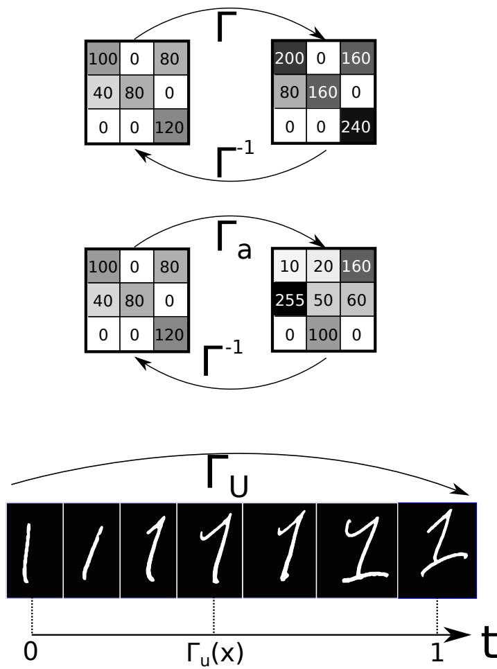
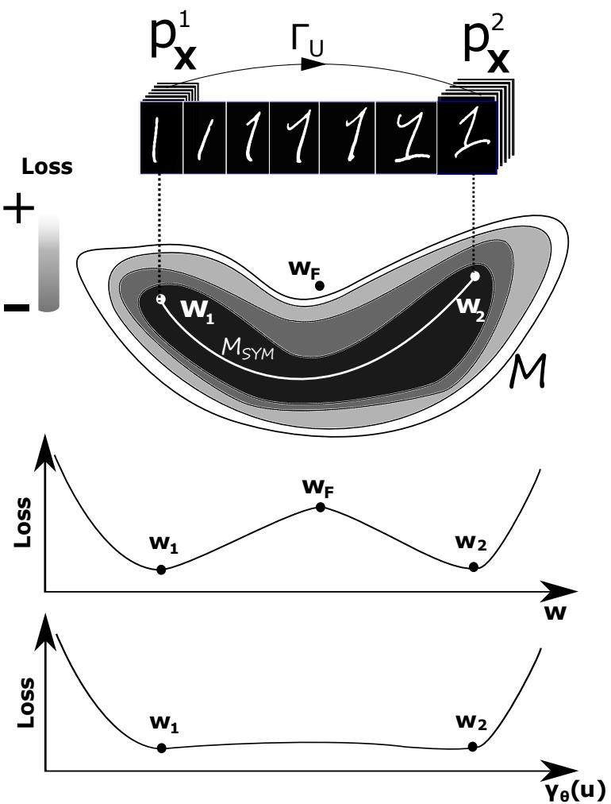
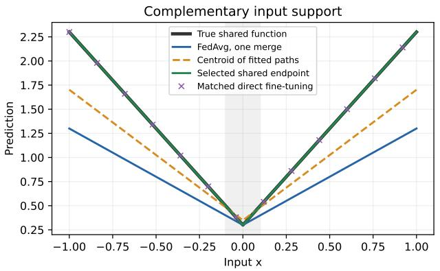
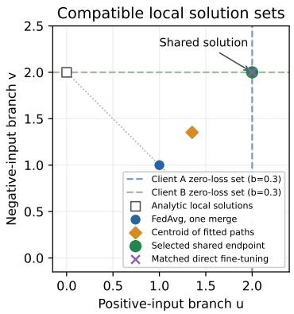
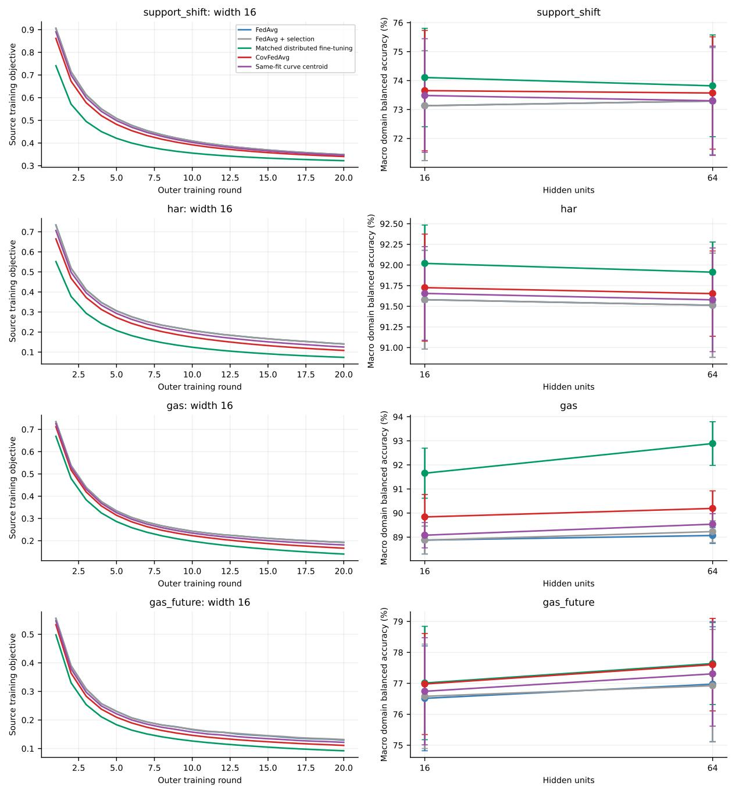
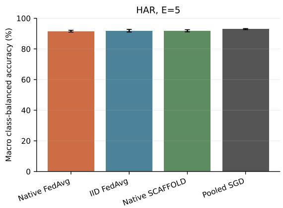
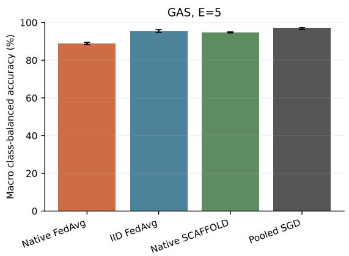
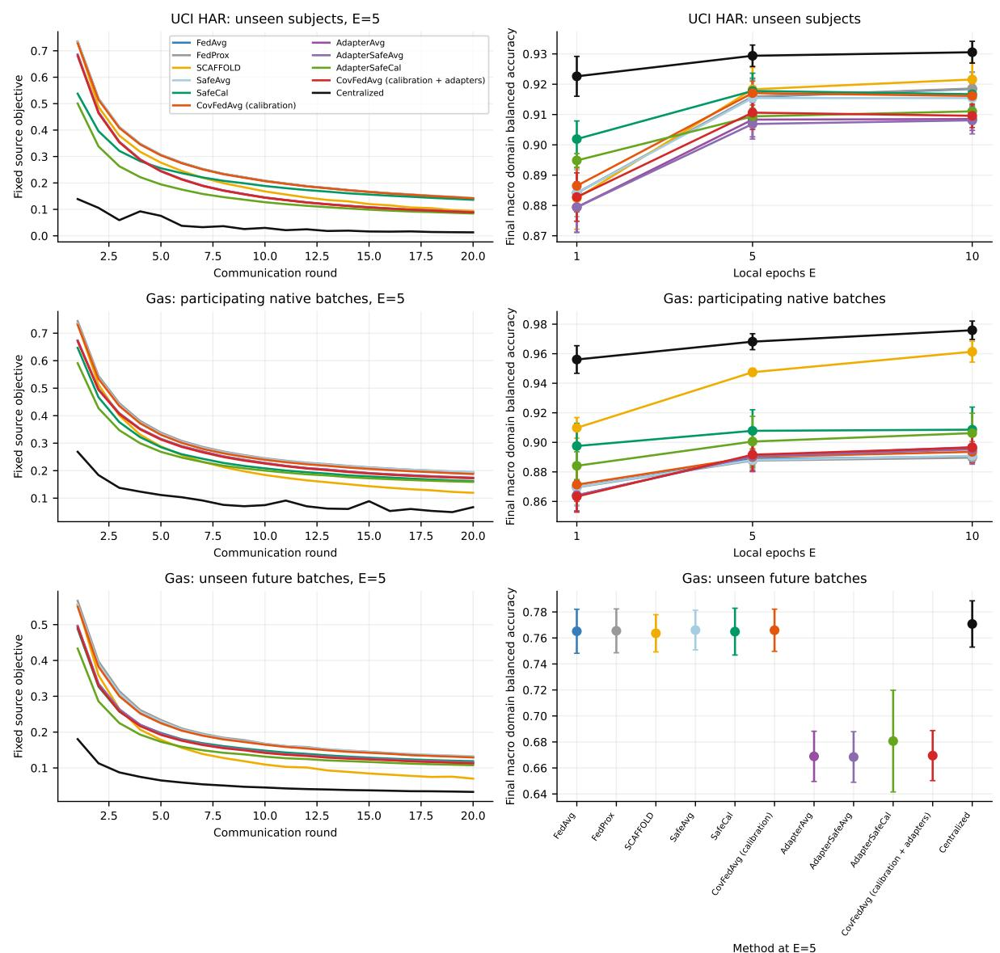
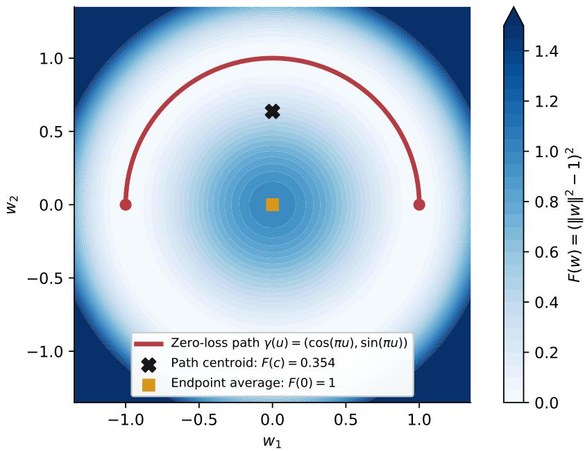
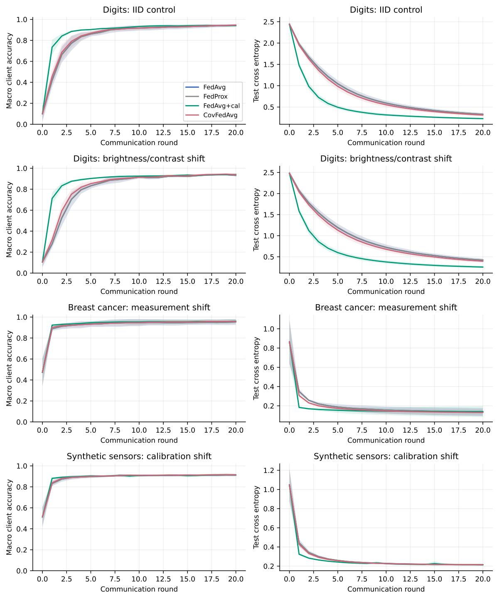

# CovFedAvg: Local Low-Loss Curves and Federated Model Selection

Federico Lucchetti1 Marcus Völp2

1Center for Psychiatric Neuroscience, Department of Psychiatry, Lausanne University Hospital and the University of Lausanne, Lausanne, Switzerland

2Interdisciplinary Centre for Security, Reliability and Trust (SnT), University of Luxembourg, Luxembourg

29 October 2026

## Abstract

Clients observing diferent parts of a prediction task may learn locally equivalent models with incompatible behavior outside their observed support. We study whether redundant models permit local low-loss paths toward a compatible shared model. CovFedAvg retains local models and curve controls on clients, fits a common endpoint through aggregated gradient contributions, and selects an actual candidate model using distributed training losses. No centralized calibration examples or client-to-client sample exchange are required. Exact selection guarantees no higher evaluated training loss than the previous model and the current-round FedAvg candidate; this is not a global-optimality, stationarity, generalization, or diferential-privacy guarantee. We state conditional client-compatibility and approximateselection bounds and retain corrected transformation identities and a separate full-gradient safeguard theorem for reference algorithms. A complementary input-support example recovers the shared absolute-value regression, while matched direct fine-tuning also solves it. Across a synthetic support task, recorded activity-recognition subjects, and participating and future gas-sensor batches, we evaluate five methods, five seeds, two network widths, and 20 rounds without calibration data. At width 16, CovFedAvg raises participating-Gas macro balanced accuracy from FedAvg’s 88.88% to 89.84%; matched distributed fine-tuning reaches 91.65%. Results support feasibility and modest gains over FedAvg, but do not establish a curve-specific advantage over equally costly optimization. Exact-sum numerical experiments establish data flow; end-to-end privacy requires additional mechanisms and analysis.

## 1 Introduction

Federated learning optimizes a shared predictor from data held by multiple clients. FedAvg alternates local training with averaging of client parameters [14]. Its behavior depends on the number of local steps, the learning rate, the model, and diferences between client objectives. Feature heterogeneity is one source of these diferences: scanners, cameras, measurement units, or acquisition conditions may change the input distribution without changing the semantic meaning of a label. Such heterogeneity is distinct from a change in class proportions and from an arbitrary change in the labeling rule.

The motivating idea of covariant federated learning is to describe client domains as transformations of a reference distribution and to account for those transformations when combining models. The useful part of this analogy is precise: transforming both the inputs and a compatible predictor can preserve prediction risk. However, this does not imply that an unchanged predictor has invariant risk, that every pair of client distributions admits an invertible transformation, or that a low-loss curve connecting trained models must exist. The present revision states these assumptions explicitly.

The mechanism of interest is more general than coordinate changes. When clients observe complementary parts of the same input–output relationship, some model directions can be unidentifiable locally. A redundant model may incorporate another client’s information through those directions while preserving its original predictions. This motivates seeking compatible representatives of local low-loss regions. A common labeling vocabulary or model redundancy alone does not establish that those regions intersect. Pure parameter symmetries can also preserve the same function everywhere without adding any knowledge about an unobserved domain.

Low-loss paths motivate exploring parameter configurations [5]. The present method, CovFedAvg, keeps each client’s local model and path control on that client and fits a common endpoint using local supervised losses and aggregate messages. It selects the model itself rather than an arithmetic centroid of curve weights. This construction needs neither server-held labeled calibration data nor sample sharing between clients. Its simulation uses an aggregate-only interface; keeping examples local is not a formal privacy guarantee. A free shared endpoint also means that fitting is distributed optimization with geometric penalties, whose extra gradient costs must be compared against direct optimization.

The main contribution is an executable local-curve fitting and model-selection protocol, with conditional compatibility and exact or bounded-error selection statements, evaluated against matched distributed fine-tuning and centroid controls. We retain three reference components from the earlier revision: correct joint pushforwards with explicit predictor compatibility; normalized public-calibration centroid proposals and their limitations; and a separate full-client gradient safeguard with a stationarity theorem. The latter theorem does not automatically apply to CovFedAvg’s selector. Earlier calibration-based experiments remain labeled reference evidence rather than results for the new method.

Statistical heterogeneity alone does not imply that FedAvg must perform poorly: its one-fullgradient-step average equals the centralized gradient step for any client distributions. Additional local steps, gradient disagreement, model capacity, and the evaluation domain determine how much heterogeneity matters. The evaluation preserves favorable FedAvg results as well as failures. Closely related geometric aggregation already appears in FedGMCC [13], and intersections of client mode connections are studied by Thakur et al. [19]. We do not claim invention of geometric model aggregation or universal recovery under feature heterogeneity.

## 2 Related work

FedAvg alternates local optimization and sample-weighted parameter averaging [14]. FedProx adds a proximal penalty to the local objective to control drift under statistical and systems heterogeneity [10]. Both are relevant baselines; neither method implies that arbitrary feature transformations preserve the same optimal parameter vector. SCAFFOLD uses persistent client and server control variates to correct client drift [8]. We include a full-participation, sampleweighted Option II implementation and disclose its unequal client minibatch-step counts; the published rates are not silently applied to that extension.

Feature heterogeneity has established dedicated methods. FedBN retains client-specific batch-normalization parameters and statistics while aggregating the other model parameters [11]. This is a change to parameter sharing throughout training, rather than a single normalization of the input. FRAug trains a shared representation generator and client-specific representation transformation networks to augment local embeddings [4]. The reference centroid construction uses public labeled calibration examples; this additional resource must be disclosed in comparisons. The current CovFedAvg method instead fits local curves through aggregate messages without central calibration data, as evaluated in Section 8. The reference natural-domain evaluation compares FedAvg, FedProx, SCAFFOLD, a centralized reference, fixed-adapter ablations, and safeguards with no calibration, direct calibration, and curve fitting. The two calibration proposal methods receive the same labeled calibration examples and gradient-evaluation budget. The full-client risk and gradient queries needed by the safeguards are separately reported. Numerical comparisons with FedBN and FRAug remain open; fixed feature standardization is not presented as either method.

The practical path construction is motivated by mode connectivity [5], which finds simple lowloss paths between particular trained networks. Stochastic weight averaging provides an empirical precedent for averaging nearby trained weights [6]. These observations do not guarantee that the arithmetic centroid of an arbitrary low-loss curve also has low loss. Parameter coordinates also matter: Git Re-Basin studies permutation alignment before merging networks [1]. A connection between model weights therefore cannot, by itself, identify a feature-space transformation or quantify distributional heterogeneity.

Geometric aggregation has already been studied in federated learning. FedGMCC combines Monte Carlo output probing, path connectivity, and aggregation of connected client models within clusters [13]; it is a particularly close existing framework. Later studies analyze mode connectivity under heterogeneity [22] and averaging across global checkpoints [23]. FedGuCci uses anchor models to improve group connectivity during client training [12]. We consequently make no claim to introduce geometric federated learning or path aggregation. The scope here is a corrected formulation of the covariance assumptions, a local-curve and shared-endpoint protocol without server calibration data, conditional risk and selection bounds, and reproducible evaluations with matched distributed optimization controls. Earlier normalized centroid rules and their calibration-based evaluations are retained as reference constructions. The literature selection was checked against primary sources on 28 October 2026; it is not an exhaustive survey or a claim of state-of-the-art performance.

## 3 Problem and transformation model

## 3.1 Federated objective

Let client $k \in \{ 1 , \ldots , K \}$ hold a training set $D _ { k }$ of size $n _ { k }$ , drawn from a joint distribution $P _ { k }$ on $\mathcal { X } \times \mathcal { V }$ . Let $\alpha _ { k } = n _ { k } / \sum _ { j } n _ { j }$ , unless a diferent target population is explicitly chosen. A common parameter vector $w \in \mathbb { R } ^ { p }$ specifies a predictor $f _ { w }$ . The population and empirical objectives are

$$
F _ { k } ( w ) = \mathbb { E } _ { ( X , Y ) \sim P _ { k } } \ell ( f _ { w } ( X ) , Y ) , \qquad F ( w ) = \sum _ { k = 1 } ^ { K } \alpha _ { k } F _ { k } ( w ) , \qquad \hat { F } _ { k } ( w ) = \frac { 1 } { n _ { k } } \sum _ { ( x , y ) \in D _ { k } } \ell ( f _ { w } ( x ) , y ) .\tag{1}
$$

For classification, $f _ { w } ( x )$ is a probability vector and $\ell ( f _ { w } ( x ) , y ) = - \log f _ { w } ( x ) _ { y } .$ . The global distribution is the normalized mixture $\begin{array} { r } { P = \sum _ { k } \alpha _ { k } P _ { k } } \end{array}$ . Minimizing $F$ is a population tradeof: a global optimizer need not achieve the minimum of every $F _ { k }$ . Even two quadratic client objectives with diferent minimizers generally cannot be minimized simultaneously.

## 3.2 Label-preserving domains are an assumption

Suppose a reference pair $( Z , Y )$ has distribution $P _ { 0 }$ , and client k observes $( T _ { k } ( Z ) , Y )$ . In measure notation,

$$
P _ { k } = ( T _ { k } , \mathrm { i d } _ { \mathscr { V } } ) _ { \# } P _ { 0 } .\tag{2}
$$

The pushforward is defined for any measurable $T _ { k }$ , including noninvertible maps. To use an inverse density formula we additionally require that $T _ { k }$ be $\mathbf { a } ~ C ^ { 1 }$ difeomorphism between open input domains with nonsingular Jacobian. In this case, for each discrete label $y _ { \mathrm { i } }$

$$
p _ { k } ( x , y ) = p _ { 0 } ( T _ { k } ^ { - 1 } ( x ) , y ) \left| \mathrm { d e t } D T _ { k } ^ { - 1 } ( x ) \right| .\tag{3}
$$

  
Figure 1: Original schematic motivating transformed client domains. Top: uniform intensity scaling; middle: spatially varying pixel changes; bottom: a parameterized visual deformation. The inverse arrows require an invertible map, which the finite examples do not establish. The digit interpolation may change class; it illustrates deformation rather than the label-preserving assumption of the formal model.

This is a formula for the joint input vector. A product of individual pixel Jacobians is valid only for an appropriately separable transformation and does not describe arbitrary coupled image transformations.

Invertibility is a modeling restriction, not a consequence of writing a symbol T or Γ. Positive coordinate scalings, translations, and nonsingular afine maps satisfy it. Cropping, clipping, quantization, and many style transformations do not. A continuous interpolation between two invertible maps can also be singular: interpolation between I and −I passes through the zero map. The afine experimental transformations have strictly positive scales and use no clipping, so they satisfy the restriction on the continuous ambient input space. The observed benchmark datasets are finite empirical measures; their transformation is understood as a pushforward, without assuming that the empirical measures have densities.

Figure 1 retains the original visual motivation: client observations may difer by uniform intensity changes, spatially varying transformations, or more complex deformations. Its Γ notation corresponds to the input map T used here. For the label-preserving model, such changes must retain the semantic class, for example diferent writing styles of the same digit. A visual interpolation alone does not establish that requirement or an invertible transformation between distributions.

Equation (2) preserves $P _ { k } ( Y ) = P _ { 0 } ( Y )$ , but it does not generally preserve the labeling conditional in the observed coordinates:

$$
P _ { k } ( Y \mid X = x ) = P _ { 0 } ( Y \mid Z = T _ { k } ^ { - 1 } ( x ) ) .\tag{4}
$$

Consequently, label-preserving feature transformations are not synonymous with classical covariate shift, which requires a common $P ( Y \mid X )$ . Nor is a change in $P ( X \mid Y )$ alone a definition of concept shift. We use transformed domains for the present model and make no assertion that it covers every form of statistical heterogeneity.

## 3.3 What risk covariance does and does not mean

If the model class admits a parameter action $\rho ( T )$ satisfying

$$
f _ { \rho ( T ) w } ( T z ) = f _ { w } ( z ) ,\tag{5}
$$

then transforming the data and predictor together preserves risk, as proved in Section 5. For example, if a network starts with an unconstrained afine layer $W z + b$ and $T z = A z + c$ with A nonsingular, the transformed first layer can be chosen as $W ^ { \prime } = W A ^ { - 1 }$ and $b ^ { \prime } = b - W A ^ { - 1 } c ,$ with later layers unchanged. This example establishes an exact compatibility property for that model class; it is not a claim that the server can identify A from model weights.

A common transformation applied to identical client distributions leaves those distributions identical. It does not imply invariant loss at fixed weights. Conversely, diferent transformations can preserve the same distribution, so a client-specific transformation need not create heterogeneity. For example, rotations preserve an isotropic Gaussian. The mean of per-coordinate distribution distances is insuficient to identify general joint shifts: $( Z , Z )$ and $( Z , - Z )$ have identical onedimensional marginals for symmetric $Z .$ , but diferent dependence. We do not infer a distance between client distributions from a curve in parameter space.

The action (5), when available, supplies client-specific predictors with equal reference risk. A single predictor acting on raw inputs from an unknown mixture of domains may not attain all those risks. Compatible transformations, suficient model capacity, and informative observations remain substantive assumptions.

## 4 Reference construction: public-data curve centroids

We retain the curve proposal and the empirical guard used in the controlled pilot. Section 6 strengthens the acceptance rule using actual client training objectives and fixed input adapters; that variant is used in the reference natural-domain evaluation. Section 7 introduces the current local-curve and model selection construction, which eliminates the server calibration requirement and is evaluated separately. These are diferent algorithms and access models.

## 4.1 Geometric rationale

Figure 2 retains the original motivation for exploring curves: distinct client solutions may occupy a curved low-loss region, while their straight parameter average can cross a higher-loss region. A learned path explores additional parameter configurations and motivates a candidate aggregation rule. The picture is an idealized possibility, not evidence that a suitable path exists for every client pair. Input transformations and weight-space paths are separate objects; the former do not establish the latter. The implemented construction below uses paths from the FedAvg anchor to individual client models, followed by an explicit evaluation of their normalized centroid. The counterexample in Figure 7 explains why a low-loss path alone is insuficient to certify that centroid.

  
Figure 2: Original geometric rationale for curve aggregation (idealized schematic). Models $w _ { 1 } , w _ { 2 }$ can lie in a curved low-loss region even when their Euclidean average $w _ { F }$ has higher loss; the bottom profile motivates seeking a low-loss path $\gamma _ { \theta } ( u )$ . The original labels $\mathcal { M }$ and $\mathcal { M } _ { \mathrm { S Y M } }$ illustrate this picture and do not assert an inferred manifold or connection. Neither low centroid risk nor a mapping from input deformations to parameter paths follows from the sketch. The digit strip is a deformation analogy and may change class.

## 4.2 Access model

The original suggestion that random input probes reveal client training losses does not provide an identifiable optimization problem: agreement away from the data support need not imply agreement on the client task, and an unlabeled probe does not measure supervised risk. Here we choose an explicit, stronger access model. The server has a labeled public calibration set $D _ { \mathrm { c a l } }$ representative of the target mixture, and a disjoint public validation set $D _ { \mathrm { v a l } }$ . Both are separated from local training and test data. Define their empirical risks $F _ { \mathrm { c a l } }$ and $F _ { \mathrm { v a l } }$ in the usual way. These data are additional information, and their construction and sizes are part of the experimental protocol. They are not recovered from client weights. In a deployment they must come from an independently available, appropriately collected source.

An alternative implementation could query weighted client losses and gradients at proposed path points. This would optimize an empirical federated objective without centralizing raw examples, but it adds communication and exposes extra statistics. That alternative is not used in the public-calibration reference experiments. The current construction in Section 7 instead fits and selects using local training losses and aggregate messages. Neither construction establishes diferential privacy or protection against model or gradient inversion.

## 4.3 Continuous paths with a normalized centroid

At communication round t, all clients start from $w _ { t }$ and perform E local epochs to return $v _ { t , k }$ Write

$$
a _ { t } = \sum _ { k } \alpha _ { k } v _ { t , k } .\tag{6}
$$

For each client construct a polygonal path from the common anchor $a _ { t }$ to $v _ { t , k }$ through a trainable control $\theta _ { t , k }$

$$
\gamma _ { t , k } ( u ) = \left\{ \begin{array} { l l } { ( 1 - 2 u ) a _ { t } + 2 u \theta _ { t , k } , } & { 0 \leq u \leq \frac { 1 } { 2 } , } \\ { 2 ( 1 - u ) \theta _ { t , k } + ( 2 u - 1 ) v _ { t , k } , } & { \frac { 1 } { 2 } \leq u \leq 1 . } \end{array} \right.\tag{7}
$$

The two branches both equal $\theta _ { t , k }$ at $u = 1 / 2$ . Unlike a diferential geometric connection, this is an ordinary continuous parameter-space path. It can have a corner; smoothness at the control point is not required. Initialize $\theta _ { t , k } ^ { 0 } = ( a _ { t } + v _ { t , k } ) / 2$ . Keeping the endpoints fixed, approximately minimize

$$
H _ { t } ( \theta ) = \sum _ { k } \alpha _ { k } \left[ \frac { 1 } { Q } \sum _ { q = 1 } ^ { Q } F _ { \mathrm { c a l } } ( \gamma _ { t , k } ( u _ { q } ) ) + \frac { \lambda } { 2 } \| \theta _ { t , k } - \theta _ { t , k } ^ { 0 } \| ^ { 2 } \right] , \qquad ( u _ { 1 } , u _ { 2 } , u _ { 3 } ) = ( \frac { 1 } { 4 } , \frac { 1 } { 2 } , \frac { 3 } { 4 } ) .\tag{8}
$$

The finite sample of path points is a numerical surrogate for an integral; it does not certify the maximum loss along the whole path. The controls are updated simultaneously by gradient descent on $H _ { t }$ , retaining the client factor $\alpha _ { k }$ in each control gradient. The chain-rule factor multiplying $\nabla F _ { \mathrm { c a l } }$ is $b ( u ) = 2 u$ on the first branch and $b ( u ) = 2 ( 1 - u )$ on the second. It is not valid simply to replace a parameter gradient with a control gradient without this factor.

The exact average of each path and their weighted centroid are

$$
z _ { t , k } = \int _ { 0 } ^ { 1 } \gamma _ { t , k } ( u ) d u = \frac { a _ { t } + v _ { t , k } } { 4 } + \frac { \theta _ { t , k } } { 2 } , \qquad c _ { t } = \sum _ { k } \alpha _ { k } z _ { t , k } .\tag{9}
$$

The coeficients in each $z _ { t , k }$ sum to one, and the client coeficients also sum to one. With the midpoint initialization, $z _ { t , k } ^ { 0 } = ( a _ { t } + v _ { t , k } ) / 2$ and hence $\begin{array} { r } { c _ { t } ^ { 0 } = ( a _ { t } + \sum _ { k } \alpha _ { k } v _ { t , k } ) / 2 = a _ { t } } \end{array}$ . Thus disabling the fitting step recovers weighted FedAvg exactly for any number of clients, any positive sample sizes, and any model dimension. The identity also handles $K = 1 ;$ no factor $1 / ( K - 1 )$ is needed.

Algorithm 1 Revised CovFedAvg with public calibration   
Require: Initial $w _ { 0 } .$ , weights $\alpha _ { k }$ , rounds $\overline { { T } } .$ , fitting steps J, calibration step size $\beta ,$ disjoint   
$D _ { \mathrm { c a l } } , D _ { \mathrm { v a l } } .$   
1: for $t = 0 , \ldots , T - 1$ do   
2: All clients train from $w _ { t } ;$ collect $v _ { t , k }$   
3: Compute $\begin{array} { r } { \boldsymbol { a } _ { t } = \sum _ { k } \alpha _ { k } \boldsymbol { v } _ { t , k } . } \end{array}$   
4: Initialize $\theta _ { t , k } ^ { 0 } = ( a _ { t } + v _ { t , k } ) / 2$ for every k.   
5: for $j = 0 , \ldots , J - 1$ do   
6: for $k = 1 , \ldots , K$ do   
7: Compute $\nabla _ { { \boldsymbol { \theta } } _ { k } } H _ { t }$ at $\theta ^ { j }$ , including $\alpha _ { k }$   
8: Update $\theta _ { t , k } ^ { j + 1 }$ using step size $\beta .$   
9: end for   
10: end for   
11: Compute $c _ { t }$ by Equation (9).   
12: Select $w _ { t + 1 }$ by Equation (10).   
13: end for   
14: return $w _ { T }$

## 4.4 Empirical guard and computation

Accept the candidate only when its validation loss is no larger than the anchor’s loss:

$$
w _ { t + 1 } = \left\{ { \begin{array} { l l } { c _ { t } , } & { F _ { \mathrm { v a l } } ( c _ { t } ) \leq F _ { \mathrm { v a l } } ( a _ { t } ) , } \\ { a _ { t } , } & { { \mathrm { o t h e r w i s e } } . } \end{array} } \right.\tag{10}
$$

This guarantees an empirical comparison with this round’s anchor. It does not imply monotone validation loss across rounds, a population improvement, or that the resulting trajectory dominates a separately trained FedAvg trajectory. Reusing the validation set also introduces adaptive selection; test data are never used in the guard.

Each round requires JKQ calibration forward/backward evaluations and two validation forward evaluations in addition to ordinary local training. For $K = 4 , J = 3$ , and $Q = 3$ this is 36 calibration gradient evaluations. Storage for the client models and controls scales as $O ( K p )$ ; sequential control processing can reduce temporary path storage. In the publicdata implementation these operations do not add client communication, but they add server computation and public data requirements. These costs are diferent from fitting each path through federated gradient queries.

The matched calibration baseline performs JKQ gradient updates to the FedAvg anchor on the same public calibration set and uses the same validation guard. A comparison with FedAvg alone would confound the efect of the path representation with the efect of extra labeled data and computation. Matching gradient-call counts controls that budget while leaving the distinct update geometries and step-size sensitivity visible.

## 5 Mathematical guarantees and limits

The results below separate three questions: when a feature transformation preserves a prediction problem, how far local training can move from a centralized trajectory, and when an aggregated update descends the global risk. None of these properties implies the others without additional assumptions. Throughout, $\alpha _ { k } \geq 0$ and $\textstyle \sum _ { k = 1 } ^ { K } \alpha _ { k } = 1$ . We use the population risks

$$
F _ { k } ( w ) = \mathbb { E } _ { ( X , Y ) \sim P _ { k } } \ell ( f _ { w } ( X ) , Y ) , \qquad F ( w ) = \sum _ { k = 1 } ^ { K } \alpha _ { k } F _ { k } ( w ) .
$$

The same statements apply to empirical risks when their assumptions hold.

## 5.1 Feature transformations require a compatible model action

Let $\mathcal { X } , \mathcal { X } ^ { \prime }$ be open subsets of $\mathbb { R } ^ { d }$ , let $\mathcal { V }$ be a finite label set, and let $T : \mathcal { X } \longrightarrow \mathcal { X } ^ { \prime }$ be $\mathrm { ~ a ~ } C ^ { 1 }$ difeomorphism. The label-preserving pushforward of a joint distribution P is

$$
P _ { T } = ( T , \mathrm { i d } _ { \mathcal { V } } ) _ { \# } P , \qquad ( X _ { T } , Y _ { T } ) = ( T ( X ) , Y ) .
$$

This defines a distribution regardless of whether a density exists.

Proposition 5.1 (Pushforward and risk identity). Suppose P has a joint density $p ( x , y )$ with respect to Lebesgue measure in x and counting measure in y. Then

$$
p _ { T } ( x ^ { \prime } , y ) = p ( T ^ { - 1 } x ^ { \prime } , y ) \left| \operatorname* { d e t } D T ^ { - 1 } ( x ^ { \prime } ) \right| .\tag{11}
$$

In particular, $P _ { T } ( Y = y ) = P ( Y = y )$ . Suppose, in addition, that the model family admits a parameter transformation $\rho ( T )$ satisfying the explicit compatibility assumption

$$
f _ { \rho ( T ) w } ( T x ) = f _ { w } ( x ) \quad f o r P \ – { a l m o s t e v e r y } ( x , y ) a n d e v e r y a d m i s s i b l e w .\tag{12}
$$

For any measurable loss with finite relevant expectations,

$$
F _ { P _ { T } } ( \rho ( T ) w ) = F _ { P } ( w ) , \qquad F _ { Q } ( v ) : = \mathbb { E } _ { Q } \ell ( f _ { v } ( X ) , Y ) .\tag{13}
$$

$H \rho ( T )$ is a bijection between the two parameter spaces, it also maps the complete set of minimizers of $F _ { P }$ to that of $F _ { P _ { T } }$

Proof. For each label $y ,$ apply the multivariate change-of-variables formula to the joint measure on $\mathcal { X } \times \{ \boldsymbol { y } \}$ . This gives (11); integrating it over $x ^ { \prime }$ preserves the mass of each label. By the definition of a pushforward and (12),

$$
F _ { P _ { T } } ( \rho ( T ) w ) = \mathbb { E } _ { P } \ell ( f _ { \rho ( T ) w } ( T X ) , Y ) = \mathbb { E } _ { P } \ell ( f _ { w } ( X ) , Y ) = F _ { P } ( w ) .
$$

If $\rho ( T )$ is bijective, every candidate in the transformed parameter space has a unique preimage. Comparing its risk with that of an arbitrary transformed minimizer proves the minimizer correspondence in both directions. □

For example, for $f _ { w } ( x ) = w ^ { \top } x$ and $T ( x ) = A x$ with A invertible, one can take $\rho ( T ) w =$ $A ^ { - \top } w$ . General nonlinear transformations need not admit any compatible action within a fixed architecture. If a family of transformations forms a group, calling ρ a group action further requires $\rho ( S \circ T ) = \rho ( S ) \circ \rho ( T )$ and $\rho ( \mathrm { i d } ) = \mathrm { i d }$ . A continuously parametrized family alone does not establish these properties.

Remark 5.2 (Limits of the transformation interpretation). Equation (13) compares transformed data with transformed parameters; it does not assert invariance at fixed $w .$ Where conditional densities are defined, $p _ { T } ( y \mid x ^ { \prime } ) = p ( y \mid T ^ { - 1 } x ^ { \prime } )$ , which generally difers from $p ( \boldsymbol { y } \mid \boldsymbol { x } ^ { \prime } )$ . Thus label preservation alone does not imply conventional covariate shift, which requires a common conditional distribution in the same input coordinates. Applying the same measurable transformation to identical joint distributions preserves their equality, whether the transformation is linear or nonlinear. The existence of a data transformation does not establish a low-loss path between learned parameters, recover the transformation from weights, or provide a common optimizer for all clients.

## 5.2 A deterministic bound on local-training drift

We analyze one communication block, with E full-gradient local steps and a common initialization. Let $\eta > 0$ and define

$$
\begin{array} { r l r } {  { \boldsymbol { u } _ { k , 0 } = \boldsymbol { v } _ { 0 } = \boldsymbol { w } , } } \\ & { } & { \boldsymbol { u } _ { k , s + 1 } = \boldsymbol { u } _ { k , s } - \eta \nabla F _ { k } ( \boldsymbol { u } _ { k , s } ) , } \\ & { } & { \boldsymbol { v } _ { s + 1 } = \boldsymbol { v } _ { s } - \eta \nabla F ( \boldsymbol { v } _ { s } ) , \qquad 0 \le s < E , } \\ & { } & { \boldsymbol { a } _ { E } = \displaystyle \sum _ { k = 1 } ^ { K } \alpha _ { k } \boldsymbol { u } _ { k , E } . } \end{array}\tag{14}
$$

Here $v _ { s }$ is a centralized trajectory, rather than a global minimizer. These updates contain no stochastic gradient noise.

Assumption 5.3 (Smoothness and gradient heterogeneity). Each $\nabla F _ { k }$ is Lk-Lipschitz on a convex region containing the trajectories in (14), with $L _ { k } \ge 0$ . For constants $\delta _ { k } \geq 0$

$$
\| \nabla F _ { k } ( v _ { s } ) - \nabla F ( v _ { s } ) \| \le \delta _ { k } , \qquad 0 \le s < E .
$$

Proposition 5.4 (Local and aggregate drift). Under Assumption 5.3, write $q _ { k } = 1 + \eta L _ { k }$ and interpret empty sums as zero. For every $0 \leq s \leq E$ ，

$$
\left\| u _ { k , s } - v _ { s } \right\| \leq \eta \delta _ { k } \sum _ { j = 0 } ^ { s - 1 } q _ { k } ^ { j } .\tag{15}
$$

Consequently,

$$
\| a _ { E } - v _ { E } \| \leq \sum _ { k } \alpha _ { k } \eta \delta _ { k } \sum _ { j = 0 } ^ { E - 1 } q _ { k } ^ { j } .\tag{16}
$$

The cancellation of the first-step client gradients also gives the sharper bound

$$
\left\| { a _ { E } - v _ { E } } \right\| \le \eta ^ { 2 } \sum _ { k } \alpha _ { k } L _ { k } \delta _ { k } \sum _ { s = 0 } ^ { E - 1 } \sum _ { j = 0 } ^ { s - 1 } q _ { k } ^ { j } .\tag{17}
$$

In particular, $a _ { 1 } = v _ { 1 }$ . For any pair $k , l ,$

$$
\| u _ { k , E } - u _ { l , E } \| \leq \eta \delta _ { k } \sum _ { j = 0 } ^ { E - 1 } q _ { k } ^ { j } + \eta \delta _ { l } \sum _ { j = 0 } ^ { E - 1 } q _ { l } ^ { j } .
$$

Proof. Set $d _ { k , s } = \| u _ { k , s } - v _ { s } \|$ . Add and subtract $\nabla F _ { k } ( v _ { s } )$ inside the diference of the updates. The triangle inequality and Assumption 5.3 yield

$$
d _ { k , s + 1 } \leq ( 1 + \eta L _ { k } ) d _ { k , s } + \eta \delta _ { k } .
$$

Since $d _ { k , 0 } = 0$ , induction gives (15). The weighted triangle inequality then proves (16), and the ordinary triangle inequality through vE gives the pairwise bound.

For the sharper result, put $\begin{array} { r } { b _ { s } = \sum _ { k } \alpha _ { k } u _ { k , s } } \end{array}$ and $r _ { s } = \lVert b _ { s } - v _ { s } \rVert$ . The identity $\begin{array} { r } { \sum _ { k } \alpha _ { k } \nabla F _ { k } ( v _ { s } ) = } \end{array}$ $\nabla F ( v _ { s } )$ implies

$$
b _ { s + 1 } - v _ { s + 1 } = b _ { s } - v _ { s } - \eta \sum _ { k } \alpha _ { k } \bigl ( \nabla F _ { k } ( u _ { k , s } ) - \nabla F _ { k } ( v _ { s } ) \bigr ) .
$$

Thus $\begin{array} { r } { r _ { s + 1 } \le r _ { s } + \eta \sum _ { k } \alpha _ { k } L _ { k } d _ { k , s } } \end{array}$ . Sum this recurrence from $s = 0$ to $E - 1$ , use $r _ { 0 } = 0$ , and substitute (15). This proves (17); for $E = 1$ its right-hand side is zero. □

When $L _ { k } > 0$ , the right-hand side of (15) equals $\delta _ { k } ( ( 1 + \eta L _ { k } ) ^ { s } - 1 ) / L _ { k } ;$ for $L _ { k } = 0$ it is $s \eta \delta _ { k }$ . These bounds do not establish convergence across communication rounds. They quantify the discrepancy over one block, and their assumptions must hold along every block to apply repeatedly.

Corollary 5.5 (A suficient distributional condition). Suppose all clients have the same label probabilities $\pi _ { y } ,$ , the class-conditional input distributions have finite first moments, and $g _ { w } ( x , y ) =$ $\nabla _ { w } \ell ( f _ { w } ( x ) , y )$ satisfies

$$
\| g _ { w } ( x , y ) - g _ { w } ( x ^ { \prime } , y ) \| \leq G \| x - x ^ { \prime } \|
$$

uniformly over the relevant $w , x , x ^ { \prime } , y$ . Assume that diferentiation and expectation can be interchanged. Let $\begin{array} { r } { P = \sum _ { k } \alpha _ { k } P _ { k } } \end{array}$ . Then a valid choice in Assumption 5.3 is

$$
\delta _ { k } = G \sum _ { y \in \mathcal { V } } \pi _ { y } W _ { 1 } \big ( P _ { k } ( X \mid Y = y ) , P ( X \mid Y = y ) \big ) .\tag{18}
$$

Terms with $\pi _ { y } = 0$ are omitted. The Wasserstein distance here is between distributions of the complete input vector.

Proof. For a fixed label, couple $X _ { k } \sim P _ { k } ( X \mid Y = y )$ and $X \sim P ( X \mid Y = y ) $ . The norm of the diference of their expected sample gradients is at most $\begin{array} { r } { \mathbb { E } \| g _ { w } ( X _ { k } , y ) - g _ { w } ( X , y ) \| \leq G \mathbb { E } \| X _ { k } - X \| } \end{array}$ Take the infimum over couplings, then sum with the shared class weights $\pi _ { y }$ and apply the triangle inequality. □

Smoothness in w alone does not imply the input Lipschitz condition in Corollary 5.5. Further, averaging distances between individual feature marginals cannot generally replace the joint-input distance: diferent dependence structures can give identical feature marginals.

## 5.3 What integrating a fitted path guarantees

For a given set of received local parameters $w _ { 1 } , \ldots , w _ { K }$ , let $\begin{array} { r } { \boldsymbol { a } = \sum _ { k } \alpha _ { k } \boldsymbol { w } _ { k } } \end{array}$ . We consider the continuous piecewise linear paths

$$
\gamma _ { k } ( u ) = \left\{ \begin{array} { l l } { ( 1 - 2 u ) a + 2 u \theta _ { k } , } & { 0 \leq u \leq \frac { 1 } { 2 } , } \\ { 2 ( 1 - u ) \theta _ { k } + ( 2 u - 1 ) w _ { k } , } & { \frac { 1 } { 2 } \leq u \leq 1 . } \end{array} \right.\tag{19}
$$

Both branches equal $\theta _ { k }$ at the midpoint. Their weighted centroid is available without numerical integration:

$$
c = \sum _ { k } \alpha _ { k } \int _ { 0 } ^ { 1 } \gamma _ { k } ( u ) d u = \sum _ { k } \alpha _ { k } \left( \frac { a + w _ { k } } { 4 } + \frac { \theta _ { k } } { 2 } \right) .\tag{20}
$$

Initializing $\theta _ { k } = ( a + w _ { k } ) / 2$ makes every path a straight segment and gives exactly $c = a$ . This is an algebraic FedAvg recovery property; it does not require a claim about flatness of the loss.

Proposition 5.6 (Risk of a path centroid). Let the paths be measurable and square-integrable. Suppose F is diferentiable with L-Lipschitz gradient on a convex region containing their images and c. Define

$$
J = \sum _ { k } \alpha _ { k } \int _ { 0 } ^ { 1 } F ( \gamma _ { k } ( u ) ) d u , \qquad V = \sum _ { k } \alpha _ { k } \int _ { 0 } ^ { 1 } \| \gamma _ { k } ( u ) - c \| ^ { 2 } d u ,
$$

and assume the displayed quantities are finite. Then, without requiring convexity of $F$ ,

$$
F ( c ) \leq J + { \frac { L } { 2 } } V .\tag{21}
$$

Proof. The Lipschitz gradient condition, applied to −F along the segment from c to any x in the region, gives the lower Taylor bound

$$
F ( x ) \geq F ( c ) + \langle \nabla F ( c ) , x - c \rangle - \frac { L } { 2 } \| x - c \| ^ { 2 } .
$$

Rearrange, set $x = \gamma _ { k } ( u )$ , and take the weighted integral. The linear term vanishes because $\begin{array} { r } { \sum _ { k } \alpha _ { k } \int _ { 0 } ^ { 1 } ( \gamma _ { k } ( u ) - c ) d u = 0 } \end{array}$ . The remaining terms give (21). □

Remark 5.7 (Low path risk does not ensure low centroid risk). For $F ( w ) = ( \| w \| ^ { 2 } - 1 ) ^ { 2 }$ on $\mathbb { R } ^ { 2 }$ , every point of the unit circle has risk zero. The path $\gamma ( u ) = ( \cos ( 2 \pi u ) , \sin ( 2 \pi u ) )$ has $J = 0$ and centroid $c = 0$ , where $F ( c ) = 1$ . The gradient is Lipschitz on the closed unit disk, so this example satisfies the local smoothness assumption of Proposition 5.6. The variance term cannot in general be omitted. In particular, fitting low-risk curves does not by itself prove that their weight average improves on a.

For a calibration objective ${ \widehat F } .$ diferentiation under the integral gives the actual curve-fitting gradient

$$
\nabla _ { \theta _ { k } } \int _ { 0 } ^ { 1 } \widehat { F } ( \gamma _ { k } ( u ) ) d u = \int _ { 0 } ^ { 1 } \beta ( u ) \nabla \widehat { F } ( \gamma _ { k } ( u ) ) d u , \quad \beta ( u ) = \left\{ \begin{array} { l l } { 2 u , } & { u \leq \frac { 1 } { 2 } , } \\ { 2 ( 1 - u ) , } & { u \geq \frac { 1 } { 2 } . } \end{array} \right.\tag{22}
$$

For a finite calibration set and smooth loss this is an ordinary finite sum followed by a onedimensional integral; otherwise suitable domination assumptions are required. If $\widehat F$ is a public labeled calibration risk, it supplies information beyond the received client weights. Alternatively, estimating ∇F through client risk gradients requires further client queries and communication. Neither access model is a weights-only guarantee. Agreement between reference predictions on randomly generated inputs need not estimate either risk.

The term “path” has its usual meaning here. No afine connection is inferred from a fitted curve. For a scalar risk, its derivative along a smooth path is $d F ( \gamma ( u ) ) / d u = \langle \nabla F ( \gamma ( u ) ) , \dot { \gamma } ( u ) \rangle$ This scalar derivative difers from the derivative of the gradient field; in Euclidean coordinates the latter is $\nabla ^ { 2 } F ( \gamma ( u ) ) \dot { \gamma } ( u )$ when the Hessian exists. No Euler–Lagrange or covariant-derivative identification is needed for (22).

## 5.4 A conditional descent guarantee

Theorem 5.8 (Descent under relative gradient error). Suppose $F : \mathbb { R } ^ { p }  \mathbb { R }$ has L-Lipschitz gradient, with $L > 0$ , and an update has the form

$$
w _ { t + 1 } = w _ { t } - \eta \bigl ( \nabla F ( w _ { t } ) + e _ { t } \bigr ) , \qquad \| e _ { t } \| \le \rho \| \nabla F ( w _ { t } ) \| , \quad 0 \le \rho < 1 .\tag{23}
$$

For a constant step size

$$
0 < \eta \leq \frac { 1 - \rho } { L ( 1 + \rho ) ^ { 2 } } ,\tag{24}
$$

every update satisfies

$$
F ( w _ { t + 1 } ) \leq F ( w _ { t } ) - \frac { \eta ( 1 - \rho ) } { 2 } \| \nabla F ( w _ { t } ) \| ^ { 2 } .\tag{25}
$$

If $F \geq F _ { \mathrm { i n f } } > - \infty$ , then

$$
\operatorname* { m i n } _ { 0 \leq t < T } \| \nabla F ( w _ { t } ) \| ^ { 2 } \leq \frac { 2 ( F ( w _ { 0 } ) - F _ { \mathrm { i n f } } ) } { \eta ( 1 - \rho ) T } ,\tag{26}
$$

and $\lVert \nabla F ( w _ { t } ) \rVert  0$ . This conclusion does not assert convergence of the parameter sequence to a particular minimizer.

Proof. Write $g = \nabla F ( w _ { t } )$ and $e = e _ { t }$ . Smoothness gives

$$
F ( w _ { t + 1 } ) \leq F ( w _ { t } ) - \eta \langle g , g + e \rangle + \frac { L \eta ^ { 2 } } { 2 } \| g + e \| ^ { 2 } .
$$

The relative-error assumption implies $\langle g , g + e \rangle \geq ( 1 - \rho ) \| g \| ^ { 2 }$ and $\| g + e \| \leq ( 1 + \rho ) \| g \|$ . Hence

$$
F ( w _ { t + 1 } ) \leq F ( w _ { t } ) - \eta \left( ( 1 - \rho ) - \frac { L \eta } { 2 } ( 1 + \rho ) ^ { 2 } \right) \| g \| ^ { 2 } .
$$

The step-size bound makes the coeficient in parentheses at least $( 1 - \rho ) / 2$ , proving (25). Sum this inequality over $t = 0 , \ldots , T - 1$ and use the lower bound on $F$ to obtain (26). The same telescoping argument bounds the infinite sum of the nonnegative terms $\| \nabla F ( w _ { t } ) \| ^ { 2 }$ , so those terms tend to zero. □

For an arbitrary candidate aggregation $c _ { t } .$ , one can define $e _ { t } = ( w _ { t } - c _ { t } ) / \eta - \nabla F ( w _ { t } )$ , but the relative-error inequality in (23) must then be proved or verified separately. The path construction, the drift bound, and a comparison of $c _ { t }$ with the FedAvg anchor $a _ { t }$ do not supply that inequality. A guard accepting $c _ { t }$ only when its validation loss is no larger than that of $a _ { t }$ guarantees only the stated comparison on that validation set. It does not establish a comparison with $w _ { t }$ population-risk descent, test-risk improvement, or unconditional convergence of the proposed aggregation procedure.

## 6 Reference extension: afine adapters and a descent safeguard

The natural-domain experiments below add an explicit input adapter and replace the validationonly guard in Equation (10) with a distributed training-risk safeguard. The latter admits a convergence statement for the implemented extension. It requires substantially more client access than the public-data procedure of Section 4.

## 6.1 What an afine adapter can establish

Let a canonical pair $( Z , Y )$ have joint distribution $P _ { 0 }$ , and suppose client k observes $X _ { k } = A _ { k } Z + b _ { k }$ with $A _ { k }$ invertible. With the known adapter $S _ { k } ( x ) = A _ { k } ^ { - 1 } ( x - b _ { k } )$ , every client has the same adapted joint distribution: $( S _ { k } ( X _ { k } ) , Y ) \sim P _ { 0 }$ . Therefore

$$
\mathbb { E } \ell ( f _ { w } ( S _ { k } ( X _ { k } ) ) , Y ) = \mathbb { E } \ell ( f _ { w } ( Z ) , Y )\tag{27}
$$

for every w with finite risk. Equivalently, for a model whose first afine layer is $B z + d { \mathrm { . } }$ , its client-coordinate layer is $B _ { k } = B A _ { k } ^ { - 1 } , d _ { k } = d - B A _ { k } ^ { - 1 } b _ { k } ;$ substituting $X _ { k }$ gives exactly $B Z + d$ This is an explicit compatible model transformation, rather than an inference from a fitted weight-space path.

There is also a quantitative, conditional statement for approximate adapters. Suppose $g _ { w } ( x , y ) = \nabla _ { w } \ell ( f _ { w } ( x ) , y )$ is G-Lipschitz in $x ,$ uniformly over the parameters under consideration, and diferentiation and expectation can be interchanged. Define

$$
\varepsilon _ { k } = \mathbb { E } \| S _ { k } ( A _ { k } Z + b _ { k } ) - Z \| , \qquad { \bar { \varepsilon } } = \sum _ { k } \alpha _ { k } \varepsilon _ { k } .
$$

Writing $F _ { k } ^ { S }$ for the adapted risk, $\begin{array} { r } { F ^ { S } = \sum _ { k } \alpha _ { k } F _ { k } ^ { S } } \end{array}$ , and $F _ { 0 }$ for the canonical risk, the triangle inequality gives

$$
\| \nabla F _ { k } ^ { S } ( w ) - \nabla F _ { 0 } ( w ) \| \le G \varepsilon _ { k } , \qquad \| \nabla F _ { k } ^ { S } ( w ) - \nabla F ^ { S } ( w ) \| \le G ( \varepsilon _ { k } + \bar { \varepsilon } ) .\tag{28}
$$

Indeed, couple each adapted observation with the same latent $( Z , Y )$ , bound the sample-gradient diference by its input distance, and then average. This provides one suficient mechanism for reducing the heterogeneity term in Proposition 5.4.

The natural subject and acquisition-batch domains need not satisfy this common-latent model or preserve label proportions. Their implemented adapters are diagonal afine standardizations estimated from each client’s training features and frozen before optimization. Matching means and variances does not identify an arbitrary $A _ { k } , b _ { k }$ , align class-conditional distributions, or establish Equation (28). In particular, diferent class proportions can change these moments even without a change of measurement coordinates. We evaluate these adapters as an ablation, not as recovered physical transformations. Unseen-domain inference uses a predeclared source-only adapter; test features do not estimate it.

## 6.2 An empirical objective with a certified fallback

For fixed adapters and finite client training sets $D _ { k }$ , use the regularized empirical objective

$$
F ( w ) = \sum _ { k } \alpha _ { k } \frac { 1 } { n _ { k } } \sum _ { ( x , y ) \in D _ { k } } \ell ( f _ { w } ( S _ { k } x ) , y ) + \frac { \lambda } { 2 } \| w \| ^ { 2 } , \qquad \alpha _ { k } = \frac { n _ { k } } { \sum _ { j } n _ { j } } , \quad \lambda > 0 .\tag{29}
$$

All trainable parameters, including biases, enter the penalty. The experiments use smooth tanh networks and cross-entropy. This section’s $F$ is the fixed training objective in (29), not held-out risk or the public calibration objective.

At round $t ,$ clients compute the exact full-training gradient $g _ { t } ~ = ~ \nabla F ( w _ { t } )$ by weighted aggregation. Starting at the same $\eta _ { 0 } > 0$ each round, reduce the trial step by a fixed factor $\tau \in ( 0 , 1 )$ until the fallback $b _ { t } = w _ { t } - \eta _ { t } g _ { t }$ satisfies

$$
F ( b _ { t } ) \leq F ( w _ { t } ) - \frac { \eta _ { t } } { 2 } \Vert g _ { t } \Vert ^ { 2 } .\tag{30}
$$

When $g _ { t } = 0$ , take $b _ { t } = w _ { t }$ . Let $a _ { t }$ be the local-training FedAvg candidate and $c _ { t }$ the calibrationfitted curve centroid. Each client then evaluates its exact training risk at each candidate. Set

$$
w _ { t + 1 } \in \ \underset { v \in \{ b _ { t } , a _ { t } , c _ { t } \} } { \arg \operatorname* { m i n } } \ F ( v ) .\tag{31}
$$

The fitting procedure can be stochastic and need not satisfy a relative-gradient-error bound: only the fallback and candidate evaluations certify descent. For the no-curve safeguard ablation use $\left\{ { b } _ { t } , { a } _ { t } \right\}$ ; for the calibration-matched safeguard use $\left\{ b _ { t } , a _ { t } , m _ { t } \right\}$ , where $m _ { t }$ is the calibration-trained candidate. The same argument applies to both.

Theorem 6.1 (Safeguarded empirical stationarity). Suppose F is twice continuously diferentiable and coercive on $\mathbb { R } ^ { p }$ , and bounded below by $F _ { \mathrm { i n f } } > - \infty$ . Adapters, training sets, weights, and regularization are fixed. With exact gradients, losses, and arithmetic, the backtracking procedure above terminates each round. There exists a finite constant $L > 0$ , independent of $t ,$ such that, with $\eta _ { \mathrm { m i n } } = \mathrm { m i n } \{ \eta _ { 0 } , \tau / L \} > 0$

$$
F ( w _ { t + 1 } ) \leq F ( w _ { t } ) - \frac { \eta _ { t } } { 2 } \| \nabla F ( w _ { t } ) \| ^ { 2 } , \qquad \eta _ { t } \geq \eta _ { \operatorname* { m i n } } .\tag{32}
$$

Consequently,

$$
\operatorname* { m i n } _ { 0 \le t < T } \| \nabla F ( w _ { t } ) \| ^ { 2 } \le \frac { 2 ( F ( w _ { 0 } ) - F _ { \mathrm { i n f } } ) } { \eta _ { \mathrm { m i n } } T } , \qquad \| \nabla F ( w _ { t } ) \| \longrightarrow 0 .\tag{33}
$$

The iterates have accumulation points, and every accumulation point is stationary. Convergence to a global minimizer is not asserted.

Proof. Let $K = \{ w : F ( w ) \leq F ( w _ { 0 } ) \}$ , compact by continuity and coercivity, and let $M =$ ma $\mathfrak { c } _ { w \in \mathcal { K } } \| \nabla F ( w ) \| < \infty$ . Take a closed ball containing K and every point within distance η M of it. The continuous Hessian is bounded in operator norm on this ball by some finite $L > 0$ Whenever $w _ { t } \in \mathcal { K }$ , every fallback trial segment lies in the ball, because its step size is at most $\eta _ { 0 }$ The descent lemma on this segment yields

$$
F ( w _ { t } - \eta g _ { t } ) \leq F ( w _ { t } ) - \eta ( 1 - L \eta / 2 ) \| g _ { t } \| ^ { 2 } .
$$

Thus every $\eta \leq 1 / L$ passes (30). Backtracking terminates; if its initial trial passes, $\eta _ { t } = \eta _ { 0 }$ , and otherwise the immediately preceding failed trial must exceed $1 / L ,$ , giving $\eta _ { t } > \tau / L$ . Selection (31) proves (32) and keeps the next iterate in $\kappa$ . Induction therefore justifies the same compact set and constant at every round. Telescope (32) to obtain $\begin{array} { r } { \sum _ { t = 0 } ^ { T - 1 } \| \nabla F ( w _ { t } ) \| ^ { 2 } \leq 2 ( F ( w _ { 0 } ) - \bar { F _ { \operatorname* { i n f } } } ) / \eta _ { \operatorname* { m i n } } . } \end{array}$ This proves the displayed rate and, as $T \to \infty$ , summability and convergence of the squared gradient norms to zero. Compactness supplies accumulation points; continuity of the gradient makes them stationary. □

For the implemented finite smooth network, softmax cross-entropy is nonnegative and twice continuously diferentiable in all parameters. The positive full-parameter quadratic penalty therefore makes (29) coercive and lower bounded, satisfying the theorem’s objective assumptions. The result covers arbitrary fixed non-IID training sets; afine alignment is not required for the safeguard’s convergence. With a fixed feature map and a linear softmax head, this objective is additionally λ-strongly convex. In that special case the same proof and $\Vert \nabla F ( w ) \Vert ^ { 2 } \geq 2 \lambda ( F ( w ) -$ $F ^ { * } )$ give $F ( w _ { T } ) - F ^ { * } \le ( 1 - \lambda \eta _ { \mathrm { m i n } } ) ^ { T } ( F ( w _ { 0 } ) - F ^ { * } )$ and a unique global minimizer. This stronger conclusion does not apply to the trained nonlinear networks.

The safeguard adds full-client gradient passes, candidate-loss passes, and line-search queries; these are reported separately from ordinary FedAvg costs. It guarantees descent of the regularized training objective, not test accuracy, population risk, privacy, or superiority over a separately trained baseline. At a shared starting point it can choose a candidate with no greater training objective than FedAvg’s; separate trajectories do not inherit that comparison. Finite-precision Armijo residuals are logged. A fixed numerical tolerance changes an exact descent statement by that tolerance per round; it does not by itself prove asymptotic stationarity. The code raises an error if its finite line-search budget cannot obtain its recorded certificate.

## 7 Local curves with a selected shared endpoint

We now replace the public calibration access model and curve-centroid proposal with a distributed construction. Each client fits a path from its own local solution to a common candidate, using only its own training records. The returned model is a selected shared endpoint. This tests a diferent mechanism from the centroid rules above: locally unconstrained parameters may permit a client to incorporate another domain without sacrificing its existing fit. Redundancy does not establish that such a compatible solution or a low-loss connecting path exists. Intersections of client-specific mode connections have already been studied by Thakur et al. [19]; we claim no novelty for that broad idea.

## 7.1 Local objectives, private controls, and a common endpoint

Here $L _ { k } ( w )$ denotes the fixed regularized empirical training loss of client $k ,$ with the same full-parameter quadratic penalty as Equation (29); $\begin{array} { r } { L ( w ) = \sum _ { k } \alpha _ { k } L _ { k } ( w ) } \end{array}$ . Input preprocessing is fixed before optimization. No calibration or test records enter the fitting or selection objective. Suppress the round index. After local training from $w _ { t }$ , client k retains $v _ { k }$ . An aggregation interface forms the Fed $\operatorname { A v g }$ anchor $\begin{array} { r } { a = \sum _ { k } \alpha _ { k } v _ { k } } \end{array}$ without requiring individual $v _ { k }$ to be disclosed. Set $z ^ { 0 } = a$ and initialize a local control $c _ { k } ^ { 0 } = ( v _ { k } + a ) / 2$ . The quadratic Bézier path is

$$
\gamma _ { k } ( s ; c _ { k } , z ) = ( 1 - s ) ^ { 2 } v _ { k } + 2 s ( 1 - s ) c _ { k } + s ^ { 2 } z , \qquad 0 \le s \le 1 .\tag{34}
$$

Its endpoints are $v _ { k }$ and $z ;$ controls and local endpoints remain on clients in the intended protocol. Fit using the local surrogate

$$
Q _ { k } ( c _ { k } , z ) = L _ { k } ( z ) + \frac { \beta } { | S | } \sum _ { s \in \mathcal { S } } [ L _ { k } ( \gamma _ { k } ( s ) ) - L _ { k } ( v _ { k } ) - \varepsilon ] _ { + } ^ { 2 } + \frac { \rho } { 2 } \| c _ { k } - ( v _ { k } + z ) / 2 \| ^ { 2 } ,\tag{35}
$$

where $[ r ] _ { + } = \operatorname* { m a x } \{ r , 0 \}$ . The final term discourages excessive bending away from the current straight-line midpoint; it depends on both $c _ { k }$ and z. The endpoint loss is explicit: an average path penalty alone does not certify the eventual model. The implemented defaults are ${ \boldsymbol { s } } =$ $\{ 1 / 4 , 1 / 2 , 3 / 4 , 1 \} , \beta = 1 , \rho = 1 0 ^ { - 3 } , \varepsilon = 0 . 0 2$ , and three fitting steps with learning rate 0.04 for both controls and endpoint. These tolerances apply to the stated regularized training loss; they are not accuracy guarantees.

Write $r _ { k , s } = [ L _ { k } ( \gamma _ { k } ( s ) ) - L _ { k } ( v _ { k } ) - \varepsilon ] _ { + }$ and $d _ { k } = c _ { k } - ( v _ { k } + z ) / 2$ . Diferentiation gives

$$
\nabla _ { z } Q _ { k } = \nabla L _ { k } ( z ) - \rho d _ { k } / 2 + \frac { 2 \beta } { | \cal { S } | } \sum _ { s } r _ { k , s } s ^ { 2 } \nabla L _ { k } ( \gamma _ { k } ( s ) ) ,\tag{36}
$$

$$
\nabla _ { c _ { k } } Q _ { k } = \frac { 2 \beta } { | S | } \sum _ { s } r _ { k , s } 2 s ( 1 - s ) \nabla L _ { k } ( \gamma _ { k } ( s ) ) + \rho d _ { k } .\tag{37}
$$

Clients update controls locally and contribute endpoint gradients to the weighted aggregate $\begin{array} { r } { \sum _ { k } \alpha _ { k } \nabla _ { z } Q _ { k } } \end{array}$ Thus the common endpoint is optimized in the full parameter space; this is distributed optimization with a path penalty, rather than a one-dimensional search on a previously fixed curve. Local control steps on $Q _ { k }$ and weighted endpoint steps on $\textstyle \sum _ { k } \alpha _ { k } Q _ { k }$ amount to block-scaled gradient updates. No global optimality or feasibility guarantee follows from finitely many such steps.

## 7.2 Selection and the limits of compatibility certificates

Save the fitted endpoints and select with distributed training-loss queries:

$$
\mathcal { C } _ { t } = \{ w _ { t } , a , z ^ { 1 } , \ldots , z ^ { J } \} , \qquad w _ { t + 1 } \in \arg \operatorname* { m i n } _ { u \in \mathcal { C } _ { t } } L ( u ) .\tag{38}
$$

With exact evaluations, $L ( w _ { t + 1 } ) \leq \operatorname* { m i n } \{ L ( w _ { t } ) , L ( a ) \}$ . This is monotone training loss and a comparison with the current round’s FedAvg candidate, not domination of a separate FedAvg trajectory. Inclusion of wt can produce repeated unchanged iterates. Without the aggregategradient fallback of Section $6 ,$ it does not establish Theorem 6.1’s stationarity conclusion. The path penalty and weighted selection also do not guarantee preservation of every client.

If the selected endpoint actually satisfies $L _ { k } ( z ) \leq L _ { k } ( v _ { k } ) + \varepsilon$ for every $k ,$ then its weighted loss satisfies $\begin{array} { r } { L ( z ) \le \sum _ { k } \alpha _ { k } L _ { k } ( v _ { k } ) + \varepsilon } \end{array}$ . This is a conditional compatibility certificate, not a consequence of small surrogate loss alone. Even satisfaction at every sampled point does not certify the entire path. If $s \mapsto L _ { k } ( \gamma _ { k } ( s ) )$ is $B _ { k } – \mathrm { I }$ Lipschitz and all grid points, including 0 and 1, satisfy the loss tolerance, then the nearest-grid-point argument gives

$$
\operatorname* { m a x } _ { s \in [ 0 , 1 ] } L _ { k } ( \gamma _ { k } ( s ) ) \leq L _ { k } ( v _ { k } ) + \varepsilon + B _ { k } h / 2 ,\tag{39}
$$

where $h$ is the largest grid gap. The implementation does not certify a numerical $B _ { k }$ and reports sampled violations rather than asserting whole-path feasibility. No population-risk statement follows from these finite training inequalities.

For noisy loss queries, if every candidate estimate obeys $| \widetilde { L } ( u ) - L ( u ) | \leq \delta$ , selecting its estimated minimizer gives $L ( w _ { t + 1 } ) \leq \operatorname* { m i n } _ { u \in \mathcal { C } _ { t } } L ( u ) + 2 \delta$ . Indeed, the selected estimate is no larger than the best candidate’s estimate, and converting each estimate to its true value costs at most δ. Requiring an estimated improvement of at least 2δ over a specified baseline certifies nonincrease relative to that baseline on the same error event. Privacy noise therefore changes the exact monotonicity claim; repeated adaptive queries also require an appropriate privacy and statistical analysis.

## 7.3 Data locality and matched controls

The protocol needs local training records, broadcasts of shared candidates, aggregated model contributions, endpoint gradients, and scalar loss queries. It does not require client-to-client record sharing or a server-held labeled calibration set. The main accuracy experiments emulate clients in one process using exact aggregate-only interfaces; those runs use neither cryptographic aggregation nor diferential privacy. This is a data-flow design and numerical evaluation, not an end-to-end privacy guarantee. Model aggregates, gradients, losses, sample counts, preprocessing summaries, and any released compatibility diagnostics can still reveal information. A protected deployment needs an explicit participation and collusion model, secure aggregation, and, for a formal privacy claim, bounded contributions, noise introduced before an untrusted server observes them, and accounting for all fitting and selection releases [7].

Pairwise masking is a component of secure aggregation[3]. Our optional restricted prototype masks fixed-point contributions pairwise. It covers model, gradient and loss contributions; source-moment preprocessing still uses ordinary simulated sums and is not protected by this backend. Ephemeral client X25519 keys, HKDF-SHA256, and query-specific SHAKE256 masks protect fixed-point contributions before the aggregation interface receives them. It assumes an honest-but-curious server, an externally authenticated common key roster, at least three clients and two noncolluding clients. Dropout aborts the session. Malicious-party protection, key authentication, network transport, process isolation, and diferential privacy are not implemented. This small prototype is not an audited deployment protocol. With K bounded contributions and scale M, its per-coordinate quantization error is at most $K / ( 2 M )$ under the enforced no-overflow conditions. Its selector therefore uses the approximate-selection allowance above, not an exact monotonicity assertion. A three-client integration check has largest fixed-candidate loss error $2 . 6 9 \times 1 0 ^ { - 8 }$ , below its bound $8 . 9 4 \times 1 0 ^ { - 8 }$ ; this is numerical verification, not a proof of privacy. The main accuracy table uses exact sums.

The direct-training control starts from the same anchor and uses $J ( | S | + 1 )$ distributed gradient steps, matching endpoint and path gradient evaluations and training examples processed. Its checkpoints are saved at J corresponding budget boundaries and selected with the same oldmodel and anchor candidates. This matches gradient work, while communication and scalar-loss query costs remain separately measurable. A centroid ablation uses the same fitting procedure on its own trajectory but proposes only

$$
{ \bar { z } } = \sum _ { k } \alpha _ { k } \int _ { 0 } ^ { 1 } \gamma _ { k } ( s ) d s = \sum _ { k } \alpha _ { k } { \frac { v _ { k } + c _ { k } + z ^ { J } } { 3 } } ,\tag{40}
$$

then selects among $\{ w _ { t } , a , \bar { z } \}$ . Consequently it receives fewer proposal candidates; this comparison measures the specified aggregation rules rather than isolating only their parameter locations. These controls are necessary to distinguish benefits of curves from additional distributed optimization and model-selection opportunities.

## 8 Evaluation without server calibration data

The current method, CovFedAvg, fits local curves and selects a shared endpoint using client training data only. It is distinct from the public-calibration variants retained in Section 9. All accuracy-benchmark runs use an exact aggregate interface in one process; they evaluate optimization and data flow, not deployment security.

## 8.1 Complementary support: an identifiable motivating example

Consider $y = 2 | x | + 0 . 3$ with 40 magnitudes uniformly spaced in [0.1, 1]. Client A sees positive inputs; B sees their negatives. The label multisets are identical. A linear model of the feature

  
Exact-sum simulation; all fitting uses local training data. Repeated FedAvg can recover; matched direct fine-tuning also solves this convex task

Figure 3: Complementary input support and selection of a shared model. The selected endpoint recovers both branches; averaging the same fitted paths does not. Matched direct fine-tuning also recovers the solution. The right panel projects parameters onto $( u , v )$ ; its analytic zero-loss lines assume $b = 0 . 3$ , whereas fitted methods can have slightly diferent intercepts. The dotted segment connects the analytic local solutions and does not depict a learned low-loss curve.

|x| would have the same identifiable parameters on either client and would not demonstrate the proposed failure. Instead use the redundant shared model

$$
f _ { u , v , b } ( x ) = u \operatorname { R e L U } ( x ) + v \operatorname { R e L U } ( - x ) + b .
$$

Local fits from zero inactive branches approach (2, 0, 0.3) and (0, 2, 0.3), whose average (1, 1, 0.3) loses half of each learned slope. The compatible solution is (2, 2, 0.3). Client A can vary v without changing its predictions; client B can vary u. Their local zero-loss sets intersect at the shared solution. This is a support-coverage mechanism, not an invertible transformation assumption or a consequence of equal label frequencies.

The numerical diagnostic uses 1,800 local full-batch updates at learning rate 0.3, followed by 1,100 path-fitting steps at 0.3, with $\rho = 0$ and $\varepsilon = 0$ . These illustrative budgets difer from the small fixed benchmark budget below. One-merge FedAvg has training MSE 0.37346; the centroid of the same final fitted paths has MSE 0.12400; selecting the shared endpoint gives $3 . 2 4 \times 1 0 ^ { - 9 }$ . Matched direct distributed fine-tuning also solves this convex task, with MSE $2 . 1 3 \times 1 0 ^ { - 3 0 }$ . Both fitting procedures use 11,000 client full-gradient evaluations. This example establishes feasibility, not an advantage over that control. Repeated FedAvg can also recover the solution in this example; the one-merge failure is not an asymptotic impossibility statement.

The soft path penalty is not an exact constraint solver. Even though the selected endpoint is nearly correct, a 101-node path diagnostic has weighted maximum violation 0.00361 at zero tolerance. We retain this violation rather than asserting exact preservation along the whole curve.

## 8.2 Fixed protocol and controls

The broader study has four tasks, five seeds (11, 29, 47, 71, 89), hidden widths 16 and 64, and 20 rounds with five local epochs. The architecture is the same regularized tanh MLP for every method within a task and width. Batch size is 64, local learning rate is 0.04, and weight decay is $1 0 ^ { - 4 }$ . All methods share initialization and local shufles. The path parameters are fixed as specified in Section 7, before benchmark test evaluation. No test-driven hyperparameter search is performed.

The synthetic support task uses a fixed, noisy, three-class tanh teacher in six input dimensions and six clients with disjoint intervals of the first coordinate. The conditional labeling rule is shared; label frequencies may change because the feature support changes. It has 1,536 training and 1,536 test examples. It is a controlled covariate-shift diagnostic, not a naturally collected dataset.

The other tasks retain the recorded UCI HAR subject identities, Gas acquisition batches, and future-batch Gas split of Section 9. The same 5,066, 8,330, and 7,861 source training records and the same test records are retained. Previously reserved calibration and validation records are unused, not reassigned to the server or clients. A source-global scaler is computed from aggregated training counts, sums, and squared sums and then frozen. No individual feature moments are required by the server-facing API; sample counts and sample-based client weights are public in this simulation. The publisher’s upstream preprocessing remains outside our provenance audit.

Five methods are compared: FedAvg; FedAvg with selection between the old model and the new average; CovFedAvg; a same-procedure curve-centroid ablation; and direct distributed fine-tuning. Each curve-fitting step uses one endpoint and four path gradients per client. The matched direct control therefore takes 15 full-client gradient steps per round, saving checkpoints after steps 5, 10, and 15, and uses the same five-candidate selection budget as CovFedAvg. This matches gradient evaluations and processed examples, not communication: direct fine-tuning communicates 15 gradient updates, whereas the curve method communicates three endpointgradient updates. The centroid ablation uses the same fitting procedure but selects only among its centroid, FedAvg, and the old model. It has fewer selection opportunities, and the methods follow diferent trajectories. Its comparison therefore does not isolate only the averaging operation.

Training-risk reporting and sampled-path diagnostics are accounted for separately from algorithm queries. Test evaluation occurs only after the last round. The 200 method runs produce 4,000 round records. Raw metrics, costs, source-only preprocessing, configuration, split provenance, and checksums are provided in results/local-curves/.

## 8.3 Results and limits

CovFedAvg improves mean macro balanced accuracy over FedAvg in all eight task–width settings, by 0.14–1.12 percentage points. It improves in 35 of the 40 paired seed runs. Relative to the curve-centroid ablation, mean improvements range from 0.07 to 0.76 percentage points, with 31 of 40 paired wins. These are descriptive comparisons on the recorded benchmarks, not a statistical significance claim or independent replications across populations. The gains are modest and largest on participating Gas.

At width 16, macro domain balanced accuracy is 91.58% for FedAvg and 91.73% for CovFedAvg on HAR, compared with 92.02% for matched direct fine-tuning. On participating Gas batches the corresponding values are 88.88%, 89.84%, and 91.65%. At width 64, Gas obtains 89.07%, 90.19%, and 92.89%, respectively. Increased width does not produce a consistent improvement across tasks. On future Gas, width-16 accuracy changes from 76.51% to 76.98%, close to the direct control’s 77.01%. The reported seed standard deviations and worst-domain scores are given in Table 1; these are repeated runs on fixed benchmark populations, not independent institutions.

All 3,200 selected-method rounds satisfy nonincrease of the evaluated training objective and no greater loss than their own current-round FedAvg candidate. These checks validate the selector’s empirical comparison, not stationarity or test improvement. In particular, average improvement does not imply that every client is preserved: on HAR the worst-domain balanced accuracy can decrease. The code records endpoint and sampled-path violation summaries; finite soft-penalty optimization does not guarantee that every client’s tolerance is met.

The mechanism works in the motivating example and produces modest gains over FedAvg on participating Gas. It does not establish a reliable advantage over direct distributed optimization with the same gradient-example budget. The matched direct control has higher mean balanced accuracy in all eight settings, while requiring 15 gradient-communication updates per outer round instead of three endpoint-gradient updates. This is a measured accuracy and communication tradeof; it does not imply fivefold lower total communication because common local training, selection, and other messages also contribute. Further claims about geometry or redundancy require stronger evidence.

Table 1: Local-data study: mean ± sample standard deviation over five seeds. BAcc. averages recalls over classes present in each test domain; macro averages domains and worst takes the smallest domain score. No calibration records are used. All methods use the same training data within each task.
<table><tr><td>Domain / width</td><td>Method</td><td></td><td>Macro BAcc. (%)</td><td>Worst BAcc. (%)</td></tr><tr><td>support shift / 16</td><td></td><td>FedAvg</td><td> $7 3 . 1 3 \pm 1 . 9 0$ </td><td> $5 9 . 6 3 \pm 1 . 2 9$ </td></tr><tr><td>support shift / 16</td><td></td><td>FedAvg + selection</td><td> $7 3 . 1 3 \pm 1 . 9 0$ </td><td> $5 9 . 6 3 \pm 1 . 2 9$ </td></tr><tr><td>support shift / 16</td><td></td><td>Matched distributed fine-tuning</td><td> $7 4 . 1 1 \pm 1 . 7 0$ </td><td> $6 0 . 4 1 \pm 1 . 3 7$ </td></tr><tr><td>support shift / 16</td><td></td><td>CovFedAvg</td><td> $7 3 . 6 5 \pm 2 . 0 8$ </td><td> $5 9 . 7 6 \pm 1 . 1 8$ </td></tr><tr><td>support shift / 16</td><td></td><td>Same-fit curve centroid</td><td> $7 3 . 4 9 \pm 1 . 9 6$ </td><td> $5 9 . 6 7 \pm 1 . 2 4$ </td></tr><tr><td></td><td>support shift / 64</td><td>FedAvg</td><td> $7 3 . 2 9 \pm 1 . 8 5$ </td><td> $6 0 . 0 3 \pm 0 . 8 3$ </td></tr><tr><td>support shift / 64</td><td></td><td>FedAvg + selection</td><td> $7 3 . 2 9 \pm 1 . 8 5$ </td><td> $6 0 . 0 3 \pm 0 . 8 3$ </td></tr><tr><td>support shift / 64</td><td></td><td>Matched distributed fine-tuning</td><td> $7 3 . 8 2 \pm 1 . 7 6$ </td><td> $6 0 . 9 7 \pm 0 . 8 0$ </td></tr><tr><td></td><td>support shift / 64</td><td>CovFedAvg</td><td> $7 3 . 5 7 \pm 1 . 9 4$ </td><td> $6 0 . 2 9 \pm 0 . 7 5$ </td></tr><tr><td>har / 16</td><td>support shift / 64</td><td>Same-fit curve centroid</td><td> $7 3 . 3 0 \pm 1 . 8 9$ </td><td> $6 0 . 1 2 \pm 0 . 7 9$ </td></tr><tr><td>har /16</td><td></td><td>FedAvg FedAvg + selection</td><td> $9 1 . 5 8 \pm 0 . 6 0$ </td><td> $8 0 . 1 9 \pm 2 . 0 5$ </td></tr><tr><td>har /16</td><td></td><td></td><td> $9 1 . 5 8 \pm 0 . 6 0$ </td><td> $8 0 . 1 9 \pm 2 . 0 5$ </td></tr><tr><td>har / 16</td><td></td><td>Matched distributed fine-tuning</td><td> $9 2 . 0 2 \pm 0 . 4 6$ </td><td> $7 9 . 0 4 \pm 2 . 8 7$ </td></tr><tr><td>har / 16</td><td></td><td>CovFedAvg</td><td> $9 1 . 7 3 \pm 0 . 6 5$ </td><td> $7 9 . 5 4 \pm 2 . 7 0$ </td></tr><tr><td>har /  64</td><td></td><td>Same-fit curve centroid</td><td> $9 1 . 6 6 \pm 0 . 5 7$ </td><td> $8 0 . 1 7 \pm 2 . 2 6$ </td></tr><tr><td></td><td></td><td>FedAvg</td><td> $9 1 . 5 1 \pm 0 . 6 3$ </td><td> $7 8 . 5 9 \pm 2 . 1 3$ </td></tr><tr><td>har / 64</td><td></td><td>FedAvg + selection</td><td> $9 1 . 5 1 \pm 0 . 6 3$ </td><td> $7 8 . 5 9 \pm 2 . 1 3$ </td></tr><tr><td>har / 64</td><td></td><td>Matched distributed fine-tuning</td><td> $9 1 . 9 1 \pm 0 . 3 7$ </td><td> $7 7 . 6 1 \pm 2 . 3 1$ </td></tr><tr><td>har / 64</td><td></td><td>CovFedAvg</td><td> $9 1 . 6 5 \pm 0 . 5 2$ </td><td> $7 8 . 0 2 \pm 2 . 4 2$ </td></tr><tr><td>har / 64</td><td></td><td>Same-fit curve centroid</td><td> $9 1 . 5 8 \pm 0 . 6 3$ </td><td> $7 8 . 7 0 \pm 2 . 3 4$ </td></tr><tr><td>gas /  16</td><td></td><td>FedAvg</td><td> $8 8 . 8 8 \pm 0 . 5 8$ </td><td> $5 6 . 5 9 \pm 2 . 0 5$ </td></tr><tr><td>gas / 16</td><td></td><td>FedAvg + selection</td><td> $8 8 . 8 8 \pm 0 . 5 8$ </td><td> $5 6 . 5 9 \pm 2 . 0 5$ </td></tr><tr><td>gas /  16</td><td></td><td>Matched distributed fine-tuning</td><td> $9 1 . 6 5 \pm 1 . 0 4$ </td><td> $6 4 . 4 9 \pm 3 . 0 9$ </td></tr><tr><td>gas /  16</td><td></td><td>CovFedAvg</td><td> $8 9 . 8 4 \pm 0 . 9 3 $ </td><td> $5 9 . 0 1 \pm 1 . 9 5$ </td></tr><tr><td>gas / 16</td><td></td><td>Same-fit curve centroid</td><td> $8 9 . 0 8 \pm 0 . 5 2 $ </td><td> $5 7 . 3 3 \pm 1 . 8 8$ </td></tr><tr><td>gas / 64</td><td></td><td>FedAvg</td><td> $8 9 . 0 7 \pm 0 . 3 3$ </td><td> $5 5 . 4 9 \pm 1 . 8 3$ </td></tr><tr><td>gas / 64</td><td></td><td>FedAvg + selection</td><td> $8 9 . 2 3 \pm 0 . 4 5$ </td><td> $5 5 . 4 9 \pm 1 . 8 3$ </td></tr><tr><td>gas / 64</td><td></td><td>Matched distributed fine-tuning</td><td> $9 2 . 8 9 \pm 0 . 9 1$ </td><td> $6 7 . 6 9 \pm 7 . 3 6$ </td></tr><tr><td>gas / 64</td><td></td><td>CovFedAvg</td><td> $9 0 . 1 9 \pm 0 . 7 3$ </td><td> $5 7 . 5 3 \pm 1 . 7 6$ </td></tr><tr><td>gas / 64</td><td></td><td>Same-fit curve centroid</td><td> $8 9 . 5 4 \pm 0 . 4 4$ </td><td> $5 6 . 6 1 \pm 2 . 2 0$ </td></tr><tr><td>gas future / 16</td><td></td><td>FedAvg</td><td> $7 6 . 5 1 \pm 1 . 6 9$ </td><td> $7 1 . 6 1 \pm 3 . 3 8$ </td></tr><tr><td>gas future / 16</td><td></td><td>FedAvg + selection</td><td> $7 6 . 5 8 \pm 1 . 6 9$ </td><td> $7 1 . 7 0 \pm 3 . 3 7$ </td></tr><tr><td>gas future / 16</td><td></td><td>Matched distributed fine-tuning</td><td> $7 7 . 0 1 \pm 1 . 8 3$ </td><td> $7 2 . 7 5 \pm 3 . 7 3$ </td></tr><tr><td>gas future / 16</td><td></td><td>CovFedAvg</td><td> $7 6 . 9 8 \pm 1 . 6 3$ </td><td> $7 2 . 5 4 \pm 3 . 2 8$ </td></tr><tr><td>gas future / 16</td><td></td><td>Same-fit curve centroid</td><td> $7 6 . 7 4 \pm 1 . 7 3$ </td><td> $7 2 . 0 7 \pm 3 . 4 7$ </td></tr><tr><td>gas future / 64</td><td></td><td>FedAvg</td><td> $7 6 . 9 7 \pm 1 . 8 6$ </td><td> $7 2 . 1 8 \pm 3 . 7 4$ </td></tr><tr><td>gas future / 64</td><td></td><td>FedAvg + selection</td><td> $7 6 . 9 2 \pm 1 . 8 2$ </td><td> $7 2 . 0 8 \pm 3 . 6 7$ </td></tr><tr><td>gas future / 64</td><td></td><td>Matched distributed fine-tuning</td><td> $7 7 . 6 4 \pm 1 . 3 2$ </td><td> $7 3 . 7 7 \pm 2 . 6 8$ </td></tr><tr><td>gas future / 64</td><td></td><td>CovFedAvg</td><td> $7 7 . 6 0 \pm 1 . 4 9$ </td><td> $7 3 . 5 1 \pm 3 . 0 7$ </td></tr><tr><td>gas future / 64</td><td></td><td>Same-fit curve centroid</td><td> $7 7 . 3 1 \pm 1 . 6 9$ </td><td> $7 2 . 9 1 \pm 3 . 4 6$ </td></tr></table>

  
Figure 4: CovFedAvg and controls without centralized calibration. Left: mean source training objective at width 16. Right: final macro domain balanced accuracy versus width, with sample standard deviation over five seeds. Each outer round includes method-specific additional queries, whose costs are reported separately. Source-objective selection does not guarantee improved held-out accuracy or preservation of each client.

## 9 Reference evaluation of public-calibration variants

This earlier evaluation uses recorded subject and acquisition-batch identities, without authorgenerated feature transformations or label-skew partitions. The questions are whether native heterogeneity afects optimization, whether frozen afine standardizers help, and whether a curve candidate contributes beyond the exact safeguard and its additional calibration labels. Non-IID data do not imply that FedAvg must perform poorly. We retain strong baseline results and separate heterogeneity diagnostics from the observed method ranking. The controlled-shift pilot is retained in Section A as supplementary feasibility evidence.

## 9.1 Tasks, native domains, and split provenance

Wearable activity recognition. UCI Human Activity Recognition Using Smartphones (HAR) provides 10,299 observations from 30 people, six activities, 561 published time/frequency features, and recorded subject IDs[16]. Each source-training subject is a client. We sort the 21 oficial training subject IDs and assign the first 15 to client training, the next three to public calibration, and the last three to an unused validation pool. All nine oficial test subjects remain untouched and unseen during training. The resulting counts are 5,066 training, 1,177 reserved calibration, 1,109 unused validation, and 2,947 test observations. These roles are fixed across seeds. The publisher’s windows overlap by 50%; assigning complete subjects to one role prevents neighboring windows of one person from crossing roles. Features arrive in the publisher’s normalized representation, whose original normalization fit we cannot independently audit. Every additional transformation in our code is estimated from our training subset only. This is a subject-shift task using one documented smartphone setup, rather than a multi-device study.

Gas classification across acquisition periods. UCI Gas Sensor Array Drift supplies 13,910 observations, 128 response features, six gases, and ten recorded acquisition batches from the same 16-sensor array[20]. In the participating-domain task, every native batch is a client. Within each batch and observed class, independently shufle records and allocate 60%/10%/10%/20% to training/calibration/unused validation/test using cumulative integer boundaries. Realized totals are 8,330/1,388/1,375/2,817. Missing classes and unequal client sizes are retained; the task is not made homogeneous by balancing the native domains. This within-batch holdout measures prediction on participating temporal domains, not forecasting into a new acquisition period. Finer acquisition timestamps are unavailable, so residual within-batch dependence is possible.

A secondary future-domain task trains on batches 1–8, with within-batch 80%/10%/10% training/calibration/unused validation partitions, and tests on all records from batches 9–10. The respective totals are 7,861/980/999/4,070. No held-out batch features or labels estimate a transformation or choose an update. Some publisher batches combine nonconsecutive acquisition months; we preserve their native IDs instead of inventing finer timestamps. These domains represent temporal changes of one array, rather than ten independent physical devices.

All archive digests, source URLs, row identifiers, class histograms, native IDs, split hashes, and exact calibration selections accompany the code. HAR subject roles are fixed; Gas seeds also change the within-batch row partition. Repeated seeds therefore measure training randomness on HAR and both split and training randomness on Gas, rather than independent redraws of people or sensor arrays. The two datasets are engineering classification benchmarks; their results do not establish deployment or clinical utility.

## 9.2 Training, representation, and access-matched controls

All methods use a one-hidden-layer MLP with 16 tanh units and six softmax outputs, float64 arithmetic, full participation, batch size 64, SGD learning rate 0.04, and the full-parameter penalty $1 0 ^ { - 4 } \| w \| ^ { 2 } / 2$ . There are 20 rounds and five seeds, 11, 29, 47, 71, 89. The primary nativedomain matrix uses $E \in \{ 1 , 5 , 1 0 \}$ local epochs per round; future Gas uses $E = 5$ . Each method shares the same per-seed initialization and per-round/client minibatch permutations. Hyperparameters and reporting round are fixed before the full experiment; validation pools are unused, and test metrics are computed only at the final round. Common fixed settings enable a controlled comparison but do not establish each baseline’s best tuned performance.

Globally scaled methods use a mean and standard deviation estimated from the pooled source training features. Adapter methods instead use one diagonal afine standardizer per training client. Scales are floored at 5% of the pooled source standard deviation, with an absolute numerical floor of 10−8. Every adapter is frozen throughout training. A known participating Gas client uses its own training adapter at inference; an unseen HAR subject or future Gas batch uses the pooled source-training adapter. Calibration records use the same native-identity rule. Thus the adapter methods personalize known domains’ representations; they do not adapt to unseen targets. This source-only fallback can leave an important train–target representation mismatch. Neither moment standardization nor good accuracy establishes the latent afine model of Section 6.

In figures and tables, CovFedAvg (calibration)denotes the safeguarded curve-aggregation extension (canonical experiment ID SafeCurve); CovFedAvg (calibration + adapters)adds the fixed client afine adapters (ID AdapterSafeCurve). The descriptive qualifiers distinguish these reference methods from the main local-curve method. These natural-domain experiments evaluate those extensions; the public-validation-guard variant of Section 4 is evaluated in the controlled pilot in Section A.

The eleven methods are FedAvg, FedProx $( \mu = 0 . 0 1 )$ , SCAFFOLD, SafeAvg, SafeCal, CovFedAvg (calibration), AdapterAvg, AdapterSafeAvg, AdapterSafeCal, CovFedAvg (calibration + adapters), and a pooled Centralized reference. SCAFFOLD uses persistent client/global control variates and Option II[8]. We retain sample-weighted objectives and native client sizes, using each client’s actual minibatch count in its control update. This is an explicit unequal-step extension of the common-step pseudocode; the original paper’s rates are not asserted for this implementation. SCAFFOLD receives no public calibration labels and its extra control-vector communication is counted. Centralized SGD sees the same pooled source-training records and performs E epochs per round equivalent, with the same batch size and learning rate; it is a pooled-data reference without federated access constraints.

SafeAvg selects between the FedAvg proposal and the certified full-client gradient fallback from Section 6. CovFedAvg (calibration)adds the curve-centroid proposal; SafeCal instead adds direct calibration training of the anchor. Their adapter versions change only the fixed representation. Backtracking starts at 0.04 each round and halves the step until the exact weighted training objective satisfies Equation (30). Every candidate is compared using that same objective. A finite limit of 80 trial steps causes an error on failure, rather than accepting an uncertified update. Complete per-round certificates are retained.

Every calibrated method receives the same deterministic uniform sample of 128 labeled records from its reserved source calibration pool. Curve fitting takes one simultaneous controlgradient step with learning rate 0.4, midpoint penalty 0.001, and quadrature points $1 / 4 , 1 / 2 , 3 / 4$ followed by the analytic centroid. Direct calibration takes 3K full-calibration SGD steps at learning rate 0.04, matching the curve’s public gradient calls and processed calibration examples. This is 45 calls per HAR round, 30 per participating-Gas round, and 24 per future-Gas round. Objectives and efective step sizes still difer. Calibration-gradient evaluations include the same full-parameter quadratic penalty as the local models. The two calibrated safeguards share the same full-client oracle capability, while their evolving trajectories can have diferent line-search costs. SafeAvg isolates the safeguard without extra labels or curve fitting. These controls are essential because the theorem’s descent mechanism does not require a useful curve.

## 9.3 IID control, diagnostics, and reported quantities

At E = 5, a companion IID-training control shufles the exact source-training record pool across clients while preserving every client size. Native calibration, validation, and test records remain unchanged. This changes client membership without introducing synthetic feature transformations or making the target task easier. The control runs FedAvg, CovFedAvg (calibration), AdapterAvg, CovFedAvg (calibration + adapters), and Centralized. For globally scaled methods, the same pooled source standardizer is retained, so native versus IID compares training organization under identical held-out targets. Adapter-based IID clients have new identities and use the global source fallback on native test domains; their native–IID gap also reflects an inference-policy change and must not be interpreted as a pure optimization efect. IID training does not remove the unseen-subject or future-batch target shift.

Training-only diagnostics include weighted client label-prior total variation from the pooled prior, standardized feature-mean dispersion, class-conditional feature-mean dispersion with recorded class/domain support, exact initial gradient dissimilarity, and local-update disagreement. Class-conditional diagnostics distinguish some feature variation from unconditional shifts caused by label proportions; they still describe only moments and do not characterize full joint distributions. Metrics are reported before and after adapters and for the IID control. Neither diagnostic values nor baseline outcomes select a new client partition.

Final metrics include sample-weighted test accuracy, macro domain accuracy, worst-domain accuracy, cross-entropy without the parameter penalty, class-balanced domain accuracy, and worst-domain class-balanced accuracy. Balanced accuracy averages recall over classes observed within a domain; the accompanying class supports, six-by-six confusion matrices, and per-class recalls make absent classes explicit. Means and sample standard deviations use the five complete seeds. Paired per-seed curve diferences are reported against FedAvg, the safeguard alone, and matched calibration; five seeds do not provide a broad domain-population confidence statement.

The cost ledger separates local gradients, public calibration gradients, full-source gradients, candidate/source-loss queries, final test evaluation, and centralized work. It counts model, control-vector, gradient, and candidate payloads and scalar losses as float64 bytes, excluding transport overhead and network latency. Ofline heterogeneity diagnostics are recorded separately. Exact safeguard access is a stronger communication and statistic interface than ordinary FedAvg; a gain cannot be presented as a free aggregation change. No privacy mechanism is implemented. In particular, diagonal input standardization is not FedBN, and neither FedBN nor FRAug is claimed as a reproduced numerical baseline here.

## 9.4 Results and scope

Table 2 reports the complete E = 5 comparison; Figure 6 shows the source objective and local-work sensitivity. The native training domains have both feature and label diferences. Across the five seeds, weighted mean label-prior total variation is 0.052 for HAR and 0.153 for participating Gas; class-conditional mean dispersion is 0.415 and 0.445, respectively, in the globally standardized representation. Thus the measured feature diferences are not explained only by diferent class frequencies. Per-client standardization makes unconditional client means coincide by construction, but leaves conditional dispersion of 0.266 and 0.374. That zero unconditional mean gap is not evidence that joint distributions have been aligned.

The IID-training control makes the optimization efect clear for Gas. At E = 5, FedAvg’s macro balanced accuracy is 88.88% on native batches and 95.48% after shufling the same sourcetraining pool, a gain of 6.60 percentage points with the same held-out targets. Worst-domain balanced accuracy rises from 56.59% to 85.08%. Class-conditional feature dispersion falls from 0.445 to 0.063, and initial gradient dissimilarity from 0.740 to 0.018. This is a substantial native-grouping efect; high ordinary accuracy alone would obscure the poorest domain. HAR has a much smaller native–IID FedAvg gap: macro balanced accuracy is 91.58% versus 91.87%.

Its class-conditional dispersion falls from 0.415 to 0.098 and gradient dissimilarity from 0.233 to 0.028, yet both organizations learn useful predictors. Recorded heterogeneity therefore does not imply a large accuracy penalty on every task.

The learned curves are not competitive with the strongest comparator in the native Gas task. At $E = 5$ , globally scaled CovFedAvg (calibration)obtains $8 9 . 0 1 \pm 0 . 5 5 \%$ macro balanced accuracy, compared with $\mathrm { F e d A v g ` }$ s $8 8 . 8 8 \pm 0 . 5 8 \%$ , SafeCal’s $9 0 . 7 8 \pm 1 . 4 3 \%$ , SCAFFOLD’s $9 4 . 7 5 \pm 0 . 2 7 \%$ , and the pooled reference’s $9 6 . 8 2 \pm 0 . 5 4 \%$ . The curve’s 0.13-point gain over FedAvg does not close the native–IID gap and is smaller than direct calibration’s improvement. At $E = 1 0$ , SCAFFOLD reaches 96.14% macro balanced accuracy, versus 89.36% for CovFedAvg (calibration)and 89.03% for FedAvg. Thus the data expose a real weakness of native FedAvg without establishing that the proposed curves are an efective solution to it.

On HAR, CovFedAvg (calibration)obtains $9 1 . 7 1 \pm 0 . 3 9 \%$ macro balanced accuracy at $E = 5$ , FedAvg $9 1 . 5 8 \pm 0 . 6 0 \%$ , SafeCal $9 1 . 7 8 \pm 0 . 5 9 \%$ , and SCAFFOLD $9 1 . 8 3 \pm 0 . 7 2 \%$ . At $E = 1 0$ , CovFedAvg (calibration)is slightly below Fed $\operatorname { A v g }$ (91.61% versus 91.84%). These small, mixed diferences provide no consistent advantage attributable to curves or to the safeguard alone. Paired diferences are supplied rather than treating the five seeds as evidence of universal superiority.

Adapters have a mixed efect on participating domains and a clear limitation on unseen ones. In native Gas at $E = 5 ,$ , CovFedAvg (calibration + adapters)improves worst-domain balanced accuracy from the globally scaled curve’s 57.14% to 69.85%, but its macro balanced accuracy is only 89.16%; AdapterAvg already achieves 89.08%, and SCAFFOLD’s worst-domain score is 80.95%. On future Gas, FedAvg, CovFedAvg (calibration), and SCAFFOLD obtain 76.51%, 76.59%, and 76.36% macro balanced accuracy, whereas CovFedAvg (calibration + adapters)falls to 66.95%. The pooled reference reaches only 77.08% on these held-out batches. This task includes target shift that correcting source-client optimization alone does not remove. The adapter fallback is source only and need not match representations learned with per-client standardization. These outcomes argue against using moment alignment as an automatically valid coordinate correction.

Every one of the 4,600 safeguarded rounds satisfies its recorded exact source-objective comparison: the minimum numerical descent slack is $1 . 6 8 \times 1 0 ^ { - 4 }$ and the largest objective change is $- 3 . 5 2 \times 1 0 ^ { - 4 }$ . The gradient fallback is selected in 367 rounds; otherwise another evaluated candidate supplies at least its certified descent. This verifies the implemented safeguard on the completed runs, while Theorem 6.1 supplies the exact-arithmetic result. Neither observation implies that a safeguarded trajectory dominates an independent FedAvg trajectory or generalizes better. For example, at $E = 5$ on HAR, CovFedAvg (calibration)’s final source objective is 0.1420, compared with Fed $\mathrm { A v g ^ { 3 } s 0 . 1 4 0 5 }$ , despite the safeguard’s monotonicity along its own path.

The additional access is substantial. At $E = 5$ , CovFedAvg (calibration)processes 115,200 public-calibration gradient examples on HAR and 76,800 on native Gas, exactly matching SafeCal. Its additional full-source gradient passes process 101,320 and 166,600 examples, and candidate-loss passes process 303,960 and 499,800 examples, respectively. These counts supplement ordinary local training rather than replacing it. The algorithm’s parameter/statistic payload is approximately 3.50 times FedAvg’s in both settings, versus 2.00 times for SCAFFOLD; baseline loss-monitoring trafic is accounted for separately. Computation and communication costs therefore reinforce the conclusion that this implementation does not establish a practical curve advantage over the tested controls. The complete study contains 435 method runs and 8,700 rounds; its recorded single-thread runtime is approximately 288 seconds in the supplied environment, excluding download and the independent reproduction.

The full machine-readable matrix, per-domain confusion matrices and recalls, paired differences, adapter parameters, exact source-objective certificates, and computation ledger are retained in results/natural/. The reproduction command and source provenance are documented in the accompanying natural-domain README. These experiments test useful behavior under recorded heterogeneity; they do not validate an invertible relationship between natural domains or guarantee that curves improve generalization.

Table 2: Recorded native-domain tasks at $E = 5 ,$ round 20. Macro BA averages domain balanced accuracies; worst BA is the poorest domain. Entries are mean ± sample standard deviation across five seeds. All eleven methods are shown, including degraded adapter results on future domains.
<table><tr><td rowspan="2">Method</td><td colspan="2">HAR, unseen people</td><td colspan="2">Gas, known batches</td><td colspan="2">Gas, future batches</td></tr><tr><td>Macro BA Worst BA</td><td></td><td>Macro BA</td><td>Worst BA</td><td>Macro BA Worst BA</td><td></td></tr><tr><td>FedAvg</td><td> $9 1 . 6 \pm 0 . 6$ </td><td> $8 0 . 2 \pm 2 . 0$ </td><td> $8 8 . 9 \pm 0 . 6 $ </td><td> $5 6 . 6 \pm 2 . 1$ </td><td> $7 6 . 5 \pm 1 . 7$ </td><td> $7 1 . 6 \pm 3 . 4$ </td></tr><tr><td>FedProx</td><td> $9 1 . 6 \pm 0 . 6$ </td><td> $8 0 . 3 \pm 2 . 0$ </td><td> $8 8 . 8 \pm 0 . 6$ </td><td> $5 6 . 2 \pm 1 . 6$ </td><td> $7 6 . 5 \pm 1 . 7$ </td><td> $7 1 . 6 \pm 3 . 4$ </td></tr><tr><td>SCAFFOLD</td><td> $9 1 . 8 \pm 0 . 7$ </td><td> $8 0 . 8 \pm 3 . 3$ </td><td> $9 4 . 7 \pm 0 . 3$ </td><td> $8 1 . 0 \pm 4 . 8$ </td><td> $7 6 . 4 \pm 1 . 4$ </td><td> $7 1 . 1 \pm 2 . 9$ </td></tr><tr><td>SafeAvg</td><td> $9 1 . 5 \pm 0 . 6$ </td><td> $8 0 . 4 \pm 1 . 8$ </td><td> $8 8 . 8 \pm 0 . 5$ </td><td> $5 6 . 6 \pm 2 . 1$ </td><td> $7 6 . 6 \pm 1 . 5$ </td><td> $7 1 . 8 \pm 3 . 1$ </td></tr><tr><td>SafeCal</td><td> $9 1 . 8 \pm 0 . 6$ </td><td> $8 0 . 2 \pm 2 . 4$ </td><td> $9 0 . 8 \pm 1 . 4$ </td><td> $6 6 . 1 \pm 1 0 . 5$ </td><td> $7 6 . 5 \pm 1 . 8$ </td><td> $7 1 . 8 \pm 3 . 7$ </td></tr><tr><td>CovFedAvg (calibration)</td><td> $9 1 . 7 \pm 0 . 4$ </td><td> $8 0 . 4 \pm 2 . 1$ </td><td> $8 9 . 0 \pm 0 . 6$ </td><td> $5 7 . 1 \pm 1 . 8$ </td><td> $7 6 . 6 \pm 1 . 6$ </td><td> $7 1 . 9 \pm 3 . 3$ </td></tr><tr><td>AdapterAvg</td><td> $9 0 . 8 \pm 0 . 6$ </td><td> $8 2 . 3 \pm 1 . 3$ </td><td> $8 9 . 1 \pm 1 . 1$ </td><td> $6 8 . 8 \pm 8 . 2$ </td><td> $6 6 . 9 \pm 1 . 9$ </td><td> $6 4 . 0 \pm 1 . 1$ </td></tr><tr><td>AdapterSafeAvg</td><td> $9 0 . 7 \pm 0 . 5$ </td><td> $8 2 . 3 \pm 1 . 2$ </td><td> $8 9 . 1 \pm 1 . 0$ </td><td> $7 0 . 3 \pm 5 . 7$ </td><td> $6 6 . 8 \pm 1 . 9$ </td><td> $6 4 . 0 \pm 1 . 2$ </td></tr><tr><td>AdapterSafeCal</td><td> $9 0 . 9 \pm 0 . 3$ </td><td> $8 1 . 2 \pm 1 . 6$ </td><td> $9 0 . 1 \pm 1 . 7$ </td><td> $7 0 . 6 \pm 7 . 9$ </td><td> $6 8 . 1 \pm 3 . 9$ </td><td> $6 5 . 6 \pm 3 . 3$ </td></tr><tr><td>CovFedAvg (calibration + adapters)</td><td> $9 1 . 1 \pm 0 . 6$ </td><td> $8 2 . 2 \pm 1 . 1$ </td><td> $8 9 . 2 \pm 1 . 1$ </td><td> $6 9 . 8 \pm 5 . 7$ </td><td> $6 7 . 0 \pm 1 . 9$ </td><td> $6 4 . 0 \pm 1 . 2$ </td></tr><tr><td>Centralized</td><td> $9 2 . 9 \pm 0 . 4$ </td><td> $8 0 . 2 \pm 2 . 7$ </td><td> $9 6 . 8 \pm 0 . 5$ </td><td> $8 8 . 8 \pm 3 . 8 $ </td><td> $7 7 . 1 \pm 1 . 8$ </td><td> $7 2 . 6 \pm 3 . 4$ </td></tr></table>

  
Figure 5: At $E = 5 ,$ , FedAvg under native client grouping and an IID-training reshufle of the identical source records and client sizes; native SCAFFOLD and pooled Centralized are references. Bars show macro balanced accuracy with sample standard deviations across five seeds. Held-out native targets and the source-only global standardizer remain fixed. The much larger Gas gap shows that native heterogeneity can afect optimization; HAR retains strong FedAvg performance despite measured subject diferences.

  
Figure 6: Recorded native-domain experiments. CovFedAvg (calibration)is safeguarded CovFedAvg (SafeCurve); CovFedAvg (calibration + adapters)additionally uses client afine adapters (AdapterSafeCurve). Left: regularized source-training objective across rounds at $E = 5$ . Right: final held-out macro domain balanced accuracy against local epoch count, with sample standard deviations across five seeds. The future-Gas task has only $E = 5$ . The safeguard certifies the source objective; held-out accuracy is a separate outcome.

## 10 Interpretation, limits, and next tests

CovFedAvg changes both the geometric operation and the information model: client-local curves guide a shared endpoint, and distributed training losses select an actual model without server calibration examples. The absolute-value diagnostic illustrates the intended complementarysupport mechanism. The larger experiments show modest improvements over FedAvg, particularly on participating Gas batches, but the matched direct distributed optimizer remains stronger there. A training-loss selector also permits worse held-out or worst-domain performance. Curve fitting is therefore a tested proposal, not an established source of superior generalization.

The paragraphs below discuss the retained public-calibration reference study. The nativedomain evaluation changes the empirical conclusion from a controlled feasibility claim to a measured assessment of heterogeneity. Gas batch membership substantially changes FedAvg’s performance under an otherwise fixed held-out task, whereas HAR permits strong FedAvg results even on unseen subjects. Non-IID sampling is a property of the data, not a rule that FedAvg must fail. Both results are retained. The supplementary imposed-shift pilot remains useful for checking the code, but does not substitute for these natural domains.

The safeguard establishes suficient decrease of its actual finite-source objective and has a stationarity proof. Its full-client gradient fallback supplies that proof even if curve proposals are unhelpful. The natural results show why a convergence theorem cannot establish the empirical contribution of curve fitting: calibration-only safeguards can perform better, and SCAFFOLD closes much more of the participating-Gas optimization gap. We do not attribute the generic fallback’s guarantee to a discovered covariant connection. Parameter symmetries also make weight geometry representation dependent. The centroid of a low-loss path can still have high loss, which is why the bound retains a dispersion term and the implementation evaluates the actual candidate.

The calibration-only and no-curve controls address whether curves ofer a benefit beyond extra data and safeguard queries. Their mixed or negative results do not support a general curve-specific advantage. FedBN and FRAug remain relevant additional comparators, with diferent architectures and data-access requirements. We have not reproduced those methods here, and no comparative superiority over them is claimed. Calibration scarcity and domain coverage, hyperparameter selection using source-only validation, larger models, and incomplete client participation remain important tests. The new study retains native client-size and class imbalance; five seeds still do not constitute replication across independent sensor arrays or populations of acquisition sites.

Fixed per-client moment adapters expose a second limitation. They can remove classdependent information when native class proportions difer, and no target-domain adapter can be inferred without target information. Their deterioration on future Gas illustrates this risk. The exact afine identity applies to a specified latent measurement model; matching unconditional moments does not establish that model. A more targeted next study would estimate classconditional alignment using source data and measure its residual gradient disagreement, with a separate held-out population for final evaluation. Adding a known drift-correction optimizer to the local updates is also a useful ablation, provided its contribution is distinguished from that of curves.

The supplementary image and tabular examples model intensity calibration and measurement scales. The completed HAR [16] study uses actual subject diferences, and Gas [20] uses actual acquisition periods. Hospital domains in WILDS [9] and cross-style object recognition in DomainNet [15] would extend evaluation to natural shifts involving diferent institutions or visual domains, without assuming invertible inter-domain transformations. A text-domain study needs its own discrete or latent transformation model. The parameter operations permit other modalities with compatible architectures, but NLP efectiveness has not been tested.

For both constructions, keeping local training examples on clients is a data-flow property, not a formal privacy guarantee. Client weights and additional training-risk, gradient, and preprocessing summaries can leak information. Public calibration examples also require an independently justified source. A private deployment would require a threat model and mechanisms compatible with the required queries. We make no privacy or clinical-utility claim.

  
Figure 7: An explicit limit of curve aggregation. Every point of the upper unit semicircle has zero loss for $F ( w ) = ( \| w \| ^ { 2 } - 1 ) ^ { 2 }$ , but the path centroid $( 0 , 2 / \pi )$ has loss $( 1 - 4 / \pi ^ { 2 } ) ^ { 2 } \approx 0 . 3 5 4$ An improvement over the endpoint average does not make the centroid a zero-loss solution.

## 11 Conclusion

Local feature coverage can leave multiple parameter configurations compatible with one client’s observations. CovFedAvg explores that freedom through local paths to a shared candidate and selects a model using distributed losses, eliminating the centralized calibration requirement. Exact candidate selection gives an empirical comparison, while preservation of every client remains conditional and stationarity requires additional descent conditions. The motivating regression is solved; naturally separated domains show modest gains over FedAvg but no reliable advantage over matched direct optimization. Correct transformation identities, centroid counterexamples, and a separate safeguarded stationarity theorem delimit the claims. Further work must establish when the path constraints improve optimization or generalization and provide an end-to-end protected communication protocol.

## A Controlled-shift feasibility pilot

This initial pilot is retained as supplementary evidence. Its client shifts are imposed transformations of public records; the natural-domain evaluation in the main text uses actual subject and acquisition-period identities. We test whether the corrected construction can be executed and whether any benefit exceeds using its public calibration data directly. This is a small federated simulation, with synthetic measurement domains imposed on two real benchmark datasets and on one synthetic process. It is not evidence of invariance, transformation identification, a uniformly low-loss path, or improvement in every client’s risk.

## A.1 Tasks, domains, and held-out data

We use the 1,797-record, ten-class, $8 \times 8$ digits dataset bundled with scikit-learn[2, 17], and the 569-record, 30-feature, binary Wisconsin Diagnostic Breast Cancer dataset[18, 21]. The simulated sites do not correspond to actual hospitals or independently collected handwriting domains. A third example generates 2,400 records from three standard-normal latent variables linearly mixed into 12 measurement channels, with Gaussian channel noise of standard deviation 0.12. The first four channels additionally contain 0.3z0z1. A three-state label is the argmax of $( z _ { 0 } + 0 . 5 z _ { 1 } , - z _ { 0 } + 0 . 5 z _ { 2 } , - z _ { 1 } - 0 . 5 z _ { 2 } )$ after adding independent Gaussian score noise of standard deviation 0.2. Generation uses seed 2026; subsequent splits and model initializations vary across seeds.

Each experiment has four clients. Digits are centered as $x / 1 6 - 0 . 5$ . The IID control uses this representation unchanged. In the shifted-digit experiment, client gains are (0.5, 0.8, 1.2, 1.7) and ofsets are $( - 0 . 6 , - 0 . 2 , 0 . 3 , 0 . 6 )$ , applied uniformly to pixels without clipping. For cancer and sensors, canonical features are standardized using only the public calibration subset before simulating client transformations. With zero-based feature index $j$ and client index $k ,$ these transformations have gain $\exp [ 0 . 6 0 \cos ( 0 . 7 j + k \pi / 2 ) ]$ and ofset 0.65 sin $( 0 . 5 j + k \pi / 2 )$ . They are invertible and label preserving. The common public scaling convention and representative labeled public samples are additional assumptions; the server does not estimate or receive the inverse client transformations.

For each seed, we first hold out a stratified 25% test set, then reserve disjoint stratified public calibration and public validation subsets. Counts are respectively 1,187 private training, 80 calibration, 80 validation, and 450 test records for digits; 298, 64, 64, and 143 for cancer; and 1,608, 96, 96, and 600 for sensors. Each split is separately partitioned approximately equally by class among the four domains. Public calibration and validation have 20, 16, or 24 examples per domain for digits, cancer, or sensors. Each record occurs in one split and one client domain, with the same site transformation applied to that client’s training and test inputs. Aggregation weights use private training counts. The server accesses only transformed labeled public examples and uploaded model parameters. Test metrics never choose hyperparameters, updates, checkpoints, or the reported round.

## A.2 Matched training and calibration budgets

All methods use a dense MLP with 32 tanh hidden units and softmax output, float64 arithmetic, full participation, and the same per-seed model initialization. Each client performs two local epochs of SGD with batch size 32 and learning rate 0.06, starting from its method’s broadcast model. Minibatch permutations are determined by round, client, and seed and are shared across methods. There are 20 rounds and three seeds: 11, 29, and 47. There is no momentum or weight decay. We fix hyperparameters before the reported run; this pilot does not optimize each baseline’s hyperparameters.

We compare FedAvg; FedProx with proximal coeficient 0.01; FedAvg followed by direct public calibration (FedAvg+cal); and the corrected CovFedAvg. For CovFed $\operatorname { A v g } .$ controls start at $( a + w _ { k } ) / 2$ and minimize

$$
J ( \Theta ) = \sum _ { k } \alpha _ { k } \left[ \frac { 1 } { 3 } \sum _ { u \in \{ 1 / 4 , 1 / 2 , 3 / 4 \} } \widehat { F } _ { \mathrm { c a l } } ( \gamma _ { k } ( u ) ) + \frac { 0 . 0 0 1 } { 2 } \left. \theta _ { k } - \frac { a + w _ { k } } { 2 } \right. ^ { 2 } \right] .\tag{41}
$$

We use three simultaneous gradient steps of size 0.40, retaining $\alpha _ { k }$ in each control gradient and fixing both endpoints. Thus each round uses $4 \times 3 \times 3 = 3 6$ full-calibration forward/backward evaluations. FedAvg+cal instead takes 36 full-calibration gradient steps at learning rate 0.06, starting at the same type of FedAvg anchor. This matches server gradient calls and processed calibration examples; efective update sizes and objectives still difer. Both calibrated methods accept the final candidate only if its finite pooled public-validation cross entropy is no greater than the current anchor’s. The distinct validation subset is reused across rounds, so its empirical guard is not an untouched population-risk certificate.

Table 3: Feasibility pilot at round 20: mean ± sample standard deviation over three seeds. Domains in the shifted settings are constructed synthetic measurement domains.
<table><tr><td>Setting</td><td>Method</td><td>Macro acc. (%)</td><td>Worst acc. (%)</td><td>Test CE</td></tr><tr><td>Digits, IID</td><td>FedAvg</td><td> $9 4 . 1 \pm 1 . 5$ </td><td> $9 1 . 1 \pm 4 . 0$ </td><td> $0 . 3 3 0 \pm 0 . 0 3 2$ </td></tr><tr><td>Digits, IID</td><td>FedProx</td><td> $9 4 . 1 \pm 1 . 5$ </td><td> $9 1 . 1 \pm 4 . 0$ </td><td> $0 . 3 3 1 \pm 0 . 0 3 2$ </td></tr><tr><td>Digits, IID</td><td>FedAvg+cal</td><td> $9 4 . 2 \pm 0 . 7$ </td><td> $9 1 . 7 \pm 1 . 4$ </td><td> $0 . 2 2 8 \pm 0 . 0 1 8$ </td></tr><tr><td>Digits, IID</td><td>CovFedAvg</td><td> $9 4 . 6 \pm 0 . 7$ </td><td> $9 1 . 7 \pm 2 . 2 $ </td><td> $0 . 3 1 1 \pm 0 . 0 2 9$ </td></tr><tr><td>Digits, shifted</td><td>FedAvg</td><td> $9 3 . 2 \pm 0 . 9$ </td><td> $9 0 . 0 \pm 1 . 8$ </td><td> $0 . 4 2 2 \pm 0 . 0 3 9$ </td></tr><tr><td>Digits, shifted</td><td>FedProx</td><td> $9 3 . 2 \pm 0 . 9$ </td><td> $9 0 . 0 \pm 1 . 8$ </td><td> $0 . 4 2 4 \pm 0 . 0 3 9$ </td></tr><tr><td>Digits, shifted</td><td>FedAvg+cal</td><td> $9 4 . 1 \pm 0 . 3$ </td><td> $9 1 . 7 \pm 1 . 0$ </td><td> $0 . 2 5 6 \pm 0 . 0 2 8$ </td></tr><tr><td>Digits, shifted</td><td>CovFedAvg</td><td> $9 3 . 9 \pm 1 . 0$ </td><td> $9 1 . 7 \pm 2 . 7$ </td><td> $0 . 3 9 5 \pm 0 . 0 3 5$ </td></tr><tr><td>Breast cancer, shifted</td><td>FedAvg</td><td> $9 5 . 3 \pm 2 . 8$ </td><td> $9 2 . 6 \pm 3 . 2$ </td><td> $0 . 1 3 6 \pm 0 . 0 4 1$ </td></tr><tr><td>Breast cancer, shifted</td><td>FedProx</td><td> $9 5 . 3 \pm 2 . 8$ </td><td> $9 2 . 6 \pm 3 . 2$ </td><td> $0 . 1 3 6 \pm 0 . 0 4 1$ </td></tr><tr><td>Breast cancer, shifted</td><td>FedAvg+cal</td><td> $9 6 . 0 \pm 1 . 8$ </td><td> $9 1 . 7 \pm 2 . 8$ </td><td> $0 . 1 4 1 \pm 0 . 0 5 7$ </td></tr><tr><td>Breast cancer, shifted</td><td> $\mathrm { C o v F e d A v g }$ </td><td> $9 5 . 8 \pm 2 . 1$ </td><td> $9 1 . 7 \pm 2 . 8$ </td><td> $0 . 1 3 0 \pm 0 . 0 3 6$ </td></tr><tr><td>Synthetic sensors, shifted</td><td>FedAvg</td><td> $9 1 . 2 \pm 1 . 1$ </td><td> $8 8 . 2 \pm 1 . 0 $ </td><td> $0 . 2 1 5 \pm 0 . 0 0 9$ </td></tr><tr><td>Synthetic sensors, shifted</td><td>FedProx</td><td> $9 1 . 2 \pm 1 . 1$ </td><td> $8 8 . 2 \pm 1 . 0 $ </td><td> $0 . 2 1 5 \pm 0 . 0 0 9$ </td></tr><tr><td>Synthetic sensors, shifted</td><td>FedAvg+cal</td><td> $9 1 . 4 \pm 1 . 1$ </td><td> $8 8 . 9 \pm 0 . 8$ </td><td> $0 . 2 1 3 \pm 0 . 0 1 0$ </td></tr><tr><td>Synthetic sensors, shifted</td><td> $\mathrm { C o v F e d A v g }$ </td><td> $9 1 . 4 \pm 1 . 0$ </td><td> $8 8 . 4 \pm 1 . 0 $ </td><td> $0 . 2 1 4 \pm 0 . 0 0 9$ </td></tr></table>

The four methods transmit the same parameter-vector payloads. Parameter counts are 2,410, 1,058, and 515 for digits, cancer, and sensors; aggregate upload and download payloads are each 77,120, 33,856, and 16,480 bytes per round in float64, excluding protocol overhead. Over 20 rounds, the calibrated methods each add 720 server-gradient evaluations, processing 57,600, 46,080, and 69,120 public examples, respectively. Private local-gradient example counts are 47,480, 11,920, and 64,320. Public calibration is therefore substantial computation, especially for the small cancer task. Curve controls remain on the server. Network latency, privacy mechanisms, and distributed systems costs are not simulated.

## A.3 Results and their limits

Table 3 reports final-round means and sample standard deviations across seeds. Macro accuracy averages client accuracies equally; worst accuracy is the minimum client accuracy within each run; test cross entropy pools held-out observations. The deviations are not confidence intervals or significance tests. Figure 8 shows convergence using the same test sets only for reporting.

CovFedAvg’s final macro accuracy is slightly higher than FedAvg’s in all four settings under this fixed configuration. However, direct calibration equals or exceeds its macro accuracy in all three shifted settings, and achieves lower digit cross entropy: 0.256 versus 0.395 under shift and 0.228 versus 0.311 in the IID control. Consequently, these results do not establish a reliable advantage attributable to curve aggregation rather than public calibration. FedProx at the tested coeficient produces the same final predicted classes as FedAvg, although its losses difer. For cancer, CovFedAvg improves macro accuracy from 95.34% to 95.81% while mean worst-client accuracy decreases from 92.59% to 91.67%. An empirical pooled validation guard does not guarantee per-client or held-out improvement.

The executable implementation, fixed configurations, record indices, per-round metrics, per-client final metrics, paired seed diferences, costs, and an unguarded-candidate diagnostic accompany the manuscript. The latter evaluates each candidate on the guarded trajectory; it is not an independent experiment that removes the guard from all previous rounds. Eight tests pass, covering endpoint continuity, the integral centroid, unequal-weight FedAvg recovery, finitediference network and control gradients, guard behavior including nonfinite rejection, disjoint splits and invertible transforms, and deterministic repeated rounds. Nine separate numerical witnesses complement the written mathematical audit, giving 17 passing checks in total; they do not replace proofs or verify the theoretical assumptions on these datasets.

  
Figure 8: Held-out macro client accuracy and cross entropy. Lines are three-seed means; bands show one sample standard deviation. Public calibration updates have the same gradient-evaluation budget for FedAvg+cal and CovFedAvg.

The bundled experiment README records exact commands and dependencies. The full single-thread NumPy benchmark took approximately 3.48 seconds including plotting and outputs in the recorded environment. These small tasks omit real multi-institution shifts, larger models, stronger personalization baselines, calibration scarcity and mismatch, independently unguarded training, partial participation, and privacy analysis. Genuine FedBN, which retains client-local batch-normalization parameters and statistics, is not implemented; ordinary input scaling is not presented as that method. Three seeds, one configuration, synthetic label-preserving shifts, and the assumed public reference data limit generalization. These examples establish executability and expose failures; they do not establish universal superiority or clinical utility.

## References

[1] Samuel K. Ainsworth, Jonathan Hayase, and Siddhartha S. Srinivasa. Git re-basin: Merging models modulo permutation symmetries. In International Conference on Learning Representations, 2023. URL https://arxiv.org/abs/2209.04836.

[2] E. Alpaydin and C. Kaynak. Optical recognition of handwritten digits, 1998. URL https: //archive.ics.uci.edu/dataset/80/optical+recognition+of+handwritten+digits. Dataset; pilot uses the 1,797-example scikit-learn subset.

[3] Keith Bonawitz, Vladimir Ivanov, Ben Kreuter, Antonio Marcedone, H. Brendan McMahan, Sarvar Patel, Daniel Ramage, Aaron Segal, and Karn Seth. Practical secure aggregation for privacy-preserving machine learning. In Proceedings of the ACM SIGSAC Conference on Computer and Communications Security, 2017. URL https://research.google/pubs/practic al-secure-aggregation-for-privacy-preserving-machine-learning/.

[4] Haokun Chen, Ahmed Frikha, Denis Krompass, Jindong Gu, and Volker Tresp. FRAug: Tackling federated learning with non-IID features via representation augmentation. In Proceedings of the IEEE/CVF International Conference on Computer Vision, pages 4849– 4859, 2023. URL https://openaccess.thecvf.com/content/ICCV2023/html/Chen\_FRAug Tackling\_Federated\_Learning\_with\_Non-IID\_Features\_via\_Representation\_Augme ntation\_ICCV\_2023\_paper.html.

[5] Timur Garipov, Pavel Izmailov, Dmitrii Podoprikhin, Dmitry Vetrov, and Andrew Gordon Wilson. Loss surfaces, mode connectivity, and fast ensembling of DNNs. In Advances in Neural Information Processing Systems, volume 31, 2018. URL https://papers.nips.cc/pap er/2018/hash/be3087e74e9100d4bc4c6268cdbe8456-Abstract.html.

[6] Pavel Izmailov, Dmitrii Podoprikhin, Timur Garipov, Dmitry Vetrov, and Andrew Gordon Wilson. Averaging weights leads to wider optima and better generalization. In Proceedings of the 34th Conference on Uncertainty in Artificial Intelligence, pages 875–884, 2018. URL https://proceedings.mlr.press/r16/izmailov18a.html.

[7] Peter Kairouz, Ziyu Liu, and Thomas Steinke. The distributed discrete gaussian mechanism for federated learning with secure aggregation. In Proceedings of the 38th International Conference on Machine Learning, volume 139 of Proceedings of Machine Learning Research, pages 5201–5212, 2021. URL https://proceedings.mlr.press/v139/kairouz21a.html.

[8] Sai Praneeth Karimireddy, Satyen Kale, Mehryar Mohri, Sashank Reddi, Sebastian Stich, and Ananda Theertha Suresh. SCAFFOLD: Stochastic controlled averaging for federated

learning. In Proceedings of the 37th International Conference on Machine Learning, volume 119 of Proceedings of Machine Learning Research, pages 5132–5143, 2020. URL https: //proceedings.mlr.press/v119/karimireddy20a.html.

[9] Pang Wei Koh, Shiori Sagawa, Henrik Marklund, Sang Michael Xie, Marvin Zhang, Akshay Balsubramani, Weihua Hu, Michihiro Yasunaga, Richard Lanas Phillips, Irena Gao, Tony Lee, Etienne David, Ian Stavness, Wei Guo, Berton Earnshaw, Imran Haque, Sara M. Beery, Jure Leskovec, Anshul Kundaje, Emma Pierson, Sergey Levine, Chelsea Finn, and Percy Liang. WILDS: A benchmark of in-the-wild distribution shifts. In Proceedings of the 38th International Conference on Machine Learning, volume 139 of Proceedings of Machine Learning Research, pages 5637–5664, 2021. URL https://proceedings.mlr.press/v139/koh21 a.html.

[10] Tian Li, Anit Kumar Sahu, Manzil Zaheer, Maziar Sanjabi, Ameet Talwalkar, and Virginia Smith. Federated optimization in heterogeneous networks. In Proceedings of Machine Learning and Systems, volume 2, 2020. URL https://proceedings.mlsys.org/paper\_files/p aper/2020/hash/1f5fe83998a09396ebe6477d9475ba0c-Abstract.html.

[11] Xiaoxiao Li, Meirui Jiang, Xiaofei Zhang, Michael Kamp, and Qi Dou. FedBN: Federated learning on non-IID features via local batch normalization. In International Conference on Learning Representations, 2021. URL https://openreview.net/forum?id=6YEQUn0QICG.

[12] Zexi Li, Jie Lin, Zhiqi Li, Didi Zhu, Tao Shen, Tao Lin, Chao Wu, and Nicholas D. Lane. FedGuCci: Making local models more connected in landscape for federated learning. In Proceedings of the 31st ACM SIGKDD Conference on Knowledge Discovery and Data Mining V.2, pages 1659–1670, 2025. doi: 10.1145/3711896.3737037. URL https://doi.org/10.1145/ 3711896.3737037.

[13] Federico Lucchetti, Jérémie Decouchant, Maria Fernandes, Lydia Y. Chen, and Marcus Völp. Federated geometric Monte Carlo clustering to counter non-IID datasets, 2022. URL https://arxiv.org/abs/2204.11017.

[14] H. Brendan McMahan, Eider Moore, Daniel Ramage, Seth Hampson, and Blaise Agüera y Arcas. Communication-eficient learning of deep networks from decentralized data. In Proceedings of the 20th International Conference on Artificial Intelligence and Statistics, volume 54 of Proceedings of Machine Learning Research, pages 1273–1282, 2017. URL https://proceedings.mlr.press/v54/mcmahan17a.html.

[15] Xingchao Peng, Qinxun Bai, Xide Xia, Zijun Huang, Kate Saenko, and Bo Wang. Moment matching for multi-source domain adaptation. In Proceedings of the IEEE/CVF International Conference on Computer Vision, pages 1406–1415, 2019. URL https://openaccess.thecvf.co m/content\_ICCV\_2019/papers/Peng\_Moment\_Matching\_for\_Multi-Source\_Domain \_Adaptation\_ICCV\_2019\_paper.pdf.

[16] Jorge Reyes-Ortiz, Davide Anguita, Alessandro Ghio, Luca Oneto, and Xavier Parra. Human activity recognition using smartphones, 2013. URL https://archive.ics.uci.edu/dataset/240/ human+activity+recognition+using+smartphones. Dataset; natural-domain evaluation preserves the oficial subject identities and held-out subjects.

[17] scikit-learn developers. sklearn.datasets.load\_digits: Dataset documentation, 2026. URL https://scikit-learn.org/stable/modules/generated/sklearn.datasets.load\_digits.html. Accessed 28 October 2026; the pilot records its installed package version separately.

[18] scikit-learn developers. sklearn.datasets.load\_breast\_cancer: Dataset documentation, 2026. URL https://scikit-learn.org/stable/modules/generated/sklearn.datasets.load\_breast

\_cancer.html. Accessed 28 October 2026; the pilot records its installed package version separately.

[19] Anshul Thakur, Soheila Molaei, Patrick Schwab, Danielle Belgrave, Kim Branson, and David A. Clifton. Optimising clinical federated learning through mode connectivity-based model aggregation. In Proceedings of the 28th International Conference on Artificial Intelligence and Statistics, volume 258 of Proceedings of Machine Learning Research, pages 163–171, 2025. URL https://proceedings.mlr.press/v258/thakur25a.html.

[20] Alexander Vergara. Gas sensor array drift dataset, 2012. URL https://archive.ics.uci.edu/ dataset/224/gas+sensor+array+drift+dataset. Dataset; natural acquisition-period domains, source archives verified by SHA-256.

[21] William Wolberg, Olvi Mangasarian, Nick Street, and W. Street. Breast cancer wisconsin (diagnostic), 1993. URL https://archive.ics.uci.edu/dataset/17/breast-cancer-wisconsin-dia gnostic. Dataset; year and creator list follow the repository citation.

[22] Tailin Zhou, Jun Zhang, and Danny H. K. Tsang. Mode connectivity and data heterogeneity of federated learning, 2023. URL https://arxiv.org/abs/2309.16923.

[23] Tailin Zhou, Zehong Lin, Jun Zhang, and Danny H. K. Tsang. Understanding and improving model averaging in federated learning on heterogeneous data. IEEE Transactions on Mobile Computing, 23(12):12131–12145, 2024. doi: 10.1109/TMC.2024.3406554. URL https://arxiv.org/abs/2305.07845.