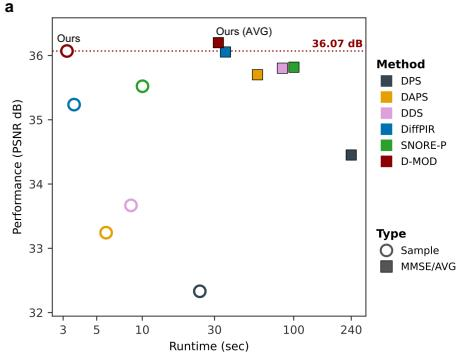
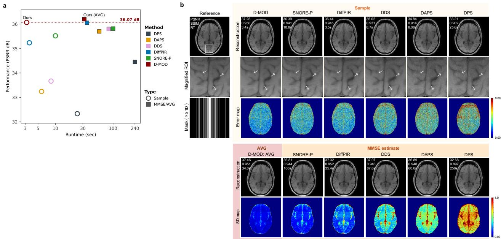

# D-MOD: DIFFUSION MODE ESTIMATION FOR ACCELERATED MRI

Md Kawsar Ahmed<sup>1,2</sup> and Mathews Jacob<sup>2</sup>

<sup>1</sup>University of Virginia, Charlottesville, VA, USA/ <sup>2</sup>Bangladesh University of Engineering and Technology, Dhaka, Bangladesh. {ngd6kg, mjacob}@virginia.edu

## ABSTRACT

Diffusion models are powerful priors for accelerated MRI reconstruction, but most current methods are posterior samplers, which returns a random draw from the posterior. A reproducible and high-quality reconstruction often requires averaging many samples, resulting in a high computational cost. We introduce D-MOD, a fast algorithm that instead provides a posterior mode. It uses a minorize–maximize algorithm on a lower bound of the smoothed log-posterior, which provably increases the objective. Each iteration draws S noisy samples of the current estimate at the current noise level, denoises them with a pretrained diffusion model, and combines their average with the measured k-space through a conjugate-gradient (CG) solve. We anneal the noise levels, as the distance between the bound and its target decays quadratically with noise. On fastMRI brain (T1, T2, FLAIR), a single D-MOD reconstruction exceeds, in PSNR, the 10- sample finite-MMSE estimates of DPS, DAPS and SNORE-P and stays within 0.31 dB of the strongest baselines (DiffPIR, DDS). This approach thus provides a fast deterministic reconstruction algorithm (11–73× faster than MMSE estimates), which is useful in a clinical setting.

Index Terms— Fast MRI, diffusion priors, posterior mode estimation, minorize–maximize, plug-and-play priors.

## 1. INTRODUCTION

Diffusion models are powerful priors for accelerated MRI. Trained once on fully sampled data, they generalize across contrasts and anatomies without task-specific retraining [1– 3]. Since their first application to MRI [4,5], the dominant approach has been to inject data consistency corrections along the reverse trajectory of the diffusion models. As the exact correction is intractable, the methods mainly differ on the approximations to compute it [6–9]. All of these methods return a sample from the posterior distribution, depending on the random initialization from the prior or the intermediate noise realizations. The reconstructions vary significantly with the random seed, and a reproducible result requires averaging several samples to approximate the MMSE estimate. This averaging compounds an already large iteration count of diffusion posterior sampling, and may blur fine detail. In most clinical settings, the acceleration is set to be modest to minimize unacceptable hallucinations, when the posterior is unimodal. In these settings, a fast and deterministic solution that is the most plausible one is preferable to posterior sampling.

An alternative is to estimate a mode of the posterior directly. Plug-and-play (PnP) MAP methods [10–13] embed a learned denoiser as an implicit prior and return a deterministic estimate with noise annealing [14, 15]. Recently, renoise– denoise regularization [14, 16] was introduced to further reduce the impact of distribution mismatch. We note some limitations of these methods that restrict their efficiency. First, the ascent step size is bounded by the Lipschitz constant of the denoiser residual, which is not available in closed form. Empirical Lipschitz bounds are conservative and translate to small steps, while constraining the Lipshitz constant of the denoiser during training [17] degrades the denoising performance [18]. Second, the prior expectation is approximated by Monte Carlo in [14, 16]; the step-sizes must be small enough to average that noise across iterations, leaving the final estimate seed-dependent.

We introduce D-MOD, an annealed mode-estimation algorithm that removes both obstacles. Each iteration adds S independent noise realizations at the current noise level to the iterate, denoises each of them and averages the results, and then combines that average with the measured k-space by a CG least-squares solve. Together these steps form a minorize–maximize (MM) algorithm to maximize a lower bound of the smoothed log-posterior, which is guaranteed to increase the lower-bound monotonically; the denoised average is the gradient of the prior term and the CG solve returns the exact maximizer of a quadratic minorizer. Our analysis shows that the lower-bound closely approximates the log-posterior at the modes at each noise scale. Additionally, it converges to the true posterior as the noise level approaches zero. The averaging of the denoised images at each iteration results in a O(1/S) reduction in the prior variance. The algorithm thus offers a mode estimate with low variance, which can serve as a fast and more deterministic alternative to diffusion posterior sampling methods in clinical applications.

## Algorithm 1 D-MOD

```latex
Input: annealing steps T, samples S, inner MM iterations K, CG iterations
L, data y, operator A, noise variance $\beta _ { y } ^ { 2 } ,$ schedule $\sigma _ { t _ { 0 } } > \cdots > \sigma _ { t _ { T - 1 } } .$
Initialize: $x ^ { ( 0 ) } = 0 .$
for n = 0 to T − 1
$\sigma _ { t } \gets \sigma _ { t _ { n } } , ~ x _ { 0 } ^ { ( n ) } \gets x ^ { ( n ) }$
for $k = 0$ to $\check { K } - 1$
Renoise: $x _ { t , s } \sim \mathcal { N } ( x _ { k } ^ { ( n ) } , \sigma _ { t } ^ { 2 } I ) , s = 1 , . . . , S$
Denoise: evaluate $\hat { \boldsymbol { x } } _ { 0 } ( \boldsymbol { x } _ { t , s } )$ for each s
Average: x˜<sub>0</sub> $\textstyle \overleftarrow { \frac { 1 } { S } } \sum _ { s = 1 } ^ { S } \hat { x } _ { 0 } ( x _ { t , s } )$
Maximize: solve by L CG steps
$\begin{array} { r } { \Big ( \frac { A ^ { \mathsf { H } } A } { \beta _ { y } ^ { 2 } } + \frac { I } { \sigma _ { t } ^ { 2 } } \Big ) x _ { k + 1 } ^ { ( n ) } = \frac { A ^ { \mathsf { H } } y } { \beta _ { y } ^ { 2 } } + \frac { \tilde { x } _ { 0 } } { \sigma _ { t } ^ { 2 } } } \end{array}$
end for
$x ^ { ( n + 1 ) }  x _ { K } ^ { ( n ) }$
end for
return $x ^ { ( T ) }$ (total NFE = T·S·K)
```

## 2. METHOD

MRI measurements are modeled as $y \ = \ A x \ + \ n , \ n \ \sim$ $\mathcal { N } ( 0 , \beta _ { y } ^ { 2 } I )$ , with $A ~ \in ~ \mathbb { C } ^ { m \times p }$ the undersampled multicoil Fourier operator, $x \in \mathbb { C } ^ { p }$ the image and $\beta _ { y } ^ { 2 }$ the noise variance. Bayesian methods consider log $p ( x \mid y ) = J ( x )$

$$
J ( x ) = \log p ( y \mid x ) + \log p ( x ) .\tag{1}
$$

The measurement term log $p ( y \mid x ) = - \| A x - y \| _ { 2 } ^ { 2 } / ( 2 \beta _ { y } ^ { 2 } ) + c$ is closed form and concave. The true prior is often nonconcave and often supported on a set of measure zero (manifold hypothesis), and hence log $p = - \infty$ almost everywhere; this affects the convergence of all gradient-based algorithms as the prior gradient will be zero, when initialized away from the data support. Diffusion models overcome the above gradient issues by using Gaussian-smoothed priors $p _ { \sigma } ~ = ~ p$ ∗ ${ \mathcal { N } } ( 0 , \sigma ^ { 2 } I )$ . With $\hat { x } _ { 0 } ( u ) : = \mathbb { E } [ x \mid x + \sigma \varepsilon = u ]$ the MMSE denoiser at level $\sigma ,$ , Tweedie’s identity relates it to the score,

$$
\hat { x } _ { 0 } ( u ) = u + \sigma ^ { 2 } \nabla \log p _ { \sigma } ( u ) ,\tag{2}
$$

and a trained diffusion model supplies an estimate of ∇ log $p _ { \sigma }$ for the whole family $\{ p _ { \sigma } \}$

Two limitations restrict the direct use of diffusion models for mode estimation. (L1) Diffusion models supply the score estimates, but not the log density values. While the score estimates can enable gradient-based algorithms, it is challenging to perform objective comparisons, line searches, and choose step-sizes that guarantee convergence. (L2) Score estimates are reliable only at noisy inputs: trained on samples of $p _ { \sigma _ { t } }$ which concentrate at distance ≈ $\sigma _ { t } \sqrt { d }$ from the clean data. In particular, the score estimates are not well defined at samples $x \sim p ( x )$ itself, which restrict the direct utility of diffusion models in this context.

## 2.1. A Lower Bound on the Smoothed Log-Posterior

To overcome the above challenges, we propose to use a lower-bound for the smoothed log posterior. The $\sigma _ { t ^ { - } }$ smoothed prior admits the representation $\begin{array} { r l } { p _ { \sqrt { 2 } \sigma _ { t } } ( x ) } & { { } = } \end{array}$ $\begin{array} { r } { \int p _ { \sigma _ { t } } ( x _ { t } ) \mathcal { N } ( x ; x _ { t } , \sigma _ { t } ^ { 2 } I ) d x _ { t } , } \end{array}$ an identity expressing that smoothing twice by $\mathcal { N } ( 0 , \sigma _ { t } ^ { 2 } I )$ equals smoothing once by $\mathcal { N } ( 0 , 2 \sigma _ { t } ^ { 2 } I )$ . Writing it as an expectation under an arbitrary density q(x<sub>t</sub>) and applying Jensen’s inequality yields

$$
\log p _ { \sqrt { 2 } \sigma _ { t } } ( x ) \ \geq \ \mathbb { E } _ { q } \left[ \log \frac { p _ { \sigma _ { t } } ( x _ { t } ) \mathcal { N } ( x ; x _ { t } , \sigma _ { t } ^ { 2 } I ) } { q ( x _ { t } ) } \right] .\tag{3}
$$

The bound is one-sided by construction, with a KL-divergence gap of $\mathrm { K L } ( q \parallel p _ { t } ( \cdot \mid x ) )$ . It remains to choose q. We consider an isotropic kernel $q _ { s } ( x _ { t } ) \ = \ \mathcal { N } ( x _ { t } ; x , s ^ { 2 } I )$ centered at x. Differentiating under the expectation leaves an average of scores at the perturbed points $x + s \varepsilon$ . We choose $s = \sigma _ { t }$ to ensure that the the network ∇ log $p _ { \sigma _ { t } }$ is queried at $( x + s \varepsilon ) \sim p _ { \sigma _ { t } }$ , for any clean x. Choosing $s = \sigma _ { t }$ gives

$$
G _ { t } ( x ) : = \mathbb { E } _ { x _ { t } \sim \mathcal { N } ( x , \sigma _ { t } ^ { 2 } I ) } [ \log p _ { \sigma _ { t } } ( x _ { t } ) ] ,\tag{4}
$$

the stochastic denoising regularizer of Renaud et al. [14]; the derivation shows that $\bar { G } _ { t } ( \bar { x } )$ is a lower bound on a smoothed log-prior. Adding the exact measurement term gives the perlevel objective

$$
C _ { t } ( x ) = \log p ( y \mid x ) + G _ { t } ( x ) \leq \underbrace { \log p ( y \mid x ) + \log p _ { { \sqrt { 2 } } \sigma _ { t } } ( x ) } _ { = : J _ { t } ( x ) } .\tag{5}
$$

Three properties of $G _ { t } ,$ , which hold independently of the data distribution, the architecture and the training, aid with the algorithm. First, differentiating (4) under the expectation and applying (2) at every perturbed point gives, for every $\sigma _ { t } > 0 .$

$$
\nabla G _ { t } ( x ) = \frac { \bar { x } _ { 0 } ( x ) - x } { \sigma _ { t } ^ { 2 } } , \quad \bar { x } _ { 0 } ( x ) : = \mathbb { E } _ { \varepsilon } [ \hat { x } _ { 0 } ( x + \sigma _ { t } \varepsilon ) ] ;\tag{6}
$$

the prior gradient is obtained by perturbing the current estimate at the current noise level, denoising, and averaging. Second, the curvature bound [19, 20]

$$
\nabla ^ { 2 } G _ { t } ( x ) \succeq - \sigma _ { t } ^ { - 2 } I\tag{7}
$$

holds at every x and every $\sigma _ { t } \ > \ 0 .$ , with a constant set by the noise level rather than tuned. Third, the gap between the lower bound and true posterior $\Delta _ { t } ( x ) : = J _ { t } ( x ) - C _ { t } ( x )$ satisfies

$$
\begin{array} { r } { \Delta _ { t } ( x ) = \frac { \sigma _ { t } ^ { 2 } } { 2 } \bigl \| \nabla \log p _ { \sigma _ { t } } ( x ) \bigr \| ^ { 2 } + O ( \sigma _ { t } ^ { 4 } ) , } \end{array}\tag{8}
$$

reducing at a stationary point $x ^ { \star }$ of $C _ { t }$ to $\sigma _ { t } ^ { 2 } \| A ^ { \mathsf { H } } ( A x ^ { \star } \textrm { -- }$ $y ) \| ^ { 2 } / ( 2 \beta _ { y } ^ { 4 } ) + O ( \sigma _ { t } ^ { 4 } )$ . Annealing therefore drives the gap to zero at a known rate, the surrogate agrees with the smoothed log-prior in value and gradient at the stationary points of log $p _ { \sigma _ { t } } \mathrm { i }$ ; the residual gap at convergence is small whenever the solution agrees with the measurements. Consequently a maximizer of $C _ { t }$ nearly maximizes $J _ { t } ,$ the shortfall being at most $\Delta _ { t } \colon \mathrm { i f } - \nabla ^ { 2 } J _ { t } \succeq \mu I$ near the two maximizers, their distance is $O ( \sigma _ { t } / \sqrt { \mu } )$



  
Fig. 1. fastMRI brain, T1, ×5. (a) PSNR versus per-slice runtime (log scale); circles denote single-sample reconstructions and squares the 10-sample MMSE estimates (AVG for D-MOD); top-left is best. (b) Qualitative comparison: (top) single-sample reconstructions with a magnified ROI and absolute-error map; (bottom) 10-sample MMSE estimate with its pixel-wise SD map (higher SD, lower reproducibility). Arrows mark artifacts or blurred structure; PSNR (dB), SSIM and runtime (s) are shown.

Table 1. Reconstruction performance on fastMRI brain (30 subjects per contrast, 1D Cartesian). Entries are PSNR (dB)/SSIM; for each method the shaded “MMSE” row is the 10-sample finite estimate and “Sample” is a single-sample reconstruction. Best value in bold.
<table><tr><td>Contrast</td><td>Acc.</td><td>Type</td><td>DPS</td><td>DAPS</td><td>DDS</td><td>DiffPIR</td><td>SNORE-P</td><td>D-MOD†</td></tr><tr><td rowspan="3">T1</td><td rowspan="2">×5</td><td>Sample</td><td>32.33/0.905</td><td>33.24/0.915</td><td>33.67/0.932</td><td>35.24/0.947</td><td>35.52/0.945</td><td>36.07/0.952</td></tr><tr><td>MMSE</td><td>34.45/0.939</td><td>35.70/0.949</td><td>35.80/0.949</td><td>36.06/0.954</td><td>35.82/0.948</td><td>36.20/0.952</td></tr><tr><td rowspan="2">×10</td><td>Sample</td><td>26.32/0.799</td><td>30.36/0.870</td><td>30.73/0.895</td><td>32.36/0.919</td><td>32.69/0.923</td><td>33.23/0.927</td></tr><tr><td>MMSE</td><td>28.35/0.857</td><td>32.78/0.922</td><td>32.96/0.924</td><td>33.38/0.931</td><td>33.14/0.928</td><td>33.50/0.929</td></tr><tr><td rowspan="3">T2</td><td>×5</td><td>Sample</td><td>35.75/0.949</td><td>37.27/0.957</td><td>37.15/0.963</td><td>38.83/0.972</td><td>39.07/0.971</td><td>39.53/0.972</td></tr><tr><td rowspan="2">×10</td><td>MMSE</td><td>36.19/0.956</td><td>39.34/0.974</td><td>39.00/0.970</td><td>39.67/0.976</td><td>39.39/0.972</td><td>39.67/0.973</td></tr><tr><td>Sample</td><td>28.77/0.855</td><td>33.73/0.928</td><td>34.32/0.942</td><td>35.25/0.950</td><td>35.02/0.950</td><td>35.72/0.951</td></tr><tr><td rowspan="3">FLAIR</td><td></td><td>MMSE</td><td>29.68/0.882</td><td>35.49/0.954</td><td>35.86/0.951</td><td>36.03/0.956</td><td>35.41/0.954</td><td>35.93/0.952</td></tr><tr><td rowspan="2">×5</td><td>Sample</td><td>32.34/0.890</td><td>33.09/0.900</td><td>33.23/0.913</td><td>35.28/0.939</td><td>35.35/0.935</td><td>36.09/0.942</td></tr><tr><td>MMSE</td><td>35.27/0.938</td><td>35.75/0.941</td><td>35.76/0.940</td><td>36.19/0.947</td><td>35.72/0.939</td><td>36.25/0.943</td></tr><tr><td rowspan="2"></td><td>×10</td><td>Sample MMSE</td><td>26.33/0.772 30.05/0.871</td><td>29.94/0.844 32.80/0.908</td><td>30.25/0.867 32.85/0.909</td><td>32.48/0.907 33.63/0.922</td><td>32.63/0.908 33.29/0.915</td><td>33.50/0.913</td></tr><tr><td></td><td></td><td>25.52</td><td></td><td></td><td></td><td></td><td>33.75/0.915</td></tr><tr><td rowspan="2">Runtime (s)</td><td></td><td>Sample MMSE</td><td>255.19</td><td>6.06 60.59</td><td>8.70 86.93</td><td>3.78 37.80</td><td>10.67</td><td>3.50</td></tr><tr><td></td><td></td><td></td><td></td><td></td><td></td><td>106.68</td><td>34.95</td></tr></table>

<sup>†</sup>For D-MOD, MMSE is a 10-run average of mode estimates.

## 2.2. The Minorize–Maximize Iteration

Let $x _ { k }$ be the current iterate at level $\sigma _ { t }$ . By (7), G lies above its tangent paraboloid of curvature $- \sigma _ { t } ^ { - \bar { 2 } }$ at $x _ { k }$ . Substituting (6), completing the square and adding the exact measurement term yields the quadratic minorizer

$$
m _ { k } ( x \mid x _ { k } ) = - \frac { \| A x - y \| _ { 2 } ^ { 2 } } { 2 \beta _ { y } ^ { 2 } } - \frac { \| x - \bar { x } _ { 0 } ( x _ { k } ) \| _ { 2 } ^ { 2 } } { 2 \sigma _ { t } ^ { 2 } } + c _ { k } ,\tag{9}
$$

which satisfies $m _ { k } \le C _ { t }$ with equality in value and gradient at $x _ { k }$ . Its exact maximizer solves

$$
\left( \frac { { \cal A } ^ { \sf H } { \cal A } } { \beta _ { y } ^ { 2 } } + \frac { I } { \sigma _ { t } ^ { 2 } } \right) x _ { k + 1 } = \frac { { \cal A } ^ { \sf H } y } { \beta _ { y } ^ { 2 } } + \frac { \bar { x } _ { 0 } ( x _ { k } ) } { \sigma _ { t } ^ { 2 } } .\tag{10}
$$

The system matrix is Hermitian positive definite for every $\sigma _ { t } \ > \ 0$ and is applied inside a CG solver at a cost of one forward and one adjoint application of A per iteration. Only the prior term is minorized; the measurement term is kept exactly, and no step size appears, since the weight $1 / \sigma _ { t } ^ { 2 }$ in (10)

is the curvature constant of (7) rather than a free parameter. The expectation in (6) is approximated by S renoised samples. and (10) is solved with L CG iterations. Algorithm 1 summarizes the procedure.

Guarantees. Under standard regularity conditions $- G _ { t }$ finite and twice continuously differentiable with differentiation interchangeable with expectation, the superlevel set $\{ x :$ $C _ { t } ( x ) \ \geq \ C _ { t } ( x _ { 0 } ) \}$ compact, and $\beta _ { y } , \sigma _ { t } ~ > ~ 0 -$ the iteration (10) with the exact expectation and an exact solve satisfies, for every k,

$$
C _ { t } ( x _ { k + 1 } ) \geq C _ { t } ( x _ { k } ) + \frac { \| x _ { k + 1 } - x _ { k } \| _ { 2 } ^ { 2 } } { 2 \sigma _ { t } ^ { 2 } } .\tag{11}
$$

Hence $\{ C _ { t } ( x _ { k } ) \}$ is nondecreasing and convergent, $\lVert x _ { k + 1 } -$ $x _ { k } \|  0$ , and every accumulation point satisfies $A ^ { \mathsf { H } } ( A x ^ { \star } -$ $y ) / \beta _ { y } ^ { 2 } + ( x ^ { \star } - \bar { x } _ { 0 } ( x ^ { \star } ) ) / \sigma _ { t } ^ { 2 } = 0 ,$ , with no step-size condition and no Lipschitz constant required. As the guaranteed increase grows with the square of the step and $C _ { t }$ is bounded above, the iterates settle at the fixed point rather than oscillate. The argument needs $C _ { t }$ to exist but never to be evaluated: $c _ { k }$ in (9) is fixed by $m _ { k } ( x _ { k } ) = C _ { t } ( x _ { k } )$ and cancels, and existence follows because (4) is built from $p _ { \sigma _ { t } }$ , positive and smooth for every $\sigma _ { t } \ > \ 0$ , whereas analyses defining the regularizer through the denoiser need a conservative vector field. Replacing $\bar { x } _ { 0 }$ by the S-sample average (6) from a learned denoiser of bias bound $b _ { t }$ and per-sample variance v<sub>t</sub> degrades (11) in expectation only by $\bar { ( v _ { t } / S + \bar { b _ { t } ^ { 2 } } ) } / 2 \sigma _ { t } ^ { 2 }$ , the Monte Carlo term being reducible by computation alone.

Annealing. At large $\sigma _ { t }$ the renoising perturbation dominates the artifacts in the iterate, while at small $\sigma _ { t }$ the gap contracts as $O ( \sigma _ { t } ^ { 2 } )$ , at the cost of increasingly local updates. We therefore use $\sigma _ { t _ { 0 } } > \cdots > \sigma _ { t _ { T - 1 } } > 0$ , each level warmstarted from the preceding solution.

## 3. EXPERIMENTS

Data and prior. We evaluate the algorithm on fastMRI brain [21]: axial validation subjects at $3 2 0 \times 3 2 0$ with 20 coils, 1D Cartesian undersampling with 12 ACS lines, the four corner slices excluded, and 30 subjects per contrast (T1, T2, FLAIR) at ×5 and ×10. All methods share a pretrained conditional EDM prior [3] trained on fastMRI brain data [22], with the original noise schedule and timestep discretization.

Settings. Hyperparameters are tuned per method (annealing steps, noise range, schedule, measurement noise $\beta _ { y } )$ ; D-MOD uses $T = 3 0 , S = 5 , K = 1 , L = 1 0$ . Baselines are the posterior samplers DPS [6] and DAPS [7], the optimizationbased DiffPIR [8] and DDS [9], and SNORE [14] in its annealed proximal variant SNORE-P [16], the stronger of the two here (its analysis assumes the denoiser is the gradient of a potential, which the shared EDM prior does not provide). All methods use identical measurements and are timed on one NVIDIA A100 GPU. Each finite-MMSE estimate averages 10 reconstructions with independent seeds, and D-MOD’s

AVG likewise; runtimes are per-slice, averaged over contrasts and acceleration factors.

## 3.1. Results

Table 1 reports PSNR/SSIM for the three contrasts at $\times 5$ and ×10 with per-slice runtime, and Fig. 1(a) plots the quality– runtime trade-off for T1 at ×5. A single D-MOD reconstruction reaches 36.07 dB on T1 at ×5 in 3.5 s, matching the best baseline 10-sample MMSE estimate (DiffPIR, 36.06 dB, 37.8 s) and beating the rest at 11–73× lower runtime. The pattern holds across contrasts and both acceleration factors: single-sample D-MOD exceeds, in PSNR, the MMSE estimates of DPS, DAPS and SNORE-P everywhere, and comes within 0.31 dB of the strongest (DDS, DiffPIR) at an order of magnitude less compute, trailing DiffPIR’s MMSE SSIM by at most 0.009; D-MOD’s AVG attains the best PSNR on T1 and FLAIR at both factors and on T2 at ×5. These MMSE estimates are finite-sample approximations to the true $( S \to \infty )$ MMSE, which is why a single mode estimate can match or exceed them.

The reproducibility difference follows from how each method converges. D-MOD performs MM at every noise level with the prior term averaged over $S$ draws, so the prior variance falls as ${ \cal O } ( 1 / S )$ . The baselines do not converge to a fixed point: DiffPIR and DDS take one stochastic denoiser step per level along a fixed trajectory, and SNORE’s constantstep updates fluctuate in a seed-dependent neighborhood, so each run gives a different image. The SD maps of Fig. 1(b) make this visible, with D-MOD (AVG) showing the lowest pixel-wise variance, the optimization-based methods next and the sampling-based methods highest, independently of PSNR.   
CLUSION

## 4. CONCLUSION

We presented D-MOD, a posterior mode-estimation framework for accelerated MRI pairing a pretrained diffusion prior with data consistency through a minorize–maximize iteration: a renoise–denoise–average step estimates the gradient of a smoothed prior surrogate, and a quadratic CG update combines it with the measurement model exactly. Annealing contracts the surrogate–target gap as $O ( \sigma _ { t } ^ { 2 } )$ , so the returned estimate is a stationary point of a surrogate whose distance from the smoothed posterior is quantified at the terminal noise level. On fastMRI brain, a single D-MOD reconstruction attains the best single-sample PSNR in every reported setting and matches or beats 10-sample MMSE estimates at 11–73× lower runtime, with the lowest run-to-run variation of the methods compared. The mode is representative only where the posterior is near-unimodal; at high acceleration, where distinct modes are distinct plausible images, sampling is more informative.

## 5. ACKNOWLEDGMENTS

This work is supported by NIH grants R01-AG067078, R01- EB031169, and R01-EB019961.

## 6. REFERENCES

[1] Jonathan Ho, Ajay Jain, and Pieter Abbeel, “Denoising diffusion probabilistic models,” in NeurIPS, 2020.

[2] Yang Song, Jascha Sohl-Dickstein, Diederik Kingma, Abhishek Kumar, Stefano Ermon, and Ben Poole, “Score-based generative modeling through stochastic differential equations,” in International Conference on Learning Representations (ICLR), 2021.

[3] Tero Karras, Miika Aittala, Samuli Laine, Erik Hark¨ onen,¨ Janne Hellsten, Jaakko Lehtinen, and Timo Aila, “Elucidating the design space of diffusion-based generative models,” Advances in Neural Information Processing Systems (NeurIPS), 2022.

[4] Ajil Jalal, Marius Arvinte, Giannis Daras, Eric Price, Alexandros G. Dimakis, and Jonathan I. Tamir, “Robust compressed sensing MRI with deep generative priors,” in Advances in Neural Information Processing Systems (NeurIPS), 2021, arXiv:2108.01368.

[5] Hyungjin Chung and Jong Chul Ye, “Score-based diffusion models for accelerated MRI,” Medical Image Analysis, 2022.

[6] Hyungjin Chung, Jeongsol Kim, Michael T. McCann, Marc L. Klasky, and Jong Chul Ye, “Diffusion posterior sampling for general noisy inverse problems,” in International Conference on Learning Representations (ICLR), 2023.

[7] Bingliang Zhang, Wenda Chu, Julius Berner, Chenlin Meng, Anima Anandkumar, and Yang Song, “Improving diffusion inverse problem solving with decoupled noise annealing,” in Proceedings of the IEEE/CVF Conference on Computer Vision and Pattern Recognition (CVPR), 2025.

[8] Yuanzhi Zhu, Kai Zhang, Jingyun Liang, Jiezhang Cao, Bihan Wen, Radu Timofte, and Luc Van Gool, “Denoising diffusion models for plug-and-play image restoration,” in Proc. IEEE/CVF Conf. Comput. Vis. Pattern Recognit. Workshops (CVPRW), 2023, pp. 1219–1229.

[9] Hyungjin Chung, Suhyeon Lee, and Jong Chul Ye, “Decomposed diffusion sampler for accelerating large-scale inverse problems,” in ICLR, 2024.

[10] Singanallur V. Venkatakrishnan, Charles A. Bouman, and Brendt Wohlberg, “Plug-and-play priors for model based reconstruction,” in IEEE Global Conference on Signal and Information Processing, 2013, pp. 945–948.

[11] Ulugbek S. Kamilov, Charles A. Bouman, Gregery T. Buzzard, and Brendt Wohlberg, “Plug-and-play methods for integrating physical and learned models in computational imaging,” arXiv preprint arXiv:2203.17061, 2022.

[12] Remi Laumont, Valentin De Bortoli, Andr´ es Almansa, Julie´ Delon, Alain Durmus, and Marcelo Pereyra, “On maximuma-posteriori estimation with plug & play priors and stochastic gradient descent,” arXiv preprint arXiv:2201.06133, 2022.

[13] Yaniv Romano, Michael Elad, and Peyman Milanfar, “The little engine that could: Regularization by denoising (RED),” SIAM Journal on Imaging Sciences, vol. 10, no. 4, pp. 1804– 1844, 2017.

[14] Marien Renaud, Julien Bect, Pierrick Coupe, Christophe Vi-´ gnat, Alain Durmus, Eric Moulines, and Valentin De Bortoli, “Plug-and-play image restoration with stochastic deNOising REgularization,” in International Conference on Machine Learning (ICML), 2024.

[15] Jyothi Rikhab Chand and Mathews Jacob, “Multi-scale energy (MuSE) framework for inverse problems in imaging,” IEEE Transactions on Computational Imaging, vol. 10, pp. 1250– 1265, 2024.

[16] Marien Renaud, Julien Hermant, and Nicolas Papadakis, “Convergence analysis of a proximal stochastic denoising regularization algorithm,” in Scale Space and Variational Methods in Computer Vision (SSVM). 2025, Springer, arXiv:2412.08262.

[17] Ernest K. Ryu, Jialin Liu, Sicheng Wang, Xiaohan Chen, Zhangyang Wang, and Wotao Yin, “Plug-and-play methods provably converge with properly trained denoisers,” in International Conference on Machine Learning (ICML), 2019, pp. 5546–5557.

[18] Samuel Hurault, Arthur Leclaire, and Nicolas Papadakis, “Gradient step denoiser for convergent plug-and-play,” in International Conference on Learning Representations (ICLR), 2022.

[19] Koichi Miyasawa, “An empirical Bayes estimator of the mean of a normal population,” Bulletin of the International Statistical Institute, vol. 38, pp. 181–188, 1961.

[20] Remi Gribonval, “Should penalized least squares regression ´ be interpreted as maximum a posteriori estimation?,” IEEE Transactions on Signal Processing, vol. 59, no. 5, pp. 2405– 2410, 2011.

[21] Jure Zbontar, Florian Knoll, Anuroop Sriram, et al., “fastMRI: An open dataset and benchmarks for accelerated MRI,” arXiv preprint arXiv:1811.08839, 2019.

[22] Brett Levac, Ajil Jalal, and Jonathan I. Tamir, “Accelerated motion correction for MRI using score-based generative models,” in 2023 IEEE 20th International Symposium on Biomedical Imaging (ISBI), 2023, pp. 1–5.