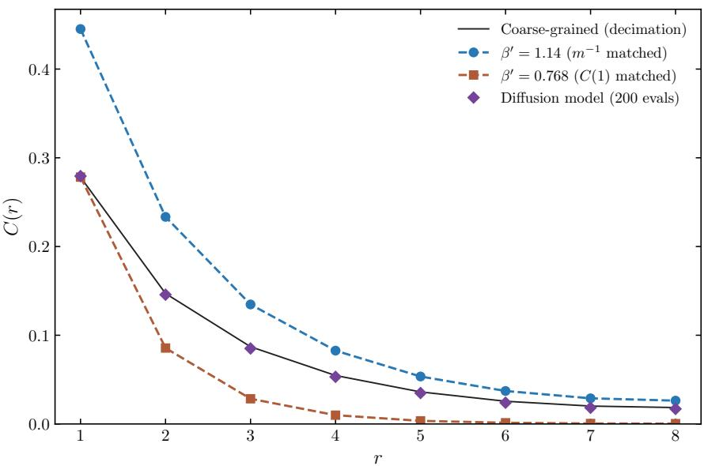
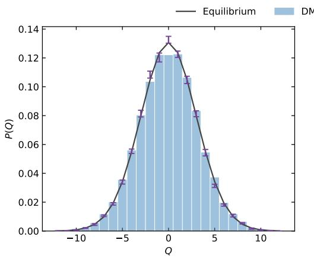
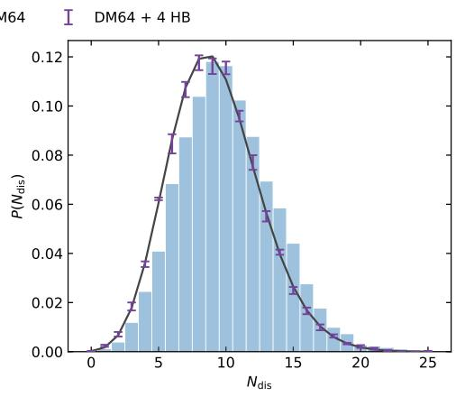
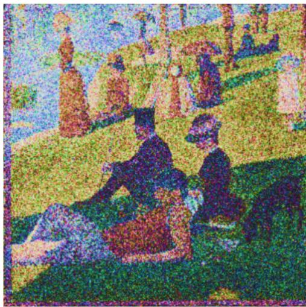
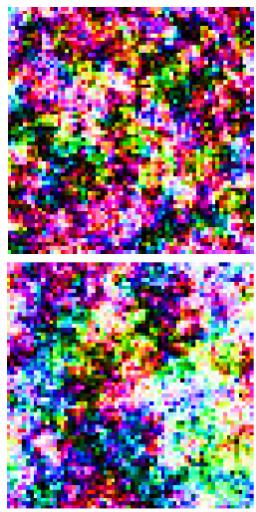
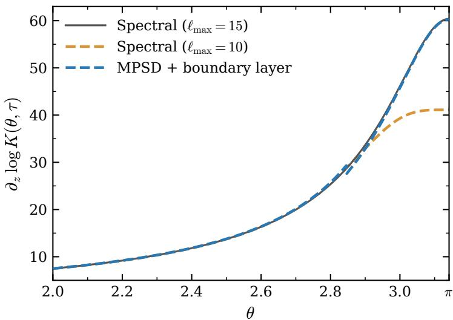
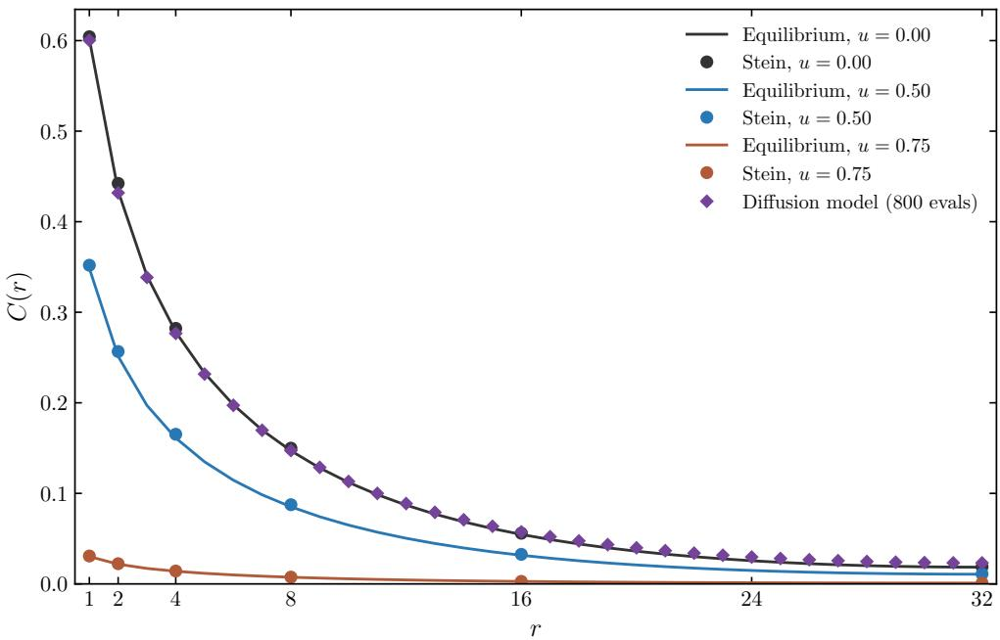
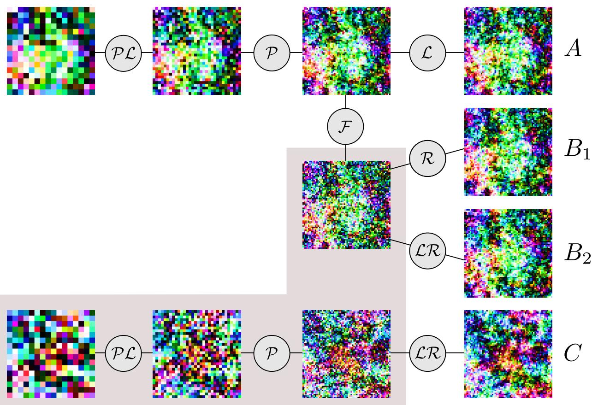
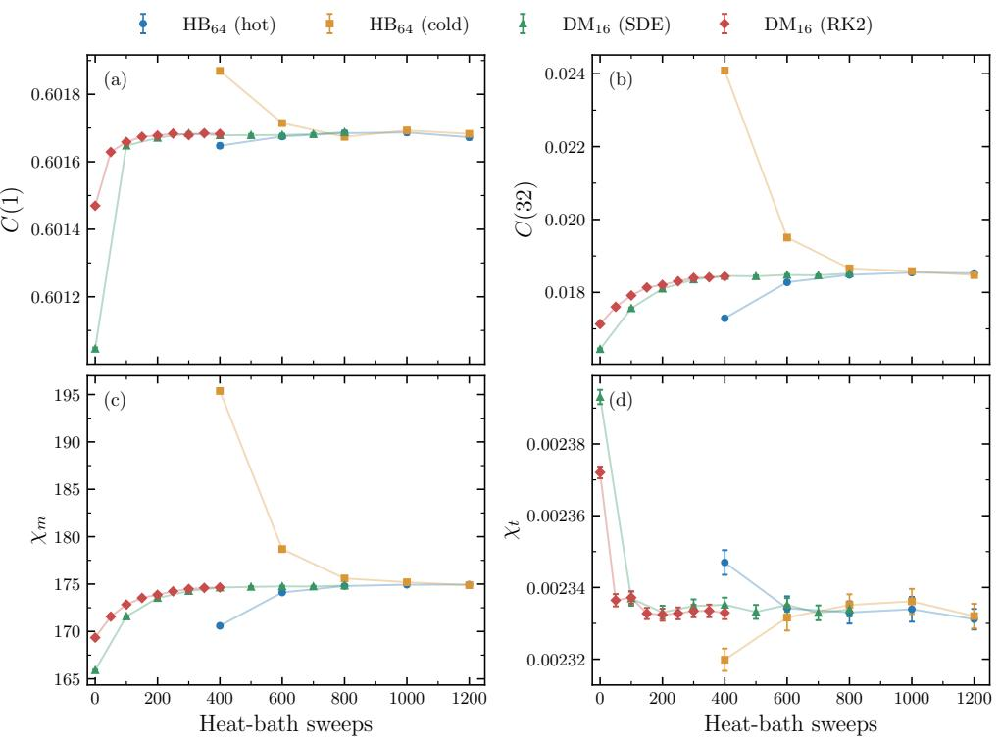

# Difusion models for the O(3) nonlinear sigma model

Daniel Schubring

Department of Physics, City College of New York, CUNY

New York, NY 10031, USA

## Abstract

A score-based difusion model is trained on the two-dimensional classical Heisenberg model, the lattice representation of the O(3) nonlinear sigma model. Neural networks are trained on three diferent coarse-grainings of the same training set to implement a multiscale sampling scheme that modestly improves both the accuracy and computational cost of direct sampling on the finest lattice. Stein (or Schwinger–Dyson) diagnostics for the two-point correlation function are introduced to assess the quality of the learned score without relying on reverse difusion sampling. These diagnostics are also incorporated into an additional training loss. We discuss several technical considerations relevant to implementing difusion models on $S ^ { 2 }$ . These include a consideration of lifting the network input to $S ^ { 3 }$ , as in the $C P ^ { 1 }$ representation, and developing a boundary-layer approximation to the short-time spherical heat kernel that extends its usefulness to larger difusion times.

## 1 Introduction

Lattice field theory provides a nonperturbative framework for studying quantum field theories, with physical observables conventionally evaluated using Markov chain Monte Carlo (MCMC) methods. Despite their successes, conventional MCMC algorithms can sufer from long autocorrelation times as the continuum limit is approached, a manifestation of critical slowing down [1]. In theories with nontrivial topology, transitions between topological sectors may become strongly suppressed, leading to the additional problem of topological freezing [2–9].

To address these issues, generative machine-learning techniques have been investigated as alternatives or complements to conventional MCMC methods [10–15]. In particular, score-based difusion models (DMs) [16–25] have recently been applied to lattice field theories including scalar $\phi ^ { 4 }$ theory [26–28], two-dimensional U(1) gauge theory [27–29], the XY model [30], frustrated spin glasses [31], and non-Abelian gauge theories [32, 33].

While difusion models ofer a promising approach to mitigating critical slowing down and topological freezing, their computational cost remains a challenge. Generating configurations requires integrating ordinary or stochastic diferential equations involving many evaluations of a learned score function, which can be considerably more expensive than conventional MCMC updates. Here we investigate the tradeofs between computational cost and accuracy in difusion models for lattice field theories, using the two-dimensional O(3) nonlinear sigma model [34–39], also known as the classical Heisenberg model [40, 41], as a test case.

The O(3) model shares several qualitative features with four-dimensional Yang–Mills theory, including asymptotic freedom, emergence of a mass gap, and topological instantons, making it a useful testing ground for methods developed to study nonperturbative gauge theories $( \mathrm { s e e } , \mathrm { e . g . } , [ 4 2 ] )$ The $O ( 3 )$ model involves an $S ^ { 2 } .$ -valued field, but it may equivalently be expressed in terms of an $S ^ { 3 } – v a l u e d$ field with gauge redundancy, in which case it is known as the $C P ^ { 1 }$ model. The latter interpretation admits a large-N generalization, the $C P ^ { N - 1 }$ model [43–45], which exhibits severe topological freezing in conventional Monte Carlo simulations [6–9]. In contrast, the $C P ^ { 1 }$ or $O ( 3 )$ model case we study here does have eficient MCMC methods [38]. This makes it a useful benchmark for assessing difusion-based sampling methods with potential applications to the higher $C P ^ { N - 1 }$ family and the qualitatively related 4D lattice gauge theories.

Using the O(3) model, we investigate two complementary methodological questions motivated by the computational cost of score evaluations. First, we explore superresolution methods and multiscale sampling [46–55], see Fig. 3 and Fig. 6. The difusion model is used to generate coarsegrained configurations on a smaller, cheaper lattice, and then the results are super-resolved to the original lattice. Second, limiting the number of score evaluations may require large integration step sizes, introducing discretization errors that can be comparable to those arising from the neural network imperfectly learning the score. To evaluate the learned score independently of the discretization error, we introduce diagnostics based on Stein identities [56–59], which are also known as Schwinger-Dyson identities in a field-theory context [60, 61].

Additional technical challenges in applying difusion models to the $O ( 3 )$ model arise because its fields take values on the nonlinear manifold $S ^ { 2 }$ . Difusion models can be naturally extended to Riemannian manifolds by replacing the Gaussian transition kernel with the heat kernel associated with the manifold [62–66]. However, heat kernels are generally not available in closed form, and practical approximations are needed for numerical calculations. The case of $S ^ { 2 }$ presents particular dificulties that do not arise for Lie group manifolds. As previously noted in the machine-learning literature [67], the short-time asymptotic expansion of the spherical heat kernel becomes singular near the antipodal point. We develop a separate boundary-layer expansion to obtain an accurate approximation in this region. A further complication is that $S ^ { 2 }$ has a non-trivial tangent bundle, and we discuss the implications for the choice of neural network architecture.

An outline of the paper is as follows. In Sec. 2, we review the lattice formulation of the $O ( 3 )$ model and also describe the basic setup of our numerical results with difusion models. In Sec. 3, we review difusion models on Riemannian manifolds, focusing on practical aspects of evaluating the heat kernel and its score on $S ^ { 2 }$ . In Sec. 4, we introduce Stein diagnostics that probe the accuracy of the learned score in reproducing two-point correlations, and show how these can be incorporated into the training loss to improve short-distance correlations. In Sec. 5, we describe our superresolution methods and present numerical results using DMs trained at three diferent levels of coarse graining. Finally, in Sec. 6, we summarize our findings and discuss future directions.

## 2 The O(3) model

## 2.1 Action

The lattice action for the $O ( 3 )$ classical Heisenberg model involves a three-component unit vector field ${ \bf n } _ { i }$ at the lattice site i,

$$
S [ { \bf n } ; \beta ] = - \beta \sum _ { \langle i j \rangle } { \bf n } _ { i } \cdot { \bf n } _ { j } ,\tag{1}
$$

and the probability density of a given field configuration is $p ( \mathbf { n } ) \propto e ^ { - S [ \mathbf { n } ; \beta ] }$ . Particularly relevant in the context of machine learning is the score, $s = \nabla \log p ( \mathbf { n } )$ , where the gradient is taken in field

space, which is a product of factors of $S ^ { 2 }$ for each lattice site. The component of score at lattice site i is

$$
\mathbf { s } _ { i } = \nabla _ { \mathbf { n } _ { i } } \log p ( \mathbf { n } ) = \beta \left( \mathbf { m } _ { i } - \left( \mathbf { m } _ { i } \cdot \mathbf { n } _ { i } \right) \mathbf { n } _ { i } \right) ,\tag{2}
$$

where m is the nearest neighbor field

$$
\mathbf { m } _ { i } = \sum _ { j : \langle i j \rangle } \mathbf { n } _ { j } .\tag{3}
$$

Since we will consider coarse-grained field configurations, it is useful to briefly discuss renormalization in the $O ( 3 )$ model. In the continuum limit, up to a constant term, the action becomes

$$
S = \frac { \beta } { 2 } \int d ^ { 2 } x \left( \partial _ { \mu } { \bf n } ( x ) \right) ^ { 2 } .\tag{4}
$$

The continuum theory is renormalizable, with a single running coupling $\beta$ whose renormalization group flow can be calculated perturbatively at weak coupling (large β).

However, this does not imply that coarse graining the lattice model produces an efective action of the same form with a renormalized coupling $\beta ^ { \prime }$ . We work at $\beta \ : = \ : 1 . 5$ , corresponding to a correlation length of approximately 11 lattice spacings, and consider coarse-grained configurations with even shorter correlation lengths. At these scales, the efective lattice action contains additional operators beyond the nearest-neighbor interaction in (1) (see, e.g., [60,68]). Consequently, the score of the coarse-grained distribution cannot be obtained from (2) by simply replacing $\beta$ with $\beta ^ { \prime }$ , but nevertheless it can be learned by a difusion model (see Fig. 1, discussed further below).

The continuum model (4) has an equivalent formulation as the $C P ^ { 1 }$ model [43, 44],

$$
S = 2 \beta \int d ^ { 2 } x \bigg ( \partial _ { \mu } z ^ { \dagger } \cdot \partial _ { \mu } z + \Big ( z ^ { \dagger } \cdot \partial _ { \mu } z \Big ) ^ { 2 } \bigg ) ,\tag{5}
$$

which is written in terms of a two-component complex unit vector z related to n through

$$
{ \bf n } = z ^ { \dagger } { \pmb \sigma } z , \qquad z ^ { \dagger } z = 1 ,\tag{6}
$$

where $\sigma$ indicates the three Pauli matrices. Note that this relation only defines z up to a local phase, and indeed the action (5) is gauge invariant under the transformation $z ( x )  e ^ { i \phi ( x ) } z ( x )$ This is often made more explicit by replacing the quartic term in the action with an auxiliary $U ( 1 )$ gauge field, although we shall not need this here.

The conventional lattice discretization of the $C P ^ { 1 }$ action [69] is not strictly identical to (1). However, using (6) a configuration of $S ^ { 2 } .$ -valued fields ${ \bf n } _ { i }$ may always be replaced with $S ^ { 3 } .$ -valued fields $z _ { i }$ , which are defined up to a local $U ( 1 )$ phase. We will return to this observation in Sec. 3.4.

## 2.2 Observables

## 2.2.1 Two-point correlations

One of the main observables we measure is the two-point correlation function $C ( j ) = \langle \mathbf { n } _ { i } \cdot \mathbf { n } _ { i + j } \rangle$ By translation invariance this depends only on the spatial vector displacement j.

Some other common observables are determined by $C ( j )$ . The average energy density is

$$
E = ( \beta V ) ^ { - 1 } \left. { S } \right. = - 2 C ( 1 ) ,\tag{7}
$$

where V indicates the total number of lattice sites, and C is written as a function of a scalar integer when the displacement is aligned along the rectangular axes.

The correlation length $m ^ { - 1 }$ may be extracted from the Fourier transform $\begin{array} { r } { G ( p ) = \sum _ { j } e ^ { i p \cdot j } C ( j ) } \end{array}$ For small $p , G ( p )$ takes the schematic form

$$
G ( p ) \approx { \frac { Z } { { \hat { p } } ^ { 2 } + m ^ { 2 } } } ,\tag{8}
$$

where $\begin{array} { r } { \hat { p } ^ { 2 } = 4 \sum _ { \mu } \sin ^ { 2 } ( p _ { \mu } / 2 ) } \end{array}$ . Taking p to be the minimum nonzero lattice momentum, we use this expression to define the squared correlation length $m ^ { - 2 }$ on a finite lattice

$$
m ^ { - 2 } = \frac { 1 } { { \hat { p } } ^ { 2 } } \left( \frac { G ( 0 ) } { G ( p ) } - 1 \right) .\tag{9}
$$

Note that the quantity G(0) is the magnetic susceptibility χm

$$
\chi _ { m } = \frac { 1 } { V } \left. \left( \sum _ { i } \mathbf { n } _ { i } \right) ^ { 2 } \right. = \sum _ { j } C ( j ) = G ( 0 ) .\tag{10}
$$

## 2.2.2 Topological charge

In the continuum, the field n is a map from spatial positions $x \in \mathcal { M }$ to an $S ^ { 2 }$ target space. The topological charge Q counts the number of times this map wraps the two-dimensional manifold M around $S ^ { 2 }$ , with a sign determined by orientation.

On the lattice, an integer topological charge may still be defined, but its definition depends on how the field n is interpolated between lattice sites. Berg and L¨uscher give a geometric construction of the local topological charge $q _ { i }$ at plaquette i [36]. Labeling the four vertices of a plaquette consecutively as $\mathbf { n } _ { 1 } , \ldots , \mathbf { n } _ { 4 }$ , the plaquette may be divided into two triangles in two distinct ways, corresponding to its two diagonals. Each triangle determines a spherical triangle on $S ^ { 2 }$ , whose signed area A is specified by the spins at its three vertices.

The two triangulations lead to two definitions of the local topological charge $q _ { i }$

$$
q _ { i } ^ { ( 1 ) } = \frac { 1 } { 4 \pi } \left[ A ( { \bf n } _ { 1 } , { \bf n } _ { 2 } , { \bf n } _ { 3 } ) + A ( { \bf n } _ { 1 } , { \bf n } _ { 3 } , { \bf n } _ { 4 } ) \right] , \quad q _ { i } ^ { ( 2 ) } = \frac { 1 } { 4 \pi } \left[ A ( { \bf n } _ { 1 } , { \bf n } _ { 2 } , { \bf n } _ { 4 } ) + A ( { \bf n } _ { 2 } , { \bf n } _ { 3 } , { \bf n } _ { 4 } ) \right] .\tag{11}
$$

The total topological charge is then $\begin{array} { r } { Q ^ { ( a ) } = \sum _ { i } q _ { i } ^ { ( a ) } } \end{array}$ . An explicit formula for the signed area A is given in [36]. The topological susceptibility is defined as

$$
\chi _ { t } = \frac { 1 } { V } \left. Q ^ { ( a ) ^ { 2 } } \right. .\tag{12}
$$

For a given plaquette i, the two conventions for local topological charge $q _ { i } ^ { ( a ) }$ may either be strictly identical or they may difer by ±1. Such a disagreement signals a lattice-scale topological defect, which we will refer to as a dislocation [37].

Dislocations have long been recognized as an obstacle to determining the continuum topological susceptibility, and cooling procedures have been used to suppress them [37,70]. However, semiclassical arguments [71] and later studies [72–74] suggest that the dimensionless susceptibility $\chi _ { t } m ^ { - 2 }$ diverges in the continuum limit due to contributions from arbitrarily small instantons. Here we restrict our attention to finite correlation lengths and use the distribution of $Q ^ { ( a ) }$ and the total number of dislocations as additional observables for assessing the accuracy of difusion-generated configurations (see Fig. 2).

  
Figure 1: A two-point correlation function for an $O ( 3 )$ model coarse-grained from a $6 4 ^ { 2 }$ lattice $( \beta = 1 . 5 )$ to a $1 6 ^ { 2 }$ lattice (black). One-parameter renormalizations of $\beta$ to $\beta ^ { \prime } ,$ fitting either the correlation length (blue) or the energy per site (red), are compared to the generated configurations from a difusion model (purple). See also Table 1.

## 2.3 Numerical setup and baseline results

The primary MCMC algorithm we use for generating a training set is the heat bath algorithm, in which each local spin ${ \bf n } _ { i }$ is drawn from a thermal distribution induced by its neighbor field mi,

$$
p ( \mathbf { n } _ { i } | \mathbf { m } _ { i } ) \propto e ^ { \beta \mathbf { m } _ { i } \cdot \mathbf { n } _ { i } } .\tag{13}
$$

This is an example of the von Mises-Fisher distribution on $S ^ { 2 }$ and it can be sampled eficiently.   
Spins are updated alternately on even and odd sublattices to form one heat bath sweep.

We generate a training set of $1 0 ^ { 5 }$ configurations at $\beta = 1 . 5$ on a periodic $6 4 ^ { 2 }$ lattice. Starting from random configurations, we perform 1600 heat bath sweeps for thermalization before collecting the training configurations. Decimation is then used to produce coarse-grained training sets on the $3 2 ^ { 2 }$ and $1 6 ^ { 2 }$ lattices as well.

Distinct difusion models are trained on these three resolutions of training set data. Detailed discussions of the sampling procedure (Sec. 3.1, 3.2), the training loss (Sec. 3.3, 4.3), and the model architecture (Sec. 3.4) appear below. Here we present some basic results comparing model output to genuine equilibrium data obtained with the heat bath algorithm.

Unless otherwise stated, numerical results for the difusion models are obtained from ensembles of $1 0 ^ { 4 }$ generated configurations. These are distinct from the training ensemble of $1 0 ^ { 5 }$ configurations and the reference ensemble of $0 . 9 \times 1 0 ^ { 7 }$ configurations used to estimate equilibrium observables. The reference ensemble was generated in connection with the equilibration experiment discussed below (Fig. 7), with each configuration obtained from an independent heat bath run.

In Fig. 1 and Table 1, the results of the difusion model on the $1 6 ^ { 2 }$ lattice $\mathrm { ( D M _ { 1 6 } ) }$ are compared with those obtained from $1 0 ^ { 5 }$ configurations generated using conventional $O ( 3 )$ models on a $1 6 ^ { 2 }$ lattice, with efective couplings $\beta ^ { \prime }$ tuned to reproduce either the correlation length or $C ( 1 )$ of the coarse-grained reference ensemble. The difusion model is sampled using both 1600 and 200 score evaluations, illustrating the tradeof between computational cost and accuracy. Unlike the models with renormalized couplings, the difusion model reproduces both short and long-distance correlations.

<table><tr><td>Method</td><td> $C ( 1 )$ </td><td> $m ^ { - 1 }$ </td><td> $\chi _ { m }$ </td></tr><tr><td>Equilibrium</td><td>0.278183(6)</td><td> $2 . 6 5 5 1 ( 7 )$ </td><td>11.350(3)</td></tr><tr><td> $\mathrm { D M _ { 1 6 } }$  (1600 evals)</td><td>0.2781(2)</td><td>2.68(2)</td><td>11.39(8)</td></tr><tr><td> $\mathrm { D M } _ { 1 6 }$  (200 evals)</td><td>0.2794(3)</td><td>2.59(2)</td><td>11.04(8)</td></tr><tr><td> $\beta ^ { \prime } = 0 . 7 6 8$ </td><td>0.2782</td><td>1.06</td><td>4.269</td></tr><tr><td> $\beta ^ { \prime } = 1 . 1 4$ </td><td>0.4452</td><td>2.66</td><td>16.41</td></tr></table>

Table 1: Comparison of observables on the coarse-grained $1 6 ^ { 2 }$ lattice with samples from both the difusion model and $O ( 3 )$ models at efective couplings $\beta ^ { \prime }$ . The observables used to determine each $\beta ^ { \prime }$ are indicated in italics.

In Fig. 2, the distributions of the topological charge $Q \equiv \left( Q ^ { ( 1 ) } + Q ^ { ( 2 ) } \right) / 2$ , and the number of dislocations are shown both for the reference ensemble and the output of $\mathrm { D M } _ { 6 4 }$ . The direct samples exhibit a systematic bias in the number of dislocations and a slightly reduced probability near $Q = 0$ . Both discrepancies are corrected after a few heat bath sweeps, suggesting that they arise from inaccuracies in the model at short distances. The correlation function $C ( r )$ of $\mathrm { D M } _ { 6 4 }$ is discussed later in connection with Fig. 5. The values of $C ( r )$ for direct samples from both $\mathrm { D M } _ { 6 4 }$ and $\mathrm { D M _ { 3 2 } }$ are compared to results from various super-resolution schemes in Table 4.

Figure 3 illustrates both our method for visualizing lattice spin configurations and an application of the multiscale methods discussed later in Sec. 5. In the HSL color representation, the space of fully saturated colors is topologically equivalent to $S ^ { 2 }$ , allowing each spin orientation n to be associated with a unique color. This correspondence also allows an ordinary image to be converted into a lattice spin configuration, as illustrated using Seurat’s painting. The short-distance structure of this configuration is then modified using $\mathrm { D M _ { 6 4 } }$ , following a procedure similar to the SDEdit algorithm [49], which has also been applied to super-resolution of turbulent flows [50]. The resulting image has a value of $C ( 1 )$ and density of lattice dislocations close to their equilibrium values, as reported in the figure caption. This procedure is closely related to method $B _ { 1 }$ among the superresolution schemes compared later in Fig. 6.

## 3 Difusion models on $S ^ { 2 }$

## 3.1 Reverse difusion

The extension of continuous-time difusion models [22] to Riemannian manifolds largely follows by replacing the usual Euclidean constructions with their geometric counterparts. We briefly review the aspects relevant to our implementation, referring to [62, 63] for a more detailed mathematical treatment.

The forward difusion process transforms the target probability distribution at $\tau = 0$ into a distribution that is approximately uniform at the final difusion time $\tau = \tau _ { f }$

$$
{ \frac { \partial p } { \partial \tau } } = \nabla ^ { 2 } p .\tag{14}
$$

Here $p$ is a density with respect to the Riemannian volume measure, and $\nabla ^ { 2 }$ is the Laplace-Beltrami operator, understood to act independently on the factors of $S ^ { 2 }$ at each lattice site.

  
Figure 2: Distributions of the topological charge Q (left) and the number of lattice dislocations $N _ { \mathrm { d i s } }$ (right) for the two-dimensional $O ( 3 )$ model at $\beta = 1 . 5$ on a $6 4 ^ { 2 }$ lattice. The equilibrium heat-bath reference (black line) is compared with $1 0 ^ { 4 }$ configurations generated by a difusion model using 800 score evaluations (blue histogram). Systematic errors in the configurations generated by the model are largely corrected after a cheap refinement of four heat-bath sweeps (purple error bars).

  
Figure 3: Editing short-distance structure with difusion models. Configurations of classical spins are visualized by mapping spin orientations to saturated colors. An image of Seurat’s painting A Sunday $A f -$ ternoon on the Island of La Grande $J a t t e$ is first converted to saturated colors and then to a corresponding spin configuration. A difusion model trained on the $O ( 3 )$ model at $\beta = 1 . 5$ is then used to modify the short-distance structure in a manner consistent with the local statistics of the equilibrium field theory. At the upper right is an enlarged $6 4 ^ { 2 }$ sample of the face of the man wearing a top hat. At the lower right is a genuine equilibrium $6 4 ^ { 2 }$ configuration for comparison. The edited painting has an energy per site of −1.201 and a density of $2 . 4 0 \times 1 0 ^ { - 3 }$ topological lattice dislocations, compared with −1.203 and $2 . 2 6 \times 1 0 ^ { - 3 }$ in the equilibrium theory, respectively

Defining $\tilde { \tau } = \tau _ { f } - \tau$ , and using $\nabla ^ { 2 } p = \nabla \cdot ( p \nabla \log p )$ , the forward equation may be rearranged to an equation in reverse time [75]

$$
\frac { \partial p } { \partial \tilde { \tau } } = - \nabla \cdot ( 2 s p ) + \nabla ^ { 2 } p .\tag{15}
$$

where the score $s = \nabla \log p$ . This is a Fokker-Planck equation with a drift term determined by $s ,$ and as usual it is associated to a stochastic diferential equation (SDE),

$$
d { \bf n } _ { i } = 2 { \bf s } _ { i } d \tilde { \tau } + \sqrt { 2 } d { \bf B } _ { i } ,\tag{16}
$$

where $\mathbf { B } _ { i }$ indicates Brownian motion on the factor of $S ^ { 2 }$ at lattice site $i .$ Note that $\mathbf { s } _ { i }$ implicitly depends on the field n at other lattice sites.

This SDE may be approximated for finite time steps $\Delta \tau$ in an Euler-Maruyama scheme [62]

$$
\mathbf { n } _ { i } ( \tau - \Delta \tau ) = \mathrm { E x p } _ { \mathbf { n } _ { i } ( \tau ) } \left[ 2 \mathbf { s } _ { i } ( \tau ) \Delta \tau + \sqrt { 2 \Delta \tau } \pmb { \xi } _ { i } \right]\tag{17}
$$

where $\boldsymbol { \xi } _ { i }$ is a random Gaussian vector of unit variance in the tangent space to ${ \bf n } _ { i } ( \tau )$ , and the exponential map for the sphere is concretely

$$
\operatorname { E x p } _ { \mathbf { n } } \left[ \mathbf { v } \right] = \cos { \left| \mathbf { v } \right| } \ \mathbf { n } + \sin { \left| \mathbf { v } \right| } \ { \frac { \mathbf { v } } { \left| \mathbf { v } \right| } } , \qquad \mathbf { n } \cdot \mathbf { v } = 0 .\tag{18}
$$

In practice we choose an alternate parametrization u of the difusion time $\tau _ { : }$

$$
u ( \tau ) = \frac { \log \Big ( 1 + \frac { \tau } { \tau _ { 0 } } \Big ) } { \log \Big ( 1 + \frac { \tau _ { f } } { \tau _ { 0 } } \Big ) } .\tag{19}
$$

For large $\tau$ this is logarithmic in $\tau$ much like the t parameter in [22], but here we have a regularization $\tau _ { 0 } = 0 . 0 0 5$ , so that $u ( 0 ) = 0$ is finite. We take the final difusion time $\tau _ { f } = 4$ and $u ( \tau _ { f } ) = 1$ . The SDE is discretized in uniform steps in $u ,$ and the model is given u as input. In training, the forward difusion times are chosen uniformly in $u ,$ but the loss is reweighted to be uniform in τ, as suggested in [76]. For a broader discussion of implementation choices in difusion models, see [25].

## 3.2 Additional reverse difusion methods

The difusion term in the forward difusion equation (14) may also be rewritten entirely as drift,

$$
\frac { \partial p } { \partial \tilde { \tau } } = - \nabla \cdot ( s p ) .\tag{20}
$$

This is the continuity equation associated with the ordinary diferential equation (ODE) [22],

$$
\frac { d { \bf n } _ { i } } { d \tilde { \tau } } = { \bf s } _ { i } .\tag{21}
$$

This is integrated with a second-order Runge-Kutta (RK2) method on $S ^ { 2 } \ [ 7 7 ]$ , which is essentially Heun’s method evaluated with exponential maps. At fixed computational cost, the RK2 method requires approximately twice the step size of the Euler–Maruyama scheme, since it uses two score evaluations per step. In our numerical experiments, it nevertheless often performs marginally better when the learned score is suficiently accurate.

We also make use of Langevin dynamics to correct the distribution at fixed difusion time $\tau \left[ 2 2 \right]$

$$
d \mathbf { n } _ { i } = \mathbf { s } _ { i } ( \tau ) d v + \sqrt { 2 } d \mathbf { B } _ { i } .\tag{22}
$$

This SDE involves an auxiliary time $v ,$ independent of the difusion time $\tau ,$ and has $p ( \mathbf { n } ; \tau )$ as its stationary distribution. It is integrated with finite steps $\Delta v$ using the same exponentially mapped Euler-Maruyama scheme as the reverse difusion SDE.

## 3.3 Score matching and the heat kernel

The score is approximated by a neural network $s _ { \boldsymbol { \theta } } ( \mathbf { n } , \tau )$ , trained using denoising score matching (DSM) [17]. The loss is

$$
\mathcal { L } _ { \mathrm { D S M } } = \int _ { 0 } ^ { \tau _ { f } } d \tau \mathbb { E } _ { \mathbf { n } , \mathbf { n } ^ { \prime } } \left[ \sum _ { i } \left| \mathbf { s } _ { \theta , i } ( \mathbf { n } , \tau ) - \nabla _ { \mathbf { n } _ { i } } \log p ( \mathbf { n } _ { i } | \mathbf { n } _ { i } ^ { \prime } ; \tau ) \right| ^ { 2 } \right] .\tag{23}
$$

The conditional distribution $p ( \mathbf { n } _ { i } | \mathbf { n } _ { i } ^ { \prime } ; \tau )$ is the transition probability from an initial spin $\mathbf { n } _ { i } ^ { \prime }$ to the spin ${ \bf n } _ { i }$ at time $\tau .$ . This is given by the heat kernel on $S ^ { 2 }$ , which is the propagator of the forward difusion equation (14).

Even on simple homogeneous manifolds such as $S ^ { 2 }$ , the heat kernel does not have a closed-form expression, but can be represented as an infinite series. One alternative is to choose a simpler conditional distribution, such as the von Mises–Fisher distribution (13), although this requires modifying the forward difusion and reverse dynamics [78]. Here we retain the conventional heatkernel difusion and discuss its numerical evaluation.

The spectral representation of the heat kernel is

$$
p ( \mathbf { n } _ { i } | \mathbf { n } _ { i } ^ { \prime } ; \tau ) = \frac { 1 } { 4 \pi } \sum _ { \ell = 0 } ^ { \infty } ( 2 \ell + 1 ) e ^ { - \ell ( \ell + 1 ) \tau } P _ { \ell } ( \cos \theta ) ,\tag{24}
$$

where $P _ { \ell }$ are the Legendre polynomials, and $\mathbf { n } \cdot \mathbf { n } ^ { \prime } = \cos \theta .$ . Due to the exponential factor this can be truncated reliably for large $\tau .$ . At small $\tau ,$ however, many oscillating terms must be summed, making direct evaluation ineficient and potentially numerically unstable.

For small $\tau ,$ we instead use the Minakshisundaram-Pleijel-Schwinger-DeWitt (MPSD) expansion which was developed further in the work of Camporesi [79]. The MPSD representation was emphasized in a difusion model context already in [64]. The leading short-time approximation to the heat-kernel score on $S ^ { 2 }$ was also used in [31]. To extend the range of applicability to moderate values of $\tau _ { \mathrm { { ; } } }$ we evaluate the expansion to higher order and develop a supplementary expansion to handle dificulties near $\theta = \pi$

For low $\tau _ { : }$ we take $p ( \mathbf { n } _ { i } | \mathbf { n } _ { i } ^ { \prime } ; \tau ) \approx K _ { M P S D } ( \theta , \tau )$ with

$$
K _ { M P S D } ( \theta , \tau ) = \frac { e ^ { \tau / 4 } } { 4 \pi \tau } \sqrt { \frac { \theta } { \sin \theta } } \exp \left[ - \frac { \theta ^ { 2 } } { 4 \tau } \right] F ( \theta , \tau ) ,\tag{25}
$$

$$
\begin{array} { c } { { F ( \theta , \tau ) = 1 + \tau \left( { \frac { 1 } { 1 2 } } + { \frac { \theta ^ { 2 } } { 1 8 0 } } + { \frac { \theta ^ { 4 } } { 1 8 9 0 } } + { \frac { \theta ^ { 6 } } { 1 8 9 0 0 } } \right) + \tau ^ { 2 } \left( { \frac { 7 } { 4 8 0 } } + { \frac { 1 3 \theta ^ { 2 } } { 5 0 4 0 } } + { \frac { 1 9 \theta ^ { 4 } } { 5 0 4 0 0 } } \right) } } \\ { { + \tau ^ { 3 } \left( { \frac { 3 1 } { 8 0 6 4 } } + { \frac { 1 5 7 \theta ^ { 2 } } { 1 2 0 9 6 0 } } \right) + { \frac { 1 2 7 } { 9 2 1 6 0 } } \tau ^ { 4 } + { \mathcal O } ( \tau ^ { 5 } ) . } } \end{array}\tag{26}
$$

Given the Gaussian factor in $K _ { M P S D } ,$ , we also expand $F ( \theta , \tau )$ in $\theta ,$ using the power counting $\theta ^ { 2 } \sim \mathcal { O } ( \tau )$ . Appendix A.1 provides suficient detail to extend the expansion of $F$ to arbitrary order, or to retain the full θ dependence of its coeficients.

The MPSD expansion is singular at $\theta = \pi$ due to the factor of $( \sin \theta ) ^ { - 1 / 2 }$ in (25), and becomes unreliable in a boundary layer $\pi - \theta \sim { \mathcal { O } } ( \tau )$ . This issue was noted in [67]. For small $\tau ,$ the probability of encountering this region is exponentially suppressed, but the problem becomes significant at moderate difusion times.

  
Figure 4: Comparison of approximations to the scalar score $\partial _ { z }$ log $K ( \theta , \tau )$ , where $z = \cos \theta .$ . The spectral expansion with $\ell _ { \mathrm { m a x } } = 1 0$ is used at large $\tau ,$ while the MPSD and boundary-layer approximations are used at small $\tau .$ . These approximations are shown at the switching time $\tau = 0 . 1 3 7$ , alongside a higher-order spectral expansion $( \ell _ { \mathrm { m a x } } = 1 5 )$

In Appendix A.2 we develop a boundary-layer expansion for the heat kernel in this region, $p ( \mathbf { n } _ { i } | \mathbf { n } _ { i } ^ { \prime } ; \tau ) \approx K _ { B L } ( \eta , \tau )$ , where the full dependence on the scaled variable

$$
\eta = \frac { \pi ( \pi - \theta ) } { 2 \tau }\tag{27}
$$

is retained at each order in τ. We obtain

$$
K _ { B L } ( \eta , \tau ) = \frac { \sqrt { \pi } e ^ { \tau / 4 } } { 4 \tau ^ { 3 / 2 } } e ^ { - \pi ^ { 2 } / ( 4 \tau ) } \left[ I _ { 0 } ( \eta ) - \frac { \tau } { \pi ^ { 2 } } \left( \eta ^ { 2 } I _ { 0 } ( \eta ) + \eta I _ { 1 } ( \eta ) \right) + { \cal O } \left( \tau ^ { 2 } \right) \right] .\tag{28}
$$

At $\theta = \pi$ , the quantity in brackets reduces to 1, and we recover the leading antipodal expression appearing in [80, 81], but I am unaware of any appearance of this boundary-layer expansion in the literature.

Given these approximations for the heat kernel, the conditional score appearing in the DSM loss (23) may be calculated by straightforward diferentiation. For the score, we switch between the spectral representation and the short-time approximations at $\tau = 0 . 1 3 7$ . Figure 4 compares the approximations at this switching time, including a higher-order spectral expansion as a reference. The switching time was chosen by requiring the heat-kernel-weighted relative mean squared score error to fall below a prescribed threshold.

In addition to evaluating the score, training requires sampling from the conditional distribution $p ( \mathbf { n } _ { i } | \mathbf { n } _ { i } ^ { \prime } ; \tau )$ to perform the expectation in (23). We use rejection sampling with a von Mises–Fisher proposal distribution. For evaluation of the heat kernel itself, we use a separate switching time $\tau = 0 . 1 5$ , determined by comparing its integrated absolute error over $S ^ { 2 }$ against a higher-order spectral reference.

For larger $\tau _ { \ast }$ , we truncate the spectral expansion at $\ell _ { \mathrm { m a x } } = 1 0$ for the score and $\ell _ { \mathrm { m a x } } = 8$ for the heat kernel. We also developed a scheme for progressively reducing the number of terms as $\tau$ increases, but found this dificult to implement eficiently on a GPU. Details of this scheme, as well as the transition between the MPSD and boundary-layer approximations, are available in our publicly available code.

## 3.4 Score parameterization and network architecture

The learned score must be tangent to $S ^ { 2 }$ , satisfying $\mathbf { n } _ { i } \cdot \mathbf { s } _ { \theta , i } = 0$ . One way to enforce this is to have the neural network output coeficients in a basis of tangent vector fields. However, the tangent bundle of $S ^ { 2 }$ is nontrivial, and no globally smooth basis exists.

As discussed in [62], this obstruction can be avoided using an overcomplete set of tangent vector fields. A convenient choice is the three rotational generators $\mathbf { e } _ { a } ^ { R } = \hat { \mathbf { r } } _ { a } \times \mathbf { n }$ , where $\hat { \mathbf { r } } _ { a }$ are the Cartesian unit vectors. The network then outputs three coeficients $\omega _ { \theta } ^ { a }$ , giving

$$
\mathbf { s } _ { \theta } = \sum _ { a } \omega _ { \theta } ^ { a } \mathbf { e } _ { a } ^ { R } = \omega _ { \theta } \times \mathbf { n } .\tag{29}
$$

The component of $\omega _ { \theta }$ parallel to n is redundant and unconstrained by the loss. An equivalent parameterization, used in [63], is to have the network output an unconstrained vector $\tilde { \mathbf { s } } _ { \theta }$ and project it onto the tangent plane. This corresponds to choosing $\boldsymbol { \omega } _ { \theta } = \mathbf { n } \times \tilde { \mathbf { s } } _ { \theta }$

An alternative is to provide the model with two orthonormal tangent vectors ${ \mathbf e } _ { a } ^ { L }$ alongside n, allowing it to output the score as two components $s _ { \theta } ^ { a }$ without redundancy. The choice of tangent frame introduces a $U ( 1 )$ redundancy in the input. Together, ${ \mathbf e } _ { a } ^ { L }$ and n form the columns of an $S O ( 3 )$ matrix, which can be represented by a unit quaternion $z \in S ^ { 3 }$ with an additional $\mathbb { Z } _ { 2 }$ redundancy. Thus we lift the data from $\mathbf { n } \in S ^ { 2 }$ to $z \in S ^ { 3 }$ , as in the construction underlying the $C P ^ { 1 }$ model (6). Further mathematical details are given in Appendix B.

For the O(3) lattice model, we adopt the overcomplete parameterization (29). We use a convolutional U-Net based on standard score-based difusion architectures [20,22,25], with three resolutions and channel widths (16, 32, 64). The network initially uses two residual blocks at each resolution, with two additional blocks added at the finest resolution for the smaller lattice models. Difusion time u is incorporated through a learned scalar embedding added at each residual block. Global O(3) symmetry is encouraged through random rotations of the training configurations.

## 4 Stein and Schwinger-Dyson diagnostics

As seen in Table 1, the accuracy of observables estimated from model-generated samples depends on the number of score evaluations used during sampling. To assess the accuracy of the learned score independently of numerical sampling errors, we introduce Stein diagnostics, based on identities dating back to Stein [82], see also [58] for an application to distributions on $S ^ { 2 }$ . These identities are closely related to the Schwinger-Dyson equations familiar from lattice field theory [60, 61], and we begin with a derivation along those lines.

## 4.1 The Stein residual

Let $\mathcal { C } = ( S ^ { 2 } ) ^ { V }$ denote the configuration space, with local coordinates $\sigma ^ { \mu }$ and metric $g _ { \mu \nu }$ . The expectation of a scalar observable O may be written in a form reminiscent of a path integral,

$$
\langle { \cal O } \rangle _ { p } = \int _ { \cal C } d \sigma \sqrt { g } { \cal O } ( \sigma ) e ^ { \log p ( \sigma ) } .\tag{30}
$$

A Schwinger–Dyson identity follows by applying the divergence theorem on $\mathcal { C } .$

$$
\begin{array} { l } { { 0 = \displaystyle \int _ { \mathcal { C } } d \sigma \sqrt { g } \nabla _ { \mu } \left( g ^ { \mu \nu } \partial _ { \nu } O e ^ { \mathrm { l o g } p } \right) } } \\ { { \phantom { = } = \left. \nabla _ { \mu } \left( g ^ { \mu \nu } \partial _ { \nu } O \right) + g ^ { \mu \nu } \partial _ { \mu } \log p \partial _ { \nu } O \right. _ { p } . } } \end{array}\tag{31}
$$

The explicit metric factors show that the identity holds on curved configuration spaces. Recognizing the Laplace-Beltrami operator in the first term and the score $s _ { p } = \nabla$ log p in the second, we obtain

$$
\begin{array} { r } { \left. \mathcal { D } \left[ O ; s _ { p } \right] \right. _ { p } = 0 , } \end{array}\tag{32}
$$

$$
{ \cal D } \left[ { \cal O } ; s _ { p } \right] \equiv s _ { p } \cdot \nabla { \cal O } + \nabla ^ { 2 } { \cal O } .\tag{33}
$$

The quantity $\left. \mathcal { D } \left[ O ; s _ { p } \right] \right. _ { p }$ is referred to as the Stein residual. The identity (32) involves the exact score $s _ { p }$ associated with the probability distribution $p$ used in the expectation. In practice, we instead evaluate the residual using the learned score $s _ { \theta } ,$ and a nonzero residual indicates a discrepancy between the learned and target scores that can be detected independently of the sampling method.

A non-zero Stein residual is closely connected with the evolution of an observable under the Langevin correction method which is frequently employed in difusion model sampling. The Langevin SDE (22) is associated to a Fokker-Planck equation for the probability $p ( v )$ which is taken to be a function of the Langevin time v,

$$
\frac { d p } { d v } = - \nabla \cdot ( s _ { \theta } p ) + \nabla ^ { 2 } p .\tag{34}
$$

Multiplying by O and integrating over C gives

$$
\frac { d } { d v } \langle { \cal O } \rangle _ { p } = \langle { \cal D } \left[ { \cal O } ; s _ { \theta } \right] \rangle _ { p } .\tag{35}
$$

So the Stein residual measures the rate at which Langevin correction changes the expectation of an observable.

Here p is the distribution of configurations undergoing Langevin evolution. Of particular interest is evaluating the residual with the target distribution $p ( \tau = 0 )$ . If the learned score were exact, this distribution would remain unchanged under Langevin evolution, therefore a nonzero residual is a diagnostic for errors in the learned score, and particularly those errors which are liable to afect an observable of interest. In the next section, we illustrate these ideas by applying the Stein residual to the two-point correlation function $C ( r )$

## 4.2 Stein diagnostic for the correlation function

Equation (33) for D is written in terms of general coordinates σ on configuration space, but the $O ( 3 )$ model has more structure and it may help to be clear. We write the configuration space coordinates as $\sigma _ { i } ^ { a }$ , where i is a lattice site index (with no summation convention), and $a$ is a coordinate index on $S ^ { 2 }$ . We write the three components of ${ \bf n } _ { i }$ explicitly as $n _ { i } ^ { A }$

We wish to choose $\begin{array} { r } { O = \sum _ { A } n _ { i } ^ { A } n _ { i + j } ^ { A } , } \end{array}$ so that $\langle O \rangle = C ( j )$ . First consider the operator D applied to $n _ { i } ^ { A }$ , with $\nabla _ { j } ^ { 2 }$ referring to the Laplace-Beltrami operator acting on site $j$ ,

$$
\begin{array} { l } { { \displaystyle { \mathcal { D } } n _ { i } ^ { A } = \sum _ { j } \left( s _ { j } ^ { a } \partial _ { \sigma _ { j } ^ { a } } + \nabla _ { j } ^ { 2 } \right) n _ { i } ^ { A } } } \\ { ~ } \\ { { \displaystyle ~ = s _ { i } ^ { a } \partial _ { \sigma _ { i } ^ { a } } n _ { i } ^ { A } + \nabla _ { i } ^ { 2 } n _ { i } ^ { A } } } \\ { { \displaystyle ~ = s _ { i } ^ { A } - 2 n _ { i } ^ { A } . } } \end{array}\tag{36}
$$

In the first term of the last equality, $s _ { i } ^ { a } \left( \partial _ { \sigma _ { i } ^ { a } } n _ { i } ^ { A } \right) = s _ { i } ^ { A }$ may be understood as a transformation between a and A components. The second term in the equality makes use of the spherical geometry.

  
Figure 5: Two-point correlation function $C ( r )$ on the $6 4 ^ { 2 }$ lattice. Solid lines show equilibrium correlations at difusion times $u = 0 , 0 . 5 ,$ , and 0.75, while circles show the corresponding Stein estimates (40). Diamonds show correlations measured from configurations generated by the difusion model using 800 score evaluations.

The components $n ^ { A }$ are $\ell = 1$ spherical harmonics as functions of $\sigma ^ { a }$ , and are eigenfunctions of the Laplace-Beltrami operator

$$
\nabla ^ { 2 } n ^ { A } = - \ell ( \ell + 1 ) n ^ { A } = - 2 n ^ { A } .\tag{37}
$$

Now restoring the boldface notation, $O = { \bf n } _ { i } \cdot { \bf n } _ { i + j }$ with $j \neq 0$

$$
\mathcal { D } O = \mathbf { s } _ { i } \cdot \mathbf { n } _ { i + j } + \mathbf { n } _ { i } \cdot \mathbf { s } _ { i + j } - 4 \mathbf { n } _ { i } \cdot \mathbf { n } _ { i + j } ,\tag{38}
$$

so the Stein residual for O is

$$
\left. \mathcal { D O } \right. = \left. \mathbf { s } _ { i } \cdot \mathbf { n } _ { i + j } + \mathbf { n } _ { i } \cdot \mathbf { s } _ { i + j } \right. - 4 C ( j ) .\tag{39}
$$

In practice we use this by defining the Stein diagnostic for the correlation function $C _ { \mathrm { S t e i n } }$ 2

$$
C _ { \mathrm { S t e i n } } ( j ) \equiv \frac { 1 } { 4 } \left. \mathbf { s } _ { \theta , i } \cdot \mathbf { n } _ { i + j } + \mathbf { n } _ { i } \cdot \mathbf { s } _ { \theta , i + j } \right. ,\tag{40}
$$

where the expectation value is taken over the training set.

$C _ { \mathrm { S t e i n } } ( j ) = C ( j )$ if the learned score is equal to the target score, so it is tempting to consider $C _ { \mathrm { S t e i n } }$ as an estimate of the correlation function calculated directly from the model score. No sampling with reverse difusion is required. Indeed consider the results in Fig. 5. The Stein diagnostic calculated with a well-trained model closely tracks the equilibrium correlation function over a wide range of difusion times including $u = 0$

The residual 4 $( C _ { \mathrm { S t e i n } } ( j ) - C ( j ) )$ also provides qualitative information about the errors we might expect for correlation functions calculated from model-generated samples. From Eq. (39) and (35), a positive residual indicates that the learned score would instantaneously increase the value of

Table 2: Comparison of correlations in the equilibrium reference ensemble, samples from the difusion models, and Stein diagnostic estimates of the correlation function. $\mathrm { O n }$ the $6 4 ^ { 2 }$ lattice, three models were used. Model A was determined as the best checkpoint for sampling and Models B and $C$ were trained with and without a C(1) Stein residual loss term.
<table><tr><td>Lattice</td><td>u</td><td>Method</td><td>C(1)</td><td>C(2)</td><td>C(4)</td><td>C(8)</td></tr><tr><td> $6 4 ^ { 2 }$ </td><td>0</td><td>Equilibrium</td><td>0.601683(2)</td><td>0.433864(4)</td><td>0.278183(6)</td><td>0.147033(8)</td></tr><tr><td></td><td></td><td> $\mathrm { D M } _ { A }$  (800 evals)</td><td>0.60031(8)</td><td>0.43188(9)</td><td>0.2767(1)</td><td>0.1473(2)</td></tr><tr><td></td><td></td><td> $\mathrm { D M } _ { A }$  (200 evals)</td><td>0.59803(7)</td><td>0.4269(1)</td><td>0.2700(1)</td><td>0.1405(1)</td></tr><tr><td></td><td></td><td> $\mathrm { S t e i n } _ { A }$ </td><td>0.60429</td><td>0.44230</td><td>0.28220</td><td>0.14989</td></tr><tr><td></td><td></td><td> $\mathrm { S t e i n } _ { B }$ </td><td>0.60087</td><td>0.44004</td><td>0.28040</td><td>0.14901</td></tr><tr><td></td><td></td><td> $\mathrm { S t e i n } _ { C }$ </td><td>0.59751</td><td>0.43700</td><td>0.27888</td><td>0.14815</td></tr><tr><td></td><td>0.5</td><td>Equilibrium</td><td>0.348519(1)</td><td>0.251311(2)</td><td>0.161135(3)</td><td>0.085167(5)</td></tr><tr><td></td><td></td><td> $\mathrm { S t e i n } _ { A }$ </td><td>0.35192</td><td>0.25666</td><td>0.16528</td><td>0.08748</td></tr><tr><td></td><td></td><td> $\mathrm { S t e i n } _ { B }$ </td><td>0.34870</td><td>0.25421</td><td>0.16387</td><td>0.08675</td></tr><tr><td></td><td></td><td>Steinc</td><td>0.34617</td><td>0.25210</td><td>0.16233</td><td>0.08594</td></tr><tr><td> $1 6 ^ { 2 }$ </td><td>0</td><td>Equilibrium</td><td>0.278183(6)</td><td>0.147033(8)</td><td>0.05464(1)</td><td>0.01848(2)</td></tr><tr><td></td><td></td><td>DM (1600 evals)</td><td>0.2781(2)</td><td>0.1467(3)</td><td>0.0545(3)</td><td>0.0191(5)</td></tr><tr><td></td><td></td><td>DM (200 evals)</td><td>0.2794(3)</td><td>0.1457(4)</td><td>0.0531(4)</td><td>0.0170(4)</td></tr><tr><td></td><td></td><td>Stein</td><td>0.27975</td><td>0.14735</td><td>0.0544</td><td>0.0183</td></tr></table>

C(j) under Langevin evolution, and thus one might expect the stationary state under Langevin correction to have an overcorrelated value of $C ( j )$ . Conversely, a negative residual would suggest undercorrelation. This is not guaranteed, since the Stein residual describes the instantaneous evolution of the correlation function rather than its value in the stationary distribution.

Interestingly, we find that models producing the most accurate correlations during sampling often have slightly overcorrelated Stein diagnostics (consider Table 2). One possible explanation is a cancellation of systematic errors. Sampling with a finite number of score evaluations tends to produce undercorrelated configurations, but this may be compensated by the errors in the learned score which favor stronger correlations.

## 4.3 Training with Stein loss

The Stein residual can also be used to construct an additional training loss, with the aim of penalizing errors in the learned score that afect particular observables. A related approach using loss functions constructed from Schwinger-Dyson identities has been developed in [61]. In principle, we may introduce a loss of the form

$$
\mathcal { L } _ { \mathrm { S t e i n } } = \int _ { 0 } ^ { 1 } d u \left( \langle { \mathcal { D } } \left[ O ; s _ { \theta } ( u ) \right] \rangle _ { p ( u ) } \right) ^ { 2 } ,\tag{41}
$$

The expectation value is taken before squaring, so that the loss vanishes when the Stein identity is satisfied.

In practice, since the difusion times are chosen randomly for each training sample, it is dificult to estimate the expectation over $p ( u )$ at a fixed time. We divide the difusion time interval into K

<table><tr><td>Hardware</td><td>Method</td><td> $\mathrm { i t / s }$ </td><td> $\mathrm { D M } _ { 6 4 }$  evals</td></tr><tr><td rowspan="2">RTX PRO 6000 Blackwell</td><td> $\mathrm { H B _ { 6 4 } }$ </td><td>31.03</td><td>0.0393</td></tr><tr><td> $\mathrm { D M _ { 1 6 } }$   $\mathrm { D M _ { 3 2 } }$ </td><td>12.16 3.19</td><td>0.100 0.382</td></tr><tr><td rowspan="5">A100-SXM4-40GB</td><td> $\mathrm { D M } _ { 6 4 }$ </td><td>1.22</td><td>1.000</td></tr><tr><td> $\mathrm { H B _ { 6 4 } }$ </td><td>23.8</td><td>0.0580</td></tr><tr><td> $\mathrm { D M _ { 1 6 } }$ </td><td>11.3</td><td>0.122</td></tr><tr><td> $\mathrm { D M _ { 3 2 } }$ </td><td>3.50</td><td>0.394</td></tr><tr><td> $\mathrm { D M } _ { 6 4 }$ </td><td>1.38</td><td>1.000</td></tr></table>

Table 3: Computational costs of heat bath sweeps and difusion model score evaluations on two $\mathrm { G P U s }$ The final column gives the cost of each operation in equivalent $\mathrm { D M } _ { 6 4 }$ score evaluations, calculated from the measured iteration rates.

equal bins $I _ { k }$ and average over configurations and times within each bin before squaring,

$$
\mathcal { L } _ { \mathrm { S t e i n } } = \frac { 1 } { K } \sum _ { k = 1 } ^ { K } \left( K \int _ { I _ { k } } d u \langle \mathcal { D } \left[ \boldsymbol { O } ; \boldsymbol { s } _ { \theta } ( u ) \right] \rangle _ { p ( u ) } \right) ^ { 2 } .\tag{42}
$$

This loss is added to the usual denoising score matching loss,

$$
\begin{array} { r } { \mathcal { L } = \mathcal { L } _ { \mathrm { D S M } } + \lambda \mathcal { L } _ { \mathrm { S t e i n } } , } \end{array}\tag{43}
$$

We use $K = 4 , \lambda = 1 0$ in the experiments reported below.

We tested this approach using the Stein residual for $C ( 1 )$ , with the aim of improving the shortdistance correlations of model-generated samples. For both $\mathrm { D M } _ { 6 4 }$ and $\mathrm { D M _ { 3 2 } }$ , we continued the training of an already well-trained model checkpoint using the additional Stein loss, and compared it to a control model trained from the same checkpoint using only the DSM loss.

The Stein-trained models generally produce more accurate Stein diagnostics than the controls, including at larger separations, even though the additional loss involves only $C ( 1 )$ . This is seen in Table 2, where the Stein-trained model and the control model are labeled B and $\mathrm { C } ,$ respectively. In the $6 4 ^ { 2 }$ case, the additional training did not improve sampling accuracy beyond that of our original best checkpoint, labeled A. In the $3 2 ^ { 2 }$ case, we selected the Stein-trained model for the super-resolution experiments presented below.

## 5 Super-resolution methods

In the preceding sections, we have demonstrated that difusion models can learn the distribution of the $O ( 3 )$ model with reasonable accuracy. However, the computational cost of evaluating the learned score remains a significant obstacle to their use in lattice field theory. Table 3 compares the cost of heat-bath sweeps and difusion model score evaluations on two GPUs. Although the precise ratios depend on the hardware and neural network architecture, a full heat-bath sweep $\left( \mathrm { H B } _ { 6 4 } \right)$ costs less than 6% of a single score evaluation of $\mathrm { D M } _ { 6 4 }$ . Consequently, generating a configuration using hundreds of score evaluations may be more expensive than equilibrating a random configuration using the heat-bath algorithm, even though the difusion-generated configuration may retain significant systematic errors.

The computational cost can be reduced considerably by sampling on smaller lattices. For example, a score evaluation of $\mathrm { D M } _ { 1 6 }$ is only about twice as expensive as a heat-bath sweep on the $6 4 ^ { 2 }$ lattice. This motivates a multiscale approach in which configurations are generated using inexpensive coarse-lattice difusion models and super-resolved to finer lattices. We investigate whether such schemes can produce more accurate configurations at lower computational cost than direct sampling with $\mathrm { D M } _ { 6 4 }$ alone. We also investigate the use of super-resolved configurations to accelerate equilibration under conventional heat-bath Monte Carlo in Appendix C.

Machine learning methods for super-resolution have previously been explored in the context of lattice field theory [48] and there have been a number of applications involving normalizing flows [52–54]. At a high level, our approach begins with ordinary reverse difusion sampling using $\mathrm { D M _ { 1 6 } }$ , followed by prolongation to a finer lattice. This involves placing the coarse spins on a sublattice of the finer grid and interpolating the missing spins. Unlike approaches such as [48], our interpolation procedure itself does not involve machine learning. Instead, the interpolated configuration is refined in a separate step, using either conventional MCMC or the learned score on the finer lattice.

Our approach is closely related to multiscale MCMC methods that predate machine learning. In particular, Brandt and Ron [46] considered conditional refinement in which the coarse degrees of freedom are held fixed while the finer degrees of freedom are updated, an approach we also employ. Endres et al. [47] investigated the use of prolongated coarse configurations to reduce equilibration times in lattice gauge theory. An important diference is that our coarse-grained distributions are not described by a simple renormalized nearest-neighbor action, as illustrated in Fig. 1. Constructing an efective action suitable for conventional MCMC is therefore nontrivial (see e.g. [83]), whereas a difusion model can learn the score of the coarse-grained distribution directly from training configurations.

We investigate several super-resolution schemes, illustrated in Fig. 6. In each case, configurations are generated using $\mathrm { D M } _ { 1 6 }$ with RK2 sampling (21) and then progressively prolonged to finer lattices. Prolongation is implemented using conditional Gaussian interpolation [84], which preserves the coarse spins and introduces new unnormalized spins according to a Gaussian distribution with a correlation function chosen to match that of the training set.

The interpolated configurations are then normalized and refined using the learned score through Langevin correction with the coarse spins held fixed. In addition to refinement at $u = 0 \ ( A )$ we consider schemes $( B _ { 1 } , B _ { 2 } )$ in which configurations are forward difused to $u _ { \mathrm { n o i s e } } = 0 . 5$ before undergoing reverse difusion. We also consider a related scheme (C) in which all prolongation takes place at $u _ { \mathrm { n o i s e } }$

The four schemes also generate configurations on the intermediate $3 2 ^ { 2 }$ lattice, as illustrated in the second column of Fig. 6. There are two distinct procedures at this resolution, one shared by $A , B _ { 1 } , B _ { 2 }$ at $u = 0$ , and the other corresponding to $C$ at $u = u _ { \mathrm { n o i s e } }$

Table 4 compares the resulting correlation functions with those obtained from direct difusion model sampling. Computational costs are expressed in equivalent score evaluations of the model on the target lattice, using the A100 timings in Table 3. For comparison, we also report the correlations obtained from Gaussian interpolation without subsequent refinement using the learned score.

For $\mathrm { D M _ { 3 2 } }$ , both super-resolution methods produce correlations substantially closer to equilibrium than direct difusion sampling, at slightly lower computational cost. For $\mathrm { D M } _ { 6 4 }$ , the results depend more strongly on the reconstruction scheme. Method $B _ { 2 }$ gives the best overall agreement with the reference correlations, improving upon direct sampling at comparable computational cost. In particular, we obtain $C ( 1 ) = 0 . 6 0 1 2 5 ( 6 )$ , compared with 0.60031(8) from direct sampling and the reference value 0.601683(2). The comparison of $B _ { 2 }$ with $B _ { 1 }$ , which closely resembles SDEdit [49], may illustrate the importance of Langevin correction with fixed coarse spins at the intermediate difusion time. Overall, these results demonstrate that multiscale difusion sampling can improve accuracy without increasing computational cost.

  
Figure 6: Illustration of various super-resolution schemes. The operator $\mathcal { P }$ denotes prolongation to a lattice with twice the linear size, while $\mathcal { L }$ denotes Langevin correction with the coarse spins held fixed. The operators $\mathcal { F }$ and R denote forward and reverse difusion, respectively. The shaded region corresponds to difusion time $u = u _ { \mathrm { n o i s e } } = 0 . 5$ , while the unshaded region corresponds to $u = 0$ . In method $\mathrm { A }$ , all prolongation and refinement steps are performed at $u = 0$ , following the initial generation of a $1 6 ^ { 2 }$ configuration by reverse difusion. In methods $B _ { 1 }$ and $B _ { 2 }$ , the configuration is first prolonged to $6 4 ^ { 2 }$ at $u = 0$ , then forward difused to $u _ { \mathrm { n o i s e } }$ . Method $B _ { 1 }$ uses the remaining score evaluations entirely for reverse difusion to $u = 0$ , whereas $B _ { 2 }$ divides them between Langevin correction at $u _ { \mathrm { n o i s e } }$ and reverse difusion. In method $C _ { i }$ , the initial $1 6 ^ { 2 }$ configuration is reverse difused only to $u _ { \mathrm { n o i s e } }$ , where prolongation and refinement are performed. The final stages then follow method $B _ { 2 }$

<table><tr><td>Method</td><td>C(1)</td><td>C(2)</td><td>C(4)</td><td> $C ( 8 )$ </td><td>C(16)</td><td>Evals</td></tr><tr><td colspan="7"> $\mathbf { 3 2 ^ { 2 } }$  lattice,  ${ \pmb u } = { \bf 0 }$ </td></tr><tr><td>Ref.</td><td>0.433864(4)</td><td>0.278183(6)</td><td>0.147033(8)</td><td>0.05464(1)</td><td>0.01848(2)</td><td></td></tr><tr><td>AB</td><td>0.4316(2)</td><td>0.2772(2)</td><td>0.1450(2)</td><td>0.0530(3)</td><td>0.0172(5)</td><td>724</td></tr><tr><td>Direct</td><td>0.4233(1)</td><td>0.2690(2)</td><td>0.1398(2)</td><td>0.0508(3)</td><td>0.0165(3)</td><td>800</td></tr><tr><td>Interp.</td><td>0.4035(3)</td><td>0.2590(3)</td><td>0.1368(3)</td><td>0.0495(4)</td><td>0.0160(4)</td><td>124</td></tr><tr><td colspan="7"> $\mathbf { 3 2 ^ { 2 } }$  lattice,  ${ \bf { u } } = { \bf { 0 . 5 } }$ </td></tr><tr><td>Ref.</td><td>0.251311(2)</td><td>0.161135(3)</td><td>0.085167(5)</td><td>0.031648(7)</td><td>0.010704(9)</td><td></td></tr><tr><td>C</td><td>0.2482(1)</td><td>0.1594(2)</td><td>0.0831(2)</td><td>0.0306(2)</td><td>0.0101(3)</td><td>722</td></tr><tr><td>Direct</td><td>0.2463(1)</td><td>0.1562(1)</td><td>0.0819(2)</td><td>0.0300(2)</td><td>0.0097(2)</td><td>800</td></tr><tr><td>Interp.</td><td>0.2264(3)</td><td>0.1454(3)</td><td>0.0769(2)</td><td>0.0287(3)</td><td>0.0096(4)</td><td>62</td></tr><tr><td colspan="7"> ${ \bf 6 4 ^ { 2 } }$  lattice,  ${ \pmb u } = { \bf 0 }$ </td></tr><tr><td>Ref.</td><td>0.601683(2)</td><td>0.433864(4)</td><td>0.278183(6)</td><td>0.147033(8)</td><td>0.05464(1)</td><td></td></tr><tr><td> $B _ { 2 }$ </td><td>0.60125(6)</td><td>0.4333(1)</td><td>0.2772(2)</td><td>0.1452(3)</td><td>0.0527(4)</td><td>785</td></tr><tr><td>Direct</td><td>0.60031(8)</td><td>0.43188(9)</td><td>0.2767(1)</td><td>0.1473(2)</td><td>0.0575(4)</td><td>800</td></tr><tr><td>A</td><td>0.59962(8)</td><td>0.4304(1)</td><td>0.2737(2)</td><td>0.1437(2)</td><td>0.0524(3)</td><td>785</td></tr><tr><td>C</td><td>0.59818(9)</td><td>0.4281(1)</td><td>0.2713(2)</td><td>0.1414(3)</td><td>0.0518(4)</td><td>784</td></tr><tr><td> $B _ { 1 }$ </td><td>0.59367(6)</td><td>0.4253(1)</td><td>0.2724(2)</td><td>0.1431(2)</td><td>0.0520(4)</td><td>785</td></tr><tr><td>Interp.</td><td>0.58272(9)</td><td>0.4220(1)</td><td>0.2722(2)</td><td>0.1428(2)</td><td>0.0521(3)</td><td>285</td></tr></table>

Table 4: Comparison of C(r) obtained from the reference ensemble (Ref.), direct difusion model sampling, and various super-resolution methods (see Fig. 6) including Gaussian interpolation without final DM correction (Interp.). Computational costs are expressed in equivalent score evaluations (Evals) of $\mathrm { D M _ { 3 2 } }$ for the $3 2 ^ { 2 }$ lattice and $\mathrm { D M } _ { 6 4 }$ for the $6 4 ^ { 2 }$ lattice, using the A100 timings reported in Table 3.

## 6 Discussion

We have demonstrated that score-based difusion models can reproduce the equilibrium distribution of the two-dimensional O(3) model with reasonable accuracy. Direct sampling reproduces the twopoint correlation functions over a range of distances (Figs. 1 and 5), as well as the distributions of topological charge and lattice dislocations (Fig. 2), with further improvements obtained through relatively inexpensive Monte Carlo refinement.

Implementing difusion models on the spherical target space also required addressing several technical challenges that are relevant beyond the $O ( 3 )$ model. In particular, we developed a boundary-layer approximation to the heat kernel on $S ^ { 2 }$ in Sec. 3.3, which extends the range of difusion times over which the eficient short-time representation can be used accurately. This approximation may also be useful for other applications of difusion models on spherical manifolds.

Although we have demonstrated that difusion models can reproduce the equilibrium distribution of the O(3) model with reasonable accuracy, their practical use in lattice field theory requires confronting the computational cost of evaluating the learned score. To limit this cost, it is necessary to perform numerical integration using relatively few score evaluations, making it dificult to disentangle errors in the learned score from errors introduced by the sampling procedure.

In Sec. 4.2, we introduce Stein diagnostics that allow us to investigate the accuracy of the learned score independently of reverse difusion sampling. Loosely speaking, these diagnostics provide estimates of how well the correlation functions have been learned by the model at any difusion time. Our particular construction (40) makes essential use of the spherical geometry, although similar diagnostics could be constructed for correlations of Laplace-Beltrami eigenfunctions on other homogeneous spaces and Lie groups. More generally, Stein residuals measure the rate of change of observables under Langevin correction, a procedure commonly employed to improve the accuracy of difusion models.

Our other methodological focus was also motivated by the computational cost of score evaluations. In Sec. 5, we investigated multiscale sampling methods that reduce this cost by performing part of the generation process on smaller lattices. An attractive application is to theories for which an explicit action suitable for conventional MCMC is unavailable or dificult to construct. This can arise in nonequilibrium systems or in coarse-grained field theories, where integrating out shortdistance degrees of freedom produces a complicated efective action. Difusion models ofer the possibility of learning these distributions directly from training configurations, without requiring an explicit expression for the efective action. We demonstrated that the super-resolution schemes illustrated in Fig. 6 can simultaneously improve the accuracy of sampled correlation functions and modestly reduce computational cost compared with direct difusion sampling on the finest lattice.

There remains considerable room for improving these methods. In particular, the computational cost is dominated by refinement on the finest lattice. More eficient numerical integration and improvements to the interpolation procedure could reduce the amount of fine-lattice refinement required. The latter may be particularly promising for scalar field theories, where conditional Gaussian interpolation can reproduce the two-point correlation function without requiring normalization onto a nonlinear target manifold, potentially reducing the subsequent refinement cost. Another possibility is to train difusion models specifically for conditional reconstruction, rather than using models trained for unrestricted sampling to refine configurations with the coarse spins held fixed.

A further direction is to combine multiscale sampling with difusion processes that introduce spatial structure progressively across diferent length scales. For example, the SKILD method [55] uses frequency-dependent noising in Fourier space, so that long-wavelength modes are reconstructed before short-wavelength modes during reverse difusion (see also [51]). This suggests a natural extension of our multiscale approach. Rather than performing reverse difusion at a fixed lattice resolution, one could begin with a coarse model and progressively switch to models at higher resolutions as shorter-wavelength modes become relevant. Such a construction would require coordinating the difusion processes across resolutions, but could substantially reduce computational cost by reserving expensive fine-lattice score evaluations for the final stages of generation.

## Code availability

The code associated with this work, including trained difusion models and Jupyter notebooks illustrating the numerical methods, is publicly available at https://github.com/daschubring/ o3-cp1-diffusion.

## A Short-time heat kernel asymptotics on $S ^ { 2 }$

In Sec. 4.3 of [79], Camporesi derives the heat kernel on $S ^ { 2 }$ by integrating the heat kernel on SO(3) over the SO(2) fiber, using results from harmonic analysis on compact Lie groups. A summary of

the relevant points of the argument is given here.

The heat kernel on $S O ( 3 )$ in Camporesi’s normalization1 is

$$
K _ { S O ( 3 ) } ( \phi , \tau ) = \frac { e ^ { \tau / 4 } } { 2 ( 4 \pi \tau ) ^ { 3 / 2 } } \sum _ { n \in \mathbb { Z } } ( - 1 ) ^ { n } \frac { \phi + 2 \pi n } { \sin ( \phi / 2 ) } \exp \left[ - \frac { ( \phi + 2 \pi n ) ^ { 2 } } { 4 \tau } \right] .\tag{44}
$$

An approximation to this exact representation, truncated to the three terms $n = 0 , \pm 1$ , has also been employed in difusion models on $S O ( 3 )$ [65].

$S ^ { 2 }$ can be understood as the homogeneous space $S O ( 3 ) / S O ( 2 )$ . Its heat kernel is obtained by integrating the $S O ( 3 )$ heat kernel over the isotropy subgroup $S O ( 2 )$ . Concretely,

$$
K _ { S ^ { 2 } } ( \theta , \tau ) = \int d \alpha K _ { S O ( 3 ) } ( R _ { y } ( \theta ) R _ { z } ( \alpha ) , \tau ) ,\tag{45}
$$

where $R _ { y } ( \theta )$ is a representative rotation taking the north pole of $S ^ { 2 }$ to a point at angular distance $\theta ,$ and $R _ { z } ( \alpha )$ is a rotation that leaves the north pole fixed.

To apply (44) in (45), we must calculate the equivalent rotation angle $\phi$ of $R _ { y } ( \theta ) R _ { z } ( \alpha )$ . For any rotation matrix $R ,$ Tr $R = 1 + 2$ cos $\phi$ , thus

$$
\mathrm { T r } \left( R _ { y } ( \theta ) R _ { z } ( \alpha ) \right) = \cos \theta + \cos \alpha + \cos \theta \cos \alpha = 1 + 2 \cos \phi .
$$

After some manipulation,

$$
\cos ^ { 2 } ( \phi / 2 ) = \cos ^ { 2 } ( \theta / 2 ) \cos ^ { 2 } ( \alpha / 2 ) ,\tag{46}
$$

$$
{ \frac { \cos \theta - \cos \phi } { 2 } } = \cos ^ { 2 } ( \theta / 2 ) \sin ^ { 2 } ( \alpha / 2 ) .\tag{47}
$$

These identities are applied to express (45) as an integral over $\phi _ { ; }$

$$
K _ { S ^ { 2 } } ( \theta , \tau ) = \frac { \sqrt { 2 } e ^ { \tau / 4 } } { ( 4 \pi \tau ) ^ { 3 / 2 } } \sum _ { n \in \mathbb { Z } } ( - 1 ) ^ { n } \int _ { \theta } ^ { \pi } d \phi \frac { ( \phi + 2 \pi n ) \exp [ - ( \phi + 2 \pi n ) ^ { 2 } / ( 4 \tau ) ] } { \sqrt { \cos \theta - \cos \phi } } .\tag{48}
$$

## A.1 MPSD expansion

For fixed $0 < \theta < \pi$ and for small $\tau ,$ , we keep only the $n = 0$ term in (48), and introduce variable $u = \phi - \theta$

$$
\begin{array} { c } { { { \cal K } _ { S ^ { 2 } } ( \theta , \tau ) \approx { \displaystyle \frac { e ^ { \tau / 4 } } { 4 \pi \tau } } \sqrt { \frac { \theta } { \sin \theta } } \exp \left( - { \displaystyle \frac { \theta ^ { 2 } } { 4 \tau } } \right) F ( \theta , \tau ) , } } \\ { { F ( \theta , \tau ) = { \displaystyle \frac { \sqrt { \sin \theta } } { \sqrt { 2 \pi \tau \theta } } } \int _ { 0 } ^ { \pi - \theta } d u \left[ { \displaystyle \frac { ( \theta + u ) e ^ { - u ^ { 2 } / ( 4 \tau ) } } { \sqrt { \cos \theta - \cos ( \theta + u ) } } } \right] e ^ { - { \frac { \theta } { 2 \tau } } u } . } } \end{array}\tag{49}
$$

This is now in the MPSD form (25), with the integral in F dominated by the endpoint at $u = 0$ with no interior stationary point. We introduce $v = \theta u / ( 2 \tau )$ and expand the bracketed expression in the integrand in powers of $\tau .$ . The upper limit of the integral is taken to infinity, discarding terms which are exponentially small at fixed $\theta ,$

$$
\begin{array} { l } { { \displaystyle F ( \theta , \tau ) \approx \frac { 1 } { \sqrt { \pi } } \int _ { 0 } ^ { \infty } \frac { d v } { \sqrt { v } } \left[ 1 + \left( \left( \frac { 2 } { \theta ^ { 2 } } - \frac { \cot \theta } { 2 \theta } \right) v - \frac { v ^ { 2 } } { \theta ^ { 2 } } \right) \tau + \mathcal { O } \left( \tau ^ { 2 } \right) \right] e ^ { - v } } } \\ { { \displaystyle \qquad = 1 + \left( \frac { 1 - \theta \cot \theta } { 4 \theta ^ { 2 } } \right) \tau + \mathcal { O } \left( \tau ^ { 2 } \right) . } } \end{array}\tag{50}
$$

In the expression (26), this expansion was calculated out to $\mathcal { O } ( \tau ^ { 4 } )$ and the coeficient functions of θ were expressed as truncated power series using the counting $\dot { \theta } ^ { 2 } \sim \mathcal { O } ( \tau )$

## A.2 Boundary-layer expansion

When $\pi - \theta = { \cal O } ( \tau )$ , the upper limit of the v integral, $\theta ( \pi - \theta ) / ( 2 \tau ) \sim \pi ( \pi - \theta ) / ( 2 \tau )$ , remains finite as τ goes to zero and cannot be extended to infinity. Furthermore, in this same limit the $n = - 1$ term in (48) becomes comparable to the $n = 0$ term.

Keeping both $n = 0 , - 1$ terms and switching to variables suggested by the upper limit,

$$
\xi \equiv \frac { \pi ( \pi - \phi ) } { 2 \tau } , \quad \eta \equiv \frac { \pi ( \pi - \theta ) } { 2 \tau } ,\tag{51}
$$

we put the heat kernel in the form (28),

$$
K _ { S ^ { 2 } } ( \theta , \tau ) \approx K _ { B L } ( \theta , \tau ) = \frac { \sqrt { \pi } e ^ { \tau / 4 } } { 4 \tau ^ { 3 / 2 } } e ^ { - \frac { \pi ^ { 2 } } { 4 \tau } } G ( \eta ( \theta , \tau ) , \tau ) ,\tag{52}
$$

$$
G ( \eta , \tau ) = \frac { 2 } { \pi ^ { 2 } } \int _ { 0 } ^ { \eta } d \xi \frac { \pi \cosh \xi - \frac { 2 \tau } { \pi } \xi \sinh \xi } { \sqrt { 2 \left( \frac { \pi } { 2 \tau } \right) ^ { 2 } \left( \cos \left( \frac { 2 \tau \xi } { \pi } \right) - \cos \left( \frac { 2 \tau \eta } { \pi } \right) \right) } } e ^ { - \tau \frac { \xi ^ { 2 } } { \pi ^ { 2 } } } .\tag{53}
$$

The integrand of $G$ is expanded in powers of τ keeping η fixed. To $\mathcal { O } ( \tau )$ , the cosines in the denominator are expanded to second order,

$$
\begin{array} { l } { { G ( \eta , \tau ) = \displaystyle \frac { 2 } { \pi ^ { 2 } } \int _ { 0 } ^ { \eta } \displaystyle \frac { d \xi } { \sqrt { \eta ^ { 2 } - \xi ^ { 2 } } } \left( \pi \cosh \xi - \displaystyle \frac { \tau } { \pi } \left( \xi ^ { 2 } \cosh \xi + 2 \xi \sinh \xi \right) + \mathcal { O } \bigl ( \tau ^ { 2 } \bigr ) \right) } } \\ { { \mathrm { } = I _ { 0 } ( \eta ) - \displaystyle \frac { \tau } { \pi ^ { 2 } } \left( \eta ^ { 2 } I _ { 0 } ( \eta ) + \eta I _ { 1 } ( \eta ) \right) + \mathcal { O } \bigl ( \tau ^ { 2 } \bigr ) . } } \end{array}\tag{54}
$$

To evaluate G exactly at $\theta = \pi .$ , we change variables to $s = \xi / \eta$ in (53) before taking the limit $\eta  0$ . This gives

$$
G ( 0 , \tau ) = \frac { 2 } { \pi } \int _ { 0 } ^ { 1 } \frac { d s } { \sqrt { 1 - s ^ { 2 } } } = 1 ,\tag{55}
$$

in agreement with the known short-time asymptotics at the antipode [80, 81].

## B Invariant vector fields and tangent score representations

We consider the double covering $S ^ { 3 } \simeq S U ( 2 )  S O ( 3 )$ , parametrized by unit quaternions $q =$ $( q _ { 0 } , q _ { 1 } , q _ { 2 } , q _ { 3 } )$ . Our convention for the corresponding rotation matrix is

$$
R ( q ) = \left( \begin{array} { c c c } { { 2 ( q _ { 0 } ^ { 2 } + q _ { 3 } ^ { 2 } ) - 1 } } & { { 2 ( q _ { 0 } q _ { 1 } - q _ { 2 } q _ { 3 } ) } } & { { 2 ( q _ { 0 } q _ { 2 } + q _ { 1 } q _ { 3 } ) } } \\ { { - 2 ( q _ { 0 } q _ { 1 } + q _ { 2 } q _ { 3 } ) } } & { { 2 ( q _ { 0 } ^ { 2 } + q _ { 2 } ^ { 2 } ) - 1 } } & { { 2 ( q _ { 0 } q _ { 3 } - q _ { 1 } q _ { 2 } ) } } \\ { { 2 ( q _ { 1 } q _ { 3 } - q _ { 0 } q _ { 2 } ) } } & { { - 2 ( q _ { 0 } q _ { 3 } + q _ { 1 } q _ { 2 } ) } } & { { 1 - 2 ( q _ { 2 } ^ { 2 } + q _ { 3 } ^ { 2 } ) } } \end{array} \right) .\tag{56}
$$

This is antihomomorphic, ${ \cal R } ( q q ^ { \prime } ) = { \cal R } ( q ^ { \prime } ) { \cal R } ( q )$

A projection $\pi : S O ( 3 )  S ^ { 2 }$ is defined by ${ \boldsymbol \pi } ( R ) = R \hat { \mathbf r } _ { 3 } \equiv \mathbf n$ , with $\hat { \mathbf { r } } _ { a }$ the standard Cartesian basis. This is consistent with the definition of unit complex vector z in the $C P ^ { 1 }$ model,

$$
z = ( q _ { 0 } + i q _ { 1 } , q _ { 2 } + i q _ { 3 } ) ^ { T } , \quad \mathbf { n } = z ^ { \dagger } { \pmb \sigma } z .\tag{57}
$$

Let $\Omega _ { a }$ denote the three generators of $\mathfrak { s o } ( 3 )$ , defined by $\Omega _ { a } \mathbf { v } = \hat { \mathbf { r } } _ { a } \times \mathbf { v }$ . These are associated to right-invariant vector fields, i.e. the tangent vector to the path $e ^ { t \Omega _ { a } } R$ at the point $R \in S O ( 3 )$ . The pushforward of the right-invariant vector field is

$$
\mathbf { e } _ { a } ^ { R } \equiv \left. \frac { d } { d t } \pi ( e ^ { t \Omega _ { a } } R ) \right| _ { t = 0 } = \hat { \mathbf { r } } _ { a } \times \mathbf { n } .\tag{58}
$$

In our implementation, the neural net generates the Lie algebra element $\omega _ { \theta } ^ { a } \Omega _ { a }$ . The score $\mathbf { s } _ { \theta }$ is constructed from the pushforward of the associated right-invariant vector field,

$$
\mathbf { s } _ { \theta } = \sum _ { a } \omega _ { \theta } ^ { a } \mathbf { e } _ { a } ^ { R } = \omega _ { \theta } \times \mathbf { n } .
$$

Alternatively, one might generate the score from a left-invariant vector field on $S O ( 3 )$

$$
\mathbf { e } _ { a } ^ { L } \equiv \left. \frac { d } { d t } \pi ( R e ^ { t \Omega _ { a } } ) \right| _ { t = 0 } = R ( \hat { \mathbf { r } } _ { a } \times \hat { \mathbf { r } } _ { 3 } ) .\tag{59}
$$

Explicitly, this basis is given by the first and second columns of R in (56),

$$
\mathbf { e } _ { 1 } ^ { L } = - R \hat { \mathbf { r } } _ { 2 } , \quad \mathbf { e } _ { 2 } ^ { L } = R \hat { \mathbf { r } } _ { 1 } , \quad \mathbf { e } _ { 3 } ^ { L } = 0 .\tag{60}
$$

A neural net outputs coeficients of the left-invariant fields, giving score

$$
\mathbf { s } _ { \theta } = \omega _ { \theta } ^ { 1 } \mathbf { e } _ { 1 } ^ { L } + \omega _ { \theta } ^ { 2 } \mathbf { e } _ { 2 } ^ { L } .
$$

The component $\omega _ { \theta } ^ { 3 }$ would be redundant, so the neural net need only generate two components. But the basis ${ \mathbf e } _ { a } ^ { L }$ depends on all columns of $R ,$ not just n, so the model must receive extra gauge input which is not fixed by n alone. To implement this parameterization, we use random representatives of the $C P ^ { 1 }$ field $z ,$ or equivalently random quaternions $q \in S ^ { 3 }$ , as inputs to the neural network.

To construct a random quaternion representative above a given spin ${ \bf n } = ( n _ { 1 } , n _ { 2 } , n _ { 3 } )$ , we first choose a reference representative. For the northern hemisphere, setting $q _ { 1 } = 0$ and $q _ { 0 } \geq 0$ in (56) gives

$$
q _ { 0 } = \sqrt { \frac { 1 + n _ { 3 } } { 2 } } , \qquad q _ { 2 } = \frac { n _ { 1 } } { 2 q _ { 0 } } , \qquad q _ { 3 } = \frac { n _ { 2 } } { 2 q _ { 0 } } .\tag{61}
$$

We then apply a random phase ψ to the corresponding complex unit vector, $z  e ^ { i \psi } z$ , obtaining a uniform representative of the $U ( 1 )$ fiber. The southern hemisphere is treated analogously using a reference representative regular at the south pole.

## C Equilibration with heat-bath Monte Carlo

We investigate whether configurations generated using $\mathrm { D M } _ { 1 6 }$ can accelerate equilibration under heat-bath Monte Carlo. We generated $4 \times 1 0 ^ { 6 }$ configurations using RK2 integration (21) with 100 reverse difusion steps (200 score evaluations), and $3 \times 1 0 ^ { 6 }$ configurations using a mixed SDE scheme with the same evaluation budget, including 100 Langevin correction steps (22) with $d v = 0 . 0 1$ at $u = 0 . 5$

The configurations are prolonged directly from $1 6 ^ { 2 }$ to $6 4 ^ { 2 }$ using conditional Gaussian interpolation [84], followed by heat-bath refinement with the original coarse spins held fixed. Tests using decimated equilibrium configurations showed that approximately 40 restricted sweeps reproduced the original correlations within statistical uncertainty. For difusion-generated configurations, we obtained better results using 20 restricted sweeps before releasing the constraints and continuing with ordinary heat-bath updates. Using the A100 timings in Table 3, the $2 0 0 ~ \mathrm { D M _ { 1 6 } }$ score evaluations and 20 restricted heat-bath sweeps cost approximately 440 equivalent $\mathrm { H B } _ { 6 4 }$ sweeps, excluding the comparatively inexpensive interpolation.

  
Figure 7: Equilibration under heat-bath Monte Carlo on the $6 4 ^ { 2 }$ lattice, starting from random (hot), uniform (cold), and difusion-generated configurations. The four panels show the nearest-neighbor correlation C(1), long-distance correlation C(32), magnetic susceptibility $\chi _ { m } .$ , and topological susceptibility χt. Difusion-generated configurations are obtained using $\mathrm { D M } _ { 1 6 }$ with RK2 or mixed SDE sampling, followed by prolongation and restricted heat-bath refinement. For these curves, zero sweeps corresponds to the beginning of unrestricted heat-bath evolution, after prolongation and restricted refinement have been completed.

Figure 7 compares the subsequent equilibration with $1 0 ^ { 6 }$ independent configurations initialized randomly (hot) or uniformly (cold). The nearest-neighbor correlation $C ( 1 )$ and topological susceptibility χt approach equilibrium relatively quickly for all initial conditions, while the long-distance correlation C(32) and magnetic susceptibility $\chi _ { m }$ require substantially more heat-bath sweeps. Although the difusion-initialized ensembles begin closer to equilibrium, accounting for the initialization cost makes their overall computational performance roughly comparable to conventiona heat-bath sampling.

## References

[1] U. Wolf, Critical slowing down, Nuclear Physics B - Proceedings Supplements 17 (1990) 93.

[2] B. All\`es, G. Boyd, M. D’Elia, A.D. Giacomo and E. Vicari, Hybrid Monte Carlo and topological modes of full QCD, Physics Letters B 389 (1996) 107 [hep-lat/9607049].

[3] S. Schaefer, R. Sommer and F. Virotta, Critical slowing down and error analysis in lattice QCD simulations, Nuclear Physics B 845 (2011) 93 [1009.5228].

[4] M. L¨uscher and S. Schaefer, Lattice QCD without topology barriers, Journal of High Energy Physics 2011 (2011) 036 [1105.4749].

[5] C. Bonanno, C. Bonati and M. D’Elia, Large-N SU(N) Yang–Mills theories with milder topological freezing, Journal of High Energy Physics 2021 (2021) 111 [2012.14000].

[6] L.D. Debbio, G.M. Manca and E. Vicari, Critical slowing down of topological modes, Physics Letters B 594 (2004) 315 [hep-lat/0403001].

[7] J. Flynn, A. J¨uttner, A. Lawson and F. Sanfilippo, Precision study of critical slowing down in lattice simulations of the $\mathrm { C P } ^ { N - 1 }$ model, 2015 [1504.06292].

[8] M. Hasenbusch, Fighting topological freezing in the two-dimensional $\mathrm { C P } ^ { N - 1 }$ model, Physical Review D 96 (2017) 054504 [1706.04443].

[9] C. Bonanno, A. Nada and D. Vadacchino, Mitigating topological freezing using out-of-equilibrium simulations, Journal of High Energy Physics 2024 (2024) 126 [2402.06561].

[10] M.S. Albergo, G. Kanwar and P.E. Shanahan, Flow-based generative models for Markov chain Monte Carlo in lattice field theory, Physical Review D 100 (2019) 034515 [1904.12072].

[11] G. Kanwar, M.S. Albergo, D. Boyda, K. Cranmer, D.C. Hackett, S. Racani\`ere et al., Equivariant flow-based sampling for lattice gauge theory, Physical Review Letters 125 (2020) 121601 [2003.06413].

[12] D. Boyda, G. Kanwar, S. Racani\`ere, D.J. Rezende, M.S. Albergo, K. Cranmer et al., Sampling using $S U ( N )$ gauge equivariant flows, Physical Review D 103 (2021) 074504 [2008.05456].

[13] D. Boyda, S. Cal\`ı, S. Foreman, L. Funcke, D.C. Hackett, Y. Lin et al., Applications of machine learning to lattice quantum field theory, 2022 [2202.05838].

[14] K. Cranmer, G. Kanwar, S. Racani\`ere, D.J. Rezende and P.E. Shanahan, Advances in machine-learning-based sampling motivated by lattice quantum chromodynamics, Nature Reviews Physics 5 (2023) 526 [2309.01156].

[15] S. Lawrence, Machine-learning approaches to accelerating lattice simulations, Proceedings of Science 466 (2025) 010 [2502.02670].

[16] A. Hyv¨arinen, Estimation of non-normalized statistical models by score matching, Journal of Machine Learning Research 6 (2005) 695.

[17] P. Vincent, A connection between score matching and denoising autoencoders, Neural Computation 23 (2011) 1661.

[18] J. Sohl-Dickstein, E.A. Weiss, N. Maheswaranathan and S. Ganguli, Deep unsupervised learning using nonequilibrium thermodynamics, in Proceedings of the 32nd International Conference on Machine Learning, vol. 37, pp. 2256–2265, 2015 [1503.03585].

[19] Y. Song and S. Ermon, Generative modeling by estimating gradients of the data distribution, in Advances in Neural Information Processing Systems, vol. 32, 2019 [1907.05600].

[20] J. Ho, A. Jain and P. Abbeel, Denoising difusion probabilistic models, in Advances in Neural Information Processing Systems, vol. 33, 2020 [2006.11239].

[21] Y. Song and S. Ermon, Improved techniques for training score-based generative models, in Advances in Neural Information Processing Systems, vol. 33, 2020 [2006.09011].

[22] Y. Song, J. Sohl-Dickstein, D.P. Kingma, A. Kumar, S. Ermon and B. Poole, Score-based generative modeling through stochastic diferential equations, in International Conference on Learning Representations, 2021 [2011.13456].

[23] J. Song, C. Meng and S. Ermon, Denoising difusion implicit models, in International Conference on Learning Representations, 2021 [2010.02502].

[24] P. Dhariwal and A. Nichol, Difusion models beat GANs on image synthesis, in Advances in Neural Information Processing Systems, vol. 34, pp. 8780–8794, 2021 [2105.05233].

[25] T. Karras, M. Aittala, T. Aila and S. Laine, Elucidating the design space of difusion-based generative models, in Advances in Neural Information Processing Systems, vol. 35, pp. 26565–26577, 2022 [2206.00364].

[26] L. Wang, G. Aarts and K. Zhou, Difusion models as stochastic quantization in lattice field theory, Journal of High Energy Physics 2024 (2024) 060 [2309.17082].

[27] T. Ranner, Sampling lattice field theories with score-based difusion models, diploma thesis, Technische Universit¨at Wien, 2024, 10.34726/hss.2024.118385.

[28] O. Vega, J. Komijani, A. El-Khadra and M. Marinkovic, Group-equivariant difusion models for lattice field theory, Journal of High Energy Physics 2026 213 [2510.26081].

[29] Q. Zhu, G. Aarts, W. Wang, K. Zhou and L. Wang, Physics-conditioned difusion models for lattice gauge theory, Journal of High Energy Physics 2026 111 [2502.05504].

[30] P. Jha, Capturing the topological phase transition and thermodynamics of the 2D XY model via manifold-aware score-based generative modeling, 2026 [2602.07548].

[31] W. Xi and W.-Q. Chen, Autonomous emergence of Hamiltonian in deep generative models, 2026 [2604.20821].

[32] G. Aarts, D.E. Habibi, A. Ipp, D.I. M¨uller, T.R. Ranner, L. Wang et al., Generalizable equivariant difusion models for non-Abelian lattice gauge theory, 2026 [2601.19552].

[33] J. Komijani, M.K. Marinkovic and L. Turgut, Difusion model for SU(N) gauge theories, 2026 [2605.06134].

[34] A.M. Polyakov, Interaction of Goldstone particles in two dimensions: Applications to ferromagnets and massive Yang–Mills fields, Physics Letters B 59 (1975) 79.

[35] E. Br´ezin and J. Zinn-Justin, Renormalization of the nonlinear sigma model in 2 + ϵ dimensions—application to the Heisenberg ferromagnets, Physical Review Letters 36 (1976) 691.

[36] B. Berg and M. L¨uscher, Definition and statistical distributions of a topological number in the lattice O(3) σ-model, Nuclear Physics B 190 (1981) 412.

[37] B. Berg, Dislocations and topological background in the lattice O(3) σ-model, Physics Letters B 104 (1981) 475.

[38] U. Wolf, Collective Monte Carlo updating for spin systems, Physical Review Letters 62 (1989) 361.

[39] J. Apostolakis, C.F. Baillie and G.C. Fox, Investigation of the two-dimensional O(3) model using the overrelaxation algorithm, Physical Review D 43 (1991) 2687.

[40] G.S. Joyce, Classical Heisenberg model, Physical Review 155 (1967) 478.

[41] S.H. Shenker and J. Tobochnik, Monte Carlo renormalization-group analysis of the classical Heisenberg model in two dimensions, Physical Review B 22 (1980) 4462.

[42] V.A. Novikov, M.A. Shifman, A.I. Vainshtein and V.I. Zakharov, Two-dimensional sigma models: Modelling non-perturbative efects in quantum chromodynamics, Physics Reports 116 (1984) 103.

[43] A. D’Adda, P.D. Vecchia and M. L¨uscher, A 1/n expandable series of non-linear σ models with instantons, Nuclear Physics B 146 (1978) 63.

[44] H. Eichenherr, SU(N) invariant non-linear σ models, Nuclear Physics B 146 (1978) 215.

[45] E. Witten, Instantons, the quark model, and the 1/N expansion, Nuclear Physics B 149 (1979) 285.

[46] A. Brandt and D. Ron, Renormalization multigrid (RMG): Statistically optimal renormalization group flow and coarse-to-fine Monte Carlo acceleration, Journal of Statistical Physics 102 (2001) 231.

[47] M.G. Endres, R.C. Brower, W. Detmold, K. Orginos and A.V. Pochinsky, Multiscale Monte Carlo equilibration: Pure Yang–Mills theory, Physical Review D 92 (2015) 114516 [1510.04675].

[48] S. Efthymiou, M.J.S. Beach and R.G. Melko, Super-resolving the Ising model with convolutional neural networks, Physical Review B 99 (2019) 075113 [1810.02372].

[49] C. Meng, Y. He, Y. Song, J. Song, J. Wu, J.-Y. Zhu et al., SDEdit: Guided image synthesis and editing with stochastic diferential equations, in International Conference on Learning Representations, 2022 [2108.01073].

[50] D. Shu, Z. Li and A.B. Farimani, A physics-informed difusion model for high-fidelity flow field reconstruction, Journal of Computational Physics 478 (2023) 111972 [2211.14680].

[51] J. Cotler and S. Rezchikov, Renormalizing difusion models, 2023 [2308.12355].

[52] K. Shiina, H. Mori, Y. Okabe and H.K. Lee, Super-resolution of spin configurations based on flow-based generative models, Journal of Physics A: Mathematical and Theoretical 57 (2024) 385202 [2108.11494].

[53] M. Bauer, R. Kapust, J.M. Pawlowski and F.L. Temmen, Super-resolving normalising flows for lattice field theories, 2024 [2412.12842].

[54] A. Singha, J. Kaufmann, E. Cellini, K. Jansen and S. Nakajima, Scalable generative sampling and multilevel estimation for lattice field theories near criticality, Physical Review D 114 (2026) 074515 [2604.10209].

[55] Z.J. Chen, Z. Chen, A. Wang, J. Gore, W.T. Freeman, C. Deng et al., Everything at every scale: Scale-invariant difusion with continuous super-resolution, 2026 [2605.26032].

[56] Q. Liu, J.D. Lee and M.I. Jordan, A kernelized Stein discrepancy for goodness-of-fit tests, in Proceedings of the 33rd International Conference on Machine Learning, vol. 48 of Proceedings of Machine Learning Research, pp. 276–284, PMLR, 2016 [1602.03253].

[57] A. Barp, F.-X. Briol, A.B. Duncan, M. Girolami and L. Mackey, Minimum Stein discrepancy estimators, in Advances in Neural Information Processing Systems, vol. 32, pp. 12964–12976, 2019 [1906.08283].

[58] W. Xu and T. Matsuda, A Stein goodness-of-fit test for directional distributions, in Proceedings of the Twenty Third International Conference on Artificial Intelligence and Statistics, vol. 108 of Proceedings of Machine Learning Research, pp. 320–330, PMLR, 2020 [2002.06843].

[59] W. Grathwohl, K.-C. Wang, J.-H. Jacobsen, D. Duvenaud and R. Zemel, Learning the Stein discrepancy for training and evaluating energy-based models without sampling, in Proceedings of the 37th International Conference on Machine Learning, vol. 119 of Proceedings of Machine Learning Research, pp. 3732–3747, PMLR, 2020 [2002.05616].

[60] A.P. Gottlob, M. Hasenbusch and K. Pinn, Iterating block spin transformations of the O(3) nonlinear sigma model, Physical Review D 54 (1996) 1736 [hep-lat/9601014].

[61] S. Shukla, Y. Yamauchi, A.Y. Lokhov, S. Lawrence and A. Jayakumar, Eficient learning of lattice gauge theories with fermions, Physical Review D 114 (2026) 014514 [2512.19891].

[62] V.D. Bortoli, E. Mathieu, M. Hutchinson, J. Thornton, Y.W. Teh and A. Doucet, Riemannian score-based generative modelling, in Advances in Neural Information Processing Systems, vol. 35, 2022 [2202.02763].

[63] C.-W. Huang, M. Aghajohari, A.J. Bose, P. Panangaden and A. Courville, Riemannian difusion models, in Advances in Neural Information Processing Systems, vol. 35, pp. 2750–2761, 2022 [2208.07949].

[64] A. Lou, M. Xu and S. Ermon, Scaling riemannian difusion models, in Advances in Neural Information Processing Systems, vol. 36, 2023 [2310.20030].

[65] Y. Jagvaral, F. Lanusse and R. Mandelbaum, Unified framework for difusion generative models in SO(3): Applications in computer vision and astrophysics, Proceedings of the AAAI Conference on Artificial Intelligence 38 (2024) 12754 [2312.11707].

[66] G. Kanwar and O. Vega, Spectral difusion for sampling on SU(N), Proceedings of Science LATTICE2025 (2026) 040 [2512.19877].

[67] C. Zhao and J.S. Song, Exact heat kernel on a hypersphere and its applications in kernel SVM, Frontiers in Applied Mathematics and Statistics 4 (2018) 1 [1702.01373].

[68] V. Kushnir and B. Rosenstein, Decimation in more than one dimension, Physics Letters B 357 (1995) 169 [cond-mat/9505144].

[69] M. Campostrini, P. Rossi and E. Vicari, Monte Carlo simulation of $\mathrm { C P } ^ { N - 1 }$ models, Physical Review D 46 (1992) 2647.

[70] A.D. Giacomo, F. Farchioni, A. Papa and E. Vicari, Topological susceptibility on the lattice: The two-dimensional O(3) sigma model, Physical Review D 46 (1992) 4630.

[71] M. L¨uscher, Does the topological susceptibility in lattice σ models scale according to the perturbative renormalization group?, Nuclear Physics B 200 (1982) 61.

[72] W. Bietenholz, P. de Forcrand, U. Gerber, H. Mej´ıa-D´ıaz and I.O. Sandoval, Topological susceptibility of the 2d O(3) model under gradient flow, Physical Review D 98 (2018) 114501 [1808.08129].

[73] S. Yi-Thomas and C. Monahan, Topology of the O(3) non-linear sigma model under the gradient flow, Proceedings of Science 396 (2022) 076 [2111.11942].

[74] C. Bonanno, M. D’Elia and F. Margari, Topological susceptibility of 2d CP1 or O(3) non-linear σ-model: Is it divergent or not?, Physical Review D 107 (2023) 014515 [2208.00185].

[75] B.D.O. Anderson, Reverse-time difusion equation models, Stochastic Processes and their Applications 12 (1982) 313.

[76] Y. Song, C. Durkan, I. Murray and S. Ermon, Maximum likelihood training of score-based difusion models, in Advances in Neural Information Processing Systems, vol. 34, pp. 1415–1428, 2021 [2101.09258].

[77] S. Leung, W.M. Chau and Y.K. Lee, SLERP-TVDRK (STVDRK) methods for ordinary diferential equations on spheres, Journal of Scientific Computing 101 (2024) 63 [2410.10420].

[78] J. Chemseddine, G. Kornhardt and G. Steidl, Spherical flows for sampling categorical data, 2026 [2605.05629].

[79] R. Camporesi, Harmonic analysis and propagators on homogeneous spaces, Physics Reports 196 (1990) 1.

[80] E.P. Hsu, Stochastic Analysis on Manifolds, vol. 38 of Graduate Studies in Mathematics, American Mathematical Society, Providence, Rhode Island (2002), 10.1090/gsm/038.

[81] D. Barilari and J. Jendrej, Small time heat kernel asymptotics at the cut locus on surfaces of revolution, Annales de l’Institut Henri Poincar´e C, Analyse Non Lin´eaire 31 (2014) 281 [1211.1811].

[82] C. Stein, A bound for the error in the normal approximation to the distribution of a sum of dependent random variables, in Proceedings of the Sixth Berkeley Symposium on Mathematical Statistics and Probability, vol. 2, (Berkeley, CA), pp. 583–602, University of California Press, 1972.

[83] V. Kushnir and B. Rosenstein, Renormalization group transformations of the decimation type in more than one dimension, 1995 [cond-mat/9506060].

[84] Y. Hofman and E. Ribak, Constrained realizations of Gaussian fields: A simple algorithm, The Astrophysical Journal 380 (1991) L5 [doi:10.1086/186160].