# Distilling Large-Scale Machine Learning Interatomic Potentials to Predict Long-Timescale Electrolyte Transport Properties

Ishan Amin,1, ∗ Yue Jian,2, ∗ Nitesh Kumar,3 Christine Zhang,1 Jianwei Lai,4 Casey S. Mezerkor,5 Aaron M. Melemed,6 Jonathan R. Thurston,6 Neil P. Dasgupta,6 J. David Bazak,5 Ethan J. Crumlin,4 Samuel Blau,4, † and Aditi S. Krishnapriyan1, 2, ‡

1Department of Computer Science, University of California, Berkeley, Berkeley, California 94720, USA 2Department of Chemical and Biomolecular Engineering,

University of California, Berkeley, Berkeley, California 94720, USA 3Materials Sciences Division, Lawrence Berkeley National Laboratory, Berkeley, California 94720, USA 4Lawrence Berkeley National Laboratory, Berkeley, California 94720, USA 5Physical and Computational Sciences Directorate, Pacific Northwest National Laboratory, Richland, Washington 99354, USA 6Department of Mechanical Engineering, University of Michigan, Ann Arbor, Michigan 48109, USA

Accurately predicting the transport properties of liquid electrolytes is critical for next-generation battery design and requires force fields that are both quantum-mechanically accurate and fast enough for long-timescale simulation. Recent large-scale pretrained machine learning interatomic potentials (MLIPs) approach density-functional-theory accuracy, but remain too slow to access the necessary timescales to converge transport properties. We provide a knowledge distillation procedure to transfer the accuracy of a large-scale "teacher" MLIP into fast, system-specific "students", without any additional ab initio data. Our distilled models run 40 faster, reproduce teacher-predicted structural observables, and produce stable 20 ns trajectories in days, rather than the months the teacher would require. Across a diverse set of sodium- and lithium-ion electrolytes, student-predicted self-difusivities, ionic conductivities, and shear viscosities track experiment and outperform classical force-field predictions, establishing distillation as a practical route to accurate, long-timescale simulations necessary for high-throughput electrolyte screening.

Ion transport is an essential factor in battery electrolyte performance. Transport coeficients such as ionic conductivity, the per-species self-difusivities, and the shear viscosity determine an electrochemical cell’s rate capability, power density, and low-temperature efectiveness [1]. Since the number of viable electrolytes is combinatorially large, thorough experimental exploration of the space is costly and time-consuming. Atomistic simulations ofer an alternative for rapid screening without requiring manual synthesis and testing, provided the simulation method can both accurately and quickly predict the transport properties of the electrolyte [2–4].

However, calculating converged transport coeficients through simulation requires not only quantummechanically accurate forces and stresses, but also multiple nanoseconds of well-sampled molecular dynamics (MD) simulations averaged over multiple replicas [5–7]. Evaluating self-difusivity and ionic conductivity requires calculating the mean-squared displacement across extended timescales, while viscosity relies on time-integrating autocorrelation functions until they fully decay [5, 8]. As a result, these calculations depend on extended lag times, decreasing the number of independent sampling windows, which in turn increases the statistical noise [9]. Ab initio methods are too expensive for the millions of steps needed to converge transport properties, while classical force fields, though computationally eficient, often misrepresent solvation structures and ion–ion correlations [10]. Per-system fitting to ab initio or experimental data can improve classical force-field accuracy, but is impractical for high-throughput screening.

Machine learning interatomic potentials (MLIPs), which approximate ab initio accuracy at a fraction of the cost [11–18], have been increasingly deployed to compute electrolyte transport properties, though existing eforts remain limited in chemical scope [19–23]. Prior works mostly rely on bespoke datasets that would need substantial expansion to cover the entire space of potential battery candidates. BAMBOO and PhyNEO-Electrolyte are trained on data covering at most a few dozen solvents and salts, and validate transport only for lithium electrolytes [19, 20]. Ju et al. applied SevenNet-0, pretrained on inorganic crystals, zero-shot to lithium electrolytes, but had to fix the simulation box to experimental densities in order to reproduce experimental difusivities [21]. ByteFF-Pol trains a graph neural network to predict the parameters of a polarizable classical force field; while its dataset includes hundreds of solvent molecules, a significant advancement, it contains only three anions and lithium as the only cation [22]. Wang et al. go furthest toward a universal electrolyte potential, creating a dataset covering multiple cations, but their dataset is still only 160,000 structures and the model is again only validated on lithium systems [23]. In each case, moving beyond the demonstrated scope would require costly large-scale ab initio data generation.

Recently, large-scale MLIPs pretrained on chemically diverse datasets have demonstrated the ability to extrapolate to systems not seen during training, reducing the need for system-specific fitting [24–28]. In particular, the Open Molecules 2025 (OMol25) dataset [29] thoroughly samples electrolyte configurations across the periodic table, unlocking the potential of models pretrained on the data to accurately simulate diverse electrolyte compositions. Prior work has shown that OMol25-trained MLIPs, such as the Universal Model for Atoms (UMA) [30], can closely reproduce short timescale structural properties of sodium-based electrolytes [31]. However, the size and speed of the models needed to fit such datasets make them too slow to reach the timescales required for converged transport coeficients.

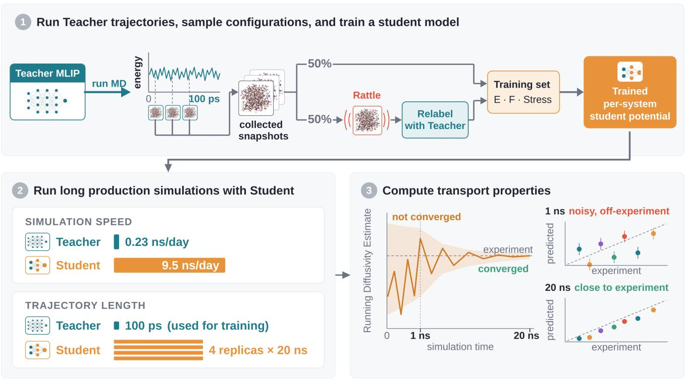  
FIG. 1: Teacher–student distillation workflow for converged electrolyte transport properties. The workflow distills an accurate but slow teacher potential into a fast, system-specific student that can be run long enough to converge transport coeficients. (1) Data generation and distillation. The teacher potential first runs a short reference trajectory, from which training configurations are sampled. To broaden coverage beyond near-equilibrium structures, half of the sampled configurations are rattled with Gaussian noise and relabeled with the teacher to provide consistent energy, force, and stress targets. The student potential is then trained on this mixed dataset of both perturbed and unperturbed samples. (2) Production simulations. Once trained, the student replaces the teacher for production molecular dynamics, running 40 faster and reaching trajectory lengths of 20 ns. (3) Convergence and validation. The 20 ns trajectories allow transport observables to converge. Transport coeficients start out noisy at short timescales (1 ns), but converge near experimental values once the trajectory is suficiently long.

Knowledge distillation of MLIPs ofers a way to use OMol25-pretrained MLIPs to predict electrolyte transport across chemistries, by accessing the speedups granted by smaller models without sacrificing accuracy. A large pretrained MLIP (the “teacher”) labels configurations of a specific system or region of chemical space through a systematic procedure. Those configurations are used to train a smaller, faster model with fewer parameters (the “student”) [32–36]. The student can then simulate in the teacher’s place, ideally with the same accuracy as the teacher but orders of magnitude faster, without any new expensive ab initio labels.

The ability of distilled models to accurately predict long-timescale transport behavior, however, has not been systematically tested. Prior distillation work has primarily focused on static observables, such as energies, forces, and radial distribution functions, mostly computed from trajectories of a nanosecond or less [37–39]. To date, transport properties reported for distilled potentials have largely been limited to a single transport coeficient for a handful of systems per study [34, 35, 40–45]. Excellent performance on static observables over short trajectories does not necessarily imply correct dynamical properties, or student fidelity across long timescales [46–49]. Accurate transport properties therefore require a distilled model to both remain stable and track ion–ion correlations across long, thoroughly sampled simulations.

In this study, we provide a procedure to distill largescale MLIPs into students capable of running multinanosecond simulations, which are necessary to converge transport coeficients. Our simulations both preserve teacher-model accuracy and track experimentally measured transport properties. To our knowledge, this is the first application of knowledge distillation to transport coeficients in liquid electrolytes, validated against experiment across more than a dozen systems. Our distilled models run 40 faster than their teacher, and enable simulations two hundred times the length of the trajectories used to generate their training data. This allows us to access dynamical regimes otherwise inaccessible to the original teacher model. To verify that our students are faithful to the teacher, we periodically spot-check the student’s energy, force, and stress errors against the teacher with single-point calculations throughout the simulation, at intervals that make it relatively cheap to do so. We apply our approach to sixteen next-generation candidates for battery electrolytes, focusing on sodium-ion systems [50, 51], with various solutes, solvents, and concentrations (detailed in the Results).

For each salt–solvent pair, we distill the small variant of UMA evaluated with its OMol task head (checkpoint uma-s-1p1; hereafter referred to as UMA-OMol) into a system-specific student MLIP built on PaiNN, an equivariant graph neural network [52]. The student is trained on a set of configurations sampled from a 100 ps teacher trajectory, with some of the structures noised and relabeled to ensure student robustness. We then run four independent 20 ns replica simulations per system, and periodically check the student model’s errors against singlepoint predictions from UMA-OMol along each trajectory to confirm that they remain low and stable. The student trajectories are then used to compute the self-difusivities, ionic conductivities, and shear viscosities for every electrolyte system, which are compared against experiment. An overview of the workflow is shown in Fig. 1.

Across all sixteen systems, the distilled potentials capture experimental trends and agree more closely with experiment than the widely used OPLS-AA force field [53], reducing the median deviation from experiment for every transport property studied. By transferring the accuracy of pretrained MLIPs into compact models, distillation enables high-throughput electrolyte transport simulations that achieve a balance of accuracy and eficiency unavailable from classical force fields, direct ab initio MD, or large-scale models alone. More broadly, the approach can be used to evaluate the behavior of the large-scale pretrained MLIP on timescales it cannot directly access.

## Results

The distilled PaiNN potentials enable simulations long enough to converge transport coeficients, tracking experiment across sixteen electrolyte systems. We first evaluate the student’s faithfulness at the 1 ns timescale accessible to the teacher, by comparing both models’ radial distribution functions and mass densities. We additionally check the student’s per-frame force and stress errors periodically across 20 ns of student simulation. The students’ 40 speed advantage enables 20 ns simulations, from which we compute ionic conductivities, shear viscosities, and self-difusivities. Student-predicted transport properties, benchmarked against experiment, outperform the OPLS-AA classical force field [53]. The sixteen systems are sodium electrolytes combining $\mathrm { N a P F _ { 6 } }$ or NaOTf with monoglyme (DME), diglyme (DEGDME), tetraglyme (TEGDME), or propylene carbonate (PC) at 0.1 and 1 M $\mathrm { ( N a P F _ { 6 } } ,$ /TEGDME at 1 M only), plus a lithium baseline, $\mathrm { L i P F _ { 6 } }$ in DME at 0.5 M. Full compositions are listed in Table S1; details of the box setup, MD ensemble settings, and student training are given in the Methods and Secs. S1–S2 of the Supplementary Information (SI).

## Reproducing the behavior of the teacher model

At the 1 ns timescales accessible to the teacher, the student reproduces both its radial distribution functions (RDFs) and its mass density. The RDF curves of the student and teacher overlap across all pair types, and the agreement holds across all 1 M systems (full set in Sec. S6), indicating that the student accurately captures the teacher’s first-shell coordination as well as its longerrange features (Fig. 2a). The distilled model also matches UMA-OMol’s mass densities, agreeing with UMA-OMol to within 1.1% on average across all sixteen electrolytes (Fig. 2b). Both models overestimate the experimental densities by 6–15% (about 10% on average); however, this is a known tendency of UMA-OMol [31], and distillation adds little error to the existing bias.

The student additionally maintains low force and stress errors relative to the teacher throughout long simulations, as a result of augmenting the training data with rattled structures. For a representative system (1 M NaOTf in TEGDME), we perform single-point UMA-OMol force and stress evaluations at 20 ps intervals along a student 20 ns NPT trajectory. This serves as a low-cost spot check on the student’s accuracy that avoids running the teacher itself for the full 20 ns. The force mean absolute error (MAE) against UMA-OMol is around $7 \mathrm { m e V } / \mathrm { \AA }$ and the stress MAE near 30 bar. Both errors are low with no upward drift (Fig. 2c). The force errors stay similarly low along the NVT production trajectories used for the transport coeficients, for every system (Figs. S3 and S4). The student trajectory’s stability is a direct result of adding rattled structures to the training set. We isolate the effect of including noised data during training in Sec. S3. Trained without noised data, the student quickly wanders out of the narrow configurational region its training covers. The student’s force error grows as the simulation progresses, until the system destabilizes within a nanosecond. Exposing the student to of-equilibrium configurations teaches it a restoring force that corrects small

Liquid structure, density and stability: distilled student vs teacher vs experiment

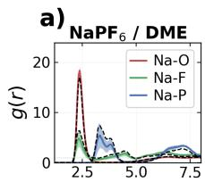

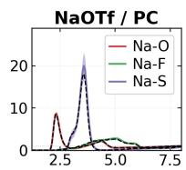

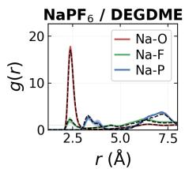

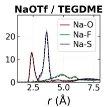  
Na ⁺ RDFs, 1 ns: student (5-replica mean) vs teacher

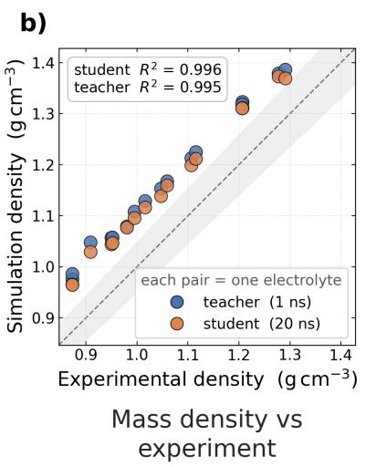

c)  
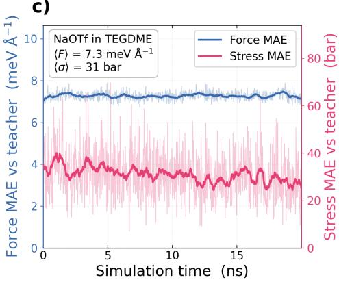  
Student forces and stresses evaluated against teacher periodically  
FIG. 2: Distilled PaiNN potentials reproduce the static observables of the UMA-OMol teacher at short timescales. (a) Radial distribution functions of four electrolyte systems across multiple correlation pairs, obtained from 1 ns trajectories at 293 K, with both the teacher model (UMA-OMol) and the student (PaiNN) displayed. Each PaiNN line is the mean over five independent 1 ns replicas, where the shading indicates the 1 s.d. replica spread. The teacher curve falls within the shaded band for almost every pair and system, indicating that the teacher lies within the student’s per-replica noise and that the student accurately reproduces teacher behavior. (b) Parity plot of simulated versus experimentally measured mass density, where each dot denotes a diferent electrolyte system. Both UMA-OMol and PaiNN show a systematic upward bias against experiment, but UMA-OMol and PaiNN coincide for almost every system, so distillation adds little error of its own. The individual densities for each electrolyte are listed in Sec. S7. (c) For a 20 ns NPT 1 M NaOTf in TEGDME simulation, we evaluate force mean absolute error (MAE) and stress MAE relative to UMA-OMol at 20 ps intervals by using UMA-OMol to compute single-point estimates. Light traces are per-frame errors, while bold curves show the 500 ps running average. Both errors stay low, with no upward drift over 20 ns: a linear fit changes the force MAE by <0.2%, and the stress MAE decreases slightly over time. Similar plots for the production runs are shown in Sec. S5.

deviations and prevents instability from compounding.

## Computing transport properties with the student model

The distilled models’ 40 speedup over the teacher enables converged transport properties that track experimental trends and consistently outperform OPLS-AA, the classical force-field baseline. Using the distilled potentials, we run 20 ns production simulations and extract ionic conductivities, shear viscosities, and self-difusivities, which are then compared to experiment (Figs. 3 and 4). Every reported coeficient is the mean over four 20 ns NVT replicas launched from a common configuration with independently seeded velocities. Along each trajectory, we confirm that the energy, temperature, and pressure are stable, and that the force error against the teacher remains low for the full 20 ns (Sec. S5). For each property, we evaluate model performance against experiment using three metrics. A log–log Pearson correlation coeficient (r) near unity indicates that predictions tightly track experiment; a low median absolute percentage deviation (MdAPD) indicates small typical errors; and a log–log linear regression slope near one indicates that the model reproduces the experimental spread across systems.

Computed student conductivities track experiment across over an order of magnitude, and possess a lower MdAPD than OPLS-AA. Results are reported for the nine concentrated ( 0.5 M) systems; at 0.1 M the box contains too few charge carriers for the collective estimator to converge. Seven of the nine systems sit within a factor of two, and the model reaches an MdAPD of 36% (Fig. 3a). OPLS-AA is notably less accurate, as it underpredicts seven of the nine conductivities, places only three within the factor-of-two band, and has an MdAPD of 67%. Its log–log correlation (r = 0.72) is comparable to the students’ (0.66) (Fig. 3b). The student does have a large error for 1 M NaOTf in DME, overpredicting the conductivity by a factor of five, unlike OPLS-AA. This system has the lowest ionicity of the concentrated systems, and in Sec. S12 we use ion-pair scans to show that this error likely arises from the teacher’s finite 6 Å graph cutof, which causes ions to pair less than they should.

Student viscosities likewise track the experimental ranking closely; their consistent upward bias is attributable to the teacher’s systematic density overshoot. Because the students inherit the teacher’s overestimate of the liquid densities (6–13% for the students; Fig. 2b), the simulated liquids are all over-compressed compared to experiment. Most of the reduction in space comes out of the free volume in the box (the volume not occupied by the molecules) [55, 56]. In Sec. S11.2, using high-pressure viscometry data of comparable liquids from the literature, we estimate that a density overshoot of this size should inflate our predicted viscosity by roughly three- to fourfold. Consistent with this, every student viscosity lies above experiment, by 2.1 on geometric average (Fig. 3c). Student predictions are tightly correlated with experiment (r = 0.96) and mostly follow a linear trend, with a log–log slope of 1.18. OPLS-AA likewise overpredicts the viscosity, but much more strongly, with an MdAPD of 204% against the students’ 93% (Fig. 3d). OPLS-AA’s overprediction is also much less uniform, growing as the viscosity itself grows (log–log fit slope 1.40), from under 2 for the least viscous systems to about 8 the experimental value for the two 1 M TEGDME systems.

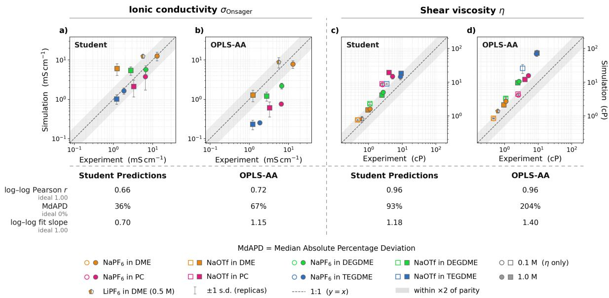  
FIG. 3: Ionic conductivity and shear viscosity vs. experiment at 298 K, for the distilled student models and the OPLS-AA force field. Each point is the mean over four independent 20 ns replicas, and error bars show 1 s.d. across the replicas. (a,b) Ionic conductivity σ for the PaiNN student and OPLS-AA. Conductivity is only computed for the concentrated ( 0.5 M) systems, since at 0.1 M the box holds too few charge carriers to converge the collective estimator. The student roughly halves the median absolute percentage deviation of OPLS-AA (MdAPD; 36% vs. 67%), with a comparable log–log correlation. (c,d) Viscosity η against experiment for the two force fields. Again the student tracks experiment much more closely than OPLS-AA, with an MdAPD less than half that of OPLS-AA and a log–log fit slope closer to one.

Self-difusivities follow the same pattern, with the distilled models reproducing experimental trends more faithfully than the classical baseline (Fig. 4). The student models achieve $r = 0 . 9 2 – 0 . 9 8$ and MdAPDs of 55%, 41%, and 56% for D+, D−, and D0. The students underpredict the difusivities by roughly 2 , which mirrors the overshoot we saw for viscosity: by the approximate Stokes– Einstein relation $D \propto k _ { \mathrm { B } } T / \eta ,$ a 2 increase in viscosities should result in a decrease in difusivities by roughly the same factor, which is what we observe. Both the viscosity overprediction and difusivity underprediction are likely caused by the density bias inherited from the teacher, not by shortcomings introduced by distillation. OPLS-AA performs notably worse, underpredicting the difusivities by roughly a factor of three with MdAPDs of 63–71% (Fig. 4d–f). Both models achieve comparable log–log correlations, but the distilled models follow a much more linear relationship against experiment, with log–log slopes of 1.09–1.21 compared with 1.30–1.57 for OPLS-AA.

Beyond the absolute values, the students recover expected chemical trends. Self-difusivities decrease with both salt concentration and glyme chain length (DME > DEGDME > TEGDME). The solvent moves fastest in each electrolyte, and the predicted ordering of the cation and anion difusivities agrees with experiment, except in cases where the two are nearly equal.

The transport properties reported here required thoroughly sampled MD simulations; trajectories limited to 1– 5 ns were insuficient to converge the coeficients (Sec. S13). Critically, using the teacher to simulate these trajectories would be impractical; at UMA-OMol throughput ( 0.23 ns/day per system, Sec. S4), each 20 ns replica would take roughly three months to finish. In contrast, the PaiNN student models complete 20 ns in about two days.

## Discussion

The student’s combination of speed and accuracy makes large-scale pretrained MLIPs practical for transport screening. A new electrolyte requires only a short teacher trajectory, roughly ten GPU-hours of student training, and about two days of production MD to obtain transport coeficients. Although each student is specific to a single salt–solvent pair, the cost of training is small compared to the time saved by using the student for inference. Because OMol25 covers a broad range of molecular chemistry, the teacher can be applied to new electrolytes beyond the systems studied here, without additional ab initio data.

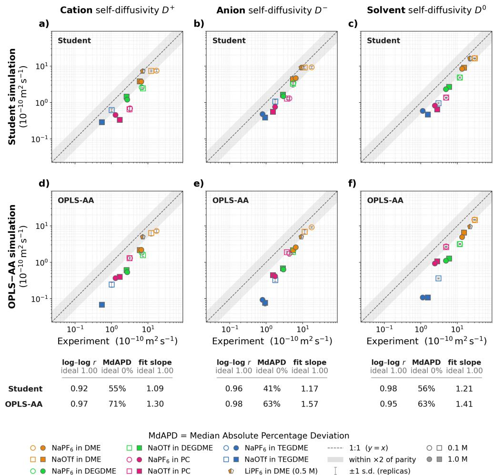  
FIG. 4: Self-difusivities vs. experiment at 298 K, for the distilled students and the OPLS-AA force field. Self-difusivities of the cation $D ^ { + } \left( \mathbf { a } , \mathbf { d } \right)$ , anion $D ^ { - } { \bf \Pi } ( { \bf b , e } )$ , and solvent $D ^ { 0 } \left( \mathbf { c } , \mathbf { f } \right)$ , for the PaiNN student (top row) and OPLS-AA (bottom row), where each point is the mean over four independent 20 ns replicas (error bars, 1 s.d. across the replicas), with the Yeh–Hummer finite-size correction applied [54]. The student outperforms OPLS-AA for every species, both in MdAPD and in log–log fit slope.

The student’s fidelity to the teacher bounds the accuracy of its predictions, but it also provides a new way to evaluate the long-timescale behavior of large-scale pretrained MLIPs. UMA-OMol overestimates the densities of our electrolytes by about 10% on average, and distillation reveals that this translates into a systematic 2 viscosity overshoot and a corresponding 2 difusivity undershoot. Without access to the long trajectories produced by the student, we would not know whether this error was due to statistical fluctuations or an actual shortcoming of the teacher model. The student’s inheritance of teacher shortcomings diminishes accuracy against experiment; however, this is a transient limitation. Large-scale pretrained models are quickly improving, with training datasets growing in diversity and new architectures incorporating explicit long-range electrostatics [26] that directly remove the cutof artifact identified in Sec. S12. Our pipeline consumes only the energies, forces, and stresses the teacher assigns, and is agnostic to the choice of architecture or the data the teacher was trained on. Every improvement to the large-scale model therefore propagates to the distilled transport predictions, without any change to the method.

Large-scale pretrained models have been shown to reproduce the structure of liquid electrolytes; we show distillation extends them to electrolyte dynamics at scale. Converged transport coeficients at the accuracy of largescale models have so far required a months-long computation per system. Knowledge distillation reduces this cost enough that such calculations could be incorporated into the screening loops needed for next-generation electrolyte design.

## Methods

## Electrolyte systems and simulation cells

We study sixteen systems in this work: $\mathrm { N a P F _ { 6 } }$ and NaOTf in monoglyme (DME), diglyme (DEGDME), tetraglyme (TEGDME), and propylene carbonate (PC) at 0.1 and 1 M $( \mathrm { N a P F _ { 6 } }$ in TEGDME at 1 M only), plus $\mathrm { L i P F _ { 6 } }$ in DME at 0.5 M; per-system compositions and box sizes are listed in Table S1. The final boxes for production molecular dynamics (MD) runs contain 2700–3700 atoms. For MD simulations, we prepare initial configurations using an earlier structural study’s protocol [31]. Specifically, we use PACKMOL to place molecules into cubic cells that are 30 Å on each side [57], perform geometric relaxation, then equilibrate each box in the isothermal–isobaric (NPT) ensemble with the OPLS-AA force field [53] for 1 ns to relax the initial packing. Because the boxes are packed at a non-equilibrium volume, the molarity drifts significantly from its target when the barostat relaxes. To mitigate this, we use each system’s simulated equilibrium density to recompute the correct solute-to-solvent ratio, and repack the box. The corrected boxes equilibrate to within 1.4% of the target molarity on average. We provide the derivation of our correction, as well as per-system shifts, in Sec. S1.

## Teacher reference data

Reference data for training the distilled models is generated with UMA-OMol (checkpoint uma-s-1p1) using its OMol task head [29, 30]. For each system and concentration we run a 1 ns trajectory in the NPT ensemble at 293 K and 1 bar using the Atomic Simulation Environment (ASE) [58], with a Nosé–Hoover thermostat (coupling time 100 fs) [59, 60], a Parrinello–Rahman-type barostat [61], and a 1 fs timestep. We then sample the first 100 ps of each trajectory to make the training configurations; the last 70% of the trajectory is used as the reference for the radial distribution function comparison between student and teacher.

Unperturbed snapshots are sampled every 50 fs from the teacher trajectory. A second set of snapshots, sampled every 50 fs but ofset by 20 fs from the first grid, is collected and then perturbed by adding Gaussian noise with a standard deviation of 0.1 Å to every atom. The simulation cell is not perturbed. Previous work has found that augmenting training with Gaussian-noised structures improves the robustness of MLIPs [62]. The noised points allow the model to see a wider region of configuration space, and help stabilize the distilled potential during simulations. We isolate the efect of the noised data in Sec. S3. Every configuration is labeled with UMA-OMol energies, forces, and the full stress tensor. We use a 90:10 train–validation split, giving 3600 training and 400 validation configurations per concentration. When two concentrations exist for a salt–solvent pair, we combine them into one dataset so that a single potential is trained across both loadings.

## Student potential and training

We use the PaiNN equivariant message passing graph neural network [52] for our student model, as implemented in the FeNNol repository in JAX [63]. The model has three message passing layers, an embedding dimension of 128, and a radial neighbor cutof of 5.1 Å. We also add a trainable Ziegler–Biersack–Littmark (ZBL) term [64] with an inner cutof of 1.1 Å for explicit short-range nuclear repulsion. To train the model, we minimize the loss

$$
\mathcal { L } = \frac { \lvert E - \hat { E } \rvert } { N } + \frac { 1 } { N } \sum _ { i = 1 } ^ { N } \lVert \mathbf { F } _ { i } - \hat { \mathbf { F } } _ { i } \rVert + \frac { 1 } { 9 } \sum _ { \alpha \beta } \lvert \sigma _ { \alpha \beta } - \hat { \sigma } _ { \alpha \beta } \rvert ,\tag{1}
$$

where N is the number of atoms and hats denote UMA-OMol labels. We use AdamW [65] as the optimizer and train for 275 epochs with a one-cycle cosine learningrate schedule (peak learning rate $8 \times 1 0 ^ { - 4 } )$ . Training a single model takes 9–22 hours on one NVIDIA GH200 GPU, depending on the number of pooled concentrations (Table S3). The full architecture and optimization settings are given in Table S2.

## Structural validation against the teacher

Each distilled potential is validated against the teacher using radial distribution functions and mass densities, which are short timescale observables. Between species A and $B ,$ the radial distribution function is defined as

$$
g _ { A B } ( r ) = \frac { 1 } { N _ { A } \rho _ { B } } \left. \sum _ { i \in A } \sum _ { j \in B } \frac { \delta ( r - r _ { i j } ) } { 4 \pi r ^ { 2 } } \right. ,\tag{2}
$$

where $r _ { i j }$ is the minimum-image distance between atoms i and $j , N _ { A }$ is the number of A atoms, and $\rho _ { B } = N _ { B } / V$ is the bulk number density of B. For each system, we run five independent 1 ns student NPT simulations at 293 K and compare them with a matched 1 ns UMA-OMol run. Each RDF is computed identically, using 3000 configurations sampled from the last 70% of the trajectory, with a 0.05 Å bin width out to 12 Å (Sec. S6). The 0.1 M cells only contain two ion pairs, which is not enough to converge the RDFs in 1 ns of simulation. We calculate the students’ mass densities from a 20 ns NPT trajectory at 298 K, averaged after discarding the first 0.5 ns, and obtain the corresponding UMA-OMol densities from our own 1 ns NPT simulations at 298 K with the teacher checkpoint.

## Production simulations

We run production simulations with the student model using the JAX-based MD engine implemented in FeNNol [63, 66]. Each molarity-corrected box (Sec. S1) is first equilibrated for 1 ns in an NPT ensemble at 298 K and 1 bar, using a Langevin thermostat (friction $1 \ \mathrm { p s ^ { - 1 } } )$ and an isotropic Langevin-piston barostat (piston relaxation time 200 fs). We compute the mean density over the last 500 ps of this trajectory and select the frame from the last 300 ps whose instantaneous density lies closest to the mean. This frame is then used as the starting configuration of the production simulation (Sec. S1.3).

The four 20 ns NVT production replicas run at 298 K, each starting with diferent initial Maxwell–Boltzmann velocities and thermostat noise. We use the global Bussi (CSVR) velocity-rescaling thermostat [67] with a 10 ps relaxation time. Holding the volume fixed removes barostat fluctuations from the stress autocorrelations, and the slow global thermostat leaves sub-picosecond correlations unbiased [5, 68]. We use a 1 fs timestep and save frames every 1 ps and the stress tensor used to calculate the shear viscosity every 2 fs. All MD settings are reported in Table S5.

To verify that the distilled potentials remain consistent with UMA-OMol over these long trajectories, we perform single-point UMA-OMol evaluations on 500 frames per student trajectory, spaced 40 ps apart across the full 20 ns, and monitor the mean and maximum force errors throughout the simulation, together with other observables (potential energy per atom, temperature, and pressure). We observe low and flat force errors for every system, and the other diagnostic observables are very stable throughout each trajectory (Sec. S5).

## Computational throughput

We test the throughput of both student and teacher models on a single NVIDIA GH200. The student reaches a median of 9.5 ns/day across the benchmarked boxes versus 0.23 ns/day for UMA-OMol, a 41 speedup. Persystem throughputs are reported in Sec. S4.

## Classical force-field baseline

We use GROMACS 2025.3 [69] to run simulations with the OPLS-AA classical force field [53]. Solvent parameters (DME, DEGDME, TEGDME, PC) are OPLS-AA with $\mathrm { 1 . 1 4 ^ { * } C M 1 A }$ charges from LigParGen [70]. Both anions use the CL&P parameter set, which is built on the OPLS-$\mathrm { A A }$ functional form: $\mathrm { P F } _ { 6 } ^ { - }$ from Canongia Lopes et al. [71] with the bonded terms of Kaminski and Jorgensen [72], and OTf− from Canongia Lopes and Pádua [73] with the triflate oxygen charge of Gouveia et al. [74]. $\mathrm { \dot { N } a ^ { + } }$ and $\mathrm { L i ^ { + } }$ use the Åqvist parameters [75] as distributed with GROMACS. Lennard-Jones cross terms follow geometric combination rules and 1–4 interactions are scaled by 0.5, as in OPLS-AA. All ions carry their full formal charge. The parameter sources are summarized in Table S6, and the full per-species parameters are provided with the released code. We correct the molarity of the initial boxes with the same procedure as for the student model, but with OPLS-AA’s own equilibrium density. Steepestdescent energy minimization is used to relax the packed boxes, and the boxes are then equilibrated for 1 ns of NPT at 298 K and 1 bar (using a velocity-rescaling (CSVR) thermostat with a 0.1 ps relaxation time and an isotropic stochastic cell-rescaling (C-rescale) barostat [76] with a 2 ps relaxation time). Finally, we run four independent 20 ns NVT production replicas at the equilibrated volume; the full settings are tabulated in Table S6. During the production run, we use a 1 fs timestep with no bond constraints (fully flexible molecules), and each replica is initialized with Maxwell–Boltzmann velocities from an independent seed. Particle-mesh Ewald [77] is used for the electrostatics with a 12 Å real-space cutof, and the Lennard-Jones interactions are cut at 12 Å with an analytic long-range dispersion correction. We save frames every 1 ps and the pressure tensor every 2 fs.

## Experimental measurements

All electrolytes were prepared and handled inside an argon-filled glovebox $\mathrm { ( O _ { 2 } }$ below 0.2 ppm, $_ \mathrm { H _ { 2 } O }$ below 0.1 ppm). The experimental densities, self-difusivities, ionic conductivities, and shear viscosities were measured in-house; the values are tabulated in Sec. S9. The densities were also used in an earlier structural study [31]. Self-difusivities were measured by pulsed-field-gradient nuclear magnetic resonance (PFG-NMR) on 11.7 T Bruker Avance NEO spectrometers, following 1H for the solvent, $^ 7 \mathrm { L i o r } ^ { 2 3 } \mathrm { N a }$ for the cation, and $\mathrm { ^ { 1 9 } F }$ for the anion; the most viscous 23Na samples were measured on a 14.1 T Avance III HD system with a Dif50 probe. Ionic conductivities were measured in the glovebox with a Mettler Toledo SevenDirect SD30 meter and an InLab 710 four-electrode platinum probe, with three independent readings per electrolyte. Density and viscosity were obtained from a single sample filling at 298 K with an Anton Paar DMA 4500 M oscillating U-tube density meter coupled to a Lovis ME rolling-ball viscometer, both calibrated with certified reference water. Full protocols for all four measurements are given in Sec. S8.

## Transport-property analysis

All transport coeficients, simulated and experimental, are reported at 298 K. Simulated coeficients are computed independently for each production replica. To alleviate the noise introduced by early-stage equilibration, we discard the first 2 ns of each trajectory and use the remainder for the computation. Results are reported as the mean and standard deviation over the four replicas.

## Self-difusivity

We calculate self-difusivity by fitting the slope of the mean-squared displacement (MSD) over time lag τ based on the Einstein relation [9, 78, 79],

$$
D = \frac { 1 } { 6 } \operatorname* { l i m } _ { \tau  \infty } \frac { d } { d \tau } \big \langle | \mathbf { r } ( t _ { 0 } + \tau ) - \mathbf { r } ( t _ { 0 } ) | ^ { 2 } \big \rangle ,\tag{3}
$$

where $t _ { 0 }$ is the time origin, and $\langle \cdots \rangle$ denotes an ensemble average evaluated over all available time origins as well as over all particles of the species of interest (specifically, cation, anion, and solvent).

We first compute the unwrapped coordinates of each trajectory using the minimum-image convention, then subtract the center-of-mass drift of the entire system. We use the molecular centers of mass for the per-species displacements. MSDs across diferent time lags are calculated using a fast Fourier transform (FFT) and fitted following the best practices of Maginn et al. [5]. Instead of using a fixed lag window, for each species we evaluate the logarithmic slope $\nu ( \tau ) = \mathrm { d }$ ln MSD/d ln τ on logarithmically spaced lags between 5 ps and 36% of the maximum lag. We then fit the MSD over the longest contiguous run satisfying $| \nu - 1 | \leq 0 . 1 5$ , requiring at least twelve points. If no such window exists, we perform the fit over the twelve-point stretch with the smallest $| \nu - 1 |$ value.

After calculating the periodic-box difusivity $D _ { \mathrm { P B C } }$ from the fitted slope, we apply the Yeh–Hummer correction to remove finite box size efects [54], $D = D _ { \mathrm { P B C } } + \Delta D$ with

$$
\Delta D = \frac { k _ { \mathrm { B } } T \xi } { 6 \pi \eta L } ,\tag{4}
$$

where $\xi = 2 . 8 3 7 2 9 7$ for a cubic cell, L is the box edge length, and $k _ { \mathrm { B } } T$ is the thermal energy. For η we use the Green–Kubo viscosity of the same system, averaged over its replicas, so the correction is fully self-consistent and involves no experimental input. Both the uncorrected difusivities and the corrections are listed in Tables S8 and S9.

## Ionic conductivity

The ionic conductivity is calculated from the Onsager transport coeficients $L _ { i j }$ as [8, 80],

$$
\sigma = e ^ { 2 } \sum _ { i j } z _ { i } z _ { j } L _ { i j } ,\tag{5}
$$

where e is the elementary charge and $z _ { i }$ is the signed integer charge of species i. Each ion is treated as a point charge at its center of mass, with $z = + 1$ for the $\mathrm { N a ^ { + } }$ and Li+ cations, $z = - 1$ for the $\mathrm { P F } _ { 6 } ^ { - }$ and OTf− anions, and $z = 0$ for the solvent molecules. We first define the cumulative displacement of all species-i particles over a lag τ as

$$
\Delta \mathbf { R } _ { i } ( t _ { 0 } , \tau ) = \sum _ { k = 1 } ^ { N _ { i } } [ \mathbf { r } _ { i k } ( t _ { 0 } + \tau ) - \mathbf { r } _ { i k } ( t _ { 0 } ) ] ,\tag{6}
$$

where ${ \bf r } _ { i k }$ is the center-of-mass position of the k-th molecule of species $i ,$ measured relative to the system’s center of mass, and $N _ { i }$ is the total number of speciesi particles in the simulation box. We next define the cross-correlation of species i and j as

$$
C _ { i j } ( \tau ) = \left. \Delta \mathbf { R } _ { i } ( t _ { 0 } , \tau ) \cdot \Delta \mathbf { R } _ { j } ( t _ { 0 } , \tau ) \right. .\tag{7}
$$

The angle brackets $\langle \cdots \rangle$ denote an ensemble average, which is evaluated as an average over all available time origins $t _ { 0 }$ . The transport coeficient is then given by the long-time slope of the cross-correlation $C _ { i j } ( \tau )$ as

$$
L _ { i j } = \frac { \beta } { 6 V } \operatorname * { l i m } _ { \tau  \infty } \frac { \partial } { \partial \tau } C _ { i j } ( \tau ) ,\tag{8}
$$

where $\beta = 1 / ( k _ { \mathrm { B } } T )$ and V is the volume of the simulation box. The slope is extracted by a least-squares fit over lag times of 0.5–2 ns. We use a shorter window than for the self-difusivities, because the displacement for conductivity is collective and does not include particle averaging, making noise a significant issue at longer lags. Unlike the Nernst–Einstein estimate, this correlated estimator retains the ion–ion cross-correlations [8]; the derivation and the comparison between the two estimators are given in Sec. S12. Conductivities are reported for the nine concentrated ( 0.5 M) systems only: at 0.1 M the cell contains only two ion pairs, which is not enough to accurately measure distinct-pair (cross) correlations in $L _ { i j }$

## Shear viscosity

The shear viscosity η is computed from the equilibrium Green–Kubo stress-autocorrelation function [9, 79, 81– 83],

$$
\eta \ = \ \frac { V } { k _ { \mathrm { B } } T } \int _ { 0 } ^ { \infty } \langle \sigma _ { \alpha \beta } ( 0 ) \sigma _ { \alpha \beta } ( t ) \rangle \ \mathrm { d } t ,\tag{9}
$$

where $\sigma _ { \alpha \beta }$ is an of-diagonal component, such as $\sigma _ { x y } ,$ of the instantaneous stress tensor, logged along the trajectory. To reduce statistical noise, we average the autocorrelation in Eq. (9) over five shear components of the traceless symmetric stress tensor, each of which integrates to the same value η [5, 84]:

$$
\sigma _ { x y } , \quad \sigma _ { x z } , \quad \sigma _ { y z } , \quad \frac { 1 } { 2 } ( \sigma _ { x x } - \sigma _ { y y } ) , \quad \frac { 1 } { 2 } ( \sigma _ { y y } - \sigma _ { z z } ) .\tag{10}
$$

The autocorrelation is evaluated by FFT and integrated by the trapezoidal rule to give the running estimate η(t), accumulated over lags up to 1 ns. We use the timedecomposition method described by Zhang et al. [5, 6] to obtain the reported value. The integral is fit with a doubleexponential form over a window that ends at the lag $t _ { \mathrm { c u t } } ,$ defined as the first point at which the standard deviation across five equal time blocks of the trajectory exceeds 40% of the running value. Each fit point is weighted inversely by the standard deviation. We extrapolate our fit to infinite time to get $\eta _ { \infty }$ , and this value is reported. This procedure prevents the noisy tail of the integral from biasing the estimate. Convergence checks and example fits are given in Sec. S11.

## Use of large language models

Large language models (Claude, Anthropic) were used to assist with writing code. All code was thoroughly reviewed by the authors, who take full responsibility for the content.

## Data availability

The trained student models, the initial and molaritycorrected simulation boxes, and the per-replica transport analysis curves are available at https://github. com/ASK-Berkeley/distillation-electrolytes. The molecular dynamics trajectories and distillation datasets can be regenerated with the released code, models, and starting configurations.

## Code availability

All code used in this work is available at https://github.com/ASK-Berkeley/ distillation-electrolytes. The student models are trained and simulated with a fork of FeNNol [63], included in the repository as a submodule.

## Acknowledgements

We would like to thank Kranthi K. Mandadapu for the guidance, help, and discussion on the theory behind transport property calculation and error quantification in this paper. We would also like to thank Bryan D. McCloskey for allowing us to use his experimental equipment to make measurements for the work.

We would also like to thank Sakib Matin, Sanjeev Raja, and Eric Qu for insightful discussions that benefited the work.

This work used the DeltaAI GPU resource at the National Center for Supercomputing Applications through allocation BIO250235 from the Advanced Cyberinfrastructure Coordination Ecosystem: Services & Support (ACCESS) program [85], which is supported by U.S. National Science Foundation grants #2138259, #2138286, #2138307, #2137603, and #2138296. This research used the DeltaAI advanced computing and data resource, which is supported by the National Science Foundation (award OAC 2320345) and the State of Illinois. DeltaAI is a joint efort of the University of Illinois Urbana-Champaign and its National Center for Supercomputing Applications.

## Funding

This work was partially funded by the Ofice of Science, Ofice of Basic Energy Sciences in the Chemical Sciences, Geosciences, and Biosciences subprogram at Lawrence Berkeley National Laboratory under contract #DE-AC02-05CH11231. We also acknowledge funding from the Energy Storage Research Alliance (ESRA) (DE-AC02-06CH11357), an Energy Innovation Hub funded by the U.S. Department of Energy, Ofice of Science, Basic Energy Sciences.

## Author contributions

I.A. and Y.J. formulated the distillation procedure and ran all model training, simulations, and transport calculations. N.K. helped supply the initial boxes for the work, as well as code for static observables. C.Z. helped train and simulate initial versions of distilled models. J.L. prepared the electrolytes and provided the salts and solvents. C.S.M. and J.D.B. conducted the density, viscosity, and self-difusivity measurements. A.M.M. and J.R.T. performed ionic conductivity measurements. E.J.C., J.D.B., and N.P.D. supervised the experimental work. N.K., I.A., Y.J., S.B., and A.S.K. conceptualized and designed the study. A.S.K. and S.B. supervised the work. I.A., Y.J., N.K., S.B., and A.S.K. all helped write up the final manuscript.

## Competing interests

The authors declare no competing interests.

[1] K. Xu, Nonaqueous liquid electrolytes for lithium-based rechargeable batteries, Chemical Reviews 104, 4303 (2004).

[2] S. Zhu, B. Ramsundar, E. Annevelink, H. Lin, A. Dave, P.- W. Guan, K. Gering, and V. Viswanathan, Diferentiable modeling and optimization of non-aqueous li-based battery electrolyte solutions using geometric deep learning, Nature Communications 15, 8649 (2024).

[3] J. Lai, Y. Guo, H.-E. Lai, F. A. Ospina-Acevedo, W. Tian, D. Kuai, D. Chen, P. B. Balbuena, and F. Shi, Linking solvation equilibrium thermodynamics to electrolyte transport kinetics for lithium batteries, Journal of the American Chemical Society 147, 14348 (2025).

[4] J. Hu, Y. Ji, G. Zheng, W. Huang, Y. Lin, L. Yang, and F. Pan, Influence of electrolyte structural evolution on battery applications: cationic aggregation from dilute to high concentration, Aggregate 3, e153 (2022).

[5] E. J. Maginn, R. A. Messerly, D. J. Carlson, D. R. Roe, and J. R. Elliott, Best practices for computing transport properties 1. self-difusivity and viscosity from equilibrium molecular dynamics [article v1.0], Living Journal of Computational Molecular Science 1, 6324 (2019).

[6] Y. Zhang, A. Otani, and E. J. Maginn, Reliable viscosity calculation from equilibrium molecular dynamics simulations: A time decomposition method, Journal of Chemical Theory and Computation 11, 3537 (2015).

[7] A. J. Ringsby, K. D. Fong, J. Self, H. K. Bergstrom, B. D. McCloskey, and K. A. Persson, Transport phenomena in low temperature lithium-ion battery electrolytes, Journal of The Electrochemical Society 168, 080501 (2021).

[8] K. D. Fong, H. K. Bergstrom, B. D. McCloskey, and K. K. Mandadapu, Transport phenomena in electrolyte solutions: Non-equilibrium thermodynamics and statistical mechanics, AIChE Journal 66, e17091 (2020).

[9] R. E. Jones and K. K. Mandadapu, Adaptive Green– Kubo estimates of transport coeficients from molecular dynamics based on robust error analysis, The Journal of Chemical Physics 136, 154102 (2012).

[10] O. Borodin, Polarizable force field development and molecular dynamics simulations of ionic liquids, The Journal of Physical Chemistry B 113, 11463 (2009).

[11] J. Behler and M. Parrinello, Generalized neural-network representation of high-dimensional potential-energy surfaces, Physical Review Letters 98, 146401 (2007).

[12] C. Schran, F. L. Thiemann, P. Rowe, E. A. Müller, O. Marsalek, and A. Michaelides, Machine learning potentials for complex aqueous systems made simple, Proceedings of the National Academy of Sciences 118, e2110077118 (2021).

[13] I. Batatia, D. P. Kovács, G. N. C. Simm, C. Ortner, and G. Csányi, MACE: Higher order equivariant message passing neural networks for fast and accurate force fields, in Advances in Neural Information Processing Systems, Vol. 35 (2022) pp. 11423–11436.

[14] S. Batzner, A. Musaelian, L. Sun, M. Geiger, J. P. Mailoa, M. Kornbluth, N. Molinari, T. E. Smidt, and B. Kozinsky, E(3)-equivariant graph neural networks for data-eficient and accurate interatomic potentials, Nature Communications 13, 2453 (2022).

[15] E. Qu, B. M. Wood, A. S. Krishnapriyan, and Z. W. Ulissi, A recipe for scalable attention-based ML poten-

tials: unlocking long-range accuracy with all-to-all node attention, in Forty-third International Conference on Machine Learning (2026).

[16] R. Jacobs, D. Morgan, S. Attarian, J. Meng, C. Shen, Z. Wu, C. Y. Xie, J. H. Yang, N. Artrith, B. Blaiszik, G. Ceder, K. Choudhary, G. Csanyi, E. D. Cubuk, B. Deng, R. Drautz, X. Fu, J. Godwin, V. Honavar, O. Isayev, A. Johansson, S. Martiniani, S. P. Ong, I. Poltavsky, K. J. Schmidt, S. Takamoto, A. P. Thompson, J. Westermayr, B. M. Wood, and B. Kozinsky, A practical guide to machine learning interatomic potentials: Status and future, Current Opinion in Solid State and Materials Science 35, 101214 (2025).

[17] E. Qu and A. Krishnapriyan, The importance of being scalable: Improving the speed and accuracy of neural network interatomic potentials across chemical domains, Advances in Neural Information Processing Systems 37, 139030 (2024).

[18] J. Behler, M. Ceriotti, C. Clementi, G. Csányi, A.-M. Elena, A. Krishnapriyan, J. W. Abbott, F. Afinito, A. P. Bartók, I. Batatia, et al., A strategic roadmap for an atomistic machine-learning ecosystem, arXiv preprint arXiv:2609.39090 (2026).

[19] S. Gong, Y. Zhang, Z. Mu, Z. Pu, H. Wang, X. Han, Z. Yu, M. Chen, T. Zheng, Z. Wang, L. Chen, Z. Yang, X. Wu, S. Shi, W. Gao, W. Yan, and L. Xiang, A predictive machine learning force-field framework for liquid electrolyte development, Nature Machine Intelligence 7, 543 (2025).

[20] J. Chen, Q. Gao, Y. Lin, M. Huang, Z. Cheng, W. Feng, J. Huang, B. Wang, and K. Yu, A hybrid physics-driven neural network force field for liquid electrolytes, Journal of Chemical Theory and Computation 22, 3011 (2026), phyNEO-Electrolyte.

[21] S. Ju, J. You, G. Kim, Y. Park, H. An, and S. Han, Application of pretrained universal machine-learning interatomic potential for physicochemical simulation of liquid electrolytes in li-ion batteries, Digital Discovery 4, 1544 (2025).

[22] T. Zheng, X. Xu, Z. Wang, Z. Yang, Y. Wang, X. Han, L. Chen, Z. Mu, Z. Zhang, S. Liu, S. Gong, K. Yu, and W. Yan, Bridging quantum mechanics to liquid properties via a universal organic force field, Nature Communications 17, 8276 (2026).

[23] F. Wang, Y.-H. Tang, Z.-B. Ma, Y.-C. Jin, and J. Cheng, Domain oriented universal machine learning potential enables fast exploration of chemical space of battery electrolytes, Nature Communications 17, 1226 (2026).

[24] I. Batatia, P. Benner, Y. Chiang, A. M. Elena, D. P. Kovács, J. Riebesell, X. R. Advincula, M. Asta, M. Avaylon, W. J. Baldwin, et al., A foundation model for atomistic materials chemistry, The Journal of Chemical Physics 163, 184110 (2025).

[25] M. Neumann, J. Gin, B. Rhodes, S. Bennett, Z. Li, H. Choubisa, A. Hussey, and J. Godwin, Orb: A fast, scalable neural network potential (2024), arXiv:2410.22570 [cond-mat.mtrl-sci].

[26] I. Batatia, W. J. Baldwin, D. Kuryla, J. Hart, E. Kasoar, A. M. Elena, H. Moore, M. J. Gawkowski, B. X. Shi, V. Kapil, P. Kourtis, I.-B. Magdău, and G. Csányi, MACE-POLAR-1: A polarisable electrostatic foundation

model for molecular chemistry (2026), arXiv:2602.19411 [physics.chem-ph].

[27] D. S. Levine, N. Liesen, L. Chua, J. Difenderfer, H. Ingolfsson, M. P. Kroonblawd, N. Kumar, A. Maiti, S. S. Mohottalalage, M. Shuaibi, B. Van Essen, B. M. Wood, C. L. Zitnick, S. M. Blau, and E. R. Antoniuk, The open polymers 2026 (OPoly26) dataset and evaluations (2025), arXiv:2512.23117 [physics.chem-ph].

[28] E. C.-Y. Yuan, Y. Liu, J. Chen, P. Zhong, S. Raja, T. Kreiman, S. Vargas, W. Xu, M. Head-Gordon, C. Yang, S. M. Blau, B. Cheng, A. Krishnapriyan, and T. Head-Gordon, Foundation models for atomistic simulation of chemistry and materials, Nature Reviews Chemistry 10, 212 (2026).

[29] D. S. Levine, M. Shuaibi, E. W. C. Spotte-Smith, M. G. Taylor, M. R. Hasyim, K. Michel, I. Batatia, G. Csányi, M. Dzamba, P. Eastman, N. C. Frey, X. Fu, V. Gharakhanyan, A. S. Krishnapriyan, N. Kumar, J. A. Rackers, S. Raja, A. Rizvi, A. S. Rosen, Z. Ulissi, S. Vargas, C. L. Zitnick, S. M. Blau, and B. M. Wood, The open molecules 2025 (OMol25) dataset, evaluations, and models (2025), arXiv:2505.08762 [physics.chem-ph].

[30] B. M. Wood, M. Dzamba, X. Fu, M. Gao, M. Shuaibi, L. Barroso-Luque, K. Abdelmaqsoud, V. Gharakhanyan, J. R. Kitchin, D. S. Levine, K. Michel, A. Sriram, T. Cohen, A. Das, A. Rizvi, S. J. Sahoo, Z. W. Ulissi, and C. L. Zitnick, UMA: A family of universal models for atoms, in Advances in Neural Information Processing Systems, Vol. 38 (2025) pp. 143528–143564.

[31] N. Kumar, J. Lai, C. S. Mezerkor, J. Wang, K. M. Wiaderek, J. D. Bazak, S. M. Blau, and E. J. Crumlin, Prediction and experimental verification of electrolyte solvation structure from an OMol25-trained interatomic potential, The Journal of Physical Chemistry Letters 17, 9073 (2026).

[32] G. Hinton, O. Vinyals, and J. Dean, Distilling the knowledge in a neural network, in NIPS Deep Learning and Representation Learning Workshop (2015) arXiv:1503.02531 [stat.ML].

[33] I. Amin, S. Raja, and A. S. Krishnapriyan, Towards fast, specialized machine learning force fields: Distilling foundation models via energy hessians, in The Thirteenth International Conference on Learning Representations (2025).

[34] W. Li, N. Charoenphakdee, Y.-B. Zhuang, R. Okuno, Y. Tsuboi, S. Takamoto, J. Ishida, and J. Li, Lightpfp: A lightweight route to ab initio accuracy at scale, arXiv preprint arXiv:2510.23064 (2025), arXiv:2510.23064 [cond-mat.mtrl-sci].

[35] S. Oh, J. You, J. Kim, J. Lee, H. An, S. Han, and Y. Kang, A lightweight universal machine-learning interatomic potential via knowledge distillation for scalable atomistic simulations, Journal of Chemical Information and Modeling 66, 8875 (2026).

[36] X. Wang and B. Cheng, Distilling latent electrostatics from foundation machine learning interatomic potentials (2026), arXiv:2606.15001 [physics.comp-ph].

[37] M. Kim, S. Kim, J.-Y. Jung, M. Y. Ha, and W. B. Lee, Density diversity in training data governs thermodynamic transferability of machine learning interatomic potentials, arXiv preprint arXiv:2605.05733 (2026).

[38] J. L. A. Gardner, D. F. T. du Toit, C. B. Mahmoud, Z. F. Beaulieu, V. Juraskova, L.-B. Paşca, L. A. M. Rosset, F. Duarte, F. Martelli, C. J. Pickard, and V. L. Deringer,

Distillation of atomistic foundation models across architectures and chemical domains (2025), arXiv:2506.10956 [physics.comp-ph].

[39] S. Matin, A. E. A. Allen, E. Shinkle, A. Pachalieva, G. T. Craven, B. Nebgen, J. S. Smith, R. Messerly, Y. W. Li, S. Tretiak, K. Barros, and N. Lubbers, Teacher-student training improves accuracy and eficiency of machine learning interatomic potentials (2025), arXiv:2502.05379 [physics.chem-ph].

[40] D. Zhang, X. Liu, X. Zhang, C. Zhang, C. Cai, H. Bi, Y. Du, X. Qin, A. Peng, J. Huang, B. Li, Y. Shan, J. Zeng, Y. Zhang, S. Liu, Y. Li, J. Chang, X. Wang, S. Zhou, J. Liu, X. Luo, Z. Wang, W. Jiang, J. Wu, Y. Yang, J. Yang, M. Yang, F.-Q. Gong, L. Zhang, M. Shi, F.-Z. Dai, D. M. York, S. Liu, T. Zhu, Z. Zhong, J. Lv, J. Cheng, W. Jia, M. Chen, G. Ke, W. E, L. Zhang, and H. Wang, DPA-2: a large atomic model as a multi-task learner, npj Computational Materials 10, 293 (2024).

[41] R. Wang, Y. Gao, H. Wu, and Z. Zhong, Pre-training, fine-tuning, and distillation (PFD): Automatically generating machine learning force fields from universal models, Physical Review Materials 9, 113802 (2025).

[42] W. Zhang, X. Wu, C. Wang, S. Hu, Y. Liu, and L.- W. Wang, Constructing machine learning interatomic potentials with minimum amount of ab initio data, npj Computational Materials 12, 174 (2026).

[43] N. Matsumura, Y. Yoshimoto, Y. Iwasaki, M. Yamazaki, and Y. Sakai, Knowledge distillation framework for accelerating high-accuracy neural network-based molecular dynamics simulations, in Machine Learning and Principles and Practice of Knowledge Discovery in Databases (ECML PKDD 2025), Communications in Computer and Information Science (Springer, 2026) pp. 41–56.

[44] S. Chen, N. O’Neill, B. X. Shi, and V. Kapil, Distilling first-principles accuracy into compact machine learning potentials for condensed-phase chemistry (2026), arXiv:2606.06848 [physics.chem-ph].

[45] X. Lian and A. Pasquarello, Data-eficient and fast machine learning molecular dynamics through integrated active learning and knowledge distillation, Journal of Chemical Theory and Computation 22, 8730 (2026).

[46] X. Fu, Z. Wu, W. Wang, T. Xie, S. Keten, R. Gomez-Bombarelli, and T. Jaakkola, Forces are not enough: Benchmark and critical evaluation for machine learning force fields with molecular simulations, Transactions on Machine Learning Research (2023), arXiv:2210.07237; OpenReview https://openreview. net/forum?id=A8pqQipwkt.

[47] S. Stocker, J. Gasteiger, F. Becker, S. Günnemann, and J. T. Margraf, How robust are modern graph neural network potentials in long and hot molecular dynamics simulations?, Machine Learning: Science and Technology 3, 045010 (2022).

[48] S. Raja, I. Amin, F. Pedregosa, and A. S. Krishnapriyan, Stability-aware training of machine learning force fields with diferentiable boltzmann estimators, Transactions on Machine Learning Research (2025).

[49] S. Miret, K. L. K. Lee, C. Gonzales, S. Mannan, and N. M. A. Krishnan, Energy & force regression on dft trajectories is not enough for universal machine learning interatomic potentials (2025), arXiv:2502.03660 [condmat.mtrl-sci].

[50] J.-Y. Hwang, S.-T. Myung, and Y.-K. Sun, Sodium-ion batteries: Present and future, Chemical Society Reviews

46, 3529 (2017).

[51] N. Yabuuchi, K. Kubota, M. Dahbi, and S. Komaba, Research development on sodium-ion batteries, Chemical Reviews 114, 11636 (2014).

[52] K. T. Schütt, O. T. Unke, and M. Gastegger, Equivariant message passing for the prediction of tensorial properties and molecular spectra, in Proceedings of the 38th International Conference on Machine Learning (ICML), PMLR, Vol. 139 (2021) pp. 9377–9388.

[53] W. L. Jorgensen, D. S. Maxwell, and J. Tirado-Rives, Development and testing of the opls all-atom force field on conformational energetics and properties of organic liquids, Journal of the American Chemical Society 118, 11225 (1996).

[54] I.-C. Yeh and G. Hummer, System-size dependence of difusion coeficients and viscosities from molecular dynamics simulations with periodic boundary conditions, The Journal of Physical Chemistry B 108, 15873 (2004).

[55] A. K. Doolittle, Studies in Newtonian flow. II. the dependence of the viscosity of liquids on free-space, Journal of Applied Physics 22, 1471 (1951).

[56] M. H. Cohen and D. Turnbull, Molecular transport in liquids and glasses, The Journal of Chemical Physics 31, 1164 (1959).

[57] L. Martínez, R. Andrade, E. G. Birgin, and J. M. Martínez, PACKMOL: A package for building initial configurations for molecular dynamics simulations, Journal of Computational Chemistry 30, 2157 (2009).

[58] A. H. Larsen et al., The atomic simulation environment—a python library for working with atoms, Journal of Physics: Condensed Matter 29, 273002 (2017).

[59] S. Nosé, A unified formulation of the constant temperature molecular dynamics methods, The Journal of Chemical Physics 81, 511 (1984).

[60] W. G. Hoover, Canonical dynamics: Equilibrium phasespace distributions, Physical Review A 31, 1695 (1985).

[61] M. Parrinello and A. Rahman, Polymorphic transitions in single crystals: A new molecular dynamics method, Journal of Applied Physics 52, 7182 (1981).

[62] E. C. Y. Yuan and T. Head-Gordon, Teachers that teach the irrelevant: Pre-training machine learned interaction potentials with classical force fields for robust molecular dynamics simulations (2026), arXiv:2509.14205 [physics.chem-ph].

[63] T. Plé, O. Adjoua, L. Lagardère, and J.-P. Piquemal, FeNNol: An eficient and flexible library for building forcefield-enhanced neural network potentials, The Journal of Chemical Physics 161, 042502 (2024).

[64] J. F. Ziegler, J. P. Biersack, and U. Littmark, The Stopping and Range of Ions in Matter (Pergamon, New York, 1985).

[65] I. Loshchilov and F. Hutter, Decoupled weight decay regularization, in International Conference on Learning Representations (ICLR) (2019).

[66] J. Bradbury, R. Frostig, P. Hawkins, M. J. Johnson, C. Leary, D. Maclaurin, G. Necula, A. Paszke, J. Vander-Plas, S. Wanderman-Milne, and Q. Zhang, JAX: Composable transformations of Python+NumPy programs, http://github.com/google/jax (2018).

[67] G. Bussi, D. Donadio, and M. Parrinello, Canonical sampling through velocity rescaling, The Journal of Chemical Physics 126, 014101 (2007).

[68] J. E. Basconi and M. R. Shirts, Efects of temperature control algorithms on transport properties and kinetics

in molecular dynamics simulations, Journal of Chemical Theory and Computation 9, 2887 (2013).

[69] M. J. Abraham, T. Murtola, R. Schulz, S. Páll, J. C. Smith, B. Hess, and E. Lindahl, Gromacs: High performance molecular simulations through multi-level parallelism from laptops to supercomputers, SoftwareX 1–2, 19 (2015).

[70] L. S. Dodda, I. Cabeza de Vaca, J. Tirado-Rives, and W. L. Jorgensen, Ligpargen web server: an automatic opls-aa parameter generator for organic ligands, Nucleic Acids Research 45, W331 (2017).

[71] J. N. Canongia Lopes, J. Deschamps, and A. A. H. Pádua, Modeling ionic liquids using a systematic all-atom force field, The Journal of Physical Chemistry B 108, 2038 (2004).

[72] G. A. Kaminski and W. L. Jorgensen, Host–guest chemistry of rotaxanes and catenanes: application of a polarizable all-atom force field to cyclobis(paraquat-p-phenylene) complexes with disubstituted benzenes and biphenyls, Journal of the Chemical Society, Perkin Transactions 2 , 2365 (1999).

[73] J. N. Canongia Lopes and A. A. H. Pádua, Molecular force field for ionic liquids composed of triflate or bistriflylimide anions, The Journal of Physical Chemistry B 108, 16893 (2004).

[74] A. S. L. Gouveia, C. E. S. Bernardes, L. C. Tomé, E. I. Lozinskaya, Y. S. Vygodskii, A. S. Shaplov, J. N. Canongia Lopes, and I. M. Marrucho, Ionic liquids with anions based on fluorosulfonyl derivatives: from asymmetrical substitutions to a consistent force field model, Physical Chemistry Chemical Physics 19, 29617 (2017).

[75] J. Åqvist, Ion-water interaction potentials derived from free energy perturbation simulations, The Journal of Physical Chemistry 94, 8021 (1990).

[76] M. Bernetti and G. Bussi, Pressure control using stochastic cell rescaling, The Journal of Chemical Physics 153, 114107 (2020).

[77] U. Essmann, L. Perera, M. L. Berkowitz, T. Darden, H. Lee, and L. G. Pedersen, A smooth particle mesh ewald method, The Journal of Chemical Physics 103, 8577 (1995).

[78] A. Einstein, Über die von der molekularkinetischen Theorie der Wärme geforderte Bewegung von in ruhenden Flüssigkeiten suspendierten Teilchen, Annalen der Physik 322, 549 (1905).

[79] J.-P. Hansen and I. R. McDonald, Theory of Simple Liquids: with Applications to Soft Matter , 4th ed. (Academic Press, Oxford, 2013).

[80] K. D. Fong, J. Self, B. D. McCloskey, and K. A. Persson, Onsager transport coeficients and transference numbers in polyelectrolyte solutions and polymerized ionic liquids, Macromolecules 53, 9503 (2020).

[81] M. S. Green, Markof random processes and the statistical mechanics of time-dependent phenomena. II. irreversible processes in fluids, The Journal of Chemical Physics 22, 398 (1954).

[82] R. Kubo, Statistical-mechanical theory of irreversible processes. I. general theory and simple applications to magnetic and conduction problems, Journal of the Physical Society of Japan 12, 570 (1957).

[83] D. J Evans and G. P Morriss, Statistical mechanics of nonequilbrium liquids (ANU Press, 2007).

[84] P. J. Daivis and D. J. Evans, Comparison of constant pressure and constant volume nonequilibrium simulations

of sheared model decane, The Journal of Chemical Physics 100, 541 (1994).

[85] T. J. Boerner, S. Deems, T. R. Furlani, S. L. Knuth, and J. Towns, ACCESS: Advancing innovation: NSF’s advanced cyberinfrastructure coordination ecosystem: Services & support, in Practice and Experience in Advanced Research Computing (PEARC ’23) (ACM, Portland, OR, USA, 2023).

# Supporting Information Distilling Large-Scale Machine Learning Interatomic Potentials to Predict Long-Timescale Electrolyte Transport Properties

Ishan Amin1,∗, Yue Jian2,∗, Nitesh Kumar3, Christine Zhang1, Jianwei Lai3, Casey S. Mezerkor4, Aaron M. Melemed5, Jonathan R. Thurston5, Neil P. Dasgupta5, J. David Bazak4, Ethan J. Crumlin3, Samuel Blau3,†, Aditi S. Krishnapriyan1,2,‡

1Department of Computer Science, University of California, Berkeley, Berkeley, California 94720, USA 2Department of Chemical and Biomolecular Engineering, University of California, Berkeley, Berkeley, California 94720, USA

3Lawrence Berkeley National Laboratory, Berkeley, California 94720, USA

4Physical and Computational Sciences Directorate, Pacific Northwest National Laboratory, Richland, Washington 99354, USA

5Department of Mechanical Engineering, University of Michigan, Ann Arbor, Michigan 48109, USA

∗These authors contributed equally to this work. †smblau@lbl.gov ‡aditik1@berkeley.edu

## Contents

S1 Initial box setup and system compositions 2   
S1.1 Initial packing 2   
S1.2 Correcting the molarity 2   
S1.3 Selecting the NVT seed boxes 4   
S1.4 System compositions . 4   
S2 Student architecture and training 5   
S3 Results of noising training configurations 7   
S4 Teacher vs. student speed benchmark 7   
S5 Simulation settings and production stability metrics 8   
S5.1 Production stability and teacher fidelity 11   
S6 Radial distribution functions for 1 M systems 12   
S7 Per-system mass densities 14   
S8 Details of experimental measurements 14   
S8.1 Electrolyte preparation 14   
S8.2 Self-difusivity 15   
S8.3 Ionic conductivity 15   
S8.4 Density and viscosity 16   
S9 Experimental and simulated transport data 16   
S10 Difusivity calculation details 19   
S10.1 Example mean-squared displacement curves . 19   
S11 Viscosity calculation details 19   
S11.1 Example Green–Kubo viscosity integrals 19   
S11.2 Expected viscosity overshoot from the density bias 20   
S12 Conductivity 23   
S12.1 Justifying the choice of conductivity calculation 23   
S12.2 Derivation of the Onsager conductivity 23   
S12.3 The conductivity outlier is a low-ionicity, correlation-dominated system 26   
S12.4 Origin of the teacher’s conductivity error from rigid-scan interaction profiles 27   
S13 Convergence analysis 28   
S13.1 Expanding-window convergence 28   
S13.2 Error analysis 28   
S14 The smaller multi-layer-perceptron student 31   
S14.1 MLP student architecture and training 31   
S14.2 Transport results . 32

## S1 Initial box setup and system compositions

## S1.1 Initial packing

To create each system, we place the number of ion pairs corresponding to the target molarity in a $3 0 \times 3 0 \times 3 0$ Å box, and use PACKMOL to fill the rest of the space with solvent. The boxes are then equilibrated with OPLS-AA in the NPT ensemble at 298 K for 1 ns. The resulting configurations are then used as the starting point for the UMA-OMol (checkpoint uma-s-1p1 with the OMol task head) teacher runs of Table S5, whose first 100 ps supply the configurations used to train the student. Once the student is trained, we use the same starting configurations for the 1 ns NPT student trajectories used to compare against the teacher in the main text.

## S1.2 Correcting the molarity

It is important to ensure that the production boxes used to compute the observables compared against experiment are close to the actual target molarity. Placing the correct number of ion pairs in a 30 Å cube will only yield the correct molarity if the volume is held fixed. Once the barostat relaxes the cell to the force field’s equilibrium density, the volume will change and the molarity will drift from the target. We empirically found that during equilibration, the volume would decrease from its original $3 0 \times 3 0 \times 3 0$ Å size, causing the molarity to overshoot the target. Table S1 shows the concentrations of the equilibrated boxes before the correction described below: the initial nomina 1 M boxes equilibrate at 1.19–1.32 M and the nominal 0.1 M boxes at 0.15–0.17 M.

To create boxes that equilibrate to the correct target molarity, we fix the solute-to-solvent ratio instead of the ratio between solute and volume. For each system, we take the student’s equilibrium density $\rho$ from its 298 K NPT run on the initial box (Section S5), and use it to solve a mass balance equation for the number of solvent molecules.

Let

$$
\begin{array} { r l } & { N _ { \mathrm { s u } } = \mathrm { n u m b e r ~ o f ~ i o n ~ p a i r s ~ ( s o l u t e ) } } \\ & { N _ { \mathrm { s v } } = \mathrm { n u m b e r ~ o f ~ s o l v e n t ~ m o l e c u l e s } } \\ & { m _ { \mathrm { s u } } , \ m _ { \mathrm { s v } } = \mathrm { m a s s ~ o f ~ o n e ~ i o n ~ p a i r , ~ o n e ~ s o l v e n t ~ m o l e c u l e ~ ( a m u ) } } \\ & { \ M = \mathrm { t a r g e t ~ m o l a r i t y } } \\ & { \ \rho = \mathrm { t a r g e t ~ ( e q u i l i b r i u m ) ~ d e n s i t y ~ ( a m u / \AA ^ { 3 } ) } } \\ & { V = \mathrm { b o x ~ v o l u m e } } \end{array}\tag{S1}
$$

A density in $\mathrm { g c m ^ { - 3 } }$ is converted to $\mathrm { \ a m u / \AA ^ { 3 } }$ by multiplying by $N _ { A } \times 1 0 ^ { - 2 4 } = 0 . 6 0 2 2$ . Then, we aim to find the number of solvent molecules $N _ { \mathrm { s v } }$ that satisfies

$$
N _ { \mathrm { s u } } m _ { \mathrm { s u } } + N _ { \mathrm { s v } } m _ { \mathrm { s v } } = \rho V .\tag{S2}
$$

The volume of our system needs to correspond to the correct target molarity, so that the molarity satisfies

$$
M = { \frac { N _ { \mathrm { { s u } } } { \mathrm { ~ p a r t i c l e s } } } { V ~ [ \mathrm { L } ] } } \times { \frac { 1 ~ { \mathrm { m o l } } } { N _ { A } ~ { \mathrm { p a r t i c l e s } } } } .\tag{S3}
$$

Solving for V and converting liters to $\mathrm { \AA ^ { 3 } }$ (using 1 $\mathrm { L } = 1 0 ^ { 2 7 } \mathrm { ~ \AA ~ } ^ { 3 } )$ gives

$$
V \left[ \hat { \mathbb { A } } ^ { 3 } \right] = \frac { N _ { \mathrm { s u } } } { N _ { A } M } \times \frac { 1 0 ^ { 2 7 } \hat { \mathbb { A } } ^ { 3 } } { 1 \mathrm { ~ L ~ } } = \frac { N _ { \mathrm { s u } } } { N M } , \qquad N \equiv \frac { N _ { A } } { 1 0 ^ { 2 7 } } = 6 . 0 2 2 \times 1 0 ^ { - 4 } \frac { \mathrm { p a r t i c l e s } / \hat { \mathrm { A } } ^ { 3 } } { \mathrm { m o l } / \mathrm { L } } ,\tag{S4}
$$

where the constant collects Avogadro’s number and the $\mathrm { l i t e r  – t o – A ^ { 3 } }$ conversion, so a solution at molarity M holds M particles per $\mathrm { \AA ^ { 3 } }$ . Substituting the expression for the volume into the mass balance equation, and then solving for the solvent count, we get

$$
N _ { \mathrm { s v } } = \mathrm { r o u n d } \left[ \frac { N _ { \mathrm { s u } } } { m _ { \mathrm { s v } } } \left( \frac { \rho } { \mathcal { N } M } - m _ { \mathrm { s u } } \right) \right] .\tag{S5}
$$

After obtaining the solvent count for each system, we create boxes with the original solute count and the newly specified solvent count using PACKMOL. We set the initial box to a density of 80% of $\rho ,$ which is loose enough that packing does not have to resolve overlaps. The packed box is then relaxed with UMA-OMol to remove the close contacts left by packing, using a FIRE optimizer at fixed cell until the maximum force falls below 0.5 eV/Å or 100 steps have elapsed. Finally, the relaxed box is run for a 1 ns NPT simulation (298 K, 1 bar) with the student model, to equilibrate the density. A single frame from this run is then selected to seed the NVT production runs (see Section S1.3 for details), from which transport observables are derived. We found that the above procedure results in boxes that closely match the target molarity: the corrected boxes equilibrate at 0.96–0.99 M and 0.099–0.100 M against nominal 1 M and 0.1 M targets. Figure S1 shows this shift for every system, from the original boxes of Section S1.1 to the ratio-corrected ones.

Equilibrated molarity before and after the solute:solvent ratio correction

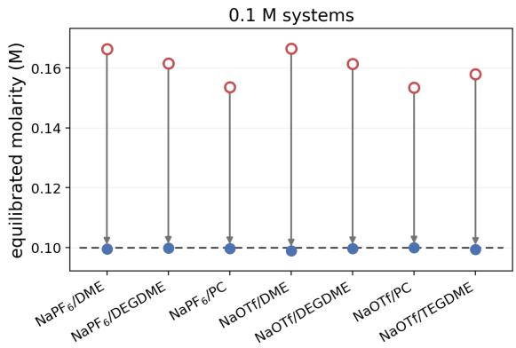

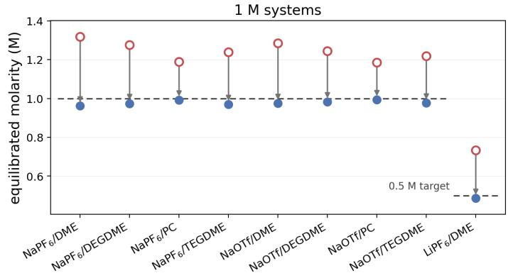  
initial boxes (packed to nominal target) corrected boxes (fixed solute:solvent ratio)--- nominal target  
Figure S1: Equilibrated molarity before and after the solute:solvent ratio correction. Each arrow runs from the molarity the initial box equilibrates to (open circle) to that of the corrected box (filled circle), against the nominal target (dashed). The initial boxes are always over-concentrated, by 50–66% at 0.1 M and 19–32% at 1 M, because equilibration reduces the original volume. $\mathrm { L i P F _ { 6 } / D M E }$ is grouped with the concentrated systems but targets 0.5 M, so it carries its own reference segment.

## S1.3 Selecting the NVT seed boxes

To choose a frame from the NPT simulations to start our fixed-volume NVT simulations, we first average the mass density over the last 500 ps of the NPT run, yielding a target density. We then select the frame from the last 300 ps of the run that is closest to our target density, and use that frame for the following NVT simulations used to compute transport coeficients.

## S1.4 System compositions

Table S1 lists every simulated electrolyte cell. The “Ion pairs” column counts salt formula units (equal numbers of cations and anions), which the correction leaves unchanged; the remaining columns are given as initial/production where the two difer.

Table S1: Composition of every simulated electrolyte cell, as initial /production where the molarity correction changed the value. Ion-pair counts are not afected by the correction.
<table><tr><td>Salt</td><td>Solvent</td><td>Nominal (M)</td><td>Ion pairs</td><td>Solvent mol.</td><td>Atoms</td><td></td><td>Equilibrated (M)</td></tr><tr><td>NaPF6</td><td>DME</td><td>0.1</td><td>2</td><td>125 / 210</td><td>2016</td><td>/3376</td><td>0.166 /0.100</td></tr><tr><td>NaPF6</td><td>DME</td><td>1.0</td><td>17</td><td>125 /175</td><td>2136</td><td>2936</td><td>1.318 /0.962</td></tr><tr><td>NaPF6</td><td>PC</td><td>0.1</td><td>2</td><td>164 / 254</td><td>2148</td><td>/3318</td><td>0.154 / 0.100</td></tr><tr><td>NaPF6</td><td>PC</td><td>1.0</td><td>17</td><td>164 /200</td><td>2268</td><td>/2736</td><td>1.189 / 0.992</td></tr><tr><td>NaPF6</td><td>DEGDME</td><td>0.1</td><td>2</td><td>94 / 153</td><td>2178</td><td>/3535</td><td>0.162 /0.100</td></tr><tr><td>NaPF6</td><td>DEGDME</td><td>1.0</td><td>17</td><td>94 / 126</td><td>2298</td><td>/3034</td><td>1.275 / 0.974</td></tr><tr><td>NaPF6</td><td>TEGDME</td><td>1.0</td><td>17</td><td>62 /80</td><td>2430</td><td>3096</td><td>1.240 / 0.969</td></tr><tr><td>NaOTf</td><td>DME</td><td>0.1</td><td>2</td><td>125 / 211</td><td>2018</td><td>3394</td><td>0.166 / 0.099</td></tr><tr><td>NaOTf</td><td>DME</td><td>1.0</td><td>17</td><td>125 / 170</td><td>2153</td><td>/2873</td><td>1.285 /0.975</td></tr><tr><td>NaOTf</td><td>PC</td><td>0.1</td><td>2</td><td>164 /253</td><td>2150</td><td>/3307</td><td>0.153 / 0.100</td></tr><tr><td>NaOTf</td><td>PC</td><td>1.0</td><td>17</td><td>164 /200</td><td>2285</td><td>2753</td><td>1.185 /0.994</td></tr><tr><td>NaOTf</td><td>DEGDME</td><td>0.1</td><td>2</td><td>94 / 153</td><td>2180</td><td>/3537</td><td>0.161 /0.100</td></tr><tr><td>NaOTf</td><td>DEGDME</td><td>1.0</td><td>17</td><td>94 /122</td><td>2315</td><td>/ 2959</td><td>1.245 /0.983</td></tr><tr><td>NaOTf</td><td>TEGDME</td><td>0.1</td><td>2</td><td>62/  99</td><td>2312</td><td>3681</td><td>0.158 /0.099</td></tr><tr><td>NaOTf</td><td>TEGDME</td><td>1.0</td><td>17</td><td>62/ 79</td><td>2447</td><td>3076</td><td>1.220 / 0.977</td></tr><tr><td>LiPF₆</td><td>DME</td><td>0.5</td><td>9</td><td>125 / 190</td><td>2072</td><td>3112</td><td>0.733 /0.486</td></tr></table>

## S2 Student architecture and training

Table S2 reports the full PaiNN architecture and optimization settings used for every distilled student. We report per-system training set sizes, which depend on the number of concentrations for each system, in Table S3.

We train a distilled student for every distinct salt/solvent pair, where datapoints from the same pairing but diferent concentrations (Table S1) are combined into one dataset to train a single model.

We obtain training configurations from a 100 ps UMA-OMol trajectory, using two interleaved 50 fs grids: an unperturbed MD grid and a grid ofset by 20 fs from the first. The positions of the ofset grid’s configurations are rattled with isotropic Gaussian noise (standard deviation 0.1 Å), and relabeled with the teacher. Both the noised and unperturbed configurations are split 90/10 into train/val, then pooled together. This results in 1800 MD + 1800 noised = 3600 training and 200 MD + 200 noised = 400 validation configurations per concentration. Table S3 reports the resulting per-system dataset totals.

Table S2: Distilled-potential architecture and training settings.
<table><tr><td>Setting</td><td>Value</td></tr><tr><td>Architecture</td><td></td></tr><tr><td>Backbone</td><td>PaiNN (FeNNol implementation)</td></tr><tr><td>Feature dimension (dim)</td><td>128</td></tr><tr><td>Message-passing layers</td><td>3</td></tr><tr><td>Channels (nchannels)</td><td>128</td></tr><tr><td>Message / update MLP hidden</td><td>[128]</td></tr><tr><td>Nonlinearity</td><td>SiLU</td></tr><tr><td>Radial cutoff</td><td>5.1 Å</td></tr><tr><td>Radial basis</td><td>128 trainable Gaussians</td></tr><tr><td>Cutoff switching</td><td>trainable polynomial  $\left( p = 3 \right)$ </td></tr><tr><td>Species encoding</td><td>random, dim 32  $( Z _ { \mathrm { m a x } } = 8 6 )$ </td></tr><tr><td>Readout head</td><td>eSEN energy head (hidden 128)</td></tr><tr><td>Short-range repulsion</td><td>trainable ZBL, inner cutoff 1.1 Å</td></tr><tr><td>Loss</td><td></td></tr><tr><td>Energy loss Force loss</td><td>per-atom MAE (weight 1)</td></tr><tr><td>Stress loss</td><td>Euclidean-norm  $\left( L _ { 2 } \right)$  error (weight 1) MAE (weight 1)</td></tr><tr><td>Loss normalization</td><td>dataset force RMS (all three terms)</td></tr><tr><td>Optimization</td><td></td></tr><tr><td>Optimizer</td><td>AdamW</td></tr><tr><td>Weight decay</td><td> $1 0 ^ { - 3 }$  (kernel weights)</td></tr><tr><td>Gradient clipping</td><td></td></tr><tr><td></td><td>100</td></tr><tr><td>LR schedule</td><td>one-cycle cosine, 1% warmup</td></tr><tr><td>Learning rate (init/peak/final)</td><td> $1 . 6 \times 1 0 ^ { - 4 } / 8 \times 1 0 ^ { - 4 } / 8 \times 1 0 ^ { - 6 }$ </td></tr><tr><td>Batch size</td><td></td></tr><tr><td></td><td>4</td></tr><tr><td>Epochs</td><td>275</td></tr><tr><td></td><td></td></tr><tr><td>Validation interval</td><td>every 5 epochs</td></tr><tr><td></td><td></td></tr><tr><td>EMA</td><td>none</td></tr></table>

Table S3: Per-system training dataset statistics, as well as the cost of training on each dataset. Each concentration contributes 1800 MD + 1800 noised = 3600 training and 200 MD + 200 noised = 400 validation configurations. The two-concentration systems have twice as many datapoints, and therefore cost roughly twice the wall time to train on. Training times are for 275 epochs on a single NVIDIA GH200.
<table><tr><td>Salt</td><td>Solvent</td><td>Conc. (M)</td><td>Train configs</td><td>Val configs</td><td>Training time (h)</td></tr><tr><td> $\mathrm { N a P F _ { 6 } }$ </td><td>DME</td><td>0.1, 1.0</td><td>7200</td><td>800</td><td>17.4</td></tr><tr><td> $\mathrm { N a P F _ { 6 } }$ </td><td>PC</td><td>0.1, 1.0</td><td>7200</td><td>800</td><td>17.7</td></tr><tr><td> $\mathrm { N a P F _ { 6 } }$ </td><td>DEGDME</td><td>0.1, 1.0</td><td>7200</td><td>800</td><td>20.2</td></tr><tr><td> $\mathrm { N a P F _ { 6 } }$ </td><td>TEGDME</td><td>1.0</td><td>3600</td><td>400</td><td>10.9</td></tr><tr><td> $\mathrm { N a O T f }$ </td><td>DME</td><td>0.1, 1.0</td><td>7200</td><td>800</td><td>17.5</td></tr><tr><td>NaOTf</td><td>PC</td><td>0.1, 1.0</td><td>7200</td><td>800</td><td>16.9</td></tr><tr><td>NaOTf</td><td>DEGDME</td><td>0.1, 1.0</td><td>7200</td><td>800</td><td>19.3</td></tr><tr><td> $\mathrm { N a O T f }$ </td><td>TEGDME</td><td>0.1, 1.0</td><td>7200</td><td>800</td><td>21.8</td></tr><tr><td> $\mathrm { L i P F _ { 6 } }$ </td><td>DME</td><td>0.5</td><td>3600</td><td>400</td><td>8.7</td></tr></table>

## S3 Results of noising training configurations

As discussed in Section S2, half of every training set consists of structures whose positions are rattled with isotropic Gaussian noise (standard deviation 0.1 Å). The noised structures give the student information about geometries that molecular dynamics at 293 K would rarely visit.

This section compares the performance of models trained with and without noise. We retrain two students, NaPF /TEGDME at 1 M and $\mathrm { L i P F _ { 6 } / D M E }$ at 0.5 M, on datasets built from identical time grids, with the rattling step disabled so that the second grid’s samples come from pure molecular dynamics. Everything else about training, including frame count (4000 per system, split 3600/400), architecture, loss, optimizer, schedule, and epoch budget, remains the same.

1 ns NPT at 298 K — training-noise ablation, scored against the UMA-S teacher  
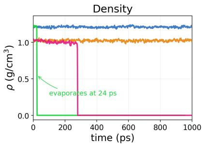

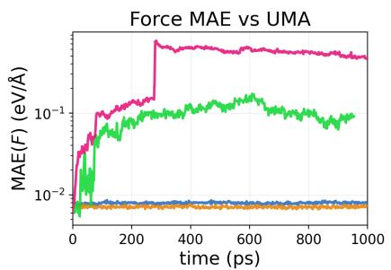

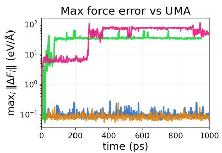  
NaPF₆/TEGDME — mixed noise LiPF₆/DME (0.5 M) — mixed noise NaPF₆/TEGDME — no noise LiPF₆/DME (0.5 M) — no noise  
Figure S2: Training-set noising is required for stable dynamics. Stability and error statistics for 1 ns NPT simulations at 298 K. Two systems are displayed, with two models trained on each: one model is trained with noised structures, and the other without. Left: density. Center and right: mean and maximum per-atom force error against the UMA-OMol teacher, evaluated every 2 ps on the configurations in the student simulation (note the logarithmic scale on the two force panels). Both noised students have stable densities throughout, as well as low mean and maximum force errors. In contrast, the no-noise students evaporate at 24 ps $\left( \mathrm { N a P F _ { 6 } / T E G D M E } \right)$ and $2 8 0 \mathrm { p s ( L i P F _ { 6 } / D M E ) }$ . In both no-noise models’ simulations, the error against the teacher grows large before the density collapses.

After training, both models exhibit low force errors on a static held-out validation set, at 7.0– 7.4 meV/Å for the noised student and 5.6–5.8 meV/Å for the no-noise ablation. However, their behavior difers drastically during simulation. Over 1 ns of NPT at 298 K (settings as in Table S5, seeded from equilibrated teacher frames), the noised students have stable densities and low force errors. In contrast, the simulations with the no-noise students start exhibiting high force errors, and eventually their boxes expand and their simulations break apart (Figure S2).

For both systems, it is clear that noising some of the data pays of massively during simulation. The reason is intuitive: a student fit only to molecular-dynamics frames has seen only the thin manifold of thermally accessible configurations. During simulation, any deviation from that manifold produces incorrect forces that drive the system even farther away, compounding the error. Giving the model noised data allows it to learn the forces of of-manifold configurations, preventing small deviations from accumulating.

## S4 Teacher vs. student speed benchmark

We benchmark the simulation throughput of all models used in this work on identical hardware: a single NVIDIA GH200 Grace–Hopper superchip with fp32 precision. Both the PaiNN and UMA-

OMol models support tf32 precision; however, we observed occasional instabilities when simulating with both models at tf32 at multi-ns timescales, so we used fp32 throughout. We also include the throughput of a lightweight multi-layer perceptron (MLP) baseline not discussed in the main text (see Section S14 for its transport results), as an example of a faster but less accurate model. Throughput was measured by running 100 ps of simulation with each model on every system, discarding the first 50 ps and reporting the steady-state rate over the remainder. Table S4 lists the throughput $\mathrm { ( n s / d a y ) }$ of the UMA-OMol teacher, the PaiNN student, and the MLP student across all 16 electrolyte boxes, sorted by descending PaiNN throughput. Both students run more than an order of magnitude faster than the teacher on every system: at the median, the PaiNN student reaches 9.53 ns/day, against 0.23 ns/day for UMA-OMol, a speedup of roughly 41 .

Table S4: Per-system simulation throughput (ns/day) for the UMA-OMol teacher, PaiNN student, and MLP student.
<table><tr><td>System (salt / solvent, conc., temp.)</td><td>UMA-OMol (ref., fp32)</td><td>PaiNN</td><td></td><td>MLP</td></tr><tr><td>NaOTf / PC, 1 M, 298 K</td><td>0.28</td><td>11.40 (40.7×)</td><td></td><td>27.84 (99.4×)</td></tr><tr><td> $\mathrm { N a P F _ { 6 } / P C , 1 M , 2 9 8 K }$ </td><td>0.28</td><td>11.14 (39.8×)</td><td>27.27</td><td>(97.4×)</td></tr><tr><td> $\mathrm { N a O T f / D M E , 1 M , 2 9 8 K }$ </td><td>0.26</td><td>10.59 (40.7×)</td><td></td><td>26.13 (100.5×)</td></tr><tr><td> $\mathrm { L i P F _ { 6 } / D M E , 0 . 5 \ M , 2 9 8 \ K }$ </td><td>0.25</td><td>10.20 (40.8×)</td><td></td><td>24.44 (97.8×)</td></tr><tr><td> $\mathrm { N a P F _ { 6 } / D M E , 1 M , 2 9 8 K }$ </td><td>0.25</td><td>9.90 (39.6×)</td><td></td><td>25.70 (102.8×)</td></tr><tr><td> $\mathrm { N a O T f \ / \ D E G D M E , 1 \ M , 2 9 8 \ K }$ </td><td>0.24</td><td>9.75 (40.6×)</td><td></td><td>23.09 (96.2×)</td></tr><tr><td> $\mathrm { N a P F _ { 6 } }$  / TEGDME, 1 M, 298 K</td><td>0.23</td><td>9.66 (42.0×)</td><td>23.79</td><td>(103.4×)</td></tr><tr><td> $\mathrm { N a P F _ { 6 } / \ D E G D M E , \ }$  1 M, 298 K</td><td>0.23</td><td>9.60 (41.7×)</td><td>24.05</td><td>(104.6×)</td></tr><tr><td> $\mathrm { N a O T f / \mathrm { \ T E G D M E } , 1 \ M , 2 9 8 ~ K }$ </td><td>0.23</td><td>9.45 (41.1×)</td><td>23.60</td><td>(102.6×)</td></tr><tr><td> $\mathrm { N a P F _ { 6 } / P C , 0 . 1 M , 2 9 8 K }$ </td><td>0.22</td><td>9.41 (42.8×)</td><td>22.78</td><td>(103.5×)</td></tr><tr><td> $\mathrm { N a O T f / P C , 0 . 1 M , 2 9 8 K }$ </td><td>0.23</td><td>9.36 (40.7×)</td><td>22.09</td><td>(96.0×)</td></tr><tr><td> $\mathrm { N a P F _ { 6 } / \ D M E , 0 . 1 \ M , 2 9 8 ~ K }$ </td><td>0.22</td><td>9.31 (42.3×)</td><td>22.87</td><td>(104.0×)</td></tr><tr><td> $\mathrm { N a O T f / D M E , 0 . 1 M , 2 9 8 K }$ </td><td>0.22</td><td>8.98 (40.8×)</td><td>22.12</td><td>(100.5×)</td></tr><tr><td> $\mathrm { N a O T f / D E G D M E , 0 . 1 \ M , 2 9 8 \ K }$ </td><td>0.20</td><td>8.50 (42.5×)</td><td>21.10</td><td>(105.5×)</td></tr><tr><td> $\mathrm { N a P F _ { 6 } / \ D E G D M E , 0 . 1 \ M , 2 9 8 ~ K }$ </td><td>0.20</td><td>8.41 (42.1×)</td><td>20.64</td><td>(103.2×)</td></tr><tr><td>NaOTf / TEGDME, 0.1 M, 298 K</td><td>0.18</td><td>7.86 (43.7×)</td><td>20.33</td><td>(112.9×)</td></tr><tr><td>Median</td><td>0.23</td><td>9.53 (41.4×)</td><td></td><td>23.35 (101.5×)</td></tr></table>

## S5 Simulation settings and production stability metrics

Table S5 reports the simulation settings for every UMA-OMol and PaiNN simulation in this work. Table S6 reports the simulation settings for the OPLS-AA baseline. The first 100 ps of the 293 K UMA-OMol simulations supply the training configurations for the student, while the rest of the trajectory up to 1 ns is used to compute the radial distribution functions that the student is compared against (Section S6). The 298 K NPT UMA-OMol simulations are used for density comparisons against the student. Likewise, the student 293 K runs are used to extract radial distribution functions, while the 298 K simulations are used to compute the density (the density runs are extended to 20 ns). Once the student’s density is computed, we create new boxes with the molarity procedure described in Section S1, and use the same 298 K NPT settings for 1 ns to equilibrate with the student. We then choose a frame from this NPT equilibration closest to the average volume (see Section S1.3), and hold that equilibrated cell fixed for the NVT simulation.

We use constant volume (NVT) simulations for production, as this removes volume-related fluctuations from the stress autocorrelations that the Green–Kubo estimator for viscosity integrates.

The global Bussi thermostat used $( \gamma = 0 . 1 \ \mathrm { T H z } , \ \tau = 1 0 \ \mathrm { p s } )$ is chosen to be slow enough to leave sub-picosecond correlations unbiased.  
Table S5: Molecular dynamics settings for teacher sampling, student NPT, and student NVT production. The UMA-OMol column covers both the 293 K run (training and structural reference) and the 298 K run (density reference); the student NPT column covers both the teacher comparison (293 K) and the production equilibration (298 K). Within each column the two runs are otherwise identical.
<table><tr><td>Setting</td><td>UMA-OMol teacher</td><td>Student NPT</td><td>Student NVT production</td></tr><tr><td>Purpose</td><td>training (first 100 ps) + structural reference (293 K); density reference</td><td>teacher comparison (293 K); production equilibration (298 K)</td><td>transport coefficients</td></tr><tr><td>Engine</td><td>(298 K) ASE</td><td>FeNNol/JAX</td><td>FeNNol/JAX</td></tr><tr><td>Ensemble</td><td>NPT</td><td>NPT</td><td>NVT</td></tr><tr><td>Thermostat</td><td>Nosé-Hoover (100 fs)</td><td>Langevin (γ=1 THz)</td><td>Bussi/CSVR (γ=0.1 THz)</td></tr><tr><td>Barostat</td><td>Parrinello-Rahman-type  $\scriptstyle \left( p _ { f } = 0 . 1 \right)$ </td><td>Langevin piston (iso.,  $\tau _ { p } { = } 2 0 0 \ \mathrm { f s } , \gamma _ { p } { = } 2 0 \ \mathrm { T H z } )$ </td><td>— (cell fixed)</td></tr><tr><td>Temperature</td><td>293 K or 298 K</td><td>293 K or 298 K</td><td>298 K</td></tr><tr><td>Pressure</td><td>1 bar</td><td>1 bar</td><td>— (V from equilibration)</td></tr><tr><td>Timestep</td><td>1 fs</td><td>1 fs</td><td>1 fs</td></tr><tr><td>Duration</td><td>1 ns</td><td>1 ns / 20 ns (density)</td><td>20 ns</td></tr><tr><td>Precision Stress log</td><td>fp32</td><td>fp32</td><td>fp32 every 2 fs</td></tr></table>

Table S6: Molecular dynamics NPT and NVT settings for the OPLS-AA baseline.
<table><tr><td>Setting</td><td>OPLS-AA NPT equilibration</td><td>OPLS-AA NVT production</td></tr><tr><td>Purpose</td><td>density/box equilibration</td><td>transport coefficients</td></tr><tr><td>Engine</td><td>GROMACS 2025.3 (mixed precision)</td><td>GROMACS 2025.3 (mixed precision)</td></tr><tr><td>Solvent parameters</td><td colspan="2">OPLS-AA, 1.14*CM1A charges (LigParGen) [1]</td></tr><tr><td>Anion parameters Cation parameters</td><td colspan="2"> $\mathrm { C L } \& \mathrm { P : \mathrm { P F } _ { 6 } ^ { - } \ [ 2 , 3 ] , \mathrm { O T f ^ { - } \ [ 4 , 5 ] } }$ </td></tr><tr><td>Combination rule / 1-4 scaling</td><td> $\mathring { \mathrm { A q v i s t ~ N a ^ { + } , L i ^ { + } ~ [ 6 ] , f u l l + 1 ~ c h a r g e } }$   $\mathrm { g e o m e t r i c } \mid 0 . 5 \ \mathrm { ( O P L S - A A ) }$ </td><td></td></tr><tr><td>Pair-list buffer tolerance</td><td> $1 0 ^ { - 3 } \ \mathrm { k J m o l ^ { - 1 } p s ^ { - 1 } }$ </td><td> $1 0 ^ { - 3 } \ \mathrm { k J \ m o l ^ { - 1 } p s ^ { - 1 } }$ </td></tr><tr><td>Ensemble</td><td>NPT</td><td>NVT</td></tr><tr><td>Thermostat</td><td>CSVR/Bussi (τT=0.1 ps)</td><td>CSVR/Bussi (τT=10 ps)</td></tr><tr><td>Barostat</td><td> $\mathrm { C - r e s c a l e \ ( i s o . , \ } \tau _ { p } { = } 2 \ \mathrm { p s ) }$ </td><td>— (cell fixed)</td></tr><tr><td>Temperature</td><td>298 K</td><td>298 K</td></tr><tr><td>Pressure</td><td>1 bar</td><td>— (V from equilibration)</td></tr><tr><td>Timestep</td><td>1 fs</td><td>1 fs</td></tr><tr><td>Duration Constraints</td><td>1 ns</td><td>20 ns</td></tr><tr><td></td><td>none (fully flexible)</td><td>none (fully flexible)</td></tr><tr><td>Electrostatics</td><td>PME, 12 Å real-space cutoff</td><td>PME, 12 Å real-space cutoff</td></tr><tr><td>van der Waals</td><td>12 Å cutoff, long-range dispersion correction</td><td>12 Å cutoff, long-range dispersion</td></tr><tr><td>Initial velocities</td><td>fresh Maxwell-Boltzmann</td><td>correction fresh Maxwell-Boltzmann</td></tr><tr><td>Pressure-tensor log</td><td></td><td>(independent seed per replica)</td></tr><tr><td>Coordinate log</td><td></td><td>every 2 fs every 1 ps</td></tr></table>

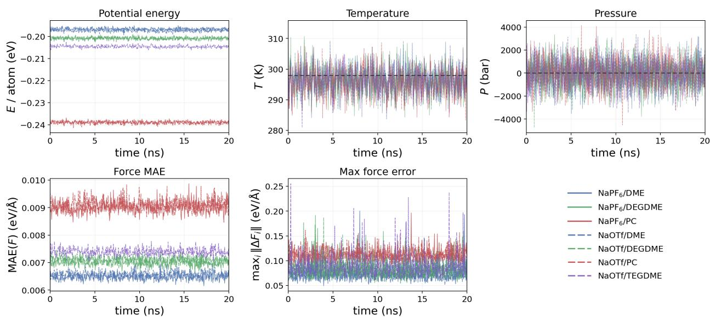  
Figure S3: Production stability and teacher fidelity for the 0.1 M systems. A random replica for each system was selected to be shown here. Top row: the run’s own potential energy per atom, temperature, and pressure over the full 20 ns NVT trajectory; the horizontal black reference line in each of the last two panels marks the 298 K setpoint and zero pressure, respectively. Bottom row: mean and maximum per-atom force error between the UMA-OMol teacher and the student on the same 500 frames, where frames are picked every 40 ps. All traces are flat, with no thermodynamic drift or growth in teacher–student disagreement.

## S5.1 Production stability and teacher fidelity

The production runs used to calculate transport coeficients should be thermodynamically stable, and the student should have low errors relative to the teacher throughout the trajectory. To check this, for each 20 ns NVT simulation we monitor the energy, temperature, and pressure to confirm that they are stable throughout the simulation (top panels of Figures S3 and S4). We also reevaluate 500 frames per run, spaced 40 ps apart across the full trajectory, with the UMA-OMol teacher, giving both models’ energies, forces, and stresses on identical configurations (bottom panels of Figures S3 and S4).

Overall, all 64 runs are stable. Potential energy per atom, temperature, and pressure have no drift across 20 ns. Additionally, the force mean absolute error (MAE) against UMA-OMol is small, lying between 6 and 10 meV/Å for all runs, with no drift in any trajectory. The maximum per-atom force error is likewise low and stable.

0.1 M systems — 20 ns NVT at 298 K: MD stability (top) and UMA teacher vs PaiNN student (bottom)

1 M systems (LiPF₆/DME at 0.5 M) — 20 ns NVT at 298 K: MD stability (top) and UMA teacher vs PaiNN student (bottom)

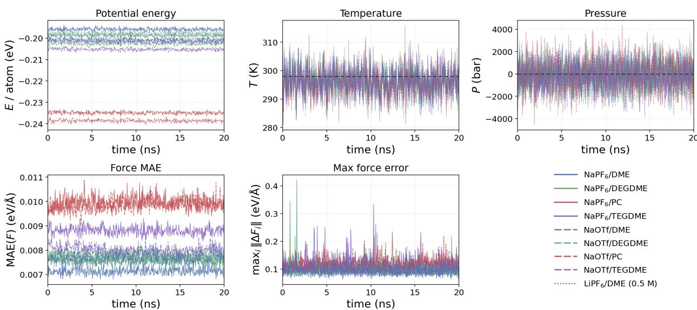  
Figure S4: Production stability and teacher fidelity for the 1 M systems. Panels and sampling as in Figure S3; $\mathrm { L i P F _ { 6 } / D M E }$ , which exists only at 0.5 M, is grouped here.

## S6 Radial distribution functions for 1 M systems

Fig. 2 of the main text shows student-vs-teacher radial distribution functions (RDFs) for four representative 1 M electrolytes. We extend this comparison to all of the 1 M salt/solvent pairs in Figure S5, and confirm that the student reproduces the RDFs of the teacher across all systems.

Each student curve is the average over five independent replicas. Replicas are diferentiated by their starting velocities and the random seed of the integrator. The shaded band indicates one standard deviation across the five replicas. In nearly every panel the teacher $g ( r )$ lies within this band, indicating that the teacher–student deviations are consistent with ordinary sampling fluctuations, rather than a systematic diference between the two potentials.

Na⁺ RDFs, all 8 salt/solvent systems (1 M, 293 K): replica-averaged PaiNN vs UMA

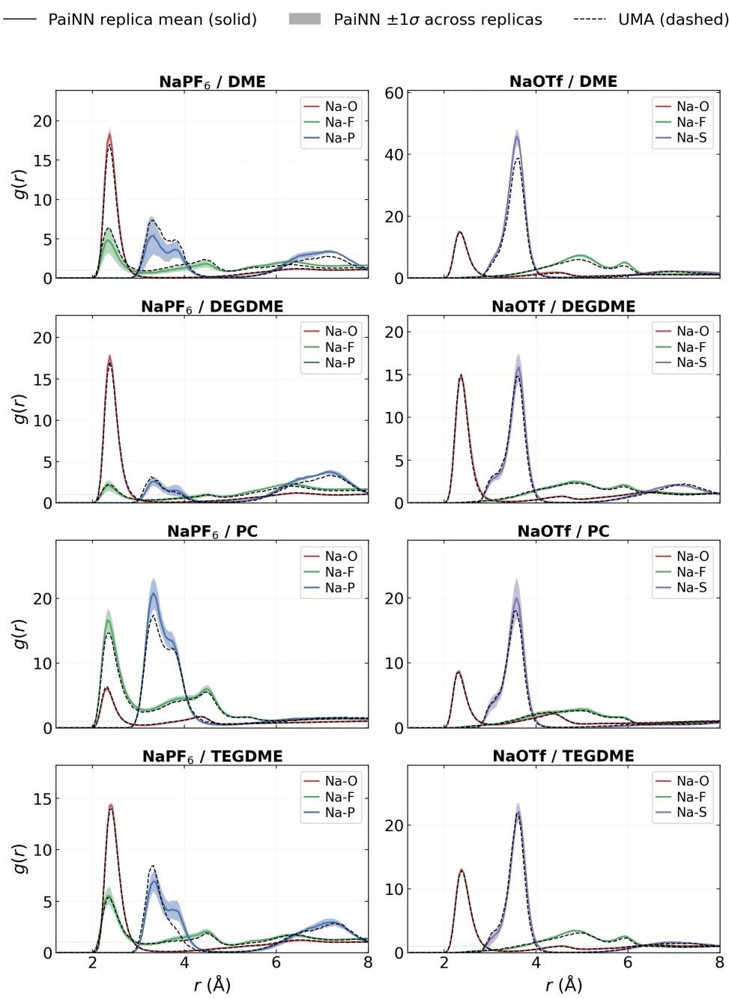  
Figure S5: Radial distribution functions for all eight 1 M electrolytes. Student $g ( r )$ (solid, colored by atom pair) is the mean over five 1 ns, 293 K replica trajectories, with the shaded band indicating one standard deviation across replicas; the UMA-OMol teacher (black dashed) is a single 1 ns, 293 K trajectory.

## S7 Per-system mass densities

Panel (b) of Fig. 2 in the main text combines all sixteen electrolytes into a single density-parity plot, without identifying individual systems. We list the per-system density numbers in Table S7. The distilled student densities are obtained from a single 20 ns NPT trajectory (first 0.5 ns discarded), while the UMA-OMol teacher densities are obtained from a single 1 ns trajectory. We also include each system’s experimentally measured density.

Table S7: Mass densities $\left( \mathrm { g c m } ^ { - 3 } \right.$ , 298 K) for every simulated electrolyte: the distilled PaiNN student (single 20 ns NPT trajectory), the UMA-OMol teacher (single 1 ns trajectory, this work), and experiment.
<table><tr><td>Salt</td><td>Solvent</td><td>Conc. (M)</td><td>Student (20 ns)</td><td>Teacher UMA-OMol (1 ns)</td><td>Experiment</td></tr><tr><td>NaPF₆</td><td>DME</td><td>0.1</td><td>0.965</td><td>0.987</td><td>0.873</td></tr><tr><td>NaPF6</td><td>DME</td><td>1.0</td><td>1.096</td><td>1.109</td><td>0.995</td></tr><tr><td>NaPF6</td><td>PC</td><td>0.1</td><td>1.311</td><td>1.318</td><td>1.206</td></tr><tr><td>NaPF6</td><td>PC</td><td>1.0</td><td>1.369</td><td>1.386</td><td>1.291</td></tr><tr><td>NaPF₆</td><td>DEGDME</td><td>0.1</td><td>1.046</td><td>1.058</td><td>0.952</td></tr><tr><td>NaPF6</td><td>DEGDME</td><td>1.0</td><td>1.160</td><td>1.168</td><td>1.059</td></tr><tr><td>NaPF6</td><td>TEGDME</td><td>1.0</td><td>1.212</td><td>1.225</td><td>1.115</td></tr><tr><td>NaOTf</td><td>DME</td><td>0.1</td><td>0.966</td><td>0.976</td><td>0.873</td></tr><tr><td>NaOTf</td><td>DME</td><td>1.0</td><td>1.077</td><td>1.080</td><td>0.980</td></tr><tr><td>NaOTf</td><td>PC</td><td>0.1</td><td>1.311</td><td>1.323</td><td>1.207</td></tr><tr><td>NaOTf</td><td>PC</td><td>1.0</td><td>1.373</td><td>1.379</td><td>1.277</td></tr><tr><td>NaOTf</td><td>DEGDME</td><td>0.1</td><td>1.045</td><td>1.057</td><td>0.950</td></tr><tr><td>NaOTf</td><td>DEGDME</td><td>1.0</td><td>1.139</td><td>1.154</td><td>1.047</td></tr><tr><td>NaOTf</td><td>TEGDME</td><td>0.1</td><td>1.116</td><td>1.129</td><td>1.016</td></tr><tr><td>NaOTf</td><td>TEGDME</td><td>1.0</td><td>1.199</td><td>1.213</td><td>1.106</td></tr><tr><td> $\mathrm { L i P F _ { 6 } }$ </td><td>DME</td><td>0.5</td><td>1.029</td><td>1.048</td><td>0.909</td></tr></table>

## S8 Details of experimental measurements

The self-difusivities, ionic conductivities, densities, and viscosities used as the experimental reference throughout this work were measured in-house for the same salt/solvent/concentration combinations as the simulations. This section details the protocols followed to obtain the transport coeficients in the main text; the resulting experimental values are listed in Sec. S9.

## S8.1 Electrolyte preparation

All electrolyte preparation was conducted inside an argon glovebox $\mathrm { ( O _ { 2 } }$ content <0.2 ppm, H2O con tent <0.1 ppm, VAC-ATM). A standalone solvent trap with an activated carbon filter (VAC-ATM) was utilized. 1,2-dimethoxyethane (DME; 99.5%, anhydrous, Sigma-Aldrich), bis(2-methoxyethyl) ether (DEGDME; 99+%, Thermo Scientific), tetraethylene glycol dimethyl ether (TEGDME; 99%, Thermo Scientific), and propylene carbonate (PC; 99.5%, anhydrous, Thermo Scientific) were dried over activated 4 Å molecular sieves for at least 72 hours. Water content for each solvent was determined to be <10 ppm by KF titration (Mettler Toledo C10SD). Sodium hexafluorophosphate $( \mathrm { N a P F _ { 6 } } ; 9 9 . 9 \%$ , Sigma-Aldrich), sodium trifluoromethanesulfonate (NaOTf; 99.5%, Solvionic), and lithium hexafluorophosphate $( \mathrm { L i P F _ { 6 } }$ , 99.99%, Sigma-Aldrich) were each vacuum-dried at $1 0 0 ~ ^ { \circ } \mathrm { C }$ overnight in a Buchi glass oven apparatus.

## S8.2 Self-difusivity

Species-resolved self-difusion coeficients were obtained by pulsed-field-gradient nuclear magnetic resonance (PFG-NMR), with each species followed through a distinct nucleus so that the cation, anion, and solvent difusivities are measured independently on the same sample: $^ 1 \mathrm { H }$ for the solvent, $^ 7 { \mathrm { L i } } \ { \mathrm { o r } } \ { } ^ { 2 3 } { \mathrm { N a } }$ for the cation, and $\mathrm { ^ { 1 9 } F }$ for the $\mathrm { P F _ { 6 } ^ { - } / O T f ^ { - } }$ anion. Measurements were performed on 11.7 T magnets equipped with Avance NEO consoles and Bruker iProbe BBFO auto-tuning HX solution probes, with temperature regulated by a BCU/2 unit and automatically corrected. For each sample, $\pi / 2$ pulse calibrations were carried out at both 293 K and 298 K to maximize accuracy, with recycle delays set from reference samples and confirmed suficient by the observation of sinusoida nutation behavior. The reference samples were 1% $\mathrm { C H C l _ { 3 } }$ in acetone- ${ \bf \nabla } \cdot d _ { 6 }$ (1H at 8.02 ppm), 0.1 M LiCl(aq) (7Li at $0 \mathrm { p p m } )$ , and 0.1 M NaCl(aq) $\binom { 2 3 } { } \mathrm { N a }$ at 0 ppm), all at 298 K. Longitudinal relaxation times $T _ { 1 }$ were estimated from the null point of an inversion-recovery experiment once the pulse width was determined, and used to set the recycle delays for the 1D spectra (as $5 T _ { 1 } )$ and for the PFG-NMR measurements (as $3 T _ { 1 } )$

For all samples and all nuclei except $^ { 2 3 } \mathrm { { N a } . }$ convection-compensated double-stimulated echoes with bipolar pulse-pair gradients were used, together with a 5 ms longitudinal eddy-current delay. The gradient duration was 2 ms (2.4 ms for ${ } ^ { 1 9 } \mathrm { F } )$ and the difusion time 100–300 ms, chosen per sample according to viscosity and relaxation parameters, with the gradient strength scaled to each sample’s difusion coeficient using two-step, first-and-last trial experiments for each nucleus. A total of 16 linearly spaced gradient steps and 16 scans per slice of signal averaging were used for all full PFG-NMR experiments. The difusion coeficient is extracted from the gradient-dependent signal attenuation via the Stejskal–Tanner relation, $I / I _ { 0 } = \exp [ - D \gamma ^ { 2 } g ^ { 2 } \delta ^ { 2 } ( \Delta - \delta / 3 ) ]$ , where $\gamma$ is the gyromagnetic ratio of the observed nucleus, $g$ and δ the gradient-pulse amplitude and duration, and $\Delta$ the difusion time. Because PFG-NMR tracks the same molecular centers of mass as the Einstein/MSD analysis of the trajectories, the experimental and simulated difusivities are directly comparable.

For the most viscous $^ { 2 3 } \mathrm { { N a } }$ compositions, where relaxation and gradient-strength constraints limited the feasibility of measurements on regular solution-state probes, a 14.1 T Avance III HD system equipped with a Dif50 probe was used instead. Here both inversion-recovery and Carr–Purcell– Meiboom–Gill (CPMG) measurements were performed to determine $T _ { 1 }$ and $T _ { 2 }$ quantitatively for parameter setup. Owing to the higher viscosity and the correspondingly reduced propensity for convection (and rapid relaxation times), these measurements used a regular stimulated-echo PFG pulse sequence with single gradients. Both the gradient duration (0.8–1.1 ms) and the difusion time (7–12 ms) were scaled to the sample’s 23Na relaxation parameters, with the gradient strength adjusted to achieve reasonable attenuation while minimizing lineshape and baseline distortion. Between 128 and 2048 transients per gradient step were acquired, depending on the sample’s relaxation parameters.

## S8.3 Ionic conductivity

Ionic conductivity was measured inside an argon-filled glovebox using a Mettler Toledo SevenDirect SD30 benchtop conductivity meter fitted with a Mettler Toledo InLab 710 four-electrode platinum probe with a chemically resistant glass body. The probe was immersed in 4 mL of each electrolyte and a reading was taken once it had stabilized; three independent measurements were recorded per electrolyte. For temperature-dependent measurements, the probe was inserted through a hole drilled in the vial cap, the joint was sealed with Parafilm and electrical tape to prevent solvent evaporation, and the vial was heated in an oil bath and allowed to equilibrate for 10 minutes at each temperature before measurement; the sample temperature was recorded with each conductivity reading. The conductivities reported in this work are at 298 K.

This four-electrode conductivity-cell measurement is compared in the main text against the Onsager (collective) conductivity from simulation, which is the correct simulated counterpart because it retains the ion–ion cross-correlations the cell measurement inherently includes.

## S8.4 Density and viscosity

Density and viscosity were measured with an Anton Paar DMA 4500 M oscillating U-tube density meter coupled to an Anton Paar Lovis ME rolling-ball viscometer, so that both quantities were obtained from a single filling of sample. Both instruments were calibrated with certified reference water supplied by an ISO 17034-accredited producer. The filled U-tube was inspected with the integrated camera before every measurement to confirm that no bubbles were present. Measurements were carried out at 298 K, held by the built-in Peltier thermostat. A stream of dry $\mathrm { N _ { 2 } }$ was directed through the measuring cell to suppress condensation on the outer surface of the U-tube. After each sample, the cell was flushed three times with absolute ethanol ( 99.8%) and then purged with $\mathrm { N _ { 2 } }$ for 600 s. Instrument performance was checked at regular intervals during data collection using the built-in air and water density check, and the ethanol flush and $\mathrm { N _ { 2 } }$ purge were repeated after each check before the next sample was loaded.

The rolling-ball viscometer measures the shear viscosity η directly, which is compared in the main text.

## S9 Experimental and simulated transport data

In this section, we list the raw transport data that underlie the parity plots in the main text. All entries, simulated and experimental, are at 298 K. We report simulated entries as a mean  std over the replica trajectories, for both the PaiNN student and OPLS-AA.

In Tables S8 and S9, we report the self-difusion coeficients of the cation $( D ^ { + } )$ , anion $( D ^ { - } )$ and solvent $( D ^ { 0 } )$ , with separate tables for PaiNN and OPLS-AA. We report the raw simulated difusivities without any finite-size correction, as well as the additive Yeh–Hummer correction [7] $\Delta D _ { \mathrm { Y H } } = \xi k _ { \mathrm { B } } T / ( 6 \pi \eta L )$ . Two versions of the Yeh–Hummer correction are included: one uses the simulated viscosity, and the other uses the experimental viscosity. The corrected difusivity is obtained by adding the Yeh–Hummer correction to the corresponding raw simulated difusivity. We list the experimental self-difusivities in each table for reference. The simulated difusivities use the Fickian fit window described in Methods. For 7 of the 192 PaiNN fits (16 systems, four replicas, three species) and 14 of the 192 OPLS-AA fits, no window satisfied $| \nu - 1 | \leq 0 . 1 5$ , and the fallback twelve-point fit was used; every mean includes all four replicas.

Table S10 lists the ionic conductivity σ and the shear viscosity $\eta ,$ for PaiNN, OPLS-AA, and experiment. The conductivity is the Onsager conductivity, which accounts for ion–ion crosscorrelations, and the viscosity is obtained from the Green–Kubo integral of the stress autocorrelation function.

Table S8: Raw (uncorrected) self-difusivities and additive Yeh–Hummer finite-size corrections $\Delta D _ { \mathrm { Y H } }$ for PaiNN, with experimental self-difusivities for reference. Simulated entries are mean std over replicas; $\Delta D _ { \mathrm { Y H } }$ is species-independent (“sim”/“exp” denote the viscosity used to evaluate it, and the finite-size corrected difusivity is calculated by adding it to the raw value). All values in $1 0 ^ { - 1 0 } ~ \mathrm { { m ^ { 2 } / s } ; { \ell ^ { \cdot } - } ^ { \cdot } }$ denotes values not available.
<table><tr><td colspan="3"></td><td colspan="3"> $D _ { \mathrm { r a w } } \ ( \mathrm { s i m . } )$ </td><td colspan="3"> $\Delta D _ { \mathrm { Y H } }$ </td><td colspan="3">Experimental</td></tr><tr><td>Salt</td><td>Solvent</td><td>Conc.</td><td> $D ^ { + }$ </td><td></td><td> $D ^ { - }$ </td><td> $D ^ { 0 }$ </td><td>sim</td><td>exp</td><td> $D ^ { + }$ </td><td> $D ^ { - }$ </td><td> $D ^ { 0 }$ </td></tr><tr><td> $\mathrm { L i P F _ { 6 } }$ </td><td>DME</td><td>0.5</td><td> $4 . 9 1 \pm 0 . 6 6$ </td><td></td><td> $6 . 7 2 \pm 1 . 3 5$ </td><td> $1 3 . 8 4 \pm 2 . 4 8$ </td><td>2.43</td><td>3.12</td><td>7.14</td><td>9.09</td><td>22.10</td></tr><tr><td> $\mathrm { N a P F _ { 6 } }$ </td><td>DME</td><td>0.1</td><td> $5 . 0 6 \pm 0 . 5 4$ </td><td></td><td> $6 . 8 2 \pm 0 . 6 5$ </td><td> $1 4 . 1 5 \pm 0 . 2 5$ </td><td>2.49</td><td>4.08</td><td>17.20</td><td>17.60</td><td>29.50</td></tr><tr><td> $\mathrm { N a P F _ { 6 } }$ </td><td>DME</td><td>1</td><td> $2 . 5 3 \pm 0 . 1 9$ </td><td></td><td> $3 . 4 1 \pm 0 . 4 5$ </td><td> $7 . 1 8 \pm 0 . 1 6$ </td><td>1.26</td><td>1.83</td><td>6.49</td><td>6.42</td><td>13.60</td></tr><tr><td> $\mathrm { N a P F _ { 6 } }$ </td><td>PC</td><td>0.1</td><td> $0 . 4 7 \pm 0 . 1 0$ </td><td></td><td> $1 . 0 8 \pm 0 . 0 8$ </td><td> $1 . 1 4 \pm 0 . 0 5$ </td><td>0.23</td><td>0.75</td><td>3.21</td><td>4.29</td><td>4.97</td></tr><tr><td> $\mathrm { N a P F _ { 6 } }$ </td><td>PC</td><td>1</td><td> $0 . 3 2 \pm 0 . 0 3$ </td><td></td><td> $0 . 6 3 \pm 0 . 1 1$ </td><td> $0 . 6 9 \pm 0 . 0 4$ </td><td>0.14</td><td>0.39</td><td>1.29</td><td>1.76</td><td>2.43</td></tr><tr><td> $\mathrm { N a P F _ { 6 } }$ </td><td>DEGDME</td><td>0.1</td><td> $1 . 8 1 \pm 0 . 3 6$ </td><td></td><td> $2 . 6 3 \pm 0 . 5 3$ </td><td> $4 . 0 9 \pm 0 . 1 4$ </td><td>0.83</td><td>1.74</td><td>6.67</td><td>5.55</td><td>11.80</td></tr><tr><td> $\mathrm { N a P F _ { 6 } }$ </td><td>DEGDME</td><td>1</td><td> $0 . 8 0 \pm 0 . 0 9$ </td><td></td><td> $1 . 0 9 \pm 0 . 1 6$ </td><td> $1 . 9 3 \pm 0 . 1 1$ </td><td>0.40</td><td>0.75</td><td>2.67</td><td>2.96</td><td>4.89</td></tr><tr><td> $\mathrm { N a P F _ { 6 } }$ </td><td>TEGDME</td><td>1</td><td> $0 . 2 3 \pm 0 . 0 2$ </td><td></td><td> $0 . 3 5 \pm 0 . 0 5$ </td><td> $0 . 4 5 \pm 0 . 0 3$ </td><td>0.14</td><td>0.23</td><td></td><td>0.80</td><td>1.12</td></tr><tr><td>NaOTf</td><td>DME</td><td>0.1</td><td> $4 . 8 9 \pm 0 . 4 0$ </td><td></td><td> $6 . 6 7 \pm 0 . 8 5$ </td><td> $1 3 . 7 4 \pm 0 . 5 9$ </td><td>2.52</td><td>4.10</td><td>12.30</td><td>11.40</td><td>30.10</td></tr><tr><td> $\mathrm { N a O T f }$ </td><td>DME</td><td>1</td><td> $2 . 5 2 \pm 0 . 1 3$ </td><td></td><td> $3 . 0 3 \pm 0 . 1 6$ </td><td> $7 . 6 7 \pm 0 . 4 2$ </td><td>1.33</td><td>2.12</td><td>5.90</td><td>5.44</td><td>15.30</td></tr><tr><td>NaOTf</td><td>PC</td><td>0.1</td><td> $0 . 4 5 \pm 0 . 1 1$ </td><td></td><td> $1 . 0 8 \pm 0 . 0 9$ </td><td> $1 . 1 7 \pm 0 . 0 2$ </td><td>0.21</td><td>0.76</td><td>3.11</td><td>3.70</td><td>4.92</td></tr><tr><td>NaOTf</td><td>PC</td><td>1</td><td> $0 . 2 3 \pm 0 . 0 2$ </td><td></td><td> $0 . 4 6 \pm 0 . 0 5$ </td><td> $0 . 5 4 \pm 0 . 0 2$ </td><td>0.10</td><td>0.51</td><td>1.68</td><td>1.53</td><td>2.82</td></tr><tr><td>NaOTf</td><td>DEGDME</td><td>0.1</td><td> $1 . 6 2 \pm 0 . 1 0$ </td><td></td><td> $2 . 4 7 \pm 0 . 6 7$ </td><td> $4 . 0 6 \pm 0 . 2 2$ </td><td>0.83</td><td>1.78</td><td>7.25</td><td>5.44</td><td>11.60</td></tr><tr><td>NaOTf</td><td>DEGDME</td><td>1</td><td> $0 . 9 7 \pm 0 . 0 9$ </td><td></td><td> $1 . 1 7 \pm 0 . 0 4$ </td><td> $2 . 2 3 \pm 0 . 1 4$ </td><td>0.49</td><td>0.82</td><td>2.58</td><td>2.87</td><td>5.94</td></tr><tr><td>NaOTf</td><td>TEGDME</td><td>0.1</td><td> $0 . 4 1 \pm 0 . 0 6$ </td><td></td><td> $0 . 8 5 \pm 0 . 1 4$ </td><td> $0 . 7 5 \pm 0 . 0 4$ </td><td>0.21</td><td>0.56</td><td>1.01</td><td>1.77</td><td>3.05</td></tr><tr><td> $\mathrm { N a O T f }$ </td><td>TEGDME</td><td>1</td><td> $0 . 1 8 \pm 0 . 0 2$ </td><td></td><td> $0 . 2 8 \pm 0 . 0 3$ </td><td> $0 . 3 6 \pm 0 . 0 1$ </td><td>0.11</td><td>0.22</td><td>0.54</td><td>0.94</td><td>1.55</td></tr></table>

Table S9: Raw (uncorrected) self-difusivities and additive Yeh–Hummer finite-size corrections $\Delta D _ { \mathrm { Y H } }$ for OPLS-AA, with experimental self-difusivities for reference. Simulated entries are mean std over replicas; $\Delta D _ { \mathrm { Y H } }$ is species-independent (“sim”/“exp” denote the viscosity used to evaluate it, and the finite-size corrected difusivity is calculated by adding it to the raw value). All values in $1 0 ^ { - 1 0 } ~ \mathrm { { m ^ { 2 } / s } ; { \ell ^ { \cdot } - } ^ { \cdot } }$ denotes values not available.
<table><tr><td colspan="3"></td><td colspan="3"> $D _ { \mathrm { r a w } } \ ( \mathrm { s i m . } )$ </td><td colspan="2"> $\Delta D _ { \mathrm { Y H } }$ </td><td colspan="3">Experimental</td></tr><tr><td>Salt</td><td>Solvent</td><td>Conc.</td><td> $D ^ { + }$ </td><td> $D ^ { - }$ </td><td> $D ^ { 0 }$ </td><td>sim</td><td>exp</td><td> $D ^ { + }$ </td><td> $D ^ { - }$ </td><td> $D ^ { 0 }$ </td></tr><tr><td> $\mathrm { L i P F _ { 6 } }$ </td><td>DME</td><td>0.5</td><td> $3 . 5 5 \pm 0 . 2 7$ </td><td> $3 . 6 1 \pm 0 . 2 6$ </td><td> $8 . 1 6 \pm 0 . 3 3$ </td><td>1.44</td><td>3.18</td><td>7.14</td><td>9.09</td><td>22.10</td></tr><tr><td> $\mathrm { N a P F _ { 6 } }$ </td><td>DME</td><td>0.1</td><td> $4 . 9 6 \pm 0 . 6 1$ </td><td> $6 . 8 6 \pm 0 . 4 4$ </td><td> $1 2 . 4 8 \pm 0 . 3 1$ </td><td>2.33</td><td>4.09</td><td>17.20</td><td>17.60</td><td>29.50</td></tr><tr><td> $\mathrm { N a P F _ { 6 } }$ </td><td>DME</td><td>1</td><td> $1 . 4 6 \pm 0 . 0 9$ </td><td> $1 . 8 5 \pm 0 . 1 4$ </td><td> $4 . 2 0 \pm 0 . 1 2$ </td><td>0.76</td><td>1.86</td><td>6.49</td><td>6.42</td><td>13.60</td></tr><tr><td> $\mathrm { N a P F _ { 6 } }$ </td><td>PC</td><td>0.1</td><td> $0 . 8 3 \pm 0 . 0 7$ </td><td> $1 . 2 9 \pm 0 . 2 7$ </td><td> $2 . 2 7 \pm 0 . 0 4$ </td><td>0.47</td><td>0.75</td><td>3.21</td><td>4.29</td><td>4.97</td></tr><tr><td> $\mathrm { N a P F _ { 6 } }$ </td><td>PC</td><td>1</td><td> $0 . 2 4 \pm 0 . 0 2$ </td><td> $0 . 2 9 \pm 0 . 0 4$ </td><td> $0 . 8 0 \pm 0 . 0 3$ </td><td>0.13</td><td>0.39</td><td>1.29</td><td>1.76</td><td>2.43</td></tr><tr><td> $\mathrm { N a P F _ { 6 } }$ </td><td>DEGDME</td><td>0.1</td><td> $1 . 2 8 \pm 0 . 1 3$ </td><td> $1 . 5 9 \pm 0 . 3 3$ </td><td> $2 . 6 3 \pm 0 . 1 0$ </td><td>0.57</td><td>1.75</td><td>6.67</td><td>5.55</td><td>11.80</td></tr><tr><td> $\mathrm { N a P F _ { 6 } }$ </td><td>DEGDME</td><td>1</td><td> $0 . 3 4 \pm 0 . 0 3$ </td><td> $0 . 4 5 \pm 0 . 0 4$ </td><td> $0 . 9 1 \pm 0 . 0 3$ </td><td>0.19</td><td>0.76</td><td>2.67</td><td>2.96</td><td>4.89</td></tr><tr><td> $\mathrm { N a P F _ { 6 } }$ </td><td>TEGDME</td><td>1</td><td> $0 . 0 4 \pm 0 . 0 0$ </td><td> $0 . 0 7 \pm 0 . 0 1$ </td><td> $0 . 0 8 \pm 0 . 0 1$ </td><td>0.03</td><td>0.23</td><td></td><td>0.80</td><td>1.12</td></tr><tr><td> $\mathrm { N a O T f }$ </td><td>DME</td><td>0.1</td><td> $4 . 1 4 \pm 1 . 0 8$ </td><td> $4 . 6 8 \pm 0 . 8 7$ </td><td> $1 2 . 3 2 \pm 0 . 2 7$ </td><td>2.24</td><td>4.12</td><td>12.30</td><td>11.40</td><td>30.10</td></tr><tr><td> $\mathrm { N a O T f }$ </td><td>DME</td><td>1</td><td> $1 . 2 2 \pm 0 . 0 9$ </td><td> $1 . 2 0 \pm 0 . 3 0$ </td><td> $5 . 6 4 \pm 0 . 3 6$ </td><td>0.96</td><td>2.14</td><td>5.90</td><td>5.44</td><td>15.30</td></tr><tr><td> $\mathrm { N a O T f }$ </td><td>PC</td><td>0.1</td><td> $0 . 8 8 \pm 0 . 1 8$ </td><td> $1 . 4 7 \pm 0 . 1 1$ </td><td> $2 . 2 1 \pm 0 . 0 7$ </td><td>0.43</td><td>0.76</td><td>3.11</td><td>3.70</td><td>4.92</td></tr><tr><td>NaOTf</td><td>PC</td><td>1</td><td> $0 . 2 3 \pm 0 . 0 2$ </td><td> $0 . 2 8 \pm 0 . 0 1$ </td><td> $0 . 9 1 \pm 0 . 0 5$ </td><td>0.17</td><td>0.51</td><td>1.68</td><td>1.53</td><td>2.82</td></tr><tr><td>NaOTf</td><td>DEGDME</td><td>0.1</td><td> $1 . 0 0 \pm 0 . 1 4$ </td><td> $1 . 3 5 \pm 0 . 2 5$ </td><td> $2 . 5 9 \pm 0 . 0 7$ </td><td>0.58</td><td>1.78</td><td>7.25</td><td>5.44</td><td>11.60</td></tr><tr><td>NaOTf</td><td>DEGDME</td><td>1</td><td> $0 . 4 1 \pm 0 . 0 5$ </td><td> $0 . 4 8 \pm 0 . 0 6$ </td><td> $1 . 0 6 \pm 0 . 0 6$ </td><td>0.21</td><td>0.82</td><td>2.58</td><td>2.87</td><td>5.94</td></tr><tr><td>NaOTf</td><td>TEGDME</td><td>0.1</td><td> $0 . 1 7 \pm 0 . 0 4$ </td><td> $0 . 2 5 \pm 0 . 0 3$ </td><td> $0 . 2 9 \pm 0 . 0 1$ </td><td>0.07</td><td>0.56</td><td>1.01</td><td>1.77</td><td>3.05</td></tr><tr><td>NaOTf</td><td>TEGDME</td><td>1</td><td> $0 . 0 4 \pm 0 . 0 1$ </td><td> $0 . 0 5 \pm 0 . 0 1$ </td><td> $0 . 0 8 \pm 0 . 0 0$ </td><td>0.03</td><td>0.22</td><td>0.54</td><td>0.94</td><td>1.55</td></tr></table>

Table S10: Simulated and experimental ionic conductivity σ (Onsager, mS/cm) and shear viscosity η (cP). Simulated entries are mean std over replicas for the distilled PaiNN model and $\mathrm { O P L S - A A ; \ ^ { \cdots } } $ denotes values not available.
<table><tr><td></td><td></td><td></td><td colspan="3"> $\mathrm { ( m S / c m ) }$  σ</td><td colspan="3">η (cP)</td></tr><tr><td>Salt</td><td>Solvent</td><td>Conc.</td><td>PaiNN</td><td> $\mathrm { O P L S  – A A }$ </td><td> $\mathrm { E x p . }$ </td><td>PaiNN</td><td> $\mathrm { O P L S  – A A }$ </td><td>Exp.</td></tr><tr><td> $\mathrm { L i P F _ { 6 } }$ </td><td>DME</td><td>0.5</td><td> $1 2 . 5 5 \pm 1 . 4 9$ </td><td> $8 . 8 9 \pm 2 . 5 7$ </td><td>5.68</td><td> $0 . 8 0 \pm 0 . 1 6$ </td><td> $1 . 3 8 \pm 0 . 0 8$ </td><td>0.63</td></tr><tr><td> $\mathrm { N a P F _ { 6 } }$ </td><td>DME</td><td>0.1</td><td> $2 . 1 8 \pm 1 . 2 4$ </td><td> $2 . 5 2 \pm 1 . 3 6$ </td><td>0.61</td><td> $0 . 7 7 \pm 0 . 0 4$ </td><td> $0 . 8 3 \pm 0 . 0 2$ </td><td>0.47</td></tr><tr><td> $\mathrm { N a P F _ { 6 } }$ </td><td>DME</td><td>1</td><td> $1 2 . 7 4 \pm 3 . 1 5$ </td><td> $7 . 8 4 \pm 1 . 7 1$ </td><td>12.96</td><td> $1 . 5 9 \pm 0 . 0 8$ </td><td> $2 . 6 9 \pm 0 . 1 3$ </td><td>1.10</td></tr><tr><td> $\mathrm { N a P F _ { 6 } }$ </td><td>PC</td><td>0.1</td><td> $0 . 5 9 \pm 0 . 1 3$ </td><td> $0 . 4 0 \pm 0 . 1 1$ </td><td>1.95</td><td> $8 . 4 9 \pm 0 . 4 4$ </td><td> $4 . 1 4 \pm 0 . 1 5$ </td><td>2.58</td></tr><tr><td> $\mathrm { N a P F _ { 6 } }$ </td><td>PC</td><td>1</td><td> $3 . 7 7 \pm 2 . 0 4$ </td><td> $0 . 7 6 \pm 0 . 0 6$ </td><td>6.51</td><td> $1 4 . 9 4 \pm 2 . 4 2$ </td><td> $1 5 . 6 3 \pm 0 . 3 3$ </td><td>5.16</td></tr><tr><td> $\mathrm { N a P F _ { 6 } }$ </td><td>DEGDME</td><td>0.1</td><td> $0 . 7 3 \pm 0 . 1 8$ </td><td> $0 . 7 7 \pm 0 . 2 4$ </td><td>0.52</td><td> $2 . 3 2 \pm 0 . 1 7$ </td><td> $3 . 3 7 \pm 0 . 1 5$ </td><td>1.10</td></tr><tr><td> $\mathrm { N a P F _ { 6 } }$ </td><td>DEGDME</td><td>1</td><td> $5 . 7 1 \pm 1 . 4 3$ </td><td> $2 . 2 1 \pm 0 . 3 7$ </td><td>6.69</td><td> $5 . 0 1 \pm 0 . 1 5$ </td><td> $1 0 . 5 3 \pm 0 . 8 8$ </td><td>2.68</td></tr><tr><td> $\mathrm { N a P F _ { 6 } }$ </td><td>TEGDME</td><td>1</td><td> $1 . 6 5 \pm 0 . 3 0$ </td><td> $0 . 2 5 \pm 0 . 0 3$ </td><td>1.86</td><td> $1 4 . 6 0 \pm 2 . 7 2$ </td><td> $7 0 . 5 6 \pm 1 0 . 4 4$ </td><td>8.81</td></tr><tr><td> $\mathrm { N a O T f }$ </td><td>DME</td><td>0.1</td><td> $0 . 8 4 \pm 0 . 2 0$ </td><td> $0 . 0 9 \pm 0 . 1 5$ </td><td>0.05</td><td> $0 . 7 6 \pm 0 . 0 5$ </td><td> $0 . 8 6 \pm 0 . 0 2$ </td><td>0.47</td></tr><tr><td> $\mathrm { N a O T f }$ </td><td>DME</td><td>1</td><td> $6 . 0 8 \pm 1 . 9 9$ </td><td> $1 . 2 8 \pm 0 . 4 1$ </td><td>1.23</td><td> $1 . 5 2 \pm 0 . 1 3$ </td><td> $2 . 1 2 \pm 0 . 1 2$ </td><td>0.95</td></tr><tr><td>NaOTf</td><td>PC</td><td>0.1</td><td> $0 . 5 0 \pm 0 . 2 1$ </td><td> $0 . 8 7 \pm 0 . 4 2$ </td><td>1.52</td><td> $9 . 0 5 \pm 0 . 3 1$ </td><td> $4 . 4 8 \pm 0 . 1 2$ </td><td>2.52</td></tr><tr><td>NaOTf</td><td>PC</td><td>1</td><td> $2 . 1 3 \pm 0 . 9 8$ </td><td> $0 . 6 1 \pm 0 . 2 5$ </td><td>3.31</td><td> $1 9 . 3 8 \pm 2 . 1 4$ </td><td> $1 2 . 1 8 \pm 0 . 8 3$ </td><td>4.01</td></tr><tr><td>NaOTf</td><td>DEGDME</td><td>0.1</td><td> $0 . 4 7 \pm 0 . 1 2$ </td><td> $0 . 1 8 \pm 0 . 1 5$ </td><td>0.11</td><td> $2 . 3 2 \pm 0 . 1 8$ </td><td> $3 . 3 3 \pm 0 . 3 8$ </td><td>1.08</td></tr><tr><td>NaOTf</td><td>DEGDME</td><td>1</td><td> $5 . 4 3 \pm 1 . 3 2$ </td><td> $1 . 2 1 \pm 0 . 3 1$ </td><td>2.78</td><td> $4 . 1 5 \pm 0 . 1 1$ </td><td> $9 . 6 9 \pm 0 . 9 5$ </td><td>2.48</td></tr><tr><td>NaOTf</td><td>TEGDME</td><td>0.1</td><td> $0 . 2 4 \pm 0 . 1 0$ </td><td> $0 . 1 3 \pm 0 . 0 1$ </td><td>0.09</td><td> $8 . 9 4 \pm 0 . 4 8$ </td><td> $2 5 . 8 3 \pm 7 . 5 7$ </td><td>3.43</td></tr><tr><td>NaOTf</td><td>TEGDME</td><td>1</td><td> $1 . 0 2 \pm 0 . 2 7$ </td><td> $0 . 2 3 \pm 0 . 0 6$ </td><td>1.22</td><td> $1 8 . 3 0 \pm 1 . 7 9$ </td><td> $7 3 . 9 2 \pm 1 5 . 7 6$ </td><td>9.20</td></tr></table>

## S10 Difusivity calculation details

## S10.1 Example mean-squared displacement curves

Figure S6 illustrates how the self-difusivities tabulated in Section S9 are extracted from the trajectories. For eight diferent systems, we show the time-origin-averaged mean-squared displacement against lag time of the cation, anion, and solvent, from a single 20 ns production replica of the PaiNN student model. The dashed segments denote the fitted line over the automatically selected Fickian window, which is the longest contiguous stretch with logarithmic slope $| \nu - 1 | \leq 0 . 1 5$ . The long-lag tails of the ion MSDs are clearly noisier for the 0.1 M systems than for the 1.0 M ones, as a result of averaging over around ten times fewer particles.

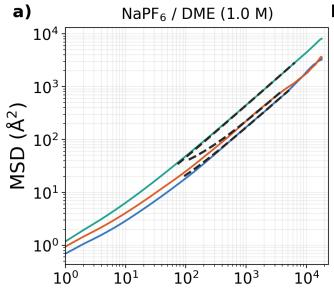

b)  
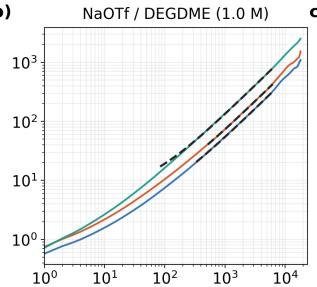  
c)

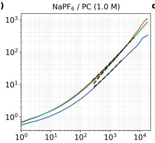

d)  
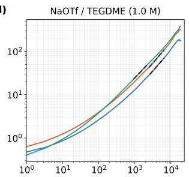

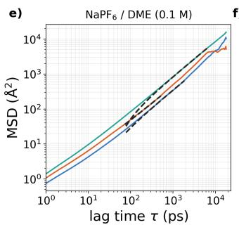

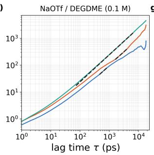

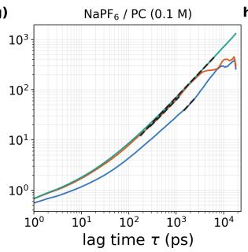  
h)

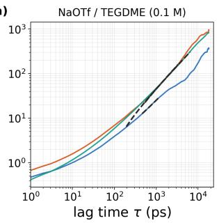  
Figure S6: Example MSD curves and Fickian difusivity fits. Time-origin-averaged mean-squared displacement of the cation, anion, and solvent for the PaiNN production NVT simulations of eight selected systems. Dashed black lines show the linear fit over the longest contiguous window whose logarithmic slope deviates at most 15% from 1.

## S11 Viscosity calculation details

## S11.1 Example Green–Kubo viscosity integrals

Figure S7 illustrates how the shear viscosities in Section S9 are calculated, using the same eight systems as Figure S6. In each panel, we show the running Green–Kubo integral $\eta ( \tau )$ of the stress autocorrelation function. The integral is averaged over the five independent traceless stress components, and evaluated up to a maximum lag time of 1 ns. We take stress samples every 2 fs, and discard the first 2 ns of each NVT run so that only equilibrium samples are used. The integral rises sharply at short timescales, since the stress is highly correlated, then levels of into noise as the correlations go to zero.

We extract the plateau value of η in the following way. First, we split the equilibrated 18 ns of stress data into five equal blocks, and compute the Green–Kubo integral for each. The shaded band is the standard deviation across the five blocks at each lag. The final fit then uses lags from 1 ps up to the first point where the standard deviation is greater than 40% of the running value of the integral. Everything beyond that point is discarded. Both the band and the running value are smoothed with a 5 ps moving average. The cut takes efect in panels $\mathbf { a - c } , \mathbf { f } ,$ and g; in the remaining panels, the noise stays below the threshold for the full 1 ns. The part of the integral that is kept is then fit with the double exponential given in Zhang et al. [8],

$$
\eta ( \tau ) ~ = ~ b _ { 1 } \bigl ( 1 - e ^ { - \tau / \tau _ { 1 } } \bigr ) ~ + ~ b _ { 2 } \bigl ( 1 - e ^ { - \tau / \tau _ { 2 } } \bigr ) , \qquad \eta _ { \infty } = b _ { 1 } + b _ { 2 } ,\tag{S6}
$$

where the fit is evaluated on 400 logarithmically spaced lags within the window. Each point is weighted by the inverse of the block band, so noisier points contribute less to the fit. The infinitetime limit $\eta _ { \infty }$ (dashed line) is the value reported for that replica. We finally average over our four replicas to get the reported viscosity for each system.

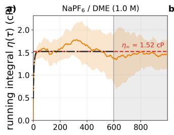  
b)

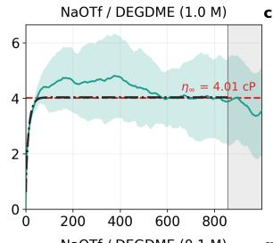  
c)

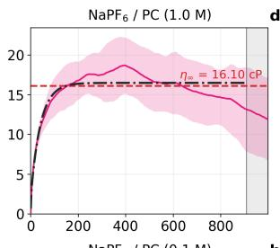  
d)

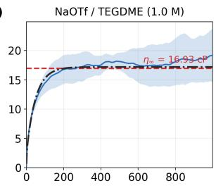

f)  
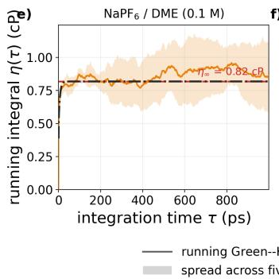

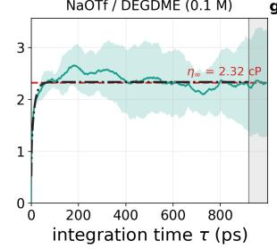  
g)

h)  
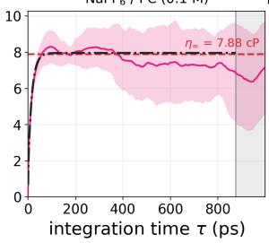

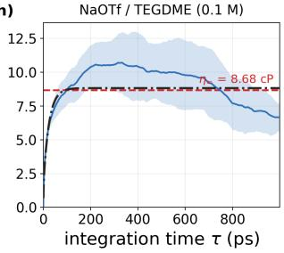  
Figure S7: Example running Green–Kubo viscosity integrals. Running Green–Kubo integral $\eta ( \tau )$ of the stress autocorrelation function for eight 20 ns PaiNN replicas. The shaded band denotes the standard deviation across five equal time blocks. The dash-dotted black curve is the double-exponential timedecomposition fit (Equation (S6)). The gray region is excluded from the fit due to noise. The dashed red line denotes the extrapolated infinite-time limit $\eta _ { \infty } .$ , which is the final viscosity value reported for the replica.

## S11.2 Expected viscosity overshoot from the density bias

Since both the UMA-OMol teacher model and the student overshoot the experimental density, we ask how this bias impacts the simulated transport coeficients downstream. Each NVT production box is held at the density predicted by its own model, and both UMA-OMol and the distilled students routinely overpredict the density by $\delta \ : = \ : 6 { - } 1 5 \%$ compared to experiment (Table S7). Writing the viscosity of the liquid as a function of density and temperature, $\eta ( \rho , T )$ , and the simulated density as $\rho _ { \mathrm { s i m } } = \left( 1 + \delta \right) \rho _ { \mathrm { e x p } }$ , we are interested in how this change in density at constant temperature impacts the viscosity downstream; in other words,

$$
\frac { \eta _ { \mathrm { s i m } } } { \eta _ { \mathrm { e x p } } } = \frac { \eta \bigl ( ( 1 + \delta ) \rho _ { \mathrm { e x p } } , T \bigr ) } { \eta ( \rho _ { \mathrm { e x p } } , T ) } .\tag{S7}
$$

In the rest of this section, we estimate this ratio for the liquids considered here, given a $\delta$ of 6–15%.

Viscosity is hypersensitive to density. Liquids at room temperature consist of densely packed molecules, and are nearly incompressible on the scale of a few hundred MPa. When compression does happen, the reduction in space is absorbed almost entirely by the free volume between molecules; the bonds in the actual molecules are compressed very little. Flow, or the rearrangement of molecules, requires a molecule to find a free space of at least its size, so the viscosity depends directly on the free volume in the liquid, rather than the total volume. The classic statement of this idea is Doolittle’s equation [9], which Cohen and Turnbull later derived from a statistical model of void redistribution [10],

$$
\eta = A \exp \left( B \frac { v _ { 0 } } { v - v _ { 0 } } \right) ,\tag{S8}
$$

where v is the specific volume, $v _ { 0 }$ the “occupied” volume of the molecules, $v _ { \mathrm { f } } = v - v _ { 0 }$ the free volume, and A, B are constants with B of order one. To measure the sensitivity of $\eta$ with respect to the density, we take the logarithm of the above, ln η = ln $A + B v _ { 0 } / ( v - v _ { 0 } )$ , and diferentiate with respect to ln $\rho$ holding the occupied volume $v _ { 0 }$ fixed. Holding $v _ { 0 }$ fixed is the central assumption of the freevolume picture, since the compression is absorbed entirely by $v _ { \mathrm { f } }$ . Since $\rho = 1 / v , \partial / \partial \ln \rho = - v \partial / \partial v$ and $\partial ( v - v _ { 0 } ) ^ { - 1 } / \partial v = - ( v - v _ { 0 } ) ^ { - 2 }$ , so

$$
n \equiv \left( \frac { \partial \ln \eta } { \partial \ln \rho } \right) _ { T } = - v \frac { \partial } { \partial v } \bigg [ B \frac { v _ { 0 } } { v - v _ { 0 } } \bigg ] = B \frac { v _ { 0 } v } { ( v - v _ { 0 } ) ^ { 2 } } = B \frac { 1 - f } { f ^ { 2 } } , \qquad f \equiv \frac { v _ { \mathrm { f } } } { v } ,\tag{S9}
$$

where the last step substitutes $v - v _ { 0 } = f v$ and $v _ { 0 } = ( 1 - f ) v$ . The $1 / f ^ { 2 }$ factor is what makes n large. For a small density overshoot, we get $\Delta$ ln $\eta \approx n \Delta$ ln $\rho = n \ln ( 1 + \delta )$ , i.e.

$$
\frac { \eta _ { \mathrm { s i m } } } { \eta _ { \mathrm { e x p } } } \approx ( 1 + \delta ) ^ { n } ,\tag{S10}
$$

treating n as constant over the compression (according to Equation (S9) it actually grows as $f$ shrinks, so this slightly underestimates the efect). The exponent n is system-dependent. As a representative example, take $B = 1$ and a free-volume fraction $f = 0 . 2 5$ , which are values close to Doolittle’s fits for the normal alkanes at room temperature [9]. Then Equation (S9) gives $n = 0 . 7 5 / 0 . 0 6 2 5 = 1 2$ . Concretely, making the liquid 10% denser reduces its volume by 9%, and because all of that loss comes out of the free volume, $v _ { \mathrm { f } }$ falls from 0.25v to 0.16v, a 36% reduction; Equation (S10) then gives $\eta _ { \mathrm { s i m } } / \eta _ { \mathrm { e x p } } \approx 1 . 1 ^ { 1 2 } \approx 3$

The free-volume model, while illustrative, is a crude approximation. First, it assumes that v0 is fixed, which is only valid for small compressions. For high-pressure data, the occupied volume of the molecules can actually shrink with pressure (for example, the pressure-dependent $V _ { 0 }$ that Comuñas et al. report for TEGDME in Table 4 of Ref. [11] falls from 211.6 to 205.7 cm3 mol−1 between 20 and 100 MPa), and a shrinking $v _ { 0 }$ makes $\eta$ rise more slowly than Equation (S9) predicts. Furthermore, fixing v0 causes $\eta  \infty$ once the volume has been reduced by the fraction $f ,$ because at that point the model predicts zero free volume; in real liquids, the occupied volume also starts to decrease. The model does, however, capture why viscosity is very sensitive to small changes in the density: compressing a liquid disproportionately afects the free volume, the quantity that controls flow. We turn to measurements for realistic values of n for our systems.

The viscosity rise in real liquids. High-pressure viscometry can be used to measure n directly, by recording η along an isotherm while compressing the liquid under high pressures. If the density is measured simultaneously, $n = \Delta \ln \eta / \Delta$ ln $\rho$ follows directly. We focus our analysis on TEGDME below, where measured η–density curves exist in the literature.

Comuñas et al. [12] measured the density of TEGDME up to 60 MPa, and the viscosity up to 100 MPa using a falling-ball viscometer, along isotherms ranging from 283 to 353 K. Along the 293.15 K isotherm (Tables I and IV of that paper), the density rises from 1.0112 to $1 . 0 4 3 5 ~ \mathrm { g c m ^ { - 3 } }$ between 0.1 and 60 ${ \mathrm { M P a } } ,$ an increase of only 3.2%, while the viscosity rises from 3.82 to 6.03 mPa s, a factor of 1.58. The measured exponent over 0.1–60 MPa is then

$$
n = { \frac { \ln ( 6 . 0 3 / 3 . 8 2 ) } { \ln ( 1 . 0 4 3 5 / 1 . 0 1 1 2 ) } } = 1 4 . 5 .\tag{S11}
$$

Inspecting the table, n grows with compression as the free-volume picture predicts (13 over 0.1– 20 MPa, 16 over 40–60 MPa). At 100 MPa the viscosity reaches 7.99 mPa s, but the density was not measured above 60 MPa. To obtain a state point at 100 MPa, we use the modified Tait equation shown in the paper’s Eq. 2:

$$
\rho ( p ) = \frac { \rho ( p _ { \mathrm { a t m } } ) } { 1 - C _ { \mathrm { T } } \ln \left[ \displaystyle \frac { B _ { \mathrm { T } } + p } { B _ { \mathrm { T } } + p _ { \mathrm { a t m } } } \right] } ,\tag{S12}
$$

where $p _ { \mathrm { a t m } } = 0 . 1$ MPa, and $B _ { \mathrm { T } }$ and $C _ { \mathrm { T } }$ are parameters to be fitted. From these two parameters we can obtain the compressibility at atmospheric pressure, $C _ { \mathrm { T } } / ( B _ { \mathrm { T } } + p _ { \mathrm { a t m } } )$ . The authors fit the form of Equation (S12) to their full $( T , p )$ data, but do not list their parameters. To fill the gap, we fit $B _ { \mathrm { T } }$ and $C _ { \mathrm { T } }$ to the thirteen densities they tabulate at $T = 2 9 3 . 1 5 \mathrm { ~ K ~ }$ , and obtain $C _ { \mathrm { T } } = 0 . 0 8 3$ and $B _ { \mathrm { T } } = 1 3 3 \ \mathrm { M P a }$ . The fit reproduces the measured densities to $1 . 5 \times 1 0 ^ { - 4 } ~ \mathrm { g c m ^ { - 3 } }$ and gives an atmospheric-pressure compressibility of $6 . 2 \times 1 0 ^ { - 4 } \ \mathrm { M P a ^ { - 1 } }$ , matching the $6 . 0 \times 1 0 ^ { - 4 }$ the authors list at 5 MPa. When we evaluate Equation (S12) at 100 MPa, we get a density rise of 4.9%. This, alongside the 2.09 viscosity rise at that pressure, corresponds to an exponent of $n = 1 5 . 5$ , close to the $n = 1 4 . 5$ value we got at lower pressures. Thus, $n \approx 1 4 . 5 \colon$ a 1% increase in the density of TEGDME at room temperature raises its viscosity by about 15%.

To expand our analysis beyond one solvent, we also utilize Bridgman’s survey of forty-three liquids [13, 14], which lists, for each liquid, the logarithm of the ratio of its viscosity at a given pressure to its viscosity at atmospheric pressure. Using the $3 0 ~ ^ { \circ } \mathrm { C }$ entries at 2000 kg $\mathrm { c m ^ { - 2 } }$ (196 MPa), the ratio η(196 $\mathrm { M P a } ) / \eta ( 0 . 1 \mathrm { M P a } )$ for the unassociated organic liquids in the table is 2–4.4 $\mathrm { ( C S _ { 2 } 2 . 0 }$ acetone 2.4, ethyl acetate 2.9, toluene 3.1, n-pentane 3.3, ethyl ether 3.3, n-hexane 3.6, n-octane 4.4). Bridgman notes that the increase is larger the more complicated the molecule. Bridgman does not report densities, but 196 MPa typically compresses liquids of this kind by around 10% (for TEGDME, the Tait extrapolation above gives 8.1%), so these 2–4.4 increases in the viscosity, combined with $\mathrm { a \sim } 1 0 \%$ increase in the density, correspond to $n \approx 7 – 1 8$ , reinforcing the TEGDME exponent from Comuñas et al.

Now that we have an estimate of n  14.5 for liquids like ours, we can calculate what the viscosity overshoot would be given our average density overshoot of $\delta = 9 . 4 \%$ (Table S7). Plugging $n = 1 4 . 5$ into Equation (S10), we get $1 . 0 9 4 ^ { 1 4 . 5 } = 3 . 7 \times$ for the average density overshoot; a 3.1–4.0 increase in the viscosity for the 8–10% overshoot of the TEGDME boxes; and a 2.3–5.9 viscosity overshoot across the full 6–13% range of student density errors. We conclude that an isothermal compression of ${ \sim } 1 0 \%$ should be expected to raise the viscosity of liquids like ours by a factor of 3–4, so the observed geometric-mean viscosity overshoot of $2 . 1 \times ( \mathrm { F i g . 3 }$ of the main text; Table S10) is in the right ballpark. The remaining gap in our predictions is expected: our liquids also contain ions, while Comuñas et al. and Bridgman only measure pure liquids; the exponent is also solvent-specific, and Equation (S10) is only an approximation. The above analysis is only a plausibility estimate, not proof of direct causation. The mapping from density error to viscosity error additionally assumes that the potential reproduces $\eta ( \rho , T )$ of the real liquid, which is not necessarily guaranteed: a potential can also incorrectly estimate the viscosity, even given the correct density.

## S12 Conductivity

## S12.1 Justifying the choice of conductivity calculation

The ionic conductivity is often calculated using the Nernst–Einstein (NE) relation [15, 16], which uses only the difusion coeficients of the charged species to obtain the conductivity:

$$
\sigma _ { \mathrm { N E } } = \frac { \beta e ^ { 2 } } { V } \sum _ { i } N _ { i } z _ { i } ^ { 2 } D _ { i } ,\tag{S13}
$$

where $\beta = 1 / ( k _ { B } T )$ is the inverse temperature, e the elementary charge, V the simulation-cell volume, and the sum runs over the ionic species $i ,$ each contributing $N _ { i }$ ions of charge number $z _ { i }$ and self-difusion coeficient $D _ { i }$

Because the Nernst–Einstein equation only requires self-difusivities, it is easy to compute. However, the equation assumes that all charged species move independently of each other, which is not necessarily the case in real electrolytes. Cations and anions tend to pair together, and ions with the same charge push each other apart, so the cross terms in the double sum of Equation (S29) typically make a negative contribution to the current [15, 17]. The NE estimate therefore systematically overpredicts the conductivity, especially at high concentration [15, 16].

To capture cross-correlations, we instead calculate the conductivity with the Onsager transport framework [17, 18], which retains the cross-correlation terms discarded by Nernst–Einstein. The ratio $\sigma _ { \mathrm { O n s a g e r } } / \sigma _ { \mathrm { N E } } .$ , called the ionicity [15], helps quantify the impact of cross-correlations on the conductivity. In the following subsection, we derive the Onsager estimator used.

## S12.2 Derivation of the Onsager conductivity

We start with the definition of the macroscopic total electrical current $\mathbf { J } ( t )$ in a volume $V ,$ where the sum runs over all N charged particles with charges $q _ { k }$ and velocities $\mathbf { v } _ { k } ( t )$ [15]:

$$
\mathbf { J } ( t ) = \sum _ { k = 1 } ^ { N } q _ { k } \mathbf { v } _ { k } ( t ) .\tag{S14}
$$

According to the Green–Kubo relations from linear response theory [19, 20, 15, 17], the conductivity $\sigma$ is defined as the time integral of the current auto-correlation function. Using the inverse temperature $\beta = 1 / ( k _ { B } T )$ :

$$
\sigma = \frac { \beta } { 3 V } \int _ { 0 } ^ { \infty } \langle \mathbf { J } ( 0 ) \cdot \mathbf { J } ( t ) \rangle d t .\tag{S15}
$$

We now relate the conductivity to collective displacements. We define the total dipole moment of the cell M(t) [15] as:

$$
\mathbf { M } ( t ) = \sum _ { k = 1 } ^ { N } q _ { k } \mathbf { r } _ { k } ( t ) .\tag{S16}
$$

Taking the time derivative gives the current:

$$
\begin{array} { r } { \dot { \bf M } ( t ) = { \bf J } ( t ) . } \end{array}\tag{S17}
$$

Substituting this back into the Green–Kubo expression gives:

$$
\sigma = \frac { \beta } { 3 V } \int _ { 0 } ^ { \infty } \langle \dot { \bf M } ( 0 ) \cdot \dot { \bf M } ( t ) \rangle d t .\tag{S18}
$$

Next, we analyze the mean squared change in collective displacement over a time interval t, $\begin{array} { r } { \Delta \mathbf { M } ( t ) = \mathbf { M } ( t ) - \mathbf { M } ( 0 ) = \int _ { 0 } ^ { t } \dot { \mathbf { M } } ( s ) d s } \end{array}$ . Expanding the square:

$$
\begin{array} { r l r } {  { \langle | \Delta \mathbf { M } ( t ) | ^ { 2 } \rangle =  ( \int _ { 0 } ^ { t } \dot { \mathbf { M } } ( t _ { 1 } ) d t _ { 1 } ) \cdot ( \int _ { 0 } ^ { t } \dot { \mathbf { M } } ( t _ { 2 } ) d t _ { 2 } )  } } \\ & { } & { = \int _ { 0 } ^ { t } \int _ { 0 } ^ { t } \langle \dot { \mathbf { M } } ( t _ { 1 } ) \cdot \dot { \mathbf { M } } ( t _ { 2 } ) \rangle d t _ { 1 } d t _ { 2 } . } \end{array}\tag{S19}
$$

By the time-translation invariance of equilibrium systems, this double integral simplifies to [15]:

$$
\langle | \Delta \mathbf { M } ( t ) | ^ { 2 } \rangle = 2 \int _ { 0 } ^ { t } ( t - \tau ) \langle \dot { \mathbf { M } } ( \tau ) \cdot \dot { \mathbf { M } } ( 0 ) \rangle d \tau .\tag{S20}
$$

We evaluate the long-time limit of the time derivative of this quantity. Utilizing Leibniz’s Integral Rule:

$$
\operatorname* { l i m } _ { t  \infty } \frac { \partial } { \partial t } \langle | \Delta \mathbf { M } ( t ) | ^ { 2 } \rangle = \operatorname* { l i m } _ { t  \infty } 2 \int _ { 0 } ^ { t } \langle \dot { \mathbf { M } } ( \tau ) \cdot \dot { \mathbf { M } } ( 0 ) \rangle d \tau = 2 \int _ { 0 } ^ { \infty } \langle \dot { \mathbf { M } } ( \tau ) \cdot \dot { \mathbf { M } } ( 0 ) \rangle d \tau .\tag{S21}
$$

Using the asymptotic relation lim $\begin{array} { r } { \mathsf { 1 } _ { t \to \infty } \frac { \partial } { \partial t } f ( t ) = \operatorname* { l i m } _ { t \to \infty } \frac { f ( t ) } { t } } \end{array}$ for these bounds, we write:

$$
\operatorname* { l i m } _ { t \to \infty } \frac { \langle | \Delta \mathbf { M } ( t ) | ^ { 2 } \rangle } { t } = 2 \int _ { 0 } ^ { \infty } \langle \dot { \mathbf { M } } ( \tau ) \cdot \dot { \mathbf { M } } ( 0 ) \rangle d \tau .\tag{S22}
$$

Substituting this result back into our Green–Kubo conductivity expression gives the Einstein relation for the collective displacement [15, 16]:

$$
\sigma = \operatorname* { l i m } _ { t \to \infty } \frac { \beta } { 6 V t } \langle | \Delta \mathbf { M } ( t ) | ^ { 2 } \rangle .\tag{S23}
$$

To evaluate this, we expand the change in the total dipole moment, $\begin{array} { r } { \Delta \mathbf { M } ( t ) = \sum _ { k = 1 } ^ { N } q _ { k } [ \mathbf { r } _ { k } ( t ) - \mathbf { \Lambda } } \end{array}$ $\mathbf { r } _ { k } ( 0 ) ]$ . We group the system by ionic species. For a species i with $N _ { i }$ particles, we define the per-species displacement correlation function $C _ { i j } ( t )$

$$
C _ { i j } ( t ) = \left. \left( \sum _ { k = 1 } ^ { N _ { i } } [ { \bf r } _ { i k } ( t ) - { \bf r } _ { i k } ( 0 ) ] \right) \cdot \left( \sum _ { l = 1 } ^ { N _ { j } } [ { \bf r } _ { j l } ( t ) - { \bf r } _ { j l } ( 0 ) ] \right) \right. .\tag{S24}
$$

This allows us to define the Onsager phenomenological coeficients $L _ { i j } \ [ 1 7 , 1 8 ]$ :

$$
L _ { i j } = \frac { \beta } { 6 V } \operatorname* { l i m } _ { t  \infty } \frac { 1 } { t } C _ { i j } ( t ) .\tag{S25}
$$

Given ionic valencies $q _ { i } = z _ { i } e$ , the macroscopic conductivity is represented as a weighted sum of these coeficients [17, 18]:

$$
\sigma = e ^ { 2 } \sum _ { i , j } z _ { i } z _ { j } L _ { i j } .\tag{S26}
$$

Finally, we decompose the total sum into self-difusion and cross-correlation terms:

$$
\sigma _ { \mathrm { O n s a g e r } } = \operatorname* { l i m } _ { t \to \infty } \frac { \beta } { 6 V t } \sum _ { i , j } \sum _ { k , l } q _ { i } q _ { j } \langle \Delta \mathbf { r } _ { i k } \cdot \Delta \mathbf { r } _ { j l } \rangle .\tag{S27}
$$

Separating the self terms $( i = j$ and $k = l )$ from the distinct-particle cross-terms $( i \neq j$ , or $i = j$ with k $\neq l )$ yields [15, 18]:

$$
\sigma _ { \mathrm { O n s a g e r } } = \frac { \beta } { V } \sum _ { i } N _ { i } q _ { i } ^ { 2 } D _ { i } ~ + ~ \operatorname* { l i m } _ { t  \infty } \frac { \beta } { 6 V t } \sum _ { i , j } \sum _ { k \neq l } q _ { i } q _ { j } \langle \Delta \mathbf { r } _ { i k } \cdot \Delta \mathbf { r } _ { j l } \rangle ,\tag{S28}
$$

where $\begin{array} { r } { D _ { i } = \operatorname* { l i m } _ { t  \infty } \frac { \langle | \Delta \mathbf { r } _ { i } | ^ { 2 } \rangle } { 6 t } } \end{array}$ is the self-difusion coeficient of species i [15]. The first term depends only on the single-ion self-difusivities and, using $q _ { i } ~ = ~ z _ { i } e$ , is identical to the Nernst–Einstein conductivity of Eq. (S13). We can therefore write

$$
\sigma _ { \mathrm { O n s a g e r } } = \sigma _ { \mathrm { N E } } ~ + ~ \operatorname* { l i m } _ { t \to \infty } \frac { \beta } { 6 V t } \sum _ { i , j } \sum _ { k \neq l } q _ { i } q _ { j } \langle \Delta \mathbf { r } _ { i k } \cdot \Delta \mathbf { r } _ { j l } \rangle ,\tag{S29}
$$

which makes explicit that the Onsager conductivity is the Nernst–Einstein estimate plus the distinctparticle cross-correlations that Nernst–Einstein neglects [15, 16, 18].

## S12.3 The conductivity outlier is a low-ionicity, correlation-dominated system

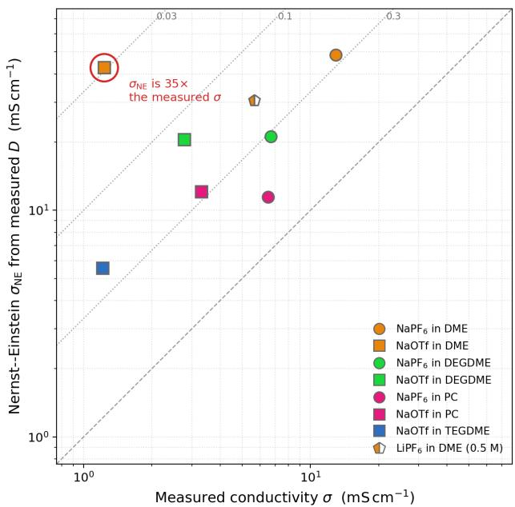  
Figure S8: Experimental Nernst–Einstein vs. measured conductivity for the concentrated systems. We plot the experimental Nernst–Einstein conductivity $\sigma _ { \mathrm { N E } }$ , obtained only from the experimentally measured difusivities, against the experimentally measured ionic conductivity $\sigma ,$ for the concentrated ( 0.5 M) systems. The farther a point lies above the $y = x$ line, the lower its experimental ionicity; dotted guides mark ionicities of 0.3, 0.1, and 0.03. NaOTf in DME is a clear outlier, with ion–ion cross-correlations reducing the conductivity from its Nernst–Einstein value by 97%. 1 M $\mathrm { N a P F _ { 6 } }$ in TEGDME is omitted, as it has no measured cation difusivity.

In Fig. 3 of the main text, 1 M NaOTf in DME has a much higher error in conductivity compared to the other 1 M systems. This system is also the 1 M system with the lowest ionicity: its ion–ion cross-correlations decrease the conductivity the most of any system. Figure S8 plots the experimental Nernst–Einstein conductivity against the experimentally measured conductivity for the concentrated systems. The Nernst–Einstein conductivity was obtained by inserting the experimentally measured self-difusivities into Eq. (S13). A system’s height above the parity line grows as its experimental ionicity, $\sigma / \sigma _ { \mathrm { N E } }$ , falls. NaOTf in DME’s ionicity is only 0.03, meaning that the Nernst–Einstein estimate overpredicts the true conductivity by roughly 35 . Every other concentrated electrolyte has an ionicity between roughly 0.1 and 0.6: for these systems, the crosscorrelation term cancels a smaller share of $\sigma _ { \mathrm { N E } }$ , so an error in the cross-correlations has a much smaller efect on the predicted $\sigma$ than it does for NaOTf/DME.

Reproducing the system’s conductivity depends on correctly capturing the ion–ion interactions that influence the cross-correlations, especially the interaction between cation and anion that binds oppositely charged pairs. We hypothesize that the student overpredicts the NaOTf/DME conductivity because the teacher it is distilled from, UMA-OMol, has a finite radial graph cutof that prevents it from fully capturing the true attractive force between cation–anion pairs. The student inherits this error, causing it to miss the correlation between oppositely charged ion pairs. In the next subsection, we inspect the teacher’s ion–ion interaction profiles with rigid vacuum scans, and find that the teacher under-binds the long-range part of the cation–anion attraction.

S12.4 Origin of the teacher’s conductivity error from rigid-scan interaction profiles  
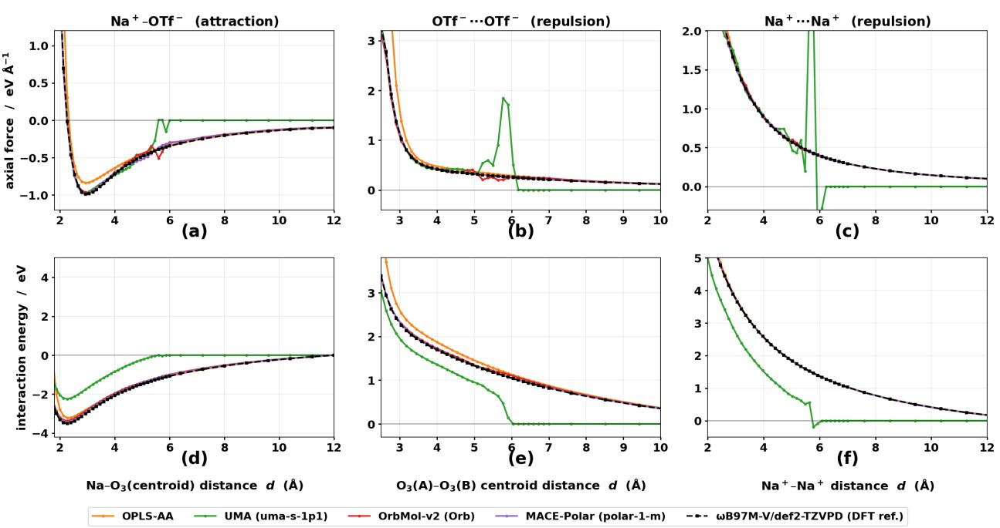  
Figure S9: Rigid-scan interaction profiles of the UMA-OMol teacher model. (a–c) Axial force and (d–f) interaction energy along rigid separation scans of three representative ion–ion pairs: the (a,d) $\mathrm { N a ^ { + } { - } O T f ^ { - } }$ attraction as a function of the $\mathrm { N a } { - } \mathrm { O } _ { 3 }$ centroid distance, the (b,e) OTf− OTf− repulsion as a function of the $\mathrm { O _ { 3 } ( A ) { - } O _ { 3 } ( B ) }$ centroid distance, and the $( { \bf c , f } ) \ \mathrm { N a ^ { + } { \cdot \cdot \cdot \mathrm { N a ^ { + } } } }$ repulsion as a function of the $\mathrm { N a ^ { + } { - } N a ^ { + } }$ distance. We display several diferent potentials: $\mathrm { O P L S  – A A }$ (orange), UMA-OMol (uma-s-1p1, green), OrbMol-v2 (red), and MACE-Polar (checkpoint polar-1-m, purple). As a reference, we show DFT at the ωB97M-V/def2-TZVPD level of theory (black dashed). UMA-OMol’s finite radial graph cutof causes the interaction energies and forces to contain kinks, and to abruptly truncate to zero between 5 and 6 Å.

To test whether the teacher’s interactions explain the student’s underestimated ion–ion correlations and overpredicted conductivity for NaOTf/DME, we inspect NaOTf/DME’s pairwise ion–ion interactions with rigid vacuum scans. For each ion pair, we hold the internal geometry of each ion fixed, and vary the distance between the ions, recording the interaction energy and axial force along the scan. We do this for several potentials, including three diferent MLIPs and the OPLS-AA baseline. We compare all potentials against the ωB97M-V/def2-TZVPD DFT level of theory, as shown in Figure S9.

The figure shows two main results. First, at short range, the forces of the MLIPs track the DFT reference more closely than those of OPLS-AA, as expected, since the MLIPs were all trained on DFT labels at the ωB97M-V/def2-TZVPD level of theory. Second, UMA-OMol, unlike the other two MLIPs, develops non-physical kinks in its force profiles. Its forces and energies also go to zero by 6 Å, as a result of UMA-OMol’s 6 Å radial graph cutof. This force truncation suppresses the long-range tail of the ion–ion interactions, which likely prevents the full efect of ion–ion correlations from materializing during simulations. This could explain why the student, which inherits these interactions from the teacher, overpredicts the NaOTf/DME conductivity.

## S13 Convergence analysis

## S13.1 Expanding-window convergence

To verify that the transport coeficients are converged at the 20 ns production simulation length, as well as to illustrate that long timescales are needed for convergence, we recompute estimates of our self-difusivities, viscosities, and conductivities using varying window lengths of simulation. For each observable, we fix the equilibration cut $t _ { \mathrm { s t a r t } }$ , then sweep the window end $t _ { \mathrm { e n d } }$ and recompute the observable on each window. We plot the values of the transport coeficients in Figure S10, normalized to the value at the end of the full 20 ns trajectory. Every system starts of noisy and fluctuating, indicating that timescales greater than a few ns are needed to converge transport coeficients. However, the coeficients settle inside a 5% band of their final values well before the end of the 20 ns trajectory, indicating convergence.

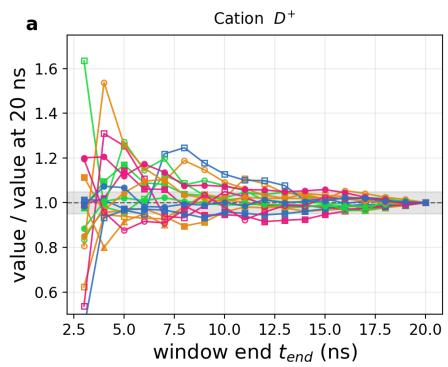

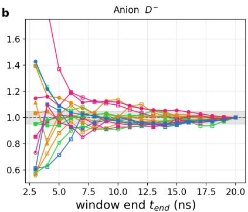

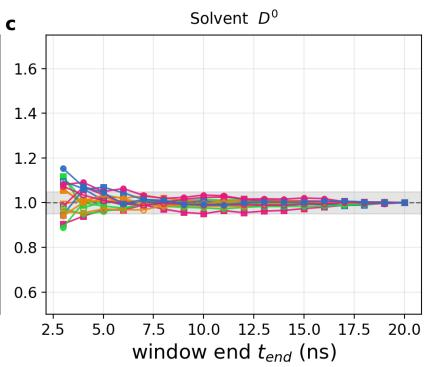

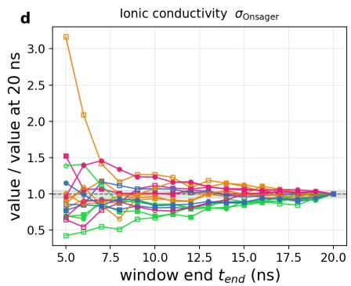

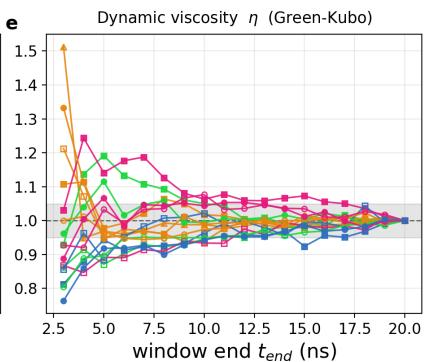  
Figure S10: Expanding-window convergence of the transport observables. Each transport coeficient is recomputed over windows of increasing length. We plot each value against the window end tend $t _ { \mathrm { e n d } }$ (the total simulation time used), normalized to the final value at the full 20 ns window: (a–c) the cation $D ^ { + }$ anion $D ^ { - }$ , and solvent $D ^ { 0 }$ self-difusivities; (d) the Onsager ionic conductivity $\sigma ;$ and (e) the Green–Kubo shear viscosity $\eta .$ The dashed line marks the converged value $( y = 1 )$ and the shaded band 5%. All observables are unconverged within the first few ns, but settle within the 5% band before 20 ns has elapsed. To compare diferent-length trajectories on equal terms, we fit D and σ over a fixed 250–1000 ps lag range rather than the per-species Fickian window (D) and the 0.5–2 ns range (σ) used for the reported values; η uses the production estimator.

## S13.2 Error analysis

Previous works have derived theoretical bounds on the relative error of transport coeficients estimated from Green–Kubo integration methods, due to finite simulation time [21]. The “ground truth” here is the ensemble value of the transport coeficient under our force field—that is, the value we would obtain if we simulated for infinitely long. Experimental values do not enter the analysis anywhere. The bound thus gives us an error estimate between the calculated value from a finite trajectory and the true simulated value, before we compare anything to the experimental value.

We use Jones and Mandadapu’s bound for the relative error of a Green–Kubo estimate from a single trajectory [21]:

$$
\frac { \mathrm { s t d } [ D ( \tau _ { c } ) ] } { D } \leq 2 \sqrt { \frac { \tau _ { c } } { \tau } } ,\tag{S30}
$$

where $\begin{array} { r } { D ( \tau _ { c } ) = \int _ { 0 } ^ { \tau _ { c } } C ( t ) } \end{array}$ dt is the Green–Kubo estimate from a single trajectory of length $\tau , C ( t )$ is the relevant flux autocorrelation function, $\tau _ { c }$ is the upper limit of the Green–Kubo integral, D is the ensemble value of the transport coeficient, and $\mathrm { s t d } [ D ( \tau _ { c } ) ]$ is the standard deviation of the estimator over independent realizations. The left-hand side of the equation is therefore the relative error: the standard error of the simulated estimator divided by the mean. The bound is subject to the following assumptions:

$\tau _ { c } \gg \tau _ { C }$ , where $\tau _ { C }$ is the decorrelation time of the flux autocorrelation function;

• the simulation trajectory used is in equilibrium;

• for multi-replica simulations, the replicas are independent and identically distributed.

The bound can also be extended to the case of multiple replicas:

$$
\frac { \mathrm { s t d } [ \bar { D } ( \tau _ { c } ) ] } { D } \leq 2 \sqrt { \frac { \tau _ { c } } { \tau } } \frac { 1 } { \sqrt { N _ { r } } } ,\tag{S31}
$$

where $N _ { r }$ is the number of independent replicas and $\bar { D } ( \tau _ { c } )$ is the mean of the single-trajectory estimates. $\tau _ { c }$ is a property of the system being studied; the Methods of the main text and Section S11 describe how the integration cutof is chosen for each simulation.

We can calculate this bound to get an upper limit on the uncertainty of our viscosity estimates, which we compute via Green–Kubo integration of the stress autocorrelation function. Plugging in $N _ { r } = 4$ replicas, $\tau = 1 8$ ns of equilibrated stress data per replica, and $\tau _ { c } = 1$ ns (the maximum lag of the running viscosity integral),

$$
\frac { \mathrm { s t d } [ \bar { \eta } ] } { \eta } \leq \frac { 2 } { \sqrt { 4 } } \sqrt { \frac { 1 \mathrm { n s } } { 1 8 \mathrm { n s } } } \approx 2 4 \% .\tag{S32}
$$

This is a conservative worst-case bound. In practice, the cutof is chosen per system and usually falls below 1 ns, the fit weights points by their inverse variance rather than weighting all lags up to the cutof equally, the fit points are logarithmically spaced so later lag times contribute less to the fit, and the autocorrelation is averaged over five approximately independent stress components [22]. Consistent with this, the actual standard error is much smaller than the bound above. The replica-to-replica spread of the viscosities reported in Table S10 corresponds to a standard error of the four-replica mean of around 2–5%, and at most 10%.

The bound can also be applied to self-difusivity, if calculated via Green–Kubo integration of the velocity autocorrelation function. We use the 1 M NaOTf/DME system as a demonstration. We run 32 replicas of 20 ns with our MLP student (Section S14), discard the first 1 ns of each for equilibration, and use the remaining 19 ns to calculate the self-difusivities with the Green–Kubo method. We choose 20 ps as our integration cutof to ensure that $\tau _ { c } \gg \tau _ { C }$ , as verified in Figure S12.

Results for the relative error, as well as the underlying theoretical bound, are shown in Figure S11. The figure shows that the relative error of the estimated difusivity can reach as low as 1%, and is much lower than the bound.

As a sanity check, we compare the Green–Kubo self-difusivity with the self-difusivity from the mean-squared displacement (MSD) in Table S11. Neither value includes the finite-size correction. The two estimates agree within 16% for all three species.

Table S11: Self-difusivities of the 1 M NaOTf/DME system simulated with the MLP student at 298 K, from the MSD and from the Green–Kubo integral with $\tau _ { c } = 2 0$ ps, both without the finite-size correction. Entries are mean std over replicas (4 replicas for the MSD and 32 replicas for Green–Kubo). All values in $1 0 ^ { - 1 0 } ~ \mathrm { m } ^ { 2 } / \mathrm { s }$
<table><tr><td>Species</td><td> $D _ { \mathrm { M S D } }$ </td><td> $D _ { \mathrm { G K } }$ </td></tr><tr><td> $\mathrm { N a ^ { + } }$ </td><td> $3 . 6 9 \pm 1 . 1 8$ </td><td> $4 . 0 2 \pm 0 . 0 8$ </td></tr><tr><td> $\mathrm { O T f ^ { - } }$ </td><td> $4 . 4 9 \pm 1 . 0 1$ </td><td> $5 . 1 8 \pm 0 . 1 3$ </td></tr><tr><td>DME</td><td> $1 0 . 2 2 \pm 0 . 2 5$ </td><td> $1 1 . 6 8 \pm 0 . 0 9$ </td></tr></table>

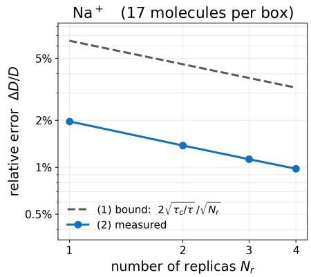

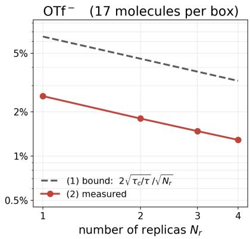

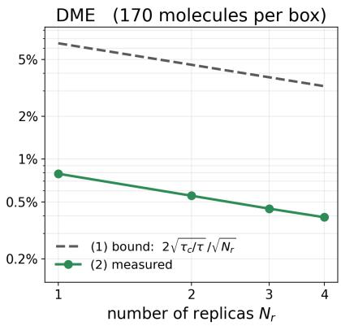  
Figure S11: Relative error of the self-difusivities against the number of replicas. Relative error of the Green–Kubo self-difusivities of $\mathrm { N a ^ { + } , O T f ^ { - } }$ , and DME in the 1 M NaOTf/DME system, as a function of the number of replicas $N _ { \tau }$ averaged in the estimate. The dashed line is the theoretical upper bound on the relative error, $2 \sqrt { \tau _ { c } / \tau } / \sqrt { N _ { r } }$ , with $\tau _ { c } = 2 0$ ps and $\tau = 1 9 \mathrm { n s }$ . The solid line is the measured relative error: for each $N _ { r }$ , we form eight independent N -replica means from $8 N _ { r }$ of the 32 replicas (e.g. 8 replicas for $N _ { r } = 1$ , 16 for $N _ { r } = 2 )$ and report the relative standard deviation across these eight means. The measured error decreases with $N _ { r }$ and stays well below the bound for all three species.

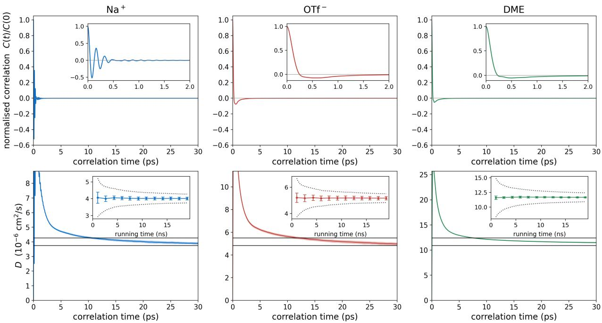  
Figure S12: Green–Kubo self-difusivity convergence for 1 M $\mathbf { N a O T f / D M E } .$ . Estimates of the (top) velocity autocorrelation and (bottom) self-difusivity with error bars for $\mathrm { N a ^ { + } }$ , OTf−, and DME. The inset in the top row is a close-up of the short-time correlation decay. The inset in the bottom row is the evolution of the estimate and error with simulation time. The shaded bands and error bars are the standard deviation over 32 replicas. The two horizontal lines in the bottom row mark the theoretical error bound for a single 19 ns trajectory, drawn around the difusivity at the $\tau _ { c } = 2 0$ ps integration cutof: they sit at $\pm 2 \sqrt { \tau _ { c } / \tau } \approx \pm 6 . 5 \%$ of $D ( \tau _ { c } )$ , with $\tau = 1 9$ ns. The running integral is shown out to 30 ps, past the cutof. The dotted lines in the bottom-row insets are the same bound evaluated at each running time τ, so they narrow as the trajectory grows.

## S14 The smaller multi-layer-perceptron student

As an ablation to test the speed–accuracy frontier of distilled models, we distill an even lighter student model, which runs around 100 faster than the UMA-OMol teacher it was distilled from (Section S4). The student’s architecture is a simple multi-layer perceptron (MLP) applied on top of a Filtered Overlap of Atomic Moments (FOAM) descriptor. We detail the model’s architecture and training in Section S14.1, and examine its transport properties compared to experiment in Section S14.2.

## S14.1 MLP student architecture and training

The faster student model employed here uses a fixed-form local FOAM descriptor, as implemented in FeNNol [23]. FOAM is a linearly filtered Smooth Overlap of Atomic Positions (SOAP)-type embedding [24]. Because FOAM is purely local, all cross-atom information enters through a single neighbor sum, making the model extremely fast. The FOAM descriptor is then converted into a scalar energy by the same type of energy head used for the PaiNN student. We also include a trainable short-range ZBL repulsion to prevent close nuclear contacts. Table S12 reports the full architecture and optimization settings. The distillation protocol, datasets, loss, and optimizer are the same as those of the PaiNN student (Section S2).

Table S12: Smaller MLP-student architecture and training settings. Identical across every system; only the per-system dataset and its loss normalizers difer. The training scheme (loss, optimizer, schedule) is identical to the PaiNN student in Table S2.
<table><tr><td>Setting</td><td>Value</td></tr><tr><td>Architecture</td><td></td></tr><tr><td>Backbone</td><td>FOAM descriptor + MLP head (FeNNol implementation)</td></tr><tr><td>Message passing</td><td>none (single-shot local descriptor)</td></tr><tr><td>Descriptor</td><td>FOAM (filtered SOAP-type invariants)</td></tr><tr><td>Angular order</td><td> $l _ { \mathrm { m a x } } = 2$ </td></tr><tr><td>Channels (nchannels)</td><td>32</td></tr><tr><td>Radial cutoff</td><td>5.1 Å</td></tr><tr><td>Radial basis</td><td>8 trainable Bessel functions</td></tr><tr><td>Cutoff switching</td><td>trainable polynomial (p = 3)</td></tr><tr><td>Species encoding</td><td>random, dim 32  $( Z _ { \mathrm { m a x } } = 8 6 )$ </td></tr><tr><td>Central-atom species</td><td>concatenated into descriptor</td></tr><tr><td>Readout head</td><td>eSEN energy head, 3-layer MLP (hidden 256)</td></tr><tr><td>Nonlinearity</td><td>SiLU</td></tr><tr><td>Short-range repulsion</td><td>trainable ZBL, inner cutoff 1.1 Å</td></tr><tr><td>Loss</td><td></td></tr><tr><td>Energy loss</td><td>per-atom MAE (weight 1)</td></tr><tr><td>Force loss</td><td>Euclidean-norm (L2) error (weight 1)</td></tr><tr><td>Stress loss</td><td>MAE (weight 1)</td></tr><tr><td>Loss normalization</td><td>dataset force RMS (all three terms)</td></tr><tr><td>Optimization</td><td></td></tr><tr><td>Optimizer</td><td>AdamW</td></tr><tr><td>Weight decay</td><td>10-3 (kernel weights)</td></tr><tr><td>Gradient clipping</td><td>100</td></tr><tr><td>LR schedule</td><td>one-cycle cosine, 1% warmup</td></tr><tr><td>Learning rate (init/peak/final)</td><td> $1 . 6 \times 1 0 ^ { - 4 } / 8 \times 1 0 ^ { - 4 } / 8 \times 1 0 ^ { - 6 }$ </td></tr><tr><td>Batch size</td><td>4</td></tr><tr><td>Epochs</td><td>275</td></tr><tr><td>Validation interval</td><td>every 5 epochs</td></tr><tr><td>EMA</td><td>none</td></tr></table>

## S14.2 Transport results

After training the MLP student, we use it to compute the transport coeficients of our sixteen electrolyte systems, with the same protocol as for PaiNN (four 20 ns NVT replicas, analyzed as in Section S9). Figure S13 compares its transport observables against experiment. The MLP student recovers the qualitatively correct transport behavior across diferent systems, but has systematically looser correlations against experiment than the PaiNN student. The model routinely misrepresents the PC systems, which appear far from parity for every transport coeficient shown. Ionic conductivity is degraded the most compared to PaiNN, with a log–log Pearson correlation of r = 0.45, against the PaiNN student’s 0.66. Overall, the MLP student preserves some of the teacher’s accuracy at a further 2.5 speedup over PaiNN; however, its reduced accuracy limits its practical use, and PaiNN, while slower, remains a much more viable model for distillation.

Experiment (cP)  
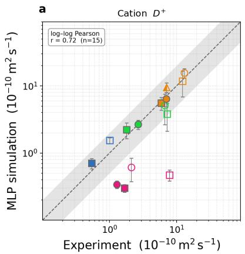

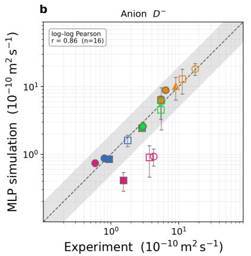

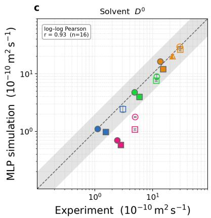

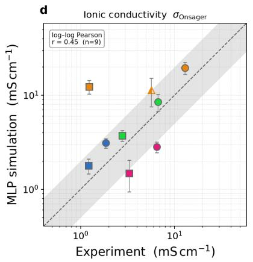

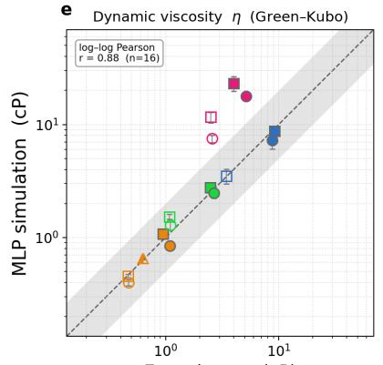

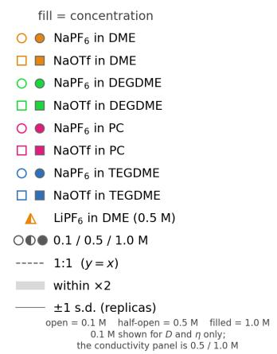  
Figure S13: The smaller MLP student trades transport accuracy for speed. Parity of MLPstudent simulation against experiment at 298 K for (a–c) the finite-size-corrected (Yeh–Hummer, simulated η) self-difusivities of the cation $D ^ { + }$ , anion $D ^ { - }$ , and solvent $D ^ { 0 } { } _ { i }$ ; (d) the Onsager ionic conductivity $\sigma ;$ and (e) the Green–Kubo shear viscosity η. Each point is the mean over four independent replicas and error bars show 1 s.d. across replicas. The conductivity panel shows the 0.5 M systems only.

## References

[1] Leela S. Dodda, Israel Cabeza de Vaca, Julian Tirado-Rives, and William L. Jorgensen. Ligpargen web server: an automatic opls-aa parameter generator for organic ligands. Nucleic Acids Research, 45(W1):W331–W336, 2017.

[2] José N. Canongia Lopes, Johnny Deschamps, and Agílio A. H. Pádua. Modeling ionic liquids using a systematic all-atom force field. The Journal of Physical Chemistry B, 108(6):2038–2047, 2004.

[3] George A. Kaminski and William L. Jorgensen. Host–guest chemistry of rotaxanes and catenanes: application of a polarizable all-atom force field to cyclobis(paraquat-p-phenylene) complexes with disubstituted benzenes and biphenyls. Journal of the Chemical Society, Perkin Transactions 2, (11):2365–2375, 1999.

[4] José N. Canongia Lopes and Agílio A. H. Pádua. Molecular force field for ionic liquids composed of triflate or bistriflylimide anions. The Journal of Physical Chemistry B, 108(43):16893–16898, 2004.

[5] Andreia S. L. Gouveia, Carlos E. S. Bernardes, Liliana C. Tomé, Elena I. Lozinskaya, Yakov S. Vygodskii, Alexander S. Shaplov, José N. Canongia Lopes, and Isabel M. Marrucho. Ionic liquids with anions based on fluorosulfonyl derivatives: from asymmetrical substitutions to a consistent force field model. Physical Chemistry Chemical Physics, 19(43):29617–29624, 2017.

[6] Johan Åqvist. Ion-water interaction potentials derived from free energy perturbation simulations. The Journal of Physical Chemistry, 94(21):8021–8024, 1990.

[7] In-Chul Yeh and Gerhard Hummer. System-size dependence of difusion coeficients and viscosities from molecular dynamics simulations with periodic boundary conditions. The Journal of Physical Chemistry B, 108(40):15873–15879, 2004.

[8] Yong Zhang, Akihito Otani, and Edward J. Maginn. Reliable viscosity calculation from equilibrium molecular dynamics simulations: A time decomposition method. Journal of Chemical Theory and Computation, 11(8):3537–3546, 2015.

[9] Arthur K. Doolittle. Studies in Newtonian flow. II. the dependence of the viscosity of liquids on free-space. Journal of Applied Physics, 22(12):1471–1475, 1951.

[10] Morrel H. Cohen and David Turnbull. Molecular transport in liquids and glasses. The Journal of Chemical Physics, 31(5):1164–1169, 1959.

[11] M. J. P. Comuñas, A. Baylaucq, C. Boned, and J. Fernández. Dynamic viscosity for HFC-134a + polyether mixtures up to 373.15 K and 140 MPa at low polyether concentration. measurements and modeling. Industrial & Engineering Chemistry Research, 43(3):804–814, 2004.

[12] M. J. P. Comuñas, A. Baylaucq, C. Boned, and J. Fernández. High-pressure measurements of the viscosity and density of two polyethers and two dialkyl carbonates. International Journal of Thermophysics, 22(3):749–768, 2001.

[13] P. W. Bridgman. The viscosity of liquids under pressure. Proceedings of the National Academy of Sciences, 11(10):603–606, 1925.

[14] P. W. Bridgman. The efect of pressure on the viscosity of forty-three pure liquids. Proceedings of the American Academy of Arts and Sciences, 61(3):57–99, 1926.

[15] Jean-Pierre Hansen and Ian R. McDonald. Theory of Simple Liquids: with Applications to Soft Matter. Academic Press, Oxford, 4 edition, 2013.

[16] Arthur France-Lanord and Jefrey C. Grossman. Correlations from ion pairing and the nernsteinstein equation. Physical Review Letters, 122(13):136001, 2019.

[17] Kara D. Fong, Helen K. Bergstrom, Bryan D. McCloskey, and Kranthi K. Mandadapu. Transport phenomena in electrolyte solutions: Non-equilibrium thermodynamics and statistical mechanics. AIChE Journal, 66(12):e17091, 2020.

[18] Kara D. Fong, Julian Self, Bryan D. McCloskey, and Kristin A. Persson. Onsager transport coeficients and transference numbers in polyelectrolyte solutions and polymerized ionic liquids. Macromolecules, 53(21):9503–9512, 2020.

[19] Melville S. Green. Markof random processes and the statistical mechanics of time-dependent phenomena. II. irreversible processes in fluids. The Journal of Chemical Physics, 22(3):398–413, 1954.

[20] Ryogo Kubo. Statistical-mechanical theory of irreversible processes. I. general theory and simple applications to magnetic and conduction problems. Journal of the Physical Society of Japan, 12(6):570–586, 1957.

[21] Reese E. Jones and Kranthi K. Mandadapu. Adaptive Green–Kubo estimates of transport coeficients from molecular dynamics based on robust error analysis. The Journal of Chemical Physics, 136(15):154102, 2012.

[22] Peter J. Daivis and Denis J. Evans. Comparison of constant pressure and constant volume nonequilibrium simulations of sheared model decane. The Journal of Chemical Physics, 100(1):541–547, 1994.

[23] Thomas Plé, Olivier Adjoua, Louis Lagardère, and Jean-Philip Piquemal. FeNNol: An eficient and flexible library for building force-field-enhanced neural network potentials. The Journal of Chemical Physics, 161(4):042502, 2024.

[24] Albert P. Bartók, Risi Kondor, and Gábor Csányi. On representing chemical environments. Physical Review B, 87(18):184115, 2013.