# Does System Size Matter in Uncertainty Quantification for Machine Learning Interatomic Potentials?

Chayaphol Lortaraprasert∗ Massachusetts Institute of Technology

Wenwen Li Preferred Networks wenwenli@preferred.jp

Nontawat Charoenphakdee Preferred Networks nontawat@preferred.jp

Yong-Bin Zhuang Preferred Networks ybzhuang@preferred.jp

Yuta Tsuboi Preferred Networks tsuboi@preferred.jp

## Abstract

Machine-learning interatomic potentials (MLIPs) commonly use uncertainty estimates to flag out-of-distribution (OOD) configurations and select structures for active learning. A key question is whether the resulting structure-level uncertainty scores remain comparable across different system sizes. A common practice is to aggregate per-atom uncertainties by their mean or maximum and compare the resulting score against a fixed threshold, implicitly assuming such comparability. We test this assumption across several in-distribution (ID)/OOD pairs by characterizing both aggregations as a function of atom count. The two aggregations exhibit distinct size dependencies. Mean aggregation remains size-independent for homogeneous systems but loses sensitivity to defects in large cells. In contrast, maximum aggregation grows with system size for ID systems while remaining approximately flat for defect-containing systems, narrowing the ID–OOD gap in a manner consistent with extreme-value statistics. Although highly uncertain atoms in large structures may indicate novel local environments, retraining on these structures yields little improvement, in contrast to retraining on OOD structures constructed to lie outside the training distribution. Our results reveal a practical limitation of size-unaware uncertainty criteria and motivate size-aware calibration for more reliable OOD detection in large-scale atomistic simulations.

## 1 Introduction

Machine learning interatomic potentials (MLIPs) accelerate atomistic simulations for materials discovery by fitting the potential energy surface from first-principles reference data and evaluating it orders of magnitude faster than density functional theory (DFT), giving near-DFT accuracy at a cost that scales linearly with the number of atoms [1–3]. Successive architectures, e.g., descriptor-based neural networks [1, 4], kernel models [2], graph neural networks [5], and equivariant message-passing models [6, 7] have steadily improved accuracy and data efficiency. More recently, universal or foundation potentials trained on large DFT databases [8–13] have made it routine to run atomistic simulations across the periodic table without system-specific fitting, and MLIP-driven molecular dynamics now reaches system sizes and time scales far beyond what DFT allows [14, 15].

MLIPs accuracy typically degrades on local atomic environments absent from the training set, and this degradation is silent without an uncertainty estimate [3, 16]. Uncertainty quantification (UQ) can be useful to flag unreliable predictions during simulation [17–19]. Moreover, it can drive active learning loops that select structures for DFT labeling and iterative retraining [19–24]. Common UQ metrics include ensemble disagreement [17, 25, 26], Gaussian process [19], distance or committee-free measures based on descriptor-space novelty [27, 28].

Growing compute has pushed MLIP-driven simulations towards ever larger systems of up to millions of atoms in production MD [14, 15], and active learning datasets become increasingly mixedsize. Structure-level uncertainty scores, however, are built without size consideration. Per-atom uncertainties, including force uncertainties [17, 19, 22, 29] and descriptor-space extrapolation grades [20, 30, 31], are reduced to a single score by the maximum [19, 20, 22, 29, 30, 32, 33], or mean of the atom-wise score over all atoms [17, 24, 34], a choice presented as convention rather than justified; other workflows threshold a global energy disagreement directly [21, 23]. The score is then compared against a fixed threshold calibrated on small reference cells [19, 30, 32, 33]. Both conventions thus assume that a structure-level score is comparable across system sizes, which could affect UQ scores. However, previous studies on system size effects are only limited to total energy uncertainty [21, 35]. Whether the maximum or mean UQ stays comparable as the system size grows is still an open question.

In this work, we investigate how mean and maximum per-atom force uncertainty scale with system size for multiple different in-distribution (ID)/OOD pairs using MACE [7] and ORB [13] ensembles and a single-model Force-Delta uncertainty estimate. We find that mean uncertainty is size-independent for homogeneous systems and converges to pristine for defective ones, while maximum uncertainty increases with system size for ID systems and stays flat for a defect, eliminating the ID/OOD gap at large sizes and hence could fail OOD detection based on size-unaware UQ score. We attribute this to extreme-value statistics and verify that the atoms with max uncertainty in large structures have unfamiliar local environment and high error, yet find that retraining on these structures UQ flags as OOD yields little model improvement, whereas retraining on small OOD-by-design structures is cheaper and improves the model significantly. This shows a limitation of current UQ methods that do not take size into account for OOD detection. In Appendix C.5, we explore a trainable post-hoc, size-aware uncertainty calibrator and find that removing size bias consistently across systems is nontrivial. Overall, system size biases UQ in MLIPs and can cause OOD detection to fail. These results pave the way for size-aware post-hoc calibration, or training losses that account for outlier atoms, toward more reliable OOD detection in large-scale MLIP-accelerated materials simulations and discovery.

## 2 Results and Discussion

## 2.1 Uncertainty Scaling with System Size

We use force uncertainties $u _ { i }$ for atom i and summarize a structure of N atoms by the two aggregation methods used for structure selection: the mean ${ \bar { u } } = N ^ { - 1 } \sum _ { i } u _ { i }$ and the maximum $u _ { \mathrm { m a x } } = \operatorname* { m a x } _ { i } u _ { i }$ We also investigate percentile-based aggregation methods in Appendix C.3. Our main uncertainty metric (ui) is the ensemble variance of predicted forces across independently initialized models [17, 18, 25, 26], computed for MACE [7] and ORB [13]. We also investigate the ORB Force Delta, defined as the difference between non-conservative and conservative forces [36], as a single-model UQ alternative which gives the same results as ensemble UQs in Appendix C.2. We study three different ID/OOD pairs: pristine versus vacancy-containing $\mathrm { N i } _ { 3 } \mathrm { A l }$ (mp-2593 from the Materials Project dataset [37]); liquid water versus ice crystal [38]; and $\mathrm { M n } _ { 2 } \mathrm { S c S e }$ vs $\mathrm { C r P t } _ { 2 } \mathrm { S c }$ structures taken from the WBM dataset [39]. For each system, cells of the smallest to the largest sizes are built by supercell replication along with all of their atoms inside, and test structures are sampled from MD driven by a foundation potential [12, 13]. The models are trained on the ID structures. Dataset generation and model training are described in Appendix A & B.

The top row of Figure 1 shows u¯ against N. For all homogeneous systems, u¯ remains almost constant against system size N. Replicating a homogeneous cell resamples the same environment distribution. The vacancy system instead starts high in small cells and decays towards the pristine value. A fixed number of defect-perturbed atoms contributes to the mean as $\mathcal { O } ( 1 / N )$ , and in small supercells the vacancy interacts with its periodic images, distorting a larger fraction of the cell — the finite-size effect that motivates image and elastic corrections in first-principles defect calculations [40, 41]. In large systems, mean uncertainty u¯ can no longer distinguish a defective structure from a pristine, hence requiring a statistic sensitive to individual atoms, such as $u _ { \mathrm { m a x } }$ to detect a local error.

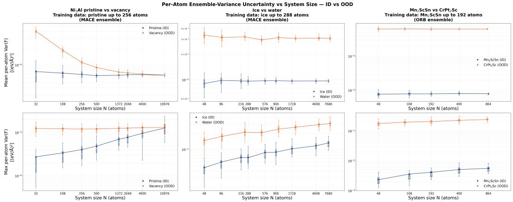  
Figure 1: System size introduces bias to uncertainty, eliminating the ID/OOD gap and failing size-unaware-UQ-based OOD detection at large sizes. Per-atom uncertainty versus system size $N$ for three ID/OOD pairs: pristine versus vacancy $\bar { \bf N i } _ { 3 } \bf { A l }$ at 500K (left, MACE ensemble variance), liquid water versus ice (middle, MACE ensemble variance), and a $\mathrm { M n } _ { 2 } \mathrm { S c S e }$ structure versus a $\mathrm { C r P t } _ { 2 } \mathrm { S c }$ structure (right, ORB ensemble variance). Each box plot summarizes 40 test structures sampled from MD at that size. Top: mean uncertainty u¯, flat for homogeneous systems and decaying towards the pristine value for the vacancy system. Bottom: maximum uncertainty $u _ { \mathrm { m a x } } .$ , increasing with system size N for every homogeneous ID system while remaining flat for the vacancy system.

The bottom row of Figure 1 shows the opposite trend for $u _ { \mathrm { m a x } } .$ For every homogeneous ID system, $u _ { \mathrm { m a x } }$ increases with $\bar { N } ,$ , while the vacancy system stays flat. The gap between small OODs and large IDs disappears as the ID size grows, failing OOD detection. This shows a practical limitation of current size-unaware UQ methods in OOD detection. Notably, the distributions do not overlap within the sizes in our calculations for the WBM pair, but given the present scaling, crossing between small OODs and large IDs is in principle reachable at large enough ID sizes in large-scale MLIP-driven MD. Alternatively, percentile-based UQs show mean UQ behavior at smaller sizes and max UQ behavior at larger sizes, hence are still not capable of OOD detection at large sizes (Appendix C.3).

We suggest that extreme-value statistics may explain this trend. $u _ { \mathrm { m a x } }$ is the largest of N draws from the per-atom uncertainty distribution, and for a broad class of distributions the expected maximum grows slowly with N [42, 43]: a larger system reaches further into the tail of its own environment distribution, surfacing rarer and more distorted local environments. A defect, diluted with system size, instead adds a fixed number of distorted environments whose uncertainty does not change with cell size, matching the flat $u _ { \mathrm { m a x } }$ we observe.

To decide whether the rising $u _ { \mathrm { m a x } }$ marks local atomic environment that are truly unfamiliar to the model, we track how the local environment and true force error of the max-UQ atom change with system size and find both grow (Appendix C.1). This means the atom moves further from the training set in SOAP descriptor space [44] and its force error rises well above those of smaller sizes. The high uncertainty is therefore valid, and any uncertainty-thresholded selection rule [19–23] would flag these structures for ground-truth calculation for model retraining, which we test in Section 2.2.

## 2.2 Training Structure Size Effect

Section 2.1 showed that the max-UQ atoms of large in-distribution $( \mathrm { I D } ) ^ { 2 }$ systems have unfamiliar local environment and high force errors, thus a standard active learning loop would send them for ground-truth calculation. We test this by retraining the ORB ensemble on $\mathrm { N i _ { 3 } A l }$ under three settings and recomputing $u _ { \mathrm { m a x } }$ across sizes: a baseline trained on pristine systems up to 256 atoms, the same baseline plus 500-atom pristine systems, and the baseline plus vacancy systems up to 256 atoms. The first two differ only in whether the large ID structures the uncertainty flagged are labeled as OOD for retraining; the third trains the models on small structures that are OOD by construction.

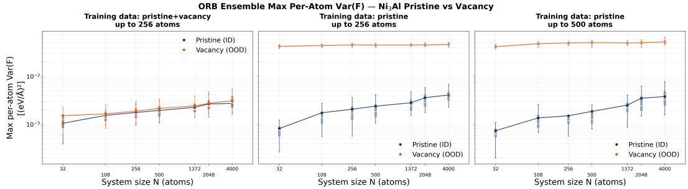  
Figure 2: Maximum per-atom force variance of a ORB ensemble for pristine and vacancy $\mathrm { N i _ { 3 } A l }$ against system size, under three training sets. Adding 500-atom pristine systems (right) leaves the pristine curve close to the baseline (middle), only reducing UQ by $\approx 1 0 ^ { - 4 } ( \mathrm { e V / \mathring { A } } ) ^ { 2 }$ from, while adding vacancy systems up to 256 atoms (left) significantly lowers the vacancy uncertainty by about two orders of magnitude larger at ≈ $1 0 ^ { - 2 } ( \mathrm { e V } / \mathring { \mathbf { A } } ) ^ { 2 }$ , closing most of the gap to the pristine curve.

As shown in Figure 2, adding the 500-atom pristine systems leaves the pristine $u _ { \mathrm { m a x } }$ at 500 atoms at roughly the same value as the baseline, and the scaling with N still exists. This holds even though the model has now seen these structures directly, and even though their max-UQ atoms were shown in Section 2.1 to sit far from the training set with force errors above smaller sizes. Training on smaller vacancy systems instead lowers the vacancy $u _ { \mathrm { m a x } }$ significantly at every size by about two orders of magnitude larger than training on large IDs, enough to close most of the gap to the pristine curve at 500 atoms. For this system and model, labeling and training on a small defect-type OOD are computationally cheaper and improve the models much more significantly than training on a size-inflated ID. The same pattern also holds for other systems and models (Appendix C.4).

The mean squared error loss used to train the models, which averages over all atoms, could be a reason [1, 7]. A handful of distorted environments in a 500-atom system contributes $\mathcal { O } ( 1 / N )$ to the total loss, so the optimizer can leave them poorly fit while the mean error stays low, and adding more such structures need not change that balance. This is consistent with imbalanced regression more broadly, where rare targets are sacrificed for bulk accuracy unless the loss is reweighted [45, 46]. Nevertheless, given the current widely-adopted mean-based training loss, our results show a limitation of current UQ methods that do not take size into account for OOD detection.

Two practical guidelines thus follow for active learning. First, large ID structures whose $u _ { \mathrm { m a x } }$ is inflated by size appear to be poor candidates for ground-truth calculation under the standard training setup: they are flagged by uncertainty, have unseen local atomic environment and high error, and still yield little model improvement. Second, addressing this requires either removing the size dependence from the uncertainty so that thresholds compare like to like by means of, e.g., post-hoc trainable uncertainty calibrator, or changing the loss so that outlier max-UQ atoms are fit without sacrificing bulk accuracy. We implement a trainable post-hoc uncertainty calibrator using atomic descriptors for system detection (Appendix C.5) and find it not trivial to remove the size-induced bias on uncertainty values correctly for all systems, remaining an area for future studies.

## 3 Conclusions

We investigate how per-atom force uncertainty scales with system size across different datasets and MLIPs. Mean uncertainty remains constant for homogeneous systems and dilutes with size for defective ones, thus cannot detect a local failure mode in the large systems. Maximum uncertainty is sensitive to local error but carries size dependence: it increases with N for ID systems while staying flat for a defect. This size effect eliminates the ID/OOD gap at large sizes and could lead to incorrect uncertainty-based OOD detection. We suggest extreme-value statistics as an explanation, since a larger system samples deeper into the tail of its own environment distribution.

The max-UQ atoms are actually valid as OOD candidates, considering both errors and atomic environments, for ground-truth calculation and model retraining, which we nonetheless find to barely improve the model. In contrast, retraining on small OOD-by-design structures is cheaper and improves the model more substantially. We attribute this to the mean-based loss used to train MLIPs, which tolerates a few poorly fit atoms as long as the average error stays low. This exposes a limitation of current size-unaware UQ methods in OOD detection, given the current training.

We subsequently provide a practical guideline for active learning on mixed-size datasets that sizeunaware $u _ { \mathrm { m a x } }$ should not be compared across sizes with a single threshold. Two immediate solutions are possible: removing the size bias from the uncertainty, e.g., with a post-hoc size-aware calibrator which we find to be not trivial to implement, or devising a training loss that can fit outlier atoms without sacrificing bulk accuracy, both of which we leave for future work to improve OOD detection in large-scale MLIP-accelerated materials simulations and discovery.

## References

[1] Jörg Behler and Michele Parrinello. Generalized neural-network representation of highdimensional potential-energy surfaces. Physical Review Letters, 98(14):146401, 2007.

[2] Albert P. Bartók, Mike C. Payne, Risi Kondor, and Gábor Csányi. Gaussian approximation potentials: The accuracy of quantum mechanics, without the electrons. Physical Review Letters, 104(13):136403, 2010.

[3] Jörg Behler. Perspective: Machine learning potentials for atomistic simulations. The Journal of Chemical Physics, 145(17):170901, 2016.

[4] Justin S. Smith, Olexandr Isayev, and Adrian E. Roitberg. ANI-1: an extensible neural network potential with dft accuracy at force field computational cost. Chemical Science, 8(4):3192–3203, 2017.

[5] Kristof T. Schütt, Huziel E. Sauceda, Pieter-Jan Kindermans, Alexandre Tkatchenko, and Klaus-Robert Müller. SchNet – a deep learning architecture for molecules and materials. The Journal ofChemical Physics, 148(24):241722, 2018.

[6] Simon Batzner, Albert Musaelian, Lixin Sun, Mario Geiger, Jonathan P. Mailoa, Mordechai Kornbluth, Nicola Molinari, Tess E. Smidt, and Boris Kozinsky. E(3)-equivariant graph neural networks for data-efficient and accurate interatomic potentials. Nature Communications, 13(1):2453, 2022.

[7] Ilyes Batatia, Dávid Péter Kovács, Gregor N. C. Simm, Christoph Ortner, and Gábor Csányi. MACE: Higher order equivariant message passing neural networks for fast and accurate force fields. In Advances in Neural Information Processing Systems (NeurIPS), volume 35, pages 11423–11436, 2022.

[8] Chi Chen and Shyue Ping Ong. A universal graph deep learning interatomic potential for the periodic table. Nature Computational Science, 2(11):718–728, 2022.

[9] Bowen Deng, Peichen Zhong, KyuJung Jun, Janosh Riebesell, Kevin Han, Christopher J. Bartel, and Gerbrand Ceder. CHGNet as a pretrained universal neural network potential for charge-informed atomistic modelling. Nature Machine Intelligence, 5(9):1031–1041, 2023.

[10] Ilyes Batatia, Philipp Benner, Yuan Chiang, Alin M Elena, Dávid P Kovács, Janosh Riebesell, Xavier R Advincula, Mark Asta, Matthew Avaylon, William J Baldwin, et al. A foundation model for atomistic materials chemistry. The Journal ofchemical physics, 163(18), 2025.

[11] Amil Merchant, Simon Batzner, Samuel S. Schoenholz, Muratahan Aykol, Gowoon Cheon, and Ekin Dogus Cubuk. Scaling deep learning for materials discovery. Nature, 624(7990):80–85, 2023.

[12] So Takamoto, Chikashi Shinagawa, Daisuke Motoki, Kosuke Nakago, Wenwen Li, Iori Kurata, Taku Watanabe, Yoshihiro Yayama, Hiroki Iriguchi, Yusuke Asano, et al. Towards universal neural network potential for material discovery applicable to arbitrary combinations of 45 elements. Nature Communications, 13(1):2991, 2022.

[13] Benjamin Rhodes, Sander Vandenhaute, Vaidotas Šimkus, James Gin, Jonathan Godwin, Tim Duignan, and Mark Neumann. Orb-v3: atomistic simulation at scale. arXiv preprint arXiv:2504.06231, 2025.

[14] Boris Kozinsky, Albert Musaelian, Anders Johansson, and Simon Batzner. Scaling the leading accuracy of deep equivariant models to biomolecular simulations of realistic size. In Proceedings of the International conference for high performance computing, networking, storage and analysis, pages 1–12, 2023.

[15] Weile Jia, Han Wang, Mohan Chen, Denghui Lu, Lin Lin, Roberto Car, Weinan E, and Linfeng Zhang. Pushing the limit of molecular dynamics with ab initio accuracy to 100 million atoms with machine learning. In Proceedings of the International Conference for High Performance Computing, Networking, Storage and Analysis (SC), 2020.

[16] Maksim Kulichenko, Justin S. Smith, Benjamin Nebgen, Ying Wai Li, Nikita Fedik, Alexander I. Boldyrev, Nicholas Lubbers, Kipton Barros, and Sergei Tretiak. The rise of neural networks for materials and chemical dynamics. The Journal ofPhysical Chemistry Letters, 12(26):6227– 6243, 2021.

[17] Christoph Schran, Krystof Brezina, and Ondrej Marsalek. Committee neural network potentials control generalization errors and enable active learning. The Journal of Chemical Physics, 153(10):104105, 2020.

[18] Giulio Imbalzano, Yong-Bin Zhuang, Venkat Kapil, Kevin Rossi, Edgar A. Engel, Federico Grasselli, and Michele Ceriotti. Uncertainty estimation for molecular dynamics and sampling. The Journal ofChemical Physics, 154(7):074102, 2021.

[19] Jonathan Vandermause, Steven B. Torrisi, Simon Batzner, Yu Xie, Lixin Sun, Alexie M. Kolpak, and Boris Kozinsky. On-the-fly active learning of interpretable bayesian force fields for atomistic rare events. npj Computational Materials, 6(1):20, 2020.

[20] Evgeny V. Podryabinkin and Alexander V. Shapeev. Active learning of linearly parametrized interatomic potentials. Computational Materials Science, 140:171–180, 2017.

[21] Justin S. Smith, Ben Nebgen, Nicholas Lubbers, Olexandr Isayev, and Adrian E. Roitberg. Less is more: Sampling chemical space with active learning. The Journal of Chemical Physics, 148(24):241733, 2018.

[22] Linfeng Zhang, De-Ye Lin, Han Wang, Roberto Car, and Weinan E. Active learning of uniformly accurate interatomic potentials for materials simulation. Physical Review Materials, 3(2):023804, 2019.

[23] Maksim Kulichenko, Kipton Barros, Nicholas Lubbers, Ying Wai Li, Richard Messerly, Sergei Tretiak, Justin S. Smith, and Benjamin Nebgen. Uncertainty-driven dynamics for active learning of interatomic potentials. Nature Computational Science, 3(3):230–239, 2023.

[24] Daniel Schwalbe-Koda, Aik Rui Tan, and Rafael Gómez-Bombarelli. Differentiable sampling of molecular geometries with uncertainty-based adversarial attacks. Nature Communications, 12(1):5104, 2021.

[25] Balaji Lakshminarayanan, Alexander Pritzel, and Charles Blundell. Simple and scalable predictive uncertainty estimation using deep ensembles. In Advances in Neural Information Processing Systems (NeurIPS), volume 30, 2017.

[26] Felix Musil, Michael J. Willatt, Mikhail A. Langovoy, and Michele Ceriotti. Fast and accurate uncertainty estimation in chemical machine learning. Journal of Chemical Theory and Computation, 15(2):906–915, 2019.

[27] Albert Zhu, Simon Batzner, Albert Musaelian, and Boris Kozinsky. Fast uncertainty estimates in deep learning interatomic potentials. The Journal of Chemical Physics, 158(16):164111, 2023.

[28] Jon Paul Janet, Chenru Duan, Tzuhsiung Yang, Aditya Nandy, and Heather J. Kulik. A quantitative uncertainty metric controls error in neural network-driven chemical discovery. Chemical Science, 10(34):7913–7922, 2019.

[29] Ryosuke Jinnouchi, Jonathan Lahnsteiner, Ferenc Karsai, Georg Kresse, and Menno Bokdam. Phase transitions of hybrid perovskites simulated by machine-learning force fields trained on the fly with bayesian inference. Physical review letters, 122(22):225701, 2019.

[30] Ivan S Novikov, Konstantin Gubaev, Evgeny V Podryabinkin, and Alexander V Shapeev. The MLIP package: moment tensor potentials with MPI and active learning. Machine Learning: Science and Technology, 2(2):025002, 2021.

[31] Shih-Peng Huang, Nontawat Charoenphakdee, Yuta Tsuboi, Yong-Bin Zhuang, and Wenwen Li. P-drum: Post-hoc descriptor-based residual uncertainty modeling for machine learning potentials. arXiv preprint arXiv:2509.02927, 2025.

[32] Yuzhi Zhang, Haidi Wang, Weijie Chen, Jinzhe Zeng, Linfeng Zhang, Han Wang, et al. DP-GEN: A concurrent learning platform for the generation of reliable deep learning based potential energy models. Computer Physics Communications, 253:107206, 2020.

[33] Viktor Zaverkin, David Holzmüller, Henrik Christiansen, Federico Errica, Francesco Alesiani, Makoto Takamoto, Mathias Niepert, and Johannes Kästner. Uncertainty-biased molecular dynamics for learning uniformly accurate interatomic potentials. npj Computational Materials, 10(1):83, 2024.

[34] Aik Rui Tan, Shingo Urata, Samuel Goldman, Johannes CB Dietschreit, and Rafael Gómez-Bombarelli. Single-model uncertainty quantification in neural network potentials does not consistently outperform model ensembles. npj Computational Materials, 9(1):225, 2023.

[35] Matthias Kellner and Michele Ceriotti. Uncertainty quantification by direct propagation of shallow ensembles. Machine Learning: Science and Technology, 5(3):035006, 2024.

[36] Chayaphol Lortaraprasert and Rafael Gómez-Bombarelli. When forces disagree: A data-free fast uncertainty estimate for direct-force pre-trained neural network potentials. In NeurIPS 2025 Workshop on AIfor Accelerated Materials Design (AI4Mat), 2025.

[37] Anubhav Jain, Shyue Ping Ong, Geoffroy Hautier, Wei Chen, William Davidson Richards, Stephen Dacek, Shreyas Cholia, Dan Gunter, David Skinner, Gerbrand Ceder, and Kristin A. Persson. Commentary: The materials project: A materials genome approach to accelerating materials innovation. APL Materials, 1(1):011002, 2013.

[38] Bingqing Cheng, Edgar A. Engel, Jörg Behler, Christoph Dellago, and Michele Ceriotti. Ab initio thermodynamics of liquid and solid water. Proceedings of the National Academy of Sciences, 116(4):1110–1115, 2019.

[39] Hai-Chen Wang, Silvana Botti, and Miguel A. L. Marques. Predicting stable crystalline compounds using chemical similarity. npj Computational Materials, 7(1):12, 2021.

[40] M. Leslie and N. J. Gillan. The energy and elastic dipole tensor of defects in ionic crystals calculated by the supercell method. Journal ofPhysics C: Solid State Physics, 18(5):973–982, 1985.

[41] Christoph Freysoldt, Blazej Grabowski, Tilmann Hickel, Jörg Neugebauer, Georg Kresse, Anderson Janotti, and Chris G. Van de Walle. First-principles calculations for point defects in solids. Reviews ofModern Physics, 86(1):253–305, 2014.

[42] Ronald A. Fisher and Leonard H. C. Tippett. Limiting forms of the frequency distribution of the largest or smallest member of a sample. Mathematical Proceedings of the Cambridge Philosophical Society, 24(2):180–190, 1928.

[43] Stuart Coles. An Introduction to Statistical Modeling of Extreme Values. Springer, London, 2001.

[44] Albert P. Bartók, Risi Kondor, and Gábor Csányi. On representing chemical environments. Physical Review B, 87(18):184115, 2013.

[45] Tsung-Yi Lin, Priya Goyal, Ross Girshick, Kaiming He, and Piotr Dollár. Focal loss for dense object detection. In Proceedings of the IEEE International Conference on Computer Vision (ICCV), pages 2980–2988, 2017.

[46] Yuzhe Yang, Kaiwen Zha, Ying-Cong Chen, Hao Wang, and Dina Katabi. Delving into deep imbalanced regression. In Proceedings of the 38th International Conference on Machine Learning (ICML), pages 11842–11851, 2021.

[47] Y. Mishin. Atomistic modeling of the γ and γ′-phases of the Ni–Al system. Acta Materialia, 52(6):1451–1467, 2004.

[48] Janosh Riebesell, Rhys E. A. Goodall, Philipp Benner, Yuan Chiang, Bowen Deng, Gerbrand Ceder, Mark Asta, Alpha A. Lee, Anubhav Jain, and Kristin A. Persson. A framework to evaluate machine learning crystal stability predictions. Nature Machine Intelligence, 7:836–847, 2025.

[49] Ilya Loshchilov and Frank Hutter. Decoupled weight decay regularization. In International Conference on Learning Representations (ICLR), 2019.

## A Dataset Generation

For each system, a starting unit cell is expanded into supercells of increasing size by replication, and NPT molecular dynamics (MD) simulation is run independently at each size for 20,000 steps, saving one structure every 100 steps, for 200 structures per size. Each set of 200 structures is randomly split into 120 for training, 40 for validation, and 40 for testing. The same total number of MD steps, snapshot frequency, and split sizes are used across all systems, so that Section 2.1 compares uncertainty across sizes without any difference in how much data went into training or testing at each size.

Pristine, vacancy, and cubic $\mathrm { N i _ { 3 } A l }$ structures start from the mp-2593 conventional standard cell [37, 47] and are expanded into larger supercells. MD is run with a Matlantis PFP v8.0.0 R2SCAN ASE calculator [12] at 300 K and with a timestep of 2 fs. Vacancy structures are generated by removing one atom from each supercell prior to MD.

Liquid water and ice structures are generated the same way, using an ORB v3-direct-20-mpa calculator [13] in place of PFP. The timestep for MD at 300K is reduced to 0.5 fs because of the light hydrogen atoms; all other settings (total steps and snapshot frequency) match the $\mathrm { N i _ { 3 } A l }$ runs except ice structures that are run at 250 K.

The WBM structures [39, 48] are each expanded into supercells and run with the same ORB v3- direct-20-mpa calculator and the same timestep as the $\mathrm { N i _ { 3 } A l }$ runs.

For all systems, energies and forces used as training and test labels are the calculator predictions above (PFP for $\mathrm { N i _ { 3 } A l }$ , ORB v3-direct-20-mpa for water/ice and WBM), rather than DFT. This keeps labeling tractable across the full range of system sizes and lets us compute the true force error of every atom, at every size, against a fixed reference.

## B MLIP Training

For each system and size setting, we train two force ensembles, MACE and ORB (direct forces), with five independently seeded initial members each, plus a single ORB hybrid model used for the Force-Delta uncertainty estimate. All members within an ensemble share the same architecture and optimizer settings and differ only in random seed (weight initialization and data shuffling). Training and validation use the 120 and 40 structures set aside in Appendix A; the remaining 40 held-out test structures are used for the size-scaling analysis in Sections 2.1 and 2.2 and are never seen during training or model selection.

MACE ensemble members are ScaleShiftMACE models with two interaction layers, 128 channels, and an $L _ { \operatorname* { m a x } } = 1$ , correlation-3 equivariant expansion, following the standard MACE-medium architecture [7]. Isolated-atom energies (E0s) are set by averaging over the training set rather than fit by linear regression. Both the MACE and ORB ensembles predict energies and forces from a single output; the ORB hybrid model additionally predicts a second, energy-gradient force so that the direct and conservative forces of the same model are trained and can be compared [36]. All models are trained with AdamW [49] using a weighted sum of per-atom energy and force losses, gradient clipping, and early stopping on the validation loss. Architecture and training settings are summarized in Table 1. All trainings converge smoothly.

Table 1: Architecture and training settings for the MACE ensemble, the ORB ensemble (direct forces only), and the ORB hybrid model (both direct and conservative forces trained, used for the Force Delta uncertainty estimate).
<table><tr><td></td><td>MACE ensemble</td><td>ORB ensemble</td><td>ORB hybrid</td></tr><tr><td>Backbone</td><td>ScaleShiftMACE</td><td>orb-v3-direct (from scratch)</td><td>orb-v3-direct (from scratch)</td></tr><tr><td>Cutoff radius (Å)</td><td>6.0</td><td>6.0</td><td>6.0</td></tr><tr><td>Radial basis</td><td>Bessel (10)</td><td>Bessel (8)</td><td>Bessel (8)</td></tr><tr><td>Angular basis</td><td> $\ell _ { \mathrm { m a x } } = 3$ </td><td>spherical harmonics,  $\ell _ { \mathrm { m a x } } = 3$ </td><td>spherical harmonics,  $\ell _ { \mathrm { m a x } } = 3$ </td></tr><tr><td>Channels / latent dim</td><td>128</td><td>256</td><td>256</td></tr><tr><td>Interaction / MP layers</td><td>2</td><td>5</td><td>5</td></tr><tr><td>Activation</td><td>SiLU</td><td>SiLU</td><td>SiLU</td></tr><tr><td>Energy loss</td><td>MSE</td><td>Huber (δ = 0.01)</td><td>Huber (δ = 0.01)</td></tr><tr><td>Force loss</td><td>MSE</td><td>conditional Huber (δ = 0.01)</td><td>conditional Huber (δ = 0.01)</td></tr><tr><td>Conservative-force loss weight</td><td></td><td>0.0</td><td>1.0</td></tr><tr><td>Optimizer</td><td>AdamW</td><td>AdamW</td><td>AdamW</td></tr><tr><td>Learning rate</td><td>10⁻4</td><td>10⁻4</td><td>10⁻4</td></tr><tr><td>Weight decay</td><td>10-5</td><td>10-5</td><td>10-5</td></tr><tr><td>Batch size</td><td>1</td><td>16 (effective)</td><td>16 (effective)</td></tr><tr><td>Gradient clip</td><td>10.0</td><td>10.0</td><td>10.0</td></tr><tr><td>Max epochs</td><td>50</td><td>50</td><td>50</td></tr><tr><td>Early-stopping patience</td><td>20</td><td>20</td><td>20</td></tr><tr><td>Ensemble size</td><td>5</td><td>5</td><td>1</td></tr></table>

## C Additional Results

## C.1 Atomic Descriptors and Force Errors of Max-Uncertainty Atoms

For each test structure, we take the atom with the largest ensemble force variance, the same atom that sets $u _ { \mathrm { m a x } }$ in Section 2.1, and examine its force error, and local environment. Force error is the absolute error between the ensemble mean force and the reference label from Appendix A. Environment novelty is measured with a SOAP descriptor [44], projected onto principal components fit on the training set; we report the magnitude of the projection onto the second component (PC2), which explains 37.2% of the variance in the training descriptors and separates bulk from distorted environments most clearly.

Figure 3 shows both quantities against system size for the ice/water pair, where the MACE ensemble is trained on ice up to 288 atoms and tested up to 1728 atoms, with water never seen in training. Both the force error and the PC2 magnitude of the max-UQ atom increase with N for both systems. This holds for water, which is out of distribution by phase, and for ice, which is in distribution by phase but is tested well beyond its training size range. In both cases, the atom flagged as most uncertain is also the atom that is furthest from the training descriptors and worst predicted, which shows the increase in $u _ { \mathrm { m a x } }$ tracks genuine, not merely statistical, novelty as OOD candidates.

## C.2 Force Delta Scaling with System Size

The ORB hybrid force-delta metric requires no ensemble, with the distance between its direct and energy-gradient forces taken directly as the uncertainty estimate. For each ID/OOD pair, the hybrid model is trained on ID data only, as in Section 2.1.

The top row of Figure 4 shows the mean force delta, and the bottom row the maximum, against system size, for all three ID/OOD pairs. The pattern matches the ensemble variance results in Section 2.1. Mean force delta for the $\mathrm { N i _ { 3 } A l }$ vacancy dilutes toward the pristine value as N grows, consistent with a fixed number of defect atoms contributing less to the mean as the cell size increases. Mean force delta is flat and well separated between ID and OOD for the two homogeneous pairs, ice/water and $\mathrm { M n _ { 2 } S c S n / C r P t _ { 2 } S c . }$ since there is no dilution effect when the whole structure is out of distribution. Maximum force delta rises with N for every ID system across all three pairs, while the vacancy OOD stays roughly flat, again narrowing the ID–OOD gap from below; for $\mathrm { \dot { N i } _ { 3 } A l }$ the ID and OOD boxes overlap at the largest sizes tested. That this same scaling appears for a metric that needs no ensemble, indicates the effect is not specific to ensemble variance.

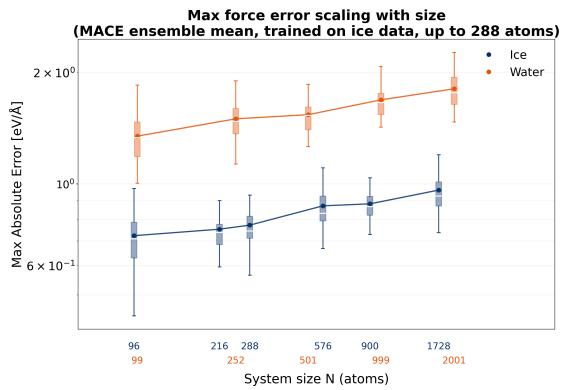

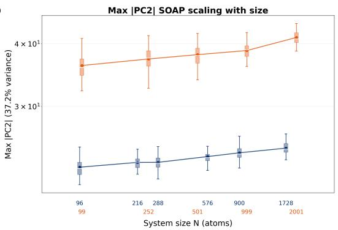

Figure 3: Left: maximum absolute force error of the MACE ensemble mean against system size, for the atom with the largest ensemble variance in each test structure, for ice (ID, trained up to 288 atoms) and water (OOD). Right: maximum absolute value of the same atom’s SOAP PC2 projection, against system size. Both quantities increase with N for both systems. Boxes summarize the same test structures as Figure 1.  
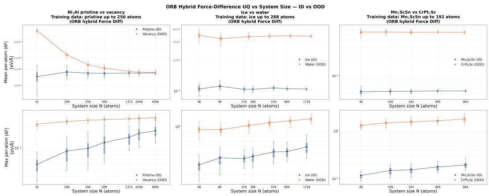  
Figure 4: Mean (top) and maximum (bottom) per-atom ORB force delta against system size, for three ID/OOD pairs: pristine versus vacancy $\mathrm { N i _ { 3 } A l }$ (left, trained on pristine up to 256 atoms), ice versus water (middle, trained on ice up to 288 atoms), and $\mathrm { { M n _ { 2 } S c S n } }$ versus $\mathrm { C r P t _ { 2 } S c }$ (right, trained on $\mathbf { M n _ { 2 } S c S n }$ up to 192 atoms). Boxes summarize the same test structures as the corresponding ensemble-variance results in Section 2.1.

## C.3 Percentile-Based Uncertainty

Figure 5 extends the mean/max comparison in Section 2.1 to intermediate percentiles $( \mathtt { p 8 0 } , \mathtt { p 9 0 } , \mathtt { p 9 5 }$ p99) of the per-atom force delta distribution, for the same pristine/vacancy $\mathrm { N i _ { 3 } A l }$ pair. At small system sizes, every percentile shown, including p80, separates vacancy from pristine as clearly as the max does: the defect sets a large fraction of the distribution, so any high percentile falls on a defect-perturbed atom. As N grows, this separation collapses at different rates depending on the percentile. p80 and p90 converge to the pristine curve almost immediately, by 256 atoms; p95 and p99 persist further but still converge by around 1000–2000 atoms. Only the true max keeps rising with N for the pristine system and stays mostly flat for the vacancy, so the ID–OOD gap narrows but never closes to zero within the sizes tested.

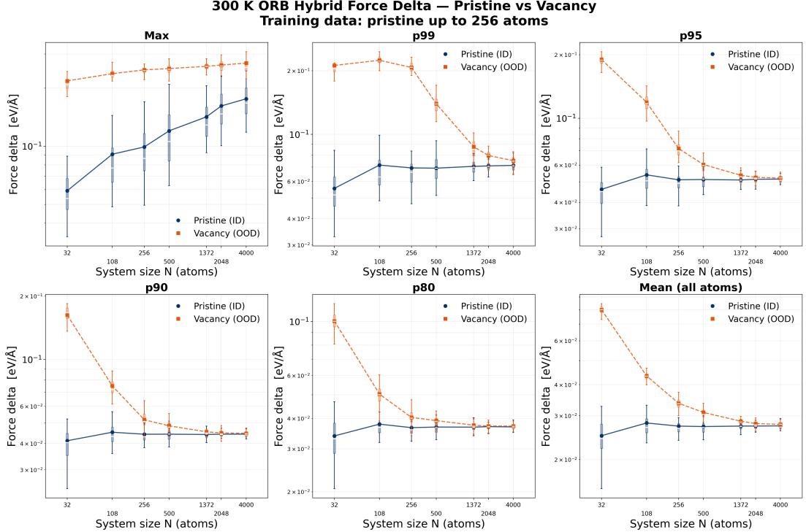  
Figure 5: Per-atom ORB force delta for pristine and vacancy $\mathrm { N i _ { 3 } A l }$ against system size, pooled at different percentiles (max, p99, p95, p90, p80, and mean). Lower percentiles converge to the pristine value at smaller system sizes, resembling the dilution seen for the mean in Section 2.1, while the max resists dilution and remains separated from the vacancy curve throughout.

The reason is that a percentile, unlike the max, is diluted by system size in the same way the mean is: a fixed number of defect-perturbed atoms occupies a shrinking fraction of the ranked distribution as N grows, so eventually the defect atoms fall below the percentile cutoff and the score reverts to the bulk value. The max is immune to this because it always tracks the single worst atom, regardless of how many atoms are averaged into the rank below it. Percentile-based pooling therefore behaves like the max at small system sizes, where it still detects the defect, but like the mean at large system sizes, where it dilutes and loses the defect signal, with the crossover size set by how extreme the percentile is.

## C.4 Training Structure Size Effect on Other Systems and Models

The same three training settings used for $\mathrm { N i _ { 3 } A l }$ in Section 2.2 are repeated here for two other UQ estimators, the ORB ensemble force variance and the ORB hybrid force delta, and for two other ID/OOD pairs: ice versus water (MACE ensemble) and $\bf { M n } _ { 2 } \bf { S c S n }$ versus $\mathrm { C r P t _ { 2 } S c }$ , the two WBM structures introduced in Section 2.1 (ORB ensemble and hybrid). The pattern is the same in every case: adding larger ID structures to the training set has almost no effect on either curve, while adding OOD-type structures reduces OOD uncertainty and narrows the gap to the ID curve.

For pristine/vacancy $\mathrm { N i _ { 3 } A l }$ , this holds for both the MACE ensemble variance (Figure 6) and the ORB hybrid force delta (Figure 7): training on pristine up to 500 atoms instead of 256 leaves both curves close to unchanged, while training on pristine plus vacancy nearly closes the gap between them, matching the ORB result in Figure 2.

For ice versus water (Figure 8), training on ice up to 576 atoms instead of 288 leaves both curves close to unchanged, with a gap similar to Figure 3. Training on a combined ice+water dataset narrows the gap but, unlike the vacancy case, does not close it: water uncertainty stays above ice at every size.

For $\mathrm { M n _ { 2 } S c S n }$ versus $\mathrm { C r P t _ { 2 } S c }$ (Figures 9 and 10), ID-only training at either size leaves close to an order-of-magnitude gap between the two structures, for both UQ metrics. Combined training reduces this gap substantially but again does not fully close it.

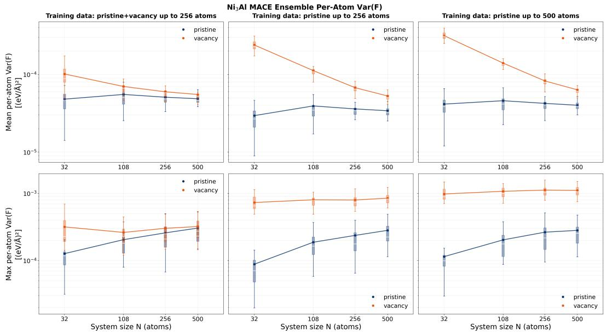  
Figure 6: MACE ensemble force variance, mean (top) and maximum (bottom) per-atom, for pristine (ID) versus vacancy (OOD) $\mathrm { N i _ { 3 } A l , }$ , under the same three training settings as Figure 2: pristine+vacancy up to 256 atoms (left), pristine-only up to 256 atoms (middle), and pristine-only up to 500 atoms (right).

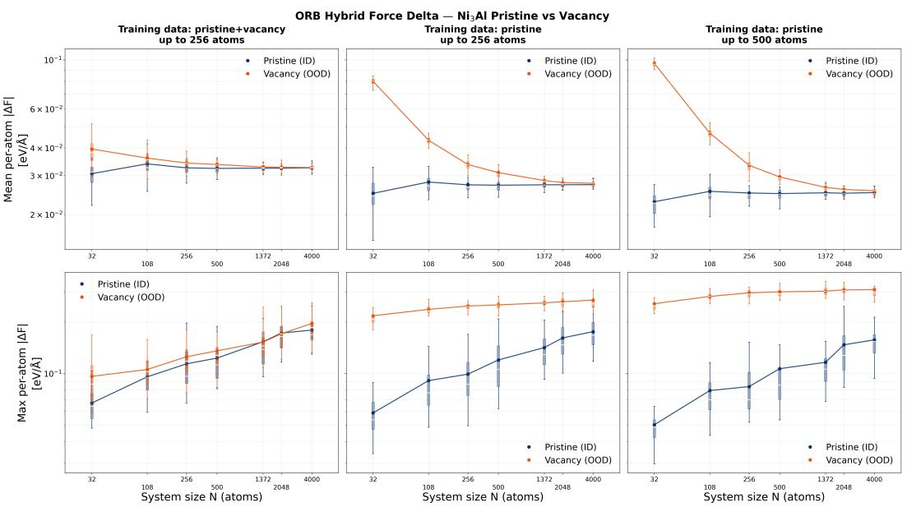  
Figure 7: ORB hybrid force delta, mean (top) and maximum (bottom) per-atom, for pristine (ID) versus vacancy (OOD) $\mathrm { N i _ { 3 } A l }$ , under the same three training settings as Figure 2.

Across three ID/OOD pairs, two model architectures, and two UQ estimators, the same qualitative pattern holds: training on more of the same type of structure does not help, and training on structures unlike the training set does, though how completely it closes the gap depends on the system.

## C.5 Trainable Post-Hoc Uncertainty Calibrator

As a preliminary test of whether the size dependence in Section 2.1 can be removed post hoc, we implement a trainable calibrator that takes an atom’s local environment and system size as input and outputs a corrected uncertainty. The environment is summarized by projecting its SOAP descriptor [44] onto its leading PCA components, giving a low-dimensional feature $x = \{ x _ { \mathrm { m e a n } } ; x _ { \mathrm { a r g m a x U Q } } \} ;$ system size enters as N. All uncertainty values, N, and the calibrator outputs are worked with in log scale throughout.

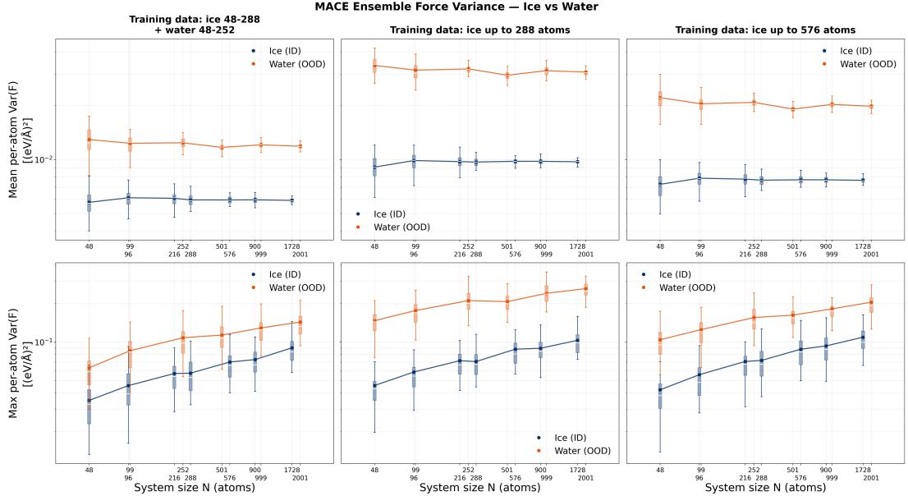  
Figure 8: MACE ensemble force variance, mean (top) and maximum (bottom) per-atom, for ice (ID) versus water (OOD), under three training settings: combined ice (48–288 atoms) and water (48–252 atoms) (left), ice-only up to 288 atoms (middle, same setting as Figure 3), and ice-only up to 576 atoms (right).

The calibrator has two parts. An epsilon neural network $\mathrm { N N _ { e p s } }$ is trained to predict the raw log-uncertainty directly from $( x , N )$ , fitting the size-dependent trend itself: for every observed $( x , N , U _ { \mathrm { o r i g } } )$ triple, its loss drives $\mathsf { N N } _ { \mathrm { e p s } } ( x , N )$ toward $U _ { \mathrm { o r i g } } . \mathrm { A }$ corrector network $\mathrm { N N } _ { \mathrm { c o r } }$ then outputs an additive correction, $U _ { \mathrm { c a l } } = U _ { \mathrm { o r i g } } + \mathrm { N N } _ { \mathrm { c o r } } ( x , N )$ , trained so that $U _ { \mathrm { c a l } }$ matches what the epsilon network would predict for the same environment at a fixed reference size, $\mathrm { N N } _ { \mathrm { e p s } } ( x , N { = } 1 0 \bar { 0 } )$ . In effect, the corrector learns to shift an atom’s uncertainty to what it would have been in a reference-size structure with the same local environment, removing the size trend rather than the environment signal.

We test this on the ORB ensemble trained on pristine $\mathrm { N i _ { 3 } A l }$ at 300 K (Section 2.2), training the calibrator on raw uncertainties from both 300 K and 500 K pristine structures across all sizes. Figure 11 compares the raw and calibrated uncertainty for pristine and vacancy structures. Calibration removes most of the size trend for the pristine systems at both temperatures, flattening curves that otherwise grow by an order of magnitude across our size range. However, the same correction also pulls down the vacancy curve, which decreases with N instead of staying flat, and the ID/OOD gap that was roughly constant before calibration narrows steadily with size afterward. Since the calibrator has no explicit notion of OOD, it corrects the vacancy curve as if it followed the same size trend as pristine data, which is not the desired behavior. This is a proof of concept rather than a solution: it shows that size-aware calibration can flatten the pristine trend, but also that doing so without distorting genuine OOD signal is not trivial, motivating further work on calibrators that separate the two.

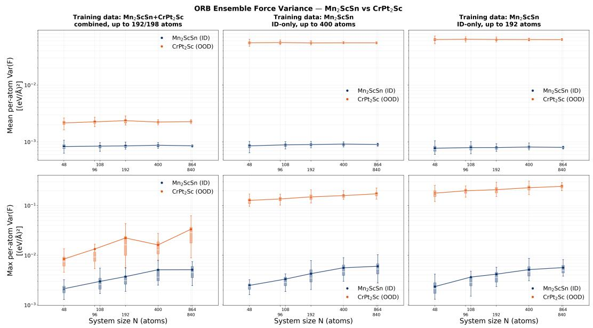  
Figure 9: ORB ensemble force variance, mean (top) and maximum (bottom) per-atom, for $\mathrm { M n _ { 2 } S c S n }$ (ID) versus CrPt2Sc (OOD), under three training settings: combined training data up to 192/198 atoms (left), $\mathrm { M n _ { 2 } S c S n – o n l y }$ up to 400 atoms (middle), and $\mathbf { M n _ { 2 } S c S n – o n l y }$ up to 192 atoms (right).

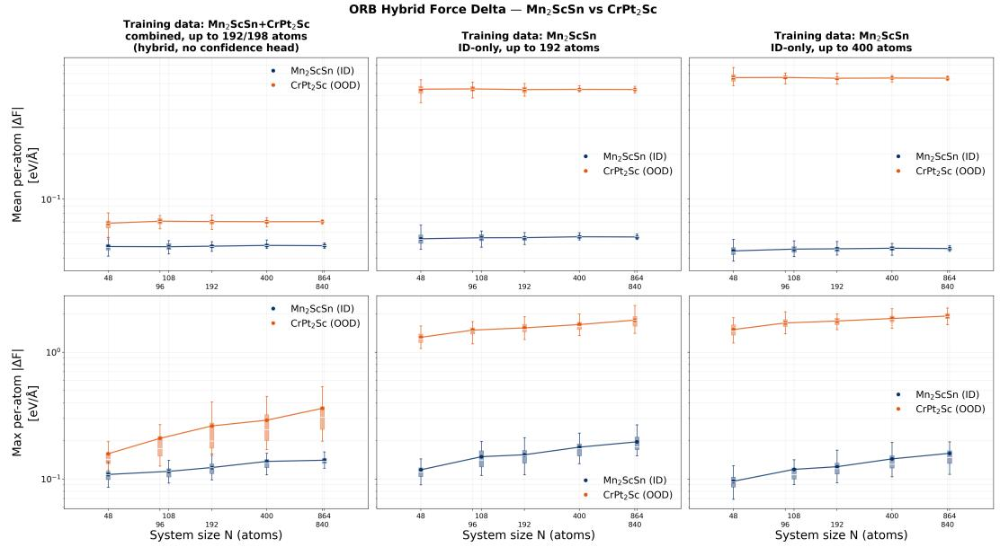  
Figure 10: ORB hybrid force delta, mean (top) and maximum (bottom) per-atom, for $\mathrm { M n _ { 2 } S c S n }$ (ID) versus $\mathrm { C r P t _ { 2 } S c ( O O D ) }$ , under three training settings: combined training data up to 192/198 atoms (left), $\mathrm { M n _ { 2 } S c S n – o n l y }$ up to 192 atoms (middle), and $\mathrm { M n _ { 2 } S c S n – o n l y }$ up to 400 atoms (right).

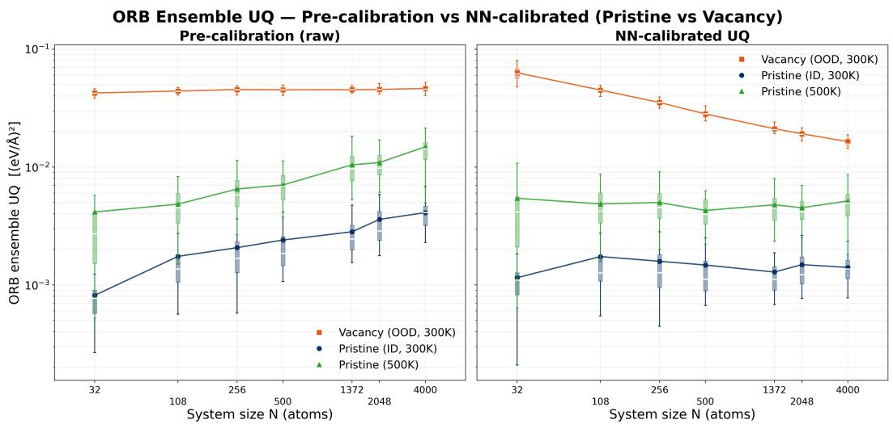  
Figure 11: ORB ensemble uncertainty for pristine Ni Al at 300 K (ID) and 500 K, and vacancy Ni Al at 300 K (OOD), before (left) and after (right) size-aware calibration. Calibration flattens the pristine curves across size but also lowers the vacancy curve, narrowing the ID/OOD gap as N grows.