# Escaping Path Mirages in Offline Goal-Conditioned Reinforcement Learning

Junhyeon Bae\* Jaebak Hwang\* Gwanwoo Choi Minung Kim Seungyul Han†

Graduate School of Artificial Intelligence, UNIST

Ulsan, South Korea

{junhyeonbae,milk,cgw1999,minungkim,syhan}@unist.ac.kr

## Abstract

Offline goal-conditioned reinforcement learning remains challenging in stochastic long-horizon settings, where compounding value estimation errors hinder reliable goal reaching. While prior methods have sought to address this challenge through various approaches, a key challenge remains path mirage, where agents overcommit to spuriously successful trajectories in offline datasets induced by stochasticity, often leading to failure on difficult tasks. To address this issue, we propose Branch aware Graph Planning (BGP), which captures stochastic branching structures by identifying high-variability points as graph nodes and designing goal-conditioned edges with segmented learning to avoid unreliable branches and reduce unnecessary stochasticity along paths. As a result, BGP enables reliable goal reaching even in highly stochastic long-horizon environments, and experiments on diverse OGBench tasks show that it substantially outperforms prior state-of-the-art offline goalconditioned RL methods. Our implementation is available at https://umlic. github.io/papers/BGP/.

## 1 Introduction

Offline reinforcement learning (RL) has emerged as a practical paradigm for learning from static datasets when additional environment interaction is costly or unsafe [1–3]. Beyond reproducing behaviors from data, many real-world applications require agents to reach diverse user-specified goals, making offline goal-conditioned reinforcement learning (GCRL) a compelling extension of offline RL [4, 5]. Despite recent progress in hierarchical subgoal learning [6, 7], graph-based planning [8], and temporal distance or reachability learning [9–11], offline GCRL remains fundamentally challenging in stochastic long-horizon domains, where compounding value estimation errors can undermine reliable goal reaching.

A key challenge arises from stochastic branching structures implicit in offline datasets. In stochastic environments, the same local decision can lead to multiple divergent futures, while rare lucky outcomes can create deceptively successful trajectories that appear reliably goal-reaching even when they are not. We refer to this failure mode as path mirage, where agents overcommit to such misleading trajectories and propagate overly optimistic value estimates through unreliable branches. This issue becomes particularly severe in long-horizon settings, where local branching errors accumulate over time and derail planning far from the true goal. Although existing methods improve trajectory composition or exploit connectivity in offline data for long-horizon reasoning [5, 8, 10, 11], they often treat that connectivity as uniformly trustworthy, leaving stochastic branching ambiguity largely unresolved.

To address this challenge, we propose Branch-aware Graph Planning (BGP), a framework that explicitly reasons about stochastic branching during planning and value learning by identifying high-variability branching points as graph landmarks and constructing goal-conditioned edges that encode reliable progress toward the goal, enabling agents to avoid deceptive paths induced by path mirage. In addition, BGP incorporates segmented learning that limits value propagation across unreliable stochastic branches to reduce stochasticity-induced errors and mitigate long-horizon error accumulation. Together, these components reformulate offline GCRL as branch-aware graph planning over unreliable connectivity, enabling agents to reach distant goals even in highly stochastic environments. Through extensive experiments on challenging OGBench [12] tasks, we show that BGP consistently outperforms prior state-of-the-art offline GCRL methods, with particularly strong gains on stochastic long-horizon problems where path mirage poses a major challenge.

## 2 Related Work

Offline goal-conditioned reinforcement learning. Offline goal-conditioned reinforcement learning has developed several complementary directions to address extrapolation error and long-horizon generalization in static datasets. One line focuses on value learning, using conservative regularization [13, 14] or expectile regression [5, 15] to mitigate overestimation. Another replaces temporaldifference learning with supervised formulations based on behavior cloning [16, 17], sequence modeling [18, 19], or goal-conditioned trajectory generation [20–24]. Other approaches model reachability through contrastive objectives [9, 25], f-divergence optimization [26, 27], or quasi-metric learning [10, 11]. More recently, hierarchical methods further decompose long-horizon tasks into latent subgoals or skills to improve compositional generalization [5–7].

Graph-based planning for goal-conditioned RL. Graph-based methods structure long-horizon decision making through explicit connectivity and search. In online RL, some approaches directly perform graph search over learned connectivity structures for waypoint planning [28–30], while others construct topological or latent graphs to support subgoal planning and long-horizon reasoning [31– 35]. In offline settings, graph-based approaches exploit data-supported connectivity to construct planning structures for long-horizon goal reaching [8, 36, 37]. Similar in spirit, our method also builds on graph-based planning, but extends it beyond connectivity alone by explicitly reasoning about reliability under stochastic branching, identifying stochastic landmarks as core nodes and constructing branch-aware goal-conditioned edges for reliable long-horizon planning.

Uncertainty-aware reinforcement learning. A large body of work addresses stochasticity through uncertainty-aware or risk-sensitive learning. In online RL, stochasticity is modeled through distributional value estimation [38–40], uncertainty-aware model learning [41–43], or robust planning under predictive uncertainty. In offline RL, stochastic risks are often handled through pessimistic penalties [2, 44, 45], uncertainty-aware model constraints [46–48], or risk-sensitive return estimation [49, 50]. While these approaches primarily use uncertainty to regularize value learning or control risk, our method instead uses stochasticity as a structural signal for identifying branching landmarks and guiding reliable graph construction.

## 3 Preliminaries

## 3.1 Offline Goal-Conditioned RL Setup

We consider a goal-conditioned Markov decision process (GCMDP) defined by $( S , \mathcal { G } , \mathcal { A } , \mathcal { P } , r , \gamma )$ where S denotes the state space, G the goal space, A the action space, $\mathcal { P }$ the transition dynamics, r the goal-conditioned reward function, and $\gamma \in [ 0 , 1 )$ the discount factor. In this work, we adopt the standard setting $\mathcal { G } = \mathcal { S }$ , where goals are specified directly in the state space. In the offline setting, the agent learns a policy $\pi ( a _ { t } \mid s _ { t } , g )$ to maximize the expected return $\begin{array} { r } { \dot { \mathbb { E } } [ \sum _ { t } \gamma ^ { t } r ( s _ { t } , g ) ] } \end{array}$ solely from a dataset D of trajectories without additional environment interaction. We consider a goal-reaching reward defined as $r ( s _ { t } , g ) = 0 { \mathrm { i f } } s _ { t } = g$ and $r ( s _ { t } , g ) = - 1$ otherwise.

Long-horizon GCMDPs in offline settings pose challenges for value estimation, motivating valuebased methods such as Implicit Q-Learning (IQL) [1], which employs expectile regression for stability. In goal-conditioned settings, the value function $V _ { \theta } ( s , g )$ can be learned as

$$
\mathcal { L } _ { V } ( \theta ) = \mathbb { E } _ { ( s , s ^ { \prime } ) \sim \mathcal { D } } \Big [ \ell _ { \kappa } ^ { 2 } \big ( r ( s , g ) + \gamma V _ { \bar { \theta } } ( s ^ { \prime } , g ) - V _ { \theta } ( s , g ) \big ) \Big ] ,\tag{1}
$$

where $\ell _ { \kappa } ^ { 2 } ( u ) = | \kappa - \mathbb { I } ( u < 0 ) | u ^ { 2 }$ denotes the expectile loss (state-value formulation). During training, the goal g is sampled from a mixture of the current state, a future state from the same trajectory, and a random state from the full offline dataset. Under this reward, the learned value can be interpreted as the negative temporal distance to the goal. Representative methods include GCIQL, which learns a goal-conditioned policy by maximizing this value, and HIQL [5], which extends it hierarchically. We use these methods as baselines, and detailed training objectives are provided in Appendix A.4.

## 3.2 Graph-based Planning for Goal Conditioned MDPs

Graph-based planning abstracts the goal space into a directed graph $G = ( \nu , \mathcal { E } )$ consisting of a landmark set V and edge set E. Each landmark node corresponds to a selected state, so we regard V as a subset of S. Landmark selection can be performed in a representation space using a mapping $\phi : { \mathcal { S } }  { \mathcal { Z } } $ , such as the identity mapping, a PCA projection [51], or a learned Hilbert representation [52]. Landmark nodes are typically selected to provide broad coverage of the goal space, for example via farthest-point sampling [53] or other task-specific criteria. For each connected edge $( v , w ) \in \mathcal { E }$ , where $v , w \in \mathcal { V }$ , an edge cost $e ( v , w )$ quantifies the reachability from node v to node w, and is commonly defined using distance-based metrics or learned goal-conditioned value functions. Given the constructed graph, planning toward a target goal $g$ can be performed via shortestpath search, e.g., Dijkstra’s algorithm [54], yielding a waypoint sequence $\mathcal { W } = ( w _ { 0 } , \dots , w _ { K } )$ where $w _ { 0 } \ = \ s$ and $w _ { K } = g$ . Each waypoint $w _ { i } \in \mathcal V$ is sequentially used as an intermediate goal for the underlying goal-conditioned policy, advancing to $w _ { i + 1 }$ once the current waypoint is reached, $\mathrm { e . g . }$ ., when $\| \phi ( s _ { t } ) - \phi ( w _ { i } ) \| < \epsilon$ for a threshold ϵ, where ϕ is the state representation introduced above. We extend this graph-based planning framework with branch-aware landmark construction and goal-conditioned edges.

## 4 Methodology

## 4.1 Motivation: Path Mirage in Offline Goal-Conditioned RL

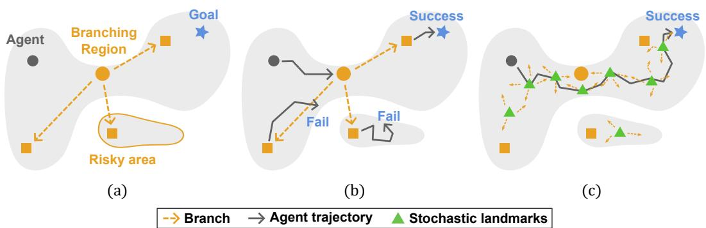  
Figure 1: Path mirage in offline GCRL. (a) Offline trajectories can pass through branching regions where future outcomes diverge toward success, failure, or risky areas. (b) Prior methods can be misled by deceptively successful paths, resulting in path mirages with occasional successes but persistent failures. (c) Our branch-aware graph planning identifies branching points near branching regions as landmarks and selects reliable goal-conditioned routes that avoid risky branches.

Long-horizon goal-conditioned tasks often admit multiple branching paths toward a goal, where trajectories originating from the same or nearby states can lead to drastically different future outcomes. Fig. 1(a) illustrates an extreme yet representative case, where trajectories in the offline dataset pass through branching regions whose outgoing paths may lead either near the goal, far away from it, or into irreversible dead zones. A central challenge is that offline datasets typically contain only unlabeled trajectories, without indicating which goal a trajectory was intended to reach or whether it reflects reliable progress or latent failures. As a result, such branching structure is not explicitly recognized. Although prior offline GCRL methods may partially learn to avoid low-value regions, value estimation alone is often insufficient in long-horizon settings, leading to a path mirage phenomenon: as shown in Fig. 1(b), the agent is misled into treating stochastic branching points as uniquely promising paths to the goal, while failing to account for unreliable or risky outcomes. Consequently, policies repeatedly route through such deceptive states, achieving occasional successes while remaining prone to persistent failures.

To address this, we propose Branch-aware Graph Planning, which explicitly treats highly stochastic branching points as landmarks and reasons about whether paths emanating from them are reliable for a given goal. Rather than planning over connectivity alone, our method uses a goal-dependent edge design to assess whether paths branching from a landmark facilitate or hinder reaching the target goal, thereby steering planning away from risky branches. As illustrated in Fig. 1(c), this yields a graph whose landmarks capture future branching structure and whose edges favor reliable goal-directed routes, allowing the agent to navigate stochastic long-horizon environments more cautiously and reach distant goals more reliably. We detail this branch-aware planning framework in the following sections.

## 4.2 Branch-aware Graph Construction

We construct a branch-aware goal-conditioned graph that enables reliable planning under stochastic branching via stochastic landmark identification and goal-conditioned edge design.

Stochastic landmark identification. To capture branching structures in the dataset, we identify states from which future trajectories can diverge under stochastic transitions, as these determine the reliability of long-horizon planning. We quantify this by assigning each state $s _ { t } \in \mathcal { D }$ a multi-step predictive uncertainty score $\mathcal { U } ^ { ( n ) }$ defined as the discounted sum of predictive entropies over n steps:

$$
\mathcal { U } ^ { ( n ) } ( s _ { t } ) = \sum _ { l = 0 } ^ { n - 1 } \gamma ^ { l } H ( p _ { \psi } ( y _ { t + l } \mid s _ { t } , y _ { t : t + l - 1 } ) ) ,\tag{2}
$$

where H denotes entropy, $y _ { t } : = ( a _ { t } , s _ { t + 1 } )$ denotes the joint action-state transition, and $p _ { \psi }$ is an autoregressive model conditioned on $s _ { t }$ and previously predicted variables. In practice, $p _ { \psi }$ is parameterized as a decoder-only Transformer with Gaussian outputs, enabling entropy computation. This formulation captures multi-step trajectory ambiguity rather than one-step noise, making ${ \mathcal { U } } ^ { ( n ) } ( s _ { t } )$ a proxy for stochastic branching; in our experiments, we set $n = 5$

We then construct graph landmarks from the top-α percentile of high-uncertainty states, which capture branching regions in the dataset. We apply K-means++ clustering [53] to representations space $\mathcal { Z }$ . We use a PCA projection for state-based observations and a Hilbert representation for visual observations. Let $\{ \stackrel { \cdot } { C } { } _ { i } ^ { \alpha } \} _ { i = } ^ { N }$ denote the resulting clusters with centers $\{ c _ { i } \} _ { i = 1 } ^ { N }$ . To ensure full coverage, we assign each state to its nearest cluster center in Z:

$$
\mathcal C _ { i } = \mathcal C _ { i } ^ { \alpha } \cup \{ s \in \mathcal D \setminus \bigcup _ { j = 1 } ^ { N } \mathcal C _ { j } ^ { \alpha } | i = \underset { k \in \{ 1 , \ldots , N \} } { \arg \operatorname* { m i n } } \| \phi ( s ) - \phi ( c _ { k } ) \| _ { 2 } \} .\tag{3}
$$

Since cluster centers may not correspond to actual states, we define each landmark node $v _ { i }$ as the state closest to the cluster center $c _ { i }$ in the representation space Z. This yields a set of landmarks $\mathcal { V } \overset { \cdot } { = } \{ v _ { 1 } , \ldots , v _ { N } \}$ that capture the branching structure of the dataset. Details of the Transformer training are provided in Appendix A.1.

Fig. 2 visualizes uncertainty scores and the resulting landmarks across OGBench tasks. Landmarks concentrate in regions with significant trajectory branching and remain sparse where branching is limited. Importantly, they are not required to be uniformly distributed, as such sparse regions typically correspond to parts of the state space that do not induce large uncertainty in future trajectories.

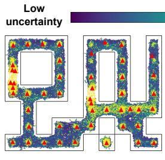

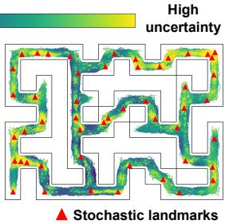  
(a) Antmaze-teleport -stitch  
(b) Pointmaze-giant -navigate  
Figure 2: Visualization of uncertainty scores and the resulting landmarks on two OGBench tasks. Highuncertainty regions correspond to significant trajectory branching, leading to denser landmark selection.

Goal-conditioned edge construction. Unlike prior graph-based GCRL methods that rely on pairwise connectivity, we design edges to explicitly account for stochastic branching and goaldirected progress. Rather than evaluating a transition $( v _ { i } , v _ { j } )$ locally, we consider all possible

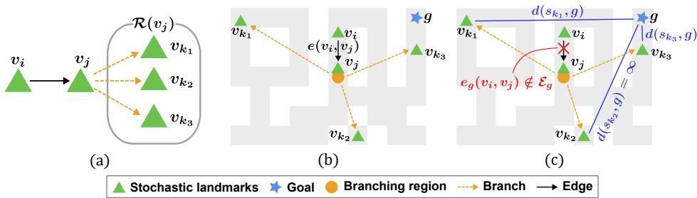  
Figure 3: (a) Illustration of downstream branches $\mathcal { R } ( v _ { j } )$ . (b)-(c) Edge comparison on a teleport task in OGBench, where $v _ { j }$ (near the teleport) induces stochastic branching. (b) A prior edge $e ( v _ { i } , v _ { j } )$ favors the transition due to local proximity, whereas (c) our goal-conditioned edge $e _ { g }$ evaluates all branches $\{ v _ { k _ { 1 } } , v _ { k _ { 2 } } , v _ { k _ { 3 } } \} \in \mathcal { R } ( v _ { j } )$ and avoids selecting $v _ { j }$ since one branch $( v _ { k _ { 2 } } )$ leads to a dead zone, i.e., $d ( s _ { k _ { 2 } } , g ) = \infty$ for $s _ { k _ { 2 } } \in \mathcal { C } _ { k _ { 2 } }$

downstream branches after visiting $v _ { j }$ , defined as

$\mathcal { R } ( v _ { j } ) : = \{ \mathcal { C } _ { k } ~ | ~ v _ { k } \in \mathcal { V } , ~ \exists s \in \mathcal { C } _ { j }$ such that a trajectory from s reaches $\mathcal { C } _ { k } \}$

which characterizes the branching outcomes induced by $v _ { j }$ . We then define the edge cost as

$$
e _ { g } ( v _ { i } , v _ { j } ) = \mathbb { E } _ { s _ { i } \sim \mathcal { C } _ { i } , \ s _ { k } \sim \mathcal { R } ( v _ { j } ) } \left[ \big ( d ( s _ { k } , g ) - d ( s _ { i } , g ) \big ) _ { + } \right] ,\tag{4}
$$

where $d ( s , g )$ denotes a distance to the goal that reflects reachability, and $d = \infty$ if unreachable. Based on $e _ { g } ,$ we also define the edge set as $\mathcal { E } _ { g } = \{ ( v _ { i } , v _ { j } ) | e _ { g } ( v _ { i } , v _ { j } ) < \infty \}$ . This formulation evaluates whether transitioning from $v _ { i }$ to $v _ { j }$ leads, under all possible branches, to progress toward the goal. If the downstream trajectories reduce the distance to the goal, the edge cost becomes negative; otherwise, it incurs a positive penalty. Crucially, if any reachable branch leads to significantly worse outcomes or fails to reach the goal, the corresponding edge is assigned a large cost or effectively removed.

Fig. 3 illustrates the branching structure $\mathcal { R } ( v _ { j } )$ and the effectiveness of our edge design on a teleport task in OGBench, where $v _ { j }$ corresponds to a teleport point such that transitioning to $v _ { j }$ may stochastically lead to multiple outcomes, including dead zones from which the goal is unreachable. Fig. 3(b) shows that a goal-agnostic edge design $e ( v _ { i } , v _ { j } )$ treats such transitions favorably due to local proximity, causing the planner to traverse these risky connections, whereas Fig. 3(c) demonstrates that our goal-conditioned edge $e _ { g }$ evaluates all downstream branches of $v _ { j }$ and penalizes transitions that may lead to unsafe or non-goal-reaching regions, enabling the planner to avoid risky transitions and select paths that reliably reach the goal under stochastic dynamics.

## 4.3 Stability-oriented Distance Design and Graph Planning

In the proposed branch-aware graph ${ \mathcal { G } } _ { g } ,$ , we require a distance function that reflects reachability. A natural choice is the policy-induced discounted temporal distance $d ^ { \pi } ( s , g ) : = - V ^ { \pi } ( s , g ) \stackrel { . } { = }$ $\mathbb { E } _ { \pi } \big [ \sum _ { t = 0 } ^ { \tau _ { g } - 1 } \gamma ^ { t } \ | \ s _ { 0 } = s , g \big ]$ , where $\tau _ { g }$ is the first hitting time of goal g under π. Under the per-step reward $\mathrm { o f - 1 }$ before reaching $g$ and 0 upon reaching it, this quantity is the expected discounted number of steps to the goal. In practice, we estimate it using $- V _ { \theta } ( s , g )$ , with $V _ { \theta }$ learned via Eq. (1). However, this becomes unreliable in long-horizon stochastic settings, where it must extrapolate over distant and highly uncertain trajectories. Instead, BGP adopts a two-phase graph planning, consisting of two graphs that share the landmark set V but have distinct edge sets. The pre-graph $\mathcal { G } _ { p }$ provides a stability-oriented distance between landmarks, while the branch-aware graph $\mathcal { G } _ { g }$ uses this distance in its edge costs and serves as the graph for actual waypoint planning. We construct a pre-graph $\mathcal { G } _ { p } = ( \bar { \nu _ { , } } \mathcal { E } _ { p } )$ with edge weights $e _ { p } ( v , w ) = - V _ { \theta } ( v , w )$ , which capture locally reliable transitions between neighboring landmarks. We then define the distance by composing these local predictions along a path:

$$
d ( s , g ) = \sum _ { i = 0 } ^ { K - 1 } e _ { p } ( w _ { i } , w _ { i + 1 } ) = - \sum _ { i = 0 } ^ { K - 1 } V _ { \theta } ( w _ { i } , w _ { i + 1 } ) ,
$$

where $( w _ { 0 } , \dots , w _ { K } )$ is the shortest path from $w _ { 0 } = s \mathrm { t o } w _ { K } = g$ on $\mathcal { G } _ { p } .$ , computed via Dijkstra’s algorithm, and $d ( s , g ) = \infty$ if no such path exists. This formulation replaces a single long-horizon

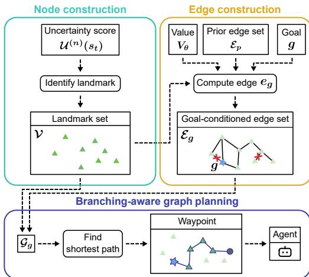  
Figure 4: The proposed BGP framework

## Algorithm 1: Branch-aware Graph Planning

## Require: Offline dataset D, goal g

(1) Landmark node construction Compute uncertainty score ${ \mathcal { U } } ^ { ( n ) } ( s )$ using $p _ { \psi }$ Construct landmark set $\mathcal { V } = \{ v _ { i } \} _ { i = 1 } ^ { N }$

(2) Goal-conditioned edge construction Train policy π and value function Vθ via offline GCRL, and construct pre-graph $\mathcal { G } _ { p }$ Given g, compute goal-conditioned edge costs $e _ { g } ( v _ { i } , v _ { j } )$ for all $\bar { v } _ { i } , v _ { j } \in \mathcal { V }$ Construct graph $\mathcal { G } _ { g } = ( \nu , \mathcal { E } _ { g } )$

(3) Offline RL with graph planning Compute shortest waypoint path $( \tilde { w } _ { 0 } , \dots , \tilde { w } _ { K ^ { \prime } } )$ on $\mathcal { G } _ { g }$ via Dijkstra’s algorithm Execute π to reach g via waypoints

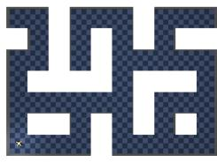  
(a)

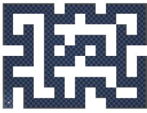  
(b)

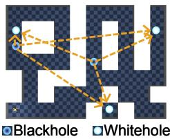  
(c)

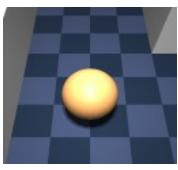  
(d)

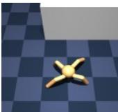  
(e)  
Figure 5: Visualization of OGBench tasks. (a)–(c) show three maze layouts: large, giant, and teleport. In the teleport layout, two blackholes teleport the agent to one of three whiteholes uniformly at random. (d) and (e) show the pointmaze and antmaze tasks, respectively.

value estimate with a composition of short-horizon, locally accurate predictions, enabling more reliable reachability estimation under stochastic dynamics.

Based on the goal-conditioned graph $\mathcal { G } _ { g }$ with distance d, we perform Branch-aware Graph Planning (BGP) by computing the shortest waypoint path $( \tilde { w } _ { 0 } , \ldots , \tilde { w } _ { K ^ { \prime } } )$ using Dijkstra’s algorithm with edge costs $\boldsymbol { e } _ { g } .$ . The agent is then guided to sequentially reach these waypoints as intermediate goals, enabling reliable goal-reaching under stochastic branching. To learn policies for reaching each waypoint, we can in principle adopt any value-based offline GCRL method. In practice, we use the representative IQL-based approach HIQL [5] as our baseline, as it is designed to handle long-horizon execution.

## 4.4 Segmented Learning

Unlike prior methods that learn $V _ { \theta } ( s , g )$ over full trajectories, BGP only requires reaching nearby landmarks. To mitigate compounding value-estimation errors under stochastic transitions, we employ segmented learning to train the value function and policy on shorter trajectory segments defined by cluster transitions. Specifically, we partition each k-th offline trajectory $\tau ^ { ( \check { k } ) }$ in D into trajectory segments $\tau _ { j } ^ { ( k ) }$ at boundaries where the cluster assignment changes. We then concatenate M consecutive segments to form a local training window, $\tilde { \tau } _ { j } ^ { ( k ) } : = \left( \tau _ { j } ^ { ( k ) } , \tau _ { j + 1 } ^ { ( k ) } , \dots , \tau _ { j + M - 1 } ^ { ( k ) } \right)$ . During offline learning, we sample both transitions and their target goals exclusively from the same window, i.e., $( s _ { t } , a _ { t } , s _ { t + 1 } ) \sim \tilde { \tau } _ { j } ^ { ( k ) }$ and $g \sim \tilde { \tau } _ { j } ^ { ( k ) }$ , thereby limiting the effective horizon of value propagation and reducing the accumulation of value-estimation errors across stochastic boundaries. Thus, M controls the trade-off between local trajectory coverage and learning stability.

Overall, BGP explicitly accounts for stochastic branching, avoids risky transitions, and enables reliable goal-reaching. Fig. 4 illustrates the proposed framework, while Algorithm 1 summarizes the complete procedure. Further implementation details on graph construction and segmented learning are provided in Appendix A.

Table 1: Performance comparison on OGBench. We report the average success rate (%) with standard deviation (±) over 5 seeds. The best results in each row are highlighted in bold.
<table><tr><td>Env</td><td>Dataset</td><td>HIQL</td><td>GCIQL</td><td>QRL</td><td>CRL</td><td>TMD</td><td>CGCIVL</td><td>GAS</td><td>BGP(Ours)</td></tr><tr><td rowspan="9"></td><td>large-navigate</td><td>91(±2)</td><td>34(±4)</td><td>75(±6)</td><td>83(±4)</td><td>82(±2)</td><td>91(±2)</td><td>93(±1)</td><td>90(±1)</td></tr><tr><td>large-stitch</td><td>67(±5)</td><td>7(±2)</td><td>18(±2)</td><td>11(±2)</td><td>37(±3)</td><td>79(±3)</td><td>96(±1)</td><td>93(±1)</td></tr><tr><td>large-explore</td><td>4(±5)</td><td>0(±0)</td><td>0(±0)</td><td>0(±0)</td><td>0(±0)</td><td>6(±5)</td><td>94(±3)</td><td>97(±3)</td></tr><tr><td>giant-navigate</td><td>65(±5)</td><td>0(±0)</td><td>14(±3)</td><td>16(±3)</td><td>1(±1)</td><td>73(±5)</td><td>78(±3)</td><td>88(±2)</td></tr><tr><td>giant-stitch</td><td>2(±2)</td><td>0(±0)</td><td>0(±0)</td><td>0(±0)</td><td>3(±1)</td><td>36(±7)</td><td>88(±4)</td><td>88(±2)</td></tr><tr><td>teleport-navigate</td><td>42(±3)</td><td>35(±5)</td><td>35(±5)</td><td>53(±2)</td><td>27(±12)</td><td>29(±13)</td><td>39(±3)</td><td>90(±1)</td></tr><tr><td>teleport-stitch</td><td>36(±2)</td><td>17(±2)</td><td>17(±2)</td><td>24(±5)</td><td>29(±13)</td><td>36(±14)</td><td>39(±3)</td><td>92(±2)</td></tr><tr><td>teleport-explore</td><td>34(±2)</td><td>7(±3)</td><td>2(±2)</td><td>20(±2)</td><td>50(±2)</td><td>53(±8)</td><td>32(±2)</td><td>93(±2)</td></tr><tr><td>mean</td><td>43</td><td>12</td><td>20</td><td>26</td><td>29</td><td>50</td><td>70</td><td>91</td></tr><tr><td rowspan="7">pointmaze</td><td>large-navigate</td><td>58(±5)</td><td>34(±3)</td><td>86(±9)</td><td>45(±5)</td><td>34(±12)</td><td>92(±4)</td><td>30(±11)</td><td>96(±5)</td></tr><tr><td>large-stitch</td><td>13(±6)</td><td>31(±3)</td><td>84(±15)</td><td>12(±6)</td><td>23(±8)</td><td>98(±2)</td><td>63(±20)</td><td>98(±2)</td></tr><tr><td>giant-navigate</td><td>46(±9)</td><td>0(±0)</td><td>68(±7)</td><td>27(±10)</td><td>1(±1)</td><td>80(±12)</td><td>3(±6)</td><td>96(±3)</td></tr><tr><td>giant-stitch</td><td>0(±0)</td><td>0(±0)</td><td>50(±8)</td><td>0(±0)</td><td>0(±0)</td><td>81(±17)</td><td>0(±0)</td><td>99(±1)</td></tr><tr><td>teleport-navigate</td><td>18(±4)</td><td>24(±7)</td><td>4(±4)</td><td>45(±3)</td><td>28(±4)</td><td>28(±4)</td><td>17(±9)</td><td>99(±2)</td></tr><tr><td>teleport-stitch</td><td>34(±4)</td><td>25(±3)</td><td>9(±5)</td><td>44(±2)</td><td>29(±2)</td><td>37(±26)</td><td>5.6(±4)</td><td>98(±2)</td></tr><tr><td>mean</td><td>28</td><td>19</td><td>50</td><td>29</td><td>19</td><td>69</td><td>20</td><td>98</td></tr><tr><td rowspan="7">visual-antmaze</td><td>medium-navigate</td><td>93(±4)</td><td>11(±1)</td><td>0(±0)</td><td>94(±1)</td><td>9(±2)</td><td>71(±5)</td><td>96(±1)</td><td>97(±1)</td></tr><tr><td>medium-stitch</td><td>87(±2)</td><td>2(±0)</td><td>0(±0)</td><td>69(±2)</td><td>63(±2)</td><td>30(±4)</td><td>90(±3)</td><td>96(±1)</td></tr><tr><td>medium-explore</td><td>0(±0)</td><td>0(±0)</td><td>0(±0)</td><td>0(±0)</td><td>0(±0)</td><td>38(±10)</td><td>66(±7)</td><td>84(±4)</td></tr><tr><td>large-navigate</td><td>53(±9)</td><td>4(±1)</td><td>0(±0)</td><td>84(±1)</td><td>3(±1)</td><td>37(±12)</td><td>87(±1)</td><td>80(±4)</td></tr><tr><td>large-stitch</td><td>28(±2)</td><td>0(±0)</td><td>1(±1)</td><td>11(±3)</td><td>18(±5)</td><td>7(±2)</td><td>75(±4)</td><td>88(±1)</td></tr><tr><td>giant-stitch</td><td>0(±0)</td><td>0(±0)</td><td>0(±0)</td><td>0(±0)</td><td>1(±1)</td><td>2(±2)</td><td>56(±4)</td><td>72(±5)</td></tr><tr><td>mean</td><td>44</td><td>3</td><td>0</td><td>43</td><td>16</td><td>31</td><td>78</td><td>86</td></tr></table>

## 5 Experiment

## 5.1 Experimental Setup

We evaluate BGP on OGBench [12], a widely used offline GCRL benchmark, as shown in Fig. 5. We consider three challenging maze layouts: large, giant, and teleport. The large and giant layouts induce branching paths with substantial stochasticity, while teleport adds blackholes that randomly teleport the agent to one of several locations. Our main experiments cover antmaze for quadruped control, pointmaze for point-mass navigation, and visual-antmaze for pixel-based quadruped control. Appendix B.2 presents additional performance on higher-dimensional humanoid control and manipulation tasks. OGBench provides three dataset types: navigate contains direct goal-reaching trajectories, stitch requires composing disconnected fragments into long-horizon paths, and explore offers a highly noisy data distribution, each with five target goals per layout. More detailed descriptions of the environments and goal specifications are provided in Appendix A.3.

We compare our method with a broad set of prior offline GCRL baselines. As primary baselines, we consider IQL-based GCRL baselines, GCIQL and HIQL [5]. We further include QRL [10] and TMD [11], which learn quasimetric goal-reaching or temporal distances; CGCIVL [14], which introduces a conservative value-learning objective to mitigate overestimation in cross-trajectory stitching; and CRL [9], which uses contrastive representation learning. We also include GAS [8], which formulates subgoal selection as a graph-based planning approach. For each method, we report the official results on tasks where they are available; for the remaining cases, we reproduce results using the authors’ code with the hyperparameter tuning protocols specified in their papers. For the proposed BGP, we report the best configuration over the searched key hyperparameters. For fair comparison, all methods are trained for 500K steps on pixel-based tasks and 1M steps otherwise. Detailed descriptions of the baselines and our hyperparameter settings are provided in Appendix A.4.

## 5.2 Performance Comparison

Table 1 summarizes the success rates across all evaluated environments. Overall, BGP consistently outperforms prior offline GCRL methods, achieving mean success rates of 91% on antmaze, 98% on pointmaze, and 86% on visual-antmaze, substantially exceeding our primary baseline, HIQL and demonstrating the effectiveness of branching-aware graph-based planning under substantial stochasticity. This advantage is particularly evident in large-scale layouts such as large and giant, where many prior methods achieve only partial success across goals, whereas BGP reliably reaches most targets. Methods that incorporate graph structure or trajectory stitching, such as GAS and CGCIVL, also improve in these settings, although their performance varies across environments and dataset types, for example on pointmaze and the explore datasets. Overall, BGP maintains strong performance across layouts and datasets, indicating robust behavior under diverse conditions.

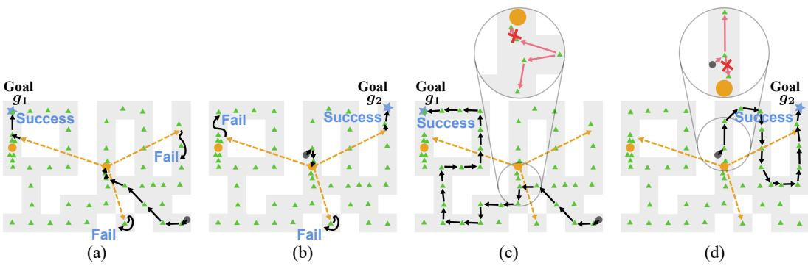  
Stochastic landmarksStart Goal Teleport Agent trajectory Our edge cost  
Figure 6: Shortest waypoint paths in the teleport layout. (a–b) use the prior edge cost $e _ { p } ( v , w ) =$ $- V _ { \theta } ( v , w )$ and illustrate failure cases, while (c–d) use the proposed goal-conditioned edge cost $\boldsymbol { e } _ { g } .$ Goals are selected from the evaluation set. (c–d) further illustrate how $e _ { g }$ accounts for downstream branches and avoids unreliable teleport transitions, yielding more stable paths.

The advantage becomes more pronounced in the teleport environments, where stochastic transitions create deceptive branches that can mislead planning. Most prior methods achieve limited success, and even approaches such as TMD, which explicitly address these challenges, achieve only 20–50% success rates. In contrast, BGP consistently performs well across most goals, with remaining failures primarily attributable to minor control errors rather than planning limitations. These results highlight the importance of explicitly modeling stochastic branching. By identifying branching structures through landmarks, particularly near teleport regions, and avoiding risky branches leading to dead zones, as illustrated in Fig. 3(c), BGP enables more reliable long-horizon planning under complex dynamics. Appendix B.2 further reports substantial improvements over the compared baselines on humanoidmaze and manipulation tasks.

## 5.3 Path Analysis under Graph Planning

To understand how BGP handles stochastic branching, we visualize the learned landmarks and resulting shortest paths under different edge constructions. Fig. 6 presents representative results on the teleport layout, where performance differences are most pronounced, while Appendix B.3 provides full results across all layouts and goals. We fix the same landmark set and compare paths under the prior edge $e _ { p } ( v , w ) = - V _ { \theta } ( v , w )$ and the proposed goal-conditioned edge $e _ { g }$

The learned landmarks capture stochastic branching structure across goals, including teleport regions and other divergence points, but the choice of edge cost critically affects planning. As shown in Fig. 6(a) and (b), with $e _ { p } ,$ all locally reachable transitions are treated as valid, so the planner favors seemingly short teleport paths that often fail, resulting in a path mirage with success rates around 33%. In contrast, Fig. 6(c) and (d) show that $e _ { g }$ uses downstream reachability to disconnect branches leading to dead zones, preserve feasible ones, and consistently select stable paths.

Notably, BGP selects paths based on the goal rather than simply eliminating risky branches: teleport transitions are retained when needed for goal reaching and avoided otherwise. This generalizes beyond teleport-specific cases: as shown in Appendix B.3, in large and giant layouts, where no explicit dead zones exist, edges remain connected and planning reduces to selecting reliable paths among many alternatives. Overall, BGP effectively handles branching-induced stochasticity and enables stable planning across both highly branching and general long-horizon settings.

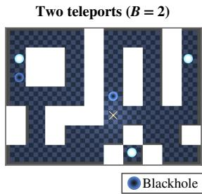  
(a)

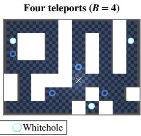  
(b)

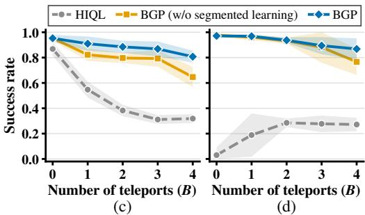  
Figure 7: Environments and success rates with respect to the number of teleports B. Panels (a) and (b) show the environments with two and four teleports, respectively. Panel (c) shows the success rates of HIQL, BGP (w/o segmented learning), and BGP on the navigate datasets, and panel (d) shows those on the stitch datasets. Shaded regions denote 95% confidence intervals over 5 seeds.

## 5.4 Robustness to Increasing Stochasticity

We further investigate the robustness of BGP under increasing stochasticity by varying the number of active teleport entrances, referred to as blackholes, $B \in \{ 0 , \ldots , 4 \}$ in antmaze-teleport, where B=2 is the original environment, as illustrated in Fig. 7(a) and (b) for B=2 and B=4. We evaluate BGP with and without segmented learning to examine its contribution to robustness. For each B, we collect navigate and stitch datasets with the same random seed following the OGBench protocols, so that they differ only in environment dynamics, as detailed in Appendix B.1.

Navigate. As shown in Fig. 7(c), HIQL achieves a high success rate without teleports, but its performance drops substantially as B increases. In contrast, both BGP variants maintain high success rates with little degradation, demonstrating robustness to increasing stochasticity. The gap between the two variants also widens as B increases, suggesting that segmented learning further improves robustness by enabling more reliable value estimation over shorter segments.

Stitch. Since the stitch datasets consist of short episodes, learning reliable values for distant goals is challenging. As shown in Fig. 7(d), HIQL fails to reach the goal even without teleports due to unstable value estimation. With teleports, HIQL instead relies on chance transitions to reach the goal, achieving approximately 33% success. In contrast, both BGP variants maintain high success rates, performing similarly for smaller B. At B=4, BGP achieves approximately 90% success, outperforming BGP (w/o segmented learning) by about 10% points. These results highlight BGP’s robustness to increasing stochasticity and the benefit of segmented learning for reliable value estimation over shorter segments.

## 5.5 Further Analysis of BGP

Component evaluation. We evaluate the contribution of each component in BGP through a set of ablations: BGP w/ one-step estimation, which uses a one-step predictor (n = 1) instead of the Transformer-based uncertainty model; w/ random landmarks, which uniformly samples landmarks from the dataset without uncertainty guidance; w/o segmented learning, which trains on full transitions; w/ prior edge, which replaces $e _ { g }$ with $e _ { p } = - V _ { \theta } ;$ ; and w/ value-based distance, which directly uses $d ( s , g ) = - V _ { \theta } ( s , g )$ without constructing the pre-graph $\mathcal { G } _ { p }$ . Table 2 reports the average success rate across all variants on antmaze-teleport-navigate,stitch. BGP (Default) consistently outperforms all variants, indicating that each component contributes to the final performance. One-step estimation and random landmark selection degrade performance, highlighting the importance of accurately capturing uncertainty to construct informative landmarks. Most critically, both the prior edge and value-based distance variants cause severe performance drops, confirming that edge cost design is the dominant factor in BGP, consistent with the path analysis.

Effect of the number of clusters N. We analyze the effect of the number of landmark clusters N in Fig. 8(a), sweeping $N ~ \in ~ \{ 5 0 , 1 0 0 , 1 5 0 , 2 0 0 \}$ on antmaze-teleport-stitch and pointmaze-giant-navigate. In pointmaze-giant-navigate, performance is largely stable across values of N, suggesting that once meaningful landmarks are identified, navigation is straightforward. In contrast, in antmaze-teleport-stitch, performance slightly degrades as N increases, since larger N induces overly dense local connectivity and increases planning instability. However, the variation is moderate, indicating low sensitivity to N within a reasonable range. In practice, N ∈ [50, 100] provides a good balance between coverage and stability.

<table><tr><td>Variant</td><td>Success Rate (%)</td></tr><tr><td>BGP (Default)</td><td>91.2 ± 1.3</td></tr><tr><td>w/ one-step estimation</td><td> $8 6 . 7 \pm 1 . 3$ </td></tr><tr><td>w/o segmented learning</td><td> $8 4 . 4 \pm 6 . 2$ </td></tr><tr><td>w/ random landmarks</td><td> $6 9 . 4 \pm 4 . 2$ </td></tr><tr><td>w/ prior edge</td><td> $4 4 . 3 \pm 3 . 6$ </td></tr><tr><td>w/ value-based distance</td><td> $4 6 . 8 \pm 5 . 2$ </td></tr></table>

Table 2: Component evaluation.

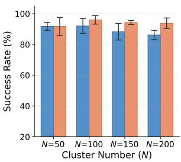  
(a)

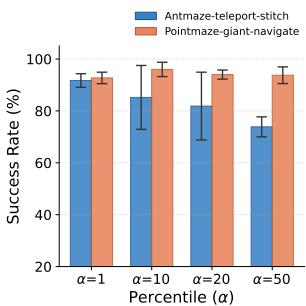  
Figure 8: Hyperparameter analysis.  
(b)

Effect of the percentile threshold α. We analyze the percentile threshold α in Fig. 8(b), sweeping $\alpha \in \{ 1 , 1 0 , 2 0 , 5 0 \}$ , which determines which high-uncertainty states are selected as landmarks. Sen sitivity to α depends on how stochastic branching is distributed. In pointmaze-giant-navigate, performance remains stable across values, as branching is relatively diffuse. In contrast, antmaze-teleport-stitch is highly sensitive: performance drops as α increases. Large α values bias landmark selection toward state diversity rather than true branching structure, resulting in graphs that fail to capture critical transitions. Consequently, the planner cannot reliably avoid failure-prone paths. In practice, smaller α values are preferable in environments with concentrated branching.

Additional analysis. We provide additional hyperparameter analyses across a broader range of layouts and settings in Appendix B.4. Following Jackson et al. [55], we also conduct a budget-aware hyperparameter search in Appendix B.5, demonstrating that BGP achieves strong performance with a modest search budget. Finally, we analyze computational costs in Appendix B.6, showing that the additional overhead introduced by BGP remains modest in practice.

## 6 Limitation

While BGP demonstrates strong performance, several limitations remain. First, BGP introduces additional hyperparameters, including the percentile threshold and the number of clusters. However, our analysis in the Appendix evaluates both hyperparameter sensitivity and search costs, providing practical guidance for efficient tuning. Second, graph construction and planning introduce additional computational overhead. Our cost analysis in the Appendix shows that this overhead is modest relative to the overall training cost. Finally, while BGP remains effective in high-dimensional manipulation tasks, more sophisticated state representations may further improve its performance in such settings. We leave this direction for future work.

## 7 Conclusion

We presented BGP, a branch-aware framework for offline goal-conditioned reinforcement learning that addresses unreliable planning under branching-induced stochasticity in challenging long-horizon tasks. By combining uncertainty-guided landmark construction with goal-conditioned graph planning, BGP effectively captures critical branching structures and enables stable waypoint planning through its two-phase graph structure. Segmented learning further supports reliable local value estimation. Extensive experiments on OGBench demonstrate consistent improvements over existing offline GCRL methods, particularly in challenging long-horizon tasks, highlighting the effectiveness of BGP for reliable goal-conditioned control.

## Acknowledgements

This work was partly supported by the Institute of Information & Communications Technology Planning & Evaluation (IITP) grant funded by the Korea government (MSIT) (No. RS-2020- II201336, Artificial Intelligence Graduate School Support (UNIST)) and (No. RS-2025-25442824, AI Star-Fellowship Program (UNIST)), and partly by the National Research Foundation of Korea (NRF) grants funded by the Korea government (MSIT) (No. RS-2025-23523191, LLM-Based Multi-Agent Reinforcement Learning for End-to-End Large Autonomous Swarm Control) and (No. RS-2026-25536992, AI-Based Nuclear Fusion Heating Technology and Digital Twin Development via Synthetic Diagnostics).

## References

[1] Ilya Kostrikov, Ashvin Nair, and Sergey Levine. Offline reinforcement learning with implicit q-learning. arXiv preprint arXiv:2110.06169, 2021.

[2] Aviral Kumar, Aurick Zhou, George Tucker, and Sergey Levine. Conservative q-learning for offline reinforcement learning. Advances in neural information processing systems, 33: 1179–1191, 2020.

[3] Junghyuk Yeom, Yonghyeon Jo, Jungmo Kim, Sanghyeon Lee, and Seungyul Han. Exclusively penalized q-learning for offline reinforcement learning. Advances in Neural Information Processing Systems, 37:113405–113435, 2024.

[4] Marcin Andrychowicz, Filip Wolski, Alex Ray, Jonas Schneider, Rachel Fong, Peter Welinder, Bob McGrew, Josh Tobin, OpenAI Pieter Abbeel, and Wojciech Zaremba. Hindsight experience replay. Advances in neural information processing systems, 30, 2017.

[5] Seohong Park, Dibya Ghosh, Benjamin Eysenbach, and Sergey Levine. Hiql: Offline goalconditioned rl with latent states as actions. Advances in Neural Information Processing Systems, 36:34866–34891, 2023.

[6] Anurag Ajay, Aviral Kumar, Pulkit Agrawal, Sergey Levine, and Ofir Nachum. Opal: Offline primitive discovery for accelerating offline reinforcement learning. arXiv preprint arXiv:2010.13611, 2020.

[7] Jinning Li, Chen Tang, Masayoshi Tomizuka, and Wei Zhan. Hierarchical planning through goal-conditioned offline reinforcement learning. IEEE Robotics and Automation Letters, 7(4): 10216–10223, 2022.

[8] Seungho Baek, Taegeon Park, Jongchan Park, Seungjun Oh, and Yusung Kim. Graph-assisted stitching for offline hierarchical reinforcement learning. arXiv preprint arXiv:2506.07744, 2025.

[9] Benjamin Eysenbach, Tianjun Zhang, Sergey Levine, and Russ R Salakhutdinov. Contrastive learning as goal-conditioned reinforcement learning. Advances in Neural Information Processing Systems, 35:35603–35620, 2022.

[10] Tongzhou Wang, Antonio Torralba, Phillip Isola, and Amy Zhang. Optimal goal-reaching reinforcement learning via quasimetric learning. In International Conference on Machine Learning, pages 36411–36430. PMLR, 2023.

[11] Vivek Myers, Bill Chunyuan Zheng, Benjamin Eysenbach, and Sergey Levine. Offline goal-conditioned reinforcement learning with quasimetric representations. arXiv preprint arXiv:2509.20478, 2025.

[12] Seohong Park, Kevin Frans, Benjamin Eysenbach, and Sergey Levine. Ogbench: Benchmarking offline goal-conditioned rl. arXiv preprint arXiv:2410.20092, 2024.

[13] Yevgen Chebotar, Karol Hausman, Yao Lu, Ted Xiao, Dmitry Kalashnikov, Jake Varley, Alex Irpan, Benjamin Eysenbach, Ryan Julian, Chelsea Finn, et al. Actionable models: Unsupervised offline reinforcement learning of robotic skills. arXiv preprint arXiv:2104.07749, 2021.

[14] Kaiqiang Ke, Qian Lin, Zongkai Liu, Shenghong He, and Chao Yu. Conservative offline goal-conditioned implicit v-learning. In Forty-second International Conference on Machine Learning, 2025.

[15] Hongjoon Ahn, Heewoong Choi, Jisu Han, and Taesup Moon. Option-aware temporally abstracted value for offline goal-conditioned reinforcement learning. arXiv preprint arXiv:2505.12737, 2025.

[16] Rui Yang, Yiming Lu, Wenzhe Li, Hao Sun, Meng Fang, Yali Du, Xiu Li, Lei Han, and Chongjie Zhang. Rethinking goal-conditioned supervised learning and its connection to offline rl. arXiv preprint arXiv:2202.04478, 2022.

[17] Scott Emmons, Benjamin Eysenbach, Ilya Kostrikov, and Sergey Levine. Rvs: What is essential for offline rl via supervised learning? arXiv preprint arXiv:2112.10751, 2021.

[18] Michael Janner, Qiyang Li, and Sergey Levine. Offline reinforcement learning as one big sequence modeling problem. Advances in neural information processing systems, 34:1273– 1286, 2021.

[19] Lili Chen, Kevin Lu, Aravind Rajeswaran, Kimin Lee, Aditya Grover, Misha Laskin, Pieter Abbeel, Aravind Srinivas, and Igor Mordatch. Decision transformer: Reinforcement learning via sequence modeling. Advances in neural information processing systems, 34:15084–15097, 2021.

[20] Anurag Ajay, Yilun Du, Abhi Gupta, Joshua Tenenbaum, Tommi Jaakkola, and Pulkit Agrawal. Is conditional generative modeling all you need for decision-making? arXiv preprint arXiv:2211.15657, 2022.

[21] Sungyoon Kim, Yunseon Choi, Daiki E Matsunaga, and Kee-Eung Kim. Stitching subtrajectories with conditional diffusion model for goal-conditioned offline rl. In Proceedings of the AAAI Conference on Artificial Intelligence, volume 38, pages 13160–13167, 2024.

[22] Quentin Rouxel, Clemente Donoso, Fei Chen, Serena Ivaldi, and Jean-Baptiste Mouret. Extremum flow matching for offline goal conditioned reinforcement learning. In 2025 IEEE-RAS 24th International Conference on Humanoid Robots (Humanoids), pages 981–988. IEEE, 2025.

[23] Prajwal Koirala and Cody Fleming. Flow-based single-step completion for efficient and expressive policy learning. arXiv preprint arXiv:2506.21427, 2025.

[24] Jongseong Chae, Jongeui Park, Yongjae Shin, Gyeongmin Kim, Seungyul Han, and Youngchul Sung. Flow actor-critic for offline reinforcement learning. arXiv preprint arXiv:2602.18015, 2026.

[25] Vivek Myers, Chongyi Zheng, Anca Dragan, Sergey Levine, and Benjamin Eysenbach. Learning temporal distances: Contrastive successor features can provide a metric structure for decisionmaking. arXiv preprint arXiv:2406.17098, 2024.

[26] Jason Yecheng Ma, Jason Yan, Dinesh Jayaraman, and Osbert Bastani. Offline goal-conditioned reinforcement learning via f-advantage regression. Advances in neural information processing systems, 35:310–323, 2022.

[27] Harshit Sikchi, Rohan Chitnis, Ahmed Touati, Alborz Geramifard, Amy Zhang, and Scott Niekum. Score models for offline goal-conditioned reinforcement learning. In The Twelfth International Conference on Learning Representations, 2023.

[28] Ben Eysenbach, Russ R Salakhutdinov, and Sergey Levine. Search on the replay buffer: Bridging planning and reinforcement learning. Advances in neural information processing systems, 32, 2019.

[29] Zhiao Huang, Fangchen Liu, and Hao Su. Mapping state space using landmarks for universal goal reaching. Advances in Neural Information Processing Systems, 32, 2019.

[30] Lunjun Zhang, Ge Yang, and Bradly C Stadie. World model as a graph: Learning latent landmarks for planning. In International conference on machine learning, pages 12611–12620. PMLR, 2021.

[31] Nikolay Savinov, Alexey Dosovitskiy, and Vladlen Koltun. Semi-parametric topological memory for navigation. arXiv preprint arXiv:1803.00653, 2018.

[32] Dhruv Shah, Benjamin Eysenbach, Gregory Kahn, Nicholas Rhinehart, and Sergey Levine. Ving: Learning open-world navigation with visual goals. In 2021 IEEE International Conference on Robotics and Automation (ICRA), pages 13215–13222. IEEE, 2021.

[33] Junsu Kim, Younggyo Seo, and Jinwoo Shin. Landmark-guided subgoal generation in hierarchical reinforcement learning. Advances in neural information processing systems, 34: 28336–28349, 2021.

[34] Seungjae Lee, Jigang Kim, Inkyu Jang, and H Jin Kim. Dhrl: a graph-based approach for long-horizon and sparse hierarchical reinforcement learning. Advances in Neural Information Processing Systems, 35:13668–13678, 2022.

[35] Jaebak Hwang, Sanghyeon Lee, Jeongmo Kim, and Seungyul Han. Strict subgoal execution: Reliable long-horizon planning in hierarchical reinforcement learning. arXiv preprint arXiv:2506.21039, 2025.

[36] Anthony Kobanda, Waris Radji, Odalric-Ambrym Maillard, and Rémy Portelas. Adaptive quasimetric mapping: Principled topological abstraction for robust offline goal-conditioned navigation. In Forty-third International Conference on Machine Learning, 2026.

[37] Hebin Liang, Yi Ma, Chenjun Xiao, Zibin Dong, Zilin Cao, Fei Ni, Yifu Yuan, and Jianye Hao. Bottleneck-guided spectral subgoals for offline goal-conditioned rl. In Forty-third International Conference on Machine Learning, 2026.

[38] Marc G Bellemare, Will Dabney, and Rémi Munos. A distributional perspective on reinforcement learning. In International conference on machine learning, pages 449–458. Pmlr, 2017.

[39] Will Dabney, Mark Rowland, Marc Bellemare, and Rémi Munos. Distributional reinforcement learning with quantile regression. In Proceedings of the AAAI conference on artificial intelligence, volume 32, 2018.

[40] Will Dabney, Georg Ostrovski, David Silver, and Rémi Munos. Implicit quantile networks for distributional reinforcement learning. In International conference on machine learning, pages 1096–1105. PMLR, 2018.

[41] Kurtland Chua, Roberto Calandra, Rowan McAllister, and Sergey Levine. Deep reinforcement learning in a handful of trials using probabilistic dynamics models. Advances in neural information processing systems, 31, 2018.

[42] Thanard Kurutach, Ignasi Clavera, Yan Duan, Aviv Tamar, and Pieter Abbeel. Model-ensemble trust-region policy optimization. arXiv preprint arXiv:1802.10592, 2018.

[43] Michael Janner, Justin Fu, Marvin Zhang, and Sergey Levine. When to trust your model: Model-based policy optimization. Advances in neural information processing systems, 32, 2019.

[44] Chenjia Bai, Lingxiao Wang, Zhuoran Yang, Zhihong Deng, Animesh Garg, Peng Liu, and Zhaoran Wang. Pessimistic bootstrapping for uncertainty-driven offline reinforcement learning. arXiv preprint arXiv:2202.11566, 2022.

[45] Ching-An Cheng, Tengyang Xie, Nan Jiang, and Alekh Agarwal. Adversarially trained actor critic for offline reinforcement learning. In International Conference on Machine Learning, pages 3852–3878. PMLR, 2022.

[46] Tianhe Yu, Garrett Thomas, Lantao Yu, Stefano Ermon, James Y Zou, Sergey Levine, Chelsea Finn, and Tengyu Ma. Mopo: Model-based offline policy optimization. Advances in neural information processing systems, 33:14129–14142, 2020.

[47] Rahul Kidambi, Aravind Rajeswaran, Praneeth Netrapalli, and Thorsten Joachims. Morel: Model-based offline reinforcement learning. Advances in neural information processing systems, 33:21810–21823, 2020.

[48] Yue Wu, Shuangfei Zhai, Nitish Srivastava, Joshua Susskind, Jian Zhang, Ruslan Salakhutdinov, and Hanlin Goh. Uncertainty weighted actor-critic for offline reinforcement learning. arXiv preprint arXiv:2105.08140, 2021.

[49] Yecheng Ma, Dinesh Jayaraman, and Osbert Bastani. Conservative offline distributional reinforcement learning. Advances in neural information processing systems, 34:19235–19247, 2021.

[50] Núria Armengol Urpí, Sebastian Curi, and Andreas Krause. Risk-averse offline reinforcement learning. arXiv preprint arXiv:2102.05371, 2021.

[51] Hervé Abdi and Lynne J Williams. Principal component analysis. Wiley interdisciplinary reviews: computational statistics, 2(4):433–459, 2010.

[52] Seohong Park, Tobias Kreiman, and Sergey Levine. Foundation policies with hilbert representations. arXiv preprint arXiv:2402.15567, 2024.

[53] David Arthur and Sergei Vassilvitskii. k-means++: the advantages of careful seeding. In Proceedings ofthe eighteenth annual ACM-SIAM symposium on Discrete algorithms, SODA ’07, pages 1027–1035, New Orleans, Louisiana, January 2007. Society for Industrial and Applied Mathematics. ISBN 978-0-89871-624-5.

[54] Edsger W Dijkstra. A note on two problems in connexion with graphs. Numerische mathematik, 1(1):269–271, 1959.

[55] Matthew Jackson, Uljad Berdica, Jarek Liesen, Shimon Whiteson, and Jakob Foerster. A clean slate for offline reinforcement learning. Advances in Neural Information Processing Systems, 38:161052–161083, 2026.

[56] Emanuel Todorov, Tom Erez, and Yuval Tassa. Mujoco: A physics engine for model-based control. In 2012 IEEE/RSJ international conference on intelligent robots and systems, pages 5026–5033. IEEE, 2012.

## A Implementation Details

This section presents additional implementation details of the proposed framework. The branch-aware graph construction process is detailed in Appendix A.1, and the offline learning procedure combined with the segmented learning scheme is described in Appendix A.2.

## A.1 Graph Construction Detail

Uncertainty model. To compute the uncertainty score $\mathcal { U } ^ { ( n ) }$ in Eq. (2), we parameterize the autoregressive model $p _ { \psi }$ as a decoder-only Transformer that predicts future joint transition variables $y _ { t + l } =$ $( a _ { t + l } , s _ { t + l + 1 } )$ . Rather than predicting deterministic targets, the Transformer outputs the parameters $\left( \mu _ { t + l } , \sigma _ { t + l } \right)$ of a conditional Gaussian, $p _ { \psi } ( y _ { t + l } \mid s _ { t } , y _ { t : t + l - 1 } ) = \mathcal { N } \big ( y _ { t + l } ; \mu _ { t + l } , \mathrm { d i a g } ( \sigma _ { t + l } ^ { 2 } ) \big )$ , so that the entropy in $\mathcal { U } ^ { ( n ) }$ can be computed directly from the predicted variance $\sigma _ { t + l }$ . The model is trained with teacher forcing on input sequences $\left[ s _ { t } , y _ { t } , \dotsc , y _ { t + n - 1 } \right]$ , where the output at each position predicts the next token under causal masking, by minimizing the negative log-likelihood over D:

$$
\begin{array} { r } { \mathcal { L } ( \psi ) = \mathbb { E } _ { ( s _ { t } , y _ { t : t + n - 1 } ) \sim \mathcal { D } } \left[ \sum _ { l = 0 } ^ { n - 1 } - \log p _ { \psi } \left( y _ { t + l } ~ | ~ s _ { t } , y _ { t : t + l - 1 } \right) \right] . } \end{array}\tag{5}
$$

At evaluation, the predictions are fed back into the Transformer autoregressively, as illustrated in Fig. 9, and ${ \mathcal { U } } ^ { ( n ) } ( s _ { t } )$ is computed as the discounted sum of the resulting conditional entropies over n future steps.

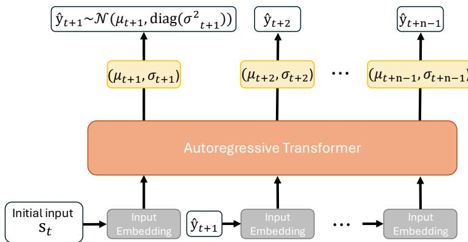  
Figure 9: Autoregressive prediction of the Transformer during evaluation, where predicted transition variables $\hat { y } _ { t + l }$ are fed back as inputs to estimate multi-step uncertainty from the current state $s _ { t }$

Representation and clustering. To handle high-dimensional inputs, we project states into a representation space $\mathcal { Z }$ before clustering. For state-based antmaze and pointmaze, we use a 2-dimensional PCA projection [51]. For the other environments, we use a Hilbert representation pretrained with goal-conditioned IQL on an IMPALA-small CNN encoder following Park et al. [52], which is then frozen. For visual tasks, the Transformer is trained and evaluated on top of the frozen representation. In this space, the top-α percentile high-uncertainty states are clustered with K-means++, and each landmark is chosen as the actual dataset state closest to its cluster center, so that every graph vertex corresponds to an actual state near a stochastic branching point. Table 3 summarizes the representation and its dimension used in each environment, including humanoidmaze and the manipulation tasks evaluated in the additional experiments in Appendix B.2.

Planning. Given a goal, the goal-conditioned edge cost $e _ { g }$ in Eq. (4) is computed from the expected distance reduction toward the goal. Since $e _ { g }$ becomes negative when a transition reliably reduces the distance to the goal, we add a constant shift to all valid edges so that all weights are non-negative, as required by Dijkstra’s algorithm, before computing the shortest waypoint path.

Table 3: Representations used for landmark clustering in each environment. Dimension denotes the dimensionality of the representation space $\mathcal { Z } .$
<table><tr><td>Environment</td><td>Representation for clustering</td><td>Dimension</td></tr><tr><td>antmaze</td><td>PCA projection</td><td>2</td></tr><tr><td>pointmaze</td><td>PCA projection</td><td>2</td></tr><tr><td>visual-antmaze</td><td>Hilbert representation</td><td>16</td></tr><tr><td>humanoidmaze</td><td>Hilbert representation</td><td>16</td></tr><tr><td>manipulation tasks</td><td>Hilbert representation</td><td>16</td></tr></table>

## A.2 Offline Learning Detail with Segmented Learning

As described in Section 4.4 and illustrated in Fig. 10, we train the value function and policy on local windows $\tilde { \tau } _ { j } ^ { ( k ) }$ , each formed by concatenating M consecutive sub-trajectories of the k-th offline trajectory. The choice of M balances local trajectory coverage against learning stability. A small M may miss useful skip-like transitions and longer local transitions, while a large M includes many stochastic boundaries, which leads to accumulated stochasticity and value-estimation bias. Within each window, the goal for a given state is sampled from the current state, a future state in the same window, or a random state in the window, with the ratios listed in Table 4.

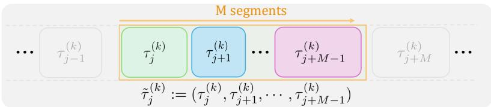

Figure 10: Illustration of segmented learning. Each offline trajectory is partitioned into sub-trajectories $\tau _ { j } ^ { ( \bar { k } ) }$ at cluster transition boundaries, shown in different colors, and M consecutive sub-trajectories are concatenated into a local training window $\tilde { \tau } _ { j } ^ { ( k ) }$

We use HIQL as the offline reinforcement learning backbone. At execution, given the waypoint path $( \tilde { w } _ { 0 } , \dots , \tilde { w } _ { K ^ { \prime } } )$ computed by the branch-aware graph planner, the learned policy sequentially aims to reach each waypoint $\tilde { w } _ { i }$ . The high-level policy $\pi ^ { h } ( s _ { g } \mid s , { \tilde { w } } _ { i } )$ decomposes $\tilde { w } _ { i }$ into a closer subgoal $s _ { g } ,$ and the low-level policy $\pi ^ { l } ( \boldsymbol { a } \mid \boldsymbol { s } , \boldsymbol { s } _ { g } )$ interacts with the environment to reach it. The objective function of HIQL is provided in Appendix A.4.

## A.3 Environmental Details

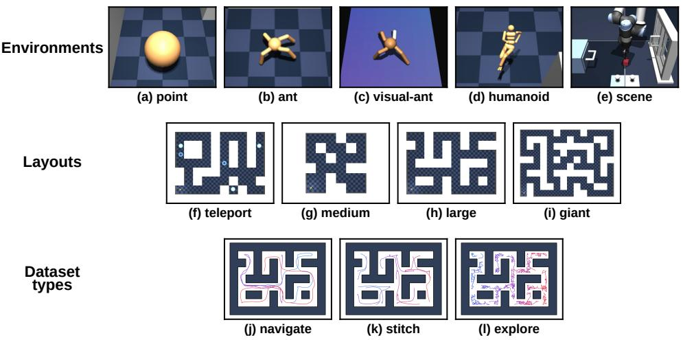  
Figure 11: Visualizations of the OGBench environments used in our experiments. Panels (a)-(e) show the agents and the manipulation environment, panels (f)-(i) show the maze layouts, and panels (j)-(l) show example trajectories of the three dataset types.

We conducted all experiments on an NVIDIA RTX 3090 GPU and an Intel Xeon Gold 6348 CPU running Ubuntu 20.04. We evaluate our method on OGBench [12], a standard benchmark designed for offline goal-conditioned reinforcement learning. We specifically focus on environments where the offline data exhibit substantial stochasticity originating from both complex environment dynamics and suboptimal behavior policies.

Environments. All continuous control environments are simulated within the MuJoCo physics engine [56].

• pointmaze: As shown in Fig. 11(a), the agent governs a 2D point mass via a 2-DoF action space. The observation space is 2-dimensional, consisting of the agent’s position. While executing low-level actions is simpler compared to antmaze, the high-level routing complexity remains identical, isolating the challenge of long-horizon planning.

• antmaze: As shown in Fig. 11(b), the agent operates a quadruped Ant robot equipped with 8 degrees of freedom (DoF). Solving this environment requires the agent to seamlessly integrate highlevel topological planning with low-level complex locomotion. The 29-dimensional observation space includes the agent’s absolute 2D (x, y) position alongside joint kinematics.

• visual-antmaze: As shown in Fig. 11(c), this environment uses the same Ant robot and maze layouts as antmaze, but the agent receives image observations instead of states, which additionally requires learning from high-dimensional pixel inputs.

• humanoidmaze: As shown in Fig. 11(d), this environment uses the medium, large, and giant maze layouts, where the agent controls a much more complex 21-DoF Humanoid robot. As in other maze environments, the agent must learn both high-level maze navigation and low-level locomotion skills, and reaching distant goals in the giant layout requires up to 3,000 environment steps.

• manipulation tasks: As shown in Fig. 11(e), among the manipulation environments in OG-Bench, we use scene, which requires long-horizon sequential manipulation. A 6-DoF UR5e robot arm interacts with a cube, a window, a drawer, and two button locks, and we use the play dataset collected by scripted policies that randomly interact with the objects.

Maze layouts. To rigorously test our stochasticity-aware framework, we utilize four maze layouts provided by OGBench:

• teleport: As shown in Fig. 11(f), this layout introduces severe environmental stochasticity through unpredictable state transitions caused by blackholes and whiteholes. It serves as a critical testbed for evaluating our method’s ability to resist lucky sample bias and construct robust waypoint graphs.

• medium: As shown in Fig. 11(g), this layout follows the original medium maze in D4RL and provides a shorter task horizon than the other layouts.

• large and giant: As shown in Fig. 11(h) and (i), these highly scaled layouts significantly extend the task horizon. They are specifically designed to test the agent’s vulnerability to accumulated over-optimism and value estimation errors over extended distances.

Dataset types and evaluation setup. To assess algorithm performance across diverse data distributions, we utilize three types of offline datasets:

• navigate: As shown in Fig. 11(j), this dataset serves as the standard benchmark setting, where trajectories are generated by a goal-directed policy with injected noise. It evaluates the agent’s ability to perform general goal-conditioned navigation.

• stitch: As shown in Fig. 11(k), this dataset is composed of short, disconnected trajectory segments that do not individually solve the task. The agent must combine multiple segments to form a valid long-horizon solution, emphasizing its ability to reason over fragmented experience.

• explore: As shown in Fig. 11(l), this dataset contains highly noisy and unstructured trajectories with broad state coverage but low data quality. It evaluates whether the agent can extract useful navigation behavior from poorly structured experience.

## A.4 Details of Baselines and Backbones

• GCIQL [5] is a goal-conditioned implicit value-learning method that learns both a state-value function and an action-value function under the IQL framework:

$$
\mathcal { L } _ { V } ( \theta ) = \mathbb { E } _ { ( s , a ) \sim \mathcal { D } } \left[ \ell _ { \kappa } ^ { 2 } \left( \bar { Q } _ { \bar { \theta } } ( s , a , g ) - V _ { \theta } ( s , g ) \right) \right] ,\tag{6}
$$

$$
\begin{array} { r } { \mathcal { L } _ { Q } ( \theta ) = \mathbb { E } _ { ( s , a , s ^ { \prime } ) \sim \mathcal { D } } \left[ \left( r ( s , g ) + \gamma V _ { \bar { \theta } } ( s ^ { \prime } , g ) - Q _ { \theta } ( s , a , g ) \right) ^ { 2 } \right] , } \end{array}\tag{7}
$$

During training, the goal $g$ is sampled from a mixture of the current state, a future state from the same trajectory as s, and a random state from the full offline dataset.

To extract a policy from these learned value functions, GCIQL can use either a value-only AWR objective or a DDPG+BC objective. In our experiments, we mainly use the DDPG+BC objective, which has been reported to outperform AWR on OGBench [12]. During actor training, the goal g is sampled only from future states in the same trajectory as s, resulting in the following objective:

$$
\begin{array} { r } { \mathcal { L } _ { \pi } ( \psi ) = \mathbb { E } _ { ( s , a ) \sim \mathcal { D } } \left[ Q _ { \theta } ( s , \pi _ { \psi } ( s , g ) , g ) + \alpha \log \pi _ { \psi } ( a \mid s , g ) \right] , } \end{array}\tag{8}
$$

Open-source code of GCIQL is available at https://github.com/seohongpark/ogbench.

• HIQL [5] is a hierarchical goal-conditioned reinforcement learning method that extends implicit value learning to long-horizon tasks by decomposing control into a high-level subgoal policy and a low-level goal-reaching policy over subgoals. The goal-conditioned value function is trained via expectile regression:

$$
\mathcal { L } _ { V } ( \theta ) = \mathbb { E } _ { ( s , s ^ { \prime } ) \sim \mathcal { D } } \left[ \ell _ { \kappa } ^ { 2 } \left( r ( s , g ) + \gamma V _ { \bar { \theta } } ( s ^ { \prime } , g ) - V _ { \theta } ( s , g ) \right) \right] ,\tag{9}
$$

During value-function training, the goal g is sampled from a mixture of the current state, a future state from the same trajectory as s, and a random state from the full offline dataset. HIQL then learns the high-level policy $\pi _ { \psi _ { h } } ^ { h } \left( s _ { t + k } \ \mid \ s _ { t } , g \right)$ and the low-level policy $\pi _ { \psi _ { l } } ^ { l } ( a \ | \ s _ { t } , s _ { t + k } )$ via advantage-weighted regression:

$$
\mathcal { L } _ { \pi ^ { h } } ( \psi _ { h } ) = \mathbb { E } _ { ( s _ { t } , s _ { t + k } ) \sim \mathcal { D } } \left[ \exp \left( \beta \tilde { A } ^ { h } ( s _ { t } , s _ { t + k } , g ) \right) \log \pi _ { \psi _ { h } } ^ { h } ( s _ { t + k } \mid s _ { t } , g ) \right] ,\tag{10}
$$

$$
\mathcal { L } _ { \pi ^ { l } } ( \psi _ { l } ) = \mathbb { E } _ { ( s _ { t } , a _ { t } , s _ { t + 1 } , s _ { t + k } ) \sim \mathcal { D } } \left[ \exp \left( \beta \tilde { A } ^ { l } ( s _ { t } , a _ { t } , s _ { t + k } ) \right) \log \pi _ { \psi _ { l } } ^ { l } ( a _ { t } \mid s _ { t } , s _ { t + k } ) \right] ,\tag{11}
$$

During actor training, the goal $g$ is sampled only from future states in the same trajectory as s. Here, $\beta$ denotes a temperature hyperparameter for advantage-weighted regression, and the advantages are approximated as $\tilde { A } ^ { h } ( s _ { t } , s _ { t + k } , g ) \approx V _ { \theta } ( s _ { t + k } , g ) - V _ { \theta } ( s _ { t } , g )$ and $\tilde { A } ^ { l } ( s _ { t } , a _ { t } , s _ { t + k } ) \approx V _ { \theta } ( s _ { t + 1 } , s _ { t + k } ) - V _ { \theta } ( s _ { t } , s _ { t + k } )$ . Open-source code of HIQL is available at https://github.com/seohongpark/ogbench.

• QRL [10] imposes a triangle inequality constraint using a quasimetric network architecture. This structural inductive bias allows the model to capture optimal asymmetric reachability and implicitly stitch shortest paths from suboptimal offline data. Open-source code of QRL is available at https://github.com/seohongpark/ogbench.

• CRL [9] formulates goal-conditioned RL as a representation learning problem. It utilizes a contrastive learning objective to estimate transition probabilities and temporal distances, avoiding the compounding errors typical of standard temporal difference learning. Open-source code of CRL is available at https://github.com/seohongpark/ogbench.

• GAS [8] constructs explicit state graphs directly from static offline datasets. It performs global graph-based search to stitch disconnected trajectory segments, enabling the agent to find optimal paths without relying solely on complex policy network approximations. Open-source code of GAS is available at https://github.com/qortmdgh4141/GAS.

• TMD [11] proposes Temporal Metric Distillation, which combines contrastive representation learning with quasimetric architectural constraints. By enforcing action invariance and the triangle inequality, it learns optimal goal-reaching distances even in highly stochastic offline environments. Open-source code of TMD is available at https://github.com/vivekmyers/tmd-release/tree/master.

• CGCIVL [14] introduces a conservative value learning objective that explicitly penalizes unconnected state-goal pairs to prevent value overestimation during cross-trajectory sampling. By combining this conservative penalty with a quasimetric distillation mechanism, it ensures valid connected pairs maintain accurate distance estimates, effectively stabilizing long-horizon goal stitching. Open-source code of CGCIVL is available at https://github.com/kkq2018/CGCIVL.git.

## A.5 Hyperparameter Setup

The hyperparameter settings for BGP are summarized in this section. Table 4 lists the common hyperparameters shared across all environments, including network architectures and optimization details. We selected the Transformer context length $n = 5$ and the local segment length $M = 3$ as default values across all tasks because they provide a favorable balance between capturing sufficient multi-step stochasticity and maintaining computational efficiency during localized learning. Table 5 details the environment-specific hyperparameters, specifically the top-α percentile for landmark identification and the number of clusters N, which are selected from the search ranges $\alpha \in \{ 1 , 1 0 , 2 0 , 5 0 \}$ and $N \in \{ 5 0 , 1 0 0 , 1 5 0 , 2 0 0 \}$

As noted in the main text, BGP relies on HIQL as the primary backbone and is trained for 500K steps on pixel-based tasks and 1M steps otherwise. For tasks that use the Hilbert representation, where clustering in the learned representation space is noisier, each local segment must contain at least 60 states, and a graph edge is retained only if the corresponding transition is observed at least 20 times in the dataset. Its performance remains robust across a reasonable range of these configurations. A detailed analysis of hyperparameter sensitivity is provided in Appendix B.4.

Table 4: Common hyperparameters.
<table><tr><td>Hyperparameter</td><td>Value</td></tr><tr><td colspan="2">Transformer (Uncertainty Estimation)</td></tr><tr><td>Number of layers</td><td>4</td></tr><tr><td>Number of attention heads</td><td>2</td></tr><tr><td>Embedding dimension</td><td>256</td></tr><tr><td>Context length (n)</td><td>5</td></tr><tr><td>Transformer learning rate</td><td> $3 \times 1 0 ^ { - 4 }$ </td></tr><tr><td colspan="2">Offline GCRL Backbone</td></tr><tr><td>Segment length (M)</td><td>3</td></tr><tr><td>Batch size</td><td>512(state-based task), 256(pixel-based task)</td></tr><tr><td>Value / Policy MLP dimensions</td><td>(512, 512, 512)</td></tr><tr><td>Nonlinearity</td><td>GELU</td></tr><tr><td>Value normalization</td><td>LayerNorm</td></tr><tr><td>Target network smoothing coefficient</td><td>0.005 0.0003</td></tr><tr><td>Learning rate</td><td>Adam</td></tr><tr><td>Optimizer Discount factor γ</td><td></td></tr><tr><td>Subgoal selection frequency (HIQL)</td><td>0.99(state-based task), 0.995(pixel-based task)</td></tr><tr><td></td><td>25(giantmaze, pixel-based task), 15(others)</td></tr><tr><td>€ for waypoint reachability</td><td>1.5(state-based task), 40(pixel-based task)</td></tr><tr><td>Value  $\big ( \dot { p } _ { \mathrm { c u r } } ^ { \hat { D } } , p _ { \mathrm { t r a j } } ^ { D } , p _ { \mathrm { r a n d } } ^ { \mathcal { D } } \big )$  ratio</td><td>(0.2, 0.5, 0.3)</td></tr><tr><td>Policy  $\left( p _ { \mathrm { c u r } } ^ { D } , p _ { \mathrm { t r a j } } ^ { \tilde { D } } , p _ { \mathrm { r a n d } } ^ { \mathcal { D } } \right)$  ratio</td><td>(0,1,0) (state-based task), (0, 0.5, 0.5) (pixel-based task)</td></tr></table>

Table 5: Environment-specific hyperparameters.
<table><tr><td>Domain</td><td>Dataset</td><td>Percentile (α)</td><td>Num Clusters (N)</td></tr><tr><td rowspan="6">pointmaze</td><td>teleport-navigate</td><td>1</td><td>100</td></tr><tr><td>teleport-stitch</td><td>1</td><td>100</td></tr><tr><td>giant-navigate</td><td>10</td><td>100</td></tr><tr><td>giant-stitch</td><td>10</td><td>100</td></tr><tr><td>large-navigate</td><td>1</td><td>50</td></tr><tr><td>large-stitch</td><td>1</td><td>50</td></tr><tr><td rowspan="8">antmaze</td><td>teleport-navigate</td><td>1</td><td>50</td></tr><tr><td>teleport-stitch</td><td>1</td><td>50</td></tr><tr><td>teleport-explore</td><td>10</td><td>200</td></tr><tr><td>giant-navigate</td><td>20</td><td>100</td></tr><tr><td>giant-stitch</td><td>20</td><td>100</td></tr><tr><td>large-navigate</td><td>10</td><td>50</td></tr><tr><td>large-stitch</td><td>10</td><td>50</td></tr><tr><td>large-explore</td><td>50</td><td>50</td></tr><tr><td rowspan="6">visual-antmaze</td><td>giant-stitch</td><td>10</td><td>100</td></tr><tr><td>large-navigate</td><td>50</td><td>100</td></tr><tr><td>large-stitch</td><td>50</td><td>100</td></tr><tr><td>medium-navigate</td><td>10</td><td>100</td></tr><tr><td>medium-stitch</td><td>10</td><td>100</td></tr><tr><td>medium-explore</td><td>10</td><td>100</td></tr></table>

## B Additional Analysis and Ablation Studies

## B.1 Teleport Environments with Varying Numbers of Blackholes

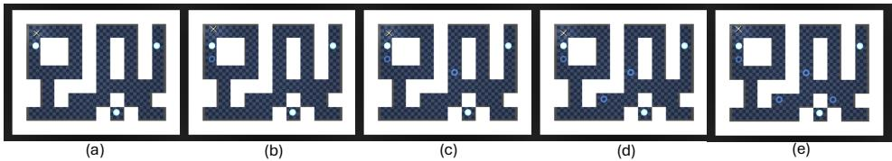

Figure 12: antmaze-teleport environments with varying numbers of teleports. Panels (a)-(e) show the environments with B=0, 1, 2, 3, and 4 active blackholes, respectively, and panel (c) is the original OGBench environment.

Environments. Fig. 12 shows the five environments, which share the same maze layout and exit locations. When the agent enters an active blackhole, it is teleported to one of three fixed exits uniformly at random, with its velocity preserved.

Offline datasets. For each B, we collect navigate and stitch datasets following the OGBench protocols, where a pretrained SAC low-level policy with an action noise of 0.2 follows the subgoals of a shortest-path oracle that does not account for teleports. The navigate datasets consist of 1,000 training and 100 validation episodes of 1,001 steps, where a new goal is sampled whenever the current goal is reached. The stitch datasets consist of 5,000 training and 500 validation episodes of 201 steps, where each episode moves to a goal four cells away and stays near it.

## B.2 Performance on Additional Tasks

To complement the main experiments, we provide additional results on humanoid locomotion and manipulation using humanoidmaze and scene-play, shown in Fig. 11(d) and (e), respectively. For both environments, we perform landmark clustering in the Hilbert representation space Z following Park et al. [52].

Humanoidmaze. Table 6 reports results on the navigate and stitch datasets of the medium, large, and giant layouts, together with the corresponding BGP hyperparameter settings. BGP achieves higher mean success rates than the compared baselines on five datasets, with particularly large improvements on the giant layouts.

Manipulation. Table 6 also presents results on scene-play. BGP achieves a mean success rate of 60%, compared with 38% for HIQL, 51% for GCIQL, 5% for QRL, and 19% for CRL. This evaluation supplements the navigation experiments with a manipulation task. These results suggest that BGP can also improve goal-reaching performance on this manipulation task.

Table 6: Success rates (%) on humanoidmaze and scene-play-v0. The highest mean in each row is highlighted in bold. The final column reports the BGP hyperparameter settings $( \alpha , N )$ , with – indicating an unreported setting.
<table><tr><td>Env</td><td>Dataset</td><td>HIQL</td><td>GCIQL</td><td>QRL</td><td>CRL</td><td>BGP(Ours)</td><td>BGP (α, N)</td></tr><tr><td rowspan="6">humanoidmaze</td><td>medium-navigate</td><td>89(±2)</td><td> $2 7 ^ { ( \pm 2 ) }$ </td><td>21(±8)</td><td> $6 0 ^ { ( \pm 4 ) }$ </td><td>95(±2)</td><td>(10,50)</td></tr><tr><td>medium-stitch</td><td>88(±2)</td><td>12(±3)</td><td>18(±2)</td><td>36(±2)</td><td>87(±6)</td><td>(10,50)</td></tr><tr><td>large-navigate</td><td>49(±4)</td><td>2(±1)</td><td>5(±1)</td><td>24(±4)</td><td>70(±7)</td><td>(20,50)</td></tr><tr><td>large-stitch</td><td>28(±3)</td><td>0(±0)</td><td>3(±1)</td><td>4(±1)</td><td>58(±8)</td><td>(50,50)</td></tr><tr><td>giant-navigate</td><td>12(±4)</td><td>0(±0)</td><td>1(±0)</td><td>3(±2)</td><td>75(±6)</td><td>(10, 150)</td></tr><tr><td>giant-stitch</td><td>3(±2)</td><td>0(±0)</td><td>0(±0)</td><td>0(±0)</td><td>69(±8)</td><td>(10, 150)</td></tr><tr><td>scene</td><td>play</td><td>38(±3)</td><td>51(±4)</td><td>5(±1)</td><td>19(±2)</td><td>60(±5)</td><td>(50,150)</td></tr></table>

## B.3 Trajectory Analysis

To provide additional intuition into the planning behavior of BGP, we visualize representative landmarks and executed trajectories for each layout. Since the qualitative behavior is largely consistent across different dataset variants within the same layout, we present one representative example per layout.

Teleport layout. First, Fig. 13 illustrates the navigation results in the teleport layout. In these settings, teleportation zones introduce severe and unpredictable state transitions. Methods that rely solely on local connectivity can be misled by these highly branching regions, treating them as spuriously efficient shortcuts. As the visualization demonstrates, BGP correctly identifies these critical branching points and systematically routes the agent around them. By evaluating the expected outcomes of downstream branches, the planner avoids deceptive paths and constructs a reliable route that safely circumvents the teleportation zones.

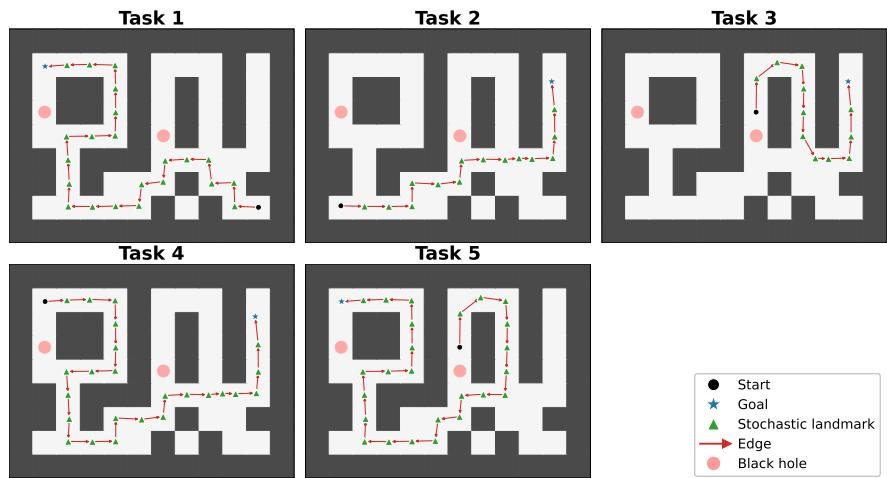  
Figure 13: Representative trajectory analysis on the teleport environment.

Giant layout. Fig. 14 shows the corresponding trajectory visualization on the giant layout. This environment contains long maze-like corridors and many branching paths, making long-horizon planning particularly challenging. Despite this complexity, BGP organizes navigation through a sequence of reliable intermediate landmarks, producing a coherent waypoint trajectory toward the distant goal. The resulting graph path demonstrates that BGP effectively decomposes difficult long-range planning problems into stable local transitions.

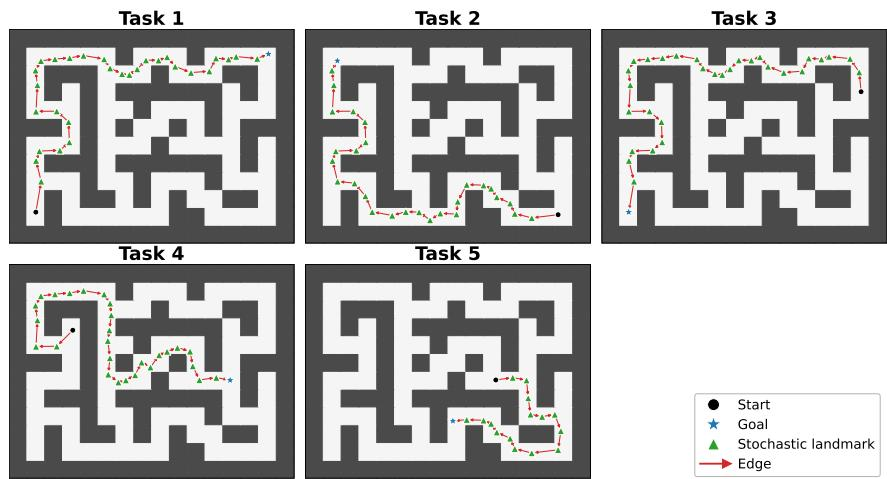  
Figure 14: Representative trajectory analysis on the giant environment.

Large layout. Finally, Fig. 15 presents the large layout. Although this environment is smaller and structurally simpler than the giant layout, it still contains multiple branching regions that require reliable intermediate decisions. BGP consistently identifies these meaningful branching junctions as stochastic landmarks and composes a coherent route toward the target goal. The resulting trajectory demonstrates that the learned graph structure remains informative even in relatively smaller environments, allowing the agent to reliably reach the goal through branch-aware waypoint planning.

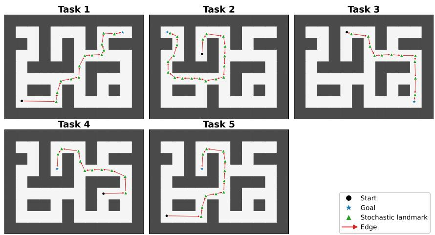  
Figure 15: Representative trajectory analysis on the large environment.

## B.4 Hyperparameter Sensitivity

We further analyze the sensitivity of BGP with respect to its key hyperparameters: the percentile threshold α, the number of clusters N, and the segment length M. Overall, while BGP exhibits distinct trends depending on the environmental characteristics, it maintains a generally robust performance across a broad range of configurations.

Landmark parameters (α and N). Fig. 16 and Fig. 17 illustrate the success rates across α and N for the teleport and giant environments, respectively. We tested these parameters across multiple environments and observed similar overall trends. Variations in these parameters yield no significant performance differences in pointMaze domains. The performance differences become more pronounced in antMaze domains and are especially clear within the teleport environments. The giant environments also exhibit trends consistent with this overall pattern. Despite these layout-specific tendencies, BGP achieves consistently high success rates across various (α, N) pairs, indicating that it can be reliably deployed without exhaustive tuning.

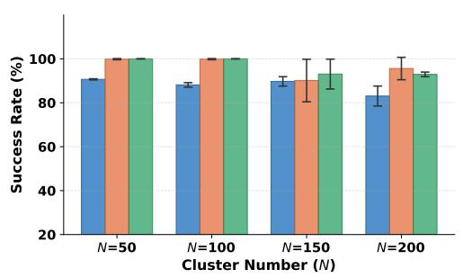

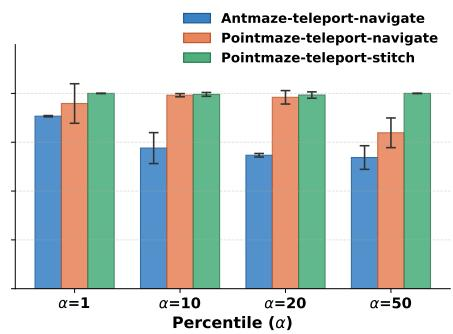  
Figure 16: Hyperparameter sensitivity on the teleport environment.

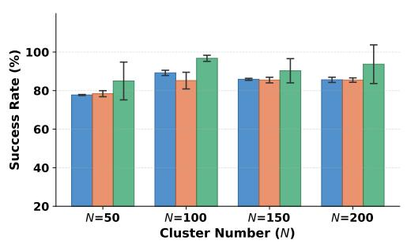

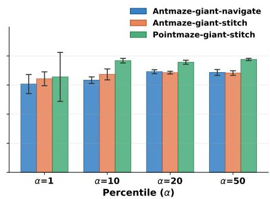  
Figure 17: Hyperparameter sensitivity on the giant environment.

Segment length (M). Table 7 summarizes the performance variations when adjusting the number of segments M within a local training chunk. We evaluate this across both HIQL and GCIQL backbones. If M is too small, the local training data lacks a sufficient horizon to effectively propagate value information between distinct stochastic branches. This prevents the policy from properly learning how to navigate toward waypoints. Conversely, setting the segment length excessively large (e.g., M = 10) incorporates too many stochastic boundaries within a single training chunk, leading to an accumulation of value estimation bias. As shown in the table, GCIQL exhibits a noticeable performance decline at M = 10 because its single flat policy is highly sensitive to compounded stochasticity over extended local horizons. HIQL demonstrates greater robustness due to its hierarchical structure but still suffers performance degradation at a larger segment length. We therefore adopt M = 3 as a default setting that provides enough horizon for value propagation while avoiding the accumulation of estimation bias.

Table 7: Sensitivity to the segment length (M). Results are averaged over five random seeds. The M = 10 case excludes stitch datasets, as their inherent trajectory lengths are too short to support this segment length.
<table><tr><td>Backbone</td><td> $M = 2$ </td><td> $M = 3$ </td><td> $M = 5$ </td><td> $M = 1 0 ( \mathrm { e x c l . \ s t i t { c h } } )$ </td></tr><tr><td>HIQL</td><td> $9 0 . 0 \pm 2 . 0$ </td><td> ${ \bf 9 0 . 2 \pm 1 . 1 }$ </td><td> $8 9 . 0 \pm 3 . 2 $ </td><td> $8 7 . 1 \pm 4 . 0$ </td></tr><tr><td>GCIQL</td><td> $7 3 . 5 \pm 1 5 . 6$ </td><td> $7 9 . 6 \pm 1 1 . 4$ </td><td> $7 2 . 9 \pm 1 6 . 4$ </td><td> $4 8 . 5 \pm 2 1 . 7$ </td></tr></table>

## B.5 Hyperparameter Search Budget

To characterize the practical tuning cost of BGP, we adopt the budget-aware evaluation protocol of Jackson et al. [55], which measures performance as a function of the hyperparameter search budget rather than reporting only the best configuration found after an unconstrained search. We evaluate BGP on antmaze-teleport-navigate using a grid of 60 configurations spanning its three hyperparameters, $N \in \{ 5 0 , 1 0 0 , \hat { 1 } 5 0 , 2 0 0 \}$ $\bar { \alpha } \in \{ 0 . 5 , 1 , 1 0 , 2 0 , 5 0 \}$ , and $\bar { M } \in \{ 2 , 3 , 5 \}$ , training and evaluating 16 sampled policies for each configuration. We then simulate sequential hyperparameter search using a UCB bandit following Jackson et al. [55] and report the expected success rate after a given number of evaluation episodes, averaged over repeated searches. The corresponding 95% confidence intervals reflect the stochasticity of the bandit’s configuration selection.

Table 8 shows that BGP achieves an expected success rate of 65% with a single evaluation, exceeding the per-task tuned CRL (53%), HIQL (42%), and GAS (39%) baselines reported in Table 1. Performance increases steadily with the search budget, reaching 80% after 35 evaluations, which corresponds to approximately 95% of the asymptotic performance of 84% obtained after 200 evaluations.

These results show that BGP achieves strong performance under a modest hyperparameter search budget: a single, arbitrarily chosen configuration already outperforms carefully tuned baselines, and the diminishing gains beyond 35 evaluations indicate that extensive search is not necessary to approach its best achievable performance.

Table 8: Budget-aware evaluation on antmaze-teleport-navigate. We report the expected success rate (%) and 95% confidence interval (CI) as a function of the number of evaluation episodes, following Jackson et al. [55].
<table><tr><td>Evaluation episodes</td><td>1</td><td>5</td><td>13</td><td>35</td><td>100</td><td>200</td></tr><tr><td>Success rate (%) 95% CI</td><td>65 [12,88]</td><td>71 [30,88]</td><td>76 [50,88]</td><td>80 [62, 88]</td><td>83 [63,88]</td><td>84 [67,88]</td></tr></table>

## B.6 Computational Cost Analysis

Theoretical complexity. We provide a theoretical complexity analysis to detail the overhead introduced by BGP. Because the preprocessing steps are executed entirely prior to evaluation, the inference overhead remains highly manageable. Specifically, computing the multi-step predictive uncertainty score requires $\mathcal { O } ( | \bar { \mathcal { D } } | )$ forward passes over the dataset D. Extracting N landmarks from the high-uncertainty states U via K-means++ clustering incurs $\mathcal { O } ( U \cdot N \cdot I )$ time complexity, where I is the number of iterations. Constructing the branch-aware edges takes $\mathcal { O } ( N ^ { 2 } \cdot \bar { C } )$ , where C is the bounded number of operations required to aggregate the values of reachable clusters. During evaluation, finding the optimal waypoint path via Dijkstra’s algorithm requires O(N log $N + | \mathcal { E } | )$ operations, where |E| is the number of edges. Because the number of landmarks N is deliberately kept small $( 5 0 \leq N \leq 1 0 0 )$ , this theoretical inference overhead is practically negligible and enables fast waypoint generation.

Empirical simulation time. To complement the theoretical analysis, Table 9 reports the total empirical simulation time across different methods. As expected, implicit value-learning baselines such as GCIQL, HIQL, and CGCIVL exhibit lower computational costs because they do not construct explicit graphical structures or perform path searches. BGP introduces an expected overhead due to uncertainty estimation, clustering, and Dijkstra’s algorithm, resulting in a moderate increase in total simulation time. However, BGP is significantly more computationally efficient than graphbased planning methods such as GAS, while also maintaining competitive efficiency relative to temporal-distance-based approaches such as TMD. This demonstrates that BGP achieves a favorable balance, providing robust long-horizon planning in stochastic environments without suffering from the computational overhead often observed in explicit graph-based planning methods.

Table 9: Simulation time across different methods.
<table><tr><td>Method</td><td>BGP</td><td>HIQL</td><td>GCIQL</td><td>CGCIVL</td><td>TMD</td><td>GAS</td></tr><tr><td>Time (s)</td><td>7563</td><td>4686</td><td>3632</td><td>4927</td><td>17577</td><td>8841</td></tr></table>

## C Broader Impact

The BGP framework enhances offline goal-conditioned reinforcement learning for complex realworld applications, such as autonomous logistics, by improving planning reliability in stochastic domains. Its explicit graph construction also improves interpretability by enabling human operators to verify routes prior to execution. However, BGP heavily depends on offline dataset quality, and its preprocessing steps introduce computational overhead. Beyond these technical limitations, the framework does not pose unique societal or ethical risks distinct from standard offline reinforcement learning and requires only standard responsible oversight.

## NeurIPS Paper Checklist

## 1. Claims

Question: Do the main claims made in the abstract and introduction accurately reflect the paper’s contributions and scope?

Answer: [Yes]

Justification: We clearly state the contributions and scope of the proposed algorithm, BGP, in the abstract and introduction.

Guidelines:

• The answer [N/A] means that the abstract and introduction do not include the claims made in the paper.

• The abstract and/or introduction should clearly state the claims made, including the contributions made in the paper and important assumptions and limitations. A [No] or [N/A] answer to this question will not be perceived well by the reviewers.

• The claims made should match theoretical and experimental results, and reflect how much the results can be expected to generalize to other settings.

• It is fine to include aspirational goals as motivation as long as it is clear that these goals are not attained by the paper.

## 2. Limitations

Question: Does the paper discuss the limitations of the work performed by the authors?

Answer: [Yes]

Justification: We discuss the limitations of BGP, especially regarding additional hyperparameters and computational cost, in Section 6.

Guidelines:

• The answer [N/A] means that the paper has no limitation while the answer [No] means that the paper has limitations, but those are not discussed in the paper.

• The authors are encouraged to create a separate “Limitations” section in their paper.

• The paper should point out any strong assumptions and how robust the results are to violations of these assumptions (e.g., independence assumptions, noiseless settings, model well-specification, asymptotic approximations only holding locally). The authors should reflect on how these assumptions might be violated in practice and what the implications would be.

• The authors should reflect on the scope of the claims made, e.g., if the approach was only tested on a few datasets or with a few runs. In general, empirical results often depend on implicit assumptions, which should be articulated.

• The authors should reflect on the factors that influence the performance of the approach. For example, a facial recognition algorithm may perform poorly when image resolution is low or images are taken in low lighting. Or a speech-to-text system might not be used reliably to provide closed captions for online lectures because it fails to handle technical jargon.

• The authors should discuss the computational efficiency of the proposed algorithms and how they scale with dataset size.

• If applicable, the authors should discuss possible limitations of their approach to address problems of privacy and fairness.

• While the authors might fear that complete honesty about limitations might be used by reviewers as grounds for rejection, a worse outcome might be that reviewers discover limitations that aren’t acknowledged in the paper. The authors should use their best judgment and recognize that individual actions in favor of transparency play an important role in developing norms that preserve the integrity of the community. Reviewers will be specifically instructed to not penalize honesty concerning limitations.

## 3. Theory assumptions and proofs

Question: For each theoretical result, does the paper provide the full set of assumptions and a complete (and correct) proof?

## Answer: [N/A]

Justification: This paper does not include formal theoretical claims that require mathematical proofs.

## Guidelines:

• The answer [N/A] means that the paper does not include theoretical results.

• All the theorems, formulas, and proofs in the paper should be numbered and crossreferenced.

• All assumptions should be clearly stated or referenced in the statement of any theorems.

• The proofs can either appear in the main paper or the supplemental material, but if they appear in the supplemental material, the authors are encouraged to provide a short proof sketch to provide intuition.

• Inversely, any informal proof provided in the core of the paper should be complemented by formal proofs provided in appendix or supplemental material.

• Theorems and Lemmas that the proof relies upon should be properly referenced.

## 4. Experimental result reproducibility

Question: Does the paper fully disclose all the information needed to reproduce the main experimental results of the paper to the extent that it affects the main claims and/or conclusions of the paper (regardless of whether the code and data are provided or not)?

Answer: [Yes]

Justification: We describe the detailed methodologies in Section 4 and provide further implementation details in Appendix A. These descriptions are sufficient to reproduce the main experimental results.

Guidelines:

• The answer [N/A] means that the paper does not include experiments.

• If the paper includes experiments, a [No] answer to this question will not be perceived well by the reviewers: Making the paper reproducible is important, regardless of whether the code and data are provided or not.

• If the contribution is a dataset and/or model, the authors should describe the steps taken to make their results reproducible or verifiable.

• Depending on the contribution, reproducibility can be accomplished in various ways. For example, if the contribution is a novel architecture, describing the architecture fully might suffice, or if the contribution is a specific model and empirical evaluation, it may be necessary to either make it possible for others to replicate the model with the same dataset, or provide access to the model. In general. releasing code and data is often one good way to accomplish this, but reproducibility can also be provided via detailed instructions for how to replicate the results, access to a hosted model (e.g., in the case of a large language model), releasing of a model checkpoint, or other means that are appropriate to the research performed.

• While NeurIPS does not require releasing code, the conference does require all submissions to provide some reasonable avenue for reproducibility, which may depend on the nature of the contribution. For example

(a) If the contribution is primarily a new algorithm, the paper should make it clear how to reproduce that algorithm.

(b) If the contribution is primarily a new model architecture, the paper should describe the architecture clearly and fully.

(c) If the contribution is a new model (e.g., a large language model), then there should either be a way to access this model for reproducing the results or a way to reproduce the model (e.g., with an open-source dataset or instructions for how to construct the dataset).

(d) We recognize that reproducibility may be tricky in some cases, in which case authors are welcome to describe the particular way they provide for reproducibility. In the case of closed-source models, it may be that access to the model is limited in some way (e.g., to registered users), but it should be possible for other researchers to have some path to reproducing or verifying the results.

## 5. Open access to data and code

Question: Does the paper provide open access to the data and code, with sufficient instructions to faithfully reproduce the main experimental results, as described in supplemental material?

Answer: [Yes]

Justification: We provide the full source code and running scripts, along with detailed instructions for reproducing all main results, in the supplemental material.

Guidelines:

• The answer [N/A] means that paper does not include experiments requiring code.

• Please see the NeurIPS code and data submission guidelines (https://neurips.cc/ public/guides/CodeSubmissionPolicy) for more details.

• While we encourage the release of code and data, we understand that this might not be possible, so [No] is an acceptable answer. Papers cannot be rejected simply for not including code, unless this is central to the contribution (e.g., for a new open-source benchmark).

• The instructions should contain the exact command and environment needed to run to reproduce the results. See the NeurIPS code and data submission guidelines (https: //neurips.cc/public/guides/CodeSubmissionPolicy) for more details.

• The authors should provide instructions on data access and preparation, including how to access the raw data, preprocessed data, intermediate data, and generated data, etc.

• The authors should provide scripts to reproduce all experimental results for the new proposed method and baselines. If only a subset of experiments are reproducible, they should state which ones are omitted from the script and why.

• At submission time, to preserve anonymity, the authors should release anonymized versions (if applicable).

• Providing as much information as possible in supplemental material (appended to the paper) is recommended, but including URLs to data and code is permitted.

## 6. Experimental setting/details

Question: Does the paper specify all the training and test details (e.g., data splits, hyperparameters, how they were chosen, type of optimizer) necessary to understand the results?

Answer: [Yes]

Justification: We describe the experimental setup, including hyperparameters, datasets, optimizers, etc., in Section 5.1 and Appendix A.

Guidelines:

• The answer [N/A] means that the paper does not include experiments.

• The experimental setting should be presented in the core of the paper to a level of detail that is necessary to appreciate the results and make sense of them.

• The full details can be provided either with the code, in appendix, or as supplemental material.

## 7. Experiment statistical significance

Question: Does the paper report error bars suitably and correctly defined or other appropriate information about the statistical significance of the experiments?

Answer: [Yes]

Justification: The main benchmark results report mean ± standard deviation over five seeds; the stochasticity and budget-aware analyses report 95% confidence intervals, as specified in the paper.

Guidelines:

• The answer [N/A] means that the paper does not include experiments.

• The authors should answer [Yes] if the results are accompanied by error bars, confidence intervals, or statistical significance tests, at least for the experiments that support the main claims of the paper.

• The factors of variability that the error bars are capturing should be clearly stated (for example, train/test split, initialization, random drawing of some parameter, or overall run with given experimental conditions).

• The method for calculating the error bars should be explained (closed form formula, call to a library function, bootstrap, etc.)

• The assumptions made should be given (e.g., Normally distributed errors).

• It should be clear whether the error bar is the standard deviation or the standard error of the mean.

• It is OK to report 1-sigma error bars, but one should state it. The authors should preferably report a 2-sigma error bar than state that they have a 96% CI, if the hypothesis of Normality of errors is not verified.

• For asymmetric distributions, the authors should be careful not to show in tables or figures symmetric error bars that would yield results that are out of range (e.g., negative error rates).

• If error bars are reported in tables or plots, the authors should explain in the text how they were calculated and reference the corresponding figures or tables in the text.

## 8. Experiments compute resources

Question: For each experiment, does the paper provide sufficient information on the computer resources (type of compute workers, memory, time of execution) needed to reproduce the experiments?

Answer: [Yes]

Justification: We describe the detailed computational setup, including GPU types, memory, and operating system, in Appendix A.3.

Guidelines:

• The answer [N/A] means that the paper does not include experiments.

• The paper should indicate the type of compute workers CPU or GPU, internal cluster, or cloud provider, including relevant memory and storage.

• The paper should provide the amount of compute required for each of the individual experimental runs as well as estimate the total compute.

• The paper should disclose whether the full research project required more compute than the experiments reported in the paper (e.g., preliminary or failed experiments that didn’t make it into the paper).

## 9. Code of ethics

Question: Does the research conducted in the paper conform, in every respect, with the NeurIPS Code of Ethics https://neurips.cc/public/EthicsGuidelines?

Answer: [Yes]

Justification: The research is based on a standard benchmark, OGBench [12], which complies with the NeurIPS Code of Ethics.

Guidelines:

• The answer [N/A] means that the authors have not reviewed the NeurIPS Code of Ethics.

• If the authors answer [No], they should explain the special circumstances that require a deviation from the Code of Ethics.

• The authors should make sure to preserve anonymity (e.g., if there is a special consideration due to laws or regulations in their jurisdiction).

## 10. Broader impacts

Question: Does the paper discuss both potential positive societal impacts and negative societal impacts of the work performed?

Answer: [Yes]

Justification: We discuss broader impacts in Appendix C.

Guidelines:

• The answer [N/A] means that there is no societal impact of the work performed.

• If the authors answer [N/A] or [No], they should explain why their work has no societal impact or why the paper does not address societal impact.

• Examples of negative societal impacts include potential malicious or unintended uses (e.g., disinformation, generating fake profiles, surveillance), fairness considerations (e.g., deployment of technologies that could make decisions that unfairly impact specific groups), privacy considerations, and security considerations.

• The conference expects that many papers will be foundational research and not tied to particular applications, let alone deployments. However, if there is a direct path to any negative applications, the authors should point it out. For example, it is legitimate to point out that an improvement in the quality of generative models could be used to generate Deepfakes for disinformation. On the other hand, it is not needed to point out that a generic algorithm for optimizing neural networks could enable people to train models that generate Deepfakes faster.

• The authors should consider possible harms that could arise when the technology is being used as intended and functioning correctly, harms that could arise when the technology is being used as intended but gives incorrect results, and harms following from (intentional or unintentional) misuse of the technology.

• If there are negative societal impacts, the authors could also discuss possible mitigation strategies (e.g., gated release of models, providing defenses in addition to attacks, mechanisms for monitoring misuse, mechanisms to monitor how a system learns from feedback over time, improving the efficiency and accessibility of ML).

## 11. Safeguards

Question: Does the paper describe safeguards that have been put in place for responsible release of data or models that have a high risk for misuse (e.g., pre-trained language models, image generators, or scraped datasets)?

Answer: [N/A]

Justification: This research does not pose a high risk of misuse or dual-use concerns.

Guidelines:

• The answer [N/A] means that the paper poses no such risks.

• Released models that have a high risk for misuse or dual-use should be released with necessary safeguards to allow for controlled use of the model, for example by requiring that users adhere to usage guidelines or restrictions to access the model or implementing safety filters.

• Datasets that have been scraped from the Internet could pose safety risks. The authors should describe how they avoided releasing unsafe images.

• We recognize that providing effective safeguards is challenging, and many papers do not require this, but we encourage authors to take this into account and make a best faith effort.

## 12. Licenses for existing assets

Question: Are the creators or original owners of assets (e.g., code, data, models), used in the paper, properly credited and are the license and terms of use explicitly mentioned and properly respected?

Answer: [Yes]

Justification: All environments and baseline implementations were used under their official licenses and are properly cited in this paper.

Guidelines:

• The answer [N/A] means that the paper does not use existing assets.

• The authors should cite the original paper that produced the code package or dataset.

• The authors should state which version of the asset is used and, if possible, include a URL.

• The name of the license (e.g., CC-BY 4.0) should be included for each asset.

• For scraped data from a particular source (e.g., website), the copyright and terms of service of that source should be provided.

• If assets are released, the license, copyright information, and terms of use in the package should be provided. For popular datasets, paperswithcode.com/datasets has curated licenses for some datasets. Their licensing guide can help determine the license of a dataset.

• For existing datasets that are re-packaged, both the original license and the license of the derived asset (if it has changed) should be provided.

• If this information is not available online, the authors are encouraged to reach out to the asset’s creators.

## 13. New assets

Question: Are new assets introduced in the paper well documented and is the documentation provided alongside the assets?

Answer: [Yes]

Justification: All introduced methods, including algorithms and models, are described in the paper and the provided supplementary material.

Guidelines:

• The answer [N/A] means that the paper does not release new assets.

• Researchers should communicate the details of the dataset/code/model as part of their submissions via structured templates. This includes details about training, license, limitations, etc.

• The paper should discuss whether and how consent was obtained from people whose asset is used.

• At submission time, remember to anonymize your assets (if applicable). You can either create an anonymized URL or include an anonymized zip file.

## 14. Crowdsourcing and research with human subjects

Question: For crowdsourcing experiments and research with human subjects, does the paper include the full text of instructions given to participants and screenshots, if applicable, as well as details about compensation (if any)?

Answer: [N/A]

Justification: This research does not include any human subjects or crowdsourcing components.

Guidelines:

• The answer [N/A] means that the paper does not involve crowdsourcing nor research with human subjects.

• Including this information in the supplemental material is fine, but if the main contribution of the paper involves human subjects, then as much detail as possible should be included in the main paper.

• According to the NeurIPS Code of Ethics, workers involved in data collection, curation, or other labor should be paid at least the minimum wage in the country of the data collector.

## 15. Institutional review board (IRB) approvals or equivalent for research with human subjects

Question: Does the paper describe potential risks incurred by study participants, whether such risks were disclosed to the subjects, and whether Institutional Review Board (IRB) approvals (or an equivalent approval/review based on the requirements of your country or institution) were obtained?

Answer: [N/A]

Justification: This research does not involve human subjects or require IRB approval.

Guidelines:

• The answer [N/A] means that the paper does not involve crowdsourcing nor research with human subjects.

• Depending on the country in which research is conducted, IRB approval (or equivalent) may be required for any human subjects research. If you obtained IRB approval, you should clearly state this in the paper.

• We recognize that the procedures for this may vary significantly between institutions and locations, and we expect authors to adhere to the NeurIPS Code of Ethics and the guidelines for their institution.

• For initial submissions, do not include any information that would break anonymity (if applicable), such as the institution conducting the review.

## 16. Declaration of LLM usage

Question: Does the paper describe the usage of LLMs if it is an important, original, or non-standard component of the core methods in this research? Note that if the LLM is used only for writing, editing, or formatting purposes and does not impact the core methodology, scientific rigor, or originality of the research, declaration is not required.

Answer: [N/A]

Justification: LLMs were used strictly for writing and editing purposes and were not used in the development of the core methodology.

Guidelines:

• The answer [N/A] means that the core method development in this research does not involve LLMs as any important, original, or non-standard components.

• Please refer to our LLM policy in the NeurIPS handbook for what should or should not be described.