# Event2Reward: Learning Robotic Rewards from Progress Relations

Junnan Nie1,∗, Zitian Fan1,∗, Jiachen Zhang1, Junyi Lao1, Likui Zhang2, Chenghao Liu1, Xiaoyang Lu1, Yunbo Wang1, Yixue Zhang1, Linbo Zhai2, Jiayi Li2, Mengzhe Wang2, Xichang Wu1, Bin Wang2, Chang Liu1, Tianle Zhang2, Songfang Huang1,

1Peking University, 2JD Explore Academy ∗Equal contribution, Corresponding author

Learning task progress from robot demonstrations provides a practical way to construct dense shaping rewards for robotic reinforcement learning. A common approach uses normalized demonstration time as progress labels, implicitly assuming monotonically increasing task progress. During policy exploration, however, actual task progress can stall or even regress. Such models may mistake regressions for progress, assigning positive shaping rewards to actions that cause progress loss. Real suboptimal and failed executions ofer corrective experience, but assigning absolute progress values to their states is dificult. Our key observation is that stalls, regressions, and recoveries establish local relative progress relations even when absolute progress is unknown. We introduce Event2Reward, which uses normalized temporal labels to anchor the progress scale and these within-trajectory relations to constrain local changes, combining absolute and relative progress supervision. Its progress predictions serve as potentials for reward shaping. We curate an event-annotated dataset from approximately 100K raw real-robot execution records, covering successful, suboptimal, and failed executions, without requiring framewise absolute progress labels. Under the same training budgets, Event2Reward improves average policy success by 18.16 percentage points over a baseline using only sparse task rewards across 40 tasks in four LIBERO suites. On real robots, average success after 30 minutes of wall-clock training reaches 60.0% on three precise insertion tasks and 90.0% on three object manipulation tasks, exceeding the sparse-reward baseline under the same budget by 36.7 and 23.3 percentage points, respectively. Ablation studies further show that absolute progress supervision and relative progress relations are complementary, with joint supervision yielding better downstream policy learning.

Project Page: https://niejunnan25.github.io/Event2Reward/ Code: https://github.com/niejunnan25/Event2Reward

## 1 Introduction

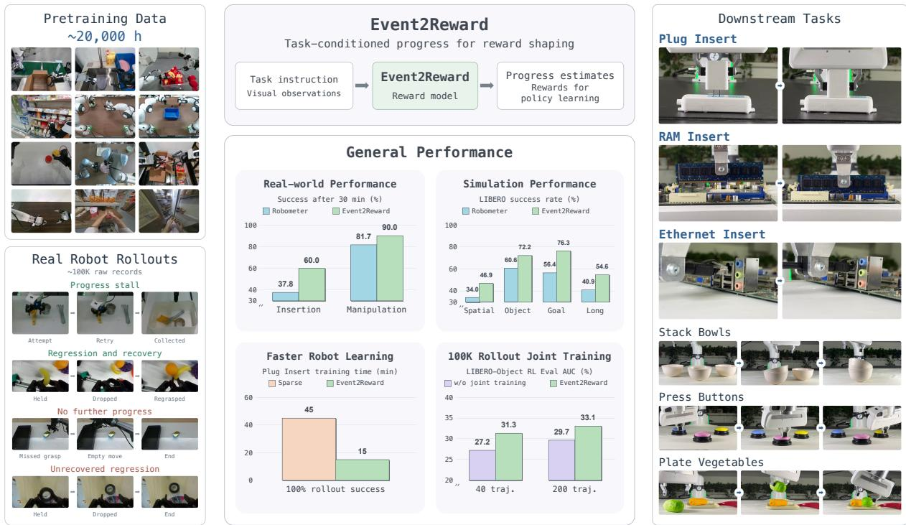  
Figure 1: Overview of Event2Reward. Left: pretraining data and real robot rollouts containing both successful and failed executions. Task events provide within-trajectory progress relations that complement temporal labels from successful demonstrations. Top center: task-conditioned progress predictions support reward shaping. Right: six real-world downstream tasks. The performance panels summarize real-world and LIBERO policy success, plug-insertion learning time, and the efect of rollout-based joint training. Plug-insertion time is measured until a rolling window of 10 autonomous training episodes reaches 100% success.

provide valid absolute progress supervision for these executions. A common workaround repeats or reverses demonstration frames to synthesize stalls and regressions with labels known by construction [14, 30], but these edits cannot introduce failure states absent from the original demonstrations. Another workaround uses outcome labels or trajectory-level preferences, which do enable reward learning from real suboptimal and failed executions [13, 14]. These signals describe overall execution quality, whereas progress-based shaping rewards depend on progress changes between adjacent observations. Such overall judgments therefore leave the timing and direction of these changes underdetermined: a failed execution can retain partial progress, while a successful one can include regressions and recoveries. How, then, can we obtain local progress supervision from real executions without assigning an absolute progress value to every state?

Our key observation is that task events in real executions can establish local progress relations even when absolute progress values are unknown. For example, consider a robot moving a cup from a table onto a shelf. If the cup slips from the gripper and falls back onto the table, how much progress remains is dificult to quantify, yet this state clearly holds less task progress than the state just before the drop. We directly supervise the progress predictions used for reward shaping with these within-trajectory progress relations, which encode the direction of change between temporally anchored states. We combine these relations with normalized temporal labels from successful demonstrations to train our reward model, Event2Reward (Figure 1). The temporal labels anchor the numerical scale of predicted progress, while the relations constrain the direction of local progress changes in real suboptimal and failed executions.

We also contribute an event-annotated dataset curated from approximately 100K raw real-robot execution records across multiple sources, spanning successful, suboptimal, and failed executions. The annotations identify where task progress stalls, regresses, or recovers, and link these events to temporal regions and reference states. They turn observed execution events into local progress comparisons beyond terminal outcomes, without requiring framewise completion percentages. We combine two-pass VLM annotation with independent human annotation and review (Appendix A.3). We will release the structured annotations, data splits, and tools for constructing progress comparisons, providing a reusable resource for reward learning and execution analysis. We train Event2Reward through pretraining and rollout joint training, then adapt it using a small set of target-task executions.

We evaluate whether Event2Reward improves policy learning on 40 LIBERO [15] tasks and six real-world tasks on Franka robots. The real-world experiments cover three precise insertion tasks trained with SERL [16, 17] and three manipulation tasks trained with DSRL [28] using a π0 [4] base policy. Across the four LIBERO suites, Event2Reward improves average policy success by 9.96–13.76 percentage points over the strongest baseline in each suite under matched interaction budgets. In real-world experiments with a matched 30-minute training budget, Event2Reward increases average success from 37.8% to 60.0% on precise insertion tasks and from 81.7% to 90.0% on manipulation tasks, compared with Robometer, the strongest learned reward baseline in each setting. Our ablations show that combining temporal labels with within-trajectory progress relations yields larger gains in downstream policy learning than combining them with trajectory-level preferences. Combining temporal and relational supervision outperforms either alone in downstream policy learning.

## 2 Related Work

Visual reward and value models. Learning rewards from visual observations reduces the need for task-specific reward engineering in robot learning. VIP [19] learns goal-directed visual representations through value-based pretraining, and LIV [18] extends this approach to language and image goals. For vision-language reasoning, GVL [20] estimates progress in context without parameter updates, while ProgressLM [41] learns to assess progress relative to visual or textual demonstrations. WVM [30] instead uses video world-model representations to predict distributions over progress sequences. Our work focuses on the supervision of progress estimates: how real suboptimal and failed executions can provide evidence about local progress changes.

Progress supervision from demonstrations. Demonstrations provide temporal order and semantic task structure for progress supervision. Temporal order supports ranking-based objectives: Rank2Reward [35] learns rankings on expert videos and combines them with an expert–policy discriminator, while Video-Language Critic [2] combines sequential ranking with video–text matching and uses failed executions as contrastive negatives. VLAC [39] derives signed progress diferences from temporal ofsets. RynnValue [10] learns absolute temporal distance to task completion and relative temporal displacement from timestamps, using temporal-order shufling and value-isolation attention to reduce shortcut learning. Task-stage annotations provide semantic structure: SARM [6] aligns numerical progress targets with annotated stages, and Robo-Dopamine [26] derives signed progress diferences from stage-based progress coordinates. Augmentation extends this supervision to nonmonotonic sequences. ReWiND [40] reverses demonstration segments to synthesize regressions, while WVM [30] constructs increasing, stable, and decreasing profiles through frame preservation, repetition, and reversal. Our approach complements these signals with progress relations grounded in stalls, regressions, and recoveries in real suboptimal and failed executions.

Reward learning from nonideal experience. Preference-based reward learning uses relative judgments without requiring absolute numerical ratings [7]. At the observation level, RL-VLM-F [29] asks a VLM to compare images, and Venkataraman et al. [27] apply this approach to reward labeling for real-world ofline RL. At the trajectory level, RoboReward [13] combines instruction relabeling and temporal clipping of successful demonstrations with naturally successful and failed rollouts carrying episode-level completion scores. Robometer [14] combines normalized temporal progress labels from expert demonstrations with success prediction and trajectory preferences, allowing real failures to contribute supervision while also producing per-frame progress estimates. Beyond these judgments, execution events provide structure for datasets and evaluation. WVM’s Suboptimal-Value-Bench [30] converts annotated hesitation and retry intervals into reference progress curves, while REBOOT [22] pairs precision-assembly demonstrations with phase boundaries, failure and recovery timestamps, and a phase-level evaluation protocol. We use event-grounded within-trajectory relations to supervise the progress estimates used for reward shaping.

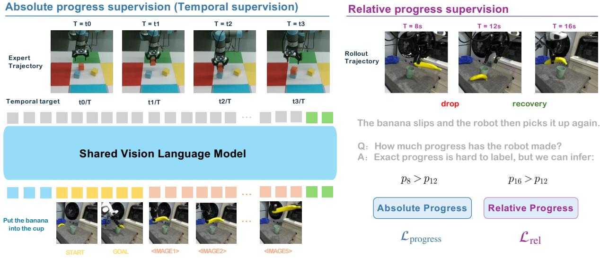  
Figure 2: Overview of progress supervision in Event2Reward. Left: normalized temporal labels from successful expert trajectories anchor the progress scale of a shared vision-language model. Right: execution events in robot rollouts support relative constraints, illustrated by a drop and subsequent recovery $( p _ { 8 } > p _ { 1 2 }$ and $p _ { 1 6 } > p _ { 1 2 } )$ . These complementary signals supervise the same progress model; relation supervision uses both successful and failed executions.

## 3 Method

Event2Reward learns task progress from temporal labels and within-trajectory progress relations. After adaptation to downstream tasks, the model’s scalar progress predictions serve as the potential for reward shaping. Figure 2 illustrates these complementary supervision signals.

## 3.1 Task Progress Model

Event2Reward is a task-conditioned model that estimates task progress from visual observations. At time t, its input is $x _ { t } = ( \ell , o _ { 0 } , H _ { t } , g )$ , where ℓ is the task instruction, $o _ { 0 }$ is a reference start observation, $H _ { t }$ is a short visual history ending at the current observation, and g is an optional goal image depicting task completion. It outputs a scalar progress estimate $p _ { \theta } ( x _ { t } ) \in [ 0 , 1 ]$ , with higher values indicating greater progress toward completing the instructed task. The visual history provides context for interpreting local changes: progress may remain stable during stalled execution or decrease when previously achieved task states are lost.

We implement Event2Reward with a Qwen3.5-4B vision-language backbone, a progress head, and an auxiliary trend head. The progress head predicts a distribution over discretized progress values in [0, 1], whose expectation gives $p _ { \theta } ( x _ { t } )$ . As detailed in Sections 3.2 and 3.3, temporal labels supervise this distribution, while within-trajectory progress relations constrain its scalar expectation. The same scalar serves as the potential for downstream reward shaping. The trend head predicts whether progress increases, remains stable, or decreases within the visual history as an auxiliary training task. Input construction and prediction-head details are given in Appendix B.1.

## 3.2 Progress Supervision from Robot Executions

We curate an event-annotated dataset from approximately 100K raw real-robot execution records. The annotations connect observable execution events to temporal anchors and reference states, providing local progress comparisons beyond terminal success or failure. Normal successful trajectories supply normalizedtime labels as a progress proxy over their task-relevant execution intervals. Trajectories containing events supply within-trajectory relations that capture stalled execution, loss of achieved task states, and recovery.

For each execution event, we record its category, a reference state, and the relevant temporal interval; regression-and-recovery events additionally identify a recovery state. Together with the supporting visual observations, these temporal anchors identify the within-trajectory progress comparisons used for supervision. Annotation therefore consists of identifying task events and their temporal anchors, without assigning framewise completion percentages.

Our annotation protocol organizes events by execution outcome, while their progress relations are grounded in observable task-state changes. For successful executions, we annotate progress stall, an interval with approximately unchanged task progress, and regression and recovery, a decrease in task progress followed by recovery to the pre-regression reference level. For failed executions, we distinguish no further progress, where no advancement beyond a reference state is observed before recording ends, and unrecovered regression, where task progress falls below its pre-regression reference level and does not return to that level before the recording ends. This organization does not imply that stalls or local recoveries occur only in successful executions. Event judgments depend on the task instruction and observable changes relative to the reference states. An unsuccessful grasp attempt is not regression unless a grasp had already been established, and renewed motion is not recovery unless the relevant task state is restored. A failed execution may retain partial progress, so failure alone does not establish unrecovered regression.

We construct event annotations through two-pass annotation with GPT-5.6 Sol and independent human annotation. GPT-5.6 Sol first identifies candidate events and temporal anchors across each execution, then refines them using denser local observations and later context when needed. Human inspection covers the raw real-robot collection, and each retained trajectory is independently annotated without access to the machine labels. Disagreements and unresolved cases undergo third-party review, while stratified samples of agreement cases are independently audited. Only visually supported progress comparisons are used for supervision. On the 8,146 retained RoboArena trajectories, machine and independent human annotations agree on the primary category for 87.56% of trajectories. Full annotation procedures and audit statistics are provided in Appendix A.3.

We convert the reviewed event annotations into within-trajectory progress comparisons. For each event $e ,$ its temporal interval locates candidate observations, and only those supported by the annotated task-state relation enter the comparison set $\mathcal { M } _ { e }$ . For example, when a dropped cup is regrasped and lifted, observations showing the loss of the established grasp should have lower progress than both the pre-drop reference and the recovered state. The annotations specify the observations to compare and the direction of their progress relation; the model learns the numerical scores through the relation loss in Section 3.3. Additional definitions and examples are provided in Appendix A.2.

## 3.3 Learning Objectives

Temporal supervision. For successful trajectories without annotated events, temporal labels are $y _ { t } =$ $( t - t _ { 0 } ) / ( t _ { S } - t _ { 0 } )$ over the task-relevant interval from $t _ { 0 }$ to completion $t _ { S }$ . We train the progress distribution with cross-entropy against a soft encoding with mean $y _ { t }$ , yielding $\mathcal { L } _ { \mathrm { p r o g r e s s } }$ . During pretraining and replay, successful histories and their temporal transformations provide labels for the auxiliary trend cross-entropy loss $\mathcal { L } _ { \mathrm { t r e n d } }$ (Appendix B.2). Reference and comparison observations used for relation supervision receive neither temporal nor trend labels.

Progress relations. Event categories select constraints on the scalar progress prediction $p _ { t } = p _ { \theta } ( x _ { t } )$ rather than serving as classification targets. Reference and comparison scores use the same model and task conditions; reference scores are recomputed as the model changes, with gradients stopped through them in the relation loss. For a regression-and-recovery event $e ,$ let $\bar { p } _ { a }$ and $\bar { p } _ { r }$ be the reference and recovery scores. For each $t \in \mathcal { M } _ { e }$ , we use

$$
\ell _ { e } ( t ) = \big [ p _ { t } - \operatorname* { m i n } ( \bar { p } _ { a } , \bar { p } _ { r } ) + m _ { e } \big ] _ { + } ^ { 2 } ,\tag{1}
$$

where $[ z ] _ { + } = \operatorname* { m a x } ( z , 0 )$ and $m _ { e }$ is a margin determined by the training rule, not an annotated amount of progress loss. This penalizes insuficient separation below either reference. Progress stall permits a tolerance around the reference; no further progress penalizes scores above it; unrecovered regression requires a decrease margin without a recovery reference. We average the corresponding penalties within each event and then across events to obtain $\mathcal { L } _ { \mathrm { r e l } }$ . Full loss and margin definitions are given in Appendix B.3.

Joint objective. We jointly optimize $\mathcal { L } = \lambda _ { p } \mathcal { L } _ { \mathrm { p r o g r e s s } } + \lambda _ { \mathrm { r e l } } \mathcal { L } _ { \mathrm { r e l } } + \lambda _ { t } \mathcal { L } _ { \mathrm { t r e n d } }$ , with weights controlling the three contributions. Temporal labels anchor the numerical progress scale, while progress relations constrain local changes in real executions without assigning absolute targets to event observations. This distinction matters for reward shaping, whose magnitude depends on the prediction scale at a fixed shaping coeficient. Section 4.1 evaluates the complementary contributions of these two supervision signals.

Training and adaptation. Training proceeds through pretraining, rollout joint training, and target-task adaptation. We pretrain Event2Reward on approximately 20,000 hours of robot expert demonstrations and human manipulation videos using temporal labels and auxiliary trend supervision. Rollout joint training then combines temporal supervision from normal successful rollouts, relation supervision from event-bearing rollouts, and replay of pretraining data. Target-task adaptation uses demonstrations and event-bearing executions under the same joint objective. Training settings are provided in Appendix B.4, and adaptation protocols are given in Section 4.

## 3.4 Progress-Based Reward Shaping

Event2Reward converts learned task progress into dense reward signals for downstream policy learning. After target-task adaptation, we freeze the reward model and predict task progress $p _ { t }$ during execution. Following potential-based reward shaping [21], we add the discounted diference between successive progress predictions to the environment reward,

$$
r _ { t } ^ { \mathrm { s h a p e d } } = r _ { t } ^ { \mathrm { e n v } } + \beta \left[ \gamma p _ { t + 1 } - p _ { t } \right] ,\tag{2}
$$

where $\boldsymbol { r } _ { t } ^ { \mathrm { e n v } }$ is the environment reward and $\gamma$ is the RL discount factor. We set $\beta = 1$ by default and assign zero potential to absorbing terminal states.

The environment reward provides feedback on task completion, while the shaping term supplies local progress feedback during execution, providing a learning signal for policy updates before completion. Progress predictions should therefore reflect stalls, regressions, and recoveries. In particular, they should decrease when previously achieved task states are lost, to avoid assigning misleading positive shaping rewards to actions that cause progress loss.

Event annotations are used to train the progress model. During policy learning, rewards are computed directly from its predictions, without requiring online event categories or recovery annotations. We use this reward construction in both simulation and real-robot experiments. Action-chunk reward computation and episode-boundary handling are detailed in Appendices C.1 and D.3.

## 4 Experiments

We first use controlled ablations to compare supervision from within-trajectory progress relations and trajectory-level preferences, and to examine the complementary roles of progress relations and tempora labels. We then compare Event2Reward with baseline methods for policy learning in simulation. To assess the contribution of rollout-based joint training, we compare models under the same target-task adaptation budget. Finally, we evaluate whether Event2Reward improves policy success and learning eficiency on real robots.

## 4.1 Supervision Ablations

The controlled supervision ablations use Qwen3-VL-4B-Instruct, matching Robometer’s backbone. Event2Reward in Sections 4.2–4.4 uses Qwen3.5-4B. All controlled variants start from the same checkpoint trained with temporal labels on normal successful LIBERO-10 rollouts. We vary the supervision during continued training and evaluate the resulting reward models through downstream policy learning on four LIBERO-10 tasks. Policy learning uses a residual SAC framework adapted from PLD [33], with both the base policy and reward model frozen; predicted progress provides shaping rewards for residual policy learning. Within each task, all variants share the same downstream policy initialization and a budget of 1.2 million environment steps. Full protocols, statistical details, and additional comparisons are provided in Appendix C.1.

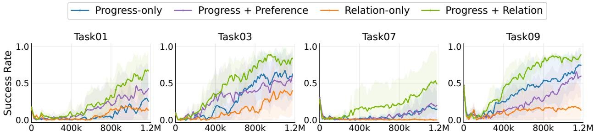  
Figure 3: Policy learning on four LIBERO-10 tasks with diferent reward supervision. Lines show mean independent-evaluation success rates across five environment seeds; shaded bands indicate ±1.96 SEM. Horizontal axes show environment steps up to the shared 1.2M budget.

Supervision type. We compare temporal labels alone (Progress-only) with temporal labels combined with trajectory-level preferences (Progress + Preference) or within-trajectory progress relations (Progress + Relation). The latter two use the same additional trajectory pool and identical temporal supervision. We measure downstream policy learning using normalized evaluation AUC, which summarizes average evaluation success over a common interaction interval. Progress + Relation achieves the highest mean AUC on all four tasks, with a four-task average of 36.7%, compared with 19.6% for Progress-only and 19.4% for Progress + Preference (Figure 3). To distinguish the efect of relation supervision from that of mixed sampling, we also evaluate Relation-loss-of, which retains the mixed-sampling scheme of Progress + Relation but disables the relation loss. Its four-task mean AUC is 19.1%, close to Progress-only and below Progress + Relation (Table 11 in Appendix C.1). These results support a contribution from relation supervision beyond mixed sampling and show that adding progress relations to temporal labels yields larger downstream gains than adding trajectory-level preferences in this setting.

Joint supervision. To examine the complementary roles of temporal labels and progress relations, we compare Progress + Relation with Progress-only and Relation-only. The latter uses only progress relations during continued training. Joint supervision achieves higher mean evaluation AUC than either alternative on all four tasks (Figure 3).

We diagnose this gap through relation satisfaction and within-trajectory prediction range, without rescaling model outputs (Table 1; protocols in Appendix C.1.2). Relation-only has the highest relation satisfaction (58.86%) but near-zero outputs with a mean range of only 0.0021, consistent with weak shaping at a fixed coeficient. Joint supervision improves relation satisfaction over Progress-only while retaining prediction variation. Prediction range alone does not establish accuracy. Together with the RL results, these findings support temporal labels for scale anchoring and relations for local constraints in this setting.

Table 1: Progress prediction diagnostics. Relation satisfaction is evaluated on 46 unrecovered regression trajectories and averaged equally across their nine tasks. Prediction range is averaged equally across all 103 held-out trajectories covering ten LIBERO-10 tasks.
<table><tr><td>Supervision</td><td>Relation satisfaction rate (%) Mean prediction range</td><td></td></tr><tr><td>Progress-only</td><td>41.62</td><td>0.5928</td></tr><tr><td>Relation-only</td><td>58.86</td><td>0.0021</td></tr><tr><td>Progress + Relation</td><td>54.47</td><td>0.5097</td></tr></table>

Table 2: RL performance on LIBERO. Success rates (%) are mean ± sample standard deviation across five environment seeds. Each run contributes its last periodic independent evaluation within 200k environment steps for Spatial, Object, and Goal, and 1.2M for LIBERO-10.
<table><tr><td>Method</td><td>LIBERO-Spatial</td><td> $_ \mathrm { L I B E R O - O b j e c t }$ </td><td> $\mathrm { L I B E R O - G o a l }$ </td><td> $\mathrm { L I B E R O { - } 1 0 }$ </td></tr><tr><td>Sparse</td><td> $3 6 . 8 0 \pm 6 . 8 0$ </td><td> $4 7 . 4 0 \pm 3 . 1 3$ </td><td> $6 6 . 3 6 \pm 3 . 3 9$ </td><td> $2 6 . 8 4 \pm 8 . 8 0$ </td></tr><tr><td>Robo-Dopamine</td><td> $3 6 . 7 2 \pm 4 . 7 7$ </td><td> $5 7 . 5 6 \pm 6 . 0 9$ </td><td> $6 4 . 0 0 \pm 3 . 8 8$ </td><td> $3 1 . 7 2 \pm 4 . 9 2$ </td></tr><tr><td>Robometer</td><td> $3 4 . 0 4 \pm 5 . 0 3$ </td><td> $6 0 . 5 6 \pm 6 . 5 3$ </td><td> $5 6 . 4 4 \pm 5 . 6 7$ </td><td> $4 0 . 8 8 \pm 1 9 . 0 0$ </td></tr><tr><td>Event2Reward</td><td> ${ \bf 4 6 . 9 2 \pm 6 . 9 4 }$ </td><td> ${ \bf 7 2 . 1 6 \pm 2 . 9 7 }$ </td><td> ${ \bf 7 6 . 3 2 \pm 3 . 5 7 }$ </td><td> ${ \bf 5 4 . 6 4 \pm 8 . 7 0 }$ </td></tr><tr><td>Δ</td><td> $+ 1 0 . 1 2$ </td><td> ${ \bf + 1 1 . 6 0 }$ </td><td> $\mathbf { + 9 . 9 6 }$ </td><td> ${ \bf + 1 3 . 7 6 }$ </td></tr></table>

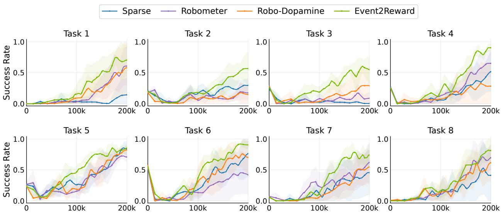  
Figure 4: Policy learning on eight LIBERO tasks with diferent reward models. Lines show mean independent-evaluation success rates across five environment seeds; shaded bands indicate ±1.96 SEM. Horizontal axes show environment steps up to the shared 200k budget.

## 4.2 Policy Learning in Simulation

We compare Event2Reward with Sparse (environment rewards only), Robometer [14], and Robo-Dopamine [26] on four LIBERO [15] suites—Spatial, Object, Goal, and LIBERO-10—covering 40 tasks. Event2Reward’s pretraining and rollout joint training exclude LIBERO data. For each suite, Event2Reward and Robometer are adapted using the same 200 target-suite trajectories, while Robo-Dopamine follows its one-shot adaptation protocol with one expert demonstration per task. All reward models remain frozen during policy learning. Within each task, all conditions share the same frozen π0.5 [24] base policy and use the residual SAC framework from Section 4.1 under matched interaction budgets. Adaptation, policy-training, and evaluation details are provided in Appendix C.2.

Event2Reward achieves the highest mean policy success on all four LIBERO suites (Table 2). Compared with the strongest baseline in each suite, it improves success by 10.12, 11.60, 9.96, and 13.76 percentage points on Spatial, Object, Goal, and LIBERO-10, respectively. Figure 4 shows learning curves for eight of these tasks, which are listed in Table 17; Appendix C.2.3 reports curves for all 40 tasks.

## 4.3 Contribution of Rollout-Based Joint Training

We compare Event2Reward with a variant that skips rollout-based joint training $( w / o$ rollout joint training). Both start from the same pretrained checkpoint and use identical target-adaptation data, objectives, and update budgets. We evaluate them on LIBERO-Object’s ten tasks using an average of 20 or 4 adaptation trajectories per task (the 200-trajectory set from Section 4.2 and its fixed 40-trajectory subset), with the same base policy, RL settings, and 200k-step interaction budget.

Table 3: Efect of rollout joint training on LIBERO-Object. Evaluation AUC and last periodic evaluation success (%) within 200k environment steps are mean ± sample standard deviation across five environment seeds, averaged over ten tasks.
<table><tr><td rowspan="3">Method</td><td colspan="2">20 trajectories/task (avg.)</td><td colspan="2">4 trajectories/task (avg.)</td></tr><tr><td>Eval AUC</td><td>Success</td><td>Eval AUC</td><td>Success</td></tr><tr><td> $\mathrm { w / o }$  rollout joint training</td><td> $2 9 . 6 7 \pm 2 . 6 6$ </td><td> $7 0 . 1 2 \pm 9 . 5 1$ </td><td> $2 7 . 2 2 \pm 2 . 2 4$ </td><td> $6 4 . 4 8 \pm 7 . 1 6$ </td></tr><tr><td>Event2Reward</td><td> $\mathbf { 3 3 . 0 6 \pm 2 . 2 8 }$ </td><td> ${ \bf 7 2 . 1 6 \pm 2 . 9 7 }$ </td><td> ${ \bf 3 1 . 3 4 \pm 2 . 5 8 }$ </td><td> ${ \bf 6 7 . 0 4 \pm 5 . 4 7 }$ </td></tr><tr><td> $\Delta$ </td><td> ${ \bf + 3 . 3 9 }$ </td><td> $+ 2 . 0 4$ </td><td> ${ \bf + 4 . 1 3 }$ </td><td> $+ 2 . 5 6$ </td></tr></table>

Rollout-based joint training improves mean evaluation AUC by 3.39 and 4.13 percentage points with an average of 20 and 4 adaptation trajectories per task, respectively, and success by 2.04 and 2.56 points (Table 3). Mean task-level AUC improves on nine of ten tasks at each data size, supporting benefits even with fewer adaptation trajectories. This comparison evaluates the training stage as a whole, including its data mixture and additional optimization. Appendix C.2.4 provides detailed protocols and additional results.

## 4.4 Policy Learning on Real Robots

We evaluate Event2Reward on six real-world tasks using Franka robots: three precise insertion tasks trained with SERL and three manipulation tasks trained with DSRL using a π0 base policy (Figure 5).

(a) Plug Insert  
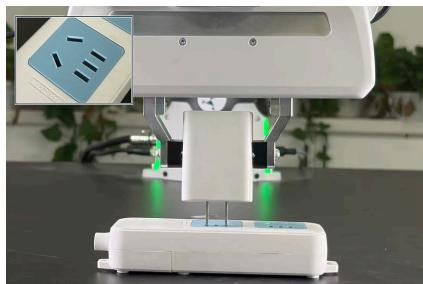

(b) RAM Insert  
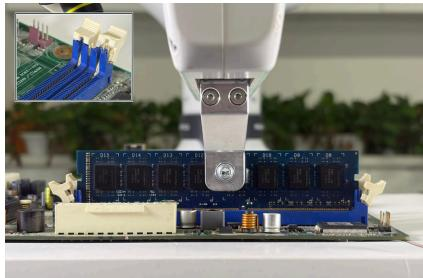

(c) Ethernet Insert  
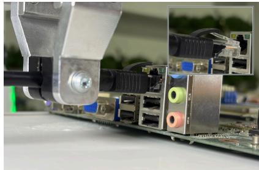

(d) Stack Bowls  
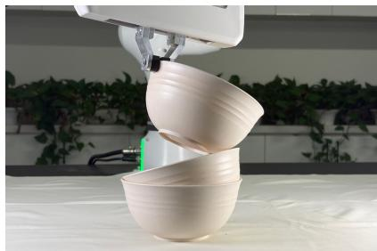

(e) Press Buttons  
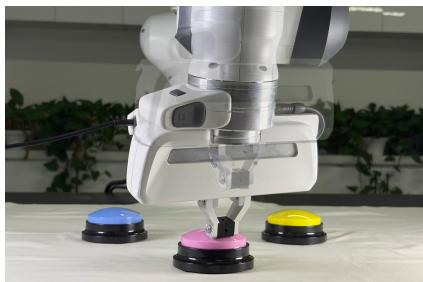

(f) Plate Vegetables  
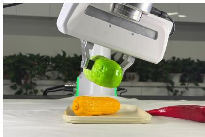  
Figure 5: Real-world tasks for policy learning. Top: insertion tasks trained with SERL. Bottom: manipulation tasks trained with DSRL using a π0 base policy. Insets in (a) and (b) show oblique views of the socket and RAM slots. The inset in (c) shows the Ethernet plug and port in an earlier frame before insertion. In Press Buttons, the translucent overlay depicts an earlier end-efector pose during the second press, while the opaque pose shows contact with the pink button.

Within each framework, we compare Event2Reward with Sparse, Robometer, and Robo-Dopamine. Event2Reward and Robometer use the same five successful and five suboptimal adaptation trajectories per task, while Robo-Dopamine follows its oficial one-shot adaptation protocol. Annotating events on the five suboptimal trajectories takes about one minute of human efort per task. Within each task, reward models remain frozen during policy learning, and initialization protocols and learning settings are matched. We independently evaluate policies after 30 minutes of wall-clock training, including initial bufer warm-up where applicable, resets, and reward computation. Full protocols are provided in Appendix D.3.

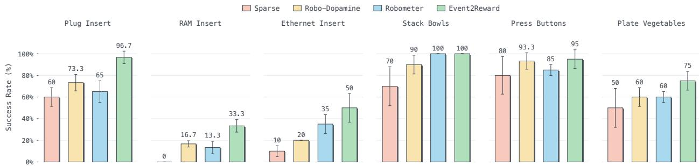  
Figure 6: Success rate (%) after 30 minutes of wall-clock training, including initial bufer warm-up where applicable, resets, and reward computation. Bars show means and error bars show sample standard deviations across three independent training runs per task and reward condition. Each run’s checkpoint at 30 minutes is evaluated over 20 autonomous episodes.

Within this budget, Event2Reward increases average success from 37.8% to 60.0% on precise insertion tasks and from 81.7% to 90.0% on manipulation tasks, compared with Robometer, the strongest learned reward baseline on average in each setting, gaining 22.2 and 8.3 percentage points, respectively. Event2Reward achieves the highest mean success rate on five of the six tasks and ties with Robometer on Stack Bowls (Figure 6).

We conduct an additional real-robot training experiment to assess the end-to-end learning eficiency of the system. On plug insertion, we compare Event2Reward shaping with sparse task rewards within the same SERL framework, measuring wall-clock time to the first ten consecutive successful autonomous training episodes, including warm-up data collection and resets. In one additional training run per method, Event2Reward reaches this criterion in 15 minutes, whereas using only sparse rewards takes approximately 45 minutes (Figure 1; protocol in Appendix D.3).

## 5 Conclusion

We introduce Event2Reward, which combines temporal labels from demonstrations with progress relations grounded in real execution events to learn a task progress model for reward shaping in robotic reinforcement learning. We curate an event-annotated dataset covering successful, suboptimal, and failed executions to supervise local progress changes. Experiments on 40 LIBERO tasks and six real-robot tasks show improved policy success under the same training budgets. Controlled ablations further support the complementary roles of temporal labels in anchoring the numerical scale and relative progress relations in constraining local changes. These results show that event-grounded relations can provide efective supervision for robotic reward learning even when absolute progress values are dificult to assign to states in real suboptimal and failed executions.

## References

[1] AgiBot-World-Contributors, Qingwen Bu, Jisong Cai, Li Chen, Xiuqi Cui, Yan Ding, Siyuan Feng, Shenyuan Gao, Xindong He, Xuan Hu, Xu Huang, Shu Jiang, Yuxin Jiang, Cheng Jing, Hongyang Li, Jialu Li, Chiming Liu, Yi Liu, Yuxiang Lu, Jianlan Luo, Ping Luo, Yao Mu, Yuehan Niu, Yixuan Pan, Jiangmiao Pang, Yu Qiao, Guanghui Ren, Cheng Ruan, Jiaqi Shan, Yongjian Shen, Chengshi Shi, Mingkang Shi, Modi Shi, Chonghao Sima, Jianheng Song, Huijie Wang, Wenhao Wang, Dafeng Wei, Chengen Xie, Guo Xu, Junchi Yan, Cunbiao Yang, Lei Yang, Shukai Yang, Maoqing Yao, Jia Zeng, Chi Zhang, Qinglin Zhang, Bin Zhao, Chengyue Zhao, Jiaqi Zhao, and Jianchao Zhu. AgiBot World Colosseo: A large-scale manipulation platform for scalable and intelligent embodied systems. arXiv preprint arXiv:2503.06669, 2025. doi: 10.48550/arXiv.2503.06669. URL https://arxiv.org/abs/2503.06669.

[2] Minttu Alakuijala, Reginald McLean, Isaac Woungang, Nariman Farsad, Samuel Kaski, Pekka Marttinen, and Kai Yuan. Video-language critic: Transferable reward functions for language-conditioned robotics. Transactions on Machine Learning Research, 2025. URL https://openreview.net/forum?id=jJOVpn NrEp.

[3] Pranav Atreya, Karl Pertsch, Tony Lee, Moo Jin Kim, Arhan Jain, Artur Kuramshin, Clemens Eppner, Cyrus Neary, Edward Hu, Fabio Ramos, Jonathan Tremblay, Kanav Arora, Kirsty Ellis, Luca Macesanu, Marcel Torne Villasevil, Matthew Leonard, Meedeum Cho, Ozgur Aslan, Shivin Dass, Jie Wang, William Reger, Xingfang Yuan, Xuning Yang, Abhishek Gupta, Dinesh Jayaraman, Glen Berseth, Kostas Daniilidis, Roberto Martin-Martin, Youngwoon Lee, Percy Liang, Chelsea Finn, and Sergey Levine. RoboArena: Distributed real-world evaluation of generalist robot policies. arXiv preprint arXiv:2506.18123v2, 2025. doi: 10.48550/arXiv.2506.18123. URL https://arxiv.org/abs/2506.181 23v2.

[4] Kevin Black, Noah Brown, Danny Driess, Adnan Esmail, Michael Equi, Chelsea Finn, Niccolo Fusai, Lachy Groom, Karol Hausman, Brian Ichter, Szymon Jakubczak, Tim Jones, Liyiming Ke, Sergey Levine, Adrian Li-Bell, Mohith Mothukuri, Suraj Nair, Karl Pertsch, Lucy Xiaoyang Shi, James Tanner, Quan Vuong, Anna Walling, Haohuan Wang, and Ury Zhilinsky. π : A vision-language-action flow model for general robot control. arXiv preprint arXiv:2410.24164v3, 2024. doi: 10.48550/arXiv.2410.24164. URL https://arxiv.org/abs/2410.24164v3.

[5] Boden Intelligence, Junpu Innovation Center, and MINT Lab, Shanghai Jiao Tong University. RW-RL dataset: Real-world reinforcement learning dataset. Hugging Face dataset, 2026. URL https: //huggingface.co/datasets/MINT-SJTU/RW-RL-Dataset.

[6] Qianzhong Chen, Justin Yu, Mac Schwager, Pieter Abbeel, Fred Shentu, and Philipp Wu. SARM: Stage-aware reward modeling for long horizon robot manipulation. In International Conference on Learning Representations, pages 17091–17116, 2026. URL https://proceedings.iclr.cc/paper\_fi les/paper/2026/hash/1c92edb990a05f2269f0cc3afbb4c952-Abstract-Conference.html.

[7] Paul F Christiano, Jan Leike, Tom Brown, Miljan Martic, Shane Legg, and Dario Amodei. Deep reinforcement learning from human preferences. In I. Guyon, U. Von Luxburg, S. Bengio, H. Wallach, R. Fergus, S. Vishwanathan, and R. Garnett, editors, Advances in Neural Information Processing Systems, volume 30. Curran Associates, Inc., 2017. URL https://proceedings.neurips.cc/paper\_files/pap er/2017/file/d5e2c0adad503c91f91df240d0cd4e49-Paper.pdf.

[8] Haoquan Fang, Jiafei Duan, Donovan Clay, Sam Wang, Shuo Liu, Weikai Huang, Xiang Fan, Wei-Chuan Tsai, Shirui Chen, Yi Ru Wang, Shanli Xing, Jaemin Cho, Jae Sung Park, Ainaz Eftekhar, Peter Sushko, Karen Farley, Angad Wadhwa, Cole Harrison, Winson Han, Ying-Chun Lee, Eli VanderBilt, Rose Hendrix, Suveen Ellawela, Lucas Ngoo, Joyce Chai, Zhongzheng Ren, Ali Farhadi, Dieter Fox, and Ranjay Krishna. MolmoAct2: Action reasoning models for real-world deployment. arXiv preprint arXiv:2605.02881, 2026. doi: 10.48550/arXiv.2605.02881. URL https://arxiv.org/abs/2605.02881.

[9] Chengkai Hou, Kun Wu, Jiaming Liu, Zhengping Che, Di Wu, Fei Liao, Guangrun Li, Jingyang He, Qiuxuan Feng, Zhao Jin, Chenyang Gu, Zhuoyang Liu, Nuowei Han, Xiangju Mi, Yaoxu Lv, Yankai Fu,

Gaole Dai, Langzhe Gu, Tao Li, Yuheng Zhang, Yixue Zhang, Xinhua Wang, Shichao Fan, Meng Li, Zhen Zhao, Ning Liu, Zhiyuan Xu, Pei Ren, Junjie Ji, Haonan Liu, Kuan Cheng, Shanghang Zhang, and Jian Tang. RoboMIND 2.0: A multimodal, bimanual mobile manipulation dataset for generalizable embodied intelligence. arXiv preprint arXiv:2512.24653v3, 2026. doi: 10.48550/arXiv.2512.24653. URL https://arxiv.org/abs/2512.24653v3.

[10] Dongchi Huang, Hongyin Zhang, Bohan Hou, Siteng Huang, Zhian Su, Hang Guo, Tong Lu, Zhaofeng Xu, Jiahao Tang, Jianfei Yang, Donglin Wang, Peixi Peng, Mingxiu Chen, Deli Zhao, and Xin Li. RynnValue: Scaling robotic value foundation models with temporal distance. arXiv preprint arXiv:2608.09853v2, 2026. doi: 10.48550/arXiv.2608.09853. URL https://arxiv.org/abs/2608.09853v2.

[11] Tao Jiang, Tianyuan Yuan, Yicheng Liu, Chenhao Lu, Jianning Cui, Xiao Liu, Shuiqi Cheng, Jiyang Gao, Huazhe Xu, and Hang Zhao. Galaxea open-world dataset and G0 dual-system VLA model. arXiv preprint arXiv:2509.00576, 2025. doi: 10.48550/arXiv.2509.00576. URL https://arxiv.org/abs/2509.00576.

[12] Alexander Khazatsky, Karl Pertsch, Suraj Nair, Ashwin Balakrishna, Sudeep Dasari, Siddharth Karamcheti, Soroush Nasiriany, Mohan Kumar Srirama, Lawrence Yunliang Chen, Kirsty Ellis, Peter David Fagan, Joey Hejna, Masha Itkina, Marion Lepert, Yecheng Jason Ma, Patrick Tree Miller, Jimmy Wu, Suneel Belkhale, Shivin Dass, Huy Ha, Arhan Jain, Abraham Lee, Youngwoon Lee, Marius Memmel, Sungjae Park, Ilija Radosavovic, Kaiyuan Wang, Albert Zhan, Kevin Black, Cheng Chi, Kyle Beltran Hatch, Shan Lin, Jingpei Lu, Jean Mercat, Abdul Rehman, Pannag R Sanketi, Archit Sharma, Cody Simpson, Quan Vuong, Homer Rich Walke, Blake Wulfe, Ted Xiao, Jonathan Heewon Yang, Arefeh Yavary, Tony Z. Zhao, Christopher Agia, Rohan Baijal, Mateo Guaman Castro, Daphne Chen, Qiuyu Chen, Trinity Chung, Jaimyn Drake, Ethan Paul Foster, Jensen Gao, Vitor Guizilini, David Antonio Herrera, Minho Heo, Kyle Hsu, Jiaheng Hu, Muhammad Zubair Irshad, Donovon Jackson, Charlotte Le, Yunshuang Li, Kevin Lin, Roy Lin, Zehan Ma, Abhiram Maddukuri, Suvir Mirchandani, Daniel Morton, Tony Nguyen, Abigail O’Neill, Rosario Scalise, Derick Seale, Victor Son, Stephen Tian, Emi Tran, Andrew E. Wang, Yilin Wu, Annie Xie, Jingyun Yang, Patrick Yin, Yunchu Zhang, Osbert Bastani, Glen Berseth, Jeannette Bohg, Ken Goldberg, Abhinav Gupta, Abhishek Gupta, Dinesh Jayaraman, Joseph J Lim, Jitendra Malik, Roberto Mart´ın-Mart´ın, Subramanian Ramamoorthy, Dorsa Sadigh, Shuran Song, Jiajun Wu, Michael C. Yip, Yuke Zhu, Thomas Kollar, Sergey Levine, and Chelsea Finn. DROID: A large-scale in-the-wild robot manipulation dataset. arXiv preprint arXiv:2403.12945v2, 2025. doi: 10.48550/arXiv.2403.12945. URL https://arxiv.org/abs/2403.12945v2.

[13] Tony Lee, Andrew Wagenmaker, Karl Pertsch, Percy Liang, Sergey Levine, and Chelsea Finn. RoboReward: General-purpose vision-language reward models for robotics. arXiv preprint arXiv:2601.00675, 2026. doi: 10.48550/arXiv.2601.00675. URL https://arxiv.org/abs/2601.00675.

[14] Anthony Liang, Yigit Korkmaz, Jiahui Zhang, Minyoung Hwang, Abrar Anwar, Sidhant Kaushik, Aditya Shah, Alex S. Huang, Luke Zettlemoyer, Dieter Fox, Yu Xiang, Anqi Li, Andreea Bobu, Abhishek Gupta, Stephen Tu, Erdem Biyik, and Jesse Zhang. Robometer: Scaling general-purpose robotic reward models via trajectory comparisons. In Proceedings of Robotics: Science and Systems, 2026. doi: 10.15607/RSS.2026.XXII.140. URL https://www.roboticsproceedings.org/rss22/p140.html.

[15] Bo Liu, Yifeng Zhu, Chongkai Gao, Yihao Feng, Qiang Liu, Yuke Zhu, and Peter Stone. LIBERO: Benchmarking knowledge transfer for lifelong robot learning. In Advances in Neural Information Processing Systems, volume 36, pages 44776–44791. Curran Associates, Inc., 2023. doi: 10.52202/07528 0-1939. URL https://papers.nips.cc/paper\_files/paper/2023/hash/8c3c666820ea055a77726d6 6fc7d447f-Abstract-Datasets\_and\_Benchmarks.html.

[16] Jianlan Luo, Zheyuan Hu, Charles Xu, You Liang Tan, Jacob Berg, Archit Sharma, Stefan Schaal, Chelsea Finn, Abhishek Gupta, and Sergey Levine. SERL: A software suite for sample-eficient robotic reinforcement learning. In 2024 IEEE International Conference on Robotics and Automation (ICRA), pages 16961–16969. IEEE, 2024. doi: 10.1109/ICRA57147.2024.10610040. URL https://doi.org/10.1 109/ICRA57147.2024.10610040.

[17] Jianlan Luo, Charles Xu, Jefrey Wu, and Sergey Levine. Precise and dexterous robotic manipulation via human-in-the-loop reinforcement learning. Science Robotics, 10(105):eads5033, 2025. doi: 10.1126/sc irobotics.ads5033. URL https://doi.org/10.1126/scirobotics.ads5033.

[18] Yecheng Jason Ma, William Liang, Vaidehi Som, Vikash Kumar, Amy Zhang, Osbert Bastani, and Dinesh Jayaraman. LIV: Language-image representations and rewards for robotic control. arXiv preprint arXiv:2306.00958v1, 2023. doi: 10.48550/arXiv.2306.00958. URL https://arxiv.org/abs/2306.009 58v1.

[19] Yecheng Jason Ma, Shagun Sodhani, Dinesh Jayaraman, Osbert Bastani, Vikash Kumar, and Amy Zhang. VIP: Towards universal visual reward and representation via value-implicit pre-training. In The Eleventh International Conference on Learning Representations, 2023. URL https://openreview.net /forum?id=YJ7o2wetJ2.

[20] Yecheng Jason Ma, Joey Hejna, Ayzaan Wahid, Chuyuan Fu, Dhruv Shah, Jacky Liang, Zhuo Xu, Sean Kirmani, Peng Xu, Danny Driess, Ted Xiao, Jonathan Tompson, Osbert Bastani, Dinesh Jayaraman, Wenhao Yu, Tingnan Zhang, Dorsa Sadigh, and Fei Xia. Vision language models are in-context value learners. arXiv preprint arXiv:2411.04549v1, 2024. doi: 10.48550/arXiv.2411.04549. URL https://arxiv.org/abs/2411.04549v1.

[21] Andrew Y. Ng, Daishi Harada, and Stuart Russell. Policy invariance under reward transformations: Theory and application to reward shaping. In Proceedings of the Sixteenth International Conference on Machine Learning, pages 278–287, 1999. URL https://people.eecs.berkeley.edu/\~russell/paper s/icml99-shaping.pdf.

[22] Nana Yaw Owusu Ofori-Ampofo, Samira Ebrahimi Kahou, and Joseph Thekinen. REBOOT: From failure to recovery - a dataset and benchmark for precision assembly. arXiv preprint arXiv:2609.22591, 2026. doi: 10.48550/arXiv.2609.22591. URL https://arxiv.org/abs/2609.22591.

[23] OpenLoong. Baihu dataset. Dataset release, 2025. URL https://ai.gitcode.com/openloong/baihu -dataset. Accessed: 2026-09-26.

[24] Physical Intelligence, Kevin Black, Noah Brown, James Darpinian, Karan Dhabalia, Danny Driess, Adnan Esmail, Michael Equi, Chelsea Finn, Niccolo Fusai, Manuel Y. Galliker, Dibya Ghosh, Lachy Groom, Karol Hausman, Brian Ichter, Szymon Jakubczak, Tim Jones, Liyiming Ke, Devin LeBlanc, Sergey Levine, Adrian Li-Bell, Mohith Mothukuri, Suraj Nair, Karl Pertsch, Allen Z. Ren, Lucy Xiaoyang Shi, Laura Smith, Jost Tobias Springenberg, Kyle Stachowicz, James Tanner, Quan Vuong, Homer Walke, Anna Walling, Haohuan Wang, Lili Yu, and Ury Zhilinsky. π0.5: a vision-language-action model with open-world generalization. arXiv preprint arXiv:2504.16054v1, 2025. doi: 10.48550/arXiv.2504.16054. URL https://arxiv.org/abs/2504.16054v1.

[25] Praveen Selvaraj, Lorenzo Uttini, and Ville Kuosmanen. ArmnetBench v0.1: Parallel real-world evaluation of manipulation policies on a low-cost arm farm. arXiv preprint arXiv:2607.24481, 2026. doi: 10.48550/arXiv.2607.24481. URL https://arxiv.org/abs/2607.24481.

[26] Huajie Tan, Sixiang Chen, Yijie Xu, Zixiao Wang, Yuheng Ji, Cheng Chi, Yaoxu Lyu, Zhongxia Zhao, Xiansheng Chen, Peterson Co, Shaoxuan Xie, Guocai Yao, Pengwei Wang, Zhongyuan Wang, and Shanghang Zhang. Robo-Dopamine: General process reward modeling for high-precision robotic manipulation. arXiv preprint arXiv:2512.23703v1, 2025. doi: 10.48550/arXiv.2512.23703. URL https://arxiv.org/abs/2512.23703v1.

[27] Sreyas Venkataraman, Yufei Wang, Ziyu Wang, Navin Sriram Ravie, Zackory Erickson, and David Held. Real-world ofline reinforcement learning from vision language model feedback. In 2025 IEEE/RSJ International Conference on Intelligent Robots and Systems (IROS), pages 13452–13459. IEEE, 2025. doi: 10.1109/IROS60139.2025.11246918. URL https://doi.org/10.1109/IROS60139.2025.11246918.

[28] Andrew Wagenmaker, Mitsuhiko Nakamoto, Yunchu Zhang, Seohong Park, Waleed Yagoub, Anusha Nagabandi, Abhishek Gupta, and Sergey Levine. Steering your difusion policy with latent space

reinforcement learning. arXiv preprint arXiv:2506.15799v2, 2025. doi: 10.48550/arXiv.2506.15799. URL https://arxiv.org/abs/2506.15799v2.

[29] Yufei Wang, Zhanyi Sun, Jesse Zhang, Zhou Xian, Erdem Biyik, David Held, and Zackory Erickson. RL-VLM-F: Reinforcement learning from vision language foundation model feedback. In Proceedings of the 41st International Conference on Machine Learning, volume 235 of Proceedings of Machine Learning Research, pages 51484–51501. PMLR, 2024. URL https://proceedings.mlr.press/v235/wang24bn. html.

[30] Zhihao Wang, Jianxiong Li, Yu Cui, Yuan Gao, Xianyuan Zhan, Junzhi Yu, and Xiao Ma. World value models for robotic manipulation. arXiv preprint arXiv:2606.24742, 2026. doi: 10.48550/arXiv.2606.24742. URL https://arxiv.org/abs/2606.24742.

[31] Kun Wu, Chengkai Hou, Jiaming Liu, Zhengping Che, Xiaozhu Ju, Zhuqin Yang, Meng Li, Yinuo Zhao, Zhiyuan Xu, Guang Yang, Shichao Fan, Xinhua Wang, Fei Liao, Zhen Zhao, Guangyu Li, Zhao Jin, Lecheng Wang, Jilei Mao, Ning Liu, Pei Ren, Qiang Zhang, Yaoxu Lyu, Mengzhen Liu, Jingyang He, Yulin Luo, Zeyu Gao, Chenxuan Li, Chenyang Gu, Yankai Fu, Di Wu, Xingyu Wang, Sixiang Chen, Zhenyu Wang, Pengju An, Siyuan Qian, Shanghang Zhang, and Jian Tang. RoboMIND: Benchmark on multi-embodiment intelligence normative data for robot manipulation. In Proceedings of Robotics: Science and Systems. Robotics: Science and Systems Foundation, 2025. doi: 10.15607/RSS.2025.XXI.152. URL https://www.roboticsproceedings.org/rss21/p152.html.

[32] Shihan Wu, Xuecheng Liu, Shaoxuan Xie, Pengwei Wang, Xinghang Li, Bowen Yang, Zhe Li, Kai Zhu, Hongyu Wu, Yiheng Liu, Zhaoye Long, Runtian Xu, Yue Wang, Chong Liu, Dihan Wang, Ziqiang Ni, Xiang Yang, You Liu, Ruoxuan Feng, Lei Zhang, Denghang Huang, Chenghao Jin, Anlan Yin, Xinlong Wang, Zhenguo Sun, Junkai Zhao, Mengfei Du, Mingyu Cao, Xiansheng Chen, Hongyang Cheng, Xiaojie Zhang, Yankai Fu, Ning Chen, Cheng Chi, Sixiang Chen, Huaihai Lyu, Xiaoshuai Hao, Yequan Wang, Bo Lei, Dong Liu, Xi Yang, Yance Jiao, Tengfei Pan, Yunyan Zhang, Songjing Wang, Ziqian Zhang, Xu Liu, Ji Zhang, Caowei Meng, Zhizheng Zhang, Jiyang Gao, Song Wang, Xiaokun Leng, Zhiqiang Xie, Zhenzhen Zhou, Peng Huang, Wu Yang, Yandong Guo, Yichao Zhu, Suibing Zheng, Hao Cheng, Xinmin Ding, Yang Yue, Huanqian Wang, Chi Chen, Jingrui Pang, YuXi Qian, Haoran Geng, Lianli Gao, Haiyuan Li, Bin Fang, Gao Huang, Yaodong Yang, Hao Dong, He Wang, Hang Zhao, Yadong Mu, Di Hu, Hao Zhao, Tiejun Huang, Shanghang Zhang, Yonghua Lin, Zhongyuan Wang, and Guocai Yao. RoboCOIN: An open-sourced bimanual robotic data collection for integrated manipulation. arXiv preprint arXiv:2511.17441v3, 2026. doi: 10.48550/arXiv.2511.17441. URL https://arxiv.org/abs/2511.17441v3.

[33] Wenli Xiao, Haotian Lin, Andy Peng, Haoru Xue, Tairan He, Zhengyi Luo, Yuqi Xie, Fengyuan Hu, Jim Fan, Guanya Shi, and Yuke Zhu. Self-improving vision-language-action models with data generation via residual RL. In International Conference on Learning Representations (ICLR), pages 13209–13236, 2026. URL https://proceedings.iclr.cc/paper\_files/paper/2026/hash/163a875ab0c2631ed30b7435 c4c9b8f1-Abstract-Conference.html.

[34] Adina Yakefu, Bin Xie, Chongyang Xu, Enwen Zhang, Erjin Zhou, Fan Jia, Haitao Yang, Haoqiang Fan, Haowei Zhang, Hongyang Peng, Jing Tan, Junwen Huang, Kai Liu, Kaixin Liu, Kefan Gu, Qinglun Zhang, Ruitao Zhang, Saike Huang, Shen Cheng, Shuaicheng Liu, Tiancai Wang, Tiezhen Wang, Wei Sun, Wenbin Tang, Yajun Wei, Yang Chen, Youqiang Gui, Yucheng Zhao, Yunchao Ma, Yunfei Wei, Yunhuan Yang, Yutong Guo, Ze Chen, Zhengyuan Du, Ziheng Zhang, Ziming Liu, and Ziwei Yan. RoboChallenge: Large-scale real-robot evaluation of embodied policies. arXiv preprint arXiv:2510.17950, 2025. doi: 10.48550/arXiv.2510.17950. URL https://arxiv.org/abs/2510.17950.

[35] Daniel Yang, Davin Tjia, Jacob Berg, Dima Damen, Pulkit Agrawal, and Abhishek Gupta. Rank2Reward: Learning shaped reward functions from passive video. In 2024 IEEE International Conference on Robotics and Automation (ICRA), pages 2806–2813. IEEE, 2024. doi: 10.1109/ICRA57147.2024.10610873. URL https://doi.org/10.1109/ICRA57147.2024.10610873.

[36] Seonghyeon Ye, Yunhao Ge, Kaiyuan Zheng, Shenyuan Gao, Sihyun Yu, George Kurian, Suneel Indupuru, You Liang Tan, Chuning Zhu, Jiannan Xiang, Ayaan Malik, Kyungmin Lee, William Liang, Nadun Ranawaka, Jiasheng Gu, Yinzhen Xu, Guanzhi Wang, Fengyuan Hu, Avnish Narayan, Johan Bjorck, Jing Wang, Gwanghyun Kim, Dantong Niu, Ruijie Zheng, Yuqi Xie, Jimmy Wu, Qi Wang, Ryan Julian, Danfei Xu, Yilun Du, Yevgen Chebotar, Scott Reed, Jan Kautz, Yuke Zhu, Linxi ”Jim” Fan, and Joel Jang. World action models are zero-shot policies. arXiv preprint arXiv:2602.15922, 2026. doi: 10.48550/arXiv.2602.15922. URL https://arxiv.org/abs/2602.15922.

[37] Zewei Ye, Weifeng Lu, Minghao Ye, Tao Lin, Shuo Yang, Junchi Yan, and Bo Zhao. RoboFAC: A comprehensive framework for robotic failure analysis and correction. arXiv preprint arXiv:2505.12224v4, 2026. doi: 10.48550/arXiv.2505.12224. URL https://arxiv.org/abs/2505.12224v4.

[38] Xianchao Zeng, Xinyu Zhou, Youcheng Li, Jiayou Shi, Tianle Li, Liangming Chen, Lei Ren, and Yong-Lu Li. Diagnose, correct, and learn from manipulation failures via visual symbols. In Proceedings of the IEEE/CVF Conference on Computer Vision and Pattern Recognition (CVPR), pages 42386–42395, 2026. URL https://openaccess.thecvf.com/content/CVPR2026/html/Zeng\_Diagnose\_Correct\_and\_Le arn\_from\_Manipulation\_Failures\_via\_Visual\_Symbols\_CVPR\_2026\_paper.html.

[39] Shaopeng Zhai, Qi Zhang, Tianyi Zhang, Fuxian Huang, Haoran Zhang, Ming Zhou, Shengzhe Zhang, Litao Liu, Sixu Lin, and Jiangmiao Pang. A vision-language-action-critic model for robotic real-world reinforcement learning. arXiv preprint arXiv:2509.15937, 2025. doi: 10.48550/arXiv.2509.15937. URL https://arxiv.org/abs/2509.15937.

[40] Jiahui Zhang, Yusen Luo, Abrar Anwar, Sumedh Anand Sontakke, Joseph J Lim, Jesse Thomason, Erdem Biyik, and Jesse Zhang. ReWiND: Language-guided rewards teach robot policies without new demonstrations. In Proceedings of The 9th Conference on Robot Learning, volume 305 of Proceedings of Machine Learning Research, pages 460–488. PMLR, 2025. URL https://proceedings.mlr.press/v3 05/zhang25a.html.

[41] Jianshu Zhang, Chengxuan Qian, Haosen Sun, Haoran Lu, Dingcheng Wang, Letian Xue, and Han Liu. ProgressLM: Towards progress reasoning in vision-language models. In Proceedings of the 64th Annual Meeting of the Association for Computational Linguistics (Volume 1: Long Papers), pages 11243–11271. Association for Computational Linguistics, 2026. doi: 10.18653/v1/2026.acl-long.516. URL https://aclanthology.org/2026.acl-long.516/.

[42] Zhiyuan Zhou, Pranav Atreya, You Liang Tan, Karl Pertsch, and Sergey Levine. AutoEval: Autonomous evaluation of generalist robot manipulation policies in the real world. In Proceedings of The 9th Conference on Robot Learning, volume 305 of Proceedings of Machine Learning Research, pages 1997–2017. PMLR, 2025. URL https://proceedings.mlr.press/v305/zhou25a.html.

Table 4: Source composition of the real-robot data. Raw counts enumerate source records; Retained counts enumerate unique trajectories included in the training, validation, or test partitions. Both the outcome columns and the split columns sum to Retained. Uncertain denotes trajectories with usable local progress relations but unresolved terminal outcomes.
<table><tr><td colspan="10">Normal Suboptimal</td></tr><tr><td>Source</td><td></td><td>Raw Retained</td><td>success</td><td>success</td><td>Failure</td><td>Uncertain</td><td>Train</td><td>Val.</td><td>Test</td></tr><tr><td>RoboChallenge</td><td>40,857</td><td>29,817</td><td>1,821</td><td>1,271</td><td>26,725</td><td></td><td>0 23,761 3,044 3,012</td><td></td><td></td></tr><tr><td>RW-RL</td><td>20,264</td><td>13,376</td><td>8,921</td><td>4,427</td><td>28</td><td></td><td>012,073</td><td>651</td><td>652</td></tr><tr><td>RoboArena</td><td>10,783</td><td>8,146</td><td>370</td><td>428</td><td>7,348</td><td>0</td><td>6,974</td><td>565</td><td>607</td></tr><tr><td>ViFailback</td><td>5,202</td><td>3,689</td><td>480</td><td>53</td><td>3,156</td><td>0</td><td>3,338</td><td>182</td><td>169</td></tr><tr><td>MolmoAct2</td><td>2,412</td><td>1,632</td><td>106</td><td>152</td><td>1,374</td><td>0</td><td>1,234</td><td>68</td><td>330</td></tr><tr><td>ArmNetBench</td><td>3,718</td><td>2,325</td><td>528</td><td>178</td><td>1,619 443</td><td>0</td><td>2,002</td><td>199</td><td>124</td></tr><tr><td>RoboFAC (real)</td><td>602</td><td>596</td><td>1</td><td>152 776</td><td>4,825</td><td>0</td><td>535</td><td>36</td><td>25</td></tr><tr><td>AutoEval</td><td>12,054</td><td>10,503 2,508</td><td>4,902 800</td><td>226</td><td>1,440</td><td>0</td><td>9,537</td><td>415</td><td>551</td></tr><tr><td>Other</td><td>3,306</td><td></td><td></td><td></td><td></td><td>42</td><td>2,237</td><td>136</td><td>135</td></tr><tr><td>Total</td><td>99,198</td><td>72,592</td><td>17,929</td><td>7,663</td><td>46,958</td><td></td><td>4261,691</td><td>5,296</td><td>5,605</td></tr></table>

RoboFAC includes only its real-world subset. The raw ArmNetBench count includes 600 reference demonstrations, which are excluded from Retained. Of 73,084 trajectories with usable annotations, 492 are outside these partitions: 401 ViFailback benchmark trajectories and 91 trajectories from Other not included under the selected supervision and camera settings. Outcome categories follow the selected annotations; Failure includes executions that remain incomplete at the end of recording.

## A Event-Annotated Robot Rollouts

## A.1 Data Sources, Composition, and Splits

Data sources and scope. We curate approximately 100K raw real-robot execution records from multiple sources. Public sources include RoboChallenge [34], RW-RL [5], RoboArena [3], ViFailback [38], MolmoAct2 [8], ArmNetBench [25], the real-world subset of RoboFAC [37], and AutoEval [42]. We organize visual observations, task instructions, and outcomes in a common format for within-trajectory event annotation.

Execution quality and dataset composition. Normal successes complete the task without events identified by our protocol; suboptimal successes complete it with events, and failures remain incomplete when recording ends. Retention requires a task instruction, usable visual observations, and either a valid normal-success completion endpoint or at least one supported progress relation. Some retained trajectories have uncertain outcomes but supported local relations. Table 4 gives retained counts by source, execution quality, and split.

Data splits. Each rollout and its derived clips and event annotations remain in one split; source records identified as the same execution are grouped first. Table 4 reports split sizes. Validation and test trajectories are excluded from training, and training goal images come only from the training split.

## A.2 Event Annotations and Examples

Annotation contents. For each event, records contain its category, reference state, and temporal region; regression-and-recovery also supplies a recovery state. These anchors and supporting observations define justified within-trajectory comparisons without framewise completion percentages; available descriptions explain attained states and their changes. Table 5 summarizes the four categories, interpreted against the complete task instruction and observable states; a failed outcome alone does not imply lost progress.

These distinctions depend on task-state evidence rather than motion alone. Task-required waiting is not automatically a progress stall; an unsuccessful grasp attempt is not regression unless a grasp had been established; and renewed motion is not recovery unless the relevant task state is restored. No further progress does not require constant progress throughout the remaining execution, and unrecovered regression does not require a frame-by-frame monotonic decline.

Table 5: Execution events and the progress relations they support. Comparisons apply to observations that support the annotated relation.
<table><tr><td>Execution event</td><td>Definition and supported progress relation</td></tr><tr><td>Progress stall</td><td>A local interval without observable task advancement; progress remains approximately unchanged relative to the reference state.</td></tr><tr><td>Regression and recovery</td><td>An achieved task state is lost and subsequently restored. Supported states during the loss have lower progress than both the reference and recovery states.</td></tr><tr><td>No further progress</td><td>The remaining execution provides no evidence of advancement beyond the reference state before recording ends. Supported states have progress no</td></tr><tr><td>Unrecovered regression</td><td>greater than the reference. An achieved task state is lost and remains unrecovered when recording ends. Supported post-loss states have lower progress than the reference.</td></tr></table>

An annotated interval locates an event; only observations supporting the stated relation are used for comparison. Later advancement or recovery is considered when interpreting the event, and comparisons with insuficient evidence are excluded. A locally supported relation can be retained even when the terminal outcome is uncertain. These relations supervise the progress model as described in Section 3.3 and Appendix B.3.

Illustrative annotations in simulation and on real robots. The following pages illustrate the four event categories in LIBERO [15] (pp. 19–22) and real-robot executions (pp. 23–26). Each domain contains 16 distinct trajectories: four per event category, with seven frames per trajectory spanning the recording start and endpoint. In this display, stall and recovery examples end in success, while no-further-progress and unrecovered-regression examples end in failure. These outcomes provide context; the supported progress relations depend on observable changes to task-relevant states rather than terminal outcome alone, and do not assign completion percentages.

Example sources and annotation provenance. The real-robot examples include seven RoboChallenge [34] successes and nine RoboArena [3] executions (one success and eight failures). All displayed real-robot examples use the final annotation records produced by the annotation and review procedure in Appendix A.3. The displayed LIBERO success events retain their existing human annotations. The LIBERO failure events retain machine annotations and are not presented as human-verified. These examples illustrate event semantics and do not constitute an additional annotation-quality evaluation.

## A.3 Annotation Procedure and Quality Control

Data scope and temporal alignment. We manually inspected the full collection of approximately 100K raw real-robot execution records. Records were organized by task instruction, source outcome, and observation timeline, with available camera views retained. Source success and failure outcomes were preserved. For successful rollouts used for progress supervision, we identified the task-relevant completion endpoint, retaining release and stabilization needed for completion while excluding unrelated post-task motion or waiting. RoboChallenge success videos additionally used a robot-state-derived execution timeline that compresses long static intervals while retaining context around motion boundaries. Annotations were aligned with the corresponding observation timeline, with mappings back to the source recordings.

Machine annotation. We used GPT-5.6 Sol with medium reasoning efort to generate initial annotations (V1) for all real-robot data sources from task instructions and indexed visual observations in two passes. A coarse pass identified candidate events, reference states, and temporal regions across the execution. A refinement pass used denser observations around these regions and later context when needed to refine event interpretation and boundary localization, including whether a lost task state was subsequently recovered. The annotations recorded event types and instances, temporal anchors, and brief descriptions of the supporting task-state changes.

Table 6: RoboArena annotation audit. Statistics concern the 8,146 retained trajectories.
<table><tr><td>Audit item</td><td>Result</td></tr><tr><td>Primary-category agreement</td><td>7,133 / 8,146 (87.56%)</td></tr><tr><td>Third-party review</td><td>All 1,370 referred trajectories reviewed</td></tr><tr><td>Third-party conclusions</td><td>1,079 supported V2; 230 supported V1; 47 required revisions to both; 14 remained unresolved</td></tr><tr><td>dant set</td><td>Independent audit of the concor- 800 / 6,776 trajectories inspected; 26 required revision (3.25% of the sample)</td></tr><tr><td>Stratified weighted revision rate</td><td>3.24%</td></tr><tr><td>Final annotation completeness</td><td>8,132 with complete applicable information; 14 with unresolved infor- mation</td></tr></table>

Primary-category agreement does not establish agreement on all event boundaries or required information. Revision rates concern the frozen annotations in the initial concordant set, rather than the final dataset’s error rate. Unresolved records remain in the respective review and completeness denominators.

Independent human annotation and review. Each retained trajectory had an independent human annotation (V2), produced without access to V1. We compared the two versions for event type, temporal order, instance count, and boundary localization, and checked the completeness of applicable information. Records with event or boundary conflicts, or unresolved required information, were referred for third-party review (V3). Reviewers first annotated independently without seeing either version, then compared their annotations with the frozen V1 and V2 records. Trajectories selected by stratified sampling from the set with no detected conflicts and no unresolved required information underwent independent auditing. Auditors were blinded to the original annotations and prior adjudication results.

Consolidation and final records. Final annotations incorporated confirmations and revisions from review and independent auditing, while the original machine and human records and review provenance were retained. Completion of review did not imply that every required field could be determined: unresolved information remained explicitly marked, and comparisons lacking suficient support were excluded from supervision. Retained trajectories satisfied the eligibility criteria in Appendix A.1. The dataset composition statistics and real-robot examples in this paper use the final annotation records.

RoboArena audit example. Table 6 illustrates the shared procedure for RoboArena’s 8,146 retained trajectories, each independently annotated by one of ten human annotators. Corresponding V1/V2 event boundaries were mapped to a common processed observation timeline and normalized within the efective trajectory interval. Any boundary diference of at least 0.10 triggered third-party review, allowing comparison across frame rates. Independent audits of the concordant set were stratified by primary category: all regression-and-recovery and multiple-event success trajectories were checked, with random samples from the remaining strata. An audited trajectory required revision if either frozen annotation needed correction and was counted only once.

## A.4 Release Contents and Usage

We will release event annotations, data splits, source-media references, and documented tools for loading records and constructing supervision. Records link task instructions, execution outcomes, event regions, and reference and recovery states, where applicable, to their source trajectories. They retain annotation provenance and human-review status. Accompanying semantic descriptions support interpretation and retrieval; they are not an additional training objective. Event definitions and training objectives are specified in Appendices A.2 and B, respectively.

## LIBERO: Progress stall

Progress stays approximately unchanged over [a, r). Black borders mark the stall onset a and resumption r. All four videos finish successfully; each row shows F0, the stall, later progress, and the recording endpoint T. (a) Put the yellow-and-white mug in the microwave and close it. The mug waits on the table, then is put inside and the door closes. Stall: 21.6 s

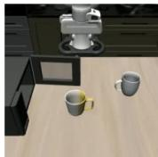  
F0 / 0.0s Context

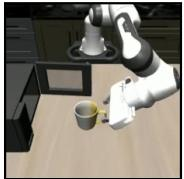  
F96 / 9.6s Start a

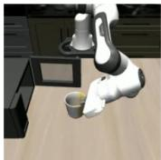  
F168 / 16.8s Stall

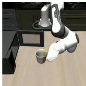  
F270 / 27.0s Stall

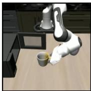  
F312 / 31.2s Resume r

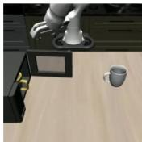  
F437 / 43.7s Later progress

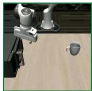  
F477 / 47.7s End T Success

(b) Put the black bowl in the bottom drawer and close it. After the pause, the bowl is placed inside and the drawer closes. Stall: 8.8 s

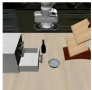  
F0 / 0.0s Context

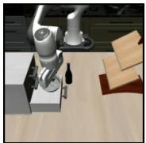

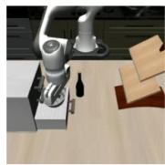  
F149 / 14.9s Stall

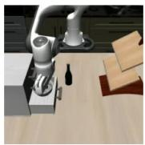  
F190 / 19.0s Stall

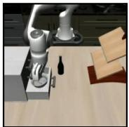  
F208 / 20.8s Resume r

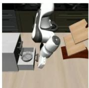  
F249 / 24.9s Later progress

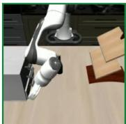  
F269 / 26.9s End T Success

(c) Turn on the stove and put the moka pot on it. The pot stays on the table during the pause, then reaches the lit stove. Stall: 9.3 s

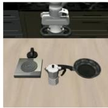  
F0 / 0.0s Context

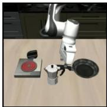  
F170 / 17.0s Start a

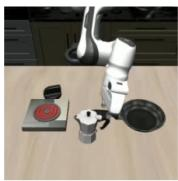  
F201 / 20.1s Stall

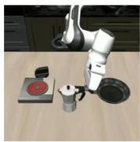  
F244 / 24.4s Stall

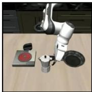  
F263 / 26.3s Resume r

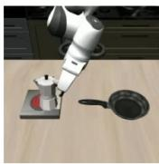  
F306 / 30.6s Later progress

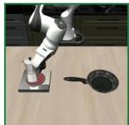  
F326 / 32.6s End T Success

(d) Put both moka pots on the stove. The second pot stays on the table during the stall; both pots reach the stove afterward. Stall: 15.0 s

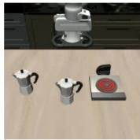  
F0 / 0.0s Context

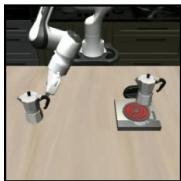  
F270 / 27.0s Start a

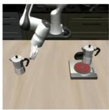  
F320 / 32.0s Stall

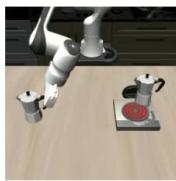  
F390 / 39.0s Stall

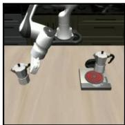  
F420 / 42.0s Resume r

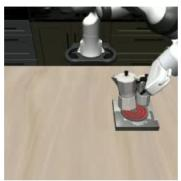  
F485 / 48.5s Later progress

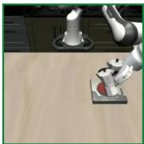  
F505 / 50.5s End T Success

Source: LIBERO; existing human annotations. Frames span F0 to the recording endpoint T (10 fps). W: wrist-camera view. Black borders mark annotated event anchors; green/red indicates success/failure.

## LIBERO: Regression and recovery

A previously attained task state is lost and restored. Black borders mark the reference a and recovery r; intermediate frames show the loss and regrasping. Each row begins at F0 and ends at the successful recording endpoint T.

(a) Put the alphabet-soup can and cream-cheese box in the basket. The can drops and is regrasped; both targets end in the basket.

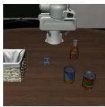

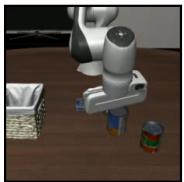

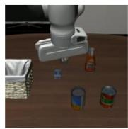  
F81 / 8.1s Loss evidence

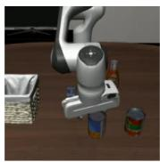  
F176 / 17.6s Regrasp attempt

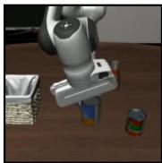  
F282 / 28.2s Recovery r

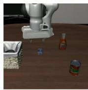  
F362 / 36.2s Later progress

  
F442 / 44.2s W End T Success

(b) Put the soup and tomato-sauce cans in the basket. The soup can is lost and regrasped; both cans reach the basket.

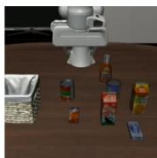  
F0 / 0.0s Context

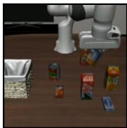  
F106 / 10.6s Ref. a

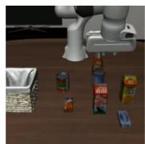  
F116 / 11.6s Loss evidence

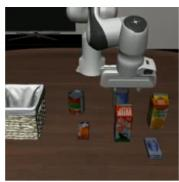  
F135 / 13.5s Regrasp attempt

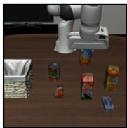  
F164 / 16.4s Recovery r

  
F249 / 24.9s Later progress

  
F334 / 33.4s W End T Success

(c) Put the cream-cheese box and butter in the basket. The butter slips during lifting, is grasped again, and joins the cheese box in the basket.

  
F0 / 0.0s Context

  
F223 / 22.3s W Ref. a

  
F233 / 23.3s W Loss evidence

  
F243 / 24.3s W Regrasp attempt

  
F264 / 26.4s W Recovery r

  
F300 / 30.0s Later progress

  
F320 / 32.0s W End T Success

(d) Put the soup and tomato-sauce cans in the basket. The tomato-sauce can drops, is lifted again, and moves into the basket.

  
F0 / 0.0s Context

  
F213 / 21.3s Ref. a

  
F223 / 22.3s Loss evidence

  
F240 / 24.0s Regrasp attempt

  
F266 / 26.6s Recovery r

  
F286 / 28.6s Later progress

  
F307 / 30.7s W End T Success

Source: LIBERO; existing human annotations. Frames span F0 to the recording endpoint T (10 fps). W: wrist-camera view. Black borders mark annotated event anchors; green/red indicates success/failure.

No advancement

F398 / 39.8s No advancement

## LIBERO: No further progress

Black borders mark the annotated reference a after the last observed task advancement. Earlier frames provide context; later states do not advance beyond $p _ { a }$ . Each row begins at F0 and ends at the failed recording endpoint T.

(a) Put the bowl in the bottom drawer and close it. The bowl enters the drawer, but closing stops partway.

  
F0 / 0.0s Context

  
F267 / 26.7s Ref. a

  
F330 / 33.0s

  
F393 / 39.3s  
No advancement

  
F456 / 45.6s  
No advancement

  
F519 / 51.9s End T Failure

(b) Put the bowl in the bottom drawer and close it. A short closing motion ends at the boundary; the drawer stays ajar.

  
F0 / 0.0s Context

  
F280 / 28.0s  
Earlier progress

  
F340 / 34.0s Ref. a

  
F384 / 38.4s  
No advancement

  
F429 / 42.9s  
No advancement

  
F474 / 47.4s  
No advancement

  
F519 / 51.9s End T Failure

(c) Put the yellow-and-white mug in the microwave and close it. The mug is inside, but the door stops closing and remains ajar.

  
F0 / 0.0s Context

  
F218 / 21.8s  
Earlier progress

  
F278 / 27.8s

  
F338 / 33.8s  
No advancement

  
F458 / 45.8s  
No advancement

  
F519 / 51.9s End T Failure

(d) Put the mug on the plate and the pudding to its right. The pudding reaches the plate side but stays short of the required right-side placement.

  
F0 / 0.0s Context

  
F298 / 29.8s Ref. a

  
F353 / 35.3s No advancement

  
F408 / 40.8s No advancement

  
No advancement

  
F519 / 51.9s End T Failure

Source: LIBERO; machine annotations, not human verified. Frames span F0 to the recording endpoint T (10 fps). W: wrist-camera view. Black borders mark annotated event anchors; green/red indicates success/failure.

## LIBERO: Unrecovered regression

An attained task state is lost and remains unrecovered. Black borders mark the reference a and loss ℓ. Each row starts at F0, shows the change from the attained state to the lost state, and ends at the failed recording endpoint T.

(a) Put both moka pots on the stove. A held pot falls behind the stove and remains on its side.

  
F0 / 0.0s Context

  
F180 / 18.0s Ref. a

  
F240 / 24.0s Before loss

  
F250 / 25.0s Loss ℓ

  
F260 / 26.0s After loss

  
F400 / 40.0s After loss

  
F519 / 51.9s End T Failure

(b) Turn on the stove and put the moka pot on it. The carried pot falls beside the stove and stays on its side.

  
F0 / 0.0s Context

  
F350 / 35.0s Before a

  
F360 / 36.0s Ref. a

  
F362 / 36.2s Loss ℓ

  
F368 / 36.8s After loss

  
F440 / 44.0s After loss

  
F519 / 51.9s End T Failure

(c) Put the white mug on the plate and the pudding to its right. The placed mug loses stable support and stays tilted.

  
F0 / 0.0s Context

  
F157 / 15.7s Before a

  
F291 / 29.1s Ref. a

  
F298 / 29.8s Loss ℓ

  
F300 / 30.0s After loss

  
F445 / 44.5s After loss

  
F519 / 51.9s End T Failure

(d) Put the yellow-and-white mug in the microwave and close it. The held mug falls and remains upside down outside the microwave.

  
F0 / 0.0s Context

  
F176 / 17.6s Before a

  
F284 / 28.4s Ref. a

  
F294 / 29.4s Loss ℓ

  
F304 / 30.4s After loss

  
F388 / 38.8s After loss

  
F519 / 51.9s End T Failure

Source: LIBERO; machine annotations, not human verified. Frames span F0 to the recording endpoint T (10 fps). W: wrist-camera view. Black borders mark annotated event anchors; green/red indicates success/failure.

Start a

## Real robots: Progress stall

Task progress remains approximately unchanged within the annotated interval $( p _ { t } \approx p _ { a } )$ . Later frames show renewed advancement.

(a) Move all task objects into the white box. The fork remains on the table during repeated grasp attempts. Grasping resumes, and all objects are in the box at the endpoint. Stall: 26.4 s

  
F0 / 0.0s Context

  
F45 / 4.5s Start a

  
F98 / 9.8s Stall

  
F164 / 16.4s Stall

  
F309 / 30.9s Resume r

  
F339 / 33.9s Later progress

  
F1002 / 100.2s Success / T

(b) Move all task objects into the white box. Repeated attempts leave the yellow brush on the table. Manipulation resumes, and the brush, fork and tape roll end inside the box. Stall: 19.5 s

  
F0 / 0.0s Context

  
F39 / 3.9s Start a

  
F78 / 7.8s Stall

  
F127 / 12.7s Stall

  
F234 / 23.4s Resume r

  
F264 / 26.4s Later progress

  
F900 / 90.0s Success / T

(c) Nest the three bowls into one stack. The blue bowl remains on the table during repeated approach attempts. The final frame shows all three bowls nested together. Stall: 26.6 s

  
F0 / 0.0s Context

  
F160 / 16.0s Start a

  
F213 / 21.3s Stall

  
F280 / 28.0s Stall

  
F426 / 42.6s Resume r

  
F869 / 86.9s Later progress

  
F1023 / 102.3s Success / T

(d) Nest the three bowls into one stack. Repeated attempts leave the green bowl outside the stack. The final frame shows the three bowls nested together. Stall: 24.9 s

  
F0 / 0.0s  
Context

  
F286 / 28.6s

  
F535 / 53.5s

  
F565 / 56.5s

  
Later progress

  
F596 / 59.6s  
Success / T

Source: RoboChallenge; existing human annotations. Black borders mark annotated event anchors. Green/red endpoints indicate success/failure. Frame numbers and times identify positions in each video. Some views are cropped to highlight task-relevant regions.

## Real robots: Regression and recovery

An achieved task state is lost and then restored. Supported loss states have lower progress than both references $\left( p _ { t } < p _ { a } , p _ { t } < p _ { r } \right)$

(a) Place all loose fruits in the black wire basket. The green fruit is held, falls back onto the table, and is grasped again. All fruits are in the basket at the endpoint.

  
F0 / 0.0s Context

  
F327 / 32.7s Ref. a

  
F351 / 35.1s Loss evidence

  
F366 / 36.6s Reapproach

  
F376 / 37.6s Recovery r

  
F388 / 38.8s After recovery

  
F1804 / 180.4s Success / T

(b) Place all loose fruits in the black wire basket. The brown fruit slips from the grasp and is recovered. The final overview shows the fruits in the basket and the gripper withdrawn.

  
F0 / 0.0s Context

  
F282 / 28.2s Ref. a

  
F476 / 47.6s Loss evidence

  
F593 / 59.3s Reapproach

  
F671 / 67.1s Recovery r

  
F701 / 70.1s After recovery

  
F3717 / 371.7s Success / T

(c) Place all loose fruits in the rectangular wicker tray. The yellow fruit falls to the table and is regrasped.   
By the final frame, the fruits are collected in the tray.

  
F0 / 0.0s Context

  
F185 / 18.5s Ref. a

  
F197 / 19.7s Loss evidence

  
F234 / 23.4s Reapproach

  
F246 / 24.6s Recovery r

  
F261 / 26.1s After recovery

  
F1527 / 152.7s Success / T

(d) Put the banana into the cup. The lifted banana drops onto the counter, is grasped and lifted again, and is released into the cup.

  
F0 / 0.0s Context

  
F153 / 15.3s Ref. a

  
F165 / 16.5s Loss evidence

  
F241 / 24.1s Reapproach

  
F259 / 25.9s Recovery r

  
F335 / 33.5s After recovery

  
F400 / 40.0s Success / T

Source: RoboChallenge (a–c), RoboArena (d). Examples use final annotation records from the procedure in Appendix A.3. Black borders mark annotated event anchors. Green/red endpoints indicate success/failure. Frame numbers and times identify positions in each video. Some views are cropped to highlight task-relevant regions.

## Real robots: No further progress

No later state advances beyond the annotated reference before recording ends $( p _ { t } \leq p _ { a } )$ . Images around a show the last advancement boundary.

(a) Place the tape roll inside the drawer. The roll is lifted to the drawer opening, then remains gripped outside without insertion or release.

  
F0 / 0.0s Start

  
F120 / 12.0s Before

  
F164 / 16.4s Before a

  
F214 / 21.4s Ref. a

  
F250 / 25.0s Plateau

  
F350 / 35.0s Plateau

  
F400 / 40.0s Failure / T

(b) Place the red cup inside the cabinet. The cup leaves the table and reaches the cabinet, then remains gripped outside through T.

  
F0 / 0.0s Start

  
F50 / 5.0s Before

  
F80 / 8.0s Before a

  
F110 / 11.0s Ref. a

  
F150 / 15.0s Plateau

  
F215 / 21.5s Plateau

  
F265 / 26.5s Failure / T

(c) Place the cup inside the white storage box. The cup is lifted, then stays held outside the white box without placement through T.

  
F0 / 0.0s Start

  
F250 / 25.0s Before

  
F300 / 30.0s Before a

  
F330 / 33.0s Ref. a

  
F350 / 35.0s Plateau

  
F375 / 37.5s Plateau

  
F400 / 40.0s Failure / T

(d) Place the plush toy inside the fabric bag. The toy is lifted toward the bag but remains gripped outside it while the arm repositions it.

  
F0 / 0.0s Start

  
F100 / 10.0s Before

  
F160 / 16.0s Before a

  
F200 / 20.0s Ref. a

  
F240 / 24.0s Plateau

  
F330 / 33.0s Plateau

  
F400 / 40.0s Failure / T

Source: RoboArena. Examples use final annotation records from the procedure in Appendix A.3. Black borders mark annotated event anchors. Green/red endpoints indicate success/failure. Frame numbers and times identify positions in each video. Some views are cropped to highlight task-relevant regions.

## Real robots: Unrecovered regression

An achieved task state is lost and remains unrecovered at the recording endpoint. Supported post-loss states have lower progress $\left( p _ { t } < p _ { a } \right)$

(a) Place both shoes inside the box. After one shoe is placed, the second slips from the gripper and stays outside the box at T.

  
F0 / 0.0s Start

  
F361 / 36.1s Before loss

  
F373 / 37.3s Ref. a

  
F377 / 37.7s Loss evidence

  
F433 / 43.3s After loss

  
F518 / 51.8s Later

  
F799 / 79.9s Failure / T

(b) Place the banana on the plate. The banana is lifted, falls beside the empty plate, and remains on the table at T.

  
F0 / 0.0s Start

  
F57 / 5.7s Before loss

  
F69 / 6.9s Ref. a

  
F72 / 7.2s Loss evidence

  
F81 / 8.1s After loss

  
F129 / 12.9s Later

  
F399 / 39.9s Failure / T

(c) Place the carrot inside the paper cup. The carrot falls from the raised gripper and is still on the table outside the cup at T.

  
F0 / 0.0s Start

  
F104 / 10.4s Before loss

  
F116 / 11.6s Ref. a

  
F118 / 11.8s Loss evidence

  
F121 / 12.1s After loss

  
F176 / 17.6s Later

  
F400 / 40.0s Failure / T

(d) Lift the green frog from the table. The frog is lifted, slips out and rolls onto the mat, then remains ungrasped at T.

  
F0 / 0.0s Start

  
F156 / 15.6s Before loss

  
F168 / 16.8s Ref. a

  
F169 / 16.9s Loss evidence

  
F180 / 18.0s After loss

  
F228 / 22.8s Later  
F400 / 40.0s Failure / T

Source: RoboArena. Examples use final annotation records from the procedure in Appendix A.3. Black borders mark annotated event anchors. Green/red endpoints indicate success/failure. Frame numbers and times identify positions in each video. Some views are cropped to highlight task-relevant regions.

## B Model and Training Details

## B.1 Model Inputs and Prediction Heads

Inputs and visual history. Using the input components defined in Section 3.1, we process images at 224 × 224 resolution and take the start observation from the beginning of the trajectory or training segment. The instruction and images form a single multimodal input, with text markers indicating image roles and temporal order. The visual history contains five observations. For chronological inputs, it ends at the queried observation and contains no later observations. Videos in the event-annotated dataset use approximately 0.1-second sampling intervals, with each requested timestamp mapped to the latest available frame at or before it. Stage-1 pretraining and replay use 0.25-second intervals. AutoEval uses the latest five logged observations without assuming a fixed frame rate. When history is insuficient at the beginning of a trajectory or segment, we repeat the first eligible observation. Temporal transformations for trend supervision are described in Appendix B.2.

Goal conditioning. For the event-annotated dataset, goal images are selected from accepted completion frames of successful training trajectories with compatible task, scene, and camera context. Successful trajectories containing events may also supply goal images. When a compatible goal image is unavailable or omitted during training, we use a dedicated no-goal token. Goal-image dropout settings are given in Appendix B.4.

Backbone and prediction heads. With Qwen3.5-4B as the backbone, we append separate progress and trend query tokens to the multimodal input and apply a prediction head to each token’s final-layer hidden state. Each head applies layer normalization followed by a two-layer MLP with hidden width $d / 2$ GELU activation, and dropout of 0.1 between the linear layers; d denotes the backbone hidden dimension. The progress head applies softmax to 101 logits, giving probabilities $\pi _ { \theta , k } ( x _ { t } )$ over support values $k / 1 0 0$ for $k = 0 , \ldots , 1 0 0$ . Its scalar prediction is the distribution’s expectation:

$$
p _ { \theta } ( x _ { t } ) = \sum _ { k = 0 } ^ { 1 0 0 } \frac { k } { 1 0 0 } \pi _ { \theta , k } ( x _ { t } ) .\tag{3}
$$

The trend head applies softmax to three logits for increasing, stable, and decreasing progress.

## B.2 Progress and Trend Supervision

Temporal labels. Successful demonstration segments used for pretraining and replay, and normal successful rollouts in the event-annotated dataset, provide temporal labels. Between the first eligible observation b and the accepted completion boundary S of the segment or rollout, we assign $y _ { t } = ( u _ { t } - u _ { b } ) / ( u _ { S } - u _ { b } )$ , where u denotes time on the processed video timeline or the ordered observation index of a logged sequence. These labels serve as a numerical proxy for progress toward completing the accompanying instruction; observations after completion are excluded. Segment boundaries and timeline processing are described in Appendix B.4 for pretraining data and Appendix A.3 for the event-annotated rollouts. Replay retains the original pretraining segments and temporal labels. A zero-length interval receives only the completion label $y = 1$ , without trend supervision.

Mean-preserving soft targets. To supervise the progress distribution in Appendix B.1 while preserving the scalar target, we encode $y \in [ 0 , 1 ]$ using symmetric discrete Gaussian kernels over the 101 support values. With $K = 1 0 0$ , define $\mathcal S _ { j } = \{ k \in \{ 0 , \ldots , K \} : | k - j | \leq \operatorname* { m i n } ( j , K - j ) \}$ and

$$
G _ { j } ( k ) = \frac { \mathbf { 1 } [ k \in \mathcal { S } _ { j } ] \exp \left( - \frac { ( k - j ) ^ { 2 } } { 2 \sigma ^ { 2 } } \right) } { \sum _ { r \in \mathcal { S } _ { j } } \exp \left( - \frac { ( r - j ) ^ { 2 } } { 2 \sigma ^ { 2 } } \right) } ,\tag{4}
$$

where $\sigma = 2$ bins. For $j _ { - } = \lfloor K y \rfloor , j _ { + } = \lceil K y \rceil$ , and $\alpha = K y - j _ { - }$ , the soft target is

$$
\widetilde { \pi } _ { k } ( y ) = ( 1 - \alpha ) G _ { j _ { - } } ( k ) + \alpha G _ { j _ { + } } ( k ) .\tag{5}
$$

The symmetric support and interpolation preserve expectation $y ;$ targets at zero and one remain concentrated at their respective endpoints.

Auxiliary trend targets. During pretraining, successful segments provide synthetic increasing, stable, and decreasing trend labels through the following sequences:

$$
\begin{array} { r l } & { H _ { t } ^ { \uparrow } = ( o _ { t - 4 \Delta } , \dots , o _ { t - \Delta } , o _ { t } ) , } \\ & { H _ { t } ^ { = } = ( o _ { t } , o _ { t } , o _ { t } , o _ { t } , o _ { t } ) , } \\ & { H _ { t } ^ { \downarrow } = ( o _ { t + 4 \Delta } , \dots , o _ { t + \Delta } , o _ { t } ) , } \end{array}\tag{6}
$$

where $\Delta$ is the sampling interval. The decreasing sequence uses later observations from the source segment in reverse order as a training transformation. All three sequences end at $o _ { t }$ and retain the same progress target $y _ { t } ;$ their trend labels follow the displayed order under the successful-segment progress proxy. Replay retains this construction. Pretraining endpoint queries and sequences lacking the temporal support required by a transformation are excluded from trend supervision.

For new normal successes in the event-annotated dataset, we use chronological histories and assign increasing labels only when all five observations come from distinct sampling positions, with no repetitions introduced by prefix padding. Histories containing repeated observations from prefix padding receive no trend label.

Losses and supervision scope. The progress loss $\mathcal { L } _ { \mathrm { p r o g r e s s } }$ is cross-entropy between the soft target $\widetilde { \pi } ( y )$ and the predicted progress distribution. The trend loss $\mathcal { L } _ { \mathrm { t r e n d } }$ is cross-entropy with the corresponding three-class label. Each loss is averaged over its own valid queries and is zero when none are available. Queries used for relation supervision, including reference and comparison observations, receive neither temporal labels nor trend labels. They supervise scalar progress through the relation losses in Appendix B.3.

## B.3 Progress-Relation Losses

Reference predictions and supported comparisons. For each event $e , \mathcal { M } _ { e }$ is a nonempty set of sampled comparison observations supported by its annotation (Appendix $\mathrm { A . 2 } )$ , with reference a and, for regression and recovery, recovery reference r. For regression-and-recovery events, a retains the attained state at loss onset and r restores it, so the anchors represent approximately equal task progress. Reference and comparison predictions share the task instruction, start reference, and optional goal. With $p _ { t } = p _ { \theta } ( x _ { t } )$ , we use $\bar { p } _ { a } = \mathrm { s g } ( p _ { a } )$ and, where applicable, $\bar { p } _ { r } = \mathrm { s g } ( p _ { r } )$ , where sg stops gradients within the relation loss. Only comparison predictions receive these gradients; references are recomputed with the current model.

Relation penalties and margins. For $t \in \mathcal { M } _ { e }$ , we use the following squared hinge penalties, where $[ z ] _ { + } = \operatorname* { m a x } ( z , 0 )$

$$
\begin{array} { r l } & { \ell _ { \mathrm { s t a l l } } ( t ) = \big [ | p _ { t } - \bar { p } _ { a } | - \epsilon \big ] _ { + } ^ { 2 } , } \\ & { \ell _ { \mathrm { r e g r e s s i o n } } ( t ) = \big [ p _ { t } - \operatorname* { m i n } ( \bar { p } _ { a } , \bar { p } _ { r } ) + m _ { e } \big ] _ { + } ^ { 2 } , } \\ & { \ell _ { \mathrm { n o - p r o g r e s s } } ( t ) = [ p _ { t } - \bar { p } _ { a } ] _ { + } ^ { 2 } , } \\ & { \ell _ { \mathrm { u n r e c o v e r e d } } ( t ) = [ p _ { t } - \bar { p } _ { a } + m ] _ { + } ^ { 2 } . } \end{array}\tag{7}
$$

Progress stall permits variation within ϵ of the reference score. Regression and recovery use the lower of the two reference scores, without requiring them to be equal.

We set $\epsilon = 0 . 0 2$ and the base decrease margin $m = 0 . 1$ . For regression and recovery, the efective margin is $\begin{array} { r } { m _ { e } = \operatorname* { m i n } \{ m , \frac { 1 } { 2 } \operatorname* { m i n } ( \bar { p } _ { a } , \bar { p } _ { r } ) \} } \end{array}$ , reducing the required separation when reference scores approach zero in the bounded progress range [0, 1]. Unrecovered regression retains the fixed margin $m .$ These tolerances and margins are optimization parameters, not annotated completion percentages or measured amounts of progress loss.

Table 7: Pretraining corpus composition. Approximate durations sum the retained training segments after preprocessing and dataset splitting, before repeated sampling. These durations describe corpus composition rather than training sampling probabilities.
<table><tr><td>Source</td><td>Duration (h)</td></tr><tr><td>Robot demonstrations</td><td></td></tr><tr><td>AgiBot World Beta [1]</td><td>2,345</td></tr><tr><td>Galaxea Open-World [11]</td><td>450</td></tr><tr><td>RoboMIND V2 [9]</td><td>319</td></tr><tr><td>RoboCOIN [32]</td><td>283</td></tr><tr><td>DROID [12]</td><td>268</td></tr><tr><td>RoboMIND V1 [31]</td><td>190</td></tr><tr><td>Baihu: Qingloong subset [23]</td><td>148</td></tr><tr><td>Other robot demonstrations</td><td>557</td></tr><tr><td>Robot subtotal</td><td>4,560</td></tr><tr><td>Human manipulation videos (private corpus)</td><td>15,487</td></tr><tr><td>Total</td><td>20,047</td></tr></table>

Loss aggregation. For the set $\boldsymbol { B _ { e } }$ of valid event groups in a batch, we average comparison penalties within each event and then average over events:

$$
\mathcal { L } _ { \mathrm { r e l } } = \frac { 1 } { \operatorname* { m a x } ( 1 , | \mathcal { B } _ { e } | ) } \sum _ { e \in \mathcal { B } _ { e } } \frac { 1 } { | \mathcal { M } _ { e } | } \sum _ { t \in \mathcal { M } _ { e } } \ell _ { e } ( t ) ,\tag{8}
$$

where $\ell _ { e }$ is the event-type penalty. Each event has equal weight regardless of its comparison count, and a batch with no valid events has zero loss. Sampling proportions are given in Appendix B.4; the progress and trend losses in Appendix B.2 are combined with this term through the joint objective in Section 3.3.

## B.4 Pretraining and Rollout Joint Training

This section describes pretraining and rollout joint training of the full Event2Reward model. The controlled supervision ablations in Section 4.1 use a separate training configuration, detailed in Appendix C.1.

Pretraining corpus. Pretraining combines public robot demonstrations, additional robot expert demonstrations, and private human manipulation videos (Table 7). DROID uses the processed release provided by DreamZero [36].

Training segments and temporal labels. We organize pretraining data into successful task or subtask segments, each paired with an instruction describing that segment. Segment boundaries follow available source annotations or delimit a complete successful execution. Source-specific preprocessing includes removing trailing inactivity and combining short adjacent human-video subtasks, together with their instructions, in temporal order. For DROID, we retain the DreamZero release’s processed timeline, in which idle frames have already been removed. Temporal labels are normalized over each retained segment, so subtask segments measure progress toward completing the instructed subtask. Training queries use the inputs in Appendix B.1; the temporal labels and auxiliary trend supervision are defined in Appendix B.2.

Pretraining and initialization. We initialize the model from Qwen3.5-4B and pretrain it with the progress and auxiliary trend objectives in Appendix B.2, omitting available goal images with probability 0.5. Joint training starts from the Stage-1 checkpoint listed in Table 8, before the pretraining schedule ends.

Data sampling across training stages. During pretraining, robot demonstrations and human videos are sampled with probabilities of 70% and 30%, respectively. For joint training, we use the real-robot training split of the event-annotated dataset described in Appendix A, supplemented with 5,452 simulated rollouts from RoboFAC [37].1 Across the real and simulated data, the rollout training pools contain 17,572 normal successful trajectories and 49,571 event-bearing trajectories.

Table 8: Pretraining and rollout joint-training settings. Learning rates are base values before scheduling. Query counts include reference observations used in relation supervision.
<table><tr><td>Setting</td><td>Pretraining</td><td>Rollout joint training</td></tr><tr><td>Checkpoint step</td><td>50,000</td><td>10,000</td></tr><tr><td>Scheduler horizon</td><td>500,000</td><td>40,000</td></tr><tr><td>Warmup updates</td><td>25,000</td><td>2,000</td></tr><tr><td>Global queries per update</td><td>256</td><td>80</td></tr><tr><td>Queries to checkpoint</td><td>12.8M</td><td>0.8M</td></tr><tr><td>Language learning rate</td><td> $1 0 ^ { - 5 }$ </td><td> $2 \times 1 0 ^ { - 6 }$ </td></tr><tr><td>Vision learning rate</td><td> $1 0 ^ { - 6 }$ </td><td> $5 \times 1 0 ^ { - 7 }$ </td></tr><tr><td>Prediction-head learning rate</td><td> $2 \times 1 0 ^ { - 5 }$ </td><td> $1 0 ^ { - 5 }$ </td></tr><tr><td>Progress-loss weight  $\lambda _ { p }$ </td><td>1</td><td>1</td></tr><tr><td>Trend-loss weight  $\lambda _ { t }$ </td><td>1</td><td>1</td></tr><tr><td>Relation-loss weight  $\lambda _ { \mathrm { { r e l } } }$ </td><td>0</td><td>10</td></tr><tr><td>Training seed</td><td>42</td><td>42</td></tr></table>

Replay uses a fixed subset of 147,456 successful task or subtask segments from the pretraining training set.   
These segments retain their original temporal labels, temporal transformations, and goal-image dropout.   
Robot and human replay data follow the same 70%/30% sampling ratio used during pretraining.

Joint training allocates 25%, 25%, and 50% of the model-query budget to replay, normal successful rollouts, and event-bearing rollouts, respectively. Both rollout pools include real and simulated executions. Normal successful rollouts provide temporal labels and valid trend labels, while event-bearing rollouts provide withintrajectory progress relations as defined in Appendix B.3. Available goal images in the rollout pools are retained without additional dropout.

Mixture proportions are measured in individual model queries, including event references and comparison observations. For each sampled event, we select at most eight supported comparison observations, together with its required reference observations. Event groups remain intact when constructing batches. Across the total query budget, progress stall, regression and recovery, no further progress, and unrecovered regression receive approximately 11.26%, 3.48%, 23.54%, and 11.73%, respectively. This sampling allocation determines event exposure; the relation loss itself uses the within-event and across-event averaging defined in Appendix B.3.

Optimization and training budget. Both stages update the language backbone, the final three visionencoder layers, the visual merger, and both prediction heads using AdamW (weight decay 0.01), BF16 mixed precision, and gradient-norm clipping at 1.0. Learning rates use linear warmup followed by cosine decay. Table 8 gives parameter-group learning rates, query budgets, and checkpoint steps separately from scheduler horizons.

Validation and checkpoint reporting. We monitor joint training with a fixed query plan covering progress prediction on normal successes, consistency with annotated progress relations, and retention on Stage-1 data. Goal-present and no-goal conditions are evaluated separately. The retention set consists of Stage-1 training segments held out from the Stage-2 replay pool. Test partitions are excluded from this monitoring plan.

Validation measurements at the reported checkpoint diagnose progress calibration, relation consistency, and retention; completing the longer schedule is not treated as evidence of a better model.

Table 9: Supervision used during continued training. All five variants start from the same checkpoint trained with temporal labels from normal successful rollouts. Relation-loss-of retains the mixed-sampling recipe of Progress + Relation but disables the relation loss.
<table><tr><td>Variant</td><td>Temporal labels</td><td>Trajectory preference</td><td>Progress relations</td></tr><tr><td>Progress-only</td><td>Yes</td><td></td><td></td></tr><tr><td>Progress + Preference</td><td>Yes</td><td>Yes</td><td></td></tr><tr><td>Relation-only</td><td></td><td></td><td>Yes</td></tr><tr><td>Progress + Relation</td><td>Yes</td><td></td><td>Yes</td></tr><tr><td>Relation-loss-off</td><td>Yes</td><td></td><td></td></tr></table>

## C Experimental Details and Additional Results

## C.1 Ablation Study

Supervision conditions. We compare five reward-model variants on LIBERO-10 Tasks 1, 3, 7, and 9. All variants use Qwen3-VL-4B-Instruct and start from the same checkpoint trained for 2,000 updates using temporal labels from normal successful rollouts. Each variant then undergoes 2,000 additional updates with the supervision specified in Table 9. We preserve chronological input histories and disable auxiliary trend supervision throughout these ablations. Variant names refer only to the supervision used during continued training.

Training data. For the controlled supervision ablations, we use $\pi _ { 0 }$ rollouts covering all ten LIBERO-10 tasks. We select 2,000 normal successful rollouts. This pool supplies temporal labels for the shared initialization and for continued training in variants that retain temporal supervision. An additional training pool contains 2,559 rollouts, comprising 839 event-containing successes and 1,720 failures. Relation and trajectory-preference supervision use this same additional pool.

The two training pools and the held-out validation and test sets, containing 128 and 139 rollouts respectively, are mutually disjoint at the trajectory level. Relation and preference supervision use the same trajectory splits. The held-out sets cover the same ten tasks as training, while downstream reinforcement learning evaluates Tasks 1, 3, 7, and 9.

Sampling and supervision. Temporal labels are constructed by normalizing time within normal successful segments. Progress-only uses clips from the normal-success pool throughout continued training, while Progress + Relation allocates half of its clip budget to this pool and half to event data. Event clips receive relation supervision and no temporal labels. Relation-loss-of retains the same 50/50 sampling recipe but sets the relation-loss weight to zero, controlling for the sampling change relative to Progress-only. Relation-only uses event data without temporal supervision; any padding clips carry no supervision. Under the fixed training budget, this condition therefore increases event exposure as well as removing temporal supervision.

Trajectory preference supervision. Progress + Preference uses the same normal-success pool and additional rollout pool as Progress + Relation. Preference supervision is derived from trajectory outcomes, without using event categories or boundaries. For preference supervision, we pair a successful and a failed trajectory from the same task and balance their presentation order. Each trajectory is represented by eight uniformly sampled frames, together with its start and goal images. The model jointly processes the two trajectories, and a separate preference head is trained with binary cross-entropy to favor the successfu trajectory. Each update uses 40 normal-success clips and 14 trajectory pairs, matching the normal-success clip count and total image and visual-token exposure of Progress + Relation. Over 2,000 updates, this gives 80,000 normal-success clip exposures and 28,000 pair exposures. Relation supervision samples local event groups, whereas preference supervision samples whole-trajectory pairs. During downstream RL, the preference-trained model provides rewards through its progress head. Held-out evaluation of the comparison head confirms high accuracy on same-task success–failure preferences (Appendix C.1.1).

Optimization. We use AdamW with weight decay 0.01 and 100 warmup updates. Learning rates are $2 \times 1 0 ^ { - 6 }$ for the language backbone, $5 \times 1 0 ^ { - 7 }$ for the trainable vision parameters, and $1 0 ^ { - 5 }$ for the prediction heads. We update the language backbone, the final three vision-encoder layers, the visual merger, and the heads used by each variant. The progress, relation, and preference losses have weights 1, 10, and 1, respectively, when active. The progress and relation objectives are defined in Appendices B.2 and B.3; auxiliary trend supervision is disabled here.

Additional baselines. We additionally evaluate the publicly released Robometer checkpoint [14] without further fine-tuning, and a Sparse baseline that uses only the environment reward. Our choice of Qwen3-VL-4B-Instruct matches the backbone used by Robometer. Robometer is an external reward-model baseline, separate from the Progress + Preference variant trained under our shared initialization and data protocol.

Residual reinforcement learning. We evaluate the reward models using a residual SAC framework adapted from PLD [33]. The $\pi _ { 0 . 5 }$ base policy and reward model remain frozen throughout RL training. RL updates the residual actor, critics, and SAC temperature parameter, while the visual backbone remains frozen. Within each task, all conditions use the same base-policy checkpoint and residual architecture. At each decision step, the residual policy observes two camera views, robot proprioception, and the proposed base-action chunk, and predicts corrections for the next $H = 5$ environment steps. We first compose the action chunk as

$$
A _ { t } = A _ { t } ^ { \mathrm { b a s e } } + \alpha \Delta A _ { t } , \qquad \Delta A _ { t } \in [ - 1 , 1 ] ^ { H \times 7 } , \qquad \alpha = 0 . 1 .\tag{9}
$$

Corrections apply to all seven action dimensions. We then clip the gripper component of $A _ { t } ~ \mathrm { t o } ~ [ - 1 , 1 ]$ before executing the resulting action chunk. Network architecture and optimization settings are summarized in Table 10.

Progress-based reward computation. For learned-reward conditions, we evaluate the progress potential in Equation 2 at action-chunk boundaries. For a chunk containing $k \leq H$ executed environment steps, the training reward is

$$
R _ { t } ^ { \mathrm { s h a p e d } } = R _ { t } ^ { \mathrm { e n v } } + \beta \left[ \gamma ^ { k } ( 1 - d _ { t } ) p _ { \theta } ( x _ { t + k } ) - p _ { \theta } ( x _ { t } ) \right] ,\tag{10}
$$

where $R _ { t } ^ { \mathrm { e n v } }$ is the accumulated environment reward within the chunk, $\gamma = 0 . 9 9 8$ , and $\beta = 1$ . The indicator $d _ { t }$ is one at an episode termination or truncation boundary and zero otherwise; the next-state potential contribution is therefore zero at these boundaries. SAC bootstrapping uses the same duration-dependent discount and episode-boundary mask. Reward inference runs asynchronously with environment interaction; transitions enter the replay bufer after their shaped rewards have been computed. Sparse uses environment rewards alone.

Optimization and interaction budget. RL updates use only online experience, with no ofline replay or critic pretraining. Updates begin after the replay bufer contains 1,000 chunk transitions. Each learner iteration performs one critic update on a 128-transition batch, followed by four critic updates on 32-transition minibatches and one actor and temperature update on the corresponding full batch. Each run receives a budget of 1.2 million environment steps. We use five environment seeds, {7, 8, 9, 17, 27}, for every task and condition.

Policy evaluation. We evaluate policy snapshots in a separate environment every 50 completed training episodes, using 50 evaluation episodes per snapshot. Evaluation uses deterministic residual actions while retaining the base policy’s default stochastic sampling. The initial evaluation sets all residual actions to zero and measures base-policy performance. Evaluation success is the fraction of successful episodes according to the environment’s task-success criterion; evaluation trajectories are not added to the training replay.

Evaluation and curve aggregation. Following the evaluation protocol above, we align curves by linear interpolation between recorded observations, without extrapolation or additional smoothing. Curves show equally weighted means across five environment seeds, with shaded bands indicating the mean ±1.96 SEM. Here, SEM is the sample standard deviation across seeds divided by ${ \sqrt { 5 } } ,$ and bands are clipped to the valid success-rate range. Each learned-reward condition uses the same reward-model checkpoint across environment seeds; the bands therefore summarize variation across downstream runs. Result tables report means ± sample standard deviations across seeds.

Table 10: Shared residual SAC settings for the supervision ablations. Replay entries correspond to action chunks.
<table><tr><td>Setting</td><td>Value</td></tr><tr><td>Optimizer</td><td>AdamW</td></tr><tr><td>Learning rate</td><td> $3 \times 1 0 ^ { - 4 }$ </td></tr><tr><td>Network weight decay</td><td> $1 0 ^ { - 4 }$ </td></tr><tr><td>Gradient clipping norm</td><td>1.0</td></tr><tr><td>Replay capacity</td><td>250,000 chunks</td></tr><tr><td>Replay batch size</td><td>128 chunks</td></tr><tr><td>Target-network update coefficient Initial SAC temperature</td><td>0.005</td></tr><tr><td>Actor hidden layers</td><td>0.01</td></tr><tr><td>Critic hidden layers</td><td>3 × 256</td></tr><tr><td></td><td> $3 \times 2 5 6$ </td></tr><tr><td>Number of critics</td><td>2</td></tr><tr><td>Actor and critic normalization</td><td>LayerNorm</td></tr><tr><td>Visual encoder</td><td>Pretrained ResNet-18</td></tr><tr><td>Visual backbone</td><td>Frozen</td></tr></table>

Summary metrics. For a given task and condition, let $\widetilde { S } _ { s } ( t )$ denote the linearly interpolated evaluation success rate in [0, 1] for seed s at environment step t. The normalized AUC, expressed as a percentage, is

$$
\mathrm { A U C } _ { s } = \frac { 1 0 0 } { T } \int _ { 0 } ^ { T } \widetilde { S } _ { s } ( t ) \mathrm { d } t .\tag{11}
$$

Within each task, all seven conditions and five seeds are compared over the same evaluation interval [0, T], which is covered by every run. For Tasks 1, 3, 7, and 9, the endpoints are 1,175,842, 1,176,236, 1,179,116, and 1,178,331 environment steps, respectively. This metric measures average evaluation success over a shared interaction interval. Last-evaluation success uses each run’s last periodic evaluation within the 1.2-million-step training budget. For the four-task average, we first average the task scores within each seed, then compute the mean and sample standard deviation across the five seeds.

Complete RL results. Table 11 reports all seven conditions on the four tasks. The independent-evaluation curves for the four supervision variants are shown in Figure 3; Figure 7 shows the additional controls and reward-model baselines. Progress + Relation achieves the highest mean evaluation AUC on all four tasks and the highest mean last-evaluation success on all four tasks. It also exceeds Relation-loss-of in mean evaluation AUC on every task, with a four-task average of 36.7% versus 19.1%. This comparison supports a contribution from the relation objective beyond the mixed-sampling recipe. Progress + Relation also exceeds Progress + Preference in mean evaluation AUC (36.7% versus 19.4%), despite the latter’s high held-out preference accuracy (Table 12). Relative to Sparse and Robometer, joint supervision achieves higher four-task averages for both metrics. On Task 3, Progress + Relation achieves higher mean evaluation AUC than Robometer (48.9% versus 26.5%) and higher mean last-evaluation success (88.8% versus 70.4%).

## C.1.1 Held-Out Trajectory Preference Prediction

Evaluation protocol. To assess whether Progress + Preference learned the trajectory comparisons used for supervision, we evaluate the trained preference head of the same checkpoint used in the RL ablations, without further training or checkpoint selection. The held-out split contains 46 successful and 93 failed trajectories across all ten LIBERO-10 tasks, with no trajectory overlap with the training or validation splits. We evaluate all 433 unique within-task success–failure pairs, including 73 pairs from the four RL tasks (Tasks 1, 3, 7, and 9). Labels are determined by recorded terminal outcomes. The 103 trajectories used in the progress diagnostics (Appendix C.1.2) form a subset of this split; the present evaluation uses all 139 trajectories because it requires terminal outcomes rather than unambiguous local event annotations. Inputs follow the training protocol: eight uniformly sampled frames per trajectory, together with its start image and a fixed goal image from the training setup. We randomize the primary $\mathrm { A } / \mathrm { B }$ order with approximately balanced

Table 11: Complete RL results on four LIBERO-10 tasks. Values are percentages, reported as mean ± sample standard deviation across five environment seeds. Average first averages the four tasks within each seed. Bold indicates the highest mean in each column within each panel.
<table><tr><td>Method</td><td>Task 1</td><td>Task 3</td><td>Task 7</td><td>Task 9</td><td>Average</td></tr><tr><td colspan="6">(a) Normalized evaluation AUC</td></tr><tr><td>Sparse</td><td> $1 . 4 \pm 1 . 0$ </td><td> $3 0 . 4 \pm 2 9 . 6$ </td><td> $3 . 5 \pm 5 . 3$ </td><td> $2 4 . 5 \pm 3 0 . 9$ </td><td> $1 4 . 9 \pm 8 . 1$ </td></tr><tr><td>Robometer</td><td> $2 2 . 1 \pm 1 9 . 8$ </td><td> $2 6 . 5 \pm 1 5 . 2$ </td><td> $5 . 6 \pm 9 . 1$ </td><td> $2 9 . 1 \pm 2 2 . 8$ </td><td> $2 0 . 8 \pm 1 1 . 9$ </td></tr><tr><td>Progress-only</td><td> $6 . 6 \pm 7 . 8$ </td><td> $2 9 . 4 \pm 1 8 . 5$ </td><td> $5 . 5 \pm 8 . 6$ </td><td> $3 7 . 0 \pm 2 5 . 4$ </td><td> $1 9 . 6 \pm 1 0 . 1$ </td></tr><tr><td>Progress + Preference</td><td> $1 6 . 1 \pm 1 8 . 7$ </td><td> $3 1 . 0 \pm 2 9 . 1$ </td><td> $6 . 0 \pm 9 . 0$ </td><td> $2 4 . 4 \pm 2 3 . 2$ </td><td> $1 9 . 4 \pm 1 4 . 3$ </td></tr><tr><td>Relation-only</td><td> $6 . 8 \pm 1 2 . 8$ </td><td> $1 3 . 4 \pm 1 5 . 4$ </td><td> $1 . 1 \pm 0 . 2$ </td><td> $1 1 . 8 \pm 2 3 . 4$ </td><td> $8 . 3 \pm 7 . 9$ </td></tr><tr><td>Relation-loss-off</td><td> $1 3 . 2 \pm 1 6 . 3$ </td><td> $3 0 . 4 \pm 2 2 . 1$ </td><td> $5 . 7 \pm 7 . 0$ </td><td> $2 7 . 2 \pm 1 7 . 7$ </td><td> $1 9 . 1 \pm 7 . 6$ </td></tr><tr><td>Progress + Relation</td><td> ${ \bf 2 4 . 2 \pm 1 5 . 7 }$ </td><td> ${ \bf 4 8 . 9 \pm 1 4 . 3 }$ </td><td> ${ \bf 1 9 . 8 \pm 2 6 . 3 }$ </td><td> ${ \bf 5 3 . 8 \pm 8 . 8 }$ </td><td> ${ \bf 3 6 . 7 \pm 7 . 8 }$ </td></tr><tr><td colspan="6">(b) Last periodic evaluation success</td></tr><tr><td>Sparse</td><td> $4 . 0 \pm 7 . 9$ </td><td> $4 9 . 2 \pm 4 4 . 3$ </td><td> $1 5 . 6 \pm 3 2 . 7$ </td><td> $3 9 . 6 \pm 4 8 . 2$ </td><td> $2 7 . 1 \pm 2 4 . 4$ </td></tr><tr><td>Robometer</td><td> $4 6 . 0 \pm 4 2 . 2$ </td><td> $7 0 . 4 \pm 2 7 . 2$ </td><td> $1 9 . 6 \pm 3 6 . 2$ </td><td> $6 2 . 4 \pm 3 4 . 7$ </td><td> $4 9 . 6 \pm 2 1 . 7$ </td></tr><tr><td>Progress-only</td><td> $2 7 . 2 \pm 3 6 . 9$ </td><td> $6 9 . 6 \pm 3 8 . 6$ </td><td> $1 4 . 8 \pm 2 8 . 7$ </td><td> $7 2 . 8 \pm 2 5 . 3$ </td><td> $4 6 . 1 \pm 1 5 . 2$ </td></tr><tr><td>Progress + Preference</td><td> $4 9 . 6 \pm 3 9 . 8$ </td><td> $5 7 . 2 \pm 3 5 . 1$ </td><td> $2 2 . 8 \pm 3 9 . 0$ </td><td> $5 8 . 0 \pm 3 2 . 9$ </td><td> $4 6 . 9 \pm 3 0 . 5$ </td></tr><tr><td>Relation-only</td><td> $1 4 . 8 \pm 3 3 . 1$ </td><td> $3 9 . 2 \pm 3 6 . 6$ </td><td> $0 . 0 \pm 0 . 0$ </td><td> $1 7 . 6 \pm 3 9 . 4$ </td><td> $1 7 . 9 \pm 1 4 . 6$ </td></tr><tr><td>Relation-loss-off</td><td> $3 9 . 6 \pm 3 8 . 4$ </td><td> $6 7 . 2 \pm 2 9 . 9$ </td><td> $2 7 . 2 \pm 3 4 . 7$ </td><td> $7 8 . 0 \pm 8 . 6$ </td><td> $5 3 . 0 \pm 1 4 . 8$ </td></tr><tr><td></td><td></td><td></td><td> ${ \bf 5 2 . 8 \pm 4 8 . 6 }$ </td><td></td><td></td></tr><tr><td>Progress + Relation</td><td> ${ \bf 6 6 . 4 \pm 2 8 . 5 }$ </td><td> ${ \pm 1 2 . 9 }$ </td><td></td><td> ${ \bf 9 0 . 8 \pm 5 . 0 }$ </td><td> $7 4 . 7 \pm 1 4 . 2$ </td></tr></table>

  
1.0 1.0 1.0 1.0Figure 7: Additional controls and reward-model baselines. Independent evaluation success of Progress + eRelation, Relation-loss-of, Sparse, and Robometer on LIBERO-10 Tasks 1, 3, 7, and 9. Lines show means across five cenvironment seeds; shaded bands indicate ±1.96 SEM. The horizontal axis shows environment interaction steps.

Evlabels within each task (seed 20260923), then evaluate every pair again with the order reversed and its label 00.0inverted.

Metrics and uncertainty. Following the preference prediction metric in Robometer [14], accuracy is the fraction of comparisons whose predicted ordering matches the ground truth; here, a correct prediction selects the successful trajectory. We additionally report binary cross-entropy (BCE) and order-swap diagnostics. Macro averages weight tasks equally, whereas pooled results weight trajectory pairs equally. We compute percentile 95% intervals using 10,000 bootstrap replicates, independently resampling successful and failed trajectories within each task and weighting each pair by the product of its endpoints’ resampling multiplicities. The two orders of a pair remain together. Thus, shared trajectories and mirrored comparisons are not treated as independent observations. The intervals are conditional on the fixed checkpoint and task set and do not capture reward-model training variability. This is a same-task success–failure evaluation, rather than a reproduction of Robometer’s out-of-distribution benchmark.

Results and order sensitivity. Table 12 reports per-task and aggregate results. Primary accuracy averaged equally across ten tasks is 95.0% (95% interval: 89.9–99.0%), with BCE 0.1053; accuracy on the four RL tasks is 98.3% (93.3–100.0%). Pooling all 433 pairs gives 96.3% primary accuracy (417/433) and

Table 12: Held-out preference prediction on LIBERO-10. S/F denotes successful/failed trajectories. Accuracies are percentages. Brackets give trajectory-bootstrap 95% intervals for primary accuracy; BCE is also measured on the primary order. Aggregate rows weight tasks equally. A degenerate interval at 100% reflects no observed errors, not certainty about population accuracy.
<table><tr><td>Task</td><td>S/F</td><td>Pairs</td><td>Primary accuracy</td><td>Swapped accuracy</td><td>BCE</td></tr><tr><td>0</td><td>6/8</td><td>48</td><td>100.0</td><td>[100.0, 100.0]</td><td>93.8 0.0210</td></tr><tr><td>1</td><td>4/2</td><td>8</td><td>100.0 [100.0, 100.0]</td><td>100.0</td><td>0.0187</td></tr><tr><td>2</td><td>3/8</td><td>24</td><td>100.0 [100.0, 100.0]</td><td>100.0</td><td>0.0167</td></tr><tr><td>3</td><td>5/3</td><td>15</td><td>93.3 [73.3, 100.0]</td><td>100.0</td><td>0.0765</td></tr><tr><td>4</td><td>7/12</td><td>84</td><td>97.6 [89.3, 100.0]</td><td>96.4</td><td>0.0663</td></tr><tr><td>5</td><td>2/5</td><td>10</td><td>70.0 [20.0, 100.0]</td><td>90.0</td><td>0.4478</td></tr><tr><td>6</td><td>7/10</td><td>70</td><td>92.9 [78.6, 100.0]</td><td>92.9</td><td>0.2140</td></tr><tr><td>7</td><td>5/4</td><td>20</td><td>100.0</td><td>[100.0, 100.0] 100.0</td><td>0.0138</td></tr><tr><td>8</td><td>4/31</td><td>124</td><td>96.0 [87.9, 100.0]</td><td>94.4</td><td>0.1631</td></tr><tr><td>9</td><td>3/10</td><td>30</td><td>100.0</td><td>[100.0, 100.0] 100.0</td><td>0.0155</td></tr><tr><td>All ten (macro)</td><td>46/93</td><td>433</td><td>95.0</td><td>[89.9, 99.0]</td><td>96.7 0.1053</td></tr><tr><td>RL four (macro)</td><td>17/19</td><td>73</td><td>98.3 [93.3, 100.0]</td><td>100.0</td><td>0.0311</td></tr></table>

95.6% after swapping A/B (414/433). The predicted preferred trajectory is unchanged by the swap for 92.8% of pairs. Nevertheless, the model is sensitive to presentation order: across both orders, pooled accuracy is 92.6% when the successful trajectory is in position A and 99.3% when it is in position B. Task 5 has only two successful and five failed trajectories; its primary and swapped accuracies are 70.0% and 90.0%, respectively. We report both orders rather than selecting the more favorable one.

Relation to downstream reward learning. The preference head achieves high held-out accuracy in comparing successful and failed trajectories from the same task. Our RL rewards are shaped using progress predictions at individual time steps, which the preference head’s pairwise outputs do not directly provide. Although preference training updates the shared backbone, accurately ranking whole trajectories does not by itself ensure that the progress head provides an efective shaping potential. On the four RL tasks, Progress + Preference achieves a mean evaluation AUC of 19.4%, compared with 36.7% for Progress + Relation (Table 11).

## C.1.2 Progress Prediction Diagnostics

To diagnose Relation-only’s poor RL performance, we evaluate progress decreases and output compression on 103 held-out LIBERO-10 trajectories with unambiguous reviewed annotations, covering all ten tasks and both outcomes; the RL ablations cover four tasks. We use the fixed reward-model checkpoints from those ablations, identical query frames and goals across conditions, and original [0, 1] predictions without per-model or per-trajectory rescaling. Relation-loss-of retains the joint-training sampling recipe with the relation loss disabled.

Relation satisfaction rate. We compute this metric on the unrecovered regression subset of the 103 held-out trajectories: 46 trajectories spanning nine tasks. These annotations identify achieved progress that is lost and remains unrecovered at the end of the execution. For each trajectory, we compare the prediction at the annotated reference frame with predictions at 16 uniformly spaced frames from 1.5 seconds after the reference to the end of the trajectory. A comparison satisfies the relation when the event-frame prediction is strictly lower than the reference prediction; ties count as unsatisfied comparisons. We average the relation satisfaction rate within each trajectory, then within each task, and finally equally across the nine tasks.

Within-trajectory prediction range. To examine whether predictions distinguish diferent trajectory stages, we sample nine evenly spaced frames from the beginning to the end of each of the 103 trajectories. For trajectory i, we compute

$$
\Delta _ { i } = \operatorname* { m a x } _ { t \in S _ { i } } p _ { i , t } - \operatorname* { m i n } _ { t \in S _ { i } } p _ { i , t } , \qquad | S _ { i } | = 9 ,
$$

Table 13: Progress prediction diagnostics. The relation satisfaction rate is averaged equally across nine tasks containing unrecovered regression annotations. Prediction range is averaged across 103 held-out trajectories.
<table><tr><td>Supervision</td><td>Relation satisfaction rate (%)</td><td>Mean prediction range</td></tr><tr><td>Progress-only</td><td>41.62</td><td>0.5928</td></tr><tr><td>Progress + Preference</td><td>48.57</td><td>0.5676</td></tr><tr><td>Relation-only</td><td>58.86</td><td>0.0021</td></tr><tr><td>Progress + Relation</td><td>54.47</td><td>0.5097</td></tr><tr><td>Relation-loss-off</td><td>44.89</td><td>0.5816</td></tr></table>

where $p _ { i , t }$ is predicted progress and $S _ { i }$ is the sampled frame set. We report the unweighted mean of $\Delta _ { i }$ across trajectories. This measure diagnoses output compression; a larger range alone does not establish more accurate progress predictions.

Results and interpretation. Relation-only has the highest relation satisfaction rate but a mean prediction range of 0.0021, versus 0.5097 for joint supervision (Table 13). Across all held-out queries, its predictions are approximately 0.0010–0.0051. Thus, some correct relative orderings coexist with nearly identical, near-zero scores. With our fixed shaping coeficient, these values would yield small progress-dependent chunk-reward terms (Equation 10), consistent with a weakened shaping signal. Joint supervision improves relation satisfaction over Progress-only while maintaining variation. Together with the RL results in Section 4.1, this supports temporal labels for scale anchoring and relations for local progress constraints.

An example of progress-scale collapse. On the held-out LIBERO-10 Task 7 failure in Figure 8, Relationonly predicts 0.0013–0.0036 yet satisfies 15 of 16 decrease comparisons. All three models use the same 16 uniformly sampled frames (filled circles), compared with their own reference predictions. Progress-only satisfies 2 of 16, while joint supervision satisfies 14 of 16; both retain substantial score variation. Correct decrease judgments can therefore coexist with a severely compressed progress scale.

## C.2 Policy Learning in Simulation

## C.2.1 Reward-Model Adaptation

We adapt reward models for four LIBERO suites: Spatial, Object, Goal, and LIBERO-10, each containing ten tasks. Event2Reward starts from the model obtained after rollout joint training described in Section 3.3. Robometer [14] and Robo-Dopamine [26] start from their publicly released pretrained checkpoints.

Within each suite, Event2Reward and Robometer use the same 200 adaptation trajectories. The Spatial set contains 114 expert demonstrations, 58 suboptimal successful rollouts, and 28 failed rollouts; the Object, Goal, and LIBERO-10 sets each contain 75, 64, and 61 trajectories of these categories, respectively. Suboptimal and failed rollouts are collected using pi0 libero and manually annotated and checked. Each method follows its own adaptation recipe consistently across suites for 500 updates, and the final checkpoint is used for policy learning. Event2Reward uses temporal labels and auxiliary trend supervision on expert demonstrations, together with progress relations derived from annotated events in suboptimal and failed executions. Robometer retains its progress, preference, and success objectives. Table 14 summarizes the optimization settings used consistently across the four suites.

Robo-Dopamine uses task-specific one-shot adaptation. For each task, we select one expert demonstration from the oficial LIBERO data and adapt the pretrained model for two epochs using its released training objective. The final frame of the demonstration serves as the goal image. This produces one reward model per task, whereas Event2Reward and Robometer each use one adapted model per suite. Sparse uses only the environment reward. All reward models remain fixed during policy learning, and each adapted model is reused across environment seeds.

  
Figure 8: A held-out example of progress-scale collapse. Predicted progress on a LIBERO-10 Task 7 trajectory, shown on a common, unnormalized scale. Each curve connects 25 sampled predictions with straight lines: 16 event-comparison points (filled circles), eight additional trajectory-diagnostic points (open squares), and one reference point (diamond). The dashed line marks the reference time, and shading indicates the progress-loss comparison interval. Only filled circles enter the reported decrease counts; the five open squares within the shaded interval are excluded.

## C.2.2 Policy Learning and Evaluation

For each suite, we jointly fine-tune $\pi _ { 0 . 5 } ~ [ 2 4 ]$ on one expert demonstration from each of its ten tasks. Within each task, all reward conditions share the frozen base policy, while task-specific residual policies are trained by RL.

We use the residual SAC framework and online-update protocol in Appendix C.1, with action-chunk length $H = 5$ . LIBERO-Goal and LIBERO-Object use residual scale $\alpha = 0 . 2$ and discount $\gamma = 0 . 9 9 8 ; \mathrm { L I B E R O } .$ Spatial uses $\alpha = 0 . 5$ and $\gamma = 0 . 9 9$ ; LIBERO-10 uses $\alpha = 0 . 1$ and $\gamma = 0 . 9 9 8$ . Reward construction and all other SAC settings are unchanged. Reward-model adaptation trajectories are excluded from policy replay.

For online reward inference, Event2Reward uses the task instruction, the episode’s initial main-camera image, a fixed goal image from the same view, and the latest five consecutive main-camera observations. Robometer uses the instruction and up to eight main-camera frames sampled from the observed trajectory prefix, taking the current-frame progress clipped to [0, 1]. Robo-Dopamine uses forward inference with fixed demonstration reference and goal images, together with main- and wrist-camera observations at the episode start and current step. Its percentage score is divided by 100 and clipped to [0, 1].

The environment provides a sparse reward of 1 upon success and 0 otherwise, with no additional failure penalty. Episodes terminate upon success or are truncated after 220, 280, 300, and 520 environment steps for Spatial, Object, Goal, and LIBERO-10, respectively, in both training and independent evaluation.

Each method is evaluated with five environment seeds per task, following the seeds and independent-evaluation protocol in Appendix C.1. Quantitative budgets are 200k training environment steps per run for Spatial, Object, and Goal, and 1.2M for LIBERO-10. The first three suites’ curves extend to 240k steps, but quantitative statistics exclude evaluations beyond 200k. Evaluation interactions are excluded from both the training budget and replay.

Metrics. Policy success is taken from the last periodic independent evaluation within the corresponding suite’s training budget. Since evaluations are triggered by completed episodes, this evaluation need not occur exactly at the budget endpoint. We first average success rates over the ten tasks within each seed, then report the mean and sample standard deviation across seeds. Policy success, AUC, and steps to target success use independent policy evaluations.

Table 14: Reward-model adaptation settings for LIBERO. Learning rates are base values before scheduling. Event2Reward batches count flattened input clips (model queries), whereas Robometer batches count trajectory pairs. Global batches include all devices and gradient accumulation.
<table><tr><td>Setting</td><td>Event2Reward</td><td>Robometer</td></tr><tr><td>Optimizer updates</td><td>500</td><td>500</td></tr><tr><td>Optimizer</td><td>AdamW</td><td>AdamW</td></tr><tr><td>Language learning rate</td><td> $2 \times 1 0 ^ { - 6 }$ </td><td> $2 \times 1 0 ^ { - 5 }$ </td></tr><tr><td>Vision learning rate</td><td> $5 \times 1 0 ^ { - 7 }$ </td><td> $2 \times 1 0 ^ { - 5 }$ </td></tr><tr><td>Prediction-head learning rate</td><td> $1 0 ^ { - 5 }$ </td><td> $2 \times 1 0 ^ { - 5 }$ </td></tr><tr><td>Trainable language parameters</td><td>All</td><td>All</td></tr><tr><td>Trainable vision modules</td><td>Last 3 blocks and merger</td><td>Entire encoder Progress, preference,</td></tr><tr><td>Trainable prediction heads</td><td>Progress, trend</td><td>success</td></tr><tr><td>Per-device microbatch</td><td>10 clips</td><td>8 pairs</td></tr><tr><td>Devices</td><td>2</td><td>2</td></tr><tr><td>Gradient accumulation</td><td>4</td><td>1</td></tr><tr><td>Global batch per update</td><td>80 clips</td><td>16 pairs</td></tr><tr><td>Warmup updates</td><td>25</td><td>50</td></tr><tr><td>Schedule after warmup</td><td>Cosine</td><td>Cosine</td></tr><tr><td>Weight decay</td><td>0.01</td><td>0.01</td></tr></table>

Table 15: Normalized evaluation AUC on LIBERO. AUC is normalized by the training budget: 200k environment steps for Spatial, Object, and Goal, and 1.2M for LIBERO-10. Values (%) are reported as mean ± sample standard deviation across five environment seeds, after averaging the ten task AUCs within each seed. Robometer denotes the adapted model. Bold indicates the highest mean in each suite.

<table><tr><td>Method</td><td>LIBERO-Spatial</td><td> $_ \mathrm { L I B E R O - O b j e c t }$ </td><td> $\mathrm { L I B E R O - G o a l }$ </td><td>LIBERO-10</td></tr><tr><td>Sparse</td><td> $2 2 . 4 4 \pm 3 . 6 7$ </td><td> $2 0 . 9 0 \pm 1 . 2 1$ </td><td> $4 0 . 1 0 \pm 1 . 6 5$ </td><td> $1 5 . 6 1 \pm 5 . 1 8$ </td></tr><tr><td>Robo-Dopamine</td><td> $2 2 . 4 4 \pm 1 . 6 7$ </td><td> $2 4 . 4 2 \pm 1 . 9 4$ </td><td> $3 7 . 2 0 \pm 1 . 7 8$ </td><td> $1 6 . 2 1 \pm 3 . 3 4$ </td></tr><tr><td>Robometer</td><td> $2 0 . 0 5 \pm 2 . 7 7$ </td><td> $2 4 . 8 3 \pm 3 . 6 3$ </td><td> $3 3 . 7 2 \pm 2 . 4 9$ </td><td> $1 7 . 3 2 \pm 6 . 0 4$ </td></tr><tr><td>Event2Reward</td><td> ${ \bf 2 5 . 5 5 \pm 1 . 6 6 }$ </td><td> ${ \bf 3 3 . 0 6 \pm 2 . 2 8 }$ </td><td> ${ \bf 4 4 . 9 1 \pm 1 . 5 1 }$ </td><td> ${ \bf 2 4 . 9 1 \pm 4 . 3 1 }$ </td></tr></table>

Normalized evaluation AUC. For each run, we compute normalized evaluation AUC as in Equation 11 using the corresponding interaction budget: $T = 2 0 0 { , } 0 0 0$ for Spatial, Object, and Goal, and $T = 1 , 2 0 0 , 0 0 0$ for LIBERO-10. We use the recorded step-zero base-policy evaluation and linearly interpolate between subsequent evaluations within the comparison budget. The last observed success rate is held constant from its evaluation step to $T ,$ so no evaluation beyond the budget contributes to the integral. We first average the ten task AUCs within each seed, then report the mean and sample standard deviation across the five seeds in Table 15.

Sample eficiency. We measure the training interactions needed to first reach a target suite-average success rate. At each recorded evaluation step, we use the most recent available evaluation for every run, including each run’s own step-zero evaluation before its first subsequent evaluation. We average the ten task scores within each seed and then average the five seed means. The first step at which this suite-average curve reaches or exceeds the target is the reported crossing time. This is a crossing of the aggregate curve, not an average of per-task or per-run crossing times. Table 16 reports targets of 50%, 60%, and 70%.

For each target and suite, we compare Event2Reward with the baseline that reaches the target in the fewest interactions. If both have a recorded crossing, the percentage reduction is 100(1 − τEvent2Reward/τbaseline), using unrounded crossing steps. At 60% success, these steps are 132,806 versus 156,630 for Event2Reward and Robo-Dopamine on LIBERO-Goal, and 160,052 versus 199,163 for Event2Reward and Robometer on

Table 16: Environment interactions to first reach a target suite-average success rate. The comparison budget is 200k environment steps for Spatial, Object, and Goal, and 1.2M for LIBERO-10. Each suite-average curve averages the ten tasks within each environment seed and then averages the five seed means. A dash denotes no recorded crossing within the budget. Bold indicates the earliest crossing in each suite at each target.
<table><tr><td>Method</td><td>LIBERO-Spatial</td><td>LIBERO-Object</td><td>LIBERO-Goal</td><td>LIBERO-10</td></tr><tr><td colspan="5">(a) Target: 50% mean success</td></tr><tr><td>Sparse</td><td></td><td></td><td>107,329</td><td></td></tr><tr><td>Robo-Dopamine</td><td></td><td>173,777</td><td>126,216</td><td></td></tr><tr><td>Robometer</td><td></td><td>177,230</td><td>162,312</td><td></td></tr><tr><td>Event2Reward</td><td></td><td>141,119</td><td>102,873</td><td>1,149,903</td></tr><tr><td colspan="5">(b) Target: 60% mean success</td></tr><tr><td>Sparse</td><td></td><td></td><td>162,154</td><td></td></tr><tr><td>Robo-Dopamine</td><td></td><td></td><td>156,630</td><td></td></tr><tr><td>Robometer</td><td></td><td>199,163</td><td></td><td></td></tr><tr><td>Event2Reward</td><td></td><td>160,052</td><td>132,806</td><td></td></tr><tr><td colspan="5">(c) Target: 70% mean success</td></tr><tr><td>Sparse Robo-Dopamine</td><td></td><td></td><td></td><td></td></tr><tr><td>Robometer</td><td></td><td></td><td></td><td></td></tr><tr><td>Event2Reward</td><td></td><td>178,441</td><td>164,080</td><td></td></tr></table>

LIBERO-Object, giving reductions of 15.2% and 19.6%. If a method has no recorded crossing within the comparison budget, we mark the entry as unreached and do not substitute the budget endpoint as a crossing time.

## C.2.3 Complete Task Results

Figures 9, 10, 11, and 12 show independent-evaluation curves for all ten tasks in each suite, ordered Task00– Task04 (top) and Task05–Task09 (bottom). Curves show means across five environment seeds with ±1.96 SEM bands clipped to [0, 1]. We linearly interpolate between observations on a shared grid containing recorded evaluation steps, without additional smoothing or extrapolation. Step zero evaluates the shared frozen base policy with zero residual actions.

Table 17: Tasks shown in Figure 4. Task IDs follow Figures 9–12; on each task, Event2Reward improves fina success over the strongest baseline.
<table><tr><td>Figure 4</td><td>Suite</td><td>Task ID</td><td>Instruction</td></tr><tr><td>Task 1</td><td>LIBERO-Object</td><td>Task02</td><td>pick up the salad dressing and place it in the basket</td></tr><tr><td>Task 2</td><td>LIBERO-Goal</td><td>Task06</td><td>put the cream cheese in the bowl</td></tr><tr><td>Task 3</td><td>LIBERO-Goal</td><td>Task09</td><td>put the wine bottle on the rack</td></tr><tr><td>Task 4</td><td>LIBERO-Object</td><td>Task08</td><td>pick up the chocolate pudding and place it in the basket</td></tr><tr><td>Task 5</td><td>LIBERO-Object</td><td>Task00</td><td>pick up the alphabet soup and place it in the basket</td></tr><tr><td>Task 6</td><td>LIBERO-Goal</td><td>Task05</td><td>push the plate to the front of the stove</td></tr><tr><td>Task 7</td><td>LIBERO-Object</td><td>Task01</td><td>pick up the cream cheese and place it in the basket</td></tr><tr><td>Task 8</td><td>LIBERO-Object</td><td>Task03</td><td>pick up the bbq sauce and place it in the basket</td></tr></table>

Goal, Object, and Spatial curves extend through 240k environment steps, while quantitative comparisons use 200k. LIBERO-10 curves stay within the 1.2M-step budget and each task’s fixed common observation interval, ending at its last supported step rather than extending to the nominal budget endpoint. This plotting endpoint difers from each run’s last periodic evaluation used in Table 2. AUC and target-crossing statistics follow Appendix C.2.2.

On some tasks, success initially drops when residual learning begins. This observation is consistent with the early exploration behavior discussed in PLD [33], where the residual policy starts to deviate from the base policy and visits potentially suboptimal states.

  
Figure 9: Independent evaluation on all ten LIBERO-Goal tasks. Task IDs follow the original suite ordering. The horizontal axis shows training environment steps. Curves extend to 240k steps; quantitative comparisons use 200k. Lines and shaded bands show the mean and ±1.96 SEM across five environment seeds.

  
Figure 10: Independent evaluation on all ten LIBERO-Object tasks. Task IDs follow the original suite ordering. The horizontal axis shows training environment steps. Curves extend to 240k steps; quantitative comparisons use 200k. Lines and shaded bands show the mean and ±1.96 SEM across five environment seeds.

  
Figure 11: Independent evaluation on all ten LIBERO-Spatial tasks. Task IDs follow the original suite ordering. The horizontal axis shows training environment steps. Curves extend to 240k steps; quantitative comparisons use 200k. Lines and shaded bands show the mean and ±1.96 SEM across five environment seeds.

  
Figure 12: Independent evaluation on all ten LIBERO-10 tasks. Task IDs follow the original suite ordering. The horizontal axis shows training environment steps within the 1.2M-step budget; each task is plotted over its fixed common observation interval without extrapolation. Lines and shaded bands show the mean and ±1.96 SEM across five environment seeds.

## C.2.4 Rollout Joint-Training Ablation

Training controls. Event2Reward w/o rollout joint training uses the 50,000-update pretraining checkpoint; Event2Reward uses the 10,000-update joint-training checkpoint initialized from it. Both share Qwen3.5-4B and the target-adaptation objective. All conditions use 500 adaptation updates, 80 queries per update, and training seed 42. With 200 trajectories, the ablated model uses eight devices and one accumulation step; al other conditions use two devices and four accumulation steps, preserving the global batch. Joint training combines real rollouts, 5,452 simulated RoboFAC rollouts, and pretraining-data replay, adding 10,000 updates (800,000 queries; Appendix B.4). The comparison tests this stage as a whole, without separately controlling data source, scale, supervision, or additional compute.

Fixed adaptation subset. The 40-trajectory subset contains 15 normal successful trajectories and 25 event-bearing trajectories, sampled from the same 200-trajectory Object adaptation set used in Section 4.2. Normal successes cover all ten tasks, with at least one per task. The four event categories retain 7, 5, 11, and 2 trajectories for no further progress, unrecovered regression, progress stall, and recoverable regression, respectively. Event counts follow the original category proportions, with sampling stratified by task. All variants use the same subset, fixed before training without consulting model predictions or RL outcomes, and share ten fixed goal images; nine are sourced outside the 40-trajectory subset. The reduced-data condition therefore uses 40 adaptation trajectories plus these shared goal images.

RL and evaluation. Each condition uses one reward-model checkpoint and 50 RL runs on ten Object tasks with environment seeds {7, 8, 9, 17, 27}. All share the frozen Object one-shot $\pi _ { 0 . 5 }$ checkpoint at step 49,999 and Object residual SAC settings from Appendix C.2: residual scale 0.2, discount 0.998, and chunk horizon five. Runs train for 300k environment steps, while Table 3 retains the 200k comparison budget. Independent evaluation and last-periodic success follow Appendix C.2.2. AUC follows that section’s fixed-budget rule: it includes each run’s initial evaluation, interpolates between in-budget observations, and holds the last value to the budget endpoint; no out-of-budget observation contributes.

Uncertainty and scope. Pairing the task-averaged results by environment seed, the 200k AUC gain from rollout joint training is +3.39 percentage points with 200 adaptation trajectories, with a nominal 95% paired t interval of [−2.46, 9.24]; with 40 trajectories, it is +4.13 points with interval [−0.63, 8.89] (four degrees of freedom). These intervals reflect environment-seed variation conditional on one reward-model training seed and one fixed 40-trajectory subset. The positive mean diferences do not establish statistical significance or equivalent performance after reducing adaptation data by 80%. Both methods already include the same pretraining and relation-supervised target adaptation; this comparison addresses the incremental rollout joint-training stage.

Full training budget. Table 18 reports the same metrics at the actual 300k-step training budget. Rollout joint training increases mean AUC by 3.23 points with 200 trajectories and 4.77 points with 40 trajectories; last periodic evaluation success increases by 4.44 and 6.20 points, respectively. The final periodic evaluations occur between 290,617 and 300,000 environment steps. Benefits vary across tasks: Task02 and Task06 account for 5.68 points of the 6.20-point mean success gain in the 40-trajectory comparison. These results complement the fixed 200k comparison rather than changing its reporting budget.

Table 18: Rollout joint-training ablation at the full 300k budget. Evaluation AUC and last periodic evaluation success (%) use the same task and seed aggregation as Table 3. Values are mean ± sample standard deviation across five environment seeds.
<table><tr><td></td><td>Adaptation trajectories</td><td>Eval AUC</td><td>Success</td></tr><tr><td>Method Event2Reward w/o rollout joint training</td><td>200</td><td> $4 5 . 4 9 \pm 2 . 2 5$ </td><td> $8 0 . 2 0 \pm 0 . 6 2$ </td></tr><tr><td>Event2Reward</td><td>200</td><td> $4 8 . 7 2 \pm 1 . 6 0$ </td><td> $8 4 . 6 4 \pm 1 . 2 8$ </td></tr><tr><td>Event2Reward  $\mathrm { w / o }$  rollout joint training</td><td></td><td></td><td></td></tr><tr><td>Event2Reward</td><td>40 40</td><td> $4 2 . 2 8 \pm 4 . 0 0$   $4 7 . 0 5 \pm 2 . 5 4$ </td><td> $7 7 . 7 2 \pm 9 . 0 6$   $8 3 . 9 2 \pm 2 . 0 6$ </td></tr></table>

  
Figure 13: Rollout joint-training ablation: independent evaluation. Each task compares Event2Reward with Event2Reward w/o rollout joint training using 200 or 40 adaptation trajectories. Lines show means across five environment seeds and bands show ±1.96 SEM, clipped to [0, 1]. Curves extend to 240k training environment steps; the main quantitative comparison uses 200k. Curves are linearly interpolated only within the current runs’ common observed interval for each task, with no additional smoothing or extrapolation.

## D Real-World Tasks and Evaluation Protocols

## D.1 Insertion Tasks

The three SERL tasks use the insertion setups shown in Figure 5 (top). Insertion success is judged by a human operator according to the task-specific criteria below.

Plug Insert. The robot starts with the plug already held in its gripper, aligns it with the target socket, and inserts it fully. An episode succeeds when the plug is fully seated in the socket. The maximum episode length is 190 steps.

RAM Insert. The robot starts with the RAM module already held in its gripper, aligns it with the target memory slot, and presses it into place. An episode succeeds when the module is fully inserted and seated; engagement of the retaining clips is not required. The task has an insertion tolerance of approximately 2 mm. The maximum episode length is 400 steps.

Ethernet Insert. The connector initially rests on the tabletop. The robot must grasp it, lift the connector and the attached cable, and insert it into the target Ethernet port. An episode succeeds when the connector is fully seated in the port. The maximum episode length is 300 steps.

## D.2 Object-Manipulation Tasks

The three DSRL tasks use a π0 base policy on Franka robots. Success is assessed at the episode level according to the task-specific criteria below.

Stack Bowls. Three bowls are placed on the tabletop, with one bowl already at the central target position. The robot must place the other two bowls into the central bowl to form a stack of three. An episode succeeds only when all three bowls form a stable stack after the gripper releases them. The maximum episode length is 800 environment steps.

Press Buttons. Blue, pink, and yellow buttons are placed on the tabletop. The robot must press them downward in the order blue, pink, then yellow. An episode is successful only when all three buttons are pressed in this order. The maximum episode length is 500 environment steps.

Plate Vegetables. The robot must pick up a cabbage, an ear of corn, and a pepper from the tabletop and place all three on the target plate. An episode succeeds only when all three objects remain stably on the plate after the gripper releases them. The maximum episode length is 800 environment steps.

## D.3 Training and Evaluation Protocols

SERL ofline demonstrations. Each SERL insertion task uses an ofline bufer of 20 demonstrations, shared by all four reward conditions for policy learning. We do not perform behavior-cloning pretraining.

SERL initialization and autonomous rollouts. Each SERL run initializes its online replay bufer with 10 newly collected human-assisted trajectories, using the same protocol across reward conditions. Subsequent training and evaluation are autonomous. Initialization time counts toward the training budget, but initialization trajectories are excluded from rollout-success statistics.

DSRL initialization and online learning. For each task, we use the 20 policy demonstrations to fine-tune π0 with LoRA. All reward conditions for that task start from the same fine-tuned checkpoint. During online reinforcement learning, π0 remains frozen and only the latent-noise control policy is trained. DSRL uses action chunks of 25 environment steps. Online exploration and evaluation are autonomous.

Reward-model adaptation. Robo-Dopamine follows its oficial one-shot adaptation protocol. Robometer and Event2Reward share five successful and five suboptimal adaptation trajectories per task. For Event2Reward, we follow Appendix A.3 to annotate suboptimal executions with event types, reference states, event intervals, and recovery states where applicable, without framewise absolute progress scores. With our annotation tool, annotating all five suboptimal trajectories of a task, from opening the tool to completing the last annotation, took about one minute of human efort. Both methods use 500 updates with their respective simulation-adaptation learning rates, batch sizes, and trainable parameter groups (Appendix C.2.1). Fina adapted checkpoints remain frozen throughout online policy learning.

Reward annotation and computation. The sparse task reward is 1 upon human-judged task success and 0 otherwise, with no additional failure penalty. Learned-reward conditions use potential-based reward shaping (PBRS), with predicted progress as the potential, following Equation 2. Shaping rewards are computed at action-chunk boundaries with β = 1 and γ = 0.999. The potential at absorbing terminal states is set to zero. For SERL with learned rewards, rewards for ofline demonstration trajectories are precomputed with the corresponding reward model before the transitions enter the ofline bufer. During online collection, the actor completes an episode without waiting for reward inference. Rewards for the collected trajectory are computed during the subsequent reset, and the transitions enter the replay bufer once their rewards are available.

Reset randomization and episode termination. Each insertion task randomizes the starting position at every reset with independent perturbations of approximately 1 cm along each of the X, Y, and Z axes. Episodes end upon success, declared failure, or the applicable step limit. Declared failure triggers a reset, with no further attempt in that episode. During SERL training, a human operator may terminate substantially deviating, potentially unsafe motion; this ends the episode without providing corrective actions. Our experiments evaluate task performance in the reported settings and do not establish safety for deployment beyond these settings.

Training budget and independent evaluation. Each reward condition uses three independent runs per task, each with 30 minutes of online wall-clock training, including initial bufer warm-up where applicable, resets, and reward computation. Each 30-minute checkpoint is evaluated over 20 autonomous episodes (60 per task and condition across the three policies). We report the mean and sample standard deviation of per-policy success rates across runs; setting-level means weight the three tasks equally before rounding. Human-aborted episodes count as failures and remain in the denominator.

Plug-insertion training-time comparison. One additional run per method uses the same SERL framework and measures wall-clock time to the first ten consecutive successful autonomous training episodes: 15 minutes for Event2Reward and 45 minutes for Sparse. Only post-warm-up autonomous episodes enter the window; both times include warm-up collection and resets. This training-rollout metric difers from the three-run independent evaluation after 30 minutes in Figure 6.