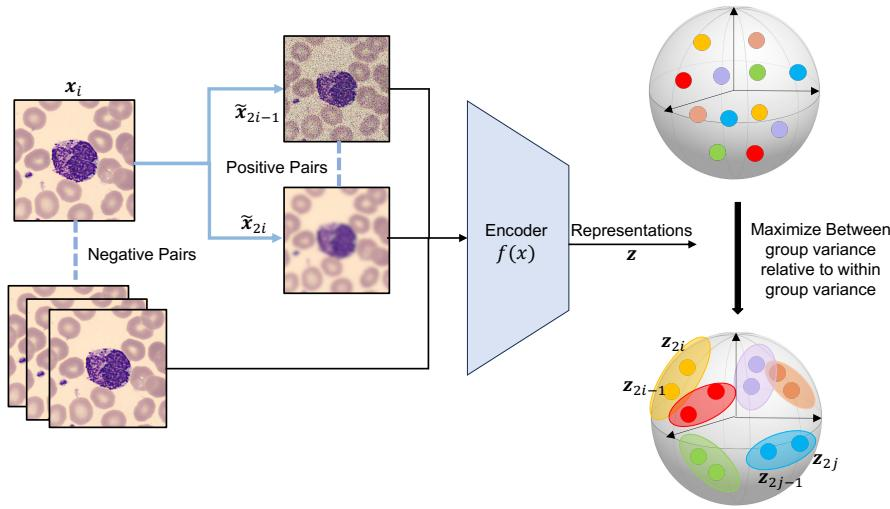
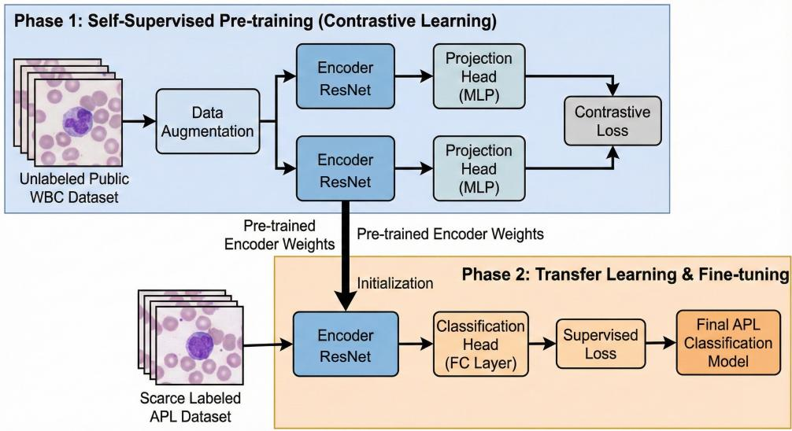
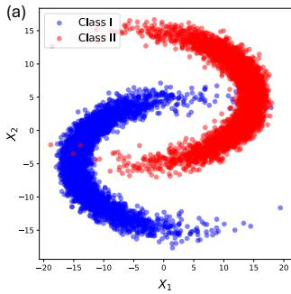
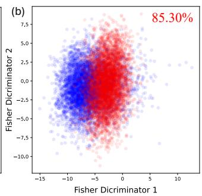
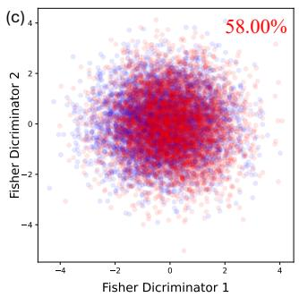

# FISHER CONTRASTIVE LEARNING TO MITIGATE FEATURE SUPPRESSION: A CASE STUDY IN ACUTE PROMYELOCYTIC LEUKEMIA DIAGNOSIS

BY SHUSHAN WU1,2, YONGKAI CHEN3, XILIN GONG1, YUFANG LIU1, WENXUAN ZHONG1,a AND PING MA1,b

1Department of Statistics, University of Georgia, awenxuan@uga.edu; bpingma@uga.edu

2Department of Radiology, University of North Carolina at Chapel Hill

3Department of Statistics, Harvard University

Self-supervised contrastive learning (SSCL) learns representations by contrasting augmented views of the same sample, but it can exhibit feature suppression, where dominant or easy-to-learn factors suppress other classrelevant signals, degrading the performance of representations, particularly in high-dimensional data with heterogeneous features. We introduce Fisher Contrastive Learning (FCL), which uses a regularized Fisher trace criterion to address feature suppression. FCL learns embeddings by maximizing the discriminative strength of Fisher discriminant functions, producing representations that preserve class-relevant information implied by the augmentation process. We prove that the representations learned by FCL could alleviate the feature suppression effects. We demonstrate FCL on simulated benchmarks designed to induce feature suppression and on a real-world biomedical application, pretraining on large white blood cell microscopy image dataset and transfer learning for diagnosis of acute promyelocytic leukemia in an external cohort. In all experiments, FCL outperforms the self-supervised baselines and yields more robust and discriminative representations.

1. Introduction. Accurate diagnosis of hematologic malignancies from peripheral blood smear images is a critical yet challenging task in clinical practice. In particular, acute promyelocytic leukemia (APL) is a rare but life-threatening subtype of acute myeloid leukemia (AML) that requires rapid identification, since delayed treatment can lead to fatal hemorrhagic complications. Microscopy-based APL diagnosis is challenging because APL shares substantial morphological similarity with other leukemias and annotated APL images are scarce. These challenges motivate the development of robust representation learning methods that can leverage large collections of unlabeled white blood cell (WBC) images to improve diagnostic performance on limited labeled APL datasets.

In our study, we use two WBC image resources. The first is a large, public WBC microscopy image dataset (Tsutsui, Pang and Wen, 2023). The second is a much smaller, clinically focused APL dataset (Sidhom et al., 2021), in which each cell inherits the molecular diagnosis of its source patient (APL or other AML). Our goal is to leverage the large WBC dataset for pretraining representations that may be better suited to diagnostic learning with limited labeled patients, and fine-tune the pretrained model on the small APL dataset. This motivates a self-supervised contrastive pretraining stage on WBC images, followed by supervised fine-tuning for APL diagnosis.

Self-supervised learning is a powerful machine learning method in which a model learns from unlabeled data by creating its own labels from the inherent structure of the data. Selfsupervised representation learning includes contrastive and non-contrastive approaches. Selfsupervised contrastive learning (SSCL) (Chen et al., 2020; Robinson et al., 2021a; Kalantidis et al., 2020) brings augmented views of the same sample closer in an embedding space while pushing apart views from different samples. Other approaches learn from augmented views without explicit negative-pair repulsion, including clustering-based methods (Caron et al., 2020) and SimSiam (Chen and He, 2021). By exploiting abundant unlabeled data, selfsupervised learning reduces the dependence on large annotated datasets and helps alleviate the annotation bottleneck.

Contrastive learning has been used across a wide range of settings. It supports multi-modal representation learning and data integration (Huang et al., 2023; Chen et al., 2024), exemplified by Contrastive Language–Image Pre-Training (CLIP) (Radford et al., 2021). It can also learn features that transfer across heterogeneous or shifted distributions, enabling more domain-invariant representations (Hjelm et al., 2019; Kim et al., 2021; Wei and Wang, 2023). In natural language processing and computer vision, SSCL is widely used for pre-training to improve downstream performance with limited labels (Chen et al., 2020; Gao, Yao and Chen, 2021). In biomedical applications, related contrastive objectives have been used for dimension reduction in case–control studies (Abid et al., 2018; Li, Jones and Engelhardt, 2024; Zhang et al., 2025; Hawke, Ma and Li, 2024); this case–control formulation differs from the augmented-instance formulation considered here. Contrastive learning has also been used for unsupervised discovery tasks such as clustering in spatial transcriptomics, where learned cell embeddings can reveal global structure (Guo et al., 2025; Liu et al., 2024; Ren et al., 2022).

1.1. Feature Suppression. Standard SSCL objectives can exhibit feature suppression, in which dominant or easy-to-learn factors limit the recovery of other signals useful for downstream prediction (Chen, Luo and Li, 2021). In conventional SSCL, augmented views are constructed to preserve “content” while perturbing “style,” and the learning objective encourages embeddings of augmented views from the same cell to be close while pushing apart embeddings from different cells.

This feature suppression phenomenon has been documented and analyzed in recent work on contrastive learning. Dominant features (e.g., color or global texture) can overshadow other semantically meaningful factors (e.g., object class or shape) in the learned embedding (Rusak et al., 2022). Easy-to-learn shared features between augmented pairs can suppress more complex or fragile features (Chen, Luo and Li, 2021), and imperfect augmentations that preserve class-irrelevant structure further exacerbate the problem (Xue et al., 2023). Dimensional collapse is a related but distinct problem: learned embeddings occupy a lowerdimensional subspace of the available embedding space (Jing et al., 2022). Feature suppression can also affect multi-attribute tasks, where learning one attribute may obscure information relevant to another (Li et al., 2023). In the WBC transfer-learning setting, the relevant question is whether the pretrained representation supports diagnostic prediction from a small labeled patient cohort.

These concerns motivate the study of pretrained representation geometry for downstream APL classification. With few labeled patients, diagnostic performance may depend on how readily a supervised classifier can use the learned representation. We hypothesize that organizing between-instance variation relative to within-instance augmentation variability makes representations better suited to diagnostic learning in this limited-sample setting.

Approaches addressing feature suppression or the related problem of dimensional collapse include implicit feature modification (Robinson et al., 2021b), changes to embedding dimension or augmentation noise (Xue et al., 2023), and DirectCLR, which applies InfoNCE to a fixed subvector of the representation without a trainable projector (Jing et al., 2022). Existing theory provides feature-retention guarantees under specific data, model, and optimization assumptions. For example, Xue et al. (2023) analyze minimum-norm solutions and a joint supervised–unsupervised contrastive loss. Here we study how the regularized Fisher trace criterion controls linear recovery uniformly over normalized linear combinations in a selected signal space, under the normalization and spectral assumptions stated below.

  
FIG 1. Overview of the Fisher Contrastive Learning framework. An input image is augmented into two views that form a positive pair, while other images in the batch serve as separate negative classes. An encoder projects all views into an embedding space, where FCL reframes the task as an N-class problem and minimize the variance of positive pairs while maximizing variance between different image classes.

1.2. Fisher Contrastive Learning. In this work, we address feature suppression in SSCL by reformulating contrastive learning as a nonlinear dimension reduction problem (Li, 1991; Cook, 1994). For a minibatch of N original images, two augmented views of each image yield 2N samples and define an N-class classification problem, with each original image corresponding to one augmented instance class. FCL then optimizes a Fisher contrastive loss in the embedding space. Specifically, FCL constructs within-class and between-class scatter matrices from the augmented-view embeddings and maximizes a regularized Fisher trace criterion, thereby favoring small within-instance variation and large between-instance separation, as shown in Figure 1. Our analysis identifies the population target of this minibatch criterion, quantifies finite-batch approximation, and distinguishes linear feature accessibility from sufficiency at the level of σ-fields. A central-projection theorem connects the SDR (sufficient dimension reduction) formulation to the original FCL score under an explicit betweensource signal condition.

Our contributions are threefold. First, we introduce a two-view Fisher trace criterion for SSCL, identify its fixed-encoder population limit, and derive finite-batch approximation bounds. We establish a central-projection result under a between-source signal condition and uniform linear-recovery bounds over a selected signal eigenspace under population covariance normalization and spectral separation. Second, a controlled simulation compares class separation and downstream prediction from the FCL and SimCLR representations. Third, we evaluate transfer from self-supervised WBC pretraining to APL diagnosis using patient-level outcomes in a held-out prospective cohort.

We organize the paper as follows. In Section 2, we introduce the white blood cell image datasets for pretraining and a small cell-image dataset from patients with APL for classification. In Section 3, we provide preliminaries of self-supervised learning and formally define feature suppression. In Section 4, we introduce Fisher Contrastive Learning. In Section 5, we evaluate the method in a controlled simulation. We then present the white blood cell application in Section 6. This is followed by conclusions in Section 7, where we discuss the results, limitations, and potential directions for methodological development and applications. The supplement provides proofs of the population and finite-batch results, the SDR analysis, and comparisons with related objectives.

2. White Blood Cell Microscopy Image Datasets for Diagnostic Transfer. We investigate self-supervised contrastive learning (SSCL) for diagnostic transfer to acute promyelocytic leukemia (APL) from peripheral blood smears. Our analysis leverages two complementary white blood cell (WBC) image datasets. The first is a large public WBC dataset that we treat as an unlabeled corpus for SSCL pretraining. The second is a small, clinically curated APL dataset, which serves as the primary application dataset for assessing diagnostic performance. In this section, we describe the imaging data that motivate diagnostic learning with limited labeled patients.

  
FIG 2. Workflow of the proposed two-phase transfer-learning framework for APL diagnosis. Phase 1 uses selfsupervised contrastive learning on a large public WBC dataset to pretrain a ResNet encoder. Phase 2 initializes the encoder with the pretrained weights and fine-tunes it on the smaller labeled APL dataset using a supervised loss.

2.1. Large White Blood Cell Dataset for Pretraining. The pretraining dataset is a comprehensive WBC microscopy image collection from Tsutsui, Pang and Wen (2023). It contains 10,298 single-cell images, with 6,169, 1,030, and 3,099 images in the published training, validation, and test splits, respectively. The five cell types are basophils, eosinophils, lymphocytes, monocytes, and neutrophils.

In our workflow (Figure 2), we use this collection as a pretraining dataset. We apply standard SSCL augmentations such as random cropping, color jittering, and noise, and use a ResNet encoder to map each augmented view into a low-dimensional embedding space.

In our application, the WBC dataset provides a large unlabeled corpus for SSCL pretraining, enabling us to learn transferable WBC representations without relying on exhaustive expert labels. We assess their downstream utility through patient-level APL classification, as summarized in Section 6.

2.2. Small APL Dataset for Classification. Acute promyelocytic leukemia (APL) is a rare but life-threatening subtype of acute myeloid leukemia and is considered an oncologic emergency. If untreated, APL can lead to rapid, fatal hemorrhage, whereas timely recognition enables highly effective targeted therapy with one of the highest cure rates among leukemias (Sidhom et al., 2021). In many settings, particularly where access to molecular testing (e.g., PCR-based assays) is limited or delayed, clinicians rely heavily on peripheral-smear assessment to identify suspected APL cases.

The APL dataset of Sidhom et al. (2021) consists of peripheral-smear images annotated at the cell and patient levels. For each patient, multiple WBCs are imaged, and each patient is labeled as APL or other AML based on expert review and confirmatory molecular testing. The published dataset contains 106 patients: a discovery cohort of 82 patients (22 APL and 60 other AML) for model development and a prospective cohort of 24 patients (12 APL and 12 other AML) for held-out evaluation. The small number of patients, particularly in the APL class, creates high sampling variability and motivates transfer learning.

The challenge of lacking training samples motivates the use of SSCL as a pre-training strategy. Our goal is to leverage the large WBC dataset described in Section 2.1 to learn representations that may be better suited to diagnostic learning with limited labeled patients. We then transfer these representations to the $\displaystyle \mathbf { A P I }$ dataset via a two-phase framework (Figure 2). In Phase 1, we pretrain the encoder on the unlabeled WBC images using SSCL, comparing a standard contrastive baseline (SimCLR) with the proposed Fisher Contrastive Learning. In Phase 2, we initialize the encoder with the pretrained weights, attach a supervised classification head, and fine-tune the model on the discovery cohort to predict APL versus non-APL status at patient level.

The APL dataset provides a clinical testbed for evaluating the usefulness of pretrained representations when diagnostic labels are available for relatively few patients. The prospectivecohort evaluation assesses downstream prediction.

## 3. Preliminaries.

3.1. SimCLR. SimCLR (Chen et al., 2020) is a widely used SSCL method and serves as the principal contrastive baseline in this paper. Suppose that the dataset contains N data points. For each input $\scriptstyle { \mathbf { { \mathit { x } } } } _ { k }$ , two transformations are sampled independently from the augmentation distribution conditional on that source image, yielding views $\tilde { \pmb { x } } _ { 2 k }$ − and $\tilde { \pmb { x } } _ { 2 k }$ . These 2N views form $N$ positive pairs; views derived from different source images are treated as negatives. We use Y to denote the augmented instance label that identifies the source image within the batch. The nonlinear encoder $f : \Omega _ { X } \to \mathbb { R } ^ { d }$ maps an augmented input $\tilde { \pmb { x } } _ { i } \in \mathbb { R } ^ { p }$ to an embedding $z _ { i } = f ( \tilde { \pmb { x } } _ { i } ) \in \mathbb { R } ^ { d }$ . Here $\Omega _ { X }$ denotes the augmented-input space, also written $\mathcal { X }$ below; $p$ and d are the input and embedding dimensions. The goal of SimCLR is to distinguish augmented views of one source image from views of other source images. Let $s _ { i , j } = z _ { i } ^ { \top } z _ { j } / ( \| z _ { i } \| \| z _ { j } \| )$ denote cosine similarity. The NT-Xent ((normalized temperaturescaled cross-entropy)) loss is

$$
\mathcal { L } = \frac { 1 } { 2 N } \sum _ { k = 1 } ^ { N } \left[ \ell ( 2 k - 1 , 2 k ) + \ell ( 2 k , 2 k - 1 ) \right] , \quad \ell ( i , j ) = - \log \frac { \exp { \left( s _ { i , j } / \tau \right) } } { \sum _ { r = 1 } ^ { 2 N } \mathbf { 1 } _ { \left[ r \neq i \right] } \exp { \left( s _ { i , r } / \tau \right) } } ,\tag{1}
$$

where $\tau$ is the temperature controlling the hardness of negative samples. The first term inside $\ell ( i , j )$ rewards alignment of a positive pair, whereas the log-sum-exp term distributes embeddings relative to the other views in the batch (Wang and Isola, 2020; Chen, Luo and Li, 2021).

3.2. Feature suppression in self-supervised contrastive learning. We view a feature as a square-integrable function of an augmented input X. Let $U$ denote its source image, with population augmented-instance label $Y = U$ . A scalar feature $h ( X )$ is source-informative if $U \not \downarrow h ( X ) . { \bf A }$ representation $f ( X )$ is sufficient for this task if $U \perp \perp X \mid f ( X )$

For the SDR interpretation, assume that a smallest sufficient sub-σ-field ${ \mathcal { G } } \subseteq \sigma ( X )$ exists, with $U \perp \perp X \mid { \mathcal G } ,$ , and let ${ \mathcal { C } } = L _ { 0 } ^ { 2 } ( { \mathcal { G } } )$ be its centered square-integrable function class. All $\sigma \mathrm { - }$ fields are interpreted modulo null sets. The class $\mathcal { C }$ can be infinite-dimensional even when $\mathcal { G }$ is generated by finitely many coordinates (Lee, Li and Chiaromonte, 2013). Here $\sigma ( X )$ is the σ-field generated by $X$ , and $P _ { X }$ and $P _ { U }$ denote the marginal laws of $X$ and U. The space $L _ { 0 } ^ { 2 } ( P _ { X } )$ consists of functions $h ( X )$ with $\mathbb { E } k ( X ) = 0$ and $\mathbb { E } \{ h ( X ) ^ { 2 } \} < \infty ; L _ { 0 } ^ { 2 } ( P _ { U } )$ is defined analogously. The subspace $L _ { 0 } ^ { 2 } ( { \mathcal { G } } )$ consists of the ${ \mathcal { G } } .$ -measurable members of $\overset { \triangledown } { \boldsymbol { L } } _ { 0 } ^ { 2 } ( \boldsymbol { P } _ { \boldsymbol { X } } )$ Functions equal almost surely are identified.

For comparisons based on linear readout, fix a finite family of centered, source-informative target functions $h _ { 1 } , \ldots , h _ { q } \in { \mathcal { C } }$ , specified independently of the representation being evaluated. For a square-integrable representation $f _ { \cdot }$ , write

$$
\mathcal { H } ( f ) = \mathrm { s p a n } \{ f _ { 1 } - \mathbb { E } f _ { 1 } , \ldots , f _ { d } - \mathbb { E } f _ { d } \} \subset L _ { 0 } ^ { 2 } ( P _ { X } ) .
$$

This closed, finite-dimensional span describes linear accessibility in the embedding.

DEFINITION 3.1 (Feature suppression relative to a target family). For the specified targets, define the linear-readout errors

$$
e _ { j } ( f ) = \operatorname* { i n f } _ { a \in \mathbb { R } ^ { d } } \mathbb { E } \left[ \{ h _ { j } ( X ) - a ^ { \top } ( f ( X ) - \mathbb { E } f ( X ) ) \} ^ { 2 } \right] .
$$

The representation exhibits feature suppression relative to this family if $e _ { j } ( f ) > 0$ for at least one j, equivalently if at least one $h _ { j } \notin \mathcal { H } ( f )$

Linear accessibility and sufficiency describe different properties of a representation. A target can be measurable with respect to $\sigma ( f )$ while having positive linear-readout error. We write $\sigma ( f ) = \sigma \{ f ( X ) \}$ for the information generated by the representation.

## 4. Fisher Contrastive Learning.

4.1. FCL Formulation and Objective. Feature suppression in SimCLR can degrade the performance of downstream tasks, especially when some features are strong or easy to learn, so that they suppress other discriminant features needed for prediction. We propose Fisher Contrastive Learning to address this issue. FCL combines a contrastive objective with a Fisher discrimination criterion and aims to learn representations that preserve the information needed to distinguish the augmented classes. Our analysis identifies when central projection improves the population FCL score and provides uniform linear-recovery bounds over a selected signal space. The main text states the assumptions and results; the supplement gives the proofs. The population analysis below identifies the target of the two-view trace score in Eq. (10).

Because the contrastive loss in Eq. (1) distinguishes augmented views by their source image, we formulate SSCL as an augmented-instance classification task. The classification labels are defined such that the augmentations from the j-th data point belong to the j-th class. There are $N$ augmented instance classes in a batch containing N original data points and their 2N augmented views. Fisher discriminant analysis identifies directions that separate classes by maximizing between-class variation relative to within-class variation. FCL applies this criterion after a neural-network mapping, allowing nonlinear discriminant functions of the original input (Dorfer, Kelz and Widmer, 2016; Hastie, Buja and Tibshirani, 1995).

In FCL, within-class scatter provides an analogue of positive-pair alignment, whereas between-class scatter measures separation among augmented instance classes. For a minibatch containing N original data points prior to augmentation, let $z _ { i } ^ { ( 1 ) } = f ( \tilde { \mathbf { x } } _ { 2 i - 1 } )$ and $z _ { i } ^ { ( 2 ) } = f ( \tilde { \mathbf { x } } _ { 2 i } )$ denote the two embeddings of the ith augmented instance class, and let $\mu _ { i } = \{ z _ { i } ^ { ( 1 ) } + z _ { i } ^ { ( 2 ) } \} / 2$ . We define the normalized within-class scatter matrix as

$$
\Sigma _ { W } : = \frac { 1 } { 2 N } \sum _ { i = 1 } ^ { N } \sum _ { a = 1 } ^ { 2 } \left( z _ { i } ^ { ( a ) } - \mu _ { i } \right) \left( z _ { i } ^ { ( a ) } - \mu _ { i } \right) ^ { \top } = \frac { 1 } { 4 N } \sum _ { i = 1 } ^ { N } \left( z _ { i } ^ { ( 1 ) } - z _ { i } ^ { ( 2 ) } \right) \left( z _ { i } ^ { ( 1 ) } - z _ { i } ^ { ( 2 ) } \right) ^ { \top } .\tag{2}
$$

The matrix $\Sigma _ { W }$ is $d \times d$ and quantifies the contribution of within-class dispersion to the pooled covariance of the embeddings. Minimizing this scatter component encourages the two augmented views within each class to be close. The normalized between-class scatter matrix measures how much each augmented-instance class mean deviates from the overall mean. It is defined as

$$
\Sigma _ { B } : = \frac { 1 } { N } \sum _ { i = 1 } ^ { N } \left( \pmb { \mu } _ { i } - \pmb { \mu } \right) \left( \pmb { \mu } _ { i } - \pmb { \mu } \right) ^ { \top } ,\tag{3}
$$

where $\begin{array} { r } { \pmb { \mu } = N ^ { - 1 } \sum _ { i = 1 } ^ { N } \pmb { \mu _ { i } } } \end{array}$ is the overall mean embedding. The normalized total scatter matrix of all $2 N$ embeddings is therefore

$$
\begin{array} { c } { { \displaystyle \pmb { \Sigma } _ { T } : = \frac { 1 } { 2 N } \sum _ { i = 1 } ^ { N } \sum _ { a = 1 } ^ { 2 } \left( \pmb { z } _ { i } ^ { ( a ) } - \pmb { \mu } \right) \left( \pmb { z } _ { i } ^ { ( a ) } - \pmb { \mu } \right) ^ { \top } } } \\ { { \displaystyle = \pmb { \Sigma } _ { W } + \pmb { \Sigma } _ { B } . } } \end{array}\tag{4}
$$

The unregularized Fisher score is

$$
\operatorname* { m a x } _ { f } \quad \Delta = \operatorname { t r } \left( \Sigma _ { W } ^ { - 1 } \Sigma _ { B } \right) ,\tag{5}
$$

when $\pmb { \Sigma } _ { W }$ is nonsingular. The score is the sum of the generalized Fisher eigenvalues and increases when between-class separation is large relative to within-class dispersion (Fukunaga, 1990). The trace representation avoids computing the eigenvectors when only their summed eigenvalues are required.

Let $q \leq \mathrm { m i n } \{ d , N - 1 , \mathrm { r a n k } ( \Sigma _ { W } ) \}$ be the number of Fisher directions under consideration and let $\pmb { U } \in \mathbb { R } ^ { d \times q }$ . On a subspace where $\pmb { \Sigma } _ { W }$ is positive definite, the corresponding constrained problem is

$$
\operatorname * { m a x i m i z e } _ { U } \mathrm { t r } \Big ( U ^ { \top } \Sigma _ { B } U \Big ) , \qquad \mathrm { s u b j e c t } \mathrm { t o } U ^ { \top } \Sigma _ { W } U = I _ { q } .\tag{6}
$$

The columns of U define the Fisher discriminant directions. Because the constraint is matrixvalued, its Lagrange multiplier is initially a symmetric matrix $\mathbf { T } = \mathbf { T } ^ { \top }$ . The corresponding Lagrangian is

$$
\begin{array} { r } { \mathcal { L } ( U , { \Gamma } ) = \mathrm { t r } \left( U ^ { \top } \Sigma _ { B } U \right) - \mathrm { t r } \left\{ { \Gamma } \left( U ^ { \top } \Sigma _ { W } U - { I } _ { q } \right) \right\} . } \end{array}\tag{7}
$$

Since $\Sigma _ { B } , \Sigma _ { W }$ , and Γ are symmetric, stationarity with respect to U gives

$$
\Sigma _ { B } { \cal U } = \Sigma _ { W } { \cal U } \Gamma .\tag{8}
$$

Premultiplying by $U ^ { \top }$ and using the constraint yields $\mathbf { \Delta } \Gamma = \pmb { U } ^ { \top } \pmb { \Sigma } _ { B } \pmb { U }$ , which is symmetric. Moreover, the objective and constraint are invariant under the transformation $U \mapsto U Q$ for any orthogonal matrix $Q .$ We may therefore choose $Q$ to diagonalize Γ. With $\widetilde { U } = U Q$ and

$$
\mathbf { \Lambda } \mathbf { \Lambda } \mathbf { \Lambda } = \pmb { Q } ^ { \top } \mathbf { \Gamma } \mathbf { \Gamma } \mathbf { Q } = \mathrm { d i a g } ( \eta _ { 1 } , \ldots , \eta _ { q } ) ,
$$

the stationarity equation becomes

$$
\Sigma _ { B } \widetilde { \cal U } = \Sigma _ { W } \widetilde { \cal U } \Lambda .\tag{9}
$$

This choice of basis makes Λ diagonal. The columns of $\widetilde { U }$ are generalized eigenvectors of the pair $\left( \pmb { \Sigma } _ { B } , \pmb { \Sigma } _ { W } \right)$ , and Λ contains the corresponding generalized eigenvalues. For notational simplicity, we relabel $\widetilde { U }$ as $U$ below.

The columns $\mathbf { \Delta } \mathbf { \em { u } } _ { j }$ of $U$ are linear Fisher directions in the embedding space; their compositions $\mathbf { \boldsymbol { u } } _ { i } ^ { \top } \mathbf { \boldsymbol { f } } ( \cdot )$ are nonlinear discriminant functions of the original input (Chen and Li, 2001).

We estimate $f$ with a neural network optimized by minibatch stochastic gradient descent. Direct differentiation through the generalized eigendecomposition in Eq. (9) can be numerically unstable.

To address this issue, we use a regularized trace criterion. With two views per augmented instance class, rank $\mathbf { \eta } : ( \pmb { \Sigma } _ { W } ) \le \operatorname* { m i n } \{ N , d \}$ , so singularity is structural whenever $d > N$ and may also occur otherwise. We therefore add a ridge term to the normalized within-class scatter matrix (Zhong et al., 2005), $\Sigma _ { B } U = ( \Sigma _ { W } + \lambda _ { \mathrm { { F } } } I _ { d } ) U \Lambda$ , where $\lambda _ { \mathrm { { F } } } > 0$ is a ridge hyperparameter selected by grid search. The empirical loss function is

$$
\mathcal { L } = - \log \mathrm { ~ t r } \left( ( \Sigma _ { W } + \lambda _ { \mathrm { F } } \pmb { I } _ { d } ) ^ { - 1 } \pmb { \Sigma } _ { B } \right) .\tag{10}
$$

We optimize this objective using minibatch stochastic gradient descent.

4.2. Population Target and Finite-Batch Theory. We analyze the population target and finite-batch approximation of the trace criterion in Eq. (10). Let $( U _ { i } , X _ { i } ^ { ( 1 ) } , X _ { i } ^ { ( 2 ) } )$ be independent and identically distributed source–view triples. Conditional on the source $U _ { i }$ , the two augmented views $X _ { i } ^ { ( 1 ) }$ and $X _ { i } ^ { ( 2 ) }$ are independent draws from the same conditional augmentation distribution $P _ { X \mid U = U _ { i } }$ . For a fixed measurable encoder $f : \mathcal { X } \to \mathbb { R } ^ { d }$ , assume $\mathbb { E } \| f ( X ) \| ^ { 2 } < \infty$ , finite $d ,$ and a fixed $\lambda = \lambda _ { \mathrm { { F } } } > 0$ . Define

$$
W _ { f } = \mathbb { E } \{ \operatorname { C o v } ( f ( X ) \mid U ) \} , \qquad B _ { f } = \operatorname { C o v } \{ \mathbb { E } ( f ( X ) \mid U ) \} .
$$

THEOREM 4.1 (Two-view trace limit). For $N \geq 2 ,$ , the empirical scatter matrices defined above satisfy

$$
\mathbb { E } \pmb { \Sigma } _ { W } = W _ { f } / 2 , \qquad \mathbb { E } \pmb { \Sigma } _ { B } = \frac { N - 1 } { N } ( B _ { f } + W _ { f } / 2 ) .\tag{11}
$$

Define the empirical score and its population counterpart by

$$
\begin{array} { r l } & { J _ { N } ( f ) : = \mathrm { t r } \{ ( \Sigma _ { W } + \lambda I _ { d } ) ^ { - 1 } \Sigma _ { B } \} , } \\ & { J ( f ) : = \mathrm { t r } \{ ( W _ { f } / 2 + \lambda I _ { d } ) ^ { - 1 } ( B _ { f } + W _ { f } / 2 ) \} . } \end{array}\tag{12}
$$

Then, for this fixed encoder, $J _ { N } ( f ) \to J ( f )$ almost surely as $N \to \infty$

Theorem 4.1 identifies the population Fisher score approximated by the two-view minibatch criterion. It accounts for within-source variability in both scatter components and supplies the common objective for the subsequent finite-batch, central-projection, and signalrecovery results. Supplement Section 1 gives the proof.

PROPOSITION 4.2 (Finite-batch approximation of the trace loss). Suppose additionally that $\| f ( X ) \| \leq R$ almost surely, and put

$$
K _ { d , R , \lambda } = 3 \sqrt { d } R ^ { 2 } / \lambda + R ^ { 4 } / \lambda ^ { 2 } .
$$

Then

$$
\mathbb { E } | J _ { N } ( f ) - J ( f ) | \le K _ { d , R , \lambda } / \sqrt { N } .
$$

For fixed $\varepsilon > 0 _ { \mathrm { { i } } }$ , define $\mathcal { R } _ { N , \varepsilon } ( f ) = \mathbb { E } [ - \log \{ J _ { N } ( f ) + \varepsilon \} ]$ and $\ell _ { \varepsilon } ( f ) = - \log \{ J ( f ) + \varepsilon \}$ . Over any deterministic encoder class $\mathcal { F }$ with common $R , d , \lambda$

$$
\operatorname* { s u p } _ { f \in \mathcal { F } } | \mathcal { R } _ { N , \varepsilon } ( f ) - \ell _ { \varepsilon } ( f ) | \leq K _ { d , R , \lambda } / ( \varepsilon \sqrt { N } ) .
$$

Here $\eta _ { N } \geq 0$ is the allowed excess of the expected-batch risk above its infimum over ${ \mathcal F } .$ . Any ηN-approximate global minimizer fN of $\cdot _ { \mathcal { R } _ { N , \varepsilon } }$ therefore satisfies

$$
\ell _ { \varepsilon } ( f _ { N } ) - \operatorname* { i n f } _ { f \in { \mathcal { F } } } \ell _ { \varepsilon } ( f ) \leq 2 K _ { d , R , \lambda } / ( \varepsilon \sqrt { N } ) + \eta _ { N } .
$$

Proposition 4.2 controls the expected score approximation error at rate $N ^ { - 1 / 2 }$ and separates finite-batch error from optimization error in the population log-loss bound. On the normalized representation class of Theorem 4.4, this loss gap determines a Fisher-score deficit, connecting minibatch objective approximation to the subsequent uniform signal-recovery bound. Supplement Section 1 gives the proof.

Central projection under SDR. The central $\sigma { \mathrm { - } } \mathrm { f i e l d } \ \mathcal { G }$ is the smallest sufficient σ-field of $X$ for $U { : }$ after conditioning on ${ \mathcal { G } } .$ the remaining variation in $X$ carries no additional information about the source U. Its centered, square-integrable functions form the central function class $\mathcal { C } .$ . The operator $T h = \mathbb { E } ( h \mid U )$ describes the mean of a feature $h$ for each source. We regard $T$ as a map from $L _ { 0 } ^ { 2 } ( P _ { X } )$ to $L _ { 0 } ^ { 2 } ( P _ { U } )$ , with inner product $\langle h , k \rangle = \mathbb { E } ( h k )$ in each space. Its adjoint $T ^ { * }$ satisfies $\langle T h , a \rangle = \langle h , T ^ { * } a \rangle$ and is given by $T ^ { * } a = \mathbb { E } \{ a ( U ) \mid X \}$ . Here ker $T = \{ h : T h = 0 \}$ is the null space, and $\mathcal { C } ^ { \perp }$ consists of functions orthogonal to every member of C. The composition $T ^ { * T }$ applies $T$ first; Ran $( T ^ { * } T ) = \{ T ^ { * } T h : h \in L _ { 0 } ^ { 2 } ( P _ { X } ) \}$ is its range. The overline denotes closure under mean-square convergence in $L ^ { 2 } ( P _ { X } )$ . Completeness means that a central feature whose source-conditional mean is zero must itself be zero: $h \in L _ { 0 } ^ { 2 } ( \mathcal { G } )$ and $\mathbb { E } ( h \mid U ) = 0$ imply $h = 0$ . Under sufficiency and completeness, Supplement Section 1 proves

$$
\ker T = \mathcal C ^ { \perp } , \qquad \overline { { \mathrm { R a n } ( T ^ { * } T ) } } = \mathcal C , \qquad \mathcal C = L _ { 0 } ^ { 2 } ( \mathcal G ) .
$$

These identities characterize the central function class through source-conditional averaging. They connect the SDR formulation to FCL because the between-source matrix $B _ { f } =$ $\operatorname { C o v } \{ \mathbb { E } ( f \mid U ) \}$ summarizes variation in these source-conditional means.

The following theorem connects the SDR projection to the population FCL criterion. It uses sufficiency; completeness enters the preceding operator identification.

THEOREM 4.3 (Central projection and the population FCL criterion). Suppose $\mathcal { G } \subseteq$ $\sigma ( X )$ satisfies $U \perp \perp X \mid { \mathcal G } ,$ , let $f : \mathcal { X } \to \mathbb { R } ^ { d }$ satisfy $\mathbb { E } \| f ( X ) \| ^ { 2 } < \infty$ , and fix $\lambda > 0$ . Define

$$
p = \mathbb { E } ( f \mid { \mathcal { G } } ) , \qquad r = f - p .
$$

Then

$$
\operatorname { \mathbb { E } } ( p \mid U ) = \operatorname { \mathbb { E } } ( f \mid U ) , \qquad B _ { p } = B _ { f } , \qquad W _ { f } = W _ { p } + \operatorname { \mathbb { E } } ( r r ^ { \top } ) .\tag{13}
$$

For the population score in Eq. (12),

$$
B _ { f } \succeq \lambda I _ { d } \quad \Longrightarrow \quad J ( p ) \geq J ( f ) .\tag{14}
$$

The inequality is strict if $B _ { f } - \lambda I _ { d }$ is positive definite and $\mathbb { E } \Vert r \Vert ^ { 2 } > 0$

Theorem 4.3 shows that central projection preserves source-conditional means while reducing noncentral variation. Under the stated signal condition, this improves or preserves the Fisher score, giving the objective an SDR interpretation. Theorem 4.4 then relates score accuracy to linear recovery of selected signals. Supplement Section 1 gives the proof and a quantitative extension.

4.3. Signal Recovery with a Nonlinear Encoder and Linear Head. We next connect the population FCL score to uniform linear recovery over a selected signal space when the encoder and projection head are learned jointly. In this subsection, θ denotes the encoder parameters and $p$ denotes its output dimension. Let $f _ { \theta } : \mathcal { X }  \mathbb { R } ^ { p }$ be a measurable encoder with finite second moments, and write

$$
z _ { \theta , A } ( X ) = A \{ f _ { \theta } ( X ) - \mathbb { E } f _ { \theta } ( X ) \} , \qquad A \in \mathbb { R } ^ { d \times p } , \quad 1 \leq d \leq p .\tag{15}
$$

Both θ and A may vary. Impose the population constraint

$$
\operatorname { C o v } ( z _ { \theta , A } ) = I _ { d } , \quad { \mathrm { e q u i v a l e n t l y } } \quad A \operatorname { C o v } \{ f _ { \theta } ( X ) \} A ^ { \top } = I _ { d } .\tag{16}
$$

The constraint couples the head with the encoder covariance through $A \mathrm { C o v } \{ f _ { \theta } ( X ) \} A ^ { \top } =$ $I _ { d } .$ . Its validity depends on both components of the representation.

Let V be a fixed closed subspace of $L _ { 0 } ^ { 2 } ( P _ { X } )$ containing every candidate output coordinate, with inner product $\langle h , k \rangle = \mathbb { E } ( h k )$ and norm $\| h \| _ { 2 } ^ { 2 } = \bar { \mathbb { E } } ( h ^ { 2 } )$ . One may take $\mathcal { V } = L _ { 0 } ^ { 2 } ( P _ { X } )$ Define

$$
T _ { \mathcal { V } } : \mathcal { V } \to L _ { 0 } ^ { 2 } ( P _ { U } ) , \qquad T _ { \mathcal { V } } h = \mathbb { E } ( h \mid U ) , \qquad \mathcal { K } _ { \mathcal { V } } = T _ { \mathcal { V } } ^ { * } T _ { \mathcal { V } } .\tag{17}
$$

The adjoint is taken for this fixed domain. Explicitly, $\begin{array} { r } { T _ { \mathcal { V } } ^ { * } a = P _ { \mathcal { V } } \mathbb { E } \{ a ( U ) \vert X \} } \end{array}$ , where $P _ { \mathcal { V } }$ is orthogonal projection onto V. The operator $\kappa _ { \nu }$ is a positive self-adjoint contraction determined by the source–view distribution, even as $\theta$ changes.

Assume there are orthonormal functions $\phi _ { 1 } , \dots , \phi _ { d } \in \mathcal { V }$ and constants satisfying

$$
\begin{array} { r } { \mathcal { K } _ { \mathcal { V } } \phi _ { i } = \mu _ { i } \phi _ { i } , \qquad 1 \ge \mu _ { 1 } \ge \cdots \ge \mu _ { d } > \nu \ge 0 . } \end{array}\tag{18}
$$

For $S _ { \star } = \operatorname { s p a n } \{ \phi _ { 1 } , \dots , \phi _ { d } \}$ , write $S _ { \star } ^ { \perp }$ for its orthogonal complement in $L _ { 0 } ^ { 2 } ( P _ { X } )$ and assume

$$
\begin{array} { r } { \langle h , K _ { \mathcal V } h \rangle \leq \nu \| h \| _ { 2 } ^ { 2 } \quad \mathrm { f o r e v e r y } \ h \in \mathcal V \cap S _ { \star } ^ { \perp } , \qquad \gamma = \mu _ { d } - \nu > 0 . } \end{array}\tag{19}
$$

The gap separates the chosen signal space from its orthogonal complement in the fixed ambient space V. Let $\Phi = ( \phi _ { 1 } , \ldots , \phi _ { d } ) ^ { \top }$ . Consider the target class

$$
\mathcal { H } _ { \star } = \bigcup _ { q = 1 } ^ { \infty } \left\{ C \Phi : C \in \mathbb { R } ^ { q \times d } , \| C \| _ { \mathrm { o p } } \leq 1 \right\} .\tag{20}
$$

Here d is the dimension of the selected signal space and the final representation, $q$ is the finite number of target coordinates, and each row of C specifies a linear combination of the eigenfeatures. The operator-norm constraint controls the target scale. The signal space and target class are fixed independently of the representation being evaluated.

Let $3$ be a nonempty class of outputs (15) satisfying the normalization and V-membership conditions. Use the original population score

$$
J ( z ) = \mathrm { t r } \big \{ ( W _ { z } / 2 + \lambda I _ { d } ) ^ { - 1 } ( B _ { z } + W _ { z } / 2 ) \big \} , \qquad \lambda > 0 ,\tag{21}
$$

with the same between-source and within-source covariances as above. Define

$$
g _ { \lambda } ( t ) = { \frac { 1 + t } { 1 + 2 \lambda - t } } , \qquad m _ { \lambda } = { \frac { 2 ( 1 + \lambda ) } { ( 1 + 2 \lambda ) ^ { 2 } } } , \qquad J _ { \mathcal { V } } ^ { \star } = \sum _ { i = 1 } ^ { d } g _ { \lambda } ( \mu _ { i } ) ,\tag{22}
$$

and the class optimum, approximation deficit, and optimization deficit

$$
J _ { 3 } ^ { \star } = \operatorname* { s u p } _ { v \in 3 } J ( v ) ,\tag{23}
$$

$$
a _ { 3 } = J _ { \mathcal { V } } ^ { \star } - J _ { 3 } ^ { \star } , \qquad \eta ( z ) = J _ { 3 } ^ { \star } - J ( z ) .
$$

For $\boldsymbol { h } \in \mathcal { H } ,$ ⋆ with q coordinates, define the target errors from the head and encoder by

$$
\mathcal { E } _ { \pmb { h } } ( z ) = \operatorname* { i n f } _ { D \in \mathbb { R } ^ { q \times d } } \mathbb { E } \| \pmb { h } - D z \| _ { 2 } ^ { 2 } ,\tag{24}
$$

$$
\mathcal { E } _ { h } ( f _ { \theta } ) = \operatorname* { i n f } _ { B \in \mathbb { R } ^ { q \times p } } \mathbb { E } \| h - B \{ f _ { \theta } - \mathbb { E } f _ { \theta } \} \| _ { 2 } ^ { 2 } .
$$

Write $L ( z ) = \mathcal { E } _ { \Phi } ( z )$ for the total squared error in recovering the d eigenfeatures.

THEOREM 4.4 (Uniform signal recovery under joint optimization). Under $( 1 6 ) – ( 1 9 )$ and the class and target conditions above, $J _ { \nu } ^ { \star }$ is the maximum score over all orthonormal d-tuples in V. For every admissible pair $( \theta , A )$ , the deficits in (23) are nonnegative and

$$
\operatorname* { s u p } _ { \boldsymbol { h } \in \mathcal { H } _ { \star } } \mathcal { E } _ { \boldsymbol { h } } ( \boldsymbol { f } _ { \boldsymbol { \theta } } ) \leq \operatorname* { s u p } _ { \boldsymbol { h } \in \mathcal { H } _ { \star } } \mathcal { E } _ { \boldsymbol { h } } ( \boldsymbol { z } _ { \boldsymbol { \theta } , A } ) = L ( \boldsymbol { z } _ { \boldsymbol { \theta } , A } )\tag{25}
$$

$$
\leq \operatorname* { m i n } \left\{ d , { \frac { a _ { 3 } + \eta ( z _ { \theta , A } ) } { m _ { \lambda } \gamma } } \right\} .
$$

If some admissible pair realizes $z = Q \Phi$ for an orthogonal $d \times d$ matrix $Q ,$ then $a _ { 3 } = 0 ,$ the class maximum is attained, and every joint global maximizer has this form. Every such maximizer therefore permits simultaneous exact linear recovery of every $h \in { \mathcal { H } }$ ⋆ from both its projected representation and its encoder output.

Theorem 4.4 converts architecture and optimization deficits into a uniform linear-recovery bound over $\mathcal { H } _ { \star }$ , with sensitivity determined by the spectral gap. The bound applies to both encoder and projected representations. Under the stated conditions, a realizable global optimum recovers every target exactly, while approximate solutions have controlled recovery error. Supplement Section 5 gives the proof.

4.4. Computational Cost. For a minibatch containing N original samples, the two augmented views yield 2N embeddings in $\mathbb { R } ^ { d }$ . Excluding the encoder computation shared by both methods, forming the FCL scatter matrices requires $O ( N d ^ { 2 } )$ operations. Let $C \in \mathbb { R } ^ { N \times \mathbf { \bar { d } } }$ have row i equal to $( \bar { \pmb { \mu } } _ { i } - \pmb { \mu } ) ^ { \top } / \sqrt { N }$ , so that $\pmb { \Sigma } _ { B } \bar { = } \pmb { C } ^ { \top } \pmb { C }$ , and write $\pmb { \Sigma } _ { W } + \lambda _ { \mathrm { { F } } } \pmb { I } _ { d } = \pmb { L } \pmb { L } ^ { \top }$ where L is a Cholesky factor. The trace in Eq. (10) equals $\| \pmb { L } ^ { - 1 } \pmb { C } ^ { \top } \| _ { F } ^ { 2 }$ . This computation uses a triangular solve and requires $O ( N d ^ { 2 } + \bar { d } ^ { 3 } )$ time and $O ( N d + d ^ { 2 } )$ auxiliary memory per minibatch. A standard dense SimCLR implementation forms pairwise similarities among the 2N views, requiring $O ( N ^ { 2 } d )$ time and $O ( N d + N ^ { 2 } )$ auxiliary memory, with constants associated with the two views suppressed. FCL can be cheaper when $N \gg d ;$ the direct $d \times d$ factorization can dominate when $d \gg N$ . When $d = \Theta ( N )$ , the losses have the same asymptotic time and memory orders. In the $d \gg N$ regime, the low-rank scatter structure also permits FCL evaluation in $\dot { O } ( d N ^ { 2 } + N ^ { 3 } )$ time and $\bar { O ( N d + N ^ { 2 } ) }$ memory. These rates apply to the trace loss in Eq. (10); end-to-end cost also includes encoder passes, implementation, hardware, and distributed communication.

## 5. Simulated Experiments.

5.1. Gaussian Distribution with Feature Suppression. Our first study adapts a classification task introduced by Meng et al. (2020) to the SSCL setting. We compare the class separation and downstream classification accuracy of representations learned by FCL and SimCLR in a controlled setting where additional noise coordinates may hinder representation learning.

We generate two classes forming C-shaped curves in the first two coordinates of $\mathbb { R } ^ { 1 8 }$ and add 16 independent Gaussian noise coordinates. For each class, we generate 5,000 observations with the first two coordinates defined by

$$
\mathrm { C l a s s \ 1 } \colon \quad X _ { 1 } = 2 0 \cos ( \theta ) + Z _ { 1 } + 5 , \quad X _ { 2 } = 1 0 \sin ( \theta ) + Z _ { 2 } - 5 ,
$$

$$
\mathrm { C l a s s } 2 \colon \quad X _ { 1 } = - 2 0 \cos ( \theta ) - Z _ { 1 } - 5 , \quad X _ { 2 } = 1 0 \sin ( \theta ) + Z _ { 2 } + 5 ,
$$

where $Z _ { 1 } , Z _ { 2 } \sim N ( 0 , 1 )$ and $\theta \sim N \big ( \pi , ( 0 . 2 5 \pi ) ^ { 2 } \big )$ are mutually independent. The remaining coordinates $X _ { 3 } , \ldots , X _ { 1 8 }$ are independently generated from $N ( 0 , 5 )$ , independently of $( X _ { 1 } , X _ { 2 } )$ , with the same distribution in both classes. Panel (a) of Figure 3 displays the 10,000 observations in the first two coordinates.

We train a single-hidden-layer encoder under the SSCL framework. Data augmentation is implemented by adding Gaussian noise $N ( 0 , 1 )$ to each input, which generates positive pairs for contrastive learning. The embedding dimension is fixed at $d = 1 0$ . We compare the standard SimCLR objective with the proposed FCL objective, using the same encoder architecture and training settings. After pretraining, we use the learned embeddings to fit a k-nearest neighbor classifier $( k = 5 )$ and evaluate downstream classification accuracy.

The results for the reported run are summarized in Figure 3. Panels (b) and (c) show the learned embedding spaces after linear transformation by Fisher discriminant directions. Using the representation learned by FCL, a k-nearest neighbor classifier achieves an accuracy of 85.30%. In contrast, SimCLR yields an accuracy of 58.00%, which is close to random guessing in this two-class setting. In panel (c), the SimCLR representation shows little separation of the two classes after the Fisher projection. Together with the lower k-nearest-neighbor accuracy, this pattern is consistent with suppression of the informative $( X _ { 1 } , X _ { 2 } )$ structure.

The FCL representation in panel (b) provides clearer class separation after the Fisher projection and yields higher downstream accuracy in the reported run.

  
FIG 3. Controlled feature-suppression simulation. (a) The two informative input coordinates. $( b , c )$ Fisher projections of the embeddings learned by FCL and SimCLR, respectively. A 5-nearest-neighbor classifier fitted to the reported FCL and SimCLR embeddings achieves accuracies of85.30% and 58.00%, respectively.

6. Application to Acute Promyelocytic Leukemia Diagnosis. Acute promyelocytic leukemia (APL) is a rare but treatable subtype of acute myeloid leukemia (AML) and constitutes a hematologic emergency: delays in diagnosis can lead to rapid, fatal bleeding, whereas early recognition followed by targeted therapy yields an excellent prognosis (Sidhom et al.,

TABLE 1  
Point estimates of accuracy for cell-type classification using pretrained representations.
<table><tr><td>Task</td><td>SimCLR</td><td>FCL</td><td>VICReg</td><td>SimSiam</td><td>BYOL</td><td>DINO</td></tr><tr><td>Cell Type</td><td>98.45%</td><td>99.42%</td><td>97.87%</td><td>98.64%</td><td>98.64%</td><td>98.84%</td></tr></table>

2021). In many clinical settings, particularly where access to molecular testing (e.g., PCR) is limited, peripheral blood smear morphology is used to triage suspected APL cases. The application studied here distinguishes patients with APL from patients with other AML subtypes in a small single-center dataset.

We pretrain WBC representations with FCL on the large public dataset described in Section 2.1. We then transfer these representations to the smaller APL dataset through the twophase framework in Figure 2.

Phase 1 performs self-supervised representation learning on the large WBC dataset, with a ResNet encoder serving as f(·). The model is trained using image augmentations without manual supervision. We compare FCL with SimCLR, VICReg (Bardes, Ponce and LeCun, 2022), SimSiam (Chen and He, 2021), BYOL (Grill et al., 2020), and DINO (Caron et al., 2021). Table 1 reports cell-type classification accuracy using the pretrained representations.

Phase 2 initializes the encoder with weights from Phase 1 and adds a supervised classification head for cells sampled from patients with APL or other AML subtypes. The discovery cohort contains 82 patients (22 APL and 60 other AML), and the held-out prospective cohort contains 24 patients (12 APL and 12 other AML). We fine-tune the pretrained model on the discovery cohort and evaluate it on the prospective cohort. Patients define the cohort split, and each cell inherits its source patient’s molecular diagnosis.

For evaluation, the model produces an APL probability for each available cell. We average these probabilities within each patient, classify the patient using the resulting mean probability, and calculate accuracy, AUROC, and AUPRC across the 24 patients in the prospective cohort.

FCL achieves the highest point estimates of all three metrics among the compared methods (Table 2), which include MLP as a benchmark.

FCL organizes the representation by comparing between-instance variation with augmentationinduced within-instance variation. We hypothesize that this geometry makes task-relevant information more accessible to a supervised classifier trained with limited patient-level labels.

The patient-level point estimates provide preliminary evidence for the utility of FCL representations in diagnostic transfer. Our proposed method motivates further evaluation across various settings outside the WBC microscopic images.

TABLE 2  
Patient-level point estimates for classification of APL versus other AML in the prospective cohort (n = 24: 12 APL and 12 other AML).
<table><tr><td></td><td>Accuracy</td><td>AUROC</td><td>AUPRC</td></tr><tr><td>MLP</td><td>0.5833</td><td>0.7014</td><td>0.7494</td></tr><tr><td>SimCLR</td><td>0.6667</td><td>0.7153</td><td>0.7263</td></tr><tr><td>FCL</td><td>0.7500</td><td>0.8264</td><td>0.8405</td></tr><tr><td>VICReg</td><td>0.7083</td><td>0.7986</td><td>0.8332</td></tr><tr><td>SimSiam</td><td>0.6667</td><td>0.7014</td><td>0.7260</td></tr><tr><td>BYOL</td><td>0.6667</td><td>0.7292</td><td>0.7445</td></tr><tr><td>DINO</td><td>0.6667</td><td>0.7222</td><td>0.6654</td></tr></table>

7. Conclusions. We investigated feature suppression in self-supervised contrastive learning (SSCL) and its impact on automated diagnosis of acute promyelocytic leukemia from white blood cell images. For the two-view Fisher trace criterion, we proved fixedencoder population limits and finite-batch approximation bounds. Under the stated SDR assumptions, completeness identifies the closure of a conditional-expectation operator range. A main-text theorem shows that central projection improves the original population FCL score under an explicit between-source signal condition. For nonlinear encoders with linear heads and covariance-normalized outputs, we bound the linear-recovery error uniformly over normalized linear combinations in a selected leading eigenspace. The bound separates architectural approximation and population optimization deficits and depends on the spectral gap separating that space from the remaining directions.

In the Gaussian simulation with known signal and noise structure, the reported FCL embeddings showed clearer class separation and higher downstream accuracy than SimCLR.

Our APL case study used self-supervised pretraining on a large WBC corpus followed by supervised fine-tuning on the labeled discovery cohort. FCL achieved the highest point estimates of accuracy, AUROC, and AUPRC among the compared methods on the prospective cohort. These results provide preliminary evidence for the utility of FCL representations in diagnostic learning with limited labeled patients.

The proposed framework connects SSCL to nonlinear dimension reduction. Future work includes extending FCL to other data modalities and architectures, and developing uncertainty quantification and model assessment tools for downstream tasks based on FCL representations.

Acknowledgments. Correspondence: Ping Ma (pingma@uga.edu) and Wenxuan Zhong (wenxuan@uga.edu).

## SUPPLEMENTARY MATERIAL

## Supplement to “Fisher Contrastive Learning to Mitigate Feature Suppression: A Case Study in Acute Promyelocytic Leukemia Diagnosis”

The supplement contains proofs of the two-view trace limit, finite-batch approximation bounds, completeness and central-projection results, and uniform recovery bounds for nonlinear encoders with linear heads. It also provides implementation details and analytical comparisons of FCL with VICReg and Fisher-style discriminative objectives.

Supplementary material. This supplement gives population limits and finite-batch bounds for the two-view Fisher trace criterion and proves the completeness and centralprojection results under explicit sufficient-dimension-reduction assumptions. It also provides implementation details and analytical comparisons with VICReg and prior Fisher-style discriminative objectives. Section 5 establishes uniform recovery guarantees over normalized linear combinations in a selected signal space for jointly optimized nonlinear encoders and linear projection heads, with complete proofs, approximation bounds, and examples under explicit population normalization and spectral assumptions.

1. Theory for the Two-View Fisher Trace Criterion. This section establishes fixedencoder population limits and finite-batch bounds for the regularized trace score under the two-view sampling model. It then introduces the central σ-field and derives conditionalexpectation and projection results under the stated SDR assumptions.

## 1.1. Sampling model and population target.

ASSUMPTION S1.1 (Two-view sampling). The source–view triples $( U _ { i } , X _ { i } ^ { ( 1 ) } , X _ { i } ^ { ( 2 ) } )$ $i \geq 1$ , are independent and identically distributed. Conditional on $U _ { i }$ , the two views are independent draws from the same conditional augmentation distribution $P _ { X | U _ { i } }$ . The source and view spaces are standard Borel spaces. The measurable encoder $f : \mathcal { X } \to \mathbb { R } ^ { d }$ is fixed independently of these triples, $d < \infty , \mathbb { E } \| f ( X ) \| ^ { 2 } < \infty$ , and the ridge parameter $\lambda > 0$ is fixed.

Let U denote the population source variable and write $Z = f ( X )$ . Define

$$
W _ { f } = \operatorname { \mathbb { E } } \{ \operatorname { C o v } ( Z \mid U ) \} , \qquad B _ { f } = \operatorname { C o v } \{ \operatorname { \mathbb { E } } ( Z \mid U ) \} , \qquad H _ { f } = W _ { f } / 2 , \qquad C _ { f } = B _ { f } + H _ { f } .\tag{S1}
$$

For $Z _ { i } ^ { ( a ) } = f ( X _ { i } ^ { ( a ) } )$ , let

$$
M _ { i } = ( Z _ { i } ^ { ( 1 ) } + Z _ { i } ^ { ( 2 ) } ) / 2 , \quad D _ { i } = ( Z _ { i } ^ { ( 1 ) } - Z _ { i } ^ { ( 2 ) } ) / 2 , \quad \bar { M } _ { N } = N ^ { - 1 } \sum _ { i = 1 } ^ { N } M _ { i } .
$$

The main-text scatter matrices are exactly

$$
H _ { N } = N ^ { - 1 } \sum _ { i = 1 } ^ { N } D _ { i } D _ { i } ^ { \top } = \Sigma _ { W } , \qquad S _ { N } = N ^ { - 1 } \sum _ { i = 1 } ^ { N } M _ { i } M _ { i } ^ { \top } - \bar { M } _ { N } \bar { M } _ { N } ^ { \top } = \Sigma _ { B } .\tag{S2}
$$

The empirical and population scores are

$$
J _ { N } ( f ) = \mathrm { t r } \{ ( H _ { N } + \lambda I _ { d } ) ^ { - 1 } S _ { N } \} ,\tag{S3}
$$

$$
J ( f ) = \mathrm { t r } \{ ( H _ { f } + \lambda I _ { d } ) ^ { - 1 } C _ { f } \} .
$$

The empirical score is the quantity inside the main-text logarithmic loss.

THEOREM S1.2 (Two-view moments and score limit). Under Assumption $S l . l ,$

$$
\mathbb { E } H _ { N } = H _ { f } , \qquad \mathbb { E } S _ { N } = \frac { N - 1 } { N } C _ { f } .
$$

As $N \to \infty$ , almost surely,

$$
H _ { N } \to H _ { f } , \qquad S _ { N } \to C _ { f } , \qquad J _ { N } ( f ) \to J ( f ) .
$$

For every sample, the scores satisfy the deterministic bound

$$
| J _ { N } - J | \leq \lambda ^ { - 1 } \| S _ { N } - C _ { f } \| _ { * } + \lambda ^ { - 2 } \mathrm { t r } ( C _ { f } ) \| H _ { N } - H _ { f } \| _ { \mathrm { o p } } .\tag{S4}
$$

Here $\| \cdot \| .$ ∗ and $\| \cdot \| _ { \mathrm { o p } }$ denote nuclear and operator norms.

PROOF. Conditional independence gives $\mathbb { E } ( D _ { i } D _ { i } ^ { \top } \mid U _ { i } ) = \operatorname { C o v } ( Z \mid U _ { i } ) / 2$ and $\operatorname { C o v } ( M _ { i } \mid$ $U _ { i } ) = \mathrm { C o v } ( Z \mid U _ { i } ) / 2$ . Also, $\mathbb { E } ( M _ { i } \mid U _ { i } ) = \mathbb { E } ( Z \mid U _ { i } )$ , so the law of total covariance gives $\mathrm { C o v } ( M _ { i } ) = C _ { f }$ . The expectation of the covariance with divisor N is $( N - 1 ) C _ { f } / N$ , proving both moment identities.

The second-moment assumption makes every entry of $D _ { i } D _ { i } ^ { \top }$ and $M _ { i } M _ { i } ^ { \top }$ integrable. The strong law applied to these entries and to $M _ { i }$ therefore gives the two matrix limits. All eigenvalues of $H _ { N } + \lambda I _ { d }$ are at least $\lambda ;$ inversion is continuous on this set, giving the score limit.

For the perturbation bound, put $A _ { N } = H _ { N } + \lambda I _ { d }$ and $A = H _ { f } + \lambda I _ { d }$ . Then

$$
\mathrm { t r } ( { \cal A } _ { N } ^ { - 1 } S _ { N } - { \cal A } ^ { - 1 } C _ { f } ) = \mathrm { t r } \{ { \cal A } _ { N } ^ { - 1 } ( S _ { N } - C _ { f } ) \} + \mathrm { t r } \{ ( { \cal A } _ { N } ^ { - 1 } - { \cal A } ^ { - 1 } ) C _ { f } \} .
$$

Trace duality bounds the first term by $\lambda ^ { - 1 } \| S _ { N } - C _ { f } \| _ { * }$ . The identity $A _ { N } ^ { - 1 } - A ^ { - 1 } = A _ { N } ^ { - 1 } ( A -$ $A _ { N } ) A ^ { - 1 }$ and $C _ { f } \succeq 0$ bound the second by $\lambda ^ { - 2 } \| \dot { H _ { N } } - H _ { f } \| _ { \mathrm { o p } } \mathrm { t r } ( C _ { f } )$ □

## 1.2. Finite-batch score and expected-loss control.

PROPOSITION S1.3 (Finite-batch approximation). In addition to Assumption S1.1, suppose $\| f ( X ) \| \leq R$ almost surely. Define

$$
K _ { d , R , \lambda } = \frac { 3 \sqrt { d } R ^ { 2 } } { \lambda } + \frac { R ^ { 4 } } { \lambda ^ { 2 } } .
$$

Then

$$
\mathbb { E } | J _ { N } ( f ) - J ( f ) | \leq \frac { K _ { d , R , \lambda } } { \sqrt { N } } .\tag{S5}
$$

For any fixed $\varepsilon > 0 ,$ , let

$$
\ell _ { N , \varepsilon } ( f ) = - \log \{ J _ { N } ( f ) + \varepsilon \} , \qquad \ell _ { \varepsilon } ( f ) = - \log \{ J ( f ) + \varepsilon \} , \qquad \mathcal { R } _ { N , \varepsilon } ( f ) = \mathbb { E } \ell _ { N , \varepsilon } ( f ) .
$$

If every encoder in a deterministic class F satisfies the same bound R, with common d and $\lambda ,$ then

$$
\operatorname* { s u p } _ { f \in \mathcal { F } } | \mathcal { R } _ { N , \varepsilon } ( f ) - \ell _ { \varepsilon } ( f ) | \leq \frac { K _ { d , R , \lambda } } { \varepsilon \sqrt { N } } .\tag{S6}
$$

Consequently, any ηN-approximate global minimizer $f _ { N } \in \mathcal { F }$ of the expected batch loss, meaning $\begin{array} { r } { \mathcal { R } _ { N , \varepsilon } ( f _ { N } ) \leq \operatorname* { i n f } _ { f \in \mathcal { F } } \mathcal { R } _ { N , \varepsilon } ( f ) + \eta _ { N } } \end{array}$ , satisfies

$$
\ell _ { \varepsilon } ( f _ { N } ) - \operatorname* { i n f } _ { f \in \mathcal { F } } \ell _ { \varepsilon } ( f ) \leq \frac { 2 K _ { d , R , \lambda } } { \varepsilon \sqrt { N } } + \eta _ { N } .\tag{S7}
$$

PROOF. Set $m = \mathbb { E } M _ { i } , Q = \mathbb { E } ( M _ { i } M _ { i } ^ { \top } )$ , and $\begin{array} { r } { Q _ { N } = N ^ { - 1 } \sum _ { i } M _ { i } M _ { i } ^ { \top } } \end{array}$ . Since $\| M _ { i } \| , \| D _ { i } \| \leq$ $R ,$ the variance identity for independent Hilbert-space averages and Jensen’s inequality give

$$
\mathbb { E } \| H _ { N } - H _ { f } \| _ { F } \le R ^ { 2 } / \sqrt { N } , \qquad \mathbb { E } \| Q _ { N } - Q \| _ { F } \le R ^ { 2 } / \sqrt { N } , \qquad \mathbb { E } \| \bar { M } _ { N } - m \| \le R / \sqrt { N } .
$$

For vectors $a , b , \| a a ^ { \top } - b b ^ { \top } \| _ { F } \leq ( \| a \| + \| b \| ) \| a - b \|$ . Therefore $\mathbb { E } \Vert S _ { N } - C _ { f } \Vert _ { F } \leq 3 R ^ { 2 } / \sqrt { N }$ Also tr $( C _ { f } ) = \mathbb { E } \| M _ { i } - m \| ^ { 2 } \leq R ^ { 2 }$ . Apply (S4), $\| A \| _ { * } \leq \sqrt { d } \| A \| _ { F }$ , and $\| A \| _ { \mathrm { o p } } \leq \| A \| _ { F }$ to obtain (S5).

Both raw scores are nonnegative, and $t \mapsto - \log ( t + \varepsilon )$ is 1/ε-Lipschitz on $[ 0 , \infty )$ . This gives (S6) with the same bound for every f. Writing $a _ { N } = K _ { d , R , \lambda } / ( \varepsilon \sqrt { N } )$

$$
\ell _ { \varepsilon } ( f _ { N } ) \leq \mathcal { R } _ { N , \varepsilon } ( f _ { N } ) + a _ { N } \leq \operatorname* { i n f } _ { f \in \mathcal { F } } \mathcal { R } _ { N , \varepsilon } ( f ) + \eta _ { N } + a _ { N } \leq \operatorname* { i n f } _ { f \in \mathcal { F } } \ell _ { \varepsilon } ( f ) + \eta _ { N } + 2 a _ { N } ,
$$

which proves (S7) without requiring the infimum to be attained.

Equation (S6) compares deterministic expected-batch risks, with the supremum outside the expectation. Under independent fresh-batch sampling, $\mathcal { R } _ { N , \varepsilon }$ averages the logarithmic loss over batches. The model treats each encoder as a fixed map applied separately to every view and assumes a common output bound and fixed ridge. Application to fitted networks also involves sample reuse, batch-dependent transformations, and optimization error.

For the unfloored loss in the main text, $J ( f ) > 0$ gives almost-sure convergence of $- \log J _ { N } ( f )$ on the eventually positive scores. Expected-loss control additionally requires control near zero. For example, if both scores are at least $a > 0$ almost surely for every encoder under consideration, the bound in (S6) applies to the unfloored loss with a in place of ε. A zero-score batch with positive probability makes the expected unfloored loss infinite even when the population score is positive.

1.3. Central $\sigma { - } \hbar e l d s$ and completeness. SDR expresses source sufficiency as $U \perp \perp K \mid \mathcal { G }$ (Li, 1991; Cook and Li, 2002; Li, 2018; Lee, Li and Chiaromonte, 2013). All σ-fields and equalities of random variables below are understood modulo P-null sets. Write $L _ { 0 } ^ { 2 } ( P _ { X } )$ for centered square-integrable functions of $X$

ASSUMPTION S1.4 (Central σ-field). There exists a smallest sub-σ-field ${ \mathcal { G } } \subseteq \sigma ( X )$ for which $U \perp \perp K \mid \mathcal { G }$ . Define the central function class

$$
\mathcal { C } = L _ { 0 } ^ { 2 } ( \mathcal { G } ) \subseteq L _ { 0 } ^ { 2 } ( P _ { X } ) .
$$

For results explicitly invoking completeness, assume that

$$
h \in { \mathcal { C } } , \quad \mathbb { E } ( h \mid U ) = 0 \quad \Longrightarrow \quad h = 0 { \mathrm { ~ a l m o s t ~ s u r e l y } } .
$$

Existence of the smallest sufficient σ-field is an assumption here; dominated-family conditions yielding its existence are given by Lee, Li and Chiaromonte (2013). The class $\mathcal { C }$ contains all centered square-integrable G-measurable functions, including nonlinear functions of any generating coordinates. It can therefore be infinite-dimensional even when ${ \mathcal { G } } = \sigma \{ g _ { 1 } ( X ) , \ldots , g _ { r } ( X ) \}$ for finitely many coordinates. Finite-dimensional $L _ { 0 } ^ { 2 } ( { \mathcal { G } } )$ restricts ${ \mathcal { G } } ,$ , modulo null sets, to finitely many atoms.

Define the bounded conditional-expectation operator

$$
T : L _ { 0 } ^ { 2 } ( P _ { X } ) \to L _ { 0 } ^ { 2 } ( P _ { U } ) , \qquad T h = \mathbb { E } ( h \mid U ) ,
$$

and the orthogonal projection $P _ { \mathcal { G } } h = \mathbb { E } ( h \mid \mathcal { G } )$ . Its adjoint is $T ^ { * } a = \mathbb { E } \{ a ( U ) \mid X \}$

PROPOSITION S1.5 (What completeness identifies). Under Assumption S1.4 including completeness,

$$
\ker T = \mathcal C ^ { \perp } , \qquad \overline { { \mathrm { R a n } T ^ { * } } } = \overline { { \mathrm { R a n } ( T ^ { * } T ) } } = \mathcal C .\tag{S8}
$$

The closures and orthogonal complement are taken in $L _ { 0 } ^ { 2 } ( P _ { X } )$

PROOF. Conditional independence gives $\mathbb { E } ( h \mid U , \mathcal { G } ) = \mathbb { E } ( h \mid \mathcal { G } )$ , hence $T = T P _ { \mathcal { G } }$ . Thus $\mathcal { C } ^ { \bot } =$ ker $P _ { \mathcal { G } } \subseteq$ ker T. If $T h = 0$ , then $T ( P \mathcal { G } h ) = 0$ . Since $P _ { \mathcal { G } } h \in \mathcal { C } ,$ , completeness implies $P _ { \mathcal { G } } h = 0$ , proving the reverse inclusion. The Hilbert-space identities Ran $\hat { T ^ { * } } = ( \ker T ) ^ { \perp }$ and $\overline { { \mathrm { R a n } ( T ^ { * } T ) } } = ( \ker ( T ^ { * } T ) ) ^ { \perp }$ , together with ker $( T ^ { * } T ) = \ker T$ , prove (S8). □

Building on the completeness-based SDR characterization in Lee, Li and Chiaromonte (2013), Proposition S1.5 identifies the central function class through the closure of a conditional-expectation operator range. Completeness yields the kernel equality. If U has K possible values, injectivity of $T$ on $\mathcal { C }$ gives dim ${ \mathcal { C } } \leq K - 1$ , since $T$ maps into $L _ { 0 } ^ { 2 } ( P _ { U } )$ Full-class completeness is thus a substantive condition in finite-source models. Theorem S1.2 and Proposition S1.3 use the sampling and moment assumptions stated for those results.

1.4. Projection property and its limits. For a square-integrable vector encoder, write $p ( X ) = \mathbb { E } \{ f ( X ) \mid { \mathcal { G } } \} , r = f - p .$ and $V _ { r } = \mathbb { E } ( r r ^ { \top } )$ . The following theorem concerns the original population score in (S3).

THEOREM S1.6 (Central projection of the original trace score). Fix $\lambda > 0 .$ . Under the sufficiency part ofAssumption $S I . 4 ,$ without requiring completeness,

$$
B _ { f } = B _ { p } , \qquad W _ { f } = W _ { p } + V _ { r } .\tag{S9}
$$

Consequently,

$$
B _ { f } \succeq \lambda I _ { d } \quad \Longrightarrow \quad J ( p ) \geq J ( f ) .
$$

The inequality is strict if $B _ { f } - \lambda I _ { d }$ is positive definite and $V _ { r } \neq 0 .$

If additionally $\| f ( X ) \| \leq R$ and $B _ { f } \succeq ( \lambda + b ) I _ { d }$ for some $b > 0$ , then

$$
J ( p ) - J ( f ) \geq \frac { b \mathbb { E } \| r \| ^ { 2 } } { 2 ( \lambda + R ^ { 2 } / 2 ) ^ { 2 } } .\tag{S10}
$$

Under these additional conditions, ifan admissible class F is closed under $f \mapsto p$ and $f \in { \mathcal { F } }$ is within η of its global supremum for J, then

$$
\mathbb { E } \| f - \mathbb { E } ( f \mid \mathcal { G } ) \| ^ { 2 } \leq \frac { 2 ( \lambda + R ^ { 2 } / 2 ) ^ { 2 } } { b } \eta .
$$

PROOF. Since $\mathbb { E } ( r \mid \mathcal { G } ) = 0$ , we have $\mathbb { E } r = 0$ and $\mathrm { C o v } ( p , r ) = 0$ . Conditional independence further gives $\mathbb { E } ( r \mid U ) = 0$ , as in the proof of Proposition S1.5, without the completeness step. Thus $\mathbb { E } ( f \mid U ) = \mathbb { E } ( p \mid U )$ and $B _ { f } = B _ { p }$ . Apply the total covariance identity to $\operatorname { C o v } ( f ) = \operatorname { C o v } ( p ) + V _ { r }$ to obtain $W _ { f } = W _ { p } + V _ { r } .$

Put $A _ { 0 } = W _ { p } / 2 + \lambda I _ { d }$ and $A _ { 1 } = A _ { 0 } + V _ { r } / 2 = W _ { f } / 2 + \lambda I _ { d }$ . Then $A _ { 0 } ^ { - 1 } - A _ { 1 } ^ { - 1 } \succeq 0$ . The exact identity

$$
J ( f ) = d + \mathrm { t r } \{ ( W _ { f } / 2 + \lambda I _ { d } ) ^ { - 1 } ( B _ { f } - \lambda I _ { d } ) \}\tag{S11}
$$

gives

$$
J ( p ) - J ( f ) = \mathrm { t r } \{ ( A _ { 0 } ^ { - 1 } - A _ { 1 } ^ { - 1 } ) ( B _ { f } - \lambda I _ { d } ) \} .
$$

This is nonnegative when $B _ { f } \succeq \lambda I _ { d }$

For strictness and the quantitative bound, set $A _ { t } = A _ { 0 } + t V _ { r } / 2$ . Differentiating the inverse and integrating gives

$$
A _ { 0 } ^ { - 1 } - A _ { 1 } ^ { - 1 } = \frac { 1 } { 2 } \int _ { 0 } ^ { 1 } A _ { t } ^ { - 1 } V _ { r } A _ { t } ^ { - 1 } d t .
$$

Under the output bound, $W _ { f } \preceq R ^ { 2 } I _ { d }$ , so $A _ { t } \preceq ( \lambda + R ^ { 2 } / 2 ) I _ { d }$ . If $B _ { f } \succeq ( \lambda + b ) I _ { d }$ , then $B _ { f } -$ $\lambda I _ { d } \succeq b I _ { d }$ , and cyclicity of the trace yields

$$
\begin{array} { l } { { \mathrm { t r } \{ ( B _ { f } - \lambda I _ { d } ) A _ { t } ^ { - 1 } V _ { r } A _ { t } ^ { - 1 } \} = \mathrm { t r } \{ V _ { r } ^ { 1 / 2 } A _ { t } ^ { - 1 } ( B _ { f } - \lambda I _ { d } ) A _ { t } ^ { - 1 } V _ { r } ^ { 1 / 2 } \} } } \\ { { \mathrm { \quad ~ } \geq \displaystyle \frac { b \mathrm { t r } ( V _ { r } ) } { ( \lambda + R ^ { 2 } / 2 ) ^ { 2 } } . } } \end{array}
$$

Integration proves (S10). Without the output bound, positive definiteness of $B _ { f } - \lambda I _ { d }$ still makes this trace positive whenever $V _ { r } \neq 0$ , proving strictness. Finally, projection closure implies that the score gap between p and $f$ is at most η, proving the last claim. □

The following scalar example illustrates the role of the signal condition. Let a centered encoder be independent of $U ,$ with Var $\{ f ( X ) \} = v > 0$ . Then $B _ { f } = 0 , W _ { f } = v$ , and

$$
J ( f ) = \frac { v } { v + 2 \lambda } > 0 .
$$

For example, if X and U are independent, the central σ-field is trivial and $p = 0$ , giving $J ( p ) = 0$ . Thus the raw score can reward purely within-source noise.

Under the assumptions of Theorem S1.6, central projection removes noncentral variation while preserving source-conditional means. The quantitative conclusion also uses projection closure of the encoder class and the stated signal margin. For a G-measurable representation, source sufficiency is equivalent to $\sigma ( f ) = \mathcal { G } ;$ a general representation preserves the central information when $\mathcal G \subseteq \sigma ( f )$ . Section 5 addresses linear recovery of a selected signal space under population covariance normalization and spectral separation.

## 2. Implementation Details.

2.1. Experiment Details. All methods use ImageNet-initialized ResNet50 backbones and are evaluated after 200 epochs of WBC pretraining. FCL uses batch size 256 and Adam with a constant learning rate of $1 0 ^ { - 3 }$ . The remaining methods use batch size 256: SimCLR, $\mathrm { V I C R e g }$ , and BYOL use LARS with peak learning rates of 0.15, 0.1, and 0.1, respectively, whereas SimSiam and DINO use SGD with peak learning rates of 0.025 and 0.015. WBC evaluation uses 6,162 images retained from the official training split and 1,030 official validation images. Images are resized to $2 2 4 \times 2 2 4$ and normalized using training-set statistics. A class-balanced logistic-regression probe $( C = 1 , { \bf L } { \bf - B } { \sf F G S }$ , maximum 2,000 iterations, tolerance $1 0 ^ { - 4 } )$ is fitted to standardized, frozen 2,048-dimensional pre-projector features, with BatchNorm frozen and feature standardization fitted only on the training set. A 1,024-image subset of the validation split is also used for pretraining monitoring.

2.2. Patient prediction and model selection. The Discovery cohort contains 82 patients (22 APL and 60 other AML) and 12,127 retained cell images; the prospective cohort contains 24 patients (12 APL and 12 other AML) and 3,465 retained cell images. We use the Discovery cohort for training and model selection and the prospective cohort for evaluation, with APL as the positive class. Each patient’s score is the arithmetic mean of the predicted APL probabilities across that patient’s retained cells.

All methods use full-encoder fine-tuning for 10 epochs with a $2 0 4 8  2 5 6  1$ MLP head, ReLU activation, and dropout probability 0.2. Training minimizes binary cross-entropy using cell labels inherited from each patient’s diagnosis, with Adam, a learning rate of $1 0 ^ { - 4 } .$ weight decay of $1 0 ^ { - 4 }$ , and batch size 32. These methods use a fixed patient cutoff of 0.5, with scores strictly above the cutoff classified as APL. The baseline comparator uses a randomly initialized ResNet50 and the same MLP head, trained end to end with the same optimizer settings.

3. Relationship to VICReg. VICReg combines pair alignment with penalties on low coordinate-wise standard deviations and off-diagonal branch covariances (Bardes, Ponce and LeCun, 2022). We relate these terms to the empirical scatter matrices used by FCL. For the two embeddings $ { \boldsymbol { z } } _ { i } ^ { ( 1 ) }$ and $z _ { i } ^ { ( 2 ) }$ of instance i, define $\delta _ { i } = z _ { i } ^ { ( 1 ) } - z _ { i } ^ { ( 2 ) } , \mu _ { i } = ( \dot { z } _ { i } ^ { ( 1 ) } + z _ { i } ^ { ( 2 ) } ) / 2$ and $\begin{array} { r } { \pmb { m } _ { i } = \pmb { \mu } _ { i } - N ^ { - 1 } \sum _ { r } \pmb { \mu } _ { r } } \end{array}$ . Then

$$
\Sigma _ { W } = { \frac { 1 } { 4 N } } \sum _ { i } \delta _ { i } \delta _ { i } ^ { \top } , \qquad \Sigma _ { B } = { \frac { 1 } { N } } \sum _ { i } m _ { i } m _ { i } ^ { \top } , \qquad J _ { \mathrm { F C L } } = \mathrm { t r } \{ ( \Sigma _ { W } + \lambda _ { \mathrm { F } } I _ { d } ) ^ { - 1 } \Sigma _ { B } \} ,
$$

where $\lambda _ { \mathrm { F } } > 0$ , and the trace loss is − log $J _ { \mathrm { F C L } }$ on positive scores.

Let $C _ { a }$ be the sample covariance of branch a, with denominator $N - 1$ . In a convention that sums the alignment error over embedding coordinates, VICReg has the form

$$
\begin{array} { l } { { \displaystyle { \mathcal { L } } _ { \mathrm { V I C R e g } } = \frac { \alpha } { N } \sum _ { i } \| z _ { i } ^ { ( 1 ) } - z _ { i } ^ { ( 2 ) } \| ^ { 2 } + \frac { \beta } { d } \sum _ { a = 1 } ^ { 2 } \sum _ { j } [ \gamma - \sqrt { ( C _ { a } ) _ { j j } + \epsilon } ] _ { + } } } \\ { { \displaystyle ~ + \frac { \eta } { d } \sum _ { a = 1 } ^ { 2 } \| \mathrm { o f } ( C _ { a } ) \| _ { \mathrm { F } } ^ { 2 } } , } \end{array}\tag{S13}
$$

where $\alpha , \beta , \eta > 0 , \gamma > 0 , \epsilon > 0 , [ t ] _ { + } = \operatorname* { m a x } ( t , 0 )$ , and of removes the diagonal. Averaging the alignment error over coordinates rescales α by $1 / d .$ Its unweighted value is exactly $4 \operatorname { t r } ( \Sigma _ { W } )$

The branch covariances also depend on between-instance scatter. Write $\overline { { \delta } } = N ^ { - 1 } \textstyle \sum _ { i } \delta _ { i }$ $e _ { i } = \pmb { \delta } _ { i } - \overline { { \pmb { \delta } } }$ , and $\begin{array} { r } { \pmb { K } = N ^ { - 1 } \sum _ { i } ( \pmb { m } _ { i } \pmb { e } _ { i } ^ { \top } + \pmb { e } _ { i } \pmb { m } _ { i } ^ { \top } ) } \end{array}$ . Expanding the centered branch embeddings gives

$$
C _ { a } = { \frac { N } { N - 1 } } \left\{ \Sigma _ { W } + \Sigma _ { B } - { \frac { 1 } { 4 } } { \overline { { \delta } } } { \overline { { \delta } } } ^ { \top } + { \frac { ( - 1 ) ^ { a + 1 } } { 2 } } K \right\} , \qquad a = 1 , 2 .\tag{S14}
$$

Thus VICReg regularizes branch covariances containing both scatter components and finitebatch cross terms. When $\overline { { \delta } } = 0$ and $\pmb { K } = 0$ , both covariances equal $N ( \Sigma _ { W } + \Sigma _ { B } ) / ( N - 1 )$ FCL uses the full within-scatter matrix to weight the between-instance scatter. If the two scatter matrices are simultaneously diagonal, this weighting becomes

$$
J _ { \mathrm { F C L } } = \sum _ { j = 1 } ^ { d } { \frac { b _ { j } } { w _ { j } + \lambda _ { \mathrm { F } } } } .\tag{S15}
$$

At the population level, the empirical between-instance scatter converges to $B _ { f } + W _ { f } / 2$ under the two-view model; source-conditional variability therefore enters both parts of the population FCL score in Eq. (12).

The two objectives also have a useful relationship on the covariance-normalized population class of Section 5. With $\mathrm { C o v } ( z ) = I _ { d } .$ , VICReg’s population variance penalty is constant and its off-diagonal penalty is zero. Conditional independence of the views gives

$$
\begin{array} { r } { \mathbb { E } \| z ( X ^ { ( 1 ) } ) - z ( X ^ { ( 2 ) } ) \| ^ { 2 } = 2 \{ d - \mathrm { t r } ( B _ { z } ) \} , \qquad B _ { z } = \mathrm { C o v } \{ \mathbb { E } [ z ( X ) \mid U ] \} . } \end{array}\tag{S16}
$$

Under the spectral gap and realizability conditions stated there, both objectives select the same leading signal space. This comparison evaluates VICReg’s penalties at the population covariance and imposes the same covariance constraint on both objectives. Their original training losses differ in the weighting of suboptimal representations and in their dependence on output scale.

For a constant representation, $J _ { \mathrm { F C L } } = 0 ;$ appending a zero output coordinate leaves the score unchanged. VICReg assigns a positive variance penalty to a constant coordinate when $\gamma > \sqrt { \epsilon }$ . Under perfect alignment, $\mathsf { \bar { J } } _ { \mathrm { F C L } } = \lambda _ { \mathrm { F } } ^ { - 1 } \operatorname { t r } ( \bar { \Sigma _ { B } } )$ , which can grow without bound with unrestricted scale. These properties distinguish the trace objective’s behavior from the covariance-constrained recovery statement.

4. Relationship to Fisher-Style Discriminative Objectives. Ghojogh et al. introduced Fisher Discriminant Triplet (FDT) and Fisher Discriminant Contrastive (FDC) losses for Siamese networks (Ghojogh et al., 2020). Let $z = P _ { \mathrm { G } } ^ { \top }$ o denote their final linear embedding. Their positive and negative latent scatter matrices sum anchor–neighbor and anchor–distant outer products, respectively, and include diagonal enrichments $\tau _ { \mathrm { + , G } } I$ and $\tau _ { - , \mathrm { G } } I$ . For the corresponding projected traces $T _ { + }$ and $T _ { - }$ , the losses are

(S17)

$$
\begin{array} { r } { \mathcal { L } _ { \mathrm { F D T } } = [ ( 2 - \rho _ { \mathrm { G } } ) T _ { + } - \rho _ { \mathrm { G } } T _ { - } + \alpha _ { \mathrm { G } } ] _ { + } , } \end{array}\tag{S18}
$$

$$
\mathcal { L } _ { \mathrm { F D C } } = ( 2 - \rho _ { \mathrm { G } } ) \widetilde { T } _ { + } + [ - \rho _ { \mathrm { G } } \widetilde { T } _ { - } + \alpha _ { \mathrm { G } } ] _ { + } ,
$$

where $0 < \rho _ { \mathrm { G } } < 1 , \alpha _ { \mathrm { G } } > 0$ , and the tildes denote scatters formed from the FDC pair sets. Each projected trace is a sum of squared embedding distances plus $\tau _ { \pm , \mathrm { G } } \Vert P _ { \mathrm { G } } \Vert _ { \mathrm { F } } ^ { 2 }$ . These objectives combine aggregate distances with fixed coefficients and the displayed hinge placements.

A common augmented-instance construction makes the relation to FCL explicit. Define the average positive-pair scatter $\begin{array} { r } { \overline { { G } } _ { + } = N ^ { - 1 } \sum _ { i } \delta _ { i } \delta _ { i } ^ { \top } } \end{array}$ and the exhaustive negative-view scatter

$$
\overline { { { \pmb { G } } } } _ { - } = \frac { 1 } { 4 N ( N - 1 ) } \sum _ { i \neq j } \sum _ { a , c = 1 } ^ { 2 } ( \pmb { z } _ { i } ^ { ( a ) } - \pmb { z } _ { j } ^ { ( c ) } ) ( \pmb { z } _ { i } ^ { ( a ) } - \pmb { z } _ { j } ^ { ( c ) } ) ^ { \top } .\tag{S19}
$$

Expansion around the instance centroids yields

$$
\overline { { { \bf G } } } _ { + } = 4 \Sigma _ { W } , \qquad \overline { { { \bf G } } } _ { - } = 2 \Sigma _ { W } + { \frac { 2 N } { N - 1 } } \Sigma _ { B } .\tag{S20}
$$

Consequently,

$$
J _ { \mathrm { F C L } } = \frac { N - 1 } { 2 N } \mathrm { t r } \Bigg \{ \Bigg ( \frac { 1 } { 4 } \overline { { G } } _ { + } + \lambda _ { \mathrm { F } } I _ { d } \Bigg ) ^ { - 1 } \Bigg ( \overline { { G } } _ { - } - \frac { 1 } { 2 } \overline { { G } } _ { + } \Bigg ) \Bigg \} .\tag{S21}
$$

The positive-pair term removes the within-instance contribution from the negative-view scatter, leaving a between-centroid component weighted by a regularized matrix inverse. FDT and FDC apply scalar coefficients to aggregate traces. In the simultaneous diagonal setting of Eq. (S15), their distance components can agree for representations with the same $\textstyle \sum _ { j } w _ { j }$ and $\textstyle \sum _ { j } b _ { j }$ , while FCL distinguishes their directional allocations. This comparison uses exhaustive, branch-symmetric pair sets and separates the diagonal-enrichment terms. Sampled pair sets introduce an additional dependence on the sampling rule; separately averaging positive and negative sums also changes their relative weights.

In the original experiments, labels or histopathology metadata determine positive and negative relations. Augmented views can also define these relations for FDT and FDC. FCL combines augmented-instance centroids with directional Fisher normalization. The diagonal enrichments above act through the final layer norm, whereas the FCL ridge enters the withinscatter inverse. A fixed ridge also makes the FCL score depend on output scale. Sections 1 and 5 characterize its population target, finite-batch approximation, and conditional signal recovery.

5. Signal Recovery with Nonlinear Encoders and Linear Projection Heads. This section connects the original population FCL score to uniform linear recovery over a selected nonlinear signal space. The encoder and projection head may be optimized jointly. The results use identity covariance of the final output and spectral separation. Exact recovery further requires realizability of the selected signal space; the approximate bound includes the joint architecture’s approximation deficit.

We use V for a fixed ambient function space and $^ { h }$ for the target vector. The operator $T _ { \mathcal { V } }$ is the restriction to $\nu$ of the conditional-expectation operator $T$ in Section 1. The score $J _ { \lambda } ( z )$ below is the population raw score $J ( z )$ in (S3), under the additional covariance constraint.

5.1. Nonlinear encoder, linear head, and the original FCL score. Let $( U , X )$ denote a source and its augmented view. The input space may be nonlinear or non-Euclidean. Let $f _ { \theta } : \mathcal { X }  \mathbb { R } ^ { p }$ be a measurable nonlinear encoder with finite second moments, and set

$$
\widetilde { f } _ { \boldsymbol { \theta } } ( \boldsymbol { X } ) = f _ { \boldsymbol { \theta } } ( \boldsymbol { X } ) - \mathbb { E } f _ { \boldsymbol { \theta } } ( \boldsymbol { X } ) , \qquad z _ { \boldsymbol { \theta } , \boldsymbol { A } } ( \boldsymbol { X } ) = \boldsymbol { A } \widetilde { f } _ { \boldsymbol { \theta } } ( \boldsymbol { X } ) , \qquad \boldsymbol { A } \in \mathbb { R } ^ { d \times p } , \quad 1 \le d \le p .\tag{S22}
$$

Both θ and $A$ may vary during population optimization. Centering specifies the covariance and linear-readout convention.

The normalization is imposed on the final representation:

$$
\mathbb { E } \{ z _ { \theta , A } z _ { \theta , A } ^ { \top } \} = I _ { d } , \quad \mathrm { e q u i v a l e n t l y } \quad A \Sigma _ { \theta } A ^ { \top } = I _ { d } , \qquad \Sigma _ { \theta } = \mathrm { C o v } \{ f _ { \theta } ( X ) \} .\tag{S23}
$$

The encoder covariance $\Sigma _ { \theta }$ may be singular; the head must produce a full-rank output covariance satisfying $A \Sigma _ { \theta } A ^ { \top } = \operatorname { \bar { \cal I } } _ { d }$ . This matrix constraint specifies the joint variances and covariances of the output coordinates. Unit norms for individual observations and a bound on total variance impose different constraints.

For any centered, normalized output $z ,$ define

$$
B _ { z } = \operatorname { C o v } \{ \mathbb { E } [ z ( X ) \mid U ] \} , \qquad W _ { z } = \mathbb { E } \{ \operatorname { C o v } [ z ( X ) \mid U ] \} .
$$

Then $B _ { z } + W _ { z } = I _ { d }$ . We retain the original, uncorrected two-view population criterion, with fixed $\lambda > 0 ;$

$$
J _ { \lambda } ( z ) = \mathrm { t r } \left[ ( W _ { z } / 2 + \lambda I _ { d } ) ^ { - 1 } ( B _ { z } + W _ { z } / 2 ) \right] .\tag{S24}
$$

The within-source term in the numerator and both factors of $1 / 2$ are part of the analyzed objective.

Connection to the empirical trace. Let $( U _ { i } , X _ { i } ^ { ( 1 ) } , X _ { i } ^ { ( 2 ) } )$ be iid triples, where each $( U _ { i } , X _ { i } ^ { ( a ) } )$ has the joint law of $( U , X )$ , and the two views are conditionally independent given $U _ { i }$ . For a fixed $( \theta , A )$ , write

$$
M _ { i } = \{ z ( X _ { i } ^ { ( 1 ) } ) + z ( X _ { i } ^ { ( 2 ) } ) \} / 2 , \quad \Delta _ { i } = \{ z ( X _ { i } ^ { ( 1 ) } ) - z ( X _ { i } ^ { ( 2 ) } ) \} / 2 .
$$

With $\begin{array} { r } { \bar { M } _ { N } = N ^ { - 1 } \sum _ { i } M _ { i } } \end{array}$ , the empirical scatters are

$$
\widehat { \Sigma } _ { W } = N ^ { - 1 } \sum _ { i } \Delta _ { i } \Delta _ { i } ^ { \top } , \qquad \widehat { \Sigma } _ { B } = N ^ { - 1 } \sum _ { i } ( M _ { i } - \bar { M } _ { N } ) ( M _ { i } - \bar { M } _ { N } ) ^ { \top } .
$$

Conditional independence gives $\mathbb { E } ( \Delta _ { i } \Delta _ { i } ^ { \top } ) = W _ { z } / 2$ and $\mathrm { C o v } ( M _ { i } ) = B _ { z } + W _ { z } / 2$ . Finite second moments, the strong law, and continuity of the ridge inverse yield

$$
\mathrm { t r } \{ \bigl ( \widehat { \Sigma } _ { W } + \lambda I _ { d } \bigr ) ^ { - 1 } \widehat { \Sigma } _ { B } \} \longrightarrow J _ { \lambda } ( z ) \quad \mathrm { a l m o s t ~ s u r e l y } .
$$

This fixed-pair limit identifies the population objective.

5.2. A fixed signal space for joint nonlinear optimization. Let V be a fixed closed subspace of the real Hilbert space $L _ { 0 } ^ { 2 } ( P _ { X } )$ , with inner product $\langle h , k \rangle = \mathbb { E } [ h ( X ) k ( X ) ]$ ]. Require every centered output coordinate allowed throughout joint optimization to belong to the same V. One may take $\hat { \mathcal { V } } = L _ { 0 } ^ { 2 } ( P _ { X } )$

Define the bounded operator

$$
T _ { \mathcal V } : \mathcal V \longrightarrow L _ { 0 } ^ { 2 } ( P _ { U } ) , \qquad T _ { \mathcal V } h = \mathbb E [ h ( X ) \mid U ] , \qquad K _ { \mathcal V } = T _ { \mathcal V } ^ { * } T _ { \mathcal V } .\tag{S25}
$$

Conditional Jensen’s inequality gives $\| T _ { \mathcal { V } } h \| _ { 2 } \leq \| h \| _ { 2 }$ , so $\kappa _ { \nu }$ is a self-adjoint positive contraction. Its bilinear form is

$$
\langle h , \mathcal { K } _ { \mathcal { V } } k \rangle = \mathbb { E } [ \mathbb { E } ( h \mid U ) \mathbb { E } ( k \mid U ) ] .\tag{S26}
$$

For the full space $\mathcal { V } = L _ { 0 } ^ { 2 } ( P _ { X } ) , \mathcal { K } _ { \mathcal { V } } h = \mathbb { E } \{ \mathbb { E } [ h ( X ) \mid U ] \mid X \}$ . For a proper closed subspace, this expression must additionally be projected onto V. This operator is fixed by the source– view distribution and the chosen ambient function space, even while θ changes.

Spectral separation assumption. Assume there are orthonormal functions $\phi _ { 1 } , \hdots , \phi _ { d } \in \mathcal { V }$ such that

$$
\mathcal { K } _ { \mathcal { V } } \phi _ { i } = \mu _ { i } \phi _ { i } , \qquad 1 \ge \mu _ { 1 } \ge \cdot \cdot \cdot \ge \mu _ { d } > \nu \ge 0 ,\tag{S27}
$$

and, for $S _ { \star } = \operatorname { s p a n } \{ \phi _ { 1 } , \dots , \phi _ { d } \}$

$$
\begin{array} { r } { \langle h , K _ { \mathcal V } h \rangle \leq \nu \| h \| _ { 2 } ^ { 2 } \quad \mathrm { f o r ~ a l l } \ h \in \mathcal V \cap S _ { \star } ^ { \perp } . \qquad \gamma : = \mu _ { d } - \nu > 0 . } \end{array}\tag{S28}
$$

These assumptions specify a leading block and bound the quadratic form on its orthogonal complement. They apply to bounded positive contractions, including noncompact operators with the stated separated leading block.

Write $\Phi ( X ) = ( \phi _ { 1 } ( X ) , \dots , \phi _ { d } ( X ) ) ^ { \intercal }$ , and define the target class

$$
\mathcal { H } _ { \star } = \bigcup _ { q = 1 } ^ { \infty } \left\{ C \Phi : C \in \mathbb { R } ^ { q \times d } , \| C \| _ { \mathrm { o p } } \leq 1 \right\} .\tag{S29}
$$

Here d is both the final-output dimension and the dimension of the selected signal space, q is the finite number of target functions, and each row of C gives one target’s coefficients in the basis Φ. The matrix $C$ defines the targets and is distinct from the projection head A. The functions $\phi _ { i }$ may be nonlinear in the raw input. The space $S _ { \star }$ , and hence $\mathcal { H } _ { \star }$ , is fixed independently of the representation being evaluated. The choice $q = d , C = I _ { d }$ includes recovery of the whole vector $\Phi ;$ its recovery gives every linear combination in $S _ { \star }$ . The operator-norm constraint fixes the scale of the target family for a uniform bound. Alignment of the chosen scientific targets with this space is a model condition.

Let $3$ denote a nonempty class of outputs (S22) satisfying (S23) and the V-membership condition. Exact spectral realizability means that at least one pair $( \theta _ { \star } , A _ { \star } )$ produces $z =$ $Q \Phi$ for an orthogonal $d \times d$ matrix $Q .$ This condition concerns the capacity of the joint architecture. Subsection 5.4 treats approximate realizability.

## 5.3. Joint encoder–head recovery theorem.

PROPOSITION S5.1 (Spectral form of the original score). Let $z _ { 1 } , \ldots , z _ { d }$ be centered orthonormal functions in V. Then $( B _ { z } ) _ { i j } = \langle z _ { i } , { \cal K } _ { \mathcal { V } } z _ { j } \rangle , ~ { \cal W } _ { z } = I _ { d } - B _ { z } ,$ , and the eigenvalues $\theta _ { 1 } ( z ) \geq \dots \geq \theta _ { d } ( z )$ of $B _ { z }$ belong to [0, 1]. Moreover,

$$
J _ { \lambda } ( z ) = \sum _ { i = 1 } ^ { d } g _ { \lambda } ( \theta _ { i } ( z ) ) , \qquad g _ { \lambda } ( t ) = \frac { 1 + t } { 1 + 2 \lambda - t } ,\tag{S30}
$$

where

$$
m _ { \lambda } : = \frac { 2 ( 1 + \lambda ) } { ( 1 + 2 \lambda ) ^ { 2 } } \leq g _ { \lambda } ^ { \prime } ( t ) = \frac { 2 ( 1 + \lambda ) } { ( 1 + 2 \lambda - t ) ^ { 2 } } \leq M _ { \lambda } : = \frac { 1 + \lambda } { 2 \lambda ^ { 2 } } .\tag{S31}
$$

PROOF. Equation (S26) gives the entries of $B _ { z }$ . The isometry $b \mapsto \textstyle \sum _ { i } b _ { j } z _ { j }$ and $0 \preceq \kappa _ { \nu } \preceq$ I give $0 \preceq B _ { z } \preceq I _ { d }$ . Total covariance gives $W _ { z } = I _ { d } - B _ { z }$ . The two matrices in (S24) are therefore $\{ ( 1 + 2 \lambda ) I _ { d } - B _ { z } \} / 2$ and $( I _ { d } + B _ { z } ) / 2$ . Diagonalizing $B _ { z }$ proves the score formula. Differentiation and the endpoints $t = 0 ,$ 1 give the derivative bounds. □

For an output $z ,$ let $P _ { z }$ be the orthogonal projection in V onto $S _ { z } = \operatorname { s p a n } \{ z _ { 1 } , \dots , z _ { d } \}$ Define

$$
L ( z ) = \sum _ { i = 1 } ^ { d } \| ( I - P _ { z } ) \phi _ { i } \| _ { 2 } ^ { 2 } , \qquad J _ { \mathcal { V } } ^ { \star } = \sum _ { i = 1 } ^ { d } g _ { \lambda } ( \mu _ { i } ) , \qquad \delta _ { \mathcal { V } } ( z ) = J _ { \mathcal { V } } ^ { \star } - J _ { \lambda } ( z ) .\tag{S32}
$$

The target readout errors from the head and backbone are

$$
\mathcal { E } _ { h } ( z ) = \operatorname* { i n f } _ { D } \mathbb { E } \| h - D z \| _ { 2 } ^ { 2 } ,\tag{S33}
$$

$$
\mathcal { E } _ { \pmb { h } } ( f _ { \theta } ) = \operatorname* { i n f } _ { { \pmb { B } } } \mathbb { E } \| \pmb { h } - { \pmb { B } } \widetilde { f } _ { \theta } \| _ { 2 } ^ { 2 } .
$$

THEOREM S5.2 (Uniform recovery by a nonlinear encoder and linear head). Under (S27)–(S28),for every admissible pair (θ, A),

$$
\delta \nu ( z ) \ge 0 , \qquad L ( z ) \le \frac { \delta \nu ( z ) } { m _ { \lambda } \gamma } ,\tag{S34}
$$

and uniformly over the target class (S29),

$$
\operatorname* { s u p } _ { h \in \mathcal { H } _ { \star } } \mathcal { E } _ { h } ( f _ { \theta } ) \leq \operatorname* { s u p } _ { h \in \mathcal { H } _ { \star } } \mathcal { E } _ { h } ( z ) = L ( z )\tag{S35}
$$

$$
\leq \operatorname* { m i n } \left\{ d , \frac { \delta \nu ( z ) } { m _ { \lambda \gamma } } \right\} .
$$

Over all orthonormal d-tuples in V, the maximum score is $J _ { \nu } ^ { \star } ,$ , and equality holds exactly when $S _ { z } = S _ { \star }$ . If exact spectral realizability holds for ${ } ^ { 3 , }$ , the same maximum is attained in the joint encoder–head class. Every joint global maximizer then has $z = Q \Phi$ for some orthogonal $Q ,$ , and permits simultaneous exact linear recovery ofall targets in $\mathcal { H } _ { \star }$ from both its head output and its encoder output.

PROOF. We first show $\theta _ { i } ( z ) \leq \mu _ { i }$ . The matrix $B _ { z }$ is the compression of $\kappa _ { \nu }$ to the $d -$ dimensional space $S _ { z }$ . Its ith eigenvalue has the variational expression

$$
\theta _ { i } ( z ) = \operatorname* { m a x } _ { V \subset S _ { z } \atop \dim V = i \| h \| _ { 2 } = 1 } \operatorname* { m i n } _ { \not \langle h , \mathcal { K } _ { \mathcal { V } } h \rangle } .
$$

Every i-dimensional V contains a unit vector orthogonal to $\phi _ { 1 } , \ldots , \phi _ { i - 1 }$ . Decompose that vector into span $\{ \phi _ { i } , \ldots , \phi _ { d } \}$ and $S _ { \star } ^ { \perp }$ . The cross terms vanish by self-adjointness and the eigenfunction equations. Its Rayleigh quotient is at most $\mu _ { i } .$ , because $\nu < \mu _ { d } \leq \mu _ { i }$ . This proves the compression inequality. The score formula and $g _ { \lambda } ^ { \prime } \ge m _ { \lambda }$ now give

$$
\delta _ { \mathcal { V } } ( z ) \geq m _ { \lambda } \left\{ \sum _ { i = 1 } ^ { d } \mu _ { i } - \mathrm { t r } ( B _ { z } ) \right\} .\tag{S36}
$$

The tuple Φ attains $J _ { \nu } ^ { \star } .$

Let $P _ { \star }$ project onto $S _ { \star }$ , and set $\begin{array} { r } { a _ { i } = \sum _ { j = 1 } ^ { d } | \langle \phi _ { i } , z _ { j } \rangle | ^ { 2 } = \| P _ { z } \phi _ { i } \| _ { 2 } ^ { 2 } } \end{array}$ . Bessel’s inequality gives $0 \leq a _ { i } \leq 1$ , and

$$
L ( z ) = d - \sum _ { i } a _ { i } = \sum _ { j = 1 } ^ { d } \| ( I - P _ { \star } ) z _ { j } \| _ { 2 } ^ { 2 } .
$$

Decomposing each $z _ { j }$ into its $S _ { \star }$ and orthogonal components, and using (S28), yields

$$
\mathrm { t r } ( B _ { z } ) = \sum _ { j } \langle z _ { j } , \boldsymbol { \mathcal { K } } _ { \mathcal { V } } z _ { j } \rangle \leq \sum _ { i } \mu _ { i } a _ { i } + \nu L ( z ) .
$$

Consequently,

$$
\sum _ { i } \mu _ { i } - \operatorname { t r } ( B _ { z } ) \geq \sum _ { i } \mu _ { i } ( 1 - a _ { i } ) - \nu L ( z ) \geq ( \mu _ { d } - \nu ) L ( z ) .
$$

Combining this with (S36) proves (S34). The argument uses finite sums of quadratic forms of the bounded operator $\kappa _ { \nu }$

For the readout, let $R = \mathbb { E } ( \Phi z ^ { \top } )$ , and consider any finite $q$ and $C \in \mathbb { R } ^ { q \times d }$ , with $h = C \Phi$ Because $\mathbb { E } ( z z ^ { \top } ) = I _ { d }$ , the unique best coefficient is $D _ { h } = \mathbb { E } ( \pmb { h } \boldsymbol { z } ^ { \top } ) = C \boldsymbol { R }$ . Completing the square gives

$$
\begin{array} { r } { \mathbb { E } \| h - D z \| _ { 2 } ^ { 2 } = \mathbb { E } \| h - C R z \| _ { 2 } ^ { 2 } + \| D - C R \| _ { \mathrm { F } } ^ { 2 } . } \end{array}
$$

The residual covariance for Φ is $M _ { z } = I _ { d } - R R ^ { \top }$ , a positive semidefinite matrix with $0 \preceq$ $M _ { z } \preceq I _ { d }$ and trace $L ( z )$ . Thus

$$
\mathcal { E } _ { C \Phi } ( z ) = \mathrm { t r } ( C M _ { z } C ^ { \top } ) .
$$

$\mathrm { I f } \parallel C \parallel _ { \mathrm { o p } } \leq 1$ , then $C ^ { \top } C \preceq I _ { d } .$ , so $\mathrm { t r } ( C M _ { z } C ^ { \top } ) \leq \mathrm { t r } ( M _ { z } ) = L ( z )$ . The choice $q = d , C = I _ { d }$ attains equality. Consequently,

$$
\operatorname* { s u p } _ { h \in \mathcal { H } _ { \star } } \mathcal { E } _ { h } ( z ) = L ( z ) \leq d .
$$

Every head readout $D z = D A \widetilde { f _ { \theta } }$ is also a backbone readout. Taking suprema and applying (S34) proves (S35). For an arbitrary coefficient matrix, the same calculation also gives

$$
\begin{array} { r } { \mathcal { E } _ { C \Phi } ( f _ { \theta } ) \leq \mathcal { E } _ { C \Phi } ( z ) \leq \operatorname* { m i n } \left\{ \| C \| _ { \mathrm { F } } ^ { 2 } , \| C \| _ { \mathrm { o p } } ^ { 2 } L ( z ) \right\} . } \end{array}
$$

The first bound uses $M _ { z } \preceq I _ { d }$ . For a scalar target $c ^ { \top }$ Φ with $\| c \| _ { 2 } \leq 1$ , the worst-case error is $\lambda _ { \operatorname* { m a x } } ( M _ { z } )$ ; the supremum in (S35) measures total error over vector targets.

If a tuple attains $J _ { \nu } ^ { \star }$ , the leakage is zero, so every $\phi _ { i }$ belongs to $S _ { z }$ . Both spaces have dimension $d ,$ hence $S _ { z } ^ { \phantom { \dagger } } = S _ { \star }$ . Conversely, an orthonormal basis of $S _ { \star }$ has compression eigenvalues $\mu _ { 1 } , \ldots , \mu _ { d }$ and attains the bound. Two orthonormal bases of this space differ by an orthogonal matrix. Exact realizability transfers this characterization to $3$ . In that case $\Phi = Q ^ { \top } ;$ z almost surely. Composing this single vector identity with any $C$ proves simultaneous exact recovery throughout $\mathcal { H } _ { \star } .$ from both outputs. □

5.4. Approximation error and near-optimal population loss. Write

$$
J _ { 3 } ^ { \star } = \operatorname * { s u p } _ { z \in 3 } J _ { \lambda } ( z ) , \qquad a _ { 3 } = J _ { \mathcal { V } } ^ { \star } - J _ { 3 } ^ { \star } , \qquad \eta ( z ) = J _ { 3 } ^ { \star } - J _ { \lambda } ( z ) .\tag{S37}
$$

Both deficits are nonnegative for every nonempty encoder–head class, and $\delta \nu ( z ) = a _ { 3 } + \eta ( z )$ Theorem S5.2 therefore gives

$$
\begin{array} { r l } { \underset { h \in \mathcal { H } _ { \star } } { \operatorname* { s u p } } \mathcal { E } _ { h } ( f _ { \theta } ) \leq \underset { h \in \mathcal { H } _ { \star } } { \operatorname* { s u p } } \mathcal { E } _ { h } ( z ) = L ( z ) } & { } \\ { \leq \operatorname* { m i n } \left\{ d , \frac { a _ { 3 } + \eta ( z ) } { m _ { \lambda } \gamma } \right\} . } & { } \end{array}\tag{S38}
$$

The next result bounds $a _ { 3 }$ by how accurately the joint architecture can approximate the leading eigenfunctions.

COROLLARY S5.3 (Approximate eigenfeatures and a linear whitening head). Suppose an encoder from the admissible class and a linear map produce a centered vector $y = B \widetilde { f _ { \theta } } \in$ $\mathcal { V } ^ { d }$ such that

$$
\begin{array} { r } { \mathbb { E } \| y - \Phi \| _ { 2 } ^ { 2 } \le \epsilon _ { \mathrm { a p p } } ^ { 2 } , \qquad 0 \le \epsilon _ { \mathrm { a p p } } < 1 . } \end{array}\tag{S39}
$$

Suppose the class defining Z includes every linear head for this encoder that satisfies the stated output constraints. Then

$$
a _ { 3 } \leq M _ { \lambda } \mu _ { 1 } \epsilon _ { \mathrm { a p p } } ^ { 2 } .\tag{S40}
$$

In particular, arbitrarily accurate approximation ofΦ by such centered outputs implies $a _ { 3 } =$ 0. Exact attainment by afinite architecture is covered by the spectral realizability condition.

PROOF. Set $G = \mathbb { E } ( y y ^ { \top } )$ . For any $b \in \mathbb { R } ^ { d }$

$$
\begin{array} { r } { \| \boldsymbol { b } ^ { \top } \boldsymbol { y } \| _ { 2 } \ge \| \boldsymbol { b } ^ { \top } \Phi \| _ { 2 } - \| \boldsymbol { b } ^ { \top } ( \boldsymbol { y } - \Phi ) \| _ { 2 } \ge ( 1 - \epsilon _ { \mathrm { a p p } } ) \| \boldsymbol { b } \| _ { 2 } . } \end{array}
$$

Thus $G \succeq ( 1 - \epsilon _ { \mathrm { a p p } } ) ^ { 2 } I _ { d }$ , so the linear head can form $z = G ^ { - 1 / 2 } y \in 3$ . Explicitly, $A _ { \mathrm { n e w } } =$ $G ^ { - 1 / 2 } B$ and $G = B \Sigma _ { \theta } B ^ { \top }$ , so $A _ { \mathrm { n e w } } \Sigma _ { \theta } A _ { \mathrm { n e w } } ^ { \top } = I _ { d }$ . The new coordinates remain in V by linearity. Since $S _ { z } = \operatorname { s p a n } \{ y _ { 1 } , \dots , y _ { d } \}$ , projection optimality gives $\begin{array} { r } { L ( z ) \leq \sum _ { i } \| \phi _ { i } - y _ { i } \| _ { 2 } ^ { 2 } \leq } \end{array}$ $\epsilon _ { \mathrm { a p p } } ^ { 2 } .$ . As in the main proof, $\theta _ { i } ( z ) \leq \mu _ { i }$ . The upper slope bound in (S31) gives

$$
\begin{array} { r } { \delta _ { \mathcal { V } } ( z ) \leq M _ { \lambda } \{ \sum _ { i } \mu _ { i } - \mathrm { t r } ( B _ { z } ) \} . } \end{array}
$$

Positivity of $\kappa _ { \nu }$ on $S _ { \star } ^ { \perp }$ also gives $\begin{array} { r } { \operatorname { t r } ( B _ { z } ) \geq \sum _ { i } \mu _ { i } a _ { i } } \end{array}$ . Hence the quantity in braces is at most $\mu _ { 1 } L ( z )$ . Finally $a _ { 3 } \leq \delta \nu ( z )$ , proving the claim. □

COROLLARY S5.4 (Population negative-log-loss deficit). Let $\ell _ { \lambda } ( z ) = - \log J _ { \lambda } ( z )$ , and suppose

$$
\ell _ { \lambda } ( z ) - \operatorname* { i n f } _ { v \in 3 } \ell _ { \lambda } ( v ) \leq \epsilon .
$$

Then

$$
\eta ( z ) \leq J _ { 3 } ^ { \star } ( 1 - e ^ { - \epsilon } ) \leq \frac { d } { \lambda } ( 1 - e ^ { - \epsilon } ) \leq \frac { d } { \lambda } \epsilon .\tag{S41}
$$

Consequently, the uniform readout bound holds with $a _ { 3 } + d \epsilon / \lambda$ in place of $\delta _ { \mathcal { V } } ( z )$

PROOF. All scores are positive because $g _ { \lambda } ( t ) \geq g _ { \lambda } ( 0 ) > 0$ . The loss condition implies $J _ { \lambda } ( z ) \ge J _ { 3 } ^ { \star } e ^ { - \epsilon }$ . Also $g _ { \lambda } ( t ) \le g _ { \lambda } ( 1 ) = 1 / \lambda$ , and $1 - e ^ { - \epsilon } \leq \epsilon$ □

5.5. More output dimensions than signal directions. The next result replaces the leadingblock assumptions (S27)–(S28) by a finite-rank condition. For $d > r _ { \ast }$ , recovery is controlled by the smallest positive eigenvalue.

COROLLARY S5.5 (Finite-rank nonlinear signal operator). Suppose $\kappa _ { \nu }$ has rank $r \geq$ 1, with positive eigenvalues $\mu _ { 1 } \geq \cdot \cdot \cdot \geq \mu _ { r } > 0$ and orthonormal eigenfunctions $\phi _ { 1 } , \ldots , \phi _ { r }$ Let $r \leq d \leq$ dim V. Assume the joint class can realize an orthonormal d-tuple whose span contains $S _ { r } = { \mathrm { r a n g e } } ( \mathcal { K } _ { \mathcal { V } } )$ . Then

$$
J _ { 3 } ^ { \star } = \sum _ { i = 1 } ^ { r } g _ { \lambda } ( \mu _ { i } ) + ( d - r ) g _ { \lambda } ( 0 ) .\tag{S42}
$$

Every global maximizer has $S _ { r } \subseteq S _ { z }$ , and every admissible output with this inclusion is a global maximizer. Write $\Phi _ { r } = ( \phi _ { 1 } , \ldots , \phi _ { r } ) ^ { \top }$ , and define

$$
\mathcal { H } _ { r } = \bigcup _ { q = 1 } ^ { \infty } \left\{ C \Phi _ { r } : C \in \mathbb { R } ^ { q \times r } , \ \| C \| _ { \mathrm { o p } } \leq 1 \right\} .
$$

Let $\begin{array} { r } { L _ { r } ( z ) = \sum _ { i = 1 } ^ { r } \| ( I - P _ { z } ) \phi _ { i } \| _ { 2 } ^ { 2 } . } \end{array}$ . For every admissible pair,

$$
\operatorname* { s u p } _ { h \in \mathcal { H } _ { r } } \mathcal { E } _ { h } ( f _ { \theta } ) \leq \operatorname* { s u p } _ { h \in \mathcal { H } _ { r } } \mathcal { E } _ { h } ( z ) = L _ { r } ( z )\tag{S43}
$$

$$
\leq \operatorname* { m i n } \left\{ r , \frac { J _ { 3 } ^ { \star } - J _ { \lambda } ( z ) } { m _ { \lambda } \mu _ { r } } \right\} .
$$

Thus every global maximizer permits simultaneous exact linear recovery of all targets in $\mathcal { H } _ { r }$ from both outputs.

PROOF. Compression gives $\theta _ { i } ( z ) \leq \mu _ { i }$ for $i \leq r$ and $\theta _ { i } ( z ) = 0$ for $i > r$ . Completing an orthonormal basis of $S _ { r }$ by $d - r$ functions in ker $\kappa _ { \nu }$ attains (S42); realizability makes this attainable in the joint class. With $a _ { i } = \| P _ { z } \phi _ { i } \| _ { 2 } ^ { 2 }$ ，

$$
J _ { 3 } ^ { \star } - J _ { \lambda } ( z ) \geq m _ { \lambda } \sum _ { i = 1 } ^ { r } \mu _ { i } ( 1 - a _ { i } ) \geq m _ { \lambda } \mu _ { r } \sum _ { i = 1 } ^ { r } ( 1 - a _ { i } ) .
$$

Zero deficit is equivalent to all the $\phi _ { i }$ belonging to $S _ { z }$ . With the rectangular matrix $R =$ $\mathbb { E } ( \Phi _ { r } z ^ { \top } ) \in \mathbb { R } ^ { r \times \hat { d } }$ , the readout calculation in the main proof gives ${ \mathcal { E } } _ { C \Phi _ { r } } ( z ) = \operatorname { t r } \{ C ( I _ { r } -$ $R R ^ { \top } ) C ^ { \top } \}$ . The residual covariance satisfies $0 \preceq I _ { r } - R \bar { R } ^ { \top } \preceq I _ { r }$ and has trace $L _ { r } ( z )$ . Since $C ^ { \top } C \preceq I _ { r }$ , the supremum equals $L _ { r } ( z )$ , attained by $q = r , C = I _ { r }$ . This gives the cap $r ;$ the score-deficit inequality above and composition with the linear head prove (S43). At zero deficit, $\Phi _ { r } = R z$ almost surely, so one vector identity yields exact recovery for every target in $\mathcal { H } _ { r }$ □

When $d > r$ , the additional functions may lie anywhere in ker $\kappa _ { \nu } ;$ the optimal output space is specified up to the choice of these kernel directions. When $r = 0$ , every normalized tuple has score $d g _ { \lambda } ( 0 )$ , and the positive signal space is empty. If $d < r$ , the canonical signal target $\Phi _ { \prime }$ has readout error at least $r - d ,$ by Bessel’s inequality. If V is finite-dimensional and $d = \dim \mathcal { V }$ , every normalized output basis spans $\nu .$ The rank of the nonlinear operator $\kappa _ { \nu }$ depends on the conditional-mean function space, even for finite-dimensional latent variables.

5.6. A nonlinear example with a spectral gap. Let $U _ { 1 } , U _ { 2 }$ be independent equiprobable signs. For each view draw independent signs $\xi _ { 1 } , \xi _ { 2 }$ , independent of $U _ { ☉ }$ , with

$$
\Pr ( \xi _ { j } = 1 ) = ( 1 + \rho _ { j } ) / 2 , \qquad 0 < \rho _ { 2 } \leq \rho _ { 1 } < 1 .
$$

Set

$$
S _ { j } = U _ { j } \xi _ { j } , \qquad X = ( S _ { 1 } , S _ { 1 } S _ { 2 } ) .\tag{S44}
$$

Fresh independent flips conditional on $U = ( U _ { 1 } , U _ { 2 } )$ generate the paired augmented views. The coordinates $S _ { 1 } , S _ { 2 }$ are independent equiprobable signs. On the four-point input space, $\mathcal { V } = L _ { 0 } ^ { 2 } ( P _ { X } )$ has the orthonormal basis

$$
\phi _ { 1 } ( X ) = S _ { 1 } = X _ { 1 } , \qquad \phi _ { 2 } ( X ) = S _ { 2 } = X _ { 1 } X _ { 2 } , \qquad \phi _ { 3 } ( X ) = S _ { 1 } S _ { 2 } = X _ { 2 } .
$$

Their conditional expectations are $\rho _ { 1 } U _ { 1 } , \rho _ { 2 } U _ { 2 }$ , and $\rho _ { 1 } \rho _ { 2 } U _ { 1 } U _ { 2 }$ , respectively. These are orthogonal in $L ^ { 2 } ( P _ { U } )$ . Equation (S26) therefore gives the eigenvalues

$$
\mu _ { 1 } = \rho _ { 1 } ^ { 2 } , \quad \mu _ { 2 } = \rho _ { 2 } ^ { 2 } , \quad \mu _ { 3 } = \rho _ { 1 } ^ { 2 } \rho _ { 2 } ^ { 2 } .
$$

For $d = 2$ , the gap is $\gamma = \rho _ { 2 } ^ { 2 } ( 1 - \rho _ { 1 } ^ { 2 } ) > 0$ . A realizable nonlinear encoder and linear head are

$$
f _ { \theta _ { \star } } ( x ) = ( x _ { 1 } , x _ { 1 } x _ { 2 } ) , \qquad A _ { \star } = I _ { 2 } .
$$

The resulting output $( S _ { 1 } , S _ { 2 } )$ has identity covariance and attains $J _ { \mathcal { V } } ^ { \star } = g _ { \lambda } ( \rho _ { 1 } ^ { 2 } ) + g _ { \lambda } ( \rho _ { 2 } ^ { 2 } )$ . The theorem implies that every joint maximizer recovers the entire selected space $\operatorname { s p a n } \{ S _ { 1 } , S _ { 2 } \}$ by linear readout, with a uniform guarantee over $\mathcal { H } _ { \star }$

For comparison, the feasible identity encoder $f ( x ) = ( x _ { 1 } , x _ { 2 } )$ with $A = I _ { 2 }$ yields $( S _ { 1 } , S _ { 1 } S _ { 2 } )$ . Its optimal linear prediction error for $S _ { 2 }$ is one, and its score deficit is

$$
g _ { \lambda } ( \rho _ { 2 } ^ { 2 } ) - g _ { \lambda } ( \rho _ { 1 } ^ { 2 } \rho _ { 2 } ^ { 2 } ) > 0 .
$$

The missing target is a nonlinear function of the raw input, and the spectral objective distinguishes the two encoders. The full conditional-mean operator has rank three; the leadingblock theorem recovers the selected two-dimensional signal space in the two-dimensional output.

Compatibility with central targets. The input determines S, and $\mathbb { E } ( U \mid X ) = ( \rho _ { 1 } S _ { 1 } , \rho _ { 2 } S _ { 2 } ) ^ { \top }$ Any sufficient sub-sigma-field ${ \mathcal { G } } \subseteq \sigma ( X )$ therefore makes $S$ measurable, since both $\rho _ { j } > 0$ Thus the smallest sufficient sigma-field is $\sigma ( S ) = \sigma ( X )$ . The targets $S _ { j }$ are centered, sourceinformative members of the central function class $\mathcal { C }$ in Assumption ${ \bf S } 1 . 4 \cdot$

More generally, $\mathrm { i f } \mathcal { V } = L _ { 0 } ^ { 2 } ( P _ { X } )$ and a central sufficient sigma-field $\mathcal { G }$ exists, every positiveeigenvalue function of $\kappa _ { \nu }$ belongs to $L _ { 0 } ^ { 2 } ( \mathcal { G } )$ . Indeed, sufficiency makes $\mathbb { E } [ q ( U ) \mid X ] ~ { \mathcal { G } }$ measurable for any square-integrable $q ,$ and $\phi _ { i } = \mu _ { i } ^ { - 1 } T _ { \nu } ^ { * } T _ { \nu } \phi _ { i }$ . Also $\lVert \boldsymbol { T } _ { \nu } \phi _ { i } \rVert _ { 2 } ^ { 2 } = \mu _ { i } > 0$ , so these eigenfunctions are source-informative. For a proper ambient subspace, central-target membership depends on the extra projection in $T _ { \mathcal { V } } ^ { \ast }$ and must be verified for the chosen space.

## 5.7. Recovery guarantees and their conditions.

Recovery conclusion. Under population covariance normalization, spectral separation, and realizability of the selected signal eigenspace, every population-optimal nonlinear encoder– linear head pair permits simultaneous exact linear recovery throughout $\mathcal { H } _ { \star }$ . Near-optimal pairs satisfy a uniform linear-readout error bound determined by their population objective deficit, approximation error, and the spectral gap. Because the head is linear, the same upper bound applies to readout from the encoder output. Recovery of the whole selected space means recovery of every linear combination of its eigenfunctions; the error bound uses the normalization $\| C \| _ { \mathrm { o p } } \leq 1$

For a unit-variance scalar target in $S _ { \star }$ , a head with readout error at least $\tau > 0$ must satisfy $\delta _ { \mathcal { V } } ( z ) \geq m _ { \lambda } \gamma \tau$ . Thus exact global optimality excludes linear suppression of these targets under realizability, while near-optimality controls its magnitude. Positive but small error still counts as suppression under a definition that uses a zero threshold.

Spectral separation. Take independent equiprobable signs $S _ { 1 } , S _ { 2 }$ , noiseless views $U = X =$ $( S _ { 1 } , S _ { 2 } )$ , and $d = 2$ . Both encoders $( S _ { 1 } , S _ { 2 } )$ and $( S _ { 1 } , S _ { 1 } S _ { 2 } )$ , with identity heads, have covariance $I _ { 2 }$ and maximum score $2 / \lambda$ . The latter has linear-readout MSE one for $S _ { 2 }$ . Here the full $\kappa _ { \nu }$ is the identity on the three-dimensional centered function space, so the required boundary gap is absent.

Target alignment. The recovery guarantee is uniform over the normalized target class $\mathcal { H } _ { \star }$ in the selected leading function space. Applying it to a scientific target requires that target to belong to this space. Nonlinear functions of one strong factor can compete with a weaker factor. Assessing target coverage therefore requires the spectral dimension and separation, even when the number of latent factors is known. Other nonlinear functions of the retained signals require their own linear-readout recovery analysis.

Covariance normalization. A total-variance bound admits duplicated output coordinates. For a whitened feature vector $F$ with Cov $\{ \mathbb { E } ( F | U ) \} = \mathrm { d i a g } ( 1 , \kappa , 0 ) , 0 < \kappa < 1$ , the tworow head that duplicates $F _ { 1 }$ has total variance two, zero within-source covariance, and score $2 / \lambda$ . It cannot recover $F _ { 2 }$ . It is globally optimal among all outputs of total variance at most two, since

$$
J _ { \lambda } ( z ) \le \lambda ^ { - 1 } \operatorname { t r } ( B _ { z } + W _ { z } / 2 ) \le \lambda ^ { - 1 } \operatorname { t r } \{ \operatorname { C o v } ( z ) \} \le 2 / \lambda .
$$

The duplicated output has singular covariance and lies outside the feasible set $\mathrm { C o v } ( z ) =$ $I _ { 2 } .$ . For a fixed isotropic ridge, covariance normalization changes the optimization problem. Sample whitening and batch-dependent layers introduce additional statistical dependence.

Population optimization and empirical training. Applying this population theorem to an SGD-trained network requires bounds on its population deficit and approximation error, together with the stated population covariance normalization. The fixed-pair limit in Subsection 5.1 identifies the population score. A fitted-pair analysis also accounts for optimization and data-dependent selection. The uniform recovery statement ranges over targets in a fixed population signal space. The backbone can retain features discarded by the linear head, allowing smaller readout error at the backbone.

Relation to the preceding theory. The proof derives uniform recovery bounds over a selected signal space directly from the original population FCL score under normalization and separation, with exact recovery under realizability. The spectral argument is independent of central-projection monotonicity and SDR completeness. The margin-selected eigenvalue objective in Section 2 and losses with additional penalties require a separate analysis.

ABID, A., ZHANG, M. J., BAGARIA, V. K. and ZOU, J. (2018). Exploring patterns enriched in a dataset with contrastive principal component analysis. Nature communications 9 2134.

BARDES, A., PONCE, J. and LECUN, Y. (2022). VICReg: Variance-Invariance-Covariance Regularization for Self-Supervised Learning. In International Conference on Learning Representations.

CARON, M., MISRA, I., MAIRAL, J., GOYAL, P., BOJANOWSKI, P. and JOULIN, A. (2020). Unsupervised learning of visual features by contrasting cluster assignments. Advances in neural information processing systems 33 9912–9924.

CARON, M., TOUVRON, H., MISRA, I., JÉGOU, H., MAIRAL, J., BOJANOWSKI, P. and JOULIN, A. (2021). Emerging Properties in Self-Supervised Vision Transformers. In Proceedings of the IEEE/CVF International Conference on Computer Vision (ICCV) 9650–9660.

CHEN, X. and HE, K. (2021). Exploring simple siamese representation learning. In Proceedings of the IEEE/CVF conference on computer vision and pattern recognition 15750–15758.

CHEN, C.-H. and LI, K.-C. (2001). Generalization of Fisher’s linear discriminant analysis via the approach of sliced inverse regression. Journal ofthe Korean Statistical Society 30 193–217.

CHEN, T., LUO, C. and LI, L. (2021). Intriguing properties of contrastive losses. Advances in Neural Information Processing Systems 34 11834–11845.

CHEN, T., KORNBLITH, S., NOROUZI, M. and HINTON, G. (2020). A simple framework for contrastive learning of visual representations. In International conference on machine learning 1597–1607. PMLR.

CHEN, J., ZHOU, M., WU, W., ZHANG, J., LI, Y. and LI, D. (2024). STimage-1K4M: A histopathology imagegene expression dataset for spatial transcriptomics. In Advances in Neural Information Processing Systems 37. https://doi.org/10.52202/079017-1129

COOK, R. D. (1994). Using dimension-reduction subspaces to identify important inputs in models of physical systems. In Proceedings ofthe section on Physical and Engineering Sciences 18–25.

COOK, R. D. and LI, B. (2002). Dimension reduction for conditional mean in regression. The Annals ofStatistics 30 455–474.

DORFER, M., KELZ, R. and WIDMER, G. (2016). Deep linear discriminant analysis. In International Conference on Learning Representations.

FUKUNAGA, K. (1990). Introduction to statistical pattern recognition.

GAO, T., YAO, X. and CHEN, D. (2021). SimCSE: Simple Contrastive Learning of Sentence Embeddings. In 2021 Conference on Empirical Methods in Natural Language Processing, EMNLP 2021 6894–6910. Association for Computational Linguistics (ACL).

GHOJOGH, B., SIKAROUDI, M., SHAFIEI, S., TIZHOOSH, H. R., KARRAY, F. and CROWLEY, M. (2020). Fisher Discriminant Triplet and Contrastive Losses for Training Siamese Networks. In 2020 International Joint Conference on Neural Networks (IJCNN) 1–7. IEEE. https://doi.org/10.1109/IJCNN48605.2020.9206833

GRILL, J.-B., STRUB, F., ALTCHÉ, F., TALLEC, C., RICHEMOND, P., BUCHATSKAYA, E., DOERSCH, C., AVILA PIRES, B., GUO, Z., GHESHLAGHI AZAR, M. et al. (2020). Bootstrap your own latent-a new approach to self-supervised learning. Advances in neural information processing systems 33 21271–21284.

GUO, Y., LIU, J. S., CHENG, H. and MA, Y. (2025). JADE: Joint Alignment and Deep Embedding for Multi-Slice Spatial Transcriptomics. In The Thirty-ninth Annual Conference on Neural Information Processing Systems.

HASTIE, T., BUJA, A. and TIBSHIRANI, R. (1995). Penalized discriminant analysis. The Annals of Statistics 23 73–102.

HAWKE, S., MA, Y. and LI, D. (2024). Contrastive dimension reduction: when and how? In The Thirty-eighth Annual Conference on Neural Information Processing Systems.

HJELM, R. D., FEDOROV, A., LAVOIE-MARCHILDON, S., GREWAL, K., BACHMAN, P., TRISCHLER, A. and BENGIO, Y. (2019). Learning deep representations by mutual information estimation and maximization. In International Conference on Learning Representations.

HUANG, Z., BIANCHI, F., YUKSEKGONUL, M., MONTINE, T. J. and ZOU, J. (2023). A visual–language foundation model for pathology image analysis using medical Twitter. Nature medicine 29 2307–2316.

JING, L., VINCENT, P., LECUN, Y. and TIAN, Y. (2022). UNDERSTANDING DIMENSIONAL COLLAPSE IN CONTRASTIVE SELF-SUPERVISED LEARNING. In 10th International Conference on Learning Representations, ICLR 2022.

KALANTIDIS, Y., SARIYILDIZ, M. B., PION, N., WEINZAEPFEL, P. and LARLUS, D. (2020). Hard negative mixing for contrastive learning. Advances in neural information processing systems 33 21798–21809.

KIM, D., YOO, Y., PARK, S., KIM, J. and LEE, J. (2021). SelfReg: Self-supervised contrastive regularization for domain generalization. In Proceedings of the IEEE/CVF International Conference on Computer Vision 9619–9628.

LEE, K.-Y., LI, B. and CHIAROMONTE, F. (2013). A general theory for nonlinear sufficient dimension reduction: Formulation and estimation. The Annals ofStatistics 41 221 – 249. https://doi.org/10.1214/12-AOS1071

LI, K.-C. (1991). Sliced inverse regression for dimension reduction. Journal of the American Statistical Association 86 316–327.

LI, B. (2018). Sufficient dimension reduction: Methods and applications with R. Chapman and Hall/CRC.

LI, D., JONES, A. and ENGELHARDT, B. (2024). Probabilistic contrastive dimension reduction for case-control study data. The Annals ofApplied Statistics 18 2207–2229.

LI, T., FAN, L., YUAN, Y., HE, H., TIAN, Y., FERIS, R., INDYK, P. and KATABI, D. (2023). Addressing feature suppression in unsupervised visual representations. In Proceedings of the IEEE/CVF Winter Conference on Applications of Computer Vision 1411–1420.

LIU, W., WANG, B., BAI, Y., LIANG, X., XUE, L. and LUO, J. (2024). SpaGIC: graph-informed clustering in spatial transcriptomics via self-supervised contrastive learning. Briefings in Bioinformatics 25 bbae578.

MENG, C., YU, J., ZHANG, J., MA, P. and ZHONG, W. (2020). Sufficient dimension reduction for classification using principal optimal transport direction. Advances in neural information processing systems 33 4015–4028.

RADFORD, A., KIM, J. W., HALLACY, C., RAMESH, A., GOH, G., AGARWAL, S., SASTRY, G., ASKELL, A., MISHKIN, P., CLARK, J. et al. (2021). Learning transferable visual models from natural language supervision. In International conference on machine learning 8748–8763. PMLR.

REN, H., WALKER, B. L., CANG, Z. and NIE, Q. (2022). Identifying multicellular spatiotemporal organization of cells with SpaceFlow. Nature communications 13 4076.

ROBINSON, J. D., CHUANG, C.-Y., SRA, S. and JEGELKA, S. (2021a). Contrastive Learning with Hard Negative Samples. In International Conference on Learning Representations.

ROBINSON, J., SUN, L., YU, K., BATMANGHELICH, K., JEGELKA, S. and SRA, S. (2021b). Can contrastive learning avoid shortcut solutions? Advances in neural information processing systems 34 4974–4986.

RUSAK, E., REIZINGER, P., ZIMMERMANN, R. S., BRINGMANN, O. and BRENDEL, W. (2022). Content suppresses style: dimensionality collapse in contrastive learning. In NeurIPS 2022 Workshop: Self-Supervised Learning-Theory and Practice 3.

SIDHOM, J.-W., SIDDARTHAN, I. J., LAI, B.-S., LUO, A., HAMBLEY, B. C., BYNUM, J., DUFFIELD, A. S., STREIFF, M. B., MOLITERNO, A. R., IMUS, P. et al. (2021). Deep learning for diagnosis of acute promyelocytic leukemia via recognition of genomically imprinted morphologic features. NPJ precision oncology 5 38.

TSUTSUI, S., PANG, W. and WEN, B. (2023). WBCAtt: A White Blood Cell Dataset Annotated with Detailed Morphological Attributes. In Advances in Neural Information Processing Systems (NeurIPS)

WANG, T. and ISOLA, P. (2020). Understanding contrastive representation learning through alignment and uniformity on the hypersphere. In International Conference on Machine Learning 9929–9939. PMLR.

WEI, Y. and WANG, K. (2023). Domain Invariant Feature Learning Based on Cluster Contrastive Learning for Intelligence Fault Diagnosis With Limited Labeled Data. IEEE Signal Processing Letters 30 1787–1791.

XUE, Y., JOSHI, S., GAN, E., CHEN, P.-Y. and MIRZASOLEIMAN, B. (2023). Which features are learnt by contrastive learning? On the role of simplicity bias in class collapse and feature suppression. In International Conference on Machine Learning 38938–38970. PMLR.

ZHANG, B., NYQUIST, S., JONES, A., ENGELHARDT, B. E. and LI, D. (2025). Contrastive linear regression. The Annals of Applied Statistics 19 1868–1883. https://doi.org/10.1214/24-AOAS1977

ZHONG, W., ZENG, P., MA, P., LIU, J. S. and ZHU, Y. (2005). RSIR: regularized sliced inverse regression for motif discovery. Bioinformatics 21 4169–4175.