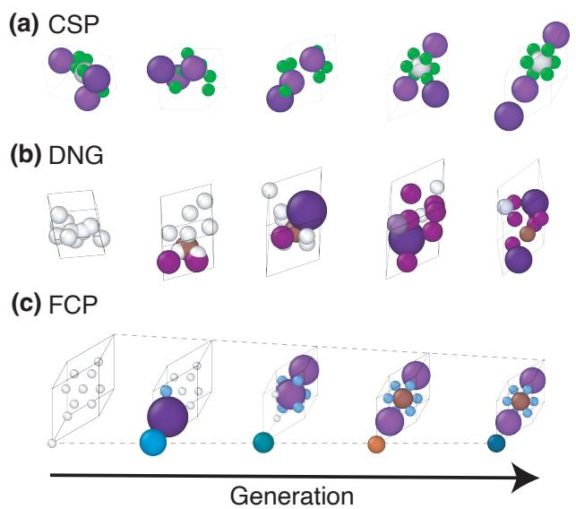
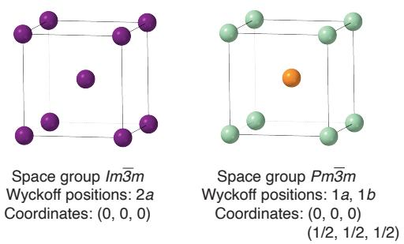
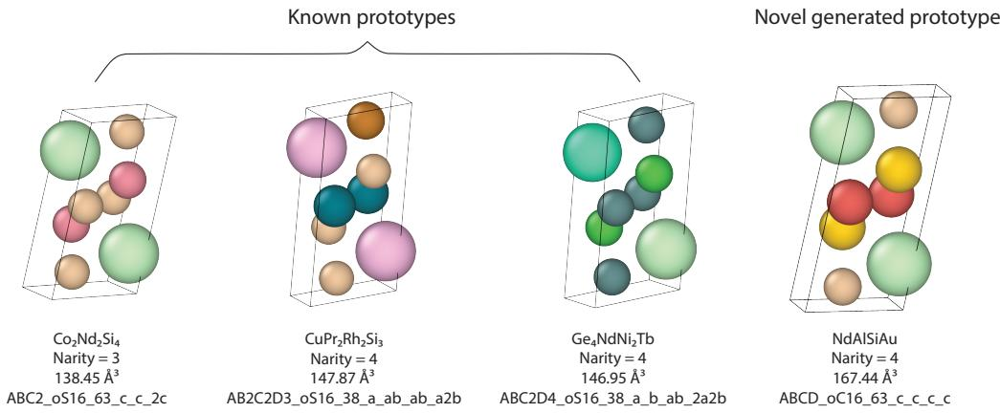
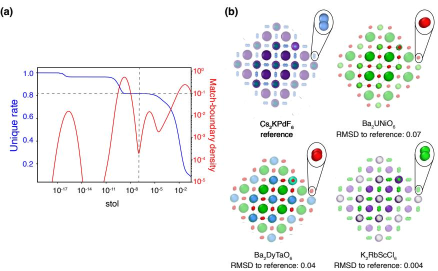

# Framework-Conditional Open Materials Generation

Maya M. Martirossyan∗New York Universitymm9084@nyu.edu

Philipp HöllmerNew York Universityph2484@nyu.edu

Hillary Pan∗ NYU Langone Health hillary.pan@nyulangone.org

Stefano Martiniani† New York University sm7683@nyu.edu

## Abstract

Theoretical predictions of novel materials rely on a variety of techniques, from data-mining-based ion substitution methods to fully de novo generative models. Each approach imposes specific constraints and encounters unique challenges when extrapolating beyond the distribution of known materials to discover new ones. The foremost goal of materials generation is to produce stable, unique, and novel (S.U.N.) structures. Predicted structures that meet these criteria, however, typically result from novel chemical compositions mapped onto known structural prototypes or frameworks. We leverage this heuristic insight to present a new generative paradigm for the de novo prediction of inorganic crystalline materials constrained by their structuralframework—i.e., the unit cell shapes and respective particle positions. Our method, termed OMatG-FC (Open Materials Framework-Conditional Generation), learns via a combination of discrete flow matching on the atomic species and stochastic interpolants for the volume scaling of the unit cell lattice, while fixing in-place the fractional coordinates and the unit-volume lattice vectors, dramatically reducing the dimensionality of the problem compared to unconstrained (framework-free) generation. Our method is more flexible than existing prototype-constrained methods, demonstrating capability for discovery of unseen, stable prototypes derived from known structural frameworks. We also investigate the number of unique frameworks in the MP-20 dataset, demonstrating the propensity of duplicate frameworks within the dataset and providing a framework-split version. We benchmark the performance of our model using the LeMat-GenBench suite using three ML interatomic potentials and achieve state-of-the-art S.U.N. rate below the convex hull, eschewing the need to learn atomic packings for materials discovery.

## 1 Introduction

A foundational goal of materials science is the design and discovery of novel materials with desired function. The advent of battery materials [1, 2], semiconductors [3], and alloys [4] have historically shaped the fabric of our society, with further technological leaps promised by “holy-grail” materials such as room-temperature superconductors [5, 6].

Theoretical predictions of novel materials can support the discovery process: Traditional approaches include high-throughput [7, 8] or ab-initio random structure search [9], which are based on firstprinciples methods like density functional theory (DFT), but suffer from poor sampling and high computational cost. Given the vast search space of candidate materials, machine-learning (ML) methods offer a promising avenue for dramatically accelerating materials discovery. Among these, generative models [10–12] stand out for their ability to propose novel materials by learning from experimentally or computationally derived crystal structures represented as unit cells.

Structure is of chief importance for material properties, especially for inorganic crystals, whose behavior depends sensitively on atomic-level periodicity [13]. This has motivated extensive work on crystal structure prediction (CSP) from chemical composition, as well as de novo generation (DNG) of novel compositions and their structural packings. The primary challenge for such methods is learning to represent and sample the space of stable crystalline materials—spanning all possible structural packings and chemical species—in order to discover viable candidate materials that can be synthesized [14].

## 1.1 Related Works

Significant prior work in materials prediction leverages knowledge of existing materials combined with heuristic constraints. Such methods predate application of machine-learning techniques: For example, the empirical Hume-Rothery rules [15] identify plausible solid solutions via substitutions of chemical species within an existing crystal structure template. Probabilistic models have also been applied to predict new compounds from structural templates via ionic substitutions [16]: A key feature of this method is the constraint for candidate structures to remain within their structural prototype (see Sec. 2.1).

In contrast, machine-learned CSP models predict stable atomic packings given a fixed chemical composition. Several such CSP methods have been proposed with the goal of improving on ab initio random structure search [17], such as CDVAE [18], DiffCSP [19], FlowMM [20], and OMatG [21]. These methods use equivariant architectures and a range of generative frameworks—from variational autoencoders to stochastic interpolants [22] (encompassing diffusion models [23] and flow-matching [24, 25]). A separate line of work addresses unconstrained de novo generation, predicting both composition and structure jointly; this includes GNoME [26] and MatterGen [27], as well as variants of several methods mentioned above [21, 20]. Chemeleon2 [28] extends this by fine-tuning a latent diffusion model with group relative policy optimization. Diffusion transformer have been explored as a more lightweight architectural alternative: ADiT [29] uses a shared latent space and diffusion transformer for jointly generating materials and molecules, while Crystalite [30] uses a diffusion transformer whose attention is augmented with periodic pairwise geometric information.

Another class of ML methods imposes physically-motivated inductive biases by exploiting the redundancy inherent in crystalline symmetries. Crystals possess translational and point-group symmetries that together describe a space group, which generates sets of symmetry-equivalent positions within the unit cell. When occupied by atoms, these positions are known as Wyckoff positions. Each Wyckoff position specifies both the multiplicity (how many symmetry-equivalent atoms it generates) and the degrees of freedom for atomic coordinates. For a given space group, operating directly on Wyckoff positions rather than on all atomic coordinates simplifies the learning objective by removing redundant degrees of freedom.

DiffCSP++ [31] takes this approach, requiring Wyckoff templates as input and learning only the continuous coordinates within those sites. Since ground-truth symmetry is unavailable, templates must be retrieved from the training set based on compositional similarity, restricting generation to known structural prototypes. SymmCD [32], CrystalFormer [33], and SGEquiDiff [34] instead incorporate Wyckoff site selection as a discrete generative step, enabling the discovery of structural prototypes beyond those seen during training. PLaID++ [35] also uses a Wyckoff-based text representation, applying direct preference optimization to steer a language model. Broadly, such symmetry-constrained models typically show improved space group distributions of predicted structures—towards more symmetric crystal structures—which in turn improves stable, unique, and novel (S.U.N.) rates.

Finally, SCIGEN [36] takes a complementary approach, steering diffusion-based generation toward desired lattice motifs (such as kagome or honeycomb) by constraining the denoising process, and has led to the successful synthesis of two predicted materials.

  
Figure 1: Illustration of the generation process with different types of generative models for the same test structure: (a) crystal structure prediction (CSP) samples the species at time t = 0 from the structure at time t = 1; (b) de novo generation (DNG) evolves the lattice, species, and fractional coordinates jointly; (c) framework-conditional prediction (FCP) evolves the lattice volume scaling and atomic species only.

## 1.2 Our Contribution

It is well-understood in materials science that two crystal structures sharing the same structural framework can exhibit different space group symmetries. A structural framework specifies the unit cell shape and the fractional coordinates of atomic sites, but not the chemical species occupying each site (see Sec. 2.1 and Fig. 2). In fact, partitioning sites among distinct species can reduce the symmetry to a subgroup of the framework’s full geometric symmetry.3

It is unknown whether symmetry-constrained generative models might benefit from operating at the structural framework level. Current models produce few novel structural prototypes [37], and it remains unclear whether this limited novelty reflects shortcomings of the models or instead the fact that nature has already explored most viable frameworks. Indeed, the relatively small number of known structural prototypes—2050 entries in the AFLOW Prototype Encyclopedia [38] at the time of writing and ≈15 000 additional prototypes in the AFLOW database [39]—suggests that the space of geometrically stable arrangements may be highly constrained. This motivates an alternative approach: rather than learning to generate novel atomic coordinates, one can leverage known frameworks and focus on predicting which species assignments yield stable materials.

We introduce OMatG-FC, a new ‘framework-conditional’ paradigm for generative models of inorganic crystals, which conditions generation on structural frameworks drawn from known crystalline materials. Unlike prototype-constrained methods, OMatG-FC fixes only the framework geometry; any additional realized chemical decorations or symmetry-breaking emerge from species assignment rather than being imposed. This places our approach between symmetry-based methods, which allow geometric variation within space groups, and substitution-based methods, which constrain candidate species on a known structural prototype. We demonstrate in Figure 1 how our model, which performs framework-conditional prediction (FCP), differs from standard CSP and DNG models.

We show that our model learns the symmetries common in the dataset from species-to-site assignment by good performance across distributional benchmarks and S.U.N. metrics. Moreover, our model demonstrates superior ability to predict stable, novel, and unique (S.U.N.) structures. While not the focus of this paper, our approach is well-suited for the prediction of chemical disorder on crystallographic sites, an active area of research particularly for materials such as multi-component alloys [40, 41].

  
Figure 2: Two crystal structures—a BCC-type crystal (left) and a CsCl prototype (right)—with the same structural framework but different structural prototypes, labeled by their space groups and corresponding Wyckoff positions.

## 2 Background

## 2.1 Crystal Structure Definitions

A crystal structure is defined by its translational symmetry, meaning it can be represented compactly by a periodic repeating subunit—termed a unit cell. Because of the constraint of translational symmetry combined with point-group symmetry, crystals in three dimensions must obey the symmetries belonging to one of 230 space groups. An infinite number of crystal structures can exist within each space group, which defines the possible symmetry-inequivalent sites, known as Wyckoff positions, that can be occupied. To specify a particular crystalline material, one needs to define its unit cell: the particle positions, the chemical species occupying each position, and the lattice parameters. Defining all particle positions, however, is equivalent to defining the space group and all occupied Wyckoff positions, along with the choices of the free parameters (if extant) within them.

We define some terms that will be used throughout this manuscript.4 The structural prototype is the discrete classification of a crystal structure by its space group, occupied Wyckoff positions, and stoichiometry. A prototype is a structural class: many materials with different chemical species and lattice parameters can belong to the same prototype. The AFLOW Prototype Encyclopedia [38, 39] follows this convention, encoding prototypes with labels such as AB4C3\_oI32\_46\_b\_2bc\_bc, which specify the stoichiometry, Pearson symbol (combining the Bravais lattice and the number of atoms per conventional unit cell), space group number, and Wyckoff positions, respectively. AFLOW further indexes representative materials within each prototype using numerical suffixes (-001, -002), with each entry specifying the lattice parameters and Wyckoff coordinates for that material. A crystalline material is thus a specific instantiation of a prototype: it specifies which chemical species occupy each stoichiometric site (e.g., A = Ca, B = Ti, X = O for the ABX perovskite CaTiO ) along with the lattice parameters and atomic coordinates.

We define a structuralframework as the geometric specification of a crystal independent of chemical identity: the unit cell shape (lattice parameters up to uniform scaling) together with the fractional coordinates of all atomic sites. A framework does not encode which species occupy these sites. Therefore, the same framework can correspond to multiple prototypes depending on species assignment. For example, BCC elemental metals (space group Im¯3m, Wyckoff site 2a, stoichiometry A) and CsCl (space group Pm¯3m, Wyckoff sites 1a + 1b, stoichiometry AB) share identical frameworks but constitute different prototypes, because the body-centered translation is a valid symmetry only when both sites are chemically equivalent (see Fig. 2).

## 2.2 Stochastic Interpolants

Stochastic interpolants [24, 22] unify diffusion models [23] and conditional flow-matching [24, 25] under a single framework, bridging a base probability distribution $\rho _ { 0 }$ with the true data distribution $\rho _ { 1 }$ through samples $( x _ { 0 } \sim \rho _ { 0 } , x _ { 1 } \sim \rho _ { 1 } )$ . We consider interpolants of the form

$$
x ( t , x _ { 0 } , x _ { 1 } , z ) = \alpha ( t ) x _ { 0 } + \beta ( t ) x _ { 1 } + \gamma ( t ) z ,\tag{1}
$$

where $t \in [ 0 , 1 ]$ represents time such that $x ( t = 0 ) = x _ { 0 }$ and $x ( t = 1 ) = x _ { 1 }$ . A learned timedependent drift $\boldsymbol { b } ^ { \boldsymbol { \theta } } ( \boldsymbol { x } , t )$ and, optionally, a learned denoiser $z ^ { \theta } ( x , t )$ give access to trajectories from the time-dependent density $\rho _ { t }$ through ODE-based or SDE-based sampling starting from $x _ { 0 } \sim \rho _ { 0 }$ For training SDE-based sampling schemes, $\gamma ( t ) \neq 0$ for $t \in ( 0 , 1 )$ is required, while it is optional for ODE-based sampling.

For both ODE- and SDE-based sampling, the required velocity term $\boldsymbol { b } ^ { \boldsymbol { \theta } } ( t , \boldsymbol { x } )$ is learned by minimizing the loss function

$$
\begin{array} { r } { \mathcal { L } _ { b } ( \theta ) = \mathbb { E } _ { t , z , x _ { 0 } , x _ { 1 } } \big [ | b ^ { \theta } ( t , x _ { t } ) | ^ { 2 } - 2 \partial _ { t } x ( t , x _ { 0 } , x _ { 1 } , z ) \cdot b ^ { \theta } ( t , x _ { t } ) \big ] , } \end{array}\tag{2}
$$

with the expectation taken independently over $t \sim$ Uniform $[ 0 , 1 ] , z \sim \mathcal { N } ( 0 , I )$ , $x _ { 0 } \sim \rho _ { 0 }$ , and $x _ { 1 } \sim \rho _ { 1 }$ . For SDE-based sampling, an additional denoiser $z ^ { \theta } ( t , x )$ must be learned by minimizing the additional loss

$$
\begin{array} { r } { \mathcal { L } _ { z } ( \theta ) = \mathbb { E } _ { t , z , x _ { 0 } , x _ { 1 } } \left[ | z ^ { \theta } ( t , x _ { t } ) | ^ { 2 } - 2 z ^ { \theta } ( t , x _ { t } ) \cdot z \right] . } \end{array}\tag{3}
$$

We note that minimizing with respect to these loss functions is equivalent to minimizing a meansquared error loss.

Prior work has explored stochastic interpolants in the context of crystal structure prediction and de novo materials generation in the OMatG model [21]. Following this and related work [20, 42], we apply inference-time velocity annealing which rescales the learned velocity field as $b ^ { \theta } ( t , x ) \xrightarrow { }$ $\left( 1 + s t \right) b ^ { \theta } ( t , x )$ , where s is as an hyperparameter that increases the magnitude of the velocity with time.

## 2.3 Discrete Flow Matching

Discrete Flow Matching (DFM) [43, 44] is a generative modeling framework for categorical variables which extends flow matching to discrete state spaces. Similarly to stochastic interpolants, DFM relies on connecting samples $d _ { 0 }$ from the (discrete) base distribution to data samples $d _ { 1 }$ from the data distribution with a conditional flow. Types of base distributions for sampling $d _ { 0 }$ include uniform and completely masked. For the uniform conditional flow, the probability for the discrete variable $d _ { t }$ at time t given the target sample $d _ { 1 }$ is given by $p _ { t | 1 } ^ { \mathrm { u n i f } } ( d _ { t } | d _ { 1 } ) \stackrel { \cdot } { = } \mathrm { C a t } ( t \delta \{ d _ { 1 } , d _ { t } \} + ( 1 - t ) / S )$ , where $S$ is the number of possible states. This uniform conditional flow converges to $d _ { 1 }$ at $t = 1$ and is uniformly distributed over all possible states at $t = 0$ . Alternatively, the masked conditional flow is given by $p _ { t | 1 } ^ { \operatorname* { m a s k } } ( d _ { t } | d _ { 1 } ) = \mathrm { C a } \hat { \mathbf { t } } ( t \delta \{ d _ { 1 } , d _ { t } \} + ( 1 - t ) \delta \{ M , d _ { t } \} )$ ), which converges to an additional masking token $M$ at $t = 0$

The conditional flows can be used to train a neural network to predict the denoising probability $p _ { 1 | t } ^ { \theta } ( d _ { 1 } | d _ { t } )$ of the final state $d _ { 1 }$ given the current state $d _ { t }$ by minimizing a cross-entropy loss:

$$
\begin{array} { r } { \mathcal { L } _ { \mathrm { D F M } } ( \theta ) = \mathbb { E } _ { t , d _ { 1 } , d _ { 0 } } \left[ - \log p _ { 1 | t } ^ { \theta } ( d _ { 1 } | d _ { t } ) \right] . } \end{array}\tag{4}
$$

Once the denoising probability $p _ { 1 | t } ^ { \theta } ( d _ { 1 } | d _ { t } )$ is learned, one can construct the rate matrix $R _ { t }$ that determines the rate with which state $d _ { t }$ jumps to another state at time t during generation [43, 21]. In addition, it is possible to add stochasticity in the shape of a second rate matrix satisfying detailed balance, $R _ { t } ^ { D B }$ , with a tunable noise parameter $\eta$ such that $R _ { t } ^ { \eta } = R _ { t } + \eta R _ { t } ^ { D B }$

## 3 Crystal Representation and Generation

A crystalline unit cell defines a distinct choice of periodic repeating unit which can be tiled to generate the infinite crystal structure. Generative models typically represent a unit cell with N atoms using three components: chemical species $A \in \mathbb { Z } _ { > 0 } ^ { N }$ , lattice vectors $\pmb { L } \in \mathbb { R } ^ { 3 \times 3 }$ , and fractional coordinates $\pmb { F } \in [ 0 , 1 ) ^ { 3 \times N }$ . In this work, we further decompose the lattice vectors into unit-volume lattice vectors $\bar { \pmb { L } } \in \dot { \mathbb { R } } ^ { 3 \times 3 }$ where $\operatorname* { d e t } ( { \bar { \mathbf { L } } } ) = 1$ and a log-volume scale factor $V = \log | \operatorname* { d e t } ( L )$ |.

Our generative modeling framework seeks to generate samples from the joint conditional distribution $\rho _ { 1 } \left( \bar { \cal A } , { \cal V } | \bar { \cal L } , { \cal F } \right)$ where L¯ and F define a structural framework that is sampled from the dataset. We sample this joint distribution by co-evolving V by stochastic interpolants and A by discrete flow matching, with combined loss

$$
\begin{array} { r } { \mathcal { L } ( \theta ) = \lambda _ { b } ^ { V } \mathcal { L } _ { b } ( \theta ) + \lambda _ { z } ^ { V } \mathcal { L } _ { z } ( \theta ) + \lambda ^ { A } \mathcal { L } _ { \mathrm { D F M } } ( \theta ) } \end{array}\tag{5}
$$

where $\lambda _ { z } ^ { V } = 0$ for ODE sampling schemes. Relative weights λ are optimized via hyperparameter tuning (see Appendix B).

## 3.1 Chemical Species

We represent chemical species by atomic number and model them using discrete flow matching, following OMatG’s implementation. Each atom takes a value $\pmb { a } _ { i } \in \{ 1 , \bar { 2 , } . \dots , 1 0 0 \}$ and $M = 0$ is a mask token. The base distribution sets all atoms to the masked state $\rho _ { 0 } ( { \cal A } ) = \left[ M \right] ^ { N }$ and atomic identities evolve via a continuous-time Markov Chain and are progressively unmasked until all tokens are replaced at time $t = 1$ . The learned denoising probability $\overset { \cdot } { p } _ { 1 \mid t } ^ { \theta }$ , and hence the rate matrix, depend on all other state variables $( F , { \bar { \pmb { L } } } , V )$ in addition to the atom types.

## 3.2 Lattice Vectors and Volume Scale

The lattice matrix L is defined by the three lattice vectors $[ l _ { 1 } , l _ { 2 } , l _ { 3 } ]$ and can be decomposed into shape and scale: the unit-volume lattice $\bar { L }$ and log-volume V , related by $\bar { \pmb { L } } = \pmb { L } * \mathrm { e x p } \left( - \mathbf { \bar { \zeta } } V / 3 \right)$ . We fix L¯ throughout generation using an identity interpolant with mirrored based distribution $\bar { \pmb { L } } _ { t } = \bar { \pmb { L } } _ { 0 } = \bar { \pmb { L } } _ { 1 }$ meaning that samples $x _ { 0 }$ are taken to have equivalent L¯ to the sampled structures $x _ { 1 } \sim \rho _ { 1 }$

For the volume scale $V ,$ we utilize a linear interpolant where $\alpha ( t ) = 1 - t { \mathrm { ~ a n d ~ } } \beta ( t ) = t$ with both an ODE $( \gamma ( t ) = 0 )$ and SDE sampling scheme $\left( \gamma ( t ) = \sqrt { a t \left( 1 - t \right) } \right.$ where a is a tunable parameter). As the stochastic interpolant framework permits flexible base distributions, we fit a log-normal distribution to unit cell volumes in the training set, yielding a Gaussian prior $\rho _ { 0 } ( V )$ on log-volume; previous work has shown that such priors improve generation performance [20, 21].

## 3.3 Atomic Coordinates

Atomic positions live on a torus and are represented as fractional coordinates $\pmb { F } \in [ 0 , 1 ) ^ { 3 \times N }$ expressing each atom’s position relative to the lattice vectors. As with the unit-volume lattice, we fix fractional coordinates throughout generation using an identity interpolant with mirrored base distribution, setting $\pmb { F } _ { t } = \pmb { F } _ { 1 }$ for all t, meaning that samples $x _ { 0 }$ are taken to have equivalent F to the sampled structures $x _ { 1 } \sim \rho _ { 1 }$

## 4 Datasets

For this work, we utilize two datasets: the MP-20 [45, 18] dataset from the Materials Project that contains 45 229 structures with at maximum $N = 2 0$ atoms per unit cell and the MPTS-52 [46] dataset also from the Materials Project containing 40 476 with at maximum $N = 5 2$ atoms per unit cell and organized chronologically (time-split). The MP-20 dataset utilizes a 60–20–20 % train–validation–test split while $\bar { M } P T \bar { S } - 5 2 $ has an approximately 68–12–20 % split ratio.

## 4.1 Framework Duplicate Analysis

We analyze structural framework duplication within MP-20 to motivate our framework-conditional approach. Following Martirossyan et al. [47], we use pymatgen’s StructureMatcher with the species-agnostic FrameworkComparator and volume rescaling enabled, restricting our analysis to the site tolerance stol (see Appendix D). For each structure pair, we identify the smallest stol at which the two frameworks transition from matching to non-matching; by construction, this value equals the per-atom RMSD between aligned atomic positions returned by StructureMatcher.

Adopting the default tolerance stol= 0.3 as the matching threshold, only ∼10% of structural frameworks in MP-20 are unique. This pervasive framework redundancy across chemically distinct materials provides direct empirical support for the inductive bias underlying OMatG-FC. Further details are provided in Appendix F.

## 4.2 Framework-Split Dataset

We utilize the structural comparisons of frameworks within MP-20 to create a framework-split version of the dataset, utilizing StructureMatcher as described in Appendix F.1 (stol= 0.3) in order to identify groupings of structures by their structural similarity. We choose this more lenient metric as to make the framework-split more challenging: at test time, crystal structures which are the most dissimilar to the training set are held out, and performance is measured by the model’s ability to perform materials discovery on previously unseen frameworks—in short, to predict novel chemistry on novel structural frameworks. The procedure to create the split is described in greater detail in Appendix F.2. We provide benchmarked results on this split in Appendix H.2.

## 5 Methodology

## 5.1 Equivariant Model for Crystal Structures

In order to properly account for symmetries inherent to crystal structures, we utilize a CSPNet architecture based on that of Jiao et al. [19] in the DiffCSP generative model. CSPNet is translationinvariant as well as rotation- and permutation-equivariant, meaning it correctly accounts for the symmetries which emerge as a result of treating the unit-cell as a periodic object. The full lattice matrix L is reconstructed and provided to the model as input. The architecture uses learnable atomic embeddings and represents fractional coordinates through sinusoidal positional embeddings. It uses six message-passing layers with a fully-connected graph neural network with atomic positions as nodes. Further details are provided in Appendix A.

## 5.2 De Novo Generation

We benchmark OMatG-FC as a de novo generative model in order to quantify whether conditioning on crystalline frameworks provides a strong prior for materials discovery. We evaluate the model in two modalities: first, treating framework-conditioning as a hard constraint by evaluating each generated structure as-is; second, relaxing this constraint by postprocessing with structural relaxation using the Universal Model for Atoms (UMA) uma-s-1.1 machine-learned interatomic potential (MLIP) [48]. Both modalities leverage the same structural priors, but differ in whether those priors are enforced as constraints on the final output.

## 5.3 Comparisons to Other Models

We compare OMatG-FC’s capabilities for materials discovery on the de novo generation task against several types of models, including site-substitution models as a reduced-task baseline, symmetryconstrained or space group conditional models, and fully de novo generative models. Additional details on the comparison to prototype-constrained models such as random enumeration and ionic substitution are found in Appendix G. These comparisons should be interpreted primarily with respec to the (M.)S.U.N. benchmark, as our training task differs from others in the existing literature.

## 6 Benchmarks

## 6.1 Distributional Properties

To evaluate whether our model has learned the data distribution, we compare distributional properties of generated structures against the test set using Wasserstein distance. The properties we compare include mass density ρ, N-arity (number of unique elements), averaged coordination number by element $\langle C N \rangle _ { S } .$ , element counts, and space groups. We also report validity metrics for the generated structures, including structural validity (all bond lengths $> 0 . 5 \mathring \mathrm { A } )$ , compositional validity as measured by the SMACT software (version 3.0), and the combined validity requiring both criteria to be satisfied.

Table 1: Distribution-based metrics from de novo generation of 10 000 structures using models trained on the MP-20 dataset with the structural frameworks present in the MP-20 test dataset. We report comparisons to other de novo generation models: DiffCSP, FlowMM, and OMatG-EncDecODE. Best scores in each category are bolded and second-best are underlined.
<table><tr><td rowspan="2">Method</td><td rowspan="2">Integration steps</td><td colspan="3">Validity (% ↑)</td><td colspan="5">Property (↓)</td></tr><tr><td>Structural</td><td>Composition</td><td>Combined</td><td>wdist (ρ)</td><td>wdist (Nary)</td><td>wdist ((CN)s)</td><td>wdist (elem)</td><td>wdist (sg)</td></tr><tr><td>DiffCSP</td><td>1000</td><td>99.91</td><td>82.46</td><td>82.46</td><td>0.3133</td><td>0.3193</td><td>0.3916</td><td>1.6300</td><td>20.40</td></tr><tr><td>FlowMM</td><td>1000</td><td>92.26</td><td>76.87</td><td>76.86</td><td>1.0712</td><td>0.1130</td><td>0.6603</td><td>0.9255</td><td>13.02</td></tr><tr><td>OMatG-EncDecODE</td><td>840</td><td>97.25</td><td>84.16</td><td>84.16</td><td>0.1155</td><td>0.0553</td><td>0.1026</td><td>0.8249</td><td>24.80</td></tr><tr><td>OMatG-FC-LinearODE</td><td>610</td><td>100.0</td><td>87.38</td><td>87.38</td><td>0.6045</td><td>0.0719</td><td>0.1890</td><td>0.4038</td><td>4.413</td></tr><tr><td>OMatG-FC-LinearSDE</td><td>620</td><td>100.0</td><td>86.33</td><td>86.32</td><td>0.0860</td><td>0.0856</td><td>0.1163</td><td>0.8483</td><td>5.888</td></tr></table>

Table 2: Benchmarks for de novo generation as provided by the LeMat-GenBench software [49] on 2500 generated structures. Models are trained and evaluated on the MP-20 dataset. Stability is defined as having $\Delta E _ { \mathrm { h u l l } } \leq 0$ eV/atom above hull and metastability is defined as $0 < \Delta E _ { \mathrm { h u l l } } \le 0 . 1$ eV/atom above hull. Uniqueness and novelty results are combined with (meta)stability assessments to produce (M)SUN rates. For OMatG and OMatG-FC models, structures are subsampled from those in Tab. 1 and benchmarks are computed; for random enumeration and ionic substitution the benchmarking is described in Appendix G; all other benchmarks from other models are reproduced from the LeMat-GenBench leaderboard. Models marked with a † utilize pre-relaxation before assessment; comparisons are therefore made within each category (unrelaxed and relaxed). Best scores in each category are bolded and second-best are underlined.
<table><tr><td>Method</td><td>Validity Rate (%, ↑)</td><td>Unique Rate (%, ↑)</td><td>Novelty Rate (%, ↑)</td><td>Stable Rate (%, ↑)</td><td>Metastable Rate (%, ↑)</td><td>S.U.N. Rate (%, ↑)</td><td>M.S.U.N. Rate (%, ↑)</td><td>(E)/N (eV, ↓)</td><td>RMSD (Å, ↓)</td></tr><tr><td>Random enumeration [37]</td><td>70.4</td><td>70.3</td><td>61.4</td><td>0.0</td><td>0.1</td><td>0.0</td><td>0.1</td><td>2.82</td><td>1.76</td></tr><tr><td>Ionic substitution [37, 16]</td><td>33.8</td><td>32.5</td><td>20.7</td><td>0.6</td><td>10.0</td><td>0.3</td><td>4.0</td><td>0.53</td><td>0.64</td></tr><tr><td>ADiT [29]</td><td>90.6</td><td>87.8</td><td>26.0</td><td>0.4</td><td>36.5</td><td>0.0</td><td>1.0</td><td>0.33</td><td>0.38</td></tr><tr><td>DiffCSP [19]</td><td>95.7</td><td>94.8</td><td>66.2</td><td>2.3</td><td>29.8</td><td>0.1</td><td>8.5</td><td>0.27</td><td>0.59</td></tr><tr><td>DiffCSP++ [31]</td><td>95.3</td><td>95.1</td><td>62.0</td><td>1.0</td><td>26.4</td><td>0.2</td><td>5.0</td><td>0.41</td><td>0.69</td></tr><tr><td>SymmCD [32]</td><td>73.4</td><td>73.0</td><td>47.0</td><td>1.4</td><td>18.6</td><td>0.1</td><td>2.4</td><td>0.88</td><td>0.87</td></tr><tr><td>Chemeleon2 [28]</td><td>95.2</td><td>88.1</td><td>71.6</td><td>0.0</td><td>39.8</td><td>0.0</td><td>21.2</td><td>0.15</td><td>0.42</td></tr><tr><td>OMatG-EncDecODE [21]</td><td>92.4</td><td>91.6</td><td>55.1</td><td>0.4</td><td>30.3</td><td>0.1</td><td>3.6</td><td>0.31</td><td>0.61</td></tr><tr><td>OMatG-FC-LinearODE</td><td>95.9</td><td>92.2</td><td>30.4</td><td>2.0</td><td>49.8</td><td>0.4</td><td>5.9</td><td>0.27</td><td>0.31</td></tr><tr><td>OMatG-FC-LinearSDE</td><td>96.5</td><td>93.4</td><td>34.9</td><td>3.6</td><td>56.4</td><td>0.2</td><td>6.8</td><td>0.17</td><td>0.30</td></tr><tr><td>Ionic substitution†</td><td>34.4</td><td>33.1</td><td>20.6</td><td>4.7</td><td>19.2</td><td>1.2</td><td>10.8</td><td>0.09</td><td>0.09</td></tr><tr><td>MatterGen† [50]</td><td>95.7</td><td>95.1</td><td>70.5</td><td>2.0</td><td>33.4</td><td>0.2</td><td>15.0</td><td>0.18</td><td>0.39</td></tr><tr><td>PLaID++† [35]</td><td>96.0</td><td>77.8</td><td>24.2</td><td>12.4</td><td>60.7</td><td>1.0</td><td>7.6</td><td>0.08</td><td>0.13</td></tr><tr><td>Crystalite† [30] OMatG-EncDecODE†</td><td>97.2</td><td>95.8</td><td>53.2</td><td>12.7</td><td>51.6</td><td>1.5</td><td>22.6</td><td>0.09</td><td>0.13</td></tr><tr><td></td><td>96.4</td><td>95.2</td><td>51.2</td><td>11.6</td><td>49.8</td><td>1.0</td><td>18.0</td><td>0.09</td><td>0.08</td></tr><tr><td>OMatG-FC-LinearODE†</td><td>97.2</td><td>92.8</td><td>28.9</td><td>18.4</td><td>57.9</td><td>1.7</td><td>12.0</td><td>0.07</td><td>0.07</td></tr><tr><td>OMatG-FC-LinearSDE†</td><td>97.2</td><td>93.8</td><td>33.6</td><td>16.0</td><td>57.5</td><td>1.0</td><td>13.3</td><td>0.07</td><td>0.16</td></tr></table>

## 6.2 Stability, Uniqueness, and Novelty

We use the benchmarking framework LeMat-GenBench [49] to compare OMatG-FC performance on standardized metrics against other recent generative models. This benchmarking suite has the advantage of a public leaderboard for ease of comparison and unified benchmarks, and uses three machine-learned interatomic potentials—MACE [51], UMA [48], and Orb-v3 [52]—as a surrogate for DFT relaxation to compute stability rate, the energy above hull, and the root-mean-squared-distance (RMSD with Å units) between the generated and relaxed structures. A validity metric screens structures based on a number of parameters measuring physical plausibility, including CIF readability, structural, density, and lattice parameter validity, symmetry, and charge neutrality. Uniqueness and novelty are assessed using pymatgen’s StructureMatcher as a fingerprint method with stol=0.1. Generated structures are compared against the large LeMat-Bulk reference dataset[53] which includes the Materials Project[45], Alexandria[54], and OQMD[55]. Structures are considered unique if they are non-redundant within the generated set, and structures are novel if they are absent from the reference dataset. Stability is defined in terms of the energy above the convex hull $( \Delta E _ { \mathrm { h u l l } } )$ , where stable structures satisfy $\Delta E _ { \mathrm { h u l l } } \leq 0 \ \mathrm { e V } /$ atom and metastable structures satisfy $0 < \Delta E _ { \mathrm { h u l l } } \le 0 . 1$ eV/atom. Combined, these metrics define S.U.N (stable, unique, and novel) and M.S.U.N. (metastable, unique, and novel) rates which are the union of the three properties for each structure. We follow the LeMat-GenBench leaderboard standard and compute these metrics on 2,500 structures sampled from our generated test set.

Table 3: Benchmarks of models trained and evaluated on the MPTS-52 dataset for de novo generation. LeMat-GenBench [49] is used to evaluate 2500 generated structures. The column definitions are the same as those of Tab. 2. Models marked with a † utilize pre-relaxation before assessment.
<table><tr><td>Method</td><td>Validity Rate (%, ↑)</td><td>Unique Rate (%, ↑)</td><td>Novelty Rate (%, ↑)</td><td>Stable Rate (%, ↑)</td><td>Metastable Rate (%, ↑)</td><td>S.U.N. Rate (%, ↑)</td><td>M.S.U.N. Rate (%, ↑)</td><td>(E)/N (eV, ↓)</td><td>RMSD (Å, ↓)</td></tr><tr><td>SGEquiDiff [34]</td><td>88.1</td><td>87.7</td><td>69.1</td><td>0.4</td><td>7.3</td><td>0.1</td><td>1.0</td><td>0.9145</td><td>1.1722</td></tr><tr><td>Crystalite [30]</td><td>86.4</td><td>85.0</td><td>45.1</td><td>4.1</td><td>38.5</td><td>0.5</td><td>6.0</td><td>0.2770</td><td>0.5036</td></tr><tr><td>OMatG-FC-LinearODE</td><td>92.9</td><td>87.3</td><td>64.7</td><td>2.0</td><td>30.5</td><td>0.4</td><td>8.4</td><td>0.4908</td><td>0.6431</td></tr><tr><td>OMatG-FC-LinearSDE</td><td>95.6</td><td>90.8</td><td>65.7</td><td>1.5</td><td>31.4</td><td>0.3</td><td>7.9</td><td>0.3521</td><td>0.6466</td></tr><tr><td>SGEquiDiff†</td><td>93.5</td><td>93.1</td><td>69.0</td><td>6.3</td><td>23.1</td><td>0.6</td><td>10.9</td><td>0.2688</td><td>0.3003</td></tr><tr><td>Crystalite†</td><td>96.5</td><td>95.0</td><td>54.1</td><td>16.9</td><td>45.2</td><td>1.6</td><td>21.2</td><td>0.1079</td><td>0.1758</td></tr><tr><td>OMatG-FC-LinearODE</td><td>94.6</td><td>89.2</td><td>65.0</td><td>13.4</td><td>38.8</td><td>2.0</td><td>21.8</td><td>0.1364</td><td>0.1919</td></tr><tr><td>OMatG-FC-LinearSDE†</td><td>96.4</td><td>91.8</td><td>64.8</td><td>13.6</td><td>40.1</td><td>2.0</td><td>22.1</td><td>0.1333</td><td>0.1900</td></tr></table>

## 7 Results

We present distributional metrics for generated structures in Tab. 1. OMatG-FC performs competitively on most distributional benchmarks, with notable improvement on the space group Wasserstein distance.5 This improvement arises because fixed positions and lattice parameters yield accurate symmetries by construction, whereas non-constrained models produce positional noise that requires relaxed symmetry tolerances for space group identification. For the same reason, structural validity is 100%.

Materials discovery metrics from LeMat-GenBench are shown in Tab. 2 for models trained and evaluated on the MP-20 dataset. OMatG-FC achieves state-of-the-art performance for S.U.N. rates within both unrelaxed and relaxed generated structures, lowest average energy above hull $\langle E \rangle / N$ and RMSD between generated and relaxed structures. This is expected as structural frameworks from the dataset guide generated crystals closer to stable atomic packings. OMatG-FC models also achieve the highest validity scores, which here include structural validity but also the metrics described in Sec. 6.2. Finally, we demonstrate the highest stability rates and metastability rates, which compensate for lower novelty rates (similarly to the PLaID++ model [35]).

We additionally evaluate our model and two others, Crystalite [30] and SGEquiDiff [34], on the MPTS-52 dataset, with benchmarking results shown in Tab. 3.6 OMatG-FC outperforms both in (M.)S.U.N. rates for relaxed structures. For unrelaxed structures, OMatG-FC and Crystalite achieve comparable S.U.N. rates while OMatG-FC outperforms in M.S.U.N. rate. Notably, OMatG-FC’s novelty rate is significantly higher on MP T S-52 than on MP-20. We posit that this is due to the combinatorially larger structural space of MPTS-52—with more sites in the unit cell available to decorate with atomic species—allows the model to explore much more outside of the training dataset.

## 7.1 Novel Prototypes

We examine the propensity of our method to discover prototype structures when conditioned on a framework. From the OMatG-FC-LinearODE model without pre-relaxation, we identify NdAlSiAu as a stable structure occupying a prototype absent from the AFLOW Prototype Encyclopedia. Using StructureMatcher with stol= 0.1, we identified 124 materials in the MP20-dataset with the most similar structural frameworks as NdAlSiAu. We find that there are only three distinct prototypes among them: 121 have N-arity = 3 and share the same prototype represented by $\mathrm { C o _ { 2 } N d _ { 2 } S i _ { 4 } }$ in Fig. 3, and the remaining three structures each with N-arity = 4 showcase two additional prototypes. OMatG-FC is able to sample a fourth unseen prototype. This highlights a particular advance over prototype-constrained methods—our framework conditioning, applied within a stochastic interpolant model, lifts that restriction.

  
Figure 3: Three examples of known materials from the MP-20 dataset and a S.U.N. structure sampled using OMG-FC. All four materials share the same underlying structural framework but differ by prototype. Labels denote the chemical composition, N-arity, volume, and AFLOW prototype label. The sampled NdAlSiAu structure represents an unseen prototype for the model.

## 8 Discussion and Conclusion

We introduce a new type of generative model, OMatG-FC, which allows for the exploration of novel chemical compositions conditional on structural frameworks. While counterintuitive for the prospect of discovering novel materials, we show that our method is a state-of-the-art generative model for materials discovery. This is accomplished through simplification of the learning task through the conditional prior, as well as the inductive bias imposed by the structural framework constraint which pushes the learned distribution towards crystals that are closer to the convex hull (i.e., more stable). Ultimately, OMatG-FC paves the way for discovery via structural frameworks—limited in our study to those from the dataset, but in practice applicable to any theorized point pattern.

## Acknowledgments

The authors would like to thank Shenglong Wang at NYU IT HPC and Gregory Wolfe for supporting this work. The authors acknowledge funding from NSF Grant OAC-2311632. P. H. and S. M. also acknowledge support from the Simons Center for Computational Physical Chemistry (Simons Foundation grant 839534, MT). The authors gratefully acknowledge the computational resources, consultation support, and core personnel that have contributed to the research results reported in this publication, provided by the IT High Performance Computing at New York University and NYU Langone High Performance Computing.

## References

[1] Noriaki Kamaya, Kenji Homma, Yuichiro Yamakawa, Masaaki Hirayama, Ryoji Kanno, Masao Yonemura, Takashi Kamiyama, Yuki Kato, Shigenori Hama, Koji Kawamoto, and Akio Mitsui. A lithium superionic conductor. Nature Materials, 10(9):682–686, September 2011. ISSN 1476- 1122, 1476-4660. doi: 10.1038/nmat3066. URL https://www.nature.com/articles/ nmat3066.

[2] Ho-Young Jang, Donggun Eum, Jiung Cho, Jun Lim, Yeji Lee, Jun-Hyuk Song, Hyeokjun Park, Byunghoon Kim, Do-Hoon Kim, Sung-Pyo Cho, Sugeun Jo, Jae Hoon Heo, Sunyoung Lee, Jongwoo Lim, and Kisuk Kang. Structurally robust lithium-rich layered oxides for high-energy and long-lasting cathodes. Nature Communications, 15(1):1288, February 2024. ISSN 2041- 1723. doi: 10.1038/s41467-024-45490-x. URL https://www.nature.com/articles/ s41467-024-45490-x.

[3] Kenji Nomura, Hiromichi Ohta, Akihiro Takagi, Toshio Kamiya, Masahiro Hirano, and Hideo Hosono. Room-temperature fabrication of transparent flexible thin-film transistors using amorphous oxide semiconductors. Nature, 432(7016):488–492, November 2004. ISSN 0028- 0836, 1476-4687. doi: 10.1038/nature03090. URL https://www.nature.com/articles/ nature03090.

[4] Bernd Gludovatz, Anton Hohenwarter, Keli V. S. Thurston, Hongbin Bei, Zhenggang Wu, Easo P. George, and Robert O. Ritchie. Exceptional damage-tolerance of a medium-entropy alloy CrCoNi at cryogenic temperatures. Nat. Commun., 7(1):10602, February 2016. ISSN 2041-1723. doi: 10.1038/ncomms10602. URL https://www.nature.com/articles/ncomms10602.

[5] Lilia Boeri, Richard Hennig, Peter Hirschfeld, Gianni Profeta, Antonio Sanna, Eva Zurek, Warren E Pickett, Maximilian Amsler, Ranga Dias, Mikhail I Eremets, Christoph Heil, Russell J Hemley, Hanyu Liu, Yanming Ma, Carlo Pierleoni, Aleksey N Kolmogorov, Nikita Rybin, Dmitry Novoselov, Vladimir Anisimov, Artem R Oganov, Chris J Pickard, Tiange Bi, Ryotaro Arita, Ion Errea, Camilla Pellegrini, Ryan Requist, E K U Gross, Elena Roxana Margine, Stephen R Xie, Yundi Quan, Ajinkya Hire, Laura Fanfarillo, G R Stewart, J J Hamlin, Valentin Stanev, Renato S Gonnelli, Erik Piatti, Davide Romanin, Dario Daghero, and Roser Valenti. The 2021 room-temperature superconductivity roadmap. J. Phys.: Condens. Matter, 34(18): 183002, March 2022. ISSN 0953-8984. doi: 10.1088/1361-648X/ac2864. URL https: //dx.doi.org/10.1088/1361-648X/ac2864.

[6] Pawan Prakash, Jason B. Gibson, Zhongwei Li, Gabriele Di Gianluca, Juan Esquivel, Eric Fuemmeler, Benjamin Geisler, Jung Soo Kim, Adrian Roitberg, Ellad B. Tadmor, Mingjie Liu, Stefano Martiniani, Gregory R. Stewart, James J. Hamlin, Peter J. Hirschfeld, and Richard G. Hennig. Guided Diffusion for the Discovery of New Superconductors, September 2025. URL http://arxiv.org/abs/2509.25186.

[7] Anubhav Jain, Geoffroy Hautier, Charles Moore, Shyue Ong, Chris Fischer, Tim Mueller, Kristin Persson, and Gerbrand Ceder. A high-throughput infrastructure for density functional theory calculations. Comput. Mater. Sci., 50:2295–2310, June 2011. doi: 10.1016/j.commatsci. 2011.02.023.

[8] Stefano Curtarolo, Gus L. W. Hart, Marco Buongiorno Nardelli, Natalio Mingo, Stefano Sanvito, and Ohad Levy. The high-throughput highway to computational materials design. Nat. Mater., 12(3):191–201, March 2013. ISSN 1476-4660. doi: 10.1038/nmat3568. URL https://www.nature.com/articles/nmat3568.

[9] Chris J Pickard and R J Needs. Ab Initio random structure searching. J. Phys.: Condens. Matter, 23(5):053201, February 2011. ISSN 0953-8984, 1361-648X. doi: 10.1088/0953-8984/ 23/5/053201. URL https://iopscience.iop.org/article/10.1088/0953-8984/23/ 5/053201.

[10] Pierre-Paul De Breuck, Hai-Chen Wang, Gian-Marco Rignanese, Silvana Botti, and Miguel A. L. Marques. Generative AI for crystal structures: a review. npj Computational Materials, 11(1):370, December 2025. ISSN 2057-3960. doi: 10.1038/s41524-025-01881-2. URL https://www.nature.com/articles/s41524-025-01881-2.

[11] Houssam Metni, Laura Ruple, Lauren N. Walters, Luca Torresi, Jonas Teufel, Henrik Schopmans, Jona Östreicher, Yumeng Zhang, Marlen Neubert, Yuri Koide, Kevin Steiner, Paul Link, Lukas Bär, Mariana Petrova, Gerbrand Ceder, and Pascal Friederich. Generative models for crystalline materials, November 2025. URL http://arxiv.org/abs/2511.22652.

[12] Cyprien Bone, Matthew Walker, Kuangdai Leng, Luis M. Antunes, Ricardo Grau-Crespo, Amil Aligayev, Javier Dominguez, and Keith T. Butler. Discovery and recovery of crystalline materials with property-conditioned transformers, November 2025. URL http://arxiv.org/ abs/2511.21299.

[13] Tien-Sinh Vu, Minh-Quyet Ha, Duong-Nguyen Nguyen, Viet-Cuong Nguyen, Yukihiro Abe, Truyen Tran, Huan Tran, Hiori Kino, Takashi Miyake, Koji Tsuda, and Hieu-Chi Dam. Towards understanding structure–property relations in materials with interpretable deep learning. npj Computational Materials, 9(1):215, December 2023. ISSN 2057- 3960. doi: 10.1038/s41524-023-01163-9. URL https://www.nature.com/articles/ s41524-023-01163-9.

[14] Anthony K. Cheetham and Ram Seshadri. Artificial Intelligence Driving Materials Discovery? Perspective on the Article: Scaling Deep Learning for Materials Discovery. Chem. Mater., 36 (8):3490–3495, April 2024. ISSN 0897-4756. doi: 10.1021/acs.chemmater.4c00643. URL https://doi.org/10.1021/acs.chemmater.4c00643.

[15] William Hume-Rothery. The Structure of Metals and Alloys. Chemical Publishing Company, 1939.

[16] Geoffroy Hautier, Chris Fischer, Virginie Ehrlacher, Anubhav Jain, and Gerbrand Ceder. Data Mined Ionic Substitutions for the Discovery of New Compounds. Inorg. Chem., 50(2):656–663, January 2011. ISSN 0020-1669. doi: 10.1021/ic102031h. URL https://doi.org/10.1021/ ic102031h.

[17] Prof C. J. Pickard. AIRSS, October 2016. URL https://www.mtg.msm.cam.ac.uk/Codes/ AIRSS.

[18] Tian Xie, Xiang Fu, Octavian-Eugen Ganea, Regina Barzilay, and Tommi Jaakkola. Crystal Diffusion Variational Autoencoder for Periodic Material Generation, March 2022. URL http: //arxiv.org/abs/2110.06197.

[19] Rui Jiao, Wenbing Huang, Peijia Lin, Jiaqi Han, Pin Chen, Yutong Lu, and Yang Liu. Crystal Structure Prediction by Joint Equivariant Diffusion, July 2023. URL https://arxiv.org/ abs/2309.04475v2.

[20] Benjamin Kurt Miller, Ricky T. Q. Chen, Anuroop Sriram, and Brandon M. Wood. FlowMM: Generating Materials with Riemannian Flow Matching, June 2024. URL http://arxiv.org/ abs/2406.04713.

[21] Philipp Höllmer, Thomas Egg, Maya Martirossyan, Eric Fuemmeler, Zeren Shui, Amit Gupta, Pawan Prakash, Adrian Roitberg, Mingjie Liu, George Karypis, Mark Transtrum, Richard Hennig, Ellad B. Tadmor, and Stefano Martiniani. Open Materials Generation with Stochastic Interpolants. In Forty-second International Conference on Machine Learning, 2025. URL https://openreview.net/forum?id=gHGrzxFujU.

[22] Michael S. Albergo, Nicholas M. Boffi, and Eric Vanden-Eijnden. Stochastic Interpolants: A Unifying Framework for Flows and Diffusions, November 2023. URL http://arxiv.org/ abs/2303.08797.

[23] Yang Song, Jascha Sohl-Dickstein, Diederik P. Kingma, Abhishek Kumar, Stefano Ermon, and Ben Poole. Score-Based Generative Modeling through Stochastic Differential Equations, February 2021. URL http://arxiv.org/abs/2011.13456.

[24] Michael S. Albergo and Eric Vanden-Eijnden. Building Normalizing Flows with Stochastic Interpolants, March 2023. URL http://arxiv.org/abs/2209.15571.

[25] Yaron Lipman, Ricky T. Q. Chen, Heli Ben-Hamu, Maximilian Nickel, and Matt Le. Flow Matching for Generative Modeling, February 2023. URL http://arxiv.org/abs/2210. 02747.

[26] Amil Merchant, Simon Batzner, Samuel S. Schoenholz, Muratahan Aykol, Gowoon Cheon, and Ekin Dogus Cubuk. Scaling deep learning for materials discovery. Nature, 624:80– 85, November 2023. ISSN 1476-4687. doi: 10.1038/s41586-023-06735-9. URL https: //www.nature.com/articles/s41586-023-06735-9.

[27] Claudio Zeni, Robert Pinsler, Daniel Zügner, Andrew Fowler, Matthew Horton, Xiang Fu, Sasha Shysheya, Jonathan Crabbé, Lixin Sun, Jake Smith, Ryota Tomioka, and Tian Xie. MatterGen: A generative model for inorganic materials design, December 2023. URL http: //arxiv.org/abs/2312.03687.

[28] Hyunsoo Park and Aron Walsh. Guiding generative models to uncover diverse and novel crystals via reinforcement learning. 2025. URL https://arxiv.org/abs/2511.07158.

[29] Chaitanya K. Joshi, Xiang Fu, Yi-Lun Liao, Vahe Gharakhanyan, Benjamin Kurt Miller, Anuroop Sriram, and Zachary W. Ulissi. All-atom Diffusion Transformers: Unified generative modelling of molecules and materials, March 2025. URL http://arxiv.org/abs/2503. 03965.

[30] Tin Hadži Veljkovic, Joshua Rosenthal, Ivor Lon ´ cari ˇ c, and Jan-Willem van de Meent. Crystalite:´ A Lightweight Transformer for Efficient Crystal Modeling, April 2026.

[31] Rui Jiao, Wenbing Huang, Yu Liu, Deli Zhao, and Yang Liu. Space Group Constrained Crystal Generation, April 2024. URL http://arxiv.org/abs/2402.03992.

[32] Daniel Levy, Siba Smarak Panigrahi, Sékou-Oumar Kaba, Qiang Zhu, Mikhail Galkin, Santiago Miret, and Siamak Ravanbakhsh. SymmCD: Symmetry-Preserving Crystal Generation with Diffusion Models. In AIfor Accelerated Materials Design - NeurIPS 2024, November 2024. URL https://openreview.net/forum?id=V7x2KZQn2v.

[33] Zhendong Cao, Xiaoshan Luo, Jian Lv, and Lei Wang. Space Group Informed Transformer for Crystalline Materials Generation. Science Bulletin, 70(21):3522–3533, November 2025. ISSN 20959273. doi: 10.1016/j.scib.2025.09.035. URL http://arxiv.org/abs/2403.15734.

[34] Rees Chang, Angela Pak, Alex Guerra, Ni Zhan, Nick Richardson, Elif Ertekin, and Ryan P. Adams. Space Group Equivariant Crystal Diffusion, May 2025. URL http://arxiv.org/ abs/2505.10994.

[35] Andy Xu, Rohan Desai, Larry Wang, Gabriel Hope, and Ethan Ritz. PLaID++: A Preference Aligned Language Model for Targeted Inorganic Materials Design, September 2025. URL http://arxiv.org/abs/2509.07150.

[36] Ryotaro Okabe, Mouyang Cheng, Abhijatmedhi Chotrattanapituk, Manasi Mandal, Kiran Mak, Denisse Córdova Carrizales, Nguyen Tuan Hung, Xiang Fu, Bowen Han, Yao Wang, Weiwei Xie, Robert J. Cava, Tommi S. Jaakkola, Yongqiang Cheng, and Mingda Li. Structural constraint integration in a generative model for the discovery of quantum materials. Nature Materials, pages 1–8, September 2025. ISSN 1476-4660. doi: 10.1038/s41563-025-02355-y. URL https://www.nature.com/articles/s41563-025-02355-y.

[37] Nathan J. Szymanski and Christopher J. Bartel. Establishing baselines for generative discovery of inorganic crystals. arXiv, 2025. doi: 10.48550/arXiv.2501.02144.

[38] Hagen Eckert, Simon Divilov, Michael J. Mehl, David Hicks, Adam C. Zettel, Marco Esters, Xiomara Campilongo, and Stefano Curtarolo. The AFLOW Library of Crystallographic Prototypes: Part 4. Computational Materials Science, 240:112988, May 2024. ISSN 09270256. doi: 10.1016/j.commatsci.2024.112988. URL http://arxiv.org/abs/2401.06875.

[39] David Hicks, Cormac Toher, Denise C. Ford, Frisco Rose, Carlo De Santo, Ohad Levy, Michael J. Mehl, and Stefano Curtarolo. AFLOW-XtalFinder: A reliable choice to identify crystalline prototypes. npj Computational Materials, 7(1):30, February 2021. ISSN 2057- 3960. doi: 10.1038/s41524-020-00483-4. URL https://www.nature.com/articles/ s41524-020-00483-4.

[40] Konstantin S. Jakob, Aron Walsh, Karsten Reuter, and Johannes T. Margraf. Learning Crystallographic Disorder: Bridging Prediction and Experiment in Materials Discovery. Advanced Materials, 38(5):e14226, January 2026. ISSN 0935-9648, 1521-4095. doi: 10.1002/adma.202514226. URL https://advanced.onlinelibrary.wiley.com/doi/10.1002/adma.202514226.

[41] Dmytro Antypov, Chris M. Collins, Matthew S. Dyer, John B. Claridge, and Matthew J. Rosseinsky. Classification and statistical analysis of structural disorder in crystalline materials. Journal ofApplied Crystallography, 58(3):659–677, June 2025. ISSN 1600-5767. doi: 10.1107/ S1600576725003000. URL https://journals.iucr.org/paper?S1600576725003000.

[42] Avishek Joey Bose, Tara Akhound-Sadegh, Guillaume Huguet, Kilian Fatras, Jarrid Rector-Brooks, Cheng-Hao Liu, Andrei Cristian Nica, Maksym Korablyov, Michael Bronstein, and Alexander Tong. SE(3)-Stochastic Flow Matching for Protein Backbone Generation, April 2024. URL http://arxiv.org/abs/2310.02391.

[43] Andrew Campbell, Jason Yim, Regina Barzilay, Tom Rainforth, and Tommi Jaakkola. Generative Flows on Discrete State-Spaces: Enabling Multimodal Flows with Applications to Protein Co-Design, June 2024. URL http://arxiv.org/abs/2402.04997.

[44] Itai Gat, Tal Remez, Neta Shaul, Felix Kreuk, Ricky T. Q. Chen, Gabriel Synnaeve, Yossi Adi, and Yaron Lipman. Discrete Flow Matching, July 2024. URL http://arxiv.org/abs/2407. 15595.

[45] Anubhav Jain, Shyue Ping Ong, Geoffroy Hautier, Wei Chen, William Davidson Richards, Stephen Dacek, Shreyas Cholia, Dan Gunter, David Skinner, Gerbrand Ceder, and Kristin A. Persson. Commentary: The Materials Project: A materials genome approach to accelerating materials innovation. APL Materials, 1(1):011002, July 2013. doi: 10.1063/1.4812323. URL https://aip.scitation.org/doi/10.1063/1.4812323.

[46] Sterling G. Baird, Hasan M. Sayeed, Joseph Montoya, and Taylor D. Sparks. Matbenchgenmetrics: A Python library for benchmarking crystal structure generative models using time-based splits of Materials Project structures. Journal ofOpen Source Software, 9(97):5618, May 2024. ISSN 2475-9066. doi: 10.21105/joss.05618. URL https://joss.theoj.org/ papers/10.21105/joss.05618.

[47] Maya Martirossyan, Thomas Egg, Philipp Höllmer, George Karypis, Mark Transtrum, Adrian Roitberg, Mingjie Liu, Richard Hennig, Ellad B. Tadmor, and Stefano Martiniani. All that structure matches does not glitter. In The Thirty-ninth Annual Conference on Neural Information Processing Systems Datasets and Benchmarks Track, 2025. URL https://openreview.net/ forum?id=ig9ujp50D4.

[48] Brandon M. Wood, Misko Dzamba, Xiang Fu, Meng Gao, Muhammed Shuaibi, Luis Barroso-Luque, Kareem Abdelmaqsoud, Vahe Gharakhanyan, John R. Kitchin, Daniel S. Levine, Kyle Michel, Anuroop Sriram, Taco Cohen, Abhishek Das, Ammar Rizvi, Sushree Jagriti Sahoo, Zachary W. Ulissi, and C. Lawrence Zitnick. UMA: A Family of Universal Models for Atoms, June 2025. URL http://arxiv.org/abs/2506.23971.

[49] Siddharth Betala, Samuel P. Gleason, Ali Ramlaoui, Andy Xu, Georgia Channing, Daniel Levy, Clémentine Fourrier, Nikita Kazeev, Chaitanya K. Joshi, Sékou-Oumar Kaba, Félix Therrien, Alex Hernandez-Garcia, Rocío Mercado, N. M. Anoop Krishnan, and Alexandre Duval. LeMat-GenBench: A Unified Evaluation Framework for Crystal Generative Models, January 2026. URL http://arxiv.org/abs/2512.04562.

[50] Claudio Zeni, Robert Pinsler, Daniel Zügner, Andrew Fowler, Matthew Horton, Xiang Fu, Zilong Wang, Aliaksandra Shysheya, Jonathan Crabbé, Shoko Ueda, Roberto Sordillo, Lixin Sun, Jake Smith, Bichlien Nguyen, Hannes Schulz, Sarah Lewis, Chin-Wei Huang, Ziheng Lu, Yichi Zhou, Han Yang, Hongxia Hao, Jielan Li, Chunlei Yang, Wenjie Li, Ryota Tomioka, and Tian Xie. A generative model for inorganic materials design. Nature, pages 1–3, January 2025. ISSN 1476-4687. doi: 10.1038/s41586-025-08628-5. URL https://www.nature. com/articles/s41586-025-08628-5.

[51] Ilyes Batatia, Philipp Benner, Yuan Chiang, Alin M. Elena, Dávid P. Kovács, Janosh Riebesell, Xavier R. Advincula, Mark Asta, Matthew Avaylon, William J. Baldwin, Fabian Berger, Noam Bernstein, Arghya Bhowmik, Filippo Bigi, Samuel M. Blau, Vlad Carare, Michele Ceriotti,˘ Sanggyu Chong, James P. Darby, Sandip De, Flaviano Della Pia, Volker L. Deringer, Rokas Elijošius, Zakariya El-Machachi, Edvin Fako, Fabio Falcioni, Andrea C. Ferrari, John L. A. Gardner, Mikołaj J. Gawkowski, Annalena Genreith-Schriever, Janine George, Rhys E. A. Goodall, Jonas Grandel, Clare P. Grey, Petr Grigorev, Shuang Han, Will Handley, Hendrik H. Heenen, Kersti Hermansson, Cheuk Hin Ho, Stephan Hofmann, Christian Holm, Jad Jaafar, Konstantin S. Jakob, Hyunwook Jung, Venkat Kapil, Aaron D. Kaplan, Nima Karimitari, James R. Kermode, Panagiotis Kourtis, Namu Kroupa, Jolla Kullgren, Matthew C. Kuner, Domantas Kuryla, Guoda Liepuoniute, Chen Lin, Johannes T. Margraf, Ioan-Bogdan Magdau,˘ Angelos Michaelides, J. Harry Moore, Aakash A. Naik, Samuel P. Niblett, Sam Walton Norwood, Niamh O’Neill, Christoph Ortner, Kristin A. Persson, Karsten Reuter, Andrew S. Rosen, Louise A. M. Rosset, Lars L. Schaaf, Christoph Schran, Benjamin X. Shi, Eric Sivonxay, Tamás K. Stenczel, Christopher Sutton, Viktor Svahn, Thomas D. Swinburne, Jules Tilly, Cas van der Oord, Santiago Vargas, Eszter Varga-Umbrich, Tejs Vegge, Martin Vondrák, Yangshuai Wang, William C. Witt, Thomas Wolf, Fabian Zills, and Gábor Csányi. A foundation model for atomistic materials chemistry. J. Chem. Phys., 163(18):184110, November 2025. ISSN 0021- 9606. doi: 10.1063/5.0297006. URL https://doi.org/10.1063/5.0297006.

[52] Benjamin Rhodes, Sander Vandenhaute, Vaidotas Šimkus, James Gin, Jonathan Godwin, Tim Duignan, and Mark Neumann. Orb-v3: Atomistic simulation at scale, April 2025. URL http://arxiv.org/abs/2504.06231.

[53] Martin Siron, Inel Djafar, Ali Ramlaoui, Etienne du Fayette, Amandine Rossello, Edvin Fako, Matthew McDermott, Felix Therrien, Luis Barroso-Luque, Flaviu Cipcigan, Philippe Schwaller, Thomas Wolf, and Alexandre Duval. LeMat-Bulk: Aggregating, and de-duplicating quantum chemistry materials databases, November 2025.

[54] Théo Cavignac, Jonathan Schmidt, Pierre-Paul De Breuck, Antoine Loew, Tiago F. T. Cerqueira, Hai-Chen Wang, Anton Bochkarev, Yury Lysogorskiy, Aldo H. Romero, Ralf Drautz, Silvana Botti, and Miguel A. L. Marques. AI-driven expansion and application of the Alexandria database. Journal ofPhysics: Materials, 9(2):025014, 2026. doi: 10.1088/2515-7639/ae6620. URL https://doi.org/10.1088/2515-7639/ae6620.

[55] Scott Kirklin, James E. Saal, Bryce Meredig, Alex Thompson, Jeff W. Doak, Muratahan Aykol, Stephan Rühl, and Chris Wolverton. The Open Quantum Materials Database (OQMD): Assessing the accuracy of DFT formation energies. npj Comput Mater, 1(1):1–15, December 2015. ISSN 2057-3960. doi: 10.1038/npjcompumats.2015.10. URL https://www.nature. com/articles/npjcompumats201510.

[56] Atsushi Togo, Kohei Shinohara, and Isao Tanaka. Spglib: A software library for crystal symmetry search, March 2024. URL http://arxiv.org/abs/1808.01590.

[57] Richard Liaw, Eric Liang, Robert Nishihara, Philipp Moritz, Joseph E Gonzalez, and Ion Stoica. Tune: A research platform for distributed model selection and training. arXiv preprint arXiv:1807.05118, 2018.

[58] Takuya Akiba, Shotaro Sano, Toshihiko Yanase, Takeru Ohta, and Masanori Koyama. Optuna: A Next-generation Hyperparameter Optimization Framework, July 2019. URL http://arxiv. org/abs/1907.10902.

## A Equivariant Model

For the equivariant graph neural network utilized with OMatG-FC, we provide greater detail about its architecture here. Node embeddings $h _ { ( s ) } ^ { i }$ are initialized as a function of the atom types a and updated through a message-passing scheme in which nearby node embeddings, the full lattice information $L ,$ and sinusoidal distance embeddings are injected. This scheme is given by

$$
\begin{array} { r l } & { \displaystyle h _ { ( 0 ) } ^ { i } = \phi _ { h _ { ( 0 ) } } \big ( a _ { i } \big ) } \\ & { \displaystyle m _ { ( s ) } ^ { i j } = \varphi _ { m } \left( h _ { s - 1 } ^ { i } , h _ { s - 1 } ^ { j } , l , \mathrm { S i n F m b } \left( x ^ { j } - x ^ { i } \right) \right) } \\ & { \displaystyle m _ { ( s ) } ^ { i } = \sum _ { j = 1 } ^ { N } m _ { ( s ) } ^ { i j } } \\ & { \displaystyle h _ { ( s ) } ^ { i } = h _ { ( s - 1 ) } ^ { i } + \varphi _ { h } \left( h _ { ( s - 1 ) } , m _ { ( s ) } ^ { i } \right) } \\ & { \displaystyle b _ { V } = \varphi _ { V } \left( h _ { ( \mathrm { m a x s } ) } ^ { i } \right) } \\ & { \displaystyle b _ { A } = \varphi _ { A } \left( h _ { ( \mathrm { m a x s } ) } ^ { i } \right) } \end{array}\tag{6}
$$

wherein $\varphi _ { m }$ is a parameterized neural network. All necessary drift $\boldsymbol { b } ^ { \boldsymbol { \theta } } ( t , \boldsymbol { x } )$ and denoiser $z ^ { \theta } ( t , x )$ terms are computed from linear layers applied to the hidden final layer node embeddings (of dimension 1 for the volume scale and dimension 101 for the atomic species). The network also predicts log $p _ { 1 | t } ^ { \theta } ( \mathbf { a } _ { 1 } | x _ { t } )$ for the atomic species.

## B Hyperparameter Tuning

We perform hyperparameter tuning of the models based on the linear interpolant for both ODE and SDE sampling schemes, using the Ray Tune package [57] with the Optuna library [58]. For training, we tune the relative loss weights λ, the batch size, the learning rate, the weight decay and, $\gamma ( t )$ (for SDE). For inference, we tune the number of integration steps, the species noise η, the time-dependent noise $\varepsilon ( t )$ (for SDE), and the magnitude of the velocity annealing parameter s for the volume scale. We minimize with respect to the following evaluation metric:

$$
\begin{array} { r l } & { \mathrm { e v a l } _ { \mathrm { F C P } } = \mathrm { a v g } \Big [ 1 - \mathrm { c o m b i n e d } \mathrm { v a l i d i t y } , } \\ & { \qquad \mathrm { w d i s t } ( \rho ) , \mathrm { w d i s t } ( N \mathrm { a r y } ) , \mathrm { w d i s t } ( \langle C N \rangle _ { S } ) , } \\ & { \qquad \mathrm { w d i s t } ( \mathrm { e l e m } ) , \mathrm { w d i s t } ( \mathrm { s p a c e } \mathrm { g r o u p } ) \Big ] . } \end{array}\tag{7}
$$

## B.1 Hyperparameters

We include the hyperparameters for the OMatG-FC models provided in this work below.

Table 4: ODE sampling scheme training hyperparameters.
<table><tr><td>Hyperparameter Optimization</td><td>Value</td></tr><tr><td>Optimizer Learning rate LR scheduler Batch size Max epochs Gradient clipping (value) Precision Early stopping patience</td><td>Adam  $1 . 5 9 6 \times 1 0 ^ { - 4 }$  None 128 1000 0.5 FP32 10</td></tr><tr><td>Stochastic Interpolants Integration time steps Integration method Equation type Velocity annealing factor DFM mask noise Interpolant</td><td>610 Euler ODE 6.020 46.375 Linear</td></tr><tr><td>Loss Weights Species loss Volume scale loss (b)</td><td>1.0 0.4160</td></tr></table>

Table 5: SDE sampling scheme training hyperparameters.
<table><tr><td>Hyperparameter</td><td>Value</td></tr><tr><td>Optimization</td><td></td></tr><tr><td>Optimizer</td><td>AdamW</td></tr><tr><td>Learning rate</td><td> $8 . 3 1 3 \times 1 0 ^ { - 4 }$ </td></tr><tr><td>Weight decay</td><td> $1 . 9 3 5 \times 1 0 ^ { - 5 }$ </td></tr><tr><td>LR scheduler  $T _ { \mathrm { m a x } }$ </td><td>CosineAnnealingLR</td></tr><tr><td>ηmin</td><td>1000  $1 \times 1 0 ^ { - 7 }$ </td></tr><tr><td>Batch size</td><td>256</td></tr><tr><td>Max epochs</td><td>1000</td></tr><tr><td>Gradient clipping (value)</td><td></td></tr><tr><td>Precision</td><td>0.5</td></tr><tr><td></td><td>FP32</td></tr><tr><td>Early stopping patience Stochastic Interpolants</td><td>10</td></tr><tr><td>Integration time steps</td><td>620</td></tr><tr><td>Integration step size dt</td><td> $1 . 4 0 8 \times 1 0 ^ { - 3 }$ </td></tr><tr><td>Integration method</td><td>Euler</td></tr><tr><td>Equation type</td><td>SDE</td></tr><tr><td>Velocity annealing factor</td><td></td></tr><tr><td>DFM mask noise</td><td>1.805</td></tr><tr><td>Interpolant</td><td>25.710</td></tr><tr><td></td><td>Linear</td></tr><tr><td>c Vanishing Epsilon</td><td>0.5303</td></tr><tr><td> $\mu$  Vanishing Epsilon</td><td>0.1749</td></tr><tr><td> $\sigma$  (Vanishing Epsilon)</td><td></td></tr><tr><td></td><td>0.4439</td></tr><tr><td>a (Latent Gamma (Sqrt))</td><td>0.02812</td></tr><tr><td>Loss Weights</td><td></td></tr><tr><td>Species loss</td><td>1.0</td></tr><tr><td></td><td></td></tr><tr><td>Volume scale loss (b)</td><td>0.9198</td></tr><tr><td>Volume scale loss (z)</td><td>0.2406</td></tr></table>

## C Computing Resources

All experiments were run on a single NVIDIA A100 GPUs. Training a single model on MP-20 for 1000 epochs takes ∼24 hours. Hyperparameter tuning was conducted using 4 A100 GPUs and 16 CPUs for ∼96 hours. Inference (sampling 10,000 structures) takes roughly 45 minutes with the same hardware. Additionally, performing structural comparisons on the full MP-20 dataset took ∼2000 CPU hours.

## D StructureMatcher

Pymatgen’s StructureMatcher is a commonly used tool to compute match rates between generated and reference structures. The algorithm determines whether two structures match using three tolerances: the lattice (ltol) and angle tolerance (angle\_tol), which control the allowed deviation in lattice lengths and angles, respectively; and the site tolerance, stol, which controls the allowed volume-normalized atomic-site displacements based on the average free length per atom, $( V / N ) ^ { \frac { 1 } { 3 } }$ where V is the unit cell volume and N is the number of atoms. Matching typically proceeds by reducing structures to primitive cells (we however, set this to False), aligning lattice vectors within tolerances, and computing a normalized per-atom root-mean-square-distance (RMSD) between atomic positions.

## E Data and code availability

Code accompanying this paper will be made available at: https://github.com/FERMat-ML/OMatG.

The framework-split dataset discussed in Appendix F.1 will be made available at: https://huggingface.co/colabfit.

## F Framework-split Dataset

## F.1 Framework Duplicate Analysis

  
Figure 4: (a) Uniqueness rate and kernel density estimate (using a Gaussian kernel) of the matchboundary density as a function of stol of StructureMatcher plotted for the entire $M P  – 2 0$ dataset. (b) Examples of three structural frameworks with different compositions which ‘match’ by framework to the reference $\mathrm { C s _ { 2 } K P d F _ { 6 } }$ structure, with the RMSDs and structural differences on one of the symmetry sites magnified for each.

We investigate structural framework duplicates within MP-20, demonstrating that frameworks are commonly shared across different materials—motivating our framework-constrained approach. Structure pair comparisons are made to find the stol tolerance at which they transition from matching to non-matching, which is equivalent to the RMSD between atomic positions at this transition.

All pairs of structures are compared to one another using pymatgen’s StructureMatcher with the default tolerances: the site tolerance stol= 0.3, lattice length tolerance of $\mathtt { l t o l } = \ 0 . 2$ and angle tolerance of angle\_tol= 5.0. For every pair $( i , j )$ of the N structures in train ∪ val ∪ test, we compute the smallest site tolerance $s _ { i j } \in [ 0$ , stol] at which pymatgen’s StructureMatcher declares the two frameworks equivalent: This is the RMSD output by the matcher. Several nonstandard arguments are added: the primitive\_cell argument is set to False to avoid reduction to primitive cells for matching; scale is set to True, allowing for identical structural frameworks with different volume scales to match; and the FrameworkComparator ignores the identity of the chemical species. Our setup thus compares the structural frameworks only. Pairs that fail to match at stol are assigned $s _ { i j } = { \tt s t o l }$ as a penalty; smaller $s _ { i j }$ indicates a closer match. The comparisons are evaluated and stored in an upper-triangular matrix which is later also utilized for creating framework splits according to Appendix F.2.

Figure 4 reveals large peaks in match-boundary density at stol $\approx 1 \times 1 0 ^ { - 9 }$ and $\approx 1 \times 1 0 ^ { - 1 6 }$ identifying exact framework duplicates. These structures differ only by what we posit to be from dataset preparation—numerical noise (possibly from structure symmetrization) or stopping criteria for DFT-based structure relaxation. These duplicates account for ∼18% of MP-20 materials. The match boundary density also reveals multiple valleys (one at $1 \times 1 0 ^ { - 7 }$ and another at $1 \times 1 0 ^ { - 4 } )$ which would both suffice as duplicate cutoff values of stol, with only a modest difference in the fraction of unique structures between them. At stol tolerances above $1 \times 1 0 ^ { - 4 }$ , structures are strikingly similar, but not duplicates. Visual inspection (Fig. 4b) illustrates how $\mathrm { B a } _ { 2 } \mathrm { D y T a O } _ { 6 }$ and ${ \mathrm { K } } _ { 2 } { \mathrm { R b } } { \mathrm { S c } } { \mathrm { C l } } _ { 6 }$ share similar geometric motifs as the reference ${ \mathrm { C s } } _ { 2 } { \mathrm { K P d } } { \mathrm { F } } _ { 6 }$ with completely different chemistries and slightly varying structure. It is worth noting, however, that at the default tolerance for StructureMatcher of $\mathsf { s t o l } \mathrm { = 0 . 3 }$ , only ∼10% structural frameworks would be considered unique.

## F.2 Performing Framework Splits

The procedure for creating a framework-split dataset consists of two stages: first, construction of a pairwise framework-similarity matrix as described in Appendix F.1, followed by a similarityrespecting assignment of clusters of similar structures to splits via hierarchical clustering and binpacking.

We define the similarity threshold to be stol = 0.3. Connected components are found via a Union–Find structure, with edges stored in a dictionary. Each component is subsequently refined using complete-linkage agglomerative clustering, with dendrograms cut at stol= 0.3, ensuring that all within-cluster pairwise distances remain below stol= 0.3. Clusters are assigned to splits using First-Fit Decreasing bin-packing with target ratios corresponding to the 60–20–20 splits: clusters are sorted by size and greedily allocated to the most underfilled split, with seeded tie-breaking for reproducibility. Statistics about the framework-split dataset can be found in Appendix I.1.

## G Comparisons to Prototype-Constrained Methods

We benchmark against two prototype-constrained methods—random enumeration and ionic substitution [16]—utilizing the matgen-baselines codebase [37]; results are shown in Tab. 2. These methods modify only the atomic species on a given structure’s atomic “decoration” and leave the fractional coordinates and unit cell unchanged. We modify the existing code such that the output can be directly compared to the generative modeling task—while the existing code pulls candidate materials from the full Materials Project database and determines all valid combinations for each material, here we only generate one structure per MP-20 test set structure. For random enumeration, the first valid candidate meeting oxidation state criteria is stored. For ionic substitution, because valid candidates have differing probabilities based on how commonly the substitution occurs in known materials, we benchmark with only highest-probability candidate. Not all MP-20 test set structures are able to produce valid candidates, but for fairness of comparison we calculate all metrics as percentages out of 2500 input structures.

We summarize by highlighting three advantages of OMatG-FC that cannot be achieved using either of these methods: (1) the ability to take as input any periodic point pattern without any chemical decoration on it previously, (2) the ability to discover new prototypes based on the same structural framework (see Fig. 3), and (3) we are not limited to structures which have meaningful oxidation states, as is required for the ionic substitution method.

## H Additional Performance Quantification

## H.1 Volume-scaling ablations

We test our model’s performance when learning volume scaling is ablated, to isolate the value of our lattice factorization. We do so by training a new model that fixes the volume to that of the framework’s original structure, using the MP-20 dataset to be directly comparable to Tab. 2. Tab. 6 shows the results of this ablation. Compared to our model with volume learning, fixing the volume produces comparable (M)S.U.N. rates, with higher stability rates but lower novelty rates. We note, however, that framework-conditioning is a hard constraint only for unrelaxed structures. For relaxation, all structures use the same UMA implementation with ASE’s FrechetCellFilter, allowing atomic positions and all six independent cell-strain components—including anisotropic strain—to change. Relaxation thus softens the framework constraint, though local optimization cannot guarantee reconstruction into a different framework basin.

Table 6: Evaluation of the OMatG-FC models with volume-scaling ablation, both before and after pre-relaxation. Benchmarks are performed on 2500 generated structures using LeMat-GenBench [49].
<table><tr><td>Method</td><td>Validity Rate (%, ↑)</td><td>Novelty Rate (%, ↑)</td><td>Stable Rate (%, ↑)</td><td>Metastable Rate (%, ↑)</td><td>S.U.N. Rate (%, ↑)</td><td>M.S.U.N. Rate (%, ↑)</td></tr><tr><td>OMatG-FC-LinearODE, unrelaxed</td><td>96.2</td><td>30.2</td><td>4.8</td><td>58.1</td><td>0.2</td><td>6.7</td></tr><tr><td>OMatG-FC-LinearSDE, unrelaxed</td><td>96.4</td><td>32.2</td><td>4.2</td><td>55.4</td><td>0.1</td><td>6.2</td></tr><tr><td>OMatG-FC-LinearODE, relaxed</td><td>96.8</td><td>29.1</td><td>19.1</td><td>58.2</td><td>1.3</td><td>12.9</td></tr><tr><td>OMatG-FC-LinearSDE, relaxed</td><td>97.1</td><td>31.1</td><td>17.2</td><td>57.7</td><td>1.1</td><td>12.5</td></tr></table>

## H.2 Framework-Split Dataset

Appendix F.2 describes how structural framework comparisons with pymatgen’s StructureMatcher are used to create a framework-split version of the MP-20 dataset, where matching frameworks are grouped into the same training, validation, or test split (using a 60–20–20 % split). Table 7 collects results for OMatG-FC models trained on this re-split version of the dataset. We used the same hyperparameters as for the models trained on the original MP-20 dataset, and observe a modest decrease in performance, particularly for stability and validity (see Tab. 2)—which is expected given the more challenging learning task.

Table 7: Benchmarks for de novo generation as provided by the LeMat-GenBench software [49] on 2500 generated structures as in Tab. 2. The OMatG-FC models in this table are trained on the framework-split MP-20 dataset instead of the original MP-20 dataset.
<table><tr><td>Method</td><td>Validity Rate (%, ↑)</td><td>Stable Rate (%, ↑)</td><td>Metastable Rate (%, ↑)</td><td>S.U.N. Rate (%, ↑)</td><td>M.S.U.N. Rate (%, ↑)</td></tr><tr><td>OMatG-FC-LinearODE, unrelaxed</td><td>88.9</td><td>1.6</td><td>13.6</td><td>0.1</td><td>4.9</td></tr><tr><td>OMatG-FC-LinearODE, relaxed</td><td>91.3</td><td>3.8</td><td>34.9</td><td>0.7</td><td>19.1</td></tr><tr><td>OMatG-FC-LinearSDE, unrelaxed</td><td>89.8</td><td>1.6</td><td>17.0</td><td>0.1</td><td>6.5</td></tr><tr><td>OMatG-FC-LinearSDE, relaxed</td><td>91.6</td><td>3.8</td><td>36.7</td><td>0.8</td><td>19.8</td></tr></table>

## I Dataset Framework Statistics

## I.1 Statistics on the Framework-Split Dataset

We further provide statistics on the framework-split dataset resulting from the procedure for creating it outlined in Appendix F.2. We find that MP-20 contains 3,183 unique frameworks among 45,229 materials using the criteria stol = 0.3, ltol = 0.2, and angle\_tol = 5.0 (the default settings for pymatgen’s StructureMatcher), and using a comparator that ignores species. An average of 14.21 materials have the same framework, though this appears heavily skewed—the most common framework is shared by 4,815 materials, whereas the median framework is represented by only one material. Out of the 3,183 unique frameworks, 1,698 were found to correspond to only one material in the MP-20 dataset. The standard MP-20 test set contains 1,259 distinct frameworks out of 9,046 materials, of which 388 ( 31%) are absent from the training set. This means 69% of frameworks in the standard MP-20 test set have at least one representative material in the training set.

For our new framework-split dataset, we provide the number of unique frameworks and corresponding materials present in each set in Tab.8. Framework splits were determined using a greedy largest-first procedure, in which frameworks are sorted from largest to smallest and the next framework is assigned to the split with the largest remaining material deficit—which early on is the training set, meaning it receives the frameworks with the most duplicates.

Table 8: Number of unique frameworks and materials in each split of the framework-split MP-20 dataset.
<table><tr><td>Split</td><td>Frameworks</td><td>Materials</td></tr><tr><td>Train</td><td>1,067</td><td>27,137</td></tr><tr><td>Validation</td><td>1,058</td><td>9,046</td></tr><tr><td>Test</td><td>1,058</td><td>9,046</td></tr><tr><td>Total</td><td>3,183</td><td>45,229</td></tr></table>

## I.2 Diversity of frameworks in de novo generated structures

To investigate the structural and chemical diversity of structures generated by our model, we group the 2500 structures generated by OMatG-FC-LinearODE into distinct frameworks (following the convention described in Appendix F) and count the number of unique compositions satisfying the M.S.U.N. or S.U.N. criteria within each framework category. As shown in Tab. 9, the 2500 generated structures span 539 distinct frameworks, of which 101 contain at least one (M.)S.U.N. structure. While most of these frameworks are associated with only one (M.)S.U.N. composition, some support multiple distinct compositions, with up to 13 observed within a single framework.

Table 9: Distribution of distinct (M.)S.U.N. compositions across the structural frameworks identified among 2500 structures generated by OMatG-FC-LinearODE.
<table><tr><td>Distinct (M.)S.U.N. compositions per framework</td><td>Number of frameworks</td></tr><tr><td>0</td><td>438</td></tr><tr><td>1</td><td>73</td></tr><tr><td>2</td><td>15</td></tr><tr><td>3</td><td>3</td></tr><tr><td>4</td><td>4</td></tr><tr><td>5</td><td>1</td></tr><tr><td>6</td><td>2</td></tr><tr><td>7</td><td>1</td></tr><tr><td>10</td><td>1</td></tr><tr><td>13</td><td>1</td></tr><tr><td>Total</td><td>539</td></tr></table>